# Rational forest coordinates with units and nullary operations

*Written by GPT-6.1 Sol (OpenAI). Self-checked by the writing AI. Public domain (CC0).*

This chapter is Appendix C.80 of [Derived Satake](../GL-SAT-13.html#c80-rational-native-coefficient-descent). Its native geometric inputs are [the rational state models](../GL-SAT-13.html#c48-calibrated-native-cells-in-fixed-state-models), [the full enhanced field comparison](../GL-SAT-13.html#c293-the-full-enhanced-symmetric-equivalence), and [entire horizontal composition](../GL-SAT-13.html#c692-entire-horizontal-composition-and-exact-associativity).

The algebraic constructions in this chapter concern full tree bars,
including unary identity outputs and nullary operations. The hypotheses
for their native geometric realization and strong monoidal application
are specified in Section 82.

## 1. The full tree bar and its finite coordinate windows

Fix a countable set of colors. A collection \(P\) assigns a graded
vector space \(P(x_1,\ldots,x_n;y)\) to every finite input list and
output color; \(n=0\) is allowed. A symmetric collection also has the
specified input-permutation maps. A tree has ordered input edges at
each vertex, colored edges, and one output edge. Its vertices may be
nullary or unary. Its vertex-free tree is a single edge, not a nullary
corolla. Write \(q(T)\) for its number of vertices.

Put \(V=sP\), where \(|sp|=|p|-1\). The full tree bar is the
direct sum of tensors of the \(V\)-labels at all vertices of all
such finite trees, together with the vertex-free colored edges.
Use root-first depth-first order on a planar representative for its
tensor signs. In the symmetric case identify representatives by the
given vertex input permutations and the resulting graded permutation
of vertex factors. The identifications are by finite groups. Every
statement below can equivalently be computed on representatives with
these equivariance equations imposed.

The decomposition cuts a tree into a root trunk and the ordered forest
below its cut edges. It includes the empty trunk and cuts at external
edges; the corresponding vertex-free factors are retained. Its sign is
the Koszul sign grouping trunk vertex labels first and then the lower
tree labels in input order. Iterated decompositions cut at several
levels. Denote this coaugmented conilpotent tree cooperad by
\(\mathbb T^c(V)\). On a forest use the ordered tensor of its tree
values; an empty forest has its coefficient value.

A map to cogenerators consists of a homogeneous map
\(f_T:V(T)\to V(\partial T)\) for every nonempty decorated
tree. Here \(\partial T\) is the ordered boundary color profile.
Its cofree extension sums over partitions of the vertices into connected
blocks. Contract each block, apply its \(f\)-value, and retain the
resulting contracted tree. The sign groups the input factors by the
output vertex order and then evaluates the homogeneous block maps.
There are finitely many partitions of a fixed tree. A coderivation is
similarly reconstructed by applying its one-output value to one connected
block at a time, with the degree sign of that map past the preceding
vertex labels.

These formulas prove the cofree assertions used here. A cut of an output
tree corresponds exactly to a cut of the input that crosses none of its
contracted blocks, together with the same block choices above and below
the cut. This is a bijection of summands with the same graded
permutation. It proves the cooperad-map equation. For a coderivation its
distinguished block lies in exactly one cut component, giving the
coderivation equation and its tensor sign. Conversely cut a tree until
every output vertex is isolated. The values of that iterated cut recover
each output tensor and its tree shape. This proves uniqueness from the
one-output values, including the corresponding uniqueness for a
coderivation along a map. No injectivity of an unrelated comparison
functor is needed.

A strictly unital uncurved homotopy multicategory in this presentation
is a degree-one coderivation \(b\), zero on vertex-free edges, with
\(b^2=0\). Its one-vertex value is the original differential.
Its two-vertex values are the partial compositions. Each color has a
specified closed unary identity. In the two-vertex values these act as
the actual units, with their suspended signs. Values on larger trees
with such an identity vertex are zero. A normalized comparison has
\(f_1\) preserving those identities and \(f_T=0\) on an identity
input vertex at \(q(T)>1\).

The unary identities are ordinary vertex labels in the full bar. In
particular a nonidentity input tree can have an identity as its output.
Such an output is retained. A nullary operation is an ordinary nullary
vertex and is not a unary identity. No augmentation of the collection
onto its unary identities is assumed.

**Theorem 1 (complete finite tree windows and coordinate groups).**
Suppose the underlying collection \(H\) is nonnegative and degreewise
finite-dimensional in every color profile. Consider its minimal full
tree bar, so its one-vertex differential is zero. Fix a finite color
pool, integers \(N,L,D\), and retain all tree tensors for which:

- \(q(T)\le L\);
- the boundary arity of every connected vertex subtree is at most \(N\);
- the sum \(W\) of the unsuspended vertex degrees is at most \(D\).

These are finite-dimensional complete windows. Their cut pieces stay in
the corresponding tensor sum windows. Every degree-zero cofree
coordinate with identity one-vertex map, and its finite inverse, preserve
these windows. Every minimal degree-one coderivation preserves them too.
Normalized equivariant coordinates form a closed unipotent coordinate
group with the actual composition and inverse. Restriction to smaller
full windows is a group homomorphism.

**Proof.** A single vertex is a connected subtree, so each vertex has
at most \(N\) input edges. With at most \(L\) vertices this leaves
only finitely many planar shapes: encode one by its finite ordered list
of vertex valences and its parent/input-slot incidences. The color pool
is finite. The nonnegative integer degrees at at most \(L\) vertices
have only finitely many tuples of sum at most \(D\). Each labeling
space in such a tuple is finite-dimensional. There are therefore only
finitely many basis tensors. Finite-group identifications in the
symmetric case preserve finiteness.

Every cut component is a connected subtree or an edge. A connected
subtree of that component is a connected subtree of the original tree,
so retains the same boundary cap. Vertex counts and \(W\) add over
the cut components. Thus all components and their full tensor sum
windows are retained. Nullary cut components and edge components are
included in this argument.

On a block of \(r\) vertices a degree-zero coordinate has
unsuspended output degree
\[
 d_{\rm out}=\sum_{v\in\text{block}}d_v+1-r.
\]
A one-vertex value is the identity. For \(r>1\) this lowers \(W\)
by \(r-1\), or is zero if that output degree is negative. A
degree-one coderivation on a block has
\[
 d_{\rm out}=\sum_{v\in\text{block}}d_v+2-r.
\]
Its one-vertex value is zero by minimality; every remaining value has
\(r\ge2\), so does not increase \(W\). Both maps only contract
connected vertex subtrees, and hence do not increase vertex count.
The inverse image of a connected subtree of a contracted tree is a
connected subtree of the original. Its ordered external boundary is
unchanged. This proves preservation of the connected-subtree boundary
cap. Merely bounding the arity of the original individual vertices would
not give this last assertion.

Let \(g\) be a coordinate with identity one-vertex value. On a tree
its nonidentity part strictly lowers vertex count. Therefore
\[
 g^{-1}=\sum_{j\ge0}(-1)^j(g-1)^j
\]
is a finite sum on every input. It preserves all three bounds just
proved. Applying its two inverse identities to the cooperad equation
for \(g\) proves the cooperad equation for this inverse. Alternatively
its primitive components follow the same finite connected-block
recursion. Hence these are actual inverses and compositions, rather than
maps defined using an inserted transferred retract.

Normalization is preserved by composition. In the primitive value of a
composite at an identity-containing tree of more than one vertex, a block
containing that identity is either nonsingleton, when the inner value
vanishes, or singleton, when its output remains an identity input of the
outer primitive value. In the latter case an outer value on more than
one block vanishes. The sole-block case is again the first case. Thus
the composite's higher primitive value is zero there. The inverse
recursion gives the same condition. Equivariance is likewise preserved
by actual composition and inverse.

Order a finite-window basis by vertex count. All these matrices have
identity diagonal and strictly lower-vertex off-diagonal entries. The
cooperad, unit, equivariance and profile equations are finite polynomial
matrix equations, stable under the operations just proved. They cut out
a closed subgroup of a finite unitriangular group; take its reduced
structure as in [C.30.3](../GL-SAT-13.html#c303-descent-of-a-verified-filtered-multi-operation-presentation). Smaller full windows are invariant under each
map and inverse, so restriction is the actual group homomorphism. This
proves all assertions. \(\square\)

## 2. A normalized minimal tree model and its genuine projection

**Theorem 2 (full unital minimal tree models).** Let \(P\) be an
uncurved strictly unital homotopy multicategory over a characteristic-zero
field, with its full tree-bar presentation above. Choose normalized
coefficient-linear contractions of its collection complexes onto their
cohomology \(H\), preserving the specified identities. In the
symmetric case choose them equivariantly. There is a minimal normalized
tree coderivation \(b_H\) on the full \(\mathbb T^c(sH)\) and
normalized chain cooperad maps
\[
 I:\mathbb T^c(sH)\longrightarrow\mathbb T^c(sP),
 \qquad
 J:\mathbb T^c(sP)\longrightarrow\mathbb T^c(sH),
 \qquad JI=1.
\]
Their one-vertex values are the chosen inclusion and projection. Their
two-vertex composition on \(H\) is the actual cohomological partial
composition. These constructions retain nullary vertices and ordinary
identity outputs. They require no assertion about an unreduced
bar-cobar counit's quasi-isomorphism.

**Proof.** Work on the suspended complexes. Write their contraction as
\(d h+h d=1-ip\), \(pi=1\), \(h^2=hi=ph=0\).
For a convention with \(d=-s d_Ps^{-1}\), the suspended homotopy
is \(-s h_Ps^{-1}\); thus these are the same verified contraction
identities. Each homogeneous component has its split coefficients as in
[C.30.1](../GL-SAT-13.html#c301-splittings-over-a-split-semisimple-coefficient-algebra). The identities are in the chosen image and are killed by \(h\).

Set \(I_1=i\) and \((b_H)_1=0\). Induct on the number \(q\)
of vertices. Assume the chain equation and \(b_H^2=0\) through
smaller trees. Give the new primitive values temporary value zero, and
let \(e_T\) be the primitive component of \(b_P I-Ib_H\)
on a \(q\)-vertex tree. It uses only known proper-block values and
the original full \(b_P\). The defect is a coderivation along \(I\).
For \(E=b_PI-Ib_H\) the full identity is
\[
 b_PE+Eb_H=-I b_H^2.
\]
On the current primitive component it says
\(d e_T=-i Q_T\), where \(Q_T\) is the already determined
current value of \(b_H^2\). Neither \(Q_T\) nor this equation
uses the new \((b_H)_T\), because \((b_H)_1=0\). Applying
\(p\) gives \(Q_T=0\), and then \(d e_T=0\).
Define
\[
 (b_H)_T=p e_T,\qquad I_T=-h e_T.
\]
The new primitive chain defect is
\(-d h e_T-i p e_T+e_T=0\). Cofree reconstruction proves the
whole chain equation at this tree. The same preceding calculation proves
the current square-zero equation. This completes the induction. At two
vertices the formula is \(p(b_P)_2(i\otimes i)\), the actual
cohomological composition.

Here are the unit checks in that induction. At two vertices containing
a unary identity, the original composition is, with its suspended sign,
the other chosen inclusion value. Its \(h\)-image is zero, so
\(I_T=0\), and its \(p\)-image is the corresponding identity
action on \(H\). At a larger identity-containing tree, a proper
block containing the identity has zero higher value unless it is the
two-vertex unit composition. A singleton identity at a boundary of a
larger block gives the same shorter value in the target composition and
in the source unit-composition term, with opposite boundary signs. An
internal unary identity has one edge above and one below; the two
shorter-block terms have those same opposite signs. A root or external
unary identity has just the corresponding end cancellation. These
exhaust its incident edges. Every other term already contains a zero
normalized higher value. Thus \(e_T=0\) for such a larger tree,
and both new values are zero. This is a check only at the specified
unary identities; it deletes no nullary operation or identity output.

We construct \(J\) separately, since a transferred graded projection
is not automatically a full inverse. Set \(J_1=p\) and suppose
its chain equation and \(JI=1\) hold on smaller trees. On the
current tree a new primitive \(j_T:V(T)\to sH(\partial T)\)
is to be chosen. The primitive equation \((JI)_T=0\) prescribes
its restriction to \(i^{\otimes q}(sH)(T)\). All other terms in
that restriction equation are known proper-block terms. Prescribe also
\(j_T=0\) on the input subspace with an identity vertex. These
prescriptions agree on their intersection: in the primitive composite
on such a tree, a nonsingleton identity-containing inner block is zero,
and a singleton identity becomes a zero higher outer argument. This is
the same complete block dichotomy used in Theorem 1.

Extend those prescriptions by a graded coefficient-linear map
\(j_T^0\). The primitive chain defect for its cofree extension is
closed in the ordinary Hom complex, since both coderivations square
to zero and all smaller defects are zero. It vanishes on the two
prescribed input subspaces. On the first subspace this follows by
precomposing the defect with the already constructed chain map \(I\)
and using \(JI=1\) through the current primitive value. On the
identity-input subspace it is the unit cancellation just checked.

The quotient by the sum of those two subspaces is acyclic for the
original input tensor differential. Indeed the ordered tensor
contraction has homotopy
\[
 h_T=\sum_{j=1}^q (ip)^{\otimes(j-1)}
                   \otimes h\otimes1^{\otimes(q-j)}.
\]
Its differential telescopes to \(1-(ip)^{\otimes q}\). It
vanishes on the tensor of chosen representatives. It preserves the
identity-input subspace: the summand hitting the identity is zero, and
every other summand retains that identity in its original slot.
Consequently it descends to a contraction of precisely the asserted
quotient. This is an acyclic input quotient, not an acyclicity assertion
for an arbitrary full mapping space.

For the usual Hom differential
\(\partial f=d_Hf-(-1)^{|f|}f d_T\), its contraction is
\(\mathcal Hf=(-1)^{|f|}f h_T\). Expanding
\(\partial\mathcal H+\mathcal H\partial\) gives
\(f(h_Td_T+d_Th_T)=f\); the two output-differential terms
cancel. Subtracting \(\mathcal H\) of the closed defect from
\(j_T^0\) therefore removes that defect without changing either
prescription. Cofree reconstruction proves the current chain equation
and \((JI)_T=0\). Induction gives the asserted actual \(J\)
and the full equality \(JI=1\).

For symmetric collections choose one representative per finite
permutation orbit of profiles and trees. Average graded splittings
and linear contractions over its finite stabilizer. Such averaging
preserves the linear contraction equation and the prescribed invariant
subspaces. On an acyclic quotient, if a normalized homotopy is wanted,
replace an averaged contraction \(a\) by \(a d a\). The equations
\(d a+a d=1\) imply \(d a d=d\) and \(d a^2=a^2d\);
hence \(d(ada)+(ada)d=1\) and \((ada)^2=0\).
All defect corrections are then equivariant. Extend them to the orbit
by the original input-permutation maps. The nonlinear cofree maps are
reconstructed after making these equivariant linear choices. We have
not averaged nonlinear cooperad maps.

Each induction uses finitely many connected blocks of a fixed finite
tree, so defines an algebraic finite sum on that tree. Choose each
original color/profile block once. Later finite full corners retain
the same formulas. This proves the theorem. \(\square\)

## 3. Descent of an actual full tree comparison

**Theorem 3 (tree comparison descent).** Let two minimal normalized
homotopy multicategories over a characteristic-zero field \(k\)
have the same nonnegative, degreewise finite collection \(H\),
specified identities and symmetric actions. Suppose a field extension
\(E/k\) gives one normalized chain cooperad isomorphism between
their full tree bars, with identity one-vertex component. Then such
a normalized chain cooperad isomorphism exists over \(k\).
It includes every tree component, nullary operation and symmetric
equation in the presentation.

The same conclusion applies when that extension-field map is obtained
from actual full tree presentations using Theorem 2 and one supplied
tree comparison whose induced collection-cohomology map is the identity.

**Proof.** Exhaust the countable colors and all finite profiles,
vertex bounds and degrees by an increasing sequence of the full
windows in Theorem 1. All tensor and coderivation domains are their
actual complete domains; the theorem proves invariance. On a fixed
window require the coordinate \(g\) to satisfy
\(b'g=g b\), the cooperad equations, normalization and symmetric
equivariance. These are finite polynomial matrix equations. The
given extension-field map supplies one simultaneous solution at every
stage, compatible under restriction.

The normalized coordinate matrices are unitriangular. The subgroup
commuting with the target coderivation is a closed unipotent subgroup.
If \(g,h\) solve the comparison equation, then \(h g^{-1}\)
commutes with \(b'\), and it retains all normalized cooperad and
equivariance restrictions by Theorem 1. Conversely any element of that
target stabilizer carries a solution to another solution. Matrix
multiplication and the finite inverse give inverse scheme morphisms
between the solution scheme and the stabilizer after a solution is
chosen. Taking reductions gives the geometrically nonempty torsors
of [C.30.3](../GL-SAT-13.html#c303-descent-of-a-verified-filtered-multi-operation-presentation). Their transition maps are the actual restrictions proved
in Theorem 1. Theorem [C.24.2.1](../GL-SAT-13.html#c242-compatible-points-on-a-tower-of-formality-torsors) gives compatible \(k\)-points;
surjectivity of the original transitions is not required.

Each tree and each of its finitely many connected-block equations
appears at a finite stage. Thus the compatible points define its full
coordinate and every chain/cooperad/unit/permutation equation holds.
The vertex-count inverse terminates on each original tree and has
the same compatible restrictions. This proves the actual global
isomorphism over \(k\).

For the last assertion take the minimal-model maps of Theorem 2
on both sides and form \(J'\Phi I\), where \(\Phi\) is the
supplied *whole tree* comparison over \(E\). It is a chain
cooperad map, and its one-vertex component is exactly the stipulated
cohomology identity. Therefore it is an actual cofree cooperad
isomorphism by Theorem 1's finite inverse recursion. The first part
now applies. A collection of separate arity-wise comparisons is not
a substitute for the stipulated whole \(\Phi\). \(\square\)

## 4. Recover the represented tensor comparisons from the full tree map

Let \(P\) be a normalized homotopy multicategory as above and let
\(C\) be its unary \(A_\infty\) category. Fix an input tuple
\(\mathbf x=(x_1,\ldots,x_n)\). The complexes
\(P(\mathbf x;y)\), as \(y\) varies, form a full left
\(C\)-module. Its higher actions are the primitive tree operations
with one \(n\)-ary vertex and a unary chain above it. Their module
equation is precisely the corresponding part of \(b_P^2=0\).
Allow unary input chains below that distinguished vertex as well;
these give the full right actions in all the input variables.

A *represented tensor operation* is a chosen object \(T\mathbf x\)
and a closed degree-zero operation
\(u_{\mathbf x}\in P(\mathbf x;T\mathbf x)\) for which the
full left-module map
\[
 Y_u:C(T\mathbf x,-)\longrightarrow P(\mathbf x;-)
\]
is a quasi-isomorphism. Its bare component is composition with \(u\).
Its higher components use that same \(u\) and all unary output
chains in the full tree formula. The equation for this map follows from
\(b_P^2=0\) with that distinguished closed input. Equivalently
its bare maps are quasi-isomorphisms for every output color. At one
input choose \(T(x)=x,u_x=1_x\). At zero inputs retain a chosen
unit object and its actual nullary universal operation. Universal
operations for longer tuples are allowed arbitrary finite output sums.

**Theorem 4 (represented recovery of a strong comparison).** Suppose
\(P,Q\) have these represented tensor operations at every finite
tuple. Let \(F:\mathbb T^c(sP)\to\mathbb T^c(sQ)\) be a
full normalized equivariant chain cooperad map, with quasi-isomorphisms
on every primitive multimorphism complex, and an essentially surjective
unary functor. Then its unary restriction extends to an enhanced strong
symmetric monoidal comparison of the represented tensor operations.
Its bare tensor comparison is the represented image
\[
 \theta_{\mathbf x}\ \leftrightarrow\ F_1(u_{\mathbf x}):
 T_Q(Fx_1,\ldots,Fx_n)\longrightarrow F(T_P\mathbf x),
\]
where the operation is interpreted by its actual represented-module
equivalence. In a strict represented model this is literally the map
\(F_1(u_{\mathbf x})\); in a merely quasi-represented model keep
the chosen full module inverse and its comparison homotopy. It is a
homotopy equivalence. All its higher naturality,
substitution, symmetry and unit comparisons are supplied by the full
tree components of \(F\) and their represented-module recovery.
No tensor product of unrelated \(A_\infty\) functors is assumed.

If the primitive cohomology map was calibrated to the identity on the
entire represented collection, these bare tensor comparisons have the
original universal classes. Thus the recovered constraints on the
cohomological tensor category are the prescribed ones.

**Proof.** Restrict to trees all of whose vertices are unary. Their
decompositions, coderivations and comparison equation are exactly the
ordinary full bar equations. This gives the normalized unary
\(A_\infty\) functor, including all its mapping components.

Next keep a single distinguished nonunary vertex and arbitrary unary
chains on its output and inputs. The primitive values of \(F\) on
these trees, reconstructed by all connected-block partitions, give a
map of the corresponding full multimodules along the unary functor.
Indeed a unary differential or composition inside a leg is that leg's
bar differential. A block meeting the distinguished vertex is its
original higher module action. A cut between two output blocks is a
module-map composition term. These exhaust the primitive component of
\(b_QF=Fb_P\) on this family of trees. It is therefore the entire
multimodule equation, with the same tensor-evaluation signs. Bare
multimorphism components alone would not satisfy these equations in
general.

We first prove that the displayed bare comparison is an equivalence.
Use a source output color \(z\) and consider the square
\[
 \begin{array}{ccc}
 C(T_P\mathbf x,z)&\xrightarrow{\ Y_u\ }&P(\mathbf x;z)\\
 \downarrow F_1&&\downarrow F_1\\
 D(F T_P\mathbf x,Fz)&\xrightarrow{\ \theta^*\ }&
       Q(F\mathbf x;Fz).
 \end{array}
\]
This square commutes up to the actual two-vertex component of \(F\)
on a unary map above \(u\). It therefore commutes on cohomology.
The upper horizontal map is a quasi-isomorphism by representation;
both vertical maps are quasi-isomorphisms by hypothesis. Hence
\(\theta^*\) is a quasi-isomorphism on these output colors.
Essential surjectivity extends this conclusion to every output color:
the closed equivalence between a color and an image color, with its
supplied inverse and two homotopies, gives homotopy equivalences on
both output mapping modules by the full unary actions.

By representation in \(Q\), this says that precomposition with
\(\theta:T_Q(F\mathbf x)\to F(T_P\mathbf x)\) is a
quasi-isomorphism on every ordinary represented output mapping complex.
Put \(B=T_Q(F\mathbf x)\), \(A=F(T_P\mathbf x)\).
Surjectivity on \(H^0D(A,B)\to H^0D(B,B)\) gives a closed
\(v:A\to B\) with \([v\theta]=[1_B]\). Applying injectivity
on \(H^0D(A,A)\to H^0D(B,A)\) then gives
\([\theta v]=[1_A]\), since their difference becomes zero after
composition with \(\theta\). Choose the two primitives of these
zero classes. These are the actual object homotopies and prove that
\(\theta\) is a homotopy equivalence. This argument uses the
full represented mapping complexes, not just their dimensions.

We now recover the higher comparison, rather than treating the bare
equivalence as a natural transformation by itself. For a fixed input
tuple, apply the full Yoneda evaluation/reconstruction of [C.50.1](../GL-SAT-13.html#c501-recover-every-represented-action-together) to the
multimodule map just constructed. Evaluation at the representing
identity is a quasi-isomorphism from its full represented-module mapping
complex to the ordinary output mapping complex. Its Yoneda section is
precomposition. The kernel is contracted by insertion of that identity
in the incoming represented-module bar argument, with the suspended
insertion sign. The cancellation pairs each adjacent bar composition;
the two unpaired terms are the given map and Yoneda of its identity
evaluation. This is the exact normalized bar contraction of [C.33.2](../GL-SAT-13.html#c332-the-graph-construction-retains-the-enhanced-functor)
used in the proof of [C.50.1](../GL-SAT-13.html#c501-recover-every-represented-action-together). It retains all input and output unary
words and all coefficient outputs.

In several input variables use their ordered tensor bars, keeping the
distinguished represented output variable. The same identity-insertion
contraction acts in that output variable. It includes the complete
unary differential of every input. Its remaining source terms consume
nonempty original words, so the usual kernel correction is finite on
each input. On the ordinary common tensor input, [C.78.1](../GL-SAT-13.html#c781-the-tensor-unit-records-the-entire-mapping-complex)'s actual full
tensor-unit restriction transports this entire multivariable mapping
class and its primitives. Its graded-surjective acyclic kernel lifts
the complete parameter diagram. This uses the genuine common input
\(T(C,\ldots,C)\) and the full tensor unit. It does not posit a
naive tensor product of the original unary \(F\)'s.

Concretely choose the represented bare value of \(F_1u\), keeping
its module comparison homotopy when necessary, then take a graded lift
of the entire represented-module value on a free input/parameter
generator. Its chain defect is a closed map into that particular
Yoneda-evaluation or tensor-unit restriction kernel. Subtract the
kernel contraction of this defect, exactly as in [C.46.2](../GL-SAT-13.html#c462-retain-the-unary-generator-complex) and [C.78.2](../GL-SAT-13.html#c782-the-actual-full-tensor-squares-and-lifted-native-comparisons).
On a previously assigned compatible generator face the defect is zero;
the same correction on its quotient remains zero there. Thus the full
natural tensor comparison is recovered with its given bare value and
all shared faces. Its inverse and object homotopies are recovered by
the same actual mapping-kernel construction, or the explicit module
cylinder argument of [C.50.1](../GL-SAT-13.html#c501-recover-every-represented-action-together). There is no assertion that an arbitrary
full Nat space is acyclic.

Finally allow several distinguished universal vertices. A tree of them
is the comparison of an iterated represented tensor operation with its
flat representation. The higher operations of \(P\) and \(Q\)
supply its source and target coherences; the full components of \(F\)
supply the whole comparison of those coherences. The equation on that
tree is still exactly \(b_QF=Fb_P\), expanded by connected blocks.
Apply the same represented-module recovery to this entire tree family,
not to independently prescribed face classes. Every cut is a previously
named smaller tree or a product of such trees. The free-generator
relative correction just described retains those faces; its closed
defect follows from that full original tree equation. Induction over
the number of original vertices and unary input lengths therefore
recovers all substitution and associativity comparisons and every next
higher coherence.

An ordinary unary identity is normalized at every step. A nullary
universal vertex is retained as one of the distinguished universal
vertices and gives the actual unit comparison and its full triangle
coherences. Input-permutation equations are carried by equivariance
of the whole \(F\) before this recovery; choose the linear kernel
splittings equivariantly as in Theorem 2. Thus the same construction
retains the symmetric constraints, their compatibility with substitution
and their higher relations. All bare comparisons are the equivalences
proved above, so this is strong, rather than only a lax comparison.

If the full primitive cohomology map is the identity, apply it to the
chosen universal classes in every arity. Their images are exactly the
target's prescribed universal classes. The preceding construction uses
those same bare values and their given higher tree data, so it changes
none of these cohomological constraints. This proves the theorem.
\(\square\)

## 5. Full native tree-coherence cells and their flagged chains

For a finite connected graph \(G\) with vertex set \(E\), a
tube is a nonempty proper subset inducing a connected subgraph.
Two tubes are compatible if one contains the other, or if they are
disjoint and their union is disconnected. A tubing is a set of
pairwise compatible tubes, including the empty tubing.

**Theorem 5 (the actual finite tree-cell shapes and complete flags).**
For every operation tree \(T\) with \(q\ge2\) vertices,
including nullary and unary vertices, there is a rational convex
polytope \(C_T\) of dimension \(q-2\). Its faces are the tubings
of the line graph of the \(q-1\) original internal edges. A tubing
of size \(k\) specifies a codimension-\(k\) face. Its facet
at a proper connected internal-edge set \(S\) has face poset
the product of those of \(C_{T/S}\) and \(C_{T_S}\).
Here \(T_S\) retains all boundary input slots incident to that
connected vertex subtree. Nested facet identifications retain the same
original edge sets and associate on their common face domains.

All faces have consistent integer oriented incidences. Their complete
barycentric flag chains have a finite augmented contraction, and
their oriented fundamental flag chains satisfy the full boundary
equation. This construction does not identify distinct flags having
the same geometric contraction union.

**Proof.** We give a convex construction and the face calculation.
Let \(p=|E|\), and let \(\mathcal B\) consist of all nonempty
connected subsets, now including \(E\) itself. In \(\mathbf R^E\)
put
\[
 P_G=\sum_{A\in\mathcal B}\Delta_A,\qquad
 \Delta_A=\operatorname{conv}\{e_i:i\in A\}.
\]
The sum is a Minkowski sum of finite rational simplices. It is a
compact rational polytope. The summand \(\Delta_E\) spans the
hyperplane of fixed coordinate sum, so \(\dim P_G=p-1\).
For \(R\subseteq E\), write
\(z(R)=|\{A\in\mathcal B:A\subseteq R\}|\).
The minimum of \(x(R)=\sum_{i\in R}x_i\) on \(P_G\)
is \(z(R)\): a summand \(\Delta_A\) contributes minimum
one if \(A\subseteq R\), and zero otherwise.

These inequalities completely describe \(P_G\). Indeed take any
linear functional with weights ordered
\(w_1\le\cdots\le w_p\). On the hyperplane
\(x(E)=|\mathcal B|\) it is
\[
 w\cdot x=w_1|\mathcal B|
       +\sum_{j=2}^p(w_j-w_{j-1})x(\{j,\ldots,p\}).
\]
The proposed inequalities bound this below by the same expression
with \(x(R)\) replaced by \(z(R)\). This is exactly
\(\sum_{A\in\mathcal B}\min_{i\in A}w_i\), attained on
\(P_G\) by choosing a minimum-weight vertex of each simplex.
Thus every such functional has the same lower bound on both sets.
A point outside the compact convex polytope would be separated by
the vector from its nearest polytope point: differentiating squared
distance along each segment from that nearest point gives the separating
linear inequality. That contradicts the just established bounds.
Hence the inequality description is exact.

If \(R\) is disconnected, its connected components partition the
connected subsets contained in \(R\). Its inequality is therefore
the sum of their inequalities and contributes no new facet. For a
proper connected \(R\), its equality face has dimension \(p-2\).
On its \(R\)-coordinates it contains the simplex summand
\(\Delta_R\); on the complementary coordinates it contains
\(\Delta_{E\setminus R}\), from restricting the full summand
\(\Delta_E\). These span independent spaces of dimensions
\(|R|-1\) and \(p-|R|-1\). The equality face lies in their
product affine hyperplane, of total dimension \(p-2\), proving
the assertion. Thus the facets are exactly the proper tubes.

Two incompatible tubes cannot give intersecting facets. For overlapping
incomparable tubes, or disjoint tubes joined by an edge, their union
is connected and is contained in neither tube. Counting connected
subsets gives
\[
 z(R\cup S)+z(R\cap S)>z(R)+z(S).
\]
But \(x(R\cup S)+x(R\cap S)=x(R)+x(S)\), so equality
in both facet inequalities would contradict the lower bounds on their
union and intersection.

Conversely let \(\mathcal N\) be a tubing. For each connected
\(A\), choose a vertex of \(A\) outside every tube that does
not contain \(A\). Such a vertex exists. Otherwise the maximal
such tubes cover \(A\); they are disjoint and nonadjacent by
compatibility. A connected \(A\) lying in their union must then
lie in one of them, contrary to its selection. Choosing these vertices
in all the simplex summands gives a point of every specified facet.
Thus every tubing gives a nonempty face.

We compute its dimension as well. Adjoin \(E\) to the tubing.
For \(U\in\mathcal N\cup\{E\}\), remove its maximal
proper sub-tubes and call the remaining set \(A_U\). It is
nonempty: distinct maximal sub-tubes are nonadjacent and cannot cover
the connected \(U\). These residual sets partition \(E\).
For a connected simplex index \(B\), let \(U\) be the least
member of \(\mathcal N\cup\{E\}\) containing it. The
allowed vertices of \(\Delta_B\) in the common equality face
are exactly \(B\cap A_U\). This is the same nonempty set
described in the preceding paragraph. Thus the face splits into sums
on the disjoint residual blocks. It contains a full simplex on each
\(A_U\), by taking the original summand \(B=U\), and no
summand crosses residual blocks. Its dimension is consequently
\[
 \sum_U(|A_U|-1)=p-1-|\mathcal N|.
\]
This also proves that there are no additional forced facets and that
the whole face lattice is precisely the tubing lattice. In particular
the polytope is simple.

For the product facet fix a tube \(S\). On \(E\setminus S\)
form the reconnected complement: retain its old edges and join two
vertices whenever both are adjacent to \(S\). Tubes strictly inside
\(S\) are those of the induced graph on \(S\). Every other
tube compatible with \(S\) is either disjoint and nonadjacent to
it, or contains it. These correspond bijectively to tubes \(A\)
in the reconnected complement, by the map
\[
 A\longmapsto
 \begin{cases}
 A\cup S,&\text{if }A\cup S\text{ is connected},\\
 A,&\text{otherwise}.
 \end{cases}
\]
For completeness, a connected set in the reconnected complement either
is an old connected set nonadjacent to \(S\), or its old components
all join through neighbors of \(S\); adjoining \(S\) in the
latter case makes it connected. Conversely a connected set containing
\(S\), after removing \(S\), is connected by exactly these
new edges. Inclusion is preserved. For two disjoint complementary
tubes both adjoining \(S\), the new adjacency makes their union
connected, just as their images overlap in \(S\) without being
nested. If at most one adjoins \(S\), disjoint nonadjacency is
unchanged. These cases also prove preservation and reflection of all
compatibility conditions. Inside and outside tubings can therefore be
chosen independently. Their union with \(S\) is the claimed
face-poset product.

Apply this to the line graph on the internal edges of \(T\).
It is connected, since the internal vertex-edge graph is a tree.
A connected edge set \(S\) is a connected vertex subtree with
all its external boundary slots retained. The induced line graph is
the internal line graph of \(T_S\). After contracting \(S\),
two remaining edges become adjacent exactly when they were already
adjacent or each met \(S\); its line graph is the reconnected
complement. Thus the product just proved is precisely the displayed
tree-substitution product. Iterating it only records a nested family
of the same original connected edge sets. Both orders recover that
same family and its boundary slots, so the identifications associate
on every common face. No argument used a lower bound on vertex
valence. Nullary and unary operation vertices are retained in \(T\)
and in these connected-edge subtrees.

Choose an orientation on the tangent space of each face. For a facet
inside a face, its inequality is \(x(S)\ge z(S)\). Choose any
transverse tangent vector on which \(x(S)\) decreases. The incidence
coefficient is the sign comparing that outward vector followed by
the chosen facet basis with the chosen parent basis. It is \(+1\)
or \(-1\), independent of the chosen outward vector. At a
codimension-two face the two outward directions can be taken in either
order; exchanging them changes the determinant sign. These are the
two incident facets in that face interval. Thus their contributions
cancel and the full incidence boundary squares to zero. For an edge
its two endpoint coefficients are opposite, so augmentation also
squares to zero.

Use the actual finite nerve of all nonempty faces as the chain complex
of full barycentric flags. It has terminal object the whole polytope.
On an augmented flag \(c=[F_0<\cdots<F_r]\), append that terminal
face with coefficient \((-1)^{r+1}\) when it is absent, and
use zero when it is already the last member. On the empty augmented
flag send one to the terminal vertex. Expanding the alternating flag
boundary cancels all internal deletion terms in pairs; the unpaired
term is the original flag. Hence \(\partial h+h\partial=1\)
on the augmented complex and \(h^2=0\). This is a finite
contraction retaining every original face label.

Define an oriented fundamental flag chain \(c_F\) for every face
inductively. A vertex gives its one-element flag. For a positive-dimensional
face, cone the signed sum of its already constructed facet chains to
that face, with the preceding terminal-cone sign. The incidence
square-zero equation and the cone identity give
\[
 \partial c_F=\sum_{A\text{ facet of }F}[F:A]c_A.
\]
This is the complete flag boundary equation. Every maximal face flag
appears with its incidence orientation; none is removed by replacing
it with its image in a geometric contraction category. These full
flag chains, not an unproved quotient of them, are the finite chain
models asserted here. The theorem follows. \(\square\)

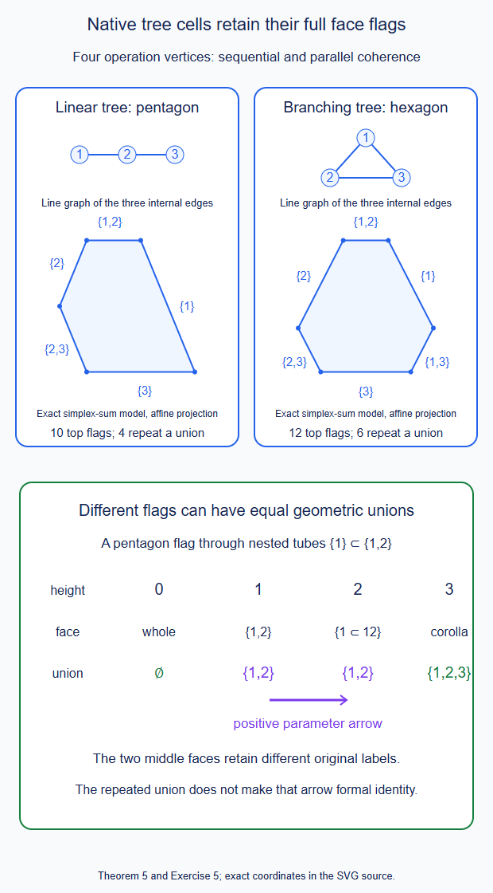

Theorem 5 and Exercise 5: exact simplex-sum coordinates distinguish
the two shapes and the positive flag steps with equal geometric
unions. [Editable SVG](../assets/rational-native-tree-cells.svg).

## 6. Every mixed comparison boundary

Write \(b,b'\) for the complete source and target tree
coderivations, and let \(F\) be the cofree extension of candidate
degree-zero primitive comparison values \(F_T\). For a connected
vertex subtree \(S\), let \(T/S\) mean its contraction to one
vertex. For a connected-block partition \(\pi\), let \(T/\pi\)
mean the full tree obtained by contracting every block. All intermediate
color profiles remain those of the original boundary edges.

**Proposition 6 (the complete mixed tree equation).** The comparison
is a chain cooperad map if and only if, on every tree, its primitive
values satisfy
\[
 \begin{split}
 \partial F_T
 &=\sum_{\substack{S\subseteq T\text{ connected}\\|S|\ge2}}
       \epsilon_S F_{T/S}(\ldots,b_S,\ldots)\\
 &\quad-\sum_{\substack{\pi\text{ connected-block partition}\\|\pi|\ge2}}
       \epsilon_\pi b'_{T/\pi}
                    (\bigotimes_{B\in\pi}F_B).
 \end{split}
\]
Here \(\partial\) is the full Hom differential with the target
unary differential and every original input unary differential.
The signs are the actual graded grouping and insertion signs of
Section 1; no unsigned replacement of a block permutation is made.
The source sum includes \(S=T\); the target sum includes the
partition into single vertices.

There are three source and three target boundary terms for a unary
three-vertex tree. A unary four-vertex tree has six source and seven
target terms. All these indexed terms belong to the comparison,
even if particular higher structure maps make some of their values
zero. The defect satisfies the full compatibility identity
\(b'E+Eb=0\), where \(E=b'F-Fb\).

**Proof.** Project \(Fb\) onto one output vertex. The source
coderivation acts on one connected subtree. For a subtree with at
least two vertices, that term is exactly its displayed source
summand after cofree extension of \(F\). Subtrees of one vertex
give every input unary term, including their prefix signs.

Project \(b'F\) onto one output vertex. The cofree \(F\)
first chooses a partition into connected vertex blocks. To obtain
one output, \(b'\) must act on the entire resulting contracted
tree. This is exactly the displayed target term. For a partition
with just one block it is \(b'_1F_T\), the target unary term.
The graded permutation grouping the blocks and their tensor
evaluation is precisely \(\epsilon_\pi\). Moving the unary
terms to the Hom differential gives the equation.

Conversely the full chain defect is a coderivation along \(F\).
Its one-output values are the differences just computed. If all
are zero, cofree coderivation uniqueness from Section 1 gives
the entire chain equation, not just its primitive projection.

For three unary vertices the connected source subtrees of size
at least two are the two neighboring pairs and the whole tree.
They give \(F_2(b_2,1)\), \(F_2(1,b_2)\) and \(F_1b_3\),
with their actual insertion signs. Its target partitions with at
least two blocks are the two pair/singleton partitions and the
three-singleton partition. They give
\(b'_2(F_2,F_1)\), \(b'_2(F_1,F_2)\) and
\(b'_3(F_1,F_1,F_1)\). For four unary vertices there are
\(3+2+1=6\) connected source intervals of size at least two,
and \(2^3-1=7\) nontrivial connected-block partitions. These
counts prove the stated boundary lists. An ordinary operation
cell and an interval do not by themselves specify these mixed
incidences: the source-contraction and target-partition faces
must all be recorded with their products.

Finally expand the defect without discarding any output word:
\[
 b'E+Eb=b'^2F-Fb^2=0.
\]
Thus, when all smaller tree equations hold, its next primitive
defect is closed in the exact Hom complex on that original
tree. This is the compatibility used for a relative lift; it
does not assert that its whole Hom space is acyclic or that
a missing native comparison may be chosen arbitrarily. The
calculation keeps all nullary vertices and ordinary identity
outputs throughout. \(\square\)

## 7. A concrete cell for the entire mixed boundary

The missing comparison direction has more faces than an unrefined
product prism. We construct its parameter cell directly. This supplies
the complete geometric boundary shape; an evaluation of that shape in
the actual native diagram is a further requirement.

For a finite set \(A\), put
\[
 D_A=\operatorname{conv}(\Delta_A,\kappa\Delta_A),
 \qquad \kappa>1.
\]
Here all coordinates outside \(A\) are zero. Thus \(D_A\) consists
of the nonnegative vectors supported on \(A\) whose coordinate sum
lies between \(1\) and \(\kappa\). For a connected graph \(G\)
on a nonempty set \(E\), choose a positive number \(\lambda_A\)
for every nonempty connected vertex set \(A\), and set
\[
 \begin{gathered}
 J_G=\sum_{A\in\mathcal B(G)}\lambda_A D_A,\\
 z(S)=\sum_{\substack{A\in\mathcal B(G)\\A\subseteq S}}
                 \lambda_A.
 \end{gathered}
\]
The coordinate sums are denoted by \(x(S)\). Use the convention
that \(J_\varnothing\) and a coherence cell on a single vertex
are points. The parameter \(\kappa\) and the positive weights
affect coordinates, but not the face identifications below.

**Theorem 7 (all source and target facets of the mixed cell).**
The polytope \(J_G\) has dimension \(p=|E|\). Its complete,
irredundant facet inequalities are
\[
 \begin{gathered}
 x(S)\ge z(S)\quad
       (\varnothing\ne S\in\mathcal B(G)),\\
 x(R)\le\kappa\bigl(z(E)-z(E\setminus R)\bigr)
       \quad(\varnothing\ne R\subseteq E).
 \end{gathered}
\]
In particular the lower family includes \(S=E\), and the upper
family includes every nonempty \(R\), whether connected or not.
The lower facet at \(S\) has face poset
\[
 C_{G|S}\times J_{G^*_S}.
\]
The symbol \(C\) denotes Section 5's simplex-sum coherence cell.
Let \(S_1,\ldots,S_k\) be the connected components of
\(E\setminus R\). The upper facet at \(R\) has face poset
\[
 C_{G^*_{E\setminus R}}\times
          \prod_{j=1}^k J_{G|S_j}.
\]
Reconnection through a disconnected set means reconnection separately
through each of its connected components. Empty factors are omitted.

For the internal line graph of an operation tree \(T\), these are
exactly
\[
 \begin{gathered}
 C_{T_S}\times J_{T/S},
       \qquad \varnothing\ne S\subseteq E(T)
                     \text{ connected},\\
 C_{T/\pi}\times\prod_{B\in\pi}J_B,
       \qquad \pi\text{ a connected-block partition},
                       \quad |\pi|\ge2.
 \end{gathered}
\]
Singleton blocks contribute their genuine one-vertex comparison point.
Thus the two facet families have precisely the indices of Proposition
6. All higher intersections retain these original indices. The full
face-flag chains have an explicit augmented contraction. Their oriented
fundamental chain has as boundary the signed fundamental chains of all
the displayed facets, with no deleted target partition.

**Proof.** A summand with \(A\subseteq S\) contributes at least
\(\lambda_A\) to \(x(S)\). A summand meeting \(R\) contributes
at most \(\kappa\lambda_A\) to \(x(R)\), and a summand not
meeting \(R\) contributes zero. This proves every displayed
inequality, including the lower inequalities for disconnected sets.
Such a disconnected lower inequality is the sum of those for its
connected components, because every connected \(A\subseteq S\)
lies in exactly one component.

Here is a proof that these inequalities describe the whole Minkowski
sum. For a linear functional \(w\), let
\(m_A=\min_{i\in A}w_i\). Its minimizing face on \(D_A\) is
\[
 \begin{cases}
   \Delta_{\{i\in A:w_i=m_A\}},&m_A>0,\\
   \kappa\Delta_{\{i\in A:w_i=m_A\}},&m_A<0,\\
   D_{\{i\in A:w_i=0\}},&m_A=0.
 \end{cases}
\]
Write the positive part of \(w\) as a positive linear combination
of indicators of its positive upper level sets, and its negative part
as a negative linear combination of indicators of its negative lower
level sets. The lower inequalities bound the first contribution; the
upper inequalities bound the second. In each summand choose a
minimizing coordinate of \(w|_A\), with scale one if \(m_A\ge0\)
and scale \(\kappa\) otherwise. This choice attains all the
bounds just used: a positive upper level set receives a contribution
exactly when it contains all of \(A\), and a negative lower level
set receives the maximal contribution exactly when it meets \(A\).
Consequently the proposed intersection and the Minkowski sum have the
same minimum for every linear functional. The intersection is bounded
by its coordinate upper and lower bounds. If it contained a point
outside the sum, a nearest point of that compact convex sum would give
a strictly separating linear functional, a contradiction. They are
therefore equal.

For completeness, their combinatorial structure is independent of the
positive weights. The minimizing face of a sum is the sum of its
minimizing faces. Moreover an inclusion between two such faces holds
if and only if it holds separately in every summand: choose an
arbitrary point in each minimizing summand face and use equality in the
sum's supporting inequality. Every nonnegative support deficit must
then be zero. This argument works with any positive weights, so the
same finite family of summand faces describes the same face poset.
It also applies to sums of the simplices \(\Delta_A\).

The singleton summands contain independent coordinate intervals, so
\(J_G\) has full dimension \(p\). Now minimize the functional
\(x(S)\) for a connected nonempty \(S\). If \(A\subseteq S\),
the summand face is \(\Delta_A\). If \(A\not\subseteq S\),
it is \(D_{A\setminus S}\). The two coordinate sets are disjoint.
The first sum is a positively weighted \(C_{G|S}\). In the second,
every nonempty \(A\setminus S\) is connected in \(G^*_S\): an
old path inside \(A\) can replace its portions inside \(S\) by
the new adjacency. Conversely, every connected set \(B\) of
\(G^*_S\) occurs. If \(B\) is already connected in \(G\), use
\(A=B\). Otherwise every old connected component of \(B\) meets
\(S\), and \(A=B\cup S\) is connected. The projected summands
therefore have exactly the connected-set supports of \(G^*_S\),
with positive combined weights. This proves the lower product formula.
Its dimension is
\((|S|-1)+(p-|S|)=p-1\), also when \(S=E\).

For an upper equality maximize \(x(R)\), and put \(S=E\setminus R\).
A summand meeting \(R\) contributes the face
\(\kappa\Delta_{A\cap R}\); a summand contained in \(S\)
contributes its whole \(D_A\). The latter summands split separately
over the components \(S_j\). For the former, all nonempty sets
\(A\cap R\) are connected after reconnection through the \(S_j\).
Conversely, if \(B\subseteq R\) is connected after reconnection,
adjoin all components \(S_j\) adjacent to \(B\). The resulting
set \(A\) is connected and has \(A\cap R=B\): an edge added
by reconnection is realized by a path through just such a component,
and every component adjoined meets \(B\). Thus the first sum is a
positively weighted \(C_{G^*_S}\). Its graph is connected because
\(G\) is connected. This proves the upper product formula, of
dimension
\[
 (|R|-1)+\sum_j|S_j|=p-1.
\]
Every proposed inequality is consequently a facet. There are no
others, by the complete inequality description. Their normal directions
are distinct. The disconnected lower inequalities are redundant as
already shown, so the asserted list is irredundant.

We identify the tree labels, rather than just counting dimensions.
A nonempty connected set \(S\) of internal edges has as endpoints
a connected vertex subtree \(T_S\). The internal line graphs after
restriction and reconnection are those of \(T_S\) and \(T/S\),
by Section 5's path argument. For an upper facet remove the original
edges \(R\) from \(T\). Its vertex components are the blocks of
one connected-block partition \(\pi\). The nonempty internal-edge
sets of these components are exactly the \(S_j\); isolated vertex
blocks have empty internal-edge sets and their \(J\)'s are points.
Reconnecting the remaining edge set gives the internal line graph of
\(T/\pi\). Conversely every connected-block partition is obtained
by this unique removal of edges. This proves all the asserted labels,
including the all-singleton partition and the full source subtree.
No argument uses the external valences, so original unary and nullary
vertices are retained.

All subsequent faces are intersections of these labeled facets. The
product descriptions respect further restriction: in each summand
one restricts its allowed coordinates and, where appropriate, its scale
to one or \(\kappa\). Repeating these restrictions in either order
gives their intersection. The product identifications on common faces
therefore retain the same original coordinate and subtree data. A
change of positive combined weights changes none of these face posets.
This proves compatibility on all intersections, without treating
simultaneous target blocks as unrelated one-cross primitives.

Orient \(J_G\) by its ordered coordinate basis. Give each facet
its boundary orientation using the outward normal, namely
\(-\mathbf1_S\) at a lower facet and \(+\mathbf1_R\) at an
upper facet, and orient its product factors by the induced determinant.
Orient every smaller face once and use its resulting incidence sign.
Every ridge belongs to two facets: a transverse two-dimensional slice
at an interior point is a convex pointed angle with two boundary rays.
The two orders of its outward directions have opposite determinants.
Thus all codimension-two terms in the incidence boundary cancel.
The same argument applies inside every face.

The nonempty face poset has terminal object the whole \(J_G\).
Section 5's explicit append-the-terminal-vertex homotopy, with
coefficient \( (-1)^{r+1}\) on an \(r\)-simplex, contracts its
augmented full-flag complex. Cone each face's signed facet chains to
that face. The codimension-two cancellation proves by induction that
the resulting fundamental flag chain has boundary exactly its signed
facet fundamental chains. The same full flags subdivide each product
facet: their steps interleave the changes in its factors, with the
ordinary graded shuffle sign. No simplicity assumption is used; some
vertices of \(J_G\) do meet more than \(p\) facets. This proves
the complete chain assertion. It supplies the mixed incidence
boundary, not an evaluation in the native mapping complexes. Such an
evaluation must still check its suspension signs against these
determinants and its strict-unit degeneracies. \(\square\)

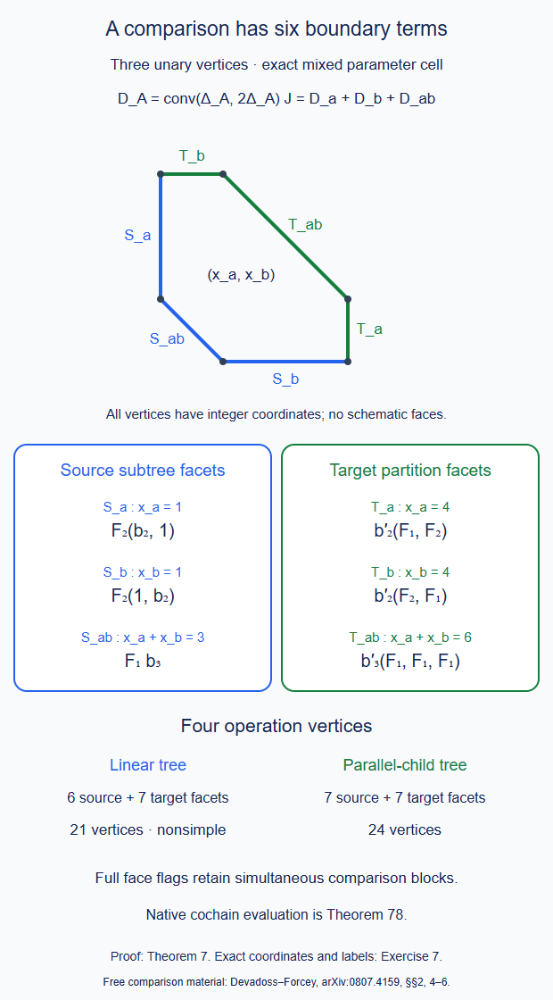

Theorem 7 and Exercise 7: all six mixed boundary terms are present.
The four-vertex linear and parallel cases have thirteen and fourteen
facets, respectively. [Editable SVG](../assets/rational-native-mixed-cells.svg).

## 8. The actual represented profiles and their calibration

This step concerns the native complexes themselves. It does not give a
multicategory structure merely by naming those complexes.

For an ordered tuple \(\mathbf x\) of rational IC generators or
finite additive IC sums, let \(T_G\mathbf x=F_n^G(\mathbf x)\)
be its actual native ordered convolution. Retain the rational
decomposition isomorphisms of [C.48.1](../GL-SAT-13.html#c481-fix-the-rational-cohomological-target) when recording it in the finite
additive envelope. Define
\[
 P_G(\mathbf x;y)=
       \operatorname{RHom}_G(T_G\mathbf x,y).
\]
At arity zero this is
\(\operatorname{RHom}_G(IC_0,y)\), with all its ordinary
endomorphisms; the coefficient input is not substituted for this
output complex. At arity one use the original mapping complex.

**Proposition 8 (every represented primitive profile is calibrated).**
The collection \(H(P_G)\), with the fixed rational decomposition
identifications, is
\[
 P_H(\mathbf x;y)=H_{\mathbf Q}(T_H\mathbf x,y).
\]
It is nonnegative, even and degreewise finite on every finite selected
corner. Its universal class is the actual identity of its representing
tensor object, including \(IC_0\) at arity zero.

The leading represented maps induced by the single full comparison
\(\Psi=J\Phi\) of [C.48.1](../GL-SAT-13.html#c481-fix-the-rational-cohomological-target) induce the identity on this entire
collection after extending to \(E\), not just on its unary profiles.
In particular they are quasi-isomorphisms on every represented
primitive complex. This assertion concerns the actual leading maps;
it does not assert that they have already been extended to the full
tree comparison required in Theorem 3.

**Proof.** The native tensor object of a finite IC tuple is an actual
finite semisimple IC sum by the proved Satake exactness and rational
heart. The degree-zero rational decomposition isomorphism and its
inverse identify its represented mapping cohomology with
\(H_{\mathbf Q}(T_H\mathbf x,y)\). On a finite sum this is the
finite matrix sum of the corresponding generator mapping groups.
[C.33.1](../GL-SAT-13.html#c331-the-rational-coefficient-generator-category) proves that each such group is nonnegative, even and
degreewise finite; finite sums preserve these properties. No tensor
closure of a finite object pool is asserted. For a given finite native
diagram use [C.44.3](../GL-SAT-13.html#c443-finite-execution-states-and-the-native-unit-diagram)/[C.47.2](../GL-SAT-13.html#c472-the-actual-typed-enhanced-diagram)'s finite forward image-summand closure.
For the empty tuple the tensor object is \(IC_0\), so the same
argument applies to its full mapping complex. The represented
universal class is its identity because composition with that identity
is the original represented mapping identification.

We compute the comparison on these profiles using the actual strong
monoidal inverse, rather than only its inverse on unary mappings.
Write \(L:H_{\mathbf Q}\otimes E\to S_E\) for [C.48.1](../GL-SAT-13.html#c481-fix-the-rational-cohomological-target)'s
cohomological strong monoidal equivalence and
\[
 \ell_{\mathbf x}:
 T_S(Lx_1,\ldots,Lx_n)\longrightarrow L(T_H\mathbf x)
\]
for its tensor comparison. On a represented multimorphism its map is
\[
 L_P(f)=L(f)\,\ell_{\mathbf x}.
\]
This formula follows directly by applying the original enhanced
comparison to \(f:T_G\mathbf x\to y\) and precomposing with its
specified tensor comparison. Its leading cochain value is a chain
map: the unary comparison component is a chain map and that tensor
comparison is a closed degree-zero map. The full enhanced structure
supplies its higher naturality; none of those higher components is
being set to zero.

Let \(j_{\mathbf z}:T_H(J\mathbf z)\to J(T_S\mathbf z)\)
be the actual strong tensor comparison of the inverse \(J\).
With [C.48.1](../GL-SAT-13.html#c481-fix-the-rational-cohomological-target)'s coherent identifications \(JL=1\), it satisfies
\[
 J(\ell_{\mathbf x})\,j_{L\mathbf x}=1_{T_H\mathbf x}.
\]
If object identifications are displayed rather than suppressed, the
two sides are conjugated by the same specified degree-zero
isomorphisms; their intermediate inverses cancel. This identity is
exactly the inverse tensor equation used in constructing \(J\).
The induced multimorphism map of \(J\) is
\(J_P(g)=J(g)j_{L\mathbf x}\). Therefore for every homogeneous
\(f\), in every degree,
\[
 \begin{aligned}
 J_P L_P(f)
   &=J(L(f))\,J(\ell_{\mathbf x})\,j_{L\mathbf x}\\
   &=f.
 \end{aligned}
\]
The cohomological map of the actual full \(\Phi\) is \(L\)
with these same \(\ell\)'s, by their definition in [C.48.1](../GL-SAT-13.html#c481-fix-the-rational-cohomological-target).
Hence this is precisely the leading represented cohomology map of
the given single \(J\Phi\), not a separately chosen map for
each profile.

At zero inputs, \(\ell_\varnothing:I_S\to L(I_H)\) is the
actual unit comparison, and its inverse equation with
\(j_\varnothing\) is the same displayed identity. The argument
keeps arbitrary positive-degree \(f:I_H\to y\). At one input
it reduces to the unary calibration. At more inputs it uses the full
tensor comparison, so unary calibration alone would not suffice.
At the universal \(f=1_{T_H\mathbf x}\) it gives the prescribed
universal class. Permutation and regrouping versions use the same
strong monoidal \(L,J\), whose original symmetric and ordered
coherences were retained in [C.29](../GL-SAT-13.html#c29-actual-complex-fusion-and-its-coherent-symmetric-enhancement)/[C.48](../GL-SAT-13.html#c48-calibrated-native-cells-in-fixed-state-models); applying their equations gives
the same identity after every such relabelling. Thus the entire
represented collection is calibrated. This still supplies no
unconstructed higher primitive tree values. \(\square\)

## 9. The full native represented module, not just its bare complex

Use honest dg source and target models \(A,B\) and the actual
normalized uncurved functor \(F:A\to B\). The source may be the
joint tensor category of any finite number of input factors, including
the coefficient category at zero factors. Write \(C_A=B_{\rm full}A\).
All its ordinary identity letters are retained.

Our words run from target to source. Their bar differential has
\(b_1(sa)=-s(da)\) and
\[
 b_2(sa|sb)=(-1)^{|a|-1}s(ab).
\]
Let \(\tau_F:C_A\to B\) be the unsuspended one-output core of
the whole bar functor \(BF\). It has degree one, is zero on the
empty word, and has the original object endpoints. For homogeneous
maps define their convolution by
\[
 (f\star g)(c)=
 \sum_{c=uv}(-1)^{|g||u|}f(u)g(v).
\]
An object component is evaluated on an empty word at that object.
Only type-correct cuts occur. Functor cores are zero at empty words;
natural transformation cores need not be.

**Theorem 9 (actual represented modules and full comparison transport).**
The primitive complexes
\[
 K_F(y;a)=B(Fa,y)
\]
carry their actual full input \(A_\infty\)-module actions and
strict output \(B\)-module actions. Their cofree right bar encoding
is \(K_F\otimes C_A\), with the endpoint-matched sums and
differential
\[
 \begin{aligned}
 D_F(k\otimes c)
  &=dk\otimes c+(-1)^{|k|}k\otimes b_Ac\\
  &\quad+(-1)^{|k|}
       \sum_{\substack{c=uv\\u\ne\varnothing}}
          k\,\tau_F(u)\otimes v .
 \end{aligned}
\]
It is a full dg comodule, including its empty-word primitive core.
At a fixed input object \(a\), its output module is literally the
represented module \(B(Fa,-)\); its universal operation is
\(1_{Fa}\). These statements retain nullary tensor objects and
ordinary scalar or identity outputs.

For a full homogeneous pre-natural transformation
\(\theta:F\to G\) of degree \(r\), use its unsuspended core
\(\theta:C_A\to B\) of degree \(r\). Its differential in these
coordinates is
\[
 \begin{aligned}
 \delta\theta
  &=d_B\theta-(-1)^r\theta b_A\\
  &\quad-\tau_G\star\theta
             +(-1)^r\theta\star\tau_F .
 \end{aligned}
\]
The entire induced graph-module map, in the contravariant direction,
is
\[
 \begin{gathered}
 \mathcal T_\theta:\mathcal K_G\longrightarrow\mathcal K_F,\\
 \mathcal T_\theta(k\otimes c)
   =\sum_{c=uv}(-1)^{r|k|}k\,\theta(u)\otimes v .
 \end{gathered}
\]
It satisfies the exact full identities
\[
 \begin{gathered}
 D_F\mathcal T_\theta-(-1)^r\mathcal T_\theta D_G
       =\mathcal T_{\delta\theta},\\
 \mathcal T_\theta\mathcal T_\eta
       =(-1)^{rs}\mathcal T_{\eta\star\theta},
       \qquad |\eta|=s .
 \end{gathered}
\]
Thus full parameter diagrams, their differentials, their compositions
and their specified homotopies are carried together, with the graded
opposite sign. A whole supplied natural equivalence carries its actual
inverse and homotopies as well.

For a changing target \(W:B\to B'\), the whole one-cross
expansion of \(BW\), followed by the preceding graph map for a
given full comparison \(\kappa:G\to WF\), gives the actual
full represented comparison along \(W\). Its primitive value is
\[
 k\longmapsto W_1(k)\,\kappa_0.
\]
In particular the native \(F_n^G\) give the full represented
fan modules underlying Proposition 8. The single [C48](../GL-SAT-13.html#c48-calibrated-native-cells-in-fixed-state-models) comparison
gives their full comparison maps, not just their bare cohomology
maps. This constructs the fixed-profile module part of a native
tree presentation; the equations relating several branching vertices
on changing profiles still require the all-tree construction.

**Proof.** Project the bar functor equation \(b_BBF=BFb_A\)
to one output letter. Unary target terms give \(d_B\tau_F\),
and target binary terms give \(\tau_F\star\tau_F\). With the
displayed suspended binary sign it reads
\[
 d_B\tau_F+\tau_F b_A=\tau_F\star\tau_F.
\]
For example, on two closed degree-zero letters both the source binary
term and the convolution term are minus their product. This fixes
the sign without changing any ordinary identity letter.

The coaction of \(\mathcal K_F\) is the complete deconcatenation
on its \(C_A\) factor. A cut after the prefix consumed by
\(\tau_F\) is exactly a term of \(D_F\) on the left coaction
factor. A cut inside the unconsumed word is a term of \(b_A\)
on the right factor. This is a bijection of terms, with the
displayed tensor differential sign, and proves the full comodule
equation.

For its square, the terms containing \(dk\) cancel in pairs.
The original square \(b_A^2\) is zero. At a fixed consumed word
\(u\), the remaining coefficient is
\[
 k\bigl(d_B\tau_F+\tau_F b_A
                         -\tau_F\star\tau_F\bigr)(u).
\]
In particular the two successive prefix actions contribute
\(-(-1)^{|u_1|}k\tau_F(u_1)\tau_F(u_2)\), the negative of
the convolution term. The preceding functor equation makes the
coefficient zero. All cuts of the unconsumed suffix are still present,
so this proves \(D_F^2=0\) on the entire comodule. It includes
the original unary differential of every source letter.

Output postcomposition is the actual dg composition of \(B\).
For a homogeneous output arrow \(a\), associativity and its
Leibniz rule give
\[
 D_F(ak\otimes c)
       =da\,k\otimes c+(-1)^{|a|}aD_F(k\otimes c).
\]
This proves the two-sided compatibility. At a fixed input object its
output module is exactly \(B(Fa,-)\). Composition with
\(u_a=1_{Fa}\) is the identity on every output mapping complex
and all its dg module actions, so the full represented Yoneda map is
literally that identity. The input actions, as \(a\) varies, are
the just constructed full \(\tau_F\) actions. No unproved
acyclicity of a transformation space is used.

The formula for \(\mathcal T_\theta\) is its cofree extension
from the coefficient \(k\theta(c)\). Its sign moves the map
\(\theta\), of degree \(r\), past \(k\). At the one-output
core of its chain defect, cancel the terms containing \(dk\).
After factoring \((-1)^{(r+1)|k|}k\), the remaining expression is
\[
 d_B\theta-(-1)^r\theta b_A
       -\tau_G\star\theta+(-1)^r\theta\star\tau_F.
\]
The right action after \(\theta(u)\) has coefficient
\((-1)^{r+|u|}\); the action before \(\theta(v)\) has
coefficient \(-(-1)^{r|u|}\). These are precisely the two
displayed convolution signs. The same expression is obtained by
expanding the one-marked bar equation for the original natural
transformation: it differentiates the marked value, differentiates
its original source, or composes it with an adjacent \(F\)- or
\(G\)-output. This proves the stated differential in the chosen
unsuspended, target-to-source coordinates.

Both sides are comodule maps, so equality of these cores proves the
whole chain-defect identity. For composition first consume \(u\)
with \(\eta\), and then \(v\) with \(\theta\). The coefficient is
\[
 (-1)^{s|k|+r(|k|+s+|u|)}
   =(-1)^{rs}(-1)^{(r+s)|k|}(-1)^{r|u|}.
\]
The last factor is the convolution sign in
\(\eta\star\theta\). Triple cuts prove associativity, and
the identity has its original object identity component and no
positive-input component. This proves the entire graded-opposite dg
functor statement. Applying it to the full bar of a parameter
diagram carries every higher parameter component too. In particular
a given inverse and the two given differential homotopies remain
inverse up to those same transported homotopies.

For the target change, form the triangular dg category consisting of
two copies of \(B\), with \(B\) itself as the single directed
cross bimodule and no reverse cross maps. On a composable word
with one cross letter, apply every Taylor component of \(W\)
to every consecutive partition. Exactly one output block contains
that original letter; declare its output the cross letter. This is
the whole one-cross expansion, including arbitrary source letters
on both sides and every ordinary cross output. Its chain equation
is the one-cross part of the original equation for \(BW\).
Its coactions follow by cutting before or after the unique marked
output block. Consequently it is a full bimodule comparison along
the two copies of \(W\), not merely the map \(W_1\) on a
bare complex.

Glue this to the input \(F\) graph by ordinary endpoint-matched
cotensor, retaining the intermediate \(C_B\) factor as in [C.66](../GL-SAT-13.html#c66-typed-kernel-models-and-coherence-lifting).
The marked evaluation of [C.69](../GL-SAT-13.html#c69-full-horizontal-operator-composition) composes the resulting whole words.
All its cut and chain equations were proved there; the unique marked
block retains the full source and output unary actions. This gives
the comparison from \(K_F\) to \(K_{WF}\) along \(W\).
Precompose with the full \(\kappa\) using
\(\mathcal T_\kappa\). The two operations give the claimed
full map to \(K_G\), whose bare value is \(W_1(k)\kappa_0\).
No intermediate core is replaced by an identity when taking cotensor.

Apply this construction to the actual joint source of
\(F_n^G\), supplied in [C.44](../GL-SAT-13.html#c44-formal-unit-vertices-and-finite-execution-indices)/[C.47](../GL-SAT-13.html#c47-joint-execution-and-contraction-of-native-trees) and retained in [C.68](../GL-SAT-13.html#c68-native-operator-models-through-dg-bridges).
At zero inputs its source is the coefficient category and its tensor
object is the actual \(IC_0\). At a positive input number it is
the genuine dg tensor source; if the original separate input
comparisons are \(A_\infty\), use [C.78](../GL-SAT-13.html#c78-full-tensor-unit-restriction-and-external-comparisons)'s full common tensor
input and its complete mapping restriction. This supplies the
whole parameter map on that input, and does not form a naive tensor
product of unrelated \(A_\infty\) functors. The native tensor
comparison of the single [C48](../GL-SAT-13.html#c48-calibrated-native-cells-in-fixed-state-models) functor is the stipulated full
\(\kappa\). The preceding formulas therefore give exactly its
full represented module comparison. Its leading map is Proposition
8's actual map and its leading cohomology is the identity.

Finally normalization is checked at the original inputs.
\(\tau_F\) on a one-letter unit is the actual identity action,
and on a longer unit-containing input it is zero. A normalized
transformation has its specified object component and its positive
components vanish at a source identity. These conditions are
preserved in the full formulas by the original normalized functor
and transformation equations. An identity-valued output of a
nonidentity input is never deleted. Neither is a nullary tensor
object or its higher output endomorphism. This proves the native
fan-module assertions. It does not prove the missing compatibility
among all branching-vertex grafts. \(\square\)

The cofree bar object here is an encoding of the full module, not
an assertion that its underlying total complex is the represented
mapping complex. Already for \(A=B=k\) and \(F=1\),
\[
 D_F(1\otimes s1)=1\otimes\varnothing.
\]
The ordinary complex \(K_F=k\) is not thereby made acyclic.
Equivalences used above retain their actual primitive maps and
their given full module homotopies. An underlying acyclicity
calculation on this unreduced cofree encoding cannot replace them.

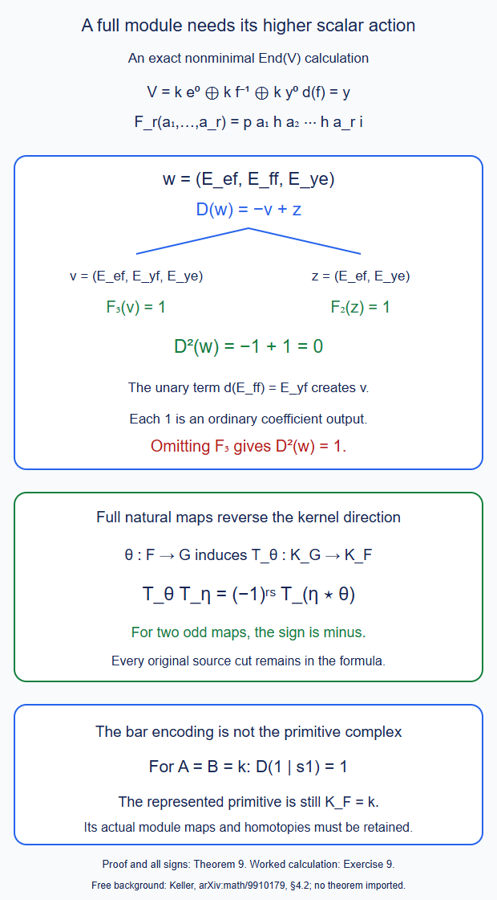

Theorem 9 and Exercise 9: the original source unary term and the
ordinary scalar ternary action cancel in \(D_F^2\).
The full formulas retain every source cut.
[Editable SVG](../assets/rational-native-fan-modules.svg).

## 10. The actual binary graft on represented cochains

Let the upper multimorphism be
\(a\in P_G(x_1,\ldots,x_n;y)\) and the lower one be
\(b\in P_G(z_1,\ldots,z_m;x_i)\), with \(1\le i\le n\)
and \(m\ge0\). Put \(N=n+m-1\). The native graft comparison,
with its direction specified here, is the closed degree-zero map
\[
 \begin{gathered}
 \alpha_{n,m,i}:T_G(x_1,\ldots,\mathbf z,\ldots,x_n)\\
 \longrightarrow
 F_n^G(x_1,\ldots,T_G\mathbf z,\ldots,x_n).
 \end{gathered}
\]
Use the actual comparison of [C.44](../GL-SAT-13.html#c44-formal-unit-vertices-and-finite-execution-indices)/[C.47](../GL-SAT-13.html#c47-joint-execution-and-contraction-of-native-trees), recorded on the chosen
rational object representatives with all decomposition maps retained.
For \(m=0\) it is the original unit comparison; no arbitrary
factor-deletion functor is introduced.

**Proposition 10 (binary native composition with its true nullary
input).** The formula
\[
 a\circ_i b=
   a\, (F_n^G)_1(1,\ldots,b,\ldots,1)\,
                \alpha_{n,m,i}
\]
defines a degree-zero chain map on these actual primitive complexes.
Its cohomology is the prescribed rational partial composition in
\(P_H\). The ordinary unary identities act as strict units in
the normalized native models. Its nullary input is the whole
\(\operatorname{RHom}_G(IC_0,x_i)\), including positive-degree
maps, and is not the coefficient input of \(F_0^G\).

**Proof.** The middle argument is one original joint arrow in the
honest dg tensor source of \(F_n^G\). All unchanged factors
are ordinary identity arrows; the \(i\)-th factor is the given
\(b:T_G\mathbf z\to x_i\). Its degree is \(|b|\), and
its differential is the same tuple with \(db\) in that slot.
The first Taylor map of an uncurved \(A_\infty\) functor is
a chain map. The actual \(\alpha\) is closed. Composition
in the dg target therefore gives
\[
 d(a\circ_i b)=da\circ_i b+(-1)^{|a|}a\circ_i db.
\]
This is the full required chain equation, also for nonclosed
homogeneous inputs. The formula only uses the first Taylor map on
one joint arrow. It makes no claim that this first map preserves
the composition of two arbitrary joint arrows.

If the upper operation is a unary identity, \(F_1^G=1\)
and the normalized unary-seam comparison is the identity, so the
formula is exactly \(b\). If the lower operation is a unary
identity, the tuple in the middle is the actual identity of its
joint source, its first functor value is the identity, and the
normalized seam comparison again leaves \(a\). These checks
concern unary identity multimorphisms, not arbitrary unary
vertices with nonidentity labels.

At \(m=0\), the lower tensor object is \(IC_0\).
The middle joint arrow still has its original map
\(b:IC_0\to x_i\); that factor is neither deleted nor replaced
by a coefficient scalar. The native \(\alpha\) now inserts
the actual unit object in that slot, as proved by [C.44.3](../GL-SAT-13.html#c443-finite-execution-states-and-the-native-unit-diagram)'s
expanded common chain and [C.47](../GL-SAT-13.html#c47-joint-execution-and-contraction-of-native-trees)'s compatible grafting rule.
Its source has \(N=n-1\) external inputs as required.
Thus the same chain calculation works with the true nullary
mapping complex.

Passing to cohomology replaces the middle functor action by the
actual cohomological tensor action and \(\alpha\) by its original
rational associativity or unit class. The fixed rational decomposition
maps appear next to their inverses at every internal representative.
The resulting map is exactly the represented partial composition
in \(P_H\), with the original tensor signs. This also proves
compatibility with its symmetric relabellings on cohomology.
The full higher naturality of this binary family is recorded by
Theorem 9's native modules and the given full \(\alpha\).
Associativity of several such binary grafts on cochains requires
the original higher functor and graft cells; it is not inferred
from the displayed Leibniz equation. \(\square\)

## 11. Actual three-vertex graft homotopies

For a homogeneous multilinear cochain \(h\) of degree minus one,
use the ordinary Hom differential
\[
 \begin{aligned}
 (\partial h)(a,b,c)
  &=d\,h(a,b,c)+h(da,b,c)\\
  &\quad+(-1)^{|a|}h(a,db,c)\\
  &\quad+(-1)^{|a|+|b|}h(a,b,dc).
 \end{aligned}
\]
Thus the equations below concern all original cochains, not only
closed inputs.

Two elementary pieces will be used. For an actual functor \(F\),
put
\[
 \sigma_F(u,v)=(-1)^{|u|}\tau_F(su|sv).
\]
This is an ordinary bilinear cochain of degree minus one. The
two-letter equation from Theorem 9 gives
\[
 (\partial\sigma_F)(u,v)
       =F_1(uv)-F_1(u)F_1(v).
\]
For a closed degree-zero full natural transformation
\(\beta:P\to Q\), put
\(\nu_\beta(u)=\beta^{[1]}(su)\), its full one-input core.
The one-letter natural-transformation equation gives
\[
 (\partial\nu_\beta)(u)
       =Q_1(u)\beta_{\rm source}
                    -\beta_{\rm target}P_1(u).
\]
The bracketed superscript distinguishes source-word length from
the object labels on its endpoints.

**Theorem 11 (the native nested and parallel three-vertex boundaries).**
The actual native binary grafts of Proposition 10 have rational
degree-minus-one trilinear homotopies on both possible three-vertex
shapes. Their boundaries are
\[
 \begin{gathered}
 \partial h_{\rm nested}
       =a\circ_i(b\circ_j c)-(a\circ_i b)\circ_{i+j-1}c,\\
 \partial h_{\rm parallel}
       =(-1)^{|b||c|}(a\circ_j c)\circ_i b\\
 \hfill{}-(a\circ_i b)\circ_{j+m-1}c,\qquad i<j,
 \end{gathered}
\]
where \(m\) is the arity of \(b\).
They are built from the original native naturality and coherence
cells and the actual higher functor maps. No nullary child, source
unary differential or identity-valued output is discarded.

Here are complete formulas, including their input-degree signs.
They initially give the actual raw native homotopies. Strict-unit
and prescribed-fan normalization is a separate, explicit change of
these cochains, discussed after their construction.

**Proof.** First construct the native coherence term used below.
The three-vertex tree has two original contraction paths to its
corolla. Use the orientations of the actual comparisons fixed in
Proposition 10, including the original inverse unit/tensor mates.
The finite whole native parameter model of [C.44](../GL-SAT-13.html#c44-formal-unit-vertices-and-finite-execution-indices)/[C.47](../GL-SAT-13.html#c47-joint-execution-and-contraction-of-native-trees), retained by
[C.68](../GL-SAT-13.html#c68-native-operator-models-through-dg-bridges), gives both paths and their two-letter components. If an
inverse comparison is recorded by its path object, use [C.50](../GL-SAT-13.html#c50-whole-prism-endpoint-recovery-with-exact-core-powers)'s
whole endpoint recovery, including its given inverse homotopies;
do not replace a homotopy equivalence by a guessed strict inverse.

Let \(K_0,K_1\) be the two path composites and \(D\) the
comparison on their same selected full contraction. Write
\(\tau_{\mathcal S,2}(P_i)\) for the ordinary degree-minus-one
core on the closed degree-zero parameter pair in path \(P_i\).
The two-letter functor equation just displayed says
\[
 d\,\tau_{\mathcal S,2}(P_i)=D-K_i.
\]
Consequently the actual native cochain
\[
 \omega=\tau_{\mathcal S,2}(P_0)
                       -\tau_{\mathcal S,2}(P_1)
\]
satisfies \(d\omega=K_1-K_0\).
The two paths retain their original selected edges. A positive
parameter arrow with identity geometric image is still present
in this formula. No acyclicity of a full natural-transformation
space has been invoked.

For the nested tree, let \(a\) have arity \(n\), let \(b\)
have arity \(m\) and enter its slot \(i\), and let \(c\)
have arity \(l\) and enter slot \(j\) of \(b\). Thus
\(n,m\ge1\), \(l\ge0\), and the flattened external arity is
\(n+m+l-2\). Denote by \(W\) its actual flat tensor object.
In the joint dg source of \(F_n^G\), use the arrows
\[
 \begin{gathered}
 B=\iota_i b,\qquad
 U=\iota_i\bigl((F_m^G)_1(\iota_jc)\bigr),\\
 \Gamma=\iota_i\gamma,\qquad
 \gamma=\alpha_{m,l,j}.
 \end{gathered}
\]
The notation \(\iota_i\) inserts the given map in slot \(i\)
and the actual identities in all unchanged factors. Thus
\(|B|=|b|\), \(|U|=|c|\), and \(|\Gamma|=0\).
Write \(f=(F_n^G)_1\) and \(\sigma=\sigma_{F_n^G}\).

Let \(\beta=\alpha_{n,m,i}\). Its old component uses the
original output object of \(c\), and its new component uses
\(T_G\mathbf t\) in that position, where \(\mathbf t\)
is the input tuple of \(c\). Let
\[
 \varepsilon=\alpha_{n+m-1,l,i+j-1},
 \qquad \delta=\alpha_{n,m+l-1,i}.
\]
Both have source \(W\), with their respective intermediate
flat tensor targets. The two native path composites are
\[
 K_0=\beta_{\rm new}\varepsilon,\qquad
 K_1=f(\Gamma)\delta.
\]
They have the same final nested tensor target. In particular the
native \(\omega\) constructed above has exactly these endpoints.
Set \(\widehat c=\iota_{i+j-1}c\) in the flat intermediate
source. Naturality gives
\[
 \begin{aligned}
 \partial\nu_\beta(c)
  &=f(U)\beta_{\rm new}\\
  &\quad-\beta_{\rm old}(F_{n+m-1}^G)_1(\widehat c).
 \end{aligned}
\]
This uses the actual one-input native component and retains its
source differential. On this one joint arrow the composite functor's
first component is \(f(U)\); all unchanged factors are its
ordinary identities. In a common tensor replacement this is the
same genuine one-arrow restriction of [C.78](../GL-SAT-13.html#c78-full-tensor-unit-restriction-and-external-comparisons), not a naive tensor
product of unrelated higher functors.

The two nested binary composites are therefore
\[
 \begin{gathered}
 L=a f(B)\beta_{\rm old}
          (F_{n+m-1}^G)_1(\widehat c)\varepsilon,\\
 R=a f(BU\Gamma)\delta.
 \end{gathered}
\]
Define
\[
 \begin{aligned}
 h_{\rm nested}
  &=(-1)^{|a|+|b|}a f(B)\nu_\beta(c)\varepsilon\\
  &\quad+(-1)^{|a|+|b|+|c|}a f(B)f(U)\omega\\
  &\quad+(-1)^{|a|}a\sigma(B,U)f(\Gamma)\delta\\
  &\quad+(-1)^{|a|}a\sigma(BU,\Gamma)\delta .
 \end{aligned}
\]
Every term has the prescribed flat source and output \(y\);
its degree is \(|a|+|b|+|c|-1\).

To verify its whole Hom boundary, pass through the successive maps
\[
 \begin{gathered}
 L,\\
 a f(B)f(U)\beta_{\rm new}\varepsilon,\\
 a f(B)f(U)f(\Gamma)\delta,\\
 a f(BU)f(\Gamma)\delta,\\
 R.
 \end{gathered}
\]
The four differences are, in order, the boundaries of the four
displayed summands. The signs move the relevant degree-minus-one
cochain past precisely its preceding original inputs. The second
cochain has no morphism input and crosses all three; the last two
cross just \(a\). The elementary functor, naturality and
\(d\omega\) equations prove these four statements with the
full Hom differential. Their intermediate maps cancel, giving
\(\partial h_{\rm nested}=R-L\).

For parallel branches let \(b,c\) enter distinct slots \(i<j\)
of \(a\), of arities \(m,l\ge0\). Put \(B=\iota_i b\),
\(C=\iota_jc\), with the unchanged objects chosen at the
appropriate endpoints, and keep \(f,\sigma\) as above.
In their actual joint dg source the two orders satisfy
\[
 BC=(-1)^{|b||c|}CB.
\]
Indeed the outer \(C\), in the later tensor slot, crosses the
inner \(B\) in the earlier slot; the other order has no such
crossing. This is an identity of those type-correct joint arrows.

Let \(\beta_b,\beta_c\) be the native graft comparisons for
inserting \(b,c\) separately, with old and new object components
as in the nested case. Let
\[
 \begin{gathered}
 C_b=(F_{n+m-1}^G)_1(\iota_{j+m-1}c),\\
 B_c=(F_{n+l-1}^G)_1(\iota_i b).
 \end{gathered}
\]
Let \(\varepsilon_c,\varepsilon_b\) be the remaining graft
maps from the common flat tensor object \(W\).
The complete one-input naturality cochains satisfy
\[
 \begin{aligned}
 \partial\nu_b(c)
   &=f(C)(\beta_b)_{\rm new}-(\beta_b)_{\rm old}C_b,\\
 \partial\nu_c(b)
   &=f(B)(\beta_c)_{\rm new}-(\beta_c)_{\rm old}B_c.
 \end{aligned}
\]
Set
\[
 K_b=(\beta_b)_{\rm new}\varepsilon_c,\qquad
 K_c=(\beta_c)_{\rm new}\varepsilon_b .
\]
Use the actual native two-path cochain with
\(d\omega=K_c-K_b\), as constructed at the start of the proof.
Then the binary composites are
\[
 \begin{gathered}
 L=a f(B)(\beta_b)_{\rm old}C_b\varepsilon_c,\\
 R=a f(C)(\beta_c)_{\rm old}B_c\varepsilon_b .
 \end{gathered}
\]
Define
\[
 \begin{aligned}
 h_{\rm parallel}
  &=(-1)^{|a|+|b|}a f(B)\nu_b(c)\varepsilon_c\\
  &\quad+(-1)^{|a|}a\sigma(B,C)K_b\\
  &\quad+(-1)^{|a|+|b|+|c|}a f(BC)\omega\\
  &\quad-(-1)^{|a|+|b||c|}a\sigma(C,B)K_c\\
  &\quad-(-1)^{|a|+|c|+|b||c|}
                         a f(C)\nu_c(b)\varepsilon_b .
 \end{aligned}
\]
Its five summands successively pass through
\[
 \begin{gathered}
 L,\qquad a f(B)f(C)K_b,\qquad a f(BC)K_b,\\
 a f(BC)K_c,\qquad
 (-1)^{|b||c|}a f(C)f(B)K_c,\qquad
 (-1)^{|b||c|}R.
 \end{gathered}
\]
For the fourth and fifth terms, exchanging the original \(b,c\)
inputs contributes \((-1)^{|b||c|}\). The remaining signs
move a degree-minus-one map past \(a\), or past \(a,c\),
respectively. Applying the same elementary equations gives every
successive difference, with all three original input differentials.
They telescope to the asserted parallel boundary.

These are all three-vertex shapes. A nested lower vertex may
be nullary; either parallel lower vertex may be nullary.
The specified insertion slots and the actual \(IC_0\) objects
in \(\gamma,\beta,\delta,\varepsilon\) remain present,
as in Proposition 10. Nonidentity unary operations remain original
input maps. The construction uses no augmentation and discards no
ordinary identity-valued Taylor output.

For completeness, its suspended sign is determined as follows.
In root-first vertex order \(a,b,c\), the two binary contractions
have total coefficient
\[
 (-1)^{|b|}s(L-R_{\rm signed}),
\]
where \(R_{\rm signed}=R\) in the nested case and
\((-1)^{|b||c|}R\) in the parallel case.
In the parallel case the contraction using \(a,c\) first moves
\(sc\) past \(sb\), giving
\((-1)^{(|b|-1)(|c|-1)}\); multiplying its two binary
suspension signs gives the negative of the other coefficient
times \((-1)^{|b||c|}\). This proves the displayed formula
for that shape as well.

Put
\[
 b_T(sa,sb,sc)=(-1)^{|b|+1}s h_T(a,b,c).
\]
The original unary terms and the unary output differential
contribute \(-(-1)^{|b|+1}s\partial h_T\). By the
boundary just proved this cancels the binary contribution exactly.
Thus these actual native values give square zero through
three-vertex inputs, with the original unary and binary values fixed.
This is a three-vertex statement. Higher trees and their full mixed
comparison equations are not consequences of it alone. \(\square\)

## 12. Normalize the three-vertex data with its comparison retained

For every nonzero generator or additive-sum color's unary
endomorphism profile choose a degree-zero chain
functional \(\epsilon_x\) onto the line of its identity, with
\(\epsilon_x(1_x)=1\). It is obtained from a unit-preserving
mapping contraction followed by a linear projection on \(H^0\).
No multiplicativity is required. Put
\[
 R_x=1-1_x\epsilon_x.
\]
On a vertex profile having no possible unary identity use the identity
map. Let \(N_T\) be their ordered tensor on a three-vertex tree.
These are ordinary degree-zero chain projections.
If a strict zero object is retained as a color, its identity is
zero and the corresponding unit-input condition is automatic by
linearity; no retraction onto a nonexistent identity line is used.

**Proposition 12 (the normalized native three-vertex jet).**
The actual raw cochains of Theorem 11 admit rational three-vertex
values that:

- have the same complete boundaries;
- vanish at every ordinary unary identity input;
- agree with Theorem 9's actual full fan-module values whenever
  the tree has at most one nonunary vertex;
- leave all original unary differentials and binary grafts fixed.

The changes have explicit degree-minus-two cochains and actual
triangular cofree comparisons through three vertices. The comparison
which first removes a raw unit defect need not itself be normalized;
its unit components are retained. No full higher-tree or mixed
comparison equation is inferred from this finite jet.

**Proof.** Denote the binary associativity/interchange defect by
\(D_T=R_{\rm signed}-L\). It vanishes identically when any
input is an ordinary unary identity. In the nested case the three
possibilities reduce respectively to
\(b\circ c=b\circ c\), \(a\circ c=a\circ c\), and
\(a\circ b=a\circ b\), by Proposition 10's strict units.
In the parallel case an identity lower input has degree zero, so
the interchange sign is one and both expressions again reduce to
the same remaining graft. A parallel root cannot be a unary
identity. These exhaust the possible unit inputs.

The tensor projector \(N_T\) differs from the identity by maps
whose images have a unit input. Therefore
\[
 D_TN_T=D_T.
\]
Set \(h_T^0=h_T^{\rm raw}N_T\). Since \(N_T\) is a chain
map, \(\partial h_T^0=D_T\), and \(h_T^0\) vanishes on
the entire unit-input subspace. This normalization acts on the
original inputs only. It deletes no output identity and assumes
no augmentation of the mapping algebra.

On a fan tree, meaning a tree with at most one nonunary vertex,
let \(h_T^{\rm fan}\) be the third primitive value in the
actual module of Theorem 9, with the suspension of Theorem 11.
If all vertices are unary, it is zero because the original generator
model is dg. Output-only actions are the original dg
postcompositions; the input and mixed actions are the full
\(F_n^G\) module actions, restricted using the genuine tensor
input. Theorem 9 proves their whole square and normalization.
Explicitly, if the root is the sole nonunary vertex and its
two unary inputs form one chain, the value is
\[
 h_T^{\rm fan}=(-1)^{|a|}a\,\sigma_{F_n^G}(B,C).
\]
If they occupy separate ordered slots it is
\[
 \begin{aligned}
 h_T^{\rm fan}=(-1)^{|a|}a\bigl(
   &\sigma_{F_n^G}(B,C)\\
   &-(-1)^{|b||c|}\sigma_{F_n^G}(C,B)\bigr).
 \end{aligned}
\]
In every other fan position the value is zero, by the strict
output action. To see the separated-slot formula directly,
the two joint-arrow bar terms are
\[
 sB|sC+
    (-1)^{(|b|-1)(|c|-1)}sC|sB.
\]
They are the two possible orders of its original one-letter
input legs. The second coefficient is exactly their graded
bar permutation. Apply the full right action from Theorem 9
and then its suspension: the result is the displayed
formula. It keeps both terms and their ordinary outputs.
Their binary values are exactly Proposition 10's values on
these fan trees: the unary seam functors and object comparisons
are the identities. Hence
\[
 z_T=h_T^{\rm fan}-h_T^0
\]
is a closed degree-minus-one ordinary multilinear cochain, and
it vanishes on unit inputs. This is a statement about these
ordinary mapping complexes, not an assertion that an arbitrary
full natural-transformation complex is acyclic.

We now give its actual primitive, rather than citing only its
cohomology. Let \(V\) be the tensor of the three original
primitive input complexes and \(W\) its output complex.
Choose their rational normalized contractions, with
\(d h+h d=1-\Pi\), \(\Pi=ip\), and with the unit included
among the chosen representatives. Use the ordered tensor
contraction on \(V\). On the ordinary Hom complex put
\[
 \mathcal H(f)=h_W f+(-1)^{|f|}\Pi_W f h_V.
\]
Expanding its two Hom differentials, the terms differentiating
the output and input cancel separately, leaving
\[
 \partial\mathcal H(f)+\mathcal H(\partial f)
                  =f-\Pi_W f\Pi_V.
\]
The first summand contributes \((1-\Pi_W)f\), and the
second contributes \(\Pi_W f(1-\Pi_V)\); this also verifies
the displayed sign.

Proposition 8 gives even cohomology in every primitive profile.
The tensor input therefore has even cohomology as well. A
degree-minus-one map between the projected input and output
cohomologies is zero. Consequently
\(\Pi_W z_T\Pi_V=0\), and the explicit cochain
\[
 K_T=\mathcal H(z_T)
\]
has degree minus two and satisfies \(\partial K_T=z_T\).
The tensor homotopy \(h_V\) preserves the unit-input subspace:
the summand hitting its unit is zero, and all other summands
retain that unit. Thus both terms of \(\mathcal H(z_T)\)
vanish on that subspace. The primitive \(K_T\) is normalized.

Here is the cofree comparison and its sign. Extend the
three-vertex coderivation by zero at larger primitive trees for
this calculation only. Let \(g\) have identity one-vertex
component, zero two-vertex component, and on fan trees put
\[
 g_T(sa,sb,sc)=(-1)^{|b|+1}sK_T(a,b,c).
\]
Give it zero higher primitive values on all other trees.
Section 1's connected-block formula makes it an actual cofree
coordinate with a finite vertex-lowering inverse. It is
normalized because its new primitive values vanish at unit
inputs. On three vertices its conjugation has the exact value
\[
 (g b g^{-1})_T-b_T=g_Tb_1-b_1g_T
                =(-1)^{|b|+1}s\,\partial K_T.
\]
To check the last equality, the input unary terms give minus
the signed input differential of \(K_T\), and the output
term gives its positive output differential. Since \(K_T\)
has even degree minus two, their sum is its ordinary Hom
differential. Hence the conjugated value is precisely
\(h_T^{\rm fan}\). On nonfan three-vertex trees it stays
\(h_T^0\), and on smaller trees it is unchanged. The square
remains zero through three vertices by actual conjugation.

The first unit normalization also has comparison data, which
must not be suppressed. The difference
\[
 r_T=h_T^0-h_T^{\rm raw}
\]
is closed of degree minus one. The same even-cohomology
argument gives the explicit primitive
\(\mathcal H(r_T)\). Its three-vertex cofree coordinate
has the same displayed sign and carries the raw value to
\(h_T^0\). It may have nonzero unit-input components because
the raw cochain did. Retain them as part of this comparison;
do not call that coordinate normalized. The second, fan-matching
coordinate is normalized, as already proved.

The constructions are coefficient-linear and rational.
For symmetric profiles choose the contractions and linear
functionals equivariantly under their finite stabilizers as in
Theorem 2. The tensor formula and the same graded vertex
permutations then retain equivariance. There is no averaging
of nonlinear cofree maps.

This proves a normalized three-vertex source jet and its
explicit relation to the original native data. When higher
native values are constructed, every such source coordinate
must conjugate their whole coderivation and transport every
full comparison and marked domain, using the actual cofree
formulas. It would be incorrect to retain new third values
and the former fourth values independently. The rational
cohomological target remains fixed. A normalized full
comparison, including its unit coherence, is still a
separate remaining construction. \(\square\)

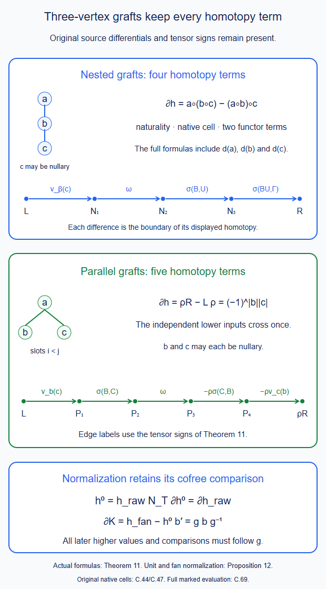

Theorem 11 and Proposition 12: the paths telescope with the original
unary differentials and graded tensor signs. Every displayed
normalization retains its cofree comparison.
[Editable SVG](../assets/rational-native-three-grafts.svg).
Free bar-convention background: [Keller, Sections 3.4 and 4.2](https://arxiv.org/pdf/math/9910179).

## 13. The actual binary component of the calibrated comparison

Work over the same extension field \(E\) as [C.48](../GL-SAT-13.html#c48-calibrated-native-cells-in-fixed-state-models). Write
\(\Psi=J\Phi\) for its single full calibrated comparison.
The cohomological target has the genuine dg tensor functors
\(F_n^H\), so their first maps preserve composition exactly.
The source still has its actual higher \(F_n^G\).
Denote the actual full tensor comparison by
\[
 \kappa_n:F_n^H\Psi^{(n)}\longrightarrow\Psi F_n^G.
\]
Its joint input is the genuine one of [C.78](../GL-SAT-13.html#c78-full-tensor-unit-restriction-and-external-comparisons); the notation does
not prescribe a naive tensor product of higher functors.

**Theorem 13 (the full two-vertex comparison boundary).**
The actual leading represented map
\[
 \varphi_1(a)=\Psi_1(a)\kappa_n(\mathbf x)
\]
has a native degree-minus-one two-input cochain \(H\) with
\[
 \partial H(a,b)
   =\varphi_1(a\circ_i b)
                  -\varphi_1(a)\circ_i\varphi_1(b).
\]
It retains the two higher functor terms, tensor naturality
and the single given native graft-coherence term.
Its suspended second component is
\[
 F_T(sa,sb)=(-1)^{|a|}sH(a,b).
\]
Together with the given first map this satisfies the entire
tree comparison equation through two vertices.
It can be normalized on unary identity inputs and matched to
Theorem 9's prescribed fan comparison while retaining explicit
degree-minus-two comparison homotopies. No higher mixed
partition equation is inferred from this result.

**Proof.** Use the binary tree and notation of Proposition 10.
Let \(v=(F_n^G)_1(\iota_i b)\) and let
\(\alpha=\alpha_{n,m,i}^G\). Then its source composite is
\(a v\alpha\). The leading maps of the original functor give
the four native tensor constraints
\[
 \begin{gathered}
 \kappa_{\rm flat}=\kappa_{n+m-1},\qquad
 \kappa_{\rm old}=\kappa_n(\mathbf x),\\
 \kappa_{\rm new}=\kappa_n(x_1,\ldots,T_G\mathbf z,\ldots,x_n),
 \qquad \kappa_m=\kappa_m(\mathbf z).
 \end{gathered}
\]
Their object arguments specify their original endpoints.
Let
\[
 M=(F_n^H)_1(\iota_i\kappa_m),
 \qquad \alpha_H=\alpha_{n,m,i}^H.
\]
The original tensor constraint is compatible with the original
native graft. Its given full coherent comparison, carried by
[C.29](../GL-SAT-13.html#c29-actual-complex-fusion-and-its-coherent-symmetric-enhancement)/[C.44](../GL-SAT-13.html#c44-formal-unit-vertices-and-finite-execution-indices)/[C.48](../GL-SAT-13.html#c48-calibrated-native-cells-in-fixed-state-models) on the actual common chain, has the object
cochain \(\omega_\kappa\) with
\[
 \begin{aligned}
 d\omega_\kappa
   &=\kappa_{\rm new}M\alpha_H\\
   &\quad-\Psi_1(\alpha)\kappa_{\rm flat}.
 \end{aligned}
\]
Equivalently take its complete marked two-endpoint component
using [C.69](../GL-SAT-13.html#c69-full-horizontal-operator-composition) on that native graft cell. This is supplied
compatibility of the one given strong comparison, not an
independently selected edge or an arbitrary mapping-space
filler. The endpoint and parameter data remain the ones of
[C.48](../GL-SAT-13.html#c48-calibrated-native-cells-in-fixed-state-models). In its zero-differential graded target the object
component is zero whenever its degree-minus-one target space
is zero; this does not remove its higher source components.

The full one-input naturality cochain of \(\kappa_n\) on
the original joint arrow \(\iota_i b\) satisfies
\[
 \begin{aligned}
 \partial\nu_{\kappa_n}(b)
   &=\Psi_1(v)\kappa_{\rm new}\\
   &\quad-\kappa_{\rm old}
                (F_n^H)_1(\iota_i\Psi_1(b)).
 \end{aligned}
\]
This is exactly Theorem 9's full marked equation at one
source letter. Both joint first components are genuine:
all unchanged factors are their original identity inputs.

Use the elementary functor homotopy
\(\sigma_\Psi\) defined in Theorem 11. Set
\[
 \begin{aligned}
 H(a,b)
  &=\sigma_\Psi(a,v\alpha)\kappa_{\rm flat}\\
  &\quad+(-1)^{|a|}\Psi_1(a)
                   \sigma_\Psi(v,\alpha)\kappa_{\rm flat}\\
  &\quad-(-1)^{|a|+|b|}
                     \Psi_1(a)\Psi_1(v)\omega_\kappa\\
  &\quad+(-1)^{|a|}\Psi_1(a)
                      \nu_{\kappa_n}(b)M\alpha_H .
 \end{aligned}
\]
All its terms go from the same flat target tensor object to
\(\Psi y\), and have degree \(|a|+|b|-1\).
Consider the successive maps
\[
 \begin{gathered}
 L=\Psi_1(a v\alpha)\kappa_{\rm flat},\\
 S_1=\Psi_1(a)\Psi_1(v\alpha)\kappa_{\rm flat},\\
 S_2=\Psi_1(a)\Psi_1(v)\Psi_1(\alpha)\kappa_{\rm flat},\\
 S_3=\Psi_1(a)\Psi_1(v)\kappa_{\rm new}M\alpha_H,\\
 R=\Psi_1(a)\kappa_{\rm old}
       (F_n^H)_1(\iota_i\Psi_1(b))M\alpha_H .
 \end{gathered}
\]
The four summands have respective boundaries
\[
 L-S_1,\qquad S_1-S_2,\qquad
 S_2-S_3,\qquad S_3-R.
\]
The first two follow from the complete two-letter functor
equation. The third uses the displayed orientation of
\(\omega_\kappa\), with its minus sign. The fourth is
the full tensor naturality equation. Their input-degree signs
move each degree-minus-one term past its preceding original
inputs, just as in Theorem 11. Hence this telescope proves
the full Hom equation, including \(da,db\).

Because \(F_n^H\) is a genuine dg functor,
\[
 (F_n^H)_1(\iota_i\Psi_1(b))M
     =(F_n^H)_1(\iota_i(\Psi_1(b)\kappa_m)).
\]
Thus \(R\) is precisely the target binary graft of
\(\varphi_1(a),\varphi_1(b)\), not a new target
operation. The source term \(L\) is
\(\varphi_1(a\circ_i b)\). This proves the stated
ordinary Hom boundary.

We verify the suspension. On \(sa|sb\), the difference
between the source binary image and target binary image is
\[
 (-1)^{|a|-1}s(L-R).
\]
For \(F_T(sa,sb)=(-1)^{|a|}sH(a,b)\), its output unary
term minus its original input unary terms is
\[
 -(-1)^{|a|}s\,\partial H(a,b),
\]
the same expression. This is the full primitive equation.
The cofree connected-block extension then gives the whole
comparison equation on two-vertex outputs, including the
two singleton comparison blocks. The one-vertex equation
was the original leading chain map. Source nullary vertices
are included in the same formula, with the actual \(IC_0\)
mapping complex and its native \(\alpha,\kappa_m\).

Finally the binary defect \(L-R\) vanishes on either
ordinary unary identity input: \(\varphi_1\) preserves
those identities and both binary operations have their
strict units. Precomposing \(H\) with the two-factor
unit projector of Proposition 12 therefore preserves its
boundary and normalizes its unit inputs. The difference
is a closed degree-minus-one cochain between even
cohomology profiles over \(E\). The same explicit ordinary
Hom contraction gives its degree-minus-two primitive.

On a fan tree Theorem 9 already gives the full actual
represented comparison. Convert its second suspended
component to an ordinary \(H_{\rm fan}\) by the
displayed sign. Its full chain equation gives the same
boundary \(L-R\), and it is normalized. Hence
\(H_{\rm fan}-H^0\) is another closed normalized
degree-minus-one cochain. The contraction of Proposition
12 supplies a normalized degree-minus-two primitive \(K\).
If \(\partial K=H_{\rm fan}-H^0\), its suspended
comparison homotopy is
\[
 \mathcal K_T(sa,sb)=(-1)^{|a|+1}sK(a,b).
\]
Its Hom differential \(b_H\mathcal K+\mathcal K b_G\)
is the required difference of second comparison cores;
no lower core changes. The initial unit correction has
the same explicit homotopy, with its actual unit values
retained if needed.

These are components of the same native comparison and its
recorded homotopies. Higher source coordinates from
Proposition 12 start at three vertices and do not change
this second component; all subsequent mixed components
must nevertheless be transported with those coordinates
and with the present comparison homotopies. The six
three-vertex mixed faces of Proposition 6 are still
required. \(\square\)

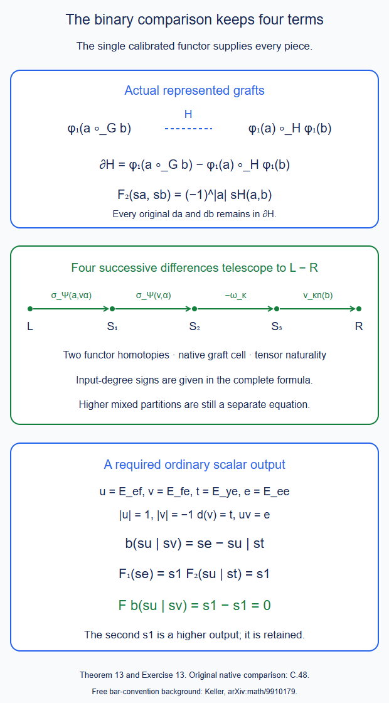

Theorem 13 and Exercise 13: the full Hom boundary is the
difference of the source and target binary grafts.
The two higher functor terms, native graft cell and tensor
naturality are all present.
[Editable SVG](../assets/rational-native-binary-comparison.svg).

## 14. The first higher transport of the retained source coordinate

The source coordinates of Proposition 12 must be applied to the
whole data. The first two consequences occur exactly at the
next native structure and comparison cells.

**Theorem 14 (fourth structure and third comparison transport).**
Let \(g\) be the actual cofree coordinate with \(g_1=1\),
\(g_2=0\), third primitive \(k_3\), and all other
nonidentity primitive values zero. Let \(K_3\) be the
degree-zero coderivation with that same sole primitive value.
For any full coderivation \(b\), put \(b^g=g b g^{-1}\).
Then
\[
 \begin{gathered}
 b^g_1=b_1,\qquad b^g_2=b_2,\\
 b^g_3=b_3+[K_3,b_1]_3,\\
 b^g_4=b_4+[K_3,b_2]_4 .
 \end{gathered}
\]
The bracket is the graded commutator; \(K_3\) has degree
zero, so each displayed bracket is an ordinary difference.
All operations are on full original trees.

The fourth correction is the exact sum
\[
 \begin{aligned}
 [K_3,b_2]_T
  &=\sum_{\substack{S\subseteq T\ {\rm connected}\\|S|=2}}
       \epsilon_S\,k_{T/S}(\ldots,b_S,\ldots)\\
  &\quad-\sum_{\substack{S\subseteq T\ {\rm connected}\\|S|=3}}
       \epsilon'_S\,b_{T/S}(\ldots,k_S,\ldots).
 \end{aligned}
\]
Its five terms for a four-vertex linear tree, and six for a
four-vertex internal star, have precisely the original
pentagon and hexagon facet indices. The signs are the same
ordered graded grouping signs as in Section 1.

If \(F\) is the given comparison to the fixed target,
its transported comparison is \(F^g=Fg^{-1}\). Its
primitive values satisfy
\[
 \begin{gathered}
 f^g_1=f_1,\qquad f^g_2=f_2,\\
 f^g_3=f_3-f_1k_3,\\
 f^g_4=f_4-
   \sum_{\substack{S\subseteq T\ {\rm connected}\\|S|=3}}
       \epsilon_S\,f_{T/S}(\ldots,k_S,\ldots).
 \end{gathered}
\]
The target coderivation is unchanged. These formulas give
the transport of the actual coordinates already retained;
they do not supply the still-unconstructed raw native
fourth structure or third comparison cell.

**Proof.** A third primitive value lowers vertex count by
two. On an input with at most four vertices two such
contractions cannot occur successively, and two disjoint
three-vertex blocks cannot occur simultaneously. The
complete connected-block formula therefore gives, on
these inputs,
\[
 g=1+K_3,\qquad g^{-1}=1-K_3.
\]
In the conjugation, the term \(K_3b_1-b_1K_3\) lowers
vertex count by two, so gives the third primitive
correction. The term \(K_3b_2-b_2K_3\) lowers it by
three, so gives the fourth. Every remaining term lowers
it too far to have a nonempty output on these inputs.
This proves the four identities without imposing any
augmentation or deleting an ordinary identity output.

On a four-vertex tree, \(K_3b_2\) first contracts one
two-vertex subtree and then applies the third coordinate
to the whole remaining tree. The other product first
contracts one three-vertex subtree and then applies
the remaining binary operation. This proves the two
finite sums and their grouping signs. A tree with four
vertices has three internal edges, giving three terms
of the first kind. A linear internal tree has two
connected three-vertex subtrees; a star has three.
These are exactly the proper connected internal-edge
tubes of Theorem 5, of sizes one and two, respectively.
The argument retains all original boundary slots and
therefore applies to every root orientation and to
the allowed unary and nullary vertices.

For clarity, take a linear suspended input
\[
 x|y|z|w.
\]
Its fourth correction is
\[
 \begin{aligned}
 &k_3(b_2(x,y),z,w)\\
 &\quad+(-1)^{|x|}k_3(x,b_2(y,z),w)\\
 &\quad+(-1)^{|x|+|y|}k_3(x,y,b_2(z,w))\\
 &\quad-b_2(k_3(x,y,z),w)\\
 &\quad-b_2(x,k_3(y,z,w)).
 \end{aligned}
\]
Here the degrees are already suspended. The first three
signs move the degree-one binary operation past its
preceding original inputs. The third-coordinate map
has degree zero, so the last two terms have no
additional prefix sign.

For a root with three operation children, in the same
original order \(x,y,z,w\), the correction is
\[
 \begin{aligned}
 &k_3(b_2(x,y),z,w)\\
 &\quad+(-1)^{|y||z|}k_3(b_2(x,z),y,w)\\
 &\quad+(-1)^{|w|(|y|+|z|)}k_3(b_2(x,w),y,z)\\
 &\quad-b_2(k_3(x,y,z),w)\\
 &\quad-(-1)^{|z||w|}b_2(k_3(x,y,w),z)\\
 &\quad-(-1)^{|y|(|z|+|w|)}b_2(k_3(x,z,w),y).
 \end{aligned}
\]
Each sign is the indicated permutation bringing its
connected root block together. The actual input slots
of these partial operations are those of the original
tree; no arity-only identification has been made.

To transport the comparison, use the same inverse
formula and then take one output. At three vertices
the single \(K_3\) output is fed to \(f_1\). At
four vertices the contracted tree has two vertices
and is fed to the corresponding \(f_2\). These
are all possibilities. This gives the asserted
comparison identities.

Finally the whole equations transport exactly:
\[
 \begin{gathered}
 (b^g)^2=g b^2 g^{-1},\\
 b_HF^g-F^g b^g=(b_HF-Fb)g^{-1}.
 \end{gathered}
\]
Thus the full raw native equations, when supplied,
remain the full equations after this source change.
Keeping the new third structure component but the
old fourth, or keeping the former third comparison,
does not implement this conjugation. \(\square\)

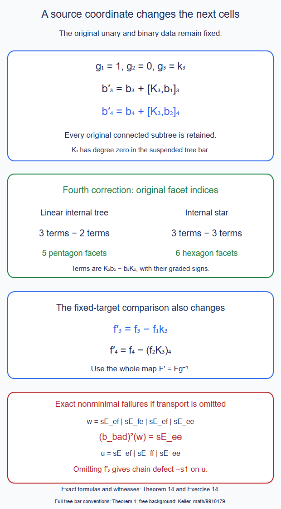

Theorem 14 and Exercise 14: a retained third source coordinate
changes both the fourth structure and third comparison.
The displayed nonminimal witnesses use the original unary
differentials. [Editable SVG](../assets/rational-native-next-transport.svg).

## 15. Exact source flows for comparison normalization

There is also a complete way to propagate the
degree-minus-one comparison homotopies of Theorem 13.
It preserves the fixed target throughout.

**Theorem 15 (a differential-exact source flow).**
Let \(b^2=0\) on a full tree bar over a characteristic-zero
field. Let \(H\) be a degree-minus-one coderivation
with zero one-vertex primitive and zero vertex-free
value. Put
\[
 L=[b,H]=bH+Hb.
\]
Then \(L\) is a degree-zero coderivation strictly
lowering vertex count. The finite expressions
\[
 G=\exp L,\qquad G^{-1}=\exp(-L)
\]
are actual mutually inverse chain cooperad maps
with identity first primitive. Their formulas retain
every ordinary identity output and every cut.
Moreover, with
\[
 \mathcal A=
      H\sum_{j\ge0}\frac{L^j}{(j+1)!},
\]
one has the full chain homotopy
\[
 G-1=b\mathcal A+\mathcal A b.
\]
All sums are finite on each original input tree.
In fact the flow has a full cooperadic polynomial
homotopy. Over
\(\Omega(I)=k[t,dt]\), with \(d t=dt\),
\((dt)^2=0\), set
\[
 \widetilde G=\exp(tL)+dt\,H\exp(tL).
\]
The form \(dt\) is written on the left. Thus its
second term on a homogeneous \(x\), in target-first
tensor notation, is
\((-1)^{|x|+1}H\exp(tL)(x)\otimes dt\).
This is an actual chain cooperad map over the
polynomial interval, with endpoints \(1,G\).

Suppose \(F\) maps to the fixed zero-differential
cohomological target and its leading primitive \(f_1\)
is the calibrated quasi-isomorphism in every profile.
For any prescribed second comparison homotopy \(h_2\)
choose a coefficient-linear chain section
\(i\) of \(f_1\), and take \(H\) with sole primitive
\(H_2=i h_2\). Then the whole comparison \(FG\)
has
\[
 (FG)_1=f_1,\qquad
 (FG)_2=f_2+\partial h_2.
\]
Its higher components are the actual complete
connected-block and exponential formulas, not
unchanged former values. If the homotopy is
normalized and the source is strictly unital, its
flow is normalized as well. A nonnormalized initial
unit correction retains its full unit components;
no normalized full comparison is inferred from
that correction alone.

**Proof.** Commutators of coderivations are
coderivations. Indeed in a cut, terms acting on
two different components cancel between the two
orders, with their graded interchange sign.
The remaining terms are the commutator on one
component. Applying this to \(b,H\) proves the
first assertion. Every term of \(H\) contracts
at least two vertices. A term of \(b\) contracts
at least one, and its unary part preserves vertex
count. Thus \(L\) lowers vertex count by at least
one on every nonzero summand.

The direct computation
\[
 bL-Lb=b^2H-Hb^2=0
\]
shows that \(L\) commutes with the entire
coderivation \(b\). Local vertex-lowering
nilpotence makes both exponentials finite.
Their product is the identity by the finite
binomial expansion, and each commutes with \(b\).

We verify the cooperad equation, rather than
treating a primitive exponential as its substitute.
On any cut, the coderivation equation for \(L\)
is a sum of its actions on the output components.
Those degree-zero actions commute on different
components. The finite multinomial expansion
therefore gives
\[
 \Delta\exp L=(\exp L)^{\otimes}\Delta
\]
on that cut, with the original ordered forest
factors. The empty forest keeps the coefficient
identity, and the vertex-free trees are fixed.
This proves all cuts simultaneously. The same
argument applies to the inverse.

Since \(bL=Lb\), for every \(j\ge0\) one has
\[
 b(HL^j)+(HL^j)b=L^{j+1}.
\]
Multiply by \(1/(j+1)!\) and sum the finite
series. This gives the stated chain homotopy.
It is a homotopy of the whole underlying bar
maps; the cooperad property was proved
separately above.

For the stronger polynomial statement put
\(G_t=\exp(tL)\), \(A_t=HG_t\). Their actual
equations are
\[
 \frac{dG_t}{dt}=L G_t=bA_t+A_t b.
\]
The graded tensor differential, with the
displayed sign for placing \(dt\) on the
left, says exactly that
\((b+d_{\Omega})\widetilde G=\widetilde G b\).
On a cut, \(A_t\) is a coderivation relative
to \(G_t\): apply the coderivation equation
of \(H\) after the cooperad equation of
\(G_t\). The cut expression is the sum
with \(A_t\) in one component and \(G_t\)
in all others, with the original graded
sign. These are precisely the single-\(dt\)
terms in the cooperad equation for
\(\widetilde G\); terms with two \(dt\)'s
are zero. Thus that equation holds on
every cut.

Endpoint evaluation sends \(dt\) to zero
and \(t\) to zero or one. The endpoints
are therefore \(1,G\). The interval
algebra has cohomology just \(k\):
a polynomial multiple of \(dt\) has its
polynomial antiderivative, and a closed
degree-zero polynomial is constant.
Characteristic zero is used here as
well as in the finite exponential.
After extending coefficients to this
interval algebra, the same vertex
triangular inverse proves that
\(\widetilde G\) is an isomorphism.
Composition with \(F\) gives the
corresponding whole cooperadic
comparison homotopy with fixed target.

For the comparison application, the calibrated
leading map is surjective on cycles in every
profile: the target differential is zero and
every target vector is a cohomology class.
Choose cycle lifts of a homogeneous basis.
They give a chain section \(i\) with \(f_1i=1\).
At an identity class choose the original unit.
This is a section of complexes only, not an
assertion that \(i\) preserves all operations.

The second primitive of \(L\) is
\[
 L_2=b_1H_2+H_2b_1.
\]
No power \(L^j\) for \(j>1\) can have a
nonzero second primitive, so \(G_2=L_2\).
Consequently
\[
 \begin{aligned}
 (FG)_2-f_2
    &=f_1(b_1H_2+H_2b_1)\\
    &=b_{H,1}h_2+h_2b_1
      =\partial h_2 .
 \end{aligned}
\]
Here the equality \(f_1H_2=h_2\) uses the
chosen actual section. This realizes the
desired correction in the full comparison.
The whole chain equation follows immediately
from \(bG=Gb\), and the cofree formula
supplies every output partition.

The next primitive already illustrates why
one must keep that whole formula. Write
\(L^{[2]}\) for the coderivation with sole
primitive \(L_2\). Then
\[
 \begin{gathered}
 G_3=[b_2,H_2]_3+
             \tfrac12\bigl((L^{[2]})^2\bigr)_3,\\
 (FG)_3=f_3+
   (f_2 L^{[2]})_3+f_1G_3 .
 \end{gathered}
\]
All signs in these products are the full
tree tensor signs. The first identity uses
that the third primitive of \(L\) is
\([b_2,H_2]_3\); the only quadratic power
contributing there uses two second
primitives. The second is exactly the
connected-block comparison formula.

For normalization, let an original input
vertex be a unary identity. Higher
primitive values of \(H\) containing it
vanish. The same is true for higher
primitive values of \(b\), except its
two-vertex unit action. In the primitive
commutator the remaining unit-action
terms pair: acting next to the output
of an \(H\)-block, or removing that
same unit before applying \(H\), gives
the same shorter value with opposite
suspended signs. At an internal unary
unit these are its two incident-edge
terms; at an end they are its one
corresponding end term. The unary
differential of the unit is zero.
These exhaust the remaining terms,
so the higher primitives of \(L\)
vanish at unit inputs.

Every nontrivial connected-block term
in the exponential then either has a
zero unit-containing higher block or
feeds its surviving singleton unit to
another zero higher block. Thus \(G\)
and its inverse are normalized. This
does not apply when the initial \(h_2\)
itself has nonzero unit components:
those data are retained, not erased.

All these assertions require a full
source \(b\) for their full native
application. Their finite primitive
formulas can be used at the present
partial stage, but they do not
construct its missing native surface
cells. They propagate normalization
once those cells are supplied, with
the rational cohomological target
fixed. An additional raw marked
operator not yet encoded in \(b\)
still has its own transport or
commutation equation; this flow is
not a substitute for that equation.
The native realization must prove
that it retains all such data.
\(\square\)

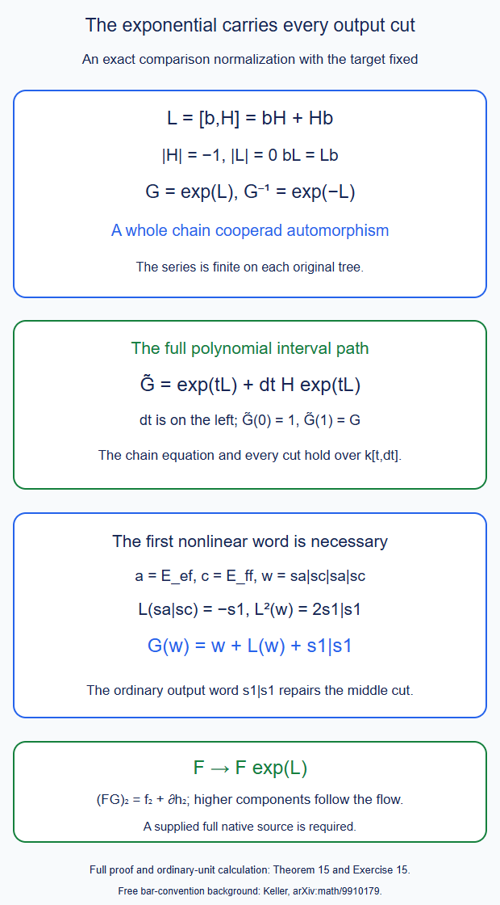

Theorem 15 and Exercise 15: the exponential preserves every
cut and carries the full comparison with the target fixed.
Its polynomial path includes the exact graded \(dt\) term.
[Editable SVG](../assets/rational-native-exact-flow.svg).

## 16. Elementary native surfaces and their complete boundaries

At the next stage a functor's third component, a natural
transformation's second component and a coherence homotopy's
one-input component all have ordinary degree minus two.
They contribute different surfaces. None is determined by
the object components alone.

**Theorem 16 (five elementary surface boundaries).**
Let \(A,B\) be dg categories in the conventions of Theorem 9,
and let \(F,G:A\longrightarrow B\) be actual full
\(A_\infty\) functors. Write products in target-to-source
order, so that \(ab\) means first \(b\), then \(a\).
For a homogeneous multilinear cochain \(q\) of ordinary
degree \(r\), use
\[
 \begin{aligned}
 (\partial q)(a_1,\ldots,a_m)
 &=d_Bq(a_1,\ldots,a_m)\\
 &\quad-(-1)^r\sum_{j=1}^m
 (-1)^{|a_1|+\cdots+|a_{j-1}|}
 q(a_1,\ldots,da_j,\ldots,a_m).
 \end{aligned} \tag{16.1}
\]
The following are boundaries of the stated original higher
components, with every source differential included.

First, put
\[
 \sigma_F(a,b)=(-1)^{|a|}\tau_F(sa|sb),
 \qquad
 \rho_F(a,b,c)=(-1)^{|b|}\tau_F(sa|sb|sc).
\]
Then \(|\rho_F|=-2\), and
\[
 \begin{aligned}
 \partial\rho_F(a,b,c)
 &=\sigma_F(ab,c)-\sigma_F(a,bc)\\
 &\quad+\sigma_F(a,b)F_1(c)
       -(-1)^{|a|}F_1(a)\sigma_F(b,c).
 \end{aligned} \tag{16.2}
\]
In particular this surface retains the third component of
the actual native convolution functor when \(F=F_n^G\).

Second, let \(\beta:F\Rightarrow G\) be a closed full
degree-zero natural transformation. Set
\[
 \nu_\beta(a)=\beta^{[1]}(sa),
 \qquad
 \lambda_\beta(a,b)=(-1)^{|a|}
                         \beta^{[2]}(sa|sb).
\]
For \(b:x_0\longrightarrow x_1\) and
\(a:x_1\longrightarrow x_2\), denote the object
components by \(\beta_{x_i}\). Then
\[
 \begin{aligned}
 \partial\lambda_\beta(a,b)
 &=-\nu_\beta(ab)
   +(-1)^{|a|}G_1(a)\nu_\beta(b)\\
 &\quad+\sigma_G(a,b)\beta_{x_0}
   -\beta_{x_2}\sigma_F(a,b)
   +\nu_\beta(a)F_1(b).
 \end{aligned} \tag{16.3}
\]
This is a five-term boundary. Both functor second
components are present. It applies to the actual native
graft transformations \(\alpha\) and to the calibrated
transformations \(\kappa\), using their full composite
functors at the endpoints.

Third, let \(\omega:F\Rightarrow G\) be an original
degree-minus-one pre-natural cochain, and put
\(\Theta=\delta\omega\). Define
\[
 \chi_\omega(a)=\omega^{[1]}(sa),\qquad
 \omega_{x_i}=\omega^{[0]}_{x_i}.
\]
There is no extra input sign in this definition. For
\(a:x_0\longrightarrow x_1\),
\[
 \partial\chi_\omega(a)
 =\Theta^{[1]}(sa)
  -(-1)^{|a|}G_1(a)\omega_{x_0}
  +\omega_{x_1}F_1(a). \tag{16.4}
\]
When \(\Theta\) is the difference of two full
composites of closed degree-zero natural
transformations, its one-input component contains
every cut. For example,
\[
 \begin{aligned}
 (\gamma\star\beta-\eta\star\zeta)^{[1]}(sa)
 &=\gamma^{[1]}(sa)\beta_{x_0}
   +\gamma_{x_1}\beta^{[1]}(sa)\\
 &\quad-\eta^{[1]}(sa)\zeta_{x_0}
   -\eta_{x_1}\zeta^{[1]}(sa).
 \end{aligned} \tag{16.5}
\]
If an endpoint involves postcomposition by an
\(A_\infty\) functor, its full bar pushforward is
used before taking this component. The one-cross
formula of Theorem 9 and [C69](../GL-SAT-13.html#c69-full-horizontal-operator-composition) retains those higher
terms. An objectwise product alone cannot replace it.

Fourth, let \(S\) be the actual full native
parameter functor into the relevant dg category
of natural transformations. For composable closed
degree-zero parameter arrows \(u,v,w\), put
\[
 s_2(u,v)=\tau_S(su|sv),\qquad
 s_3(u,v,w)=\tau_S(su|sv|sw).
\]
Then the original parameter surface satisfies
\[
 \begin{aligned}
 d s_3(u,v,w)
 &=s_2(uv,w)-s_2(u,vw)\\
 &\quad+s_2(u,v)S_1(w)
       -S_1(u)s_2(v,w).
 \end{aligned} \tag{16.6}
\]
Original positive parameter arrows are retained
even when their geometric image is an identity.
Only a formal identity is subject to the functor's
strict-unit normalization.

Finally, take closed degree-zero maps
\(f_0,f_1:X\longrightarrow Y\) and
\(g_0,g_1:Y\longrightarrow Z\), with original
degree-minus-one homotopies
\[
 dh=f_1-f_0,\qquad dk=g_1-g_0 .
\]
The two composite path homotopies
\[
 P=kf_0+g_1h,\qquad Q=g_0h+kf_1
\]
have the same boundary \(g_1f_1-g_0f_0\), and
their independent interchange square is
\[
 d(kh)=P-Q. \tag{16.7}
\]
The same formula holds in a dg Hom category of
multilinear maps, using (16.1) and its graded
tensor evaluation signs.

**Proof.**
Write \(A=|a|\), \(B=|b|\). The full
Maurer--Cartan equation
\(d_B\tau_F+\tau_F b_A=\tau_F\star\tau_F\)
at \(sa|sb|sc\) is
\[
 \begin{aligned}
 &d_B\tau_F(sa|sb|sc)
 -\tau_F(sda|sb|sc)\\
 &\quad+(-1)^A\tau_F(sa|sdb|sc)
 +(-1)^{A+B-1}\tau_F(sa|sb|sdc)\\
 &\quad+(-1)^{A-1}\tau_F(s(ab)|sc)
 +(-1)^{A+B}\tau_F(sa|s(bc))\\
 &=(-1)^{A-1}F_1(a)\tau_F(sb|sc)
   +(-1)^{A+B}\tau_F(sa|sb)F_1(c).
 \end{aligned} \tag{16.8}
\]
The first three unary-input signs follow by
moving \(b_1(sa)=-sda\) through the preceding
suspended letters. The adjacent-product signs
are those of \(b_2(sa|sb)=(-1)^{A-1}s(ab)\).
The two convolution signs are the degrees of
the suspended prefixes. Thus this equality
includes both proper cuts and every unary term.
Multiply it by \((-1)^B\), move its
adjacent-product terms to the right, and
substitute the definitions of \(\rho,\sigma\).
The first two lines become exactly
\(\partial\rho\) in (16.1); the result is
(16.2).

For (16.3), the two-input component of
\[
 0=\delta\beta=d_B\beta-\beta b_A
                        -\tau_G\star\beta
                        +\beta\star\tau_F
\]
is, with all terms at their indicated endpoints,
\[
 \begin{aligned}
 0={}&d_B\beta^{[2]}(sa|sb)
 +\beta^{[2]}(sda|sb)
 -(-1)^A\beta^{[2]}(sa|sdb)\\
 &+(-1)^A\nu_\beta(ab)
 -G_1(a)\nu_\beta(b)
 -\tau_G(sa|sb)\beta_{x_0}\\
 &+\beta_{x_2}\tau_F(sa|sb)
 +(-1)^{A-1}\nu_\beta(a)F_1(b).
 \end{aligned} \tag{16.9}
\]
Multiplication by \((-1)^A\) converts its
first line to \(\partial\lambda\):
the input \(da\) also changes the sign
in the definition of \(\lambda(da,b)\).
Solving the remaining equality for that first
line gives all five terms of (16.3).

For a degree-minus-one \(\omega\), the full
differential is
\[
 \delta\omega=d_B\omega+\omega b_A
                       -\tau_G\star\omega
                       -\omega\star\tau_F.
\]
On \(sa\), its source unary term is
\(-\omega^{[1]}(sda)\).
The first convolution contributes
\(-(-1)^{A-1}G_1(a)\omega_{x_0}\);
the second contributes
\(-\omega_{x_1}F_1(a)\).
Consequently
\[
 \Theta^{[1]}(sa)
 =\partial\chi_\omega(a)
  +(-1)^A G_1(a)\omega_{x_0}
  -\omega_{x_1}F_1(a),
\]
which proves (16.4). For degree-zero
composites the two deconcatenations of a
one-letter word have no extra convolution
sign. Expanding them proves (16.5).
The full pushforward assertion follows by
expanding all output blocks as in Theorem 9;
extracting the object component first would
discard blocks containing the source letter.

Equation (16.6) is (16.2) for the functor
\(S\). The three source differentials vanish,
all input degrees are zero, and the ordinary
Hom differential on the parameter value is
therefore its target differential. This uses
the given third component of \(S\), not a
chosen primitive of an arbitrary closed
boundary.

Finally the dg Leibniz rule gives
\[
 \begin{aligned}
 dP&=(g_1-g_0)f_0+g_1(f_1-f_0)
       =g_1f_1-g_0f_0,\\
 dQ&=g_0(f_1-f_0)+(g_1-g_0)f_1
       =g_1f_1-g_0f_0,\\
 d(kh)&=(g_1-g_0)h-k(f_1-f_0)=P-Q.
 \end{aligned}
\]
The minus sign on \(k\,dh\) is essential.
The ordinary Hom differential is also a
derivation for graded composition, so the
same calculation proves the multilinear
version with its input differential terms.
This proves all five identities. \(\square\)

These surfaces are prescribed pieces of the
raw native four-vertex and mixed three-vertex
pasting. The theorem does not identify an
entire pentagonal, hexagonal or higher mixed
surface with their sum. Such an identification
still requires its typed native subdivisions,
their orientations and cancellation along
every shared edge. Nor does it authorize
replacing a native component by a filler
obtained only from parity.

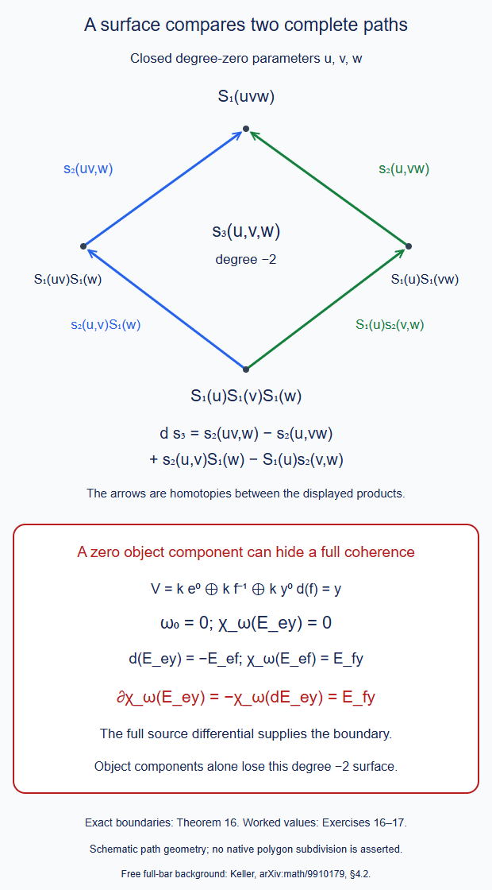

Theorem 16 and Exercises 16–17. The upper diamond is a
schematic of the exact two-path identity (16.6); its
arrows denote degree-minus-one homotopies between the
displayed products. The lower panel retains the source
differential in (16.4). It does not depict an asserted
native polygon subdivision.
[Editable SVG](../assets/rational-native-elementary-surfaces.svg).

## 17. The prescribed full fan and its comparison components

**Proposition 17 (extract the actual represented fan).**
Fix an actual native profile functor
\(F=F_n^G:A\longrightarrow B\), as in
Theorem 9. A represented fan has root label
\(a\in B(Fx,y)\) and unary labels along its
input legs. With one joint source bar word
\(c=sb_1|\cdots|sb_r\), its suspended
root primitive is
\[
 b^{\mathrm{fan}}_{r+1}(sa;c)
   =(-1)^{|a|+1}s\bigl(a\,\tau_F(c)\bigr),
 \qquad r\ge1. \tag{17.1}
\]
Its unary differential is \(b_1(sa)=-s\,da\).
Along nonroot unary chains use the original
dg source category operations. These values
have square zero on every represented fan.
For \(n=0\), there are no incoming operation
legs in this statement. Retain the full
represented nullary complex and its coefficient
source from Theorem 9; do not identify that
source with the entire endomorphism complex
of the unit object.
In particular the actual fourth fan component
is
\[
 b^{\mathrm{fan}}_4(sa;sb|sc|sd)
 =(-1)^{|a|+1}s\bigl(a\,\tau_F(sb|sc|sd)\bigr).
 \tag{17.2}
\]
For several original input legs, replace
the joint word in these formulas by the
full bar shuffle of their leg words.
An inversion of two suspended original
labels \(sb_i,sb_j\) has sign
\((-1)^{(|b_i|-1)(|b_j|-1)}\).
Thus three unary labels on three distinct
legs give all six shuffle terms, with their
original leg labels and intermediate objects.
The formulas extend the fan values fixed
in Proposition 12, including its separated-leg
two-term value. They retain ordinary unit
outputs and are normalized on formal unary
identity inputs.

For the comparison, let \(W:B\longrightarrow C\)
be the actual full output functor, and let
\(\kappa:G\Rightarrow WF\) be the actual
closed degree-zero transformation on a
genuine common-input bar. Write
\[
 \begin{aligned}
 P_W(a;c)
 &=\sum_{\substack{c=c_1\cdots c_j\\c_i\ne\varnothing}}
 \tau_W\bigl(sa|s\tau_F(c_1)|\cdots|s\tau_F(c_j)\bigr),\\
 P_W(a;\varnothing)&=W_1(a),\\
 Q(a;c)&=\sum_{c=uv}P_W(a;u)\kappa(v).
 \end{aligned} \tag{17.3}
\]
The first line applies to nonempty \(c\).
Where that common input is needed, \(F\)
in (17.3) also denotes its pullback along
the actual dg projection supplied by [C78](../GL-SAT-13.html#c78-full-tensor-unit-restriction-and-external-comparisons).
The primitive comparison component at the
root is \(sQ(a;c)\), with every source
and output bar action retained by the
full graph map. At source length two
it has precisely the four terms
\[
 \begin{aligned}
 Q(a;sb|sc)
 ={}&W_1(a)\kappa^{[2]}(sb|sc)\\
 &+\tau_W(sa|sF_1(b))\kappa^{[1]}(sc)\\
 &+\tau_W(sa|s\tau_F(sb|sc))\kappa^{[0]}\\
 &+\tau_W(sa|sF_1(b)|sF_1(c))\kappa^{[0]} .
 \end{aligned} \tag{17.4}
\]
Here each object component of \(\kappa\)
is taken at the endpoint of its preceding
consumed word, not at a fixed common object.
These are the actual \(\kappa_2\),
mixed \((W_2,F_1,\kappa_1)\),
\((W_2,F_2)\), and \(W_3\) terms.
No additional input sign multiplies
(17.4) before its output suspension.

If \(G=F_n^H U\), use the entire original
common-input coalgebra map \(U\) to encode
the remaining target source word. Formula
(17.3) is then a map to the pulled-back
represented fan, followed by that whole
base map; it is not a replacement of \(U\)
by its first component or by a naive tensor
product of \(A_\infty\) functors.
Consequently the fan comparison satisfies
all its source and target bar equations.
It gives the prescribed third comparison
component on this genuine common input.

**Proof.**
Let \(S\) suspend the coefficient \(a\)
in \(K_F\otimes C_A\), leaving the
source bar word unchanged. Theorem 9's
module differential has coefficient
\((-1)^{|a|}\) on each twisting prefix.
The differential on the suspended root
module is \(-S D_F S^{-1}\). Its
twisting coefficient is therefore
\((-1)^{|a|+1}\), proving (17.1).
Its coefficient-only term is \(-s\,da\).
Its source-bar term has coefficient
\(-(-1)^{|a|}=(-1)^{|sa|}\), exactly
the coderivation sign for moving a source
operation past the suspended root.
Theorem 9 proves \(D_F^2=0\) on the
entire cofree comodule. After this
suspension, every term in that square
is either a connected root-subtree
contraction or an operation within a
nonroot unary chain. These are exactly
all connected contractions of a fan.
There are no other connected subtrees.
This proves the full square-zero
assertion, including (17.2).

For separate legs the source Hom
complex is the actual tensor product
of the leg Hom complexes. Embed an
arrow on one leg using identity
arrows on the other current objects.
Define its shuffle by all interleavings
preserving the order on each leg,
with the suspended inversion sign
in the statement. The unary bar
differential commutes with this map
by the tensor differential rule.
An adjacent merger of two arrows
from different legs occurs in two
interleavings; graded tensor
interchange and the suspended
inversion sign make their
coefficients opposite. They cancel.
The remaining mergers are on a
single leg and are precisely its
original bar differential, with
the preceding-leg tensor sign.
Thus the full shuffle is a chain map.
Cutting an interleaving at any
position is equivalent to cutting
each leg into a prefix and a suffix
and shuffling those two sets
separately. Its inversion signs
split into the two shuffle signs
and the tensor-coalgebra cut sign.
This proves its full coalgebra
identity as well. Pulling back
\(D_F\) by that coalgebra map
proves the asserted multi-leg
fan equations with every root
prefix cut.

For \(r=2\) on one leg, (17.1)
equals the suspension of
\((-1)^{|a|}a\sigma_F(b,c)\)
with the third-component sign
of Theorem 11. On two legs the
shuffle has coefficients
\[
 1\quad\text{and}\quad
 (-1)^{(|b|-1)(|c|-1)}.
\]
The same substitution gives
Proposition 12's two actual
fan terms. A formal identity
on a leg embeds as the joint
identity. Every higher \(\tau_F\)
containing it is zero by normalized
unitality. For a unary root
\(F_1^G=\mathrm{Id}\), all
higher terms are zero already.
No step projects away an
identity-valued output.

For (17.3), use the triangular
dg category in Theorem 9's
changing-target construction.
Its word starts with the
unique cross arrow \(a\).
Apply the full cofree map of
\(F\) to the following source
word. Each ordered partition
\(c=c_1\cdots c_j\) produces
the successive ordinary arrows
\(\tau_F(c_i)\). In the full
bar map of \(W\), the unique
output block containing the
cross arrow begins at that
arrow and consumes a prefix
of those blocks. Its primitive
is exactly the first line of
(17.3). All its unconsumed
blocks give the ordinary
cofree-comodule extension.
Thus no source cut, output
block or coefficient
differential has been omitted.
The full bar chain equation
for \(W\), composed with that
for \(F\), proves that this
is the changing-target graph
map to \(K_{WF}\).

Precomposition by the closed
\(\kappa\) is the map
\(T_\kappa:K_{WF}\longrightarrow K_G\)
of Theorem 9. Its degree is
zero, so its coefficient
evaluation has no extra
Koszul sign. Its every
deconcatenation \(c=uv\)
gives \(P_W(a;u)\kappa(v)\).
This proves the third line of
(17.3) and the entire chain
and coaction equations.
At length two there are
three such outer cuts.
The cut consuming both
letters in \(P_W\) has
two inner partitions, giving
exactly the last two terms
of (17.4); the other cuts
give its first two terms.
Suspending the coefficient
on both sides gives \(sQ\).

At length one this reads
\[
 Q(a;sb)=
 \tau_W(sa|sF_1(b))\kappa^{[0]}
       +W_1(a)\kappa^{[1]}(sb).
\]
The ordinary homotopy in the
fan specialization of Theorem 13
is \((-1)^{|a|}Q(a;sb)\).
Its suspended comparison sign
\((-1)^{|a|}\) cancels that
factor. Hence the new formula
agrees with the previously fixed
second fan comparison, including
its sign. Retaining the full
coalgebra map \(U\) on tails
gives its pulled-back module's
chain equation and every mixed
partition, rather than only
their first components.
This proves the proposition.
\(\square\)

This supplies an actual compatible full fan
restriction extending the already prescribed
fan values. It does not assert that a
previously transported global fourth
component automatically equals this
canonical restriction. A global extension
must preserve the retained relative
comparison or transport it with all
higher components as in Theorems 14–15.
Trees with a nonunary proper branch
still require their original native
surface pasting.

## 18. The native graft's two-input naturality surface

The two inputs of a naturality surface can move different
branches of a genuine nonunary graft. Their four intermediate
objects matter: writing the same arrow name without its
endpoint can turn a well-typed composite into a nonexistent
one.

**Theorem 18 (the full native graft naturality hexagon).**
Let \(F,G:A\longrightarrow B\) be actual full normalized
functors between dg categories, and let
\(\beta:F\Rightarrow G\) be a closed degree-zero
full natural transformation. Consider the original
independent-arrow square
\[
 \begin{array}{ccc}
 x_{00}&\xrightarrow{\ c_0\ }&x_{10}\\
 {\scriptstyle d_0}\downarrow&&
                   \downarrow{\scriptstyle d_1}\\
 x_{01}&\xrightarrow{\ c_1\ }&x_{11},
 \end{array}
 \qquad
 c_1d_0=(-1)^{pq}d_1c_0,\quad
 |c_i|=p,\quad |d_i|=q. \tag{18.1}
\]
The square is a bilinear family in the original
cochains \(c,d\); their differentials give the
corresponding squares with \(dc,d\) and \(c,dd\).
No closedness of \(c,d\) is assumed.

Use the actual components of Theorem 16 and put
\[
 \begin{aligned}
 \Lambda_\beta(c,d)
 &=\lambda_\beta(c_1,d_0)
                   -(-1)^{pq}\lambda_\beta(d_1,c_0),\\
 X_H(c,d)&=\sigma_H(c_1,d_0)
                   -(-1)^{pq}\sigma_H(d_1,c_0),
                  \qquad H=F,G.
 \end{aligned} \tag{18.2}
\]
Then \(\Lambda_\beta\) is an ordinary degree-minus-two
bilinear cochain from \(F(x_{00})\) to \(G(x_{11})\).
Its entire Hom boundary is the following six groups:
\[
 \begin{aligned}
 \partial\Lambda_\beta(c,d)
 ={}&(-1)^pG_1(c_1)\nu_\beta(d_0)
                +\nu_\beta(c_1)F_1(d_0)\\
 &-(-1)^{pq+q}G_1(d_1)\nu_\beta(c_0)
                -(-1)^{pq}\nu_\beta(d_1)F_1(c_0)\\
 &+X_G(c,d)\beta_{00}-\beta_{11}X_F(c,d).
 \end{aligned} \tag{18.3}
\]
Here
\[
 \partial\Lambda(c,d)
 =d_B\Lambda(c,d)-\Lambda(dc,d)-(-1)^p\Lambda(c,dd).
\]
The six groups contain eight ordinary functor/naturality
terms after expanding the two \(X\)'s.
The actual surface itself is the two-input bar shuffle
\[
 \Lambda_\beta(c,d)=(-1)^p\left[
 \beta^{[2]}(sc_1|sd_0)
 +(-1)^{(p-1)(q-1)}\beta^{[2]}(sd_1|sc_0)
 \right]. \tag{18.4}
\]
In particular it retains the full original second
naturality component, even if an object component
is an identity.

This specializes to a genuine nonunary native graft
as follows. Let \(a\) have arity \(n\ge1\), and
let \(b\) of arity \(m\ge2\) enter its slot \(i\).
Let \(c,d\), of arbitrary arities \(l,r\ge0\),
enter distinct slots \(j<k\) of \(b\).
Their underlying represented cochains are arrows
from \(T_l\mathbf z,T_r\mathbf t\) to the two
original objects in those slots. The four tuples
\(\mathbf x^{uv}\) replace either source by its
target when \(u=1\), respectively \(v=1\).
Their joint arrows have exactly (18.1)'s types
and graded interchange sign.

Fix the other outer input objects and restrict the
actual native transformation
\(\beta=\alpha_{n,m,i}\) to this varying inner
tuple. Its endpoint functors are
\[
 \begin{aligned}
 F&=F_{n+m-1}^G
       \quad\text{on the inserted inner tuple},\\
 G&=F_n^G\circ\iota_i F_m^G .
 \end{aligned} \tag{18.5}
\]
The insertion \(\iota_i\) in the second line
is the actual dg insertion into the single
outer slot, with the other objects fixed.
Thus no tensor product of unrelated
\(A_\infty\) functors is being inferred.
For composable inner joint arrows \(u,v\),
the actual second component of the composite is
\[
 \begin{aligned}
 \sigma_G(u,v)
 ={}&\sigma_{F_n^G}\bigl(
       \iota_i(F_m^G)_1u,\iota_i(F_m^G)_1v\bigr)\\
 &+(F_n^G)_1\bigl(\iota_i\sigma_{F_m^G}(u,v)\bigr).
 \end{aligned} \tag{18.6}
\]
Both summands are required in each of the two
orders of \(X_G\). Expanding them gives ten
formal terms in the actual native boundary
(18.3).

For a fixed original compatible native path let
\[
 E_{cd}:T_{n+m+l+r-3}(\text{expanded inputs})
           \longrightarrow F(\mathbf x^{00})
\]
be the closed degree-zero comparison flattening
the two inserted tensor objects. It exists on
the actual compatible domain of [C.44.3.1](../GL-SAT-13.html#c443-finite-execution-states-and-the-native-unit-diagram) and
[C.47.3.1](../GL-SAT-13.html#c473-the-exact-compatible-grafting-domain); retain its original path labels.
Then the actual four-cochain surface piece
\[
 Z_\alpha(a,b,c,d)=
 a(F_n^G)_1(\iota_i b)\,
           \Lambda_\beta(c,d)E_{cd} \tag{18.7}
\]
has the original flat source and the output of
\(a\), has ordinary degree minus two, and obeys
\[
 \begin{aligned}
 \partial Z_\alpha(a,b,c,d)
 &=(-1)^{|a|+|b|}
   a(F_n^G)_1(\iota_i b)\\
 &\qquad\cdot
   \bigl(\partial\Lambda_\beta(c,d)\bigr)E_{cd}.
 \end{aligned} \tag{18.8}
\]
This is an identity on all four original
cochains, including \(da,db,dc,dd\).
Nullary \(c,d\) retain their full represented
mapping complexes. If the expanded arity is
zero, its source is the actual unit object,
not a replacement by the scalar coefficient
source.

**Proof.**
Precomposition of an ordinary cochain by the
graded interchange map
\[
 c\otimes d\longmapsto(-1)^{pq}d\otimes c
\]
commutes with its Hom differential. Indeed
the derivative of \(c\) has degree \(p+1\);
its interchange sign changes by
\((-1)^q\). The derivative of \(d\)
has degree \(q+1\); its interchange
sign changes by \((-1)^p\). Together
with the tensor differential's
\((-1)^p\), these are precisely the
two signs in the reversed tensor
differential. Thus Theorem 16's
two-input equation can be alternated
as in (18.2) without losing any
source derivative.

Apply (16.3) first to \(c_1,d_0\)
and then to \(d_1,c_0\), multiplying
the second result by \(-(-1)^{pq}\).
The two product terms are
\[
 -\nu_\beta(c_1d_0)
       +(-1)^{pq}\nu_\beta(d_1c_0)=0
\]
by (18.1) and linearity. The other
four naturality terms give the
first two lines of (18.3), with
their indicated endpoints. The
two second-functor terms give
\(X_G\beta_{00}\); the other
two give \(-\beta_{11}X_F\).
This proves all six groups.
Substituting
\(\lambda_\beta(u,v)=(-1)^{|u|}
\beta^{[2]}(su|sv)\) in (18.2)
gives (18.4), since
\[
 -(-1)^{pq+q-p}=(-1)^{(p-1)(q-1)}.
\]
There are no other input cuts.

For the native specialization, the original
joint source is the dg product of the
inner input categories. Insert \(c\) on
leg \(j\) and \(d\) on leg \(k\).
In the order \(c_1d_0\) no nonzero-degree
factor crosses the other; the opposite
order crosses them once and has sign
\((-1)^{pq}\). This proves (18.1)
with all four stated object tuples.
The whole native graft transformation
exists on those arbitrary frontier
inputs by [C.44.3.1](../GL-SAT-13.html#c443-finite-execution-states-and-the-native-unit-diagram) and [C.47.2.1](../GL-SAT-13.html#c472-the-actual-typed-enhanced-diagram).
Restricting its source to this inner
dg product gives the actual (18.5);
in particular its \(\beta^{[2]}\)
is given native data.

For (18.6), the length-two cofree
composition of the actual functors
has exactly two partitions: one
inner two-letter block, or two
inner singleton blocks. Its
unsuspended core is therefore
\[
 \begin{aligned}
 \tau_G(su|sv)
 ={}&(F_n^G)_1\bigl(
                \iota_i\tau_{F_m^G}(su|sv)\bigr)\\
 &+\tau_{F_n^G}\bigl(
    s\iota_i(F_m^G)_1u\,|\,s\iota_i(F_m^G)_1v\bigr).
 \end{aligned}
\]
All these maps have cofree degree zero,
so the ordered partitions introduce no
extra permutation. Multiplication by
\((-1)^{|u|}\) proves (18.6).

The source of \(\Lambda_\beta\) is
\(F(\mathbf x^{00})\), while its
target is \(G(\mathbf x^{11})\).
The latter is exactly the source of
\((F_n^G)_1(\iota_i b)\). Its output
is exactly the source of \(a\).
Precomposition by the actual \(E_{cd}\)
therefore proves the source/output
claim for (18.7). This path performs
the two inner object insertions before
the unexecuted \(b,a\), hence is in
the compatible graft domain; no
incompatible execution state is added.

The map \((a,b)\mapsto
a(F_n^G)_1(\iota_i b)\) is a
degree-zero chain map by the actual
functor's first-component equation
and dg composition. The comparison
\(E_{cd}\) is closed. In the ordinary
Hom differential of (18.7), its
coefficient-only derivative terms
cancel exactly with the terms
containing \(da,db\).
The remaining target derivative
crosses the prefix of degree
\(|a|+|b|\); the two source
derivatives of \(c,d\) have that
same prefix sign. This is precisely
(18.8), with (18.3)'s full
\(\partial\Lambda\). The argument
uses arbitrary represented arrows,
so also applies to the stated
nullary cases. \(\square\)

For closed degree-zero \(c,d\), the
six groups in (18.3) are a literal
oriented hexagonal boundary between
six closed composites. This is the
higher naturality surface of the
graft transformation, not an
identification of the entire
four-vertex tree cell with that
hexagon. Other native surfaces,
including the original coherence's
one-input components and the
parameter third components, still
have to be pasted along their
own labelled edges.

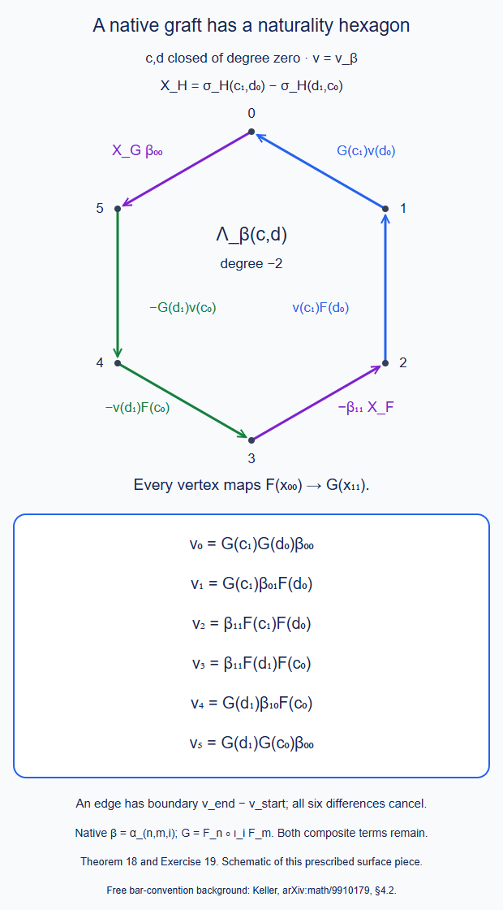

Theorem 18 and Exercise 19. This schematic uses closed
degree-zero input arrows, so every edge has boundary
its final vertex minus its initial vertex. The vertices
are the six displayed, correctly typed composites.
The surface is the actual alternating two-input
naturality component; it is one prescribed piece
of the native tree pasting.
[Editable SVG](../assets/rational-native-graft-naturality.svg).

## 19. The native coherence's one-input surface

**Theorem 19 (full pushforward before taking a coherence
component).** Let \(R,S:A\longrightarrow B\) and
\(W:B\longrightarrow C\) be actual full normalized
functors between dg categories. Let
\(\Gamma:R\Rightarrow S\) be a closed degree-zero
full natural transformation. Its actual full
pushforward \(\eta=W_*\Gamma\) has object
component \(\eta_x=W_1(\Gamma_x)\). On an
original homogeneous arrow \(u:x_0\longrightarrow x_1\),
its one-input component is
\[
 \begin{aligned}
 \nu_\eta(u)
 ={}&W_1\bigl(\nu_\Gamma(u)\bigr)\\
 &+\sigma_W\bigl(\Gamma_{x_1},R_1(u)\bigr)
  -\sigma_W\bigl(S_1(u),\Gamma_{x_0}\bigr).
 \end{aligned} \tag{19.1}
\]
In particular it is not in general the first
line alone. The formula uses the given full
pushforward, not merely a naturality filler
with the same boundary.

Now let the actual closed degree-zero
transformations have types
\[
 \begin{gathered}
 \delta:P\Rightarrow WR,\qquad
 \varepsilon:P\Rightarrow L,\qquad
 \beta:L\Rightarrow WS,\\
 Q=WS,\qquad
 K_1=\eta\star\delta,\quad K_0=\beta\star\varepsilon .
 \end{gathered}
\]
Let the original native coherence satisfy
\[
 d_{\rm Nat}\omega=K_1-K_0,\qquad |\omega|=-1.
\]
For \(\chi_\omega(u)=\omega^{[1]}(su)\)
the entire ordinary Hom boundary has
the following eight formal summands:
\[
 \begin{aligned}
 \partial\chi_\omega(u)
 ={}&W_1\bigl(\nu_\Gamma(u)\bigr)\delta_{x_0}\\
 &+\sigma_W(\Gamma_{x_1},R_1u)\delta_{x_0}\\
 &-\sigma_W(S_1u,\Gamma_{x_0})\delta_{x_0}\\
 &+W_1(\Gamma_{x_1})\nu_\delta(u)\\
 &-\nu_\beta(u)\varepsilon_{x_0}
  -\beta_{x_1}\nu_\varepsilon(u)\\
 &-(-1)^{|u|}Q_1(u)\omega_{x_0}
  +\omega_{x_1}P_1(u).
 \end{aligned} \tag{19.2}
\]
Its source is \(P(x_0)\), its target is \(Q(x_1)\),
and its ordinary cochain degree is minus one.
The primitive \(\chi_\omega\) itself has
ordinary degree minus two. Neither a zero
object component of \(\omega\) nor an
identity-valued object component of a
path transformation deletes its higher
components.

For the actual nested native grafts of
Theorem 11, put \(W=F_n^G\iota_i\),
\[
 R=F_{m+l-1}^G,\qquad
 S=F_m^G\iota_jF_l^G,\qquad
 \Gamma=\alpha_{m,l,j}.
\]
The other outer objects are fixed. Then
\[
 \begin{gathered}
 P=F_{n+m+l-2}^G,\quad
 \delta=\alpha_{n,m+l-1,i},\\
 \varepsilon=\alpha_{n+m-1,l,i+j-1}.
 \end{gathered}
\]
Here \(L\) is the actual partially nested
functor after inserting \(F_l^G\) into
the flattened outer pair; \(\beta\)
is the full original
\(\alpha_{n,m,i}\) pulled back along
that insertion. In particular its
one-input component is pulled back
through the entire given source
functor, not through an unrelated
first-component replacement.
The two paths are exactly the
original \(K_0,K_1\) of Theorem 11,
and \(\omega\) is their original
parameter coherence, with all
positive parameter labels retained.
Thus (19.2) is their actual
one-input coherence surface.

More explicitly, let \(a,b,c,d\) form
a nested four-vertex chain: \(b\)
enters slot \(i\) of \(a\), \(c\)
enters slot \(j\) of \(b\), and
\(d\) enters slot \(k\) of \(c\).
Assume their arities are
\(n,m,l\ge1\), \(r\ge0\).
Regard \(u=\iota_kd\) as the
original joint arrow on the inputs
of \(F_l^G\); take all the preceding
full functors and transformations
on this same varying input.
Set
\[
 f=(F_n^G)_1,\quad
 B=\iota_i b,\quad
 U=\iota_i\bigl((F_m^G)_1(\iota_jc)\bigr).
\]
Let \(E_u\) be the original closed
comparison inserting \(T_r\) at
flat slot \(i+j+k-2\) in \(P\).
Its source has arity \(n+m+l+r-3\)
and its target is \(P(x_0)\).
The actual native surface piece
\[
 Z_\omega(a,b,c,d)=a f(B)f(U)\chi_\omega(u)E_u
 \tag{19.3}
\]
has the original four-vertex flat
source and the output of \(a\),
and
\[
 \partial Z_\omega
 =(-1)^{|a|+|b|+|c|}
      a f(B)f(U)(\partial\chi_\omega)(u)E_u .
 \tag{19.4}
\]
This includes all four original
cochain differentials and the
actual nullary possibility \(r=0\).

**Proof.**
The suspended coextension of the
degree-zero natural transformation
\(\Gamma\) has degree minus one.
On the one-letter input \(su\)
its three terms are
\[
 \begin{aligned}
 s\nu_\Gamma(u),\qquad
 s\Gamma_{x_1}|sR_1(u),\qquad
 (-1)^{|u|-1}sS_1(u)|s\Gamma_{x_0}.
 \end{aligned} \tag{19.5}
\]
Indeed the last term moves the
degree-minus-one inserted
transformation past the
suspended prefix of degree
\(|u|-1\). The first inserts
its one-input core; the other
two are the two cuts at which
its object core is inserted.
Apply the actual cofree
functor map of \(W\) and
take its primitive output.
The first term becomes
\(sW_1\nu_\Gamma(u)\).
In the second term the first
arrow has degree zero, so its
ordinary value is
\(\sigma_W(\Gamma_{x_1},R_1u)\).
The last coefficient changes
\(\tau_W(sS_1u|s\Gamma_{x_0})\)
to \(-\sigma_W(S_1u,\Gamma_{x_0})\).
Unsuspending proves exactly
(19.1). The full bar evaluation
and coextension of Theorem 9
retain these terms together
with every higher input cut.

One can also check its entire
source differential directly.
The three boundaries are
\[
 \begin{aligned}
 \partial(W_1\nu_\Gamma)(u)
 &=W_1(S_1u\,\Gamma_{x_0})
       -W_1(\Gamma_{x_1}R_1u),\\
 \partial\sigma_W(\Gamma_{x_1},R_1u)
 &=W_1(\Gamma_{x_1}R_1u)
       -W_1(\Gamma_{x_1})W_1(R_1u),\\
 -\partial\sigma_W(S_1u,\Gamma_{x_0})
 &=-W_1(S_1u\,\Gamma_{x_0})
       +W_1(S_1u)W_1(\Gamma_{x_0}).
 \end{aligned}
\]
The object components are closed,
and the functors' first components
are chain maps, so these formulas
include \(du\). The middle
terms cancel and give precisely
the required naturality boundary
for \(WR\Rightarrow WS\).
This boundary check also shows
where either omitted second
component would leave a defect.

The full convolution products
of the degree-zero path
transformations have one-input
components
\[
 \begin{aligned}
 (K_1-K_0)^{[1]}(su)
 &=\nu_\eta(u)\delta_{x_0}
       +\eta_{x_1}\nu_\delta(u)\\
 &\quad-\nu_\beta(u)\varepsilon_{x_0}
       -\beta_{x_1}\nu_\varepsilon(u).
 \end{aligned}
\]
Both cuts of each product are
present and their convolution
signs are one. Substitute
(19.1) and
\(\eta_{x_1}=W_1(\Gamma_{x_1})\).
The six resulting terms are
the first six terms of (19.2).
The last two are exactly
Theorem 16's one-input
equation for the original
degree-minus-one \(\omega\).
This proves all eight terms
with their full source
differential.

The native path data just
listed are the full versions
of Theorem 11's two actual
path composites. Their original
parameter functor supplies
\(\omega\) as a full natural
cochain, so its Nat differential
is the difference of these
full composites, not only
their object values. Restricting
to the one innermost input
block preserves that equation.
The single-slot insertion
\(\iota_i\) is dg; hence this
specialization again requires
no tensor product of unrelated
higher functors.

For (19.3) the prefix maps
\(Q(x_1)\) to the output of
\(a\): \(f(U)\) applies the
actual \(c\), then \(f(B)\)
applies \(b\), then \(a\)
is composed. The actual
comparison \(E_u\) maps the
fully expanded input to
\(P(x_0)\). Thus every factor
has the stated original
type. The prefix is a
degree-zero trilinear chain
map in \(a,b,c\), since
the functors' first components
are chain maps. The comparison
\(E_u\) is closed. Its
coefficient derivatives
cancel \(da,db,dc\) in
the Hom differential,
and the remaining differential
crosses the prefix of degree
\(|a|+|b|+|c|\). The input
derivative of \(d\) crosses
that same prefix. This proves
(19.4), including nonclosed
inputs. The original partial
forest can insert the innermost
object before executing its
ancestors, so \(E_u\) lies
in the compatible native
graft domain. Its arity-zero
case retains the actual unit
object and its full mapping
complex. \(\square\)

This specifies the original
coherence's one-input surface
and its four-vertex attachment.
It does not yet sum this
piece, Theorem 18's piece,
the functor surfaces and
the original parameter \(S_3\)
into the entire native
four-vertex boundary.

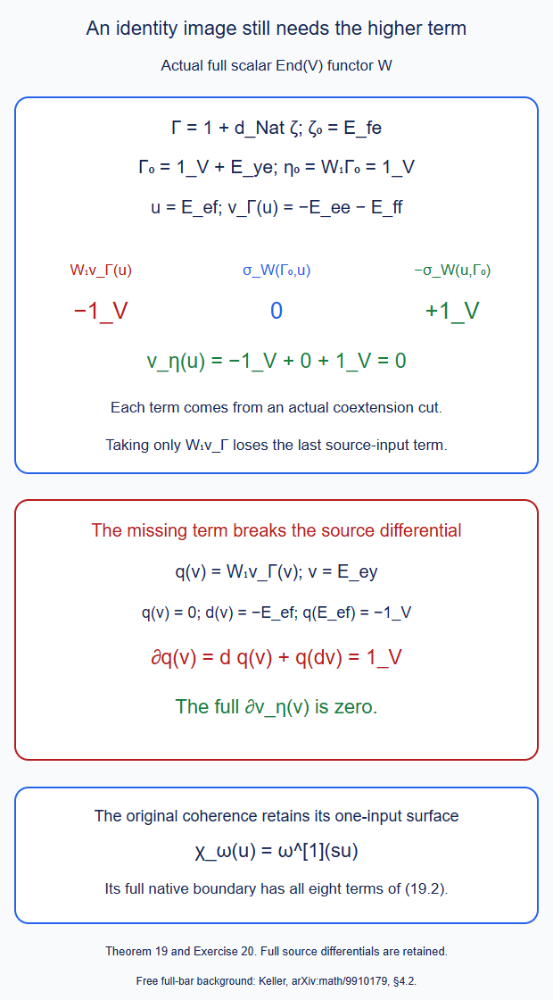

Theorem 19 and Exercise 20. The object component
of the output transformation is the identity,
while its one-input value requires the full
three-term pushforward. The lower calculation
uses the original nonclosed \(E_{ey}\) input.
[Editable SVG](../assets/rational-native-coherence-input.svg).

## 20. Assemble all original parameter components on tagged intervals

Fix an ordered finite set \(E\) of original
internal edges. The tagged interval
\(\mathcal B_E\) has objects \(U\subseteq E\)
and a chosen parameter arrow
\[
 a_{VU}:U\longrightarrow V\quad(U\subseteq V),
 \qquad a_{WV}a_{VU}=a_{WU}.
\]
Its identities are exactly \(a_{UU}\).
All proper-inclusion arrows are distinct
original parameters, even when their
geometric functor images are identities.
Let \(\mathcal S\) be one full normalized
parameter functor from its linear dg category
to a dg category \(\mathcal D\).
Write \(D_U=\mathcal S(U)\) and
\[
 s_r(v_r,\ldots,v_1)
   =\tau_{\mathcal S}(sv_r|\cdots|sv_1).
\]
The arrows \(a_{VU}\) have degree zero
and zero differential, so \(s_r\)
has ordinary degree \(1-r\).
Products below are actual dg composition
in \(\mathcal D\).

For the native application,
\(\mathcal B_E\) is the original
formal contraction interval of a fixed
tree \(T\), written in its expansion
direction. Its object \(U\) retains
the tagged quotient \(T/(E\setminus U)\).
The arrow \(U\to V\) is the original
comparison associated to the selected
contraction \(V\setminus U\) in the
opposite direction, with the given
native tensor and unit mates. Lemma
[C.44.1.1](../GL-SAT-13.html#c441-the-complete-finite-formal-tree-index) proves that source parameter
composition is literal union of the
selected original edges. Theorems
[C.44.3.1](../GL-SAT-13.html#c443-finite-execution-states-and-the-native-unit-diagram) and [C.47.2.1](../GL-SAT-13.html#c472-the-actual-typed-enhanced-diagram) supply the
whole native enhanced operator
diagram and its specified higher
components on a genuine common input.
Take \(\mathcal D\) to be its full
dg category of natural transformations.

These are formal quotient parameters;
the operation-execution ideals still
have [C.47](../GL-SAT-13.html#c47-joint-execution-and-contraction-of-native-trees)'s original compatibility
domain. No arbitrary incompatible
execution state is introduced.
The construction below also does
not replace a full face flag by
its geometric union: original
flag labels and positive parameter
arrows remain part of their own
index whenever they are used.

**Theorem 20 (the full antisymmetrized parameter
boundary).** Let \(I\ne\varnothing\)
be a subset of \(E\), disjoint
from a base \(U\). Give \(I\)
its inherited edge order.
For a permutation
\(\pi=(e_1,\ldots,e_r)\) of \(I\),
put
\[
 U_j=U\cup\{e_1,\ldots,e_j\},\qquad
 t_\pi(U)=s_r(a_{U_rU_{r-1}},\ldots,a_{U_1U_0}),
\]
and define the actual finite cochain
\[
 Z_I(U)=\sum_{\pi\in\operatorname{Perm}(I)}
                 \operatorname{sgn}(\pi)\,t_\pi(U).
 \tag{20.1}
\]
It maps \(D_U\) to \(D_{U\cup I}\)
and has degree \(1-|I|\).
For a partition \(I=A\amalg B\),
let \(\epsilon(A,B)\) be the
sign of listing first \(A\) and
then \(B\), in their inherited
orders, relative to the order
on \(I\). Then
\[
 d Z_I(U)=
 \sum_{\substack{I=A\amalg B\\A,B\ne\varnothing}}
 (-1)^{|B|}\epsilon(A,B)\,
          Z_B(U\cup A) Z_A(U). \tag{20.2}
\]
There is no factorial division.
For \(|I|=1\) the right side
is empty and its original
parameter map is closed.
The formula is an identity
in the whole dg category:
if its values are natural
transformations, every input
core and every convolution
cut is retained.

**Proof.**
For a chain of \(r\) original
closed degree-zero arrows,
the functor's full
Maurer--Cartan equation gives
\[
 \begin{aligned}
 d\,s_r(v_r,\ldots,v_1)
 =\sum_{j=1}^{r-1}(-1)^j
 \bigl[&
 s_j(v_r,\ldots,v_{r-j+1})
 s_{r-j}(v_{r-j},\ldots,v_1)\\
 &-s_{r-1}(v_r,\ldots,
        v_{r-j+1}v_{r-j},\ldots,v_1)\bigr].
 \end{aligned} \tag{20.3}
\]
The prefix of \(j\) suspended
degree-zero arrows has degree
\(-j\), giving the convolution
sign \((-1)^j\).
The source adjacent merger has
the same coefficient, by the
binary bar convention of
Theorem 9, and moves to the
right side with the displayed
minus sign. All source unary
terms are zero here because
the parameter arrows are closed.
This derives (20.3) directly
in the conventions of this
working source.

Sum (20.3) with the signs of
(20.1). Pair each internal
merger with the permutation
interchanging just its two
consecutive original edges.
After removing their intermediate
vertex, these chains have
exactly the same source
parameter arrow: its selected
set is the union of those
two original edges. All other
arrows and their original
tags agree. The position \(j\)
and the merger coefficient
are unchanged, while the
permutation sign changes.
Thus every internal merger
cancels exactly once.
This uses equality of the
source parameter composite,
not equality merely of two
geometric images.

For a surviving proper cut,
let \(A\) be the edges added
before that cut and \(B\)
the edges after it. The
target-side block has \(|B|\)
arrows, so its coefficient
is \((-1)^{|B|}\).
The sign of the entire order
is
\[
 \operatorname{sgn}(\pi)
 =\epsilon(A,B)
       \operatorname{sgn}(\pi_A)
       \operatorname{sgn}(\pi_B).
\]
Conversely each such bipartition
and pair of orders reconstructs
one original permutation and
its cut. Summing these two
orders separately gives
\(Z_B(U\cup A)Z_A(U)\).
This proves (20.2).

All products have the indicated
matching object \(D_{U\cup A}\);
their total degree is
\((1-|B|)+(1-|A|)=2-|I|\),
the degree of \(dZ_I\).
All sums are finite. Each
summand is a given original
component of the same
parameter functor, so neither
an acyclicity assumption nor
a chosen primitive has entered.
The native specialization uses
the original interval just
described, with its full
natural-transformation values.
\(\square\)

## 21. The actual six-path parameter surface

**Theorem 21 (six original \(S_3\) components fill
the parameter hexagon).** Let \(E=\{1,2,3\}\)
in its original order. For an order \(ijk\),
use the successive states
\(\varnothing,i,ij,E\), and put
\[
 \begin{aligned}
 K_{ijk}
 &=s_1(a_{E,ij})s_1(a_{ij,i})s_1(a_{i,\varnothing}),\\
 C_{ijk}
 &=s_2(a_{E,ij},a_{ij,i})s_1(a_{i,\varnothing}),\\
 D_{ijk}
 &=s_1(a_{E,ij})s_2(a_{ij,i},a_{i,\varnothing}),\\
 T_{ijk}
 &=s_3(a_{E,ij},a_{ij,i},a_{i,\varnothing}).
 \end{aligned} \tag{21.1}
\]
Singleton braces are suppressed in
these state subscripts.
The six consecutive path maps are
\[
 123,\ 213,\ 231,\ 321,\ 312,\ 132,\ 123 .
 \tag{21.2}
\]
For a first-two-edge swap use
\(H_{ijk,jik}=D_{ijk}-D_{jik}\);
for a last-two-edge swap use
\(H_{ijk,ikj}=C_{ijk}-C_{ikj}\).
Every such given degree-minus-one
cochain has boundary \(K_{\rm next}-K_{\rm current}\).
The actual degree-minus-two native
parameter surface
\[
 \begin{aligned}
 \Omega_E
 ={}&-T_{123}+T_{213}-T_{231}\\
    &+T_{321}-T_{312}+T_{132}
       =-Z_E(\varnothing)
 \end{aligned} \tag{21.3}
\]
has the entire six-edge boundary
\[
 d\Omega_E=
 H_{123,213}+H_{213,231}+H_{231,321}
 +H_{321,312}+H_{312,132}+H_{132,123}.
 \tag{21.4}
\]
Thus the parameter surface is
specified by the original \(S_3\)'s,
with no independently chosen
filler.

**Proof.**
The two-input functor equation
gives
\[
 \begin{aligned}
 d\,s_2(a_{ij,i},a_{i,\varnothing})
 &=s_1(a_{ij,\varnothing})
      -s_1(a_{ij,i})s_1(a_{i,\varnothing}),\\
 d\,s_2(a_{E,ij},a_{ij,i})
 &=s_1(a_{E,i})
      -s_1(a_{E,ij})s_1(a_{ij,i}).
 \end{aligned}
\]
For the first-two-edge swap the
first terms agree with their
swapped counterparts, as do
the remaining last-step maps.
Subtracting and multiplying
by that closed last-step map
gives \(dH=K_{jik}-K_{ijk}\).
The second displayed equation,
multiplied by the common
closed first-step map, gives
the last-two-edge version.
The types of every summand
are \(D_\varnothing\to D_E\).

For completeness record every
shortcut cancellation in the
two-dimensional filling.
Set
\[
 A_i=s_2(a_{E,i},a_{i,\varnothing}),
 \qquad
 B_{ij}=s_2(a_{E,ij},a_{ij,\varnothing}).
\]
Equation (20.3) at length three
is exactly
\[
 dT_{ijk}=A_i-B_{ij}+C_{ijk}-D_{ijk}.
 \tag{21.5}
\]
In the signed sum \(Z_E\),
each \(A_i\) occurs in the two
orders of the remaining edges
with opposite signs. Each
\(B_{ij}=B_{ji}\) occurs in
the two orders of that
original pair, also with
opposite signs. These are
six cancelled shortcut pairs.
The twelve remaining terms
are the signed \(C\)'s and
\(D\)'s. In the order (21.2),
the first-swap edges are the
even-order \(D\)'s minus the
odd-order \(D\)'s; the
last-swap edges are the
odd-order \(C\)'s minus the
even-order \(C\)'s. Their
sum is \(-dZ_E\), proving
the signs in (21.3)–(21.4).
All terms have their original
parameter labels. The source
merger cancellation does not
delete any positive parameter
whose functor image is an
identity. \(\square\)

This is the complete parameter
hexagon on the six contraction
orders. Recovering the four-vertex
represented tree operation
requires the marked evaluation
to join this surface
to the functor and the typed
naturality/coherence surfaces
of Theorems 16, 18 and 19.

There is also a concrete
difference between this
hexagon and a path-tree's
pentagonal coherence cell.
For original internal line
graph \(1\!-\!2\!-\!3\),
the pair \(\{1,3\}\) is
disconnected. The five
proper connected subsets
of Theorem 5 omit that
one pair. The edge
\(312\to132\) in (21.2)
swaps exactly those two
first contractions.
Its actual \(H\) term
cannot be removed solely
because two leading path
maps agree. Exercise 21
proves this by a full
functor counterexample.
The original external-product
and graft comparison must
account for that term and
its retained homotopies.
This result supplies no
unproved pentagon quotient.

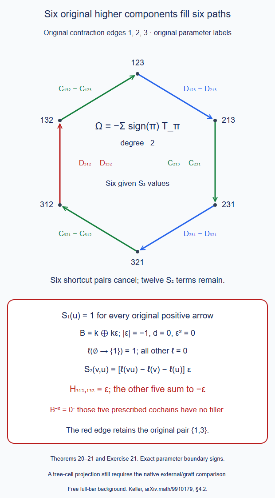

Theorems 20–21 and Exercise 21. The upper schematic
retains all six original contraction orders and
their head- or tail-swap homotopies. The red
edge is the original \(\{1,3\}\) pair; its
cochain need not vanish when leading maps
coincide. The lower panel gives a full
functor model of this fact.
[Editable SVG](../assets/rational-native-parameter-hexagon.svg).

## 22. Retain the whole parameter comparison in an initial cone

The independent-contraction example shows why
changing to a simpler parameter diagram must
carry a full comparison. That comparison is
already present in the original higher data.

**Theorem 22 (canonical full initial cones and their
base-change coherence).** Use one original
parameter functor \(\mathcal S:\mathcal B_E\to\mathcal D\)
as in Theorem 20. For a base \(a\subseteq E\),
let \(C_a\) be the strict constant functor
at \(D_a\) on the upper interval \(U\supseteq a\).
For a strict parameter chain
\[
 U_0\xrightarrow{u_1}U_1\longrightarrow\cdots
       \xrightarrow{u_q}U_q,\qquad a\subseteq U_0,
\]
define
\[
 \rho^a_q(u_q,\ldots,u_1)
 =(-1)^q
 s_{q+1}(u_q,\ldots,u_1,a_{U_0a}).
 \tag{22.1}
\]
At \(q=0\) this is \(s_1(a_{U_0a})\).
These are the components of an actual
closed degree-zero full natural transformation
\[
 \rho^a:C_a\Rightarrow\mathcal S|_{\ge a}.
\]
The source of every core is \(D_a\),
the target is \(D_{U_q}\), and its
degree is \(-q\). At \(U_0=a\)
the object component is the identity
and every positive input core is zero,
by formal-identity normalization.
Positive original parameters with
identity-valued images are retained.

For \(a\subseteq b\), work on \(U\supseteq b\),
and put \(f_{ba}=s_1(a_{ba})\).
Regard this as a constant closed
transformation \(C_a\Rightarrow C_b\).
The given cochains
\[
 H^{a,b}_q(u_q,\ldots,u_1)
 =s_{q+2}(u_q,\ldots,u_1,a_{U_0b},a_{ba})
 \tag{22.2}
\]
form a degree-minus-one full pre-natural
cochain, satisfying
\[
 d_{\rm Nat}H^{a,b}
       =\rho^a-\rho^b\star f_{ba}. \tag{22.3}
\]
Thus changing the initial base uses an
explicit original homotopy, including
every parameter input core.

For \(a\subseteq b\subseteq c\), work on
\(U\supseteq c\), and write
\[
 h_{cba}=s_2(a_{cb},a_{ba}),\qquad
 dh_{cba}=f_{ca}-f_{cb}f_{ba}.
\]
Treat \(h_{cba}\) as a constant
degree-minus-one pre-natural cochain.
The original components
\[
 T^{a,b,c}_q(u_q,\ldots,u_1)
 =(-1)^{q+1}
 s_{q+3}(u_q,\ldots,u_1,
                    a_{U_0c},a_{cb},a_{ba})
 \tag{22.4}
\]
satisfy the complete second comparison
identity
\[
 \begin{aligned}
 d_{\rm Nat}T^{a,b,c}
 ={}&H^{a,c}-H^{a,b}
       -H^{b,c}\star f_{ba}\\
    &+\rho^c\star h_{cba}.
 \end{aligned} \tag{22.5}
\]
In particular its last term has core
\[
 (\rho^c\star h_{cba})_q
    =(-1)^q\rho^c_q h_{cba}, \tag{22.6}
\]
not just the unsigned product of
the two displayed core values.

If the supplied object maps
\(\rho^a_0(U):D_a\to D_U\) are
homotopy equivalences in \(\mathcal D\),
the full \(\rho^a\) is a homotopy
equivalence of parameter diagrams.
This implication holds for arbitrary
dg target Hom complexes; it does
not assume that a whole natural-
transformation space is acyclic.
The forward comparison and the
displayed homotopies are given
by the original \(\mathcal S\);
the finite-diagram inverse can
be chosen using its supplied
object inverse data.

The displayed forward cone and
base-change formulas commute with
strict restriction of the tagged
index. The inverse in the criterion
is chosen on its finite diagram.
If an index map has initial image
\(b\), its pulled-back initial
cone is the restriction of
\(\rho^b\). Formula (22.3)
compares it with \(\rho^a\),
including the actual map \(f_{ba}\);
(22.5) compares two successive
base changes. At a native graft,
the initial image can include
the original joining seams.
Those seams and the resulting
base-change components remain
in these formulas.

The initial-cone and equivalence
statements also hold for any finite
directed degree-zero index category
with an initial object, including
one with parallel morphisms.
For the base-change statements
one uses chosen compatible cone
arrows \(a_{Ub}\), satisfying
\[
 u\,a_{Ub}=a_{Vb},\qquad
 a_{Ub}a_{ba}=a_{Ua}
 \quad\text{for every relevant }u:U\to V.
\]
A pulled-back initial cone gives
exactly such chosen arrows.
Thus the result applies to
the whole finite formal tree
index of Lemma [C.44.1.1](../GL-SAT-13.html#c441-the-complete-finite-formal-tree-index) in
its expansion direction,
with the actual corolla as
initial object. Finite products
have the original corollas
as their initial forest;
fixed identity strands keep
their separate one-object
index factors. Nullary and
unary corollas remain vertices.

**Proof.**
Use the natural-transformation
differential of Theorem 9. For
a cochain \(\theta:C_a\Rightarrow\mathcal S\)
of total degree \(r\), its component
on \(q\ge1\) closed degree-zero
parameter arrows is
\[
 \begin{aligned}
 (d_{\rm Nat}\theta)_q
 ={}&d\theta_q
 -(-1)^r\sum_{j=1}^{q-1}(-1)^j
                       \theta_{q-1}(\text{merge }j)\\
 &-\sum_{j=1}^{q}(-1)^{rj}
       s_j(u_q,\ldots,u_{q-j+1})
                  \theta_{q-j}(u_{q-j},\ldots,u_1)\\
 &+(-1)^{r+q-1}
                  \theta_{q-1}(u_q,\ldots,u_2).
 \end{aligned} \tag{22.7}
\]
The final component is evaluated
on the chain starting at \(U_1\).
The source constant functor has
only its identity one-input
component, giving precisely that
last cut. At \(q=0\) the
differential is \(d\theta_0\).
The left convolution sign is
\((-1)^{rj}\), since its prefix
has suspended degree \(-j\).
Thus (22.7) includes every source
merger and both endpoint cuts.

Substitute (22.1) in (22.7)
and apply (20.3) to its
\(q+1\)-letter extended word.
All internal mergers cancel
the first sum in (22.7).
All proper target-side product
cuts cancel its second sum.
The remaining source merger
composes \(u_1a_{U_0a}\) to
the same original arrow
\(a_{U_1a}\); it cancels the
constant-functor last cut.
The coefficients match because
\((-1)^q(-1)^j=(-1)^{q-j}\).
At \(q=0\), \(s_1\) is closed.
This proves \(d_{\rm Nat}\rho^a=0\).
The stated types and degrees
follow directly from the
extended original word.

For (22.2), the same internal
cancellations leave only the
last base-arrow merger and
last product cut. Their values
are
\[
 (-1)^q s_{q+1}(\ldots,a_{U_0a})
 -(-1)^q s_{q+1}(\ldots,a_{U_0b})f_{ba}.
\]
They are exactly the \(q\)-cores
of (22.3). At \(q=0\) the
identity is the two-input
functor equation for
\(a_{U_0b},a_{ba}\).
No primitive has been selected
independently of the original
parameter components.

For (22.4), the internal
mergers and product cuts
again cancel by (22.7),
now with \(r=-2\). The
remaining two source mergers
compose respectively
\(a_{U_0c}a_{cb}=a_{U_0b}\)
and \(a_{cb}a_{ba}=a_{ca}\).
The last two product cuts
separate \(f_{ba}\) or
\(h_{cba}\). With the
factor \((-1)^{q+1}\),
the four surviving terms are
\[
 \begin{aligned}
 &H^{a,c}_q-H^{a,b}_q
       -H^{b,c}_q f_{ba}\\
 &\qquad
 +s_{q+1}(u_q,\ldots,u_1,a_{U_0c})h_{cba}.
 \end{aligned}
\]
The last summand is (22.6):
the constant \(h\) has degree
minus one and crosses a
\(q\)-letter suspended
degree-zero prefix. Since
\(\rho^c_q=(-1)^q s_{q+1}(\ldots,a_{U_0c})\),
the two signs cancel. This
proves (22.5) with its actual
convolution sign.

We prove the equivalence
criterion on the full finite
parameter diagram. Filter every
normalized Nat complex by
minimum parameter word length.
The differential preserves this
filtration; its non-object
terms strictly increase length.
The interval has finite height,
so the filtration is finite.
On the associated graded,
right composition with
\(\rho^a\) is the direct product
of precomposition maps with
the supplied \(\rho^a_0(U)\)
on individual target Hom
complexes. Each is a chain
homotopy equivalence. Indeed
an object inverse gives its
inverse chain map, and an
object homotopy \(dh=gf-1\)
gives the Hom homotopy
\(\theta\mapsto(-1)^{|\theta|}\theta h\).
Its differential is
\(\theta\mapsto\theta(gf-1)\),
by the dg Leibniz rule.

Consequently the associated
graded mapping cone of right
composition is acyclic.
Its full cone is acyclic
as well: for a closed element,
solve its leading graded
piece by a boundary, lift
that primitive, subtract its
boundary, and repeat in the
next filtration step. Finite
height terminates this
construction. Thus right
composition with \(\rho^a\)
is a quasi-isomorphism on
the relevant full Nat
complexes.

Apply this first to
\[
 \operatorname{Nat}(\mathcal S,C_a)
       \longrightarrow\operatorname{Nat}(C_a,C_a).
\]
Surjectivity on degree-zero
cohomology supplies a closed
\(\sigma:\mathcal S\Rightarrow C_a\)
and a homotopy
\(\sigma\star\rho^a-1=d_{\rm Nat}J\).
The other defect
\(\rho^a\star\sigma-1\) is closed.
After right composition by
\(\rho^a\) it becomes
\(d_{\rm Nat}(\rho^a\star J)\).
Injectivity on cohomology of
\[
 \operatorname{Nat}(\mathcal S,\mathcal S)
       \longrightarrow\operatorname{Nat}(C_a,\mathcal S)
\]
therefore makes that defect
a boundary also. These two
actual homotopies prove the
full diagram equivalence.
Only the composition cones
were acyclic; no acyclicity
of either whole Nat space
was used.

The proof also gives the stated
extension beyond Boolean intervals.
In a directed index with an
initial object, the appended
initial arrow satisfies
\(u a_{U0}=a_{V0}\) by
uniqueness of that initial
arrow. Every other step used
only actual source composition
and the chosen cone identities,
not uniqueness of arbitrary
arrows between two objects.
Keep distinct parallel arrows
in every word. Finite height
still gives the finite Nat
filtration used for inversion.
Products of the finite indices
have the tuple of initial
objects and summed height;
a fixed identity-strand
factor has height zero.
These observations prove all
asserted extensions.

Finally strict index restriction
applies the original index
map to each arrow in these
extended words. If its initial
image is \(b\), the initial
arrow is exactly \(a_{U_0b}\);
thus its cone is \(\rho^b\)
with those restricted words.
The two comparison identities
already proved give its
base-change coherence.
For native operator diagrams,
use the supplied whole
inverse/mate data; if they
are recorded as represented
modules, Theorem [C.50.1.1](../GL-SAT-13.html#c501-recover-every-represented-action-together)
recovers them from the full
module actions. Literal
grafting retains its joining
seams by [C.44.2.1](../GL-SAT-13.html#c442-grafting-retains-nullary-vertices-and-unary-seams), so a
nonempty initial image is
kept as this base \(b\).
\(\square\)

This is a full comparison of
parameter diagrams. For native
input/output changes the actual
[C.47](../GL-SAT-13.html#c47-joint-execution-and-contraction-of-native-trees) graft comparison, full
[C69](../GL-SAT-13.html#c69-full-horizontal-operator-composition) evaluation and [C78](../GL-SAT-13.html#c78-full-tensor-unit-restriction-and-external-comparisons) common
input remain part of the
construction. In particular
index restriction is not
replaced by a strict dg
tensor operation on bare
primitive natural transformations.
The represented tree-bar
extraction must transport its
operator actions with this
whole comparison.
In particular the base-change
identity retains the actual
map \(f_{ba}\); the cone
does not force that native
graft comparison to be a
prescribed graded target map.

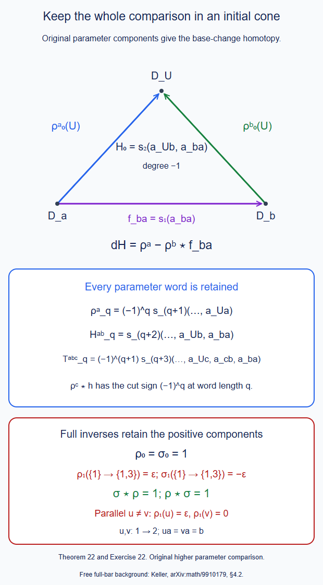

Theorem 22 and Exercise 22. The triangle displays
the object component of the full base-change
homotopy; the following formulas retain every
parameter-word core. Composition with the
negative-degree constant map uses its actual
cut sign. The example's inverse retains the
nonzero \(\epsilon\) component.
[Editable SVG](../assets/rational-native-parameter-cones.svg).

## 23. The unreduced two-sided Yoneda evaluation

Let \(F:B\to C\) be the actual normalized uncurved
\(A_\infty\)-functor between dg categories. Fix objects
\(x\in B\) and \(y\in C\). Use the target-to-source
word convention of Theorem 9. The two-sided complex is
\[
 X_F(x;y)=
 \bigoplus_{r\geq0,\ b_0,\ldots,b_r}
 C(Fb_0,y)\otimes sB(b_1,b_0)\otimes\cdots
 \otimes sB(b_r,b_{r-1})\otimes B(x,b_r).
 \tag{23.1}
\]
No identity letter is quotiented out. Write its homogeneous
elements as \((k;w;l)\), where
\[
 w=sb_1|\cdots|sb_r,\qquad
 p=|k|,\qquad t=|w|=\sum_i(|b_i|-1).
\]
The empty word is allowed. Ordinary units in \(B\) and
ordinary unit outputs in \(C\) are retained.

**Theorem 23 (full two-sided evaluation and its unit contraction).**
On (23.1) the differential is
\[
 \begin{aligned}
 D(k;w;l)
  ={}&(dk;w;l)+(-1)^p(k;b_Bw;l)
           +(-1)^{p+t}(k;w;dl)\\
    &+\sum_{\substack{w=uv\\u\ne\varnothing}}
           (-1)^p(k\tau_F(u);v;l)\\
    &-\begin{cases}
       (-1)^{p+|u|}(k;u;b_rl),&
                      w=u|sb_r,\ r>0,\\
       0,&r=0.
      \end{cases}
 \end{aligned}
 \tag{23.2}
\]
Here \(b_B\) includes every original unary differential
and every adjacent composition. There is a chain
retraction onto \(C(Fx,y)\):
\[
 \begin{aligned}
 q(k;w;l)&=(-1)^t k\,\tau_F(w|sl),\\
 s(a)&=(a;\varnothing;1_x),\qquad qs=1.
 \end{aligned}
 \tag{23.3}
\]
In particular \(q\) uses the actual higher components of
\(F\). It has a degree-minus-one homotopy \(h\) satisfying
\[
 Dh+hD=1-sq,\qquad h^2=0,\qquad hs=qh=0.
 \tag{23.4}
\]
These are assertions about the endpoint complexes. Strict
left \(C\)-linearity of this particular normalized \(h\)
is not asserted; Theorem 24 supplies its full output-bar
extension.

**Proof.** Put \(\tau=\tau_F\). Theorem 9 proved
\[
 d_C\tau+\tau b_B=\tau\star\tau,\qquad
 (\tau\star\tau)(uv)=(-1)^{|u|}\tau(u)\tau(v).
 \tag{23.5}
\]
In the square of (23.2), the coefficient differentials
cancel by the dg Leibniz rule. Terms entirely inside
\(w\) give \(b_B^2=0\). At its left endpoint the
remaining terms are \(k\) times (23.5), with the
negative convolution term from two successive prefix
actions. At its right endpoint, the last adjacent
composition and the two successive right actions agree
by associativity in \(B\); their signs are opposite.
A prefix action and a right action must use
disjoint letters: the right action consumes the
last letter, and the prefix must leave that
letter available. The two possible orders
therefore cancel as degree-one operators.
This exhausts all positions of the two
operations, so \(D^2=0\).

For the chain equation in (23.3), apply (23.5) to
the entire word \(w|sl\). Its internal unary and
binary terms are exactly the middle-bar terms of
\(qD\). The unary term on \(sl\) is the displayed
\(dl\) term, and the final binary term is the
right endpoint action in (23.2). Its proper prefix
cuts are the prefix actions in that formula.
The tensor Leibniz term on \(k\) supplies \(dk\).
Moving from \(w|sl\) back to the unsuspended last
coefficient contributes precisely \((-1)^t\).
Thus \(d_Cq=qD\). Since \(F\) is strictly unital,
\(\tau_F(s1_x)=1_{Fx}\); consequently \(qs=1\).
Both \(s\) and \(q\) commute with the coefficient
differentials.

The extra-unit insertion before normalization is
\[
 h_{\mathrm{raw}}(k;w;l)
    =-(-1)^{p+t}(k;w|sl;1_x).
 \tag{23.6}
\]
It has degree minus one. In
\(Dh_{\mathrm{raw}}+h_{\mathrm{raw}}D\), the
coefficient differentials, internal word terms, and
prefix actions not containing \(sl\) cancel in pairs.
For example the \(dl\) terms have coefficients
\(+1\) and \(-1\): in the first, the raw
insertion sign, the tensor sign \((-1)^p\),
and the last unary-bar sign \(-(-1)^t\)
multiply to \(+1\).
The new final right action on \(l1_x\) leaves
\((k;w;l)\) with coefficient \(+1\).
The action consuming all of \(w|sl\) leaves
\(-(-1)^t(k\tau_F(w|sl);\varnothing;1_x)\).
These are \(1\) and \(-sq\). Hence
\[
 Dh_{\mathrm{raw}}+h_{\mathrm{raw}}D=1-sq,
 \qquad qh_{\mathrm{raw}}=0.
 \tag{23.7}
\]
The last equality follows because evaluation after
insertion has the final identity as an argument of
a higher functor component of length at least two.
It uses strict-unit normalization of \(F\), not a
quotient of (23.1).

Raw insertion can have nonzero square. To obtain
(23.4) without discarding these words, set
\[
 \Pi=1-sq,\qquad
 h'=\Pi h_{\mathrm{raw}}\Pi=h_{\mathrm{raw}}\Pi,
 \qquad h=h'Dh'.
 \tag{23.8}
\]
Then \(\Pi\) is a chain projector,
\(Dh'+h'D=\Pi\), and
\(h's=qh'=0\). On its image put
\(e=Dh'\) and \(f=h'D\). They satisfy
\(e+f=1\) and \(fe=0\); therefore
\(e^2=e,\ f^2=f,\ ef=0\). It follows that
\[
 Dh+hD=e^2+f^2=\Pi,\qquad
 h^2=h'(Dh'^2D)h'=h'(ef)h'=0.
 \tag{23.9}
\]
The same expressions vanish on the image of \(s\).
The remaining two side conditions follow from those
of \(h'\). Every displayed map is finite on a given
middle word: insertion adds one letter and every
differential or functor action has only finitely
many available positions or cuts. This proves all
claims without an augmentation or a unit quotient.
\(\square\)

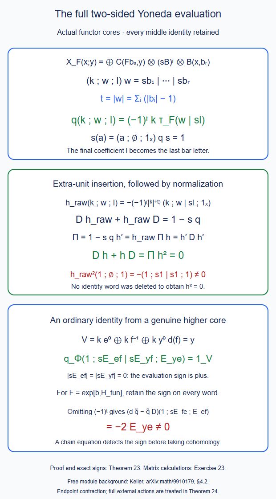

Theorem 23 and Exercise 23. The last coefficient is
suspended only when it enters the actual functor core.
The sign uses the entire preceding middle bar.
The lower calculation retains a genuine third
functor component with ordinary identity output.
[Editable SVG](../assets/rational-native-bar-yoneda.svg).

## 24. The full common-input graft projection

The object calculation must carry the original input
actions as well. Let \(C_{\mathrm{in}}\) be a typed,
coaugmented conilpotent dg coalgebra, filtered by total
original input-word length. Its length-preserving
differential is the original unary differential;
all other differential terms lower this length.
Let
\[
 g:C_{\mathrm{in}}\longrightarrow B_{\mathrm{full}}B
 \tag{24.1}
\]
be the genuine coaugmentation-preserving dg coalgebra
map of the inner operation. Its core is
\(\tau_G\), and its object value is written \(Ga\).
The construction includes \(C_{\mathrm{in}}=B_{\mathrm{full}}A\)
and \(g=BG\). Tensor products of the individual input
bars, with their genuine joint-input map, are also
allowed. No tensor product of arbitrary primitive
\(A_\infty\)-functors is assumed.

**Theorem 24 (actual projection, full unit section, and contracted kernel).**
Put
\[
 \begin{gathered}
 X=X_F(Ga;y)\otimes C_{\mathrm{in}},\\
 Y=C(FGa,y)\otimes C_{\mathrm{in}}.
 \end{gathered}
 \tag{24.2}
\]
All sums have their original endpoints. On \(X\)
use the differential of Theorem 23, the tensor
differential of \(C_{\mathrm{in}}\), and the
right input action
\[
 \sum_{\substack{\Delta c=\sum u\otimes v\\
                         u\text{ of positive length}}}
 (-1)^{|k|+|w|+|l|}
       (k;w;l\tau_G(u))\otimes v.
 \tag{24.3}
\]
On \(Y\) use Theorem 9 with core
\(\tau_{FG}=\tau_F g\).
There is a degreewise surjective chain map of full
right comodules \(Q:X\to Y\). Its complete formula
and a canonical full chain section are
\[
 \begin{aligned}
 Q((k;w;l)\otimes c)
   &=\sum_{\Delta c=\sum u\otimes v}
       \sum_{g(u)=\sum a_z z}
       (-1)^{|w|}a_z
          k\tau_F(w|sl|z)\otimes v,\\
 S(a\otimes c)
   &=\sum_{\Delta c=\sum u\otimes v}
       \sum_{g(u)=\sum a_z z}
          a_z(a;z;1_{G(\operatorname{source}u)})\otimes v.
 \end{aligned}
 \tag{24.4}
\]
The notation for \(g(u)\) includes its empty-word
value when \(u\) is empty. All its nonempty-output
partitions occur. The maps satisfy
\[
 QS=1,\qquad D_XS=SD_Y,\qquad D_YQ=QD_X.
 \tag{24.5}
\]
They are strictly compatible with dg output
postcomposition.

In the full left-output and right-input bar
encoding, \(\ker Q\) has a square-zero contraction.
It gives a full bicomodule homotopy \(H\) with
\[
 D_XH+HD_X=1-SQ,\qquad
 H^2=0,\qquad HS=QH=0.
 \tag{24.6}
\]
For original external bar length \(L\), its
perturbation sum has at most \(L+1\) terms.
The unbounded middle bar does not enter this bound.

**Proof.** The square of \(D_X\) is zero by
Theorem 23, the original square on \(C_{\mathrm{in}}\),
and the twisting-core equation for \(\tau_G\).
The last equation is the one-output part of the
dg coalgebra equation for \(g\). At the interface
with the last coefficient it gives exactly the
two successive actions in (24.3); the remaining
terms cancel by its dg Leibniz rule. Theorem 9
proves the corresponding assertion for \(Y\).

Coassociativity and the coalgebra equation for \(g\)
give the right-comodule equations for both maps
in (24.4): cutting the retained \(v\) is the same
as first making that cut of the original \(c\).
All maps applied before this cut have degree zero,
so no additional permutation sign occurs.

For \(Q\), apply (23.5) to each full word
\(w|sl|z\). The terms inside \(w|sl\) are those
already checked in Theorem 23. The terms inside
\(z\) are the image under \(g\) of the original
input differential, because \(b_Bg=gd_{\mathrm{in}}\).
The binary term at the \(sl|z\) interface is
the action (24.3). The cuts wholly after that
interface give the target \(\tau_Fg\) action.
These are all positions and all cuts. Their
tensor signs are (23.2), (24.3), and the common
\((-1)^{|w|}\) in (24.4). This proves the whole
chain equation, rather than just its empty-input
component.

For \(S\), the internal middle-bar differential
of \(g(u)\) agrees with \(g(d_{\mathrm{in}}u)\).
Its left prefix actions give the
\(\tau_Fg\) actions of \(Y\).
Its final right action on the newly inserted
identity cancels the right input action in (24.3)
coming from the next coproduct cut.
Their coefficients are opposite: the final
action has the minus sign of (23.2), whereas
the next input action has its plus tensor sign.
This accounts for every term and proves
\(D_XS=SD_Y\).
After \(S\), every term of \(Q\) consuming a
nonempty total original prefix evaluates a
higher \(F\)-core with that inserted identity
as an argument, and is zero. The only surviving
cut consumes no prefix; its value is
\(aF_1(1)=a\). Hence \(QS=1\).
Output postcomposition acts on \(k\), or on
\(a\), on the far left of these degree-zero
formulas. Associativity proves its compatibility.

It remains to contract the actual projection
kernel while retaining both exterior coactions.
First omit the left output bar. Let \(Q_0=q\otimes1\)
and \(S_0=s\otimes1\), using (23.3).
They are graded comodule maps. They need not be
chain maps for the full source action.
Nevertheless the same inserted-unit argument gives
\[
 Q S_0=Q_0S_0=1.
 \tag{24.7}
\]
Define
\[
 N=S_0(Q-Q_0),\qquad A=1+N.
 \tag{24.8}
\]
Then \((Q-Q_0)S_0=0\), so
\[
 N^2=0,\quad A^{-1}=1-N,\quad
 Q_0A=Q,\quad AS_0=S_0.
 \tag{24.9}
\]
The map \(N\) strictly lowers positive original
input length. Conjugation by \(A\) identifies
\(\ker Q\) with \(\ker Q_0\), whose underlying
graded comodule is
\((\ker q)\otimes C_{\mathrm{in}}\).

Include the full output bar \(B_{\mathrm{full}}C\)
now. Extend the maps \(Q,S,Q_0,S_0,A\) by the
identity on this left factor. They remain full
bicomodule maps. Its differential on a word
\(v\), with \(z=(k;w;l)\otimes c\), is explicitly
\[
 \begin{aligned}
 D_{\mathrm{out}}(v\otimes z)
  ={}&b_Cv\otimes z+(-1)^{|v|}v\otimes D_Xz\\
     &-\begin{cases}
       (-1)^{|u|}u\otimes(ak;w;l)\otimes c,
                                      &v=u|sa,\\
       0,&v=\varnothing .
       \end{cases}
 \end{aligned}
 \tag{24.10}
\]
This is the same final-endpoint sign as (23.2).
Its square is zero by the strict output action
and dg Leibniz rule. Output linearity of \(Q\)
and \(S\) proves their chain equations here too.

On \(\ker Q_0\), let \(D_0\) contain (23.2)
and only the unary differentials of the two
external bars. Its contraction is
\[
 H_0(v\otimes z)=(-1)^{|v|}v\otimes(h\otimes1)z.
 \tag{24.11}
\]
The tensor differential signs cancel the
external unary terms, so
\(D_0H_0+H_0D_0=1\) and \(H_0^2=0\).
For the conjugated differential put
\[
 D'=AD_{\mathrm{out}}A^{-1}=D_0+\delta.
 \tag{24.12}
\]
Both \(D'\) and \(D_0\) preserve this kernel.
Every term of \(\delta\) lowers total original
external length: it composes external letters,
consumes a nonempty external prefix in an action,
or contains \(N\). The middle differential is
already wholly included in \(D_0\).
Thus on this kernel the finite expression
\[
 \overline H
   =H_0(1+\delta H_0)^{-1}
   =\sum_{r\geq0}(-1)^rH_0(\delta H_0)^r
 \tag{24.13}
\]
has at most \(L+1\) terms.

For completeness, set \(U=1+\delta H_0\) and
\(V=1+H_0\delta\). Then
\(\overline H=H_0U^{-1}=V^{-1}H_0\), giving
\(\overline H^2=0\). Multiplying the desired
contraction equation on the left by \(V\) and
on the right by \(U\) reduces its defect to
\[
 H_0(D_0\delta+\delta D_0+\delta^2)H_0=0.
 \tag{24.14}
\]
The last equality is \((D')^2=D_0^2=0\).
This proves \(D'\overline H+\overline HD'=1\).

The expression is a bicomodule map.
Indeed \(H_0\) is such a map with its displayed
degree-minus-one tensor sign. In
\(H_0(\delta H_0)^r\), a coaction term in
which \(\delta\) acts only on a retained
external coalgebra factor has two adjacent
coefficient contractions \(H_0^2\), and is
zero. All other terms are precisely the same
expression on the middle coaction factor.
This proves the coaction equation term by
term; it does not assume that \(h\) is
strictly output linear.

Finally transport this kernel contraction by \(A\)
and precompose with the chain projector \(1-SQ\):
\[
 H=A^{-1}\overline H A(1-SQ).
 \tag{24.15}
\]
Its image lies in \(\ker Q\).
The contraction equation and all three side
conditions in (24.6) now follow from (24.5),
(24.14), and \(\overline H^2=0\).
Insertion uses the original object \(Ga\);
no new unchosen source object is introduced.
All sums are finite on each original external
word. This completes the proof. \(\square\)

For the native graft, take \(B\) to be the actual
joint dg category of the intermediate objects
and \(F=F_n^G\). The simultaneous inner graph
module at fixed input objects is represented by
the tuple \((G_1a_1,\ldots,G_na_n)\).
Use the genuine common coalgebra and map
\[
 C_{\mathrm{in}}=\bigotimes_i B_{\mathrm{full}}A_i,
 \qquad
 g=\operatorname{sh}_B\circ\bigotimes_i BG_i.
 \tag{24.16}
\]
Here \(\operatorname{sh}_B\) is the dg joint-input
bar shuffle proved in [C.44.2.1](../GL-SAT-13.html#c442-grafting-retains-nullary-vertices-and-unary-seams), and its genuine
common-input realization is [C78](../GL-SAT-13.html#c78-full-tensor-unit-restriction-and-external-comparisons). It is a tensor
of coalgebra maps followed by that dg shuffle.
Consequently (24.4) is the actual full
common-input projection from the graph-bar graft
to the graph of \(F_n^G(G_1,\ldots,G_n)\).
It retains every coproduct cut in every input
factor. The native graft comparison
\(\alpha:F_{\mathrm{flat}}^G\to F_n^G(G_1,\ldots,G_n)\)
then gives the whole map
\[
 \mathcal T_\alpha Q:
  X\longrightarrow\mathcal K_{F_{\mathrm{flat}}^G}
 \tag{24.17}
\]
by Theorem 9. When \(\alpha\) has its supplied
full inverse and homotopies this is a module
equivalence: apply Theorem 9 to those data and
compose with (24.6).
Degreewise surjectivity is asserted for \(Q\),
not for an arbitrary \(\mathcal T_\alpha Q\).
At zero inputs the coefficient category is
still separate from the full output complex
\(\operatorname{RHom}(IC_0,y)\); (24.4) does
not identify that output with the coefficient
field.

These formulas supply a full single graft with
its original input and output actions.
Theorems 25–26 below carry its inner and
outer parameters in the full bar encoding.
Joint strict-unit normalization, compatibility
between all grafts, and the full native tree
coderivation are additional assertions.
An arbitrary lift through a contracted kernel
cannot replace the original parameter diagram.

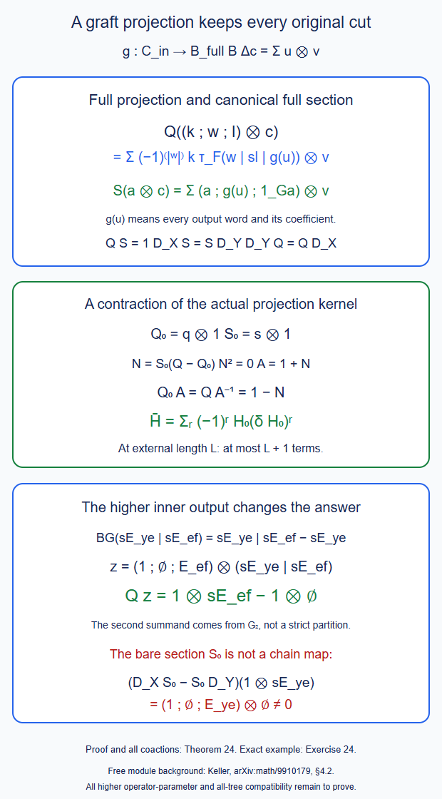

Theorem 24 and Exercise 24. Both maps keep the
unconsumed original input coalgebra. The source
prefix enters either the outer functor core
or the actual middle bar. The final calculation
shows why its higher inner-functor output must
be retained.
[Editable SVG](../assets/rational-native-graft-projection.svg).

## 25. Every original inner parameter in the genuine evaluation

Fix dg categories \(A,B,C\). Set
\[
 \begin{gathered}
 \mathscr D=\operatorname{Fun}_\infty(A,B),\qquad
 P=B_{\mathrm{full}}\mathscr D,\\
 \Gamma=P\otimes B_{\mathrm{full}}A,\qquad
 e=\operatorname{ev}_{A,B}:
       \Gamma\longrightarrow B_{\mathrm{full}}B .
 \end{gathered}
 \tag{25.1}
\]
The full marked evaluation \(e\), with its
original cuts and signs, was proved in
[C.69.1.1](../GL-SAT-13.html#c691-evaluation-with-every-parameter-mark-retained). The tensor coproduct includes
\[
 (-1)^{|p_R||c_L|}
       (p_L\otimes c_L)\otimes(p_R\otimes c_R)
 \tag{25.2}
\]
for the indicated parameter and original
source cuts. This sign is retained before
any higher functor is evaluated.

**Theorem 25 (the actual full inner-parameter projection).**
For the fixed outer functor \(F:B\to C\),
apply (24.2)–(24.15) with
\(C_{\mathrm{in}}=\Gamma\) and \(g=e\).
The resulting maps \(Q_e,S_e,H_e\) are
full output/parameter/source bicomodule
maps, with the tensor coactions understood
via (25.2). They satisfy the full chain,
section, contraction and side identities
of Theorem 24. Their parameter object
\(G\) gives precisely the original graph
graft for \(F\) and \(G\).

For every original suspended parameter
word \(p\) and original source word \(c\),
the projection's consumed-prefix core is
\[
 Q_{e,\mathrm{core}}(k;w;l;p,c)
   =(-1)^{|w|}
       \sum_{e(p\otimes c)=\sum a_z z}
             a_z\,k\tau_F(w|sl|z).
 \tag{25.3}
\]
The section's core is
\[
 S_{e,\mathrm{core}}(a;p,c)
       =\sum_{e(p\otimes c)=\sum a_z z}
                     a_z(a;z;1_{G_{\mathrm{source}}(x_{\mathrm{source}})}).
 \tag{25.4}
\]
Their full maps retain every unconsumed
parameter and source suffix. In particular
these are all higher inner-parameter
components, rather than only an objectwise
or one-mark comparison.

A positive parameter core of \(Q_e\)
vanishes at a formal identity
transformation argument. The canonical
section \(S_e\) is an unreduced section:
its higher parameter cores need not have
that normalization. No normalization of
the entire section or homotopy is inferred.

**Proof.** Theorem [C.69.1.1](../GL-SAT-13.html#c691-evaluation-with-every-parameter-mark-retained) proves that \(e\)
is a coaugmentation-preserving dg coalgebra
map. On \(r\) original parameter letters
and \(L\) original source letters, its
output words have length at most \(r+L\).
The original tensor differential preserves
total length in its unary terms and lowers
it in every binary term. Thus all the
hypotheses of Theorem 24 hold with the
actual map \(e\); no rectification or
choice of another diagram is used.
Its core formulas are exactly (25.3)–(25.4).

The \(\Gamma\)-coaction preserves the two
separate coactions. To see this directly,
apply the counit of the source coalgebra,
or the counit of \(P\), to its tensor
coaction equation. One obtains the
parameter or source coaction equation,
respectively, with the tensor sign (25.2).
The same reasoning applies to \(H_e\),
and its output coaction is already
Theorem 24's full output-bar coaction.
At empty parameter input the equality
\(e(1_G\otimes c)=BG(c)\) is part of
[C.69.1.1](../GL-SAT-13.html#c691-evaluation-with-every-parameter-mark-retained). This identifies the restriction
with the original object-\(G\) maps,
including all its original source actions.

For nonempty parameter input the marked
evaluation uses every original
transformation exactly once, including
its possible source-length-zero value.
Substitution into (25.3) or (25.4)
therefore retains all its parameter
components. Their differential equations
include parameter unary differentials,
vertical parameter compositions, original
source differentials, and every cut:
these are precisely the terms of the
chain equation already proved for \(e\)
and then for \(Q_e,S_e\). In particular
closedness is not assumed for the
individual parameter cochains.

If a parameter argument is a formal
identity transformation, its marked
piece must be empty by normalization,
and its output is the actual identity
of \(B\). Every nonzero marked assignment
thus places that identity in \(z\).
The core \(\tau_F(w|sl|z)\) has at least
two arguments and contains that identity,
so is zero by strict-unit normalization
of \(F\). This proves the assertion
about \(Q_e\). By contrast at a
one-letter identity parameter and empty
original source input, (25.4) is
\[
 S_{e,\mathrm{core}}(a;s1_G,\varnothing)
          =(a;s1_{Ga};1_{Ga}).
 \tag{25.5}
\]
This is an actual nonzero unreduced
middle word. It is not removed or
declared normalized.

Finally the contraction series is finite
at total original external length
\(r+L+L_{\mathrm{out}}\), by (24.13).
The full parameter and original source
object labels remain those of \(e\);
insertion uses its original object \(Ga\).
This proves all assertions. \(\square\)

For several branches, replace (25.1)
by the tensor of their actual marked
evaluation coalgebras, followed by the
joint dg bar shuffle into the actual
intermediate tuple category. Its
coalgebra and chain equations are the
tensor equations and [C.44.2.1](../GL-SAT-13.html#c442-grafting-retains-nullary-vertices-and-unary-seams).
This proves the same assertion for all
inner branch parameters of a fixed
graft profile, including empty branch
lists. It makes no assertion that
arbitrary primitive \(A_\infty\)-functors
have a dg tensor product.

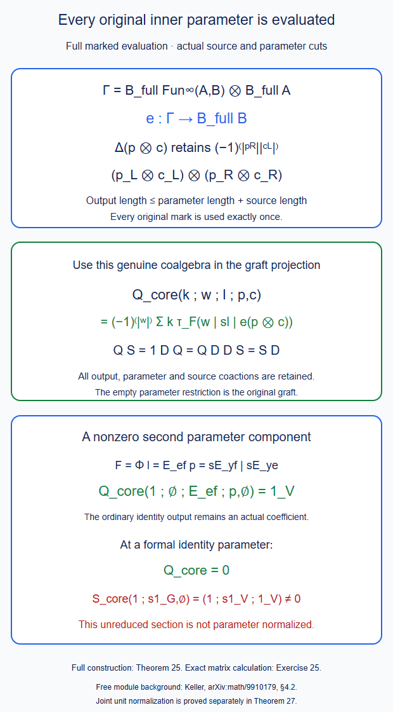

Theorem 25 and Exercise 25. The parameter
and original source words are separate
coalgebra factors with the sign (25.2).
The second parameter component in the
example has ordinary identity output.
The last line records the actual
normalization limit of the section.
[Editable SVG](../assets/rational-native-inner-parameters.svg).

## 26. The outer comparison preserves the actual target diagram

Keep a genuine fixed dg coalgebra map
\(g:\Gamma\to B_{\mathrm{full}}B\),
including \(g=e\) from Theorem 25.
For each \(F:B\to C\), retain the
full objects \(X_F,Y_F,Q_F,S_F,H_F\)
of Theorem 24, with their original
output and \(\Gamma\)-coactions.
Use the graded opposite category
\[
 J=\operatorname{Fun}_\infty(B,C)^{\mathrm{op}}
 \tag{26.1}
\]
with precisely Theorem 9's opposite
composition sign.

**Theorem 26 (strict section naturality and full outer comparison).**
For a homogeneous full cochain
\(\theta:F\to F'\), of degree \(r\),
the original outer actions are
\[
 \begin{aligned}
 X_\theta((k;w;l)\otimes c)
    &=\sum_{w=uv}(-1)^{r|k|}
                  (k\theta(u);v;l)\otimes c,\\
 Y_\theta(k\otimes c)
    &=\sum_{\Delta c=\sum u\otimes v}
            (-1)^{r|k|}k\,\theta(g(u))\otimes v.
 \end{aligned}
 \tag{26.2}
\]
They define actual dg \(J\)-diagrams
\(\mathcal X,\mathcal Y\).
Their section is strictly dg natural:
\[
 X_\theta S_{F'}=S_FY_\theta
 \tag{26.3}
\]
for every homogeneous cochain, including
nonclosed ones and all its positive
original source components.

On \(B_{\mathrm{full}}J\otimes\mathcal X\)
there is a full chain-comodule comparison
\(\widehat Q\) to the original
\(B_{\mathrm{full}}J\otimes\mathcal Y\).
Its empty outer-parameter component is
the given \(Q_F\). The section stays
the given strictly natural \(S_F\);
the target diagram stays \(\mathcal Y\).
The entire projection and homotopy are
\[
 \begin{aligned}
 \widehat Q&=
     Q_0(1+\delta H_0)^{-1}
       =\sum_{j\geq0}(-1)^jQ_0(\delta H_0)^j,\\
 \widehat H&=
     H_0(1+\delta H_0)^{-1}.
 \end{aligned}
 \tag{26.4}
\]
Here \(Q_0,S_0,H_0\) are the cofree
extensions of the given object
contractions and \(\delta\) is the
original nonunary outer-parameter
bar differential and action.
At \(r\) original outer letters,
each outer series has at most
\(r+1\) summands.
It satisfies
\[
 \begin{gathered}
 \widehat Q S_0=1,\qquad
 D_{\mathcal X}\widehat H+
       \widehat H D_{\mathcal X}=1-S_0\widehat Q,\\
 \widehat H^2=0,\qquad
 \widehat H S_0=\widehat Q\widehat H=0.
 \end{gathered}
 \tag{26.5}
\]
All original output and \(\Gamma\)-coactions
are retained. Positive outer-parameter
cores of \(\widehat Q\) are normalized
at formal outer identities.
Joint normalization in an independent
inner-parameter direction is not implied
by this assertion.

**Proof.** The first map of (26.2) is
Theorem 9's full graph map on the
middle word, retaining its right
representable coefficient \(l\).
Its right-endpoint action commutes
with the map by its coaction equation.
The second is the graph map for
the full precomposition \(\theta g\).
Precomposition by the genuine
coalgebra map preserves the full
Nat differential and vertical
products by its coproduct equation.
For a genuine common input this
is the twisting-cochain realization
of [C78](../GL-SAT-13.html#c78-full-tensor-unit-restriction-and-external-comparisons), with the same full
\(\Gamma\)-cuts.
Theorem 9 therefore gives the
dg equations and the graded
opposite product for both maps.
These are dg diagrams on (26.1),
not a strict dg horizontal bifunctor
on the two original functor categories.

For (26.3), expand \(S_{F'}\)
using (24.4), then cut its middle
word before applying \(\theta\).
The coalgebra equation for \(g\)
identifies such a cut with two
successive original \(\Gamma\)-cuts.
On the other side first consume
the earlier prefix by \(\theta g\),
then insert the later prefix by
\(S_F\). These are the same
terms with the same endpoints.
The common sign is
\((-1)^{r|k|}\); all intervening
coalgebra and section maps have
degree zero. This proves the
entire identity. In the output
bar its extension has the usual
factor
\[
 (-1)^{r|v_{\mathrm{out}}|}.
\]
Thus that coaction is retained too.

To specify all signs in (26.4),
use a left parameter word \(v\).
The full differential is
\[
 \begin{aligned}
 D_{\mathcal X}(v\otimes x)
  ={}&b_Jv\otimes x+
          (-1)^{|v|}v\otimes D_Xx\\
     &-\begin{cases}
       (-1)^{|u|}u\otimes\mathcal X(a)x,
                                  &v=u|sa,\\
       0,&v=\varnothing .
       \end{cases}
 \end{aligned}
 \tag{26.6}
\]
Use the same formula for \(\mathcal Y\).
Put all unary terms in \(D_0\).
In this notation
\[
 \begin{gathered}
 Q_0(v\otimes x)=v\otimes Q_Fx,\qquad
 S_0(v\otimes y)=v\otimes S_Fy,\\
 H_0(v\otimes x)=(-1)^{|v|}v\otimes H_Fx.
 \end{gathered}
 \tag{26.7}
\]
They form a contraction for \(D_0\).
Every remaining term \(\delta\)
merges parameter letters or consumes
a nonempty last parameter piece.
It lowers outer parameter length.
The original object \(H_F\) is
already a full output/\(\Gamma\)
map, finite on each original
external word by Theorem 24.
Thus (26.4) is finite wordwise.

Apply the perturbation identity
proved in [C.35.1.1](../GL-SAT-13.html#c351-the-perturbed-contraction-retains-its-homotopy) to this
specific contraction. The perturbed
section would be
\((1+H_0\delta)^{-1}S_0\).
But (26.3) gives
\[
 \delta S_0=S_0\delta_Y,\qquad
 H_0\delta S_0=0,
 \tag{26.8}
\]
so this section is exactly \(S_0\).
The transferred target perturbation
is consequently
\[
 Q_0\delta S_0=Q_0S_0\delta_Y=\delta_Y.
 \tag{26.9}
\]
It is the actual target action,
not a substituted diagram.
The same contraction calculation
therefore gives the chain equation
for \(\widehat Q\) and (26.5).
For example, multiplying the
homotopy defect by
\(1+H_0\delta\) on the left and
\(1+\delta H_0\) on the right
reduces it to the original defect
\(D_0H_0+H_0D_0-(1-S_0Q_0)=0\)
and the square-zero differential
equation. Adjacent \(H_0^2\),
\(H_0S_0\), and \(Q_0H_0\)
give the side conditions,
exactly as in [C.35.1.1](../GL-SAT-13.html#c351-the-perturbed-contraction-retains-its-homotopy).

All coefficient maps are full
output/\(\Gamma\)-comodule maps.
Their sums and compositions retain
those coactions. For the outer
parameter coaction, a term in
which a binary bar differential
acts only on a retained parameter
factor vanishes between adjacent
\(H_0^2\), or next to \(Q_0H_0\).
The remaining cuts give precisely
the cofree extension of the core.
This proves the full coaction
equation for (26.4).

It also proves normalization in
the outer direction. A nonzero
positive outer core is a string
of the original operator actions
separated by coefficient homotopies.
A formal identity action leaves
either \(H_F^2\) between its
neighbors or \(Q_FH_F\) at
the final projection. Both
are zero. Ordinary identity
outputs of nonidentity operators
are still retained in the
original labelled parameter bar.

When \(g=e\), (26.2) uses the
actual full \(\theta e\).
The exact evaluation identity
[C.69.7](../GL-SAT-13.html#c69-full-horizontal-operator-composition) identifies these values
with the entire original
horizontal parameter diagram,
including every mixed outer/
inner component. Thus the
construction carries that
target diagram unchanged.
It does not assert that the
unreduced \(S_e,H_e\) have
become normalized in the
inner direction. Formula (25.5)
shows why that would require
a separate argument.
\(\square\)

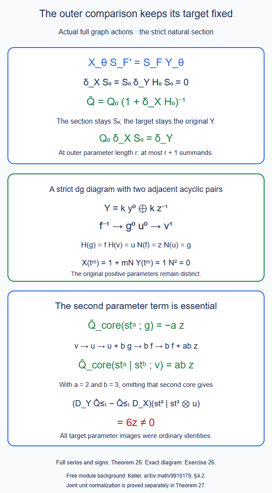

Theorem 26 and Exercise 26. The projection
series uses the actual source actions and
the fixed object contraction. Its target
is fixed by (26.8)–(26.9). The two adjacent
acyclic pairs in the example force a
second parameter correction.
[Editable SVG](../assets/rational-native-outer-parameters.svg).

## 27. Normalize only the auxiliary middle degeneracies

Let \(D_{\mathrm{mid}}\subset X_F(x;y)\)
be spanned by tensors whose middle word
contains a literal suspended identity
\(s1_b\). This is a linear subspace:
a displayed ordinary identity is its
entire element of \(B(b,b)\), not an
individual diagonal summand in a chosen
matrix presentation. Put
\[
 \overline X_F(x;y)=X_F(x;y)/D_{\mathrm{mid}}.
 \tag{27.1}
\]
The root coefficient, the last coefficient,
the original external input coalgebras,
and the full output coefficient complexes
are unchanged.

**Theorem 27 (jointly normalized single-graft operator comparison).**
The differential (23.2) descends to (27.1).
The maps \(q,s\) descend, and on this quotient
the original raw insertion already gives
a special contraction:
\[
 \begin{gathered}
 \overline h(k;w;l)
       =-(-1)^{|k|+|w|}(k;w|sl;1_x),\\
 D\overline h+\overline hD=1-sq,\qquad
 \overline h^2=\overline hs=q\overline h=0 .
 \end{gathered}
 \tag{27.2}
\]
It is strictly graded output linear:
\[
 \overline h(a z)=(-1)^{|a|}a\overline h(z).
 \tag{27.3}
\]
No separate higher output components are
needed for this contraction.

For the genuine marked input of Theorem 25,
and for the tensor of such inputs at
several branches, Theorem 24 descends to
full maps \(\overline Q,\overline S,
\overline H\) on the normalized middle
object. They retain all its chain,
coaction, section and special contraction
identities. Their positive cores are
normalized in every original source
factor and inner-parameter factor.
Their output actions are strictly
graded linear.

The outer construction of Theorem 26
therefore applies with these object
contractions. Its resulting comparison
is jointly normalized in the outer,
inner and original source directions.
It retains the actual full [C69](../GL-SAT-13.html#c69-full-horizontal-operator-composition) target
diagram. These assertions concern the
fixed-graft module comparison; they do
not identify all multiple-graft tree
faces or prove the full multicategory
coderivation equation.

**Proof.** First prove stability of
\(D_{\mathrm{mid}}\) under (23.2).
The coefficient differentials and
the unary middle differential preserve
it, since \(d1_b=0\). If a term leaves
some identity letter, it is already
in this subspace. It remains to check
terms removing the only identity.
At an internal identity the two
adjacent binary products have the
same value and opposite signs:
\[
 \begin{gathered}
 (-1)^{\sigma+|b|-1}(b1),\\
 (-1)^{\sigma+|b|-2}(1c).
 \end{gathered}
 \tag{27.4}
\]
Here \(\sigma\) is the suspended
degree before the left neighbor;
after either product the resulting
word is the word with that identity
omitted. The signs differ by minus.
At a first identity, its left
\(F_1(1)\) action cancels the
adjacent middle product. At a
last identity, the adjacent
product cancels its right action
on \(l\). If it is the only
middle letter, the left and right
actions cancel directly.
Higher prefix actions containing
that identity are zero by
normalization of \(F\).
This proves \(DD_{\mathrm{mid}}
\subset D_{\mathrm{mid}}\).
It proves descent of the total
two-sided differential; no
standalone reduced dg bar of
an unaugmented \(B\) is asserted.

The map \(q\) kills this subspace,
since its functor core has that
identity argument and at least
two arguments in total. Raw
insertion preserves it. Thus
(23.7) descends to (27.2).
After two insertions the second
inserted middle letter is the
last coefficient \(1_x\); hence
\(\overline h^2=0\).
Likewise \(\overline hs=0\).
The condition \(q\overline h=0\)
was already true before quotient.
Its sign changes by
\((-1)^{|a|}\) under left
postcomposition by \(a\), proving
(27.3). Root and last ordinary
identity coefficients were not
among the middle degeneracies.

Both the original and quotient
endpoint complexes now retract
onto the same \(C(Fx,y)\), with
the same \(q\) and \(s\).
The quotient projection commutes
with these maps, so induces an
isomorphism on cohomology.
This also verifies that the
normalization preserves the
actual represented endpoint
complexes, independently of any
acyclicity of an encoded full bar.

For the full input construction,
right input actions change only
\(l\) and preserve middle
degeneracies. Output actions
change only \(k\). Both exterior
coactions preserve the middle
subspace. The whole \(Q\) kills
it by the same normalized
functor-core argument.
Every map used in (24.8)–(24.15)
therefore descends.
In the quotient, the normalized
object homotopy \(h'Dh'\) of
(23.8) equals \(\overline h\):
there \(h'=\overline h\) and
\[
 \overline hD\overline h
      =\overline h(1-sq-\overline hD)
      =\overline h .
 \tag{27.5}
\]
Consequently the descended
construction is exactly
Theorem 24's construction
with the special object
contraction (27.2).

We verify its input normalization,
rather than infer it from the
quotient notation. By [C.69.1.1](../GL-SAT-13.html#c691-evaluation-with-every-parameter-mark-retained),
an original formal unit in a
source or parameter factor of
the genuine marked evaluation
either gives zero or leaves
a literal identity in its
output word. Thus the positive
cores of \(\overline Q\) and
\(\overline S\) at that argument
are zero: the first is killed
by the outer functor core,
the second by (27.1).
The full original input word
is still retained by the
unconsumed-word term.

The conjugating map
\(A=1+S_0(Q-Q_0)\) and its
inverse are normalized too,
because their positive cores
factor through the normalized
positive core of \(Q\).
Conjugation therefore preserves
the strict unit action and
the vanishing of higher actions
containing a formal unit.
This follows also directly
from the cofree cut expansion:
placing the unit inside a
positive \(A\)-core gives zero;
leaving its lone unit action
gives the identity coefficient
action.

In (24.13), a positive core
containing a formal unit has
two possibilities. If an action
consumes that unit together
with other letters, its higher
normalized action is zero.
If it consumes that unit alone,
the identity coefficient action
lies between two \(\overline h\)'s,
so the term is zero by
\(\overline h^2=0\).
Terms that merely merge retained
external letters similarly have
adjacent coefficient homotopies
and are zero. This is the same
coaction-core calculation as
in Theorem 26, applied in
each original factor with
its tensor Koszul sign.
It proves normalization of
the kernel contraction.
The surrounding normalized
maps \(A,A^{-1},1-SQ\)
preserve it, proving the
claim for \(\overline H\).
By (27.3) all coefficient
maps in this construction
are strictly graded output
linear; differences of the
two output-compatible
differentials are output
linear as well. This proves
the full output assertion.

Finally a normalized outer
cochain \(\theta\) preserves
middle degeneracies in (26.2).
If its consumed positive prefix
contains an identity, it is
zero; otherwise that identity
remains in the middle suffix.
Thus the original outer actions
descend, and (26.3) descends.
All the object maps used in
(26.4) are now normalized in
the inner and source directions.
Compositions retain this:
in the cofree cut expansion a
formal unit belongs to a
positive input piece of one
component, which vanishes.
The outer formal-unit argument
of Theorem 26 handles the
remaining direction.
Equations (26.8)–(26.9) still
keep the exact target diagram.
This proves joint normalization
for the full single-graft
comparison.

Only auxiliary middle identity
degeneracies were quotiented.
In particular a positive higher
inner core with ordinary identity
output is still the actual right
action on the last coefficient
in (24.3). It is not removed
from the original input bar
or replaced by zero.
At a nullary coefficient
category \(B=k\), every
positive middle word is
degenerate, but the full
output \(C(F(*),y)\), with
its ordinary identity and
positive endomorphism degrees,
remains unchanged.
\(\square\)

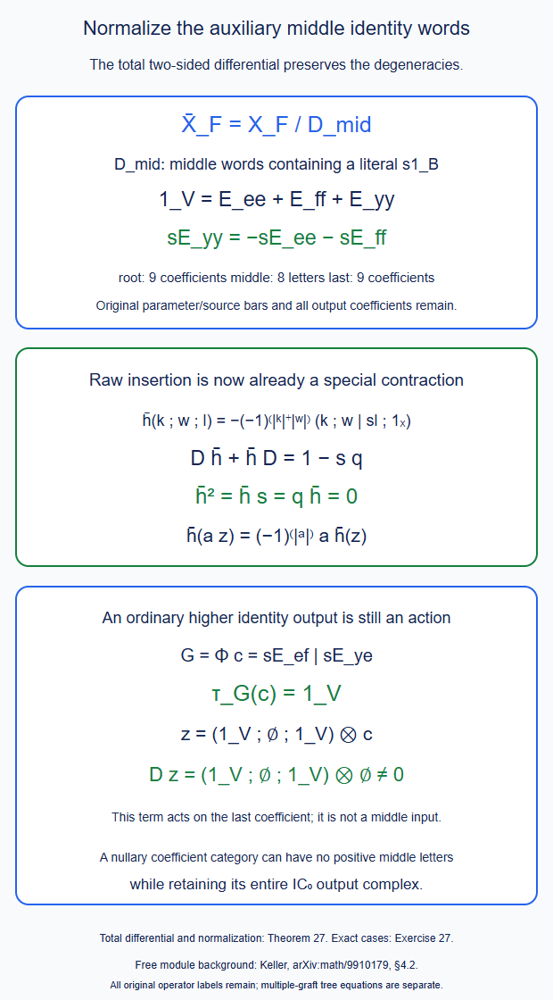

Theorem 27 and Exercise 27. The quotient is
of the auxiliary two-sided middle word;
the proof uses the total differential's
two endpoint actions. Its matrix relation
is a linear identity relation, not deletion
of diagonal matrix coefficients. Ordinary
higher identity outputs remain actions
on the last coefficient.
[Editable SVG](../assets/rational-native-middle-normalization.svg).

## 28. The actual iterated section and the two projection paths

Consider actual normalized functors between
dg categories
\[
 A_0\xrightarrow H A_1\xrightarrow G A_2
                      \xrightarrow F A_3.
 \tag{28.1}
\]
Write \(\mathcal K_F,\mathcal K_G,\mathcal K_H\)
for their represented graph modules.
The fully expanded three-graph path is
\[
 \begin{gathered}
 Z=\mathcal K_F\otimes B_{\mathrm{full}}A_2
       \otimes\mathcal K_G
       \otimes B_{\mathrm{full}}A_1
       \otimes\mathcal K_H,\\
 (k;w;l;v;m)\otimes c ,
 \end{gathered}
 \tag{28.2}
\]
with all endpoint-matched sums. Here
\(w\) is the \(A_2\)-middle word,
\(v\) the \(A_1\)-middle word, and
\(c\) the original \(A_0\)-input.
Both auxiliary middle factors have
the degeneracy quotient of Theorem 27.
The original \(c\)-bar is full.

Use the actual differential on this
graph path. It differentiates each
coefficient and each middle or original
source word, with the suspended degree
of all preceding factors as tensor sign.
Its successive endpoint actions are
the left \(F\)-prefix action, right
\(A_2\)-action on \(l\), \(G\)-prefix
action on \(l\), right \(A_1\)-action
on \(m\), and \(H\)-prefix action
on \(m\), with (23.2) and (24.3)
at the corresponding positions.
This also specifies its complete
nonminimal unary differential.

**Theorem 28 (common iterated section and actual projection homotopy).**
Evaluate the first two graph factors
to obtain \(Z_L\), or the last two
to obtain \(Z_R\):
\[
 \begin{gathered}
 Z_L=\mathcal K_{FG}\otimes
         B_{\mathrm{full}}A_1\otimes\mathcal K_H,\\
 Z_R=\mathcal K_F\otimes
         B_{\mathrm{full}}A_2\otimes\mathcal K_{GH}.
 \end{gathered}
 \tag{28.3}
\]
Extend the full special contractions
of Theorems 24–27 through the
unchanged graph factor. Denote the
left stages by
\((p_1,i_1,h_1):Z\rightleftarrows Z_L\)
and
\((p_2,i_2,h_2):Z_L\rightleftarrows Y\),
where \(Y=\mathcal K_{FGH}\).
Use primes for the two right stages.
Their two complete sections are equal:
\[
 I=i_1i_2=i'_1i'_2.
 \tag{28.4}
\]
On original input \(c\), their common
value is the normalized middle image
of the explicit multicut
\[
 \begin{aligned}
 I(a\otimes c)
  =\sum_{\Delta^{(2)}c=\sum c_1\otimes c_2\otimes c_3}
     \ \sum_{\substack{BG\,BH(c_1)=\sum r_w w\\
                       BH(c_2)=\sum s_v v}}
       r_ws_v\,
       (a;w;1_{GH z_1};v;1_{H z_2})\otimes c_3.
 \end{aligned}
 \tag{28.5}
\]
Here \(z_1\) is the source of \(c_1\)
and \(z_2\) the source of its
concatenation with \(c_2\).
Empty pieces are included.
All original intermediate seams remain.

The projections and homotopies are
\[
 \begin{aligned}
 P_L&=p_2p_1,&
 H_L&=h_1+i_1h_2p_1,\\
 P_R&=p'_2p'_1,&
 H_R&=h'_1+i'_1h'_2p'_1.
 \end{aligned}
 \tag{28.6}
\]
Both are full special contractions
onto \(Y\), with the same \(I\).
Their projections need not be equal.
The actual degree-minus-one
comparison is
\[
 J=P_RH_L,\qquad
 \delta J=P_R-P_L,\qquad JI=0.
 \tag{28.7}
\]
These statements include all original
source/output coactions and the full
operator-parameter domains of the
functors in (28.1).

For any finite linear string of
normalized functors, all binary
groupings have the same iterated
section. At \(n-1\) seams its formula
uses the \(n\)-fold original source
coproduct; at seam \(j\) it inserts
the full bar of the inner composite
\(F_{j+1}\cdots F_n\), evaluated on
the \(j\)-th piece, and the identity
at that piece's source object.
The final piece is unconsumed.

**Proof.** Before the middle quotient,
the cofree ordinary cotensor
identification of [C.66.2.1](../GL-SAT-13.html#c662-ordinary-cotensor-paths-and-their-normalized-contractions) identifies
both expanded graph paths with
(28.2), with their full endpoint
actions. It does not replace a
graph product by its composite
without its specified comparison.
The two auxiliary degeneracy
subspaces are stable by the
unit cancellations of Theorem 27.
Taking the two quotients commutes:
both results are the quotient by
their sum.

The coalgebra map \(BG\) sends
an \(A_1\)-word containing a
literal identity to a sum of
words with a literal identity,
or to zero. Indeed its block
containing that identity either
has length greater than one
and is zero, or is its unary
unit image. Thus the section
across the first seam descends
through the second middle quotient.
A unit in its consumed prefix
gives a degenerate \(A_2\)-word;
a unit in its retained suffix
remains a degenerate \(A_1\)-word.
The normalized projections and
homotopies descend for the same
reason, using Theorem 27's
normalization of their positive
source cores. This justifies
all maps on the actual normalized
object (28.2).

Expand the left section. First
the \(H\)-section chooses a
source prefix and a full output
word of \(BH\). The \(G\)-section
cuts that output into a consumed
prefix and retained suffix.
Since \(BH\) is a coalgebra map,
such an output cut is exactly
two consecutive original source
pieces \(c_1,c_2\), with the
same evaluated words. The first
is evaluated further by \(BG\);
the second is retained as \(v\).
The remaining input is \(c_3\).
This is (28.5).

For the right section, first
choose the prefix \(c_1\) and
evaluate it by the full composite
bar \(BG\,BH\). The next section
chooses \(c_2\) from the remaining
input and evaluates it by \(BH\).
Again \(c_3\) is retained.
The inserted identities have
exactly the objects shown in
(28.5). This is the same sum.
Every bar functor and section
map in this original-word
calculation has degree zero;
no factor has been permuted,
so no additional sign occurs.
The two independent middle
quotients preserve the equality.

The same proof includes every
operator parameter. Replace each
inner bar functor by its actual
marked evaluation from [C69](../GL-SAT-13.html#c69-full-horizontal-operator-composition).
A cut of its output is uniquely
a cut of the original parameter
and source tensor coalgebra,
including cuts at empty marked
pieces. The two section orders
therefore give the same original
levelled piece assignments.
Their Koszul sign moves the
same original homogeneous
factors into the same ordered
output factors. The exact
horizontal evaluation identity
[C.69.7](../GL-SAT-13.html#c69-full-horizontal-operator-composition) identifies the composite
operator action with that same
nested evaluation. Outer section
naturality is strict by (26.3).
Thus this argument retains the
entire parameter diagram, not
only its empty-parameter value.
It introduces no new object,
arrow label or omitted seam.

For a longer string, expand
any binary grouping at its
outer split. By induction its
two subgroups use the stated
original multicut formulas.
Pulling every output cut back
through the corresponding full
coalgebra map gives exactly
one cut at each original seam.
Conversely these ordered seam
cuts determine that expansion
uniquely. Hence every grouping
has the displayed \(n\)-fold
multicut value. The marked
argument is the same bijection
with its original tensor signs.
This proves the finite-string
assertion without a choice of
associativity paths.

The stage maps are special
contractions by Theorem 27
and the full cotensor argument
of [C.66.2.1](../GL-SAT-13.html#c662-ordinary-cotensor-paths-and-their-normalized-contractions). Direct substitution
in (28.6) gives
\[
 \begin{gathered}
 P_LI=1,\quad
 \delta H_L=1-IP_L,\quad
 H_L^2=H_LI=P_LH_L=0,
 \end{gathered}
 \tag{28.8}
\]
and likewise on the right.
For example
\[
 \delta H_L
    =(1-i_1p_1)+i_1(1-i_2p_2)p_1
    =1-IP_L.
 \tag{28.9}
\]
Its square and side conditions
use \(h_1i_1=p_1h_1=0\)
and the corresponding second
stage conditions. The signs
are the graded tensor signs
of [C.66.2.1](../GL-SAT-13.html#c662-ordinary-cotensor-paths-and-their-normalized-contractions) when a stage lies
after a preceding graph factor.
All maps remain full coaction
maps and normalized at formal
unit arguments. Their finite
stage compositions are finite
on every original input.

Finally \(P_R\) is closed and
\(P_RI=1\), so
\[
 \delta(P_RH_L)
      =P_R(1-IP_L)=P_R-P_L.
 \tag{28.10}
\]
Also \(H_LI=0\), giving \(JI=0\).
This contracts a specified
comparison difference and
does not assume that a whole
natural-transformation complex
is acyclic.

Its bare value retains the
original second functor core.
At \(w=v=c=\varnothing\),
expanding (28.6) and then
applying \(P_R\) gives
\[
 J(k;\varnothing;l;\varnothing;m)
     =(-1)^{|k|+|l|}
          k\tau_F(sl|sG_1m).
 \tag{28.11}
\]
The term \(h_1\) gives this
value by (27.2) and the
middle evaluation sign (23.3).
The other term of \(H_L\)
has either its inserted
identity in a higher \(G\)-core,
or in a higher \(F\)-core,
and evaluates to zero.
Thus (28.7) is the full bar
extension of the actual
second-component correction,
not a replacement by an
unrelated primitive.
\(\square\)

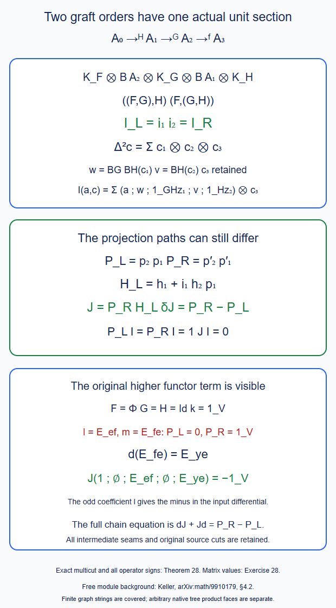

Theorem 28 and Exercise 28. The two
auxiliary middle words keep their
different intermediate categories.
The projection homotopy has the
actual second functor component
as its bare value. All original
source cuts are retained.
[Editable SVG](../assets/rational-native-iterated-sections.svg).

## 29. Full coherent comparisons of projections with a common section

Work in the dg category of the
full typed module objects just
constructed. In particular all
Hom differentials below include
their actual input, output and
operator actions. Suppose
\[
 I:Y\longrightarrow Z
 \tag{29.1}
\]
is a fixed closed section, and
for each label \(a\) there is
a special contraction
\[
 \begin{gathered}
 P_aI=1,\qquad \delta H_a=1-IP_a,\\
 H_a^2=H_aI=P_aH_a=0.
 \end{gathered}
 \tag{29.2}
\]
The objects and all maps retain
their original full coactions.

**Theorem 29 (the exact restriction kernel and every comparison face).**
Restriction to \(I\) is a split
surjective chain map
\[
 \begin{gathered}
 \mathsf r:\operatorname{Hom}(Z,Y)
              \longrightarrow\operatorname{End}(Y),\\
 \mathsf r(\phi)=\phi I,\qquad
 \mathsf s(\psi)=\psi P_{a_*}
 \end{gathered}
 \tag{29.3}
\]
for a fixed base label \(a_*\).
Its kernel has the square-zero
degree-minus-one contraction
\[
 \mathsf K(\phi)=(-1)^{|\phi|}\phi H_{a_*}.
 \tag{29.4}
\]
Only this restriction kernel is
asserted contractible.

For every ordered labelled tuple
\((a_0,\ldots,a_r)\), define
\[
 T_{a_0\ldots a_r}
   =(-1)^{r(r-1)/2}
       P_{a_r}H_{a_{r-1}}\cdots H_{a_0}.
 \tag{29.5}
\]
For \(r=0\) this means \(P_{a_0}\).
These are full degree-minus-\(r\)
cochains with the exact faces
\[
 \delta T_{a_0\ldots a_r}
     =\sum_{j=0}^r(-1)^j
             T_{a_0\ldots\widehat a_j\ldots a_r}
       \quad(r\geq1).
 \tag{29.6}
\]
For \(r>0\) they vanish after
precomposition with \(I\), and
they vanish at an adjacent formal
repeat of a comparison label.
All original parameter and
source coactions and normalized
units are preserved.

**Proof.** Composition with a
closed map commutes with the
Hom differential, so (29.3)
consists of chain maps.
Its composite \(\mathsf r\mathsf s\)
is the identity by \(P_{a_*}I=1\).
For homogeneous \(\phi\), the
Leibniz rule gives
\[
 \begin{aligned}
 \delta\mathsf K(\phi)
       +\mathsf K(\delta\phi)
   &=\phi(\delta H_{a_*})\\
   &=\phi-\phi IP_{a_*}.
 \end{aligned}
 \tag{29.7}
\]
On \(\ker\mathsf r\) this is
\(\phi\). Its square is zero
by \(H_{a_*}^2=0\), and it
preserves that kernel because
\(H_{a_*}I=0\). This proves
the first assertion. It also
shows why \(\operatorname{End}(Y)\)
remains as a retract rather
than being declared acyclic.

Write \(U_{a_0\ldots a_r}\)
for the unsigned product in
(29.5). Differentiating its
\(j\)-th homotopy gives the
identity contribution with sign
\((-1)^{r-1-j}\).
The term \(-IP_{a_j}\)
is killed by \(H_{a_{j+1}}I=0\)
unless \(j=r-1\), when it
gives minus
\(U_{a_0\ldots a_{r-1}}\).
Consequently
\[
 \delta U_{a_0\ldots a_r}
    =(-1)^{r-1}\sum_{j=0}^r
                  (-1)^j
                  U_{a_0\ldots\widehat a_j\ldots a_r}.
 \tag{29.8}
\]
The constants
\(c_r=(-1)^{r(r-1)/2}\)
satisfy \(c_r(-1)^{r-1}=c_{r-1}\).
Multiplying (29.8) by \(c_r\)
proves every face sign in
(29.6), including the constant
terms when \(r=1\).

For \(r>0\) the rightmost
factor is \(H_{a_0}\), so
\(T I=0\). An adjacent repeat
among the homotopy factors
gives \(H_a^2=0\). A repeat
of the last two indices
instead gives \(P_aH_a=0\).
This proves normalization
at each formal repeat.
All sums and products are
finite at fixed original
input and fixed \(r\).
Compositions of the original
full coaction maps retain
their coactions, graded signs
and source-unit normalization.
No output coefficient is
discarded in this argument.
\(\square\)

Apply this to all the labelled
projection paths of Theorem 28
for a fixed finite graph string.
The common section is its
explicit multicut section.
The edge \(T_{LR}=P_RH_L\)
is exactly (28.7). Its triangle
and every higher ordered-tuple
face are now given by (29.5).
Thus the projection-path
comparison includes its full
higher cochains.

This is an auxiliary comparison
family of labelled retractions.
It does not identify distinct
original native arrows, even
when their leading images agree.
The original native parameter
cochains remain inside the
coefficient maps \(P_a,H_a\).
Compatibility of this family
with products of distinct
graft faces and the complete
profile-changing native index
is a further assertion.

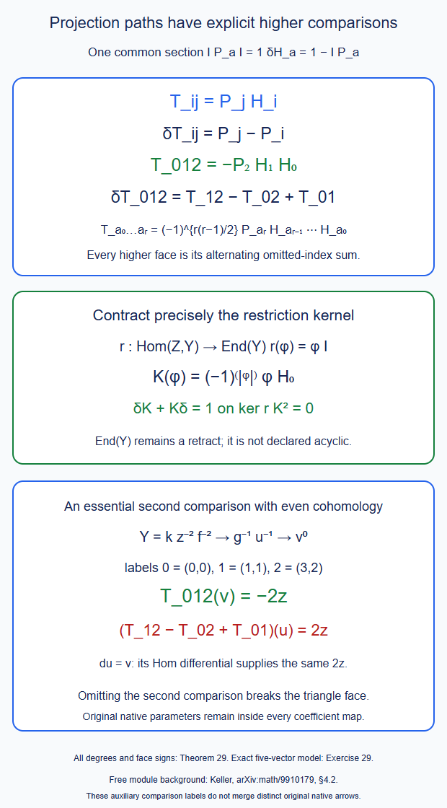

Theorem 29 and Exercise 29. The
restriction kernel is contractible,
while the full target endomorphism
complex remains. The example has
even target cohomology and a
nonzero second comparison.
[Editable SVG](../assets/rational-native-projection-coherence.svg).

## 30. Separate and joint middle bars for parallel branches

Let \(B_1,B_2\) be dg categories
and \(B=B_1\otimes B_2\) their
actual dg tensor category. Its
composition convention is
\[
 (a_1\otimes a_2)(b_1\otimes b_2)
       =(-1)^{|a_2||b_1|}
                    a_1b_1\otimes a_2b_2.
 \tag{30.1}
\]
Fix the actual normalized outer
functor \(F:B\to C\).
Put
\[
 C_i=B_{\mathrm{full}}B_i,\qquad
 \Gamma=C_1\otimes C_2,\qquad
 C_B=B_{\mathrm{full}}B .
 \tag{30.2}
\]
All these coalgebras are full.
Only auxiliary middle words in
the total two-sided complexes
below receive Theorem 27's
degeneracy quotient.

For inner functors \(G_i:A_i\to B_i\),
write \(L_i=\mathcal K_{G_i}\) and
\(L=L_1\otimes L_2\). This is a
strict left \(B\)-module with
its full genuine right input
coalgebra
\[
 C_{\mathrm{in}}=
       B_{\mathrm{full}}A_1
          \otimes B_{\mathrm{full}}A_2.
 \tag{30.3}
\]
The inner map to \(\Gamma\) is
\(g_{\mathrm{sep}}=BG_1\otimes BG_2\).
Operator parameters replace each
\(BG_i\) by its actual marked
evaluation, as in Theorem 25.
This is a tensor of dg coalgebra
maps; it does not assume a tensor
product of primitive \(A_\infty\)-functors
on a dg product source.

**Theorem 30 (the genuine parallel graph shuffle equivalence).**
There is a dg coalgebra map
\[
 j:\Gamma\longrightarrow C_B
 \tag{30.4}
\]
which sums all interleavings of
the two original words, preserving
their orders. A \(B_1\)-letter
is embedded as \(b_1\otimes1\),
and a \(B_2\)-letter as \(1\otimes b_2\),
at the current pair of object
labels. Its coefficient is the
Koszul sign of the permutation
of the suspended original letters.
No averaging factor occurs.

The separate and joint graph
complexes are
\[
 \begin{gathered}
 X_{\mathrm{sep}}
     =\mathcal K_F\otimes\Gamma\otimes L,\\
 X_{\mathrm{joint}}
     =\mathcal K_F\otimes C_B\otimes L .
 \end{gathered}
 \tag{30.5}
\]
Use the actual outer action
\(\tau_Fj\) on the separate
middle and the actual left
coefficient action
\[
 \kappa=\tau_{\operatorname{Id}_B}j.
 \tag{30.6}
\]
Thus at fixed original input
objects the separate differential,
for \(p=|k|\), is
\[
 \begin{aligned}
 D(k;\gamma;l)={}&(dk;\gamma;l)
       +(-1)^p(k;d_\Gamma\gamma;l)
       +(-1)^{p+|\gamma|}(k;\gamma;dl)\\
 &+\sum_{\substack{\Delta\gamma=\sum u\otimes v\\
                                  u\ne1}}
          (-1)^p(k\,\tau_Fj(u);v;l)\\
 &-\sum_{\substack{\Delta\gamma=\sum u\otimes v\\
                                  v\ne1}}
          (-1)^{p+|u|}(k;u;\kappa(v)l).
 \end{aligned}
 \tag{30.7}
\]
The coproduct includes its tensor
Koszul coefficients. The original
source actions on \(L\) and the
full outside coactions are retained.

The literal middle shuffle
\[
 J(k;\gamma;l)=\sum_{j(\gamma)=\sum a_w w}
                         a_w(k;w;l)
 \tag{30.8}
\]
is a chain homotopy equivalence
of full graph modules, with all
original source and operator
parameters retained. It descends
to the auxiliary middle quotients.
Their canonical endpoint sections
satisfy
\[
 J S_{\mathrm{sep}}=S_{\mathrm{joint}},
 \tag{30.9}
\]
where the separate full section
inserts \(g_{\mathrm{sep}}\) into
its middle word, and the joint
section inserts \(jg_{\mathrm{sep}}\).

More precisely there is a common
double resolution
\[
 Z=\mathcal K_F\otimes C_B
             \otimes B\otimes\Gamma\otimes L
 \tag{30.10}
\]
and full special contractions
\[
 \begin{gathered}
 (U,S_U,H_U):Z\rightleftarrows X_{\mathrm{sep}},\\
 (V,I_V,H_V):Z\rightleftarrows X_{\mathrm{joint}}
 \end{gathered}
 \tag{30.11}
\]
with
\[
 J=VS_U,\qquad K=UI_V.
 \tag{30.12}
\]
Its inverse homotopies can be taken
as
\[
 \begin{gathered}
 L_{\mathrm{sep}}=UH_VS_U,\qquad
 L_{\mathrm{joint}}=VH_UI_V,\\
 \delta L_{\mathrm{sep}}=1-KJ,\qquad
 \delta L_{\mathrm{joint}}=1-JK .
 \end{gathered}
 \tag{30.13}
\]
They vanish on the corresponding
canonical endpoint sections.
All statements extend to every
finite ordered number of parallel
branches, including zero branches.

**Proof.** First check (30.4) on the
full bars. A cut of a shuffled
output word gives the two original
word cuts and an interleaving on
each side. Conversely these data
give exactly that cut of the
full interleaving. The tensor
coproduct sign is the sign
moving the unused first-factor
suffix past the second-factor
prefix. This is the same
permutation sign in both
descriptions, proving the
coalgebra equation.

Unary differentials commute with
the shuffle by their tensor
signs. A binary output product
of two letters from the same
factor is the corresponding
original bar product.
If consecutive output letters
come from different factors,
the two interleavings differing
by their exchange cancel.
For letters of ordinary degrees
\(a,b\), their coefficients
after binary composition are
\[
 (-1)^{a-1},\qquad
 (-1)^{(a-1)(b-1)+b-1+ab}
       =(-1)^a.
 \tag{30.14}
\]
They are opposite. The factor
\((-1)^{ab}\) here is exactly
the dg tensor composition sign
(30.1). This proves the chain
equation, including arbitrary
nonminimal input differentials.
The object labels follow the
same monotone path in the two
object lists and are never
identified by their images.

Both twisting cores in (30.7)
are the restrictions of actual
dg-bar twisting cores through
the chain coalgebra map \(j\).
Their twisting equations and
the dg coefficient Leibniz
rule prove \(D^2=0\), exactly
as in (23.2): disjoint prefix
and suffix actions cancel in
opposite orders. The coalgebra
equation for \(j\) identifies
each action in (30.7) with
the corresponding joint-bar
action. Its chain equation
identifies the internal terms.
Therefore (30.8) is a chain map.
The same cut argument gives
all outside coaction equations.
It is natural for the original
full graph maps in \(F\) and
the inner \(G_i\), because
those maps use precisely
these coproduct cuts.

A formal middle identity in
one factor maps under \(j\)
to words with a literal
joint identity, or to zero.
The total separate differential
preserves its middle degeneracy
subspaces by the paired unit
cancellations of Theorem 27.
The joint differential does too.
Thus the chain map descends.
This is a quotient of total
two-sided complexes, not a
standalone reduced dg bar
assertion for an unaugmented
category.

We now prove its equivalence
with explicit graph contractions.
For each factor use
\[
 R_i=B_i\otimes C_i\otimes L_i .
 \tag{30.15}
\]
This is Theorem 24's graph
resolution for the strict outer
identity functor on \(B_i\),
with its normalized middle
from Theorem 27. Its projection
is the actual coefficient
multiplication, and its full
section and homotopy retain
the genuine inner \(G_i\)-input.
The homotopy is strictly graded
left \(B_i\)-linear by that
theorem.

Tensor the two actual dg module
contractions. Their homotopy is
\[
 H_R=H_{R_1}\otimes1+
        (S_{R_1}Q_{R_1})\otimes H_{R_2}.
 \tag{30.16}
\]
The proof of [C.66.2.1](../GL-SAT-13.html#c662-ordinary-cotensor-paths-and-their-normalized-contractions) gives
its differential, square and
side identities, with the
ordinary graded tensor signs.
This tensors dg module maps;
it does not tensor arbitrary
primitive \(A_\infty\)-functors.
The packed root/middle/last
coefficient convention has sign
\[
 (-1)^{|a_2|(|w_1|+|l_1|)
                         +|w_2||l_1|}
 \tag{30.17}
\]
relative to the factor order
\((a_1,w_1,l_1,a_2,w_2,l_2)\).
It moves the same original
homogeneous factors into
\((a_1,a_2,w_1,w_2,l_1,l_2)\).
The full outside bars use the
same tensor permutation rule.

The tensor \(R_1\otimes R_2\)
is a strict left \(B\)-module
resolution of \(L\), retaining
all its right common-input
coactions. Composing it with
the full right graph of \(F\)
gives the contraction
\((V,I_V,H_V)\) in (30.11).
Strict graded left linearity
makes each endpoint bar action
commute with those maps.
Equivalently this is the
explicit ordinary cotensor
contraction of [C.66.2.1](../GL-SAT-13.html#c662-ordinary-cotensor-paths-and-their-normalized-contractions),
so no exactness assertion
about an unrelated cotensor
functor is used.

For the other contraction
apply Theorem 24 to the genuine
input coalgebra \(\Gamma\) and
map \(j:\Gamma\to C_B\).
Extend its full maps through
the left coefficient module
\(L\). This gives
\((U,S_U,H_U)\) on (30.10).
The normalized positive
\(\Gamma\)-cores from Theorem 27
make the extension descend
through each separate middle
unit quotient. A unit consumed
by a positive core gives zero;
one retained in the middle
remains a degeneracy.
The source \(\Gamma\) used in
Theorem 24 itself was the full
dg coalgebra (30.2).

At fixed original input objects,
the section \(S_U\) has value
\[
 S_U(k;\gamma;l)
   =\sum_{\substack{\Delta\gamma=\sum u\otimes v\\
                        j(u)=\sum a_w w}}
          a_w(k;w;1_B;v;l).
 \tag{30.18}
\]
The coefficient projection \(V\)
is zero unless the retained
\(\Gamma\)-middle \(v\) is empty.
The remaining term multiplies
the inserted \(1_B\) with \(l\).
Thus \(VS_U\) is exactly (30.8),
with all its integer shuffle
coefficients and object labels.
The same identity holds on
the full outside coactions.

The full sections give a
commuting endpoint square:
\[
 S_U S_{\mathrm{sep}}
       =I_V S_{\mathrm{joint}}.
 \tag{30.19}
\]
Expanding either side cuts the
original common input twice:
one prefix is placed in \(C_B\)
by \(jg_{\mathrm{sep}}\), the
next is placed in \(\Gamma\)
by \(g_{\mathrm{sep}}\), and
the suffix is retained.
The coalgebra equations give
the identical original cuts
and the same tensor signs.
This proves (30.9) and (30.19),
including every actual marked
inner-parameter component.
For outer parameters, section
naturality is (26.3); the exact
[C69](../GL-SAT-13.html#c69-full-horizontal-operator-composition) evaluation identity retains
all mixed components in the
other maps of (30.11).

The two special contraction
equations now give
\[
 \begin{aligned}
 \delta(UH_VS_U)
       &=U(1-I_VV)S_U=1-KJ,\\
 \delta(VH_UI_V)
       &=V(1-S_UU)I_V=1-JK .
 \end{aligned}
 \tag{30.20}
\]
Their vanishing on endpoint
sections follows from (30.19)
and \(H_VI_V=H_US_U=0\).
This proves a full relative
chain homotopy equivalence.
It has not used a bare
coalgebra quasi-isomorphism.

For finitely many branches,
the shuffle is the sum of
all order-preserving
interleavings of their original
words. Its construction is
associative because any grouping
enumerates the same final
interleavings with the same
graded permutation.
Tensor (30.15) over those
factors; the homotopy in
(30.16) becomes the ordered
sum with earlier \(S_iQ_i\)
factors and one \(H_i\).
The identical double resolution
and calculation prove the
finite-branch assertion.
At zero branches the middle
coefficient category is \(k\).
Only its auxiliary positive
identity middle words disappear;
the full output complex of
the nullary object is retained.
Every original external input
bar and every ordinary higher
identity output remains in
its actual coefficient action.
\(\square\)

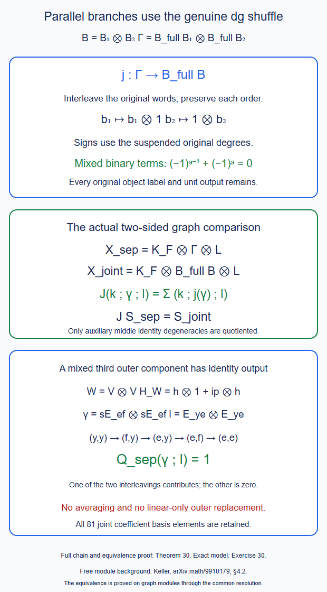

Theorem 30 and Exercise 30. The
source is a tensor of full bars,
and the outer functor is the
actual functor on the joint dg
category. The example uses a
strict dg tensor representation
and an explicit contraction of
\(V\otimes V\).
[Editable SVG](../assets/rational-native-parallel-shuffle.svg).

## 31. Preserve the endpoint projections on the common resolution

In (30.10), let
\[
 \begin{gathered}
 Q_0=Q_{\mathrm{joint}}V,\qquad
 Q_1=Q_{\mathrm{sep}}U,\qquad
 Q_{\mathrm{sep}}=Q_{\mathrm{joint}}J,\\
 I=I_VS_{\mathrm{joint}}
      =S_US_{\mathrm{sep}} .
 \end{gathered}
 \tag{31.1}
\]
The first endpoint path has the
special contraction
\[
 H_0=H_V+I_VH_{\mathrm{joint}}V.
 \tag{31.2}
\]
Both actual endpoint maps satisfy
\(Q_iI=1\). These are the entire
maps on their original source
and parameter domains.

**Theorem 31 (exact retargeting with the original comparison retained).**
In any such full dg module
category, fix a special contraction
\((Q_0,I,H_0)\). For any closed
actual projection \(Q\) with
\(QI=1\), put
\[
 \begin{gathered}
 N=I(Q-Q_0),\qquad A=1+N,\qquad
 A^{-1}=1-N,\\
 H_Q=A^{-1}H_0A.
 \end{gathered}
 \tag{31.3}
\]
Then \(A\) is a closed automorphism,
\(N^2=0\), and
\[
 \begin{gathered}
 AI=I,\qquad Q_0A=Q,\qquad
 \delta H_Q=1-IQ,\\
 H_Q^2=H_QI=QH_Q=0 .
 \end{gathered}
 \tag{31.4}
\]
The actual projection \(Q\),
section \(I\), source differential
and target diagram stay fixed.
All their original coactions
and normalized units are retained.

If a special homotopy \(H_Q^{\mathrm{old}}\)
was already specified, keep both
as distinct comparison labels.
The full mixed family of Theorem 29
retains every original and new
comparison. In particular
\[
 \begin{gathered}
 B_Q=(H_Q-H_Q^{\mathrm{old}})H_Q,\\
 \delta B_Q=H_Q^{\mathrm{old}}-H_Q .
 \end{gathered}
 \tag{31.5}
\]
This supplies an actual comparison
of the chosen homotopies as well.

**Proof.** Since
\((Q-Q_0)I=0\), one has \(N^2=0\).
All three maps \(I,Q,Q_0\) are
closed, so \(N\), \(A\) and its
displayed inverse are closed.
Their identities with \(I\) and
\(Q_0\) follow by direct
multiplication. Hence
\[
 \delta(A^{-1}H_0A)
     =A^{-1}(1-IQ_0)A=1-IQ.
 \tag{31.6}
\]
Its square is zero by \(H_0^2=0\).
The other two side conditions
are \(H_0I=0\) and \(Q_0H_0=0\)
transported by these same
identities. Compositions and
sums of the given full
coaction maps retain their
coactions and source-unit
normalization. No infinite
coordinate series or positivity
assumption is needed.

For (31.5) set
\(\Delta=H_Q^{\mathrm{old}}-H_Q\).
It is closed of degree minus
one, and \(\Delta I=0\).
The graded Leibniz rule gives
\[
 \delta(-\Delta H_Q)
       =\Delta(1-IQ)=\Delta,
 \tag{31.7}
\]
as asserted.
All old and new special
contractions have the same
section \(I\), so (29.5)
applies to their joint labelled
family. Its mixed faces retain
the full old/new comparison,
even when a leading projection
has not changed.

For clarity, the choices
constructed from this one
baseline satisfy
\[
 H_Q=H_0-IQH_0,\qquad
 H_QH_{Q'}=0 .
 \tag{31.8}
\]
This follows from \(H_0I=0\),
\(Q_0H_0=0\) and \(H_0^2=0\).
It does not erase nonzero
higher comparisons belonging
to previously specified
homotopies; those occur in
the retained mixed family.
\(\square\)

Applying this to (31.1) gives
actual special endpoint
contractions on the existing
parallel common resolution.
Theorem 29 then compares its
endpoint paths with every
higher comparison face.
The projections are their
original full maps throughout.
Identification with all
profile-changing native graft
product faces is still a
separate geometric and
cooperadic assertion.

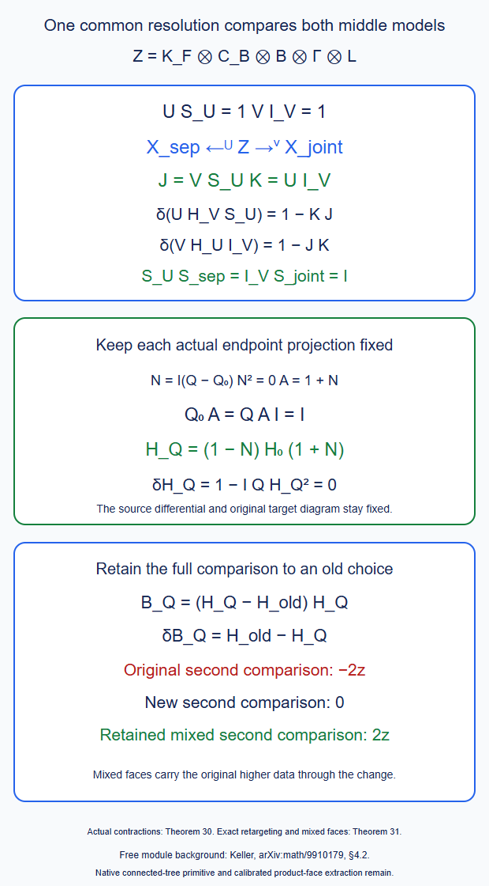

Theorems 30–31 and Exercises 30–31.
Each side of the rectangle uses
an actual full contraction.
The nilpotent correction changes
the selected homotopy on that
same resolution, with its full
comparison to any old choice.
[Editable SVG](../assets/rational-native-parallel-rectangle.svg).

## 32. The edge-bar object of an arbitrary rooted operation tree

Let \(T\) be a finite planar rooted tree of operations. A vertex may
have any finite number of inputs, including zero. Every edge retains
its original state and every joining seam retains its original
endpoint objects. On each edge \(e\) put a dg category \(A_e\) and
its full bar coalgebra \(C_e\). At a vertex \(v\) use a genuine
coaugmented dg coalgebra map
\[
 f_v:\Gamma_v=\bigotimes_{e\in\operatorname{in}(v)}C_e
             \longrightarrow C_{\operatorname{out}(v)}.
 \tag{32.1}
\]
The order is the given order of input slots. The native example is
the full bar of the actual \(F_n\), restricted along the genuine dg
shuffle of Theorem 30. This uses the common input, not a tensor of
primitive \(A_\infty\) functors. Require the strict unit equations
in each input factor: its single literal identity has core the
output identity, and a core containing that letter together with
any further letter is zero. All maps are uncurved. These conditions
hold for the native maps and are preserved by the coalgebra
composites used below. Write \(\tau_v=s^{-1}\pi_1 f_v\);
it has degree one. Its graph coefficient is
\[
 k_v\in A_{\operatorname{out}(v)}
              (f_v(\mathbf x_v),y_v).
 \tag{32.2}
\]
All Hom complexes and all endpoint objects occur. At a nullary
vertex this is the full Hom out of \(F_0\), not a copy of the ground
field.

Describe a coordinate of \(Z_T\) recursively, starting at the root:
\[
 k_v\ ;\ c_1\ ;\ Z_{T_1}\ ;\ \cdots\ ;\
              c_r\ ;\ Z_{T_r}.
 \tag{32.3}
\]
Here \(c_i\in C_{e_i}\). A subtree factor is present exactly when
\(e_i\) is internal. At an external input the single factor \(c_i\)
is the original full input bar. At an internal edge quotient only
the auxiliary middle identity degeneracies of Theorem 27. Sum over
all compatible intermediate objects. No coefficient or external
source or parameter bar is quotiented.

**Theorem 32 (full edge-bar differential and literal grafting).**
These coordinates carry a differential, strict root output action,
and full external input coactions. In addition to the tensor
differentials, its terms are precisely the following.

At a vertex cut every incoming word \(c_i=u_i v_i\), excluding the
simultaneously empty prefix, and replace the root coefficient of
that vertex by \(k_v\tau_v(u_1,\ldots,u_r)\), retaining the tails.
Let \(B\) be the degree before \(k_v\) in (32.3), \(p=|k_v|\), and
\(z_i=|Z_{T_i}|\), with \(z_i=0\) at an external input. The sign is
\[
 (-1)^{B+p+\sum_{i<j}|u_j|(|v_i|+z_i)}.
 \tag{32.4}
\]
This exponent already includes the tensor-coalgebra cut sign.
At an internal edge with word \(w=u|sa\) and child coefficient \(l\),
shorten the word to \(u\) and replace \(l\) by \(al\), with sign
\[
 -(-1)^{B_e+|u|},
 \tag{32.5}
\]
where \(B_e\) is the degree before that edge's bar factor.
The resulting \(D_T\) satisfies \(D_T^2=0\).

For an external edge \(i\) of \(T\), graft a tree \(S\) there.
Before inserting its coordinate \(z\), write the old coordinate
as \(A;c_i;B\). The literal insertion map is
\[
 G_i(x,z)=(-1)^{|z||B|}(A;c_i;z;B),
 \tag{32.6}
\]
followed by the auxiliary middle quotient at the new seam. Its
source differential consists of the tensor differential and the
seam term. If \(c_i=u|sa\), that seam term, after applying \(G_i\),
is
\[
 -(-1)^{|A|+|u|+|a||B|}
       G_i((A;u;B),az).
 \tag{32.7}
\]
Here \(a\) acts on the root coefficient of \(z\).
Nested insertions are associative. Insertions at disjoint inputs
satisfy the ordinary graded interchange with the Koszul sign for
exchanging their two inserted blocks. These are identities of the
full graph objects and their coactions.

**Proof.** The graph of (32.1), before substitution, is
\(K_v\otimes\Gamma_v\) with Theorem 9's twisted differential,
restricted to this genuine input coalgebra. It is a right
\(\Gamma_v\)-comodule. A subtree with strict left \(A_e\)-action
has the left cofree \(C_e\)-comodule \(C_e\otimes Z_{T_e}\).
Its differential consists of the two tensor differentials and
the last-letter action (32.5). It is a dg comodule: the unary
equation is the module Leibniz rule and the binary equation is
associativity, with \(b_2(sa|sb)=(-1)^{|a|-1}s(ab)\).
This is also the strict-left-module special case of (23.2).
At an external input use the regular bicomodule \(C_e\).

Take the tensor product of these incoming comodules and the
ordinary cotensor product with \(K_v\otimes\Gamma_v\).
The cofree equalizer and counit give (32.3) exactly. This is an
equalizer of dg maps, so its differential squares to zero;
no exactness or derived-cotensor identification is used.
Induction from the leaves constructs the entire finite tree.
The same construction retains all external coactions and the
strict root output action.

For completeness, extracting \(u_j\) from its input slot moves it
past every earlier remaining tail \(v_i\) and subtree \(Z_{T_i}\).
This gives the sum in (32.4). Applying the degree-one twisting
map after the coefficient gives \(B+p\). The last-letter
left action in the incoming cofree comodule gives (32.5).
Thus these formulas are the differential just constructed,
including its global tensor signs.

At each internal edge the identity-degeneracy cancellation is
the paired internal/endpoint cancellation of Theorem 27.
All intervening factors contribute a common tensor prefix sign.
It therefore remains valid with the other branches and all
original external inputs present. Quotienting by the sum of these
edge subcomplexes gives the stated normalized object. Different
edge quotients commute. The original external bars are untouched.

Cotensoring at a new external input gives the grafted object.
In root-first coordinates the subtree is moved past precisely
the old block \(B\), proving (32.6). Before this move the
last-letter action must move \(a\) past \(B\); its sign is
\(-(-1)^{|A|+|u|+|a||B|}\), proving (32.7).
The tensor differential and this term consequently map to
\(D_{T\circ_i S}\). This proves the chain equation as well.

Nested insertions have identical signs because
\[
 |S||B_T|+|U|(|B_S|+|B_T|)
  =(|S|+|U|)|B_T|+|U||B_S|.
 \tag{32.8}
\]
At disjoint inputs, reversing the order of the two incoming
blocks gives \((-1)^{|S||U|}\); moving both to their final
places gives the same remaining permutation. Hence interchange
holds before and after the commuting middle quotients.

Finally, an actual full marked evaluation at a vertex is a map
\(P_v\otimes\Gamma_v\to C_{\operatorname{out}(v)}\), where
\(P_v\) is the full bar of its actual dg operator category.
Include \(P_v\) as another ordered external factor in the
construction. Theorem 25 identifies this with the original
marked graph, and Theorem 26 retains its whole outer comparison.
Every coalgebra cut used above includes that factor. Pulling
back along the original parameter diagram therefore keeps all
its positive and mixed components. Equal leading operators are
not identified. This proves the assertion with those parameters
and their coactions as well. \(\square\)

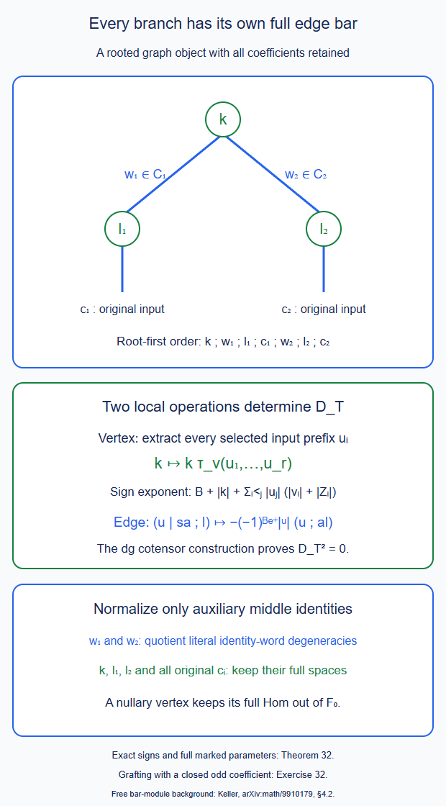

Theorem 32 and Exercise 32. Edge normalization concerns the internal
middle words alone. The ordered factors determine the extraction
and insertion signs.
[Editable SVG](../assets/rational-native-edge-bar-trees.svg).

## 33. Contract an edge without discarding the other branches

For an internal edge \(e\), let \(p\) be its parent, \(c\) its child,
and \(i\) its input slot at \(p\). Contract it using the actual
coalgebra composite
\[
 f_{p/c}=f_p(1,\ldots,f_c,\ldots,1).
 \tag{33.1}
\]
The other edge labels remain their original labels. Let \(T/e\)
have this composite vertex. It is not here replaced by a chosen
flattened native \(F_N\).

**Theorem 33 (full edge contraction and common all-tree section).**
There is an explicit special deformation retraction
\[
 (Z_T,D_T)
 \ \underset{S_e}{\overset{Q_e}{\rightleftarrows}}\
 (Z_{T/e},D_{T/e}),\qquad
 Q_eS_e=1,\quad D_TH_e+H_eD_T=1-S_eQ_e,
 \tag{33.2}
\]
with \(H_e^2=H_eS_e=Q_eH_e=0\).
It retains every external source, operator and output coaction.
The section uses all cuts of the child's genuine input bars:
put \(f_c(\mathbf u)\) on the new edge, put the actual identity
coefficient at \(c\), and retain the tails \(\mathbf v\).
Its sign is
\[
 (-1)^{\sum_{j<k}|u_k|(|v_j|+|Z_{T_j}|)}.
 \tag{33.3}
\]

Here is a complete signed prescription for the projection.
Cut the other parent input bars and all child input bars.
Consume the entire middle word \(w_e\) and child coefficient \(l\).
Into parent slot \(i\) feed
\[
 w_e\,|\,sl\,|\, f_c(\mathbf u_c);
 \tag{33.4}
\]
into its other slots feed their selected prefixes. Evaluate
\(\tau_p\), right-compose the parent coefficient, and retain all
tails and all remaining subtrees. Sum over all cuts and every
full output word of \(f_c\).

The sign is determined without an implicit ordering convention:
first apply the degree-minus-one suspension \(l\mapsto sl\)
at its original position, giving the tensor sign from the degree
before \(l\). Split the selected words into prefix and tail.
Move the evaluation factors immediately after the parent
coefficient, in parent slot order; in slot \(i\) their order is
\(w_e,sl,\mathbf u_c\). Use their Koszul permutation sign, with
\(sl\) of degree \(|l|-1\). Finally apply the degree-one
\(\tau_p\), giving the tensor sign from the degree before and
including the parent coefficient. Multiply these three signs.
For one parent input and no other branches this is exactly
\((-1)^{|w_e|}\) in (24.4).

Contract all edges in any order \(\beta\). The composite
coalgebra map \(f_T\) is independent of that order, and all
composite sections are the same map
\[
 I_T:K_{f_T}\longrightarrow Z_T.
 \tag{33.5}
\]
Each projection path has a special contraction with this
section. The full higher comparisons of Theorem 29 apply
to the entire family of such paths; the projections need
not be equal.

**Proof.** Move the other parent inputs, child inputs and their
remaining subtrees into the displayed order by the graded tensor
symmetry. In these coordinates the local map is the full
common-input Yoneda evaluation of Theorem 24, with the other
parent factors retained as additional genuine input factors.
Its distinguished input is \(sl\). Suspending at its actual
position and then evaluating \(\tau_p\) gives exactly the sign
prescription above. Moving a child's selected prefix past its
earlier remaining factors gives (33.3).

One may check the chain equation directly in the same local
coordinates. The twisting equation for \(\tau_p\), applied to
the whole word containing \(sl\), splits into cuts before and
after this distinguished letter. The former are the parent
action terms in \(Q_eD_T\); the latter are the composite
action terms in \(D_{T/e}Q_e\). The unary term on \(sl\)
is the child coefficient differential. Its two neighboring
binary terms give the edge endpoint action and the child
output composition. The dg coalgebra equation for \(f_c\)
handles all its internal cuts and differentials, including
simultaneous nonempty prefixes in several child slots.
All factors not evaluated retain their tensor differentials
on both sides. These are disjoint and exhaustive terms of
the two sides, with the Koszul signs prescribed above.
Thus \(Q_eD_T=D_{T/e}Q_e\).

For the section the coalgebra equation for \(f_c\) gives all
middle cuts and the target composite action. The remaining
last-letter and identity-coefficient terms cancel by the
ordinary unit equation, exactly as in (24.7).
Consequently \(D_TS_e=S_eD_{T/e}\).
Applying \(Q_e\) to this section inserts the literal child
identity into (33.4). Strict unit normalization kills every
higher parent core containing it. The one surviving first
core has no other consumed prefix. Hence \(Q_eS_e=1\).
This argument keeps all identity-valued ordinary outputs.
For a nullary child the input cut is simply the empty cut,
and the same proof applies with its full coefficient complex.

Here are also explicit finite formulas for the homotopy;
an existence assertion about a quasi-isomorphism would not
suffice. Pack the three local factors
\((k_p,w_e,l)\) first by the same graded permutation.
Freeze all other local input bars to length zero in the
action terms. Use the normalized bare Yoneda contraction
\((Q_0,S_0,h_0)\) of Theorem 27; keep the tensor unary
differentials of all other factors. The two unit calculations
give \(Q_eS_0=Q_0S_0=1\). Put
\[
 N=S_0(Q_e-Q_0),\qquad A=1+N,\qquad A^{-1}=1-N.
 \tag{33.6}
\]
Then \(N^2=0\) and \(Q_0A=Q_e\). On the actual kernel, conjugate
the differential by \(A\) and write it as \(D_0+\delta\).
The difference \(\delta\) consumes a positive number of the
other parent or child input letters. Terms away from this
local configuration commute with the local contraction:
on the output this is its strict graded output linearity,
and elsewhere it is the tensor identity. Thus the only
perturbations interacting with \(h_0\) strictly lower that
local input length. This remains true with full marked
parameter bars included as inputs.

If their total length is \(L\), the kernel contraction is
the finite expression
\[
 \overline H
   =\sum_{a=0}^{L}(-1)^a h_0(\delta h_0)^a,\qquad
 H_e=A^{-1}\overline H A(1-S_eQ_e).
 \tag{33.7}
\]
On the kernel this is the same conjugated-kernel construction
proved in (24.12)–(24.18). Its telescoping calculation gives
the homotopy equation in (33.2), and the bare special identities
give the three side conditions. The last projector extends
it by zero on the actual \(S_e\)-summand. All formulas use
the full existing maps and preserve the external coactions.
The middle quotient and formal input normalizations are
exactly those proved in Theorem 27.

It remains to establish (33.5), rather than merely a succession
of unrelated sections. Two adjacent edge expansions have
two possibilities. If nested, the two expressions are the
same three-piece coalgebra cut, by the argument of Theorem 28.
If in different slots, they are independent coalgebra cuts;
their extraction permutations are the same graded permutation,
as in Theorem 30 and (32.8). This also covers sibling edges:
the section does not evaluate the parent functor. It only
uses each child's full coalgebra map and inserts its identity
coefficient. Both calculations keep the original edge labels,
including labels incident to a nullary vertex.

Every two orders of the finitely many edge contractions are
related by adjacent exchanges. Apply the two cases just proved
at each exchange. Coalgebra composition in (33.1) is associative
with the same ordered tensor symmetries, so the final input
map is the identical \(f_T\), and every expansion is \(I_T\).
Special contractions compose: for two stages their homotopy
is \(h_1+S_1h_2Q_1\); its homotopy and side equations follow by
expansion using \(Q_1S_1=1\). Induction gives each full path.
Theorem 29 now supplies its signed \(QH\cdots H\) comparisons
and every alternating face. It compares these auxiliary
retractions while retaining the original native parameter
coefficients. \(\square\)

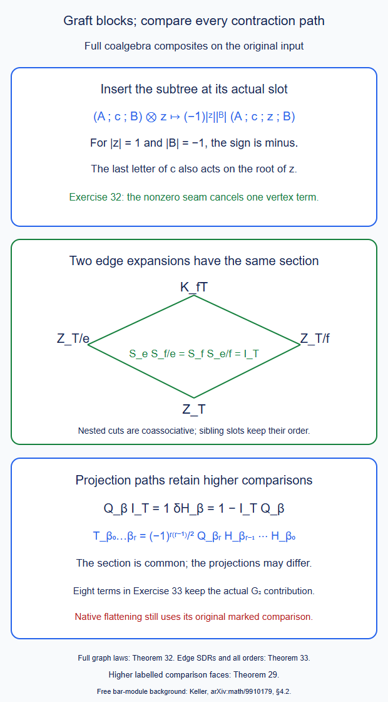

Theorems 32–33 and Exercises 32–33. The square concerns the actual
coalgebra composites on the same original input. Identification
with the prescribed flattened native operation and its calibrated
comparison requires the original graft comparison as well.
[Editable SVG](../assets/rational-native-tree-grafting.svg).

## 34. The genuine joint operator bar

For a fixed tree and fixed edge categories as in Theorem 32, let
\(\mathcal O_v\) be the dg category of its full strictly unital
common-input coalgebra maps. Its morphisms are the normalized
full cochains of Theorem 9 on \(\Gamma_v\), with their actual
object components, convolution composition and twisted
differential. These formulas define a dg category: the twisting
equations give \(\delta^2=0\), and the convolution Leibniz rule
gives the differential rule for composition. Its identity is
the ordinary identity object component, with zero positive cores.
Set
\[
 \mathcal O_T=\bigotimes_v\mathcal O_v^{\mathrm{op}} .
 \tag{34.1}
\]
This is the genuine dg tensor of operator categories. Its full
bar includes a single letter for a simultaneous joint operator;
that letter is not a shuffle of separate parameter letters.

**Theorem 34 (strict joint graph action and full joint-bar transfer).**
The edge-bar graphs form a strict dg functor
\[
 \mathsf X_T:\mathcal O_T\longrightarrow\mathsf{DGMod},
 \qquad \mathbf f\longmapsto Z_T(\mathbf f).
 \tag{34.2}
\]
The target keeps the full outside input and output structures.
At one vertex a homogeneous cochain \(\theta\) of degree \(r\)
acts by the prefix extraction of (32.4), with its \(B+p\)
term replaced by \(r(B+p)\). At several vertices use the
ordered product of these maps in root-first order.

At each object choose any full contraction path of Theorem 33,
with object maps \(p,i,h\) and target \(Y=K_{f_T}\).
There is an explicit finite transfer on
\[
 \mathcal C_T=B_{\mathrm{full}}\mathcal O_T,\qquad
 \mathcal M_X=\mathcal C_T\otimes X,\quad
 \mathcal M_Y=\mathcal C_T\otimes Y.
 \tag{34.3}
\]
All tensor products here have their endpoint-matched object
sums. The result is an entire coherent joint operator action on
\(Y\), together with a full special contraction from the
original strict action. It includes every composable joint
operator word and its original differential, without a
product-shuffle assumption.

Here are its precise signs and formulas. On the source write
\(D=d+\Delta\), where \(d=b_{\mathcal O}\otimes1+1\otimes d_X\)
uses the graded tensor rule. If the last letter of a nonempty
word is \(sa\), the action perturbation is
\[
 \Delta(u|sa\otimes x)
        =-(-1)^{|u|}u\otimes\mathsf X_T(a)x.
 \tag{34.4}
\]
Extend \(p,i,h\) over \(\mathcal C_T\) with the tensor signs;
in particular
\(h(w\otimes x)=(-1)^{|w|}w\otimes h_{\mathrm{source}(w)}x\).
Put
\[
 \begin{gathered}
 A=(1+h\Delta)^{-1},\qquad B=(1+\Delta h)^{-1},\\
 i'=Ai,\qquad p'=pB,\qquad h'=Ah=hB,\\
 d'=d_Y+p\Delta Ai .
 \end{gathered}
 \tag{34.5}
\]
Each inverse is its alternating geometric series. On a word of
length \(q\) it has at most \(q+1\) terms.
Then
\[
 \begin{gathered}
 D i'=i'd',\quad p'D=d'p',\quad (d')^2=0,\\
 p'i'=1,\quad Dh'+h'D=1-i'p',\\
 (h')^2=p'h'=h'i'=0.
 \end{gathered}
 \tag{34.6}
\]
These are full parameter-comodule identities, with all original
outside coactions. Higher components of the transferred
action and comparison normalize at literal operator identities;
ordinary identity actions and full identity bar words remain.

Let \(C\) be a colored conilpotent dg parameter coalgebra with
an actual whole map
\[
 \lambda:C\longrightarrow B_{\mathrm{full}}\mathcal O_T .
 \tag{34.7}
\]
All constructions pull back by ordinary cotensor along this
map. Thus a full compatible joint index uses its entire index
coalgebra; it need not be a product rectangle or lie in the
separate-bar shuffle image. This assertion requires the actual
map (34.7), not merely its object and arrow images.

**Proof.** At one vertex Theorem 9 gives the differential and
composition equations of its cofree operator map. The same
proof applies on the genuine tensor input \(\Gamma_v\):
its coproduct includes the tensor cut signs. Extracting the
prefixes past the earlier subtree factors gives precisely
the sign specified above. Every other differential term is a
tensor differential or a disjoint factor action. Its two
orders with the degree-\(r\) operator differ by \((-1)^r\),
as required by the Hom differential.

At different vertices the sets of factors acted on are
disjoint: the parent uses its coefficient and incoming bars;
the child uses its own coefficient and its incoming bars.
Both orders extract exactly the same prefixes. Comparing
their graded permutations gives \((-1)^{rs}\) for operators
of degrees \(r,s\). At a single vertex the extra
\((-1)^{rs}\) in Theorem 9 is exactly the composition sign
of the dg opposite category. For ordered tensor operators,
moving the second operator at vertex \(i\) past the first
at vertex \(j>i\) gives the defining tensor-category
composition sign. This proves (34.2), including its full
differential and composition rules.

A normalized positive cochain consuming a middle identity
has value zero. If it does not consume it, the identity
remains in the auxiliary degeneracy quotient. Hence these
operators descend to the normalized internal bars. Output
postcomposition and every external coaction commute with
them with their graded signs. This proves the full typed
module assertion, including zero-input vertices.

The source bar differential \(D\) squares to zero: the unary
part of (34.4) is the dg functor Leibniz rule, and its two
successive last-letter actions cancel the bar multiplication
by the strict composition rule just proved. This is the
left-module calculation used in (32.5).
Without those actions, \(p,i,h\) give a special contraction
for \(d\) and \(d_Y\). Composing two adjacent operator letters
does not change the word's source object, so the tensor
homotopy signs commute with that part of the bar differential
too. Each \(h\Delta\) or \(\Delta h\) lowers parameter length
by one. This proves the stated finite inverse formulas,
regardless of the degrees or differentials of the operators.

For a direct verification of (34.6), the resolvent identities are
\[
 \begin{gathered}
 A=1-h\Delta A,\quad B=1-\Delta hB,\\
 Ah=hB,\quad B\Delta=\Delta A,\quad hA=h,\quad Bh=h .
 \end{gathered}
 \tag{34.8}
\]
Using \(D^2=0\) and \(dh+hd=1-ip\), expansion gives
\[
 DA=Ad+Ai\,p\Delta A,\qquad
 BD=dB+B\Delta i\,pB .
 \tag{34.9}
\]
For example, substitute \(A=1-h\Delta A\) on the left,
replace \(dh\) by \(1-ip-hd\), and replace
\(d\Delta+\Delta d\) by \(-\Delta^2\). The two
\(\Delta h\Delta A\) terms cancel, leaving
\((1+h\Delta)DA=d+ip\Delta A\), the first equality.
The second is its right-handed expansion.
Applying the first to \(i\) and the second after \(p\)
proves both chain equations.

The side equations \(ph=hi=h^2=0\), together with (34.8),
give \(pBAi=1\), \(AhAi=0\), \(pBAh=0\), and
\((Ah)^2=0\). Moreover
\[
 \begin{aligned}
 DAh+AhD
 &=A(dh+hD)+Ai\,p\Delta Ah\\
 &=1-Ai\,p(1-\Delta Ah)\\
 &=1-Ai\,pB .
 \end{aligned}
 \tag{34.10}
\]
This proves the homotopy and all special identities.
Finally \(D^2i'=i'(d')^2=0\), and \(p'i'=1\), prove
\((d')^2=0\).

The perturbation is a left-comodule map of degree one:
both \(D\) and \(d\) have the same coalgebra part.
The tensor homotopy is colinear with its degree-minus-one
sign. Thus every series in (34.5) is colinear, and \(d'\)
has the original coalgebra differential as its coalgebra
part. Its one-coefficient projection therefore specifies
the entire coherent action, with all source unary terms.
The other outside module/coaction structures are preserved
by every factor in these same formulas.

A literal identity acts on \(X\) by \(1_X\). In a higher
transferred core that identity meets either \(hi=0\),
\(ph=0\), or two adjacent \(h\)'s, whose product is zero.
The sole first action is \(p1_Xi=1_Y\). The same argument
applies to positive comparison cores. These are statements
about cores; the full ordinary identity parameter word is
still present in the cofree objects.

For the final assertion give \(C\) its right
\(\mathcal C_T\)-coaction using \(\lambda\).
The cofree equalizer and counit give
\[
 C\square_{\mathcal C_T}(\mathcal C_T\otimes X)
                  \cong C\otimes X .
 \tag{34.11}
\]
Explicitly the forward map before taking the counit is
\(c\otimes x\mapsto\sum c_1\otimes\lambda(c_2)\otimes x\).
Coassociativity puts it in the equalizer; applying the
middle counit is the inverse. Apply the same ordinary
cotensor functor to the maps and identities (34.6).
It preserves these literal equations and their special
side conditions; no exactness assertion is needed.
An original \(C\)-letter remains in the \(C\)-coordinate
even if its operator image is an identity. Restriction to
any actual parameter face, and then another face, is the
same pullback of the whole map. In particular no forbidden
intermediate state or clipped shuffle is inserted.
\(\square\)

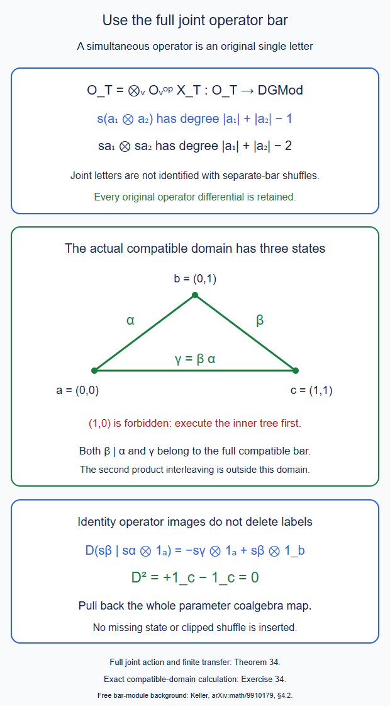

Theorem 34 and Exercise 34. A full joint parameter map is used
before restriction. The fixed-profile construction does not
by itself supply a missing map for varying native frontiers.
[Editable SVG](../assets/rational-native-joint-operator-bars.svg).

## 35. Every comparison between the full transferred joint diagrams

Different original edge-contraction paths give different object
retractions and, in (34.5), potentially different entire joint
parameter diagrams. They must be compared with their full
parameter components. Write \(D_\beta\) for a transferred
differential and \(p'_\beta,i'_\beta,h'_\beta\) for its special
contraction of the same original \((\mathcal M_X,D)\).

**Theorem 35 (full joint comparisons and every internal face).**
For \(r\geq1\) define the full comodule map of degree \(1-r\)
\[
 M_{\beta_0\ldots\beta_r}
   =p'_{\beta_r}h'_{\beta_{r-1}}\cdots
                   h'_{\beta_1}i'_{\beta_0}.
 \tag{35.1}
\]
For \(r=1\) there is no homotopy factor. Its differential
between the indicated transferred objects is
\[
 \begin{aligned}
 &D_{\beta_r}M_{\beta_0\ldots\beta_r}
       -(-1)^{1-r}M_{\beta_0\ldots\beta_r}D_{\beta_0}\\
 &\quad=\sum_{j=1}^{r-1}(-1)^{r-1-j}
   \bigl(M_{\beta_0\ldots\widehat{\beta_j}\ldots\beta_r}
       -M_{\beta_j\ldots\beta_r}M_{\beta_0\ldots\beta_j}\bigr).
 \end{aligned}
 \tag{35.2}
\]
Consequently \(M_{\gamma\beta}\) and \(M_{\beta\gamma}\)
are actual homotopy inverses, with specified full higher
coherences. An adjacent repeated retraction label gives
the identity when \(r=1\), and zero when \(r>1\).
All maps are finite on each word and commute with the
whole parameter pullback (34.7).

**Proof.** The chain equations of Theorem 34 prove (35.2)
at \(r=1\). For a longer product differentiate its \(j\)-th
homotopy. The number of degree-minus-one factors to its
left is \(r-1-j\). Its differential is
\(1-i'_{\beta_j}p'_{\beta_j}\).
The identity term deletes that homotopy and gives the
first term in the indicated summand. The other term
breaks the product into precisely the two displayed
composites, retaining their source and target types.
These exhaust the derivative by the Hom Leibniz rule,
proving (35.2).

For \((\beta_0,\beta_1,\beta_2)=(\beta,\gamma,\beta)\)
the first term is \(p'_\beta i'_\beta=1\). Thus the full
homotopy \(p'_\beta h'_\gamma i'_\beta\) has differential
\(1-M_{\gamma\beta}M_{\beta\gamma}\), with the notation
ordered by its source and target as in (35.1).
Exchanging the labels gives the other inverse homotopy.
A repeated endpoint uses \(h'i'=0\) or \(p'h'=0\);
a repeated interior label uses \((h')^2=0\).
The unreduced first repeat is \(p'i'=1\).
All compositions are full colinear maps, and every
factor has a finite length-decreasing formula. Cotensor
pullback preserves their products, differentials and
identities, proving the final assertions. \(\square\)

In the graph application the object sections from all paths
are the same \(I_T\). Their full transferred sections \(i'_\beta\)
can still have positive parameter components. In particular,
(35.1) may have a nonzero higher core even when every object
comparison is the identity. These auxiliary transferred
diagrams retain their entire comparison with the original
strict graph action. Identifying them with the prescribed
native graft diagram on changing profiles still requires
its actual full comparison; that identification is not
inferred from a common object section.

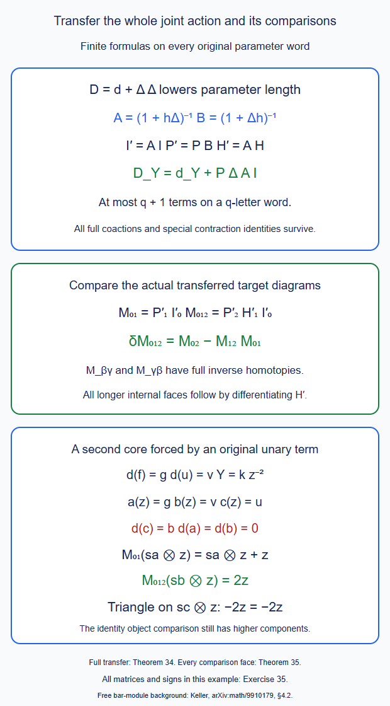

Theorems 34–35 and Exercise 35. The example has an identity
object comparison, a nonzero positive comparison core,
and a necessary nonzero second core.
[Editable SVG](../assets/rational-native-joint-transfer.svg).

## 36. A faithful common category for all the original frontier types

Work first in one specified native parameter corner. Let \(A_s\)
be its actual dg frontier categories, with their original state
labels \(s\); two states of the same arity may still have different
models and retain different labels. Form \(A_\Sigma\) by taking
the disjoint union of all their original objects, keeping their
old mappings within each component, putting zero mappings between
different components, and adjoining one new literal zero object
\(\mathbf0\). All mappings to or from this new object are zero;
its identity is the zero map. No original object is identified
with it, including any old zero object or any contractible
object with nonzero identity.

For a normalized uncurved unital functor \(F:A_s\to A_t\)
define its zero extension by
\[
 \widetilde F|_{A_s}=F,\qquad
 \widetilde F(x)=\mathbf0\quad(x\text{ in another component}).
 \tag{36.1}
\]
Its Taylor maps on the original component are the original maps;
on every other nonzero input word they are zero. Its zero-object
value is \(\mathbf0\). A full cochain is extended by the same
rule. This is extension on unrelated added components, not a
restriction of the original frontier inputs.

**Theorem 36 (faithful typed operators and exact graph recovery).**
Zero extension identifies
\(\operatorname{Fun}_\infty(A_s,A_t)\) with the corresponding
corner of
\[
 \mathcal O=\operatorname{Fun}_\infty(A_\Sigma,A_\Sigma).
 \tag{36.2}
\]
It preserves the entire dg Hom complex, its differential,
composition, normalization and every higher parameter cochain.
The corner consists of functors supported on input component
\(s\), with output in component \(t\). Different source or target
corners have zero cochain spaces between them; original corner
labels are nevertheless retained, also for zero functors.

For composable types,
\[
 \widetilde G\,\widetilde F=\widetilde{GF}.
 \tag{36.3}
\]
The full horizontal coalgebra map of [C69](../GL-SAT-13.html#c69-full-horizontal-operator-composition) commutes with these
zero extensions, including all marked and mixed components.
The extended identity of \(A_s\) is the local projection
\(E_s\), not \(1_{A_\Sigma}\); it is a strict unit on its typed
corner. Operators with mismatched intermediate components have
the zero functor as their composite.

There is also an exact recovery statement for the full graph
representation. For functors \(F,G:A_s\to A_t\), let
\(\operatorname{Hom}^{\rm norm}_{\rm graph}
(\mathcal K_G,\mathcal K_F)\) consist of all homogeneous
right \(B_{\rm full}A_s\)-comodule maps that are graded-linear
for the strict output action and whose positive coefficient
cores are normalized at original source identities.
Then Theorem 9's map is an isomorphism of complexes
\[
 \begin{gathered}
 \operatorname{Nat}(F,G)
       \ \cong\
 \operatorname{Hom}^{\rm norm}_{\rm graph}
                  (\mathcal K_G,\mathcal K_F),\\
 \theta\longmapsto\mathcal T_\theta .
 \end{gathered}
 \tag{36.4}
\]
Its inverse evaluates the full map on
\(1_{Gx}\otimes c\) and takes the empty remaining input-bar
coefficient. Thus this representation loses no full cochain.
Together with the graded opposite composition sign of
Theorem 9 it is fully faithful. The same assertions hold in
the zero-extended typed corners.

**Proof.** A nonzero positive mapping word of \(A_\Sigma\)
lies wholly in one component. A word using a mapping to or
from \(\mathbf0\), or between distinct components, is zero.
The functor equations of (36.1) on its input component are
therefore exactly the original functor equations. On every
other component all their terms are zero. The source identity
there maps to \(1_{\mathbf0}=0\), so strict unitality holds.
The empty word still maps to the coaugmentation at the object
\(\mathbf0\); it is not declared a zero coaugmentation.
This proves that the extension is a full uncurved unital
functor, without an augmentation of any original Hom algebra.

For two functors of the same corner, a cochain evaluated
outside component \(s\) has output in
\(A_\Sigma(\mathbf0,\mathbf0)=0\).
Every remaining input lies in \(A_s\), with its original
target mapping space in \(A_t\). Restriction and zero
extension are consequently literal inverse linear maps
on the full cochains, including length zero and every
positive input length. The source bar differential and
every convolution cut stay in that same component, so
the twisted differential and product are unchanged.
If the input corners differ, at every object at least
one output object is \(\mathbf0\). If only the output
corners differ, their output Hom space is zero.
This proves all mapping assertions. Tagging zero functors
does not create a nonzero mapping space: their identity
cochains too are zero.

In a composable pair, the complete consecutive-piece
formula for \(BG\,BF\) uses the original two functors
on \(A_s\); outside it all positive terms vanish.
Their object maps agree too. This proves (36.3).
For full horizontal composition use [C.69.1](../GL-SAT-13.html#c691-evaluation-with-every-parameter-mark-retained)–2's complete
marked assignments. On the supported input component
each assignment, each suspended mark and each Koszul
permutation is the original one. Outside it, any positive
assignment has a zero output factor. Taking its one-output
core and reconstructing all output words therefore gives
exactly the zero extension of the original horizontal map.
This proves the entire coalgebra equality, not merely
its object or one-mark component.

An identity on the supported component has only its
linear Taylor value, so \(E_t\widetilde F=\widetilde F
=\widetilde F E_s\) by the same full formula.
If the intermediate types disagree, the second operator
receives only \(\mathbf0\), so its composite is the zero
functor. Actual native strings use their original
matching types; this observation does not remove a
nonidentity parameter label.

For (36.4), let \(\Phi\) be a graph map of degree \(r\).
Right cofreedom says that it is reconstructed uniquely
from its empty-tail core \(\phi\):
\[
 \Phi(k\otimes c)
       =\sum_{c=uv}\phi(k,u)\otimes v .
 \tag{36.5}
\]
Put
\[
 \theta(c)=
    \operatorname{core}\Phi(1_{Gx}\otimes c),
 \tag{36.6}
\]
where \(x\) is the target endpoint of the original
input word; its other endpoint gives the \(F\)-source.
For an arbitrary homogeneous
\(k:Gx\to y\), graded output linearity gives
\[
 \phi(k,c)=(-1)^{r|k|}k\theta(c).
 \tag{36.7}
\]
Indeed \(k\otimes c\) is the output action of \(k\)
on \(1_{Gx}\otimes c\). Substitution in (36.5)
is exactly \(\mathcal T_\theta\), with every source
cut. Conversely (36.6) applied to that formula
returns \(\theta(c)\) by the ordinary output identity.
This proves both inverse equations in every degree.

The Hom differential and composition agree by the
two exact identities of Theorem 9. Normalization
concerns the positive core just recovered, not
unconsumed identity letters in a remaining tail.
Thus it too is equivalent on both sides.
The original output mappings in (36.6) are unchanged
by zero extension, proving the final assertion.
Nothing in this proof asserts acyclicity of a whole
Nat complex or recovers it from the underlying total
complex of an unreduced bar. \(\square\)

The coefficient category at frontier arity zero is one
of the actual \(A_s\). Its nonzero objects are retained.
The native unit functor selects \(IC_0\), not \(\mathbf0\);
its full output Hom complex is unchanged. Literal zero
objects, the arity-zero input category and the tensor unit
are three different roles here.

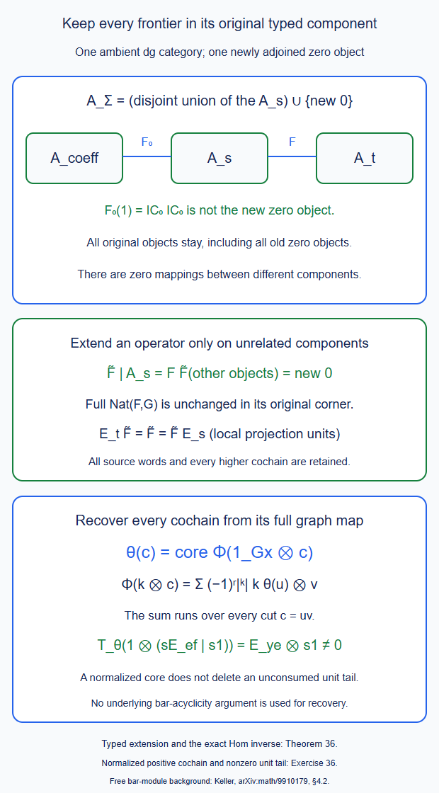

Theorem 36 and Exercise 36. The ambient category and its local
projections keep the original types. No original nonminimal
mapping or positive-degree unit-object output is replaced.
[Editable SVG](../assets/rational-native-typed-zero-extension.svg).

## 37. The actual source-end pullback and original native string data

Let \(H:A_r\to A_s\) be an actual full normalized functor,
and put \(C_j=B_{\rm full}A_j\).
Give \(C_r\) its left \(C_s\)-coaction
\((BH\otimes1)\Delta\).
Source-changing the full graph is an ordinary colored
cotensor, not an evaluation on a restricted list of
previously generated frontier objects.

**Theorem 37 (full frontier pullback and typed native whiskering).**
There is a canonical full graph isomorphism
\[
 \mathcal K_F\square_{C_s}C_r
                       \ \cong\ \mathcal K_{FH}
 \quad(F:A_s\to A_t).
 \tag{37.1}
\]
The coordinate embedding of the right-hand side into the cotensor is
\[
 k\otimes c\longmapsto
             \sum_{c=uv} k\otimes BH(u)\otimes v .
 \tag{37.2}
\]
It keeps all source words of \(A_r\), their endpoints,
and the full coefficient
\(A_t(FH(x),y)\).
For every homogeneous full cochain,
\[
 \begin{gathered}
 \operatorname{pre}_H(\theta)=\theta BH,\\
 \delta(\theta BH)=(\delta\theta)BH,\\
 (\eta BH)\star(\theta BH)=(\eta\star\theta)BH .
 \end{gathered}
 \tag{37.3}
\]
Under (37.1) these are the pullbacks of the entire
graph maps \(\mathcal T_\theta\). Consecutive source
changes associate using the actual full composite,
and retain every original comparison with that composite.

Apply Theorem 36 to all actual frontier categories in
an original finite [C47](../GL-SAT-13.html#c47-joint-execution-and-contraction-of-native-trees)/[C64](../GL-SAT-13.html#c64-joint-execution-and-the-complete-grafting-domain) parameter corner. Every
original partial-forest operator and every complete
fixed-outer-type string, partition or compatible joint
parameter diagram now has an actual typed presentation
in the one category \(\mathcal O\) of (36.2).
This presentation retains its original full native
comparison and all its higher components.
Source-end changes use (37.3). Target-end changes use
the whole [C69](../GL-SAT-13.html#c69-full-horizontal-operator-composition) horizontal coalgebra map, including
the nonlinear target's higher Taylor values.
All their original full whiskering equations survive.
A compatible joint parameter diagram uses its full
index bar; no rectangle or clipped shuffle is inserted.

**Proof.** The right graph comodule is cofree, with
its coefficient evaluated at the endpoint of its
input word. Its cotensor equalizer with \(C_r\)
is consequently the cofree equalizer of (34.11),
with the indicated coefficient endpoints.
Coassociativity and the coalgebra equation for \(BH\)
put (37.2) in that equalizer. The middle counit
returns \(k\otimes c\), and cofreedom proves that
this is its inverse.

The source bar differential is carried by
\(b_sBH=BHb_r\). In a prefix action the cofree
cut gives exactly
\[
 \tau_{FH}(c)=\tau_F BH(c).
 \tag{37.4}
\]
Thus the differential induced through (37.2) is
the entire differential of \(\mathcal K_{FH}\).
It includes the unary differential of each original
source letter. The strict output action and all
remaining source coactions are unchanged.
This proves (37.1) as a full graph isomorphism.

Since \(BH\) has degree zero and preserves all cuts,
precomposition commutes with the untwisted Hom
differential and with convolution, with the same
sign \((-1)^{|\theta||u|}\) on each convolution cut.
Together with (37.4) this proves all equations
in (37.3). Cofree extension of their cores gives
the entire graph-map equality.
For another \(L:A_q\to A_r\),
\(B(HL)=BH\,BL\). Substitution in (37.2) gives
the same three-piece cut in either order.
This proves associativity of consecutive source
changes. A supplied full comparison between a
given composite and another operator is carried
by (36.4), so its entire homotopy is retained.

Here is the native application with its actual types.
For a joint arrow \(f=(K,J'):(t,J)\to(t/K,J')\)
use the original operator
\[
 F_f=F^t_{\pi_K^{-1}(J'),J},
 \tag{37.5}
\]
followed by its original ordered frontier
identification. Its source and target are the
actual arbitrary frontier categories of [C.47.2](../GL-SAT-13.html#c472-the-actual-typed-enhanced-diagram).
Theorem 36 extends this exact \(F_f\), including
its higher Taylor maps, to \(A_\Sigma\).
For a longer original string the successive
operators have matching intermediate components.
Every consecutive block composite and its
original contraction comparison therefore lie
in their single outer corner of \(\mathcal O\).
Extend each of the supplied full native
cochains by zero on the unrelated components.

More explicitly, if the original whole parameter map is
\[
 \mathcal S:B(kP)\longrightarrow
            B_{\rm full}\operatorname{Fun}_\infty(A_s,A_t),
 \tag{37.6}
\]
its new map is \(B\mathsf Z_{st}\,\mathcal S\),
where \(\mathsf Z_{st}\) is the dg zero-extension
functor of Theorem 36. This is the actual
composition of the supplied map with a specified
dg functor, not a new lift from object or edge
classes. Its chain and coalgebra equations and
every specified face comparison follow by
composition. This applies also when \(P\) is
an original full compatible joint index rather
than a product of separate parameter indices.
The original arrows, simultaneous composites,
positive identity-valued parameters and joining
seam labels remain in \(P\).

The original end-face whiskerings use their actual
partial-forest functors on arbitrary source
frontier words. On the source end their full
cochain formula is precisely (37.3), so the
zero-extended formula agrees on every such word.
For a target change \(W:A_t\to A_u\), its full
operator map is
\[
 M_{A_s,A_t,A_u}(\varnothing_W\otimes-),
 \tag{37.7}
\]
where the empty outer operator word is based
at \(W\). It may have higher operator cores.
By (36.3) and its complete marked extension,
this map becomes the same [C69](../GL-SAT-13.html#c69-full-horizontal-operator-composition) map inside
\(\mathcal O\). Evaluating a source and target
change together on \(c\in C_r\) gives, in
both orders, the nested full expression
\[
 \operatorname{ev}_{A_t,A_u}
 \bigl(\varnothing_W\otimes
       \operatorname{ev}_{A_s,A_t}(v\otimes BH(c))\bigr).
 \tag{37.8}
\]
[C.69.7](../GL-SAT-13.html#c69-full-horizontal-operator-composition) proves equality of the entire coalgebra
maps, including every marked partition.
Allowing full parameter words for \(H,W\)
uses the same three-level evaluation, whose
associativity is [C.69.2.1](../GL-SAT-13.html#c692-entire-horizontal-composition-and-exact-associativity). Its output length
is bounded by the original input length plus
the three original operator lengths.

Thus all original source-end, target-end and
mixed whiskering components, with their actual
comparisons, are retained in this typed family.
No target change is replaced by its first
Taylor map. The locally forward finite [C64](../GL-SAT-13.html#c64-joint-execution-and-the-complete-grafting-domain)
indices put each original finite calculation
in one such parameter corner. Restricting the
same zero extensions to a smaller set of
state components keeps all its old values.
For a change of enhanced model retain its
actual full operator and (37.7), rather than
asserting an equality between unrelated models.
This completes the claimed native typed
presentation. \(\square\)

The category \(\mathcal O\) here unifies the
original typed operator family. It is not
automatically the fixed-tree tensor category
\(\mathcal O_T\) of Theorem 34. Identifying
the native family, its original
\(f_T\)-to-\(F_N\) comparisons and all its
external/graft product faces with the
transferred tree graph still requires the
whole marked tree construction. Faithfulness
in (36.4) permits checking that identification
on every coefficient core; it does not
establish an unperformed comparison.

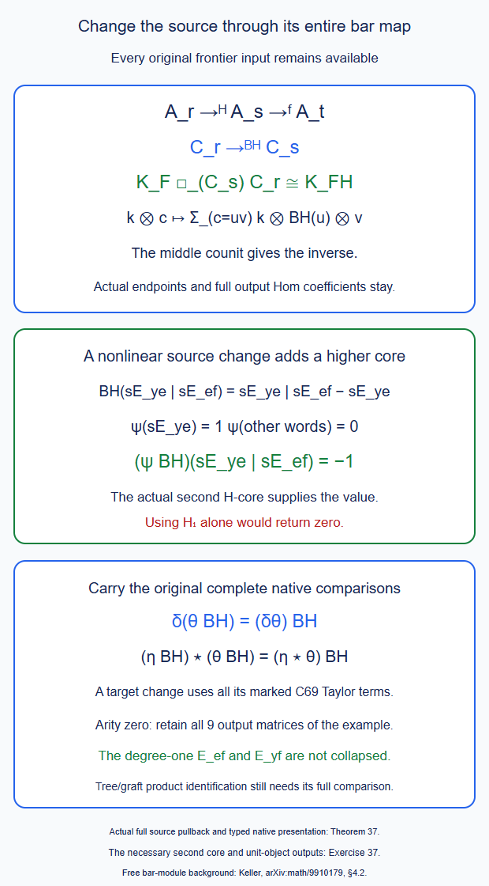

Theorem 37 and Exercise 37. The input map is the
entire \(BH\). Nonlinear source and target changes
are carried with their complete original maps.
[Editable SVG](../assets/rational-native-frontier-pullback.svg).

## 38. Keep both original endpoint cones

Let \(P\) be an original directed parameter category with
initial object \(a\) and terminal object \(b\), and let
\(\mathcal S:P\to\mathcal D\) be its entire normalized
uncurved parameter functor. The target \(\mathcal D\)
is a dg category; in the native application it is a
full typed operator category of Theorems 36–37, so
its Hom differential still includes all mapping inputs.
Each full transformation has one actual outer type,
after its original source/target whiskerings.
No transformation between mismatched typed corners
is supplied or inferred by this construction.
Parallel original arrows and simultaneous joint arrows
are retained. Write \(D_x=\mathcal S(x)\).
For a chronological string
\[
 \sigma=(x_0\xrightarrow{u_1}x_1\longrightarrow\cdots
                       \xrightarrow{u_q}x_q)
 \tag{38.1}
\]
use \(s[\sigma]=s_q(u_q,\ldots,u_1)\) when \(q>0\).
Appending an initial or terminal object means appending
its actual unique arrow. This does not replace any
interior original arrow by its endpoint composite.
Let \(C_a,C_b\) be the strict constant parameter
diagrams at \(D_a,D_b\).

**Theorem 38 (two-sided native cones and both-end base change).**
The following are full cochains, with their displayed total degrees:
\[
 \begin{aligned}
 \rho_q(\sigma)&=(-1)^q s[a,\sigma],
                &&\rho:C_a\Rightarrow\mathcal S,\quad |\rho|=0,\\
 \lambda_q(\sigma)&=s[\sigma,b],
                &&\lambda:\mathcal S\Rightarrow C_b,\quad|\lambda|=0,\\
 J_q(\sigma)&=(-1)^q s[a,\sigma,b],
                &&J:C_a\Rightarrow C_b,\quad |J|=-1.
 \end{aligned}
 \tag{38.2}
\]
They satisfy
\[
 \delta\rho=\delta\lambda=0,\qquad
 A=\lambda\star\rho,\qquad
 \delta J=f-A,\quad f=s[a,b].
 \tag{38.3}
\]
Here \(f\) is the constant cochain with object value
the actual native arrow map \(D_a\to D_b\), and
zero positive parameter cores. In particular
\(A_0(x)=s[x,b]s[a,x]\). The whole \(A\), including
every positive core, is retained with its original
homotopy to \(f\).

For an actual parameter functor \(g:Q\to P\), suppose
\(Q\) has initial object \(a'\) and terminal object \(b'\).
Put \(a_0=g(a')\), \(b_0=g(b')\), and
\[
 L=s[a,a_0],\qquad R=s[b_0,b].
 \tag{38.4}
\]
Use \(\rho',\lambda',A'\) for the intrinsic cones
based at \(a_0,b_0\) on the pulled-back diagram.
The original cochains
\[
 H^L_q(\sigma)=s[a,a_0,g\sigma],\qquad
 K^R_q(\sigma)=s[g\sigma,b_0,b]
 \tag{38.5}
\]
have degree minus one and obey
\[
 \begin{gathered}
 \delta H^L=g^*\rho-\rho'\star L,\qquad
 \delta K^R=g^*\lambda-R\star\lambda',\\
 E=K^R\star g^*\rho+R\star\lambda'\star H^L,\\
 \delta E=g^*A-R\star A'\star L .
 \end{gathered}
 \tag{38.6}
\]
Both endpoint maps are the original maps. They are
not forced to be identities when a graft or a
restriction moves an initial or terminal image.
All equations hold on the entire original parameter
category and its actual full compatible subcategories,
without a product-rectangle assumption.

There is a useful chain form of these identities.
Give the normalized nerve chains \(N(P)\) cohomological
degree minus their simplex dimension, and let
\(\partial\sigma=\sum_{j=0}^q(-1)^j d_j\sigma\).
The interior face composes its two original arrows;
the outer faces remove their endpoints. Define
\[
 e_q=(-1)^{q(q+1)/2},\qquad
 \mathsf A(\sigma)=e_q A_q(\sigma),\qquad
 \mathsf J(\sigma)=e_q J_q(\sigma).
 \tag{38.7}
\]
With \(\epsilon\) the chain augmentation,
\[
 \delta_{\mathcal D}\mathsf A=\mathsf A\partial,\qquad
 \delta_{\mathcal D}\mathsf J+\mathsf J\partial
                   =f\epsilon-\mathsf A .
 \tag{38.8}
\]
Multiplying the \(q\)-core of \(E\) by the same \(e_q\)
gives the chain homotopy between
\(g^*\mathsf A\) and \(R\mathsf A'L\).

**Proof.** The initial cone is Theorem 22. The
terminal formula follows by the same extended-word
calculation at the other end; its absence of an
extra sign must be checked in the chosen convention.
Apply (20.3) to \(s[\sigma,b]\).
Its internal mergers cancel the source-bar terms
of \(\delta\lambda\). Its proper product cuts
cancel the right \(\mathcal S\)-action.
The final merger composes the unique terminal
arrow with the preceding arrow to the same
terminal arrow from the previous object.
It cancels the left constant action. The
coefficients are the target-to-source bar
coefficients \((-1)^j\) of (20.3);
thus no sign depending on \(q\) is added
to \(\lambda_q\).

Apply the same calculation to the word with
both endpoint arrows in \(J_q\).
Interior mergers cancel the original parameter
bar differential, and the two endpoint mergers
cancel the two constant action terms.
The remaining product cuts separate that word
into a terminal piece and an initial piece.
Their full sum is \(-\lambda\star\rho\).
At \(q=0\), the merger of its two endpoint
arrows is the unique original arrow \(a\to b\)
and gives \(f\). At \(q>0\) there is no
such two-letter merger. Thus the remaining
constant cochain is exactly the one specified
in (38.3). For example the object equation is
\[
 d\,s_2(b_x,a_x)=s_1(b_xa_x)-s_1(b_x)s_1(a_x),
 \tag{38.9}
\]
where \(a_x:a\to x\) and \(b_x:x\to b\)
are the actual endpoint arrows. This also fixes the
minus sign of the full product.
Every cut in this argument is a cut in the
full dg target, with all its source and
operator components, not a product of bare
object values.

For (38.5) the initial-base calculation is
(22.2)–(22.3). At the other end, extend
the word by the two actual terminal arrows.
The same internal cancellations leave only
their merger and the product separating
\(R\). They give respectively \(g^*\lambda\)
and \(-R\star\lambda'\).
This proves both first equations of (38.6).
The dg Leibniz rule now gives
\[
 \begin{aligned}
 \delta E
  &=(g^*\lambda-R\star\lambda')\star g^*\rho\\
  &\quad+R\star\lambda'\star
                   (g^*\rho-\rho'\star L)\\
  &=g^*A-R\star A'\star L .
 \end{aligned}
 \tag{38.10}
\]
The middle terms cancel as whole cochains.
In the second summand of \(E\) the degree-minus-one
cochain \(H^L\) uses the actual convolution cut
sign; it cannot be replaced by an unsigned
product of displayed Taylor values.

Here is a direct verification of the conversion
to (38.8). For a cochain \(\phi:C_a\to C_b\)
of total degree \(r\), the full constant-end
differential on a chronological \(q\)-string is
\[
 (\delta\phi)_q
   =d\phi_q+(-1)^{r+q-1}
          \sum_{j=0}^q(-1)^j\phi_{q-1}(d_j\sigma).
 \tag{38.11}
\]
For \(q=0\) the sum is absent. Interior coefficients
are \(-(-1)^r(-1)^{q-j}\), the original source-bar
coefficients. The first and last coefficients
are exactly the two constant convolution actions.
They all equal the coefficient on the right.
Since \(e_q(-1)^q=e_{q-1}\), multiplying (38.11)
by \(e_q\) gives the ordinary chain Hom
differential
\(d\widehat\phi-(-1)^r\widehat\phi\partial\).
Apply this first to \(A\), then to \(J\) and \(E\).
This proves all chain identities, including their
source and target unary differentials.

Only formal parameter identity arrows make a
positive component normalized to zero. A
nonidentity arrow with identity-valued image
is still an original letter in every extended
word above. Pullback uses the actual arrows
of \(g\); it neither inserts an incompatible
state nor clips an unsafe interleaving.
At an initial or terminal image that contains
joining seams, \(L\) or \(R\) records those
very maps. Their whole components are exactly
what (38.6) retains.
All formulas use finite words and finite
consecutive cuts; finite corners therefore
suffice on the locally forward finite
native indices. \(\square\)

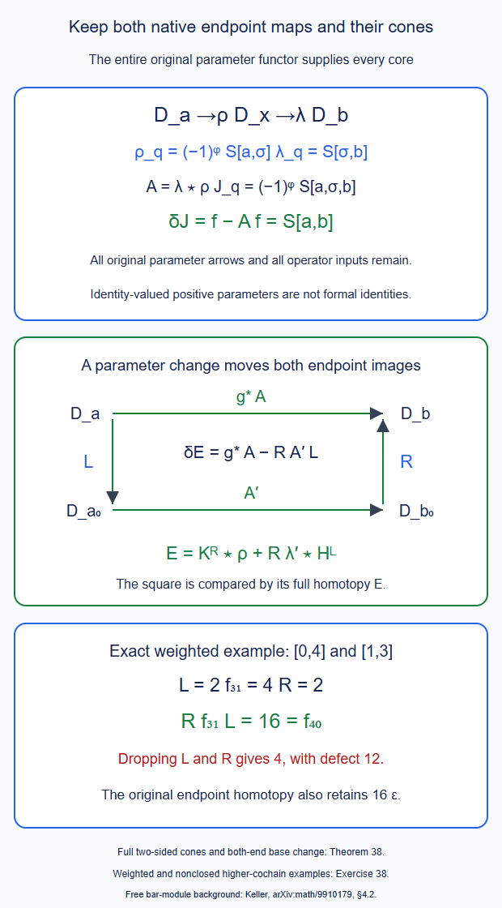

Theorem 38 and Exercise 38. Native endpoint maps may be
nonidentity even when they are equivalences. Both remain
in the comparison, with its complete parameter cores.
[Editable SVG](../assets/rational-native-two-sided-cones.svg).

## 39. Convolve the native family with the tree projections

Keep the entire end-fixed native chain family
\(\mathsf A:N(P)\to\operatorname{Hom}(Y,W)\)
of Theorem 38, where \(Y=D_a\), \(W=D_b\).
Use the dg category with these indicated map directions;
for represented operator maps this includes the graded
opposite convention of Theorem 9.
Let \(I:Y\to Z\) be a common section with
the full special contractions of Theorem 29;
in the tree application these are the
actual contractions of Theorem 33.
Choose an auxiliary contraction label
\(\beta_x\) at each original parameter
object \(x\), and a fixed base label \(*\).
No assumption identifies original arrows
when their auxiliary labels agree.
Put
\[
 \mathsf P(\sigma)=T_{\beta_{x_0}\ldots\beta_{x_q}},\qquad
 \mathsf K(\sigma)=T_{*,\beta_{x_0}\ldots\beta_{x_q}}.
 \tag{39.1}
\]
These use the complete \(PH\cdots H\) maps of
Theorem 29, not new choices of primitives.

**Theorem 39 (full native/projection convolution and retained comparison).**
The exact family
\[
 \mathsf N(\sigma)=
   \sum_{j=0}^q(-1)^{j(q-j)}
       \mathsf A(\sigma_{j,\ldots,q})
       \mathsf P(\sigma_{0,\ldots,j})
 \tag{39.2}
\]
is a degree-zero chain map
\(N(P)\to\operatorname{Hom}(Z,W)\).
It has the explicit comparison to the original
endpoint map and chosen projection
\[
 \begin{aligned}
 \mathsf R(\sigma)
   &=f\,\mathsf K(\sigma)\\
   &\quad-\sum_{j=0}^q(-1)^{j(q-j)}
       \mathsf J(\sigma_{j,\ldots,q})
       \mathsf P(\sigma_{0,\ldots,j}),\\
 \delta\mathsf R+\mathsf R\partial
   &=\mathsf N-fP_*\epsilon .
 \end{aligned}
 \tag{39.3}
\]
Every full parameter and outside graph coaction is retained.
The sum includes all mixed cuts between positive
native parameter components and positive projection
comparisons. They need not vanish.

For a parameter change of Theorem 38,
convolving its full \(\widehat E\) with the
pulled-back projection family gives the
homotopy
\[
 \delta(\widehat E\diamond\mathsf P)
       +(\widehat E\diamond\mathsf P)\partial
  =(g^*\mathsf A)\diamond\mathsf P
       -(R\mathsf A'L)\diamond\mathsf P .
 \tag{39.4}
\]
Here \(\diamond\) is the same signed cut
composition as in (39.2). In particular
the actual endpoint factors \(L,R\)
survive the full graph comparison too.

**Proof.** Theorem 29 gives
\[
 \delta\mathsf P=\mathsf P\partial,\qquad
 \delta\mathsf K+\mathsf K\partial
                    =\mathsf P-P_*\epsilon .
 \tag{39.5}
\]
The latter identity is obtained by applying
(29.6) to the tuple with \(*\) inserted
first. Its first face is \(\mathsf P\);
the other faces are minus the alternating
faces of \(\mathsf K\). At a vertex it
reads \(\delta T_{*,\beta_x}=P_{\beta_x}-P_*\).
Thus it also covers dimension zero.

For all signs, the ordinary Alexander--Whitney
cut first lists the prefix and then the suffix.
With a \(q\)-simplex in degree \(-q\),
exchange these two factors to obtain
\[
 \Delta^{\rm rev}\sigma
    =\sum_{j=0}^q(-1)^{j(q-j)}
            \sigma_{j,\ldots,q}\otimes\sigma_{0,\ldots,j}.
 \tag{39.6}
\]
This is a chain map. Directly, a deleted vertex
away from the cut appears on the corresponding
side with its same face sign and tensor prefix
sign. At the cut the two occurrences with
neighboring cuts have opposite signs and
cancel. This accounts for every term of the
two differentials, including endpoint faces.
Triple cuts give coassociativity: their two
orders reverse the same three homogeneous
blocks, with the same Koszul sign.
The chain augmentation is its counit.

For homogeneous chain cochains \(B,C\),
their cut composition is the coproduct
(39.6), followed by \(B\otimes C\) and
ordinary dg composition. Its tensor
evaluation sign includes \(|C|\) times
the degree of the suffix. The dg
Leibniz and chain equations just proved
therefore give
\[
 d_{\rm Hom}(B\diamond C)
      =(d_{\rm Hom}B)\diamond C
            +(-1)^{|B|}B\diamond d_{\rm Hom}C .
 \tag{39.7}
\]
Both \(\mathsf A,\mathsf P\) have total
degree zero. Their composition is
exactly (39.2), so (38.8), (39.5)
and (39.7) prove its full chain equation.

The homotopy \(\mathsf J\) has total
degree minus one and
\(d_{\rm Hom}\mathsf J=f\epsilon-\mathsf A\).
Consequently
\[
 \begin{aligned}
 d_{\rm Hom}(f\mathsf K-\mathsf J\diamond\mathsf P)
 &=f\mathsf P-fP_*\epsilon
                  -(f\mathsf P-\mathsf A\diamond\mathsf P)\\
 &=\mathsf N-fP_*\epsilon .
 \end{aligned}
 \tag{39.8}
\]
This proves (39.3) with its complete
homotopy. Apply the same Leibniz
calculation to \(\widehat E\diamond\mathsf P\)
to obtain (39.4). All maps involved
are the full typed graph maps or full
operator cochains already specified;
their compositions retain the original
outside coactions. If the targets are
operator categories, every multiplication
above is their full convolution
multiplication, with its original
mapping-input cuts.

A formal repeated parameter makes
\(\mathsf A,\mathsf J\) normalized;
its adjacent auxiliary repeat also
normalizes \(\mathsf P,\mathsf K\).
In each cut of a degenerate simplex
the repeated arrow lies on one of
these two factors, so the resulting
positive families normalize. But an
original proper arrow may have
\(\beta_x=\beta_y\) while its native
\(\mathsf A(x,y)\) is nonzero.
Its term \(\mathsf A(x,y)P_{\beta_x}\)
in (39.2) remains. Hence auxiliary
repeat normalization cannot delete
that original parameter. \(\square\)

There is an exact restriction formula on the full common
section \(I\) specified at the start of this section:
\[
 \mathsf N(\sigma)I=\mathsf A(\sigma),\qquad
 \mathsf R(\sigma)I=-\mathsf J(\sigma).
 \tag{39.9}
\]
Indeed every positive-degree \(\mathsf P\)-component
vanishes on \(I\) by (29.5), while each vertex component
satisfies \(P_{\beta_x}I=1\). Only the cut \(j=0\)
therefore survives in (39.2), with sign \(+1\).
The inserted-base family \(\mathsf K\) is positive at
every parameter dimension and also vanishes on \(I\).
The same calculation in (39.3) leaves exactly
\(-\mathsf J(\sigma)\). These are identities on every
original parameter word, not only at parameter vertices.

Consequently, let \(\mathsf U\) be another closed whole
family on this same graph and let an entire degree-\(-1\)
section comparison satisfy
\[
 d_{\rm Hom}\mathsf T=\mathsf U I-f\epsilon .
 \tag{39.10}
\]
The original endpoint cone, without any new choice, gives
\[
 d_{\rm Hom}(\mathsf T+\mathsf J)
                   =(\mathsf U-\mathsf N)I .
 \tag{39.11}
\]
With the fixed base contraction \(P_*,I,H_*\), Theorem 47
then gives the prescribed full comparison
\[
 \begin{aligned}
 \mathcal J&=(\mathsf U-\mathsf N)H_*
                              +(\mathsf T+\mathsf J)P_*,\\
 d_{\rm Hom}\mathcal J&=\mathsf U-\mathsf N,\qquad
 \mathcal JI=\mathsf T+\mathsf J .
 \end{aligned}
 \tag{39.12}
\]
Here composition means composition of whole parameter
cochains, with their complete cuts. Equation (39.11)
uses the original identity
\(d_{\rm Hom}\mathsf J=f\epsilon-\mathsf A\)
from Theorem 38 and (39.9). Thus (39.10), when supplied,
compares to the original endpoint family; it does not
require selecting a second calibrated family.

This theorem composes the original full
end-fixed native family with the chosen
tree projection paths, retaining a
full comparison to their original
endpoint map. It does not identify
every alternating native graft and
edge-contraction execution with that
family. Those interleaved paths and
the external/graft product faces
still require their actual marked
identification on the complete [C64](../GL-SAT-13.html#c64-joint-execution-and-the-complete-grafting-domain)
domain before primitive tree extraction.

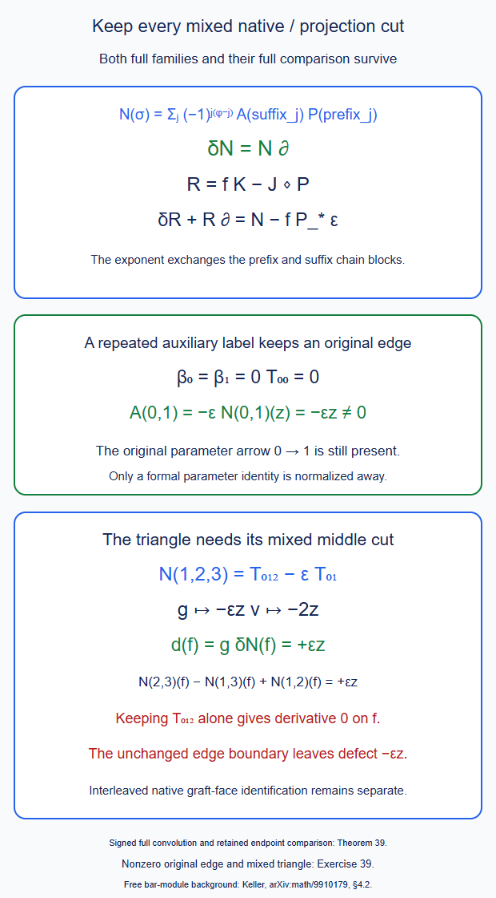

Theorem 39 and Exercise 39. The two source families,
their mixed cuts and the original endpoint comparison
are all part of the result.
[Editable SVG](../assets/rational-native-cone-projection.svg).

## 40. The prescribed one-edge graft with all parameter cores

Fix an actual normalized one-edge graph contraction
\[
 X_F\ \underset{S_F}{\overset{Q_F}{\rightleftarrows}}\
 Y_F,\qquad
 \delta H_F=1-S_FQ_F
 \tag{40.1}
\]
from Theorems 24 and 27. Here \(X_F\) is the whole
two-sided graph, \(Y_F=\mathcal K_{Fg}\), and \(g\)
is the genuine common-input inner map. The inner
map may already be the entire marked evaluation
of Theorem 25. All original input words, endpoint
coefficients and outside coactions are retained.
Let a parameter arrow of degree \(r\) be a full
outer cochain \(\theta:F\to F'\). Its actual graph
actions \(X_\theta:X_{F'}\to X_F\) and
\(Y_\theta:Y_{F'}\to Y_F\) are (26.2), with the
graded opposite convention. In particular
\[
 X_\theta S_{F'}=S_FY_\theta
 \tag{40.2}
\]
holds for every homogeneous cochain, including a
nonclosed one.

**Theorem 40 (the prescribed native edge map and its mixed cores).**
The full defect of object projection naturality and its
specified homotopy are
\[
 \begin{aligned}
 L_\theta&=Q_FX_\theta-Y_\theta Q_{F'},\\
 K_\theta&=(-1)^r Q_FX_\theta H_{F'} .
 \end{aligned}
 \tag{40.3}
\]
They obey, as entire graph maps,
\[
 L_\theta S_{F'}=K_\theta S_{F'}=0,\qquad
 \delta K_\theta+K_{\delta\theta}=L_\theta .
 \tag{40.4}
\]
Thus this is a homotopy for the actual prescribed projection,
not a replacement of it by a strictly natural object map.
For a closed degree-zero \(\theta\), it reads
\(\delta K_\theta=L_\theta\).

Let \(J\) be the actual dg parameter category of these
operators, with its typed endpoints retained. Use the
strict graph diagrams \(X,Y\) and their strictly natural
section \(S\). The full projection \(\widehat Q\) of
Theorem 26 has an explicit coefficient core on every
parameter word in target-to-source order:
\[
 \begin{gathered}
 \mathbf a=sa_r|\cdots|sa_1,\qquad
 q_r(\mathbf a;x)
   =(-1)^{r+\sum_{j=1}^r|a_j|}
       Q_{\rm target}\,
       X_{a_r}H\,X_{a_{r-1}}H\cdots X_{a_1}H(x),\\
 q_0(x)=Q_{\rm source}(x).
 \end{gathered}
 \tag{40.5}
\]
Each \(H\) is at the actual intermediate object.
All \(X_{a_j}\) are the full graph actions, including
every original mapping input. The full cofree map is
obtained by leaving every unconsumed prefix in front
of these cores. The original nonclosed parameter
letters and their unary differentials remain in
its chain equation.

Suppose the native graft comparison
\(\alpha:F_{\rm flat}\Rightarrow Fg\) is given on
this whole parameter diagram with its original
higher components. By Theorems 9, 25–27 and 37 it
gives the full closed parameter-comodule comparison
\[
 \widehat\kappa:\mathcal C_J\otimes Y
                  \longrightarrow\mathcal C_J\otimes W,
 \qquad W=\mathcal K_{F_{\rm flat}},
 \quad\kappa_0=\mathcal T_\alpha .
 \tag{40.6}
\]
This assertion uses that supplied entire comparison;
objectwise maps \(\alpha_0\) alone do not specify it.
The actual full graft map is
\[
 \widehat G=\widehat\kappa\,\widehat Q,\qquad
 G_0=\mathcal T_\alpha Q_F .
 \tag{40.7}
\]
If \(\kappa_j\) denotes the empty-tail parameter
core of \(\widehat\kappa\), its complete cores are
\[
 G_r(\mathbf a;x)=
   \sum_{j=0}^r
    \kappa_{r-j}(sa_r|\cdots|sa_{j+1};
                   q_j(sa_j|\cdots|sa_1;x)).
 \tag{40.8}
\]
There is no additional sign in this formula:
\(\widehat Q\) and \(\widehat\kappa\) are maps of
total degree zero. All tensor and suspended
parameter signs are already in their cores.
For example the second core is the whole sum
\[
 G_2=\kappa_0q_2+\kappa_1q_1+\kappa_2q_0
 \tag{40.9}
\]
on its three respective consecutive cuts.
The mixed term \(\kappa_1q_1\) need not vanish.

The map \(\widehat G\) is a full chain-comodule
map with the prescribed native one-edge object
value, and
\[
 \widehat G S=\widehat\kappa .
 \tag{40.10}
\]
When the original comparison includes its full
inverse and homotopies, \(\widehat G\) is a
homotopy equivalence with those data and the
specified graph contraction retained. Its bare
multimorphism value is exactly Proposition 10:
\[
 (k,l)\longmapsto k(F_n)_1(l)\alpha_0
 \tag{40.11}
\]
in the indicated input slot, including nullary
inputs and their full output Hom complexes.
Full source changes and restrictions commute
with these constructions by actual cotensor
pullback. A different enhanced target model
uses its whole marked comparison, as in
Theorems 9 and 37.

**Proof.** The maps \(Q_F,Q_{F'}\) are closed,
so Theorems 9 and 26 give
\(\delta L_\theta=L_{\delta\theta}\).
Equation (40.2) and \(Q_FS_F=Q_{F'}S_{F'}=1\)
give \(L_\theta S_{F'}=0\).
Moreover \(Q_{F'}H_{F'}=0\), hence
\[
 K_\theta=(-1)^rL_\theta H_{F'}.
 \tag{40.12}
\]
Differentiate this equation using the Hom
Leibniz rule and \(\delta H_{F'}=1-S_{F'}Q_{F'}\).
It gives
\[
 \delta K_\theta
    =(-1)^r L_{\delta\theta}H_{F'}+L_\theta .
 \tag{40.13}
\]
The omitted \(L_\theta S_{F'}Q_{F'}\) is zero.
The first term cancels \(K_{\delta\theta}\),
whose sign is \((-1)^{r+1}\).
The side identity follows from \(H_{F'}S_{F'}=0\).
This proves every equation in (40.4), including
the nonclosed cochain case.

For the parameter cores use the actual finite series
\(\widehat Q=Q_0(1+\Delta H_0)^{-1}\)
of Theorem 26. Here \(H_0\) is the signed tensor
extension of the object \(H\); the leading
differential includes its full object and parameter
unary terms. The perturbation includes the original
parameter bar mergers and last-letter actions.
On \(\mathbf a\otimes x\) the tensor homotopy
contributes \((-1)^{|\mathbf a|}\).
The action consuming the final letter \(sa_1\)
contributes \(-(-1)^{|sa_r|\,+\cdots+|sa_2|}\).
Their product is \((-1)^{|a_1|}\).
The extra minus sign of the inverse-series term
makes it \((-1)^{|a_1|+1}\).
Repeating at every actual intermediate object
gives exactly the exponent in (40.5).

No bar-merger term contributes an extra coefficient
core to this expression. A merger leaves the
object unchanged. If another homotopy follows
it, its two adjacent object homotopies give
\(H^2=0\); if the projection follows it,
\(QH=0\). Thus all surviving terms that
consume the whole parameter word use exactly
its \(r\) original actions. This also explains
why a nonclosed original letter is not
replaced by a closed one: its unary term
remains in the full chain differential,
whose equation is Theorem 26.
The same theorem proves the full coactions,
special identities and
\(\widehat QS=1\), with the original
target diagram \(Y\) unchanged.

The native \(\widehat\kappa\) is obtained by
applying the full contravariant graph map of
Theorem 9 to the supplied comparison, with
the actual [C69](../GL-SAT-13.html#c69-full-horizontal-operator-composition) evaluation on every marked
parameter and genuine [C78](../GL-SAT-13.html#c78-full-tensor-unit-restriction-and-external-comparisons) common input.
The inner marked input is the entire input
of Theorem 25; its auxiliary normalization
is Theorem 27. Theorem 37 carries the
original typed source and target
whiskerings. These give (40.6) with all
of its prescribed parameter cores.
No new kernel primitive replaces those
original cores.

The composite of the two degree-zero
chain-comodule maps is closed and colinear.
Deconcatenate the parameter word at the
prefix left after \(\widehat Q\).
Its consumed suffix gives \(q_j\); the
remaining prefix is then consumed by
\(\widehat\kappa\). These are exactly
the \(r+1\) summands of (40.8).
Cofreedom reconstructs the whole map
from them. Thus neither a mixed cut
nor a positive original comparison
component has been omitted.
Equation (40.10) follows from
\(\widehat QS=1\).

If \(\widehat\ell\) is the original full
inverse of \(\widehat\kappa\), an inverse
for \(\widehat G\) is \(S\widehat\ell\).
The two inverse equations use respectively
the original \(\widehat\kappa\)-homotopies
and the actual homotopy
\(\delta\widehat H=1-S\widehat Q\).
Composing these full maps gives the
two specified inverse homotopies.
This uses the supplied inverse data,
not acyclicity of a whole transformation
space.

Finally on empty middle and outside input
words, \(Q_F(k;\varnothing;l)\) is
\(k(F_n)_1(l)\), by Theorem 24.
The empty-input core of
\(\mathcal T_\alpha\) right-composes
by \(\alpha_0\). This is (40.11)
with the actual input slot and its
original types. At a nullary child
\(l\) is an arbitrary map out of
the unit object, not a scalar
input; the same formula applies.
Every original source restriction
is the cotensor pullback of
Theorem 37, which preserves these
compositions and identities.
The full target-change statement
is exactly its marked counterpart.
\(\square\)

This proves the prescribed one-edge map
and its whole compatible fixed-graft
parameter comparison. It supplies explicit
cores for comparing it with the
end-fixed family of Theorem 39.
Identification of arbitrary interleavings
involving several native edges, and of
all external/graft product faces, still
requires the original full marked
comparisons on their common domains.
It is not inferred from (40.11).

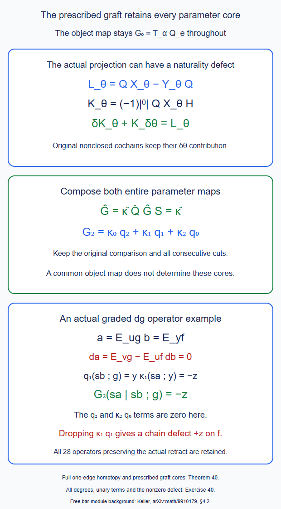

Theorem 40 and Exercise 40. The object projection
and the original comparison are fixed throughout.
The second-core mixed term can be forced by an
original nonclosed operator differential.
[Editable SVG](../assets/rational-native-graft-parameter-cores.svg).

## 41. Two-stage native seams with their original section comparison

Use two actual special contractions of strict dg diagrams
on the same genuine parameter category:
\[
 X\ \underset{i_1}{\overset{p_1}{\rightleftarrows}}\
 B\ \underset{i_2}{\overset{p_2}{\rightleftarrows}}\
 Y .
 \tag{41.1}
\]
Their homotopies are \(h_1,h_2\); their sections are
strictly natural on all homogeneous parameter maps.
The object composite contraction is
\[
 p=p_2p_1,\qquad i=i_1i_2,\qquad
 h=h_1+i_1h_2p_1 .
 \tag{41.2}
\]
Apply the full parameter-bar construction of Theorem 40
to these data. Hats below mean the entire maps on the
full joint parameter bar, not their object values.
All outside input/output structures are retained.

**Theorem 41 (two-stage contraction and full native seam sliding).**
The actual staged maps agree with the maps constructed
from (41.2):
\[
 \widehat p=\widehat p_2\widehat p_1,\qquad
 \widehat i=i_1i_2,\qquad
 \widehat h=\widehat h_1+i_1\widehat h_2\widehat p_1 .
 \tag{41.3}
\]
These are equalities of full parameter-comodule maps,
including all graded operator cores and original
nonclosed parameter differentials.

Keep another actual contraction
\(B'\rightleftarrows Y'\) with maps
\(\widehat p'_2,i'_2,\widehat h'_2\).
Let the original entire closed native comparisons be
\(\widehat\kappa_B:B\to B'\) and
\(\widehat\kappa_Y:Y\to Y'\).
The comparison of their sections may be a supplied
full homotopy, rather than an equality:
\[
 \widehat\kappa_B i_2-i'_2\widehat\kappa_Y
                        =\delta\widehat R .
 \tag{41.4}
\]
Here \(|\widehat R|=-1\), and its original
parameter cores are part of the data.
The actual interposed native seam and its moved version are
\[
 U=\widehat p'_2\widehat\kappa_B\widehat p_1,
 \qquad
 V=\widehat\kappa_Y\widehat p_2\widehat p_1 .
 \tag{41.5}
\]
They have the explicit full comparison
\[
 \begin{gathered}
 \widehat E=
  \bigl(\widehat p'_2\widehat\kappa_B\widehat h_2
       +\widehat p'_2\widehat R\widehat p_2\bigr)
                                    \widehat p_1,\\
 \delta\widehat E=U-V .
 \end{gathered}
 \tag{41.6}
\]
Thus the actual native map between the contractions is
retained. A strictly natural section comparison is the
case \(\widehat R=0\); it is not imposed on a supplied
non-strict comparison. Even when the object values of
\(U,V\) agree, either term of \(\widehat E\) can have
nonzero coefficient or positive parameter cores.
Each product in (41.5)–(41.6) uses all consecutive
parameter cuts, with the tensor signs of its actual
full factors. These are finite formulas on every word.

There is also a precise local equation for two original
native seam cochains in one common diagram. Write
\(A_\theta=X_\theta\), \(B_\theta=Y_\theta\), now in the
actual graph-map direction, and let
\(\theta:0\to1\), \(\eta:1\to2\), \(\zeta:0\to2\)
be closed degree-zero full cochains.
Keep the original degree-minus-one coherence
\[
 \delta\omega=\eta\theta-\zeta .
 \tag{41.7}
\]
Using Theorem 40's full \(K_\theta,L_\theta\), put
\[
 C_{\eta,\theta}
      =p_2A_\eta h_1A_\theta h_0 .
 \tag{41.8}
\]
All subscripts in this local formula label its
three objects, rather than the two stages of (41.1).
Then
\[
 \begin{aligned}
 \delta C_{\eta,\theta}
    &=K_{\eta\theta}-B_\eta K_\theta-K_\eta A_\theta,\\
 \delta(C_{\eta,\theta}+K_\omega)
    &=K_\zeta-B_\eta K_\theta-K_\eta A_\theta+L_\omega .
 \end{aligned}
 \tag{41.9}
\]
The original source and target coherence
components are present in
\(L_\omega=p_2A_\omega-B_\omega p_0\).
For independent seams use the actual full mixed
[C69](../GL-SAT-13.html#c69-full-horizontal-operator-composition) cochain \(\chi\) with
\(\delta\chi=u-v\), where \(u,v\) are its two
original whiskering products. Its corresponding
local equation is
\[
 \delta K_\chi=L_\chi-K_u+K_v .
 \tag{41.10}
\]
None of \(\omega,\chi,L_\omega,L_\chi\)
is erased on the basis of leading object values.

**Proof.** First (41.2) is special: expanding its
Hom differential gives
\[
 \delta h=1-i_1p_1+i_1(1-i_2p_2)p_1
                         =1-ip .
 \tag{41.11}
\]
The equations \(p_1i_1=p_2i_2=1\) and the
two stages' special identities give
\(h^2=ph=hi=0\) by direct multiplication.
Strict naturality of the composite section
follows from that of each section.

For the full equality of projections use
the coefficient formula (40.5), retaining
each word's intermediate object labels.
Expand each occurrence of
\(h_1+i_1h_2p_1\). A term containing
\(h_1A_a i_1h_2\) is zero because
\(A_a i_1=i_1B_a\) and \(h_1i_1=0\).
Thus after the first \(i_1h_2p_1\)
in chronological consumption order,
all subsequent homotopies must be
of that second type. Each surviving
term has one consecutive block of
first-stage homotopies followed by
one consecutive block of second-stage
homotopies. Either block may be empty.

The intervening \(p_1i_1=1\)
removes only the inserted section/
projection pair, not an original
operator parameter. Strict naturality
moves \(i_1\) across the next
stage action; \(p_1\) stays at
the boundary between the two
blocks. No strict naturality
of \(p_1\) is assumed. The
two blocks are exactly a cut
of the full parameter word:
its consumed suffix is a
\(\widehat p_1\)-core and its
remaining consumed prefix a
\(\widehat p_2\)-core. Their
signs multiply to the one sign
\((-1)^{r+\sum|a_j|}\) of
the complete word. This proves
the first equality in (41.3).
The full coaction reconstructs
all unconsumed prefixes.

For the homotopy series the
same expansion has two cases.
If its last output homotopy
is first-stage, the term is
the corresponding \(\widehat h_1\)
term. Otherwise it is the
second-stage homotopy after
a first-stage projection core,
with output section \(i_1\).
These are respectively the two
terms in (41.3), with their
usual degree-minus-one tensor
coaction signs. This is also
seen directly by expanding the
finite series \(h_0(1+\Delta h_0)^{-1}\):
the forbidden return to a
first-stage homotopy is zero
by the same identity.
Thus it proves the full
homotopy equality, not merely
the equality after forgetting
the parameter bar. The section
is unchanged by Theorem 40.

For the seam calculation work
in the actual full comodule
Hom complexes. Put
\[
 L=\widehat p'_2\widehat\kappa_B
                    -\widehat\kappa_Y\widehat p_2 .
 \tag{41.12}
\]
It is closed of degree zero.
Equation (41.4) gives
\(Li_2=\delta(\widehat p'_2\widehat R)\).
The homotopy identity for the
second stage therefore gives
\[
 \begin{aligned}
 \delta(L\widehat h_2)
    &=L-Li_2\widehat p_2,\\
 \delta(\widehat p'_2\widehat R\widehat p_2)
    &=Li_2\widehat p_2 .
 \end{aligned}
 \tag{41.13}
\]
Their sum is \(L\).
The term
\(\widehat\kappa_Y\widehat p_2\widehat h_2\)
in \(L\widehat h_2\) is zero by the
actual special identity.
Postcompose the resulting homotopy
with the closed \(\widehat p_1\);
this is exactly (41.6).
Every factor is a full colinear
map, so every outside coaction
and every original parameter
cut remains present.
No contractibility assertion
about a whole Nat space enters
this computation.

It remains to verify that
the original two-seam coherence
is also retained when comparing
local routes. Differentiate
(41.8), using closedness of
the two parameter arrows.
The first differentiated homotopy
gives
\[
 p_2A_\eta(1-i_1p_1)A_\theta h_0
                  =K_{\eta\theta}-B_\eta K_\theta .
 \tag{41.14}
\]
Here strict section naturality
gives \(p_2A_\eta i_1=B_\eta\).
The second contribution has
the minus sign from the first
degree-minus-one homotopy:
\[
 -p_2A_\eta h_1A_\theta(1-i_0p_0)
                         =-K_\eta A_\theta .
 \tag{41.15}
\]
The other term vanishes since
\(h_1A_\theta i_0=h_1i_1B_\theta=0\).
This proves the first equation
of (41.9).

Apply (40.4) to the entire
degree-minus-one \(\omega\).
It gives
\[
 \delta K_\omega
            =L_\omega-K_{\eta\theta}+K_\zeta .
 \tag{41.16}
\]
Adding proves the second
equation, including its
original target coherence
term \(B_\omega p_0\).
The same identity applied
to the actual \(\chi\)
proves (41.10).
[C.69.3.1](../GL-SAT-13.html#c693-the-mixed-higher-seam-cannot-be-omitted) supplies that
full mixed cochain for
independent native whiskerings;
it does not assert that their
bare Nat bifunctor is strict.

All these are equations in
the full dg mapping complexes.
If their entries are full
operator cochains, their
products use the original
mapping-input cuts. If they
are already entire parameter-
comodule maps, the same Hom
derivation proves the same
equations directly.
Actual source-end changes
and whole compatible parameter
restrictions preserve them
by Theorem 37's cotensor
pullback. Any supplied
section comparison (41.4)
is carried along too;
it is not independently
rechosen after restriction.
\(\square\)

In the native application these
are the two-stage and local
two-seam equations on a
specified common graph/input
presentation. The original
\(\kappa,\omega,\chi,R\)
must be those of the actual
native diagram after its
required source and target
whiskerings. The theorem
does not construct an
absent comparison between
different whole graph
layouts, or identify all
changing-profile product
faces merely because their
local equations have these
forms. Those shared-face
identifications remain part
of the all-tree construction.

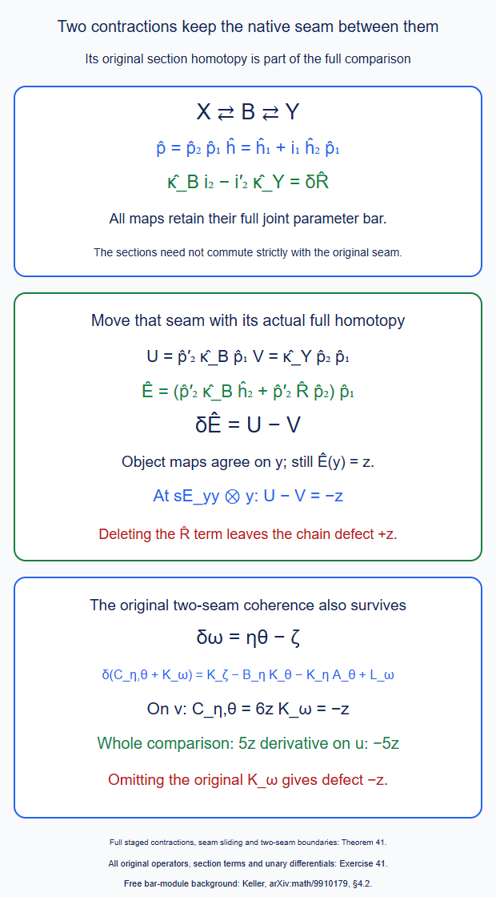

Theorem 41 and Exercise 41. The two contractions,
the interposed native comparison and its section
homotopy are all actual full maps. A nonzero
coherence term can change the comparison even
when leading compositions agree.
[Editable SVG](../assets/rational-native-two-stage-seams.svg).

## 42. Finite contraction towers and the original ladder homotopies

All maps in this section are entire maps in one dg category of
typed parameter comodules. Their differentials include the original
mapping inputs and all parameter unary terms. An empty product is
the appropriately typed identity. Consider two finite ordered towers
of special contractions
\[
 X_0\rightleftarrows X_1\rightleftarrows\cdots
       \rightleftarrows X_n,\qquad
 X'_0\rightleftarrows X'_1\rightleftarrows\cdots
       \rightleftarrows X'_n .
 \tag{42.1}
\]
The \(j\)-th unprimed maps are \(p_j,i_j,h_j\), with
\(\delta h_j=1-i_jp_j\); use primes for the other tower.
Set
\[
 \begin{gathered}
 P_j=p_j\cdots p_1,\qquad I_j=i_1\cdots i_j,\\
 H_j=\sum_{a=1}^j I_{a-1}h_aP_{a-1},\qquad
 P_0=I_0=1 .
 \end{gathered}
 \tag{42.2}
\]
Use the same notation with primes. Retain closed native maps
\(\kappa_j:X_j\to X'_j\) and their supplied full section homotopies
\[
 \kappa_{j-1}i_j-i'_j\kappa_j=\delta R_j,\qquad |R_j|=-1 .
 \tag{42.3}
\]
No equality of sections with native maps is assumed.

**Theorem 42 (full ladder comparison and its regrouping identity).**
The composites \(P_j,I_j,H_j\) are special contractions. Their
whole section comparison is
\[
 \mathcal R_j=\sum_{a=1}^j
      I'_{a-1}R_a i_{a+1}\cdots i_j,\qquad
 \delta\mathcal R_j=\kappa_0I_j-I'_j\kappa_j .
 \tag{42.4}
\]
Define the single-stage, telescoped and flattened projection
homotopies by
\[
 \begin{aligned}
 E_a&=p'_a\kappa_{a-1}h_a+p'_aR_ap_a,\\
 E^{\mathrm{tel}}_n
    &=\sum_{a=1}^n
          p'_n\cdots p'_{a+1}E_aP_{a-1},\\
 E^{\mathrm{flat}}_n
    &=P'_n\kappa_0H_n+P'_n\mathcal R_nP_n .
 \end{aligned}
 \tag{42.5}
\]
Both full degree-minus-one maps have differential
\[
 \delta E^{\mathrm{tel}}_n
   =\delta E^{\mathrm{flat}}_n
   =P'_n\kappa_0-\kappa_nP_n .
 \tag{42.6}
\]
Their specified degree-minus-two comparison is
\[
 \begin{aligned}
 F_n
  &=\sum_{j=2}^n P'_n\mathcal R_{j-1}h_jP_{j-1}\\
  &=\sum_{1\leq a<j\leq n}
      p'_n\cdots p'_a\,R_a
             i_{a+1}\cdots i_{j-1}h_jP_{j-1},\\
 \delta F_n&=E^{\mathrm{flat}}_n-E^{\mathrm{tel}}_n .
 \end{aligned}
 \tag{42.7}
\]
Thus the original section comparisons contribute even when every
leading native map is an identity.

There is an exact regrouping statement. For \(0<m<n\), write
\(P_{>m}=p_n\cdots p_{m+1}\), \(H_{>m}\) for the composite
homotopy of that sub-tower on \(X_m\), and \(F_{>m}\) for its
formula (42.7). Then
\[
 F_n=P'_{>m}F_m+F_{>m}P_m
                      +P'_n\mathcal R_m H_{>m}P_m .
 \tag{42.8}
\]
Recursively grouping the consecutive stages in any binary
parenthesization gives exactly the same \(F_n\). This asserts
regrouping coherence for the specified ordered ladder and its
original \(R_a\)'s.

If these towers arise from the strict-section parameter transfer
of Theorem 41, their composites agree with the full parameter
transfer of the object composite contractions. All formulas above
retain every consecutive parameter cut and outside coaction, and
commute with actual whole source restrictions.

**Proof.** Combining two special contractions gives
\(p=p_2p_1\), \(i=i_1i_2\), \(h=h_1+i_1h_2p_1\).
The differential is
\(1-i_1p_1+i_1(1-i_2p_2)p_1=1-ip\).
The identities \(pi=1\), \(ph=hi=h^2=0\) follow by multiplying
out and using the two special contractions. Induction gives
(42.2) and all its special identities.

Each \(i_a\), \(p_a\) and \(\kappa_a\) is closed. Differentiating
the \(a\)-th term of (42.4) therefore replaces \(R_a\) by its
given difference (42.3). The negative term for \(a\) cancels
the positive term for \(a+1\). The two remaining endpoint terms
are exactly \(\kappa_0I_j-I'_j\kappa_j\). In particular this uses
the supplied section homotopies, including any nonzero closed
part they have.

For one stage put \(L_a=p'_a\kappa_{a-1}-\kappa_ap_a\).
It is closed and
\(L_ai_a=\delta(p'_aR_a)\). The Hom Leibniz rule gives
\[
 \delta(L_ah_a)=L_a-L_ai_ap_a,\qquad
 \delta(p'_aR_ap_a)=L_ai_ap_a .
 \tag{42.9}
\]
As \(p_ah_a=0\), their sum is \(\delta E_a=L_a\).
The telescoped expression in (42.5) now has cancellations at
every intermediate \(\kappa_a\), leaving the endpoint difference
in (42.6). The same one-stage argument applies to the composite
contractions and their actual section homotopy \(\mathcal R_n\),
giving the flattened equation.

For completeness compare these two particular primitives.
For the first \(j-1\) stages abbreviate \(P=P_{j-1}\),
\(I=I_{j-1}\), \(H=H_{j-1}\) and \(R=\mathcal R_{j-1}\).
The recursion for the next composite is
\[
 \begin{gathered}
 H_j=H+Ih_jP,\qquad
 \mathcal R_j=Ri_j+I'R_j,\\
 P'\kappa_0I-\kappa_{j-1}=\delta(P'R).
 \end{gathered}
 \tag{42.10}
\]
Insert these equalities in the flattened expression. Subtracting
\(p'_jE^{\mathrm{flat}}_{j-1}+E_jP\) leaves
\[
 \begin{aligned}
 &p'_j\bigl((P'\kappa_0I-\kappa_{j-1})h_j
                       +P'R(i_jp_j-1)\bigr)P\\
 &\qquad
   =p'_jP'\bigl((\delta R)h_j-R\,\delta h_j\bigr)P\\
 &\qquad
   =\delta\bigl(P'_jR h_jP\bigr).
 \end{aligned}
 \tag{42.11}
\]
The minus sign before \(R\,\delta h_j\) is forced by
\(|R|=-1\). Here the middle equality may equivalently use
\(\delta(P'R)=P'\delta R\); no naturality of \(P'\) is needed.
Starting from \(F_1=0\), this proves
\[
 F_j=p'_jF_{j-1}
          +P'_j\mathcal R_{j-1}h_jP_{j-1}.
 \tag{42.12}
\]
Induction gives the first formula (42.7). Expanding \(\mathcal
R_{j-1}\) and cancelling only the inserted pairs \(p'_ai'_a=1\)
gives its second formula. This proves the differential identity
with its stated sign, rather than merely existence of a primitive.

In the double sum in (42.7), partition the pairs \(a<j\) into
\(j\leq m\), \(m<a\), and \(a\leq m<j\). The first two sums
are \(P'_{>m}F_m\) and \(F_{>m}P_m\). Expanding
\(\mathcal R_m\) and \(H_{>m}\) shows that their cross-pairs are
precisely \(P'_n\mathcal R_mH_{>m}P_m\). This proves (42.8).
In any recursive binary grouping, each pair has one first split
separating its two indices, so it occurs exactly once. Hence
all such groupings give the identical full map.

Finally repeated application of (41.3) identifies the transferred
composite maps with these finite towers whenever its strict-section
hypotheses hold. All products in this proof are products of full
typed cochains. Their parameter components use all consecutive
cuts, with the degree-minus-one and degree-minus-two coaction
signs. Finite towers and wordwise finite transfer make these
expressions finite on each input. The actual cotensor pullback
of Theorem 37 preserves these compositions, differentials and
the supplied \(R_a\)'s, proving the remaining assertions.
\(\square\)

The theorem concerns original native comparisons already expressed
on the indicated whole graph diagrams. An absent comparison
between different changing-profile graph layouts is additional
data; the ladder equations do not supply it. Ordered regrouping
also does not identify two different native execution paths.

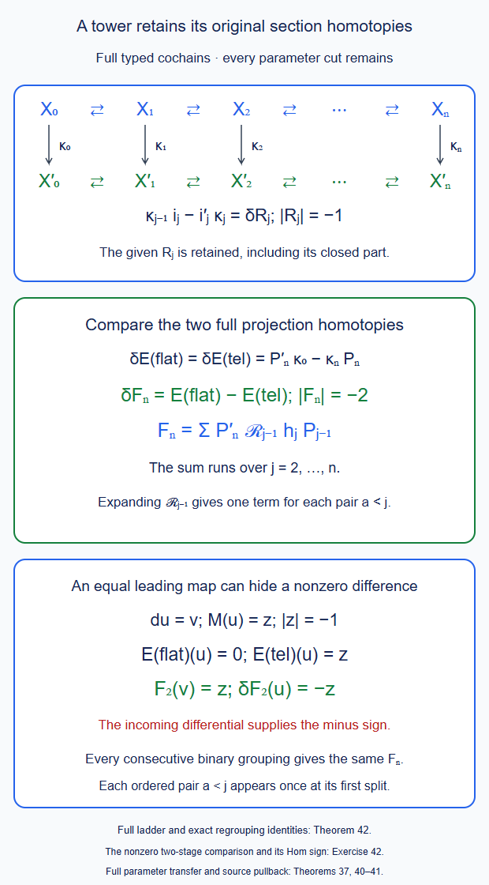

Theorem 42 and Exercise 42. The vertical comparisons retain their
original section homotopies. The two-stage example has equal
leading native maps and a nonzero difference between the two
projection homotopies.
[Editable SVG](../assets/rational-native-multistage-ladders.svg).

## 43. The actual marked section for a native block replacement

Fix normalized functors \(G_0,G_1:A\to B\) and \(F:B\to C\).
All bars are full. Only the auxiliary middle identities in the
two-sided graph receive the quotient of Theorem 27. Write
\[
 \mathscr D=\operatorname{Fun}_\infty(A,B),\qquad
 P=B_{\mathrm{full}}\mathscr D,\qquad C_A=B_{\mathrm{full}}A,
 \qquad e=\operatorname{ev}_{A,B}.
 \tag{43.1}
\]
The parameter and source tensor coproduct has coefficient
\((-1)^{|p_R||c_L|}\) at the cut
\((p_L,c_L)\otimes(p_R,c_R)\).
For an operator word \(p\) let \(e(p,u)\) mean its complete
marked evaluation on the original source word \(u\). It includes
empty marked pieces and every possible unmarked piece.

Let \(\mathcal X_G\rightleftarrows\mathcal Y_G\) be the actual
normalized common-input graph contraction for \(F,G\).
For a homogeneous full cochain \(\theta:G_0\to G_1\), put
\(r=|\theta|\). In the contravariant graph direction denote by
\(A_\theta:\mathcal X_{G_1}\to\mathcal X_{G_0}\) the complete
action on the last graph factor. Denote by
\(B_\theta:\mathcal Y_{G_1}\to\mathcal Y_{G_0}\) the graph
map of the full one-mark postcomposition \(F_*\theta\).
In particular \(B_\theta\) includes the higher Taylor values
of \(F\); it is not defined by \(F_1\theta_0\).

**Theorem 43 (the supplied marked section and its coefficient sign).**
The original section has the following specified naturality
homotopy of degree \(r-1\):
\[
 \begin{aligned}
 R_\theta(k\otimes c)
   ={}&-(-1)^{(r-1)|k|}
       \sum_{c=uv}\ \sum_{e(s\theta,u)=\sum a_z z}
          a_z(k;z;1_{G_0(\operatorname{source}u)})\otimes v,\\
 \delta R_\theta+R_{\delta\theta}
   ={}&A_\theta S_{G_1}-S_{G_0}B_\theta .
 \end{aligned}
 \tag{43.2}
\]
The displayed middle tensors are taken in the actual normalized
two-sided graph. The identity at their last coefficient is
retained. For a closed degree-zero native comparison this gives
exactly the section comparison required in (41.4), with its
original higher source components.

There is one simultaneous choice for all higher operator marks.
For \(p=s\theta_m|\cdots|s\theta_1\) define
\[
 W_p(k\otimes c)
    =(-1)^{|p||k|}
       \sum_{c=uv}\ \sum_{e(p,u)=\sum a_z z}
              a_z(k;z;1_{\operatorname{source}e(p,u)})\otimes v .
 \tag{43.3}
\]
Its degree is \(|p|=\sum_j(|\theta_j|-1)\);
\(W_\varnothing=S\) and \(R_\theta=-W_{s\theta}\).
The complete simultaneous section, in coefficient-first order,
is the explicit degree-zero map
\[
 \Sigma(k;p,c)
  =\sum_{\substack{p=p_Lp_R\\c=c_Lc_R}}
       (-1)^{|p_R||c_L|}
       \sum_{e(p_L,c_L)=\sum a_z z}
          a_z(k;z;1_{\operatorname{source}e(p_L,c_L)})
                         \otimes(p_R,c_R).
 \tag{43.4}
\]
The endpoints in each summand are the original endpoints of
that marked evaluation. It obeys the full section equation
\[
 D_{\mathcal X}^{e}\Sigma=\Sigma D_{\mathcal Y}^{Fe},
 \qquad Q^{e}\Sigma=1 .
 \tag{43.5}
\]
Here the two differentials and \(Q^e\) are precisely Theorem 24
for the genuine input \(P\otimes C_A\) and map \(e\).
Equation (43.5), rather than a choice of separate primitives,
specifies every higher compatibility between the \(W_p\)'s.

A formal identity transformation in a consumed nonempty
parameter word gives a zero component of the normalized section.
An ordinary source identity in a consumed source piece gives
zero as well. Unconsumed original words remain present.
A nonidentity parameter whose evaluated value happens to be an
ordinary identity is still its original parameter; it is not
removed from \(P\).

For an actual whole native parameter map
\[
 \mathcal S:K\longrightarrow P
 \tag{43.6}
\]
use \(e(\mathcal S\otimes1)\) in (43.4). The construction then
retains all original native comparison components and every
restriction to a full parameter face. \(K\) may be the whole
compatible [C64](../GL-SAT-13.html#c64-joint-execution-and-the-complete-grafting-domain) index bar; it need not be a rectangle of separate
parameter indices. Source changes use their full bar maps.
Several independent inner branches use their genuine tensor
coalgebra followed by the dg joint-input shuffle of Theorem 30.
Empty branch lists keep the full nullary output mapping complex.

**Proof.** The marked evaluation is the actual dg coalgebra map
of Theorem 25. Its single marked letter has degree \(r-1\).
On an original word \(u\), each output word \(z\) in
\(e(s\theta,u)\) has degree \(|u|+r-1\).
Thus every summand of (43.2) has degree
\(|k|+|c|+r-1\), as asserted. Passing the parameter word
from before the coefficient \(k\) to after it gives exactly
the sign
\[
 (-1)^{(r-1)|k|}.
\]
No sign involving only the ordinary
degree \(r\) can replace that suspended degree.

Apply (24.4) to \(e:P\otimes C_A\to B_{\mathrm{full}}B\).
Its tensor coproduct is the cut displayed before the theorem,
so its full section is exactly (43.4).
Theorem 24 proves (43.5) on all original words; Theorem 27
proves its descent to the middle quotient. In particular it
retains the unary differential of a nonclosed \(\theta\).
Reordering only the consumed parameter word past \(k\)
gives the coefficient components (43.3). All other cut signs
stay those of the actual tensor coproduct.

We extract the one-mark equation explicitly to fix the
otherwise consequential global minus sign. Put
\(W_\theta=W_{s\theta}\). In the coefficient of one original
parameter mark in the chain equation (43.5), the internal
coefficient and source terms give \(\delta W_\theta\).
The unary parameter term is \(b_1(s\theta)=-s(\delta\theta)\);
after moving it past \(k\), it contributes
\(-W_{\delta\theta}\) to the other side. The two endpoint
actions give respectively \(S_{G_0}B_\theta\) and
\(-A_\theta S_{G_1}\). Consequently
\[
 \delta W_\theta+W_{\delta\theta}
          =S_{G_0}B_\theta-A_\theta S_{G_1}.
 \tag{43.7}
\]
This proves (43.2) with \(R_\theta=-W_\theta\).
For a direct sign check with no source letters and a closed
degree-zero bare mark \(a\), the middle differential gives
\[
 \begin{aligned}
 D(k;sa;1)
   ={}&(dk;sa;1)
       +(-1)^{|k|}(kF_1(a);\varnothing;1)\\
      &-(-1)^{|k|}(k;\varnothing;a).
 \end{aligned}
 \tag{43.8}
\]
The two coefficient-differential terms in
\(\delta((-1)^{|k|}(k;sa;1))\) cancel.
The remaining terms are \(SB_a-A_aS\).
This independently fixes the minus in (43.2), including
odd output coefficients. Positive source inputs and
nonclosed marks are already included in (43.7).

For several marks each complete evaluated word has exactly
one occurrence of each original mark. The entire chain
equation includes the differential of any one such mark,
the vertical product of two consecutive marks, every
original source differential and merger, and the complete
left and right prefix actions. These are exactly the terms
in (43.5), since it uses the full dg parameter bar and the
full map \(e\). Thus (43.4) fixes their simultaneous values,
including those of the original native \(\omega\) and
mixed \(\chi\) when these occur in \(\mathcal S\).
It does not replace them by independently chosen kernel
primitives.

A formal identity mark has empty marked piece and gives
a literal identity letter in the evaluated middle word.
The middle quotient kills that term. Likewise a consumed
ordinary source identity either gives zero by normalization
of its marked or functor component, or remains a literal
identity in that middle word. It is zero in the quotient.
These statements concern consumed section components:
the term retaining the original word is unaffected.
The last coefficient identity is not a middle letter.
Higher identity-valued outputs of nonidentity marks
remain in their original input labels and in the other
graph actions of Theorem 27.

Finally composition with the actual dg coalgebra map
\(\mathcal S\otimes1\) preserves (43.5), its original cuts
and its endpoint labels. Restricting to a full face is
the same composition on that face, so all values agree
literally. Source-end changes are Theorem 37's actual
cotensor pullbacks. For independent branches use the
tensor coproduct and its Koszul sign, followed by the
genuine joint-input shuffle. Its coalgebra and chain
equations and its exact section square are Theorem 30.
At zero branches this is the empty tensor input, not a
quotient of the unit object's output mappings.
This proves all the assertions. \(\square\)

Theorem 43 supplies the actual section comparison for
a native replacement inside a fixed outer operation.
It is compatible with the original full parameter family.
Identifying every different whole tree layout still
requires its actual common-refinement maps and all their
product and graft faces; that conclusion does not follow
from the one-mark equation alone.

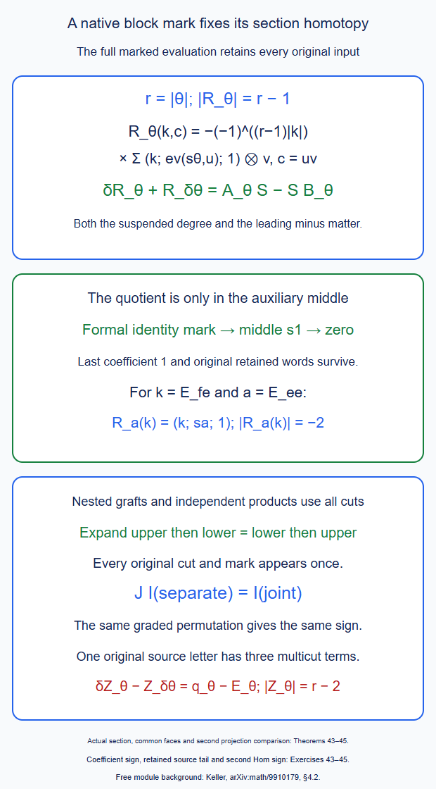

Theorem 43 and Exercise 43. All original source and
parameter differentials remain in the section equation.
The complete marked section specifies the higher
comparisons together.
[Editable SVG](../assets/rational-native-marked-section.svg).

## 44. Full marked multicut sections and their product and graft faces

Consider a finite rooted operation tree with the actual dg category
at each edge and a normalized functor at each vertex. Joint vertex
inputs use the genuine tensor-bar map into the dg tuple category.
A vertex parameter is a full word of the corresponding normalized
functor category. Combine those parameter bars with all original
external source bars using their graded tensor coalgebra. At an
inner vertex evaluate its full parameter word and the outputs of
its children by the actual [C69](../GL-SAT-13.html#c69-full-horizontal-operator-composition) evaluation. Thus the recursive
input map is a composition of dg coalgebra maps, not a tensor
product of primitive \(A_\infty\)-functors.

Let \(Z_T\) be the fully expanded, normalized-middle graph of
Theorem 32. On its full parameter encoding, the local sections
are (43.4), together with the strictly natural outer section of
Theorem 26. At the represented endpoint retain the actual
composite operation of this tree. A native comparison with a
flattened operation is kept as its original full marked map.

**Theorem 44 (the full marked common section).**
All orders of expanding the edges give the same full parameter
section
\[
 \boldsymbol I_T:\mathcal K_{f_T}\longrightarrow Z_T .
 \tag{44.1}
\]
Its coefficient formula uses the full multicut of every original
source and parameter word. At an expanded edge it places the
complete marked evaluation of the selected descendant prefix
in that middle bar, inserts the ordinary identity at its last
coefficient, and retains the remaining original tails.
All extraction permutations carry their Koszul signs.
Every original parameter is evaluated once or retained once;
none is inferred from its leading operator image.

For a graft \(T\circ_i U\), expanding the internal edges of
\(U\), expanding the joining edge and expanding the other
edges of \(T\) in any order gives precisely
\(\boldsymbol I_{T\circ_i U}\). For independent branches the
separate and joint middle presentations satisfy the entire
section square
\[
 J\boldsymbol I_{\mathrm{sep}}
                      =\boldsymbol I_{\mathrm{joint}} .
 \tag{44.2}
\]
This includes all simultaneous marks, their unary
differentials and their mixed [C69](../GL-SAT-13.html#c69-full-horizontal-operator-composition) components. It is an
equality of full sections, not only their empty-parameter values.

Restricting an actual full native family to a product or graft
face commutes with these formulas whenever that face is
expressed on this common refinement. The input is the
whole original compatible index bar. No assertion that
every separate-parameter shuffle lies in that index is needed.
At a block replacement its section comparison is exactly
Theorem 43's pulled-back marked section, including its
higher components, rather than a new primitive chosen
after taking that face.

**Proof.** All elementary sections are closed degree-zero
maps on the entire source and parameter encoding, by
Theorems 25–27 and 43. Their object coefficients are the
actual identity insertions. A composition is therefore a
full chain section; its colinearity follows by composing
the original cut equations. The issue is equality between
the different expansion orders.

First consider two nested edges. Before taking any middle
quotient their expansion has three successive levels.
For functors \(H,G,F\), the upper middle word is obtained
by evaluating the selected \(G\)-marks on the selected
full \(H\)-output. The lower middle word is the next
selected \(H\)-output, and the final original suffix
is retained. A term is consequently specified by
the original parameter cuts, the three-piece source
cut, and the marked piece assignments at its two
inner levels.

Expanding the upper edge first enumerates those
assignments by first making the outer cut of the
full \(H\)-output. The coalgebra equation for its
marked evaluation identifies that cut with the
corresponding original source and parameter cuts.
Expanding the lower edge first enumerates exactly
these same original cuts in the other order.
If the block is described by its full composite
operator word, the equality
\[
 \operatorname{ev}\bigl(M(u,v),c\bigr)
              =\operatorname{ev}\bigl(u,\operatorname{ev}(v,c)\bigr)
 \tag{44.3}
\]
is the exact [C69](../GL-SAT-13.html#c69-full-horizontal-operator-composition) evaluation identity of Theorem 37.
It includes all one-output and multi-output marked
assignments. Thus it identifies the complete words
at the upper middle edge, including every mixed
operator component.

The signs agree as well. The original homogeneous
factors are brought into the same final ordered
list of upper middle, lower middle and retained
factors. The Koszul sign of that permutation is
the product of the signs of either sequence of
extractions. The marked maps have suspended
degrees \(|\theta|-1\), as checked in (43.2)–(43.4);
using ordinary degrees instead would not give
this equality. Hence there is no additional
sign attached to the order of the two expansions.
This proves the full nested exchange.

For edges in independent branches, a term is a
cut in each original branch, with its original
marked evaluation. The tensor coproduct puts
the selected prefixes before the retained
factors. Either expansion order makes the same
graded permutation of those factors. If two
branches have a common parent, the section
inserts their separate output words and
ordinary coefficient identities; it does
not evaluate the parent's higher functor on
their coefficient identities. Therefore the
same argument covers sibling edges. It is
exactly the extraction sign (33.3), now with
each selected prefix carrying all of its
original parameter marks.

Taking the normalized middle quotients does
not disturb either exchange. A marked
evaluation of a word containing a formal
unit either vanishes or keeps a literal
identity in an output word, by Theorem 43.
An identity in a consumed prefix is thus
zero in the corresponding middle quotient;
an identity in a retained tail stays in
that tail. The two orders have the same
terms before this quotient and the same
sum of auxiliary degeneracy subspaces.
They have identical images after it.

Every two orders of the finite edge set
are related by exchanges of adjacent
expansions. The nested and independent
cases exhaust such exchanges. This
proves (44.1) for all orders, retaining
the original full parameter coactions.

For a graft, the edge set consists of
the edges of the two trees and their
joining edge. The section obtained by
performing these three groups of
expansions is one of the orders just
proved equal. The genuine input map
at the graft is also the same: recursive
marked evaluation associates by (44.3),
and its joint dg shuffles enumerate the
same final interleavings with their
Koszul signs, by Theorem 30.
This proves the graft assertion with
its original parameter labels.

For independent products, the separate
section places each actual marked
evaluation in its own middle factor.
The map \(J\) interleaves those words.
The joint section places their genuine
joint-input shuffle in the joint
middle factor. Both enumerate the
identical branch cuts and final
interleavings. The tensor coproduct
coefficient is the same extraction
permutation sign, so the full equality
is (44.2), as in (30.19). Its
zero-branch instance retains the
coefficient identity and the full
nullary output Hom complex.

Finally pull back these formulas by the
actual full native parameter coalgebra
map and its actual source bar maps.
All constructions used were genuine
coalgebra composition, marked
evaluation, cuts and graded tensor
permutations. They commute with that
pullback. In particular the pulled-back
one-mark component is the original
\(R_\theta\) of (43.2), and all its
higher components are the restriction
of the one full \(\Sigma\). The
original [C69](../GL-SAT-13.html#c69-full-horizontal-operator-composition) mixed cochain, or any
original higher comparison carried
by the native family, is evaluated
as such; it is not set to zero.
The [C64](../GL-SAT-13.html#c64-joint-execution-and-the-complete-grafting-domain) index is restricted as a
whole, so no unavailable rectangle
is introduced. This proves the
stated native face compatibility
on the specified common refinement.
\(\square\)

The theorem identifies the actual full section side of the
common-refinement product and graft squares. The projection
side retains the specified homotopies of Theorems 40–43.
An equality of sections does not imply equality of the
projection paths, nor identify the native flattened operation
without its full comparison. Coefficient descent uses the
complete projection comparison with those same native marks.

## 45. The actual marked projection and its specified second homotopy

Keep the full normalized contractions \(Q_j,S_j,H_j\) of
\(\mathcal X_{G_j}\rightleftarrows\mathcal Y_{G_j}\).
Write \(x=(k;w;l)\) and
\(|x|=|k|+|w|+|l|\). The full actions \(A_\theta,B_\theta\)
and the actual \(R_\theta\) are those of Theorem 43.

**Theorem 45 (projection comparison without discarding its original core).**
The original projection's one-mark component has degree \(r-1\)
and the exact formula
\[
 q_\theta(x\otimes c)
   =(-1)^{(r-1)|x|+|w|}
      \sum_{c=uv}\ \sum_{e(s\theta,u)=\sum a_z z}
           a_z\,k\tau_F(w|sl|z)\otimes v .
 \tag{45.1}
\]
In particular it obeys
\[
 \begin{gathered}
 L_\theta=Q_0A_\theta-B_\theta Q_1,\qquad
 \delta q_\theta+q_{\delta\theta}=L_\theta,\\
 q_\theta S_1=Q_0R_\theta .
 \end{gathered}
 \tag{45.2}
\]
The homotopy built from the actual section comparison is
\[
 E_\theta=(-1)^rQ_0A_\theta H_1+Q_0R_\theta Q_1,
 \qquad
 \delta E_\theta+E_{\delta\theta}=L_\theta .
 \tag{45.3}
\]
The difference between this specified \(E_\theta\) and the
original \(q_\theta\) is retained by the explicit second homotopy
\[
 \begin{gathered}
 T_\theta=q_\theta-E_\theta,\qquad
 Z_\theta=(-1)^{r-1}T_\theta H_1,\qquad |Z_\theta|=r-2,\\
 \delta Z_\theta-Z_{\delta\theta}=T_\theta,\qquad
 T_\theta S_1=Z_\theta S_1=0 .
 \end{gathered}
 \tag{45.4}
\]
For a closed degree-zero native block comparison, the last
differential equation is
\(\delta Z_\theta=q_\theta-E_\theta\).
It identifies two particular original formulas, rather than
replacing either by an unspecified primitive.

For all parameter words together retain the entire projection
\(Q^e\) and section \(\Sigma\) of (43.5). Their component
formulas determine all mixed cuts and higher comparisons.
Full parameter restriction and actual source-end pullback
preserve these component identities. A target-end change retains
its whole original [C69](../GL-SAT-13.html#c69-full-horizontal-operator-composition) comparison; no strict square for separately
chosen contractions is asserted. The one-mark second homotopy
does not permit deleting positive components of \(Q^e\).

More generally, in one full parameter-comodule category let
\((Q,\Sigma,H)\) be a special contraction with actual endpoint
\(\mathcal Y\). If closed degree-zero full maps
\(U,V:\mathcal X\to\mathcal W\) have the same entire restriction
to \(\Sigma\), their specified relative homotopy is
\[
 J=(U-V)H,\qquad \delta J=U-V,\qquad J\Sigma=0 .
 \tag{45.5}
\]
This last assertion requires equality on the full section,
not merely on its leading or cohomological component.

**Proof.** In (24.4) with the genuine marked input \(e\),
consume precisely the one parameter mark and an arbitrary
original source prefix. Passing that mark past the full
coefficient \(x\) gives \((-1)^{(r-1)|x|}\).
The original projection contributes \((-1)^{|w|}\).
Their product is the coefficient in (45.1).
The degree of \(\tau_F\) is one, the inserted \(sl\) has
degree \(|l|-1\), and the marked output \(z\) has degree
\(|u|+r-1\). Thus every term has total degree
\(|x|+|c|+r-1\).

Extracting one parameter mark from the full chain equation
for \(Q^e\) gives the first differential identity in (45.2).
The source endpoint action is \(Q_0A_\theta\), the target
endpoint action is \(B_\theta Q_1\), and the parameter unary
term is \(b_1(s\theta)=-s(\delta\theta)\). These account for
all the terms with that mark. The complete source unary
differential remains inside the Hom differential.
Extracting the same coefficient in \(Q^e\Sigma=1\) gives
\[
 q_\theta S_1+Q_0W_{s\theta}=0 .
 \tag{45.6}
\]
Since \(W_{s\theta}=-R_\theta\), this is its side equation.
Neither identity assumes that the cochain \(\theta\) is closed.

The degree-\(r\) cochain \(L_\theta\) satisfies
\(\delta L_\theta=L_{\delta\theta}\).
Theorem 43 and closedness of the projection give
\[
 L_\theta S_1
       =Q_0(\delta R_\theta+R_{\delta\theta}).
 \tag{45.7}
\]
Differentiating \((-1)^rL_\theta H_1\), adding its value
at \(\delta\theta\), and using
\(\delta H_1=1-S_1Q_1\), gives
\(L_\theta-L_\theta S_1Q_1\).
Differentiating \(Q_0R_\theta Q_1\) and adding its value
at \(\delta\theta\) gives \(L_\theta S_1Q_1\).
Their sum is \(L_\theta\).
The term \(B_\theta Q_1H_1\) is zero, so the first
of these expressions is exactly the first term
of \(E_\theta\) in (45.3).

Subtracting (45.3) from (45.2) now yields
\[
 \delta T_\theta+T_{\delta\theta}=0,\qquad T_\theta S_1=0 .
 \tag{45.8}
\]
The side equation uses (45.2), \(H_1S_1=0\) and \(Q_1S_1=1\).
Differentiate \(Z_\theta\) with the Hom Leibniz rule.
Since \(|T_\theta|=r-1\), the result is
\[
 \begin{aligned}
 \delta Z_\theta
   &=(-1)^{r-1}(\delta T_\theta)H_1
                          +T_\theta(1-S_1Q_1)\\
   &=(-1)^rT_{\delta\theta}H_1+T_\theta\\
   &=Z_{\delta\theta}+T_\theta .
 \end{aligned}
 \tag{45.9}
\]
This proves precisely the minus sign in (45.4).
The remaining side identity follows from \(H_1S_1=0\).
All maps are the full original graph maps and homotopies;
their compositions preserve the coactions and unit
normalizations established in Theorem 27.
Theorem 43's whole pullback preserves the same formulas.

Finally if \(D=U-V\) in (45.5), then \(D\) is closed,
\(D\Sigma=0\), and
\[
 \delta(DH)=D(1-\Sigma Q)=D .
 \tag{45.10}
\]
Its side identity is \(H\Sigma=0\).
This contracts the indicated restriction kernel only;
it makes no claim that the whole mapping or Nat complex
is acyclic. \(\square\)

Thus the common-section product and graft identities of
Theorem 44 have actual marked projection homotopies and
specified comparisons with the section-based formulas.
To apply (45.5) simultaneously to the native coefficient
diagram, the competing whole maps must first be expressed
on that same full common refinement and have their
entire section restrictions identified. Agreement of
leading native operations alone is insufficient.

## 46. Original-label refinements of changing-frontier strings

Let
\[
 \sigma:\ (t_0,J_0)\xrightarrow{f_1}(t_1,J_1)
                 \longrightarrow\cdots\xrightarrow{f_q}(t_q,J_q)
 \tag{46.1}
\]
be an original [C64](../GL-SAT-13.html#c64-joint-execution-and-the-complete-grafting-domain) execution/contraction string. Every arrow
retains its selected original operation edges. Let \(K_j\) be
the union in \(t_0\) of the edge sets contracted by its first
\(j\) arrows, and let
\[
 \pi_j:t_0\longrightarrow t_j=t_0/K_j,\qquad
 I_j=\pi_j^{-1}(J_j),\qquad K_0=\varnothing,\quad I_0=J_0 .
 \tag{46.2}
\]
The identification with \(t_0/K_j\) retains the original
quotient labels. It does not identify parallel arrows by
their unlabelled quotient shape.

**Theorem 46 (the labelled initial-tree refinement and its faces).**
The sets \(I_j\) are nested operation-descendant ideals of
the initial tree, and \(I_j\) is a union of whole \(K_j\)-clusters.
The ordered frontier at \((t_j,J_j)\) is canonically the ordered
frontier at \((t_0,I_j)\). Its arity is
\[
 m_j=n+\sum_{v\in I_j}(1-r(v)).
 \tag{46.3}
\]
This identification is on arbitrary original frontier objects
and their full mapping spaces.

The actual operator of \(f_j\), under these frontier
identifications, has the supplied full native comparison
with the partial forest
\[
 F^{t_0}_{I_j,I_{j-1}} .
 \tag{46.4}
\]
All the higher comparisons for a longer string are the
original partial-forest comparisons on these same nested
ideals. They are not new choices on its individual arrows.
The refinements have the following exact index-face rules:

1. An interior face removes \((K_j,I_j)\). Its two partial
   forests are compared with the one partial forest by
   the original whole native composition comparison.
2. Deleting the last state deletes the last pair of
   labels. Deleting the first state instead rebases at
   \(t_1\). If \(I'_j\) is the pulled-back ideal for that
   shorter string in \(t_1\), then
   \[
    I_j=\pi_1^{-1}(I'_j)\quad(j\geq1).
    \tag{46.5}
   \]
   The corresponding source change is the actual
   \(F^{t_0}_{I_1,J_0}\), with its full original operator map.
   A target-end composition retains its entire [C69](../GL-SAT-13.html#c69-full-horizontal-operator-composition)
   whiskering map.
3. On a compatible grafting string, the pulled-back
   executed ideal is the union of the embedded factor
   ideals in the initial grafted tree. Every joining
   seam remains an original edge. The cumulative
   selected sets are the embedded factor sets; a
   subsequent native contraction of a joining seam
   retains that additional selected label.

There is a fixed-initial parameter category for all these
strings at once:
\[
 P_a=(a\downarrow\mathcal E_n).
 \tag{46.7}
\]
Its objects are actual arrows \(u:a\to x\); an arrow
from \(u\) to \(v\) is an original \(g:x\to y\) with
\(gu=v\). This category is finite, has initial object
\(1_a\), and has terminal object the unique original
arrow \(a\to b_n\) to the completed corolla.
The canonical lift of (46.1) records its successive
cumulative composites from \(a=(t_0,J_0)\).
An interior or last face restricts that same lifted
string. Its first face is the precomposition image of
the lifted shorter string under
\[
 f_1^*:P_{(t_1,J_1)}\longrightarrow P_a,\qquad
                       u\longmapsto u f_1 .
 \tag{46.8}
\]
The initial image is the actual object \(f_1\) of \(P_a\),
not \(1_a\). Hence the source endpoint factor in
Theorem 38 is retained.

For a compatible initial grafting tuple \(a\), use
\((a\downarrow\mathcal D_{m;\mathbf n})\), with the
whole compatible category. Its terminal object is
the tuple of completed corollas. The induced graft
functor sends that object to the completed graft of
those corollas. Its subsequent map to \(b_N\) is
the original contraction of all joining seams.
This is the terminal endpoint factor of Theorem 38;
it is not declared to be an identity.

Thus the partial forests in (46.4) give concrete expanded
edge-bar forests on all of the original frontier inputs.
Their local native block replacements use Theorem 43;
their common-section graft and product faces use Theorem 44.
This constructs their typed refinements. It does not identify
their different whole projection paths without those maps'
full comparison.

**Proof.** [C47](../GL-SAT-13.html#c47-joint-execution-and-contraction-of-native-trees) composition takes the lifted union of selected
original edge sets. Consequently \(K_{j-1}\subseteq K_j\)
and \(\pi_j=\overline\pi_j\pi_{j-1}\), where
\(\overline\pi_j:t_{j-1}\to t_j\) is the actual next quotient.
The arrow condition is
\(\overline\pi_j(J_{j-1})\subseteq J_j\). Taking inverse
images gives \(I_{j-1}\subseteq I_j\).
Inverse images of descendant ideals are descendant ideals:
the quotient sends an original ancestor-descendant pair
to such a pair, allowing equality. Since \(I_j\) is an
inverse image, it is a union of whole quotient clusters.

For a \(K_j\)-cluster completed at \(J_j\), its original
top vertex gives that cluster's same output in \(t_0\).
All its operation descendants are completed. For an
uncompleted cluster, none of its vertices lies in \(I_j\);
one descends through it to the same ordered surviving
inputs. External leaves retain their original positions.
This is the claimed canonical ordered frontier bijection,
including a completed nullary cluster.
It is a relabelling of the same tensor factors. It
restricts neither their objects nor their mappings to
an image of a previous convolution.

A cluster \(C\) has \(|C|-1\) internal operation edges.
Its boundary arity is therefore
\[
 r(C)=\sum_{v\in C}r(v)-|C|+1,\qquad
 1-r(C)=\sum_{v\in C}(1-r(v)).
 \tag{46.6}
\]
Summing over completed clusters gives (46.3), which is
also the frontier count before passing to the quotient.
The full dg mapping complexes at that frontier are
carried by the ordered factor identifications; no
cohomology or coefficient projection is involved.

To check (46.4), compare the next quotient's partial
forest with the original tree through \(\pi_{j-1}\).
Every \(K_{j-1}\)-cluster is either completed at
\(I_{j-1}\) and remains an arbitrary input variable,
or is uncompleted there. An uncompleted cluster
which is completed at \(I_j\) is executed in full.
The original [C47](../GL-SAT-13.html#c47-joint-execution-and-contraction-of-native-trees) native comparison expands its
quotient operation into precisely that original
operation cluster. This applies on arbitrary
frontier variables by [C47](../GL-SAT-13.html#c47-joint-execution-and-contraction-of-native-trees).2, including true
zero-input operations. Their full source and
target whiskerings are the actual [C69](../GL-SAT-13.html#c69-full-horizontal-operator-composition) maps.
Taking all such clusters gives exactly
\(F^{t_0}_{I_j,I_{j-1}}\).

For an interior face, the cumulative original
edge union and the surviving ideals are unchanged.
The two adjacent forests execute \(I_j\setminus
I_{j-1}\), then \(I_{j+1}\setminus I_j\).
The original full comparison composes them to the
forest executing \(I_{j+1}\setminus I_{j-1}\).
For a longer flag all groupings use these same
partial forests and original comparisons.
[C47](../GL-SAT-13.html#c47-joint-execution-and-contraction-of-native-trees).2 supplies their whole coherent family.
It does not select fresh cochains when an
intermediate state is removed.

For the first face, factor
\(\pi_j=\pi'_j\pi_1\). Its shorter-string ideal
is \(I'_j=(\pi'_j)^{-1}(J_j)\), proving (46.5).
Since \(I_j\) is \(K_j\)-saturated and
\(K_1\subseteq K_j\), no \(K_1\)-cluster is
partially in \(I_j\). Completed clusters at
\(I_1\) become its arbitrary new input variables.
The other clusters are expanded by the very
same native block comparisons just used above.
Returning to the old initial frontier requires
the whole partial-forest input map, not its
linear or object component. This is precisely
Theorem 37's source-end pullback. At the
other end [C69](../GL-SAT-13.html#c69-full-horizontal-operator-composition) composition retains the
whole target whiskering, including its
positive Taylor components.

Finally a compatible graft's executed vertices
are the union of the embedded factor ideals,
by [C64](../GL-SAT-13.html#c64-joint-execution-and-the-complete-grafting-domain). Their inverse images under the
cumulative factor quotients have that
same union in the initial grafted tree.
Factor quotient edges form a disjoint
embedded union and select no joining seam.
The seam is still an edge of the initial
grafted tree, so an additional native
contraction can and does retain its
separate original label. Nested grafts
have the same embedded vertices and
seams in their common domain.

This argument takes an arbitrary string
in the full compatible category.
It never replaces it by separate
factor strings or a clipped product
shuffle. A simultaneous completion
of an inner and an outer operation
is included whenever its endpoints
are compatible. At a formal identity
both \(K\) and \(I\) repeat. A
nonidentity contraction may repeat
only \(I\); that original arrow
is retained. These observations
also prove the stated boundary
and normalization cases.
The resulting finite partial
forests have the actual graph
objects of Theorems 30 and 32–33,
on the indicated original input
categories. This proves the
typed refinement assertion.

For completeness, the fixed-initial category in (46.7)
retains each possible original cumulative arrow as
an object. The finite full forward closure of \(a\)
and its finite arrow sets give its finiteness.
An arrow out of \(1_a\) to \(u\) must be \(u\)
itself, so \(1_a\) is initial. The unique
\(x\to b_n\) has composite the unique \(a\to b_n\),
and is the unique arrow to the asserted terminal
object. Composing with \(f_1\) defines (46.8)
on objects; on morphisms it retains their
same original arrow. Its functor equation
is original category composition.
The successive arrows in the canonical lift
are still exactly \(f_1,\ldots,f_q\).
Deleting its first object leaves
\(f_1,f_2f_1,\ldots\), which is precisely
the precomposition image of the shorter
string's canonical lift.

The same proof works in the full compatible
grafting category: the tuple of completed
corollas is compatible, and all component
arrows to it are unique. Fullness keeps
their simultaneous tuple arrow in the
category. The graft functor sends its
corollas and all their joining seams to
the completed graft. Contracting just
those seams is its unique map to \(b_N\).
At zero outer inputs there are no such
seams and this map is the actual identity.
Thus both moved endpoint factors are
the original ones. Theorem 38 applies
with these actual parameter functors,
including their complete index bars,
without a safe-rectangle assumption.
\(\square\)

## 47. Extend the supplied full section comparison

Work in one dg category of full typed parameter-comodule maps.
All its differentials include the original source, target and
parameter terms. Let
\[
 \mathcal X\ \underset{\Sigma}{\overset Q{\rightleftarrows}}\
 \mathcal Y,\qquad
 \delta H=1-\Sigma Q,\quad Q\Sigma=1,\quad H\Sigma=0
 \tag{47.1}
\]
be the specified full contraction. Its endpoint \(\mathcal Y\)
and section are fixed.

**Theorem 47 (retain a nonzero section homotopy on the whole graph).**
For a homogeneous degree-\(r\) map
\(D:\mathcal X\to\mathcal W\) and degree-\((r-1)\) map
\(R:\mathcal Y\to\mathcal W\), set
\[
 \begin{gathered}
 \partial_{\mathrm{rel}}(D,R)
       =(\delta D,D\Sigma-\delta R),\\
 \mathcal E_r(D,R)=(-1)^rDH+RQ .
 \end{gathered}
 \tag{47.2}
\]
This relative differential squares to zero, and the exact
graded identity is
\[
 \delta\mathcal E_r(D,R)
    +\mathcal E_{r+1}(\partial_{\mathrm{rel}}(D,R))=D,
 \qquad
 \mathcal E_r(D,R)\Sigma=R .
 \tag{47.3}
\]
In particular if \(U,V:\mathcal X\to\mathcal W\) are closed
degree-zero full maps and the original supplied full
homotopy satisfies
\[
 \delta R=(U-V)\Sigma ,
 \tag{47.4}
\]
their comparison is the actual full map
\[
 J=(U-V)H+RQ,\qquad \delta J=U-V,\qquad J\Sigma=R .
 \tag{47.5}
\]
It retains the specified \(R\), including its closed part.
Taking \(R=0\) is valid only when that is the actual given
section comparison.

All these equations restrict to any whole native parameter
face on which the same \(Q,\Sigma,H,D,R\) restrict.
Their full source pullbacks have the same identities.
For a product or graft application, the maps in (47.4)
must first be expressed on the actual common refinement
with its original full section homotopy. The theorem
does not construct an absent \(R\) from leading maps.

**Proof.** Since \(\Sigma\) is closed, the second component
of \(\partial_{\mathrm{rel}}^2(D,R)\) is
\[
 (\delta D)\Sigma-\delta(D\Sigma-\delta R)=0 .
 \tag{47.6}
\]
Its first component is \(\delta^2D=0\).
The Hom Leibniz rule gives
\[
 \delta\mathcal E_r(D,R)
     =(-1)^r(\delta D)H+D(1-\Sigma Q)+(\delta R)Q .
 \tag{47.7}
\]
The other term of (47.3) is exactly
\[
 (-1)^{r+1}(\delta D)H+(D\Sigma-\delta R)Q .
 \tag{47.8}
\]
Adding cancels both the differential terms and the
two section terms, leaving \(D\). The side equation is
\(H\Sigma=0\), \(Q\Sigma=1\).
For \(D=U-V\), equation (47.4) says that
\((D,R)\) is a relative cycle. Its correction term in
(47.3) vanishes, giving (47.5).

The proof is in the actual full dg mapping complexes,
not in cohomology or in a complex of object values.
Every product therefore retains its original
parameter cuts and graded coaction signs.
Restriction and actual source pullback preserve
these products and differentials, proving their
assertions. A target-model change keeps its
original full comparison; no independently
chosen contractions are identified strictly.
Finally a different allowed closed component of
\(R\) contributes that component times \(Q\)
to \(J\). Its restriction is that same component,
so discarding it changes the prescribed
comparison. \(\square\)

Theorem 46 specifies the actual changing-frontier refinements.
Theorem 47 applies to a complete section comparison on them.
Coefficient descent requires that comparison for both calibrated
endpoint systems and on every original shared product and graft
face; a collection of unrelated objectwise homotopies is insufficient.

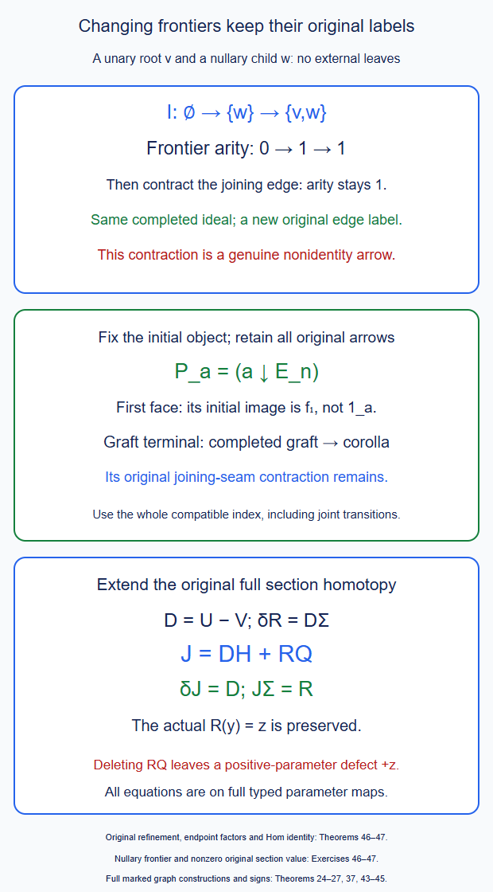

Theorems 46–47 and Exercises 46–47. Equal execution ideals
can still label a genuine contraction arrow. A simultaneous
compatible transition need not lie in a safe product rectangle.
[Editable SVG](../assets/rational-native-original-refinement.svg).

## 48. Extract the homotopy from the entire section prism

Use cohomological suspension of degree \(-1\). For a closed
degree-zero full map \(\kappa_X:\mathcal X_0\to\mathcal X_1\),
its interval complex has underlying graded object
\[
 C_X=\mathcal X_1\oplus s\mathcal X_0,\qquad
 D_{C_X}(x_1,sx_0)
       =(D_1x_1-\kappa_Xx_0,-sD_0x_0).
 \tag{48.1}
\]
This convention fixes the direction of the interval. All entries
are full parameter-comodule maps; \(\kappa_X\) includes its
positive parameter components.
For a left coaction \(\rho(x)=\sum c\otimes x'\), the suspended
coaction is
\[
 \rho(sx)=\sum(-1)^{|c|}c\otimes sx'.
 \tag{48.2}
\]
Other outside coactions use the corresponding graded
permutations. Define \(C_Y\) from a closed
\(\kappa_Y:\mathcal Y_0\to\mathcal Y_1\) in the same way.

**Theorem 48 (the off-diagonal part of a whole section prism).**
Suppose \(\Sigma_i:\mathcal Y_i\to\mathcal X_i\) are closed
degree-zero full sections and the given entire section prism is
a closed degree-zero comodule map
\(\boldsymbol\Sigma:C_Y\to C_X\) with the prescribed diagonal:
\[
 \boldsymbol\Sigma(y_1)=\Sigma_1y_1,\qquad
 \boldsymbol\Sigma(sy_0)=s\Sigma_0y_0+R(y_0).
 \tag{48.3}
\]
Then its uniquely determined off-diagonal part has degree
\(-1\) and satisfies the full equation
\[
 R=\operatorname{pr}_{\mathcal X_1}\boldsymbol\Sigma s,
 \qquad
 \delta R=\kappa_X\Sigma_0-\Sigma_1\kappa_Y .
 \tag{48.4}
\]
This extracts all parameter components at once, with no separate
choices of primitives of their component equations.

Suppose also that \(Q_i,\Sigma_i,H_i\) are the specified full
contractions of Theorem 47. Put
\[
 \begin{aligned}
 D&=Q_1\kappa_X-\kappa_YQ_0,\\
 J&=DH_0+Q_1RQ_0 .
 \end{aligned}
 \tag{48.5}
\]
Then
\[
 \delta J=Q_1\kappa_X-\kappa_YQ_0,\qquad
 J\Sigma_0=Q_1R .
 \tag{48.6}
\]
Thus the projection square has the original section homotopy,
including its closed components.

These constructions commute with restrictions of the entire
prism and with actual source pullbacks. Their normalization is
the normalization of that prism. A consumed formal identity
parameter has zero higher core when the prism is normalized.
An original nonidentity parameter is retained even when its
evaluated operator is an identity.

**Proof.** Squaring (48.1) leaves, in its off-diagonal entry,
\(-D_1\kappa_X+\kappa_XD_0=0\); its diagonal entries
square to zero as well. The suspension in (48.2) is necessary
to make its differential and coaction compatible: moving a
degree-\(-1\) map past the parameter prefix \(c\) gives
\((-1)^{|c|}\).

Since \(\boldsymbol\Sigma\) has degree zero and
\(sy_0\) has degree \(|y_0|-1\), its component in
\(\mathcal X_1\) has exactly that degree. Projecting its
coaction equation gives the degree-\(-1\) comodule equation
for \(R\), with the same prefix sign. Evaluate its chain
equation on \(sy_0\). The two sides are
\[
 \begin{aligned}
 D_{C_X}\boldsymbol\Sigma(sy_0)
   &=-sD_0\Sigma_0y_0-\kappa_X\Sigma_0y_0+D_1Ry_0,\\
 \boldsymbol\Sigma D_{C_Y}(sy_0)
   &=-s\Sigma_0D_0y_0-RD_0y_0-\Sigma_1\kappa_Yy_0 .
 \end{aligned}
 \tag{48.7}
\]
The suspended terms agree because \(\Sigma_0\) is closed.
The other terms give
\(D_1R+RD_0=\kappa_X\Sigma_0-\Sigma_1\kappa_Y\),
which is (48.4) with the Hom differential in degree \(-1\).
Conversely (48.4) and the two closed diagonal maps make
(48.3) a chain map, provided its stated comodule equation
holds. Thus no higher parameter equation has been omitted.

For the projection square, \(D\) is closed and
\[
 D\Sigma_0
   =Q_1\kappa_X\Sigma_0-\kappa_Y
   =Q_1(\kappa_X\Sigma_0-\Sigma_1\kappa_Y)
   =\delta(Q_1R).
 \tag{48.8}
\]
Theorem 47 applied to the actual pair \((D,Q_1R)\) proves
(48.5)–(48.6).

The parameter differential is part of each displayed chain
differential. A nonclosed original mark contributes its unary
term, and two adjacent marks contribute their product.
Those terms are already in (48.7). Projection to cogenerators
gives the component at every original word, with its original
differential and all cuts. Deleting the length-two part of
\(R\) need not preserve even the length-two chain equation;
Exercise 48 gives an example.

An actual operator prism with an auxiliary interval direction
may first be pulled back along the genuine joint-input shuffle
of Theorem 30. A shuffled interval letter crossing a parameter
prefix has the Koszul sign of their suspended degrees.
Its normalized auxiliary interval has two vertices and one
proper arrow. The resulting two diagonal pieces and
proper-arrow piece have exactly the form (48.1)–(48.3),
where the crossing maps are full maps
\(\kappa_X,\kappa_Y\). Only auxiliary formal interval
identities are normalized here; all original parameter and
source labels remain. The whole prism supplies these crossing
maps, including its mixed parameter components.

In the marked-evaluation convention of Theorem 43, the consumed
interval component is \(-W_{s\theta}=R_\theta\) in graph-map
direction. Its endpoint equation is (43.7) with that minus sign.
For a degree-\(r\) original mark its graph component has degree
\(r-1\), and moving it past an output coefficient \(k\) gives
\((-1)^{(r-1)|k|}\). Thus (48.4) uses the same orientation,
suspended degree and normalization as (43.2).

Finally restriction or actual source pullback commutes with
the differential, direct-sum projections and these composites.
The normalization assertions follow by projecting the prism's
normalized core equations. A nonidentity original label is not
a formal degeneracy of that prism. This proves all assertions.
\(\square\)

For a fixed-graft native block replacement, Theorem 43 supplies
its entire marked section, and this theorem applies to the
given comparison prism. For a comparison across changing
graph layouts, such a whole prism must first be constructed
on the common original-label refinement. Theorem 46 describes
that refinement; a list of its local interval pieces alone
does not specify the required whole prism.

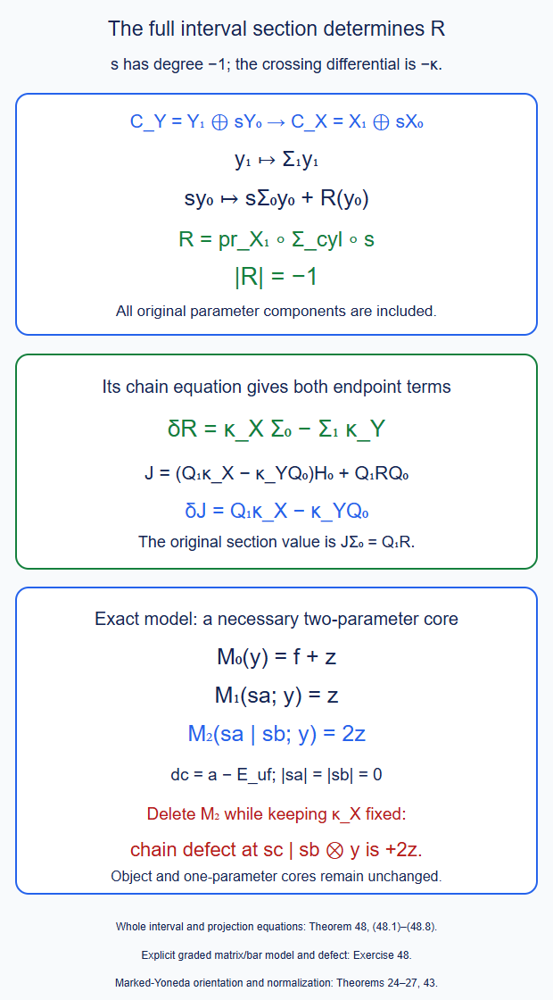

Theorem 48 and Exercise 48. The interval differential has
off-diagonal entry \(-\kappa\). In the displayed exact model,
omitting the two-parameter component leaves the defect \(+2z\).
[Editable SVG](../assets/rational-native-section-prism.svg).

## 49. Composition of section prisms and their whole product cubes

The sections in this section are closed degree-zero maps
\(\Sigma:Y\to X\) in the full typed dg mapping categories.
The source, target and parameter differentials are all retained.
For two such sections, a degree-\(r\) comparison datum is a triple
\[
 F=(A,B,R),\qquad
 A:X\to X',\quad B:Y\to Y',\quad R:Y\to X',
 \qquad |A|=|B|=r,\quad |R|=r-1 .
 \tag{49.1}
\]
Define its differential and the product of degree-\(s\) and
degree-\(r\) data by
\[
 \begin{aligned}
 \partial(A,B,R)&=(\delta A,\delta B,A\Sigma-\Sigma'B-\delta R),\\
 (C,E,K)(A,B,R)&=(CA,EB,KB+(-1)^sCR).
 \end{aligned}
 \tag{49.2}
\]
The section at the intermediate object supplies the types in
the second equation.

**Theorem 49 (full prism composition and every independent-product face).**
Equations (49.1)–(49.2) form a dg category, with identity
\((1,1,0)\). Its closed degree-zero morphisms are exactly the
whole section comparisons of Theorem 48. In particular their
composite retains the actual homotopy
\[
 R_{21}=C R+K B .
 \tag{49.3}
\]
For a homogeneous original mark, (43.2) is precisely the
differential equation in this category. Higher original marks
retain the higher components of (43.4); they do not impose
strict composition of their one-mark values.

For \(m\) closed degree-zero comparisons
\((A_i,B_i,R_i)\), put
\[
 u_i=A_i\Sigma_i,\qquad v_i=\Sigma_i'B_i,\qquad
 \delta R_i=u_i-v_i .
 \tag{49.4}
\]
There is one entire product cube, including all its higher
faces. Label each factor by \(1,0,e\), of degrees \(0,0,-1\),
respectively, and assign
\[
 T_i(1)=u_i,\qquad T_i(0)=v_i,\qquad T_i(e)=R_i .
 \tag{49.5}
\]
For a cube label \(\epsilon=(\epsilon_1,\ldots,\epsilon_m)\),
its full map is
\[
 \begin{aligned}
 \mathcal C_\epsilon&=T_1(\epsilon_1)\otimes\cdots
                                      \otimes T_m(\epsilon_m),\\
 \mathcal C_\epsilon(z_1\otimes\cdots\otimes z_m)
   &=(-1)^{\sum_{i<j}|T_j(\epsilon_j)||z_i|}
                  T_1(\epsilon_1)z_1\otimes\cdots
                  \otimes T_m(\epsilon_m)z_m .
 \end{aligned}
 \tag{49.6}
\]
Its degree is minus the number of \(e\)'s, and its full
boundary equation is
\[
 \delta\mathcal C_\epsilon
   =\sum_{\epsilon_j=e}(-1)^{\#\{i<j:\epsilon_i=e\}}
       \bigl(\mathcal C_{\epsilon[j:=1]}
                    -\mathcal C_{\epsilon[j:=0]}\bigr).
 \tag{49.7}
\]
The degree \(|z_i|\) in (49.6) is the entire input degree,
including its original parameter and source words.

For two factors the two telescoped homotopies and their
specified square correction are
\[
 \begin{aligned}
 R_{12}&=R_1\otimes u_2+v_1\otimes R_2,\\
 R_{21}&=u_1\otimes R_2+R_1\otimes v_2,\\
 K_{12}&=-R_1\otimes R_2,\\
 \delta K_{12}&=R_{12}-R_{21}.
 \end{aligned}
 \tag{49.8}
\]
In particular
\[
 K_{12}(z_1\otimes z_2)
       =-(-1)^{|z_1|}R_1z_1\otimes R_2z_2 .
 \tag{49.9}
\]
Every higher compatibility between these product faces is
already part of (49.7).

All these formulas are on whole tensor-comodule maps.
They retain their outside coactions and pull back along
any given entire joint parameter coalgebra map. Such a
pullback is not restricted to a chosen rectangle of prefixes.
Formal-unit normalization is inherited from the supplied
whole prisms, and an original nonidentity label with identity
operator image is retained.

**Proof.** Associate to \(\Sigma:Y\to X\) its cone
\[
 C(\Sigma)=X\oplus sY,\qquad
 D(x,sy)=(D_Xx-\Sigma y,-sD_Yy).
 \tag{49.10}
\]
It squares to zero because \(\Sigma\) is closed.
A degree-\(r\) datum acts on this cone by the actual
upper triangular graded matrix
\[
 M_F(x,sy)=
       \bigl(Ax+(-1)^{r+1}Ry,\;(-1)^rsBy\bigr).
 \tag{49.11}
\]
The factors \((-1)^r\) account for the degree-\(-1\)
suspension, rather than for an ordinary unsuspended
coefficient.
Directly applying the Hom differential to (49.11) gives
\[
 \delta M_F=M_{\partial F}.
 \tag{49.12}
\]
For example, its off-diagonal value on \(sy\) is
\[
 (-1)^{r+1}(\delta R)y+
                    (-1)^r(A\Sigma-\Sigma'B)y.
 \tag{49.13}
\]
This is the off-diagonal entry of \(M_{\partial F}\),
whose datum has degree \(r+1\). Likewise ordinary graded
matrix composition gives
\[
 M_GM_F=M_{GF}
 \tag{49.14}
\]
with exactly the sign \((-1)^s\) in (49.2).
The assignment is injective on every graded mapping space.
Upper triangular matrices are closed under the differential
and composition; their identity is the image of \((1,1,0)\).
Thus the matrix dg category proves \(\partial^2=0\),
the graded Leibniz rule, associativity and the asserted
identities for (49.2). Its closed degree-zero equation is
\(\delta R=A\Sigma-\Sigma'B\), proving (49.3).

For a degree-\(r\) original mark \(\theta\), equation (43.2)
says
\[
 \partial(A_\theta,B_\theta,R_\theta)
       =(A_{\delta\theta},B_{\delta\theta},R_{\delta\theta}).
 \tag{49.15}
\]
Its third component follows from
\(A_\theta\Sigma-\Sigma'B_\theta-\delta R_\theta
 =R_{\delta\theta}\).
For several marks use the entire cofree section \(\Sigma\)
of (43.4). The cone on that full map has differential
\[
 \begin{pmatrix}D_{\mathcal X}&-\Sigma s^{-1}\\0&-sD_{\mathcal Y}s^{-1}\end{pmatrix}.
 \tag{49.16}
\]
Its off-diagonal square is zero exactly by (43.5).
After the suspended coaction identification (48.2), this
is a cofree parameter comodule with object cones (49.10).
Its entries on each nonempty original parameter word
retain the corresponding entries of both original
parameter actions and of the full section. Squaring this
matrix therefore gives every one of their original
higher equations, including the unary and adjacent-product
terms. No higher section component is set to zero in
passing to this matrix description.

For the product assertion let \(I\) be the free complex
on \(0,1,e\), with \(de=1-0\) and both vertex
differentials zero. Equations (49.4)–(49.5) define a
chain map
\[
 I\longrightarrow\operatorname{Hom}(Y_i,X_i')
 \tag{49.17}
\]
for every \(i\). Tensor these maps and use the graded
evaluation map from the tensor of Hom complexes to the
Hom complex on the tensor inputs. Its evaluation sign
is exactly (49.6): the \(j\)-th map crosses all preceding
input factors. The Hom Leibniz rule shows that this
evaluation is a chain map. The tensor differential of
\(I^{\otimes m}\) crosses precisely the preceding
\(e\)-factors before replacing one \(e\) by \(1-0\).
This proves (49.7), including every face of every dimension.
It also proves all signs in the presence of odd source
coefficients and nonclosed original parameter labels.

Summing its edges with all \(0\)'s before the selected
edge and all \(1\)'s after it gives
\[
 R_{\mathrm{tel}}
   =\sum_{j=1}^m
       v_1\otimes\cdots\otimes v_{j-1}\otimes R_j
                         \otimes u_{j+1}\otimes\cdots\otimes u_m .
 \tag{49.18}
\]
The intermediate vertices cancel, leaving
\(\delta R_{\mathrm{tel}}=\bigotimes_i u_i-\bigotimes_i v_i\).
For two factors,
\[
 \begin{aligned}
 \delta(-R_1\otimes R_2)
   &=-(u_1-v_1)\otimes R_2+R_1\otimes(u_2-v_2)\\
   &=R_{12}-R_{21}.
 \end{aligned}
 \tag{49.19}
\]
Equation (49.9) is its evaluation sign. The tensor
differential of \(I^{\otimes m}\) squares to zero:
replacing two distinct \(e\)'s in opposite orders
has opposite signs, and each vertex has zero
differential. Consequently its higher faces provide
the asserted compatibilities, rather than only
pairwise homotopies between edge paths.

For coactions the graded tensor permutation places all
parameter prefixes before their coefficient suffixes.
Inserting (49.6) gives exactly the same permutation
whether the tensor map or coaction is applied first.
Equivalently, moving the homogeneous whole map of degree
\(-\#\{i:\epsilon_i=e\}\) past a prefix contributes
that degree times the total prefix degree. This is the
usual graded comodule equation, with no discarded
parameter term. The genuine joint-input shuffle of
Theorem 30 and an actual whole coalgebra pullback preserve
these chain and coaction equations. They preserve the
original labels as well. A consumed formal-unit core
vanishes in a normalized factor prism; an unconsumed
original word remains its input word. These observations
prove the remaining assertions. \(\square\)

The product cube applies to the independent-branch
section comparisons on their stated joint input.
A native graft comparison also specifies its actual
source pullback, target whiskering and connected-block
replacement maps. Those maps and their common section
must agree with the ones in these formulas for the
product cube to be their graft-face comparison.

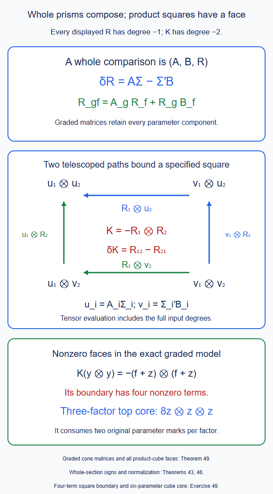

Theorem 49 and Exercise 49. In the exact model the square
correction has four nonzero terms at \(y\otimes y\).
The three-factor top cube also has a nonzero consumed
six-parameter core.
[Editable SVG](../assets/rational-native-prism-product-cube.svg).

## 50. Whole labelled replacement grids and exact coarsening

For each branch \(i=1,\ldots,r\), let
\(\Sigma_{i,k}:Y_{i,k}\to X_{i,k}\), \(0\le k\le n_i\),
be closed degree-zero sections. At each labelled stage retain
the whole closed comparison
\[
 F_{i,k}=(A_{i,k},B_{i,k},R_{i,k}),\qquad
 \delta R_{i,k}=A_{i,k}\Sigma_{i,k-1}
                         -\Sigma_{i,k}B_{i,k}.
 \tag{50.1}
\]
All maps have their actual source, target and parameter terms.
Composition in each branch is (49.3). Write
\[
 \begin{aligned}
 A_i[b,a]&=A_{i,b}\cdots A_{i,a+1},\\
 B_i[b,a]&=B_{i,b}\cdots B_{i,a+1},\\
 R_i[b,a]&=\sum_{k=a+1}^b
       A_i[b,k]R_{i,k}B_i[k-1,a].
 \end{aligned}
 \tag{50.2}
\]
Empty products are the typed identities and \(R_i[a,a]=0\).
Every original stage label remains in this formula.

A grid vertex is a tuple \(p=(p_1,\ldots,p_r)\).
Its section is \(\Sigma_p=\bigotimes_i\Sigma_{i,p_i}\).
For \(p\le q\), put
\[
 \begin{gathered}
 S(p,q)=\{i:p_i<q_i\},\qquad m=|S(p,q)|,\\
 A[q,p]=\bigotimes_i A_i[q_i,p_i],\qquad
 B[q,p]=\bigotimes_i B_i[q_i,p_i],\\
 C_{p,q}=(-1)^{m(m-1)/2}\bigotimes_i V_i,\qquad
 V_i=
 \begin{cases}
 R_i[q_i,p_i],&i\in S(p,q),\\
 \Sigma_{i,p_i},&i\notin S(p,q).
 \end{cases}
 \end{gathered}
 \tag{50.3}
\]
Tensor evaluation always has the full input-degree sign
of (49.6). In particular \(|C_{p,q}|=-m\), regardless
of the number of consecutive stages on an active branch.

**Theorem 50 (all grid faces, original interleavings and coarsening).**
Equations (50.1)–(50.3) specify one whole family of
section-prism faces on every finite labelled replacement grid.
It has the following exact boundary. List the active
branches increasingly as \(s_1,\ldots,s_m\).
For \(i\) active, let \(q^{(i)}\) replace \(q_i\) by \(p_i\),
and let \(p^{(i)}\) replace \(p_i\) by \(q_i\).
Then
\[
 \delta C_{p,q}
   =\sum_{a=1}^m(-1)^{m+a-2}
       \left(
         A[q,q^{(s_a)}]C_{p,q^{(s_a)}}
          -C_{p^{(s_a)},q}B[p^{(s_a)},p]
       \right).
 \tag{50.4}
\]
Thus both the target transport and the source transport
occur on each higher face.

The same family is exactly compatible with coarsening
consecutive stages. For each active branch choose
\(p_i<k_i\le q_i\), and define
\[
 \ell_i^k=k_i-1,\quad h_i^k=k_i
       \quad(i\in S(p,q)),\qquad
 \ell_i^k=h_i^k=p_i\quad(i\notin S(p,q)).
 \tag{50.5}
\]
The full coarse cell is precisely
\[
 C_{p,q}
   =\sum_k A[q,h^k]\,C_{\ell^k,h^k}\,B[\ell^k,p].
 \tag{50.6}
\]
There is no new choice of a primitive when a grid is regrouped.

Every original interleaving \(\pi\) of its branch stages
has the endpoint maps \(A[q,p],B[q,p]\). Its composite
section homotopy \(R_\pi\) obeys
\[
 \delta R_\pi=A[q,p]\Sigma_p-\Sigma_qB[q,p].
 \tag{50.7}
\]
For an adjacent swap of two stages on distinct branches
\(i<j\), let \(\pi_{ij}\) perform \(i\) then \(j\) and
\(\pi_{ji}\) the opposite order, with the same prefix
and suffix. Let \(u,v\) be the vertices just before and
after these two stages. Their specified comparison is
\[
 \begin{aligned}
 K_{\pi_{ij},\pi_{ji}}
    &=A_{\rm suffix}C_{u,v}B_{\rm prefix},\\
 \delta K_{\pi_{ij},\pi_{ji}}
    &=R_{\pi_{ij}}-R_{\pi_{ji}} .
 \end{aligned}
 \tag{50.8}
\]
All interleavings are connected by such swaps, keeping
the order of the original stages within each branch.
Higher cubical faces retain all the compatibilities (50.4),
and their iterated boundary terms cancel.

These are equations of whole parameter-comodule maps.
They retain the original higher cores under actual
joint-input pullback, source restriction and the specified
target comparisons. A formal identity stage has
\((A,B,R)=(1,1,0)\); inserting it changes no composite
and gives zero in a consumed face containing that stage.
An original nonidentity stage is not removed merely
because its leading maps, or even both entire endpoint
maps, are identities.

**Proof.** Repeated composition in the dg category of
Theorem 49 gives (50.2), with
\[
 \delta R_i[b,a]
    =A_i[b,a]\Sigma_{i,a}
                         -\Sigma_{i,b}B_i[b,a].
 \tag{50.9}
\]
One can also see this directly: differentiating the
\(k\)-th summand replaces \(R_{i,k}\) by (50.1).
The intermediate section terms cancel between consecutive
stages. Both endpoint terms remain.

Let \(T_m=(-1)^{m(m-1)/2}\). Differentiating the \(a\)-th
active factor in (50.3) crosses \(a-1\) degree-minus-one
factors. By (50.9), that factor becomes its two transported
section values. The tensor with the remaining factors
is exactly the indicated lower or upper face in (50.4).
The ratio of its two orientation constants is
\[
 T_m/T_{m-1}=(-1)^{m-1}.
 \tag{50.10}
\]
Consequently its total sign is
\((-1)^{a-1}(-1)^{m-1}=(-1)^{m+a-2}\), as asserted.
The inactive factors are closed sections, so contribute
no other terms. This proves the boundary in every
dimension, including \(m=1\) and the closed vertex
section when \(m=0\).

For the higher boundary cancellations, consider two
distinct active branches. Applying their two face
operations in either order gives the same transported
lower face: maps on distinct tensor factors commute
in degree zero, and a source transport on the right
commutes with a target transport on the left. Their
two alternating face signs are opposite. This pairs
every term of the iterated cubical boundary with
its opposite. The dimension constants (50.10)
multiply both members of each pair by the same
factor. Thus all iterated boundary terms cancel,
with the actual \(A\)'s and \(B\)'s still present.

Expand each active factor \(R_i[q_i,p_i]\) by (50.2).
A term in their tensor product chooses exactly one
stage \(k_i\) on every active branch. Its factor is
\[
 A_i[q_i,k_i]\,R_{i,k_i}\,B_i[k_i-1,p_i].
 \tag{50.11}
\]
The factors before and after each \(R\) have degree zero.
Grouping all the left factors and all the right factors
therefore introduces no extra sign. The intervening
tensor, with the unchanged constant \(T_m\), is
\(C_{\ell^k,h^k}\). This gives exactly (50.6).
All stage choices occur once. A second coarsening simply
regroups this same finite set of choices, so repeated
coarsening is strictly consistent.

An axis edge at a grid vertex is (50.1) in its selected
branch and the unchanged section in every other branch.
Its endpoint maps act in that selected factor.
Compose these edge triples by (49.3).
Induction gives (50.7). Their endpoint products depend
only on the ordered stages within each branch:
maps in different branches have degree zero and
commute on the tensor. This proves their independence
of the interleaving.

For two adjacent stages the two-edge composites are
the two telescoped expressions (49.8), tensored with
the other branches' current sections. The cell
\(C_{u,v}\) is their specified negative tensor
of the two \(R\)'s, with the same total input signs.
Hence its differential is their difference.
Composing a section comparison before these stages
right-multiplies this difference by its \(B\)-map;
composing one after them left-multiplies it by its
\(A\)-map. The other terms of (49.3) agree and cancel.
Both transports are closed, proving (50.8).
To connect any two interleavings, first sort each
branch-label word into increasing branch order by
adjacent swaps of unequal labels. These swaps never
exchange two stages of the same branch. Reversing
one such sorting sequence and following the other
gives a finite swap sequence between the two words.
Summing (50.8) along it gives their full comparison.

Every tensor permutation used above includes the
original parameter and source degrees. Tensoring
and composing their full comodule equations gives
the same outside coactions by Theorem 49.
The actual joint-input shuffle and whole coalgebra
pullbacks preserve these equations; no restriction
to a prefix rectangle has occurred. For an empty
branch list the tensor is the coefficient identity.
An outside nullary output mapping complex is
untouched by this convention.

Finally a formal identity stage has zero \(R\) and
identity transports. Its terms in (50.2) and (50.6)
are therefore zero or unchanged as stated. This
argument does not apply to an original nonidentity
stage with a possibly nonzero closed section
homotopy. Its original label and whole \(R\) remain.
This proves all assertions. \(\square\)

A compatible native grafting category can contain an
original simultaneous arrow for which an intermediate
axis state is absent. This theorem does not replace
that arrow by a path through absent states. Its
application to a native graft requires the actual
whole parameter map and its source and target graph
maps on that original domain.

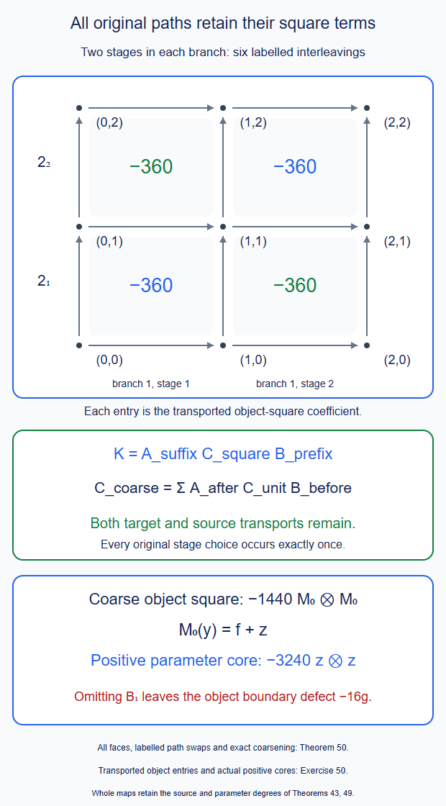

Theorem 50 and Exercise 50. The four unit squares give
the whole coarse square after their actual transports.
The positive parameter core differs from the object
value times the original homotopy.
[Editable SVG](../assets/rational-native-prism-replacement-grid.svg).

## 51. Original joint strings in their fixed outer operator corner

Use the actual native partial-forest functors of
Theorem [C.47.2.1](../GL-SAT-13.html#c472-the-actual-typed-enhanced-diagram), with their full composition comparisons,
and the compatible graft family of Theorem [C.47.3.1](../GL-SAT-13.html#c473-the-exact-compatible-grafting-domain).
Use one face-compatible recording of this entire native
partition family, as in [C.48.2](../GL-SAT-13.html#c482-simultaneous-face-compatible-strict-cells), throughout.
An execution arrow \(f:x\to y\) gives a functor
\(F_f:A_x\to A_y\) between its actual frontier categories.
It is not a Nat cochain between two objects in a fixed
operator corner. Native comparisons between composites
of these functors are the Nat cochains.

Fix an original initial state \(a\), its completed terminal
state \(b\), and a string in \(P_a=(a\downarrow\mathcal E_n)\):
\[
 u_0:a\to x_0
       \xrightarrow{g_1}x_1\longrightarrow\cdots
       \xrightarrow{g_q}x_q,\qquad
 u_j=g_j\cdots g_1u_0.
 \tag{51.1}
\]
Let \(h_q:x_q\to b\) be the actual terminal arrow.
The completed execution string is
\[
 \tau_\sigma=(u_0,g_1,\ldots,g_q,h_q).
 \tag{51.2}
\]
It retains every original selected-edge and execution
label. An endpoint arrow can be a formal identity;
an original proper arrow with identity operator image
is still a proper arrow.

Let \(\mathcal C_q\) be the poset of subsets
\(C\subseteq\{0,\ldots,q\}\). A chosen \(j\in C\)
places a cut at \(x_j\). Compose the original arrows
inside each consecutive block, obtaining actual arrows
\(f_1^C,\ldots,f_{\ell(C)}^C\) from \(a\) to \(b\).
Define the genuine functor
\[
 H_{\sigma,C}
     =F_{f_{\ell(C)}^C}\cdots F_{f_1^C}:A_a\to A_b .
 \tag{51.3}
\]
This is composition of the given functors, not a
tensor product of primitive \(A_\infty\)-functors.

**Theorem 51 (the original cut-operator family and its marked graph sections).**
All the functors (51.3) lie in the same actual outer corner
\(\operatorname{Fun}_\infty(A_a,A_b)\), on arbitrary
original input objects and full mapping words. In particular
\[
 H_{\sigma,\varnothing}=F_{a\to b},\qquad
 H_{\sigma,\{j\}}=F_{x_j\to b}F_{u_j}.
 \tag{51.4}
\]
The original full block-composition diagram specifies the
whole normalized parameter map
\[
 \mathcal S_\sigma:
 B(k\mathcal C_q)\longrightarrow
 B_{\rm full}\operatorname{Fun}_\infty(A_a,A_b).
 \tag{51.5}
\]
For \(C\subset C'\), its edge is the original comparison
from the coarse block functors to their refinement,
with all original source and target whiskerings.
Its higher components are the components of that same
native block-partition diagram. On a \(p\)-arrow cut flag,
its one-output Nat component has ordinary degree \(1-p\).
In particular a single block-expansion comparison
has degree zero.

Deleting \(x_i\) from (51.1) identifies its completed cut
family with the face of (51.5) on which \(i\notin C\).
The cuts after \(i\) are reindexed. At the first face
the new first arrow is \(g_1u_0\); at the last face
the new terminal arrow is \(h_qg_q\).
Thus no endpoint functor is silently removed.
Prepending or appending an actual endpoint arrow retains
its entire source pullback or target whiskering.

For a fixed actual outer functor \(W:A_b\to D\), form
\[
 e_\sigma=\operatorname{ev}_{A_a,A_b}
                   (\mathcal S_\sigma\otimes1):
 B(k\mathcal C_q)\otimes B_{\rm full}A_a
                         \longrightarrow B_{\rm full}A_b .
 \tag{51.6}
\]
Theorems 25, 27 and 43 applied to this exact coalgebra
map give the whole normalized marked section for the
graft of \(W\) with \(H_{\sigma,C}\), including its
projection and specified homotopies. For an original
edge comparison \(\xi:H_{\sigma,C}\to H_{\sigma,C'}\),
its section component is
\[
 R_\xi(k,c)=
   -(-1)^{|k|}
     \sum_{c=uv}\ \sum_{e_\sigma(s\xi,u)=\sum a_z z}
            a_z(k;z;1)\otimes v .
 \tag{51.7}
\]
Here \(s\xi\) denotes the original cut-edge input through
(51.5), with its whole evaluated value. Its degree is
\(-1\), its orientation is the one in (43.2), and all
higher cut-flag components come from that same full
section. On \(p\) original cut arrows and \(L\) source
letters the evaluated output length is at most \(p+L\).
These sections restrict to the indicated full faces.

An original compatible grafting string uses this
construction on its whole joint string, with its
original graft comparisons. It is not obtained by
clipping independent factor shuffles. If the terminal
image is a completed graft, its subsequent original
joining-seam arrow to the completed corolla is retained
in (51.2), with its full operator and comparisons.

**Proof.** The successive frontier categories of
\(\tau_\sigma\) match by the actual source and target
of every execution arrow. Merging consecutive execution
arrows gives their original selected-edge union and final
execution ideal, as in [C.47.1](../GL-SAT-13.html#c471-joint-arrows-and-the-sharp-height) and Theorem 46.
Consequently the block \(f_j^C\) is an actual arrow
between the two frontier categories at its endpoints.
The output category of one block is exactly the input
category of the next. Composing the block functors
therefore gives (51.3), on all of \(A_a\), with target
\(A_b\). No intermediate input is restricted to an
image of an earlier convolution.

With no cut, the block is the original unique arrow
\(a\to b\). With a single cut at \(x_j\), its prefix
composite is \(u_j\) and its suffix is the unique
arrow \(x_j\to b\). This proves (51.4), including
their actual object and mapping-input types.

Adding one cut expands precisely one native block
functor into its two consecutive partial forests.
[C.47.2.1](../GL-SAT-13.html#c472-the-actual-typed-enhanced-diagram) provides that full normalized comparison.
Whisker it by the preceding and succeeding block
functors using the actual [C69](../GL-SAT-13.html#c69-full-horizontal-operator-composition) horizontal map.
This retains their higher Taylor values.
For a flag of cuts use the corresponding entire
native partition comparison: all its groupings
execute the same original partial forests, and
[C.47.2.1](../GL-SAT-13.html#c472-the-actual-typed-enhanced-diagram) supplies their whole higher diagram.
The actual recording of this fixed-outer-type family
in [C.48.2](../GL-SAT-13.html#c482-simultaneous-face-compatible-strict-cells) is (51.5). Thus its chain and coalgebra
equations are those of the supplied entire diagram,
rather than equations inferred from chosen edge values.
The faithful typed extension of Theorems 36–37 retains
these same components in the common operator category.
It does not change their outer corner.

A \(p\)-arrow input in the cut bar has suspended
degree \(-p\). Its one-output operator letter also
has suspended degree \(-p\), so its unsuspended
Nat cochain has degree \(1-p\). This grading is
separate from the length of the original execution
string (51.1).

When \(x_i\) is deleted, the two execution arrows
meeting there are composed. If the cut at \(x_i\)
is absent, they already lie inside one block.
The surviving block composites and every surviving
cut label are therefore exactly those for the shorter
completed string. Their entire native comparison
family is the same full face of the original
block-partition diagram. This proves the face rule
on all cut flags, not just on its objects.
It also proves the first and last rules with the
displayed endpoint composites.

Prepending an actual source arrow replaces the
first block by its original composite with that
arrow. Its comparison with the corresponding
whiskered functor is the original prefix comparison;
Theorem 37 uses the full source bar map.
Appending a target arrow gives the original suffix
comparison and the full [C69](../GL-SAT-13.html#c69-full-horizontal-operator-composition) target whiskering.
All their joint comparisons are faces of the longer
completed string's native partition family.
They are not strict identifications of separately
chosen enhanced models.

By [C.69.1.1](../GL-SAT-13.html#c691-evaluation-with-every-parameter-mark-retained) and (51.5), equation (51.6) is an actual
dg coalgebra map. A cofree uncurved parameter functor
on \(p\) original arrows has no output word longer
than \(p\): each output letter consumes a nonempty
consecutive input block. Evaluation then has length
at most \(p+L\), by [C69](../GL-SAT-13.html#c69-full-horizontal-operator-composition)'s marked bound.
Thus Theorems 25 and 43 apply word by word to this
entire input, with finite formulas and their full
coaction signs. The middle quotient is exactly
Theorem 27's auxiliary quotient.
Equation (51.7) is (43.2) with \(|\xi|=0\);
its minus sign and coefficient sign use the
suspended degree \(|s\xi|=-1\).
The complete section equation gives all the higher
cut-flag components and their unary terms together.
Composing (51.6) with a full face restriction gives
the shorter string's very same map, so its graph
formulas restrict as claimed.

Finally take an original string in the full
compatible graft category. [C.47.3.1](../GL-SAT-13.html#c473-the-exact-compatible-grafting-domain) sends its
arrows and all their composites to actual grafted
partial forests, retaining every embedded selected
edge and joining seam. Apply the preceding
construction to that grafted string. Its comparisons
with the factor block forests are the supplied full
native graft comparisons, carried by the genuine
common input and whole [C69](../GL-SAT-13.html#c69-full-horizontal-operator-composition) operations of Theorem 37.
No intermediate factor state outside the compatible
category is inserted. The terminal image, if different
from the completed corolla, keeps its actual outgoing
seam arrow. This proves all assertions. \(\square\)

These are actual marked graph sections for the original
cut-operator families in their fixed outer contexts.
Identifying their graph maps with every expanded-edge
layout and interleaved native projection family requires
the corresponding common graph comparison. The typed
cut presentation alone does not assert that identification.

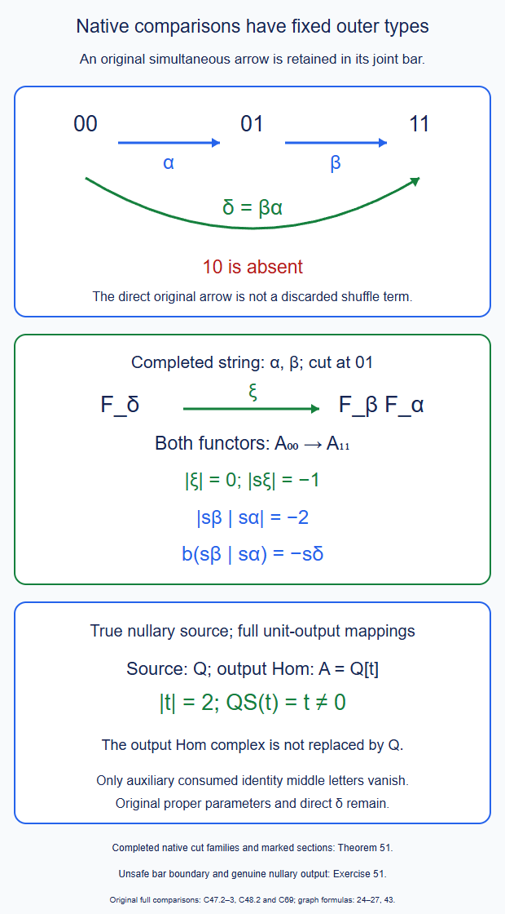

Theorem 51 and Exercise 51. Execution words and native
Nat comparison marks have different degrees. The missing
outer-first state is never inserted.
[Editable SVG](../assets/rational-native-original-cut-cubes.svg).

## 52. The specific section-comparison projection and relative lifts

An object of \(\mathscr S\) is a specified full special contraction
\[
 X\ \underset{I}{\overset Q{\rightleftarrows}}\ Y,\qquad
 QI=1,\quad \delta H=1-IQ,\quad H^2=HI=QH=0 .
 \tag{52.1}
\]
The mapping complexes and composition of \(\mathscr S\) are
exactly Theorem 49, with section \(I\).
Thus a degree-\(r\) map is \((A,B,R)\).
Both \(A\) and \(B\) have degree \(r\);
the degree of \(R\) is \(r-1\). Its differential is
\[
 \partial(A,B,R)=(\delta A,\delta B,AI-I'B-\delta R).
 \tag{52.2}
\]
Let \(\mathscr Y\) have the same labelled objects but mapping
complexes \(\operatorname{Hom}(Y,Y')\). The labels distinguish
different specified contractions even when their \(Y\)'s agree.
Use the full typed comodule maps throughout.

**Theorem 52 (a contracted mapping kernel and its relative coherent lift).**
The projection
\[
 \Pi:\mathscr S\longrightarrow\mathscr Y,\qquad
                   \Pi(A,B,R)=B
 \tag{52.3}
\]
is a unital dg functor, graded-surjective and a
quasi-isomorphism on every indicated mapping complex.
On each such complex define
\[
 \begin{aligned}
 \jmath(B)&=(I'BQ,B,0),\\
 \mathfrak h(A,B,R)
     &=\bigl((-1)^rAH+RQ,\ 0,\ 0\bigr).
 \end{aligned}
 \tag{52.4}
\]
These are a degree-zero chain section and degree-\(-1\)
homotopy, respectively, with exact identities
\[
 \begin{gathered}
 \Pi\jmath=1,\qquad
 \partial\mathfrak h+\mathfrak h\partial=1-\jmath\Pi,\\
 \mathfrak h^2=\mathfrak h\jmath=\Pi\mathfrak h=0 .
 \end{gathered}
 \tag{52.5}
\]
The section \(\jmath\) preserves composition. At an object
its unit defect is the actual boundary
\[
 1_{\mathscr S}-\jmath(1_Y)
           =(1_X-IQ,0,0)=\partial(H,0,0).
 \tag{52.6}
\]
In particular \(\Pi\) is unital; the mapping section
\(\jmath\) need not be unital.
Only \(\ker\Pi\) is contracted by \(\mathfrak h\).
The target mapping complex remains a retract.

Let \(\mathcal R=T_S(V)\) be a free relative graded
category with split coefficient category \(S\) and
generator filtration \(V=\bigoplus_{\ell\ge1}V_\ell\).
On \(V_\ell\), suppose
\[
 d_{\mathcal R}=d_1+\gamma,\qquad
 \gamma(V_\ell)\subset T_S(V_{<\ell}),\qquad
 d_{\mathcal R}^2=0 .
 \tag{52.7}
\]
Here \(d_1\) is the full unary differential on its
generator complex. Given a strict unital dg functor
\(F:\mathcal R\to\mathscr Y\), and the displayed
contraction at each of its objects, there is a strict
unital dg lift
\[
 \widetilde F:\mathcal R\to\mathscr S,\qquad
                         \Pi\widetilde F=F .
 \tag{52.8}
\]
It retains every previously specified lift on a
differential-stable collection of free generator
subcomplexes, provided their full values agree on
intersections. Prescribed scalar maps and units are
retained in the coefficient category. Thus the lift
keeps the given \(B\)-cochains exactly while constructing
their graph maps \(A\) and section cochains \(R\) together.

For the original cut families (51.5), take the graph
direction and graded opposite signs of Theorems 9 and 36.
At a cut vertex \(C\), let \(X_C\) be the actual edge-bar
string of the block functors in (51.3), and let
\(Y_C=\mathcal K_{H_{\sigma,C}}\). Theorem 33 gives
their specified full \(Q_C,I_C,H_C\).
The original entire native cut-operator family then
has a lift (52.8) to these objects, with its native
graph-direction \(B\)-cochains unchanged. Such lifts
can be chosen together over the cut-deletion faces
of Theorem 51. Every already prescribed whole face
lift can be retained when its stated intersection
conditions hold.

The prescribed one-edge native map of Theorem 40
already has an exact lift through this projection.
Regard its source full contraction as an object of
\(\mathscr S\), and its flat target \(W\) as the
identity contraction. For its entire original
comparison \(\widehat\kappa:Y\to W\), the triple is
\[
 \jmath(\widehat\kappa)
       =(\widehat\kappa\,\widehat Q,\widehat\kappa,0)
       =(\widehat G,\widehat\kappa,0).
 \tag{52.17}
\]
Thus preserving this full edge triple preserves
every mixed parameter core of the original native
edge map, including (40.9).

This cut-face assertion does not by itself identify
the lifted \(A\)'s with every prescribed native
one-edge map or every fixed product/graft face.
Those additional full faces must be specified and
shown to agree before the relative assertion applies.

**Proof.** Theorem 49 proves that (52.2) and its
composition form a dg category. Projection to \(B\)
preserves their differential, products and identity,
so (52.3) is a unital dg functor.
Since \(Q\) and \(I'\) are closed and \(QI=1\),
\[
 (I'BQ)I-I'B=0,\qquad
 \partial\jmath(B)=\jmath(\delta B),\qquad
 \Pi\jmath(B)=B .
 \tag{52.9}
\]
This proves graded surjectivity and the chain-section
claim. For composable \(B,B'\),
\[
 I''B'Q'I'BQ=I''B'BQ,
 \tag{52.10}
\]
and the third components of both lifted products are
zero. This proves multiplicativity of \(\jmath\).

Write \(E_r(A,R)=(-1)^rAH+RQ\).
The first component of
\(\partial\mathfrak h+\mathfrak h\partial\) is
\[
 \delta E_r(A,R)
       +E_{r+1}(\delta A,AI-I'B-\delta R)
                   =A-I'BQ ,
 \tag{52.11}
\]
by the exact relative-pair identity (47.3).
Its second component is zero. Its third component
is \(E_r(A,R)I=R\), again by (47.3).
Together these are \(1-\jmath\Pi\) on \((A,B,R)\).
Moreover
\[
 E_r(A,R)H=(-1)^rAH^2+RQH=0 ,
 \tag{52.12}
\]
so \(\mathfrak h^2=0\).
For \(\jmath(B)\), its first term contains \(QH=0\)
and its \(R\)-term is zero. Thus
\(\mathfrak h\jmath=0\); projection gives
\(\Pi\mathfrak h=0\). This proves (52.5).
Equation (52.6) is \(\delta H=1-IQ\) and \(HI=0\).
On \(\ker\Pi\), (52.5) is a contraction to zero;
on the whole mapping complex it is a deformation
retraction onto the actual target complex.
This proves precisely the stated quasi-isomorphism.

Here is the relative lifting argument, with the
generator unary differential retained.
Fix the coefficient lift and suppose the functor
has been defined below length \(\ell\).
Choose a graded \(S\)-linear lift \(v\) of
\(F|_{V_\ell}\), extending all prescribed generator
values. On the mapping complex out of
\((V_\ell,d_1)\), use
\[
 Df=\partial f-(-1)^{|f|}f d_1,\qquad
 o=Dv-\widetilde F\gamma .
 \tag{52.13}
\]
The defect \(o\) has degree one and takes values
in \(\ker\Pi\), because the original \(F\) is a
chain map. On the new generators, square-zero in
the source gives
\[
 d_{\mathcal R,<\ell}\gamma+\gamma d_1=0 .
 \tag{52.14}
\]
The lower lift is already a chain map, so
\(D(\widetilde F\gamma)=0\). Consequently \(Do=0\).

Postcomposition by \(\mathfrak h\) contracts this
exact Hom kernel, including its source unary
differential:
\[
 D(\mathfrak h f)+\mathfrak h(Df)=f .
 \tag{52.15}
\]
Indeed the two terms involving \(f d_1\) have
coefficients \(-(-1)^{|f|-1}\) and
\(-(-1)^{|f|}\), which cancel.
The remaining terms are
\((\partial\mathfrak h+\mathfrak h\partial)f=f\)
in the kernel. There is no additional sign in
postcomposition by this target contraction.
Thus
\[
 v_{\rm new}=v-\mathfrak h o,\qquad
 Dv_{\rm new}=\widetilde F\gamma,\qquad
 \Pi v_{\rm new}=F|_{V_\ell}.
 \tag{52.16}
\]
Extend this map multiplicatively to the free category.
Its dg equation on all words follows from its
equation on generators and the derivation rule.
Induction defines (52.8) on every finite word.

On a prescribed generator subcomplex \(W_\ell\),
the defect in (52.13) is zero. It is therefore a
closed map from the quotient complex
\(V_\ell/W_\ell\) to \(\ker\Pi\).
Equation (52.15) contracts this quotient Hom as
well, and (52.16) changes none of its prescribed
values. This proves the relative statement.
All scalar maps are assigned at the outset,
with the actual identity of \(\mathscr S\).
The nonunital mapping section \(\jmath\) is used
only to obtain graded lifts of new generators;
it never replaces these prescribed identities.

For the cut application, the finite directed
category \(\mathcal C_q\) has only identity
endomorphisms. Its normalized relative bar uses
all nonidentity original cut arrows. Merging
consecutive proper arrows remains a proper arrow.
For graph directions use \(\mathcal C_q^{\rm op}\)
and the higher graded-opposite signs of Theorem 9.
Its unital cobar is a free graded category on the
desuspensions of nonempty bar strings.
Filter generators by their original string length.
Unary differentials preserve length, bar mergers
lower it, and proper coproducts split into products
of smaller generators. This is exactly (52.7).
The original whole parameter map (51.5), followed
by the graph representation in its graded opposite
direction, gives the strict dg functor \(F\) into
\(\mathscr Y\). Its values are the original full
graph maps of the native cochains, rather than
chosen representatives of their classes.
Thus (52.8) applies to the actual objects \(X_C,Y_C\).

On the face deleting an original completed-string
vertex \(x_i\), the allowed cut vertices all
omit \(i\). Its bar generators are a subset of
the full generators. That subset is stable under
the unary and merger terms; each proper
coproduct uses strings in the same face.
A union of such faces has the same property.
The objects \(X_C,Y_C\) on a shared face are
the same block words, by Theorem 51.
Choose their fixed contraction by that block
word, so the restricted objects of \(\mathscr S\)
agree as well.
The original \(B\)-values agree on these faces
because one face-compatible native recording was
fixed in Theorem 51.
Induct first on completed-string dimension and
then on generator length. At each step the
already assigned cut-deletion faces form exactly
such a differential-stable free subcategory.
Their intersections have the previously assigned
values. The relative construction therefore
retains them all. Countably many finite strings
are handled by this same compatible induction;
each original finite generator is assigned once.

For (52.17), the target section is \(1_W\), so
the definition of \(\jmath\) gives its first
displayed triple. Its first entry is precisely
Theorem 40's prescribed full \(\widehat G\).
Its third differential is zero by the entire
identity \(\widehat QI=1\):
\[
 \widehat G I-\widehat\kappa
             =\widehat\kappa(\widehat QI-1)=0.
 \tag{52.18}
\]
This equality uses the complete parameter maps.
It does not replace \(\widehat\kappa\) by its
object component, and it does not remove its
mixed cuts. The triple may therefore be
prescribed wherever it is an edge of the
relative free source. Its occurrence in more
than one such face requires the same entire
triple on their overlap.

Every map in (52.4), (52.13) and (52.16) is a
full typed cochain. Its products preserve the
given outside coactions and source-unit
normalization. The specific \(R\)-values on
prescribed faces are unchanged, including their
closed parts. Proper original parameters with
identity-valued images remain original source
generators throughout this induction.
No fixed product or graft covariance equation
follows just from the existence of a lift
through \(\Pi\); its stated relative hypotheses
are what preserve such equations when their
entire compatible faces have been provided.
This proves all assertions. \(\square\)

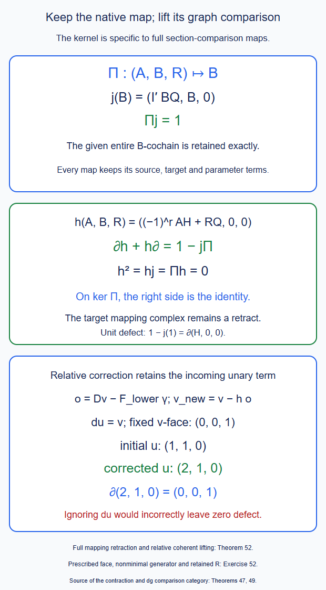

Theorem 52 and Exercise 52. The mapping retraction has
an exact unit defect; the lifted functor uses the actual
prescribed identities. The target mapping complex is
retained as a retract.
[Editable SVG](../assets/rational-native-section-projection-kernel.svg).

## 53. A native block replacement inside a partially collapsed graph

Let \(e\) join two adjacent operation vertices of a specified
native block string or rooted edge-bar graph \(T\).
First collapse it to the literal composite vertex (33.1).
Call the resulting graph \(L\). Retain a supplied entire
native comparison from the corresponding flattened block
functor to that literal composite. Replacing that one vertex
by the native block gives a graph \(L'\).
All the other vertices, edge bars and original frontier
categories retain their original labels.

Use graph directions throughout:
\[
 \widehat Q_e:Z_T\to Z_L,\qquad
 V_\alpha:Z_L\to Z_{L'},\qquad
 B_\alpha:\mathcal K_{f_L}\to\mathcal K_{f_{L'}}.
 \tag{53.1}
\]
Here \(V_\alpha\) is the entire vertex graph action of the
original comparison, including its original surrounding
whiskerings. The endpoint map \(B_\alpha\) is that same
comparison under full [C69](../GL-SAT-13.html#c69-full-horizontal-operator-composition) substitution into the represented
composite. The symbol \(\alpha\) can denote a whole original
parameter family, with its full comparison prism.
Its local edge categories are fixed on the stated refinement.
The parameter input is the actual entire compatible coalgebra
map, as in Theorems 37 and 51.

Let \(I_T,I_L,I_{L'}\) be their full marked multicut sections.
Identify the represented endpoints for \(T\) and \(L\) using
their literal, equal composite coalgebra map; denote that
endpoint by \(Y\). Put \(Y'=\mathcal K_{f_{L'}}\).

**Theorem 53 (the prescribed elementary partial-replacement triple).**
On this entire original parameter and source encoding,
\[
 \widehat Q_e I_T=I_L .
 \tag{53.2}
\]
The original marked multicut section supplies a definite
degree-\(-1\) comparison \(R_\alpha:Y\to Z_{L'}\), with
\[
 \delta R_\alpha=V_\alpha I_L-I_{L'}B_\alpha .
 \tag{53.3}
\]
Consequently the actual partial native block replacement
has the closed section-comparison triple
\[
 \begin{gathered}
 A_e=V_\alpha\widehat Q_e:Z_T\to Z_{L'},\\
 (A_e,B_\alpha,R_\alpha)\in\mathscr S,\qquad
 \delta R_\alpha=A_eI_T-I_{L'}B_\alpha .
 \end{gathered}
 \tag{53.4}
\]
The graph map \(A_e\) contracts exactly the selected edge,
then applies the original native block comparison. It does
not collapse the other edge bars to their represented endpoint.
Its \(B_\alpha\) and \(R_\alpha\) retain their entire original
components, including the closed part of the supplied
section homotopy.

Choose full contraction paths \(Q_T,H_T\) and \(Q_{L'},H_{L'}\)
with these very sections. The prescribed projection square
then has the comparison
\[
 \begin{aligned}
 D_e&=Q_{L'}A_e-B_\alpha Q_T,\\
 J_e&=D_eH_T+Q_{L'}R_\alpha Q_T,\\
 \delta J_e&=D_e,\qquad J_eI_T=Q_{L'}R_\alpha .
 \end{aligned}
 \tag{53.5}
\]
No naturality of the two independently selected kernel
homotopies is asserted or required.

The entire triple restricts to any full native parameter
face with the same local data. In particular its appearances
on the cut-deletion faces of Theorem 51 are the same triple
whenever that elementary cut survives. It also extends
through unchanged surrounding graph branches by its full
outside module and coaction maps, with the genuine input
shuffle and its Koszul signs. These are comparisons on the
specified common graph refinement.

In the cut-family lift of Theorem 52, all elementary
native cut edges can therefore be prescribed by their
actual triples (53.4), together with the cut-deletion
faces. The lift retains these edges and every original
higher \(B\)-component. This does not require their
two possible edge composites on a square to agree
strictly; the original higher cut generators remain.

**Proof.** Use the actual local one-edge construction of
Theorem 33. On parameterized inputs this is Theorems 25–27,
with the whole marked evaluations in its child and other
input slots. Its full outer-operator projection includes
the positive parameter components of (40.5). Thus
\(\widehat Q_e\) here is the complete map, rather than
the object projection applied independently to every
parameter value. Its target is the literal composite,
with the original input and output coactions.

By the full multicut identity of Theorem 44, expanding
edge \(e\) last or first gives exactly the same entire
section. In the order which singles out that edge it is
\[
 I_T=S_e I_L,\qquad \widehat Q_e S_e=1 .
 \tag{53.6}
\]
The local \(S_e\) uses the complete evaluated child
prefix and the actual identity coefficient, with every
unconsumed original parameter and source tail retained.
The identity in (53.6) is the full Yoneda section identity
of Theorems 24–27, also used in Theorem 33.
Applying \(\widehat Q_e\) proves (53.2).
Equivalently, the inserted coefficient identity makes
every higher consumed parent core vanish, while the
surviving linear unit core returns the original cut.
All mixed parameter terms are part of that cancellation.

For the native vertex replacement, keep the collapsed
graph \(L\) fixed as a labelled graph and vary its
selected vertex by the actual entire \(\alpha\)-prism.
The other vertex data are the same original data in
their matching corners. The native comparison belongs
to that local fixed-profile functor category by
[C.47.2](../GL-SAT-13.html#c472-the-actual-typed-enhanced-diagram) and Theorem 51. Its source and target whiskerings
are the full operations of Theorem 37.
The strict graph action of Theorem 34 gives its
graph-direction crossing map \(V_\alpha\).
At the represented endpoint, recursive full evaluation
gives exactly \(B_\alpha\). The [C69](../GL-SAT-13.html#c69-full-horizontal-operator-composition) identity (44.3)
identifies its nested evaluation with this whole
whiskered native comparison, on every original input
word. It retains positive target Taylor values.

Apply the full section of Theorem 44 to this vertex
prism and its original parameter input. It gives one
entire interval section, with diagonal sections
\(I_L,I_{L'}\) and crossing maps \(V_\alpha,B_\alpha\).
Let \(R_\alpha\) be its off-diagonal part in the
orientation of (48.3)–(48.4).
Theorem 48 proves (53.3) and its degree, including
all original higher parameter terms.
For a single ordinary homogeneous vertex mark
\(\theta\) of degree \(r\), its local core is
the actual component \(R_\theta=-W_{s\theta}\) of
(43.2), of degree \(r-1\). Extraction past a
coefficient \(k\) uses the sign
\[
 (-1)^{(r-1)|k|}.
\]
For several original marks
use the same entire section (43.4), inserted into
the multicut of the other edges. No unrelated
primitive is chosen for any of these components.

The native comparison, the literal edge projection
and their parameter maps are closed degree-zero
whole maps. Their product \(A_e\) is therefore
closed, and (53.2) gives
\[
 A_e I_T-I_{L'}B_\alpha
      =V_\alpha I_L-I_{L'}B_\alpha
      =\delta R_\alpha .
 \tag{53.7}
\]
This proves the actual triple (53.4) in the dg
category of Theorems 49 and 52.
For the projection square, \(D_e\) is closed and
\[
 D_eI_T
    =Q_{L'}(A_eI_T-I_{L'}B_\alpha)
    =\delta(Q_{L'}R_\alpha).
 \tag{53.8}
\]
Theorem 47 gives exactly (53.5).
This uses the fixed \(Q_T,H_T\) and \(Q_{L'},H_{L'}\)
as they stand. No square between separately chosen
homotopies was used.

Here are the local restriction and context assertions.
On a full face of the original parameter family,
each marked evaluation is composed with the same
restricted coalgebra map. All local sums enumerate
the same cuts, and each retained word retains its
original label. Thus the restrictions of
\(\widehat Q_e,V_\alpha,B_\alpha,R_\alpha\)
are precisely the displayed constructions for
those same data on that face.
On a cut-deletion face of Theorem 51 where the
elementary replacement survives, its two block
functors and their original comparison are the
same actual block word and mark. The graph
outside it is the same remaining block string.
Hence its occurrences have the same full triple.

To insert an unchanged graph branch, tensor the
local maps with the identity on its original
coefficient and input factors, then apply the
specified graded permutation into vertex order.
The local chain, module and coaction equations
ensure that every differential involving that
branch is retained in the two orders.
An incoming bar action uses the original input
coaction; an outgoing action uses the full output
module map. Their equality is exactly the
outside compatibility of Theorems 25–27 and 33.
The extraction sign is the Koszul sign of the
same final list of original factors. The marked
multicut section of the larger graph agrees
with that insertion by Theorem 44.
For several genuine input branches, use the
joint dg shuffle of Theorem 30 before evaluation.
Thus no tensor product of primitive
\(A_\infty\)-functors, or unavailable axis
intermediate state, enters this construction.

For the last cut-family assertion, assign every
elementary cut edge its closed degree-zero
triple (53.4). A one-arrow cobar generator has
zero differential because its original cut
arrow is closed and has no proper merger or
coproduct. Hence these assignments define a
dg functor on the free subcategory generated
by those edges. Their values on previously
assigned cut-deletion faces agree by the
restriction assertion just proved.
The union with the previously assigned
deletion-face generators is differential-stable.
Products mixing these generators are assigned
multiplicatively in the free category; no
equality between two distinct edge paths
is imposed at this stage.
Apply Theorem 52 relative to this subcategory.
At every remaining generator the projected
value is its original entire \(B\)-cochain,
and the correction changes neither the
prescribed edges nor deletion faces.
Induction over completed-string dimension
retains their common assignments.

For example, a two-arrow cut generator has
degree \(-1\), and its original projected
component is the supplied native
degree-\(-1\) comparison. Its lift must satisfy
the entire equation
\[
 \partial\widetilde F_{ba}
         =\widetilde F_{b\circ a}
                          -\widetilde F_b\widetilde F_a .
 \tag{53.9}
\]
The right side uses the actual prescribed
edges wherever they are elementary.
The projection is the original native
boundary equation. Its remaining defect is
in the specific kernel of Theorem 52 and
is corrected by (52.16), including all
mapping inputs. Thus this construction
retains the native higher comparison
instead of imposing equality of its two
endpoint paths.

The normalization is the actual auxiliary
middle quotient of Theorem 27. It removes a
consumed literal identity middle letter, while
the original parameter and source bars remain.
A true nullary child has the empty input cut
and its entire output mapping complex.
The same arguments therefore include zero
inputs and proper identity-valued parameters.
This proves all assertions. \(\square\)

Theorem 53 gives actual elementary triples with their
local contextual restrictions. The relative lift of
Theorem 52 must also retain all prescribed higher
product and graft subfamilies on their common overlaps.
Equality of these elementary restrictions alone does
not specify every higher relative face.

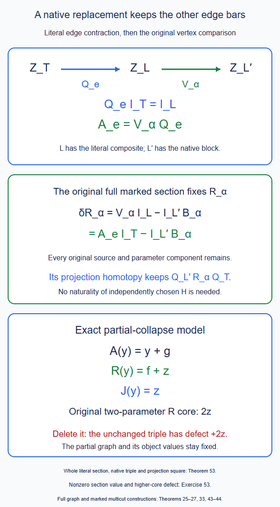

Theorem 53 and Exercise 53. In the exact model the
partial graph map sends \(y\) to \(y+g\), while its
original section value is \(f+z\). Its higher section
core cannot be discarded.
[Editable SVG](../assets/rational-native-partial-block-replacement.svg).

## 54. Graft whole section families through the expanded joining seam

For matching outside types, write \(X_1\star X_2\)
for the literal graph graft of Theorem 32, with its
joining bar still present. This is the ordinary
bar-bicomodule composition, with all intermediate
objects and the auxiliary middle quotient retained.
It applies to the full typed module/comodule maps
used here, including homogeneous homotopies.
No represented endpoint projection is implicit in
the symbol \(\star\).
For separate parameter families the initial
parameter coalgebra is their genuine tensor
coalgebra. Restriction from another joint
index requires its actual whole coalgebra
map into this input. Deconcatenation is not
being used as a coalgebra diagonal from a
single parameter bar into that tensor input.

Suppose \(Q_i,I_i,H_i:X_i\rightleftarrows Y_i\)
are full special contractions. Their \(Y_i\)'s
are the actual represented graph objects of the
block functors, with matching seam category.
The object \(Y_1\star Y_2\) is still an expanded
two-block graph. It is not their single represented
composite.

**Theorem 54 (the whole expanded-seam graft family).**
Literal grafting on these full maps is a dg bilinear
operation, with its graded interchange sign.
There is a full special contraction
\[
 \begin{gathered}
 X_1\star X_2
   \ \underset{I_\star}{\overset{Q_\star}{\rightleftarrows}}\
 Y_1\star Y_2,\\
 Q_\star=Q_1\star Q_2,\qquad
 I_\star=I_1\star I_2,\\
 H_\star=H_1\star1_{X_2}+(I_1Q_1)\star H_2 .
 \end{gathered}
 \tag{54.1}
\]
The seam differential is part of both graph objects.
For three consecutive blocks, either consecutive
regrouping of (54.1) gives exactly
\[
 \begin{aligned}
 H_\star={}&H_1\star1\star1\\
     &+(I_1Q_1)\star H_2\star1\\
     &+(I_1Q_1)\star(I_2Q_2)\star H_3 .
 \end{aligned}
 \tag{54.2}
\]
The corresponding \(Q_\star,I_\star\) also agree.

Let \((A_i,B_i,R_i)\) be closed degree-zero whole
section comparisons between two such systems.
Their expanded-seam comparison is
\[
 \begin{aligned}
 A_\star&=A_1\star A_2,\qquad B_\star=B_1\star B_2,\\
 R_\star&=R_1\star(A_2I_2)+(I_1'B_1)\star R_2,\\
 \delta R_\star&=A_\star I_\star-I_\star'B_\star .
 \end{aligned}
 \tag{54.3}
\]
Every product in this formula is the product of
whole maps; its parameter cuts and its tensor
evaluation signs are retained.
All higher independent-product faces are given by
Theorem 49 with \(\otimes\) replaced by this dg
graft operation. Their coarsening and ordered
interleavings are the full families of Theorem 50.

Now retain the actual joining-seam contraction
\[
 Y_1\star Y_2
       \ \underset{s}{\overset p{\rightleftarrows}}\
 Y_{12},\qquad \delta h=1-sp ,
 \tag{54.4}
\]
where \(Y_{12}\) represents the literal composite
block functor. Its primed counterpart has maps
\(p',s',h'\). Use the original full [C69](../GL-SAT-13.html#c69-full-horizontal-operator-composition) horizontal
comparison \(B_{12}:Y_{12}\to Y_{12}'\), with all
its mixed parameter cores.
The whole marked joining-seam section supplies
the specific \(\eta\) with
\[
 \delta\eta=B_\star s-s'B_{12}.
 \tag{54.5}
\]
Thus the actual grafted contraction and its comparison
to the represented endpoint are
\[
 \begin{gathered}
 Q=pQ_\star,\qquad I=I_\star s,\qquad
 H=H_\star+I_\star h Q_\star,\\
 R=R_\star s+I_\star'\eta,\qquad
 \delta R=A_\star I-I'B_{12}.
 \end{gathered}
 \tag{54.6}
\]
In particular the original joining-seam homotopy
\(\eta\) remains, even if some leading maps agree.
An additional native comparison with a chosen
flattened operation is carried by Theorem 53
with its original whole map.

These formulas construct entire coherent families
on their stated joint parameter coalgebra.
For a three-block overlap, the two expanded
graft presentations and their whole product
sections are identical under the actual tensor
and cotensor associativity identifications.
Their joining sections are the same full
multicut section of Theorem 44.
This does not assert equality of the two
final joining-seam projection paths. Those
paths retain the full comparisons of
Theorems 29, 35 and 42.

**Proof.** Before taking the seam quotient,
the graft is a tensor of its original coefficient
factors and the cofree seam bar, followed by
the ordinary cotensor equalizer of Theorem 32.
An outer map preserves its full input coaction;
an inner map preserves its strict output action.
They therefore induce a map of this equalizer.
For homogeneous maps \(f,g\), its tensor sign
before the root-first insertion is
\((-1)^{|g||x|}\) on \(x\otimes z\).
The further insertion sign is exactly (32.6).

The tensor differential obeys the dg Leibniz
rule. The last-letter seam term is (32.7):
its two orders with the inner map agree by
graded output linearity, and its orders with
the outer map agree by the full input-coaction
equation. These are the remaining terms of
that same Leibniz rule. Thus
\[
 \begin{aligned}
 \delta(f\star g)&=(\delta f)\star g
                                +(-1)^{|f|}f\star\delta g,\\
 (f'\star g')(f\star g)
     &=(-1)^{|g'||f|}(f'f)\star(g'g).
 \end{aligned}
 \tag{54.7}
\]
If an auxiliary middle identity is consumed
by a normalized positive core, that term is
zero; otherwise it remains an auxiliary
identity in the resulting seam word.
Thus the maps descend to the same middle
quotient. Neither an outside source bar nor
an output coefficient is removed.

Differentiate \(H_\star\) using (54.7).
Its two contributions are
\[
 (1-I_1Q_1)\star1
       +(I_1Q_1)\star(1-I_2Q_2)
                       =1-I_\star Q_\star .
 \tag{54.8}
\]
The identity \(Q_\star I_\star=1\) follows
from the two individual section identities.
The two cross terms in \(H_\star^2\) contain
respectively \(H_1I_1\) and \(Q_1H_1\);
both vanish. Its other terms contain
\(H_1^2\) or \(H_2^2\). Likewise
\(H_\star I_\star=Q_\star H_\star=0\).
This proves every special contraction identity.
Expanding either three-block regrouping gives
exactly (54.2); the two summands at a binary
step partition the same ordered list of
three factors. The same expansion works for
any finite ordered list.

For (54.3), differentiate its two summands.
Since \(|R_i|=-1\) and all \(A_i,B_i,I_i\)
are closed, the result is
\[
 \begin{aligned}
 &(A_1I_1-I_1'B_1)\star(A_2I_2)\\
 &\quad+(I_1'B_1)\star(A_2I_2-I_2'B_2)
       =A_\star I_\star-I_\star'B_\star .
 \end{aligned}
 \tag{54.9}
\]
The middle terms cancel as entire maps.
For every higher product face, apply the
dg multilinear graft functor just proved
to the tensor interval complexes in
Theorem 49. Its differential is their
alternating cubical boundary, with the
full degree of each preceding input.
Associativity of the literal insertion
is (32.8), so their ordered regrouping
and coarsening are exactly Theorem 50.
This includes all the degree-minus-two
and higher mixed faces.

For coherent parameter diagrams, perform
this construction on the entire cofree
parameter comodules. The cone description
(49.16) packages each complete section
and its original higher components as
one closed map. Tensoring those maps
and taking the same cotensor equalizer
gives a closed full section on the
expanded-seam diagram. Every coefficient
core is obtained by its original parameter
cuts; the tensor coproduct supplies
their Koszul signs. Projecting this
closed map to each core gives all
the higher section equations together.
No reconstruction from just the
degree-zero edges is involved.

The endpoint family is still expanded
at this point. Its actual functor
parameters and genuine common-input
bars give the joining section \(s\)
of Theorems 25–27. The represented
endpoint comparison is the whole [C69](../GL-SAT-13.html#c69-full-horizontal-operator-composition)
horizontal coalgebra map, evaluated
on precisely these parameters.
The marked joining-seam section of
Theorems 43–44 is therefore an entire
prism with graph crossing \(B_\star\)
and represented crossing \(B_{12}\).
Theorem 48 extracts its specific
\(\eta\) and proves (54.5).
This is the original marked section,
including all mixed horizontal terms;
it is not a new homotopy chosen after
discarding those terms.

The contraction in (54.6) is the
two-stage special contraction formula
of Theorem 42. Its section comparison
has differential
\[
 \begin{aligned}
 \delta(R_\star s+I_\star'\eta)
   &=(A_\star I_\star-I_\star'B_\star)s\\
   &\quad+I_\star'(B_\star s-s'B_{12})\\
   &=A_\star I-I'B_{12}.
 \end{aligned}
 \tag{54.10}
\]
The cancellation retains the very
same \(B_\star\) on both sides.
It retains \(\eta\) itself, including
any closed component it has.
The projection square now follows
from Theorem 47 with this \(R\).

On a three-block common refinement,
flatten the coordinate insertion
before making any represented projection.
Both groupings give the identical ordered
coefficient, seam-bar and source factors,
by Theorem 32. Their full parameter
coactions are the same tensor cuts.
The expanded product contraction and
product-section formulas are (54.2)
and Theorem 49's ordered telescoping
formula; expanding either grouping
gives the same full maps.
At the represented joining section,
[C69](../GL-SAT-13.html#c69-full-horizontal-operator-composition) associativity gives the same nested
marked evaluations, and Theorem 44 gives
the same multicut section in either
expansion order. Thus the joining
section and every extracted parameter
component agree on this common input.

For the final projection one instead
has different full retraction paths.
They share that multicut section;
Theorems 29 and 35 give their actual
signed \(PH\cdots H\) comparisons on
all parameter words. Composing towers
keeps the original ladder section
homotopies and the degree-minus-two
terms of Theorem 42. Consequently
none of this proof identifies those
projection paths strictly.

Every operation used here is full
graded composition, a tensor cut,
or an ordinary cotensor pullback.
It therefore restricts along an actual
whole native parameter map, even on
a compatible domain without a safe
prefix rectangle. The zero-branch
case uses the coefficient identity;
the nullary output Hom complex is
still present. Proper original
identity-valued parameters remain
in that input. This proves all
assertions. \(\square\)

The expanded-seam family supplies a common
presentation of higher graft subfamilies.
To use it as prescribed data in Theorem 52,
the original face maps must be transported
to that presentation with their whole
native comparisons and projection-path
data. Equal leading maps do not supply
that transport or its relative overlaps.

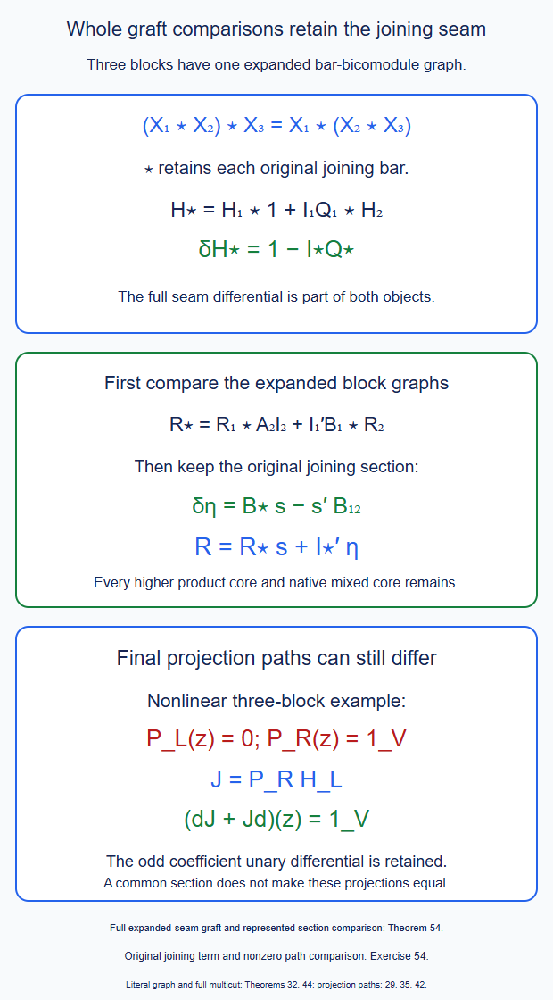

Theorem 54 and Exercise 54. Three blocks
have one literal expanded graph and one
full multicut section. Their represented
projection paths need not be equal.
[Editable SVG](../assets/rational-native-expanded-seam-graft.svg).

## 55. The whole original joint-parameter common-input roof

Let \(P\) be the actual finite compatible parameter category, with
all its selected original arrows. Its coordinate functors give a
strict functor
\[
 d:P\longrightarrow\prod_{i=1}^m P_i .
 \tag{55.1}
\]
Linearization identifies the category on the right with
\(D=\bigotimes_i kP_i\). It does not identify different arrows of
\(P\) having the same image. All categories in this section have
their original object labels and split degree-zero coefficients.
In the native application \(P\) is the full compatible category
of [C.47.3](../GL-SAT-13.html#c473-the-exact-compatible-grafting-domain), or an original labelled parameter face of it.

Put
\[
 \begin{gathered}
 R_P=Q^{\mathrm u}(kP),\qquad
 T=T(kP_1,\ldots,kP_m),\\
 p=(\bigotimes_i\epsilon_i)\rho_m:T\longrightarrow D,\qquad
 F=d\epsilon_P:R_P\longrightarrow D .
 \end{gathered}
 \tag{55.2}
\]
Here every resolution, unit relation and counit is the actual
normalized unital construction of [C.72](../GL-SAT-13.html#c72-normalized-unital-cobar-models) and [C.74](../GL-SAT-13.html#c74-normalized-tensor-parameters-and-relative-coherent-cells)–[C.76](../GL-SAT-13.html#c76-finite-factor-tensor-comparisons-and-ordered-cuts).

**Theorem 55 (an actual joint-parameter roof and its relative choices).**
There is a strict unital dg functor
\[
 \xi_P:R_P\longrightarrow T,\qquad p\xi_P=d\epsilon_P .
 \tag{55.3}
\]
One can retain previously prescribed lifts on any compatible
union of differential-stable free-generator faces. With the full
normalized bar-cobar unit
\(\eta_P=B\iota_{kP}:B_{\rm full}(kP)\to B_{\rm full}R_P\),
the map
\[
 \begin{gathered}
 \Lambda_P=B\xi_P\,\eta_P:
 B_{\rm full}(kP)\longrightarrow B_{\rm full}T,\\
 Bp\,\Lambda_P=Bd
 \end{gathered}
 \tag{55.4}
\]
is an actual chain coalgebra map, with this exact whole counit
square. It is normalized unital and finite on every original word.
The source retains every original simultaneous arrow.

For a fixed \(F\), any compatible cubical boundary of strict lifts
extends to a full cube of lifts over \(F\), relative to already
prescribed free-generator faces. Consequently independently chosen
lifts are linked by whole paths and all higher choice comparisons.
The assertion also applies after any ordered regrouping
\(\kappa_\pi:T\to\bigotimes_jT_{I_j}\). It supplies coherent
comparisons with independent regrouped choices, rather than
strict naturality of those choices.

There is also an exact recorder for a whole normalized multi-input
family. Put \(K=\bigotimes_iB_{\rm full}(kP_i)\), and let
\(\eta_K:K\to B_{\rm full}T\) be its actual full unit followed
by the normalized quotient. If
\(\Theta:K\to B_{\rm full}E\) is such a family in a unital dg
category \(E\), there is a strict unital dg functor
\[
 \widehat\Theta:T\longrightarrow E,\qquad
 B\widehat\Theta\,\eta_K=\Theta .
 \tag{55.10}
\]
It retains every mixed core and commutes with actual parameter
face restrictions. In particular the whole section-comparison
family of Theorem 54 has a recorder in the category of Theorem 52.
Its restriction
\(B\widehat\Theta\,\Lambda_P\) is a genuine whole family on
the original \(P\). No factorization of \(\widehat\Theta\)
through an ordered tensor regrouping is required.

**Proof.** Each \(\epsilon_i\) is graded-surjective and a mapping
quasi-isomorphism by Theorem [C.72.1.1](../GL-SAT-13.html#c721-the-normalized-quotient-and-its-actual-counit). Its normalized linear SDR
retains all original unary and constant terms. Tensor their SDRs
in the original order. The homotopy is the finite sum with the
retract projection on every preceding factor and the homotopy on
the selected factor, exactly as in (54.1). The graded tensor
differential gives the full prefix-degree sign. This proves that
\(\bigotimes_i\epsilon_i\) is graded-surjective and a mapping
quasi-isomorphism, with a coefficient-linear mapping SDR.
Theorem [C.76.1.1](../GL-SAT-13.html#c761-all-finite-factors-and-one-contraction-for-every-ordered-cut) gives the same properties for \(\rho_m\).
Composing the two SDRs gives these properties for \(p\).
In particular its actual mapping kernel \(N\) has a normalized
coefficient-linear contraction \(h_N\), with
\[
 d h_N+h_Nd=1_N,\qquad h_N^2=0 .
 \tag{55.5}
\]
All these formulas are finite on individual inputs. They require
no positivity of the ordinary parameter arrows.

Theorem [C.72.1.1](../GL-SAT-13.html#c721-the-normalized-quotient-and-its-actual-counit) displays \(R_P\) as a relative graded free
category. Filter its generator complex by the number of original
reduced \(kP\) letters. Its length-preserving differential is the
full source unary differential; its remaining terms use shorter
generators and can include coefficients. Thus the hypotheses of
Theorem [C.46.2.1](../GL-SAT-13.html#c462-retain-the-unary-generator-complex) hold for \(F\) and \(p\), with the fixed object
map of \(d\).

More explicitly, suppose shorter generator values have been
assigned. On the next full generator complex \((V_\ell,d_1)\)
choose a graded lift \(v\) of \(F\). Write \(\gamma\) for the
lower-generator part of its differential. Its defect is
\[
 o=(d_Tv-vd_1)-\xi_{<\ell}\gamma .
 \tag{55.6}
\]
It lies in \(N\). The source square-zero equation and the already
established lower equations give \(\partial o=0\), where
\(\partial f=d_Tf-(-1)^{|f|}fd_1\).
Postcomposition by \(h_N\) contracts this full Hom complex:
the two terms containing \(fd_1\) cancel with their degree signs.
Therefore \(v-h_No\) has the same projection and zero defect.
Multiplicative extension defines the new dg functor values.
On a prescribed generator subcomplex the defect is zero.
Applying the same correction to its quotient retains every such
value. Induction proves (55.3) and its relative assertion.

Apply the full bar functor and compose with \(\eta_P\).
Both factors are chain coalgebra maps. The exact whole identity
\(B\epsilon_P\,\eta_P=1\) is ([C.72.9](../GL-SAT-13.html#c72-normalized-unital-cobar-models)), including all higher
components. Hence
\[
 Bp\,B\xi_P\,\eta_P
   =Bd\,B\epsilon_P\,\eta_P=Bd .
 \tag{55.7}
\]
The unit sums over consecutive partitions of each original
word. There are finitely many such partitions; every assigned
cobar generator and its image is a finite sum. This proves the
finiteness assertion. A proper arrow of \(P\) is still a source
letter even when \(d\), or a later operator, sends it to an
identity. Only the specified ordinary coefficient-input
relations are normalized away.

For the choice assertion, let \(n\geq1\) and let
\(C_n=C([1])^{\otimes n}\) be the
cohomological interval cube of [C.74.2](../GL-SAT-13.html#c742-full-relative-cubes-through-an-actual-mapping-kernel), with
\(de=v_1-v_0\) and
\(\Delta e=v_1\otimes e+e\otimes v_0\).
Use its full tensor coproduct. A degree-\(r\) value in
\(\operatorname{Hom}(C_n,T)\) has its value on the interior cell
in \(T^{r-n}\). Require its \(p\)-image to be the constant
cochain given by the fixed \(D\)-value and the cube counit.
Restriction to the entire boundary, together with that fixed
projection, is a graded-surjective dg map. Indeed, compatible
boundary values prescribe every proper cell; assign zero on
the interior for a graded extension. The cube counit is zero
there, so the projection condition holds too.

Its actual kernel is
\[
 \operatorname{Hom}(C_n/\partial C_n,N).
 \tag{55.8}
\]
The quotient has one cell of degree \(-n\) and zero differential.
In these Hom coordinates postcomposition by \(h_N\) contracts
the kernel, with the full source differential included.
Equivalently the contraction is \((-1)^nh_N\) after passage to
standard shifted coordinates, as in [C.74.2](../GL-SAT-13.html#c742-full-relative-cubes-through-an-actual-mapping-kernel). The boundary
projection is therefore a surjective mapping quasi-isomorphism.
Apply the relative generator induction just proved to \(R_P\).
This fills the whole cube while retaining its entire boundary
and the specified parameter faces. Repeating over cube
dimension gives all compatible higher choice comparisons.

For a consecutive partition put
\[
 p_\pi=\bigotimes_j p_{I_j}:
          \bigotimes_j T_{I_j}\longrightarrow D .
 \tag{55.9}
\]
The actual pure-support rules of [C.76.1](../GL-SAT-13.html#c761-all-finite-factors-and-one-contraction-for-every-ordered-cut) give
\(p_\pi\kappa_\pi=p\) on every generator and hence on every
product. This is a strict dg identity. Thus
\(\kappa_\pi\xi_P\) and any separately chosen regrouped lift
both project to \(F\). Tensoring the SDRs gives a contracted
kernel for \(p_\pi\). The preceding entire-cube argument now
applies with that target. Successive canonical regrouping maps
compose as in [C.76.1](../GL-SAT-13.html#c761-all-finite-factors-and-one-contraction-for-every-ordered-cut); compatible comparison boundaries are
filled in the final common regrouped target. No equation
between independently chosen strict lifts is asserted.
For \(m=0\), \(T=D\) is the coefficient category and \(\xi_P=F\);
all choices there are constant.

For the recorder, let \(\tau_E:B_{\rm full}E\to E\) be
the universal degree-one twisting cochain, and set
\(\theta=\tau_E\Theta\). Since \(\Theta\) is a chain
coalgebra map, its one-output equation is exactly the
twisting equation. Thus sending the cobar generator
\(\mathsf tc\) to \(\theta(c)\), and extending by
products, defines a strict dg functor \(\Omega K\to E\).
The full splitting terms and their graded tensor signs
are those of ([C.74.1](../GL-SAT-13.html#c741-the-full-tensor-parameter-cobar)); none has been clipped.
Normalized unitality says that a single coefficient-input
generator has its actual coefficient value and a higher
generator with a coefficient argument has zero value.
These are precisely the defining relations of \(T\).
The functor therefore descends to \(\widehat\Theta\).
Coefficient-valued outputs of other generators are
retained.

The one-output core of \(B\widehat\Theta\,\eta_K\)
on \(c\) is \(\theta(c)\), the same core as \(\Theta\).
Both maps preserve the coaugmentation and take values in
the full cofree bar of \(E\). Conilpotent cofree uniqueness
therefore proves their entire equality (55.10), with all
its tensor cuts. Applying the same generator rule after
an actual parameter-face map gives exactly the restricted
recorder, so the face assertion is strict.

For Theorem 54 take \(E\) to be the specified
section-comparison category of Theorem 52. Its whole
cofree section and the two whole endpoint families give
\(\Theta\): their one-output equations are the three
components of that category's differential, and their
cut terms are its full composition formula. This is also
the cone description (49.16), applied to the complete
grafted section, including every higher mixed core.
Thus the recorder applies to the entire family, rather
than only to its leading edge triples. Composing with
the actual coalgebra map \(\Lambda_P\) proves the final
restriction assertion. This proves the theorem.
\(\square\)

The target of (55.4) is \(B_{\rm full}T\).
It is not the tensor of the factor parameter bars.
In particular (55.4) supplies a genuine index roof without a
coalgebra-diagonal assumption. The recorder places the entire
expanded-seam family of Theorem 54 on this exact target.
Its comparison with the original joint native family must
still retain the supplied [C.47](../GL-SAT-13.html#c47-joint-execution-and-contraction-of-native-trees)–[C.48](../GL-SAT-13.html#c48-calibrated-native-cells-in-fixed-state-models) graft comparisons,
as in [C.78.2](../GL-SAT-13.html#c782-the-actual-full-tensor-squares-and-lifted-native-comparisons).
The equation \(p\xi_P=d\epsilon_P\) alone does not identify
those operator cochains with the original native family.

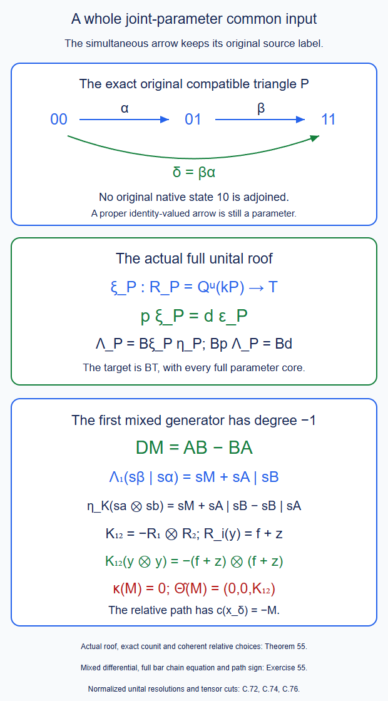

Theorem 55 and Exercise 55. The original parameter category
has objects \(00,01,11\). Its auxiliary common input retains
both tensor orders and their mixed homotopy; this does not
adjoin \(10\) as an original native state.
[Editable SVG](../assets/rational-native-joint-parameter-roof.svg).

## 56. The entire parameter unit and the recorded section family

Keep the strict surjective mapping quasi-isomorphism
\(p:T\to D\) of (55.2), with its identical object tuples.
Its whole normalized unital section need not be a strict
dg functor. This distinction matters on mixed parameter inputs.
Use [C.72](../GL-SAT-13.html#c72-normalized-unital-cobar-models)'s bar convention here; the full Nat coordinates
are transported from Theorem 9 as described in Exercise 56.

**Theorem 56 (the full parameter-unit prism).**
There is a normalized unital \(A_\infty\) section
\(j:D\to T\), with \(pj=1_D\) as an entire functor.
Put \(E=jp\). There is a closed degree-zero full Nat
isomorphism
\[
 \begin{gathered}
 u:1_T\longrightarrow E,\qquad u_0=1_T,\\
 p_*u=1_p,\qquad uj=1_j,\qquad
 uE=1_E,\qquad E_{*,1}(u)=1_E .
 \end{gathered}
 \tag{56.1}
\]
Its full inverse has the corresponding exact identities.
Every formula is finite on an original source word and
uses the complete source unary differential.

Let \(\widehat\Theta:T\to\mathscr S\) be the strict
whole-family recorder of Theorem 55, and put
\[
 \mathcal L=\widehat\Theta j:D\longrightarrow\mathscr S .
 \tag{56.2}
\]
For any original \(P,d,\xi_P\) in that theorem, set
\[
 \begin{gathered}
 \kappa_P=\xi_P\iota_{kP},\qquad p\kappa_P=d,\\
 \mathcal F_P=\widehat\Theta\kappa_P .
 \end{gathered}
 \tag{56.3}
\]
There is the specified entire comparison
\[
 U_P=\bigl(\widehat\Theta_{*,1}u\bigr)\kappa_P:
             \mathcal F_P\longrightarrow\mathcal Ld .
 \tag{56.4}
\]
It is a closed full Nat isomorphism, with actual
identity triples as its bare components. Its projection
under \(\Pi\) is the whole recorded operator comparison.
In particular it retains every section component of
degree one lower than that projected component.

All actual parameter-face restrictions of (56.4) commute
with its construction when the underlying \(p,j,u,\xi\)
are restricted from the same data. A whole comparison
cube of roofs supplied by Theorem 55 is carried to its
whole comparison diagram. Independent choices are thus
compared with all their higher faces; they are not
identified as strict functors.

**Proof.** The coefficient labels of \(p\) are identical.
The split mapping-kernel contraction in (55.5) gives
the normalized section construction of [C.68.1.1](../GL-SAT-13.html#c681-full-normalized-lifting-without-a-source-augmentation).
For completeness, choose its coefficient-preserving
graded section at length one and correct its chain
defect in \(\ker p\). At length \(r\geq2\) the lower
Taylor components give the Stasheff obstruction.
Its projection is zero, because the projected lower
components are those of the strict identity.
The square-zero functor equation makes it closed in
the Hom complex on the entire unary source complex.
Postcomposition by the mapping-kernel contraction
gives its primitive. Choose that primitive with the
sign dictated by the functor equation. It has zero
\(p\)-image. Ordinary coefficient-input terms cancel
by the unital equations, so the primitive is
normalized. Induction constructs \(j\) and proves
the exact whole identity \(pj=1_D\). Thus \(E^2=E\)
as an entire functor, while its object map is the
identity.

Here is the full unit construction of [C.70.1](../GL-SAT-13.html#c701-a-relative-contraction-preserved-by-the-full-differential)–[C.70.2](../GL-SAT-13.html#c702-an-exact-unit-relative-to-a-chosen-split-source-image)
for this particular \(p,j\). In
\(\operatorname{Nat}_\infty(1_T,E)\) consider the
specific relative kernel
\[
 N_{\rm rel}
   =\{v:\ p_*v=0,\quad vj=0\}.
 \tag{56.5}
\]
It is stable under the full Nat differential:
the two projected functor objects are both \(p\),
and the two restricted objects are both \(j\).
The leading Hom differential includes the output
unary term and every source unary term.
Postcompose by the contracted mapping kernel of
\(p\). This changes only the output; consequently
it preserves both conditions in (56.5).
All other differential terms consume positive
source length, including the higher \(E\)-actions.
Let \(H_0\) be that leading output contraction and
write \(\mathcal A=\delta H_0+H_0\delta=1+J\)
on the full projection kernel. The operator \(J\)
consumes positive source length. Since the full
\(\delta\) and \(H_0\) preserve (56.5), so do
\(\mathcal A,J\), and the finite inverse of
\(1+J\). Moreover \(\mathcal A\) commutes with
\(\delta,H_0\), by their square-zero identities.
Consequently \(H_{\rm rel}=H_0(1+J)^{-1}\)
contracts (56.5), as in [C.70.1](../GL-SAT-13.html#c701-a-relative-contraction-preserved-by-the-full-differential). No separate
stability under the leading and perturbing
differentials is needed. This contracts the
specified kernel, not the whole Nat complex.

Let \(e\) have bare value \(1_T\) and zero positive
Taylor values. Its projection is \(1_p\), and
its restriction along \(j\) is \(1_j\).
The defect \(\delta e\) is closed, belongs to
(56.5), and has zero bare value. Set
\[
 u=e-H_{\rm rel}(\delta e).
 \tag{56.6}
\]
The contraction identity gives \(\delta u=0\).
Its two relative identities and bare value are
unchanged. If \(u=1+n\) as a graded full Nat
matrix, each \(n\) consumes a nonempty source
piece. Hence \(1-n+n^2-\cdots\) is finite on
every original word and is an exact two-sided
inverse. The dg derivation rule makes that
inverse closed. This proves the first three
identities in (56.1), including their inverses.

The remaining two identities retain the entire
horizontal operation. Indeed
\[
 uE=(uj)p=1_E,\qquad
 E_{*,1}(u)=j_{*,1}(p_*u)=1_E .
 \tag{56.7}
\]
The equalities use [C.69](../GL-SAT-13.html#c69-full-horizontal-operator-composition)'s full horizontal
associativity and normalized parameter units.
They do not discard the usual identity-letter
insertions in the longer bar output.

Since \(\widehat\Theta\) is strict dg,
\(\widehat\Theta_{*,1}\) is a strict dg map
on full Nat complexes and preserves their
vertical products and units. It carries \(u\)
and its exact inverse to exact full inverses.
The source of its image is
\(\widehat\Theta\), and its target is
\(\widehat\Theta jp=\mathcal Lp\).
Now precompose by the entire
\(\kappa_P\). Equation (55.4), before applying
the bar, is \(p\kappa_P=d\), with every higher
component included. The resulting target is
therefore exactly \(\mathcal Ld\).
This proves the type and all assertions of
(56.4).

The bare value is the actual identity in
\(\mathscr S\): strict unital postcomposition
and normalized precomposition both preserve
that identity. At higher inputs the strict
recorder is applied to the entire unit
cochain, including its mixed values.
The dg projection \(\Pi\) commutes with
these operations. The degrees of its two
other triple components are those in
(52.2), so no section component is lost.

Restriction and entire precomposition
compose strictly on full bars; their
consecutive partitions and tensor signs
are the same on both sides.
Postcomposition has the entire evaluation
identity of [C.69.2](../GL-SAT-13.html#c692-entire-horizontal-composition-and-exact-associativity). Thus restricting a
single set of data gives the stated exact
face rules. A whole roof cube is carried
through these same full operations before
any core is projected, so all its
boundaries and higher faces are retained.
This proves the theorem. \(\square\)

The comparison (56.4) is a comparison of
whole families through a normalized
\(A_\infty\) section. It is not a strict
factorization of the recorder through \(p\)
or through \(\kappa_\pi\).
The nonzero mixed value in (E55.8) remains
in this comparison.
To compare with the original native joint
family, its supplied [C.47](../GL-SAT-13.html#c47-joint-execution-and-contraction-of-native-trees) graft prism must
be recorded with \(\Pi\mathcal Ld\) as its
factor-family model, keeping its actual
[C.48](../GL-SAT-13.html#c48-calibrated-native-cells-in-fixed-state-models) calibrated components and shared faces.
An identity bare component of \(U_P\) does
not replace that original native prism.

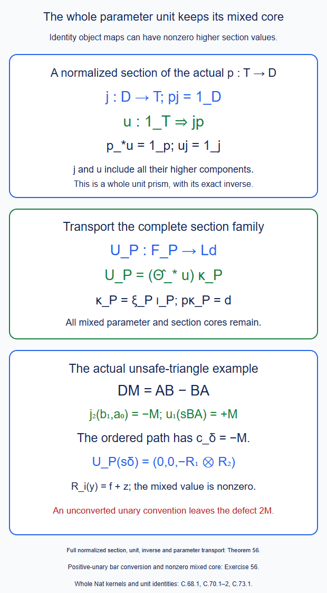

Theorem 56 and Exercise 56. The degree-zero
full unit has a degree-minus-one value on
the suspended mixed product \(s(BA)\).
After the section recorder its \(R\)-component
has degree minus two.
[Editable SVG](../assets/rational-native-parameter-unit-prism.svg).

## 57. The completed parameter comparison and its relative kernel

Let \(P\) be a finite directed ordinary category with terminal
object \(t\). Keep parallel arrows as different letters.
Let \(\mathcal F,\mathcal G:P\to\mathcal O\) be whole
normalized unital parameter diagrams in a dg category.
Every one-arrow comparison in each diagram is assumed to
be a homotopy equivalence. In the application these are
comparisons between completed block functors in one fixed
outer operator corner. This hypothesis does not assert
that an execution functor between frontier categories is
an equivalence.

All Nat complexes below contain the full original mapping
inputs of \(\mathcal O\). Write their parameter cochains
in the coordinates of Theorem 38; the conversion from
[C.72](../GL-SAT-13.html#c72-normalized-unital-cobar-models) is the one in Exercise 56.

**Theorem 57 (terminal evaluation and the whole native comparison).**
Evaluation on the bare component at \(t\) is a graded-surjective
mapping quasi-isomorphism
\[
 e_t:\operatorname{Nat}_P(\mathcal F,\mathcal G)
        \longrightarrow
        \mathcal O(\mathcal F_t,\mathcal G_t).
 \tag{57.1}
\]
Its specific kernel has a normalized square-zero contraction.
The full target Hom complex is retained; it is not assumed
acyclic.

More generally let \(A\) be a collection of parameter simplices
closed under faces and normalized terminal extension:
\[
 t\in A,\qquad \sigma\in A\ \Longrightarrow\ [\sigma,t]\in A
 \quad\text{whenever the extension is nondegenerate}.
 \tag{57.2}
\]
Then restriction to the entire \(A\) has the same graded-surjectivity
and mapping quasi-isomorphism properties, with a contracted
actual restriction kernel. Any closed comparison on \(A\)
extends while retaining all its cores. A compatible full coherent
comparison diagram on a relative free source extends by the
same contracted-kernel lifting construction as Theorem 52.

Suppose furthermore that
\(\mathcal F_x=\mathcal G_x\) as the specified objects for every
\(x\), and that their induced ordinary \(H^0\)-diagrams agree.
There is a closed full Nat isomorphism
\[
 V:\mathcal F\longrightarrow\mathcal G,\qquad
 V_0(x)=1_{\mathcal F_x},\qquad e_tV=1.
 \tag{57.3}
\]
Its inverse is an exact finite positive-parameter convolution
series. Prescribed whole comparisons satisfying (57.2), with
these bare values, can be retained.

In particular, for a supplied original whole comparison
\(\Gamma_{\rm orig}:\mathcal G\to\mathcal S\), put
\[
 \Gamma=\Gamma_{\rm orig}\star V,\qquad
 \Gamma\star V^{-1}=\Gamma_{\rm orig}.
 \tag{57.4}
\]
This transports its entire given prism, including its closed
higher components. The last equality is an exact cochain
identity. The construction admits relative coherent comparison
rows with the given endpoint systems fixed, by lifting their
whole free presentation through (57.1).

**Proof.** Let \(C_{\mathcal F},C_{\mathcal G}\) be the constant
diagrams at the two terminal objects. The actual terminal cones
of Theorem 38 are
\[
 \lambda_{\mathcal F}:\mathcal F\to C_{\mathcal F},
 \qquad
 \lambda_{\mathcal G}:\mathcal G\to C_{\mathcal G}.
 \tag{57.5}
\]
Their cores append the actual terminal arrow to the original
word. At \(t\) they are the identity. All their object
components are homotopy equivalences by the hypothesis.
The finite parameter-filtration argument of Theorem 22
therefore gives closed inverses \(\mu_{\mathcal F},\mu_{\mathcal G}\)
and degree-minus-one homotopies
\[
 \delta h_{\mathcal F}
       =\mu_{\mathcal F}\lambda_{\mathcal F}-1,\qquad
 \delta h_{\mathcal G}
       =\mu_{\mathcal G}\lambda_{\mathcal G}-1 .
 \tag{57.6}
\]
Choose the inverse at \(t\) to be the identity and its
object homotopy to be zero. The corrections in that
filtration consume positive parameter length, so they
do not alter these values. Thus the two \(\mu\)'s
evaluate to identities, and the two \(h\)'s evaluate
to zero at \(t\). The same argument uses actual full
target homotopies; it does not truncate their original
mapping inputs.

First consider the constant-diagram complex
\[
 C=\operatorname{Nat}_P(C_{\mathcal F},C_{\mathcal G}).
 \tag{57.7}
\]
Put \(M=\mathcal O(\mathcal F_t,\mathcal G_t)\).
Multiplication of its \(q\)-cores by
\(e_q=(-1)^{q(q+1)/2}\), as in (38.7), identifies
\(C\) with \(\operatorname{Hom}(N(P),M)\).
For a total degree-\(r\) cochain the differential
is \(d_M\phi-(-1)^r\phi\partial\).
Indeed the interior merger at chronological position
\(i\) has the target-to-source bar sign
\((-1)^{q-i}\); the ratio \(e_q/e_{q-1}=(-1)^q\)
converts it to the nerve sign \((-1)^i\).
The two constant identity actions supply the two
outer faces with the same signs.

On normalized chronological nerve chains define
\[
 h_N(\sigma)=(-1)^{q+1}[\sigma,t],
      \qquad \sigma\in N(P)^{-q}.
 \tag{57.8}
\]
A repeated terminal vertex is zero. The two sums
on the other faces cancel in pairs, leaving
\[
 \partial h_N+h_N\partial=1-c_t\epsilon,\qquad
 h_N^2=h_Nc_t=\epsilon h_N=0 .
 \tag{57.9}
\]
Here \(c_t\) includes the terminal vertex.
Consequently \(H_C\phi=(-1)^r\phi h_N\) contracts
the constant-diagram evaluation kernel. In Nat
coordinates this is the particularly simple formula
\[
 (H_C\phi)_q(\sigma)
           =(-1)^r\phi_{q+1}([\sigma,t]).
 \tag{57.10}
\]
The two \(e\)-factors cancel the extra sign in
(57.8). It satisfies
\(\delta H_C+H_C\delta=1-i e_t\), where \(i\)
puts a mapping in every bare object component
and zero in positive parameter length.

Return to the two original diagrams. Define closed
degree-zero composition maps
\[
 \begin{aligned}
 Q(\theta)&=\lambda_{\mathcal G}\star\theta
                                      \star\mu_{\mathcal F},\\
 T(\psi)&=\mu_{\mathcal G}\star\psi
                                      \star\lambda_{\mathcal F}.
 \end{aligned}
 \tag{57.11}
\]
They preserve terminal evaluation. Set
\(a_{\mathcal F}=\mu_{\mathcal F}\lambda_{\mathcal F}\)
and similarly for \(\mathcal G\). For a degree-\(r\)
cochain put
\[
 K(\theta)=h_{\mathcal G}\star\theta\star a_{\mathcal F}
                     +(-1)^r\theta\star h_{\mathcal F}.
 \tag{57.12}
\]
The full dg Leibniz rule and (57.6) give
\[
 (\delta K+K\delta)(\theta)
      =a_{\mathcal G}\theta a_{\mathcal F}-\theta
      =TQ(\theta)-\theta .
 \tag{57.13}
\]
No differential of a source mapping input has been omitted
in this calculation.

Let \(s=Ti\) and \(H=TH_CQ-K\). The preceding identities give
\[
 e_ts=1,\qquad
 \delta H+H\delta=1-se_t,\qquad e_tH=0 .
 \tag{57.14}
\]
Thus (57.1) is a chain retraction with contracted kernel.
For normalized square-zero sides, restrict \(H\) to that
kernel and replace it by \(H\delta H\). If
\(\delta H+H\delta=1\), direct multiplication gives
\[
 \delta(H\delta H)+(H\delta H)\delta=1,\qquad
 (H\delta H)^2=0 .
 \tag{57.15}
\]
For example \(\delta H^2=H^2\delta\), whence
\(\delta H^2\delta=0\), proves the second identity.
On the full complex use the chain projection
\(1-se_t\) on both sides to impose the remaining
SDR side conditions. All series used in choosing
the cone inverses terminate in the finite parameter
height. The subsequent operations are finite full
composition and terminal extension.

Now restrict to \(A\). Cochains on \(A\) have a
graded extension by zero on the other parameter
words. The differential and products on \(A\)
are defined because its faces and cuts stay in \(A\).
The restriction kernel is preserved by every
composition in (57.11)–(57.12): on an \(A\)-word
every cochain argument in a cut is again an
\(A\)-word. Formula (57.10) preserves that kernel
by (57.2). Hence so does \(H\). Its elements
evaluate to zero at \(t\), so (57.14) is the
identity there. Applying (57.15) contracts
this actual restriction kernel. Graded
surjectivity and that contraction prove the
relative quasi-isomorphism assertion.

Explicitly, for a closed prescribed cochain
\(\gamma_A\), extend it gradedly to \(\gamma_0\).
Its defect is a closed element of the restriction
kernel. If \(h_A\) is its contraction, then
\(\gamma_0-h_A\delta\gamma_0\) is the required
closed extension with exactly the original
restriction. The relative free-generator proof
of Theorem 52 now applies to any entire
coherent comparison presentation. Its defect
uses the full incoming unary complex, and
the correction is zero on all prescribed
generator faces. On the labelled families,
terminal evaluation and restriction are
unital dg functors, since evaluating or
restricting the full convolution preserves
products and identities. This proves the
claimed coherent-diagram version.

To prove (57.3), lift \(1_t\) to a closed
cochain \(V'\) using (57.1). For the actual
terminal arrow \(\tau_x:x\to t\), its
one-arrow naturality equation gives
\[
 [\mathcal G_1(\tau_x)]\,[V'_0(x)]
      =[V'_0(t)]\,[\mathcal F_1(\tau_x)] .
 \tag{57.16}
\]
The two arrow classes agree and are invertible,
while \(V'_0(t)=1\). Therefore
\([V'_0(x)]=[1_x]\).
Choose full degree-minus-one witnesses
\(\delta b_x=V'_0(x)-1_x\), taking \(b_t=0\).
Put them in the bare components of a
pre-natural cochain \(b\), with zero
positive parameter components. Then
\[
 V=V'-\delta b
 \tag{57.17}
\]
is closed and has exactly the asserted bare
values and terminal value. In the relative
case use the restriction-kernel lift first;
the prescribed bare values already equal
identities, so take \(b_x=0\) on its objects.
This preserves every prescribed \(A\)-core.

The positive part \(V-1\) consumes at least
one original nonidentity parameter arrow.
Its convolution power above the finite
parameter height is zero. The finite
geometric series gives an exact inverse,
which is closed by the dg derivation rule.
Associativity now proves (57.4), with all
original cochain values retained.
Coherent rows between two such constructions,
including given calibrated rows, use the
relative free-generator lifting already
proved for (57.1). Existing whole rows and
both endpoint systems are prescribed data
in that lift. This proves the theorem.
\(\square\)

For a native fixed completed block profile,
record the original factor family \(\mathcal G\)
using the same chosen literal block functors
as the objects of
\(\mathcal F=\Pi\mathcal Ld\) in Theorem 56.
Their object values then agree on the actual
common outer type. Their axis-arrow classes
also agree: (55.10) keeps the entire native
factor family, and \(H^0j=(H^0p)^{-1}\).

On the compatible graft category a joint
arrow has an actual inner-factor-first axis
factorization. Keep the outer source state
fixed and move each inner factor to its
target. Any inner tree required complete
by that outer source state was already
complete. It stays complete under its
arrow: the image of its whole original
vertex set is the whole quotient vertex
set, contained in the target executed
ideal. All intermediate tuples are
therefore compatible. Finally perform
the outer arrow. This proves equality
of the two \(H^0\)-diagrams on every
original joint arrow by their actual
composition law. Selected contraction
labels and direct simultaneous arrows
are still distinct source data.

Completion makes these operator comparisons
homotopy equivalences by [C.47.2](../GL-SAT-13.html#c472-the-actual-typed-enhanced-diagram). The
Theorem 57 comparison thus applies to
the whole fixed-profile family, with
its original [C.47](../GL-SAT-13.html#c47-joint-execution-and-contraction-of-native-trees) graft prism as
\(\Gamma_{\rm orig}\). If the completed
graft is not the completed corolla,
keep its original outgoing seam arrow.
The auxiliary factor family can be
extended constantly across that final
arrow; the original native prism keeps
its actual seam comparison.

Condition (57.2) is essential for relative
graft and cut constraints. A boundary
containing the terminal vertex need not
contain the terminal extension of each
of its simplices. The given full face
comparisons, including their actual
endpoint-cone words from Theorem 38,
must be supplied before this relative
extension applies. The fixed-profile
comparison alone does not establish
that condition for all changing-profile
shared faces.

For the original cut poset
\(\mathcal C_q=\mathcal P(\{0,\ldots,q\})\)
of Theorem 51, the union of the full
faces \(\mathrm{cut}_i=1\) is exactly
the nerve on the nonempty cut sets.
Indeed a flag in any such face has
a nonempty first set. Conversely any
element of its first set belongs to
every set in the flag, placing that
entire flag in one of those faces.
This union contains the all-cut
terminal object and is closed under
terminal extension. Consequently
compatible whole comparison data on
all these graft faces can be retained
by Theorem 57. Their shared full
flags, rather than only their
vertices, are the prescribed data.
The deletion faces
\(\mathrm{cut}_i=0\) have different
terminal images. Their endpoint
comparisons from Theorem 38 are
additional data; containing their
vertices in a larger boundary does
not verify (57.2).

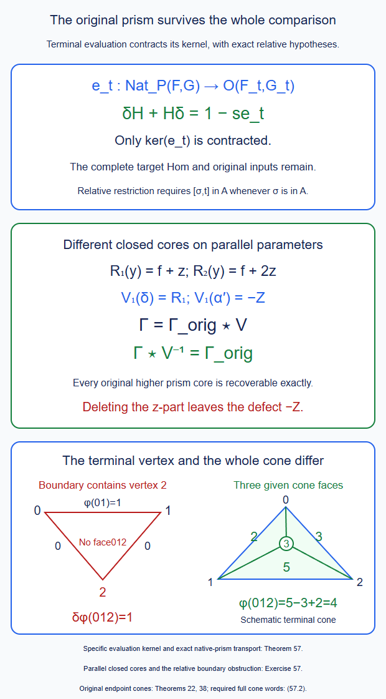

Theorem 57 and Exercise 57. Parallel
identity-valued parameters can carry
different closed higher components.
A missing cone word can carry a
nonzero extension obstruction.
[Editable SVG](../assets/rational-native-terminal-comparison.svg).

## 58. Preserve the native projection and the whole prescribed input together

The input restriction in this section is a chain coalgebra map.
It need not be a nerve inclusion or be closed under terminal extension.
Let \(T\) be a unital dg category and let
\[
 \iota:K\longrightarrow B_{\mathrm{full}}T
 \tag{58.1}
\]
be a coaugmented labelled chain coalgebra map. Work with normalized
cochains and the original labelled object values. The coalgebras are
conilpotent on each finite input. Formal unit input equations are
imposed before taking cochains; an original proper arrow whose image
is an identity remains an input. Suppose restriction along \(\iota\)
is surjective on the graded spaces of these cochains, for each pair
of target object labels.

Two instances will be used. For a chain subcoalgebra spanned by
actual source words, extend a graded cochain by zero. For
\[
 T=\Omega\bigl(\textstyle\bigotimes_i B_{\mathrm{full}}A_i\bigr)/J,
 \qquad K=\textstyle\bigotimes_i B_{\mathrm{full}}A_i,\qquad
 \iota=\eta_K,
 \tag{58.2}
\]
the distinguished component of \(\eta_K(c)\) is the single outer bar
letter \(s(t_c)\), with coefficient one. Assign the prescribed
value on this component and zero on its other outer-word
components. This is the graded extension of [C.78.1](../GL-SAT-13.html#c781-the-tensor-unit-records-the-entire-mapping-complex). Here \(J\)
imposes the factor unit equations of [C.74.1](../GL-SAT-13.html#c741-the-full-tensor-parameter-cobar). Both statements are
about the full source coalgebra, including its mixed differential.

Fix uncurved normalized unital functors \(F,G:T\to\mathscr S\),
where \(\Pi:\mathscr S\to\mathscr Y\) is (52.3).
Write \(\operatorname{Nat}_K(F\iota,G\iota)\) for the full twisted
convolution complex on \(K\); its twisting cochains are the
restrictions of those of \(F,G\).

**Theorem 58 (joint projection and full input restriction).**
On the fixed labelled functor objects, the map
\[
 \begin{split}
 \Phi:\operatorname{Nat}_T(F,G)&\longrightarrow
 \operatorname{Nat}_T(\Pi F,\Pi G)
 \mathop{\times}_{\operatorname{Nat}_K(\Pi F\iota,\Pi G\iota)}
 \operatorname{Nat}_K(F\iota,G\iota),\\
 \theta&\longmapsto(\Pi\theta,\theta\iota)
 \end{split}
 \tag{58.3}
\]
is graded-surjective and a quasi-isomorphism. These maps form a
unital dg functor. Its mapping kernel is exactly
\[
 N=\{\theta:\Pi\theta=0,\ \theta\iota=0\}.
 \tag{58.4}
\]
It has a degree-minus-one square-zero contraction. If \(D\) is the
full Nat differential and
\[
 H_0\theta=\mathfrak h\circ\theta,\qquad
 J=DH_0+H_0D-1,
 \tag{58.5}
\]
on \(N\), that contraction is
\[
 H=H_0(1+J)^{-1}
   =H_0\sum_{n\ge0}(-J)^n,\qquad
 DH+HD=1,\qquad H^2=0 .
 \tag{58.6}
\]
The series is finite on every fixed outer bar word.
No separate invariance under the leading differential is required
of (58.4).

Consequently an entire coherent comparison diagram can be lifted
while retaining both its given native \(\mathscr Y\)-diagram and
its full prescribed \(K\)-diagram exactly. The source presentation
is a relative free dg category as in (52.7), with its complete
incoming unary generator differential. Compatible previously
specified free-generator faces are retained. This assertion
requires agreement of the entire prescribed diagrams on overlaps,
not only agreement of their object or degree-zero values.

There is also a functor extension statement. Suppose a fixed
native functor \(B:T\to\mathscr Y\) has a normalized lift
\(L:T\to\mathscr S\). Let \(F_K\) be a twisting cochain on \(K\)
with the same labelled object contractions and
\[
 \Pi F_K=B\iota .
 \tag{58.7}
\]
Then there is a normalized functor \(F:T\to\mathscr S\) and a
closed invertible full cochain \(V:F\to L\), with
\[
 \Pi F=B,\qquad F\iota=F_K,\qquad
 V_0=1,\qquad \Pi V=1 .
 \tag{58.8}
\]
Thus the extension leaves the entire original native family \(B\)
unchanged. The identity-leading comparison retains the original
lift as a full invertible comparison.

The mapping and functor statements hold also for the dg category
of closed arrows in \(\mathscr S\) and its projection to closed
arrows in \(\mathscr Y\), on specified lifted arrow objects.
They therefore retain a whole prescribed graft prism, including
its two endpoint families, rather than just its endpoint maps.

**Proof.** First consider graded surjectivity. Given a compatible
pair \((a,b)\) on the right of (58.3), put \(v=\jmath a\).
The difference \(c=b-v\iota\) takes values in \(\ker\Pi\).
Choose a graded extension \(e\) with \(e\iota=c\). Since
\(\mathfrak h,\jmath,\Pi\) act on the output with the fixed endpoint
labels, they commute with restriction. Consequently
\[
 e'=e-\jmath\Pi e,\qquad
 \Pi e'=0,\qquad e'\iota=c .
 \tag{58.9}
\]
Then \(v+e'\) maps to \((a,b)\). The extension preserves
normalization: zero formal-unit input values extend as zero.
The nonunital mapping section \(\jmath\) in this argument does
not assert that the dg functor \(\Phi\) is nonunital.
Projection and coalgebra restriction preserve the actual Nat
identity and full convolution products, proving the dg functor
assertion.

Both \(D\) and \(H_0\) preserve \(N\). For \(D\), this follows
because \(\Pi\) is a dg functor and \(\iota\) is a chain
coalgebra map, including the full source differential and all
cuts. For \(H_0\), use \(\Pi\mathfrak h=0\) and
\[
 (H_0\theta)\iota=\mathfrak h(\theta\iota)=0 .
 \tag{58.10}
\]
There is no sign in postcomposition by \(\mathfrak h\).
On a homogeneous coefficient of degree \(r\), its formula is
\(\bigl((-1)^rAH+RQ,0,0\bigr)\), with precisely that coefficient
degree. It is not the total Nat degree when the input has
nonzero degree.

The terms involving the whole source differential cancel in
\(DH_0+H_0D\): their coefficients are
\(-(-1)^{|\theta|-1}\) and \(-(-1)^{|\theta|}\).
The output differential contributes the identity on \(\ker\Pi\)
by (52.5). The remaining terms in \(J\) contain a positive-input
twisting-cochain value of \(F\) or \(G\).
Therefore, if \(\theta\) vanishes on all outer words of length
less than \(m\), \(J\theta\) vanishes on all words of length
less than \(m+1\). On an outer word of length \(q\),
\(J^{q+1}\theta=0\). This proves the asserted local finiteness.
In particular the source unit's sum of outer words of different
lengths does not invalidate the construction.

Put \(A=DH_0+H_0D=1+J\). Since \(D^2=H_0^2=0\),
\[
 DA=AD,\qquad H_0A=AH_0 .
 \tag{58.11}
\]
All these operators and the finite inverse preserve \(N\).
Equations (58.6) now follow by multiplication:
\[
 D(H_0A^{-1})+(H_0A^{-1})D=AA^{-1}=1,\qquad
 (H_0A^{-1})^2=0 .
 \tag{58.12}
\]
This proves the kernel contraction and the mapping
quasi-isomorphism. Only the joint kernel has been contracted.
The native target complex can have nonzero cohomology.

For clarity, the extension of a closed pair is explicit.
Choose its graded lift \(v\). Its defect \(Dv\) lies in \(N\)
and is closed. Thus \(v-HDv\) is closed and has exactly the
prescribed pair of images. For a relative free diagram use the
same argument on each new generator complex \((V_\ell,d_1)\).
If the existing lower lift is \(E\), its defect is
\[
 o=\partial v-(-1)^{|v|}vd_1-E\gamma,\qquad
 Do=0 .
 \tag{58.13}
\]
It takes values in (58.4) and vanishes on prescribed generator
subcomplexes. Postcomposition by \(H\) contracts the Hom complex
out of their quotient, with the same cancellation of the full
incoming unary terms as (52.15). Replace \(v\) by \(v-Ho\)
and extend multiplicatively. Induction in \(\ell\) proves the
entire relative coherent-diagram assertion.

For the functor assertion, first work on \(K\). The same
output contraction, with its locally finite positive-input
perturbation, contracts \(\ker\Pi\) in
\(\operatorname{Nat}_K(F_K,L\iota)\). The bare identity has
defect \(D1\) in that kernel, with zero bare value.
The contraction preserves positive input length. Hence
\[
 V_K=1-H(D1)
 \tag{58.14}
\]
is closed, \((V_K)_0=1\), and \(\Pi V_K=1\).
Its inverse is the wordwise finite geometric series in
\(V_K-1\).

Extend \(V_K-1\) gradedly to a normalized cochain on \(BT\),
with zero bare value, using (58.9) to keep its projection zero.
Write \(V\) for one plus this extension and
\(\partial_0v=dv-(-1)^{|v|}vb\) for the untwisted differential.
The inverse of \(V\) again exists wordwise. Define
\[
 \tau_F=V^{-1}\star\tau_L\star V-
                   V^{-1}\star\partial_0 V .
 \tag{58.15}
\]
This is exactly the closedness equation
\(\partial_0 V-\tau_L\star V+V\star\tau_F=0\).
Conjugating the square-zero operator
\(\partial_0-\tau_L\star(-)\) by \(V\star(-)\) proves
\(\partial_0\tau_F-\tau_F\star\tau_F=0\).
It is therefore the twisting cochain of a functor.
Normalization and the formal unit equations are preserved by
these products and by the positive normalized cochain \(V-1\).
Projection of (58.15) is \(\tau_B\), since
\(\Pi V=1\). Restriction is \(\tau_{F_K}\), by the already
closed cochain \(V_K\). This proves (58.8).
For the [C.72](../GL-SAT-13.html#c72-normalized-unital-cobar-models) positive-unary source convention use the conversion
of Exercise 56, equation (E56.3), namely
\(\tau(w)=-(-1)^{|w|}F_{\mathrm{core}}(w)\), throughout
(58.13)–(58.15).

Finally let \(u:U\to V\) and \(u':U'\to V'\) be specified
closed degree-zero arrow objects. A degree-\(r\) morphism
between them is \((a,b,c)\), where \(a:V\to V'\) and
\(b:U\to U'\) have degree \(r\), and \(c:U\to V'\)
has degree \(r-1\). Its differential is
\[
 d(a,b,c)=(da,db,au-u'b-dc).
 \tag{58.16}
\]
Projection applies \(\Pi\) to each entry and is graded-surjective.
On its mapping kernel, the leading contraction is
\[
 h_0(a,b,c)=(\mathfrak h a,\mathfrak h b,-\mathfrak h c).
 \tag{58.17}
\]
For the diagonal differential \((da,db,-dc)\) it contracts to
zero. The off-diagonal part of (58.16) maps the first two
slots into the third; it vanishes on the third slot.
Thus \(dh_0+h_0d=1+J_{\mathrm{ar}}\), where
\(J_{\mathrm{ar}}^2=0\). It commutes with \(d,h_0\) by
the calculation (58.11). Consequently
\[
 h_{\mathrm{ar}}=h_0(1-J_{\mathrm{ar}})
 \tag{58.18}
\]
is a square-zero contraction of this mapping kernel.
Apply the already proved joint restriction theorem with this
target contraction. This proves the arrow statement.
Finite iterated arrow diagrams follow by repeating this argument.
\(\square\)

In the native application, (58.2) is the common **state input**
of [C.78](../GL-SAT-13.html#c78-full-tensor-unit-restriction-and-external-comparisons), after the actual full source pullbacks and target
whiskering of [C.69](../GL-SAT-13.html#c69-full-horizontal-operator-composition). The original native parameter category is
the external coherent-diagram source in (58.13); it is not
replaced by a tensor product of its parameter bars.
For any specified compatible whole \(K\)-family from
Theorems 43–44 and 53–54, (58.3) retains that family and the
entire original native coefficient family simultaneously.
Applied to arrow objects, it retains its actual graft prism.
The entire \(K\)-family's projection must equal the restriction
of the given native prism, and shared faces must agree as whole
cochains. Establishing those identifications for every changing
profile remains a separate mathematical requirement.

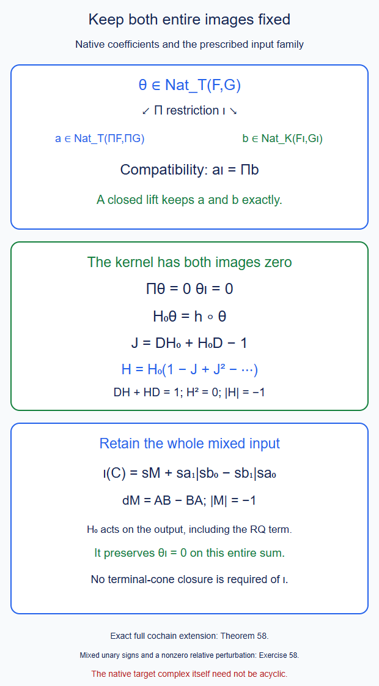

Theorem 58 and Exercise 58. The contraction acts on the output
and respects the whole input restriction. The mixed unit
contains \(sM+sa_1|sb_0-sb_1|sa_0\); retaining only \(sM\)
does not impose the required restriction.
[Editable SVG](../assets/rational-native-joint-restriction.svg).

## 59. Whole section cochains and the joining-prism product

Use the negative-unary bar convention of Theorem 9 in this
section. Let \(C\) be the whole original parameter coalgebra,
with differential \(b\) and its labelled coaugmentations.
Suppose \(A,B\) are coherent operator families on graph
objects \(X_x,Y_x\), with twisting cochains
\(\tau_A,\tau_B\) of degree one. At each object choose the
specified closed section \(I_x:Y_x\to X_x\).
The object contractions are those of (52.1).
All maps below are entire typed maps on the state inputs.

**Theorem 59 (the full section equation and every joining cut).**
There is an exact correspondence between:

- normalized full section cochains
  \(\mathcal I:B\to A\) of Nat degree zero, with bare values
  \(I_x\), satisfying
  \[
   d\mathcal I-\mathcal I b
     -\tau_A\star\mathcal I+\mathcal I\star\tau_B=0;
   \tag{59.1}
  \]
- coherent families in the section-comparison dg category
  with these object contractions and with exactly the
  prescribed \(A,B\) diagonal families.

Explicitly, on a nonempty homogeneous parameter input \(c\)
the twisting cochain of the second family is
\[
 \widetilde\tau(c)=
       \bigl(\tau_A(c),\tau_B(c),\mathcal I(c)\bigr).
 \tag{59.2}
\]
It is zero on coaugmentations; those encode the object
sections, rather than a curvature term.
If \(|c|=q\), its total coefficient degree is \(q+1\)
and its third component has degree \(q\).
In particular a string of \(p\) degree-zero original
parameter arrows has third component of degree \(-p\).
Equation (59.1) includes the full parameter differential.
For the actual marked section (43.3)–(43.4), in these
same parameter coordinates the entire section cochain is
\[
 \mathcal I(\varnothing)=I,\qquad
 \mathcal I(p)=-W_p\quad(p\ne\varnothing).
 \tag{59.3}
\]
Thus the one-mark global minus persists on every
positive marked core; the coefficient Koszul signs
remain those already present in \(W_p\).

Let \(\mathcal J:D\to B\) be another full closed
degree-zero section cochain, with bare value \(J_x\).
The section from \(D\) to \(A\) is exactly
\[
 \mathcal K=\mathcal I\star\mathcal J,\qquad
 \mathcal K(c)=\sum_{c=c_Lc_R}
                      \mathcal I(c_L)\mathcal J(c_R).
 \tag{59.4}
\]
No convolution sign is added here because
\(|\mathcal J|=0\). All graded signs already present in
the evaluated full maps remain.
Separating the two endpoint cuts gives
\[
 \begin{split}
 \mathcal K(c)={}&\mathcal I(c)J_{\mathrm{source}(c)}
       +I_{\mathrm{target}(c)}\mathcal J(c)\\
       &+\sum_{\substack{c=c_Lc_R\\c_L,c_R\ne\varnothing}}
                        \mathcal I(c_L)\mathcal J(c_R).
 \end{split}
 \tag{59.5}
\]
Thus for two original arrows there is the mixed term
\[
 \mathcal K(s\beta|s\alpha)
   =\mathcal I(s\beta|s\alpha)J_0
    +I_2\mathcal J(s\beta|s\alpha)
    +\mathcal I(s\beta)\mathcal J(s\alpha).
 \tag{59.6}
\]
Three or more sections compose by all consecutive
multipart cuts, including empty pieces. All groupings
give precisely the same full cochain.

In the expanded-seam graft of Theorem 54, take
\(\mathcal I\) to be the whole expanded section family
and \(\mathcal J\) to be the entire marked joining
section. Their bare values are \(I_\star\) and \(s\).
Their one-mark components are \(R_\star\) and \(\eta\).
Equation (59.5) recovers (54.6) at one mark and retains
all its higher mixed joining terms. On the actual
common multicut refinement of Theorem 44, the joining
section cores from different consecutive regroupings
therefore agree in every parameter degree.

**Proof.** The two diagonal components of the
Maurer–Cartan equation
\[
 d_{\mathscr S}\widetilde\tau
       +\widetilde\tau b-\widetilde\tau\star\widetilde\tau=0
 \tag{59.7}
\]
are the original functor equations for \(A,B\).
Write \(R(c)=\mathcal I(c)\) on positive inputs.
For a proper cut \(c=c_Lc_R\), put \(a=|c_L|\).
The convolution sign is \((-1)^a\), while the degree
of \(\widetilde\tau(c_L)\) is \(a+1\).
By (49.2), the third component of its square is
\[
 \sum_{\mathrm{proper\ cuts}}
       \bigl((-1)^aR(c_L)\tau_B(c_R)
                          -\tau_A(c_L)R(c_R)\bigr).
 \tag{59.8}
\]
The third component of the other two terms in (59.7) is
\[
 \tau_A(c)I_{\mathrm{source}(c)}
  -I_{\mathrm{target}(c)}\tau_B(c)
  -dR(c)+R(bc).
 \tag{59.9}
\]
Their difference is exactly the negative of (59.1)
on \(c\). This proves both directions of the
correspondence, including every source unary term and
every adjacent parameter merger. The degree assertions
follow from the shifted third slot in (49.1).
Units are retained in the diagonal family; normalized
positive section values obey the same unit equations
on both sides.

The whole marked section is read in this correspondence
through its cone (49.16), with the suspension coaction
(48.2). A homogeneous degree-\(r\) cone operator with
off-diagonal entry \(C_r\) has third datum
\[
 R_r=(-1)^{r+1}C_r
 \tag{59.10}
\]
by (49.11). Applying this to each original parameter
core gives the whole family (59.2); injectivity of
(49.11) prevents loss of a higher core.
More explicitly, on a parameter word \(p\) the
suspended coaction (48.2) makes the off-diagonal
cone core of (49.16) equal to
\(-(-1)^{|p|}W_p\). Its cone-operator degree is
\(r=|p|+1\). Substitution in (59.10) gives
\[
 (-1)^{r+1}\bigl(-(-1)^{|p|}W_p\bigr)=-W_p,
 \tag{59.12}
\]
which proves (59.3). The empty input instead
belongs to the object cone differential and has
bare section \(I\). For one mark this returns
exactly (43.2), including its suspended coefficient
sign. For the [C.72](../GL-SAT-13.html#c72-normalized-unital-cobar-models) source
convention, first use the entire parity conversion
(E56.3) and the twisting-core conversion following it.
One cannot use its unconverted functor core in
(59.7).

The untwisted Hom differential is a derivation for
convolution, since \(b\) is a coderivation. Inserting
the source and target twists gives the typed identity
\[
 D_{A,D}(\mathcal I\star\mathcal J)
   =(D_{A,B}\mathcal I)\star\mathcal J
                      +\mathcal I\star(D_{B,D}\mathcal J).
 \tag{59.11}
\]
The intermediate terms involving \(\tau_B\) cancel.
Both factors are closed, so (59.4) is closed.
Its bare value is \(I_xJ_x\), and (59.2) now supplies
its entire section-comparison family. Expanding
the coproduct proves (59.5)–(59.6).
Coassociativity identifies both iterated sums with
the same three-piece cuts. Induction gives the
statement for any finite number of sections.

Restriction along an actual chain coalgebra map
commutes with every sum in (59.4).
Whole source pullbacks commute by (37.3), and target
whiskering uses the full [C.69](../GL-SAT-13.html#c69-full-horizontal-operator-composition) evaluation before taking
a core. For grafts, the joining cochain is the whole
marked section, rather than just a chosen primitive
of (54.5). Theorem 44 identifies its consecutive
joining expansions on the actual common refinement
as full sections. The cone construction and (59.10)
are faithful and commute with that restriction.
Their entire section cochains, and hence all the
positive cores in (59.5), agree there.
This proves the claimed joining-section overlap.
\(\square\)

The theorem does not produce a coalgebra diagonal from
one native parameter bar into tensor products of factor
parameter bars. The whole families in (59.4) must already
have the stated common input, or be transported to it
by their actual maps. In particular the joining-section
overlap on the common refinement does not identify every
changing-profile graph-operator diagonal. Those full
diagonals and their shared native faces are still required
before the simultaneous lifting theorem applies.

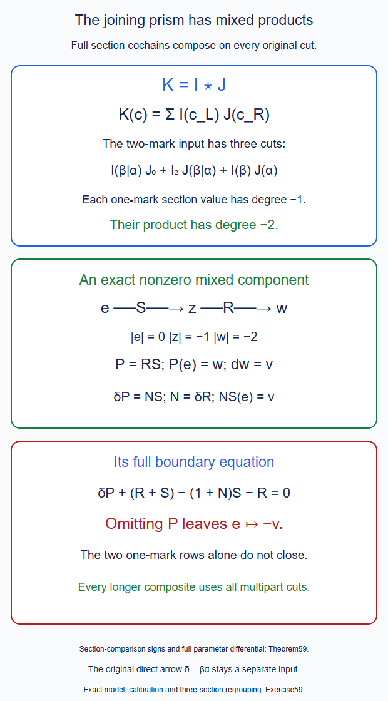

Theorem 59 and Exercise 59. The third component on
two degree-zero parameter arrows has degree minus two.
It retains the entire joining prism.
[Editable SVG](../assets/rational-native-coherent-section-graft.svg).

## 60. Faithful comparison cylinders and their section projections

Work over a field of characteristic zero.
Let \(X\underset I{\overset Q{\rightleftarrows}}Y\), with
homotopy \(H\), be the full special contraction (52.1).
Use \(s\) of degree minus one. Define
\[
 Z=\operatorname{Cyl}(I)=X\oplus sY\oplus Y,\qquad
 D(x,su,y)=(dx-Iu,-sdu,dy+u).
 \tag{60.1}
\]
Write \(i(x)=(x,0,0)\) and \(j(y)=(0,0,y)\).
Both are chain inclusions, with disjoint graded images.
Every shifted coaction uses the suspension sign (48.2).
All sums, tensor products and mappings can consequently be
taken on the full typed graph encodings.

**Theorem 60 (faithful cylinders and the all-arity section projection).**
The cylinder has the specified full special contraction
\[
 \begin{split}
 q(x,su,y)&=Qx+y,&
 h(x,su,y)&=(Hx,-sQx,0),\\
 qj&=1,& Dh+hD&=1-jq,\qquad h^2=hj=qh=0.
 \end{split}
 \tag{60.2}
\]
A degree-\(r\) original section-comparison triple has
the cylinder map
\[
 \Xi(A,B,R)(x,su,y)
   =\bigl(Ax+(-1)^{r+1}Ru,\;(-1)^rsBu,\;By\bigr).
 \tag{60.3}
\]
This defines a faithful unital dg functor from
\(\mathscr S\) into cylinder maps preserving \(jY\).
It preserves \(iX\) as well. The original data are
recovered exactly by
\[
 A=\operatorname{pr}_X\Xi i,\qquad
 B=\operatorname{pr}_Y\Xi j,\qquad
 R=(-1)^{r+1}\operatorname{pr}_X\Xi s .
 \tag{60.4}
\]
Here \(s:Y\to Z\) denotes inclusion in the shifted
middle summand, of degree minus one. Thus no closed
part of the native \(R\) is removed.

For any finite input list put \(U=\bigotimes_a Z_a\)
and \(Y_{\rm in}=\bigotimes_aY_a\), with
\(j_{\rm in}=\bigotimes_a j_a\). Let
\(\mathscr E_j(Z_{\rm in};Z_o)\) consist of all
homogeneous maps \(f:U\to Z_o\) carrying
\(j_{\rm in}Y_{\rm in}\) into \(j_oY_o\).
Restriction defines
\[
 \pi_j:\mathscr E_j(Z_{\rm in};Z_o)
               \longrightarrow\operatorname{Hom}(Y_{\rm in},Y_o).
 \tag{60.5}
\]
These are the components of a unital dg colored
operad map, including nullary components and all
graded input permutations. Each component is
graded-surjective and a quasi-isomorphism.

More explicitly, the ordered tensor contraction
from (60.2) has maps \(j_{\rm in},q_{\rm in},h_{\rm in}\).
On
\[
 D_{\rm in}=U/j_{\rm in}Y_{\rm in}
 \tag{60.6}
\]
the induced \(\bar h_{\rm in}\) contracts to zero.
The mapping kernel in (60.5) is exactly
\(\operatorname{Hom}(D_{\rm in},Z_o)\), with contraction
\[
 \mathfrak k(f)=(-1)^{|f|}f\bar h_{\rm in}.
 \tag{60.7}
\]
At arity zero, \(U=Y_{\rm in}=k\) and
\(j_{\rm in}=1_k\). Thus (60.5) is an isomorphism
there. It retains every degree of \(Y_o\), including
positive-degree maps from the coefficient object.

At positive arities one may also require
\(f(i_{\rm in}X_{\rm in})\subseteq i_oX_o\).
The resulting positive-arity dg operad
\(\mathscr E_{i,j}\) still projects graded-surjectively
and by a quasi-isomorphism to the \(Y\)-operad.
This extra requirement cannot be imposed at arity
zero: the corresponding operation space is zero.

Consequently a relative free dg colored operad
with the full incoming unary generator differential
lifts through \(\pi_j\). Compatible prescribed
generator subcomplexes and their entire operation
values can be retained. For the positive-arity
version the same assertion holds for
\(\mathscr E_{i,j}\). This relative lifting assertion
requires that the prescribed faces already agree
as operations in the stated cylinder home.

**Proof.** Squaring (60.1) gives zero: the first
cross term is \(-dIu+Idu=0\), and the last is
\(-du+du=0\). Direct differentiation of (60.2)
gives
\[
 (Dh+hD)(x,su,y)=(x,su,-Qx)
                       =(1-jq)(x,su,y).
 \tag{60.8}
\]
The remaining identities follow from
\(QI=1,H^2=HI=QH=0\).
All maps are full maps with the specified
suspension coactions, so these are identities on
the entire graph encoding.

On \(X\oplus sY\), (60.3) is exactly the graded
cone matrix (49.11). Its remaining diagonal entry
is \(B\). In the last component of its Hom
differential on \(su\), the two extra terms are
\((-1)^rBu\) and \(-(-1)^rBu\), and cancel.
The other matrix entries are (49.12). Hence
\[
 \delta\Xi(F)=\Xi(\partial F),\qquad
 \Xi(G)\Xi(F)=\Xi(GF),\qquad \Xi(1)=1.
 \tag{60.9}
\]
The third-row composition is ordinary composition
of the \(B\)'s. Formula (60.4) proves faithfulness.
In particular applying \(\Xi\) to (53.4) preserves
the actual selected-edge graph map, its entire
native coefficient operator, and its original
marked homotopy. Applying it to an already specified
whole coherent family preserves every component.

For (60.5), preservation of \(jY\) is stable under
the Hom differential, substitution and graded
permutation. Restricting a substituted operation
to the \(jY\)-inputs is exactly the substitution of
its restrictions. The actual identity restricts
to the identity. This proves the operad assertion.
There is also a chain section
\[
 \sigma(B)=j_oBq_{\rm in}.
\]
It preserves every substitution because \(qj=1\).
Its value on a unary identity is \(jq\); its
unit defect is the actual boundary
\(1-jq=Dh+hD\). The projection itself and the
faithful functor (60.3) preserve the actual units.
A graded map on \(Y_{\rm in}\) extends by putting
its \(j_o\)-image on the all-\(Y\) cylinder summand
and zero on the other summands. This proves graded
surjectivity without asserting a unital chain
section.

The ordered tensor homotopy is
\[
 h_{\rm in}=\sum_a
       (jq)_1\otimes\cdots\otimes(jq)_{a-1}
                         \otimes h_a\otimes1\otimes\cdots\otimes1.
 \tag{60.10}
\]
Graded evaluation gives its full signs.
The telescoping proof of (54.1) proves its special
contraction identities. It vanishes on
\(j_{\rm in}Y_{\rm in}\), so descends to (60.6),
where its differential is the identity.
For a homogeneous \(f:D_{\rm in}\to Z_o\) of
degree \(r\), the two output-differential terms in
\(\delta\mathfrak k(f)+\mathfrak k(\delta f)\)
have coefficients \((-1)^r\) and
\((-1)^{r+1}\). They cancel. The source terms give
\[
 f\bar h_{\rm in}d+fd\bar h_{\rm in}=f .
 \tag{60.11}
\]
Also \(\mathfrak k^2=0\). This contracts precisely
the stated mapping kernel.
For the empty tensor list the quotient (60.6)
is zero. The assertion about nullary maps follows
without a degree truncation.

Here is the positive-arity assertion with both
subspaces retained. They are disjoint because
each is a different direct summand of \(U\).
Put
\[
 T=D_{\rm in}/i_{\rm in}X_{\rm in},\qquad
 V_o=Z_o/i_oX_o .
 \tag{60.12}
\]
The quotient \(V_o=sY_o\oplus Y_o\) has differential
\((-sdu,dy+u)\) and contraction
\(h_V(su,y)=(sy,0)\).
The kernel \(N\) of the \(Y\)-projection fits into
the exact sequence of complexes
\[
 0\longrightarrow\operatorname{Hom}(D_{\rm in},X_o)
 \longrightarrow N
 \longrightarrow\operatorname{Hom}(T,V_o)
 \longrightarrow0 .
 \tag{60.13}
\]
Indeed reducing the output modulo \(X_o\) factors
through \(T\); its kernel takes all values in
\(X_o\). The source quotient and the two output
cylinder summands give a graded section of the
last map. On the left use the contraction
\((-1)^rf\bar h_{\rm in}\); on the right use
postcomposition by \(h_V\).

In that graded splitting the differential is
upper triangular. Let \(H_0\) be these two diagonal
contractions and put
\[
 J=\delta H_0+H_0\delta-1,\qquad
 H_N=H_0(1-J).
 \tag{60.14}
\]
The only off-diagonal maps go from the right
summand to the left, so \(J^2=0\).
As in (58.11), \(1+J\) commutes with
\(\delta,H_0\), since both square to zero.
Thus \(\delta H_N+H_N\delta=1\) and \(H_N^2=0\).
Graded extension of a \(Y\)-map, zero on the
pure-\(X\) summand, still proves surjectivity.
Positive-arity substitutions preserve both
subspaces, proving the positive operad statement.

At arity zero the two source tensor products are
both \(k\), and both source inclusions are
\(1_k\). An operation satisfying both conditions
must therefore take \(1\) into
\(i_oX_o\cap j_oY_o=0\). The space is zero,
whereas \(Y_o\) need not be. This proves the
nullary obstruction to that extra condition.

Finally filter the generators of the given free
operad by the stated length, writing their
differential as \(d_1+\gamma\), with \(\gamma\)
in smaller-length composites. Extend a prescribed
native image gradedly to a new generator complex.
Its defect is a closed map into the indicated
projection kernel, with zero restriction on
prescribed generator subcomplexes. Postcomposition
by its contraction corrects that defect, retaining
the full \(d_1\), exactly as (52.13)–(52.16).
Extend by operadic substitution. Freeness makes
the differential equation on all composites
follow from the generator equation.
For symmetric generators, choose one input-color
orbit at a time and average the graded lift and
its kernel correction over the finite stabilizer.
The differential commutes with this action, so
averaging preserves the correction equation and
all prescribed equivariant faces. Characteristic
zero makes this averaging available; the ordered
contraction itself need not be permutation invariant.
Induction proves the relative lift. At arity
zero the one-section projection has zero kernel,
so no scalar or higher-degree nullary value is
removed by this step. This proves the theorem.
\(\square\)

For literal graph grafts, replace the tensor signs
in this argument by the dg graft operation of
(54.7), retaining its joining bar. Finite cylinder
sums distribute through the original cotensor
equalizer, and its full \(j,q,h\) are the
corresponding maps of (54.1). The graded extensions
above are extensions on those actual cylinder
summands. Thus they retain the outside module
actions and coactions. A parameter family is used
on its actual common input; the construction does
not create a diagonal on its parameter bar.

An actual zero-input native functor still has its
coefficient-category source. Its original full
comparison can be put through (60.3) on that
source cylinder, retaining \(A,B,R\).
This is different from imposing both endpoint
conditions on an empty tensor. The latter would
erase all nullary values. The all-arity projection
(60.5) retains every represented nullary output.

For whole independent products the matrix blocks
also retain the higher prism products. For
closed degree-zero data \(F_a=(A_a,B_a,R_a)\),
\[
 \left(\bigotimes_a\operatorname{pr}_{X_a'}\right)
       \left(\bigotimes_a\Xi(F_a)\right)
       \left(\bigotimes_a s_a\right)
                  =(-1)^m\bigotimes_aR_a .
 \tag{60.15}
\]
All factors in the middle have degree zero; the
remaining tensor evaluation signs are exactly the
signs on the right. In particular (49.8)'s square
correction is the negative of the two-shift
matrix block. This retains the closed pieces of
every \(R_a\), even when deleting such a piece
would leave an individually closed map.

The relative lifting theorem requires prescribed
native product and graft faces as actual compatible
cylinder operations. Faithfulness of (60.3)
preserves existing comparisons; it does not
construct the still missing whole changing-profile
graph-operator family or identify its shared faces.

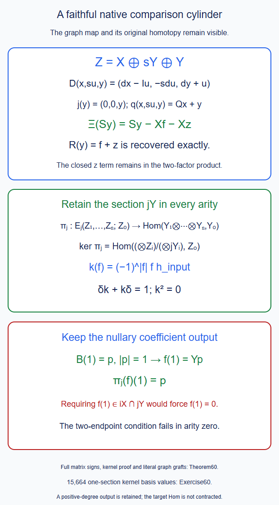

Theorem 60 and Exercise 60. The positive-degree
nullary output is retained by the one-section
projection. The native closed \(z\)-component is
visible in the cylinder matrix and its product.
[Editable SVG](../assets/rational-native-cylinder-projection.svg).

## 61. Collapse a graft of cylinders with its entire cubical carrier

For each input let \(I_i,Q_i,H_i\) be the full special
contraction of \(X_i\) onto \(Y_i\), and put
\(Z_i=\operatorname{Cyl}(I_i)\).
For a nonempty ordered list write
\[
 U_n=\bigotimes_{i=1}^nZ_i,\quad
 X_{\rm in}=\bigotimes_iX_i,\quad Y_{\rm in}=\bigotimes_iY_i,
 \quad Z_{\rm in}=\operatorname{Cyl}(\bigotimes_i I_i).
 \tag{61.1}
\]
The contraction of \(X_{\rm in}\) is the ordered tensor
contraction (54.1). All identifications below retain the
original factor labels.

Let \(L\) be the complex on \(0,1,e\), with
\[
 |0|=|1|=0,\quad |e|=-1,\qquad de=1-0.
 \tag{61.2}
\]
It has the commutative dg product \(\max\):
\(0\) is its unit, \(1\cdot1=1\),
\(1e=e1=e^2=0\). Its augmentation sends both
vertices to one and \(e\) to zero.
The notation \(0\) denotes a basis vertex, not the zero
vector.

Inside \(Z_i\) put
\[
 C_i=i_iI_iY_i\oplus sY_i\oplus j_iY_i.
 \tag{61.3}
\]
The chain isomorphism \(\phi_i:Y_i\otimes L\to C_i\) is
\[
 \phi_i(y,1)=i_iI_i y,\quad
 \phi_i(y,0)=j_i y,\quad
 \phi_i(y,e)=(-1)^{|y|+1}sy.
 \tag{61.4}
\]
Define the entire cubical carrier and its graph extension by
\[
 C_{\rm in}=\bigotimes_iC_i,\qquad
 \mathcal P_n=C_{\rm in}+i_{\rm in}X_{\rm in}\subset U_n.
 \tag{61.5}
\]
Their intersection is precisely
\(i_{\rm in}I_{\rm in}Y_{\rm in}\).

**Theorem 61 (structural collapse and all relative regroupings).**
There is a closed degree-zero map
\[
 \mathfrak c_n:U_n\longrightarrow Z_{\rm in}
 \tag{61.6}
\]
whose restriction to \(i_{\rm in}X_{\rm in}\) is the
literal inclusion of \(X_{\rm in}\). Its restriction
to \(C_{\rm in}\) is exactly (61.4), followed by graded
regrouping of the \(Y\)- and \(L\)-factors and the full
iterated product \(\max:L^{\otimes n}\to L\).
Moreover
\[
 q_{Z_{\rm in}}\mathfrak c_n=\bigotimes_iq_{Z_i},
 \qquad
 \mathfrak c_n\bigl(\bigotimes_i j_i\bigr)=j_{\rm in},
 \qquad \mathfrak c_1=1.
 \tag{61.7}
\]
These are full equalities of maps, including every
coefficient degree.
For \(n\ge1\) there is a canonical closed section
\(\ell_n:Z_{\rm in}\to U_n\), whose image lies in
\(\mathcal P_n\), with
\[
 \mathfrak c_n\ell_n=1.
 \tag{61.8}
\]
The sections agree exactly under consecutive
regrouping. Their nullary counit is
\(\ell_0=q_{\operatorname{Cyl}(1_k)}\).

The quotient \(K_n=U_n/\mathcal P_n\) has an explicit
square-zero contraction. Consequently maps out of
\(U_n\) can be extended while retaining both their
entire \(\mathcal P_n\)-restriction and their entire
specified represented output projection.
Every compatible relative free coherent diagram of
structural regroupings can be extended with those
data fixed. The direct collapse and a parenthesized
collapse need not be equal.

The nullary structural map is \(j:k\to\operatorname{Cyl}(1_k)\).
Inserting it into either side of the binary structural
map gives
\[
 r_C(x,su,y)=(IQx,su,y),\qquad
 1-r_C=\delta k_u,\quad k_u(x,su,y)=(Hx,0,0).
 \tag{61.9}
\]
Thus its unit comparison retains the actual homotopy
on the native kernel. Unit diagrams have the same
relative extension property with \(C_{\rm in}\) as
carrier. An original native unit comparison, on its
coefficient-category source, retains its separate full
matrix row (60.3); (61.9) does not replace it.

**Proof.** The interval product is associative: a
factor \(0\) is a unit; a product containing \(1\)
and \(e\), or two \(e\)'s, is zero; a product of
vertices is their maximum. These rules give the same
answer under every grouping. They also give graded
commutativity. The differential Leibniz rule is
immediate for vertices, and for the remaining pairs
it is
\[
 d(e1)=(1-0)1=0,\qquad
 d(e^2)=(1-0)e-e(1-0)=0.
 \tag{61.10}
\]
Multiplication by \(0\) preserves the differential.
This proves the dg algebra assertion and its
augmentation property.

The sign in (61.4) is forced by the tensor
differential. Both its differential and its value
on \(d(y\otimes e)\) are
\[
 (-1)^{|y|}\bigl(iI y+sdy-jy\bigr).
 \tag{61.11}
\]
Its two vertex equations follow from \(dI=Id\).
This proves that the prescribed carrier collapse is
a chain map.

Here is an explicit extension to the other summands.
Write \(N_i=\ker Q_i\). The splitting
\[
 Z_i=C_i\oplus i_iN_i
 \tag{61.12}
\]
is a chain splitting, because \(X_i=I_iY_i\oplus N_i\).
Thus \(U_n=\bigoplus_SU_S\), where the factors in
the subset \(S\) are \(N_i\)'s and the other factors
are \(C_i\)'s. On \(S=\varnothing\) use the
prescribed cubical map.

For \(S\ne\varnothing\), let \(h_S\) apply \(H_i\)
on the first \(N_i\)-factor and the identity on
all other factors, with graded evaluation. Since
\(\delta H_i=1\) on \(N_i\),
\[
 \delta h_S=1_{U_S},\qquad h_S^2=0.
 \tag{61.13}
\]
Let \(p_S:U_S\to iX_{\rm in}\subset Z_{\rm in}\)
be the graded projection onto the summand with all
the remaining \(C_i\)'s in their \(iIY_i\)-vertex.
It is the identity on the pure graph block and
zero on the other cylinder summands.
It need not be a chain map. Set
\[
 o_S=\delta p_S,\qquad
 \mathfrak c_n|_{U_S}=p_S+o_Sh_S.
 \tag{61.14}
\]
Here \(|o_S|=1\), \(\delta o_S=0\), and
\(\delta(o_Sh_S)=-o_S\). Hence (61.14) is closed.
The defect \(o_S\) vanishes on the pure graph
summand; \(h_S\) preserves that summand. Its
restriction there is therefore the required identity.
This proves (61.6).

On a nonempty \(S\), every value of (61.14) lies
in the \(N\)-part of \(X_{\rm in}\), so its represented
projection is zero. On \(S=\varnothing\), (61.7)
is exactly the augmentation identity for \(\max\).
The all-zero vertex goes to \(jY_{\rm in}\).
For one factor, the cubical part and the \(N\)-part
are both identities. This proves all of (61.7).

To construct the section use the actual interval
diagonal
\[
 \Delta(0)=0\otimes0,\quad
 \Delta(1)=1\otimes1,\quad
 \Delta(e)=e\otimes0+1\otimes e.
 \tag{61.15}
\]
It is a chain map: the differential of its last
value is \(1\otimes1-0\otimes0\).
Both threefold diagonals of \(e\) are
\(e\otimes0\otimes0+1\otimes e\otimes0
 +1\otimes1\otimes e\); the vertices are immediate.
It is therefore coassociative, with counit the
interval augmentation. This is a diagonal on the
three-dimensional interval complex.

On the cubical part of \(Z_{\rm in}\), use
\(\Delta^{(n)}\) and (61.4); on \(iX_{\rm in}\),
use its literal pure-graph inclusion. The two
definitions agree at the \(iI_{\rm in}Y_{\rm in}\)
vertex, so define one closed map \(\ell_n\).
Explicitly the shifted input has the ordered path
\[
 \ell_n\bigl(s(y_1\otimes\cdots\otimes y_n)\bigr)
 =\sum_i(-1)^{\sum_{j<i}|y_j|}
       iI y_1\otimes\cdots\otimes iI y_{i-1}
          \otimes sy_i\otimes jy_{i+1}\otimes\cdots\otimes jy_n.
 \tag{61.16}
\]
The vertex values are the corresponding pure
graph and pure represented tensors.
The interval product composed with its iterated
diagonal is the identity: on \(e\), only the
term \(e\otimes0\otimes\cdots\otimes0\)
survives multiplication by \(\max\).
This proves (61.8). Coassociativity proves the
exact regrouping rule for the sections, and
the interval counit proves their unit rule.
For the empty list that counit is the stated
\(\ell_0\); it is not a right inverse to
\(\mathfrak c_0=j\).

The intersection of \(\mathcal P_n\) with \(U_S\),
for nonempty \(S\), is the pure graph summand with
each remaining factor in \(iIY_i\).
The homotopy \(h_S\) preserves it. The direct sum
of the \(h_S\)'s therefore descends to
\[
 \bar h_N:K_n\to K_n[-1],\qquad
 d\bar h_N+\bar h_Nd=1,\qquad \bar h_N^2=0.
 \tag{61.17}
\]
The empty-\(S\) summand is entirely in the carrier.
On \(\operatorname{Hom}(K_n,W)\), for any target
complex \(W\), the contraction is
\[
 f\longmapsto(-1)^{|f|}f\bar h_N .
 \tag{61.18}
\]
The calculation is (60.11), with every source
unary differential retained.

For the simultaneous assertion let
\(q_o:Z_o\to Y_o\) be a specified cylinder projection.
The joint map is
\[
 \operatorname{Hom}(U_n,Z_o)\longrightarrow
 \operatorname{Hom}(\mathcal P_n,Z_o)
 \mathop{\times}_{\operatorname{Hom}(\mathcal P_n,Y_o)}
 \operatorname{Hom}(U_n,Y_o).
 \tag{61.19}
\]
It is graded-surjective: extend the first prescribed
map to \(a_0\); correct its represented projection
by \(j_o(b-q_oa_0)\). The correction vanishes on
the carrier by compatibility. Its kernel is exactly
\(\operatorname{Hom}(K_n,\ker q_o)\), contracted
by (61.18). A closed prescribed pair lifts by
subtracting the contracted differential defect.
For relative free coherent diagrams use the same
correction on the entire incoming generator
complex, as in (58.13). It vanishes on every
already prescribed generator face. This proves the
relative extension with both images fixed.

For clarity, consider any positive parenthesization
\(t\) of the input list. Its composite collapse
\(\mathfrak c_t\) is closed and restricts to the
same map on \(\mathcal P_n\): on the graph block
all maps are identities, while on the full cube
all maps are the same associative interval
multiplication, with its graded regrouping signs.
Thus
\[
 T_t=(\mathfrak c_n-\mathfrak c_t)\bar h_N,\qquad
 \delta T_t=\mathfrak c_n-\mathfrak c_t
 \tag{61.20}
\]
is an actual degree-minus-one relative comparison.
Its represented projection is zero. Higher
prescribed regrouping boundaries are closed by
the incoming generator differential and vanish
on the same carrier. Formula (61.18) supplies
their primitives. It preserves zero represented
projection, so every higher comparison retains
the represented family exactly.

Here is the first specified two-dimensional example.
For three consecutive blocks let
\(\mathfrak c_L=\mathfrak c_2(\mathfrak c_2\otimes1)\)
and \(\mathfrak c_R=\mathfrak c_2(1\otimes\mathfrak c_2)\).
Use the actual local rotation
\[
 E_{A,B,C}=(\mathfrak c_R-\mathfrak c_L)\bar h_N .
 \tag{61.21}
\]
For four blocks, traverse the five binary
parenthesizations in the order
\[
 ((12)3)4,\quad (1(23))4,\quad
 1((23)4),\quad1(2(34)),\quad(12)(34).
 \tag{61.22}
\]
Whisker (61.21) on each corresponding local
rotation, reversing its sign on the last two
edges. A rotation in a right input slot carries
the Koszul sign from its degree minus one
crossing the preceding full input degree.
Let \(\Lambda\) be the sum of these five
specified edges. Their differential telescopes:
\(\delta\Lambda=0\). Every edge vanishes on
\(\mathcal P_4\). The actual pentagon filler is
\[
 K_{\rm pent}=-\Lambda\bar h_N,\qquad
 |K_{\rm pent}|=-2,\qquad \delta K_{\rm pent}=\Lambda .
 \tag{61.23}
\]
The minus sign is the degree-\(-1\) instance
of (61.18). This retains the specified local
rotation homotopies, rather than replacing them
by a strictly commuting pentagon.

For the unit, the interval vertex \(0\) is a unit
for \(\max\). On \(C_i\) a nullary insertion
therefore acts as the identity. On a native
\(N_i\)-summand the additional coefficient
\(j(1)\) is a \(Y\)-summand; the projection
\(p_S\), its defect followed by \(h_S\), and hence
the collapse are all zero. This gives \(r_C\)
in (61.9). Differentiating \(k_u\) gives
\((1-IQ)x\) in its first component and zero
elsewhere, proving (61.9).

For higher unit diagrams use just the cubical
carrier \(C_{\rm in}\). Its quotient is the
sum of all nonempty-\(S\) summands, contracted
by the same first-\(N\) maps \(h_S\).
The unit comparisons vanish on the cube, as
do the positive regrouping comparisons.
Any compatible closed higher unit boundary
therefore has a primitive relative to that
cube, with its represented projection retained.
This is the same joint restriction argument
(61.19), with the smaller carrier.
It preserves the already prescribed unit
homotopies. This proves the theorem.
\(\square\)

The section recovers the original native joining
prism from an actual graft of cylinders.
Let \(F=(A,B,R)\) be any indicated whole
section-comparison datum of degree \(r\), from
the input contraction to the target contraction.
On the stated common input put
\[
 \Psi_F=\Xi(F)\mathfrak c_n.
 \tag{61.24}
\]
Then
\[
 \Psi_F\ell_n=\Xi(F),\qquad
 \pi_j(\Psi_F)=B,\qquad
 (-1)^{r+1}\operatorname{pr}_X\Psi_F\ell_n s=R.
 \tag{61.25}
\]
The pure graph block recovers \(A\).
These equalities retain all components of the
original \(F\), rather than choosing a primitive
with just the same differential.
In particular use the actual whole joining
comparison of Theorem 54, with its original
native coefficient map and its entire joining
homotopy. The represented restriction is the
one-section projection \(\pi_j\); projection-square
comparisons remain the full maps (53.5).
All the relative regrouping maps and higher
fillers vanish on \(\ell_nZ_{\rm in}\).
Consequently the recovery (61.25) remains exact
while those structural comparisons are attached.

The construction applies to the full marked
contractions, not merely their bare object
coefficients. On the genuine full parameter
encoding use the entire closed section
\(\Sigma\) of (43.4) and its actual full
\(Q^e,H^e\). The splitting is then
\[
 X^e=\Sigma Y^e\oplus\ker Q^e,\qquad
 C^e=i\Sigma Y^e\oplus sY^e\oplus jY^e.
 \tag{61.26}
\]
It is a splitting of the full dg encodings,
so these carriers are stable under the complete
parameter and source differentials. The finite
summand argument above uses their full maps
and their actual coactions. The first-\(N\)
contraction is \(H^e\) on \(\ker Q^e\);
all the original marked components remain.
Using only the bare \(I\) would not prove this
stability.
Positive parameter cores of the resulting
collapse contain the corresponding components
of \(\Sigma,Q^e,H^e\). They are not obtained
by applying the bare object collapse separately
to each parameter value.

For literal graph grafts use (54.7) throughout,
keeping the joining bar. The finite direct-sum
splittings distribute through its original
cotensor equalizer. The same tensor evaluation
signs, carrier map and relative contractions
therefore give entire graph maps.
Independent parameter inputs use their genuine
tensor coalgebra. The entire diagram, including
its comparison arrows and higher rows, can be
recorded on the common input of Theorem 55;
for arrow data use the correspondence of
Theorem 59 before recording. Pullback along
the actual whole roof retains every parameter
core and its faces.

These structural maps retain the represented
diagram on that stated common input. Identifying
it with an additional original native joint
family requires its actual comparison and
all its prescribed faces. Neither the interval
product nor the recording step supplies a
diagonal on an original parameter bar or
replaces the original native graft prism.

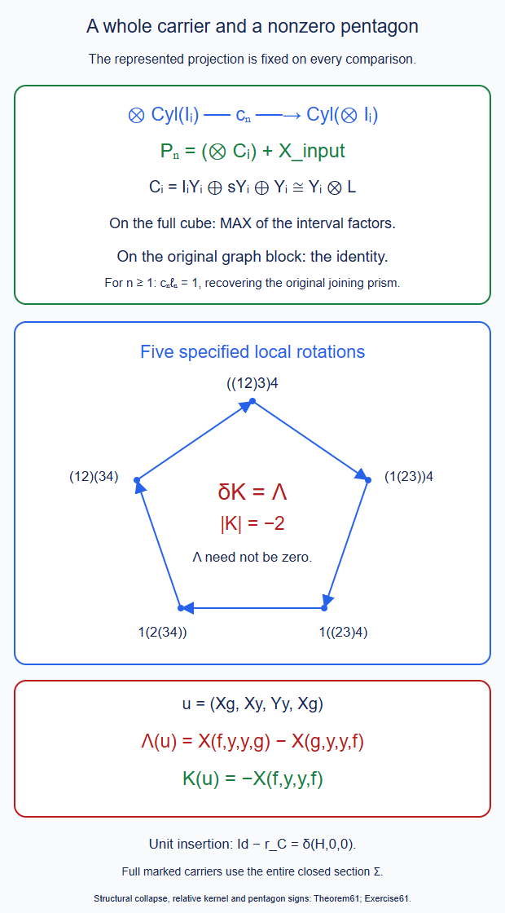

Theorem 61 and Exercise 61. Regrouping homotopies
and their pentagon filler retain the represented
projection exactly.
[Editable SVG](../assets/rational-native-cylinder-graft-comparison.svg).

## 62. A strict tensor home for the full comparison matrices

Give the interval \(L\) of (61.2) the coproduct
\[
 \Delta0=0\otimes0,\quad \Delta1=1\otimes1,\quad
 \Delta e=e\otimes0+1\otimes e,\qquad
 \epsilon(0)=\epsilon(1)=1,\quad\epsilon(e)=0 .
 \tag{62.1}
\]
The vertex \(0\) is the multiplicative unit of \(L\).
It is not the zero vector. The monoidal unit is the
one-dimensional comodule \(k_0\), with coaction \(1\mapsto0\otimes1\).
For every \(Z=\operatorname{Cyl}(I)\), define
\[
 \rho(Xx)=1\otimes Xx,\qquad \rho(Yy)=0\otimes Yy,\qquad
 \rho(Sy)=1\otimes Sy-e\otimes Yy .
 \tag{62.2}
\]
The labels \(X,S,Y\) name the summands of (60.1).
A homogeneous map \(f\) of degree \(r\) is colinear when
\[
 \rho f=(1_L\otimes f)\rho,\qquad
 (1_L\otimes f)(l\otimes u)=(-1)^{r|l|}l\otimes f(u).
 \tag{62.3}
\]

**Theorem 62 (full matrices, tensor products and coefficient sources).**
The interval with its MAX product and (62.1) is a commutative dg
bialgebra. Its left comodules form a symmetric monoidal dg category.
Between single comparison cylinders, \(\Xi\) identifies the entire
section-comparison mapping complex of Theorem 52 with the entire
complex of homogeneous \(L\)-colinear maps. This is a unital dg
category isomorphism on those objects, retaining every \(A,B,R\).

Allow as colors all nonempty ordered tensor words of comparison
cylinders, with their actual graft types, including
\(\operatorname{Cyl}(1_k)\). Ordinary tensor evaluation and
composition give the strict colored dg operator spaces
\[
 \mathcal E_\rho(U_1,\ldots,U_n;V)
       =\operatorname{Hom}_L(U_1\otimes\cdots\otimes U_n,V).
 \tag{62.4}
\]
The source for \(n=0\) is \(k_0\). Restriction to the pure
\(Y\)-summands gives a unital, graded-surjective quasi-isomorphism
onto the corresponding \(Y\)-operator spaces in every arity.

The positive-arity maps \(\mathfrak c_n,\ell_n\), their specified
regrouping homotopies and pentagon of Theorem 61, and their unit
homotopies are colinear. In particular every original native row
has the realization
\[
 \Psi_F=\Xi(F)\mathfrak c_n,\qquad
 \Psi_F\ell_n=\Xi(F)\quad(n\ge1)
 \tag{62.5}
\]
in this same strict operator category. A geometric operation with
zero state inputs retains its coefficient-cylinder source and its
full unary comparison row.

**Proof.** The interval product is associative and graded commutative
by its basis table. Its nontrivial Leibniz checks are
\[
 d(e1)=(1-0)1=0,\qquad
 d(e^2)=(1-0)e-e(1-0)=-e+e=0 .
 \tag{62.6}
\]
Products with \(0\) use its unit property; vertex products are
closed. The coproduct is a chain map because
\[
 d\Delta e=(1-0)\otimes0+1\otimes(1-0)
                      =1\otimes1-0\otimes0 .
 \tag{62.7}
\]
Its two iterates on \(e\) are both
\(e\otimes0\otimes0+1\otimes e\otimes0+
1\otimes1\otimes e\). Vertices and counits give the other cases.
For compatibility with multiplication, use the Koszul product
on \(L\otimes L\). Products with \(\Delta0\) are unchanged,
\((\Delta1)^2=\Delta1\), and
\[
 (\Delta1)(\Delta e)=0,\qquad(\Delta e)^2=0 .
 \tag{62.8}
\]
The first uses \(1e=0\); each mixed term in the second contains
that same zero product, and its square terms contain \(e^2\).
These are all basis pairs. The augmentation is multiplicative.

The tensor coaction moves the \(L\)-factors to the left with
Koszul signs and multiplies them. The bialgebra law makes it
coassociative and closed. Associativity and the unit \(0\)
give the monoidal associativity and unit laws; graded
commutativity makes the usual graded symmetry colinear.
This proves the symmetric monoidal dg category assertion.
It does not require cocommutativity of \(\Delta\).

Formula (62.2) is counital. Its two iterates on \(Sy\) are
\[
 1\otimes1\otimes Sy-e\otimes0\otimes Yy-1\otimes e\otimes Yy .
 \tag{62.9}
\]
On the unshifted summands this follows from the vertices.
The full cylinder differential gives
\[
 \begin{split}
 d\rho(Sy)
  &=-1\otimes XIy-1\otimes Sdy+0\otimes Yy+e\otimes Ydy\\
  &=\rho(-XIy-Sdy+Yy).
 \end{split}
 \tag{62.10}
\]
The other two summands also commute with their differentials.
This includes nonzero \(dy\).

The weight-zero elements of a single cylinder, meaning
\(\rho v=0\otimes v\), are exactly \(Yy\).
Its weight-one elements are exactly \(Xx\).
Thus a degree-\(r\) colinear map sends \(Yy\) to \(YBy\)
and \(Xx\) to \(XAx\). Write its value on \(Sy\) as
\(XC y+SE y+YT y\).
Comparison of the \(0,1,e\) coefficients in (62.3) gives
\[
 T=0,\qquad E=(-1)^rB,\qquad C=(-1)^{r+1}R ,
 \tag{62.11}
\]
where \(R\) is unrestricted of degree \(r-1\).
Conversely these equations give colinearity of every \(\Xi(A,B,R)\).
The differential and composition are those proved in Theorem 60,
so this is an isomorphism of dg categories, including identities.

Flatten a tensor source into \(U=\bigotimes_iZ_i\), with
pure represented subcomplex \(Y_U=\bigotimes_iY_i\).
Let \(p:U\to Y_U\subset U\) be the graded summand projection.
Define the degree-one map \(t:U\to Y_U\subset U\) to be zero
except on tensors with exactly one \(S\)-summand and all other
factors in \(Y\). There put
\[
 t(Yy_1\otimes\cdots\otimes Sy_i\otimes\cdots\otimes Yy_m)
       =(-1)^{\sum_{j<i}|y_j|}\bigotimes_jYy_j .
 \tag{62.12}
\]
On every tensor summand, multiplying the coactions gives
\[
 \rho_U(u)=1\otimes u+(0-1)\otimes pu-e\otimes tu,\qquad
 t=p\,d_U-d_{Y_U}p .
 \tag{62.13}
\]
Indeed an \(X\)-factor kills every possible \(e\)-term.
With two or more \(S\)-factors, an \(e\)-term meets either
another \(e\) or a \(1\), so is zero. With exactly one \(S\)
and the other factors in \(Y\), moving its \(e\) left gives
(62.12). The pure \(Y\)-summand has coaction \(0\otimes u\).
The cylinder differential proves the second equality, retaining
all internal differentials. For the empty tensor \(p=1,t=0\),
and (62.13) remains true.

For an output word \(V\), put
\[
 G_V=\ker p_V\cap\ker t_V
                =\{v:\rho_V(v)=1\otimes v\}.
 \tag{62.14}
\]
This is a subcomplex since \(\rho_V\) is closed. The
weight-zero part of \(V\) is exactly \(Y_V\).
Consequently every colinear map restricts to a map
\(Y_U\to Y_V\), and restriction preserves all substitutions,
permutations and identities.

For a single output cylinder, a degree-\(r\) map
\(B:Y_U\to Y_o\) has the graded colinear lift
\[
 f_B(u)=j_oBpu+(-1)^r s_oBtu .
 \tag{62.15}
\]
Substitution in (62.3) proves this equality, including the
\(e\)-coefficient and its sign; restriction is exactly \(B\).
For an output word of length \(m\ge1\), follow this lift into
\(\operatorname{Cyl}(\bigotimes_a I_a)\) by \(\ell_m\).
This section is colinear: on the cube it is the iterated
coproduct (62.1). Direct substitution on the two vertices
and on \(e\) proves that \(\Delta:L\to L\otimes L\)
is colinear for the tensor coaction defined using MAX.
For the edge that coaction is
\[
 \rho_{L\otimes L}(\Delta e)
       =e\otimes(0\otimes0)+1\otimes\Delta e
       =(1\otimes\Delta)\Delta e .
 \tag{62.16}
\]
On the graph block \(\ell_m\) is colinear as well.
Iteration proves the assertion and graded surjectivity.

If the represented restriction of \(f\) is zero, (62.13)
and (62.3) say exactly that \(f\) vanishes on \(Y_U\) and
has image in \(G_V\). Conversely every such graded map is
colinear, because \(p_U,t_U\) have image in \(Y_U\).
Thus the kernel of restriction is precisely
\[
 N(U,V)=\operatorname{Hom}(U/Y_U,G_V).
 \tag{62.17}
\]
The special cylinder contraction of Theorem 60, tensored in
the given order, contracts \(U\) onto \(Y_U\).
It vanishes on \(Y_U\), inducing a square-zero contraction
\(\bar h_U\) of \(U/Y_U\). Consequently
\[
 h_N(f)=(-1)^{|f|}f\bar h_U,\qquad
 \delta h_N+h_N\delta=1,\quad h_N^2=0 .
 \tag{62.18}
\]
Expanding the Hom differential proves this: the output
differential terms cancel, and the source terms are
\(f(d\bar h_U+\bar h_Ud)=f\).
No contraction of \(G_V\), or of a whole target Nat complex,
is asserted. With empty source \(U=Y_U=k_0\), the kernel
is zero and the entire nullary space is
\(\operatorname{Hom}(k,Y_V)\), with every output degree.
The short exact sequence with kernel (62.17) proves the
quasi-isomorphism.

On the full cube, \(\mathfrak c_n\) is the interval product,
colinear by the bialgebra law. Every summand with a native
\(\ker Q\) factor has pure weight one: its \(1\) absorbs
all vertices and annihilates all edge coefficients of the
other factors. The collapse (61.14) maps it into the
weight-one \(X\)-block. Thus the entire collapse is colinear.
The first-\(\ker Q\) homotopy preserves these weight-one
summands and vanishes on the cube, so is colinear of degree
minus one. Formulas (61.20)–(61.23) give colinear specified
regroupings and their degree-minus-two pentagon filler.
The unit homotopy \((Hx,0,0)\) has the same property.
Closure under tensor and composition proves (62.5),
including the exact native recovery (61.25).

Identify the coefficient cylinder with \(L\) by
\(Y1=0,\ X1=1,\ S1=-e\). A degree-\(r\) comparison row
from it is exactly
\[
 f(0)=YB(1),\quad f(1)=XA(1),\quad
 f(e)=(-1)^r XR(1)+(-1)^{r+1}SB(1).
 \tag{62.19}
\]
No \(A,B,R\) coordinate has been discarded.
The ordinary counit \(L\to k_0\) is closed but not
colinear: at vertex \(1\) its two proposed coactions
are \(0\otimes1\) and \(1\otimes1\).
It supplies no strict inverse for this coefficient-source
row. This proves the theorem.
\(\square\)

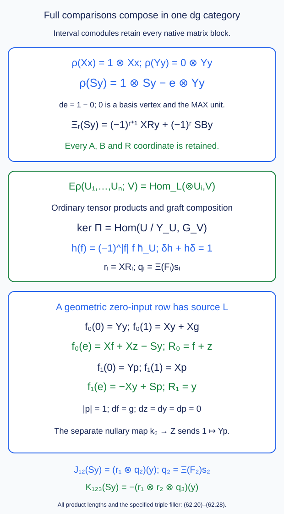

The relative lifting consequence uses the full incoming unary
differential. Suppose a free typed dg source has a
differential-stable union of prescribed generator faces
and a given whole \(Y\)-operator diagram. Assume the
prescribed colinear diagram has that exact represented
image on their overlap. At the next generator complex
choose a graded lift with both images fixed. Its
differential defect lies in (62.17), is zero on the
prescribed subcomplex, and is closed for the Hom
differential including the full source unary term.
Postcompose that defect with (62.18) and subtract.
The resulting lift is closed with both images unchanged:
the incoming unary terms cancel in this Hom computation
as in Theorem 52. Proper source decompositions were
assigned at smaller generator lengths. Induction gives
the whole relative lift. Finite stabilizer averaging in
characteristic zero preserves both images; the ordered
homotopy itself need not be equivariant.

Substitutions in (62.4) are ordinary tensor and composition
of comodule maps between the actual tensor objects.
They do not copy a single interval coefficient to define
a substitution law. The original parameter words and
the whole marked section \(\Sigma\), rather than its
bare value, determine the cylinders in (62.5).
For a partial native replacement use the entire triple
of Theorem 53; recovering its third matrix block gives
the original \(R\) on every marked input. Tensoring
these maps retains every simultaneous \(R\)-product.
Their compositions obey the full signed law of
Theorem 52. For an expanded joining seam use the
entire triple of Theorem 54, including its joining
section homotopy, before applying (62.5).
Whole parameter roofs are those of Theorem 55.

The tensor section comparison has an explicit mixed term.
Let \(F_i=(A_i,B_i,R_i)\) be closed degree-zero whole
rows, and let \(F_{12}\) be their exact product (54.3).
Use \(\ell,\ell'\) for the two-factor sections of
the input and output cylinders. Define a degree-minus-one
map \(J_{12}\) by
\[
 \begin{split}
 J_{12}(Xx)&=J_{12}(Yy)=0,\\
 J_{12}(S(y_1\otimes y_2))
   &=(-1)^{|y_1|}XR_1y_1\otimes\Xi(F_2)(Sy_2).
 \end{split}
 \tag{62.20}
\]
Then, as entire maps,
\[
 \delta J_{12}
       =(\Xi(F_1)\otimes\Xi(F_2))\ell-\ell'\Xi(F_{12}).
 \tag{62.21}
\]
Thus its tensor section need not be strictly natural.
Both its graph and represented restrictions are zero,
and \(J_{12}\) is colinear. The formula includes the
nonzero product \(-R_1\otimes R_2\).

Here is a direct proof with all signs. As maps on the
unshifted \(Y_i\), abbreviate
\[
 r_i=XR_i,\quad a_i=XA_iI_i,\quad b_i=XI'_iB_i,\quad
 y_i=YB_i,\quad q_i=\Xi(F_i)s_i .
 \tag{62.22}
\]
The \(r_i,q_i\) have degree minus one and
\(\delta r_i=a_i-b_i,\ \delta q_i=y_i-a_i\).
Every tensor of maps in the following equations uses
graded evaluation. On a shifted input the right side
of (62.21) is
\[
 \begin{split}
 &(q_1\otimes y_2+a_1\otimes q_2)\\
 &\quad-\bigl((q_1+r_1)\otimes y_2
       +b_1\otimes(q_2+r_2)-r_1\otimes a_2-b_1\otimes r_2\bigr)\\
 &=(a_1-b_1)\otimes q_2+r_1\otimes(a_2-y_2)
                         =\delta(r_1\otimes q_2).
 \end{split}
 \tag{62.23}
\]
On the two unshifted summands it is zero.
Since \(J_{12}\) vanishes there and \(D(Sy)=-XIy-Sdy+Yy\),
its differential on \(Sy\) is precisely
\(\delta(r_1\otimes q_2)(y)\). This proves (62.21),
including nonclosed inputs. Its image has first factor
of weight one, so the tensor coaction is weight one;
(62.3) then proves colinearity.

There is consequently an explicit comparison for every
nonempty ordered product, retaining its original
telescoping \(R\) from (54.3). Put \(J_1=0\).
For a consecutive partition \(A|b\), where \(A\)
is the first \(n-1\) factors and \(b\) the last, put
\[
 J_{A,b}
   =(J_A\otimes\Xi(F_b))\ell_{A,b}
        +(\ell'_A\otimes1)J_{F_A,F_b}.
 \tag{62.24}
\]
Here \(F_A\) is the full product row, and the last
term is (62.20) for those two whole blocks.
Applying the dg Leibniz rule, using that every
\(\ell,\Xi\) is closed, proves by induction
\[
 \delta J_{1,\ldots,n}
   =(\bigotimes_i\Xi(F_i))\ell_{1,\ldots,n}
                       -\ell'_{1,\ldots,n}\Xi(F_{1\cdots n}).
 \tag{62.25}
\]
The two intermediate terms cancel exactly.
Coassociativity of the sections gives the stated
domain and codomain, and (54.3) is associative on
these whole rows by its ordered telescoping expansion.
Every \(J\) in this induction is colinear and vanishes
on the two unshifted summands.

For three factors the left- and right-grouped choices are
\[
 \begin{split}
 J_L&=(J_{12}\otimes\Xi(F_3))\ell_{12,3}
                       +(\ell'_{12}\otimes1)J_{F_{12},F_3},\\
 J_R&=(\Xi(F_1)\otimes J_{23})\ell_{1,23}
                       +(1\otimes\ell'_{23})J_{F_1,F_{23}} .
 \end{split}
 \tag{62.26}
\]
The right-slot occurrence of \(J_{23}\) carries its
degree-minus-one Koszul sign.
The specified degree-minus-two filler is
\[
 K_{123}(Xx)=K_{123}(Yy)=0,\qquad
 K_{123}(Sy)=-(r_1\otimes r_2\otimes q_3)(y),\qquad
 \delta K_{123}=J_L-J_R .
 \tag{62.27}
\]
Indeed expand (62.26) on \(Sy\). The difference is
\[
 r_1\otimes r_2\otimes(a_3-y_3)
 +r_1\otimes(a_2-b_2)\otimes q_3
 -(a_1-b_1)\otimes r_2\otimes q_3
       =-\delta(r_1\otimes r_2\otimes q_3).
 \tag{62.28}
\]
It is zero on the other summands.
Since \(|K_{123}|=-2\), the Hom differential and
the negative shifted unary differential give exactly
(62.27). The image again has pure weight one.
Its cubic \(R_1R_2R_3\) contribution is retained.

These equations also hold for literal expanded-seam
grafts: apply the dg multilinear graft operation
(54.7) to each displayed tensor formula. Its
Leibniz and interchange rules are exactly those
used in (62.23) and (62.28). For full parameter
families, perform the calculation on the entire
cofree parameter modules; the degrees in the
Koszul signs include their parameter degrees.
Restriction uses the whole actual joint-index
roof of Theorem 55. No parameter bar diagonal is
introduced. The joining endpoint retains the
full \(R\) and \(\eta\) in (54.6).

For a changing-profile family, prescribing graft and
deletion faces simultaneously requires their complete
common generator values. Agreement of arrows or
cohomology classes alone does not establish that
condition. In particular, the canonical whole
tensor-bar face and the original native parameter
input must be compared on their actual joint index.

## 63. The whole completed-cut matrix family with prescribed section cores

Fix the actual completed string \(\tau_\sigma\), cut category
\(\mathcal C_q\), and entire native operator map
\(\mathcal S_\sigma\) of Theorem 51. Fix an actual outer
functor \(W:A_b\to D\). The source inputs remain all of
\(B_{\rm full}A_a\), with the original endpoint labels.
Graph maps are contravariant in the inner operation.
We first specify that direction on the whole parameter
diagram, including its higher cores.

For a dg category \(E\), let \(E^{\rm op}\) have composition
\(a\cdot_{\rm op}b=(-1)^{|a||b|}ba\).
With the negative unary bar convention of Theorem 9, define
\[
 \chi_E(sa_1|\cdots|sa_p)
   =(-1)^{p+\sum_{i<j}(|a_i|-1)(|a_j|-1)}
                   sa_p|\cdots|sa_1 .
 \tag{63.1}
\]
It is a chain coalgebra isomorphism
\(B_{\rm full}(E^{\rm op})\to(B_{\rm full}E)^{\rm cop}\);
the superscript \({\rm cop}\) includes the graded tensor swap.
On each coaugmentation it is the identity.
Consequently a whole coherent map \(S:BP\to BE\)
has opposite
\[
 S^{\rm op}=\chi_E^{-1}S\chi_P .
 \tag{63.2}
\]
The ordinary arrows retain their original, positive unary
functor values: the two length-one signs in (63.2) cancel.
One must not apply only one of these reversals.

At a cut vertex \(C\), put \(H_C=H_{\sigma,C}\).
Let \(\mathcal X_C\rightleftarrows\mathcal Y_C\) be the
actual two-block common-input contraction for \(W,H_C\).
On the entire original parameter encoding it is
Theorem 43, pulled back along (51.5)–(51.6).
In particular its section is the whole \(\Sigma\),
and its positive section cochain is
\(\mathcal I(c)=-W_c\) in the graph coordinates of
Theorem 59. Write \(\tau_A,\tau_B\) for its two
entire diagonal twisting cochains after (63.2).

**Theorem 63 (completed-cut matrices and retention of every prescribed \(R\)-core).**
For these actual two-block graph objects, the complete
native cut family is represented by the following
coherent cylinder operators. On every positive
homogeneous parameter input \(c\),
\[
 \tau_Z(c)=
 \begin{pmatrix}
  \tau_A(c)&(-1)^{|c|}\mathcal I(c)s^{-1}&0\\
  0&(-1)^{|c|+1}s\tau_B(c)s^{-1}&0\\
  0&0&\tau_B(c)
 \end{pmatrix}.
 \tag{63.3}
\]
The object differential is the full cylinder differential,
including its bare section \(I_C\).
The matrix has degree \(|c|+1\); its unshifted third
datum has degree \(|c|\).
It satisfies the full Maurer–Cartan equation and is
colinear for (62.2). All original higher native
\(A,B,\mathcal I\) cores can be recovered from its
blocks, with no cohomological replacement.

Deleting any vertex of \(\sigma\) restricts (63.3)
to its identical matrix family on the face whose
cuts omit that vertex. This includes the endpoint
composites in Theorem 51. Every source word, original
parameter label and unconsumed identity word remains.
The zero-frontier source is the coefficient category,
and its actual unit-output mappings are retained.

There is also a relative construction on the actual
expanded block graph objects \(X_C\) of Theorem 52.
Prescribe the whole represented family \(B\), any
compatible differential-stable union of full lifted
generator faces, and any graded values \(R_v\) of
the indicated degree on the remaining free generators.
The \(R_v\)'s must have the actual endpoint types and
agree with the prescribed values on intersections.
Then the lift can retain every one of these \(R_v\)
exactly, as well as the entire given \(B\).
Its new corrections have only an \(A\)-component.
In particular the actual partial-replacement triples
of Theorem 53 can be retained on the one-cut edges.
Any supplied higher native section cores already
expressed in these same mapping spaces can be
retained too.

**Proof.** Formula (63.1) reverses the suspended list
with its Koszul sign and one extra minus per letter.
It is involutive. Reversing a deconcatenation exchanges
its two pieces and contributes their graded tensor-swap
sign, proving the coalgebra assertion.
For a unary term, reversal moves its degree-one
differential past the complementary suspended factors;
this gives exactly the opposite bar tensor sign.
For an adjacent pair \(a,b\), its opposite product has
the additional factor \((-1)^{|a||b|}\).
The binary signs before and after reversal agree
because, modulo two,
\[
 (|a|-1)(|b|-1)+|a|+|b|=|a||b|+1 .
 \tag{63.4}
\]
The length drops by one, so the extra minus per
letter supplies precisely that final \(1\).
All complementary-factor signs agree with the
same final reversal permutation. Unary and binary
terms exhaust the dg bar differential. This proves
that \(\chi_E\) is closed and proves (63.2).
It also applies to proper original arrows whose
operator images are identities; their source
letters were never quotiented out.

Theorem 51 gives the whole map on the actual cut
category, not a collection of unrelated edges.
Apply its full evaluation (51.6), retaining all
original source inputs. Theorems 43–44 then give
the entire section and both graph diagonals on
this same coalgebra. By Theorem 59, their twisting
cochain in the section-comparison category is
\[
 \widetilde\tau(c)
          =(\tau_A(c),\tau_B(c),\mathcal I(c)).
 \tag{63.5}
\]
Its coefficient degree is \(r=|c|+1\).
Applying the faithful dg functor \(\Xi\) of
Theorem 60 gives the shifted-input coefficient
\((-1)^{r+1}\mathcal I(c)=(-1)^{|c|}\mathcal I(c)\)
and the shifted diagonal \((-1)^r\tau_B(c)\).
These are exactly (63.3).
Because \(\Xi\) preserves the differential and
every graded product, applying it to
\[
 \partial\widetilde\tau+\widetilde\tau b
                         -\widetilde\tau\star\widetilde\tau=0
 \tag{63.6}
\]
proves the entire matrix equation. This includes
every parameter unary differential, every adjacent
merger, every proper cut and every original state
differential. Colinearity is Theorem 62 in each
homogeneous degree. The three blocks recover the
original triple by (60.3).

For a \(p\)-arrow cut flag, the coefficient degree
is \(1-p\) and its section datum has degree \(-p\).
Since \(\mathcal I(c)=-W_c\), its shifted
off-diagonal block is \((-1)^{p+1}W_c\).
For example the one- and two-arrow blocks have
opposite signs, although both section data use
the same global negative in (59.3).
These degree statements use cut flags; they do
not identify cut length with the length of an
execution string or with its source mapping word.

On the face omitting \(x_i\), Theorem 51 gives
literally the shorter string's block composites
and whole operator map. Precomposition with this
face map commutes with \(\chi\), evaluation,
all cuts in (43.4), and application of \(\Xi\).
Hence (63.3) restricts exactly on every generator,
including the higher ones. At the first or last
face the block composite is the displayed
\(g_1u_0\) or \(h_qg_q\); neither is suppressed.
The zero-frontier case still uses the actual
coefficient category and the full output Hom
complex of its unit, by Theorems 9 and 51.

For the last assertion, use the original relative
free source \(\mathcal R=T_S(V)\) of Theorem 52,
with its full \(d_1+\gamma\).
At a generator of degree \(r\), choose a graded
lift \(v=(A_v,B_v,R_v)\) with the specified
\(B_v,R_v\) and all prescribed full face values.
Such a graded lift exists: \(A_v\) is unrestricted
off those already fixed subspaces. The relative
graded extension can be chosen on their quotient.
Its defect is the actual
\[
 o=(\partial v-vd_1)-\widetilde F_{<\ell}\gamma .
 \tag{63.7}
\]
It is closed, takes values in \(\ker\Pi\), and
vanishes on every prescribed subcomplex, exactly
as proved in (52.13)–(52.15). The correction is
\[
 v_{\rm new}=v-\mathfrak h o .
 \tag{63.8}
\]
Crucially \(\mathfrak h(A,0,R)=
((-1)^{|A|}AH+RQ,0,0)\).
Thus (63.8) alters only \(A_v\).
It keeps the given \(R_v\), whether closed or
nonclosed, and its entire \(B_v\), while making
the full generator equation hold.
Multiplicative extension gives a dg functor,
with the original coefficient identities assigned
at the outset. In the normalized full bar-cobar
recorder, the one-output value on an original
coalgebra input is the value of its single
cobar generator, as proved in (55.10).
Consequently preserving these generator \(R_v\)'s
preserves every original coherent section core,
not merely their values on arrows.

For explicit cut equations, write \(F_{0\ldots p}\)
for the coefficient of an ordinary flag
\(C_0\subsetneq\cdots\subsetneq C_p\), read in
graph direction. Its degree is \(1-p\), and
the negative-unary convention gives
\[
 \partial F_{0\ldots p}
  =\sum_{i=1}^{p-1}(-1)^i
       \left(F_{0\ldots i}F_{i\ldots p}
                         -F_{0\ldots\widehat i\ldots p}\right).
 \tag{63.9}
\]
This follows directly by inserting the suspended
degree \(-1\) of each arrow in (63.6).
The two-arrow formula is
\(\partial F_{012}=F_{02}-F_{01}F_{12}\).
It keeps the direct simultaneous arrow \(02\).
Equation (63.8) solves all these equations with
the stated \(B,R\) values; it does not replace
the direct arrow by the composite.

A deleted-cut face has all \(C_j\) omitting the
same coordinate. Each unary term, adjacent merger
and proper cut stays in that face. Unions of
these generator faces are therefore stable.
Their full values agree by induction on the
shorter original completed strings, using their
unchanged block labels. Theorem 53 supplies
the identical elementary triple wherever that
elementary replacement survives. Applying
(63.8) relatively retains every such value.
Induction first on original string dimension
and then on generator length constructs the
claimed face-compatible family.
For the two calibrated systems, use [C.48.3](../GL-SAT-13.html#c483-retain-both-endpoint-systems-in-the-full-prisms)'s
whole prism source and prescribe both endpoint
systems and their already assigned common
faces. Its simplex subdivision has the same
stable free face subcomplexes. The same
correction retains the supplied \(B,R\) cores
on the prism and both endpoint systems.
This proves the theorem.
\(\square\)

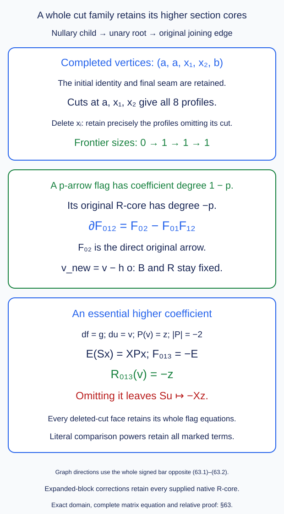

This gives the actual full matrix family in the two-block
presentation, and an expanded-block lift retaining the
indicated exact native data. Its higher \(A\)-components
are those assigned by (63.8) unless already prescribed
on a full face. They are not thereby identified with
every differently presented native graft diagonal.
For a product face expressed on an actual common
refinement, its matrix comparison is (62.20)–(62.25);
the specified three-factor filler is (62.27).
Literal grafts use (54.7), the full joining triple
(54.6), and the whole original roof of Theorem 55.
To prescribe these product and graft families together
with every changing-profile face, their entire
generator values and overlap comparisons must still
be placed in those same mapping spaces. The
projection-kernel contraction does not prove that
an arbitrary extra requirement fixing both graph
and represented blocks has an acyclic kernel.

## 64. A joint input retaining the canonical tensor family and the original triangle

Consider the original compatible graft with a unary outer
operation and a genuinely nullary inner operation.
Its execution objects are \(00,01,11\); \(10\) is
not an original execution state. Its arrows are
\(\alpha:00\to01,\ \beta:01\to11,\ \delta=\beta\alpha\).
Retain the direct arrow and the two-arrow parameter word.
Complete the original strings in a fixed outer context
as in Theorem 51. All the following operator families
therefore have the same actual outer source and target.
The auxiliary object \(10\) below belongs to a parameter
resolution, and does not add an execution to this category.

Use the actual two-factor parameter model \(T\) of
Theorems 55–56. It has axes
\[
 b_0:00\to01,\quad a_1:01\to11,\quad
 a_0:00\to10,\quad b_1:10\to11,
 \qquad AB=a_1b_0,\quad BA=b_1a_0 ,
 \tag{64.1}
\]
and a degree-minus-one arrow \(M:00\to11\) with
\(dM=AB-BA\). The other arrows have degree zero.
Write \(C=B_{\rm rel}T\) for its relative input bar
over the four object identities. It includes its four
coaugmentations. Here the proper arrows form a dg ideal,
so this relative bar is a genuine dg coalgebra.
It describes the full normalized Nat inputs; ordinary
identity inputs obey the unit normalization of [C.71](../GL-SAT-13.html#c71-the-actual-native-diagram-with-strict-formal-units).
Proper arrows such as \(AB,BA\) remain even when
their operator images are identities.

Use the negative unary convention of Theorem 9.
Abbreviate the two proper two-arrow inputs by
\[
 x=sa_1|sb_0,\qquad y=sb_1|sa_0 .
 \tag{64.2}
\]
Then
\[
 b(sM)=-sAB+sBA,\quad b(x)=-sAB,\quad b(y)=-sBA .
 \tag{64.3}
\]
The parity conversion (E56.3) sends the whole units
of Theorem 55 to
\[
 \eta_K(C_{\rm mix})=-sM+x-y,\qquad
 \Lambda_1(s\delta)=sBA,\qquad
 \Lambda_1(s\beta|s\alpha)=-sM+x .
 \tag{64.4}
\]
The axes and coaugmentations keep their displayed labels.
These are entire coalgebra maps, not assignments that
discard their other output words.

**Theorem 64 (simultaneous whole-input retention on the compatible triangle).**
Inside \(C\), put
\[
 Q=\eta_K(K)+\Lambda_1(B_{\rm rel}P),\qquad
 I=\eta_K(K)\cap\Lambda_1(B_{\rm rel}P).
 \tag{64.5}
\]
The intersection consists exactly of the coaugmentations
at \(00,01,11\) and the axes \(b_0,a_1\).
The sum \(Q\) is a dg subcoalgebra.
In particular full data on the canonical tensor input
and on the original triangle can be prescribed together
precisely when they have the same full values on \(I\).

There is an explicit square-zero contraction of \(C/Q\).
For any full normalized functors \(F,G:T\to E\) into
a dg target, simultaneous restriction is a
graded-surjective quasi-isomorphism
\[
 \operatorname{Nat}_T(F,G)\longrightarrow
 \operatorname{Nat}_K(F\eta_K,G\eta_K)
 \mathop{\times}_{\operatorname{Nat}_I}
 \operatorname{Nat}_P(F\Lambda_1,G\Lambda_1).
 \tag{64.6}
\]
Its actual kernel is contracted without any acyclicity
assertion about the target mapping complex.
Thus a supplied whole original comparison on \(P\)
and a canonical whole comparison on \(K\), agreeing
on their shared data, have a single closed lift
retaining both exactly. Their compatible higher
comparison diagrams and prescribed generator faces
can be retained as well.

Two whole normalized functor families on these inputs,
agreeing on \(I\), also extend to a whole functor on
\(T\). One can simultaneously retain a prescribed
represented \(B\)-family under the projection of
Theorem 62 whenever its restriction is the given
represented data. The corresponding joint restriction
for comparison cochains has a contracted kernel.

**Proof.** The normalized bar \(C\) has the four
coaugmentations, seven proper one-arrow inputs,
and \(x,y\). Formula (64.4) gives the following
bases for its two subcoalgebras:
\[
 \begin{array}{c|l}
 \eta_K(K)&
 \text{four coaugmentations},\
 sa_0,sa_1,sb_0,sb_1,\ -sM+x-y\\
 \Lambda_1(B_{\rm rel}P)&
 \text{coaugmentations at }00,01,11,\
 sb_0,sa_1,sBA,\ -sM+x .
 \end{array}
 \tag{64.7}
\]
The terms with \(y\) show that no nonzero multiple
of the first mixed vector belongs to the second
span. The coefficient of \(sBA\) then excludes
the original direct arrow from the first span.
This proves the exact intersection assertion.
Each image is a dg subcoalgebra by Theorem 55;
their sum therefore is one too. Notice that
\(y=(-sM+x)-(-sM+x-y)\) belongs to \(Q\).
That inclusion retains the second tensor order
as auxiliary input; it does not insert the
state \(10\) into \(P\).

The quotient has basis
\[
 u=[sAB],\quad |u|=-1,\qquad
 v=[sM]=[x],\quad |v|=-2,\qquad
 bv=-u,\quad bu=0 .
 \tag{64.8}
\]
Its contraction is
\[
 h_Q(u)=-v,\qquad h_Q(v)=0,\qquad
 bh_Q+h_Qb=1,\quad h_Q^2=0 .
 \tag{64.9}
\]
Both assertions follow by applying the two sides
to \(u,v\), with the signs in (64.3).

Let \(\phi\) be a Nat cochain vanishing on \(Q\).
It vanishes at every coaugmentation and every
axis. Its only independent values are on \(sAB\)
and \(sM\); its value on \(x\) equals that on
\(sM\), and its value on \(y\) is zero.
Every proper cut of \(x\) or \(y\) has two axes.
The one-arrow inputs have no proper cut.
Consequently all positive twisting-action
terms in the differential of \(\phi\) vanish.
There are no further proper words: \(00\) is
initial and \(11\) is terminal in this finite
directed parameter category. The exact kernel
complex is therefore
\[
 N_Q(F,G)=
 \operatorname{Hom}(C/Q,E(F00,G11)),\qquad
 D\phi=d_E\phi-(-1)^{|\phi|}\phi b .
 \tag{64.10}
\]
The endpoint notation is read in the given graph
direction when the operators are contravariant.
It denotes the actual corresponding mapping
complex, including all its original state inputs.
It is not its cohomology.

The contraction of this kernel is
\[
 H_Q\phi=(-1)^{|\phi|}\phi h_Q,\qquad
 DH_Q+H_QD=1,\quad H_Q^2=0 .
 \tag{64.11}
\]
The two terms containing \(d_E\) cancel in the
Hom computation, and the remaining terms are
\(\phi(bh_Q+h_Qb)=\phi\).
No contraction of \(E(F00,G11)\) was used.

A compatible pair of graded cochains on the two
inputs defines a unique graded cochain on their
sum \(Q\), by (64.7). Choose values on \(sM,sAB\)
to extend it to \(C\); the forced values on
\(x,y\) then give a graded extension. This proves
graded surjectivity in (64.6). Restriction is
a dg functor because both source inclusions are
chain coalgebra maps. Its contracted kernel
proves the quasi-isomorphism.
For a closed pair, a graded extension \(\phi_0\)
has closed defect \(D\phi_0\in N_Q\), so
\[
 \phi=\phi_0-H_QD\phi_0
 \tag{64.12}
\]
is closed and has both exact restrictions.

The functor-extension assertion can be seen on
all generators, without a vanishing theorem.
Let \(\theta_Q:Q\to E\) be the one-output
degree-one core of the prescribed coalgebra
map, including its object data.
Choose any value \(t=\theta(sM)\) of degree
minus one and set
\[
 \begin{split}
 \theta(sAB)&=d_Et+\theta_Q(sBA),\\
 \theta(x)&=\theta_Q(-sM+x)+t,\\
 \theta(y)&=\theta_Q(-sM+x)-\theta_Q(-sM+x-y).
 \end{split}
 \tag{64.13}
\]
The other values are the prescribed ones.
The Maurer–Cartan equation on \(sM\) is
\[
 d_Et-\theta(sAB)+\theta_Q(sBA)=0 ,
 \tag{64.14}
\]
which is exactly its definition. Its equation
on \(sAB\) follows by differentiation, since
\(\theta_Q(sBA)\) is closed.
The equation on \(x\) follows by adding those
on \(sM\) and \(-sM+x\); that on \(y\)
follows by subtracting the equations on the
two mixed vectors in \(Q\).
All remaining equations hold already on \(Q\).
These are every source input in \(C\).
The cofree extension of \(\theta\) is therefore
a whole chain coalgebra map and restricts to
the two original maps exactly, by cofree
uniqueness. This proves the functor assertion.

If a represented family \(B_T\) is fixed, choose
\(t\) to be any graded lift of its \(sM\)-core.
The mapping projection of Theorem 62 is
graded-surjective. Equation (64.14) for \(B_T\)
then shows that the first line of (64.13) has
its exact prescribed \(sAB\)-projection.
The other two lines have the right projections
because the original \(Q\)-data do.
Thus the whole represented family is retained.

For the joint comparison assertion, take a
represented Nat cochain \(a\) on \(T\) and an
operator cochain \(\psi\) on \(Q\), satisfying
\(\Pi\psi=a|_Q\). A graded extension can first
be made with both images fixed: use
surjectivity of \(\Pi\) on the two complementary
input directions to lift their assigned
represented values. Its differential defect
belongs to
\[
 \operatorname{Hom}(C/Q,\ker\Pi).
 \tag{64.15}
\]
Precomposition by \(h_Q\), with the sign in
(64.11), preserves this kernel, so (64.12)
corrects the defect while retaining both
images. The full incoming generator unary
differential is included in this Hom equation.
On a prescribed free-generator face the
defect is zero, so the same correction is
zero there. Applying the relative induction
of Theorem 52 to the dg restriction functor
therefore retains entire compatible higher
comparison diagrams, inverse data and their
supplied primitives. This proves the theorem.
\(\square\)

In the native application, the data on \(I\) are not
chosen cohomology representatives. At \(b_0\) the
outer state is empty, so [C.47.3](../GL-SAT-13.html#c473-the-exact-compatible-grafting-domain) identifies the
native partial forest with the original inner
operation in that context. At \(a_1\) the inner
state is completed, so it is the same original
outer operation on that completed input.
The three common objects are their identical
completed block words. The auxiliary fourth
operator value is also expressed in this fixed
completed outer corner; it does not apply a
unary operation to an absent input.
Use the one face-compatible
[C.48](../GL-SAT-13.html#c48-calibrated-native-cells-in-fixed-state-models) recording for these objects and axes.
Full source pullback and [C69](../GL-SAT-13.html#c69-full-horizontal-operator-composition) target whiskering
are then the same maps on both copies of \(I\).
Theorems 43–44 give their identical whole
marked sections, with the same identity
insertions and Koszul permutations.
Applying \(\Xi\) preserves these equalities
on every original state word and comparison
mark. Both calibrated systems use these
same shared data in the entire [C.48](../GL-SAT-13.html#c48-calibrated-native-cells-in-fixed-state-models) prism.

Thus (64.6) applies to the original supplied
graft comparison on \(P\), and to its canonical
factor family on \(K\), after their actual
common graph refinement. It preserves the
direct \(\delta\)-core, the \(\beta|\alpha\)-core,
the mixed tensor core, and all their original
section and represented values separately.
For the graph inputs use the partial triples
of Theorem 53, literal expanded grafts and
joining triple (54.6). Their tensor-section
comparison is (62.20)–(62.25), not a discarded
double-\(R\) term. The original \(P\)-prism
is the supplied marked prism; (64.12) extends
it and does not substitute a newly chosen
comparison for it.

Here the common input is the sum (64.5)
inside the actual full parameter bar.
There is no map declared from \(BP\) to a
tensor product of factor bars. This constructs
the simultaneous comparison on this compatible
triangle with its full source encoding.
Larger original compatible categories require
their own complete common input and overlap
calculations; this two-direction quotient does
not assert the corresponding statement for
every changing-profile graft.

## 65. Compatible corolla grafts with their whole tensor input fixed

There is a useful choice of the roof in Theorem 55 which
retains the entire canonical tensor input. Let the
\(P_i\) be finite directed ordinary parameter categories.
Their proper arrows form an augmentation ideal over
their object identities. Put
\[
 D=\bigotimes_i kP_i,\quad K=\bigotimes_iB_{\rm rel}(kP_i),
 \quad T=\Omega_{\rm rel}K,\quad
 R_D=Q^{\rm u}(D).
 \tag{65.1}
\]
These are the actual normalized models of [C.72](../GL-SAT-13.html#c72-normalized-unital-cobar-models)–[C.76](../GL-SAT-13.html#c76-finite-factor-tensor-comparisons-and-ordered-cuts);
in this directed case their free generators are the
proper relative bar inputs. The whole shuffle gives
\(\operatorname{sh}:K\to B_{\rm rel}D\) and
\(\zeta:T\to R_D\). Write \(p:T\to D\) for the
actual counit composite of Theorem 55.

Use the negative unary bar convention of Theorem 9.
The corresponding cobar differential on a generator
\(tc\) is \(-tbc+\sum(-1)^{|c_L|}(tc_L)(tc_R)\).
For these ordinary parameter categories, transport
from this cobar to the [C.72](../GL-SAT-13.html#c72-normalized-unital-cobar-models)–[C.74](../GL-SAT-13.html#c74-normalized-tensor-parameters-and-relative-coherent-cells) convention multiplies
a generator containing \(r\) original parameter letters
by \((-1)^{r-1}\), and extends multiplicatively.
Indeed the two cobar differentials have opposite
signs on the same graded generators; multiplication
by degree parity is a dg algebra isomorphism
between them. Pure arrows have degree zero and
are fixed. Entire bar maps use the additional
whole parity conversion (E56.3).
All counits, units and shuffles in (65.1)–(65.3)
are transported together by these isomorphisms.
In particular the two-coordinate generator below
is the negative of the \(M\) with \(dM=AB-BA\)
in Section 64.

**Theorem 65 (a tensor-preserving roof and the compatible corolla domain).**
One can choose a strict unital dg functor and a
whole normalized parameter section
\[
 \xi_D:R_D\to T,\qquad \xi_D\zeta=1_T,\quad
 p\xi_D=\epsilon_D,\qquad
 Bj=B\xi_D\,\eta_D .
 \tag{65.2}
\]
They satisfy the full identities
\[
 Bp\,Bj=1,\qquad Bj\,\operatorname{sh}=\eta_K .
 \tag{65.3}
\]
For product parameter categories \([1]^n\), these choices
can be made together while retaining every previously
assigned whole fixed-coordinate face.
For an original strict parameter inclusion \(d:P\to D\),
use
\(\Lambda_P=Bj\,Bd\). This is the original-labelled
whole roof of Theorem 55, with its entire canonical
tensor input fixed.

In particular, take an outer \(m\)-corolla with \(m\)
nullary inner corollas, \(m\ge0\). Its actual compatible
execution category \(P_m\) consists of the subsets of
executed inner vertices, with the outer vertex
unexecuted, and one additional state with the outer
vertex executed. It retains all original simultaneous
arrows. Let \(D=[1]^{m+1}\) be the auxiliary product
parameter category. On every ordered endpoint block,
the common input
\[
 Q_m=\eta_K(K)+\Lambda_{P_m}(B_{\rm rel}P_m)
                         \subset B_{\rm rel}T
 \tag{65.4}
\]
has an acyclic, finitely contracted input quotient.
Consequently the whole canonical tensor family and
the entire original \(P_m\)-family can be extended
simultaneously whenever their actual common
restrictions agree. This holds for their full
normalized functors, supplied native comparison
prisms and higher coherent comparison data.
A prescribed represented \(B\)-family can be
retained at the same time. The construction
retains both calibrated endpoint systems.
Any compatible union of already prescribed whole
fixed-coordinate faces can also be retained exactly.

**Proof.** Each shuffle basis word remembers its
ordered list of proper arrows in every factor.
An axis arrow identifies the factor in which
its coordinate changes. Thus different original
factor tuples have disjoint shuffle supports,
and each shuffle contains a coefficient \(1\)
or \(-1\) on such a word. The shuffle is
graded-injective, with all object and parallel
arrow labels retained.
On cobar generators its image is therefore
a graded free generator subspace of \(R_D\).
It is stable under the full differential:
the shuffle is a chain coalgebra map by
[C.75.2](../GL-SAT-13.html#c752-the-strict-shuffle-common-input-span), so its unary, merger and proper-cut
terms are precisely the corresponding factor
terms. Original factor length gives the
free-generator filtration of [C.46.2](../GL-SAT-13.html#c462-retain-the-unary-generator-complex).

The exact counit equation is
\(\epsilon_D\zeta=p\), by [C.76.2](../GL-SAT-13.html#c762-full-shuffle-spans-and-exact-regrouping-squares).
Prescribe the identity functor on this copy
of \(T\) inside \(R_D\). It already projects
to \(\epsilon_D\) there. The actual projection
\(p:T\to D\) is graded-surjective with
contracted mapping kernels by [C.76.1](../GL-SAT-13.html#c761-all-finite-factors-and-one-contraction-for-every-ordered-cut).
Apply the relative free-generator lift of
[C.46.2](../GL-SAT-13.html#c462-retain-the-unary-generator-complex), retaining the displayed entire
subspace of shuffle generators. Its correction
uses the full original incoming unary term
as in (55.6); the defect is zero on the
prescribed subspace. It gives \(\xi_D\)
with both exact equations in (65.2).
In particular the left inverse of \(\zeta\)
is strict, including its products and identities.

For a fixed-coordinate face of \([1]^n\),
every bar input with endpoints in that
face stays in it. Its generator subspace
is therefore differential-stable.
The intersection with the shuffle
subspace consists of exactly the
corresponding factor-face shuffles:
an axis path changing that coordinate
has endpoints outside the face.
The identity prescription on
\(\zeta(T)\) and an earlier face
prescription consequently agree on
their full intersection. Multiple
face intersections are the same
smaller coordinate faces.
Induct on the number of coordinates
and apply the same relative lift
with all these subspaces prescribed.
This retains every fixed-coordinate
face, including its higher cores.

The normalized bar-cobar unit gives
\(B\epsilon_D\eta_D=1\). Its whole naturality
and the first identity of (65.2) give
\[
 \begin{split}
 Bp\,B\xi_D\eta_D&=1,\\
 B\xi_D\eta_D\operatorname{sh}
   &=B\xi_D\,B\zeta\,\eta_K=\eta_K .
 \end{split}
 \tag{65.5}
\]
This proves (65.3). For \(d:P\to D\),
the strict roof on \(R_P\) is
\(\xi_DQ^{\rm u}(d)\). Naturality of the
whole unit identifies its roof with
\(Bj\,Bd\), with every original source
parameter still present. The section \(j\)
is a choice; no strict naturality of
independently chosen sections is asserted.

We record why the shuffle is a mapping
quasi-isomorphism on these endpoint input
complexes. The units
\(\eta_K:K\to B_{\rm rel}T\) and
\(\eta_D:B_{\rm rel}D\to B_{\rm rel}R_D\)
are the bar-cobar units of [C.39.4.1](../GL-SAT-13.html#c394-cobar-preserves-the-needed-coalgebra-comparisons), whose
first-boundary cut contraction proves their
quasi-isomorphism, with the original unary
complexes included. The map \(\zeta\) is a
mapping quasi-isomorphism by [C.76.2](../GL-SAT-13.html#c762-full-shuffle-spans-and-exact-regrouping-squares).
Its bar map is one on every endpoint block:
filter by outer bar length. On the associated
quotients the map is a finite direct sum
of tensor products of its mapping
quasi-isomorphisms, which are again
quasi-isomorphisms by the split tensor
contractions of [C.30.1](../GL-SAT-13.html#c301-splittings-over-a-split-semisimple-coefficient-algebra). Directed parameter
height bounds the length, so induction
through this finite filtration proves
the assertion. The whole square
\[
 B\zeta\,\eta_K=\eta_D\operatorname{sh}
 \tag{65.6}
\]
then proves that \(\operatorname{sh}\) is
a quasi-isomorphism on each endpoint block.
The same finite bar-filtration argument
applies to \(Bp:B_{\rm rel}T\to B_{\rm rel}D\).

For \(P_m\), write \(z\) for the state with
all inner vertices executed and the outer
vertex unexecuted, and \(t\) for the state
with the outer vertex executed.
The original compatible category is
exactly the Boolean \(m\)-cube of inner
states, followed by this additional top
state. This is [C.47.3](../GL-SAT-13.html#c473-the-exact-compatible-grafting-domain)'s actual condition:
executing the outer vertex requires all
of its operation descendants. Arrows
inside it are the full selected original
arrows of that category, including jumps.
No factor has an internal edge at this
stage, and none of the new joining
edges is silently contracted.

Inside \(B_{\rm rel}D\), set
\[
 S=\operatorname{sh}(K),\quad
 B=B_{\rm rel}P_m,\quad
 I_m=S\cap B,\quad J_m=S+B .
 \tag{65.7}
\]
A \(K\)-basis element moving a set \(A\)
of coordinates maps to the signed sum
of all axis paths in that interval.
Different endpoint intervals have disjoint
supports. This entire sum lies in \(B\)
precisely when every such axis path is
compatible. If only inner coordinates
move, every path is compatible.
If the outer coordinate moves and an
inner coordinate is still to be executed,
the outer-first permutation is incompatible.
Therefore \(I_m\) is exactly the whole
inner tensor shuffle at outer state zero,
the pure outer edge \(z\to t\), and the
remaining object coaugmentation at \(t\).
This is a subcoalgebra, not a clipping
of the unsafe interleavings.

The inclusion \(I_m\to B\) is a
quasi-isomorphism on every endpoint.
For endpoints in the bottom Boolean
cube this is the inner shuffle
quasi-isomorphism just proved.
At \(t\), or on the pure edge
\(z\to t\), it is the identity.
For an incomplete inner state \(a<z\)
and endpoint \(t\), the \(I_m\)-block
is zero. The \(B\)-block is contracted
explicitly: on a bar chain
\[
 a=x_0<x_1<\cdots<x_p=t
 \tag{65.8}
\]
insert \(z\) immediately before \(t\),
with coefficient minus one, unless
it is already present; in that case
put zero. Every internal state lies
at or below \(z\), so this insertion
is always defined. It has degree
minus one. In the bar differential,
removing the last internal state
has coefficient minus one. That
term followed by the insertion
gives the original chain with
coefficient one. All other removals
cancel in the two orders because
the additional last vertex reverses
their alternating signs. If \(z\)
was present, only its removal
contributes in the reverse order.
Thus \(bh+hb=1,\ h^2=0\) on this
entire endpoint block.
These cases exhaust the original
compatible endpoint pairs.

It follows that \(B/I_m\) is acyclic.
The exact sequence
\[
 0\longrightarrow S\longrightarrow J_m
              \longrightarrow B/I_m\longrightarrow0
 \tag{65.9}
\]
makes \(S\to J_m\) a quasi-isomorphism.
Since \(S\to B_{\rm rel}D\) is one
too, the quotient \(B_{\rm rel}D/J_m\)
is acyclic on every endpoint.
This conclusion used the actual
compatible intervals, not just
contractibility of a whole nerve.

Equation (65.3) makes \(Bj\) injective.
Moreover \(Q_m=Bj(J_m)\), exactly.
There is a direct decomposition of
input chain complexes
\[
 B_{\rm rel}T/Q_m
   =\ker(Bp)\ \oplus\
                   Bj(B_{\rm rel}D/J_m).
 \tag{65.10}
\]
The first summand is acyclic because
\(Bp\) is a quasi-isomorphism with
the closed section \(Bj\); the
second was just proved acyclic.
All these complexes are finite in
each endpoint block. Choose a
normalized square-zero contraction
of each acyclic block by the
cycle-and-complement splitting of
[C.30.1](../GL-SAT-13.html#c301-splittings-over-a-split-semisimple-coefficient-algebra). Their direct sum gives a
contraction \(h\) of (65.10),
preserving every endpoint and hence
the original parameter height.
The choices are rational and extend
unchanged under the coefficient field
extension used in the calibration.

For completeness, this input
contraction gives the full comparison
assertion, including its twists.
For a central degree-\(r\) cochain
vanishing on \(Q_m\), the leading
Hom contraction is
\[
 H_0\phi=(-1)^r\phi h .
 \tag{65.11}
\]
It contracts the input and target
unary differential together; their
target terms cancel as in (64.11).
Every remaining functor-action
term consumes a nonempty proper
parameter piece. On central cochains
it therefore increases the height of
the input on which a previous value
can appear. This increase is strict
even for an identity-valued original
operator. Height is at most \(m+1\).
On the actual restriction kernel put
\[
 J=DH_0+H_0D-1,\qquad
 H=H_0(1+J)^{-1}.
 \tag{65.12}
\]
The inverse is a finite series in
each endpoint block. Only the full
kernel and \(H_0\) need be stable;
individual twisting summands need
not be separately stable.
Since \(D^2=H_0^2=0\),
\(DJ=JD\) and
\(H_0J=JH_0=H_0DH_0-H_0\).
Consequently
\(DH+HD=1,\ H^2=0\).
Thus the whole normalized Nat
restriction to \(Q_m\) is a
graded-surjective quasi-isomorphism.
The full state and source bar
differentials remain in its target
mapping complex throughout.

For functors, use the relative free
cobar on \(B_{\rm rel}T\), retaining
its generator subspace \(Q_m\).
Filter by endpoint height. Proper
cobar cuts use smaller heights;
the entire source bar differential
preserves the current height.
The quotient generator complex is
the desuspension of (65.10), with
its induced negative differential.
It is contracted by the corresponding
negative desuspension of \(h\).
Precomposition contracts the Hom
defect on this generator quotient,
with its full incoming unary term.
The same defect-subtraction proof
as (52.13)–(52.16), using this
source contraction, extends the
whole functor and retains every
prescribed \(Q_m\)-value.
If its represented family is fixed,
choose a graded lift with that
projection first; its defect has
values in \(\ker\Pi\), and the
same source contraction preserves
that kernel. Thus both data remain
exact. For comparison cochains the
joint kernel is the full twisted
\(\operatorname{Hom}((65.10),\ker\Pi)\);
the finite correction (65.12)
again preserves both images.
Relative free coherent parameter
diagrams, with already specified
compatible full generator faces,
use this same dg mapping projection
and the relative induction of
Theorem 52. Both calibrated endpoints
and their supplied comparison prism
are retained.

For the final relative clause, fixed-coordinate
faces are entire endpoint subcomplexes:
both endpoints have the specified constant
coordinate, and every intermediate input
has that coordinate too. The contraction
of (65.10) preserves these endpoint
subcomplexes. Thus \(H_0\) preserves
vanishing on any union of such faces.
Restriction to each face is a dg map,
so the full restriction kernel is
stable under \(D\), and hence under
\(J\) and \(H\). The same is true
after imposing a represented projection.
Compatible prescribed face cochains
and \(Q_m\)-cochains have a graded
extension from their input sum.
Its closed defect lies in this
contracted kernel, so (65.12)
retains all their exact restrictions.
For functors the corresponding
quotient generator complex is
contracted by the induced \(h\)
as well, and the preceding free
induction applies. This proves
the entire relative assertion
and the theorem.
\(\square\)

On the common native input \(I_m\), the empty-outer
family is the original entire product of the
inner forests, by [C.47.3](../GL-SAT-13.html#c473-the-exact-compatible-grafting-domain). Its full marked
sections agree with the joint product section
by (44.2), including every mixed core.
On \(z\to t\), the inner vertices are
completed; this is the original outer
operation on their actual frontier factors.
One [C.48](../GL-SAT-13.html#c48-calibrated-native-cells-in-fixed-state-models) recording and the whole [C69](../GL-SAT-13.html#c69-full-horizontal-operator-composition)
whiskerings therefore give the same full
values on both copies of \(I_m\).
This establishes the required agreement
for the supplied native comparisons on
this compatible domain. The construction
extends those comparisons; it does not
replace them by a roof unit.

All original joining edges are still
present. Completing a string retains
its actual outgoing joining-seam
contraction in (51.2), and uses the
entire joining triple (54.6), its
original \(\eta\), and the specified
projection-path comparisons. The
homotopies (62.20)–(62.27) retain the
double and triple \(R\)-products.
At \(m=0\) the same construction
keeps the actual coefficient-category
source, its unit functor, and the
full unit-output mapping complex.
It does not impose a two-endpoint
nullary operation space.

The theorem treats this entire family
of compatible corolla execution domains.
Arbitrary factor trees bring their
own internal contraction labels, and
nested graft/deletion overlaps require
their exact common input calculations.
Those domains are not inferred from
the corolla calculation.

## 66. General compatible graft inputs with their original contraction labels

Let \(P_0=\mathcal E_{m,L_0}\) and
\(P_i=\mathcal E_{n_i,L_i}\), \(1\le i\le m\), be the
actual finite joint execution/contraction categories of
[C.47](../GL-SAT-13.html#c47-joint-execution-and-contraction-of-native-trees). Let \(P\) be their full compatible graft subcategory
from [C.47.3](../GL-SAT-13.html#c473-the-exact-compatible-grafting-domain), with its original selected-edge arrows.
Set
\[
 D=\prod_{i=0}^m P_i,\quad
 K=\bigotimes_{i=0}^mB_{\rm rel}(kP_i),\quad
 T=T(kP_0,\ldots,kP_m).
 \tag{66.1}
\]
Use the tensor-preserving roof of Theorem 65. All bars
here are its genuine directed relative input bars, with
the full normalized identity conventions. Put
\[
 S=\operatorname{sh}(K)\subset B_{\rm rel}(kD),\qquad
 \mathcal B=B_{\rm rel}(kP),\qquad
 I_{\rm par}=S\cap\mathcal B,\qquad J=S+\mathcal B .
 \tag{66.2}
\]
The inclusion of \(P\) into the product retains its
entire original morphisms, not only their object maps.

**Theorem 66 (the actual labelled compatible-domain input union).**
The inclusion \(I_{\rm par}\to\mathcal B\) is a
quasi-isomorphism separately at every ordered endpoint
pair and every total original composite arrow.
Consequently \(B_{\rm rel}(kD)/J\) is acyclic in
these same blocks. The parameter roof can preserve
the total composite labels, and its actual common input
\[
 Q=\eta_K(K)+\Lambda_P(\mathcal B)
                         =Bj(J)\subset B_{\rm rel}T
 \tag{66.3}
\]
has a contracted quotient on every such block.

Thus full normalized families on the canonical tensor
input and the original compatible graft input, with
identical entire common restrictions, extend to one
whole family on \(T\). Their supplied comparisons,
prisms and compatible higher comparison diagrams
can be retained exactly. A given represented
\(B\)-family can be held fixed as well.
This assertion retains the full mapping coefficients
and all original source and parameter unary terms.
It makes no acyclicity assertion about a whole
target Nat complex.

**Proof.** First fix a total factor arrow
\[
 f_i=(K_i,J_i'):(t_i,J_i)\longrightarrow(t_i/K_i,J_i').
 \tag{66.4}
\]
Here \(K_i\) is its selected set of original internal
edges. Pull its final ideal back to
\(I_i^*=\pi_{K_i}^{-1}(J_i')\) in the original
operation vertices of \(t_i\).
A prefix of this fixed arrow is exactly a pair
\[
 (L_i,I_i),\qquad
 L_i\subseteq K_i,\quad J_i\subseteq I_i\subseteq I_i^*,
 \quad I_i\text{ an ideal saturated under }L_i.
 \tag{66.5}
\]
Its intermediate object is
\((t_i/L_i,\pi_{L_i}(I_i))\).
Its suffix contracts the unique images of
\(K_i\setminus L_i\) and has the already fixed
final ideal \(J_i'\).
The arrow condition is precisely \(I_i\subseteq I_i^*\),
so the suffix exists and is unique.
Conversely any factorization of (66.4)
has this selected prefix set and this pulled-back
intermediate ideal. [C.47](../GL-SAT-13.html#c47-joint-execution-and-contraction-of-native-trees)'s labelled union rule
recovers its prefix and suffix.

Two prefixes are comparable by a factor arrow
if and only if their \(L_i\)'s and \(I_i\)'s
both increase by inclusion. Necessity follows
from the selected-edge union and the arrow
ideal condition, using saturation of the
later ideal. Those same conditions give the
unique intervening arrow, proving sufficiency.
Thus the prefix factorization category
\(\mathcal F_i(f_i)\) is this actual finite
poset. Its bottom is the identity prefix
and its top is \(f_i\). Different selected
total arrows are not identified.

For a product arrow \(f=(f_0,\ldots,f_m)\),
its prefix poset is the product
\(\mathcal F(f)=\prod_i\mathcal F_i(f_i)\).
Let \(v_i\) be the operation vertex of the
source outer tree \(t_0\) incident to its
external leaf \(i\). Contractions retain
that leaf label. At a prefix (66.5),
compatibility is exactly
\[
 v_i\in I_0\ \Longrightarrow\
 I_i=V(t_i),\qquad 1\le i\le m .
 \tag{66.6}
\]
Indeed the quotient cluster incident to
that leaf is executed precisely when
its original vertex \(v_i\) belongs
to the pulled-back ideal. Requiring
the attached inner factor to be
completed means that every vertex
of its quotient is executed, or
equivalently that \(I_i=V(t_i)\).
This is the actual [C.47.3](../GL-SAT-13.html#c473-the-exact-compatible-grafting-domain) condition
in the original labels.

All input complexes split by the total
original composite \(f\). Bar mergers
preserve that composite. Tensor shuffles
preserve its separate factor components.
Cobar generator differentials and products
do too: a cut factors a total arrow and
the resulting product composes back to it.
The maps \(p,\zeta,\eta\) preserve these
labels. Their mapping complexes are direct
sums of these blocks, so their
quasi-isomorphisms hold block by block.
In the proof of Theorem 65 choose the
mapping-kernel contractions separately in
these same finite label blocks. Its
relative corrections then preserve the
label of every generator. This gives
\(\xi_D\), \(Bj\), and \(\Lambda_P\)
with those labels retained as well.

For a product arrow whose endpoints
are not both in \(P\), the \(\mathcal B\)
block is zero and causes no additional
condition. Suppose henceforth that \(f\)
has compatible endpoints. Call it safe when
\[
 v_i\in I_0^*\ \Longrightarrow\
                         J_i=V(t_i).
 \tag{66.7}
\]
If it is safe, every product prefix
is compatible: its outer ideal is
contained in \(I_0^*\), and every
required inner factor was already
completed initially. Therefore
\(\mathcal B_f=(B_{\rm rel}D)_f\).
Every factor shuffle also lies there,
so \((I_{\rm par})_f=S_f\).
The label-preserving shuffle
quasi-isomorphism of Theorem 65
proves the required assertion in
this case, including identity
composites and coaugmentations.

If \(f\) is unsafe, define the
nonempty set of newly required
incomplete inner factors
\[
 A_f=\{\,i:v_i\in I_0^*,\ J_i\ne V(t_i)\,\}.
 \tag{66.8}
\]
Their final ideals \(I_i^*\) are
full, because the final endpoint
is compatible. The outer arrow
\(f_0\) is proper: at its initial
endpoint those incomplete inner
factors cannot already be required.
Every tuple of factor bar words
with total composite \(f\) has
an outer-first axis interleaving.
After those outer steps, an
inner factor in \(A_f\) is still
incomplete, so this interleaving
is outside \(P\).
Distinct original tuples of factor
words have disjoint shuffle
supports: each labelled axis
path recovers its individual
ordered factor words.
Its coefficient is \(1\) or
\(-1\), and cannot cancel
against another tuple.
Thus
\[
 (I_{\rm par})_f=0
                   \quad\text{for unsafe }f .
 \tag{66.9}
\]
No partial sum of the unsafe
shuffle has been used.

It remains to contract the
whole original block \(\mathcal B_f\)
in this unsafe case. Let
\(\mathcal F_P^\circ(f)\) be the
compatible prefix poset with
the bottom and top removed.
On it define
\[
 c((L_i,I_i)_i)
   =((L_i,\widehat I_i)_i),\qquad
 \widehat I_i=
 \begin{cases}
 V(t_i),&i\in A_f,\\
 I_i,&i\notin A_f .
 \end{cases}
 \tag{66.10}
\]
The outer coordinate is unchanged.
Every selected contraction set
\(L_i\) is unchanged.
The new ideals remain saturated
and lie below the final full
ideals in those inner coordinates.
Completing inner factors cannot
break (66.6). The map is
order-preserving and satisfies
\(\operatorname{Id}\le c\).

Let \(z\) have the initial outer
prefix, the prefix
\((\varnothing,V(t_i))\) for
\(i\in A_f\), and the initial
prefix in every other coordinate.
It is compatible. It is above
the bottom because \(A_f\ne\varnothing\),
and below the top strictly
because \(f_0\) is proper.
Moreover \(z\le c(u)\) for
every proper prefix \(u\).
The closure cannot reach the
removed top: if \(c(u)=f\),
the outer prefix of \(u\)
is already \(f_0\).
Compatibility of \(u\) then
forces every inner factor
in \(A_f\) to be complete
already. In that case \(c\)
changes nothing, and \(u=f\),
which was excluded.
Its image cannot be the
removed bottom because it
lies above \(z\).
Thus the two order comparisons
\[
 \operatorname{Id}\le c,\qquad
                    \operatorname{const}_z\le c
 \tag{66.11}
\]
hold on the entire proper
labelled factorization poset.

Use the explicit order prism
\(P(a,b)\) of ([C.75.2](../GL-SAT-13.html#c752-the-strict-shuffle-common-input-span)).
If \(Z\) sends the augmented
empty chain to \([z]\) and
all other chains to zero,
then
\[
 Z-P(\operatorname{Id},c)
           +P(\operatorname{const}_z,c)
 \tag{66.12}
\]
contracts its augmented chains.
The boundary calculation is
exact: the three defects are
respectively the constant map,
\(\operatorname{Id}-c\), and
\(c-\operatorname{const}_z\).
Repeated-vertex prism terms
are zero. The order comparisons
ensure every remaining term
is a chain in this same poset.

A \(p\)-arrow original bar
factorization of \(f\) is
exactly a chain of \(p-1\)
proper prefixes. Its bar
boundary removes the internal
prefix in chronological position
\(j\) with sign \((-1)^{p-j}\).
Multiplication of this bar
basis by
\[
 \lambda_p=(-1)^{p(p-1)/2}
 \tag{66.13}
\]
turns those signs into the
ordinary augmented simplicial
boundary signs. To check it,
\(\lambda_p/\lambda_{p-1}=(-1)^{p-1}\);
the coefficient after removing
position \(j\) is consequently
\((-1)^{j-1}\).
Reading (66.12) through this
rescaling gives a degree-minus-one
bar contraction \(h_0\) of
\(\mathcal B_f\).
If necessary replace it by
\(h_0bh_0\).
The identities \(bh_0+h_0b=1\)
and \(b^2=0\) give a contraction
with square zero by the
normalization in [C.30.1](../GL-SAT-13.html#c301-splittings-over-a-split-semisimple-coefficient-algebra).
It remains in the same original
composite block throughout.
This proves that \(\mathcal B_f\)
is acyclic when (66.9) holds.

Safe, unsafe and zero blocks
now prove that
\(I_{\rm par}\to\mathcal B\)
is a quasi-isomorphism in every
original label block.
The exact sequence
\[
 0\longrightarrow S\longrightarrow J
       \longrightarrow\mathcal B/I_{\rm par}
                         \longrightarrow0
 \tag{66.14}
\]
and the shuffle quasi-isomorphism
therefore make
\(B_{\rm rel}D/J\) acyclic in
those same blocks.
The tensor-preserving section
gives exactly
\[
 B_{\rm rel}T/Q
    =\ker(Bp)\ \oplus\
                       Bj(B_{\rm rel}D/J).
 \tag{66.15}
\]
Each summand is acyclic.
Choose its square-zero
contraction separately at
each endpoint and original
composite label by [C.30.1](../GL-SAT-13.html#c301-splittings-over-a-split-semisimple-coefficient-algebra).
All parameter categories are
finite directed, and the
height of an original product
arrow is bounded by the sum
of the [C.47](../GL-SAT-13.html#c47-joint-execution-and-contraction-of-native-trees) factor heights.
Thus these are finite
contractions preserving
that height.

The rest is the actual
full-input argument (65.11)–(65.12).
Precomposition contracts the
leading Hom kernel with its
complete target differential.
Every positive parameter action
consumes a proper original
piece, so its perturbation
strictly increases supported
input height and terminates
at the finite original bound.
The joint represented-projection
kernel is the same twisted
Hom complex with values in
\(\ker\Pi\); its source
contraction preserves that
condition. Defect subtraction
therefore retains both full
input restrictions and the
entire prescribed \(B\)-family.
For functors use the relative
free generator induction on
the desuspension of (66.15);
for comparisons use the
contracted full Nat mapping
projection. Compatible
external parameter-prism faces
are retained by the same
relative generator induction.
This proves the theorem.
\(\square\)

At zero inner branches the compatibility
condition is vacuous, \(P=D\), and
the proof retains the actual coefficient
source and full nullary output mappings.
A vertex-free outer graft unit has no
new execution requirement; its native
graft is the original identity.
Neither case identifies the coefficient
source with a zero output complex.
Proper original arrows whose operator
images are identities remain in
every factorization and shuffle above.

For use with native graph operators,
the two input families must have
their entire common values expressed
on the same original refinement.
On a safe factor rectangle every
interleaving is an actual compatible
original arrow sequence.
Use its whole [C.47](../GL-SAT-13.html#c47-joint-execution-and-contraction-of-native-trees)–[C.48](../GL-SAT-13.html#c48-calibrated-native-cells-in-fixed-state-models) native
comparison, the full source bars
and [C69](../GL-SAT-13.html#c69-full-horizontal-operator-composition) whiskerings, and the
marked multicut section of
Theorems 43–44.
The literal expanded graph
grafts and partial replacements
are those of Theorems 53–54,
with their original \(R\) and
joining \(\eta\) included.
Theorem 66 identifies the exact
shared input on which these
whole values must agree.
It then retains the supplied
original comparison on all of
\(BP\); it does not reconstruct
that comparison from its edges
or its cohomology.

Internal contraction labels are
now included in this common-input
statement. Simultaneous assembly
over differently grouped grafts
and their cut/deletion overlaps
still requires those original
graph diagonals and comparison
cores to be identified on their
full common generators.
The input contraction alone
does not identify independently
chosen graph presentations.

## 67. Nested graft domains and their exact seam intersections

Let \(t\) be a fixed original labelled planar operation tree.
Choose a set \(A\) of its internal edges and cut those edges.
The resulting rooted components \(t_v\) form a component tree
\(\mathcal C\). For a seam \(a\to b\), let \(w_{ab}\) be
the operation vertex of \(t_a\) incident to the new external
leaf where \(t_b\) is attached. Retain every original vertex,
edge and external leaf label.

For each component use its [C.47](../GL-SAT-13.html#c47-joint-execution-and-contraction-of-native-trees) joint category \(P_v\), with
the required finite cap. Define \(P_{\mathcal C}\) to be the
full subcategory of \(D_{\mathcal C}=\prod_vP_v\) satisfying
\[
 w_{ab}\in I_a\ \Longrightarrow\ I_b=V(t_b)
                 \qquad(a\to b\text{ a component seam}),
 \tag{67.1}
\]
where the ideals are pulled back to the original component
trees whenever a total arrow is fixed. This condition is
imposed at every state, including intermediate states.
It implies all further descendant requirements.

Put
\[
 K_{\mathcal C}=\bigotimes_vB_{\rm rel}(kP_v),\quad
 S_{\mathcal C}=\operatorname{sh}(K_{\mathcal C}),\quad
 \mathcal B_{\mathcal C}=B_{\rm rel}(kP_{\mathcal C}).
 \tag{67.2}
\]
The same assertions hold in component under-categories with a
fixed original initial state; their selected prefix and suffix
arrows have exactly the description (66.5).
The tensor factors are ordered by a fixed planar traversal
of the component tree; reordering uses the usual graded
tensor symmetry.

**Theorem 67 (nested compatible inputs and original seam intersections).**
The conclusions of Theorem 66 hold for \(P_{\mathcal C}\):
\[
 S_{\mathcal C}\cap\mathcal B_{\mathcal C}
       \longrightarrow\mathcal B_{\mathcal C}
 \tag{67.3}
\]
is a quasi-isomorphism at every endpoint and total
original composite label. The joint canonical/original
input in \(B_{\rm rel}T_{\mathcal C}\) has contracted
quotient, where \(T_{\mathcal C}=T((kP_v)_v)\).
Entire compatible functor and comparison data on those
two inputs extend together, retaining any specified
represented \(B\)-family.

For two or more graft presentations of a fixed original
tree, their exact common execution/contraction index is
obtained by cutting the union of their uncontracted seam
sets. This identification retains all selected-edge
arrows, the original bar mergers and the actual
completed-string cut/deletion maps.

**Proof.** A subset of the operation vertices of the
grafted tree is a descendant ideal exactly when its
restriction to each component is an ideal and (67.1)
holds. Necessity follows because every vertex of a
child component is below the parent vertex incident
to its seam. For sufficiency, start with an executed
vertex. Its descendants within its component belong
to that component ideal. Each seam below it then
has executed parent vertex, so the whole child
component is executed by (67.1). Repeating down the
finite component tree includes every further
descendant. This proves the equivalence.

Fix a total product arrow \(f=(f_v)_v\), with compatible
initial and final endpoints. Write its factor prefixes
as in (66.5):
\[
 (L_v,I_v),\qquad L_v\subseteq K_v,\qquad
 J_v\subseteq I_v\subseteq I_v^* ,
 \tag{67.4}
\]
with \(I_v\) saturated under \(L_v\).
Theorem 66's prefix identification applies separately
to every component. Compatibility of a prefix is
precisely (67.1), by the ideal equivalence just proved.
Every total arrow and every selected prefix edge set
is retained.

Call \(f\) safe if
\[
 w_{ab}\in I_a^*\ \Longrightarrow\
                   J_b=V(t_b)
              \qquad\text{for every seam }a\to b .
 \tag{67.5}
\]
All product prefixes are compatible in this case:
an intermediate requirement is a final requirement,
and its child was already complete initially.
Thus \((\mathcal B_{\mathcal C})_f=(B_{\rm rel}D_{\mathcal C})_f\)
and the intersection in (67.3) is the entire shuffle
block. The label-preserving shuffle quasi-isomorphism
of Theorem 65 proves (67.3) there.

Otherwise choose one unsafe seam \(a\to b\), so that
\[
 w_{ab}\in I_a^*,\qquad J_b\ne V(t_b).
 \tag{67.6}
\]
Let \(U_b\) be the set of components in the entire
descendant subtree rooted at \(b\), including \(b\).
Final compatibility forces every \(I_v^*\), \(v\in U_b\),
to be full: it first forces the whole \(b\) component,
then each of its children, and so on. Initial
compatibility gives \(w_{ab}\notin J_a\), so \(f_a\)
is proper.

On the proper compatible prefix poset define
\[
 c((L_v,I_v)_v)=((L_v,\widehat I_v)_v),\qquad
 \widehat I_v=
 \begin{cases}
 V(t_v),&v\in U_b,\\
 I_v,&v\notin U_b .
 \end{cases}
 \tag{67.7}
\]
All selected prefix sets \(L_v\) stay fixed.
Full ideals are saturated and lie below the final
ideals in these coordinates. The closure preserves
compatibility. A seam internal to \(U_b\) has full
child; a seam outside it is unchanged, except
\(a\to b\), whose child has become full.
There is no seam from \(U_b\) to an outside child,
by the definition of a descendant subtree.

Let \(z\) complete all components in \(U_b\) at empty
prefix contraction sets and leave all other components
at their initial prefixes. It is compatible by the
same seam check. It is above the bottom strictly
because \(J_b\) was incomplete. It is below the top
strictly because component \(a\) remains initial
and \(w_{ab}\) is newly required there.
The closure is monotone and satisfies
\[
 \operatorname{Id}\le c,\qquad \operatorname{const}_z\le c .
 \tag{67.8}
\]
It cannot hit the removed top. If \(c(u)=f\), the
unchanged parent coordinate \(a\) of \(u\) is already
final. Compatibility of \(u\) forces component \(b\)
full, and hence forces every component of \(U_b\)
full recursively. The closure then changes nothing,
so \(u=f\), contrary to properness.
It cannot hit the removed bottom because its value
lies above \(z\).

The exact signed order prism (66.12), transported
by \(\lambda_p=(-1)^{p(p-1)/2}\), therefore contracts
the whole unsafe original bar block. Its raw
homotopy has degree \(-1\), and replacement by
\(h_0bh_0\) gives \(bh+hb=1\) and \(h^2=0\).
Completing only the immediate child would not
preserve compatibility when that child has an
incomplete descendant; (67.7) includes all of them.

Every tuple of factor words in the unsafe block has
an axis shuffle that performs component \(a\)'s
whole word before the other components move.
At its end \(w_{ab}\) is executed while \(b\)
is still initially incomplete. This labelled
interleaving is outside \(P_{\mathcal C}\).
Its nonzero coefficient cannot cancel with another
tuple, since an axis shuffle recovers its exact
ordered factor words. Consequently the shuffle
intersection is zero on this block.
Together with its contraction this proves (67.3).

For endpoint pairs outside \(P_{\mathcal C}\), the
original block is zero and the shuffle alone is a
quasi-isomorphism. Now use the same short exact
sequence as (66.14). With the tensor-preserving
roof of Theorem 65, writing \(j_{\mathcal C}\) for
its section, the actual quotient is
\[
 \frac{B_{\rm rel}T_{\mathcal C}}
 {\eta(K_{\mathcal C})+\Lambda(\mathcal B_{\mathcal C})}
 =
 \ker(Bp)\ \oplus\
 Bj_{\mathcal C}\!
 \left(
 \frac{B_{\rm rel}D_{\mathcal C}}
 {S_{\mathcal C}+\mathcal B_{\mathcal C}}
 \right).
 \tag{67.9}
\]
Both summands are acyclic separately in their
original label blocks. Square-zero contractions
exist there by [C.30.1](../GL-SAT-13.html#c301-splittings-over-a-split-semisimple-coefficient-algebra). The full Nat perturbation
and relative free-generator argument (65.11)–(65.12)
apply: each positive parameter action consumes a
proper original piece, and the sum of the [C.47](../GL-SAT-13.html#c47-joint-execution-and-contraction-of-native-trees)
factor heights is a finite strict bound.
The incoming generator differential and all target
unary terms remain in that argument.
Its joint mapping projection retains the entire
specified represented \(B\)-family. This proves
the extension assertion.

It remains to identify the common index of different
presentations. Fix an initial original state \((t,J)\).
In its labelled under-category a prefix object is
\[
 (K,I),\qquad J\subseteq I,\quad I\text{ a descendant
 ideal saturated under }K .
 \tag{67.10}
\]
A morphism increases both \(K\) and \(I\) by
inclusion; its intervening arrow contracts the
specified original difference of edge sets.
For a seam set \(A\) define \(\mathcal U_A\) by
\[
 K\cap A=\varnothing .
 \tag{67.11}
\]
Since no seam in \(A\) is contracted, restricting
\(K\) and \(I\) to the components of \(t\setminus A\)
gives the original component under-objects; at a fixed
total arrow these are exactly the prefixes (67.4). The ideal
equivalence identifies their full compatible
subcategory with \(\mathcal U_A\).
Conversely their embedded unions give exactly
(67.10), with (67.11); saturation holds within
each component because contraction clusters
cannot cross an uncontracted seam.
These constructions are inverse on objects
and on the original selected-edge arrows.

It follows literally that
\[
 \mathcal U_{A_1}\cap\cdots\cap\mathcal U_{A_r}
                    =\mathcal U_{A_1\cup\cdots\cup A_r}.
 \tag{67.12}
\]
The component partition on the right refines every
partition on the left. Gluing its components
across seams not in \(A_i\) gives the \(i\)-th
presentation. Both orders of successive gluing
have the same original vertex unions, selected
edge unions and ordered frontier. Thus every
multiple intersection and every refinement
inclusion is an equality of these labelled
index diagrams.

On bars the corresponding inclusions send a word
to that same original arrow word. An internal
merger takes the lifted union of its selected
edge sets and keeps its final ideal. This union
still avoids every required seam. A cut
deconcatenates that same word. Deleting an
intermediate vertex of a completed string
therefore gives precisely its original merged
arrow and removes precisely its cut, as in
Theorem 51. Initial and final identity arrows
are retained; they add no selected edge.
If the first arrow is deleted, base the remaining
word at its actual quotient tree. Each required
seam survives, with its unique original image,
and cutting that quotient is the quotient of
the corresponding components. The source-end
pullback is the actual partial-forest
precomposition of [C.47.2](../GL-SAT-13.html#c472-the-actual-typed-enhanced-diagram) and Theorem 37.
These facts prove compatibility with the full
original cut/deletion maps, rather than only
with their endpoint objects. \(\square\)

The index identifications (67.12) identify the
original parameter words on overlaps. They do not
identify independently selected higher graph
maps. On a common word the native graph operators,
joining section cores and projection-path
comparisons must be the original whole data
of Theorems 42–54. An application of (67.9)
requires agreement on the entire common input;
a common marked section alone does not imply
that agreement.

## 68. Projection-path squares retaining the full native section cochain

Work in the dg category of the full typed objects of
Theorems 29 and 53. Thus the differential includes every
original parameter and source unary term. Fix two special
contractions with the same source section and two with the
same target section:
\[
 (Q_a,I,H_a),\quad(Q_b,I,H_b),\qquad
 (Q'_a,I',H'_a),\quad(Q'_b,I',H'_b).
 \tag{68.1}
\]
Their graph objects are \(X,X'\), and their represented
objects are \(Y,Y'\). Let
\(F=(A,B,R)\in\mathscr S\) be homogeneous of degree \(r\),
using the actual comparison category of Theorem 52.
In particular \(|R|=r-1\), and
\[
 d_{\mathscr S}F=(\partial A,\partial B,
                         AI-I'B-\partial R).
 \tag{68.2}
\]
The symbol \(F\) may be nonclosed.

Put
\[
 \begin{aligned}
 U&=Q_aH_b,& U'&=Q'_aH'_b,\\
 J_a(F)&=(-1)^rQ'_aAH_a+Q'_aRQ_a,&
 J_b(F)&=(-1)^rQ'_bAH_b+Q'_bRQ_b .
 \end{aligned}
 \tag{68.3}
\]
These are entire cochains, with all their original input
cuts. The use of the same sections does not identify
the two projection paths.

**Theorem 68 (the full native projection-path square).**
The cochains \(U,U'\) have degree \(-1\) and satisfy
\[
 \partial U=Q_a-Q_b,\qquad \partial U'=Q'_a-Q'_b .
 \tag{68.4}
\]
The cochain \(J_a(F)\) has degree \(r-1\) and satisfies
\[
 \partial J_a(F)+J_a(d_{\mathscr S}F)=Q'_aA-BQ_a,
 \tag{68.5}
\]
and likewise for \(b\). Define the degree-\((r-2)\) cochain
\[
 \begin{aligned}
 K(F)={}&(-1)^rU'AH_b+U'RQ_b\\
        &-(-1)^rQ'_aRU-Q'_aAH_aH_b .
 \end{aligned}
 \tag{68.6}
\]
Its entire boundary is
\[
 \begin{aligned}
 \partial K(F)-K(d_{\mathscr S}F)
  =J_a(F)-J_b(F)-U'A+(-1)^rBU .
 \end{aligned}
 \tag{68.7}
\]
For a closed native degree-zero comparison this is
the specified square between its two full projection
comparisons:
\[
 \partial K=J_a-J_b-U'A+BU .
 \tag{68.8}
\]
Every original closed part of \(R\) is retained.

There is also a full relative comparison statement.
Suppose an entire parameter family of the cylinder
operators \(\Xi(F)\), or their finite tensor words,
has been given on a finite directed parameter recorder.
Its restriction to the pure \(Y\)-subobjects is the
given entire represented family \(B\). Restriction to
these subobjects on the full Nat mapping complexes is
graded-surjective with contracted kernel.
It remains so jointly with a restriction to a given
homogeneous endpoint-preserving parameter subcoalgebra,
provided its entire values agree with the represented
restriction. Thus compatible supplied whole comparisons
and all their full parameter faces can be retained.

This last mapping assertion is in the underlying typed
dg category, retaining its original bar module and
comodule structures. The additional interval coaction
of Theorem 62 is retained on the operators \(\Xi(F)\);
it is not required of their projection maps to \(Y\).

**Proof.** Equation (68.4) is
\(Q_a(1-IQ_b)=Q_a-Q_b\), using \(Q_aI=1\);
the primed equation is identical.

Use the full cylinder \(Z=X\oplus sY\oplus Y\)
of Theorem 60. The underlying special contraction is
\[
 \begin{aligned}
 \iota(y)&=(0,0,y),\\
 q_a(x,sy,y_0)&=Q_ax+y_0,\\
 h_a(x,sy,y_0)&=(H_ax,-sQ_ax,0).
 \end{aligned}
 \tag{68.9}
\]
The identities \(q_a\iota=1\),
\(\partial h_a=1-\iota q_a\) and
\(h_a^2=h_a\iota=q_ah_a=0\) are precisely (60.2).
Use \(q_b,h_b\) and their primed versions in the
same way. Their section \(\iota\) is literally fixed.

The faithful full matrix \(\Phi_F=\Xi(F)\) obeys
\[
 \Phi_F(Xx)=XAx,\quad
 \Phi_F(Sy)=(-1)^{r+1}XRy+(-1)^rSBy,\quad
 \Phi_F(Yy)=YBy .
 \tag{68.10}
\]
It is a dg functor in \(F\), so
\(\partial\Phi_F=\Phi_{d_{\mathscr S}F}\).
In every degree it preserves the literal
\(Y\)-section strictly:
\(\Phi_F\iota=\iota'B\).
This retains \(R\) on the suspended row.

On cylinders define
\[
 \begin{aligned}
 \mathcal U&=q_ah_b,&
 \mathcal U'&=q'_ah'_b,\\
 \mathcal J_a(F)&=(-1)^r q'_a\Phi_Fh_a,&
 \mathcal J_b(F)&=(-1)^r q'_b\Phi_Fh_b .
 \end{aligned}
 \tag{68.11}
\]
Leibniz and the strict section identity give
\[
 \begin{aligned}
 \partial\mathcal J_a(F)
   &=-\mathcal J_a(d_{\mathscr S}F)
                        +q'_a\Phi_F-Bq_a .
 \end{aligned}
 \tag{68.12}
\]
Indeed differentiating \(\Phi_F\) contributes
\((-1)^rq'_a\Phi_{d_{\mathscr S}F}h_a\);
its sign is the negative of the corresponding
\(\mathcal J_a(d_{\mathscr S}F)\).
The other contribution is
\(q'_a\Phi_F(1-\iota q_a)\).
This proves (68.12) for nonclosed operators too.

The cylinder square is
\[
 \mathcal K(F)
   =(-1)^r\mathcal U'\Phi_Fh_b
                           -q'_a\Phi_Fh_ah_b .
 \tag{68.13}
\]
Here \(\mathcal U'\iota'=0\) and \(h_a\iota=0\).
Differentiating the first term and subtracting its
value on \(d_{\mathscr S}F\) gives
\[
 (-1)^r(q'_a-q'_b)\Phi_Fh_b-\mathcal U'\Phi_F .
 \tag{68.14}
\]
The cancellation uses the change from \((-1)^r\)
to \((-1)^{r+1}\) in that value.
Differentiating the second term and subtracting
its value on \(d_{\mathscr S}F\) gives
\[
 -(-1)^r q'_a\Phi_Fh_b
       +(-1)^rB\mathcal U+\mathcal J_a(F).
 \tag{68.15}
\]
For this calculation use
\[
 \partial(h_ah_b)
   =(1-\iota q_a)h_b-h_a(1-\iota q_b)
   =h_b-\iota\mathcal U-h_a .
\]
Adding (68.14)–(68.15) proves
\[
 \partial\mathcal K(F)-\mathcal K(d_{\mathscr S}F)
   =\mathcal J_a(F)-\mathcal J_b(F)
                    -\mathcal U'\Phi_F+(-1)^rB\mathcal U .
 \tag{68.16}
\]

Restrict to the source \(X\)-summand.
The suspended component \(-sQ_ax\) of \(h_a(Xx)\)
in (68.9) contributes
\((-1)^rRQ_ax\) to its \(X'\)-row after
\(\Phi_F\) is applied. Thus
\[
 \mathcal J_a(F)|_X=(-1)^rQ'_aAH_a+Q'_aRQ_a .
 \tag{68.17}
\]
Also \(\mathcal U|_X=U\), while
\(\mathcal U'\Phi_F|_X=U'A\).
The \(X\)-row of the first term of (68.13) is
\((-1)^rU'AH_b+U'RQ_b\).
The \(X\)-row of its second term is
\(-Q'_aAH_aH_b-(-1)^rQ'_aRQ_aH_b\).
These are exactly (68.6).
Consequently (68.12) and (68.16) restrict to
(68.5) and (68.7), with every displayed sign.

For clarity, if \(F\) is closed of degree zero,
the same square can be checked directly.
Write \(L_b=AH_b+RQ_b\). Then
\[
 \partial L_b=A-I'BQ_b,\qquad
 J_aI=Q'_aR,\qquad U'I'=0,
\]
and (68.6) becomes
\[
 K=U'L_b-J_aH_b .
 \tag{68.18}
\]
Differentiating these two products gives (68.8).
If \(R\) is changed by a closed degree-minus-one
cochain \(C\), with \(A,B\) held fixed, the exact
change is
\[
 \Delta K=U'CQ_b-Q'_aCU,\qquad
 \partial\Delta K=\Delta J_a-\Delta J_b .
 \tag{68.19}
\]
A nonzero closed value of \(\Delta K\) is part of
these specified data.

We prove the full Nat assertion. Let \(V_x\) be a
cylinder or a fixed finite tensor word of cylinders,
with pure represented subobject \(Y_x\).
Tensor (68.9) in its ordered factors, using the
special tensor contraction of (54.1) with
\(\star\) replaced by \(\otimes\). This gives
\[
 V_x\ \underset{\iota_x}{\overset{q_x}{\rightleftarrows}}\
 Y_x,\qquad \partial h_x=1-\iota_xq_x .
 \tag{68.20}
\]
Its tensor homotopy has the stated special sides
by the same expansion as Theorem 54.
The empty external tensor word is \(k_0\) with
identity contraction. The geometric coefficient
row is the actual \(L=\operatorname{Cyl}(1_k)\),
whose \(Y\)-section is \(k\cdot0\); it is not
replaced by the empty external tensor word.

Write \(\Phi,B\) for the given entire parameter
families on \(V,Y\), with
\(\Phi\iota=\iota B\) on every original input.
For any fixed entire target family \(W\),
precomposition induces a chain map
\[
 r:\operatorname{Nat}(\Phi,W)
                     \longrightarrow\operatorname{Nat}(B,W).
 \tag{68.21}
\]
It is graded-surjective: extend each graded core
from \(Y_x\) to \(V_x\) using \(q_x\).
In its kernel every core vanishes on \(Y_x\).
The leading differential includes the whole
coefficient differential and the parameter
bar's internal unary and merger terms.
On a core \(\phi_c\) of ordinary degree \(d\)
the leading contraction is
\[
 H_0(\phi)_c=(-1)^d\phi_ch_x .
 \tag{68.22}
\]
Leibniz gives \(D_0H_0+H_0D_0=1\) in the kernel,
because \(\phi_c\iota_x=0\).
The internal bar terms commute with this identity:
they preserve the initial object and use the
ordinary tensor differential sign.
Also \(H_0^2=0\).

The remaining differential consists of positive
left and right parameter actions. A proper
action consumes a proper original parameter
piece. Hence, for the full differential \(D\),
\[
 \mathcal N=DH_0+H_0D-1,\qquad
 H=H_0(1+\mathcal N)^{-1}
          =H_0\sum_{j\ge0}(-\mathcal N)^j
 \tag{68.23}
\]
is finite at the strict original height bound
of [C.47](../GL-SAT-13.html#c47-joint-execution-and-contraction-of-native-trees) and Theorem 65.
All original source mapping bars belong to the
whole typed coefficient objects in (68.20);
they are not truncated by this parameter bound.
Proper parameters whose operator values are
identities still consume their original height.
The defining identity gives \(DH+HD=1\).
Moreover \(H_0\mathcal N=\mathcal NH_0\);
with \(H_0^2=0\), this gives \(H^2=0\).

Now impose a full restriction on a homogeneous
endpoint-preserving parameter subcoalgebra \(Q\).
The joint map consisting of \(r\) and that
restriction is graded-surjective: subtract the
extension through \(q_x\), then extend the
remaining \(Y_x\)-vanishing cores from \(Q\).
All such extensions are on graded vector spaces
with their original endpoint labels.

Its kernel consists of the cores vanishing both
on \(Y_x\) and on the prescribed entire input.
Formula (68.22) preserves both conditions.
For a homogeneous relation among input words
of \(Q\), their endpoints and total input degree
are the same, so the same precomposition and
the same sign preserve that relation.
The full differential preserves these conditions
because \(Q\) is a subcoalgebra and the entire
families restrict there. Thus (68.23) contracts
this joint kernel too. Defect subtraction gives
the required relative closed comparison lift.
This proves the assertion without declaring
the represented target Nat complex acyclic.

All statements used full typed maps. They
therefore retain original source pullbacks,
coactions and parameter restrictions whenever
those are the given whole maps on this same
refinement. In particular (68.17) is the actual
projection comparison (47.2) and (53.5) for a
closed native comparison, with its supplied
\(R\), rather than a primitive selected only
from its boundary. \(\square\)

The original whole functor or comparison on a shared
graft input remains required data in this theorem.
The exact common index is Theorem 67. Its graph maps
must be pulled back to that original refinement,
with the actual joining bars and the full native
prism. The relative assertion then retains their
entire prescribed values. It does not infer an
equality of independent graph maps from their
common section.

## 69. The actual native maps in a common expanded graft context

An expanded graph context is a rooted edge-bar graph
of Theorem 32 with a specified input slot for another
typed graph. Its joining bar is retained. All original
external leaf labels survive contractions; a new
address in a quotient drawing does not rename a leaf.
Use the full frontier pullbacks of Theorem 37 whenever
the original input categories change.

Write \(\mathcal G_C\) for insertion into a fixed
context \(C\). For several slots this is a multilinear
map on the full typed graph maps, with the original
seam differential. We use the actual normalization
of the auxiliary middle bars from Theorem 27.
No original parameter or external source word is
included in that quotient.

**Theorem 69 (native context identities and separated component paths).**
The full graph insertion has the following exact
identities.

1. For a homogeneous typed local map \(f\) of degree
\(r\), its insertion in a fixed slot is the intrinsic
map on that same block of the expanded graph.
All source and parameter cuts, their endpoints and
their Koszul signs agree. Successive regroupings
of unchanged contexts give the same entire map.

2. If \(e\) is an original edge inside one component,
its actual partial projection and section commute
with insertion of any other component across an
uncontracted seam. For graphs \(T,S\), write
\(G:T\star S\to Z_{T\circ S}\) for the literal
coordinate identification. Then, with targets
and original leaf labels understood,
\[
 \begin{aligned}
 Q_e^{T\circ S}G(x,z)&=G'(Q_e^T x,z),\\
 Q_{i+f}^{T\circ S}G(x,z)&=G''(x,Q_f^S z).
 \end{aligned}
 \tag{69.1}
\]
The reverse identities hold for the actual
\(S_e,S_f\). In particular, interleavings of
fixed contraction paths in distinct components
give exactly the same full graph projection.
Contractions sharing an operation vertex are
not covered by this assertion.

3. The native block map \(A_e=V_\alpha Q_e\) of
Theorem 53, its represented map \(B_\alpha\)
and its supplied entire marked section cochain
have identical intrinsic and context expressions
on a common original refinement. This includes
nonclosed homogeneous marks, all higher marks,
and every original component of a supplied prism.
Several changing blocks use the whole independent
product cubes of Theorems 49–50. Insertion
retains all their mixed section terms.

These are equalities for occurrences of the
same labelled block and original operator input.
A different contraction path remains a different
labelled map, with its specified comparison.

**Proof.** At one slot the literal insertion is
\[
 G(x,z)=(-1)^{|z||b|}(a;c;z;b),
                    \qquad x=(a;c;b),
 \tag{69.2}
\]
as in (32.6). A degree-\(r\) map on the inserted
factor acts on the ordered tensor input with
the sign \((-1)^{r|x|}\).
An intrinsic action inside the large graph
has instead its sign for moving that map
past the factors preceding its local block.
The two signs agree: relative to (69.2),
the new insertion sign changes by
\((-1)^{r|b|}\), leaving
\[
 (-1)^{r(|x|+|b|)}
            =(-1)^{r(|a|+|c|)} .
 \tag{69.3}
\]
This is precisely the sign before the local
block in the intrinsic coordinate order.
For a local vertex cochain, its further
prefix-extraction sign is the full one in
Theorem 34:
\[
 r(B+|k_v|)
       +\sum_{i<j}|u_j|(|v_i|+|Z_{T_i}|).
 \tag{69.4}
\]
The child degrees in this sum are the degrees
of the actual inserted graphs. Formula (69.3)
accounts for them when the vertex is viewed
in a smaller context. Thus both orders select
the same prefixes and give the same coefficient,
not only the same output object.

At a seam the differential term uses the last
bar letter acting on the child coefficient.
Full typed maps commute with this output
action and with the input coaction, with their
graded signs. Consequently the seam term
(32.7) is retained in both orders.
The remaining terms are tensor differentials
and the original local vertex actions.
This proves that insertion is a dg multilinear
functor on these full map complexes.
For multiple insertions both orders produce
the same ordered coefficient, bar and subtree
factors. Their Koszul coefficients are the
signs of that same global permutation.
This proves the first assertion and all its
regrouping identities.

The one-edge \(Q_e\) is the actual two-sided
Yoneda evaluation, with the full child bar
map and every unconsumed tail of Theorem 33.
It is a strict output module map and a full
outside input-comodule map. Its evaluation
sums exactly the prefix cuts at that local
edge and its incident operation vertices.
Inserting another component changes none
of these local choices. Moving their selected
prefixes past that component gives exactly
the permutation already computed in (69.3)–
(69.4). The two expansions therefore have
the same original local coefficients, cuts
and surviving tails. This proves (69.1).

For \(S_e\), both expansions insert the same
ordinary identity coefficient at the newly
expanded vertex, use the same full evaluated
child prefix, and retain the same tails.
Their tensor cut signs agree by the same
calculation. Auxiliary middle normalization
commutes with these insertions: a local
middle-identity degeneracy remains that
degeneracy in the larger graph. Conversely
the identity at a newly formed seam is
handled by its actual middle quotient.
This proves the section identities.

In particular the proof compares the
surviving original external edge labels.
After a contraction an external input of
the collapsed parent is the surviving
original child edge. Replacing it by the
old parent-slot address would compare
different labelled coordinates.

Now cut the seams of a component presentation
as in Theorem 67. Edges contracted in different
components have disjoint operation-vertex
sets, with their intervening seams uncontracted.
Apply (69.1) to each pair of steps.
Their projections have degree zero and
commute exactly. Any two interleavings
preserving the within-component orders
differ by such adjacent swaps. Hence all
of them give the same actual projection.
More generally homogeneous maps of degrees
\(r,s\) in different components obey the
graded interchange
\[
 (f\star1)(1\star g)
                   =(-1)^{rs}(1\star g)(f\star1),
 \tag{69.5}
\]
with their actual intermediate graph types.
This follows from the dg tensor sign in
the multilinear functor just proved.
An adjacent-edge pair inside one component
has no such separation; its path comparison
is retained by Theorems 29, 42 and 68.

We identify the section cochain explicitly.
In a unary local block let \(k\) be its
root coefficient, \(c\) its original input,
and let \(B\) be the total degree before
this local root in the large graph.
For an original mark word
\(p=s\theta_m|\cdots|s\theta_1\), put
\(d=|p|=\sum_j(|\theta_j|-1)\).
Its intrinsic expanded-section core is
\[
 \mathcal W^C_p(k,c)
  =(-1)^{d(B+|k|)}
     \sum_{c=uv}\ \sum_{e(p,u)=\sum a_w w}
            a_w\,(\ldots;k;w;1;\,v;\ldots).
 \tag{69.6}
\]
The dots retain the identical outside
coefficients, joining bars and branch
coordinates. The endpoint of the identity
is the actual endpoint of \(e(p,u)\).
For a homogeneous single mark \(\theta\)
of degree \(r\), its supplied native core is
\[
 \begin{aligned}
 R^C_\theta(k,c)
  =-(-1)^{(r-1)(B+|k|)}
       \sum_{c=uv}\ \sum_{e(s\theta,u)=\sum a_w w}
            a_w\,(\ldots;k;w;1;\,v;\ldots).
 \end{aligned}
 \tag{69.7}
\]
This is a degree-\((r-1)\) map.

Apply the local formulas (43.2)–(43.3)
and insert their output by (69.2).
The local exponent is \(d|k|\);
the additional context exponent is \(dB\)
by (69.3). Their sum is exactly (69.6),
and the native single-mark negative is
exactly (69.7).
Thus these are the actual marked cores,
including their closed components.
For several incoming factors use their
genuine tensor coalgebra in place of \(c\);
its Sweedler cut coefficients already
include the tensor cut signs of (32.4).
The same argument applies to each term.

The entire section, including unconsumed
marks, is (43.4): split both \(p\) and \(c\),
with coefficient \((-1)^{|p_R||c_L|}\).
Insertion leaves those unconsumed words
in their same original order. Therefore
the equality holds for the whole cofree
section, beyond its one-output cores.
Its chain equation, including the
differential of a nonclosed mark, is
carried by the dg insertion.
For one mark it reads
\[
 \partial R^C_\theta+R^C_{\partial\theta}
       =A^C_\theta S_C-S'_C B^C_\theta .
 \tag{69.8}
\]
Here \(B^C_\theta\) uses the full marked
evaluation in the local outer functor.
Its positive Taylor terms are retained.
Further outer target whiskerings are the
whole [C.69](../GL-SAT-13.html#c69-full-horizontal-operator-composition) horizontal coalgebra map.
Their associativity identifies the same
marked pieces and the same evaluated output
words under consecutive context regroupings.
Source changes are the full cotensor
isomorphisms (37.1)–(37.3), on all original
frontier objects.

For the actual partial native replacement,
insertion of \(Q_e\) is its intrinsic
partial collapse by (69.1).
Insertion of the entire vertex action
\(V_\alpha\) is its intrinsic action by
(69.3)–(69.4) and Theorem 34.
Their product is consequently the same
actual \(A_e=V_\alpha Q_e\).
The original marked evaluation gives
the very same \(B_\alpha,R_\alpha\)
in the two descriptions, by (69.6)–(69.8).
This proves equality of all three full
coordinates on a shared generator.

The argument also applies to a whole joint
native parameter coalgebra: pull back
these equal whole maps along its given
entire map (34.7), or the [C.48](../GL-SAT-13.html#c48-calibrated-native-cells-in-fixed-state-models) recording
in the fixed outer corner of Theorem 51.
The original map, including simultaneous
and higher components, is kept intact.
No factorwise decomposition of that
joint input is required.

Finally apply the dg multilinear context
functor to the entire independent-product
family of Theorems 49–50. It preserves
each homogeneous coefficient, every
ordered parameter face and every
coarsening. In particular the higher
mixed products of section cores are
retained with their tensor signs.
This proves the last assertion.

For the bar orientation, the negative-unary
action (34.4) makes the defect of the leading
projection on a consumed letter \(sF\) equal to
\(Q'A-BQ\). The internal coefficient and
parameter-unary terms on its next core \(u(F)\)
are \(\partial u(F)+u(d_{\mathscr S}F)\).
By (68.5) the given chain homotopy is encoded by
\[
 u(F)=-J(F),\qquad
 \partial u(F)+u(d_{\mathscr S}F)=-(Q'A-BQ).
 \tag{69.9}
\]
This converts the whole specified cochain,
including its closed part. \(\square\)

The represented endpoint of the whole context
uses the actual joining contraction of Theorem 54.
Its full section comparison remains
\(R_\star s+I_\star'\eta\). The context equality
above retains that \(\eta\); it does not set it
to zero. For different final projection paths
use the actual \(J\) and \(K\) of Theorem 68,
with the given \(R\). In the negative-unary
normalized bar the specified chain homotopy
is encoded by the first Nat coefficient
\(-J\), while the chain homotopy itself
satisfies \(\partial J=Q'A-BQ\), as in
(47.2) and the full differential convention
of Theorem 59.

A nullary local vertex keeps the actual full
Hom complex out of its unit object in every
coordinate above. An empty list of insertions
gives the identity graph map. A proper original
parameter whose operator value is an identity
keeps its original label and every unconsumed
input word.

On an intersection of graft charts, Theorem 67
gives the same original finest component
partition. Theorem 69 identifies the full
values of a generator with the same original
block, operator word and component paths in
each chart. Different block partitions or
different adjacent contraction paths still
require their whole original comparison.
Identifying these local common values does
not by itself evaluate the complete all-tree
source and painted comparison cells.

## 70. Completed-factor graph carriers on the actual frontier

Fix an original compatible initial state \(a=(t,J)\)
and a seam set \(A\) as in Theorem 67. Let \(t_v\)
be its components, with initial ideals \(J_v\).
Write \(\mathcal F(t,J)\) for the ordered frontier
of [C.47](../GL-SAT-13.html#c47-joint-execution-and-contraction-of-native-trees), with its original labels: a frontier
entry is an external leaf or the output of an
executed operation at which traversal stops.
Its category is the entire
\[
 \mathcal A_a=\mathcal G^{\otimes m_a},\qquad
                     m_a=|\mathcal F(t,J)|.
 \tag{70.1}
\]
At \(m_a=0\) this is the coefficient category.
An executed vertex in this initial frontier
is an arbitrary input variable of \(\mathcal G\).
It is not restricted to the image of an earlier
convolution.

Put \(m_v=|\mathcal F(t_v,J_v)|\).
A seam \(v\to w\), incident to the parent
operation \(b_{vw}\), is called visible at
\(a\) if \(b_{vw}\notin J_v\).
Otherwise it is absorbed at \(a\).
These terms refer to the fixed initial state,
not to a later auxiliary product-index object.

**Theorem 70 (the typed completed-factor carrier).**
The following construction gives an actual graph
carrier with source (70.1).

At a visible seam substitute the child's ordered
frontier for its parent seam leaf. At an absorbed
seam the child subtree is fully executed.
Its completed root output is bound inside an
executed parent block and is not a further
independent global input.
These rules recover exactly
\(\mathcal F(t,J)\), with its ordered labels.
They commute with contractions at saturated
ideals, retaining the original quotient labels.

For each component choose an original completed
string and any of its cut profiles as in Theorem 51.
Its functor has fixed type
\[
 H_{v,C_v}:\mathcal A_{a_v}=\mathcal G^{\otimes m_v}
                         \longrightarrow\mathcal G .
 \tag{70.2}
\]
Graft these completed functors along the visible
initial seams. Retain each absorbed component
as an identity graph factor inserted serially
on its unique absorbing global frontier variable,
in a fixed original planar order.
The resulting carrier uses every component
once and has precisely the source (70.1).

It admits a sequential presentation
\[
 \mathcal A_{N_0}
    \xrightarrow{E_1}\mathcal A_{N_1}
    \xrightarrow{E_2}\cdots
    \xrightarrow{E_s}\mathcal A_{N_s},\qquad
 N_0=m_a,\quad N_s=1 ,
 \tag{70.3}
\]
where each stage is an actual native external
operator on a consecutive block of frontier
variables. The profile sequence is fixed as
the completed-string cut profiles vary.
Use the entire native stage recordings of
[C.47](../GL-SAT-13.html#c47-joint-execution-and-contraction-of-native-trees)–[C.48](../GL-SAT-13.html#c48-calibrated-native-cells-in-fixed-state-models). The sequential graph keeps the
full joint source bar
\(B_{\rm full}\mathcal A_{m_a}\), all intermediate
joint bars and every coefficient Hom space.

The genuine tensor coalgebra of the independent
completed-string parameter bars has an entire
graph action on this carrier, its actual
represented composite family, and the full
marked multicut section between them.
All local cut/deletion faces and all independent
comparison cubes are retained.
State comparisons use the same canonical state
map on each matching intermediate edge.
Their global source is transported once.

This constructs the typed independent carrier.
A whole original joint parameter input and its
supplied comparison still use their actual
whole [C.48](../GL-SAT-13.html#c48-calibrated-native-cells-in-fixed-state-models) recording.

**Proof.** Traverse a component from its root.
If a vertex is executed, stop at its output.
Otherwise traverse its ordered inputs. A cut
seam below an unexecuted incident vertex is
therefore an actual frontier leaf of that
component. Substituting the child's frontier
is exactly the traversal in the original
grafted tree. If the incident vertex is
executed, compatibility forces every vertex
of the child subtree to be executed. The
parent traversal has already stopped, so
that child contributes no independent
global source variable.

Repeating down the finite component tree
proves the ordered frontier assertion.
It includes nullary vertices: an unexecuted
nullary vertex contributes no input, whereas
an executed output at which traversal stops
contributes one frontier variable.
Numerically it gives
\[
 m_a=\sum_v m_v-|A|.
 \tag{70.4}
\]
For a visible seam the parent leaf is
replaced, subtracting one from the sum.
For an absorbed subtree every component
frontier is its one executed root output;
its internal seams and its seam to the
parent cancel exactly those additional
counts. The ordered substitution, rather
than the count alone, specifies the types.

For a contraction \(K\), use an ideal \(I\)
saturated under its contraction clusters.
An executed cluster has the same frontier
output represented by its top original
operation vertex. At an unexecuted cluster
traversal descends to precisely its original
ordered boundary inputs. Thus the frontier
before contraction and after contraction
has the exact canonical labelled bijection
of [C.47.2](../GL-SAT-13.html#c472-the-actual-typed-enhanced-diagram). Cutting uncontracted seams gives
that same bijection in each component;
substitution commutes with it.

For a general arrow \((K,J')\) its pulled-back
target ideal \(I=\pi_K^{-1}(J')\) is saturated.
The source ideal \(J\) need not be.
The arrow first uses the actual partial
forest \(F^t_{I,J}\), on all inputs of
\(\mathcal A_a\), then this frontier
relabeling. The argument does not replace
that partial forest by a relabeling at \(J\).

Here is the precise placement of an absorbed
component. For its seam parent vertex \(b\),
follow executed ancestors upwards until the
highest executed ancestor \(q\) is reached.
The ideal condition makes this executed
ancestor segment contiguous. Traversal
stops at \(q\), so its output is a unique
entry of \(\mathcal F(t,J)\).
Assign the absorbed component to that
frontier variable. All further absorbed
descendants have the same type
\(\mathcal G\to\mathcal G\); list the
assigned components in original planar
root-first order and put their identity
graphs consecutively on that wire.
There is one input at that wire throughout.

Indeed an absorbed component has
\(J_v=V(t_v)\). Every later quotient ideal
is full, since the image of a full ideal
is full. The [C.47](../GL-SAT-13.html#c47-joint-execution-and-contraction-of-native-trees) partial forest of every
block in its completed string is empty
of newly executed operations, hence its
functor on the one frontier variable is
\(\operatorname{Id}_{\mathcal G}\).
All the functors \(H_{v,C_v}\) in (70.2)
are therefore that identity at this
component. Their original parameter
arrows, higher operator cochains and
comparison prisms are nevertheless kept
as the full recorded family on that
identity functor.

In particular this is not a replacement
by a coalgebra counit. The full bar of a
proper identity-valued parameter functor
sends a proper arrow to an ordinary
identity output letter, and a longer
original word to its full identity-output
word. Those words remain present.
Inserting an identity graph is also not
the deletion of its coefficient Hom
complex or its original input bar.

Formally, the active components form the
tree reached recursively through visible
seams. At a frontier leaf of this tree
insert the assigned serial identity
components. Every original component
occurs exactly once: it is either active,
or its first seam from the active part
is absorbed and it has the unique
placement just constructed. All leaf
labels remain precisely
\(\mathcal F(t,J)\).
An active vertex has \(m_v\) inputs;
an absorbed identity vertex has one,
which is its own \(m_v\). This is an
honest planar substitution tree for
the functors (70.2).

Now execute these vertices in planar
postorder. Just before a vertex executes,
its child outputs and remaining leaf
variables form a consecutive block in
the current frontier. If it has \(r_j\)
inputs and that block begins after
\(\ell_j\) variables, set
\[
 \begin{aligned}
 N_j&=N_{j-1}-r_j+1,\\
 E_j(H)&=\operatorname{Id}^{\boxtimes\ell_j}
       \boxtimes H
       \boxtimes
       \operatorname{Id}^{\boxtimes
                      (N_{j-1}-\ell_j-r_j)} .
 \end{aligned}
 \tag{70.5}
\]
Here \(\boxtimes\) is the actual enhanced
external operator, with its whole [C.48](../GL-SAT-13.html#c48-calibrated-native-cells-in-fixed-state-models)
recording; it is not a tensor of primitive
\(A_\infty\) Taylor maps.
The consecutive block and its replacement
by the one output prove the formula for
\(N_j\). A nullary vertex inserts its
output at its original planar position.
After the root executes only its output
remains, proving \(N_s=1\).

For every fixed completed local string,
all its cut functors have the same
source and target in (70.2). Thus
\(\ell_j,r_j,N_j\) and every category in
(70.3) are independent of the cut profiles.
[C.47](../GL-SAT-13.html#c47-joint-execution-and-contraction-of-native-trees)'s native external maps and [C.69](../GL-SAT-13.html#c69-full-horizontal-operator-composition)'s
whole horizontal substitution supply the
entire stage cell diagram. Record it
once as in [C.48](../GL-SAT-13.html#c48-calibrated-native-cells-in-fixed-state-models), with all ordinary
source letters and parameter marks.
This is the diagram of the displayed
actual external operators on arbitrary
frontier inputs.

Write
\[
 C_j=B_{\rm full}\mathcal A_{N_j}.
\]
Use the ordinary chain of graph modules
for \(E_1,\ldots,E_s\). Its coordinates,
in root-first order, are
\[
 k_s;c_{s-1};k_{s-1};\cdots;c_1;k_1;c_0 .
 \tag{70.6}
\]
Here \(c_j\in C_j\), and each coefficient
is in the full mapping complex for its
actual stage functor, summed over all
matching intermediate objects.
Only auxiliary internal middle
identities receive Theorem 27's quotient.
The source \(c_0\) is the entire
\(B_{\rm full}\mathcal A_{m_a}\).
Thus, for example, a single morphism in
\(\mathcal G\otimes\mathcal G\) is kept as
a single joint source letter. No map
from that bar to a tensor of separate
source bars has been assumed.

Let \(\mathcal O_j\) be the full operator
category of the recorded stage. Apply
the whole signed opposite (63.1)–(63.2)
to its completed-cut recording, obtaining
\[
 \widehat\lambda_j:
 B_{\rm rel}k\mathcal C_{q_v}^{\rm op}
                  \longrightarrow
 B_{\rm full}\mathcal O_j^{\rm op}.
\]
Use
\[
 K_{\boldsymbol\sigma}
      =\bigotimes_v
          B_{\rm rel}k\mathcal C_{q_v}^{\rm op}.
 \tag{70.7}
\]
The tensor factors may start in any fixed
original component order. Permute them
to the root-first order \(s,\ldots,1\)
of the sequential graph, with sign
\[
 \epsilon_\pi(c_1,\ldots,c_s)
   =(-1)^{\sum_{i<j,\ \pi(i)>\pi(j)}|c_i||c_j|}.
 \tag{70.8}
\]
These are the total suspended bar degrees.
The graph action is the actual whole
chain coalgebra map
\[
 B\mathsf X_{\rm seq}\,
       \operatorname{sh}\,
       \pi\left(\bigotimes_j\widehat\lambda_j\right).
 \tag{70.9}
\]
The shuffle is the genuine dg-category
bar shuffle, and \(\mathsf X_{\rm seq}\)
is the strict joint graph functor of
Theorem 34. Hence (70.9) preserves the
differential, every cut and every
original operator coefficient.
Its full source words are the
coefficients of the full stage maps,
not words replaced by the separate
parameter shuffle.

Compose the actual stage functors to
\[
 H_{\boldsymbol C}=E_s\cdots E_1:
                   \mathcal A_a\longrightarrow\mathcal G .
 \tag{70.10}
\]
Its represented family uses the entire
[C.69](../GL-SAT-13.html#c69-full-horizontal-operator-composition) horizontal coalgebra map on the
same inputs. Theorems 43–44 give its
full marked multicut section in (70.6),
with every consumed and unconsumed
operator mark. The one-output section
coordinate is the actual negative
marked core of Theorem 59.
Thus the faithful cylinder records all
three \(A,B,R\) coordinates, rather
than deriving an \(R\) only from its
boundary. Its native projection
comparisons are those of Theorems
45–48 and 68. Any fixed full
contraction path uses the actual
edge contractions of Theorems 33
and 42; other paths retain their
specified comparisons.

Deleting a vertex of a local completed
string leaves its two endpoint arrows
as in Theorem 51 and merges the exact
original arrows at that vertex.
On the face omitting that cut,
the actual stage functor and its whole
operator recording are literally the
shorter string's data. The source
and target of each stage remain the
displayed \(\mathcal A_{N_j}\).
The signed opposite, tensor symmetry,
shuffle, full evaluation and graph
insertion commute with that restriction.
Consequently (70.6)–(70.10), including
their entire marked sections, retain
all these faces exactly.
This is a fixed-initial-state assertion.
Changing the original initial state
uses its actual full source pullback
and original comparison from Theorem 37,
rather than identifying two different
frontier layouts.

The same construction applies to the
entire given stage comparison prisms.
Use the whole cubes of Theorems 49–50
and the literal graft of Theorem 54;
when a joining seam is represented,
its original \(\eta\) remains in
\(R_\star s+I_\star'\eta\).
All higher mixed section products
are thereby retained.
A supplied whole joint prism uses its
actual joint input map; no coalgebra
diagonal into (70.7) is implicit.

For completeness, at a state arity
\(N_j\) use the one canonical state
comparison \(\widehat q_{N_j}\)
of [C.48.3](../GL-SAT-13.html#c483-retain-both-endpoint-systems-in-the-full-prisms) on its matching graph edge.
It acts on that edge's objects,
coefficient morphisms and full bar.
Adjacent stages use exactly the same
edge map. For a coefficient word
\(b_s\cdots b_1\), functoriality says
\[
 \widehat q(b_s\cdots b_1)
       =\widehat q(b_s)\cdots\widehat q(b_1)
 \tag{70.11}
\]
when the corner is the same.
For different state arities the given
entire stage comparison supplies the
corresponding square; [C.69](../GL-SAT-13.html#c69-full-horizontal-operator-composition) carries
its full composition.
The global source object is
\(\widehat q_{N_0}(x)\) once.
The construction never applies
\(\widehat q_{N_0}\) repeatedly to
that external variable.

Finally \(N_0=0\) still has
\(\mathcal A_0=k\) and the entire
\(B_{\rm full}k\) as its source in
(70.6), with its ordinary identity
words. An actual nullary stage
creates its given unit object and
retains the full Hom out of that
object. The geometric coefficient
comparison retains the \(L\)-row
of Theorem 62; it is not replaced
by the empty external tensor word.
These observations prove the
zero-source and unit assertions
as well. \(\square\)

The carrier and its independent input use the
actual global source category (70.1) at every
original initial frontier.
The full original compatible joint family and
its calibrated prism must be expressed on this
carrier with their actual whole input maps.
Agreement of those entire restrictions is the
condition used in Theorems 66–68.
The carrier construction does not replace that
condition by equality of leading maps or by
checking only objects obtained from an earlier
convolution.

## 71. Original execution parameters and the full initial-cone comparison

Fix an original initial frontier \(a\) and completed
terminal frontier \(b\). Work in one finite directed
corner of \(P=(a\downarrow\mathcal E_n)\), with
its actual initial object \(1_a\), denoted \(a\).
It contains the actual terminal arrow \(a\to b\).
All the following operator Hom complexes have the
fixed outer type
\(\operatorname{Fun}_\infty(\mathcal A_a,\mathcal G)\).
Their differentials include every original source
letter's unary differential.

Define the labelled partition category
\(\mathcal P(a,b)\) as follows. An object is a
factorization of the actual arrow \(a\to b\),
specified by an ordered subset of intermediate
original under-objects and the original arrows
between them. The empty subset gives the single
arrow \(a\to b\). A morphism refines the factorization;
its order-preserving injection retains the selected
under-objects and identifies each old arrow with
the composite of its new block. Cuts at \(a\) or
\(b\) are allowed once. They give labelled identity
end-blocks. Interior strings are proper, so a
finite directed corner gives a finite category.
Write \(o\) for the empty factorization.

There is a last-cut functor
\[
 r:\mathcal P(a,b)\longrightarrow P,\qquad
 r(C)=
 \begin{cases}
  \text{last retained under-object},&C\ne\varnothing,\\
  a,&C=\varnothing.
 \end{cases}
 \tag{71.1}
\]
Its map on a refinement is the actual intervening
original arrow. A proper refinement with the same
last cut maps to the formal identity of that
under-object.

For an original completed string \(\sigma\), its
cut category \(\mathcal C_q\) maps into
\(\mathcal P(a,b)\) by its actual block
factorizations. Theorem 51's one face-compatible
native recording gives a whole functor
\[
 \mathcal S:\mathcal P(a,b)\longrightarrow
       \operatorname{Fun}_\infty(\mathcal A_a,\mathcal G),
 \qquad \mathcal S(o)=B:=F_{a\to b}.
 \tag{71.2}
\]
Every vertex, refinement arrow and higher cut flag
uses that original recording.

Here is a full comparison calculus on any finite
directed degree-zero index \(J\) with initial
object \(o\). Let \(\mathcal U,\mathcal V:J\to
\mathcal D\) be normalized parameter functors into
a dg category. Use their actual initial cones
\(\rho_{\mathcal U},\rho_{\mathcal V}\) from
Theorem 22. For a homogeneous full Nat cochain
\(\Gamma:\mathcal U\Rightarrow\mathcal V\) of
total degree \(r_\Gamma\), define
\[
 \begin{split}
 L(\Gamma)_q(x_0\to\cdots\to x_q)
   =(-1)^{r_\Gamma+q+1}
       \Gamma_{q+1}(o\to x_0\to\cdots\to x_q).
 \end{split}
 \tag{71.3}
\]
The first arrow is the actual unique initial
arrow. A formal identity in that input is treated
by normalization. No proper identity-valued
operator input is removed.

**Theorem 71 (original-index completion and the whole cone comparison).**
The last-cut map (71.1) is a functor on the
original labels and commutes with every
cut-deletion face at fixed \(a,b\). The native
functor (71.2) restricts to the full family
(51.5) on each completed-string cut category.

The cochain \(L(\Gamma)\) has total degree
\(r_\Gamma-1\) and satisfies
\[
 \delta L(\Gamma)+L(\delta\Gamma)
   =\Gamma\star\rho_{\mathcal U}
       -\rho_{\mathcal V}\star\Gamma_o .
 \tag{71.4}
\]
Here \(\Gamma_o\) is the constant cochain with
object value \(\Gamma_0(o)\) and zero positive
cores. For \(\Delta:\mathcal V\Rightarrow
\mathcal W\) of degree \(r_\Delta\), there is the
exact product identity
\[
 L(\Delta\star\Gamma)
   =(-1)^{r_\Delta}\Delta\star L(\Gamma)
          +L(\Delta)\star\Gamma_o .
 \tag{71.5}
\]
In particular
\[
 \Gamma\longmapsto
       (\Gamma,\Gamma_o,L(\Gamma))
 \tag{71.6}
\]
is a strict unital dg functor into the
section-comparison category of Theorem 49,
whose object section is the entire
\(\rho_{\mathcal U}:C_{\mathcal U(o)}
\Rightarrow\mathcal U\).
No contraction of a whole Nat complex is asserted.

An explicit full completion on the original
execution index \(P\) is available. Put
\[
 H_x=F_{x\to b}F_{a\to x},\qquad H_a=B.
\]
Use the actual native equivalence
\(u_x:B\to H_x\) from the one-cut refinement,
with a supplied closed inverse \(v_x:H_x\to B\)
and homotopy \(h_x:B\to B\) of degree \(-1\)
such that
\[
 \delta h_x=1-v_xu_x.
 \tag{71.7}
\]
At the auxiliary base object take
\(u_a=v_a=1,\ h_a=0\). Any separately labelled
native end-block and its entire unit comparison
remain in (71.2).
For a proper original string of length \(p\ge1\)
define
\[
 \mathcal F_p(x_0\to\cdots\to x_p)
      =u_{x_p}h_{x_{p-1}}\cdots h_{x_1}v_{x_0}.
 \tag{71.8}
\]
These are compositions in the full dg operator
category. The coefficient in front of this
formula is \(+1\) for every \(p\).
Together with the strict unit extension they
define a normalized parameter functor
\(\mathcal F:P\to\mathcal D\), with object
functors \(H_x\). Its initial and terminal
auxiliary cones are
\[
 \begin{aligned}
 \alpha_q(\sigma)
     &=(-1)^q u_{x_q}h_{x_{q-1}}\cdots h_{x_0},
       &\alpha:C_B\Rightarrow\mathcal F,\\
 \beta_q(\sigma)
     &=h_{x_q}\cdots h_{x_1}v_{x_0},
       &\beta:\mathcal F\Rightarrow C_B,\\
 J_q(\sigma)
     &=(-1)^q h_{x_q}\cdots h_{x_0},
       &|J|&=-1 .
 \end{aligned}
 \tag{71.9}
\]
For \(q=0\), the first two values are \(u_x,v_x\).
They obey
\[
 \delta\alpha=\delta\beta=0,\qquad
       \delta J=1-\beta\star\alpha.
 \tag{71.10}
\]
Both cones are whole homotopy equivalences.

Let \(\rho:C_B\Rightarrow\mathcal S\) be the
actual full initial cone of (71.2). Then
\[
 \Theta=\rho\star r^*\beta:
            r^*\mathcal F\Rightarrow\mathcal S
 \tag{71.11}
\]
is a full closed equivalence, on all source
mapping words and all original partition flags.
It retains the native cut recording through its
actual \(\rho\). Its restriction to each
completed string gives a comparison between
the original-index completion and that string's
entire native cut family. All cut-deletion
restrictions agree exactly.

More precisely, suppose two native coefficient
models have a supplied full closed comparison
\(\Gamma:\mathcal S_Q\Rightarrow\mathcal S_E\)
and actual component
\(\kappa=\Gamma_0(o):B_Q\to B_E\).
Use the full typed coefficient comparison
category, including the actual source and target
whiskerings of Theorem 37. Define on the
original execution index
\[
 \Gamma_P=\alpha_E\star\kappa\star\beta_Q:
                 \mathcal F_Q\Rightarrow\mathcal F_E .
 \tag{71.12}
\]
The specified full square has homotopy
\[
 \begin{aligned}
 K_\Gamma={}&L(\Gamma)\star r^*\beta_Q\\
       &+\rho_E\star r^*J_E\star
                           \kappa\star r^*\beta_Q,\\
 \delta K_\Gamma={}&
       \Gamma\star\Theta_Q
                    -\Theta_E\star r^*\Gamma_P .
 \end{aligned}
 \tag{71.13}
\]
Its degree is \(-1\).
All positive and closed higher native
\(\Gamma\)-components remain in the given
\(\Gamma\), in (71.3), and in this square.
The construction provides a comparison with
that given family, rather than identifying it
with the auxiliary completion.

For the sequential carriers of Theorem 70 the
same construction uses
\[
 K_P=\bigotimes_v B_{\rm rel}kP_v
 \tag{71.14}
\]
as the independent original execution input.
The passage to each native cut chart is the
actual whole comparison (71.11) and (71.13),
followed by the whole signed opposite,
tensor symmetry, genuine shuffle, graph
action and [C69](../GL-SAT-13.html#c69-full-horizontal-operator-composition) evaluation of (70.8)–(70.10).
Every stage keeps its full
\(B_{\rm full}\mathcal A_{N_j}\).
Products of comparisons use (71.5) and the
full product cubes of Theorems 49–50.
At a represented joining seam the entire
Theorem 54 expression
\(R_\star s+I'_\star\eta\) remains.

**Proof.** A refinement retains the old last
cut and can only add later cuts. The block
between the old and new last cuts has its
actual original composite arrow. Composing
two refinements merges those two consecutive
blocks, giving precisely the arrow for the
composite refinement. If the maximum stays
fixed, that intervening block is the formal
identity. This proves (71.1), with all
under-object and selected-edge labels.
When a string vertex is deleted and its cut
is absent, the remaining selected
under-objects and their composite arrows
are unchanged. The first prefix becomes
\(g_1u_0\), and the last suffix becomes
\(h_qg_q\), exactly as in Theorem 51.
Hence the last-cut functors restrict equally.

Every flag of partition refinements is
contained in a cut category for its finest
factorization. Two such presentations have
the same original block arrows, selected
cut flag and native marks. The common
face-compatible recording of Theorem 51
therefore assigns the same complete
operator cochain on their overlap.
Composition, all higher flags and deletion
faces are those of that original recording.
This constructs (71.2) as a whole parameter
functor. A native factorization with an
identity end-block still has its own
partition label; it is not deleted by
equality of its object functor with \(B\).

We verify the signs in (71.4) and (71.5).
On a chronological \(q\)-arrow string, a
degree-\(r\) cochain has an unsuspended
core of degree \(r-q\).
Formula (71.3) has degree
\(r_\Gamma-(q+1)\), as required.
For the full differential use
\[
 \delta\Gamma
   =d\Gamma-(-1)^{r_\Gamma}\Gamma b
       -\tau_{\mathcal V}\star\Gamma
       +(-1)^{r_\Gamma}\Gamma\star\tau_{\mathcal U}.
 \tag{71.15}
\]
The bar merger at chronological interior
position \(j\) in a \(p\)-arrow word has
coefficient \((-1)^{p-j}\).
Apply (71.15) to the word obtained by
prepending \(o\to x_0\).
Its interior mergers not involving that
first arrow pair with the corresponding
mergers in \(\delta L(\Gamma)\).
The product cuts with a nonempty initial
operator block pair with the
\(\rho_{\mathcal U}\) components.
The cuts with \(\Gamma\) on the initial
empty word give
\(\rho_{\mathcal V}\star\Gamma_o\).
The remaining merger composes
\(x_0\to x_1\) with \(o\to x_0\) to the
same unique arrow \(o\to x_1\); it pairs
with the constant-source endpoint action.

The two occurrences of \(d\Gamma_{q+1}\)
have opposite coefficients
\((-1)^{r_\Gamma+q+1}\) and
\((-1)^{r_\Gamma+q+2}\).
Thus the full internal operator
differential, including nonzero source
unary terms, cancels between them.
The surviving endpoint terms are exactly
the right side of (71.4).
For example at \(q=0\),
\[
 (\delta\Gamma)_1(o\to x)
    =d\Gamma_1(o\to x)
       +(-1)^{r_\Gamma}
          \bigl(\Gamma_0(x)u_x-v_x'\Gamma_0(o)\bigr),
 \tag{71.16}
\]
where \(u_x=\mathcal U_1(o\to x)\) and
\(v_x'=\mathcal V_1(o\to x)\).
Multiplication by the two coefficients
above gives
\(\Gamma_0(x)u_x-v_x'\Gamma_0(o)\).
This fixes the sign without assuming
that \(\Gamma\) is closed.

For completeness the product check can
be read directly from every full cut.
For any cochains \(G,F\) of total degrees
\(g,f\), respectively,
\[
 (G\star F)_q(\sigma)
   =\sum_{j=0}^q(-1)^{f(q-j)}
       G_{q-j}(x_j\to\cdots\to x_q)
       F_j(x_0\to\cdots\to x_j).
 \tag{71.17}
\]
In \(L(\Delta\star\Gamma)\), first take
the cuts for which \(\Gamma\) consumes
the new initial arrow. Its prefix has
length \(j+1\), and its remaining
\(\Delta\)-suffix has length \(q-j\).
Its exponent is
\[
 r_\Gamma+r_\Delta+q+1
                         +r_\Gamma(q-j).
\]
The corresponding term of
\((-1)^{r_\Delta}\Delta\star L(\Gamma)\)
has exponent
\[
 r_\Delta+(r_\Gamma-1)(q-j)
                         +r_\Gamma+j+1.
\]
Their difference is \(2(q-j)\).
They therefore have the same sign.
The one remaining cut puts \(\Gamma\)
on the empty initial word at \(o\).
Its exponent is
\(r_\Delta+q+1+r_\Gamma q\),
which is precisely the coefficient of
\(L(\Delta)\star\Gamma_o\).
This proves (71.5) on every source and
parameter cut.

Theorem 49's differential of
\((A,B,R)\) is
\((\delta A,\delta B,A I-I'B-\delta R)\).
Equations (71.4) and (71.5) show that
(71.6) preserves this differential and
its product
\[
 (C,E,K)(A,B,R)
       =(CA,EB,KB+(-1)^{|C|}CR).
 \tag{71.18}
\]
The identity Nat cochain has zero
positive cores, so \(L(1)=0\).
This proves the strict unital dg
assertion. In particular it retains
all nonclosed comparison marks and
their full differentials.

Next differentiate (71.8).
Its \(j\)-th homotopy factor
\(h_{x_j}\), \(1\le j\le p-1\),
has \(p-1-j\) homotopy factors to its
left. Its Leibniz coefficient is
\((-1)^{p-1-j}\).
The identity term in (71.7) removes
that factor and is the value on the
word with \(x_j\) omitted.
It cancels the bar-merger coefficient
\((-1)^{p-j}\).
The term \(-v_{x_j}u_{x_j}\) has
coefficient \((-1)^{p-j}\) and gives
exactly the product cut of (71.8)
at \(x_j\). Consequently
\[
 d\mathcal F+\mathcal F b
                         -\mathcal F\star\mathcal F=0.
 \tag{71.19}
\]
No extra sign depending on \(p\)
is present.
Set \(\mathcal F_1(1_x)=1_{H_x}\);
set higher cores with a formal
identity input to zero.
An identity insertion in (71.19)
has its two neighboring merger or
unit-product terms equal with
opposite signs. All other terms
have a higher identity-input core
and vanish. This proves the strict
unit extension, including the
one-letter identity equation.
An original proper arrow is never
subject to this rule merely because
its image happens to be an identity.

Adjoin a new initial object and a
new terminal object to \(P\), both
with object \(B\), data \(u=v=1\)
and \(h=0\). The same construction
defines \(\mathcal F\) on that
larger directed category.
Its unique initial-to-terminal
arrow has value \(1_B\).
Theorem 38 on the enlarged
diagram gives exactly (71.9) and
(71.10).
Every \(u_x\) is the given
homotopy equivalence and every
\(v_x\) is its inverse, so the
finite-diagram criterion proved
in Theorem 22 makes \(\alpha\)
and \(\beta\) whole homotopy
equivalences. This uses only
the contracted composition cones
in that proof.

Each object component of \(\rho\)
is the actual native block
expansion from \(B\) to that
partition. It is an equivalence
with its supplied native inverse
data. Theorem 22 applies once to
the finite category
\(\mathcal P(a,b)\), not separately
with incompatible choices on each
cut chart. Choose its whole
inverse and two homotopies there.
Their restrictions, those of
\(r^*\alpha,r^*\beta\), and (71.11)
then agree literally on every
cut-deletion face. Composing the
whole inverses proves that
\(\Theta\) is an equivalence.
Thus all original native cochains
are retained together with the
specified comparison, including
closed higher cochains invisible
to object or edge classes.

The pullback \(r^*\) in this
argument uses
\[
 B_{\rm rel}k\mathcal P(a,b)
   \ \subset\ B_{\rm full}k\mathcal P(a,b)
   \ \xrightarrow{B_{\rm full}r}\
       B_{\rm full}kP .
 \tag{71.20}
\]
It then uses the full unital
recording of \(\mathcal F\).
In particular a proper refinement
with fixed last cut is sent to
the ordinary suspended identity
output by the one-input core.
It is not sent through a
relative-bar augmentation.
Longer words and all their
original refinement labels remain
in the source. This distinction
is necessary for (71.11).

For a closed \(\Gamma\),
equation (71.4) gives
\[
 \delta L(\Gamma)=\Gamma\rho_Q-\rho_E\kappa.
\]
All factors other than
\(L(\Gamma)\) and \(J_E\) in
(71.13) are closed of degree
zero. The dg Leibniz rule and
(71.10) therefore give
\[
 \begin{aligned}
 \delta K_\Gamma
  ={}&(\Gamma\rho_Q-\rho_E\kappa)r^*\beta_Q\\
     &+\rho_E(1-r^*\beta_Er^*\alpha_E)
                                      \kappa r^*\beta_Q\\
  ={}&\Gamma\Theta_Q
           -\Theta_E r^*(\alpha_E\kappa\beta_Q).
 \end{aligned}
 \tag{71.21}
\]
This is precisely (71.13).
Equation (71.5) shows at the
same time that the native
cone-comparison triples for
every product of supplied
homogeneous comparisons are
their exact Theorem 49 products.
Thus no mixed closed section
term is omitted when several
coefficient comparisons occur.

For the last assertion,
apply (71.8) to each actual
external stage of Theorem 70.
It gives a full original
\(P_v\)-recording with the
fixed categories
\(\mathcal A_{N_{j-1}}\to
\mathcal A_{N_j}\).
The genuine shuffle and strict
joint graph functor give the
action of (71.14). Its pullback
to each product of partition
categories is compared with
the native stages by their
entire (71.11) and (71.13).
Use the complete bar maps of
these comparisons in the
whole [C69](../GL-SAT-13.html#c69-full-horizontal-operator-composition) horizontal
evaluation. Its chain equation,
coalgebra equation and
associativity apply to all
consumed and unconsumed
operator marks. A nonlinear
target's higher cores are
therefore kept.

Literal graph insertion has
the full context signs of
Theorem 69. The full
comparison cubes use
(71.18), so their products
include every \(KB\) and
\((-1)^{|C|}CR\) term.
For example two factors
retain the mixed
\(-R_1\otimes R_2\) term
of Theorem 62.
If the joining graph is
subsequently represented,
Theorem 54 adds its actual
\(I'_\star\eta\) to
\(R_\star s\). These are
applications to the entire
native comparison and joining
prism, rather than products
of primitive Nat components.
The original whole
\(\Gamma\), \(L(\Gamma)\)
and their mixed comparison
products remain part of this
diagram.

All constructions use the
same full source bar at a
matching graph edge.
At \(N_0=0\) it is
\(B_{\rm full}k\), with
ordinary identity words;
an actual nullary stage
keeps its full unit-output
Hom and Theorem 62's
geometric coefficient row.
A change of initial
frontier keeps Theorem 37's
actual source pullback and
Theorem 38's two-end
base-change comparisons;
it is not a strict
identification of the
different initial corners.
This proves the stated
original-parameter and
fixed-chart assertions.
\(\square\)

Theorem 71, equations (71.3)–(71.5) and
(71.11)–(71.13). The factor execution
input (71.14) and the cut input
(70.7) have distinct domains.
Their stated comparison retains the
whole native cut family.

## 72. Compatibility completion and the whole retiming prism

Fix the component tree and compatible initial frontier \(a\)
of Theorem 70. Let \(P_v\) be the original local
under-indices, with cumulative selected contraction
sets \(K_v\) and pulled-back execution ideals \(I_v\).
Set
\[
 P=\prod_vP_v,\qquad D\subset P
       =\{\text{tuples with globally compatible executed union}\},
 \qquad i:D\hookrightarrow P .
 \tag{72.1}
\]
The product is an auxiliary parameter category; a
tuple outside \(D\) is not a global execution state.
It nevertheless indexes completed factor functors
of the fixed source type in Theorem 70.
The operator formulas below use the original forward
direction. Graph actions then use the entire signed
bar opposite of Theorem 63, including all parameter
and suspended coefficient signs.

For \(p=((K_v,I_v))_v\), let \(\overline I(p)\)
be the smallest original descendant-closed vertex
set containing the union of its embedded \(I_v\).
Define
\[
 c(p)=((K_v,\overline I(p)\cap V_v))_v .
 \tag{72.2}
\]
All contraction sets remain the same.

For a normalized parameter functor \(G:P\to\mathcal D\)
into a full dg operator category, put
\(G^c=Gic\). If
\(\sigma=(x_0\to\cdots\to x_q)\), write
\[
 \sigma_j^c=(x_0\to\cdots\to x_j
                    \to ic(x_j)\to\cdots\to ic(x_q)).
 \tag{72.3}
\]
The middle arrow is the execution-only completion
map. The remaining arrows above it are the
images of the original arrows under \(ic\).
They can be formal identities.

**Theorem 72 (full compatibility completion and native graft comparison).**
The map \(c\) is an original-labelled functor \(P\to D\),
with
\[
 ci=1_D,\qquad 1_P\le ic,\qquad (ic)^2=ic.
 \tag{72.4}
\]
The inequality is the actual execution-only natural
transformation. Its entire image under \(G\) is the
closed degree-zero Nat cochain
\[
 E_{G,q}(\sigma)=\sum_{j=0}^q(-1)^{q-j}
                                      G_{q+1}(\sigma_j^c),
 \qquad E_G:G\Rightarrow G^c.
 \tag{72.5}
\]
It restricts to the literal identity on \(D\).
If the arrow images of \(G\) are homotopy
equivalences, \(E_G\) is a whole equivalence.

For an arbitrary homogeneous full Nat cochain
\(\Gamma:G\Rightarrow H\) of total degree \(r\), put
\[
 R_c(\Gamma)_q(\sigma)
   =\sum_{j=0}^q(-1)^{r+q-j+1}
                              \Gamma_{q+1}(\sigma_j^c).
 \tag{72.6}
\]
It has total degree \(r-1\), and
\[
 \begin{aligned}
 \delta R_c(\Gamma)+R_c(\delta\Gamma)
       &=\Gamma^c\star E_G-E_H\star\Gamma,\\
 R_c(\Delta\star\Gamma)
       &=R_c(\Delta)\star\Gamma
               +(-1)^{|\Delta|}\Delta^c\star R_c(\Gamma).
 \end{aligned}
 \tag{72.7}
\]
Thus
\[
 G\longmapsto E_G,\qquad
 \Gamma\longmapsto
           (\Gamma^c,\Gamma,R_c(\Gamma))
 \tag{72.8}
\]
is a strict unital dg functor into the full
section-comparison category of Theorem 49.
It retains the entire supplied cochain, including
nonclosed marks and closed higher components.

Let \(N:D\to\mathcal D\) be a full native completed
family and let
\(\gamma_D:G|D\Rightarrow N\) be a whole
closed comparison. Then
\[
 \widetilde\gamma=(c^*\gamma_D)\star E_G:
                         G\Rightarrow c^*N
 \tag{72.9}
\]
is closed and satisfies the exact full restriction
\[
 i^*\widetilde\gamma=\gamma_D.
 \tag{72.10}
\]
It is an equivalence when \(\gamma_D\) and the
arrow images of \(G\) are equivalences.
No product path outside \(D\) is declared to be
an original global execution path.

For the actual sequential carrier, \(G\) on
\(P\) can be chosen with its entire independent
tensor input unchanged. Namely set
\[
 K=\bigotimes_vB_{\rm rel}kP_v,\qquad T=\Omega_{\rm rel}K,
 \qquad R_P=Q^{\rm u}(kP).
 \tag{72.11}
\]
Use the actual completed stage functors of
Theorems 70–71, their full graph action and
whole [C69](../GL-SAT-13.html#c69-full-horizontal-operator-composition) represented evaluation. They give
the full \(K\)-family, hence a dg recording
\(\mathsf G_T:T\to\mathcal D\).
Take Theorem 65's one tensor-preserving
\(\xi_P:R_P\to T\), and define the full
ordinary-product recording by
\[
 BG=B\mathsf G_T\,B\xi_P\,\eta_P.
 \tag{72.12}
\]
Its restriction along the genuine shuffle is
exactly the original entire \(K\)-family.
This applies to its whole comparison and
section-prism recorders as well.

The compatible native comparison in (72.9)
can be constructed while retaining the
original whole graft prism. Use the global
partition category \(\mathcal P_D\) of
completed original \(D\)-strings, with
cuts only at their original \(D\)-objects.
The terminal suffix includes the actual
arrow from the completed graft to the
completed corolla. It is not replaced by
an additional object of \(D\).
The last-cut functor is
\[
 r_D:\mathcal P_D\to D,\qquad
                     r_D(\varnothing)=a.
 \tag{72.13}
\]
On this one global category, let
\(\mathcal S_f,\mathcal S_n\) be the actual
factor-stage and global native partition
recordings, respectively. The factor
recording projects every original block
arrow to its components using full
unital operators. It keeps the original
global cut-position labels even when
component states repeat.
Use their entire given native graft
comparison
\[
 \Gamma_{\rm gr}:\mathcal S_f\Rightarrow\mathcal S_n,
 \qquad
 \kappa_{\rm gr}=(\Gamma_{\rm gr})_0(\varnothing):
                                   B_f\to B_n .
 \tag{72.14}
\]
This is the actual [C.47](../GL-SAT-13.html#c47-joint-execution-and-contraction-of-native-trees)/[C.48](../GL-SAT-13.html#c48-calibrated-native-cells-in-fixed-state-models) graft diagram
in the fixed outer type of Theorem 70,
with Theorem 54's joining prism.
If its recorded direction is reversed,
use its supplied whole inverse together
with both original inverse homotopies.

Take \(N\) to be Theorem 71's native
original-index completion on \(D\).
Let \(\alpha_N,\beta_N,J_N\) be its full
cone data, and choose a full inverse
\(\beta_G:G|D\Rightarrow C_{B_f}\)
of the actual initial cone of \(G|D\).
It can be chosen to be the identity at \(a\),
with its inverse homotopies zero there.
Then the comparison and its two chart
maps are
\[
 \begin{aligned}
 \gamma_D&=\alpha_N\star\kappa_{\rm gr}\star\beta_G,\\
 \Theta_f&=\rho_f\star r_D^*\beta_G,&
 \Theta_n&=\rho_n\star r_D^*\beta_N .
 \end{aligned}
 \tag{72.15}
\]
Here \(\rho_f,\rho_n\) are the actual
whole native initial cones on
\(\mathcal P_D\).
The original prism is retained with
the specified degree-\(-1\) square
\[
 \begin{aligned}
 K_{\rm gr}={}&L(\Gamma_{\rm gr})\star r_D^*\beta_G\\
      &+\rho_n\star r_D^*J_N\star
                           \kappa_{\rm gr}\star r_D^*\beta_G,\\
 \delta K_{\rm gr}={}&
      \Gamma_{\rm gr}\star\Theta_f
                      -\Theta_n\star r_D^*\gamma_D .
 \end{aligned}
 \tag{72.16}
\]
In particular the comparison at the actual
initial object is exactly \(\kappa_{\rm gr}\).
Consequently (72.9)–(72.16) give a full
comparison on the independent product
input, its exact compatible restriction,
and the full comparison to the given
native graft prism on every cut chart
of this fixed initial frontier.

All retiming, coefficient and joining
comparisons use their entire cofree
maps. Products use (72.7), (71.5)
and Theorems 49–50. The represented
joining term remains
\(R_\star s+I'_\star\eta\).
For a finite ordered family of
monotone completion maps
\(c_0\le\cdots\le c_s\), the
whole pullback of \(G\) along
\((p,j)\mapsto c_j(p)\) retains
every face and all higher retiming
comparisons. This assertion uses
the actual ordered family; it does
not assert that arbitrary partial
completion maps commute.

**Proof.** Suppose the descendant closure adds
a vertex in a local component \(V_v\).
It was forced by an executed ancestor in
another component: the original \(I_v\)
was already closed under local operation
descendants. The ancestral path enters
the component at its root. That root and
every operation descendant in \(V_v\)
are therefore added. Hence every changed
local ideal becomes the full local ideal.
An unchanged ideal remains saturated
under its \(K_v\), and a full ideal is
saturated under every \(K_v\).
Thus (72.2) is an actual object of the
original product of under-indices.
It stays above the given compatible
initial \(a\) and below the completed
terminal tuple.

Descendant closure is monotone.
For an original arrow \(p\to p'\),
the same selected local increments
\(K'_v\setminus K_v\) therefore give
an arrow \(c(p)\to c(p')\).
Its target execution ideal is the
specified closed ideal at \(p'\).
Composition still takes the disjoint
lifted union of the original selected
edge increments; no quotient-tree
shape has replaced those labels.
This proves functoriality.
The globally compatible ideals are
exactly the fixed ideals of closure,
giving (72.4).
The map \(p\to ic(p)\) selects no
additional contraction edge.
Its naturality square has the same
original composite in both orders.
This proves the stated natural
transformation. Some proper arrows
can collapse under \(c\), which is
why all its bar images below are full.

The associated strict index prism is
\[
 P\times[1]\longrightarrow P,\qquad
       (p,0)\mapsto p,\quad (p,1)\mapsto ic(p).
 \tag{72.17}
\]
The mixed arrow exists because
\(p\le p'\) implies \(p\le ic(p')\).
The paths (72.3) are exactly its
monotone paths with one vertical
arrow. We verify their full
Nat formula rather than using
only the object arrows.

On a chronological \(p\)-arrow
word, the normalized functor
equation is
\[
 dG_p
    =-\sum_{k=1}^{p-1}(-1)^{p-k}G_{p-1}(\text{merge }k)
      +\sum_{k=1}^{p-1}(-1)^{p-k}
                       G_{p-k}(\text{suffix})G_k(\text{prefix}).
 \tag{72.18}
\]
All terms are in the full dg
operator Hom complex.
For (72.5), sum (72.18) on
the \(q+1\)-arrow words
\(\sigma_j^c\), with coefficient
\((-1)^{q-j}\).
Mergers away from the vertical
arrow give \(E_Gb\).
A merger immediately to its
left pairs with the corresponding
merger to its right in the
neighboring \(j-1\) path.
Their composites agree by
naturality in (72.4); their
alternating \(j\)-coefficients
are opposite.
This accounts for all mergers
involving the vertical arrow.

Every product cut puts the
vertical arrow in one of its
two factors. If it is in the
initial factor, cut after the
original \(i\)-th arrow.
The initial augmented factor
has \(i+1\) arrows. The total
coefficient in (72.18) is
\[
 (-1)^{q-j+q+1-(i+1)}
                  =(-1)^{i-j}.
 \tag{72.19}
\]
This is the \(E_G\)-prefix
coefficient in
\(\tau_{G^c}\star E_G\).
If the vertical arrow is in
the terminal factor, its
coefficient is the negative
of that in
\(E_G\star\tau_G\), including
the latter's suspended
suffix sign.
Thus the sum gives
\[
 dE_G-E_Gb-\tau_{G^c}\star E_G
                                      +E_G\star\tau_G=0 .
 \tag{72.20}
\]
This proves closedness with
all original source unary
terms still in \(d\).
At \(q=1\) its sign is
explicitly
\[
 E_{G,1}(x\to y)
   =G_2(x,y,ic(y))-G_2(x,ic(x),ic(y)).
 \tag{72.21}
\]
Its differential is
\[
 G_1(c(x\to y))G_1(x\to ic(x))
       -G_1(y\to ic(y))G_1(x\to y),
\]
as required.

For a word inside \(D\), every
vertical arrow is a formal
identity. At \(q=0\),
\(G_1(1)=1\); at \(q>0\),
each \(G_{q+1}\) in (72.5)
has a formal identity input
and is zero by normalization.
This proves the exact identity
restriction. If the object
components are equivalences,
the finite word-filtration
argument of Theorem 22 proves
the whole equivalence claim.

For (72.6), use the complete
cochain differential (71.15)
on the same augmented paths.
Its \(d\Gamma_{q+1}\) terms
in \(\delta R_c(\Gamma)\)
and \(R_c(\delta\Gamma)\)
have opposite coefficients.
The mergers away from the
vertical arrow cancel the
source-bar terms, and the
neighboring vertical mergers
cancel by the same index
naturality as above.
The remaining cuts put the
vertical arrow in either
the functor block or the
\(\Gamma\)-block. They give
exactly
\(\Gamma^c\star E_G
-E_H\star\Gamma\).
At an object the formula is
\[
 R_c(\Gamma)_0(x)=(-1)^{r+1}\Gamma_1(x\to ic(x)),
 \tag{72.22}
\]
and (71.16), with those two
endpoints, fixes the sign
for arbitrary \(r\).
No closedness of \(\Gamma\)
was assumed. This proves
the first equation of
(72.7).

For the second equation,
split each full product
cut according to which
cochain consumes the
vertical arrow. If \(\Gamma\)
consumes it at position \(j\)
and its prefix ends after
the original \(i\)-th arrow,
the two exponents are
\[
 \begin{aligned}
 &r+s+q-j+1+r(q-i),\\
 &s+(r-1)(q-i)+r+i-j+1 .
 \end{aligned}
 \tag{72.23}
\]
Their difference is
\(2(q-i)\). They give
\((-1)^s\Delta^c\star R_c(\Gamma)\).
If \(\Delta\) consumes the
vertical arrow, the two
exponents differ by \(2r\);
these are precisely the
terms of
\(R_c(\Delta)\star\Gamma\).
All cuts, including empty
prefixes and suffixes, have
now been included.
This proves the exact
product formula.
Theorem 49's differential
and product are then
preserved by (72.8).
The identity cochain has
zero positive cores, so
\(R_c(1)=0\); the functor
is unital.

Closedness of (72.9)
follows from the dg
Leibniz rule. Its full
restriction to \(D\)
is (72.10) because
\(ci=1_D\) and
\(i^*E_G=1\).
These are equalities
of complete Nat
cochains, not merely
of their object maps.
The object equivalences
again imply the whole
equivalence criterion.

Next check the exact
canonical input of
(72.12). On full bars
Theorem 65 gives
\[
 B\xi_P\,\eta_P\,\operatorname{sh}
                                      =\eta_K .
 \tag{72.24}
\]
Consequently the full
evaluation of (72.12)
on \(K\) is
\(B\mathsf G_T\eta_K\),
the original canonical
family. The same equation
holds when \(\mathsf G_T\)
records a whole comparison,
section or comparison cube,
by Theorems 55–56.
It retains all mixed
section cores.

The objects of \(G\) are
the actual composites of
the completed external
stages. Their source
remains \(\mathcal A_a\).
Each axis arrow has an
equivalence as its full
operator image, since its
completed local maps are
the \(u h\cdots h v\)
recording of Theorem 71.
A general original product
arrow has, in \(H^0(T)\),
the class of an axis path:
its counit image is that
same product arrow, and
the counit is a mapping
quasi-isomorphism in
Theorem 65's construction.
The dg functor
\(\mathsf G_T\) therefore
sends it to a map
homotopic to a composite
of those equivalences.
Thus the initial cone
of \(G|D\) has
equivalence object maps,
and its whole inverse
\(\beta_G\) exists by
Theorem 22.
Choose it once on the
entire finite diagram.
The identity choice
at \(a\) is retained
by the same finite
composition-cone
argument relative
to that object:
its cone map is
already the identity
there; removing
that prescribed
object word leaves
the other associated
graded composition
cones contracted.
Defect subtraction
therefore extends
the inverse and
its homotopies
with those initial
values fixed.

We spell out the native
data in (72.14).
A global proper original
\(D\)-string projects
to one string in each
component. A projected
arrow may be a formal
identity, and two distinct
global cut positions can
have the same component
under-object.
Evaluate these projected
blocks by the actual full
unital stage functors,
with the full [C.47](../GL-SAT-13.html#c47-joint-execution-and-contraction-of-native-trees)/[C.48](../GL-SAT-13.html#c48-calibrated-native-cells-in-fixed-state-models)
unit and partition
comparisons. Keep their
global cut labels.
Theorem 70 gives the
fixed intermediate
\(\mathcal A_{N_j}\)
and the common arbitrary
source \(\mathcal A_a\)
for every such block.
Whole [C69](../GL-SAT-13.html#c69-full-horizontal-operator-composition) evaluation
and literal graph
insertion give
\(\mathcal S_f\).
They do not require
an identity between
these projected cut
categories and the
proper local partition
categories of
Theorem 71.

On the global side,
use the actual grafted
partial forests for
those same original
arrows, completing
their last object by
the actual terminal
suffix. Theorem 51
gives \(\mathcal S_n\).
The [C.47.3](../GL-SAT-13.html#c473-the-exact-compatible-grafting-domain) graft
comparison, recorded
as one full [C.48](../GL-SAT-13.html#c48-calibrated-native-cells-in-fixed-state-models)
diagram, supplies
(72.14) on every
partition flag.
Indeed the global
compatible cuts
execute every child
before its dependent
parent. Putting
the completed child
stages first therefore
only regroups those
same partial forests
and interchanges
independent operations.
Projected identity
blocks keep their
original unit diagrams.
The full native
composition, interchange
and unit cells of
[C.47.2](../GL-SAT-13.html#c472-the-actual-typed-enhanced-diagram)–[C.47.3](../GL-SAT-13.html#c473-the-exact-compatible-grafting-domain) give
these very regroupings,
including their
higher partition
comparisons.
Both endpoints have
type
\(\mathcal A_a\to
\mathcal G\).
Their comparison
retains every selected
edge and original
whiskering.
If the completed
graft still has its
joining edges, its
subsequent arrow to
the corolla is kept
in that suffix.
The represented
joining comparison
is exactly the
\(\eta\) of
Theorem 54.
Thus this use of
the native prism
is on the actual
typed full diagrams,
not on unmatched
raw execution
functors.

Every flag in
\(\mathcal P_D\)
lies in the cut
category of a
finest original
completed global
string. The same
one [C.48](../GL-SAT-13.html#c48-calibrated-native-cells-in-fixed-state-models) recording
gives its value
on overlapping
presentations.
The last retained
global under-object
lies in \(D\);
the terminal corolla
need not do so.
This proves that
(72.13) has exactly
the indicated
codomain, even
with its fixed
joining suffix.

Now apply (71.4)
to the entire
\(\Gamma_{\rm gr}\).
It gives
\[
 \delta L(\Gamma_{\rm gr})
      =\Gamma_{\rm gr}\rho_f-\rho_n\kappa_{\rm gr}.
\]
The identity
\(\delta J_N=1-\beta_N\alpha_N\)
and the full dg
Leibniz rule prove
(72.16), exactly
as in (71.21).
All positive
\(\Gamma_{\rm gr}\)
cores occur in that
given prism and
in its \(L\)-term.
They are retained
even when the
leading comparison
is an identity.
This constructs
the compatible
completion comparison
and its actual
native square.
Apply (72.9) to
obtain the entire
product comparison.
Its independent
\(K\)-restriction
uses the exact
(72.24), so no
clipped shuffle
is introduced.

All given whole
coefficient diagrams
are carried in
their full typed
operator comparison
category, with the
actual source and
target whiskerings.
Apply (71.6) and
(72.8) to their
homogeneous marks
before taking
their faces.
Their dg and
product identities
retain the entire
original \(A,B,R\)
values and every
mixed product.
Cone inverse data
are chosen on
the full finite
comparison diagram;
equivalently, first
work in the dg
category of full
diagrams for its
supplied comparison
index. Theorem 22's
criterion on that
index makes the
cone object maps
whole equivalences
there, so its
inverse and both
homotopies retain
every comparison
component.
When an initial
image changes,
Theorem 38 retains
its actual endpoint
map and base-change
homotopies.
Independently
chosen inverse
cones are not
identified.
The whole graph
opposite, [C69](../GL-SAT-13.html#c69-full-horizontal-operator-composition)
evaluation and
Theorem 54 joining
then carry those
same full diagrams.
At a matching
source edge the
field map acts
once, as in
(70.11).

Finally, a monotone
ordered family of
completion maps
gives a strict
functor
\(P\times[s]\to P\).
Pulling back the
whole \(G\) gives
all its higher
faces at once;
deleting a level
or composing two
successive arrows
uses the same
actual index map.
If all maps fix
\(D\), its vertical
arrows there are
formal identities,
so the same
normalization
retains the
identity comparison
and its constant
higher faces.
No equality of
unrelated partial
completion orders
is needed.
All full
\(B_{\rm full}\mathcal A_{N_j}\)
source bars,
\(B_{\rm full}k\)
at \(N_0=0\),
unit-output Hom
complexes and
Theorem 62's
geometric nullary
row remain
throughout.
\(\square\)

Theorem 72, equations (72.5)–(72.10) and
(72.15)–(72.16). The product parameter
space contains auxiliary states; the
original global execution domain is \(D\).
The comparison uses complete recorded
functors on the actual source categories.

## 73. Whole native sections with a common represented cylinder

Work in the full typed dg category of output-linear
bar-comodule maps used in Theorems 36–37. Every Hom
differential includes the original parameter and state
unary terms. Tensor products and source changes use
their given genuine joint input maps. A suspension
has the shifted coaction
\[
 \rho(sy)=\sum(-1)^{|c|}c\otimes sy'
                 \quad\text{if }\rho(y)=\sum c\otimes y'.
 \tag{73.1}
\]
The interval coaction introduced below is an
additional coaction.

Let \(f:Y\to X\) be a specified closed full homotopy
equivalence. Its actual closed inverse \(g:X\to Y\)
and its two full homotopies satisfy
\[
 \delta h=1_X-fg,\qquad
 \delta k=1_Y-gf,\qquad |h|=|k|=-1 .
 \tag{73.2}
\]
There is no injectivity assumption on \(f\).
Define the negative cone and cylinder by
\[
 \begin{aligned}
 C_f&=X\oplus sY,&
 D_C(Xx)&=Xdx,&
 D_C(Sy)&=-Xfy-Sdy,\\
 Z_f&=C_f\oplus Y,&
 D_Z(Xx)&=Xdx,&
 D_Z(Sy)&=-Xfy-Sdy+Yy,&
 D_Z(Yy)&=Ydy .
 \end{aligned}
 \tag{73.3}
\]
Here \(S\) denotes the actual degree-\(-1\)
suspension, with (73.1).

**Theorem 73 (full common-representative cylinders and based projections).**
Put
\[
 t=hf-fk,\qquad k'=k+gt,\qquad u=ht .
 \tag{73.4}
\]
Then \(|t|=|k'|=-1,\ |u|=-2\), and the degree-\(-1\)
cone operator
\[
 H_0=
 \begin{pmatrix}
 h&u\\
 -g&-k'
 \end{pmatrix}
       \quad\text{on }X\oplus sY
 \tag{73.5}
\]
satisfies \(D_CH_0+H_0D_C=1\).
The normalized operator
\[
 H_C=H_0D_CH_0
 \tag{73.6}
\]
is a square-zero contraction of \(C_f\).
Let \(a:C_f\to Y\) have degree \(1\), with
\(a(Xx)=0,\ a(Sy)=y\). Then
\[
 \begin{aligned}
 j(y)&=(0,y),\\
 q(c,y)&=y-aH_Cc,\\
 H_Z(c,y)&=(H_Cc,0)
 \end{aligned}
 \tag{73.7}
\]
give a full based special contraction
\[
 qj=1,\qquad \delta H_Z=1-jq,\qquad
                 H_Z^2=H_Zj=qH_Z=0 .
 \tag{73.8}
\]
These maps retain the original outer bar
coactions and full source words.

Give \(Z_f\) the interval coaction
\[
 \rho_L(Xx)=1\otimes Xx,\qquad
 \rho_L(Yy)=0\otimes Yy,\qquad
 \rho_L(Sy)=1\otimes Sy-e\otimes Yy .
 \tag{73.9}
\]
For arbitrary closed sections \(f,f'\), the full
homogeneous interval-colinear mapping complex is
the entire section-comparison complex of
Theorem 49:
\[
 \Xi(A,B,R)(Xx)=XA x,\quad
 \Xi(A,B,R)(Yy)=YB y,\quad
 \Xi(A,B,R)(Sy)=(-1)^{r+1}XRy+(-1)^rSBy,
 \tag{73.10}
\]
where \(|A|=|B|=r,\ |R|=r-1\).
It has differential and product
\[
 \begin{aligned}
 \partial(A,B,R)
     &=(\delta A,\delta B,Af-f'B-\delta R),\\
 (C,E,K)(A,B,R)
     &=(CA,EB,KB+(-1)^{|C|}CR).
 \end{aligned}
 \tag{73.11}
\]
No special contraction for the original \(f\)
is required for these identities.

Allow ordered tensor words of these cylinders
as colors. Restriction to their pure represented
summands is a unital, graded-surjective
quasi-isomorphism in every arity:
\[
 \operatorname{Hom}_L(U_1\otimes\cdots\otimes U_n,V)
       \longrightarrow
           \operatorname{Hom}(Y_{U_1}\otimes\cdots\otimes Y_{U_n},Y_V).
 \tag{73.12}
\]
Every Hom here retains its indicated original
outer coactions and types.
Write \(U=\bigotimes_iZ_{f_i}\),
\(Y_U=\bigotimes_iY_i\).
For an output word \(V\), let \(p_V,t_V\)
be (62.12)–(62.13), and put
\[
 G_V=\ker p_V\cap\ker t_V .
\]
The exact kernel in (73.12) is
\[
 N(U,V)=\operatorname{Hom}(U/Y_U,G_V).
 \tag{73.13}
\]
The ordered tensor of (73.7) gives a square-zero
contraction \(\bar H_U\) of \(U/Y_U\), and
\[
 \mathcal H(\phi)=(-1)^{|\phi|}\phi\bar H_U,\qquad
                 \delta\mathcal H+\mathcal H\delta=1 .
 \tag{73.14}
\]
Only this kernel is contracted.
The underlying \(q,H_Z\) need not be
interval-colinear.
For the empty operator input, \(U=Y_U=k_0\)
and the kernel is zero. A geometric
zero-state operation still retains the
separate coefficient color
\(L=\operatorname{Cyl}(1_k)\) and its
entire \(A,B,R\) row.
Its state source still has the full
\(B_{\rm full}k\), with its ordinary
identity words.

There is also a precise based projection
form of every native row into an identity
cylinder. Let \(q_{\mathrm{id}}(Xx,Sy,Yz)=x+z\)
on \(Z_{1_{Y'}}\). For a degree-\(r\) full
row \(F=(A,B,R)\), put
\[
 \begin{aligned}
 \mathcal Q(F)&=q_{\mathrm{id}}\Xi(F):Z_f\to Y',\\
 \mathcal Q(F)(Xx)&=Ax,\qquad
 \mathcal Q(F)(Yy)=By,\qquad
 \mathcal Q(F)(Sy)=(-1)^{r+1}Ry .
 \end{aligned}
 \tag{73.15}
\]
This is a dg linear isomorphism from
the full row complex with target section
\(1_{Y'}\) to
\(\operatorname{Hom}(Z_f,Y')\).
It is not a composition functor.
In particular, a supplied closed
degree-zero native row
\((A,1_Y,R)\), with
\(\delta R=Af-1_Y\), gives the based
projection
\[
 \mathcal Q(F)|_X=A,\qquad
 \mathcal Q(F)|_Y=1_Y,\qquad
                  \mathcal Q(F)(Sy)=-Ry .
 \tag{73.16}
\]
Its entire given \(R\), including closed
higher parameter components, is retained.
Products and grafts are formed with
the full \(\Xi\)-matrices and the genuine
common inputs before applying (73.15).

These constructions give a common
represented cylinder for each entire
fixed-outer-type native diagram of
Theorems 70–72. In the graph direction,
let
\[
 \lambda:\mathcal Y\Rightarrow C_{Y_B},
 \qquad v:C_{Y_B}\Rightarrow\mathcal Y
 \tag{73.17}
\]
be the actual whole native equivalence
and its full inverse. It is the
whole signed opposite of the forward
operator cone, with its inverse data.
For the original entire closed
marked section
\(\Sigma:\mathcal Y\Rightarrow\mathcal X\),
use
\[
                    f=\Sigma\star v .
 \tag{73.18}
\]
The full cofree realization of this
map has source the constant represented
family \(Y_B\). It is a full homotopy
equivalence and admits (73.3)–(73.14).
The source of its literal \(Y_B\)-section
is the whole constant cofree module,
including every original parameter and
state word. The original native
\(A,B,R\) data and (73.17) remain with
their complete comparison squares.

**Proof.** The dg Leibniz rule and
(73.2) give
\[
 \begin{aligned}
 \delta t
   &=(1-fg)f-f(1-gf)=0,\\
 \delta k'&=1-gf,\\
 \delta u
   &=(1-fg)t=hf-fk'.
 \end{aligned}
 \tag{73.19}
\]
In the unshifted block coordinates
of (73.3), the diagonal entries
of \(D_CH_0+H_0D_C\) are
\(\delta h+fg=1_X\) and
\(\delta k'+gf=1_Y\).
Its lower-left entry is the
closedness equation for \(g\).
Its upper-right entry is
\(\delta u+fk'-hf=0\).
These are every block, proving
the cone contraction.
They also show why the closed
term \(t\) cannot simply be
declared zero from the two
inverse boundary equations.
The square-zero normalization
proved in [C.30.1](../GL-SAT-13.html#c301-splittings-over-a-split-semisimple-coefficient-algebra) gives (73.6).
All entries are actual full
maps, with (73.1) on shifted
components, so the construction
preserves the original outer
coactions.

In coordinates \(C_f\oplus Y\),
the cylinder differential is
\[
 D_Z(c,y)=(D_Cc,dy+ac),\qquad
                         da+aD_C=0 .
 \tag{73.20}
\]
Consequently
\(\delta(-aH_C)=a\), so \(q\)
in (73.7) is a chain map.
The identity
\[
 D_ZH_Z+H_ZD_Z=(c,aH_Cc)=1-jq
\]
proves the homotopy equation.
The three side identities
follow from \(H_C^2=0\) and
the fact that \(H_Z\) has
zero \(Y\)-component.
The literal section \(j\)
is closed and \(qj=1\).
This proves every part of
(73.8), with no replacement
of an original native row
by the auxiliary \(H_C\).

For (73.9), the coaction
calculation (62.9)–(62.10)
uses only \(df=0\).
In particular its negative
\(e\)-term is essential:
\[
 \begin{aligned}
 d\rho_L(Sy)
     &=-1\otimes Xfy-1\otimes Sdy
                            +0\otimes Yy+e\otimes Ydy\\
     &=\rho_L(-Xfy-Sdy+Yy).
 \end{aligned}
 \tag{73.21}
\]
The other summands are
immediate from closedness
of their differentials.
Comparing the \(0,1,e\)
coefficients of an arbitrary
homogeneous colinear map
gives exactly (73.10), as
in (62.11). The differential
and product calculation of
Theorem 60 needs only
closed \(f,f'\), so gives
(73.11) unchanged.
Thus every original matrix
coordinate is still present.

For the all-arity statement,
the coaction formula
\[
 \rho_U(u)=1\otimes u
             +(0-1)\otimes p_Uu-e\otimes t_Uu,\qquad
 t_U=p_Ud_U-d_{Y_U}p_U
 \tag{73.22}
\]
again uses only the closed
sections and the MAX
bialgebra. Its pure
weight-zero subcomplex
is \(Y_U\). The pure
weight-one subcomplex
of \(V\) is \(G_V\).
If a colinear map is zero
on \(Y_U\), equation
(73.22) makes its image
lie in \(G_V\).
Conversely, a graded map
out of \(U/Y_U\) into
\(G_V\) is colinear:
both \(p_U,t_U\) land
in \(Y_U\).
This proves the exact
kernel (73.13).

A degree-\(r\) represented
map \(B:Y_U\to Y_o\)
has the graded colinear
lift
\[
             u\longmapsto j_oBp_Uu+(-1)^rS_oBt_Uu .
 \tag{73.23}
\]
Substitution in (73.9)
and (73.22), with
\((1_L\otimes F)(e\otimes y)
=(-1)^r e\otimes Fy\),
proves its colinearity.
Its represented restriction
is exactly \(B\).
For an output tensor word,
compose (73.23) with the
canonical \(\ell_m\) of
Theorems 61–62.
Its definition uses the
closed tensor section
and the interval coproduct;
its colinearity proof
(62.16) does not use an
old special projection
or homotopy for \(f\).
This proves graded
surjectivity for all
output words.

Tensor (73.7) in the
fixed order. Its homotopy
is
\[
 H_U=\sum_i(jq)^{\otimes(i-1)}
                          \otimes H_{Z_i}\otimes1^{\otimes(m-i)} .
 \tag{73.24}
\]
Each summand carries its
actual Koszul sign.
The differential telescopes
to \(1-JQ\).
It vanishes on \(Y_U\),
and its square and side
identities are zero by
(73.8) and the signed
tensor contraction
calculation of [C.30](../GL-SAT-13.html#c30-relative-degree-zero-normalization-for-tensor-descent).
It therefore induces
\(\bar H_U\) on \(U/Y_U\).
The Hom computation gives
\[
 \delta\bigl((-1)^{|\phi|}\phi\bar H_U\bigr)
   +(-1)^{|\delta\phi|}(\delta\phi)\bar H_U
       =\phi(D\bar H_U+\bar H_UD)=\phi .
 \tag{73.25}
\]
The output differential
terms cancel; all original
source unary terms occur
in this equation.
This proves (73.14) and
the quasi-isomorphism.
No contraction of \(G_V\)
was used.

Every map in (73.24)
is colinear for the
original outer bars.
Tensor first in the
genuine tensor
comodule home, then
pull back by the
entire given joint
parameter map as in
Theorems 35 and 55.
Their cotensor identities
carry this contraction
and all side equations.
There is no inferred
diagonal from a full
joint source bar to
separate source bars.
The interval coaction
is preserved by the
operator spaces, even
though the auxiliary
underlying \(q,H_Z\)
can fail to be
interval-colinear.
For example a nonzero
\(q(Xy)\) has weight
zero in \(Y\), while
\(Xy\) has weight one.

For \(U=k_0\), pure
represented restriction
is the whole operator
space and the kernel
is zero. The geometric
coefficient color \(L\)
has instead its actual
two vertices and edge.
The identification
\(Y1=0,\ X1=1,\ S1=-e\)
gives exactly the full
row (62.19), in every
degree. Its positive
output degrees are
unrestricted. The
ordinary counit
\(L\to k_0\) still
fails colinearity at
vertex \(1\).
Thus it cannot erase
the geometric row.

For (73.15), the
three displayed values
recover \(A,B,R\)
bijectively in every
degree. On the shifted
summand the Hom
differential is
\[
 \begin{aligned}
 \delta\mathcal Q(F)(Sy)
    &=(-1)^r(Af-B-\delta R)y\\
    &=\mathcal Q(\partial F)(Sy).
 \end{aligned}
 \tag{73.26}
\]
On \(X,Y\) it is
\(\delta A,\delta B\),
respectively. This is
the asserted dg
linear isomorphism.
It includes nonclosed
source coefficients.
At degree zero,
\(\delta R=Af-1\)
gives (73.16) with
the negative \(R\)-slot,
and its restriction
to \(jY\) is the
literal identity.

It matters that this
identification is only
linear and differential.
For a small counterexample,
let \(df=g\) and
\(M(g)=f\), and put
\(P=dM+Md\).
With source and target
identity sections, take
the closed rows
\[
 F_1=(1,1,0),\qquad F_2=(P,0,M).
 \tag{73.27}
\]
The true full product
has \(A=P,\ B=0,\ R=M\).
Its extracted map sends
\(Xg\) to \(g\).
Composing the extracted
maps through only the
literal \(Y\)-section
would instead send it
to zero, since
\(\mathcal Q(F_2)j=0\).
The full \(\Xi\)-products
must therefore be kept
until the final extraction.
They retain every
\(KB\) and
\((-1)^{|C|}CR\) term,
including the mixed
section products of
Theorem 62 and the
joining \(\eta\) of
Theorem 54.

Finally consider the
actual native family.
After the full signed
opposite of Theorem 63,
a forward native cone
\(B\to H\) normally
gives the graph map
\(\lambda:Y_H\to Y_B\).
The source of a
common represented
section is \(Y_B\),
so its factor is
the actual full
inverse \(v:Y_B\to Y_H\),
as in (73.17).
The original full
marked section and
its positive cores
are retained in
\(\Sigma\).
Their whole composition
is (73.18), using
the genuine original
joint input.
It is closed by
the dg convolution
rule.
Both factors have
equivalence object
maps; the finite
full-word criterion
of Theorem 22 gives
its full inverse
and two homotopies.
The cofree realization
therefore satisfies
the hypotheses of
(73.2), on every
parameter and state
word.

Read its full row
coordinates by
Theorems 59 and 63.
They are determined
by the entire
\(\Sigma\star v\),
not by its boundary
or leading section.
The original
\(\lambda,v\),
their inverse
homotopies and the
Theorems 71–72
comparison squares
remain part of the
native diagram.
Thus a closed
native \(R\)-component
is never dropped
because it cancels
in an auxiliary
cone normalization.
Any supplied row
on this diagram
still has its
exact \(R\)-value
in (73.15).

Choose the whole
inverse data once
on the full finite
comparison diagram,
before restricting
to its faces.
All formulas
(73.3)–(73.24)
are finite sums,
differentials and
compositions in
that same dg
category. Their
restrictions therefore
retain the same
full data.
An initial image
change keeps its
actual endpoint
map and the
two-ended comparison
of Theorem 38.
The source corner
changes by the
full \(BH\) of
Theorem 37.
These are typed
pullbacks, not
identifications of
independently chosen
representations.
Each fixed source
word has only
finitely many
convolution cuts.
The full inverse
construction uses
the finite original
parameter height.
All these formulas
are therefore
locally finite on
the uncompleted
full bars.
This proves the
common represented
cylinder construction
with the full
native data retained.
\(\square\)

Theorem 73, equations (73.7), (73.13)–(73.16).
Full matrix products precede projection.
The empty operator input and the geometric
coefficient-cylinder source remain distinct.

## 74. Standard frontier types and the entire quadratic retargeting

All maps in this section are maps of the full source and
parameter bar comodules. Their Hom differentials include
every source unary term. We use the section-comparison
category of Theorem 49. For closed sections
\(I_s:\mathcal Y_s\to\mathcal X_s\), a homogeneous row
\(F:s\to t\) of degree \(r\) and its differential are
\[
 \begin{aligned}
 F&=(A,B,R),& |A|=|B|&=r,& |R|&=r-1,\\
 dF&=(\delta A,\delta B,A I_s-I_tB-\delta R).
 \end{aligned}
 \tag{74.1}
\]
For \(G=(C,E,S):t\to u\) of degree \(s\),
\[
             GF=(CA,EB,SB+(-1)^sCR).
 \tag{74.2}
\]
In particular a product of two rows supported only in
their third slot is zero. All these are full operator
identities, with the typed whiskerings of Theorem 37.

**Theorem 74.** Let \(J\) be a finite degree-zero
parameter category with initial object \(o\). Retain
its distinct original arrows. For each full unital
diagram \(\mathcal Y_s\), let
\[
 u_s=\rho_{\mathcal Y_s}:
 C_{\mathcal Y_s(o)}\longrightarrow\mathcal Y_s
\]
be its entire initial cone. For every homogeneous
\(B:\mathcal Y_s\to\mathcal Y_t\), put
\[
 b=B_o,\qquad K_B=L(B).
\]
The constant diagrams in this notation retain the
actual maps at \(o\); their maps are not forced to
be identities. The marked cone formula of Theorem 71 is
\[
 \begin{aligned}
 (K_B)_q(x_0\to\cdots\to x_q)
   &=(-1)^{|B|+q+1}
       B_{q+1}(o\to x_0\to\cdots\to x_q),\\
 \delta K_B+K_{\delta B}&=Bu_s-u_t b,\\
 K_{EB}&=(-1)^{|E|}E K_B+K_E b .
 \end{aligned}
 \tag{74.3}
\]
Formal identity parameter letters have their
normalized extension; a proper original arrow is
retained when its operator image is an identity.

Replace the section \(I_s\) by
\(f_s=I_su_s\). There is a full unital
\(A_\infty\) functor from the old section category
to this new section category. In the negative-unary,
target-to-source bar convention its twisting cores are
\[
 \begin{aligned}
 \tau_1(sF)&=T(F)=(A,b,Ru_s+I_tK_B),\\
 \tau_2(sG\mid sF)&=(0,0,S K_B),\\
 \tau_p&=0\qquad(p\ge3).
 \end{aligned}
 \tag{74.4}
\]
Here \(sF\) denotes suspension, with
\(|sF|=|F|-1\). Thus the first two cores have
degree one as maps from suspended words.
There is no additional \((-1)^{|G|}\) in
the second line of (74.4).

The graph-operator projection of the full functor
is exactly the original \(A\)-projection. Its
represented projection is exactly evaluation \(B_o\).
The full functor retains all coalgebra partitions
of the cores (74.4), including partitions with
several quadratic blocks.

There is also an entire closed unital comparison
from this functor, followed by inclusion in the
old and new section category, to the original
family. Its cores are
\[
 \begin{aligned}
 \Upsilon_0(s)&=U_s=(1_{\mathcal X_s},u_s,0):
                                    f_s\longrightarrow I_s,\\
 \Upsilon_1(sF)&=N(F)=(0,K_B,0),\\
 \Upsilon_p&=0\qquad(p\ge2).
 \end{aligned}
 \tag{74.5}
\]
If the \(u_s\) are full homotopy equivalences,
the comparison is a full equivalence on every
finite original parameter input.

For a native execution state \(a=(t,J_a)\),
the completed functor \(B_a=F_{a\to b}\)
is the functor of the residual forest obtained
by replacing each maximal executed subtree by
one arbitrary frontier variable. It is defined
on the whole source \(\mathcal A_{m_a}\).
Whenever an operation vertex remains, its
comparison with the standard \(m_a\)-corolla
is the whole native formal-expansion comparison.
The vertex-free case is an identity strand
with \(m_a=1\). Original execution, contraction
and cut parameters remain in both cases.

**Proof.** We first prove all degrees, signs and
product identities in (74.4)–(74.5). The last
two equations in (74.3) are the complete graded
identities proved in Theorem 71, including
nonclosed \(B\). In particular
\(|K_B|=|B|-1\). Substituting them in
(74.1) gives
\[
                         dT(F)=T(dF).
 \tag{74.6}
\]
Indeed its third slot on the left is
\[
 A I_su_s-I_tu_t b-(\delta R)u_s-I_t\delta K_B.
\]
Its third slot on the right is
\[
 (A I_s-I_tB-\delta R)u_s+I_tK_{\delta B}.
\]
Their difference is zero by (74.3). No
assumption that \(dF=0\) entered this calculation.

Define a degree-minus-one bilinear operation
\[
                M(G,F)=(0,0,(-1)^s S K_B).
 \tag{74.7}
\]
Both entries in the product \(S K_B\) have
their actual degrees \(s-1,r-1\).
Writing \(dG_R=C I_t-I_uE-\delta S\)
for the third slot of \(dG\), equations
(74.2)–(74.3) give
\[
 \begin{aligned}
 T(GF)-T(G)T(F)
   &=dM(G,F)+M(dG,F)+(-1)^sM(G,dF).
 \end{aligned}
 \tag{74.8}
\]
For completeness, the third slot of the left
side is
\[
 S(\delta K_B+K_{\delta B})
                +(-1)^s(I_uE-CI_t)K_B.
 \tag{74.9}
\]
The third slot of \(dM\) is
\[
            -(-1)^s(\delta S)K_B+S\delta K_B.
\]
The third slots of the next two terms are
\[
          -(-1)^s(dG_R)K_B,\qquad S K_{\delta B}.
\]
Their sum is (74.9). This proves the formula
for all homogeneous, possibly nonclosed rows.
It also explains why retaining only the
linear retargeting would lose a product term.

Let \(H\) have degree \(t\). Another use of
the last equation in (74.3) gives
\[
 \begin{aligned}
 M(HG,F)-M(H,GF)
       =(-1)^tT(H)M(G,F)-M(H,G)T(F).
 \end{aligned}
 \tag{74.10}
\]
To check it without suppressing signs, write
\(H=(D,Q,V)\). The left side has third slot
\[
 (-1)^sD S K_B-(-1)^t V K_E b .
\]
The first term on the right has third slot
\((-1)^s D S K_B\), since its outer
\((-1)^t\) cancels the product sign from
the \(A\)-slot of \(H\). The second has
third slot \(-(-1)^t V K_E b\).
All first and second slots are zero.

We now check the full bar equation, so that
the distinction between (74.7) and the
suspended core is explicit. The unary
and binary source bar operations are
\[
 b_1(sF)=-s(dF),\qquad
 b_2(sG\mid sF)=(-1)^{s-1}s(GF).
 \tag{74.11}
\]
For a cut, a degree-one right twisting core
crosses the entire suspended left prefix.
The twisting equation is
\[
                    d\tau+\tau b-\tau\star\tau=0.
 \tag{74.12}
\]
In length one it is (74.6). In length two
it reads
\[
 \begin{aligned}
 0={}&d\tau_2(sG\mid sF)
      -\tau_2(s(dG)\mid sF)
      +(-1)^s\tau_2(sG\mid s(dF))\\
    &+(-1)^{s-1}\bigl(T(GF)-T(G)T(F)\bigr).
 \end{aligned}
 \tag{74.13}
\]
Since \(\tau_2(sG\mid sF)=(-1)^sM(G,F)\),
equation (74.8) gives exactly (74.13).
In length three, on \(sH\mid sG\mid sF\),
the remaining equation is
\[
 \begin{aligned}
 0={}&(-1)^{t-1}\tau_2(s(HG)\mid sF)
      +(-1)^{t+s}\tau_2(sH\mid s(GF))\\
    &-(-1)^{t-1}T(H)\tau_2(sG\mid sF)
      -(-1)^{t+s}\tau_2(sH\mid sG)T(F).
 \end{aligned}
 \tag{74.14}
\]
It is (74.10) with the displayed signs.
In length four, the only possible term
is a product of two quadratic cores.
Both are supported in the third slot,
so this term is zero by (74.2).
In every length at least five, neither
a source bar merger followed by a core
nor a cut into two supported cores
has the required length. This proves
(74.12) in every length, with all
incoming unary terms included.
The cofree extension, rather than a
truncation of its output words, gives
the asserted full functor.

For the strict unit row
\(1=(1,1,0)\), equation (74.3) gives
\(K_1=0\). Hence \(T(1)=1\),
and \(\tau_2\) is zero if its right
input is a unit. It is zero if
its left input is a unit because
that input has \(S=0\). These are
all possible higher unit cores.
The \(A\)- and \(B\)-slots of
\(\tau_2\) vanish, proving the two
literal projection assertions on
the entire cofree extension.

The row \(U_s\) in (74.5) is closed:
its third differential is
\(I_su_s-I_su_s=0\). Directly from
(74.1) and (74.3),
\[
 dN(F)+N(dF)=F U_s-U_tT(F).
 \tag{74.15}
\]
Its second slot is the middle identity
in (74.3). Its third slot on both sides is
\(-I_tK_B\). The length-two equation for
the comparison is
\[
 \begin{aligned}
 0={}&(-1)^sN(GF)-G N(F)
       +(-1)^{s-1}N(G)T(F)+U_u\tau_2(sG\mid sF).
 \end{aligned}
 \tag{74.16}
\]
The second slots cancel by the product
identity for \(K_{EB}\). In the third
slots, the contribution from
\(-G N(F)\) is \(-S K_B\), and the
contribution from \(U_u\tau_2\) is
\(S K_B\). The other third slots
are zero. In length three the only
remaining possible term is a
product of a second-slot-only row
\(N(H)\) with a third-slot-only
row \(\tau_2(sG\mid sF)\), which
is zero by (74.2). Higher lengths
have no supported cut. Also
\(N(1)=0\). Thus (74.15)–(74.16)
are the whole closed normalized
comparison, not merely an
objectwise square.

Here is explicit inverse data for its
object maps. Suppress the subscript \(s\).
For a full inverse \(v\) to \(u\),
choose full homotopies
\[
 \delta h=1-uv,\qquad\delta k=1-vu.
\]
As in (73.4), put
\[
 t=hu-uk,\qquad k'=k+vt,\qquad w=ht.
\]
Then
\[
 \delta k'=1-vu,\qquad\delta w=hu-uk'.
\]
The row \(V=(1,v,Ih):I\to Iu\)
is closed. Formula (74.1) gives
\[
 \begin{aligned}
 UV-1_I&=d(0,-h,0),\\
 VU-1_{Iu}&=d(0,-k',-Iw).
 \end{aligned}
 \tag{74.17}
\]
All maps are the full specified
operators. The finite original-word
inverse construction of Theorem 22
applied to (74.5) consequently gives
an entire inverse comparison and
its two homotopies. Its recursion
retains the original \(U,N,\tau_2\)
in each positive parameter length.
There are finitely many cuts in
each source word. No leading-map
replacement of the original family
is used.

We prove the frontier assertion on its
actual domain. For \(a=(t,J_a)\),
traverse \(t\) in planar input order.
At a maximal executed subtree, stop
at its output and replace that
subtree by a new labelled variable
leaf. At an unexecuted vertex,
retain the vertex and traverse its
ordered inputs. External leaves
remain leaves; an unexecuted
nullary vertex remains a vertex
with no inputs. The resulting
residual forest \(R_a\) has exactly
the ordered frontier of \(a\).
As in [C.44.3](../GL-SAT-13.html#c443-finite-execution-states-and-the-native-unit-diagram), a ready operation of
arity \(r\) replaces \(r\) such
variables by one, so
\[
                  m_a=n+\sum_{v\in J_a}(1-r(v)).
 \tag{74.18}
\]
This is a statement about arbitrary
frontier variables. None is required
to lie in the image of an earlier
subtree operation.

The partial forest for \(a\to b\)
in [C.47.2](../GL-SAT-13.html#c472-the-actual-typed-enhanced-diagram) consists exactly of the
remaining unexecuted operations,
in their original input order.
Its elementary functors and their
enhanced tensor, proper-composition
and unit maps are therefore precisely
those of \(R_a\). Hence
\[
                   B_a=F_{R_a}:\mathcal A_{m_a}\to\mathcal A_1
 \tag{74.19}
\]
with those same enhanced structure
maps. If the state is represented
by an original selected contraction
\(K\), its execution ideal is
\(K\)-saturated. An executed
quotient cluster contributes its
top output as one variable; an
unexecuted cluster contributes
its ordered boundary. This is
the explicit ordered bijection of
[C.47.2](../GL-SAT-13.html#c472-the-actual-typed-enhanced-diagram). It proves (74.19) on
quotient states as well, with
the actual original relabelling.

When a vertex remains, contract all
residual operation edges. Their
quotient has a single operation
vertex and the same \(m_a\) ordered
leaves, by the edge-count identity
of [C.44.1](../GL-SAT-13.html#c441-the-complete-finite-formal-tree-index). It is the \(m_a\)-corolla.
Use the full native expansion
diagram on the opposite formal
tree category of [C.44.1](../GL-SAT-13.html#c441-the-complete-finite-formal-tree-index), whose
initial object is this corolla.
Its entire initial cone, including
parallel selected-edge arrows,
gives the actual comparison
from the fixed standard \(F_{m_a}\)
to \(F_{R_a}\); its inverse and
two homotopies are those of
Theorem 22. This also proves the
assertion at \(m_a=0\): the
corolla is then nullary and its
source is the coefficient category.
The whole \(B_{\rm full}k\),
the endomorphisms of \(IC_0\),
and Theorem 62's geometric
coefficient row remain.

If no vertex remains, the traversal
stops at the root output. There is
one variable, and the residual
functor is the identity strand on
\(\mathcal A_1\). All still distinct
original contractions of already
executed vertices remain proper
parameter arrows. Their identity
operator images do not remove
their full bar letters.

One must use this residual construction
only to type the objects and their
actual corolla comparisons. The
original parameter family is still
the whole execution/cut family of
Theorems 71–72. A source change
\(H:\mathcal A_m\to\mathcal A_{m'}\)
uses the actual comparison
\(F_m\to F_{m'}H\), the full \(BH\)
and both endpoint maps of
Theorems 37–38. Grafting a tuple
of corollas first gives the
grafted corolla forest with its
joining seams; its map to a
single corolla is the given
native comparison of [C.44.2](../GL-SAT-13.html#c442-grafting-retains-nullary-vertices-and-unary-seams)
and Theorem 54. Thus (74.4)
applies on each one genuinely
typed full common input.
Pullback to a shared parameter
face commutes with all formulas
whenever that face uses the
same retained cone data.
No equality of independently
chosen source types or cone
restrictions is asserted.
\(\square\)

Theorem 74, equations (74.3)–(74.5),
(74.13)–(74.17). The degree-minus-one
bilinear homotopy and its suspended
twisting core have the distinct signs
specified in (74.7) and (74.4).

## 75. The actual disjoint-tubing overlap and its retargeted square

Let \(T\) be the four-vertex linear operation tree,
with root-to-leaf vertices \(v_0,v_1,v_2,v_3\)
and internal edges \(e_0,e_1,e_2\) in that order.
Additional external inputs at these vertices are
allowed. The two tubes
\[
                    A=\{e_0\},\qquad B=\{e_2\}
 \tag{75.1}
\]
are compatible. Their operation blocks
\(\{v_0,v_1\}\) and \(\{v_2,v_3\}\)
are disjoint and separated by the uncontracted
seam \(e_1\).

Fix an original compatible initial state and the
actual completed native component families on
these two blocks. Their source is the entire
ordered frontier category of that state.
Keep the original parameter recording, the
genuine joint input and the full joining bar.
All section rows below include their full
parameter cochains, rather than just the
displayed degree-zero object components.

**Theorem 75.** On this common expanded carrier,
the two native block orders have exactly equal
whole \(A\)- and \(B\)-slots. Write their
full rows, before the final common joining
comparison, as \(P_{AB}\) and \(P_{BA}\).
There is the specified degree-minus-one row
\[
 \begin{aligned}
 S_{AB}&=(0,0,R_A\star R_B),\\
                    dS_{AB}&=P_{AB}-P_{BA}.
 \end{aligned}
 \tag{75.2}
\]
The symbol \(\star\) is the full expanded-seam
graft. In particular \(R_A\star R_B\) has
degree \(-2\); it is not a degree-minus-one
third-slot map.
Postcomposing by the actual closed joining
row \(H\), including its given joining
homotopy, gives
\[
               d(H S_{AB})=H P_{AB}-H P_{BA}.
 \tag{75.3}
\]
These are the two native presentations at
the disjoint-tubing corner of the pentagon
\(C_T\).

The same construction gives every oriented
independent-product face for any fixed finite
family of disjoint original blocks, on their
actual common graft domain. It retains
all independent replacement orders and
their higher cubical comparisons.

If this entire diagram is retargeted as in
Theorem 74, its path products must also
retain the quadratic correction. More
precisely, let \(P_\pi\) be the old
product of closed degree-zero edges along
an ordered path \(\pi\), and let \(p_\pi\)
be the product of their linear retargetings.
There is a specified degree-minus-one
row \(M_\pi\) with
\[
                      T(P_\pi)-p_\pi=dM_\pi.
 \tag{75.4}
\]
If the old paths have their given full
comparison \(dS_{\pi\sigma}=P_\pi-P_\sigma\),
the actual retargeted square is
\[
 \begin{aligned}
 S_{\pi\sigma}^{\rm new}
     &=T(S_{\pi\sigma})-M_\pi+M_\sigma,\\
 dS_{\pi\sigma}^{\rm new}&=p_\pi-p_\sigma .
 \end{aligned}
 \tag{75.5}
\]
The full higher retargeted family is the
cofree composite with (74.4), including
all its quadratic block partitions.
It is not obtained by applying \(T\)
to each edge and discarding the quadratic
cores.

**Proof.** Cut \(T\) at \(e_1\). The result is
the two original blocks in (75.1), with
their original external labels. Each
contracted edge has both its incident
operation vertices in its own component.
Theorem 69 therefore identifies the
intrinsic block operators with their
operators in this one expanded graph.
It applies to the whole supplied
marked cochains, including nonclosed
input labels and positive parameter
words. In particular, their two
independent \(A\)-operators commute
exactly, and the two independent
\(B\)-operators commute exactly,
with the graded interchange signs.
All the rows here have degree zero,
so these interchange signs on the
rows are \(+1\).

Here the input identification is essential.
Use the whole parameter roof of Theorem 55
and its compatible corolla-graft
identification in Theorem 65. For
original joint execution parameters,
restrict the product family along
the compatible-domain map of
Theorem 72. A simultaneous original
parameter can have an identity image
in one factor; its full source
letter is still retained. No
deconcatenation diagonal is substituted
for these genuine coalgebra maps.
Thus the two products just compared
really act on the same full input.

At a visible initial seam, Theorem 70
substitutes the child's arbitrary
frontier in the parent seam slot.
At an absorbed seam its completed
component is retained serially on
the unique absorbing variable.
The full joining bar remains in
both descriptions. The proof of
(54.7) uses the strict output
action and full input coaction,
so applies also to these serial
identity factors. It follows that
the preceding operator identities
hold on every arbitrary initial
frontier, including the zero-input
case. They do not assert that
executions can be permuted through
an incompatible intermediate state.

Put
\[
 u_i=A_iI_i,\qquad v_i=I_i'B_i,
                 \qquad\delta R_i=u_i-v_i
                 \quad(i=A,B).
 \tag{75.6}
\]
The two full third slots are
\[
 \begin{aligned}
 (P_{AB})_R&=R_A\star u_B+v_A\star R_B,\\
 (P_{BA})_R&=u_A\star R_B+R_A\star v_B .
 \end{aligned}
 \tag{75.7}
\]
These are (54.3) in the two orders.
The Hom differential, including
the joining-seam differential,
satisfies the dg Leibniz rule.
Since \(|R_A|=-1\), it gives
\[
 \begin{aligned}
 \delta(R_A\star R_B)
    &=(u_A-v_A)\star R_B
                         -R_A\star(u_B-v_B),\\
 (P_{AB}-P_{BA})_R
    &=-\delta(R_A\star R_B).
 \end{aligned}
 \tag{75.8}
\]
The differential of a third-slot-only
row is its negative Hom differential,
by (74.1). The first two slots of
the path difference have already
been proved zero. This proves
(75.2) as a full row identity.
The dg Leibniz rule for composition
and \(dH=0,\ |H|=0\) proves (75.3).
No component of \(H_R\), or of the
actual joining \(\eta\) in (54.6),
is replaced. Both paths use that
same final joining row.

To identify the original pentagon
corner, follow its two complete
face flags. Their contraction-union
lists, with the final full
contraction appended, are
\[
 \begin{aligned}
 &\varnothing,\ A,\ A\cup B,\ \{e_0,e_1,e_2\},\\
 &\varnothing,\ B,\ A\cup B,\ \{e_0,e_1,e_2\}.
 \end{aligned}
 \tag{75.9}
\]
Each step has its original parameter
label. After the first two block
contractions both lists have the
same two completed blocks separated
by the same \(e_1\). Their last
native joining comparison is
therefore precisely the common
\(H\) above. Theorem 69 identifies
each occurrence with that same
local block, and (54.3) gives
the two rows in (75.7).
Neither list is a refinement of
the other: its first proper
contraction set is absent from
the other list. Thus (75.2)–(75.3)
compare these two actual original
face presentations without
inventing a refinement arrow
between their ordered partitions.

For more disjoint components use
the full complex \(I^{\otimes m}\)
of Theorem 49, with \(de=1-0\).
Send a cubical label \(\epsilon\)
to the literal graft of its
\(u_i,v_i,R_i\) factors. For
\(z_1,\ldots,z_m\), the sign is
\[
 (-1)^{\sum_{i<j}|T_j(\epsilon_j)||z_i|},
 \quad
 T_i(1)=u_i,\quad T_i(0)=v_i,\quad T_i(e)=R_i .
 \tag{75.10}
\]
The \(|z_i|\) include all original
source and parameter degrees.
Its boundary is
\[
 \delta\mathcal C_\epsilon
  =\sum_{\epsilon_j=e}
       (-1)^{\#\{i<j:\epsilon_i=e\}}
       \bigl(\mathcal C_{\epsilon[j:=1]}
                     -\mathcal C_{\epsilon[j:=0]}\bigr).
 \tag{75.11}
\]
Indeed differentiating a factor
uses \(\delta R_i=u_i-v_i\);
crossing each preceding \(R_i\)
contributes one minus sign.
The seam terms satisfy the same
identity by (54.7). Replacing
two \(e\)'s in opposite orders
gives opposite signs, so this
includes every higher cubical
compatibility.

Every ordering of the \(m\)
replacements is a monotone
edge path from the all-zero
vertex to the all-one vertex
of this same cube. An exchange
of adjacent independent steps
is one of its actual square
faces. Any two permutations
are connected by such exchanges:
move the first desired entry
to the first place by adjacent
exchanges, then continue on
the remaining entries. The
whole cube retains the higher
faces between these exchanges,
rather than only their edge
homotopies. All its coordinate
faces fix exactly the specified
completed or uncompleted block
values. Literal grafting and
the common-input pullbacks
above commute with these
coordinate restrictions. This
proves the asserted whole
independent family, including
its restrictions to shared
disjoint-block corners.

It remains to compute its
retargeting. For a path
\(\pi=(F_n,\ldots,F_1)\),
put \(P_j=F_j\cdots F_1\).
Use the actual bilinear
\(M\) of (74.7), and set
\[
 M_\pi
   =\sum_{j=2}^n
       T(F_n)\cdots T(F_{j+1})M(F_j,P_{j-1}).
 \tag{75.12}
\]
An empty left product is an
identity. Each summand has
row degree \(-1\) and is
supported in its third slot.
For \(n=2\), (75.4) is
(74.8) for closed rows.
For the induction step,
\[
 \begin{aligned}
 T(F_nP_{n-1})-T(F_n)p_{\pi_{<n}}
    ={}&dM(F_n,P_{n-1})\\
       &+T(F_n)\bigl(T(P_{n-1})-p_{\pi_{<n}}\bigr).
 \end{aligned}
 \tag{75.13}
\]
The leftmost factors are closed
of degree zero. Differentiating
(75.12) and using the induction
hypothesis therefore proves
(75.4). Since \(T\) is a dg
linear map, subtracting the
two instances of (75.4) gives
exactly (75.5).

The nonclosed and higher
parameter equations require
the entire functor (74.4).
Compose its cofree map with
the given whole independent
family, rather than selecting
its edge cores. In each
source word this is the
finite sum over its ordered
partitions into linear and
quadratic cores. Its bar
equation follows by applying
the two bar chain maps in
succession; the middle bar
equation cancels without
discarding any source unary
term. The cubic identity
(74.14) makes the two binary
regroupings agree, and the
third-slot product rule
handles the length-four
cut. Thus all higher faces
of the original whole family
and their original input
labels remain. Its full
comparison back is the
cofree composite with
(74.5), including the
inverse data (74.17).
The graph \(A\)-projection
is unchanged throughout.

These constructions concern the
same fixed disjoint blocks and
their actual common input.
They do not equate adjacent
contraction paths, change an
initial frontier without its
native source map, or identify
independently chosen corolla
comparisons. Such changes
retain their full separately
typed comparisons.
\(\square\)

Theorem 75, equations (75.2)–(75.5) and
(75.9)–(75.13). The joining bar and
the given joining comparison remain
until the final indicated projection.

## 76. Canonical painted face hierarchies and all replacement orders

Retain the original connected-set summands of
Sections 5 and 7, with arbitrary positive
weights \(\lambda_A\). Write \(C_G(\lambda)\)
for the simplex sum and \(J_G(\lambda)\)
for the truncated-simplex sum. Every
occurrence of a summand keeps its original
label, even when several summands acquire
the same support after projection.

For a connected coordinate universe \(U\)
and a normal vector \(w\), put
\[
 R=\{i\in U:w_i=\min_{j\in U}w_j\},
 \qquad \mathcal C=\pi_0(G|_{U\setminus R}).
 \tag{76.1}
\]
The root graph \(G\langle R;U\rangle\) is the graph on
\(R\) obtained by reconnecting separately
through the components in \(\mathcal C\).
For \(B\subseteq R\), its root weight is
\[
 \mu_B=\sum_{\substack{A\subseteq U\ {\rm connected}\\A\cap R=B}}
                     \lambda_A .
 \tag{76.2}
\]
Original summand labels in this sum remain
separate mathematical inputs.

**Theorem 76.** Every source or painted
face has the following canonical labelled
factor hierarchy.

For a pure coherence face,
\[
 \operatorname{Face}_w C_{G|U}
   =C_{G\langle R;U\rangle}(\mu)\times
       \prod_{C\in\mathcal C}
                   \operatorname{Face}_{w|C}C_{G|C}.
 \tag{76.3}
\]
For a mixed face, put \(a=\min_U w\).
Its root and child factors are
\[
\begin{array}{c|c|c}
 a&\text{root factor}&\text{child factors on }C\in\mathcal C\\ \hline
 a<0&\kappa C_{G\langle R;U\rangle}(\mu)&
                     \operatorname{Face}_{w|C}J_{G|C}\\
 a=0&J_{G\langle R;U\rangle}(\mu)&
                     \operatorname{Face}_{w|C}C_{G|C}\\
 a>0&C_{G\langle R;U\rangle}(\mu)&
                     \operatorname{Face}_{w|C}C_{G|C}.
\end{array}
 \tag{76.4}
\]
These are products in the disjoint
original coordinate spaces. A pure
factor inherits its source or target
type and its scale when refined.
A mixed root with normal minimum zero is a
comparison factor. Empty-edge factors
are the genuine one-operation points.

The hierarchy is determined by the face,
independently of the chosen relative-
interior normal. A finer face refines
this hierarchy by labelled grafting.
Every old connected universe is
retained; new connected universes may
be inserted between an old parent
and child. All original facet and
complete-flag labels remain, including
distinct facet presentations of a
nonsimple mixed face.

The admissible replacement orders of
one such hierarchy have an explicit
finite higher comparison. Let \(P\)
be its event poset, with descendants
before ancestors. The auxiliary
parameter complex \(K(P)\) has cells
the ordered partitions
\[
           \mathcal B=(B_1,\ldots,B_k)
 \tag{76.5}
\]
into antichains, strictly respecting
the comparable pairs of \(P\).
Its dimension is \(|P|-k\).
For a split \(B_j=U\amalg V\)
into two nonempty ordered blocks,
its oriented incidence is
\[
 (-1)^{\sum_{\ell<j}(|B_\ell|-1)
                   +|U|-1+\operatorname{inv}(U,V)},
 \quad
 \operatorname{inv}(U,V)
        =|\{(u,v)\in U\times V:u>v\}|.
 \tag{76.6}
\]
The comparison on its vertices is
the actual full row path in that
replacement order.
On a cell having one nonsingleton
block \(B\), use
\[
 K_B=(0,0,\mathop{\star}_{i\in B}^{\rm increasing}R_i),
                \qquad |K_B|=1-|B|,
 \tag{76.7}
\]
with the unchanged sections on
the other wires, and compose
the specified singleton rows
before and after it.
On a cell with at least two
nonsingleton blocks, its value
is zero. These values give the
whole cellular comparison
\[
 d\Theta(c)=\Theta(\partial c).
 \tag{76.8}
\]
The coefficient in (76.7) is \(+1\)
in every rank. The original
Koszul signs of the graft and
all source and parameter inputs
are still part of that formula.
The zero is this composite row.
It does not set a tensor of two
higher rows to zero. The full
bar extension still retains
all ordered output partitions.

The augmented cellular complex of
\(K(P)\) has an explicit finite
contraction to one canonical
linear-extension vertex.
For an induced subposet \(P_0\),
forgetting the auxiliary events
in \(P\setminus P_0\) is a functor
on these face posets; its lower
fibers have the same explicit
contracted form.
This forgets auxiliary scheduling
data only. It is not an
augmentation of any original
operator parameter bar.

Applied to the full native
component families on a proper
source or painted face, these
constructions compare all its
labelled presentations on the
same expanded common input.
Nested restrictions use the
prescribed whole lower faces;
independent changes use (76.7).
Their whole \(A\)- and \(B\)-values
on a common finest face agree,
and the section rows retain the
displayed higher comparisons.
This gives coherent common-face
data; it does not yet replace
them by one strict cochain on
the whole boundary.

**Proof.** A summand whose support
\(A\) meets \(R\) has its minimum
exactly on \(A\cap R\). For a
pure simplex its minimizing
face is \(\Delta_{A\cap R}\).
For a truncated simplex it is
\(\kappa\Delta_{A\cap R}\)
when \(a<0\), is
\(D_{A\cap R}\) when \(a=0\),
and is \(\Delta_{A\cap R}\)
when \(a>0\). A connected
summand avoiding \(R\) lies in
one unique component of
\(G|_{U\setminus R}\).
If the mixed minimum is
nonnegative, all coordinates
outside \(R\) are positive,
so the child summands are
pure simplices. If it is
negative, the child summands
remain mixed. This proves
the asserted product splitting
summand by summand.

We check its root supports.
If \(A\) is connected, an
original path in \(A\) between
two vertices of \(A\cap R\)
can replace every portion
outside \(R\) by the
corresponding reconnected
edge. Thus \(A\cap R\) is
connected in \(G\langle R;U\rangle\).
Conversely, for a connected
\(B\subseteq R\), choose paths
realizing its reconnected
edges. Adjoin the portions
of their complementary
components that connect
their endpoints. Their
union with \(B\) is a
connected original \(A\)
with \(A\cap R=B\).
Consequently the root
supports are exactly all
connected supports of
\(G\langle R;U\rangle\), and every
weight in (76.2) is
positive. Summing by these
supports proves (76.3)–(76.4),
with the original labelled
summands still present.

The argument applies again
on each child universe.
Its universes are connected
original sets, and distinct
children are disjoint and
nonadjacent. Repeating
terminates because a child
has fewer coordinates.
The root regions partition
the original coordinate set.
A pure root on \(r\)
coordinates has dimension
\(r-1\), and a mixed root
has dimension \(r\), by
Sections 5 and 7. Their
sum is the face dimension.
This also retains all
zero-dimensional factors.
For an operation tree,
contracting a child universe
gives exactly its quotient
operation vertex. The root
graph is the internal line
graph after those contractions,
with the same boundary slots.
Thus this coordinate product
is the actual labelled tree
graft product of those sections.

To prove canonicity, the
minimizing face of a
Minkowski sum determines
the minimizing face of
each original summand.
Indeed equality in the
supporting inequality for
the sum forces equality
in each nonnegative
summand deficit. The
full-support summand on
every connected universe
therefore determines its
root minimum set and,
in the mixed case, its
sign or its zero
truncated-simplex type.
Recursion determines the
whole hierarchy.
This uses labelled
summands, not merely
the combinatorial shape
of their product.

If \(F'\subseteq F\), a
relative-interior normal
for \(F'\) can be written
as \(w+\varepsilon v\),
where \(w\) exposes \(F\)
and \(\varepsilon>0\)
is sufficiently small.
For each of the finitely
many original summands,
first minimize \(w\),
then minimize \(v\)
within that minimum
set. A nonzero minimum
keeps its sign; a zero
mixed minimum may become
negative, zero or positive.
This is exactly refinement
of the corresponding
factor in (76.4).
All old root coordinates
are separated from their
old child universes by
the original strict
minimum gap. They are
resolved before reaching
an old child minimum,
so every old child
universe is retained.
The refined root may
insert new universes
above that child.

For precision, use the notation
\(G_S^*\) of Sections 5 and 7
for reconnection through the
deleted set \(S\). Reconnecting
through \(S\) joins \(x,y\)
if and only if an original
path from \(x\) to \(y\)
has all internal vertices
in \(S\). Applying this
criterion twice proves
\[
                    (G_S^*)_R^*=G_{S\cup R}^*
 \tag{76.9}
\]
on the surviving coordinates,
for disjoint deleted sets \(S,R\).
It proves that successive
factor refinements have
the same original
attachments, whether
one first refines a
root or one of its
old children. The sums
of original weights
also agree, since the
same labelled summands
are grouped. Hence
refinement is the
asserted labelled graft.
Distinct supporting
facet indices are not
identified by this
calculation.

We next prove all higher
replacement-order signs.
The full permutohedron
on an antichain \(B\)
has faces its ordered
partitions. Orient it
by the basis
\[
        e_{b_2}-e_{b_1},\ldots,e_{b_r}-e_{b_1},
                 \qquad b_1<\cdots<b_r .
 \tag{76.10}
\]
A face uses the concatenated
bases of its ordered
blocks. At the facet
\((U,V)\), an outward
normal is
\[
               |U|\,1_B-|B|\,1_U .
 \tag{76.11}
\]
When all \(U\)-coordinates
precede all \(V\)-coordinates,
moving this normal past
the \(|U|-1\) tangent
vectors of the first
block gives the sign
\((-1)^{|U|-1}\).
The remaining determinant
is positive: its normal
coordinate and its two
within-block bases have
that outward-first
orientation. Restoring
the original sorted
labels contributes the
shuffle sign
\((-1)^{\operatorname{inv}(U,V)}\).
Product orientations
give the prefix dimension
in (76.6). These are
actual cellular incidences,
so their boundary squares
are zero. Refining an
antichain into smaller
blocks remains a weak
linear extension of \(P\);
thus \(K(P)\) is the
indicated cellular
subcomplex.

For an antichain of
native events, the
corresponding original
operation blocks are
disjoint. Theorems 54,
69–70 and 75 place
their complete rows
on one expanded graph,
including visible or
absorbed seams. Write
\(\delta R_i=u_i-v_i\)
as in (75.6).
For a two-element block,
(76.8) is precisely
(75.2). For a block
of size \(r\ge3\),
the only facets with
nonzero value split
off a singleton.
Two nonsingleton
factors would give
a product of
third-slot-only rows,
which is zero.

For the \(i\)-th
sorted element,
the early-singleton
facet has incidence
\((-1)^{i-1}\).
Its row has the
\(v_i\) factor:
the singleton event
is performed before
the higher comparison.
The late-singleton
facet has incidence
\((-1)^i\) and the
\(u_i\) factor.
Their sum is
\[
 -\sum_{i=1}^r(-1)^{i-1}
       R_1\star\cdots\star
        (u_i-v_i)\star\cdots\star R_r
       =-\delta(R_1\star\cdots\star R_r).
 \tag{76.12}
\]
This is exactly the
third slot of \(dK_B\).
The first two slots
are zero. Thus no
rank-dependent
coefficient is needed
in (76.7).
Surrounding singleton
rows are closed of
degree zero, so
composition with them
preserves this equation.

For a cell with two
nonsingleton blocks,
a potentially nonzero
boundary can only
split a size-two
block into two
singletons. Its two
contributions differ
by the corresponding
row in (75.2).
They are therefore
third-slot-only,
and their composition
with the other
third-slot-only
block is zero.
All other facets
still have at least
two nonsingleton
blocks and have
zero value.
The same argument
works with more
such blocks.
Vertices are products
of closed rows.
This proves (76.8)
for every cell.

All tensor evaluation
signs in this proof
use the full input
degrees of (75.10).
The original parameter
coactions and source
unary terms are in
its Hom differential.
Thus the proof is
valid before selecting
closed input labels.
In particular a
closed higher component
of an \(R_i\) remains
in every product in
(76.7).

Here is a finite
contraction of the
auxiliary order complex.
Choose the least minimal
event \(a\). In any
weak linear extension,
every event preceding
\(a\) is incomparable
with it. Pair a cell
in which \(\{a\}\)
is not first with
the cell obtained
by merging it with
the preceding block.
The inverse pairing
splits a nonsingleton
\(a\)-block as
\((B\setminus\{a\},\{a\})\).
These are valid
antichain blocks,
and the incidence
is \(+1\) or \(-1\).
The unpaired cells
have \(\{a\}\) first.
They form exactly
the subcomplex for
\(P\setminus\{a\}\).

The pairing is acyclic.
After reversing a paired
boundary arrow, a
continuing alternating
path must next split
the merged block with
\(a\) first: every
other nonpaired split
leaves \(a\) in a
nonsingleton block,
which cannot be a
lower paired cell.
A continuing path
therefore moves \(a\)
strictly to the left.
There can be no cycle.
The differential of
an unpaired cell stays
in the unpaired
subcomplex.

Cancel the paired
generators in a
topological order of
this finite directed
graph. At each step
the coefficient
\(\pm1\) permits
ordinary chain Gaussian
elimination. Equivalently,
let \(d_0\) consist
of the paired arrows,
let \(h_0\) be their
signed inverses,
and keep the differential
of the unpaired
subcomplex. The other
arrows form a finite
triangular perturbation.
The series
\[
 h_0-h_0\Delta h_0
       +h_0\Delta h_0\Delta h_0-\cdots
 \tag{76.13}
\]
is finite, by the
acyclic ordering.
Multiplying its finite
geometric series by
the two differentials
shows that its boundary
is the identity minus
the projection to the
unpaired subcomplex.
No correction changes
that subcomplex,
because it was already
differential-stable.
Explicitly, if \(i_0,p_0\)
are its inclusion and
the unperturbed projection,
the projection is
\(p=p_0(1+\Delta h_0)^{-1}\);
the inclusion remains \(i_0\).
The finite identity
\((1+\Delta h_0)^{-1}(1+\Delta h_0)=1\),
together with
\(d_0h_0+h_0d_0=1-i_0p_0\),
gives \(\partial h+h\partial=1-i_0p\)
and \(pi_0=1\).
Repeat with its least
minimal event.
The result is a
canonical vertex \(v_P\),
an augmentation \(\epsilon\),
and a full finite
chain homotopy
\[
             \partial h_P+h_P\partial
                            =1-v_P\epsilon .
 \tag{76.14}
\]
Composing \(\Theta\)
with this homotopy
produces actual higher
operator comparisons.
Only a finite auxiliary
parameter complex has
been contracted.

We verify the stated
forgetful functor.
Delete the events not
in \(P_0\), then delete
empty blocks. A block
split remains a block
split or becomes an
identity. For a fixed
old ordered partition
\(\sigma=(S_1,\ldots,S_t)\),
its lower fiber consists
of the weak extensions
whose old restriction
refines \(\sigma\).
Add to \(P\) the
relations \(x<y\)
for \(x\in S_i,\ y\in S_j,\ i<j\).
They introduce no
cycle: such a cycle
would contradict an
old relation in the
induced subposet and
the fact that
\(\sigma\) respects it.
Call the resulting
poset \(P^\sigma\).
Its weak extension
complex is exactly
this lower fiber.
It has the contraction
just proved.
For the exact fiber,
one may instead
contract each \(S_i\)
to a single anchor
in their ordered
anchor chain; the
same proof applies.
Consequently every
new scheduling choice
has an explicit
finite parameter
comparison, including
choices introduced
by face refinement.

Finally apply the
construction to native
face presentations.
Use the whole original
recordings of [C.47](../GL-SAT-13.html#c47-joint-execution-and-contraction-of-native-trees)–[C.48](../GL-SAT-13.html#c48-calibrated-native-cells-in-fixed-state-models)
and the genuine joint
input of Theorems 55,
65 and 72. For each
initial frontier, use
the entire formal
residual-tree diagram
with its initial
standard corolla, as
in Theorem 74.
Choose its whole
cone data once,
before restricting
to faces.
A source change
keeps its full
\(BH\) and both
endpoint maps.
At each joining
edge use the given
canonical state map
once; retain the
native joining
\(\eta\) of (54.6).
The represented
slot is consequently
evaluation at that
same standard initial
corolla. For a
coefficient comparison
this is its actual
full calibrated
\(\kappa_m\), not
only its first
mapping coefficient.

In two presentations
of one finest face,
(76.3)–(76.4) give
the same labelled
component inputs.
Nested restrictions
use their already
specified whole
lower-face families.
A coarse interior
projection is not
substituted for one
of its boundary
families.
Fixed-order regrouping
is actual composition
in (49.2) and (54.7).
For original operator
parameters it is the
entire horizontal
coalgebra composition
of [C.69](../GL-SAT-13.html#c69-full-horizontal-operator-composition): cutting
into nested columns
gives the same
original pieces
and the same global
Koszul permutation
in either grouping.
All mixed columns
are retained.
Thus the resulting
full \(A\)- and
\(B\)-values agree.
This uses the whole
cofree maps, rather
than claiming that
their primitive Nat
components form a
strict dg bifunctor.

The remaining freedom
is the order of
incomparable events.
Their original blocks
are disjoint, so
Theorem 75 applies
on the same carrier,
and (76.7)–(76.8)
give all higher
section comparisons.
Coarsening an ordered
replacement word
uses its actual full
row product. Expanding
its third slot gives
the same complete
telescoping list
as Theorem 50;
expanding a higher
product distributes
over that same list.
The underlying
original word labels
and their whole
cofree components
are unchanged.
One never turns a
postorder presentation
into a nonexistent
partition-refinement
arrow.

The actual source
and target facet
indices are still
those of Theorem 7.
In particular
disconnected target
cut sets and all
their simultaneous
comparison blocks
remain. At a
nonsimple face,
different such
indices retain
different parameter
labels even when
the finest hierarchy
is the same.
Empty-edge factors
keep their original
one-vertex comparison,
including a nullary
one. An ordinary
zero-input source
keeps its full
\(B_{\rm full}k\);
the endomorphisms
of \(IC_0\) and
the separate geometric
coefficient row of
Theorem 62 remain.

If these row families
are retargeted, use
the full cofree
functor (74.4) and
the entire original-
family comparison
(74.5). Equation
(75.5) is its
edge-square instance.
Its higher ordered
partitions retain
every original
closed higher
component. The
auxiliary contractions
above supply coherent
presentation changes;
they do not by
themselves give
one strict boundary
cochain or extend
a top source or
painted cell.
\(\square\)

Theorem 76, equations (76.1)–(76.14).
The original coordinate and facet
labels remain distinct throughout.

## 77. One strict native boundary cochain

Fix an operation tree \(T\), an original initial
state \(a\), and a finite corner containing its
native diagrams. The corner includes the
finite forward image-summand closure of
[C.44](../GL-SAT-13.html#c44-formal-unit-vertices-and-finite-execution-indices)–[C.48](../GL-SAT-13.html#c48-calibrated-native-cells-in-fixed-state-models). All original source and parameter
bars remain full. The geometric parameter
complex in this section is an additional
finite complex.

The whole completed original-index model
of Theorem 71, extended on independent
compatible inputs by Theorem 72, gives
one represented parameter object
\(\mathcal Y_{T,a}\). Its standard
initial object is the residual corolla
of Theorem 74. In a source structural
diagram write \(\beta_{T,a}=1_{\mathcal Y_{T,a}}\).
In the coefficient diagram let
\(\beta_{T,a}\) be its entire calibrated
represented comparison. This includes
its original source, operator and
execution parameters. In particular
\(\beta_{T,a}\) is not a replacement
of that comparison by its leading
cohomology map.

**Theorem 77 (strict boundary gluing with the original comparison retained).**
Let \(P\) be \(C_T\) or \(J_T\).
The whole native proper-face packages,
with the coherent common-face data
of Theorem 76, admit a single closed
row cochain on \(\partial P\).
Its graph and represented slots are
exactly the specified whole slots.
Its section slot has a specified
entire comparison to all the
original face packages, including
their closed higher components.

On this common represented model
the represented slot is
\[
                B_P=\epsilon_P\,\beta_{T,a},
 \tag{77.1}
\]
restricted to \(\partial P\).
Here \(\epsilon_P\) is the geometric
cellular augmentation: it takes
every vertex to \(1\) and every
positive-dimensional chain to
zero. Formula (77.1) extends over
the whole cell. It does not
augment an original parameter,
source, unit-output or coefficient
complex.

The construction is relative to
the prescribed normalized unit
data, the entire fan packages
of Theorem 17 and the
source/comparison vertex
bounds \(3/2\).
Every original proper identity-
valued parameter and every
nullary operation remains.
The operation-unit prescriptions
concern the higher primitive
values on a unary identity
input. They do not delete
that identity as a bar
letter or as an output.

**Proof.** We first specify the common
source of the comparison, since
an intersection of drawings is
not a common operator input.
For each labelled face \(F\)
take its canonical hierarchy
of Theorem 76. When
\(F'\subseteq F\), its event
poset contains the old one
as an induced subposet.
Deleting the new auxiliary
events is the strict functor
of (76.5)–(76.6).
Form the finite category of
these labelled face flags
and their scheduling faces.
Retain the original facet
index as part of a chart;
two charts of a nonsimple
face remain distinct.
Adjoin the original native
execution, selected-contraction
and completed-cut data.
An arrow keeps its actual
source pullback and target
whiskering. All changes of
initial frontier use the
full maps of Theorems 37–38.

This is a finite directed
recording category: face
height, scheduling-face
height and original native
height can be ordered
lexicographically. A
nonidentity original arrow
remains labelled even if
its image in another
coordinate is an identity.
Use the full free bar-cobar
recording of [C.48](../GL-SAT-13.html#c48-calibrated-native-cells-in-fixed-state-models) on this
category. At each state
use the same canonical
state model \(Q_m\).
Its full joint parameter
maps are those of
Theorems 55, 65 and 72.
This retains all words
of the original source
category \(\mathcal A_{m_a}\).
It includes arbitrary
variables on visible
and absorbed frontiers,
as in Theorem 70.
It is not a restriction
to values produced by
earlier operations.

The facewise graph operators
are now maps on the
one recorded whole
native expanded graph
\(\mathcal X_{T,a}\),
with the specified
completed endpoint.
All grafting and
source transport are
performed on these
original graph objects.
Only afterwards use
the common section
and cylinder of
Theorem 73.
In particular a tensor
of local represented
objects is not silently
identified with one
standard corolla.

Here is the normalization
of the represented slot.
Use the whole completion
and native square
(71.8)–(71.13), not
only their object maps.
On the global original
index this supplies
\(\mathcal Y_{T,a}\)
and \(\beta_{T,a}\).
On a cut chart its
actual whole map
\(\Theta\) compares
that model to the
native cut family.
On a product or
graft chart use the
entire compatible
square (72.15)–(72.16).
These comparisons
fix the represented
model before any
geometric face
is selected.

In row coordinates,
let \(v_s,v_t\) be
the resulting whole
represented source
and target maps.
The specified full
square has its
graded homotopy \(K_B\):
\[
 \delta K_B+K_{\delta B}
       =Bv_s-v_t b .
 \tag{77.2}
\]
The new section is
\(f_s=I_sv_s\).
The row is
\[
         (A,b,Rv_s+I_tK_B).
 \tag{77.3}
\]
Equations (74.6)–(74.16)
prove this operation
on every homogeneous
input, including all
its product corrections.
The graph slot \(A\)
is unchanged. Every
old higher \(B\)
component remains in
the actual \(K_B\),
in the new section
slot or in the
entire comparison
back. No component
is inferred from
its boundary alone.
The cofree section
\(f_s=I_sv_s\)
need not be constant
in the geometric
parameters. Its
entire native higher
cores remain.
They are part of
the vertical Hom
differential below.
Constancy of the
represented slot
does not assert
constancy of this
section or of
the graph family.

For a geometric face
parameter, \(b\) in
(77.2) is evaluation
on that one completed
original model.
It is the identity
of its entire
represented diagram
in the source case,
and the entire
\(\beta_{T,a}\) in
the coefficient case.
The original operator
action is part of
that diagram; it
is not replaced
by an action on
just its degree-zero
objects.
The only now constant
direction is the
additional geometric
parameter direction.
If an original
parameter had an
identity image, it
is still an input
of this whole
diagram.

At a graft the
initial image is
generally a grafted
corolla forest.
Keep its actual
maps \(s,s'\).
The marked native
square gives
\[
 \delta\eta=B_\star s-s'b,\qquad
 R_{\rm join}=R_\star s+I_\star'\eta .
 \tag{77.4}
\]
This is (54.5)–(54.6),
with the whole
original-index
normalization just
specified. Thus its
represented endpoint
is the same \(b\)
on the same global
model. In particular
several simultaneous
coefficient blocks
do not insert
unrelated copies
of a leading field
map. Full horizontal
composition is the
chain coalgebra map
of [C.69](../GL-SAT-13.html#c69-full-horizontal-operator-composition), with every
mixed column retained.
The state map acts
once on each matching
edge, with its two
actual endpoint
identifications.

This proves (77.1).
Equivalently, it
defines the new
geometric represented
slot by the geometric
augmentation and
compares the whole
old slot to it
using (77.2)–(77.4).
It does not declare
old positive geometric
or original native
components to be
zero. Their full
comparison is kept.
Augmentations multiply
on geometric products,
so the same formula
holds on every
facet product and
every target partition.
Because \(\beta_{T,a}\)
is closed on its
entire original
input, (77.1) is
closed and extends
over \(P\).

We now glue the
section slot.
Let \(\mathscr H\)
be the full typed
row cochain complex
on the recorded
boundary generator
complex. Its
differential includes
all original unary,
bar, cellular and
already prescribed
lower-product terms.
The common \(A,B\)
slots are the ones
just specified.
Theorem 76 gives
on each intersection
the full higher
presentation comparisons.
They are supported
in the section slot.

For completeness, the
needed coherent
choices can be made
on the actual finite
parameter chains.
For a given old
scheduling face
\(\sigma\), the lower
fiber of forgetting
extra events is
\(K(P^\sigma)\).
It has (76.14).
Assign a new labelled
flag or intersection
simplex after its
proper boundary.
That boundary is an
augmentation-zero
cycle in this
same parameter
complex: it has
square zero by
the signed face
and scheduling
functors, and
its vertices
have augmentation
zero.
Apply its specified
finite \(h_{P^\sigma}\)
to fill it.
Induction on flag
dimension gives
compatible parameter
chains. Evaluate the
whole native
\(\Theta\)-families
and coarsening grids
on those chains.
The original operator
and source factors
are held as full
coefficients.
Thus their unary
and original bar
differentials are
still present.
This uses a
contracted parameter
complex, not
acyclicity of a
target Nat complex.

At a later tree,
the lower-cell
packages already
include their full
retained comparisons
to the raw charts.
Apply the entire
graft/evaluation
maps to those
comparisons before
forming these new
intersection data.
Their \(A,B\)
projections are
unchanged, so
the new overlap
corrections are
again section-only.
All mixed cofree
terms are retained.
This makes the
induction compatible
with earlier changes
of auxiliary section
data.

Write \(F^{(p)}\)
for the resulting
cochain on a
\((p+1)\)-fold
facet intersection.
It has row degree
\(-p\). Its
\(A,B\) slots
vanish for \(p>0\).
Choose the sign
\((-1)^{p(p-1)/2}\)
when translating
the parameter-chain
fillers above.
Then
\[
 d_{\rm v}F^{(0)}=0,\qquad
 d_{\rm v}F^{(p)}
       =(-1)^{p+1}\check d\,F^{(p-1)} .
 \tag{77.5}
\]
Indeed (76.8)
commutes with
the chain boundary,
and successive
signs have ratio
\((-1)^{p+1}\).
Consequently
\[
 \mathcal F=\sum_pF^{(p)},\qquad
 D=\check d+(-1)^p d_{\rm v},\qquad
                       D\mathcal F=0 .
 \tag{77.6}
\]
Every original
containing facet
is included in
this Čech complex.
No simpliciality
of the polytope
is assumed.

Here is its explicit
finite contraction.
For each original
generator or full
flag \(g\), let
\(I(g)\) be all
facets containing it,
in their fixed
original order.
This is a nonempty
finite index set.
The horizontal
cochains at \(g\)
form the cochains
of its full simplex.
Let \(m(g)\) be
its least index.
Restriction gives
\(j\), and \(p_0\)
evaluates a degree-zero
Čech cochain at
\(m(g)\).
For \(p>0\), \(h\)
inserts \(m(g)\)
in the ordered
index list; the
alternating sign
is the insertion
sign. On \(p=0\)
put \(h=0\).
Directly deleting
each inserted
index gives
\[
 \check d h+h\check d=1-jp_0,\qquad
 p_0j=1,\qquad h^2=hj=p_0h=0 .
 \tag{77.7}
\]
All cancellations
pair deletion of
the inserted least
index with insertion
after a different
deletion. The
remaining degree-zero
term is exactly
\(jp_0\).

The least containing
facet may change
under a cellular
or bar face, so
\(h\) need not
commute with
the vertical
differential.
Put \(\Delta=(-1)^p d_{\rm v}\).
Each \(\Delta h\)
lowers Čech degree.
It is therefore
nilpotent on this
finite complex.
Define
\[
 \begin{aligned}
 P&=p_0(1+\Delta h)^{-1},&
 H&=h(1+\Delta h)^{-1},\\
 (1+\Delta h)^{-1}
       &=\sum_{r\ge0}(-\Delta h)^r .
 \end{aligned}
 \tag{77.8}
\]
The sum is finite.
Restriction commutes
with the full vertical
differential:
\(\Delta j=j d_{\rm glob}\).
Hence \(h\Delta j=0\);
the inclusion remains
\(j\), and the
induced differential
is exactly \(d_{\rm glob}\).
The same finite
geometric-series
multiplication as
in (76.13), now
using (77.7), gives
\[
       PD=d_{\rm glob}P,\qquad
       DH+HD=1-jP,\qquad Pj=1 .
 \tag{77.9}
\]
This calculation
uses the whole
vertical differential,
including the
nonclosed source
inputs.

Thus
\[
       F_{\partial P}=P\mathcal F,\qquad
       d_{\rm glob}F_{\partial P}=0,\qquad
       \mathcal F-jF_{\partial P}=D(H\mathcal F).
 \tag{77.10}
\]
The leading term
\(p_0\mathcal F\)
has exactly the
specified common
\(A,B\)-values.
Every correction
in (77.8) starts
with a positive
Čech-degree entry,
which is section-only.
The vertical
differential
preserves that
subcomplex.
It follows that
the \(A,B\)-slots
are unchanged
as whole cochains,
not only in
cohomology.
Closed section
components can
survive in the
global row or
in \(H\mathcal F\);
neither is
discarded.

This is also a
whole comparison
of the auxiliary
row packages.
Section-only rows
form a square-zero
dg ideal under
row composition.
With \(A,B\)
fixed, the
bar comparison
equation for a
change of section
slot is therefore
the linear Hom
equation in
(77.10).
Orient the
comparison from
the new package
to the old one.
In convention
(74.15), its
homotopy core is
\(H\mathcal F\),
since its
differential is
old minus new.
Its inverse has
the negative
homotopy core.
Reconstruct both
by all cofree
partitions.
Serial products
of section-only
corrections vanish;
their tensors
and the mixed
terms produced
by a subsequent
whole graft map
are retained.
Entire evaluation
and horizontal
composition carry
this comparison
and its inverse
to the corresponding
grafted packages.

The construction is
relative.
Prescribe first the
whole fan package
of Theorems 9 and 17,
with its whole marked
section of Theorem 43.
It is already one
package, not a choice
of separate facet
values. The fan
generator subcomplex
is stable: a connected
contraction of a tree
with at most one
nonunary vertex
again has that
property in every
resulting component.
Subtract its fixed
global package on
this subcomplex,
and use the
relative parameter
fillings above.
The same finite
Čech calculation
therefore leaves
these entire
fan values fixed.
On the differential-
stable subcomplex
of prescribed unit
generators subtract
the already assigned
whole package and
apply (77.7)–(77.10)
to the relative
cochains. Their
horizontal contraction
and all restrictions
still preserve
that subcomplex.
Only the specified
operation-unit primitive
values and formal
parameter-unit higher
cores are normalized.
A proper identity-
valued original
parameter, an
ordinary identity
output, or a
nullary input
is not put in
that subcomplex.

Source cells through
three vertices,
and comparison
cells through two,
are points or
intervals. Distinct
endpoint facets
have no intersection,
so there are no
new positive
Čech corrections
there. Their
prescribed graph
values remain
exactly fixed;
any auxiliary
retargeting keeps
its full inverse
comparison.
This proves the
relative \(3/2\)
assertion and
the theorem.
\(\square\)

Theorem 77, equations (77.5)–(77.10).
Only the additional finite geometric
parameter complex is augmented.

## 78. Complete native source and painted-cell evaluations

Use the actual represented collection
\[
 \begin{aligned}
 P_G(\mathbf x;y)
      &=\operatorname{RHom}_{\mathcal G_{\mathbf Q}}
                          (F_n^G\mathbf x,y),\\
 P_H(\mathbf x;y)
      &=H_{\mathbf Q}(F_n^H\mathbf x,y)
 \end{aligned}
 \tag{78.1}
\]
of Proposition 8 and [C.48](../GL-SAT-13.html#c48-calibrated-native-cells-in-fixed-state-models).
The second collection has zero
unary differential. Its rational
decomposition identifications,
units and ordinary cohomological
tensor maps are fixed ones.
At arity zero the representing
object is \(IC_0\), with its
whole mapping complex.

**Theorem 78 (whole native realization).**
There is a normalized uncurved
homotopy multicategory on \(P_G\)
whose original unary differential,
binary grafts, entire fan module
and prescribed normalized
three-vertex values are unchanged.
It is defined over \(\mathbf Q\).
There is the strict graded
multicategory on \(P_H\) with
its actual cohomological partial
composition.

The single calibrated enhanced
comparison of [C.48](../GL-SAT-13.html#c48-calibrated-native-cells-in-fixed-state-models) determines
one normalized whole tree
comparison over \(E\),
\[
                \Phi:P_G\otimes E\longrightarrow P_H\otimes E .
 \tag{78.2}
\]
It retains its prescribed full
fan comparison and native
two-vertex component.
Its first map is a
quasi-isomorphism on every
represented profile and induces
the identity on its fixed
cohomology identification.
All input, output, unary,
nullary and simultaneous target-
block components are included.
The native source/comparison
bounds \(3/2\) are unchanged.

The constructions retain entire
comparisons to the supplied
native operator charts. In
particular they do not select
new primitives merely having
the same leading classes.

**Proof.** We describe the
relative extension, its signs
and its extraction.
For one fixed \(T,a\), use
the common whole graph and
represented diagrams in
Theorem 77. Take the based
cylinders of their specified
entire equivalences, as in
Theorem 73.
Neither the original section
nor its source map is
assumed injective.
The full typed operator
restriction has the exact
contracted kernel
\[
 \begin{gathered}
 \pi:\mathscr H_T\longrightarrow\mathscr B_T,\\
 \mathscr K_T=\ker\pi
       =\operatorname{Hom}(U_T/Y_T,G_{\rm out}),
           \qquad d h_T+h_Td=1_{\mathscr K_T}.
 \end{gathered}
 \tag{78.3}
\]
The operators preserve their
entire original coactions.
For genuine graft inputs,
\(U_T\) is the actual
common input after the
whole recording, not a
separate tensor diagonal.
The contraction is exactly
the restriction-kernel
contraction of (73.13);
no acyclicity of
\(\mathscr H_T\) or
of an arbitrary Nat
complex is used.
The underlying cylinder
retraction and homotopy
need not be interval-
colinear. The assertion
here concerns the
induced contraction
on the operator
kernel, whose full
colinearity is
proved in Theorem 73.

All full source and target
actions are in the
differential of (78.3).
In particular, the
geometric dependence of
the retained cofree
section is part of
that differential.
The represented map in
(77.1) is constant only
in the additional
geometric direction.

Begin with the given
unary and binary
source maps, the
three-vertex package
of Theorems 11–12,
and the full fans
of Theorem 17.
For the mixed construction
begin with Proposition 8,
Theorem 13 and the
full calibrated fan
package.
Use Theorem 77's whole
normalization on those
packages, preserving
their graph values
and retaining their
original section
comparisons.
Thus these are genuine
prescribed operator
packages, not just
prescribed bare maps.

Proceed in tree vertex
number. Construct source
cells first, then the
mixed cells of that
vertex number.
Every proper source
facet has smaller
source factors.
A mixed source
facet has smaller
mixed factor; its
full source factor
may be \(C_T\),
which has just
been constructed.
A target facet has
all its mixed
blocks smaller than
the whole input
tree. Its source
factor is also
already available.
Keep every such
partition, including
those with several
nonsingleton blocks.

Graft these lower
whole packages on
their actual full
common input, retaining
their joining maps.
Theorem 76 gives
their coherent
proper-face comparison,
and Theorem 77 gives
one strict closed
boundary row with
exactly their whole
graph and represented
slots. The latter
extends over the cell
by (77.1).
Only the auxiliary
section row has
been changed, with
its complete old
comparison retained.
The graph boundary
is still the actual
product of the
specified lower
graph cochains.

Here is the full
nonminimal lifting
argument for the
new cell.
Use the actual
free generator
complex of its
full bar-cobar
recording.
Its prescribed
boundary and fan
generators form a
unary-stable subcomplex
of the new generator
complex. Impose
the operation-unit
and formal parameter-
unit prescriptions
there together with
all already assigned
lower generators.
The free subcategory
they generate is
differential-stable:
the other differential
terms lie in that
known lower part.
At fixed original
bar length the
unary differential
may mix generators;
keep that entire
complex together.
All proper bar
coproduct terms
involve smaller
individual words,
and all proper
tree pieces have
already assigned
values.
Zero-length pieces
are the fixed
object or
coaugmentation terms;
they enter the
linear equation.
An ordinary
identity letter
is still a
positive-length
bar input.
This is the
nonminimal filtration
used in Theorem 52.

Choose a graded
lift \(t\) of the
given whole represented
map, with those
prescribed subcomplexes
unchanged. Its chain
defect \(Z\) is
zero on them and
has \(\pi Z=0\).
The square of the
source differential
and the already
proved lower equations
give \(d_{\rm Hom}Z=0\).
For a quotient
generator complex
\(V\), the contraction
on
\(\operatorname{Hom}(V,\mathscr K_T)\)
is postcomposition
by \(h_T\).
Indeed, for a
degree-\(r\) map
\(\theta\),
\[
 \begin{aligned}
 d_{\rm Hom}(h_T\theta)
        +h_Td_{\rm Hom}\theta
       &=(dh_T+h_Td)\theta=\theta .
 \end{aligned}
 \tag{78.4}
\]
The two terms
containing the full
source unary
differential cancel
with opposite
signs.
Consequently
\[
                             t'=t-h_TZ
 \tag{78.5}
\]
removes the entire
defect and keeps
every prescription.
It is not a
closed-input-only
correction.
Reconstruct the
whole map by all
cofree partitions.
Induction on original
word length gives
the whole cell.

A finite tree has
finitely many connected
blocks and partitions.
The Čech series is
finite, and the
original index height
is finite.
On each original
input word the
horizontal evaluation
bound of [C.69](../GL-SAT-13.html#c69-full-horizontal-operator-composition) is
its length plus
the total operator
word lengths.
Thus every formula
above is locally
finite on the full
uncompleted inputs.
No source-word
length or parameter
component is truncated.
Use a countable
increasing family
of finite corners,
assigning each
generator once.
Include its finitely
many output images
in later corners.
The relative construction
keeps all earlier
values, as in
[C.48.2](../GL-SAT-13.html#c482-simultaneous-face-compatible-strict-cells)–[C.48.3](../GL-SAT-13.html#c483-retain-both-endpoint-systems-in-the-full-prisms).
This constructs
every profile and
every finite tree.

We explain the
orientation identification
with the tree
equations.
Use exactly the
suspensions of
Sections 1, 6,
43 and 74.
Orient the geometric
top cells so that
their facet products
have the corresponding
root-first graded
grouping signs.
These orientations
exist and are
consistent as follows.
The formal signed
boundary from the
cofree coderivation
or comparison equation
has square zero:
nested cuts in
the two orders
are the same
iterated coproduct,
disjoint cuts have
the same product,
and moving the
two degree-one
differentials past
one another gives
opposite signs.
For the mixed
equation this is
the same cancellation
with one comparison
block, using all
its output partitions.
These are precisely
the equal original
face products of
Theorems 5, 7
and 76.

Every ridge of a
convex polytope
lies in exactly
two facets. Once
one facet coefficient
is fixed, the
square-zero boundary
condition forces
the coefficient
at its neighbor.
The facet adjacency
graph is connected:
radially project
a polygonal path
between two facet
interiors from
an interior point,
choosing its
intermediate points
to avoid the
finitely many
faces of codimension
at least three.
It then crosses
only successive
ridges.
For dimensions
zero and one,
use the given
point and interval
orientations in
the prescribed
\(3/2\) packages.
In higher dimensions
this propagation
identifies the
formal boundary
with the geometric
one, up to its
single overall
orientation.
Fix that orientation
on one original
facet. All others
then agree.
Thus no facet
sign can be
chosen separately
after evaluation.

Now evaluate on the
complete fundamental
flag chain. Write
\(\alpha_T\) for
the extracted
source value and
\(\phi_T\) for
the mixed value.
Their unsuspended
degrees are
\[
                     |\alpha_T|=2-q(T),\qquad
                     |\phi_T|=1-q(T).
 \tag{78.6}
\]
The closed whole
cell equation says
that their Hom
differential is the
evaluation of the
complete oriented
boundary.
Every source facet
is one connected
subtree contraction.
Every mixed target
facet is one
connected-block
partition, with
the entire product
of its comparison
outputs.
The original source
unary terms are
still in the Hom
differential.
Theorem 6's primitive
formula therefore
gives
\[
               b_G^2=0,\qquad b_H\Phi=\Phi b_G .
 \tag{78.7}
\]
Reconstruct \(b\)
as the coderivation
and \(\Phi\) as
the cooperad map
of Section 1.
Cut uniqueness
there proves
(78.7) as whole
cofree equations,
not just on the
displayed primitive
outputs.

All products used
to obtain this
boundary are the
full native graph
products. The
entire \(\Xi\)
matrices and
genuine graft
maps are composed
before extracting
the original graph
\(A\)-slot.
Faithful recovery
is Theorems 9
and 36.
The based linear
projection \(q_F\)
of Theorem 73
is not used as
a multiplicative
functor.
Unconsumed words,
ordinary identity
outputs and all
mixed section
terms remain
through this
calculation.

The unit and fan
subcomplexes are
fixed relatively
at every step.
The compatibility
of the operation-unit
prescription can be
checked on its
full primitive
boundary. If an
identity vertex is
internal, contracting
its two incident
edges gives the
same remaining
operation with
opposite suspended
signs. If it is
at the root or
an external input,
the adjacent binary
contraction pairs
with the term
in which the
remaining connected
block is acted
on by that
identity. Higher
blocks containing
the identity have
the already normalized
zero value.
For a comparison,
the same cancellation
uses its identity
first map; a
target singleton
identity block
pairs with the
adjacent source
contraction. These
are all positions
of a unary
identity vertex.
Thus the prescribed
new higher unit
value has zero
defect. This
does not say
that the span
of all bar
words containing
an identity is
differential-stable;
an ordinary
identity output
of a nonunit
input is retained.
Hence the source
unary differential,
binary operation,
full fan actions
and prescribed
three-vertex values
are the originals.
The same applies
to the prescribed
field comparison
through two vertices
and to its
entire fan.
Higher cells use
operator-kernel
extensions; they
introduce no new
native low-pasting
assumption beyond
those bounds.
Input permutations,
when part of the
recorded symmetric
presentation, are
retained by making
the linear lifts
and contractions
equivariant over
their finite
stabilizers, as
in Theorem 2.
Average only the
linear choices,
not a nonlinear
cooperad map.
The ordered
construction needs
no averaging.

The strictness of
the graded target
can be imposed
throughout this
construction.
Give it the
unsuspended
cohomological
weight. Its
graded tensor
functors, composition,
fixed decomposition
isomorphisms and
units preserve
that weight.
So do their
full bar-cobar
recordings and
the Yoneda
unit-insertion
contractions.
For a general
equivalence cylinder
choose its inverse
and two homotopies
weightwise.
The formulas of
Theorem 73 then
preserve weight.
The restriction
is surjective in
each weight, and
its kernel
contraction is
weight-preserving.
Therefore (78.4)–(78.5)
can be carried
out in weight
zero, with all
relative prescriptions.

After faithful
primitive recovery,
an \(H\)-input
and its output
have weight equal
to cohomological
degree. A
weight-zero source
primitive in
(78.6) can
therefore be
nonzero only if
\(2-q=0\).
The unary
differential of
\(H\) is already
zero.
Thus this target
is precisely the
strict graded
\(P_H\), with
its actual binary
cohomological graft.
This argument uses
weight, not a
vanishing assertion
for a general
Nat complex.
Any previously
supplied auxiliary
model is kept
with its entire
comparison to
this weightwise
choice; no closed
section component
is removed by
taking a weight
projection of it.

For the mixed
construction use
the actual full
enhanced comparison
of [C.29](../GL-SAT-13.html#c29-actual-complex-fusion-and-its-coherent-symmetric-enhancement) and its
calibrated state
and prism models
of [C.48](../GL-SAT-13.html#c48-calibrated-native-cells-in-fixed-state-models).
There is one
such comparison,
including all
source and target
whiskerings.
Theorem 77 uses
its full represented
\(\beta_{T,a}\);
Theorem 78's
relative lift
therefore constructs
one \(\Phi\),
rather than a
collection of
independent arity
maps.
Proposition 8
identifies its
first map with
the actual
calibrated represented
map on every
profile. It is
a quasi-isomorphism
there and induces
the stipulated
cohomology identity.
This includes
the whole
\(\operatorname{RHom}(IC_0,y)\).

Finally, each new
package retains
its complete
comparison to
the old native
charts.
The section-only
comparison in
(77.10) is one
part of it.
For a further
change of common
cylinder or a
weightwise choice,
prescribe its
represented component
and its object
comparison first.
At a new bar
generator, the
comparison defect
is a closed
element of the
same restriction
kernel (78.3).
Correct it by
(78.4), relatively
to earlier words
and prescribed
faces.
Every supplied
old higher component
enters that defect
intact. The
inverse is obtained
from its actual
object inverse
and the finite
cofree recursion
of Theorem 22.
Entire grafting
and horizontal
evaluation carry
these comparisons
to all common
inputs.
Thus all native
chart data are
retained up to
the specified
whole comparison,
including their
closed higher
components.
This completes
the realization.
\(\square\)

Theorem 78, equations (78.3)–(78.7).
The full graph matrices and
joint inputs precede primitive
recovery.

## 79. Calibrated rational coefficient descent

Let \(H\) be the entire rational
graded collection in Proposition 8,
with its fixed actual cohomological
tensor objects and universal classes.
It is nonnegative and degreewise
finite on each finite profile.
Its object labels, including finite
IC sums and \(IC_0\), are rational
ones. No basis of an extension-field
mapping space is used to define
this collection.

**Theorem 79 (the rational strong comparison).**
The actual rational spherical
generator envelope admits a
normalized full tree comparison
\[
                         F_{\mathbf Q}:P_G\longrightarrow P_H
 \tag{79.1}
\]
which is a quasi-isomorphism on
every represented multimorphism
complex and induces the identity
on its fixed rational graded
collection.
Its unary restriction is an
enhanced strong monoidal
equivalence of the represented
tensor operations, with their
actual unit object.
It extends over the finite
coherent perfect envelopes.

For a recorded symmetric
presentation, the same construction
retains its fixed input-permutation
equations and gives the corresponding
strong symmetric comparison.
The ordered statement does not
assume a new permutation action.

The entire calibrated extension-field
comparison of Theorem 78 is retained.
It is not asserted that all the
coefficients of a chosen \(E\)-point
were individually rational.

**Proof.** Apply Theorem 2 over
\(\mathbf Q\) to the native
source of Theorem 78. Use
contractions preserving its
specified identities and, in
the symmetric presentation,
its finite stabilizer actions.
This gives a minimal
full tree model \(M\)
on the actual collection
\(H\), with whole maps
\[
                 I:M\longrightarrow P_G,\qquad
                 J:P_G\longrightarrow M,\qquad JI=1.
 \tag{79.2}
\]
The binary value on \(M\)
is the actual rational
cohomological partial
composition. The full
unary and fan data of
the native source
are still the source
of these maps;
they have not been
replaced by unrelated
arity-wise complexes.

The target \(P_H\) in
Theorem 78 is already
minimal and strict.
Over \(E\), form
the entire composite
\[
                       g_E=\Phi I_E:M_E\longrightarrow(P_H)_E.
 \tag{79.3}
\]
Every tree component
of the supplied
\(\Phi\) is used.
Proposition 8 and
Theorem 78 show
that its one-vertex
component is
exactly \(1_H\)
on every profile.
Thus \(g_E\) is
a cofree cooperad
isomorphism:
its inverse is
the finite triangular
recursion of
Theorem 1 on
each finite tree.
The nullary
profiles and
ordinary identity
outputs are part
of that recursion.

Theorem 3 now
applies to \(M\)
and \(P_H\).
Its finite windows
bound every
connected-subtree
boundary arity,
not only the
input valences.
Its actual
unitriangular
coordinate groups
include every
connected-block
cooperad equation.
The full \(g_E\)
supplies compatible
solutions at
all those windows.
The unipotent
stabilizer torsors
and their actual
restriction maps
therefore give
a compatible
rational isomorphism
\[
                         g_{\mathbf Q}:M\longrightarrow P_H,
                         \qquad(g_{\mathbf Q})_1=1_H .
 \tag{79.4}
\]
No separate
surjectivity of
the original
transition maps
is assumed.
For the ordered
presentation omit
the permutation
equations in
Theorems 1–3;
their proofs are
otherwise unchanged.

Define
\[
                           F_{\mathbf Q}=g_{\mathbf Q}J .
 \tag{79.5}
\]
It is a whole
normalized chain
cooperad map.
Its first value
is the chosen
cohomology projection,
so is a
quasi-isomorphism
on every actual
represented profile.
Its induced
cohomology map
is the identity.
All equations of
the full tree
presentation hold,
because each
appears in one
finite invariant
window and the
values agree
under restriction.
The source structure
itself is the
fixed native
structure over
\(\mathbf Q\);
the descent does
not change its
prescribed source
three-vertex package.

Here is the precise
relation to the
given field point.
On the minimal
target set
\[
                    a=g_E(g_{\mathbf Q}\otimes E)^{-1}.
 \tag{79.6}
\]
This is a full
normalized cofree
automorphism of
the target commuting
with its coderivation.
It has identity
first component.
Its formula includes
all the higher
components of the
original \(g_E\);
it is not merely
an equality of
leading maps.
In particular
\[
             g_E=a(g_{\mathbf Q}\otimes E),\qquad
             a(F_{\mathbf Q}\otimes E)=\Phi I_EJ_E .
 \tag{79.7}
\]

One can also retain
the full comparison
at the nonminimal
source.
The two maps
\(\Phi\) and
\(\Phi I_EJ_E\)
agree after
the entire \(I_E\),
since \(JI=1\).
Construct their
comparison prism
relatively by
tree vertex number
and original word
length.
First prescribe its
new component on
the cohomology
representatives so
that its entire
composite with \(I_E\)
is the constant
comparison there.
The proper-block
contributions of
\(I_E\) and all
earlier components
are already known,
so this is a
linear prescription.
Extend it gradedly
with the fixed
formal-unit values.
At a new primitive
tree its defect
is closed by
the endpoint chain
equations and
the previously
assigned components.
It vanishes on
the tensor of
chosen cohomology
representatives and
on the prescribed
operation-unit and
formal parameter-
unit inputs.
The input quotient
is exactly the
contracted quotient
in the projection
proof of Theorem 2.
Its tensor homotopy
\(h_T\) gives
the Hom contraction
\[
                         \mathcal H\theta=(-1)^{|\theta|}\theta h_T .
 \tag{79.8}
\]
It preserves the
relative unit condition:
each tensor summand
either leaves the
specified identity
factor fixed or
applies its zero
homotopy to that
factor. It also
vanishes on the
tensor of cohomology
representatives.
Correct the closed
defect by this
contraction.
Cofree reconstruction
gives the whole
prism and retains
both endpoints.
The construction
uses an acyclic
input quotient,
not an assertion
that the target
Nat space has
no higher classes.
Every component
of the original
\(\Phi\) remains
an input to
this formula.
Thus (79.6)–(79.8)
retain its full
calibrated comparison
to the rational
one.

It remains to
identify the
tensor comparison
represented by
(79.5).
For a finite
input tuple
\(\mathbf x\),
take its original
rational tensor
object \(T_G\mathbf x\)
and its actual
universal class
\[
                u_{\mathbf x}=1_{T_G\mathbf x}
                   \in P_G(\mathbf x;T_G\mathbf x).
 \tag{79.9}
\]
The source full
fan module is
the original one
by Theorem 78,
so its represented
Yoneda map is
the actual native
quasi-isomorphism.
The target object
is the fixed
rational \(T_H\mathbf x\).
Theorem 4 applied
to the whole
\(F_{\mathbf Q}\)
recovers a full
natural tensor
comparison with
bare represented
value
\[
 \theta_{\mathbf x}\ \longleftrightarrow\
                           (F_{\mathbf Q})_1(u_{\mathbf x}).
 \tag{79.10}
\]
It is a homotopy
equivalence on
every tuple.
Its full input
and output
naturality, graft
substitution and
unit comparisons
are recovered
from all tree
components.
This is not a
tensor power of
an independently
chosen unary
functor.

The induced unary
functor is a
quasi-equivalence:
its mappings are
quasi-isomorphisms,
and its object
labels are the
same generator
labels and finite
sums. Thus it
is essentially
surjective.
At the empty
tuple, (79.9)
is the identity
of \(IC_0\).
The argument
uses its full
represented module,
including positive-
degree maps.
It supplies the
actual unit
comparison.

The first
cohomology map
in (79.5) is
the identity
on the entire
fixed rational
graded collection.
Consequently the
classes in
(79.10), the
binary tensor
action and the
graded unit
are the original
ones. The
cohomological
cup and generator
normalizations
are not changed
by an extension-
field basis choice.
All finite
additive outputs
use their given
rational decomposition
isomorphisms.

Finally extend to
finite cones and
coherent retracts,
as in [C.23.5](../GL-SAT-13.html#c235-the-arithmetic-monoidal-satake-envelope)
and [C.27](../GL-SAT-13.html#c27-spherical-induction-full-coordinates-and-ordered-convolution).
The native
convolution is
exact in each
variable on this
finite envelope.
Apply the whole
functor and its
coherent tensor
comparison to
each finite cone
diagram and each
specified retract
diagram. Its
inverse equivalence
and the same
full comparison
identify their
images with the
corresponding target
diagrams.
All equations
remain their
specified coherent
equations on
these diagrams.
Every object in
the finite
perfect envelope
occurs in this
way.
This proves the
strong monoidal
equivalence there.
With the recorded
permutation equations,
Theorem 4 also
recovers their
full symmetric
compatibility.
\(\square\)

Theorem 79, equations (79.2)–(79.10).
The original field point is retained
by its full target automorphism
and comparison prism.

## 80. Solved tree-window and higher-component calculations

**Exercise 1 (a boundary cap must see connected subtrees; intermediate).**
In the collection \(P(r)=k[t]\), \(|t|=2\), take a linear chain
of three binary vertices. Label the root by \(t\) and the other
vertices by \(1\). Define a cofree coordinate with identity first
value and one additional three-vertex value, sending this input to
\(1\in P(4)\). Explain why a window bounding only the valences
of the individual input vertices by two is not invariant.

**Solution.** The chain has four external inputs: each of its three
binary vertices adds one to \(1+\sum_v(r_v-1)\). The entire
chain is a connected vertex subtree, so its boundary arity is four,
although every original vertex valence is two. Its input suspended
degree is \((2-1)+(0-1)+(0-1)=-1\). The proposed output has
suspended degree \(0-1=-1\), so the new primitive coordinate has
degree zero. It has no unary identity input, since all three vertices
are binary. Its cofree extension and finite inverse exist by the
connected-block recursion of Theorem 1. Its output contains a
four-input corolla. Thus the individual-valence-two window is not
preserved. The connected-subtree boundary cap four contains both sides
and is preserved by that theorem. \(\square\)

**Exercise 2 (a normalized inclusion needs its higher tree value;
advanced).** Let
\[
 A=k[t]\otimes(k\oplus ka\oplus kb),\qquad
 |t|=|b|=2,\quad |a|=1,\quad da=b,
 \qquad(a,b)^2=0.
\]
Use multiplication for all partial compositions of \(P(r)=A\),
including \(r=0\). Its cohomology collection is \(H(r)=k[t]\).
Choose \(p\) killing the \((a,b)\)-ideal and representatives
\(i(t)=t+b\), \(i(t^j)=t^j\) for \(j\ne1\).
Compute the first higher inclusion on two unary \(t\)-vertices.

**Solution.** The normalized contraction is
\(h(bt^j)=at^j\), \(h(t)=-a\), and zero on the other pure
powers and on \(at^j\). On \(t\), its differential is
\(-b=t-i p(t)\); on \(bt^j\) and \(at^j\) it contracts
the boundary pair; on the remaining powers both sides are zero.
Also \(hi=ph=h^2=0\), and \(h(1)=0\).

Use the suspended convention of Section 2. The binary bar composition
on two degree-two labels has coefficient \(-1\). The target binary
value on the two chosen representatives is
\(-s(t^2+2tb)\), whereas the included source binary value is
\(-st^2\). Their primitive defect is \(-2s(tb)\).
The suspended homotopy is \(h_s=-s h s^{-1}\), so
\[
 I_T=-h_s(-2s(tb))=-2s(ta).
\]
Its target unary differential is \(+2s(tb)\), canceling that
defect. The full two-vertex output also contains the tensor of the
two \(i(t)\)-values, as required by its cofree decomposition.
Keeping just those separate vertex values would leave the nonzero
defect. The higher term has zero \(p\)-image, so the full
projection remains exactly the identity source bar. The same calculation
works if the lower \(t\)-vertex is nullary; then its output profile
is nullary and is still retained. \(\square\)

**Exercise 3 (an identity output changes a higher composition;
advanced).** In the full tree bar of \(P(r)=k[t]\), let \(S\)
be the three-vertex tree with binary root \(1\), left unary
\(t\)-child and right nullary \(1\)-child. Its mirrored tree
is \(\widetilde S\). Let the primitive coordinate send \(S\)
to the ordinary unary identity with coefficient \(+1\), and
\(\widetilde S\) to it with coefficient \(-1\); all other
nonlinear primitive values are zero. Let \(T\) have binary root
\(1\), left external input and right subtree
\(\widetilde S\). Compute the one-vertex part of
\(b'=F b F^{-1}\) on \(T\).

**Solution.** The nontrivial block in \(T\) is its right
three-vertex subtree. Replacing it gives a two-vertex tree \(R\):
a binary root with left external input and right unary identity child.
The three-vertex block is already consecutive in root-first order, so
\(F(T)=T-R\). Neither \(R\) nor any two-vertex tree has a
higher primitive coordinate, hence \(F^{-1}(T)=T+R\).
Contracting the sole internal edge of \(R\) has coefficient
\((-1)^1=-1\), so \(bR=-C_2\), where \(C_2\) is the
binary corolla labeled \(1\).

Each edge contraction of \(T\) leaves a three-vertex tree with
no block of shape \(S\) or \(\widetilde S\): respectively its
root has valence three, or there is an intervening unary \(1\),
or its binary \(t\)-vertex has a nullary child. Thus
\(F(bT)=bT\), and
\[
 b'T=F b(T+R)=bT-C_2.
\]
The one-vertex part is therefore the nonzero \(-C_2\).
The input has no unary identity vertex: its sole unary vertex is
labeled \(t\). This is compatible with normalization. Deleting
the ordinary identity output in \(F(S)\) would delete precisely
the term producing this genuine fourth-order structure component.
\(\square\)

**Exercise 4 (represented recovery with a necessary scalar output;
advanced).** Take
\(V=ke^0\oplus kf^{-1}\oplus ky^0\), \(df=y\), with
\(i(1)=e\), \(p=e^*\), and \(h(y)=f\), zero elsewhere.
Let \(P(n)=\operatorname{Hom}(V^{\otimes n},V)\), including
\(n=0\), with its actual dg endomorphism-operad compositions.
Its cohomology collection is \(Q(n)=k\). Set
\[
 \phi_1(a)=p a i^{\otimes n},\qquad
 K_i(a,b)=p\bigl(a\circ_i(h\circ b)\bigr)i^{\otimes N}.
\]
Show how these give an actual represented example for Theorem 4,
and compute a required two-vertex value with ordinary output \(1\).

**Solution.** Put \(E=ip\). The tensor contraction of
\(V^{\otimes n}\) has homotopy
\(H_n=\sum_jE^{\otimes(j-1)}\otimes h\otimes
1^{\otimes(n-j)}\). On its Hom complex the contraction onto
\(k\) has projection \(a\mapsto p a i^{\otimes n}\),
inclusion \(c\mapsto i c p^{\otimes n}\), and homotopy
\[
 \mathcal H_n(a)=h a+(-1)^{|a|}E a H_n.
\]
The two homotopy differentials are \((1-E)a\) and
\(E a(1-E^{\otimes n})\), respectively; their sum is
\(a-i(p a i^{\otimes n})p^{\otimes n}\). The tensor
side conditions give \(\mathcal H_n^2=0\) and both projection
side conditions. At \(n=1\) use the unit-preserving inclusion
\(1\mapsto1_V\); the fixed-projection correction
\(\mathcal H_1(1-I^u\phi_1)\) of [C.45.2](../GL-SAT-13.html#c452-a-fixed-projection-and-its-entire-module-kernel) keeps the same
projection and makes its homotopy kill the actual identity. Thus
\(\phi_1\) is a quasi-isomorphism in every arity, with an actual
normalized contraction, including arity zero.

Choose the universal operation \(u_n=i p^{\otimes n}\) for
\(n\ne1\) and \(u_1=1_V\). It represents the sole object
as its \(n\)-fold tensor up to the specified module equivalence.
Indeed \(Y_n(a)=a u_n\) and
\(R_n(b)=b i^{\otimes n}p\) are chain maps, with
\(R_nY_n(a)=aE\) and \(Y_nR_n(b)=bE^{\otimes n}\)
when \(n\ne1\). Their homotopies are precomposition with
\(h\) and \(H_n\), respectively, with coefficient
\((-1)^{\text{map degree}}\). At \(n=0\) the second
composite is already the identity, and at \(n=1\) take both maps
to be identities. These are the full represented-module equivalences
on the underlying dg mapping objects; their higher actions are the
actual endomorphism-operad compositions. Moreover
\(\phi_1(u_n)=1\) in every arity.

For two vertices use the suspended component \(\phi_2=sK_i\).
The graded composition differential and \(dh+hd=1-E\) give
\[
 \begin{gathered}
 \phi_1(a\circ_i b)-\phi_1(a)\phi_1(b)\\
 =(-1)^{|a|+1}K_i(da,b)+K_i(a,db).
 \end{gathered}
\]
To verify the sign, differentiate \(p(a\circ_i h b)i^{\otimes N}\)
in the target scalar complex. Its differential is zero. The three
remaining contributions differentiate \(a\), replace \(h\)
by \(1-E\), and differentiate \(b\) after the degree-minus-one
\(h\). Moving the latter term to the other side yields exactly
the displayed formula. After the bar binary coefficient
\((-1)^{|sa|}\) this is the full two-vertex chain equation.
The component is zero at a unary identity input, by \(ph=hi=0\).

The normalized projection induction in Theorem 2 extends these
two-vertex values to a whole tree comparison. Its necessary
\(JI=1\) condition through this stage holds automatically in
higher primitive degrees: the input cohomology is in degree zero and
a two-vertex higher value has degree minus one. The later induction
therefore retains the just specified \(K_i\)'s. The minimal target
has no higher operations, since their degrees \(2-q<0\) for
\(q>2\) have zero target. The resulting full comparison has all
the hypotheses of Theorem 4.

Let \(a=E_{ef}\), of degree one, and take the nullary input
\(b=f\), of degree minus one. Their composite is \(e\), so
\(\phi_1(a\circ b)=1\), whereas both separate projected values
are zero. But \(db=y\) and
\[
 K(a,y)=p\,a h(y)=p\,a(f)=1.
\]
This ordinary scalar output cancels the discrepancy in the displayed
chain equation. It cannot be discarded merely because it is an
identity in the scalar target. The source identity is the actual
three-term \(E_{ee}+E_{ff}+E_{yy}\), not one selected diagonal
matrix. \(\square\)

**Exercise 5 (the pentagon, the hexagon and identity-valued flag steps;
intermediate).** Determine the cells for a four-vertex linear operation
tree and a four-vertex tree whose root has three operation children.
Count the top face flags for which the contraction-union map has an
identity step before reaching the final corolla.

**Solution.** The first internal line graph is a path on edges
\(1,2,3\). Its proper tubes are the three singletons and
\(\{1,2\},\{2,3\}\). Its maximal tubings are the four
nested singleton/pair combinations and the disjoint nonadjacent pair
\(\{\{1\},\{3\}\}\). It therefore has five facets and
five vertices and is a pentagon. The second line graph is the complete
graph on those three edges. Its tubes are the three singletons and
three pairs. The only maximal tubings are the six nested
singleton/pair combinations, giving a hexagon.

There are two maximal face flags at each vertex: from the whole
polygon to either incident facet and then to that vertex. This gives
ten and twelve flags, respectively. At a nested tubing
\(\{A,B\}\) with \(A\subset B\), the flag passing first
through the facet \(B\) has contraction unions
\(\varnothing,B,B\). The second step has the same geometric
union, although its two parameter faces are different. The other flag
has unions \(\varnothing,A,B\) and no such equality. The
disjoint pentagon tubing has no repeated union in either flag. There
are therefore exactly four and six top flags with an identity-valued
geometric union step. Appending the final full contraction does not
remove that distinction. The parameter height still increases, so it
is not a formal identity parameter arrow. These flags must be retained
before applying the geometric diagram. \(\square\)

**Exercise 6 (an entire mixed comparison with scalar higher outputs;
advanced).** For the actual endomorphism operad of Exercise 4,
put an \(h\) on every internal edge of a tree, \(i\) on every
external input and \(p\) at its output. Evaluate its original
vertex operations and use the ordered graded tensor signs.
Show that the resulting primitive values \(\Phi_T\) extend
to a full normalized tree comparison to the scalar operad.
Compute a nonzero three-vertex unary value.

**Solution.** The degree is \(1-q(T)\), since there are
\(q(T)-1\) internal homotopies. On one vertex its value is
\(p a i^{\otimes n}\), the actual cohomology projection from
Exercise 4. Extend these primitive values by all connected-block
partitions, so the cooperad equation follows from Section 1.

For the chain equation commute the differential through this
edge-decorated evaluation. Terms differentiating a vertex are
the original source unary terms, with the graded prefix signs.
On an internal edge use \(dh+hd=1-ip\). Its identity term
composes the adjacent original vertex operations and gives the
source binary-contraction term. Its \(ip\) term cuts that edge,
projects the two components, and gives the target binary term on
their two primitive values. Every two-block partition arises by
cutting exactly one original tree edge. Thus this lists every
term on the two sides of Proposition 6 in this dg specialization;
all source and target higher structure values are zero.

The sign is local and is fixed by the two-vertex identity in
Exercise 4: moving the differential past the upper operation
gives \((-1)^{|a|}\), and past the internal \(h\) gives its
additional minus sign. For a general tree, grouping its two
edge components gives exactly that local calculation preceded
by the same original vertex tensor permutation. These are the
grouping signs of its cofree extension. Summing the local
identity over all edges proves the whole primitive equation.
Cofree uniqueness then proves the entire chain equation on all
output words. This argument applies to branching and nullary
trees as well as unary chains.

At a unary identity input, an internal vertex gives two successive
\(h\)'s, a root gives \(ph\), and an external unary vertex
gives \(hi\). They are zero. These are all positions of a
unary identity, so the higher primitive values are normalized.
A nullary vertex is not one of these identity inputs and is
retained. The resulting comparison is a quasi-isomorphism on
every primitive complex, by Exercise 4's full contractions.

On a unary chain the formula is
\(\Phi_r(a_1,\ldots,a_r)=p a_1h a_2h\cdots h a_r i\).
For \(a_1=E_{ef},a_2=E_{yf},a_3=E_{ye}\), its value is
\[
 \Phi_3(E_{ef},E_{yf},E_{ye})=1.
\]
Indeed \(e\) goes successively to \(y,f,y,f,e\).
Each internal \(h\) is necessary. This ordinary scalar output
is a genuine higher primitive component. The six formal
three-vertex comparison boundary terms remain indexed even
though the two ternary-structure values vanish in these dg
source and target operads. \(\square\)

**Exercise 7 (the six comparison facets and the first nonsimple case;
intermediate).** Take \(\kappa=2\) and all weights one. Compute
the mixed cell for a three-vertex unary tree, labeling every facet by
its term in Proposition 6. Count the facets for four-vertex linear
and parallel-child trees.

**Solution.** Write \(a,b\) for the two consecutive internal edges.
The connected sets are \(a,b,ab\), and
\[
 J=D_a+D_b+D_{ab}.
\]
Its six inequalities are
\[
 \begin{gathered}
 x_a\ge1,\quad x_b\ge1,\quad x_a+x_b\ge3,\\
 x_a\le4,\quad x_b\le4,\quad x_a+x_b\le6.
 \end{gathered}
\]
Successive vertices are \( (2,1),(4,1),(4,2),(2,4),(1,4),(1,2)\).
The lower facets \(a,b,ab\) give, respectively,
\(F_2(b_2,1)\), \(F_2(1,b_2)\), and \(F_1b_3\).
The upper facets \(a,b,ab\), now interpreted as removed edge sets,
give \(b'_2(F_1,F_2)\), \(b'_2(F_2,F_1)\), and
\(b'_3(F_1,F_1,F_1)\). These are all six formal terms, even in
a dg example where the two ternary structure values vanish. The
cell is a hexagon, whereas the product of the two-vertex associahedral
interval with a comparison interval has only four facets.

For the four-vertex linear tree the internal graph is a path on three
vertices. Its six connected nonempty sets supply six source facets;
the seven nonempty removed-edge sets supply seven target facets.
There are thirteen facets in total. The integer sum model has
twenty-one vertices. To see the latter without a numerical hull
approximation, order the three coordinate weights together with zero.
There are five underlying unpainted maximal tubings. Four are chains;
each permits four positions of the change from negative to positive
minimal weight. The remaining tubing has a root with two singleton
children. It permits the all-positive choice and the four choices with
negative root and independently signed children. Hence the total is
\(4\cdot4+5=21\). In a simple three-dimensional polytope with
thirteen facets, the identities \(3v=2e\) and \(v-e+13=2\)
would give \(v=22\). Our twenty-one-vertex cell is therefore
nonsimple; one must retain its full face flags rather than infer them
from a simplicial tubing complex.

For the four-vertex parallel-child tree the internal graph is complete
on three vertices. Every nonempty subset is connected. There are seven
source facets and seven target facets, fourteen altogether. Every
maximal unpainted tubing is a chain, corresponding to one of the six
coordinate orders. Each has four sign positions, giving twenty-four
vertices. Neither computation removes the original unary or nullary
vertex labels from the operation tree. \(\square\)

**Exercise 8 (why the inverse unit comparison cannot be omitted;
intermediate).** Consider the strict symmetric monoidal graded
one-object category with endomorphisms \(k[u]\), \(|u|=2\),
composition and tensor both multiplication. Extend to
\(E=k(\sqrt2)\). Let \(L(u)=\sqrt2\,u\), with its \(n\)-input
tensor comparison \(\ell_n=2^{1-n}\), including
\(\ell_0=2\). Construct its strong inverse and compute the
calibrated zero-input map on \(u\).

**Solution.** The binary comparison is \(1/2\) and the unit
comparison is \(2\). The two binary associativity composites are
both \(1/4\); each unit composite is \((1/2)2=1\).
Multiplication is commutative with its given even grading, so the
symmetry equation holds as well. Iterating the binary comparison
gives \(\ell_n=2^{1-n}\).

On mappings set \(J(u)=u/\sqrt2\). Its \(n\)-input comparison
is \(j_n=2^{n-1}\), so \(J(\ell_n)j_n=1\), also at zero
inputs. The zero-input represented map sends
\[
 u\ \xmapsto{\ L_P\ }\ 2\sqrt2\,u
   \ \xmapsto{\ J\ }\ 2u
   \ \xmapsto{\ j_0=1/2\ }\ u.
\]
Using the inverse on ordinary mappings while forgetting its unit
comparison would leave \(2u\). For arbitrary \(n\), the factors
\(2^{1-n}\) and \(2^{n-1}\) cancel in precisely the same way.
The element \(u\) is an ordinary positive-degree zero-input
multimorphism. Its coefficient input does not make that output a
scalar identity. This example illustrates Proposition 8's inverse
tensor equation; it is not an identification of a particular native
Satake endomorphism ring with \(k[u]\). \(\square\)

**Exercise 9 (a required higher module action and the odd opposite
sign; advanced).** For Exercise 6's actual \(A_\infty\) functor
\(F:\operatorname{End}(V)\to k\), use Theorem 9's graph
module with coefficient \(k\). Put
\[
 \begin{gathered}
 w=(E_{ef},E_{ff},E_{ye}),\\
 v=(E_{ef},E_{yf},E_{ye}),\qquad
 z=(E_{ef},E_{ye}).
 \end{gathered}
\]
Compute its differential on these words. Explain what fails if all
input actions after the binary one are discarded. Also exhibit the
minus sign when transporting two odd natural cochains.

**Solution.** The suspended degrees of the letters in \(w\)
are \(0,-1,-1\). The only nonzero differentiated letter is
\(dE_{ff}=E_{yf}\); its bar unary coefficient is minus one.
The only nonzero adjacent product is
\(E_{ef}E_{ff}=E_{ef}\), with binary coefficient plus one.
No \(\tau_F\)-prefix of \(w\) is nonzero. Therefore
\[
 D_F(w)=-v+z.
\]
Both \(v\) and \(z\) have zero original bar differential.
Their complete prefix actions are
\(\tau_F(v)=\Phi_3(E_{ef},E_{yf},E_{ye})=1\) and
\(\tau_F(z)=\Phi_2(E_{ef},E_{ye})=1\). Hence
\[
 D_F(v)=1,\qquad D_F(z)=1,\qquad D_F^2(w)=0.
\]
Each \(1\) is the ordinary coefficient output, not a removed
formal unit. With only unary and binary input actions,
\(D_{\le2}(v)=0\) while \(D_{\le2}(z)=1\); thus
\(D_{\le2}^2(w)=1\). The original source unary differential and
the positive-length scalar higher output are both necessary.

For the sign let \(h,h'\) be degree-zero pre-natural cochains
supported on the single letters \(E_{ef},E_{yf}\), respectively,
with value one. Set \(\theta=\delta h,\eta=\delta h'\),
both of degree one. The unary differential gives
\[
 \theta(sE_{ey})=-1,\qquad \eta(sE_{ff})=1.
\]
On \(c=sE_{ff}|sE_{ey}\) their only full transport composite
value in the empty-word core is minus one. On the other hand,
the convolution factor moving \(\theta\) past \(sE_{ff}\),
of degree minus one, gives
\((\eta\star\theta)(c)=1\). Thus
\[
 \mathcal T_\theta\mathcal T_\eta(c)
       =-\mathcal T_{\eta\star\theta}(c).
\]
The sign is forced by the full graded opposite construction; treating
the two odd maps as an unsigned contravariant functor would fail.
There is a second independent sign when the coefficient has nonzero
degree. In the identity graph of \(\operatorname{End}(V)\),
take the empty source word, \(k=E_{fe}\), and the degree-one
object cochain \(\theta_0=E_{ef}\). Omitting
\((-1)^{|\theta||k|}\) would assign \(k\mapsto E_{ff}\).
Since \(dk=E_{ye}\), its degree-one chain defect would be
\[
 dE_{ff}+E_{ye}E_{ef}=2E_{yf}.
\]
The correct map assigns \(k\mapsto-E_{ff}\), making these
two terms cancel. This tests the coefficient degree separately
from the source-cut convolution sign.
The zero-input native case is interpreted in precisely the same
module formulas, with its coefficient input and actual tensor-unit
output kept distinct. \(\square\)

**Exercise 10 (the nullary unit output still acts; intermediate).**
Let \(\lambda_x:T_G(IC_0,x)\to x\) be the actual left unit
map. Take a closed homogeneous
\(b\in\operatorname{RHom}_G(IC_0,IC_0)\), viewed as a
nullary multimorphism. Identify the cohomology class of
\(\lambda_x\circ_1 b\). What happens at \(x=IC_0\), and
why is this different from changing the zero-input coefficient?

**Solution.** The outer operation has two inputs and the lower
operation has zero, so the result has one input \(x\).
Proposition 10 gives its actual cochain representative
\[
 \lambda_x\,(F_2^G)_1(b,1_x)\,
                  \alpha_{2,0,1}.
\]
On cohomology, \(\alpha_{2,0,1}\) is the inverse unit
isomorphism. Consequently its class is
\[
 [\lambda_x]\bigl([b]\otimes1_x\bigr)[\lambda_x]^{-1},
\]
the ordinary action of the graded endomorphisms of the tensor
unit on \(x\).

For \(x=IC_0\), naturality of the right unit map gives
\(\rho_{IC_0}(b\otimes1)=b\,\rho_{IC_0}\).
The unit coherence identifies
\(\rho_{IC_0}=\lambda_{IC_0}\). Hence the displayed class
is \([b]\) itself, in its original degree. In particular a
nonzero positive-degree unit endomorphism remains nonzero; no
such class is asserted to exist when the group or degree has
zero corresponding cohomology.

The zero-input coefficient only selects the unit object through
\(F_0^G\). The map \(b\) is instead an element of the full
output mapping complex of that selected object. Identifying these
two roles would erase the action just calculated. This argument
uses the given naturality and unit equations on the cohomological
monoidal category, rather than asserting an unproved strict
cochain inverse for an arbitrary unit representative. \(\square\)

**Exercise 11 (the missing functor term and the parallel sign;
advanced).** Verify the two-letter elementary homotopy in the
actual scalar \(\operatorname{End}(V)\) functor from Exercise 6
at \(u=E_{ef},v=E_{fe}\). Then derive the binary-square
coefficient in Theorem 11 for the parallel three-vertex tree.

**Solution.** Here \(|u|=1,|v|=-1\), \(du=0\), and
\(dv=E_{ye}\). The product \(uv=E_{ee}\) has
\(F_1(uv)=1\), while \(F_1(u)F_1(v)=0\).
The raw two-letter value on \(u,v\) is zero, but the one on
\(u,dv\) is \(1\). Since
\(\sigma_F(u,dv)=(-1)^{|u|}\tau_F(su|s\,dv)=-1\),
the Hom differential is
\[
 (\partial\sigma_F)(u,v)=(-1)^{|u|}(-1)=1.
\]
Thus \(\sigma_F\) cannot be dropped merely because its value
on the original pair happens to vanish. Its original source
differential supplies the necessary term.

For the parallel tree, contracting \(a,b\) first gives binary
suspension coefficient
\[
 (-1)^{|a|-1+|a|+|b|-1}=(-1)^{|b|}.
\]
Contracting \(a,c\) first additionally moves \(sc\) past
\(sb\), so its coefficient is
\[
 \begin{aligned}
 &(-1)^{(|b|-1)(|c|-1)}
       (-1)^{|a|-1+|a|+|c|-1}\\
 &\hspace{3em}=-(-1)^{|b|+|b||c|}.
 \end{aligned}
\]
The sum is consequently
\((-1)^{|b|}s(L-(-1)^{|b||c|}R)\).
The third core's coefficient
\((-1)^{|b|+1}\) cancels it by the full Hom boundary of
Theorem 11. This calculation treats arbitrary input degrees;
it does not restrict the operations to closed degree-zero
classes. \(\square\)

**Exercise 12 (unit normalization is not an augmentation;
intermediate).** In the actual
\(\operatorname{End}(V)\) example use
\(\epsilon(a)=p a i\). Compute \(N(E_{ee})\), where
\(N=1-1_V\epsilon\), and test multiplicativity of
\(\epsilon\). Does input normalization remove the scalar
value \(\Phi_3(E_{ef},E_{yf},E_{ye})\)?

**Solution.** The actual identity is
\(1_V=E_{ee}+E_{ff}+E_{yy}\). Hence
\[
 N(E_{ee})=-E_{ff}-E_{yy}=-dE_{fy}.
\]
This is a chain projection onto the complement of the
specified identity line; its image need not be an ideal.
Indeed \(E_{ef}E_{fe}=E_{ee}\), so
\[
 \epsilon(E_{ef}E_{fe})=1,\qquad
 \epsilon(E_{ef})\epsilon(E_{fe})=0.
\]
Thus the required linear functional is not an algebra
augmentation. Proposition 12 never uses it as one.

Each of \(E_{ef},E_{yf},E_{ye}\) has zero
\(\epsilon\)-value. Normalizing these three inputs
therefore leaves them unchanged and retains the actual
higher comparison value
\(\Phi_3(E_{ef},E_{yf},E_{ye})=1\).
This is a degree-minus-two comparison cochain, distinct from
the degree-minus-one structure homotopy of Theorem 11; the
same input projector applies to either. Input-unit
normalization does not remove a nonidentity input merely
because its ordinary output is the identity. \(\square\)

**Exercise 13 (the second comparison output is an ordinary unit;
intermediate).** In the actual scalar
\(\operatorname{End}(V)\) comparison, calculate the
entire two-letter equation on
\(w=sE_{ef}|sE_{fe}\). Explain how
Theorem 13's suspension retains the required scalar output.

**Solution.** The input degrees are one and minus one.
Since \(dE_{ef}=0\), \(dE_{fe}=E_{ye}\), and
\(E_{ef}E_{fe}=E_{ee}\), the original bar differential is
\[
 b_G(w)=sE_{ee}-sE_{ef}|sE_{ye}.
\]
The two terms have images \(s1\) and \(s1\),
respectively: the first by the leading projection,
the second by the actual higher comparison
\(\tau_\Psi(sE_{ef}|sE_{ye})=1\).
Their difference is zero, matching \(b_HF(w)=0\).
The images of both original one-letter factors are zero,
so no two-output term has been silently merged with this
ordinary scalar output.

Here the tensor comparison and graft maps are the unary
identities, so \(H=\sigma_\Psi\). On
\((E_{ef},E_{ye})\) its value is minus one, whereas
Theorem 13's suspended coefficient is also minus one.
Their product yields the required \(s1\). Omitting that
higher ordinary identity output would leave the nonzero
defect \(s1\) in the displayed equation. \(\square\)

**Exercise 14 (a missing fourth value and a missing third comparison;
advanced).** In the nonminimal
\(\operatorname{End}(V)\) model use the unit-preserving
contraction of Exercise 4. Let \(C\), of degree minus
two, have its only nonzero matrix-basis values
\[
 \begin{gathered}
 C(E_{ef},E_{yf},E_{ff})=E_{ee},\\
 C(E_{ef},E_{yf},E_{ee})=-E_{ee}.
 \end{gathered}
\]
Set \(z=\partial C\), \(K=\mathcal H(z)\) using
Proposition 12's actual Hom contraction, and let
\(g_3(sa,sb,sc)=(-1)^{|b|+1}sK(a,b,c)\).
Show concretely why the higher transport cannot be
omitted.

**Solution.** Here the output contraction has
\(p(a)=a_{ee}\), \(i(1)=1_V\). It is
\[
 h_A=h_A^0(1-i p),\qquad
 h_A^0(a)=h_Va+(-1)^{|a|}E_{ee}a h_V,
 \quad h_V=E_{fy}.
\]
Use its ordered tensor contraction on the three
inputs. These formulas define \(K\) on every
basis tuple. In particular, for
\[
 u=(E_{ef},E_{ff},E_{ee}),\qquad
 v=(E_{ef},E_{yf},E_{ee}),
\]
they give
\[
 z(u)=-E_{ee},\qquad K(u)=E_{fy},
                  \qquad K(v)=-1_V.
\]
For example \(h_A(E_{ee})=-E_{fy}\),
\(h_A(E_{ef})=-E_{ey}\), and
\(z(E_{ey},E_{yf},E_{ee})=-E_{ee}\).
Substituting these into
\(\mathcal H(z)=h_Az-\Pi_A z h_{\rm input}\)
gives the displayed \(K\)-values.

The new third coderivation value at \(su\)
is \(sE_{ee}\). If it is adjoined to the
old unary and binary differential while
the required fourth value is left zero,
the square on
\[
 sE_{ef}|sE_{fe}|sE_{ef}|sE_{ee}
\]
has primitive value \(sE_{ee}\), not zero.
To verify it directly, its original bar
differential is
\[
 \begin{aligned}
 &-sE_{ef}|sE_{ye}|sE_{ef}|sE_{ee}\\
 &\quad+sE_{ee}|sE_{ef}|sE_{ee}\\
 &\quad+sE_{ef}|sE_{ff}|sE_{ee}.
 \end{aligned}
\]
The old square cancels. Of these terms
only the last acquires the stated new
third primitive; third insertions on
the first four-letter term are zero.
The fourth correction of Theorem 14
is therefore necessary.

For the comparison, the former scalar
bar map on \(su\) has zero value,
whereas the new source differential
contains \(sE_{ee}\). Its original
unary term is \(-sv\). Since
\(g_3(sv)=-s1_V\), transport gives
\[
 f^g_3(sv)=f_3(sv)-f_1g_3(sv)=s1 .
\]
This retained scalar higher output
cancels the new \(sE_{ee}\) term.
Keeping the former third comparison
instead leaves chain defect \(-s1\).
Both failures arise in the actual
nonminimal model; neither is detected
by checking only cohomology. \(\square\)

**Exercise 15 (the exponential has a necessary nonlinear term;
intermediate).** In the same model let a normalized
degree-minus-one coderivation \(H_2\) have sole
two-letter core
\[
 H_2(sE_{ef}|sE_{yf})=s1_V.
\]
Put \(L=bH_2+H_2b\), \(a=E_{ef}\),
\(c=E_{ff}\), and \(w=sa|sc|sa|sc\).
Compare \(1+L\) with \(\exp L\).

**Solution.** Since \(dc=E_{yf}\), the
original unary term gives
\[
 L(sa|sc)=-s1_V.
\]
The third primitive on the two overlapping
three-letter subwords of \(w\) is zero.
The two disjoint second-primitive actions
therefore give
\[
 \begin{gathered}
 Lw=-s1_V|sa|sc-sa|sc|s1_V,\\
 L^2w=2s1_V|s1_V,\qquad L^3w=0.
 \end{gathered}
\]
The last equality also follows from
normalization at the resulting unit
inputs. Hence
\[
 \exp(L)w=w+Lw+s1_V|s1_V .
\]
At the middle cut, the tensor square
of \(1+L\) contains
\(s1_V\otimes s1_V\); its coproduct
image lacks that term. Their difference
is \(-s1_V\otimes s1_V\).
The quadratic exponential term supplies
exactly this missing output word.
Here \(s1_V\) is an ordinary letter,
not a vertex-free edge. \(\square\)

**Exercise 16 (a vanishing value need not have vanishing
cochain boundary; advanced).** Let
\[
 V=ke\oplus kf\oplus ky,\qquad
 |e|=|y|=0,\quad |f|=-1,\quad df=y.
\]
Write \(E_{uv}\) for the map taking \(v\)
to \(u\) and killing the other basis vectors.
Use the scalar full comparison of Exercise 6,
followed by the strict scalar inclusion
\(k\longrightarrow\operatorname{End}(V)\);
call the resulting functor \(F\). Its core is
\[
 \tau_F(sa_1|\cdots|sa_r)
  =(pa_1 h a_2\cdots h a_r i)\,1_V,
 \qquad h=E_{fy},\quad i(1)=e,\quad p(e)=1.
\]
Here \(p(f)=p(y)=0\). Define a degree-minus-one
pre-natural cochain by
\[
 \omega^{[0]}=0,\qquad
 \omega^{[1]}(sE_{ef})=E_{fy},
\]
with all other basis values and all other
lengths zero. Put \(\Theta=\delta\omega\)
and \(\beta=1_F+\Theta\). Compute the
boundaries of
\[
 \rho_F(E_{ef},E_{yf},E_{fe}),\qquad
 \lambda_\beta(E_{ef},E_{ff}),\qquad
 \chi_\omega(E_{ey}).
\]

**Solution.** The dg differential on
\(\operatorname{End}(V)\) is
\(da=d_Va-(-1)^{|a|}ad_V\). In particular
\[
 \begin{gathered}
 dE_{fe}=E_{ye},\qquad
 dE_{ey}=-E_{ef},\qquad
 dE_{ff}=E_{yf},\\
 dE_{fy}=E_{ff}+E_{yy},\qquad
 dE_{ef}=dE_{yf}=0 .
 \end{gathered} \tag{E16.1}
\]
The full comparison is a functor by the
full bar equations checked and proved in
Exercise 6; strict scalar inclusion preserves
those equations. Since \(\delta^2=0\) by
Theorem 9, \(\beta\) is closed, and
\(\beta^{[0]}=1_V\).

The first displayed value is zero because
\(pE_{ef}hE_{yf}hE_{fe}i=0\).
But
\[
 \rho_F(E_{ef},E_{yf},E_{ye})=-1_V .
\]
The third input in the original triple has
nonzero differential, while the first two
have zero differential. Their degrees are
one and one, respectively. Formula (16.1)
therefore gives
\[
 (\partial\rho_F)(E_{ef},E_{yf},E_{fe})
 =-\rho_F(E_{ef},E_{yf},E_{ye})=1_V .
\]
On the right of (16.2), the only nonzero
term is \(-\sigma_F(E_{ef},E_{ye})=1_V\).
The ordinary unit output is retained.

For the natural transformation, its first
components obtained from the full
differential are
\[
 \nu_\beta(E_{ef})=E_{ff}+E_{yy},
 \qquad
 \nu_\beta(E_{ey})=E_{fy}.
\]
At the word \(sE_{ef}|sE_{ff}\), the
source \(b_2\) term of \(\omega b_A\)
is \(E_{fy}\), and both convolution
terms vanish. Thus
\[
 \lambda_\beta(E_{ef},E_{ff})=-E_{fy},
 \qquad
 \lambda_\beta(E_{ef},E_{yf})=0 .
\]
Its full boundary is
\[
 \partial\lambda_\beta(E_{ef},E_{ff})
 =-(E_{ff}+E_{yy}).
\]
In (16.3) this is precisely
\(-\nu_\beta(E_{ef}E_{ff})\); the
other four terms vanish.

Lastly \(\chi_\omega(E_{ey})=0\),
but
\[
 \partial\chi_\omega(E_{ey})
 =-\omega^{[1]}(s\,dE_{ey})=E_{fy}
 =\Theta^{[1]}(sE_{ey}).
\]
Thus the entire object component
\(\omega^{[0]}\) is zero while its
one-input coherence is indispensable.
Checking only closed input values would
miss the first and third boundaries.
\(\square\)

**Exercise 17 (a nonzero parameter surface with four
different edges; advanced).** Let \(A\) be the
free unital algebra on degree-zero letters.
Form a graded tensor algebra with a
generator
\[
 t(a_1|\cdots|a_r),\qquad |t|=1-r,
\]
for each list of \(r\ge1\) nonempty
source words. Give it the derivation
\[
 \begin{aligned}
 d\,t(a_1|\cdots|a_r)
 &=\sum_{j=1}^{r-1}(-1)^j
   t(a_1|\cdots|a_j)t(a_{j+1}|\cdots|a_r)\\
 &\quad+\sum_{j=1}^{r-1}(-1)^{j-1}
   t(a_1|\cdots|a_ja_{j+1}|\cdots|a_r).
 \end{aligned} \tag{E17.1}
\]
Prove that it is a dg algebra and that
\(t(u|v|w)\), for three distinct letters,
is an actual nonzero surface with the
four-term boundary of (16.6).

**Solution.** The nonempty-word span
\(A_+\) is an associative subalgebra.
Take its suspended tensor coalgebra and
let \(b\) merge adjacent words with
coefficient \((-1)^j\) when the first
word of the pair has one-based position
\(j\). Thus the first pair has
coefficient \(-1\), then \(+1,-1,\ldots\):
\[
 b(sa_1|\cdots|sa_r)
 =\sum_{j=1}^{r-1}(-1)^j
 sa_1|\cdots|s(a_ja_{j+1})|\cdots|sa_r.
\]
Disjoint adjacent mergers cancel in
pairs after the intervening word is
removed; the two mergers of a triple
cancel by associativity of \(A_+\).
Thus \(b^2=0\). Deconcatenation
\(\Delta\) is coassociative, and
splitting before or after an adjacent
merger gives
\(\Delta b=(b\otimes1+1\otimes b)\Delta\)
with the tensor sign. This proves the
needed bar identities directly.

Let \(\tau\) send a nonempty suspended
word to its named generator \(t\), and
send the empty word to zero. Then
(17.2) says precisely
\[
 d\tau=\tau\star\tau-\tau b .
\]
Here the first sum's sign \((-1)^j\)
is the degree of its \(j\)-letter
suspended prefix, and the second
sum is \(-\tau b\). To check the square,
use the derivation rule and
deconcatenation on a source word:
\[
 \begin{aligned}
 d^2\tau
 &=(d\tau)\star\tau-\tau\star(d\tau)
                                  -(d\tau)b\\
 &=(\tau\star\tau-\tau b)\star\tau
  -\tau\star(\tau\star\tau-\tau b)
  -(\tau\star\tau-\tau b)b=0.
 \end{aligned}
\]
The triple products cancel by
coassociativity; the remaining mixed
terms cancel by the coderivation
identity
\[
 (\tau\star\tau)b
 =-(\tau b)\star\tau+\tau\star(\tau b),
\]
and \(\tau b^2=0\).
The square of an odd derivation is
a derivation, so its zero values
on every generator prove \(d^2=0\)
on the entire tensor algebra.
Adjoining a strict target unit and
assigning source identity inputs the
usual normalized functor values
extends this core to the unital source;
the two terms adjacent to an identity
cancel and the unary identity value
is the target unit.

The generator at \(u|v|w\) has degree
minus two. Its boundary is
\[
 \begin{aligned}
 d\,t(u|v|w)
 &=t(uv|w)-t(u|vw)\\
 &\quad+t(u|v)t(w)-t(u)t(v|w).
 \end{aligned}
\]
All four displayed tensor monomials
are different: the first two have
one generator each and different
source word lists; the others have
two generators with different lists
and order. Thus this is a nonzero
four-edge boundary of a specified
generator. No closed-boundary filler
has been chosen. The resulting
full functor supplies a universal
algebraic test of the parameter
surface; identifying a particular
native parameter cell with this
pattern still uses its original
full parameter functor.
\(\square\)

**Exercise 18 (three different sources of the fan
comparison's third component; advanced).**
In the model of Exercise 16, first let
\(H\) have sole bar core
\[
 H_2(sE_{ef}|sE_{yf})=sE_{ye}.
\]
Take \(L=bH+Hb\) and the full
\(A_\infty\) automorphism
\(F=\exp L\), as proved in
Theorem 15. Let \(W\) be the
scalar functor of Exercise 16
and let \(\kappa=1_{WF}\).
Compute \(Q(E_{ef};sE_{ef}|sE_{ff})\)
and \(Q(E_{ef};sE_{yf}|sE_{ye})\).
Then take \(W=\mathrm{Id}\),
\(F\) equal to that scalar
functor and \(\kappa=\beta\)
from Exercise 16. Compute the
first of these values again.

**Solution.** The first automorphism
has \(F_1=\mathrm{Id}\).
Its second core is the
primitive of \(L\). Since
\(dE_{ff}=E_{yf}\), the
source unary differential gives
\[
 \tau_F(sE_{ef}|sE_{ff})=-E_{ye},
 \qquad
 \tau_F(sE_{yf}|sE_{ye})=0.
\]
The \(bH\) part is zero on
these pairs, and no higher
exponential term can have a
second core. The comparison
has \(\kappa^{[0]}=1\)
and no positive components.
Thus the first two terms
of (17.4) vanish. Its
remaining terms give
\[
 \begin{aligned}
 Q(E_{ef};sE_{ef}|sE_{ff})
 &=\tau_W(sE_{ef}|-sE_{ye})+0=-1_V,\\
 Q(E_{ef};sE_{yf}|sE_{ye})
 &=0+\tau_W(sE_{ef}|sE_{yf}|sE_{ye})=1_V .
 \end{aligned}
\]
The first is supplied by the
\((W_2,F_2)\) term, the
second by \(W_3\). Keeping
only the latter would lose
the first actual value.

In the final model \(W\)
is strict, so every
positive-source-length
\(P_W\) is zero. The
first term of (17.4) alone
remains. Exercise 16 gives
\(\kappa^{[2]}(sE_{ef}|sE_{ff})=E_{fy}\).
Consequently
\[
 Q(E_{ef};sE_{ef}|sE_{ff})
 =E_{ef}E_{fy}=E_{ey}.
\]
This contribution comes from
the full naturality component,
although its object component
is simply the identity.

For comparison with the source
operation, in the scalar-functor
model formula (17.2) also gives
\[
 b^{\mathrm{fan}}_4
   (s1_V;sE_{ef}|sE_{yf}|sE_{ye})=-s1_V.
\]
The coefficient \(1_V\) here
labels a root in a fixed nonunary
represented profile; it is not a discarded
vertex-free edge. \(\square\)

**Exercise 19 (six correctly typed boundary groups;
intermediate).** In Theorem 18 let \(c,d\)
be closed of degree zero. Use the
abbreviations \(F(c_i)=F_1(c_i)\),
\(G(c_i)=G_1(c_i)\), and likewise
for \(d_i\). Define
\[
 \begin{array}{ll}
 v_0=G(c_1)G(d_0)\beta_{00},&
 v_1=G(c_1)\beta_{01}F(d_0),\\
 v_2=\beta_{11}F(c_1)F(d_0),&
 v_3=\beta_{11}F(d_1)F(c_0),\\
 v_4=G(d_1)\beta_{10}F(c_0),&
 v_5=G(d_1)G(c_0)\beta_{00}.
 \end{array} \tag{E19.1}
\]
Give the directed edge associated to
each of (18.3)'s six groups and
verify that their sum is a cycle.
Explain why deleting the two
second-functor groups need not
preserve that cycle.

**Solution.** All six \(v_i\) map
from \(F(x_{00})\) to \(G(x_{11})\).
Their intermediate objects agree
because \(c_0,c_1\), respectively
\(d_0,d_1\), are the four arrows
of (18.1), not a single arrow
used twice with incompatible ends.
The one-input naturality equation is
\[
 d\,\nu_\beta(u)=G_1(u)\beta_{\rm source}
                         -\beta_{\rm target}F_1(u).
\]
The alternating functor equation gives
\[
 dX_H=H_1(d_1)H_1(c_0)-H_1(c_1)H_1(d_0)
\]
because \(c_1d_0=d_1c_0\). Hence
the six boundary computations are
\[
 \begin{array}{c|c|c}
 \text{edge cochain}&\text{boundary}&\text{direction}\\ \hline
 G(c_1)\nu_\beta(d_0)&v_0-v_1&1\to0\\
 \nu_\beta(c_1)F(d_0)&v_1-v_2&2\to1\\
 -G(d_1)\nu_\beta(c_0)&v_4-v_5&5\to4\\
 -\nu_\beta(d_1)F(c_0)&v_3-v_4&4\to3\\
 X_G\beta_{00}&v_5-v_0&0\to5\\
 -\beta_{11}X_F&v_2-v_3&3\to2 .
 \end{array} \tag{E19.2}
\]
These directions form the single
cycle \(0\to5\to4\to3\to2\to1\to0\).
Their vertex differences cancel
term by term. The actual surface
with this boundary is the shuffle
\(\Lambda_\beta(c,d)\) of (18.4),
not an independently chosen filler.

Removing its last two edge cochains
leaves boundary
\[
 v_0-v_5+v_3-v_2,
\]
which has no reason to be zero:
the individual image maps need
not commute strictly under an
\(A_\infty\) functor. In the
free target model their four
ordered products are distinct.
To realize that assertion algebraically,
take the degree-zero augmented algebra
\[
 A=k[c,d]/(c^2,d^2),\qquad cd=dc,\qquad d_A=0.
\]
In the free target tensor algebra,
introduce distinct \(F,G\) core
generators on every nonempty bar
word in the augmentation ideal,
and \(\beta\) core generators
on every word, including its
object component. Give the
functor generators differential
\(d\tau_H=\tau_H\star\tau_H-\tau_H b\).
Give the transformation generators
differential
\[
 d\beta=\beta b+\tau_G\star\beta
                         -\beta\star\tau_F .
\]
The calculation in Exercise 17
gives \(d^2=0\) on each functor
generator. Expanding the square
of the last equation as in
Theorem 9 gives
\[
 0=\delta^2\beta
   =d^2\beta-C_G\star\beta+\beta\star C_F,
 \qquad
 C_H=d\tau_H+\tau_H b-\tau_H\star\tau_H=0.
\]
Here the source term \(\beta b^2\)
is zero, and the two displayed
curvatures are zero by the
defining functor differentials.
Thus \(d^2=0\) on the transformation
generators as well. Extension as
a derivation proves this is a
dg algebra. The normalized unit
extension is the one proved in
Exercise 17. For \(\beta\),
an end identity's source-merger
term cancels its \(G_1(1)\beta\)
or \(\beta F_1(1)\) term;
the two mergers next to an
interior identity cancel each
other. Thus the positive
identity-input components
are zero consistently.
Its underlying graded
algebra is free, so the four
products in the displayed residual
boundary are distinct nonzero
tensor monomials. This gives an
actual model of the failure,
not only a formal possibility.
Even when \(G\) is a composite
native functor, its two-letter
core contains both (18.6)'s
terms; replacing it by the
outer term alone loses the
inner functor's contribution.
Thus neither strict commutation
of image maps nor strictness
of a composite can be inferred
from the source square.
\(\square\)

**Exercise 20 (an identity object image still needs
the higher pushforward; advanced).** In
Exercise 16's dg endomorphism model, let
\(R=S=\mathrm{Id}\), let \(W\) be
the full scalar functor followed by
scalar inclusion into \(\operatorname{End}(V)\),
and let \(\zeta\) be the pre-natural
degree-minus-one cochain with sole
object value \(E_{fe}\). Define
\[
 \Gamma=1_{\mathrm{Id}}+d_{\rm Nat}\zeta,\qquad
 \eta=W_*\Gamma .
\]
Compute its object component and
one-input value on \(u=E_{ef}\).
Show that the bare expression
\(W_1\nu_\Gamma\) does not satisfy
the one-input equation on \(E_{ey}\).

**Solution.** Since \(dE_{fe}=E_{ye}\),
the full closed transformation has
\[
 \Gamma_0=1_V+E_{ye},\qquad
 \nu_\Gamma(v)=(-1)^{|v|}vE_{fe}-E_{fe}v .
\]
There are no higher input cores:
the source functor is strict and
\(\zeta\) has only its object
component. This follows directly
from the two convolution cuts
in \(d_{\rm Nat}\zeta\).
Its closedness also follows
from \(d_{\rm Nat}^2=0\).
The actual object image is
\[
 \eta_0=W_1(\Gamma_0)=1_V .
\]
For \(u=E_{ef}\), which has
degree one,
\[
 \nu_\Gamma(u)=-E_{ee}-E_{ff}.
\]
Formula (19.1)'s three terms
are
\[
 \begin{aligned}
 W_1\nu_\Gamma(u)&=-1_V,\\
 \sigma_W(\Gamma_0,u)&=0,\\
 -\sigma_W(u,\Gamma_0)&=+1_V .
 \end{aligned}
\]
The last equality retains
the \(E_{ye}\) summand of
\(\Gamma_0\) and the actual
scalar \(\tau_W(sE_{ef}|sE_{ye})=1_V\).
Thus \(\nu_\eta(u)=0\).
More generally the first
term is minus the \(E_{ef}\)
coefficient of its input,
times \(1_V\); the third
term is its positive
counterpart and the second
is zero. Hence the whole
one-input component
\(\nu_\eta\) is zero.

Let \(q(v)=W_1\nu_\Gamma(v)\).
Then \(q(E_{ey})=0\), but
\(dE_{ey}=-E_{ef}\) and
\(q(E_{ef})=-1_V\). Since
\(q\) has ordinary degree
minus one, its full boundary is
\[
 \partial q(E_{ey})
 =d\,q(E_{ey})+q(dE_{ey})=1_V .
\]
The required boundary for
\(\eta_0=1_V\) is zero:
both endpoint functors are
\(W\). The omitted second-functor
correction has boundary
\(-1_V\) on this source
input and cancels the
defect. Object evaluation
alone cannot supply this
pushforward. \(\square\)

**Exercise 21 (identity-valued leading arrows do not
kill an independent-contraction edge; advanced).**
Take the tagged three-edge parameter
category above. Let
\[
 B=k\oplus k\epsilon,\qquad
 |\epsilon|=-1,\quad d\epsilon=0,\quad\epsilon^2=0
\]
be the endomorphism algebra of one
target object. For every proper
parameter arrow \(u\), set
\(\ell(u)=1\) only for
\(u=a_{\{1\},\varnothing}\), and
set it to zero otherwise;
also set \(\ell(1_U)=0\).
Define
\[
 \begin{gathered}
 s_1(u)=1,\qquad
 s_2(v,u)=
  \bigl(\ell(vu)-\ell(v)-\ell(u)\bigr)\epsilon,\\
 s_r=0\quad(r\ge3).
 \end{gathered} \tag{E21.1}
\]
Prove these are the components of
a full normalized functor. Compute
the six-edge sum, its \(312\to132\)
edge, and the sum remaining if that
edge is removed.

**Solution.** All object images
are the one target object.
The first maps are closed
and preserve composition
and identities. The second
functor equation is
\[
 ds_2(v,u)=s_1(vu)-s_1(v)s_1(u)=0,
\]
as required. Put
\(h(v,u)=\ell(vu)-\ell(v)-\ell(u)\).
The third equation is
\[
 h(wv,u)-h(w,vu)+h(w,v)-h(v,u)=0.
\]
Expanding \(h\) cancels
the coefficient of each
of
\[
 \ell(wvu),\ \ell(wv),\
 \ell(vu),\ \ell(w),\
 \ell(v),\ \ell(u)
\]
in pairs. This proves
the entire length-three
equation. At length four
the only potentially nonzero
product of higher components
is \(s_2s_2\), and it is
zero by \(\epsilon^2=0\).
At every longer length all
terms vanish. If either
arrow of \(h(v,u)\) is a
formal identity, its
coefficient is zero.
Thus the formulas extend
with \(s_1(1_U)=1\) and
zero higher identity-input
cores, proving the full
normalized functor equations.
Equivalently their cofree
extension is a full bar
chain coalgebra map by
Theorem 1's word
specialization.

All six leading composites
\(K_{ijk}\) are \(1\), and
\(\Omega_E=0\) because all
third components are zero.
Consequently the complete
six-edge sum in (21.4)
is zero. Its specified
independent-pair edge is
\[
 \begin{aligned}
 H_{312,132}
 &=D_{312}-D_{132}\\
 &=\bigl[h(a_{\{1,3\},\{3\}},a_{\{3\},\varnothing})
      -h(a_{\{1,3\},\{1\}},a_{\{1\},\varnothing})\bigr]
       \epsilon\\
 &=(0-(-1))\epsilon=\epsilon .
 \end{aligned}
\]
The common last-step map
is the ordinary element \(1\).
Removing that edge therefore
leaves \(-\epsilon\).
It is a nonzero degree-minus-one
cochain and has no primitive:
\(B^{-2}=0\) and the target
differential is zero.
Thus the remaining five
prescribed edge cochains
cannot be the boundary of
a surface in this model.

No positive source parameter
has been replaced by a
formal identity here. Its
first image is an ordinary
unit output, which is
retained as a bar letter.
This rules out deleting
an edge on the evidence
of its leading images
alone. For native geometric
Satake the actual
external-product and graft
comparison data must
account for this term.
Changes to facet cochains
must retain the whole
corresponding comparison.
\(\square\)

**Exercise 22 (normalize the example with its full
comparison retained; advanced).** For
Exercise 21's identity-image functor,
compute the canonical \(\rho^\varnothing\)
to the original diagram, and give
its full inverse. Explain how it
retains the independent-contraction
data even though its object
components are all identities.

**Solution.** Every object component
is \(s_1(a_{U,\varnothing})=1\).
For a strict arrow \(u:U\to V\),
(22.1) gives
\[
 \begin{aligned}
 \rho_1(su)
 &=-s_2(u,a_{U,\varnothing})\\
 &=
 \begin{cases}
  \epsilon,&U=\{1\},\quad V\supsetneq\{1\},\\
  0,&\text{otherwise}.
 \end{cases}
 \end{aligned}
\]
When \(U=\varnothing\), the
appended arrow is a formal
identity and the value is
zero by normalization.
All \(\rho_q\) for \(q\ge2\)
are zero because they use
\(s_{q+1}=0\). Theorem 22
proves this whole comparison
is closed.

Set \(\sigma_0=1\),
\(\sigma_1=-\rho_1\) and
\(\sigma_q=0\) for \(q\ge2\).
At one input, each product
\(\sigma\star\rho\) and
\(\rho\star\sigma\) has
the two opposite first
components. At two inputs,
its only possible positive
term is a product of two
multiples of \(\epsilon\),
which is zero. Every longer
term is zero. Thus
\[
 \sigma\star\rho=1_{C_\varnothing},
 \qquad \rho\star\sigma=1_{\mathcal S}.
\]
The Nat differential is a
derivation for composition.
Differentiating these exact
inverse identities and using
\(d_{\rm Nat}\rho=0\) gives
\(d_{\rm Nat}\sigma=0\).
Hence these are actual
mutually inverse full
comparisons.

In particular
\[
 \rho_1(\{1\}\to\{1,3\})=\epsilon,
 \qquad
 \sigma_1(\{1\}\to\{1,3\})=-\epsilon .
\]
The strict constant parameter
diagram has zero higher
components. Its comparison
with the original diagram
retains these two nonzero
values. Exercise 21's five
fixed original edge cochains
still have no filler; the
comparison transports their
data while changing the
diagram. Using only its
identity object components
would lose precisely the
retained information.
\(\square\)

The same cone construction also keeps
actual parallel parameters. For a
concrete extension of Exercise 22,
take objects \(0,1,2\), an arrow
\(a:0\to1\), two distinct arrows
\(u,v:1\to2\), and \(b:0\to2\),
with \(ua=va=b\). Its initial
object is \(0\). This is the
formal index pattern of the
one-, two- and three-unary-vertex
chains in Lemma [C.44.1.1](../GL-SAT-13.html#c441-the-complete-finite-formal-tree-index),
with their two selected-edge
contractions retained. Use (E21.1)
with \(\ell(u)=1\) and zero on
the other arrows. The expansion
of the functor equations uses
only associative source composition,
so gives the same full functor.
Its only nonzero second core
on a strict chain is
\(s_2(u,a)=-\epsilon\).
Consequently its actual cone has
\[
 \rho_1(u)=\epsilon,\qquad \rho_1(v)=0,
\]
with inverse \(\sigma_1=-\rho_1\)
and identity object components.
The same convolution calculation
proves both inverse identities.
The equality of the two composite
arrows therefore retains the
different full input words and
their different cone values.

**Exercise 23 (advanced; the evaluation sign and an ordinary higher unit output).**
Use \(V=ke\oplus kf\oplus ky\), with degrees
\(0,-1,0\), differential \(df=y\), and matrix
units \(E_{uv}\) in \(\operatorname{End}(V)\).
For the scalar functor \(\Phi\) of Exercise 9,
prove that (23.3) has the higher value
\[
 q_\Phi(1_V;sE_{ef}|sE_{yf};E_{ye})=1_V.
 \tag{E23.1}
\]
For the actual normalized functor
\(F=\exp[b,H_{\mathrm{fun}}]\), where the
degree-minus-one coderivation has sole binary
core
\[
 H_{\mathrm{fun},2}(sE_{ye}|sE_{ef})=sE_{fe},
 \tag{E23.2}
\]
compute the chain defect if the sign in
(23.3) is omitted. Show also why raw
unit insertion cannot be claimed square zero.

**Solution.** Both \(E_{ef}\) and \(E_{yf}\)
have degree one, so their suspended degrees
are \(0,0\), and the evaluation sign is plus.
The actual third core of \(\Phi\) on
\((E_{ef},E_{yf},E_{ye})\) is \(1_V\)
in the conventions of Exercise 9. Thus
(23.3) gives \(1_V\). This is an output
coefficient, not a formal-unit input to
a normalized higher tree operation.

In (E23.2), the commutator coderivation is
\(L=bH_{\mathrm{fun}}+H_{\mathrm{fun}}b\).
It strictly lowers word length. The finite
exponential is a chain coalgebra automorphism:
\(L\) commutes with \(b\), and its
coderivation equation gives the exponential
coalgebra equation by the binomial identity.
Its first core is the identity. Since
\(H_{\mathrm{fun},2}\) vanishes on any
identity argument and
\(H_{\mathrm{fun},2}(sa|sb)\) has the stated
degree, the strict-unit equations are
preserved. Directly applying \(b_1=-sd\)
and \(b_2(sa|sb)=(-1)^{|a|-1}s(ab)\) gives
\[
 \tau_F(sE_{ye}|sE_{ef})=-E_{ye},\qquad
 \tau_F(sE_{fe}|sE_{ef})=-E_{fe}.
 \tag{E23.3}
\]
Indeed \(dE_{fe}=E_{ye}\) and \(dE_{ef}=0\);
in the second calculation the source unary
term followed by \(H_{\mathrm{fun}}\)
gives \(-sE_{fe}\).

Let \(\widetilde q(k;w;l)=k\tau_F(w|sl)\),
and take \(z=(1_V;sE_{fe};E_{ef})\).
Its middle suspended degree is \(-2\).
The coefficient \(d\widetilde q(z)\) is
\(-E_{ye}\). The unary middle term
of \(D(z)\) is
\(-(1_V;sE_{ye};E_{ef})\);
its \(\widetilde q\)-value is \(+E_{ye}\).
After evaluation by \(F_1=1\), the left
action contributes the matrix product
\(E_{fe}E_{ef}=E_{ff}\). The right endpoint
term contributes its negative, so these
two terms cancel.
Thus
\[
 (d\widetilde q-\widetilde qD)(z)=-2E_{ye}\ne0.
 \tag{E23.4}
\]
The sign in (23.3) changes on the unary
middle term, making the correct defect zero.

Finally
\[
 h_{\mathrm{raw}}^2(1;\varnothing;1)
     =-(1;s1|s1;1)\ne0
 \tag{E23.5}
\]
in the unreduced complex. Formula (23.8),
not deleting that element, gives the
square-zero contraction proved in (23.9).

**Exercise 24 (advanced; a full inner prefix and a non-chain bare section).**
Use \(F=\Phi\) and the inner functor \(G\)
of (E23.2). Compute the full projection
on the two-input element
\[
 z=(1_V;\varnothing;E_{ef})
           \otimes(sE_{ye}|sE_{ef}).
 \tag{E24.1}
\]
Determine the chain defect of the bare
section \(S_0\) at \(1_V\otimes sE_{ye}\).

**Solution.** The full inner bar value is
\[
 BG(sE_{ye}|sE_{ef})
    =sE_{ye}|sE_{ef}-sE_{ye}.
 \tag{E24.2}
\]
Its second term is the actual higher core
\(\tau_G(sE_{ye}|sE_{ef})=-E_{ye}\).
For \(\Phi\), the core
\(\tau_\Phi(sE_{ef}|sE_{ye})=1_V\),
whereas
\(\tau_\Phi(sE_{ef}|sE_{ye}|sE_{ef})=0\)
and \(\Phi_1(E_{ef})=0\).
The one-letter consumed prefix in (24.4)
therefore contributes
\(1_V\otimes sE_{ef}\). Its two-letter
consumed prefix contributes
\(-1_V\otimes\varnothing\), through the
second term of (E24.2). Thus
\[
 Qz=1_V\otimes sE_{ef}
                  -1_V\otimes\varnothing.
 \tag{E24.3}
\]
Keeping only the strict inner partition
would omit the second summand.
In contrast the section has all four
terms, with \(a=1_V\):
\[
 \begin{aligned}
 S(a\otimes(sE_{ye}|sE_{ef}))
  ={}&(a;\varnothing;1_V)
                     \otimes(sE_{ye}|sE_{ef})\\
     &+(a;sE_{ye};1_V)\otimes sE_{ef}\\
     &+(a;sE_{ye}|sE_{ef};1_V)\otimes\varnothing\\
     &-(a;sE_{ye};1_V)\otimes\varnothing .
 \end{aligned}
 \tag{E24.4}
\]
Each \(1_V\) is its sum of three diagonal
matrix units.

Since \(dE_{ye}=0\) and \(\Phi_1(E_{ye})=0\),
the target differential of
\(1_V\otimes sE_{ye}\) is zero.
The last-coefficient right input action
of its bare section is nonzero:
\[
 (D_XS_0-S_0D_Y)(1_V\otimes sE_{ye})
       =(1_V;\varnothing;E_{ye})\otimes\varnothing.
 \tag{E24.5}
\]
The missing term of the full section is
\((1_V;sE_{ye};1_V)\otimes\varnothing\).
Its final middle action has exactly the
negative of (E24.5); its other terms
vanish here. This exhibits the chain
correction on the actual coefficients.
It also shows why (24.7) is a graded
identity, rather than a claim that the
bare section is already a full chain map.

**Exercise 25 (advanced; a higher parameter output and a nonnormalized unit section).**
Let \(A=k\), \(B=\operatorname{End}(V)\)
for Exercise 23's \(V\), and let the
object functor \(G:k\to B\) send the
coefficient identity to \(1_V\).
Its full normalized parameter endomorphism
dg algebra is \(B\). Use \(F=\Phi\).
Compute the second parameter core of
the projection at
\[
 (k;w;l)=(1_V;\varnothing;E_{ef}),
 \qquad p=sE_{yf}|sE_{ye},\quad c=\varnothing.
 \tag{E25.1}
\]
Compare the projection and section at
the formal identity parameter.

**Solution.** Evaluation on empty original
input has \(e(p\otimes1)=p\), with
both original marks used once.
The middle degree in (25.3) is zero.
The same third core as (E23.1) gives
\[
 Q_{e,\mathrm{core}}
       (1_V;\varnothing;E_{ef};p,\varnothing)=1_V.
 \tag{E25.2}
\]
This is an actual second parameter
component and ordinary identity output.
It cannot be recovered by keeping
only the first parameter component.

A formal identity parameter evaluates
to \(s1_V\). The projection core is
\(\tau_\Phi(sE_{ef}|s1_V)=0\),
whereas its unit section has
\[
 S_{e,\mathrm{core}}(1_V;s1_G,\varnothing)
              =(1_V;s1_V;1_V)\ne0.
 \tag{E25.3}
\]
Each identity is the actual sum
of the three diagonal matrix units.
The second equality holds in the
unreduced middle bar, so cannot
be declared zero by normalization.

For a nonempty original \(k\)-input
word of length \(m\), evaluation
is the graded shuffle of \(p\)
with \(m\) copies of \(s1_V\).
Choosing one of those copies
before all remaining parameter
letters contributes
\((-1)^{|p|}\).
Cutting the shuffle gives exactly
(25.2). Its unary differential
is the original matrix differential,
and merging adjacent source
identities is the original
source bar differential. This
describes the genuine marked map
also on the original identity
inputs; no empty-input reduction
was used in the argument.

**Exercise 26 (advanced; the second outer parameter correction is necessary).**
Let \(Y=ky\oplus kz\), with degrees
zero and minus one and zero
differential. Put
\[
 \begin{gathered}
 X=Y\oplus(kf\xrightarrow d kg)
        \oplus(ku\xrightarrow d kv),\\
 |f|=-1,\ |g|=|u|=0,\ |v|=1,\quad
 df=g,\ du=v .
 \end{gathered}
 \tag{E26.1}
\]
Let \(S\) be inclusion, \(Q\) projection,
and \(H(g)=f,\ H(v)=u\), zero on
the other basis elements. On the
one-object parameter algebra \(k[t]\)
use the actual dg actions
\[
 \begin{gathered}
 \mathcal X(t^m)=1+mN,\qquad
 N(f)=z,\quad N(u)=g,\\
 N(y)=N(z)=N(g)=N(v)=0,\qquad
 \mathcal Y(t^m)=1 .
 \end{gathered}
 \tag{E26.2}
\]
Compute the first two positive cores
of (26.4) and a chain defect after
discarding its second core.

**Solution.** Directly
\(N^2=0,\ dN=Nd,\ NS=0\), so
(E26.2) preserves multiplication,
differentials and the formal unit
\(t^0\). It fixes \(S\) strictly.
Also \(dH+Hd=1-SQ\) and all three
side conditions hold on the six
displayed basis vectors.

For \(st^a\otimes g\), (26.7)
first gives \(-st^a\otimes f\).
Its parameter action in (26.6)
has a second minus sign. The
first correction in (26.4) has
a third minus sign. Hence
\[
 \widehat Q_{\mathrm{core}}(st^a;g)=-a z.
 \tag{E26.3}
\]
For \(st^a|st^b\otimes v\),
the two successive homotopies and
parameter actions pass through
\[
 v\xrightarrow H u
  \xrightarrow{\mathcal X(t^b)}u+b g
  \xrightarrow H b f
  \xrightarrow{\mathcal X(t^a)}b f+ab z.
 \tag{E26.4}
\]
The two parameter tensor signs
and two series signs give plus
at the final projection. Thus
\[
 \widehat Q_{\mathrm{core}}
                (st^a|st^b;v)=ab z.
 \tag{E26.5}
\]
All higher positive cores vanish
here, since the next homotopy
kills both \(f\) and \(z\).
These equations are normalized
when either parameter is \(t^0\).

Let \(\widehat Q_{\leq1}\) omit
the second core and keep the
cofree extension of the first
two cores. Direct substitution
into (26.6), including its
internal parameter merge
\(t^at^b=t^{a+b}\), gives
\[
 \begin{gathered}
 (D_{\mathcal Y}\widehat Q_{\leq1}
        -\widehat Q_{\leq1}D_{\mathcal X})
            (st^a|st^b\otimes u)\\
 \hfill=ab z.
 \end{gathered}
 \tag{E26.6}
\]
The missing (E26.5) evaluated
on \(du=v\) cancels exactly
this term. For \(a=2,b=3\)
the defect is \(6z\ne0\).
Every positive parameter has
the same ordinary identity
image in \(\mathcal Y\), but
their original exponents and
the nonzero higher comparison
remain necessary.

**Exercise 27 (advanced; a linear unit relation and a retained higher unit action).**
In the End\(V\) model, choose the
middle complement spanned by all
matrix units except \(E_{yy}\).
Describe the quotient relation,
its endpoint coefficient spaces,
and the higher identity output
of (E23.1).
Then take the inner functor
\(G=\Phi\), the outer functor
of (E23.2), and
\[
 z=(1_V;\varnothing;1_V)
                  \otimes(sE_{ef}|sE_{ye}).
 \tag{E27.1}
\]
Compute its differential after
middle normalization.

**Solution.** The middle relation is
\[
 sE_{yy}=-sE_{ee}-sE_{ff},
 \tag{E27.2}
\]
since the entire ordinary identity
is \(E_{ee}+E_{ff}+E_{yy}\).
The middle alphabet has dimension
eight. Each root and last
coefficient still has dimension
nine, and still contains all
three diagonal matrix coefficients.
Neither \(E_{ef}\) nor \(E_{yf}\)
is changed in (E23.1), so
its evaluation remains \(1_V\),
with all three diagonal output
terms retained.

The original two source letters
in (E27.1) are closed, and their
product \(E_{ef}E_{ye}\) is zero.
Their linear \(G\)-images are zero.
Their actual higher core is
\[
 \tau_G(sE_{ef}|sE_{ye})=1_V.
 \tag{E27.3}
\]
Thus the only term of the full
differential is its original
right input action:
\[
 Dz=(1_V;\varnothing;1_V)
                        \otimes\varnothing .
 \tag{E27.4}
\]
It is nonzero in the normalized
middle object. It agrees with
the target action, since the
outer functor sends \(1_V\) to
\(1_V\). Deleting the ordinary
output in (E27.3) would break
this chain equation. The two
original source letters were
never quotiented or relabelled.

**Exercise 28 (advanced; equal sections and unequal projections).**
Use \(F=\Phi\) on \(\operatorname{End}(V)\)
and \(G=H=\operatorname{Id}\).
Evaluate the two bare projections
at \(k=1_V,l=E_{ef},m=E_{fe}\).
Compute the bare comparison at
\(m=E_{ye}\), and check the
role of \(dE_{fe}=E_{ye}\).

**Solution.** The two projections are
\[
 \begin{gathered}
 P_L(k;\varnothing;l;\varnothing;m)
          =k\Phi_1(l)\Phi_1(m),\\
 P_R(k;\varnothing;l;\varnothing;m)
          =k\Phi_1(lm).
 \end{gathered}
 \tag{E28.1}
\]
Here \(\Phi_1(E_{ef})=\Phi_1(E_{fe})=0\)
and \(E_{ef}E_{fe}=E_{ee}\), whose
image is \(1_V\). Therefore
\[
 P_L=0,\qquad P_R=1_V.
 \tag{E28.2}
\]
The common section on empty source
input is
\((a;\varnothing;1_V;
\varnothing;1_V)\) in both
groupings.

Since \(|E_{ef}|=1\),
(28.11) and the actual second
core give
\[
 J(1_V;\varnothing;E_{ef};
                 \varnothing;E_{ye})=-1_V.
 \tag{E28.3}
\]
At \(m=E_{fe}\) this comparison
value is zero. Its input
differential, however, contains
minus the input of (E28.3):
the preceding coefficient \(l\)
has odd degree. Consequently
\[
 (dJ+Jd)(1_V;\varnothing;E_{ef};
                    \varnothing;E_{fe})=1_V,
 \tag{E28.4}
\]
which is precisely (E28.2).
Discarding the coefficient
unary differential would
lose this comparison equation.
The identity outputs are actual
three-diagonal matrix elements.

**Exercise 29 (advanced; an essential second comparison with even target cohomology).**
Let \(Y=kz\) in degree minus two,
and
\[
 \begin{gathered}
 Z=Y\oplus(kf\xrightarrow d kg)
           \oplus(ku\xrightarrow d kv),\\
 |f|=-2,\quad |g|=|u|=-1,\quad |v|=0 .
 \end{gathered}
 \tag{E29.1}
\]
Use the common inclusion \(I\).
For parameters \(s,t\), let
\[
 \begin{aligned}
 P_{s,t}(z)&=z,& P_{s,t}(f)&=s z,\\
 P_{s,t}(g)&=P_{s,t}(u)=P_{s,t}(v)=0,\\
 H_{s,t}(g)&=f-sz,&
 H_{s,t}(v)&=u-tg,\\
 H_{s,t}(u)&=t(f-sz),&
 H_{s,t}(f)&=H_{s,t}(z)=0.
 \end{aligned}
 \tag{E29.2}
\]
Use labels \(0=(0,0),1=(1,1),2=(3,2)\).
Compute \(T_{012}\) and the triangle
face it fills.

**Solution.** The equations
\(P I=1,\ \delta H=1-IP,\ H^2=HI=PH=0\)
hold on the five displayed basis
vectors by direct substitution.
For example
\[
 dH(u)+H(du)=tg+(u-tg)=u,
 \qquad H^2(v)=t(f-sz)-t(f-sz)=0.
 \tag{E29.3}
\]
The first comparison sends
\[
 T_{ij}(g)=(s_j-s_i)z,\qquad
 T_{ij}(u)=t_i(s_j-s_i)z .
 \tag{E29.4}
\]
For the second one,
\(H_0(v)=u\) and
\(H_1(u)=f-z\); applying \(P_2\)
gives \(2z\). Its sign in (29.5)
is negative, so
\[
 T_{012}(v)=-2z.
 \tag{E29.5}
\]
It is zero on the other basis
vectors. Since it has degree
minus two, its Hom differential
at \(u\) is
\(-T_{012}(du)=2z\).
The triangle face is exactly
\[
 (T_{12}-T_{02}+T_{01})(u)=2z .
 \tag{E29.6}
\]
Thus omitting the second
comparison breaks its face
equation. The target cohomology
still has the nonzero even
line \(H^{-2}(Y)=k\); only the
restriction kernel (29.3)
is contracted. Higher products
of three homotopies vanish
in this particular example;
that is not a bound for
the general family (29.5).

**Exercise 30 (advanced; a mixed third component and two actual endpoint paths).**
Use Exercise 23's complex \(V\)
with \(df=y\), its contraction
\(h(y)=f\), and \(e=ip\) the
projection onto \(ke\).
On \(W=V\otimes V\) use
\[
 H_W=h\otimes1+e\otimes h,\qquad
 i_W=i\otimes i,\quad p_W=p\otimes p .
 \tag{E30.1}
\]
Represent \(B=\operatorname{End}(V)
\otimes\operatorname{End}(V)\)
strictly on \(W\) with the
graded tensor action.
Define the scalar outer functor by
\[
 \tau_F(sa_1|\cdots|sa_r)
        =p_Wa_1H_Wa_2\cdots H_Wa_ri_W .
 \tag{E30.2}
\]
Compute the separate evaluation at
\[
 \gamma=sE_{ef}\otimes sE_{ef},
 \qquad l=E_{ye}\otimes E_{ye}.
 \tag{E30.3}
\]
Also compare the two endpoint
paths of (31.1) on empty
middle words and
\(a=E_{ef}\otimes E_{ee}\),
\(l=E_{fe}\otimes E_{ee}\).

**Solution.** The tensor contraction
has
\(dH_W+H_Wd=1-e\otimes e\),
\(H_W^2=H_Wi_W=p_WH_W=0\),
by direct tensor multiplication.
Its endpoint term is
\((1-e)\otimes1+e\otimes(1-e)\).
Formula (E30.2) is the actual
normalized functor core in our
bar convention. To check its
equation, differentiate the
ordered product and replace
each \(dH_W+H_Wd\) by
\(1-i_Wp_W\). Its identity
part gives the adjacent source
bar compositions, and its
\(-i_Wp_W\) part splits into
the two functor cores.
The unary signs are the
suspended prefix degrees;
the split sign is
\((-1)^{|u|}\).
This is precisely
\(\tau_Fb_B=\tau_F\star\tau_F\).
An identity argument is killed
by \(p_WH_W=0\), \(H_Wi_W=0\),
or \(H_W^2=0\), according to
its position, so every higher
core is normalized.

Both suspended letters in
(E30.3) have degree zero.
The joint shuffle is
\[
 \begin{aligned}
 j(\gamma)={}&s(E_{ef}\otimes1)|s(1\otimes E_{ef})\\
             &+s(1\otimes E_{ef})|s(E_{ef}\otimes1).
 \end{aligned}
 \tag{E30.4}
\]
For the first word followed by
\(sl\), evaluation is zero.
For the second it passes through
\[
 (e,e)\xrightarrow l(y,y)
 \xrightarrow{H_W}(f,y)
 \xrightarrow{E_{ef}\otimes1}(e,y)
 \xrightarrow{H_W}(e,f)
 \xrightarrow{1\otimes E_{ef}}(e,e).
 \tag{E30.5}
\]
Every displayed tensor-action
sign is plus on these vectors.
Consequently
\[
 Q_{\mathrm{sep}}(\gamma;l)=1 .
 \tag{E30.6}
\]
This is an ordinary third
outer-functor identity output.
Neither an averaging factor
nor a linear-only outer action
would give this value.

For the two endpoint paths,
the empty-middle values are
\[
 Q_0=F_1(al)=1,\qquad
 Q_1=F_1(a)F_1(l)=0 .
 \tag{E30.7}
\]
Their actual comparison
\(Q_1H_0\), evaluated instead
at \(l=E_{ye}\otimes E_{ee}\),
is \(1\). The original last
coefficient differential has
the preceding odd degree of
\(a\), so contributes its
negative. The full comparison
equation therefore gives
\(Q_1-Q_0=-1\) on the input
of (E30.7), as required.
All 81 joint coefficient
matrix basis elements remain;
only auxiliary identity
middle degeneracies were
quotiented.

**Exercise 31 (advanced; retain the old and new higher comparison).**
Use the three projections and
homotopies of Exercise 29.
Take label \(0=(0,0)\) as
the baseline in (31.3).
Compute the new homotopies,
and compare their second
component with the original
one through a mixed label.

**Solution.** In the basis of
(E29.1), the nilpotent map
\(N_i=I(P_i-P_0)\) sends
\(f\) to \(s_i z\) and
kills the other basis vectors.
It is closed, has square zero,
and fixes \(I\).
The transported homotopy is
\[
 H_i^{\mathrm{new}}=H_{s_i,0}.
 \tag{E31.1}
\]
In particular its values are
\(g\mapsto f-s_i z,\ v\mapsto u\),
and zero on \(u,f,z\).
Each original projection
\(P_{s_i,t_i}\) is unchanged.
Products of two new homotopies
are zero, so the new second
comparison is zero.

The original comparison is
still \(T_{\mathrm{old}\,0,\mathrm{old}\,1,
\mathrm{old}\,2}(v)=-2z\).
The retained mixed family has
\[
 T_{\mathrm{old}\,1,\mathrm{new}\,1,
                 \mathrm{new}\,2}(v)=2z.
 \tag{E31.2}
\]
Indeed \(H_1^{\mathrm{old}}v=u-g\),
\(H_1^{\mathrm{new}}(u-g)=-(f-z)\),
and the final projection followed
by the second-comparison minus
sign gives \(2z\).
Its full tetrahedron faces
are those of (29.6).
Thus the zero in the new
second component is accompanied
by a nonzero full comparison
to the original choice.
It does not justify discarding
that original higher component.

**Exercise 32 (advanced; the odd insertion sign and seam action).**
Use \(A=\operatorname{End}(V)\) of Exercise 9. Let \(T\) be a
binary corolla with outer functor \(\Phi_W\) of Exercise 30,
and put \(x=(1;sE_{ee};sE_{ee})\). Graft a nullary vertex with
coefficient \(z=E_{ef}\) at the first input. Compute \(G(x,z)\)
and its differential. Retain the last-letter seam term.

**Solution.** The two suspended letters have degree \(-1\);
\(E_{ef}\) has degree \(1\). Formula (32.6) therefore gives
\[
 G(x,z)=-(1;sE_{ee};E_{ef};sE_{ee}).
 \tag{E32.1}
\]
The first cores of \(\Phi_W\) on \(E_{ee}\otimes1\) and
\(1\otimes E_{ee}\) are both \(1\). Its two-letter core on
these inputs is zero: the intervening \(H_W\) kills the
vector \(e\otimes e\). The bar unary terms are zero, so
\[
 D_Tx=(1;\varnothing;sE_{ee})
                 -(1;sE_{ee};\varnothing),\qquad dz=0.
 \tag{E32.2}
\]
In the first summand of its graft the insertion sign is
still minus; in the second it is plus. The seam term is
\(+ (1;\varnothing;E_{ef};sE_{ee})\), since
\(E_{ee}E_{ef}=E_{ef}\). It cancels the first grafted summand.
Consequently
\[
 D_{T\circ_1S}G(x,z)
       =-(1;sE_{ee};E_{ef};\varnothing).
 \tag{E32.3}
\]
The internal last-letter term is necessary even though
the inserted coefficient is closed.

**Exercise 33 (advanced; two branches and a nonlinear section).**
Take two unary child maps \(G\) from (E23.2), with full
input words \(c_1=sE_{ye}|sE_{ef}\) and \(c_2=sE_{ee}\).
Keep an arbitrary root coefficient \(a\). Describe the common
two-edge section of Theorem 33, including its signs and the
higher \(G_2\) contribution.

**Solution.** For the first branch the full prefix/tail choices,
including their coefficients, are
\[
 \begin{array}{c|c|r}
 w_1&v_1&\lambda\\ \hline
 \varnothing& sE_{ye}|sE_{ef}&1\\
 sE_{ye}&sE_{ef}&1\\
 sE_{ye}|sE_{ef}&\varnothing&1\\
 sE_{ye}&\varnothing&-1 .
 \end{array}
 \tag{E33.1}
\]
The fourth row is the actual higher core of \(G\).
For each row the second branch has the two choices
\((w_2,v_2)=(\varnothing,sE_{ee})\) and
\((sE_{ee},\varnothing)\). The full answer is the sum of
the eight coordinates
\[
 \lambda(a;w_1;1;v_1;w_2;1;v_2).
 \tag{E33.2}
\]
Each coefficient \(1\) is the actual sum of the three diagonal
matrix units. There is no middle identity letter in these
eight words, so none is lost in the auxiliary quotient.
There is no extra sign between these sibling unary sections:
each extracted prefix stays in its own input slot, before
its own tail. It does not cross the other slot's tail.
The extraction sign in (33.3) instead concerns several
inputs of a single child. The last row retains its coefficient
\(-1\) in both choices. Expanding the two edges in either
order gives this same slot order and the same four full
first-branch terms. Either projection path
composed with this section is the identity by (33.2).
Omitting the last row would replace the actual \(G\) by its
first component and fail its chain equation.

**Exercise 34 (advanced; an actual joint word outside a safe rectangle).**
For the compatibility rule in [C.64](../GL-SAT-13.html#c64-joint-execution-and-the-complete-grafting-domain), take an unexecuted unary
outer corolla and an unexecuted nullary inner corolla.
The allowed execution pairs are
\(a=(0,0),b=(0,1),c=(1,1)\); \((1,0)\) is forbidden.
Let \(\alpha:a\to b\), \(\beta:b\to c\), and
\(\gamma=\beta\alpha:a\to c\).
Use the constant strict diagram \(X=k\), with all arrows
acting by the identity. Compute the full left bar-module
differential on \(s\beta|s\alpha\otimes1_a\).

**Solution.** The original full compatible bar contains all
three arrows and this composable two-letter word.
Its internal bar differential is \(-s\gamma\).
The prefix \(s\beta\) has degree \(-1\), so (34.4)
contributes \(+s\beta\otimes1_b\). Hence
\[
 D(s\beta|s\alpha\otimes1_a)
       =-s\gamma\otimes1_a+s\beta\otimes1_b .
 \tag{E34.1}
\]
The two one-letter terms have differential \(-1_c\);
their indicated coefficients cancel in the square.
The constant operator image does not delete any of
these original labels. The other interleaving would
execute the outer vertex first and pass through the
forbidden pair. Thus the full two-factor shuffle is
not defined on this tensor word as a compatible shuffle.
Keeping only its allowed term would lose the
simultaneous composite and its bar equation.
Pullback in (34.11) instead keeps the original joint
word and exactly (E34.1).

More generally a simultaneous dg tensor operator
\(a_1\otimes a_2\) gives a single parameter letter of
degree
\[
 |a_1|+|a_2|-1.
\]
The two separate suspended letters instead have degree
\[
 |a_1|+|a_2|-2.
\]
They cannot be identified with that single joint
letter. The strict action (34.2) evaluates the
actual joint operator before its full bar is taken.

**Exercise 35 (advanced; a necessary full joint comparison core).**
Use the five-dimensional \(X\) of Exercise 29, with
\[
 |z|=|f|=-2,\quad |g|=|u|=-1,\quad |v|=0,\qquad
 df=g,\quad du=v .
 \tag{E35.1}
\]
The retract is \(Y=kz\). Keep the same three labels
\((s,t)=(0,0),(1,1),(3,2)\), common inclusion of \(z\),
and the projections and homotopies of that exercise.
Let the genuine dg operator algebra be
\(\operatorname{End}(X)\), acting by evaluation.
Define operators \(a(z)=g\), \(b(z)=v\), \(c(z)=u\),
zero on the other basis vectors.
Compute the positive core of \(M_{01}\) at \(sa\otimes z\)
and the second core \(M_{012}(sb\otimes z)\).
Check the full triangle equation on \(sc\otimes z\).

**Solution.** The operators have degrees \(1,2,1\),
respectively. Their commutator differentials are
\(da=db=0\), \(dc=b\).
For one operator letter (34.5) gives
\[
 i'_j(sa\otimes z)=sa\otimes z+f-s_jz .
 \tag{E35.2}
\]
The empty parameter word is implicit in the last two
coefficients. Projecting by \(p'_1\) at \(j=0\) gives
\[
 M_{01}(sa\otimes z)=sa\otimes z+z .
 \tag{E35.3}
\]
Every object comparison is still \(1_Y\).

For the second core,
\(i'_0(sb\otimes z)=sb\otimes z+u\).
Its full \(h'_1\)-image is \(f-z\), and the final
\(p'_2\) gives
\[
 M_{012}(sb\otimes z)=2z .
 \tag{E35.4}
\]
For \(c\) the corresponding second value is zero,
while \(D_j(sc\otimes z)=-sb\otimes z\) for every label.
The three first comparison maps on \(sc\otimes z\)
have \(M_{02}\) and \(M_{01}\) equal to the unchanged
word, but \(M_{12}\) adds \(2z\). Thus
\[
 \begin{aligned}
 &(D_2M_{012}+M_{012}D_0)(sc\otimes z)=-2z,\\
 &(M_{02}-M_{12}M_{01})(sc\otimes z)=-2z .
 \end{aligned}
 \tag{E35.5}
\]
This is exactly (35.2) at \(r=2\). Setting the second
core to zero would fail this equation because the
original nonclosed operator has \(dc=b\).
The positive term in (E35.3) and the second term in
(E35.4) are part of the full comparison, despite its
identity object component.

**Exercise 36 (advanced; recover a positive cochain and keep a unit tail).**
Use \(V=ke^0\oplus kf^{-1}\oplus ky^0\), \(df=y\),
and the actual nonlinear endofunctor \(H\) of (E23.2).
On its full cochain complex define a degree-zero cochain
by
\[
 \theta(sE_{ee})=E_{fe},\quad
 \theta(sE_{yy})=-E_{fe},\quad
 \theta(sE_{ef})=E_{ye},
 \tag{E36.1}
\]
zero on all other words, including the empty word.
Check normalization and recover it from its graph map.
Compute that map on \(1_V\otimes(sE_{ef}|s1_V)\).

**Solution.** The first two outputs have degree
\(-1\), and the last has degree zero, the same
as their respective suspended inputs. The full
literal unit is \(1_V=E_{ee}+E_{ff}+E_{yy}\).
Its positive core has value \(E_{fe}-E_{fe}=0\);
all longer cores are zero. Hence this is a
normalized homogeneous cochain. It need not
be closed for the full dg Hom assertion.
Theorem 9 gives
\[
 \mathcal T_\theta(1_V\otimes sE_{ef})
             =E_{ye}\otimes\varnothing .
 \tag{E36.2}
\]
Taking the empty-tail core recovers the third
value in (E36.1). The other values are recovered
on their corresponding original words.
On the longer input, only its one-letter
prefix contributes, giving
\[
 \mathcal T_\theta
       (1_V\otimes(sE_{ef}|s1_V))
             =E_{ye}\otimes s1_V\ne0 .
 \tag{E36.3}
\]
The unit is in the remaining source bar.
Normalization of a positive coefficient core
does not remove that tail or the ordinary
output coefficient.

**Exercise 37 (advanced; a source-end change with a necessary second core).**
Let \(F=\Phi:\operatorname{End}(V)\to k\) be the actual
functor of Exercise 9, and let \(H\) be (E23.2)'s nonlinear
endofunctor on a separately tagged input copy of
\(\operatorname{End}(V)\).
For the full scalar-valued cochain \(\psi\) with
\(\psi(sE_{ye})=1\) and all other values zero, compute
\(\psi BH(sE_{ye}|sE_{ef})\). Also distinguish the
coefficient component's unit functor from the added
literal zero object of Theorem 36.

**Solution.** The cochain \(\psi\) has degree one.
Its second input core was originally zero. But
the actual whole source bar map is
\[
 BH(sE_{ye}|sE_{ef})
       =sE_{ye}|sE_{ef}-sE_{ye}.
 \tag{E37.1}
\]
The first term is the two-piece partition.
The second is \(H\)'s actual second Taylor
core. Thus
\[
 (\operatorname{pre}_H\psi)
          (sE_{ye}|sE_{ef})=-1 .
 \tag{E37.2}
\]
Keeping only \(H_1\) would return zero
and would not give the full cochain
pullback (37.3).

In the coefficient component \(k\), the
unit functor sends its object to \(V\)
and its ordinary identity to
\(1_V=E_{ee}+E_{ff}+E_{yy}\).
The corresponding output Hom space
\(\operatorname{End}(V)\) has all nine
matrix basis vectors, including the
positive-degree \(E_{ef}\) and \(E_{yf}\).
Theorem 36 leaves all of them intact.
The separately adjoined \(\mathbf0\)
has only zero mappings. It is neither
this coefficient component nor the
object selected by its unit functor.
At the actual native arity-zero
component the same distinction keeps
the full Hom out of \(IC_0\).

**Exercise 38 (advanced; both endpoint maps and a nonclosed higher core).**
Let \(P=[0<1<2<3<4]\) and
\(E=k1\oplus k\epsilon\), \(|\epsilon|=-1\),
\(d\epsilon=\epsilon^2=0\).
For strict triples define
\[
 s_1(i,j)=2^{j-i}1,\qquad
 s_2(i,j,k)=2^{k-i}
              (t_{jk}-t_{ik}+t_{ij})\epsilon,
 \tag{E38.1}
\]
where \(t_{01}=t_{02}=1\) and every other \(t_{ij}=0\).
Higher cores are zero; \(s_1(i,i)=1\) and
higher identity-containing cores are zero.
Check that this is a full normalized parameter functor.
For the subinterval \([1,3]\), compute both endpoint
maps, the intrinsic direct map and the comparison
value \(E_0(3)\) of (38.6).

**Solution.** The first maps multiply by
\(2^{k-j}2^{j-i}=2^{k-i}\), so their
two-input functor defect is zero.
The \(s_2\) values are closed. At three
inputs the two product terms and two
mergers are the alternating coboundary
of the coboundary of \(t\), multiplied
by \(2^{l-i}\). They cancel, since
each \(t\)-value occurs twice with
opposite sign. At four inputs the
only further product is a product
of two \(\epsilon\)'s and is zero.
All longer terms are zero. This
proves every functor equation,
including the formal-unit equations.
The full bar still retains every
original proper arrow and every
consecutive partition.

For this interval
\[
 L=2,\quad R=2,\quad f_{31}=4,\qquad
 Rf_{31}L=16=f_{40}.
 \tag{E38.2}
\]
Suppressing the endpoint factors
would give \(4\), with defect \(12\).
At its last object \(3\),
\(K^R_0(3)=s_2(3,3,4)=0\), but
\(H^L_0(3)=s_2(0,1,3)=8\epsilon\).
Thus
\[
 E_0(3)=R\,s_1(3,3)H^L_0(3)
                  =16\epsilon\ne0 .
 \tag{E38.3}
\]
It is part of the original full
endpoint comparison even though the
leading composites in (E38.2) agree.

The equations also allow nonclosed
higher native cores. For example use
the unital dg algebra with basis
\(1,R,h\), degrees \(0,0,-1\), and
\[
 R^2=R,\quad Rh=hR=h,\quad h^2=0,\quad dh=R .
 \tag{E38.4}
\]
The differential is a derivation:
in particular \(d(h^2)=Rh-hR=0\).
Take \(a_{02}=2\), \(a_{13}=3\),
every other \(a_{ij}=1\), and set
\[
 \begin{aligned}
 s_1(i,j)&=1+(a_{ij}-1)R,\\
 s_2(i,j,k)&=(a_{ik}-a_{jk}a_{ij})h .
 \end{aligned}
 \tag{E38.5}
\]
Again take all higher cores zero.
The two-input equation is exactly
\(ds_2=s_1(i,k)-s_1(j,k)s_1(i,j)\).
The three-input equation cancels by
associativity of the scalar \(a\)'s,
using that \(R\) acts as identity
on \(h\). Products of two \(h\)'s
give the four-input zero, and all
longer equations vanish. In particular
\[
 s_2(0,1,2)=h,\qquad
 d\,s_2(0,1,2)=R\ne0 .
 \tag{E38.6}
\]
Theorem 38 keeps this original
differential; it never replaces
each higher cochain by a closed one.

**Exercise 39 (advanced; the mixed term that a repeated auxiliary label misses).**
Use the unweighted version of (E38.1), with every first
map \(1\), and tensor its coefficient algebra with the
complex of Exercise 29. Thus \(Y=Ez\), while
\(Z=E\otimes\langle z,f,g,u,v\rangle\) and
the differential has its graded tensor sign.
Assign the auxiliary labels
\[
 (\beta_0,\beta_1,\beta_2,\beta_3,\beta_4)=(0,0,1,2,2).
 \tag{E39.1}
\]
Compute the edge \(\mathsf N(0,1)\) on \(z\),
and the triangle \(\mathsf N(1,2,3)\) on \(g,v\).
Check the triangle boundary on \(f\).

**Solution.** Direct substitution in (38.2)–(38.7) gives
\[
 \mathsf A(0,1)=-\epsilon,\quad
 \mathsf A(1,2)=0,\quad
 \mathsf A(2,3)=\epsilon,\quad
 \mathsf A(1,2,3)=0.
 \tag{E39.2}
\]
The object values of \(\mathsf A\) are all \(1\).
Although the auxiliary edge has
\(T_{\beta_0,\beta_1}=T_{0,0}=0\),
the original native edge therefore gives
\[
 \mathsf N(0,1)(z)=-\epsilon z\ne0 .
 \tag{E39.3}
\]
For the triangle the middle cut has
sign \((-1)^{1\cdot1}=-1\).
Writing the projection labels in
their own order gives the entire value
\[
 \mathsf N(1,2,3)=T_{012}-\epsilon T_{01}.
 \tag{E39.4}
\]
Here \(T_{01}(g)=z\) and
\(T_{012}(v)=-2z\), while the other
two corresponding values vanish.
Consequently
\[
 \mathsf N(1,2,3)(g)=-\epsilon z,\qquad
 \mathsf N(1,2,3)(v)=-2z .
 \tag{E39.5}
\]
Since \(df=g\) and this triangle
map has even degree minus two,
its Hom differential at \(f\) is
\(-\mathsf N(g)=+\epsilon z\).
The alternating edge sum also
equals \(+\epsilon z\): only
\(\mathsf N(2,3)(f)=\epsilon z\)
contributes. Thus the triangle
equation holds with the original
input unary differential. Omitting
the mixed term in (E39.4) leaves
the same edge boundary but changes
this derivative to zero, a defect
of \(-\epsilon z\). Neither the
native edge in (E39.3) nor the
mixed triangle can be discarded
because an auxiliary projection
label has repeated.

**Exercise 40 (advanced; a prescribed graft's necessary mixed second core).**
Use
\[
 \begin{gathered}
 X=\langle y^0,z^{-1},f^{-1},g^0,u^0,v^1\rangle,
 \quad df=g,\quad du=v,\\
 Y=\langle y,z\rangle,\quad d_Y=0,\qquad
 Q(y)=y,\ Q(z)=z,\ Q(f,g,u,v)=0,\\
 H(g)=f,\quad H(v)=u,\quad H(y,z,f,u)=0 .
 \end{gathered}
 \tag{E40.1}
\]
The inclusion \(S:Y\to X\) is fixed. Use the full
dg operator algebra of endomorphisms preserving
this \(Y\); it has 28 matrix-unit basis elements.
The target action is its actual restriction
to \(Y\), so \(S\) is strictly natural.
Parameter words have all their ordinary
matrix differentials and products.
Let
\[
 a=E_{u,g},\qquad b=E_{y,f},\qquad
 t=E_{v,g}.
 \tag{E40.2}
\]
Define a degree-minus-one full comodule map
\(\mathcal L\) on the target parameter bar
by its sole nonzero coefficient core
\(\mathcal L(st\otimes y)=z\).
Set
\[
 \widehat\kappa=1+D_Y\mathcal L+\mathcal L D_Y,
 \qquad \widehat G=\widehat\kappa\widehat Q .
 \tag{E40.3}
\]
Compute the second core of \(\widehat G\) on
\(sa|sb\otimes g\), and determine the chain
defect if its mixed second core is deleted.

**Solution.** The operator differential is the
actual commutator differential. Thus
\[
 |a|=0,\quad |b|=1,\qquad
 da=E_{v,g}-E_{u,f},\quad db=0.
 \tag{E40.4}
\]
The degree of \(st\) is zero and \(|z|=-1\),
so the specified \(\mathcal L\)-core has
degree minus one, as required. Cofree
extension on a word \(w\) before that
last letter contributes \((-1)^{|w|}\).
The graded commutator in (E40.3) is
closed and is an actual homotopy of
\(\widehat\kappa\) from the identity.
Its object component remains \(1_Y\).

For reference, (40.5) gives the required
nonzero first and second projection cores
\[
 \begin{aligned}
 q_1(sE_{z,f};g)&=-z,\\
 q_2(sE_{z,f}|sE_{g,u};v)&=z .
 \end{aligned}
 \tag{E40.5}
\]
The degrees in each case are those of
the original graded parameter letters.
For the requested input,
\(q_1(sb;g)=Q\,bH(g)=y\), while
\(q_0(g)=0\) and \(q_2(sa|sb;g)=0\).
The unary term \(-s(da)\) in
\(D_Y(sa\otimes y)\) supplies
\[
 \kappa_1(sa;y)=-z .
 \tag{E40.6}
\]
It is the \(st\)-term evaluated by
\(\mathcal L\); the \(sE_{u,f}\)
term has zero \(\mathcal L\)-core.
Consequently the entire two-letter
second core is the mixed cut
\[
 G_2(sa|sb;g)=\kappa_1(sa;q_1(sb;g))=-z .
 \tag{E40.7}
\]
At the full bar level, the input
also has an unconsumed \(sa\) output:
\[
 \widehat G(sa|sb\otimes g)
                     =sa\otimes y-z .
 \tag{E40.8}
\]
There is no original \(\kappa_2q_0\)
or \(q_2\) contribution hiding the
mixed term in this example.

The original source differential at
the corresponding input with coefficient
\(f\) is
\[
 \begin{aligned}
 D_X(sa|sb\otimes f)
    ={}&-st|sb\otimes f
        +sE_{u,f}|sb\otimes f\\
       &-sa|sb\otimes g
        +sa\otimes y .
 \end{aligned}
 \tag{E40.9}
\]
The binary operator product is zero
here. The signs come from
\(da\), the parameter degree
\(|sa|+|sb|=-1\), and the
last-letter action of \(b\).
Let \(\widehat G_{\rm drop}\)
omit just the mixed second core,
with its cofree extensions.
The omitted value at \(g\) is
\(-z\), and at \(f\) it is zero.
None of the other differentiated
two-letter words has that mixed
value. Hence
\[
 (D_Y\widehat G_{\rm drop}
       -\widehat G_{\rm drop}D_X)
                (sa|sb\otimes f)=z\ne0 .
 \tag{E40.10}
\]
The unaltered \(\widehat G\) has
zero defect. Its higher comparison
component cannot be recovered from
its identity object component alone.

**Exercise 41 (advanced; the section term and the original two-seam coherence).**
Start with Exercise 40's \(B\), \(Y\), \(p_2\), \(h_2\).
Add a contractible pair
\(a^{-1}\xrightarrow{d}b^0\) to form \(X\).
Let \(p_1:X\to B\) kill \(a,b\), with
\(h_1(b)=a\); all sections are the original
inclusions. Use the full graded operator algebra
preserving \(B\subset X\) and \(Y\subset B\).
It has 44 matrix-unit basis elements.

On the full \(B\) parameter bar let
\(\widehat M\) be the cofree degree-minus-one
map with object component \(M(y)=f+z\) and
all other object values zero. Its cofree extension is
\[
 \widehat M(w\otimes x)=(-1)^{|w|}w\otimes M(x).
 \tag{E41.1}
\]
Take the original comparison data
\[
 \widehat\kappa_B=1+D_B\widehat M+\widehat M D_B,
 \quad \widehat\kappa_Y=1,\quad
 \widehat R=\widehat M i_2 .
 \tag{E41.2}
\]
Compute their object maps and the seam
comparison on \(y\). Then test the positive
parameter word \(sE_{y,y}\otimes y\)
if the section term in (41.6) is omitted.

**Solution.** The original \(M\) has
degree minus one, and \(M(d x)=0\)
on these object basis vectors.
Since \(dM(y)=g\), its actual object
comparison and section homotopy are
\[
 \kappa_{B,0}(y)=y+g,\qquad R_0(y)=f+z .
 \tag{E41.3}
\]
The full commutator in (E41.2)
is closed; its positive parameter
cores also retain commutators with
the original operator actions.
Since \(i_2\) is closed,
\(\delta(\widehat M i_2)=
(\widehat\kappa_B-1)i_2\).
Thus these are exactly the data
of (41.4) at every parameter length,
not only at the object value.

Both compared object projections
send \(y\) to \(y\). But the
first term of (41.6) is zero
on this coefficient, whereas
its section term gives
\[
 \widehat E(\varnothing\otimes y)
                     =\varnothing\otimes z .
 \tag{E41.4}
\]
The \(f\)-term is killed by \(p_2\);
the \(z\)-term of the supplied
section homotopy survives.
Equality of the object maps
does not justify deleting it.

Put \(t=E_{y,y}\), of degree
zero. The original source
differential is
\[
 D_X(st\otimes y)=-\varnothing\otimes y.
 \tag{E41.5}
\]
The entire seam calculation gives
\[
 \begin{aligned}
 (U-V)(st\otimes y)&=-\varnothing\otimes z,\\
 \widehat E(st\otimes y)&=-st\otimes z .
 \end{aligned}
 \tag{E41.6}
\]
The differential of the second
line is its Hom differential:
the target action of \(t\)
on \(z\) is zero, while
precomposition with (E41.5)
gives \(-z\). This is the
first line as required.
If the section term is deleted,
the proposed comparison is zero
at these two tested inputs.
Its Hom differential minus
the unchanged \(U-V\) is
\(+\varnothing\otimes z\ne0\).
The full operator-bar calculation
therefore forces the original
section comparison term.

There is a second instructive
calculation on the six-dimensional
coefficient complex \(B\).
Use the same contraction \(p,h\)
at three consecutive objects,
and closed degree-zero maps
\[
 A_\theta=1+3E_{g,u},\qquad
 A_\eta=1+2E_{z,f}.
 \tag{E41.7}
\]
Their induced maps on \(Y\)
are identities. Retain the
original degree-minus-one
coherence
\[
 A_\omega=E_{z,g}+E_{z,u},\qquad
 \delta A_\omega=E_{z,f},\qquad
 A_\zeta=A_\eta A_\theta-E_{z,f}.
 \tag{E41.8}
\]
All maps preserve the indicated
types. The first derivative in
(E41.8) includes the incoming
differential \(df=g\).
The second source basis vector
\(u\) has \(du=v\), which
must also remain in the
homotopy differential.

Formula (41.8) for the local
product homotopy gives
\[
 C_{\eta,\theta}(v)=6z,\quad
 K_\omega(v)=-z,\quad
 (C_{\eta,\theta}+K_\omega)(v)=5z.
 \tag{E41.9}
\]
Indeed \(h(v)=u\),
\(A_\theta u=u+3g\),
\(h(u+3g)=3f\), and
\(pA_\eta(3f)=6z\).
Also \(K_\omega=-pA_\omega h\),
which gives the indicated \(-z\).
The resulting degree-minus-two
Hom differential at \(u\) is
\[
 \delta(C_{\eta,\theta}+K_\omega)(u)=-5z .
 \tag{E41.10}
\]
The second line of (41.9)
has this same value:
\(K_\zeta(u)=0\),
\(K_\theta=0\),
\(K_\eta A_\theta(u)=6z\),
and \(L_\omega(u)=z\).
Dropping \(K_\omega\) instead
gives derivative \(-6z\),
with defect \(-z\).
Thus the original nonclosed
coherence contributes both
the source correction and
the retained target-defect
term in the local seam equation.

**Exercise 42 (advanced; two primitives with equal leading native maps).**
Let
\[
 X_0=\langle y^0,z^{-1},u^0,v^1,a^{-1},b^0\rangle,\quad
 du=v,\quad da=b,
 \qquad X_1=\langle y,z,u,v\rangle,\quad X_2=\langle y,z\rangle .
 \tag{E42.1}
\]
Use the identical primed tower. The first projection kills \(a,b\)
with \(h_1(b)=a\); the second kills \(u,v\) with \(h_2(v)=u\).
All sections are inclusions. On the full parameter bar of the
graded operator algebra preserving \(X_2\subset X_1\subset X_0\),
let \(M\) have sole object value \(M(u)=z\), with full cofree extension
and sign \((-1)^{|w|}\) on \(w\otimes u\).
Take
\[
 \kappa_0=1+\delta M,\qquad \kappa_1=\kappa_2=1,\qquad
 R_1=Mi_1,\quad R_2=0 .
 \tag{E42.2}
\]
Compute \(E^{\mathrm{flat}}_2(u)\),
\(E^{\mathrm{tel}}_2(u)\), and \(F_2(v)\), including the
Hom differential that relates them.

**Solution.** The degree of \(M\) is minus one. At the object
component \(dM+Md=0\): \(z\) is closed and \(M\) kills \(v,b\).
Thus every leading \(\kappa_j\) is the identity. The full
\(\delta M\) can still have positive parameter components
from the original operator actions. It is closed since the
full Hom differential squares to zero. The closed section
therefore gives
\(\delta(Mi_1)=(\kappa_0-1)i_1\), exactly (42.3).

The composite section homotopy is
\(\mathcal R_2=R_1i_2=0\), because \(M\) vanishes on \(y,z\).
Also \(H_2(u)=0\). Consequently
\[
 E^{\mathrm{flat}}_2(u)=0,\qquad
 E^{\mathrm{tel}}_2(u)=p_2p_1R_1p_1(u)=z .
 \tag{E42.3}
\]
The projection factors leave this \(z\) unchanged. Formula
(42.7) instead gives
\[
 F_2(v)=p_2p_1R_1h_2p_1(v)=z,\qquad F_2(u)=0 .
 \tag{E42.4}
\]
Since \(|F_2|=-2\), its Hom differential at \(u\) is
\[
 (\delta F_2)(u)=dF_2(u)-F_2(du)=-z
      =(E^{\mathrm{flat}}_2-E^{\mathrm{tel}}_2)(u).
 \tag{E42.5}
\]
Deleting \(F_2\) would identify two different full homotopies.
Equality of their leading native maps does not remove this
degree-minus-two comparison or the incoming differential \(du=v\).

**Exercise 43 (advanced; the sign of the actual section mark).**
Let \(B=\operatorname{End}(V)\), where
\(V=\langle e^0,f^{-1},y^0\rangle\), \(df=y\).
Use the strict identity outer functor, no original source
letters, and the normalized two-sided middle bar.
Take the closed degree-zero mark \(a=E_{e,e}\) and
the odd output coefficient \(k=E_{f,e}\).
Compute \(R_a(k)\) and its Hom differential. Explain
the effect of a formal identity mark.

**Solution.** Here \(|k|=-1\). Formula (43.2) gives
\[
 R_a(k)=(k;sE_{e,e};1),\qquad
 |R_a(k)|=-2 .
 \tag{E43.1}
\]
Its last identity is the full matrix identity of \(V\).
The Hom degree of \(R_a\) is minus one. Thus
\(\delta R_a(k)=DR_a(k)+R_a(dk)\).
Since \(dk=E_{y,e}\), the coefficient differentials
cancel: the second term has the opposite coefficient
sign. The two endpoint actions of (43.8) leave
\[
 \delta R_a(k)
       =(k;\varnothing;a)-(ka;\varnothing;1)
       =A_aS(k)-SB_a(k).
 \tag{E43.2}
\]
Here \(ka=k\). Reversing the global minus in (43.2)
would reverse this nonzero difference.

For a formal identity transformation the marked
evaluation has the literal middle letter \(s1_V\).
Its consumed normalized section component is zero.
This uses the single linear relation for the full
identity; it does not delete its individual diagonal
matrix coefficients, the last coefficient \(1_V\),
or the original parameter letter retained by the
unconsumed part of (43.4).

**Exercise 44 (advanced; a multicut and an original unit tail).**
Take three strict identity functors on a dg category \(B\).
On a length-one original source word \(sa\), compute their
full three-graph section on \(k\otimes sa\), before and
after normalizing the two auxiliary middle bars.
What changes if \(a=1\)?

**Solution.** There are exactly three three-piece cuts
of a one-letter word. Their terms are
\[
 \begin{aligned}
 &(k;sa;1;\varnothing;1)\otimes\varnothing,\\
 &(k;\varnothing;1;sa;1)\otimes\varnothing,\\
 &(k;\varnothing;1;\varnothing;1)\otimes sa .
 \end{aligned}
 \tag{E44.1}
\]
All functor maps and inserted coefficient identities
have degree zero. No two nonempty pieces cross here,
so every coefficient is \(+1\). The nested expansion
orders give these same three terms by the two
parenthesizations of the original three-piece cut.
For a nonidentity \(a\), their images are taken in
the two actual middle quotients, with the linear
identity relations understood.

If \(a=1\), the first two terms are zero because
they have a literal auxiliary middle identity.
The last term survives: its ordinary source
identity is an unconsumed original tail. Both
last coefficient identities survive as well.
Erasing that remaining source letter would
replace the full original input coalgebra by
a different one and would not be (44.1).

**Exercise 45 (advanced; the sign of a second comparison).**
Use the complex
\[
 X=\langle y^0,z^{-1},f^{-1},g^0,u^0,v^1\rangle,\qquad
 df=g,\quad du=v ,
 \tag{E45.1}
\]
with \(Y=\langle y,z\rangle\), projection \(Q\), inclusion \(S\),
and \(H(g)=f,H(v)=u\). Let the closed degree-minus-one map
\(T:X\to Y\) have only \(T(u)=z\). Compute the degree-minus-two
map \(Z=-TH\) and verify \(\delta Z=T\).

**Solution.** The map is closed: \(T(d f)=T(g)=0\) and
\(T(d u)=T(v)=0\); its output \(z\) is closed.
It vanishes on \(S(Y)\). Its only nonzero second value is
\[
 Z(v)=-z .
 \tag{E45.2}
\]
Because \(|Z|=-2\), its Hom differential at \(u\) is
\[
 (\delta Z)(u)=dZ(u)-Z(du)=0-(-z)=z=T(u).
 \tag{E45.3}
\]
Every other basis value of \(\delta Z\) is zero.
This is the \(r=0\) sign in (45.4) when \(T=q_\theta-E_\theta\)
is closed. Using \(+TH\) would give \(-T\), reversing the
comparison between the two specified homotopies.

**Exercise 46 (advanced; zero frontier and a retained seam).**
Let \(t\) have a unary root \(v\) and its nullary child \(w\).
There are no external leaves. List the frontier arities for
the ideals \(\varnothing,\{w\},\{v,w\}\). Then contract their
joining edge at the completed state. Explain why neither
the repeated completed ideal nor a separate product shuffle
can erase this part of the original joint index.

**Solution.** Formula (46.3) gives respectively
\[
 0,\qquad 0+(1-0)=1,\qquad
 0+(1-0)+(1-1)=1 .
 \tag{E46.1}
\]
The joining-edge contraction gives the completed nullary
corolla. Its frontier arity is still one. The cumulative
selected edge set has changed even though its pulled-back
completed ideal is still \(\{v,w\}\). Thus this is a
nonidentity original arrow.

The unexecuted outer unary corolla and unexecuted inner
nullary corolla give a compatible source; their simultaneous
completion gives a compatible target. But the product
prefix with the outer completed and the inner uncompleted
is incompatible. The complete product rectangle is unsafe,
while the simultaneous joint arrow still exists.
The zero frontier is the coefficient input category.
After the nullary vertex executes, the single output is
the actual unit object with its full output mappings,
not a replacement of that output category by the field.

**Exercise 47 (advanced; a nonzero prescribed section value).**
In the two-stage model of Exercise 41 let
\(D=\widehat p_2\widehat\kappa_B\widehat p_1-\widehat p\).
Its original section value is the Hom differential of
\(R=\widehat p_2\widehat M\) on the target section.
Use Theorem 47 to compare \(D\), retaining \(R(y)=z\).
What fails if the section term is omitted?

**Solution.** The actual composite contraction gives
\[
 J=D\widehat h+R\widehat p,\qquad J(y)=z .
 \tag{E47.1}
\]
At the positive original parameter input
\(sE_{y,y}\otimes y\), Exercise 41 gives
\[
 D(sE_{y,y}\otimes y)=-z .
 \tag{E47.2}
\]
The full homotopy is zero on the target section,
including its retained parameter words, so
\(D\widehat h\) alone is zero at that input and
at its original differential \(-y\).
Its Hom differential minus the unchanged \(D\)
is therefore \(+z\). The term \(R\widehat p\)
has precisely the original section value needed
to remove this defect. It is not optional even
though the two leading object projections agree.

**Exercise 48 (advanced; an essential two-parameter prism component).**
Use \(Y\subset B\subset X\) and the 44-dimensional graded
operator algebra of Exercise 41. Write \(E_{pq}(q)=p\) and put
\[
 a=E_{vg},\qquad b=E_{yz},\qquad c=E_{ug}.
 \tag{E48.1}
\]
Thus \(|a|=|b|=1\), \(|c|=0\), and
\(dc=a-E_{uf}\). Define the cofree degree-\(-1\) map \(M\)
by its only nonzero cores
\[
 M_0(y)=f+z,\qquad
 M_1(sa\otimes y)=z,\qquad
 M_2(sa|sb\otimes y)=2z .
 \tag{E48.2}
\]
Its full extension applies a consumed suffix core after a
prefix \(w\) with sign \((-1)^{|w|}\).
Take \(\kappa_X=1+\delta M\) on the full \(B\) bar,
\(\kappa_Y=1\) on the full \(Y\) bar, and both endpoint
sections to be the inclusions. Construct the whole section
prism and determine what happens if only \(M_2\) is removed.

**Solution.** All three cores in (E48.2) have degree \(-1\).
The suspended marks \(sa,sb\) have degree zero;
the vectors \(f,z\) have degree \(-1\).
The prefix sign is the cofree sign for that degree.
Consequently \(\delta M=DM+MD\) has degree zero and is
closed. Its object core sends \(y\) to \(g\) and squares
to zero; all its positive cores lower parameter length.
On a word of length \(n\), therefore,
\((\delta M)^{2n+2}=0\). Indeed a nonzero product can
contain at most \(n\) length-lowering factors, with at
most \(n+1\) intervening square-zero object factors.
Thus \(\kappa_X\) has the actual finite inverse
\(\sum_{j=0}^{2n+1}(-\delta M)^j\) on that word.

The entire interval section is
\[
 \boldsymbol\Sigma(y_1)=y_1,\qquad
 \boldsymbol\Sigma(sy_0)=sy_0+M(y_0).
 \tag{E48.3}
\]
The degree-\(-1\) coaction equation of the cofree map \(M\)
and (48.2) show that this is a comodule map.
Its chain equation is exactly
\(\delta(M|_Y)=(\kappa_X-1)|_Y\), so its extracted
homotopy is the whole \(R=M|_Y\).
The positive consumed cores vanish on a formal operator
unit: that unit is the sum of the diagonal matrix units,
whereas the marked operators \(a,b\) are off diagonal.
Unconsumed unit words remain in the cofree extension.

Keep \(\kappa_X\) fixed and replace \(M\) in (E48.3)
by \(M-M_2\), including its cofree extension.
At the input \(sc|sb\otimes y\), the unary term
from \(dc=a-E_{uf}\) contributes
\(-sa|sb\otimes y\) to its differential. It is the
only term on which the consumed two-letter core is
nonzero. Hence
\[
 (\delta M_2)(sc|sb\otimes y)=-2z,\qquad
 (\delta(M-M_2)-\delta M)(sc|sb\otimes y)=+2z .
 \tag{E48.4}
\]
The resulting interval section fails its chain equation
by \(+2z\) in the unsuspended target summand.
Its object and one-parameter cores are unchanged.
Thus those lower cores do not determine a valid whole
section prism.

**Exercise 49 (advanced; the product square and a higher mixed core).**
Use two copies of Exercise 48, with
\(u_i=\kappa_X|_Y\), \(v_i=1|_Y\), \(R_i=M|_Y\).
Evaluate the specified product-square correction and its
boundary at \(y\otimes y\). Then use three copies and
evaluate the top cube's consumed core on
\[
 (sa|sb\otimes y)^{\otimes3}.
 \tag{E49.1}
\]
What fails if all product faces of degree at most \(-2\)
are discarded?

**Solution.** The full object values are
\(R_i(y)=f+z\), \(u_i(y)=y+g\), \(v_i(y)=y\).
Since \(|y|=0\), (49.9) gives
\[
 \begin{aligned}
 K_{12}(y\otimes y)&=-(f+z)\otimes(f+z),\\
 (\delta K_{12})(y\otimes y)
   &=-g\otimes(f+z)+(f+z)\otimes g .
 \end{aligned}
 \tag{E49.2}
\]
All four boundary terms are nonzero and independent.
They are exactly \((R_{12}-R_{21})(y\otimes y)\).
Removing the square correction therefore leaves this
nonzero defect in the product-face equation.

Each factor in (E49.1) has total degree zero. Its
consumed \(R_i\)-core is \(2z\), so the top cube has
consumed core
\[
 \operatorname{core}\mathcal C_{(e,e,e)}
             ((sa|sb\otimes y)^{\otimes3})
                    =8z\otimes z\otimes z .
 \tag{E49.3}
\]
Its degree is \(-3\), as required. Thus even retaining
the separate one-factor whole homotopies while discarding
their higher product faces loses actual mixed
components of the entire product cube.

**Exercise 50 (advanced; both transports and nontrivial coarsening).**
Use the full model of Exercise 48 in two branches
\(i=0,1\), with two stages in each. Put
\[
 \Sigma_{i,k}=(-1)^k I,\qquad
 \begin{aligned}
 A_{i,k}&=(2+2i+k)\kappa,\\
 B_{i,k}&=-(2+2i+k)1,\\
 R_{i,k}&=(2+2i+k)(-1)^{k-1}MI,
 \end{aligned}
 \quad k=1,2 .
 \tag{E50.1}
\]
Here \(I\) is the original inclusion and all maps
are whole parameter-bar maps. Compute the coarse
homotopies and coarse square at object inputs and
at the consumed word \(sa|sb\otimes y\).
What happens if the first branch's \(B_{0,1}\)
is omitted from its second summand in (50.2)?

**Solution.** Since \(\delta(MI)=(\kappa-1)I\),
equation (50.1) follows directly from the alternating
sections. Retaining both transports gives
\[
 R_0[2,0]=12(\kappa M+M)I,\qquad
 R_1[2,0]=30(\kappa M+M)I.
 \tag{E50.2}
\]
At \(y\) the map \(\kappa M\) has value \(f+z\).
The two coarse values are therefore \(24(f+z)\)
and \(60(f+z)\), and
\[
 C_{(0,0),(2,2)}(y\otimes y)
             =-1440(f+z)\otimes(f+z).
 \tag{E50.3}
\]
The four transported unit squares each contribute
\(-360(f+z)\otimes(f+z)\) at this object input.

The positive parameter core is different.
The whole \(M\) has \(M^2=0\). Thus
\(\kappa M=M+MDM\). At \(sa|sb\otimes y\),
\[
 M(sa|sb\otimes y)
   =sa|sb\otimes(f+z)+sa\otimes z+2z .
 \tag{E50.4}
\]
In its differential the only terms on which \(M\)
can be nonzero sum to \(-sa\otimes y\).
The other coefficient terms are annihilated by
\(M\). Hence \(MDM\) at this input equals
\(-M(sa\otimes y)\), with consumed core \(-z\).
The consumed core of \(\kappa M\) is therefore
\(2z-z=z\). The two coarse \(R\)-cores in
(E50.2) are \(36z\) and \(90z\). Since the entire
input word has degree zero, their square core is
\[
 \operatorname{core}C_{(0,0),(2,2)}
             ((sa|sb\otimes y)^{\otimes2})
                       =-3240z\otimes z .
 \tag{E50.5}
\]
This uses the whole transported parameter maps.

If \(B_{0,1}=-3\) is omitted, the first coarse
homotopy becomes \((12\kappa M-4M)I\), whose object
value is only \(8(f+z)\). Its differential at
\(y\) is \(8g\), whereas the unchanged endpoint
difference is \(24g\). The resulting chain
equation has defect \(-16g\).

**Exercise 51 (advanced; the actual unsafe triangle and the nullary output).**
Graft a nullary corolla below a unary corolla, with
compatible execution states \(00<01<11\). Let
\(\alpha:00\to01\), \(\beta:01\to11\), and
\(\delta=\beta\alpha:00\to11\).
Describe the completed cut family for the single
middle object \(01\) and compare the degree of its
native comparison with that of \(s\beta|s\alpha\).
Then take the one-object dg category with endomorphisms
\(A=\mathbf Q[t]\), \(|t|=2\), zero differential,
the true nullary functor \(\mathbf Q\to A\), and
the unary identity functor. Determine whether the
nullary source makes the unit-output coefficient \(t\)
disappear.

**Solution.** The completed string is \((\alpha,\beta)\).
Its cut poset has two vertices, with functors
\[
 F_\delta,\qquad F_\beta F_\alpha:
                  A_{00}\longrightarrow A_{11}.
 \tag{E51.1}
\]
Its native expansion comparison \(\xi\) has ordinary
Nat degree zero; \(s\xi\) and its section homotopy
have degree \(-1\). On the other hand
\(s\beta|s\alpha\) has degree \(-2\).
It is an execution-bar word, and the degree-zero
arrow merger gives
\[
 b(s\beta|s\alpha)=-s\delta .
 \tag{E51.2}
\]
It is not the suspended Nat comparison \(\xi\).
The full product shuffle has a second path through
\(10\), with opposite sign; that state is absent
from the compatible category. Keeping just the
allowed word therefore leaves the nonzero boundary
in (E51.2). The original direct arrow \(\delta\)
must remain.

The nullary source contributes its coaugmentation
coalgebra, with no positive ordinary input word.
The output object still has the whole mapping
complex \(A\). For the identity outer functor,
the bare graph formulas are
\[
 Q(k;\varnothing;l)=kl,\qquad
 S(a)=(a;\varnothing;1),\qquad
 Q S(t)=t\ne0 .
 \tag{E51.3}
\]
Thus the positive-degree output \(t\) is retained.
If the native expansion comparison evaluates to
an identity in this model, a consumed identity
middle letter is zero in the auxiliary normalized
quotient. That quotient does not delete the original
proper cut parameter or the proper execution arrow
\(\delta\), nor does it quotient the output algebra
to its coefficient field.

**Exercise 52 (advanced; the incoming unary term and a prescribed face).**
Take \(X=Y=k\), \(I=Q=1\), \(H=0\), with zero
ordinary differential. In the comparison dg category,
\[
 \partial(A,B,R)=(0,0,A-B).
 \tag{E52.1}
\]
A free dg source has generators \(|u|=0\), \(|v|=1\),
\(du=v\), \(dv=0\). Prescribe its full \(v\)-face by
\(\widetilde F(v)=(0,0,1)\), where the entries are
the \(A,B,R\)-entries of a degree-one triple.
The given native functor has \(F(u)=1\), \(F(v)=0\).
Begin with the graded lift \(v_0(u)=(1,1,0)\).
Compute its relative correction and check the
differential of \(u^2\).

**Solution.** The incoming generator term is essential:
\[
 o(u)=\partial(1,1,0)-\widetilde F(v)
                          =(0,0,-1).
 \tag{E52.2}
\]
Here the defect is a degree-one kernel triple.
Since \(H=0\), the kernel homotopy sends it to
\((-1,0,0)\), in degree zero.
Consequently the corrected value is
\[
 \widetilde F(u)=(1,1,0)-(-1,0,0)=(2,1,0).
 \tag{E52.3}
\]
Its differential is the original
\(\widetilde F(v)=(0,0,1)\).
Both the native \(B\)-value \(1\) and the entire
prescribed \(v\)-face remain fixed.
Using Theorem 49's graded composition gives
\[
 \begin{aligned}
 \widetilde F(u^2)&=(4,1,0),\\
 \partial\widetilde F(u^2)&=(0,0,3),\\
 \widetilde F(v)\widetilde F(u)
        +\widetilde F(u)\widetilde F(v)
                         &=(0,0,1)+(0,0,2).
 \end{aligned}
 \tag{E52.4}
\]
Thus the differential agrees with \(d(u^2)=vu+uv\).
Ignoring the source term \(v_0d_1\) in (52.13)
would give zero defect and would fail already at
the generator \(u\).

For the full parameter model of Exercise 48, the
degree-zero triple \((\kappa,1,M|_Y)\) instead has
kernel-homotopy first component
\(\kappa H+MQ\). Its section value is \(M|_Y\),
including the consumed two-parameter core \(2z\).
Deleting \(MQ\) leaves first-component chain defect
\(-g\) at \(y\). The contraction in (52.4) therefore
retains the original section cochain even when the
leading native \(B\)-map is the identity.

**Exercise 53 (advanced; a partial graph map and its original section value).**
Use the full two-stage contraction \(X\to B\to Y\)
of Exercise 41, with the higher parameter cochain
\(M\) of Exercise 48. Write
\[
 A=\kappa Q_1:X\to B,\qquad
 B_{\rm end}=1_Y,\qquad
 R=MI:Y\to B,\qquad \kappa=1+\delta M .
 \tag{E53.1}
\]
The original inclusions are the sections at both
ends. Compute this partial graph map and its
section value at \(y\), and obtain the full
projection comparison. Test what happens if
only the consumed two-parameter core of \(R\)
is deleted while \(A\) and \(B_{\rm end}\)
remain fixed.

**Solution.** The first full contraction obeys
\(Q_1I=I\). At object inputs,
\[
 A(y)=y+g,\qquad R(y)=f+z,\qquad
 \delta R=(A I-I B_{\rm end}) .
 \tag{E53.2}
\]
The remaining contraction from \(B\) to \(Y\)
has not been applied in \(A\). If \(Q,H\)
are the full composite contraction from \(X\)
and \(Q_2\) is the remaining target projection,
the specified homotopy is
\[
 J=(Q_2A-Q)H+Q_2R Q,\qquad
 \delta J=Q_2A-Q,\qquad JI=Q_2R .
 \tag{E53.3}
\]
Its object section value is \(J(y)=z\).
The consumed two-parameter core of \(R\) at
\(sa|sb\otimes y\) is \(2z\), with \(a,b,c\)
as in Exercise 48. Removing just that core
changes its full Hom differential at
\(sc|sb\otimes y\) by \(+2z\).
Thus the unchanged triple equation (E53.2)
fails there by \(+2z\), even though the object
map \(A\), the endpoint map and the object
section value \(f+z\) are all unchanged.

**Exercise 54 (advanced; the common seam does not identify final projections).**
For two full block comparisons verify the
joining term in
\[
 R=R_\star s+I_\star'\eta .
 \tag{E54.1}
\]
What chain-equation term remains if
\(I_\star'\eta\) is omitted?
For three blocks specialize to the actual
\(\Phi,\operatorname{Id},\operatorname{Id}\)
model of Exercise 28. Compute the two
final projection values at
\[
 z=(1_V;\varnothing;E_{ef};
                   \varnothing;E_{fe}),
 \tag{E54.2}
\]
and explain their compatibility with the
same expanded graph and common section.

**Solution.** The remaining differential
after the omission differs from the
unchanged endpoint difference by
\[
 -I_\star'(B_\star s-s'B_{12})
                         =-I_\star'\delta\eta .
 \tag{E54.3}
\]
It need not vanish. Both source and
represented native endpoint maps are
fixed, so replacing the joining
homotopy by zero is not justified.

At (E54.2) the actual values of
Exercise 28 are
\[
 P_L(z)=0,\qquad P_R(z)=1_V .
 \tag{E54.4}
\]
The two sections insert the same
ordinary identity coefficients into
the same expanded three-block graph.
Their full projection comparison is
\(J=P_RH_L\). At the corresponding
input with \(E_{ye}\) in the last
coefficient it has value \(-1_V\).
Since \(dE_{fe}=E_{ye}\) and the
preceding \(E_{ef}\) has odd degree,
the source differential contributes
the negative of that input. Hence
\[
 (dJ+Jd)(z)=1_V=P_R(z)-P_L(z).
 \tag{E54.5}
\]
Thus the common expanded overlap
retains a nonzero specified comparison
between its final projection paths.
It supplies no strict equality
\(P_L=P_R\).

**Exercise 55 (advanced; a simultaneous arrow needs its full roof).**
Let \(P\) be \(00\xrightarrow{\alpha}01\xrightarrow{\beta}11\),
with \(\delta=\beta\alpha\). Its coordinate functor takes values
in \([1]\times[1]\). Write \(a\) for the first factor arrow
and \(b\) for the second, so
\[
 d\alpha=(1,b),\qquad d\beta=(a,1),\qquad d\delta=(a,b).
 \tag{E55.1}
\]
Let \(A,B\) denote the corresponding pure common-input
generators, with endpoint subscripts understood, and let
\(M=\mathsf t(sa\otimes sb)\).
Compute its differential, and the differential of
\(h=\mathsf t(s\beta|s\alpha)\) in \(R_P\).
Construct two strict roofs and one relative path between them.
Compute the length-two value of their full coalgebra maps.

**Solution.** Both \(A,B\) have degree zero, while \(M\) has
degree \(-1\). The two tensor cuts have coefficients \(+1,-1\):
the second interchanges the two degree-minus-one suspensions.
The cobar coefficient \(-(-1)^{|c_L|}\) is positive for each.
Therefore
\[
 DM=AB-BA,\qquad Dh=x_\beta x_\alpha-x_\delta .
 \tag{E55.2}
\]
Here \(x_\gamma=\mathsf t(s\gamma)\), and products are in
target-to-source order. Two roofs are
\[
 \begin{array}{c|cccc}
       &x_\alpha&x_\beta&x_\delta&h\\ \hline
 \xi_0 &B&A&AB&0\\
 \xi_1 &B&A&BA&M .
 \end{array}
 \tag{E55.3}
\]
Their equations on \(h\) are respectively \(0=AB-AB\)
and \(DM=AB-BA\). Their other generator equations and units
are immediate, so multiplicative extension gives strict dg
functors. Both have the exact prescribed projection to \(D\).
The product \(BA\) is a word in the auxiliary tensor resolution;
it is not declared an outer-first native execution in \(P\).
The original source still has no object \(10\).

Use the degree-\(r\) path coordinates \((f,g,c)\) of ([C.74.5](../GL-SAT-13.html#c74-normalized-tensor-parameters-and-relative-coherent-cells)),
whose third differential is \(-dc+f-g\). Give the common
pure generators path coordinate zero and set
\[
 x_\delta\longmapsto(BA,AB,-M),\qquad
 h\longmapsto(M,0,0).
 \tag{E55.4}
\]
The first triple is closed because
\(-d(-M)+BA-AB=0\). The differential of the second is
\((AB-BA,0,M)\), precisely the image of
\(x_\beta x_\alpha-x_\delta\). This is a strict path of
roofs, constant on the two pure-arrow generator faces.
Omitting its \(-M\) leaves the nonzero third defect
\(BA-AB\) on \(x_\delta\).

The full unit retains the two consecutive partitions:
\[
 \begin{aligned}
 \Lambda_0(s\beta|s\alpha)&=sA|sB,\\
 \Lambda_1(s\beta|s\alpha)&=sM+sA|sB,\\
 \Lambda_0(s\delta)&=s(AB),\qquad
 \Lambda_1(s\delta)=s(BA).
 \end{aligned}
 \tag{E55.5}
\]
Every term in the first two lines has degree \(-2\).
The target bar differential of the second line is
\[
 s(AB-BA)-s(AB)=-s(BA)
                       =\Lambda_1(-s\delta).
 \tag{E55.6}
\]
Its reduced coproduct is \(sA\otimes sB\), exactly the
image of the original middle cut.
Applying \(Bp\) kills \(sM\) and gives \(Bd\) on both
lines, with the same direct simultaneous source label.
Deleting \(sM\) while retaining \(\Lambda_1(s\delta)\)
breaks its chain equation by \(s(BA-AB)\).

For comparison the mixed tensor-bar input \(sa\otimes sb\)
is a cycle. Its full unit is
\[
 \eta_K(sa\otimes sb)
     =sM+sA|sB-sB|sA .
 \tag{E55.7}
\]
The minus sign is the second graded tensor cut.
The bar differential of (E55.7) is zero:
the terms are \(s(AB-BA)-sAB+sBA\).
Its reduced coproduct has both tensor-cut terms.
The original \(s\beta|s\alpha\) instead has boundary
\(-s\delta\), which accounts for the different formula
in (E55.5).

The mixed generator can also have a nonzero recorded
section value. Use two copies of Exercise 49's object
comparison, with \(R(y)=f+z\). For the two pure-factor
triples let \(F\) act in the first factor and \(G\) in
the second. In the category of Theorem 52 set
\[
 \begin{gathered}
 K_{12}=-R\otimes R,\qquad
 \widehat\Theta(M)=(0,0,K_{12}),\\
 \partial\widehat\Theta(M)=FG-GF .
 \end{gathered}
 \tag{E55.8}
\]
Indeed the third component of the left side is
\(-\delta K_{12}\). Formula (49.8) identifies it
with the third component of \(FG-GF\); the first two
components vanish by graded tensor interchange.
At \(y\otimes y\) the value of \(K_{12}\) is
\(-(f+z)\otimes(f+z)\), which is nonzero.
An ordered regrouping \(\kappa\) kills \(M\).
Consequently this whole recorder cannot factor strictly
through \(\kappa\). Its mixed value is part of the
coherent regrouping comparison and must be retained.

**Exercise 56 (advanced; the full parameter unit has a mixed value).**
Use the entire finite \(T,D\) of Exercise 55.
Choose a normalized section \(j:D\to T\) with
\(j_1(Z)=AB\), where \(Z=(a,b)\), and with the
actual pure-arrow and coefficient values.
Compute its higher component, the unit
\(u:1_T\to jp\), and the induced comparison on
the original unsafe triangle for \(\xi_1\).

**Solution.** There are only two composable
nonidentity two-arrow strings in \(D\).
The normalized section has
\[
 \begin{gathered}
 j_2(a_1,b_0)=0,\qquad j_2(b_1,a_0)=-M,\\
 j_r=0\quad(r\geq3),\qquad pj=1_D .
 \end{gathered}
 \tag{E56.1}
\]
The suspended functor equation at the second
string is
\(D(-M)=BA-AB\); at the first it is zero.
These, the unary equations and the ordinary
unit equations prove the whole functor
equation. There are no longer composable
nonidentity strings; coefficient inputs are
handled by normalized unitality.

The full endofunctor \(E=jp\) sends both
\(AB,BA\) to \(AB\), sends \(M\) to zero,
and has the one nonzero higher core in
(E56.1). Its full unit is
\[
 u_0=1,\qquad u_1(s(BA))=M,
 \tag{E56.2}
\]
with all other positive cores zero.
Here the subscript one counts the one
original \(T\)-input; that input is the
actual product \(BA\), not the two-letter
bar word \(sB|sA\).
Its degree is correct:
\(|s(BA)|=-1=|M|\).

To compare conventions, [C.72](../GL-SAT-13.html#c72-normalized-unital-cobar-models) uses
\(b_1(sa)=s(da)\), while Theorem 9 uses
\(b_1(sa)=-s(da)\). The coalgebra parity map
\[
 \mathcal P(sa_1|\cdots|sa_r)
    =(-1)^{\sum_i|a_i|}(sa_1|\cdots|sa_r)
 \tag{E56.3}
\]
conjugates these two bars: a unary term changes
the exponent by one, while a binary merger
preserves it. Its coefficients multiply across
every cut, so it is a coalgebra isomorphism.
Conjugate the full functor bars by \(\mathcal P\)
and pull the Nat cochains back along it.
In these [C.72](../GL-SAT-13.html#c72-normalized-unital-cobar-models) source coordinates the twisting
value is
\(-(-1)^{|w|}F_{\rm core}(w)\).
Indeed target unsuspension and the source
parity contribute
\((-1)^{|w|+1}\) to its one-output core.
The full differential is now exactly Theorem 9's
transported convolution formula.
Using the unconverted one-output core as the
twist with [C.72](../GL-SAT-13.html#c72-normalized-unital-cobar-models)'s positive unary bar would give
the nonzero defect \(2M\) at \(sM\).
At \(s(BA)\) the equation is
\[
 DM-E_1(BA)+BA=0 .
 \tag{E56.4}
\]
At \(sM\), the source unary term is
\(-u_1(s(AB-BA))=M\). The right identity
action contributes \(-M\), since \(M\)
has odd degree. They cancel.
At \(s b_1|s a_0\), the source merger
contributes \(M\), while the higher
\(E_2=-M\), with its suspended twisting
sign, contributes \(-M\). These cancel
as well. The remaining nonidentity
inputs give zero. Ordinary coefficient
inputs cancel by the same unital
differential rule.
Thus (E56.2) is the closed entire unit.

Its inverse replaces \(M\) by \(-M\).
Two positive copies of its nonzero core
cannot compose on this finite category,
so their vertical products are exactly
the identities. Also \(p_*u=1_p\) and
\(uj=1_j\): \(p(M)=0\), and the entire
bar image of \(j\) has neither a
one-letter \(BA\) component nor a value
on which another positive unit core
could act.

For \(\kappa_1=\xi_1\iota_{kP}\), its
target \(jp\kappa_1=jd\) is the safe
roof \(\kappa_0\) of Exercise 55.
The unit restricted to the original
triangle has
\[
 (u\kappa_1)_0=1,\qquad
 (u\kappa_1)_1(s\delta)=M .
 \tag{E56.5}
\]
All its other positive cores are zero.
The path in (E55.4), with ordered ends
\((f,g)=(\xi_1,\xi_0)\), has third
coordinate \(-M\). Its path equation
is \(dc=f-g\), while the Nat core
equation is \(d(u\kappa_1)_1=g-f\).
This accounts for the opposite signs.

Finally, the section recorder of
(E55.8) sends the value in (E56.4) to
\[
 (0,0,-R_1\otimes R_2).
 \tag{E56.6}
\]
Its section value at \(y\otimes y\)
is \(-(f+z)\otimes(f+z)\).
Although the unit is degree zero as
a full Nat cochain and has identity
bare maps, this positive original
parameter input therefore retains a
nonzero degree-minus-two section core.

**Exercise 57 (advanced; retain the whole native prism and the cone words).**
Let \(P\) have parallel arrows
\(\alpha,\alpha':0\to1\), an arrow
\(\beta:1\to2\), and the single terminal
arrow \(\delta:0\to2\), with
\(\beta\alpha=\beta\alpha'=\delta\).
Use the eight-dimensional coefficient
complex of Exercise 48. Let \(R_1(y)=f+z\)
and \(R_2(y)=f+2z\), with both maps zero
on the other basis vectors. Put
\[
 N=\delta R_1=\delta R_2,\qquad
 \kappa=1+N .
 \tag{E57.1}
\]
Use the constant identity diagram \(F\).
For \(G\), in [C.72](../GL-SAT-13.html#c72-normalized-unital-cobar-models) functor coordinates,
take all one-arrow values to be identities
except \(G_1(\delta)=\kappa\), and take
\[
 G_2(\beta,\alpha)=-R_1,\qquad
 G_2(\beta,\alpha')=-R_2 .
 \tag{E57.2}
\]
Construct the comparison \(V:F\to G\)
with identity bare values, and retain
the original terminal cone
\(\Gamma_{\rm orig}=\lambda_G:G\to F\).
Also test the relative hypothesis on
the boundary of a triangle.

**Solution.** The two functor equations
in (E57.2) both read
\(dG_2=1-\kappa=-N\).
The entire terminal cone and its
exact inverse are
\[
 \begin{array}{c|ccc|cc}
 &0&1&2&\alpha&\alpha'\\ \hline
 \lambda_G&\kappa&1&1&R_1&R_2\\
 \mu_G&\kappa^{-1}&1&1&-R_1&-R_2 .
 \end{array}
 \tag{E57.3}
\]
The entries after the vertex columns
are full one-parameter Nat cores.
All unlisted positive cores are zero.
Here \(N^2=NR_i=R_iN=R_iR_j=0\),
so \(\kappa^{-1}=1-N\).
Direct full convolution gives
\(\lambda_G\mu_G=\mu_G\lambda_G=1\).

Starting with \(V'=\mu_G\), use the
bare homotopy \(b_0(0)=-R_1\), zero
elsewhere, in (57.17). The result has
\[
 \begin{gathered}
 V_0(x)=1,\qquad V_1(\delta)=R_1,\\
 V_1(\alpha)=0,\qquad
 V_1(\alpha')=R_1-R_2=-Z,\qquad
 Z(y)=z .
 \end{gathered}
 \tag{E57.4}
\]
All higher parameter cores are zero.
The full equation on the second
two-arrow word is
\[
 V_1(\delta)-R_2-V_1(\alpha')=0 .
 \tag{E57.5}
\]
The first word gives \(R_1-R_1=0\).
The inverse of \(V\) negates its
positive cores. Thus
\(\Gamma=\lambda_G\star V\) is closed,
and \(\Gamma\star V^{-1}=\lambda_G\)
retains both original \(R_1,R_2\)
values exactly.
Replacing \(V_1(\delta)\) by just
the \(f\)-part leaves the defect
\(-Z\) on both two-arrow words.
Identifying the parallel parameters
and deleting \(V_1(\alpha')\)
also leaves the defect \(-Z\)
on the second word.

For an explicit calibrated pair,
let \(L\) multiply \(y\) by two
and fix every other basis vector.
It is a chain isomorphism. Conjugate
the entire second system by \(L\).
The original calibration rows have
bare value \(L\) at every parameter
object and zero positive cores.
They are closed because
\(G'_qL=LG_q\) for every whole
functor component. Moreover
\[
 L V=V'L,\qquad
 L\lambda_G=\lambda'_G L,\qquad
 L\Gamma=\Gamma'L .
 \tag{E57.6}
\]
These are full cochain equalities,
including the nonzero closed
\(\alpha'\)-component.

For the relative issue, take
\(P=[2]\), constant scalar
coefficients, and the boundary
of its nerve triangle. It contains
the terminal vertex \(2\), but
not the terminal extension of
the edge \(01\). Give that edge
the degree-one cochain value one,
and the other two edges value zero.
It is closed on the boundary.
Its coboundary on \(012\) is one,
so it has no closed extension
with those values.

If the full terminal cone data are
present, the conclusion differs.
In \([3]\), let \(A\) contain the
faces \(013,023,123\) and all their
subfaces. It is closed under
terminal extension to \(3\).
Give its degree-two cochain the
values \(2,3,5\) on those faces.
An extension is closed precisely
when its remaining face value is
\[
 \phi(012)=5-3+2=4 .
 \tag{E57.7}
\]
Indeed the coboundary on \(0123\)
is \(5-3+2-\phi(012)\).
The relative correction uses
\(H_C\phi(012)=-\phi(0123)\)
in total degree three. It fixes
all the supplied cone-face values.
The terminal vertex alone would
not supply these equations.

**Exercise 58 (advanced; the joint kernel with its mixed unary term).**
Let \(X_0=\langle y,z,f,g\rangle\), with
\[
 |y|=|g|=0,\quad |z|=|f|=-1,\quad df=g,
 \quad Y_0=\langle y,z\rangle,\quad H_0(g)=f .
 \tag{E58.1}
\]
The other differential and homotopy values are zero.
Use the projection \(Q_0:X_0\to Y_0\), its literal inclusion
\(I_0\), and their tensor-square special contraction
\[
 X=X_0^{\otimes2},\quad Y=Y_0^{\otimes2},\quad
 H=H_0\otimes1+I_0Q_0\otimes H_0 .
 \tag{E58.2}
\]
All tensors of maps use graded evaluation.
Let \(M(y)=f+z\), zero on the other basis vectors, and put
\[
 \Gamma=(\kappa\otimes1,\ 1_Y,\ (MI_0)\otimes I_0),
 \qquad \kappa=1+\delta M .
 \tag{E58.3}
\]
Use the entire two-factor category \(T\) of Exercise 55:
its four objects are \(00,01,10,11\), its axes are
\(a_0,a_1,b_0,b_1\), and
\[
 AB=a_1b_0,\quad BA=b_1a_0,\quad |M_T|=-1,\quad
 dM_T=AB-BA .
 \tag{E58.4}
\]
Define a strict functor \(F:T\to\mathscr S\) by sending
\(a_0,a_1,AB,BA\) to \(\Gamma\), \(b_0,b_1\) to the
identity, and \(M_T\) to zero. Every object has contraction
(E58.2). Use the whole tensor-bar unit
\[
 \eta(C)=sM_T+sa_1|sb_0-sb_1|sa_0 .
 \tag{E58.5}
\]
Construct a nontrivial joint lift for (58.3), verify its
correction on the mixed input, and exhibit a source restriction
kernel with nonzero \(J\).

**Solution.** The relation
\(\delta(MI_0)=\kappa I_0-I_0\) shows that \(\Gamma\) is
closed of degree zero. Both composites in (E58.4) have image
\(\Gamma\), so the definition is a strict dg functor.
There are exactly thirteen normalized outer bar inputs:
four coaugmentations, seven single letters and the two
two-letter paths. The coalgebra \(K\) has nine basis elements:
four coaugmentations, four pure axes, and \(C\).

In a degree-\(r\) target coefficient \((A,B,R)\), \(R\)
has degree \(r-1\). Consequently the mapping space has basis
size \(16^2+4^2+16\cdot4=336\); its native-projection
kernel has size \(320\). The output homotopy on that kernel
is exactly
\[
 \mathfrak h(A,0,R)=((-1)^rAH+RQ,0,0).
 \tag{E58.6}
\]
Its degree is minus one. In particular a nonzero \(R\)
coefficient cannot be discarded.

Let \(Z:Y\to Y\) have the two degree-minus-one values
\(Z(a\otimes y)=a\otimes z\), \(a=y,z\), and vanish
elsewhere. This formula defines a linear map directly; the
coefficient on \(z\otimes y\) is positive.
Let \(a\) be the native Nat cochain with bare identities,
with value \(Z\) on the single letters \(a_0,a_1,AB,BA\),
and all other positive values zero. Its two path equations
are \(Z-Z=0\), and its mixed unary equation is
\(Z-Z=0\); hence it is closed.
Define a graded lift \(C_0\) by the actual bare identities
of \(\mathscr S\) and these positive values lifted by
\(\jmath\). With \(H_\Pi\) the output-kernel contraction
including its full Nat perturbation, put
\[
 C=C_0-H_\Pi DC_0 .
 \tag{E58.7}
\]
The defect is closed in \(\ker\Pi\), so \(DC=0\) and
\(\Pi C=a\).

Write \(P\) for the degree-minus-two map
\(P(y\otimes y)=z\otimes z\), zero elsewhere, and put
\(\xi(sa_0)=(P,0,0)\), zero on the other inputs.
Its total Nat degree is minus one.
The cochain \(W=C+D\xi\) is closed and has the same native
projection. Directly, the only nonzero values of \(D\xi\) are
\[
 (D\xi)(sa_0)=(0,0,PI),\qquad
 (D\xi)(sb_1|sa_0)=(P,0,0).
 \tag{E58.8}
\]
The first follows from the \(AI\) term in the target
differential. The second has positive sign: the left
twisting action contributes
\(-(-1)^{(-1)(-1)}=+1\).
Set \(T_R=(0,0,PI)\). Equation (E58.5) now gives the
entire prescribed difference on \(K\):
\[
 (W-C)\eta(a_0)=T_R,\qquad
 (W-C)\eta(C)=-(P,0,0).
 \tag{E58.9}
\]
These values include an actual nonzero third component.

A graded extension \(v_0\) of this prescribed pair puts
\(T_R\) on \(sa_0\), \(-(P,0,0)\) on \(sM_T\), zero
on both two-letter paths, and adds \(C\).
Its only differential defects are
\[
 Dv_0(sM_T)=-T_R,\qquad
 Dv_0(sb_1|sa_0)=-T_R .
 \tag{E58.10}
\]
They cancel on the entire sum (E58.5).
Thus the defect belongs to the joint kernel, although
neither of its two displayed components is zero.
Formula (E58.6) sends each value \(-T_R\) to
\(-(P,0,0)\). The correction \(v=v_0-HDv_0\) therefore
removes the spurious \(sM_T\)-value and puts
\((P,0,0)\) on \(sb_1|sa_0\). In fact \(v=W\).
This verifies both exact images in (58.3).

For completeness, a basis of the joint kernel has four
source modes for each target coefficient \(u\in\ker\Pi\):
single values \(u\) on \(sAB\) and \(sBA\); and the two
paired modes
\[
 \begin{array}{c|cc}
 &\text{two-letter value}&sM_T\text{-value}\\ \hline
 1&\theta(sa_1|sb_0)=u&-u\\
 2&\theta(sb_1|sa_0)=u&u .
 \end{array}
 \tag{E58.11}
\]
There are \(4\cdot320=1280\) basis elements.
In this height-two example \(J\) vanishes on this
particular kernel: its single-letter modes go from
the initial to the final object and cannot acquire an
additional proper input, while the other modes already
have maximal outer length. Thus \(H=H_0\) on this kernel.
Equations (58.10)–(58.12), or direct substitution on
(E58.11), give \(DH+HD=1\) and \(H^2=0\).

A different genuine source subcoalgebra tests the
perturbation. Let \(K'\) contain all four coaugmentations
and just the axes \(sa_0,sb_0\). It is closed under the
source differential and all cuts. Take the cochain
\(\phi(sb_1)=(1_X,0,0)\), zero elsewhere; its Nat degree
is one and it vanishes on \(K'\).
The right twisting action gives
\[
 (J\phi)(sb_1|sa_0)
   =(A_\Gamma H-H A_\Gamma+R_\Gamma Q,0,0).
 \tag{E58.12}
\]
On \(y\otimes y\), its first component is \(z\otimes y\).
Indeed the three terms are respectively \(0\),
\(-f\otimes y\), and \((f+z)\otimes y\).
This nonzero relative perturbation retains the closed
section component \(z\). There is no terminal-cone
condition on \(K'\).

Finally let \(L_X\) multiply tensors whose first coordinate
is \(y\) by two and fix the other basis tensors; let
\(L_Y\) be its restriction. These maps commute with
\(d,Q,I,H\). Conjugating every coefficient sends
\[
 (A,B,R)\longmapsto
 (L_XAL_X^{-1},\,L_YBL_Y^{-1},\,L_XRL_Y^{-1}).
 \tag{E58.13}
\]
The degree-zero closed calibration row
\((L_X,L_Y,0)\), with no positive cores, intertwines
the whole functors and each of \(C,W,v\). Associativity
gives the exact cochain squares on all thirteen inputs
and on their full \(K\)-restriction. In particular both
\(P\) and the \(PI\) third component in (E58.8) acquire
the same factor \(1/2\); neither is omitted.

**Exercise 59 (advanced; an essential mixed joining component).**
Let \(V=\langle e,z,w,v\rangle\), with
\[
 |e|=0,\quad |z|=|v|=-1,\quad |w|=-2,\qquad dw=v.
 \tag{E59.1}
\]
All other differential values are zero. Put
\(R(z)=w\), \(S(e)=z\), with other values zero, and
\[
 N=\delta R,\qquad P=RS.
 \tag{E59.2}
\]
Use the full original triangle
\(\alpha:0\to1,\beta:1\to2,\delta=\beta\alpha\).
Let \(B\) be the constant identity diagram on \(V\).
Let \(A\) send \(\alpha\) to the identity and
\(\beta,\delta\) to \(1+N\).
Construct closed section cochains \(B\to A\) and
\(B\to B\) whose composite needs a two-mark value.

**Solution.** The target equations are
\[
 N(z)=v,\quad P(e)=w,\quad
 \delta S=0,\quad \delta P=NS,\quad (NS)(e)=v.
 \tag{E59.3}
\]
In particular \(N\) is closed and \(N^2=0\);
\(A\) is a strict dg diagram.
Give both section cochains bare identity values and put
\[
 \begin{array}{c|ccc}
 &s\alpha&s\beta&s\delta\\ \hline
 \mathcal I&0&R&R\\
 \mathcal J&S&0&S .
 \end{array}
 \tag{E59.4}
\]
Their two-mark values are zero.
The one-mark equations for \(\mathcal I\) are
\(\delta R=N=(1+N)-1\).
The two-mark equation is \(R-R=0\).
For \(\mathcal J\), the one-mark equations use
\(\delta S=0\) and its two-mark equation is \(S-S=0\).
Thus both entire section cochains are closed.

Their convolution has one-mark values \(S,R,R+S\)
on the three displayed arrows and, by (59.5),
\[
 \mathcal K(s\beta|s\alpha)=RS=P .
 \tag{E59.5}
\]
The full two-mark differential equation is
\[
 \delta P+(R+S)-(1+N)S-R=0 .
 \tag{E59.6}
\]
It holds because \(\delta P=NS\).
Deleting (E59.5) leaves the nonzero defect
\(-NS\), which sends \(e\) to \(-v\).
Thus matching the one-mark homotopies does not suffice.
The entire section-comparison twisting family has
third component \(P\) in total degree minus one,
since \(P\) itself has degree minus two.
Its two-mark Maurer–Cartan equation is the negative
of (E59.6), exactly as in (59.7)–(59.8).

Compose once more with a section cochain having the
same values as \(\mathcal J\).
Both groupings have two-mark value \(2P\), because
the two positive consecutive cuts contribute \(P\)
once each. Their full differential equation has
\(\delta(2P)=2NS\), with the other terms cancelling it.

For calibration, let \(L\) multiply \(e\) by two
and fix \(z,w,v\). It is a chain isomorphism.
Conjugate every full family by \(L\), using the
closed bare row \(L\) and zero positive row cores.
Then \(R,N\) are unchanged, while \(S,P\) acquire
the same factor \(1/2\).
Consequently \(L\mathcal K=\mathcal K'L\) on every
original input, including the essential two-mark core.
The ordinary identity values at the three parameter
objects and the original direct arrow \(\delta\)
remain present throughout.

**Exercise 60 (advanced; exact native cylinder blocks and nullary values).**
Let \(X=\langle y,z,p,f,g\rangle\), where
\[
 |y|=|g|=0,\quad |z|=|f|=-1,\quad |p|=1,\qquad df=g .
 \tag{E60.1}
\]
Put \(Y=\langle y,z,p\rangle\), with zero differential,
and use the literal projection and inclusion, with
\(H(g)=f\). Set \(R(y)=f+z\), zero elsewhere,
\(N=\delta R\), and \(\kappa=1+N\).
Construct the cylinder comparison associated to
\((\kappa,1,R)\), its product block, and the
nullary projections.

**Solution.** Here \(N(y)=g\) and \(N^2=0\).
Thus the degree-zero triple is closed, and its
full cylinder map is
\[
 \begin{split}
 \Xi(Xy)&=Xy+Xg,&
 \Xi(Sy)&=Sy-Xf-Xz,\\
 \Xi(Yy)&=Yy .
 \end{split}
 \tag{E60.2}
\]
It fixes the other cylinder basis vectors.
The labels \(X,S,Y\) name the three summands,
so \(|Sy|=-1\). In particular the \(Xz\)
coefficient is an actual matrix entry.
On \(Sy\), both \(D\Xi\) and \(\Xi D\) give
\(-Xg-Xy+Yy\).

If the entire \(R\)-entry is discarded, then
\[
 (D\Xi_{\rm drop}-\Xi_{\rm drop}D)(Sy)=Xg .
 \tag{E60.3}
\]
If only its closed \(z\)-part is discarded, the
resulting map is still closed, but differs from
the original by the nonzero entry \(-Xz\).
Closedness alone does not recover the specified
native homotopy.

The pure-\(X\) block on two shifted inputs is
\[
 \begin{split}
 &(\operatorname{pr}_X\otimes\operatorname{pr}_X)
        (\Xi\otimes\Xi)(Sy\otimes Sy)\\
 &\hspace{18mm}=(f+z)\otimes(f+z).
 \end{split}
 \tag{E60.4}
\]
It contains all four terms, including \(z\otimes z\)
with coefficient one. For arbitrary homogeneous
inputs \(a,b\), the map \(s\otimes s\) contributes
\((-1)^{|a|}\). Thus the resulting operator is
the full \(R\otimes R\), with the sign required
by (60.15), rather than its ungraded evaluation.

The cylinder has eleven basis elements. For
\(n=1,2,3\) inputs, its quotient by the pure
\(Y\)-input has dimensions \(8,112,1304\).
The one-section projection kernel therefore has
dimensions
\[
 88,\qquad1232,\qquad14344 .
 \tag{E60.5}
\]
Its contraction is precisely (60.7), with the
ordered tensor homotopy. This gives the full
kernel identities on all \(15664\) basis
elements in these three finite models.

With both endpoint conditions, the kernel
dimensions in arities one and two are
\(58\) and \(1082\).
They split as in (60.13), with a triangular
off-diagonal differential. The contraction
(60.14) applies to their \(1140\) basis elements.
No acyclicity of the target \(Y\)-Hom spaces
is asserted.

At arity zero a degree-one native output
\(B(1)=p\) has the one-section cylinder value
\[
 f(1)=Yp,\qquad \pi_j(f)(1)=p .
 \tag{E60.6}
\]
It is closed and nonzero. Requiring that same
value to belong to the disjoint \(X\)-summand
would force it to be zero. This proves the
nullary failure of the two-endpoint condition
in a model that retains a positive-degree
coefficient output.

**Exercise 61 (advanced; a nonzero specified pentagon).**
Extend the complexes of Exercise 60 by a pair
\(a,b\) in both \(X\) and \(Y\), with
\[
 |a|=0,\quad |b|=1,\qquad da=b.
 \tag{E61.1}
\]
The native kernel remains \(\langle f,g\rangle\).
Use (61.14) for every block and the specified
local rotations (61.21) around (61.22).
Compute a nonzero triple comparison and
pentagon filler.

**Solution.** Write \(Xw,Sw,Yw\) for the three
cylinder summands, also when \(w\) is a tensor
word. There are seventeen single-factor
cylinder basis vectors. The \(Y\)-differential
is not zero; for example
\[
 D(Sa)=-Xa-Sb+Ya .
 \tag{E61.2}
\]
This term is retained in every tensor
differential.

On \((Xy,Yy,Xg)\), the direct collapse is
zero. In the left-grouped collapse the first
pair goes to \(X(y,y)\); its further collapse
with \(Xg\) is \(X(y,y,g)\). Thus
\[
 (\mathfrak c_3-\mathfrak c_L)(Xy,Yy,Xg)
                   =-X(y,y,g).
 \tag{E61.3}
\]
The first native kernel factor is the last
one. Applying \(H(g)=f\) in (61.20) gives
\[
 T_L(Xy,Yy,Xg)=-X(y,y,f).
 \tag{E61.4}
\]
Its differential is (E61.3), since all three
input vectors are closed. For the right-grouped
collapse, the input \((Xg,Xy,Yy)\) similarly
gives the homotopy value \(-X(f,y,y)\).
These are nonzero full graph comparison values,
with represented projection zero.

For the pentagon take
\[
 u=(Xg,Xy,Yy,Xg).
 \tag{E61.5}
\]
All input degrees are zero. The five
whiskered rotations of (61.22), with the
last two orientations reversed, have values
\[
 \begin{array}{c|c}
 \text{edge in the displayed cyclic order}&\text{value on }u\\ \hline
 1&X(f,y,y,g)\\
 2&0\\
 3&-X(g,y,y,f)\\
 4&0\\
 5&0 .
 \end{array}
\]
Their sum is therefore
\[
 \Lambda(u)=X(f,y,y,g)-X(g,y,y,f).
 \tag{E61.6}
\]
The first-\(N\) homotopy sends \(u\) to
\((Xf,Xy,Yy,Xg)\). The right-slot rotation now
crosses the degree-minus-one first input,
so its extra Koszul minus gives
\(\Lambda\bar h_N(u)=X(f,y,y,f)\).
Thus its primitive (61.23) is
\[
 K_{\rm pent}(u)=-X(f,y,y,f).
 \tag{E61.7}
\]
The tensor differential gives
\[
 D\bigl(-X(f,y,y,f)\bigr)
           =X(f,y,y,g)-X(g,y,y,f),
 \tag{E61.8}
\]
because the last differential crosses the
degree-minus-one first \(f\). This is exactly
the specified pentagon loop, rather than zero.
The degrees of \(\Lambda(u)\) and
\(K_{\rm pent}(u)\) are minus one and minus
two, respectively.

For this model the full tensor bases in
arities one, two and three have total size
\[
 17+17^2+17^3=5219.
 \tag{E61.9}
\]
In arity four the carrier-complement basis
has size
\[
 17^4-15^4-7^4+5^4=31120.
 \tag{E61.10}
\]
Here \(15\) counts the cube summands,
\(7\) the pure graph summands, and \(5\)
their intersection. Equations (61.14) and
(61.21)–(61.23) define the relative comparisons
on the entire quotient, retaining its
nonclosed \(a\mapsto b\) terms.

Finally a nullary structural insertion
annihilates \(Xg\) but fixes the full
cubical summand. Its unit homotopy sends
\(Xg\) to \(Xf\), with differential \(Xg\).
The closed \(z\)-coefficient and the
positive-degree \(p,b\)-outputs lie in
the represented summands and remain.
The original comparison from the
coefficient source is still retained
with all its separate matrix components.

**Exercise 62 (advanced; retain the coefficient-source homotopy).**
In the model of Exercise 60, construct closed colinear
maps \(L\to Z\) of degrees zero and one whose represented
values are \(y,p\), and whose comparison homotopies
are respectively \(f+z,y\). Distinguish these from
ordinary nullary outputs.

**Solution.** The required two rows, with columns
indexed by the actual interval basis, are
\[
 \begin{array}{c|ccc}
 &0&1&e\\ \hline
 f_0&Yy&Xy+Xg&Xf+Xz-Sy\\
 f_1&Yp&Xp&-Xy+Sp .
 \end{array}
 \tag{E62.1}
\]
The first row has degree zero: its edge input has
degree minus one and each term in its edge output
has that degree. Its differential on that input is
\[
 D(Xf+Xz-Sy)=Xg+Xy-Yy=f_0(1)-f_0(0).
 \tag{E62.2}
\]
Its vertex values are closed. In the second row,
the edge output has degree zero, one higher than
the edge input, and
\[
 D(-Xy+Sp)=-Xp+Yp=-f_1(1)+f_1(0).
 \tag{E62.3}
\]
This is the degree-one chain-map sign. Its vertex
values are also closed.

Colinearity on vertices follows from their weights.
On the edge the first row has coaction
\[
 1\otimes(Xf+Xz-Sy)+e\otimes Yy,
 \tag{E62.4}
\]
which equals \((1\otimes f_0)(e\otimes0+1\otimes e)\).
The second has coaction
\[
 1\otimes(-Xy+Sp)-e\otimes Yp .
 \tag{E62.5}
\]
The minus comes from moving the degree-one map
past \(e\), exactly as in (62.3).
Recovering (62.19) gives \(R_0(1)=f+z\) and
\(R_1(1)=y\), including their closed terms.
The second row has a positive-degree represented
value and a nonzero closed comparison homotopy.

An ordinary nullary degree-one output is instead
\(k_0\to Z,\ 1\mapsto Yp\). It is closed and
colinear, and the restriction projection preserves
it. Its source has no edge on which to record the
separate \(R_1\) coordinate. Replacing the row
\(f_1:L\to Z\) by that nullary map would lose
specified mathematical data.

For \(n=1,2,3\) the kernel (62.17) with single
output has dimensions
\[
 5(11^n-3^n)=40,\ 560,\ 6520 .
 \tag{E62.6}
\]
Its output space is \(X\), and its source quotient
is the full tensor cylinder modulo pure \(Y\).
Formula (62.18) contracts these kernels without
discarding the nonzero rows (E62.1).

In the same model, (62.20) has the shifted-input value
\[
 J_{12}(S(y\otimes y))
       =(Xf+Xz)\otimes Sy-(Xf+Xz)\otimes(Xf+Xz).
 \tag{E62.7}
\]
The coefficient of \(Xz\otimes Xz\) is minus one.
Removing the double-\(R\) term changes its boundary by
\[
 Xg\otimes Xf+Xg\otimes Xz-Xf\otimes Xg-Xz\otimes Xg,
 \tag{E62.8}
\]
which is nonzero. Formula (62.27) has the pure
\(Xz\otimes Xz\otimes Xz\) coefficient plus one.
Thus the specified three-factor filler also retains
the original closed homotopy components.

**Exercise 63 (advanced; a higher section core on a completed unit execution).**
Take a unary root with a nullary child. Let \(a\) be
its empty execution state, \(x_1\) the state with
the child executed, \(x_2\) the state with both
vertices executed, and \(b\) the completed corolla
after contracting the original joining edge.
Complete the string \((a,x_1,x_2)\) as in (51.2),
including its initial identity. Describe its cut
faces and an essential higher section coefficient.

**Solution.** The completed vertex list is
\((a,a,x_1,x_2,b)\).
The three possible cuts are at the second \(a\),
\(x_1,x_2\), so their subsets give eight profiles.
Deleting one original string vertex allows exactly
the subsets omitting its cut coordinate. Every
remaining block is the same composite of the same
original arrows, including the selected joining
edge in the final composite. The frontier sizes
along execution are \(0,1,1,1\). The first step
is the actual unit functor from the coefficient
category; contracting the seam is a proper
original arrow even if its operator image is an
identity.

A nonminimal matrix example records the higher
coefficient explicitly. Let
\(V=\langle y,z,f,g,u,v\rangle\), with
\[
 |y|=|g|=|u|=0,\quad |z|=|f|=-1,\quad |v|=1,
 \qquad df=g,\quad du=v .
 \tag{E63.1}
\]
Use the identity contraction on \(V\) and its
comparison cylinder. Put
\[
 M(y)=f+z,\qquad P(v)=z,
 \qquad\kappa=1+\delta M ,
 \tag{E63.2}
\]
with all other values zero.
Here \(|M|=-1,\ |P|=-2\).
Let \(\Gamma=\Xi(\kappa,1,M)\), and define
the degree-minus-one cylinder map
\(E(Sx)=XPx,\ E(Xx)=E(Yx)=0\).

Number cut subsets by their bit masks.
Use the strict rank diagram whose arrow from
mask \(C\) to mask \(D\) has graph-direction
matrix \(\Gamma^{|D|-|C|}\).
Modify its direct \(0\)-to-\(3\) coefficient to
\(\Gamma^2-\delta E\).
The original two-arrow flag \(0,1,3\) then has
the required coefficient
\[
 F_{013}=-E,\qquad
 \partial F_{013}=-\delta E
                  =F_{03}-F_{01}F_{13}.
 \tag{E63.3}
\]
Since \(E(Sv)=Xz\), its unshifted section
datum has the nonzero value \(R_{013}(v)=-z\).
At \(Su\), \(E(Su)=0\) but \(D(Su)=-Xu-Sv+Yu\).
Consequently
\[
 (\delta E)(Su)=-Xz,\qquad
 (\partial(-E))(Su)=Xz .
 \tag{E63.4}
\]
Dropping the higher coefficient while keeping
the direct arrow gives the nonzero equation
defect \(-Xz\) there.

On the other flag from \(0\) to \(3\) use the
same \(-E\); on flags beginning \(0,3\) and
ending at a larger mask use \(E\Gamma^m\),
where \(m\) is the remaining rank difference.
All other higher cores are zero. These are
exactly the finite triangular change of the
strict rank diagram by the parameter cochain
with its sole positive value \(E\) on \(03\).
Its convolution square is zero because no two
occurrences of that arrow are composable.
Expansion of that change, or substitution in
(63.9), proves every higher flag equation.
All masks on a deleted-cut face remain in
that face, so restriction gives its exact
whole matrix family.

For the correction in (63.8), start instead
with \(F_{013}=-E+L\), where
\(L(Xx)=XMx\) and \(L\) is zero on the other
summands. Its defect relative to (E63.3) is
\(\partial L\). On the identity contraction,
\(\mathfrak h(A,0,R)=(R,0,0)\), and
\(\mathfrak h\partial(L,0,0)=(L,0,0)\).
Thus (63.8) removes precisely \(L\),
retaining the given nonzero higher \(R\)-core.

For whole marked rows one uses literal powers
of \(\Gamma\), not a linearized rank formula.
In the original parameter model (E48.1)–(E48.2),
write \(b=E_{yz}\) for the degree-one operator
and retain all three cores of \(M\). Then
\[
 \bigl(\kappa^2-1-2(\kappa-1)\bigr)(sb;y)=-g .
 \tag{E63.5}
\]
Indeed \((\kappa-1)(sb;y)=(sb;g)-(\varnothing;y)\).
It vanishes on \((sb;g)\) and sends
\((\varnothing;y)\) to \((\varnothing;g)\).
This gives exactly (E63.5). All original
parameter labels remain in the calculation.
Repeated comparison rows must therefore be
composed before extracting their coefficients.

**Exercise 64 (advanced; a nonzero original core with identity tensor restriction).**
In the actual two-factor parameter model \(T\),
find a whole endofunctor \(E_T\) fixing the entire
canonical unit \(\eta_K\), but carrying the
original roof \(\Lambda_1\) to \(\Lambda_0\).
Compute a nonzero comparison core after the
full marked section recorder.

**Solution.** In the negative unary convention,
the only nonzero positive cores of \(E_T\) are
\[
 \begin{split}
 (E_T)_1(BA)&=AB,&(E_T)_1(M)&=0,\\
 (E_T)_1(a_i)&=a_i,&(E_T)_1(b_i)&=b_i,\\
 (E_T)_1(AB)&=AB,&(E_T)_2(sb_1|sa_0)&=M .
 \end{split}
 \tag{E64.1}
\]
Its object and identity values are unchanged.
The binary sign in the last line is the
conversion of the positive-unary
\(j_2(b_1,a_0)=-M\) in Exercise 56.
The whole bar map consequently sends
\[
 B E_T(sM)=0,\quad
 B E_T(x)=x,\quad B E_T(y)=sM+y .
 \tag{E64.2}
\]
Substitution in (64.4) proves the entire
identities
\[
 B E_T\eta_K=\eta_K,\qquad
 B E_T\Lambda_1=\Lambda_0 .
 \tag{E64.3}
\]
The second equality on a direct arrow sends
\(sBA\) to \(sAB\); on the two-arrow input it
sends \(-sM+x\) to \(x\).
Cofree uniqueness and the full unit relations
give the same identities with ordinary
identity inputs retained.

The whole closed transformation \(u:1_T\to E_T\)
has bare identities, its single positive core
\[
 u(sBA)=M ,
 \tag{E64.4}
\]
and no other positive value. On \(sBA\) its
closedness equation is
\(dM-AB+BA=0\).
On \(y\), the source merger contributes \(+M\)
and the binary target core contributes \(-M\).
On \(sM\), its unary differential contributes
\(-M\) and the identity-functor core gives \(+M\).
All other proper inputs have zero equation.
Ordinary identity inputs cancel by normalization.
Its inverse has positive core \(-M\) on \(sBA\);
two occurrences cannot be composed, so the
two convolution products are the identity.
Its restrictions are
\[
 u\eta_K=1,\qquad
 (u\Lambda_1)(s\delta)=M,\qquad
 (u\Lambda_1)(s\beta|s\alpha)=0 .
 \tag{E64.5}
\]
In particular a zero mixed core on \(K\)
does not imply a zero original direct-arrow
core on \(P\).
The inputs themselves must also stay distinct:
\(b(-sM+x-y)=0\), whereas
\(b(-sM+x)=-sBA\). Substituting the former
for the original two-arrow input in (64.4)
leaves the nonzero source-chain defect \(+sBA\).

Use the entire marked \(M_0,M_1,M_2\) of
(E48.2) in the two-factor section recorder
\(\widehat\Theta:T\to\mathscr S\).
If the two axis rows have homotopies \(R_1,R_2\),
its value on the parameter arrow \(M\) is
\[
 \widehat\Theta(M)=(0,0,-R_1\otimes R_2).
 \tag{E64.6}
\]
The third component has degree minus two;
the comparison coefficient has degree
minus one. Its differential is exactly
the commutator of the two full axis rows,
as in Theorem 55.
After applying \(\Xi\), the original
direct-arrow core in (E64.5) therefore
has the value
\[
 S\bigl((sa|sb;y)\otimes(sa|sb;y)\bigr)
                      \longmapsto -4X(z\otimes z)
 \tag{E64.7}
\]
in its consumed two-mark coefficient.
All prefix signs are those of the full
cofree maps; both inputs displayed have
degree zero. The canonical \(K\)-restriction
is still the identity as an entire cochain.

For a full calibration, let \(\lambda_y=2\)
and \(\lambda_x=1\) for the other state
basis vectors in Exercise 48. On a state
word use the factor
\[
 L(w;x)=
       \lambda_x\prod_{E_{pq}\ {\rm in}\ w}
                          \frac{\lambda_p}{\lambda_q}.
 \tag{E64.8}
\]
It commutes with the whole state differential:
operator unary terms preserve that factor,
adjacent operator products telescope their
ratios, and an action on the last state
has the same ratio on both sides.
Use its tensor square on all three
cylinder summands and conjugate every
whole operator. The calibration square
holds on every original parameter and
state input. Each displayed input factor
in (E64.7) has weight four and its output
\(z\) has weight one. The conjugate
direct-arrow coefficient is thus
\(-4/16=-1/4\), and remains nonzero.
This calculation concerns the specified
roof-unit model. A supplied geometric
graft prism is retained instead by the
joint restriction theorem, with its
own exact full values.

**Exercise 65 (advanced; the three-factor input quotient and the cubic section term).**
Take a binary outer corolla and two
nullary inner corollas. Number the
outer coordinate by bit \(1\), and
the inner coordinates by bits \(2,4\).
Determine the original common input
quotient and exhibit the full cubic
marked coefficient.

**Solution.** The original compatible
vertices are
\[
 P_2=\{0,2,4,6,7\}.
 \tag{E65.1}
\]
The first four are the Boolean
square of inner executions; only
after \(6\) can the outer vertex
be executed. Their frontier sizes
are \(0,1,1,2,1\).
There are nine proper arrows,
seven two-arrow chains and two
three-arrow chains. Thus
\[
 \dim BP_2=23,\quad \dim K=27,\quad
 \dim BD=51,\quad
 \dim I_2=11,\quad \dim J_2=39 .
 \tag{E65.2}
\]
The intersection has the whole
inner square tensor input, the
outer edge \(6\to7\), and its
top coaugmentation.
The actual tensor cobar has
51 arrow basis elements and
87 normalized bar inputs.
Since \(Bj\) is injective,
\[
 \dim(BD/J_2)=12,\qquad
 \dim(BT/Q_2)=48 .
 \tag{E65.3}
\]
These quotients are endpointwise
contracted, not estimated from
these dimensions.

Here is an explicit contraction
of the first quotient.
At each of the intervals
\((0,3),(0,5),(1,7)\), use
the classes of its direct
arrow and one two-axis path.
They have degrees minus one
and minus two, with
\(bv=-u,\ h(u)=-v\).
At \((0,7)\), write \(r,i,j\)
for the outer and two inner
coordinates. Let \(u_A\)
denote the two-arrow chain
through the intermediate
subset \(A\), and \(v_{abc}\)
the three-arrow chain
executing coordinates in
the displayed chronological order.
Only \(u_r,u_{ri},u_{rj}\)
remain. The two paths with
the outer vertex last vanish,
and the shuffle relation is
\[
 v_{rij}-v_{rji}-v_{irj}+v_{jri}=0 .
 \tag{E65.4}
\]
The bar differential gives
\[
 \begin{array}{c|c}
 v_{rij}&u_{ri}-u_r\\
 v_{rji}&u_{rj}-u_r\\
 v_{irj}&u_{ri}\\
 v_{jri}&u_{rj}.
 \end{array}
 \tag{E65.5}
\]
Put
\[
 h(u_r)=v_{irj}-v_{rij},\quad
 h(u_{ri})=v_{irj},\quad
 h(u_{rj})=v_{jri},\qquad h(v)=0 .
 \tag{E65.6}
\]
Equations (E65.4)–(E65.5)
give \(bh+hb=1,\ h^2=0\)
on all six remaining classes.
All other endpoint quotient
blocks are zero. Together
with the three two-dimensional
blocks this is the asserted
contraction of all twelve
input directions.

To describe the tensor cobar
signs explicitly, let \(g_A\)
be its generator for a
nonempty set \(A\) of moving
coordinates. Its degree is
\(1-|A|\), and
\[
 dg_A=
 \sum_{\substack{L\amalg R=A\\L,R\ne\varnothing}}
   (-1)^{|L|+\operatorname{inv}(R,L)}g_Lg_R,
 \quad
 \operatorname{inv}(R,L)
       =|\{(r,l):r\in R,l\in L,r<l\}|.
 \tag{E65.7}
\]
Intermediate object labels
are those obtained by first
moving the coordinates of
the right factor. The sign
is the tensor coproduct
permutation followed by
the suspended-prefix sign.
The whole unit sums over
all ordered partitions of
\(A\), with the Koszul sign
of that partition, putting
each \(g\)-block in a
separate outer bar letter.
This includes its single
\(sg_A\) term.

For the following matrix
calculation use identity
contractions on three whole
marked complexes, with
\(B_i=1\), \(A_i=1+\delta R_i\).
The homotopies
\(R_1,R_2,R_3\) are their
entire original marked maps.
The mixed cobar generators
have section data
\[
 \Theta(g_A)=(0,0,\bigotimes_{i\in A}R_i),
                    \qquad |A|\ge2 ,
 \tag{E65.8}
\]
with identities in the other
factors and graded evaluation.
On one coordinate use its
original full comparison row.
For two coordinates the
third differential of
(E65.8) is the negative of
\(\delta(R_1\otimes R_2)\),
which is the commutator
in (E65.7).
For three coordinates,
the six proper cuts give
\[
 -(\delta R_1)R_2R_3
       +R_1(\delta R_2)R_3
       -R_1R_2(\delta R_3)
                  =-\delta(R_1R_2R_3)
 \tag{E65.9}
\]
in the third slot. Their
other two slots are zero.
This proves the full dg
generator equation. The
products in this equation
are graded tensors; no
original closed part of
an \(R_i\) is discarded.

In the original whole
marked model (E48.2), each
input \(sa|sb;y\) has
consumed \(R\)-value \(2z\).
The cubic generator has
degree minus two, so its
cylinder shifted-input
sign is negative. Therefore
\[
 \Xi\Theta(g_{\{1,2,3\}})
     S\bigl((sa|sb;y)^{\otimes3}\bigr)
                     =-8X(z^{\otimes3})
 \tag{E65.10}
\]
in that consumed coefficient.
This includes every original
two-mark core. Under the
whole calibration (E64.8),
each input factor has
weight four, while each
output \(z\) has weight
one. The conjugate
coefficient is
\(-8/64=-1/8\), still nonzero.
Equation (65.3) preserves
this entire canonical input,
while (65.4) retains the
original compatible
three-arrow words as well.

**Exercise 66 (advanced; completion must not contract a remaining original edge).**
Take a unary outer corolla and a
two-vertex inner chain. Let the
inner vertices be its root \(r\)
and child \(s\), with original
edge \(e\). Initially nothing
has been executed or contracted.
The total arrow executes both
factors and contracts \(e\).
Describe its proper compatible
prefixes and the closure in
(66.10).

**Solution.** Write a prefix by
its outer execution state and
its inner pair \((L,I)\).
The five proper prefixes are
\[
 \begin{array}{c|c|c}
 &\text{outer executed}&(L,I)\\ \hline
 a&0&(\varnothing,\{s\})\\
 z&0&(\varnothing,\{r,s\})\\
 b&0&(\{e\},\varnothing)\\
 d&0&(\{e\},\{r,s\})\\
 c&1&(\varnothing,\{r,s\}) .
 \end{array}
 \tag{E66.1}
\]
Their cover relations are
\(a<z<d,\ a<z<c,\ b<d\).
The bottom and the total
arrow are omitted.
Here the inner factor was
initially incomplete but is
required by the final outer
state. Its closure is
\[
 a\mapsto z,\quad z\mapsto z,\quad
 b\mapsto d,\quad d\mapsto d,\quad
 c\mapsto c .
 \tag{E66.2}
\]
The prefix \(c\) is still
proper because its inner
edge \(e\) has not been
contracted. Sending its
inner prefix to the final
inner object would send
\(c\) to the removed top.
That map cannot be used
in the order-prism argument.
The correct closure changes
only \(I\), and keeps its
empty \(L\), as (E66.2)
requires.

There are strict chains
of proper prefixes such
as \(a<z<c\) and \(b<d\),
corresponding respectively
to four-arrow and three-arrow
factorizations of this
same selected total arrow.
The direct total arrow
corresponds to the augmented
empty chain.
For a proper chain
\(u_1<\cdots<u_q\), the
bar version of (66.12)
has the additional coefficient
\((-1)^{q+1}\), since
\[
 \lambda_{q+1}\lambda_{q+2}=(-1)^{q+1}.
 \tag{E66.3}
\]
Thus on the direct arrow
its value is \(-[z]\).
The bar boundary of
that two-arrow factorization
is minus the original
direct arrow, so this
term contracts it with
positive coefficient one.
On longer words the
two order prisms provide
the other cancellation
terms, and normalization
gives \(h^2=0\).
Every term uses the same
original total edge set
\(\{e\}\), with its
selected prefix subsets
retained.

**Exercise 67 (advanced; a child completion propagates down the component tree).**
Let component \(0\) be a binary corolla, component \(1\)
a unary corolla at its first input, component \(2\)
a nullary corolla at its second input, and component
\(3\) a nullary corolla at the input of component \(1\).
Write their seam labels as \(e_{01},e_{02},e_{13}\).
Compare the presentations with seam sets
\(A=\{e_{01},e_{02}\}\) and \(B=\{e_{13}\}\).
In their common index consider the total arrow
from the empty ideal to the full ideal, with
no edge contraction. Encode an executed component
\(i\) by bit \(2^i\).

Find the proper compatible prefixes. For the unsafe
seam \(0\to1\), compute (67.7) and \(z\).
Exhibit a proper prefix where completing only
component \(1\) is incompatible. Compute the raw
bar homotopy of the direct total arrow and its
boundary.

**Solution.** The exact common seam set is
\(A\cup B=\{e_{01},e_{02},e_{13}\}\), so all four
original corollas remain separate. Compatibility
requires bit \(0\) to have bits \(1,2\), and
bit \(1\) to have bit \(3\). The full state set is
\[
 \{0,4,8,10,12,14,15\};
 \qquad\mathcal F^\circ=\{4,8,10,12,14\}.
 \tag{EX67.1}
\]
The proper cover relations are
\[
 4<12,\quad8<10,\quad8<12,\quad10<14,\quad12<14 .
 \tag{EX67.2}
\]
The descendant component subtree rooted at \(1\)
is \(\{1,3\}\). Thus \(z=10\) and
\[
 c(4)=14,\quad c(8)=10,\quad c(10)=10,\quad
 c(12)=14,\quad c(14)=14 .
 \tag{EX67.3}
\]
At prefix \(4\), completing only component \(1\)
gives state \(6\). It executes component \(1\)
without its nullary child \(3\), violating
compatibility. Completing both gives the valid
state \(14\). The parent component \(0\) stays
unexecuted, so the closure cannot send a proper
prefix to the removed top \(15\).

The direct arrow has no proper internal prefix.
In augmented order chains, (66.12) sends the
empty chain to \([10]\). The bar rescaling
has \(\lambda_1=1,\lambda_2=-1\), so
\[
 h_0[f]=-[\,0\longrightarrow10\longrightarrow15\,].
 \tag{EX67.4}
\]
The two-arrow merger has coefficient \(-1\).
Consequently \(bh_0[f]=[f]\); the direct arrow
itself has zero internal bar boundary.
All three seam labels remain uncontracted.
The normalization \(h=h_0bh_0\) retains this
value on \([f]\) and gives \(h^2=0\) on
the whole bar block. \(\square\)

**Exercise 68 (advanced; a closed native section term survives the projection square).**
Let \(Y\) have basis \(y,z,w\) of degrees \(0,-1,-2\),
with zero differential. Let \(X=Y\oplus
\langle f,g,u,v\rangle\), where
\[
 |f|=-1,\quad |g|=0,\quad |u|=-2,\quad |v|=-1,
 \qquad df=g,\quad du=v .
 \tag{EX68.1}
\]
Use the inclusion \(I:Y\to X\).
Define \(Q_{\lambda,\nu}\) to be the identity on \(Y\),
with \(Q_{\lambda,\nu}f=\lambda z\),
\(Q_{\lambda,\nu}u=\nu w\), and zero on \(g,v\).
Let
\[
 H_{\lambda,\nu}g=f-\lambda z,\qquad
 H_{\lambda,\nu}v=u-\nu w
 \tag{EX68.2}
\]
and zero on the other basis vectors.
Use \(Q_a=Q'_a=Q_{0,0}\),
\(Q_b=Q_{2,3}\), and \(Q'_b=Q_{5,7}\), with
their corresponding homotopies.

Let \(B=1_Y\), let \(A\) be the identity except
\[
 A(y)=y+g,\qquad A(z)=z+v,
\]
and retain
\[
 R(y)=f+z+11v,\qquad R(z)=u,\qquad R(w)=0 .
 \tag{EX68.3}
\]
Check that this is a closed degree-zero triple.
Compute \(K(g)\), \(K(y)\), and \((\partial K)(f)\).
Explain the effect of removing the closed \(11v\)
part of \(R(y)\). In the compatible category of Exercise 67,
assign an arrow \(a\to b\) the entire operator
\(\Xi(F)^{\operatorname{pop}(b)-\operatorname{pop}(a)}\),
where \(\operatorname{pop}\) counts executed components.
Let the Nat core \(\phi_{8\to12}(Xv)=w\) be zero on
all other basis inputs and parameter words.
Compute \((D\phi)_{0\to8\to12}(Sy)\).
Finally determine why the
cylinder projection \(q_Z\) is not an
\(L\)-comodule map to \(Y\) with its \(0\)-coaction.

**Solution.** The maps \(Q_{\lambda,\nu},H_{\lambda,\nu}\)
have
\[
 QI=1,\quad dH+Hd=1-IQ,\quad H^2=HI=QH=0 .
\]
For example on \(g\), \(dH(g)=g\), and on \(f\),
\(Hd(f)=f-\lambda z\). The \(u,v\) pair gives
the same calculation. The remaining vectors are
the included \(Y\).
The map \(A\) is closed. Its defect on \(Y\) is
\(g\) on \(y\) and \(v\) on \(z\), exactly
\(dR(y)\) and \(dR(z)\). Thus
\(\partial R=AI-IB\).

Here
\[
 U(g)=-2z,\quad U(v)=-3w,\qquad
 U'(g)=-5z,\quad U'(v)=-7w .
\]
The square (68.6) gives
\[
 K(g)=14w,\qquad K(y)=-77w,\qquad
                         (\partial K)(f)=-14w .
 \tag{EX68.4}
\]
For \(g\), the first term contributes
\[
 U'A H_b(g)
   =U'A(f-2z)=U'(f-2z-2v)=14w,
\]
and the other three terms vanish.
For \(y\), only \(U'RQ_b(y)\) contributes;
it sends \(f+z+11v\) to \(-77w\).
Since \(K\) has degree \(-2\),
\((\partial K)(f)=dK(f)-K(df)=-K(g)\).

Removing \(11v\) preserves the section boundary
equation but changes the specified square by
\(K(y)=0\). The closed part is therefore retained
by the actual formula, even though that boundary
equation does not determine it.

The Nat core has coefficient degree \(-1\) on a
one-arrow word, so its total degree is zero.
On the two-arrow word \(0\to8\to12\), only the
source action can use this core. Its sign in the
negative-unary convention is \(-1\), and
\[
 \phi\,\Xi(F)(Sy)
    =\phi(-Xf-Xz-11Xv+Sy)=-11w.
\]
Consequently
\[
 (D\phi)_{0\to8\to12}(Sy)=11w .
 \tag{EX68.5}
\]
Deleting the closed \(11v\) term changes this
full two-parameter differential value to zero.
All original parameter words remain present.

Finally \(q_Z(Sy)=0\), but the interval coaction is
\(\rho(Sy)=1\otimes Sy-e\otimes Yy\).
Applying \(1\otimes q_Z\) gives \(-e\otimes y\),
which is nonzero. This is why (68.21) is a
mapping assertion in the underlying full typed
dg category. The native matrix operators themselves
remain \(L\)-colinear. \(\square\)

**Exercise 69 (advanced; context signs and the limit of separated-edge interchange).**
In (69.7) suppose the degree before the local root
is \(B=1\), the root coefficient has degree one,
and a homogeneous mark has degree zero.
Compare the intrinsic global sign with the local
sign and the tensor insertion sign.
Repeat the calculation for a two-mark core whose
marks have degrees one and zero.

For a four-vertex unary chain \(1\to2\to3\to4\),
cut the middle seam \(2\to3\).
Compare the two projections obtained by contracting
\(1\to2\) and \(3\to4\) in opposite orders.
Explain why contracting the two edges of the
three-vertex example in Exercise 54 has a different
answer.

**Solution.** A single mark has suspended degree
\(d=r-1=-1\). The intrinsic coefficient is
\[
 -(-1)^{d(B+|k|)}=-1 .
 \tag{EX69.1}
\]
Locally it is
\(-(-1)^{d|k|}=+1\).
Moving this degree-minus-one map past the
preceding degree-one block contributes \(-1\).
Their product is the intrinsic \(-1\);
forgetting that preceding block reverses the
native section sign.

For the two marks the total suspended degree is
\((1-1)+(0-1)=-1\). The \(W\)-core in (69.6)
has no single-mark leading negative, so its
intrinsic coefficient is \(+1\).
The local coefficient is \(-1\), and insertion
again contributes \(-1\), giving \(+1\).
Unconsumed mark and source tails keep their
ordinary coproduct signs.

The four-vertex chain has two components with
disjoint operation vertices, separated by the
uncontracted middle seam. The first two
contractions act inside these distinct
components. Each is a full degree-zero typed
map; (69.1) and (69.5) give
\[
 Q_{34}^{\,/12}Q_{12}
                  =Q_{12}^{\,/34}Q_{34}.
 \tag{EX69.2}
\]
This equality retains the full coefficient and
every joining bar. It is not an identification
of different original contraction labels.

In Exercise 54 the two contracted edges share
the middle operation vertex. Its specified
input has
\[
 P_L(z)=0,\qquad P_R(z)=1_V.
\]
The original comparison \(J=P_RH_L\) has the
stated boundary \(P_R-P_L\).
Thus the unchanged-seam separation in (EX69.2)
is a necessary hypothesis; common sections do
not make adjacent projection paths equal.
\(\square\)

**Exercise 70 (advanced; completed variables, full joint letters and coefficient transport).**
Consider the eight-vertex nullary tree whose ordered
operation children are
\[
 0:(1,2),\quad1:(4),\quad2:(3),\quad3:(6),\quad
 4:(5),\quad5:(),\quad6:(7),\quad7:().
\]
Cut the seams \(0\to2,\ 1\to4,\ 3\to6\).
Its component roots are \(0,2,4,6\).
Find the global frontier and the sequential carrier
profiles for the empty initial ideal and for the
full initial ideal. Use original planar order for
the serial identity factors.

Next let \(V=\langle e,f,y\rangle\), with degrees
\(0,-1,0\), \(df=y\), and contraction to \(ke\)
given by \(p(e)=1,\ i(1)=e,\ h(y)=f\).
Use \(H=h\otimes1+(ip)\otimes h\) on \(V\otimes V\)
and the full transfer
\[
 \phi_n(a_1,\ldots,a_n)
   =p^{\otimes2}a_1H a_2\cdots H a_n i^{\otimes2}
\]
from the tensor contraction of [C.30](../GL-SAT-13.html#c30-relative-degree-zero-normalization-for-tensor-descent).
In \(\operatorname{End}(V)\otimes\operatorname{End}(V)\)
put
\[
 u=E_{ef}\otimes E_{ee},\quad
 v=E_{fe}\otimes E_{ee},\quad
 w=E_{ye}\otimes E_{ee},\quad
 t=E_{ee}\otimes E_{ee}.
\]
Compute \(\phi_1(t)\), \(\phi_2(u,w)\) and the
whole bar chain equation on \(su|sv\).
Compare the degree of the one joint letter \(st\)
with two separate suspended degree-zero letters.

Finally use conjugation by
\(\operatorname{diag}(1,2,2)\) on
\(\operatorname{End}(V)\).
Compare transport of
\(E_{ef}E_{ff}E_{ff}E_{ff}\) through four serial
identity graphs with four iterations of that
conjugation on \(E_{ef}\).

**Solution.** For the empty ideal there are no
external inputs and no executed frontier output.
All seams are visible. The component with root
\(4\) creates one output; root \(6\) creates
another, root \(2\) acts on its one child output,
and root \(0\) acts on the resulting pair.
The profile sequence is
\[
 0\longrightarrow1\longrightarrow2
               \longrightarrow2\longrightarrow1 .
 \tag{EX70.1}
\]
The initial category is \(k\), whose full source
bar is retained. Both nullary outputs have their
full coefficient Hom spaces.

For the full ideal the global frontier has just
the output variable of vertex \(0\).
The other component roots are absorbed.
Their original planar order along that variable,
followed by the root component, is
\(4,2,6,0\). They are four identity graph factors,
with profiles
\[
 1\longrightarrow1\longrightarrow1
               \longrightarrow1\longrightarrow1 .
 \tag{EX70.2}
\]
The four component frontier outputs do not
become four independent source variables.

For the matrix calculation,
\(dv=w,\ du=0,\ uv=t\).
The tensor contraction gives
\[
 \phi_1(t)=1,\qquad \phi_2(u,w)=1,\qquad
 \phi_1(u)=\phi_1(v)=\phi_2(u,v)=0 .
\]
Indeed \(w(e\otimes e)=y\otimes e\),
\(H(y\otimes e)=f\otimes e\), and
\(u(f\otimes e)=e\otimes e\).
The bar signs of Theorem 9 give
\[
 b(su|sv)=-su|sw+st .
 \tag{EX70.3}
\]
The two images under the whole bar functor are
\(-s1\) and \(+s1\), so they cancel.
If its second core is suppressed, only \(+s1\)
remains; the chain defect
\(bF-Fb\) is \(-s1\).
Thus the full joint source core is necessary.
The single joint letter \(st\) has degree
\(-1\); two separate suspended degree-zero
letters have total degree \(-2\).
They cannot be identified as the same input.

Conjugation sends \(E_{ef}\) to
\(\tfrac12E_{ef}\) and fixes \(E_{ff}\).
Applying it to each coefficient and composing
therefore gives
\[
 \bigl(\tfrac12E_{ef}\bigr)E_{ff}E_{ff}E_{ff}
                     =\tfrac12E_{ef}.
 \tag{EX70.4}
\]
Four iterations on the same coefficient would
instead give \(\tfrac1{16}E_{ef}\).
The graph comparison uses the first expression,
with the same field map at each matching edge;
it does not iterate the external object map.
\(\square\)

**Exercise 71 (advanced; full cone signs and a closed higher term).**
Let \(J\) have initial object \(o\), and let
\(\Gamma:\mathcal U\Rightarrow\mathcal V\)
be a homogeneous full Nat cochain of degree \(r\).
Determine the object component of \(L(\Gamma)\).
Check (71.4) at a single object without assuming
\(\delta\Gamma=0\).
For composable cochains of degrees \(r,s\),
check the coefficient of a cut with a
\(j+1\)-letter initial \(\Gamma\)-block in
(71.5). Explain what happens to the proper
partition refinement
\(\{y\}\subset\{x,y\}\) when \(x<y\).

Finally take the nonminimal complex with basis
\[
 y,z,w,t,f,g,u,v,a,b
\]
of respective degrees
\(0,-1,-2,-3,-1,0,-2,-1,-3,-2\),
and differential \(df=g,\ du=v,\ da=b\).
Let the degree-\(-1\) operator \(M\) send
\[
 g\mapsto f,\quad v\mapsto u,\quad b\mapsto a,
 \quad y\mapsto z,\quad z\mapsto w,\quad w\mapsto t
\]
and all other basis elements to zero.
For states \(x\in\{0,4,8,10,12,14,15\}\)
ordered by bit-subset inclusion, set
\[
 \lambda_x=1+\#\{\text{set bits of }x\},\quad
 u_x=1+\lambda_x(dM+Md),\quad v_x=1,\quad
 h_x=-\lambda_xM.
\]
Verify (71.7) and compute
\(\mathcal F_4(0,8,10,14,15)(y)\).

On the closed four-dimensional summand
\(\langle y,z,w,t\rangle\), retain the same
nilpotent \(M\), now with \(dM=0,\ M^4=0\).
Let both native diagrams be constant at this
complex. Define a degree-\(-1\) Nat cochain by
\[
 N_0(x)=\lambda_xM,\qquad
 N_1(x_0,x_1)=\lambda_{x_0}\lambda_{x_1}M^2,\qquad
 N_2(x_0,x_1,x_2)=\lambda_{x_0}\lambda_{x_1}M^3,
\]
with all other proper cores zero, and normalized
formal identity inputs. For the whole closed
comparison \(\Gamma=1+\delta N\), compute
\(\Gamma_3(0,8,10,14)(y)\) and
\(L(\Gamma)_2(8,10,14)(y)\).

**Solution.** The object component is
\[
 L(\Gamma)_0(x)=(-1)^{r+1}\Gamma_1(o\to x).
 \tag{EX71.1}
\]
Inserting (71.16) into
\(\delta L(\Gamma)_0+L(\delta\Gamma)_0\)
cancels \(d\Gamma_1\). The remaining
coefficient is
\((-1)^{r+2}(-1)^r=1\), giving
\(\Gamma_0(x)\mathcal U_1(o\to x)
-\mathcal V_1(o\to x)\Gamma_0(o)\).
For a closed degree-zero comparison,
the sign in (EX71.1) is consequently
negative.

The two exponents for the stated
product cut are
\[
 r+s+q+1+r(q-j),\qquad
 s+(r-1)(q-j)+r+j+1.
\]
Their difference \(2(q-j)\) is even.
The empty initial block supplies the
additional \(L(\Delta)\Gamma_o\)
term. Thus the formula holds with
the exact graded Theorem 49 product.

Both partitions in the refinement
have last cut \(y\). The last-cut
functor therefore sends its arrow
to \(1_y\). The source arrow
remains a proper partition arrow.
In (71.20) its one-letter image
is the ordinary \(s1_{H_y}\);
the native refinement comparison
and its whole higher data remain
in \(\mathcal S,\rho,\Theta\).
An augmentation of that proper
input would lose these data.

The operator \(P=dM+Md\) is the
identity on \(f,g,u,v,a,b\) and
zero on \(y,z,w,t\). Hence
\[
 dh_x+h_xd=-\lambda_xP=1-v_xu_x.
\]
The six scalings \(1+\lambda_x\)
are nonzero in characteristic zero,
so \(u_x\) is a chain equivalence.
Its difference from the identity
is the displayed boundary.
The closed part
\(y\mapsto z\mapsto w\mapsto t\)
of \(M\) remains in \(h_x\).
Formula (71.8) gives
\[
 \begin{aligned}
 \mathcal F_4(0,8,10,14,15)(y)
   &=u_{15}h_{14}h_{10}h_8(y)\\
   &=-(4)(3)(2)t=-24t.
 \end{aligned}
 \tag{EX71.2}
\]
Its degree is \(-3=1-4\).
Discarding the closed part of
the prescribed homotopies
would change this entire
original-word component.

In the constant-diagram calculation,
\(\delta\Gamma=0\) follows from the
full Nat equation \(\delta^2=0\).
At length three its value is
\[
 \begin{aligned}
 \Gamma_3(x_0,x_1,x_2,x_3)
   ={}&N_2(x_0,x_2,x_3)-N_2(x_0,x_1,x_3)\\
      &+N_2(x_0,x_1,x_2)-N_2(x_1,x_2,x_3).
 \end{aligned}
\]
For \((0,8,10,14)\), the four
coefficients are \(3,-2,2,-6\).
Consequently
\[
 \Gamma_3(0,8,10,14)(y)=-3t,\qquad
       L(\Gamma)_2(8,10,14)(y)=3t.
 \tag{EX71.3}
\]
This supplied positive core is
retained in (71.13) even though
the object component of
\(\Gamma\) is the identity.
\(\square\)

**Exercise 72 (advanced; completion, full identity images and retiming signs).**
Use the four-bit execution product with bit \(1\)
for a parent and bits \(2,4,8\) for its three
nullary children. Determine its compatible
states and its completion \(c\).
Count the proper product arrows sent by \(c\)
to a formal identity. Count all proper-arrow
words, including object words, in the product
and in its compatible subcategory.

Write the object core of \(R_c(\Gamma)\)
for a homogeneous degree-\(r\) cochain and
the one-arrow core of \(E_G\). Explain why
\(E_G\) restricts to the full identity on \(D\),
and why a proper source arrow collapsed
by \(c\) still requires a full bar map.
If an entire compatible comparison has
\(\gamma_{D,3}(0,2,6,14)(y)=-3t\), find
the same core of (72.9).

**Solution.** The parent can execute only
after all three children. Thus
\[
 D=\{0,2,4,6,8,10,12,14,15\},\qquad
 c(x)=
 \begin{cases}
  15,&x\text{ has bit }1,\\
  x,&x\text{ does not have bit }1.
 \end{cases}
 \tag{EX72.1}
\]
The eight states having the parent bit
all map to \(15\). A proper product
arrow can collapse only between two
such states. The remaining three bits
give a three-cube, with \(3^3\)
comparable ordered pairs including
its \(2^3\) identity pairs. Hence
there are \(27-8=19\) collapsed
proper arrows.

For a \(p\)-arrow proper word in
the four-cube, each bit is already
on, stays off, or first turns on
at one of its \(p\) steps.
Every step must turn on at least
one bit. Inclusion and exclusion
therefore give
\[
 \#W_p=\sum_{j=0}^p(-1)^j
                 \binom pj(p+2-j)^4.
 \tag{EX72.2}
\]
For \(p=0,1,2,3,4\), these numbers
are \(16,65,110,84,24\), with sum
\(299\). The compatible category
is the three-cube of child states
followed by a new terminal state.
The three-cube has \(51\) words:
\(8,19,18,6\) at lengths
\(0,1,2,3\). The compatible
words either stay in that cube,
append its new terminal state
to one such word, or consist
only of the new terminal
object. Their total is
\(51+51+1=103\).

The object sign and the
one-arrow formula are
\[
 \begin{aligned}
 R_c(\Gamma)_0(x)
     &=(-1)^{r+1}\Gamma_1(x\to ic(x)),\\
 E_{G,1}(x\to y)
     &=G_2(x,y,ic(y))-G_2(x,ic(x),ic(y)).
 \end{aligned}
 \tag{EX72.3}
\]
On \(D\) the vertical arrows
are formal identities.
The one-input value is the
ordinary identity operator,
and every positive Nat core
in (72.5) vanishes by the
full unital normalization.
Thus the restriction is
the complete identity.

A proper arrow such as
\(1\to3\) is nevertheless
still a proper original
source input. Its image
is the ordinary suspended
identity at \(15\).
It is carried by
\(B_{\rm full}c\), followed
by the full unital
recording, and is not
removed by an augmentation
of its original source.
Since all four objects
of \((0,2,6,14)\) belong
to \(D\), the exact
restriction (72.10) gives
\[
 \widetilde\gamma_3(0,2,6,14)(y)=-3t.
 \tag{EX72.4}
\]
The whole higher comparison
is retained, even when
its object component
is the identity.
\(\square\)

**Exercise 73 (advanced; a noninjective equivalence and the retained shifted row).**
Let \(V\) have closed basis \(y,z,w,t,p\)
in degrees \(0,-1,-2,-3,2\), and a pair
\(f,g\) in degrees \(-1,0\), with \(df=g\).
Let \(M(g)=f\) and let
\(C(y)=z,\ C(z)=w,\ C(w)=t\), with
all other values zero.
Put
\[
 P=dM+Md,\qquad
 f_0=1-P,\quad g_0=1,\quad
 h=M+2C,\quad k=M-3C .
\]
Check (73.2), find \(t_0,k',u\)
from (73.4), and compute
\(H_0^2(Xy)\) and \(H_C(Sy)\).
Explain why \(f_0\) need not be
injective for the based cylinder
construction.

For a closed degree-zero row
into an identity cylinder, suppose
the given full \(R\) has coefficient
cores \(f+z,\ z,\ 2z\) at object,
one-parameter and two-parameter
input, respectively, as in
Theorem 48. Determine their
coefficients in the shifted
slot of (73.15).
Finally give the entire
geometric coefficient row with
closed represented value
\(p\in Y^2\), and compare its
source with the empty operator
source.

**Solution.** The operator \(P\)
is the identity on \(f,g\)
and zero on the closed basis.
Thus \(f_0\) kills the
acyclic pair and has rank five.
It induces the identity on
cohomology. Since
\(\delta M=P,\ \delta C=0\),
\[
 \delta h=\delta k=P
                    =1-f_0g_0=1-g_0f_0 .
 \tag{EX73.1}
\]
The closed parts give
\[
 t_0=hf_0-f_0k=5C,\qquad
 k'=M+2C,\qquad u=10C^2 .
 \tag{EX73.2}
\]
In particular
\[
 \begin{aligned}
 H_0(Xy)&=2Xz-Sy,\\
 H_0(Sy)&=10Xw-2Sz,\\
 H_0^2(Xy)&=-6Xw.
 \end{aligned}
\]
So the unnormalized
contraction need not
have square zero.
Using \(D_C(Sy)=-Xy\)
and \(D_C(Sz)=-Xz\)
on this closed summand
gives
\[
 H_C(Sy)=H_0D_CH_0(Sy)=4Xw-2Sz.
 \tag{EX73.3}
\]
The normalization concerns
this auxiliary cone
contraction. It does
not replace a native
section homotopy.
The cylinder's literal
\(Y\)-summand gives an
injective section \(j\),
even though the original
\(f_0\) kills \(f,g\).

For the given degree-zero
native row the shifted
coefficient is exactly
\(-R\). Its three cores
are therefore
\[
             -f-z,\qquad -z,\qquad -2z .
 \tag{EX73.4}
\]
Their closed contributions
remain present. These are
coefficients on the same
full original operator
words, with their actual
suspended degrees.

For the positive-degree
geometric row, take
\(B(1)=p,\ A(1)=f_0p=p\)
and \(R=0\). Formula
(62.19) gives the
degree-two colinear map
\[
 F(0)=Yp,\qquad F(1)=Xp,\qquad F(e)=-Sp .
 \tag{EX73.5}
\]
The equation
\(D_Z(-Sp)=Xp-Yp=F(de)\)
checks its nontrivial
chain component.
The empty operator
source \(k_0\) sees
only the map into
the pure \(Y\)-row.
It cannot replace
this coefficient
cylinder: at vertex
\(1\), the counit's
coaction would have
to be both
\(1\otimes1\) and
\(0\otimes1\).
\(\square\)

**Exercise 74 (advanced; a native quadratic term with closed higher cores).**
Use the full operator homotopy \(M\) of Theorem 48,
with \(\kappa=1+\delta M\). Its coefficient cores
on the stated input \(y\) are \(f+z,\ z,\ 2z\)
in parameter lengths zero, one and two.
Take two tensor factors. Write
\(M_1=M\otimes1\), \(M_2=1\otimes M\),
\(\kappa_1=\kappa\otimes1\) and
\(\kappa_2=1\otimes\kappa\), with graded
tensor signs.

On the original interval \(0\to1\),
let the section be the identity. Let
\(G=(\kappa_1,1,M_1)\) be constant,
and let \(F=(B,B,0)\), where \(B\)
has vertex values \(B(0)=\kappa_2\),
\(B(1)=1\) and arrow core \(M_2\).
Show that these are full closed rows.
Compute \(\tau_2(sG\mid sF)\) at vertex
one, including its object coefficient
and its two-parameter-in-each-factor
coefficient. Explain which original
labels must remain if a fully executed
two-vertex tree is contracted.

**Solution.** The full degree-zero
Nat equation for the arrow of \(B\)
is
\[
                   \delta M_2+1-\kappa_2=0.
 \tag{EX74.1}
\]
Its two vertex equations hold because
\(\kappa_2\) is closed. The equation for
the third slot of \(G\) is
\(\kappa_1-1-\delta M_1=0\).
These statements include all
operator-parameter cores of \(M\).
The third slot of \(dF\) is zero
because its two diagonal entries
are the same entire \(B\).

Formula (74.3), with \(|B|=0\),
gives \(K_B(1)=-M_2\). Therefore
\[
              \tau_2(sG\mid sF)(1)
                       =(0,0,-M_1M_2).
 \tag{EX74.2}
\]
Its row degree is \(-1\), its third
slot degree is \(-2\), and its
twisting-map degree on the
two suspended degree-zero
inputs is \(+1\).
At coefficient input \(y\otimes y\)
the object core is
\[
                     -(f+z)\otimes(f+z).
 \tag{EX74.3}
\]
In particular its closed
\(z\otimes z\) coefficient is
\(-1\). On the stated length-two
word in each factor, its fully
consumed coefficient core is
\[
                          -4z\otimes z .
 \tag{EX74.4}
\]
Neither closed coefficient can
be reconstructed from the
boundary of \(M\) alone.

For the whole closed rows the
product discrepancy has third slot
\[
       M_1-M_2-M_1\kappa_2+\kappa_1M_2
                            =\delta(M_1M_2).
 \tag{EX74.5}
\]
It is exactly the third slot of
\(d(0,0,-M_1M_2)\), since the
third-slot differential has its
minus sign in (74.1). Thus the
full nonzero quadratic core
has the required product boundary.

After both vertices of the
two-vertex tree are executed,
the residual frontier is a
single variable and its functor
is an identity strand. The
original uncontracted state and
its state with the one original
edge contracted are still
distinct parameter objects.
The edge contraction between
them is proper even when its
operator image is an identity.
Its full parameter word and any
supplied higher comparison on
that word must remain.
\(\square\)

**Exercise 75 (advanced; retargeting creates a nonzero shared square).**
Use the two whole tensor-factor homotopies
\(M_1,M_2\) of Exercise 74 and their
\(\kappa_i=1+\delta M_i\).
Keep a full joining bar over \(k\)
between them. On the original interval
\(0\to1\), let the section be the
identity, let \(G=(\kappa_1,1,M_1)\)
be constant, and let \(F=(B,B,0)\),
where
\[
                 B(0)=\kappa_2,\quad B(1)=1,\quad B_1=M_2.
 \tag{EX75.1}
\]
Show that the two old whole rows
\(GF,FG\) agree. Compute the
comparison between the two products
of their linear retargetings.
Give its object core and its
fully consumed length-two core
in each factor.

**Solution.** Both rows are closed
by (EX74.1). The independent
\(\kappa_i\) commute with
the maps on the other factor.
In the arrow component of
the third slot, the two orders
are
\[
                      M_1M_2,\qquad -M_2M_1=M_1M_2 .
 \tag{EX75.2}
\]
The minus sign is the full
Nat convolution sign for
the degree-minus-one right
map crossing the suspended
interval arrow. The tensor
maps \(M_1,M_2\) anticommute.
The vertex components also
agree, so \(GF=FG\) on the
whole original input, not
merely on its two objects.

Here \(K_{B_G}=0\), while
\(K_B(0)=0,\ K_B(1)=-M_2\).
Consequently
\[
 M_{GF}=(0,0,M_1K_B),\qquad M_{FG}=0 .
\]
Taking \(S_{\rm old}=0\)
in (75.5), the new square
is
\[
                    S_{\rm new}=-(0,0,M_1K_B).
 \tag{EX75.3}
\]
At vertex one its third slot
is \(M_1M_2\), of degree
\(-2\), so its row degree
is \(-1\). Its coefficient
cores are
\[
                   (f+z)\otimes(f+z),\qquad 4z\otimes z .
 \tag{EX75.4}
\]
The closed \(z\otimes z\)
contributions remain in both.
Although the old paths
commuted exactly, the two
linear retargeted products
therefore have a nonzero
specified square.

For example, the full joining
bar over \(k\) has basis
\(e_n\) of degree \(-n\),
with
\[
 d e_n=
 \begin{cases}e_{n-1},&n>0\text{ even},\\0,&\text{otherwise}.\end{cases}
\]
Its augmentation keeps \(e_0\),
and its contraction sends odd
\(e_n\) to \(e_{n+1}\).
Tensoring with the two entire
operator complexes uses their
full prefix degrees. All maps
above preserve the joining
word before that final
augmentation. Thus positive
joining words and nonclosed
operator labels satisfy the
same full square equation.
For a general joining row,
(75.3) retains its actual
homotopy as well.
\(\square\)

**Exercise 76 (advanced; a nonsimple painted vertex and a whole hexagon).**
Let \(G\) be the path on coordinates
\(0,1,2\), let all connected-set
weights be one, and let \(\kappa=2\).
Find the point of \(J_G\) exposed by
\(w=(-1,-2,-1)\), and list all its
target facets. Give its canonical
root and child universes.

For three independent closed native
rows, determine the higher row
on their full order hexagon.
Explain why a facet with two
nonsingleton blocks has zero value
in the four-event order polytope.

**Solution.** The connected supports
are the three singletons,
\(\{0,1\},\{1,2\}\), and
\(\{0,1,2\}\). Every minimum is
negative, so every summand has
scale two. Its three nonsingleton
supports all minimize at coordinate
one. The point is
\[
                         x=(2,8,2).
 \tag{EX76.1}
\]
The target facet sets are
\[
                 \{1\},\quad\{0,1\},\quad
                          \{1,2\},\quad\{0,1,2\}.
 \tag{EX76.2}
\]
Their upper equalities are
\(x_1=8,\ x_0+x_1=10,\ x_1+x_2=10\)
and \(x_0+x_1+x_2=12\).
All four hold at the point.
No source equality holds, and
the other three target bounds
are strict. Thus four facets
meet at a three-dimensional
polytope's vertex.
The root region is \(\{1\}\);
its two child universes are
\(\{0\}\) and \(\{2\}\).
They are independent, and
their original facet labels
are all retained.

The three-event order hexagon
has top row
\[
                    K_{123}=(0,0,R_1\star R_2\star R_3).
 \tag{EX76.3}
\]
Its row degree is \(-2\);
its third slot has degree
\(-3\). The six boundary
rows split off one
singleton, with early
signs \(+,-,+\) and
late signs \(-,+,-\).
Their sum is
\(-\delta(R_1\star R_2\star R_3)\),
as required. For the whole
native \(M\) of Theorem 49,
the consumed length-two
word in each factor
has coefficient
\[
                              8z\otimes z\otimes z.
 \tag{EX76.4}
\]
This closed higher
coefficient remains.

At a four-event facet
such as \((\{1,2\},\{3,4\})\),
the value is the
composition of two
third-slot-only rows.
It is zero by (74.2).
This is an operator
identity; no source
word or original
parameter face is
deleted.
Their tensor, when it
occurs in a multi-output
cofree component, is
retained.
\(\square\)

**Exercise 77 (advanced; a Čech correction with a nonzero unary differential).**
Let \(V\) have closed basis \(y,z,w,t\)
in degrees \(0,-1,-2,-3\), and
\(f,g\) in degrees \(-1,0\), with
\(df=g\). Use the identity section.
On the full barycentric boundary
of the mixed path cell of
Exercise 76, cover by all its
thirteen original facets.

Let \(E_{xy}\) be the graded
matrix sending \(y\) to \(x\).
At the nonsimple vertex, choose
two of its four target facets,
including the least one.
Take a Čech-degree-one,
section-only cochain \(K\)
with coefficient \(E_{tg}\)
at that vertex. Its total
degree is \(-1\).
Let \(F_0\) be the global
constant row
\((1,1,E_{zy})\), and put
\[
                         \mathcal F=jF_0+DK .
 \tag{EX77.1}
\]
Show that it is closed, determine
what (77.8) preserves, and
explain why neither the unary
term nor \(E_{zy}\) may be
discarded.

**Solution.** The coefficient
of \(K\) has underlying
matrix degree \(-3\),
section-row degree \(-2\),
and total degree \(-1\)
after its Čech degree
is added. Its Hom
differential is nonzero:
\[
                    \delta E_{tg}=E_{tf}.
 \tag{EX77.2}
\]
The sign is
\(-(-1)^{-3}=+1\)
in the source differential.
The section-only row
differential is its
negative.

The global constant
row \(F_0\) is closed:
its diagonal entries
are identities, and
\(\delta E_{zy}=0\).
Because \(D^2=0\),
(EX77.1) is closed.
Its strict row is
\[
                 F_{\rm strict}=F_0+d_{\rm glob}(PK),
 \tag{EX77.3}
\]
and its entire old
comparison is
\(H\mathcal F\).
Every term correcting
\(F_0\) is section-only,
so its two whole
diagonal slots are
exactly the original
ones.

The \(E_{zy}\) component
also remains exactly.
Every End differential
has output \(g\) or
input \(f\); it cannot
produce \(E_{zy}\).
The chosen \(K\)
and its corrections
have output \(t\),
so they do not
alter this closed
component. There
is no contraction
of the coefficient
End complex.

The four target
facets remain four
indices of the
containing simplex.
Its Čech degree
can reach three.
The vertical
differential changes
which facet is least
on a coface, so
discarding the
nonzero terms
\(\Delta h\) in
(77.8) would not
give a chain
projection. The
finite corrected
projection retains
both this phenomenon
and the unary
term (EX77.2).
\(\square\)

**Exercise 78 (advanced; the source-unary sign in the relative lift).**
Let \(V\) have a pair \(u,v\)
with \(du=v\). Let the
contracted kernel \(K\)
have \(dx=y\), with
\(h(y)=x,\ h(x)=0\).
Take a homogeneous
degree-\(r\) map
\(Z:V\to K\) satisfying
\(d_{\rm Hom}Z=0\).
Compute
\(d_{\rm Hom}(hZ)+h\,d_{\rm Hom}Z\)
on both inputs. Explain
which conclusion about
the graded target
follows from weight
zero and which does
not follow from
evenness alone.

**Solution.** On any homogeneous
input \(a\),
\[
 \begin{aligned}
 d_{\rm Hom}(hZ)(a)
      &=dhZ(a)+(-1)^r hZ(da),\\
 h\,d_{\rm Hom}Z(a)
      &=hdZ(a)-(-1)^r hZ(da).
 \end{aligned}
 \tag{EX78.1}
\]
The source terms
cancel, including
the nonzero term
with \(a=u\).
The sum is
\((dh+hd)Z(a)=Z(a)\).
Thus subtracting
\(hZ\) removes
the defect on
the whole unary
complex, not
merely on \(v\).
If the defect
vanishes on a
prescribed subcomplex,
so does this
correction.

For \(P_H\),
weight-zero
primitives preserve
the sum of the
unsuspended degrees.
Their cohomological
degree \(2-q\)
then forces
\(q=2\), apart
from the already
zero unary
differential.
Evenness alone
would only rule
out odd-degree
values; it would
not rule out
a degree-minus-two
four-vertex value.
The weight-preserving
construction is
therefore essential.
It does not
force higher mixed
\(\Phi\)-components
or their ordinary
identity outputs
to vanish.
\(\square\)

**Exercise 79 (intermediate; calibration permits a genuine higher value).**
Use the ordered collection
\(P(r)=k[t]\), \(|t|=2\),
in every arity \(r\ge0\).
On the three-vertex tree
with binary root \(1\),
left unary vertex \(t\)
and right nullary vertex \(1\),
give a cofree coordinate
an additional primitive
value equal to the
ordinary unary identity.
Use the negative value
on its mirror, and zero
on all other nonlinear
primitive inputs.

Check its degree and
normalization. Explain
why a calibrated
identity first map
does not justify
discarding this value.
How many cofree
terms occur on
two disjoint
supported blocks?

**Solution.** The three suspended
input degrees are
\(-1,1,-1\).
Their sum is
\(-1\), the degree
of the suspended
unary identity.
Thus the primitive
coordinate has
degree zero.
None of its input
vertices is an
ordinary unary
identity: the
root is binary,
the unary input
is \(t\), and
the other vertex
is nullary.
The normalization
therefore permits
this higher value.

Its first map
is still exactly
the identity.
Each nonlinear
term lowers the
vertex number,
so its full
inverse is the
finite triangular
one. If the
original coderivation
is \(b\), its
conjugate \(GbG^{-1}\)
makes this entire
\(G\) a genuine
tree comparison.
Calibration of
the first map
does not force
its higher
components to
vanish.

Two disjoint
supported blocks
give four terms:
contract neither,
only the first,
only the second,
or both.
The resulting
ordinary identity
outputs remain
vertices. They
are not replaced
by empty trees
or by a scalar
augmentation.
\(\square\)

## 81. A polynomial model with an identity-valued higher coordinate

Let \(P(r)=k[t]\), \(|t|=2\), for every \(r\geq0\), with
partial compositions multiplying powers of \(t\). The full unary
identity is the \(r=1,t^0\) vertex; the vertex-free edge is separate.
On a planar tree the ordinary bar differential contracts each
parent-child edge. Every suspended vertex has odd degree, so its
coefficient is \((-1)^j\), where \(j\) is the child's zero-based
root-first depth-first position.

Define a cofree coordinate with identity first component and the
following additional primitive value. A binary \(t^0\) root with a
left unary \(t\) child and a right nullary \(t^0\) child maps to the
ordinary unary identity. Its mirror has the negative value.
Every other nonlinear primitive value is zero. The three suspended
input degrees sum to \(-1\), equal to the degree of the suspended
identity output. Thus this is a degree-zero coordinate. Its cofree
extension uses all connected block partitions, as in Section 1.

Each nonidentity term strictly lowers the number of vertices.
The inverse is therefore computed by finite triangular elimination
on each input tree. On a tree with two disjoint supported
three-vertex blocks, its cofree value has four terms, corresponding
to contracting neither block, either one, or both. The ordinary
identity output remains a vertex in all further cuts; it is not
the empty tree or a formal degeneracy.

Set \(b'=FbF^{-1}\). Then \((b')^2=Fb^2F^{-1}=0\), and the
cofree coalgebra equations for \(F,F^{-1}\) carry the coderivation
equation for \(b\) to that for \(b'\). Consequently the conjugate
retains its full differential, all connected cuts and every
ordinary unit output. The all-arity algebraic statement does not
assert a native geometric identification.

## 82. Native realization and mathematical scope

A native realization of the forest-coordinate construction consists
of cochains on the actual represented multimorphism complexes, with
their original source and target labels, satisfying the full connected-
subtree coderivation equations of Section 1. It also includes the
single calibrated comparison satisfying all connected-block equations
of Section 6. The ordinary identities, nullary output objects and
positive-degree maps out of those objects are part of these data.

For a \(q\)-vertex tree with \(q\ge2\), the source coherence cell of Section 5 has
dimension \(q-2\); a coefficient cochain evaluated on its oriented
fundamental chain has degree \(2-q\). The mixed cell \(J_T\) of
Section 7 has dimension \(q-1\), giving comparison degree \(1-q\).
Its source-contraction facets and target connected-block partitions
are distinct families. Three unary vertices give six mixed terms;
four unary vertices give thirteen. Facets with several simultaneous
comparison outputs retain their complete products.

The required native diagrams use the full compatible joint domain:
all original execution ideals, contraction labels, simultaneous
transitions and joining seams. Original nonidentity parameters are
retained even when their operator images are identities. A repeated
auxiliary projection label does not identify those original
parameters. On a geometric face flag, positive original parameter
height is retained before its geometric image is taken.

Sections 32–76 supply full edge-bar objects, explicit contractions,
joint-operator transfer, faithful typed operator mappings, source
pullbacks, endpoint comparisons and seam equations. The full
initial-frontier completion is (72.5)–(72.16); standard-frontier
typing and quadratic retargeting are (74.3)–(74.19). The actual
disjoint-tubing comparison is (75.2)–(75.13), and the canonical
labelled face hierarchies and signed replacement-order families
are (76.1)–(76.14). Every original painted facet is retained,
including the distinct facets meeting a nonsimple face.

Theorem 77 assembles these whole diagrams into one strict boundary
row. Its finite Čech contraction preserves the full graph and
represented slots and retains the old section data in an explicit
entire comparison. The represented augmentation acts only on the
additional geometric parameter complex. Theorem 78 extends the
strict boundary through the specific represented-restriction
kernel of (73.13) and evaluates complete fundamental chains.
This gives the entire native source coderivation and the single
calibrated coefficient comparison, including the original unary
differentials and every simultaneous target-block product.
The entire fan packages and the native source/comparison bounds
\(3/2\) are fixed relatively.

Every multiplication uses full \(\Xi\) matrices and genuine joint
graft inputs before faithful recovery of the graph slot.
The based projection of Theorem 73 is a linear chain map;
it is not used as a multiplicative map. A common leading map
does not identify whole operator cochains. The original-index
comparison (71.8)–(71.13), the joining homotopies and all supplied
closed higher components remain in the full comparison packages.

Theorem 79 applies the full minimal transfer, compatible unipotent
descent and represented recovery of Sections 2–4. It gives a
rational strong comparison for the actual represented tensor
operations and their finite coherent perfect envelopes. The
target is the rational graded collection with the fixed
cohomological tensor objects, decomposition maps and universal
classes of Proposition 8 and [C.48](../GL-SAT-13.html#c48-calibrated-native-cells-in-fixed-state-models). Its higher source operations
vanish by weight preservation. No extension-field basis choice
defines the rational target. The chosen extension-field comparison
is retained by (79.6)–(79.8); its individual higher coefficients
are not asserted to be rational. At the empty tuple the actual
unit object is \(IC_0\), with its entire represented mapping
complex, including positive-degree maps.

The ordered construction gives a strong monoidal equivalence.
When the fixed presentation includes symmetric input actions,
the same full equations give the corresponding strong symmetric
equivalence. These statements concern the specified enhanced
graft and external-product diagrams. They do not introduce a
rotation-equivariant enhancement, a new intrinsic comparison
for uncoordinated curves, or a fully faithful coordinate-forgetting
functor.
