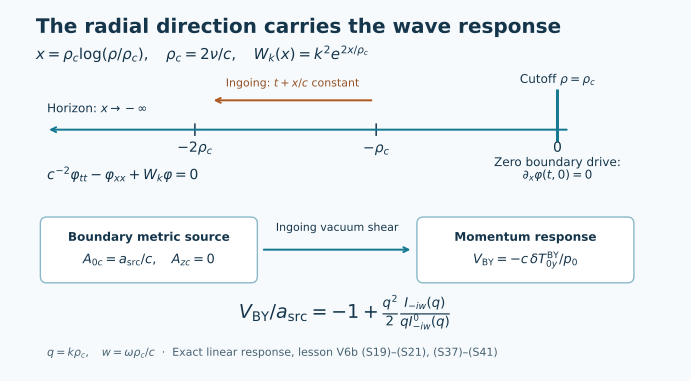

# The gravitational shear response and its fluid limit

## 1. What is being evolved

A gravitational perturbation can have a fluid limit while retaining wave propagation at shorter scales. This lesson derives one such example from its metric. The calculation keeps the boundary source, the complete stress response, and the physical constants throughout.

The background is five-dimensional flat vacuum spacetime in a Rindler region. Its cosmological constant is zero. The perturbation is first order in amplitude, with one spatial shear polarization; its frequency and wavenumber are arbitrary in the specified response problem. The construction of [exact nonlinear constraint data](velocity-fields-and-vacuum-constraints.md) uses a different background with \(\Lambda=-6/L^2\). Neither construction changes the other one's cosmological constant or identifies their time evolutions.

We will prove the response formula, its hydrodynamic pole, and global finite-energy evolution in this linear sector. Fourier variables and the Bessel response are defined and calculated explicitly. Section 7 gives the existence and energy argument for the wave equation, including the relevant function spaces. The relationship to incompressible fluid motion can also be read alongside the Navier–Stokes course.

This treatment develops §§2–5, 8 and 11 of [Vacuum shear response beyond Navier–Stokes](https://github.com/KokunoYumeto/yang-mills-interacting-workbench/blob/0a320572884e6f6aaac0e6652fa45ce75ceaaec4/navier-stokes/continuations/20260919-vacuum-hydrodynamics/manuscripts/RESEARCH.md#2-the-geometry-and-its-exact-coordinate-map). The human source for the Rindler vector master equation is Marolf and Rangamani, [§2.2, equation (2.14)](https://arxiv.org/abs/1201.1233v3). Bredberg, Keeler, Lysov and Strominger and Compère, McFadden, Skenderis and Taylor give the underlying fluid/gravity constructions; precise references appear in §10.

## 2. The metric and the measured boundary stress

Let \(c,\nu,G_5>0\) and retain the two length scales

\[
\ell=\frac\nu c,\qquad \rho_c=2\ell=\frac{2\nu}{c}.
\tag{S1}
\]

With \(x^0=ct\), the metric is

\[
ds^2=-\left(\frac\rho{\rho_c}\right)^2(dx^0)^2
+d\rho^2+dz^2+dy^2+dx_\perp^2,
\qquad 0<\rho\leq\rho_c.
\tag{S2}
\]

The inertial coordinates

\[
cT=\rho\sinh(x^0/\rho_c),\qquad
X=\rho\cosh(x^0/\rho_c)
\tag{S3}
\]

give \(-c^2dT^2+dX^2=-(\rho/\rho_c)^2(dx^0)^2+d\rho^2\). Thus the background is exactly flat. The induced metric at \(\rho=\rho_c\) is Minkowski, and \(t\) is the proper time of a stationary cutoff observer.

We use the outward unit normal \(n=\partial_\rho\). For the timelike cutoff, let \(\gamma\) denote its induced metric and \(\mathcal K_{\mu\nu}=\tfrac12\partial_\rho\gamma_{\mu\nu}\) its second fundamental form in this radial gauge. Define the Brown–York stress by the convention

\[
T^{\mathrm{BY}}_{\mu\nu}
=C_5(\mathcal K\gamma_{\mu\nu}-\mathcal K_{\mu\nu}),
\qquad C_5=\frac{c^4}{8\pi G_5},
\qquad\mathcal K=\gamma^{\mu\nu}\mathcal K_{\mu\nu}.
\tag{S4}
\]

At the cutoff, \(\mathcal K_{00}=-1/\rho_c\), \(\mathcal K=1/\rho_c\), and the other diagonal components vanish. The equilibrium energy density is zero and the spatial pressure is

\[
p_0=\frac{C_5}{\rho_c}.
\tag{S5}
\]

This fixes the sign, orientation and overall factor in every response below.

## 3. From the linear Einstein equation to a scalar

Consider a perturbation with \(h_{ay}=A_a\), where \(a\in\{0,z,\rho\}\), independent of \(y,x_\perp\), and no other first-order components. The line element contains \(2A_a dx^a dy\) at first order. The three-dimensional base metric is

\[
g_{ab}dx^adx^b=-a(\rho)^2(dx^0)^2+dz^2+d\rho^2,
\qquad a(\rho)=\frac\rho{\rho_c}.
\tag{S6}
\]

Here \(a(\rho)\) is a metric coefficient. A later boundary source \(a_{\mathrm{src}}\) is a different, explicitly named quantity.

### 3.1 The field-strength equation

Set \(F_{ab}=\partial_aA_b-\partial_bA_a\). A change of the coordinate \(y\) changes \(A\) by an exact one-form and leaves \(F\) unchanged. The perturbation has zero trace. On this flat product background the linear Ricci variation is

\[
\delta R_{ay}
=\frac12\left(\nabla^b\nabla_aA_b-\nabla^b\nabla_bA_a\right)
=-\frac12\nabla^bF_{ba}.
\tag{S7}
\]

Indeed in the Ricci variation the two divergence terms are \(\nabla^b\nabla_a h_{yb}\) and \(\nabla^b\nabla_yh_{ab}\); the second vanishes by independence of \(y\). The trace term vanishes, and the remaining term is \(-\nabla^b\nabla_bh_{ay}\). Background curvature is zero, so the covariant derivatives can be commuted as used in (S7). Every other component of the linear Ricci variation vanishes, since its terms require either a trace or a \(y\) derivative. Thus the linear vacuum equation in this sector is exactly

\[
\nabla^bF_{ba}=0,\qquad dF=0.
\tag{S8}
\]

These are equations for a metric perturbation; an additional electromagnetic field has not been introduced.

Choose the orientation \(\epsilon_{0z\rho}=a(\rho)\). On this simply connected base the first equation of (S8) is equivalent to the closedness of the one-form dual to \(F\), so it admits a scalar potential. With its sign fixed by

\[
F_{ab}=\epsilon_{abc}g^{cd}\partial_d\varphi,
\tag{S9}
\]

the Bianchi identity \(dF=0\) becomes \(\Box_g\varphi=0\). This can also be verified directly by substituting the three components of (S9); the equation is

\[
-a(\rho)^{-2}\partial_0^2\varphi
+\partial_z^2\varphi+\partial_\rho^2\varphi
+\frac1\rho\partial_\rho\varphi=0.
\tag{S10}
\]

The potential is determined up to a constant when its derivatives vanish. That degeneracy will matter at zero frequency and wavenumber.

### 3.2 Fourier variables and reconstruction

For now take \(k>0\), a Fourier factor \(e^{-i\omega t+ikz}\), and radial gauge \(A_\rho=0\). Put

\[
\Omega=\frac\omega c,\qquad q=k\rho_c>0,
\qquad w=\frac{\omega\rho_c}{c},\qquad\alpha=-iw.
\tag{S11}
\]

Negative wavenumbers follow by reflecting \(z\), including the sign of the \(z\)-component of the one-form. The zero-wavenumber case is treated in §5.3. The radial scalar equation is

\[
\varphi''+\frac1\rho\varphi'
+\left(\frac{w^2}{\rho^2}-k^2\right)\varphi=0.
\tag{S12}
\]

Equations (S9) give all three reconstruction equations:

\[
\begin{aligned}
A_0'&=ik\frac\rho{\rho_c}\varphi,\\
A_z'&=-i\Omega\frac{\rho_c}{\rho}\varphi,\\
kA_0+\Omega A_z&=i\frac\rho{\rho_c}\varphi'.
\end{aligned}
\tag{S13}
\]

Their compatibility is exactly (S12): differentiating the third equation and using the first two yields it without a further constraint.

For comparison with the vector master field, put \(r=\rho/\rho_c\) and \(Z=r\partial_r\varphi\). Then

\[
Z'=(q^2r-w^2/r)\varphi
\tag{S14}
\]

and, away from the zeros of the displayed denominator,

\[
Z''+\frac{q^2r^2+w^2}{r(w^2-q^2r^2)}Z'
+\left(\frac{w^2}{r^2}-q^2\right)Z=0.
\tag{S15}
\]

To derive this, write \(A(r)=q^2r-w^2/r\), so \(Z'=A\varphi\) and \(Z''=(A'/A)Z'+(A/r)Z\), then move both terms to the left. Equation (S14), which remains regular, controls a zero of \(A\); no division is required there. This is Marolf–Rangamani's vector equation under the explicit substitutions \(\varrho=\rho\), \(\ell_{\mathrm{MR}}=\rho_c\), \(\mathfrak w=w\), \(\mathfrak q=q\), followed by \(r=\rho/\rho_c\).

## 4. The ingoing solution and its domain

For \(s>0\), define the modified Bessel function by its full series

\[
I_\alpha(s)=\sum_{m=0}^{\infty}
\frac{(s/2)^{\alpha+2m}}{m!\,\Gamma(m+\alpha+1)},
\qquad (s/2)^\alpha=\exp\big(\alpha\log(s/2)\big).
\tag{S16}
\]

The reciprocal Gamma function is entire. On compact sets of \(\alpha\), the ratio of successive large-index terms is \((s^2/4)/((m+1)(m+\alpha+1))\), so the series and its \(s\) derivatives converge locally uniformly. Substitution term by term gives

\[
s^2I_\alpha''+sI_\alpha'-(s^2+\alpha^2)I_\alpha=0.
\tag{S17}
\]

Thus \(I_{-iw}(k\rho)\) solves (S12). For \(\operatorname{Im}\omega>0\), one has \(\operatorname{Re}\alpha>0\), and its leading behavior at \(\rho=0\) is

\[
I_{-iw}(k\rho)
=\frac{(k\rho/2)^{-iw}}{\Gamma(1-iw)}\big(1+O(\rho^2)\big).
\tag{S18}
\]

With \(x=\rho_c\log(\rho/\rho_c)\), the full Fourier factor is proportional to \(e^{-i\omega(t+x/c)}\). It travels toward decreasing \(x\), into the future horizon. The other independent radial behavior grows as \(x\to-\infty\) in this upper half-plane. This fixes the ingoing solution up to a scalar multiple.

The retarded frequency response is first defined for \(\operatorname{Im}\omega>0\) by this condition, and then continued meromorphically wherever the formula permits. At a negative integer \(\alpha=-n\), a leading-power argument that divides by \(\Gamma(1+\alpha)\) is invalid. Formula (S16) itself remains well-defined: the terms \(m<n\) vanish and reindexing proves \(I_{-n}(s)=I_n(s)\). For \(s>0\), \(I_n'(s)>0\) for every integer \(n\geq0\), directly from its positive series. Thus these integer orders do not themselves introduce a response pole at positive \(q\). The retarded prescription is the analytic continuation just specified, including these orders.

## 5. Boundary source to Brown–York stress

Let the boundary metric source be the pair \((A_{0c},A_{zc})\) and define

\[
E_c=kA_{0c}+\Omega A_{zc},\qquad
H(w,q)=\frac{I_{-iw}(q)}{qI_{-iw}'(q)}.
\tag{S19}
\]

The prime denotes differentiation with respect to the Bessel argument, not its order.

**Theorem 1.** For \(q>0\) and \(I_{-iw}'(q)\ne0\), the ingoing solution with the prescribed boundary metric gives

\[
\begin{aligned}
\delta T^{\mathrm{BY}}_{0y}
&=C_5\left[\frac{A_{0c}}{\rho_c}-\frac{k\rho_cE_c}{2}H(w,q)\right],\\
\delta T^{\mathrm{BY}}_{zy}
&=C_5\left[\frac{A_{zc}}{\rho_c}+\frac{\Omega\rho_cE_c}{2}H(w,q)\right].
\end{aligned}
\tag{S20}
\]

For the metric-shift source \(A_{0c}=a_{\mathrm{src}}/c\), \(A_{zc}=0\), and the momentum variable \(V_{\mathrm{BY}}=-c\delta T^{\mathrm{BY}}_{0y}/p_0\), this is

\[
\boxed{\frac{V_{\mathrm{BY}}}{a_{\mathrm{src}}}
=-1+\frac{q^2}{2}H(w,q).}
\tag{S21}
\]

The quotient denotes the linear multiplier, including when an individual source amplitude is zero.

### 5.1 Proof and contact terms

Write \(\varphi=B I_{-iw}(k\rho)\). The last equation in (S13) at the cutoff gives \(E_c=ikB I_{-iw}'(q)\). Substituting into the first two gives

\[
A_0'(\rho_c)=E_c\frac{I_{-iw}(q)}{I_{-iw}'(q)}
=k\rho_cE_cH,
\qquad
A_z'(\rho_c)=-\frac{\Omega}{k}E_c\frac{I_{-iw}(q)}{I_{-iw}'(q)}
=-\Omega\rho_cE_cH.
\tag{S22}
\]

Integrating these derivatives with the specified values of \(A_{0c},A_{zc}\) produces potentials satisfying all of (S13): the derivative of the third equation is the scalar equation, and its integration constant is fixed at the boundary.

At linear order \(\delta\mathcal K=0\): the perturbation and its radial derivative are off-diagonal, while the background metric and second fundamental form are diagonal. Thus (S4) gives

\[
\delta T_{0y}^{\mathrm{BY}}=C_5(A_{0c}/\rho_c-A_0'/2),
\qquad
\delta T_{zy}^{\mathrm{BY}}=C_5(A_{zc}/\rho_c-A_z'/2).
\tag{S23}
\]

This proves (S20). The first term in each expression is the local pressure response to the boundary metric, often called a contact term. Substituting the metric-shift source and (S5) proves (S21), including its \(-1\).

For zero boundary metric source, (S13) gives \(\varphi'(\rho_c)=0\). Conversely, an ingoing scalar with that Neumann condition reconstructs a metric perturbation with both boundary values zero. Hence the possible shear frequencies solve

\[
I_{-iw}'(q)=0.
\tag{S24}
\]

There is no simultaneous zero of \(I_{-iw}(q)\) and its argument derivative: uniqueness for the ordinary differential equation (S17) would make the entire solution zero, contrary to (S16). Thus a zero of the denominator in (S19) is not cancelled by its numerator.

### 5.2 No pole in the upper half-plane

The variable \(x\) from §4 converts a zero-source scalar mode into

\[
\left[-\partial_x^2+k^2e^{2x/\rho_c}\right]\varphi
=\frac{\omega^2}{c^2}\varphi,
\qquad -\infty<x\leq0,\quad \varphi_x(0)=0.
\tag{S25}
\]

If \(\operatorname{Im}\omega>0\), its ingoing behavior decays exponentially at \(-\infty\); it and its derivative are square-integrable. Integration against \(\bar\varphi\) gives

\[
\int_{-\infty}^0\left(|\varphi_x|^2+k^2e^{2x/\rho_c}|\varphi|^2\right)dx
=\frac{\omega^2}{c^2}\int_{-\infty}^0|\varphi|^2dx.
\tag{S26}
\]

The left side is real and nonnegative. If \(\operatorname{Re}\omega\ne0\), the right side has nonzero imaginary part. If \(\operatorname{Re}\omega=0\), it is strictly negative for a nonzero mode. Both are impossible. Therefore (S24) has no upper-half-plane root, and the retarded response in Theorem 1 is defined throughout that half-plane.

### 5.3 Zero wavenumber and the static corner

At fixed \(\operatorname{Im}\omega>0\), (S16) gives \(H(w,q)\to1/\alpha\) as \(q\to0\). Formula (S20), in its division-free form, therefore has the limits

\[
\delta T_{0y}^{\mathrm{BY}}=\frac{C_5}{\rho_c}A_{0c},
\qquad
\delta T_{zy}^{\mathrm{BY}}=C_5\left(\frac{A_{zc}}{\rho_c}+\frac{i\Omega}{2}A_{zc}\right)
\quad (k=0).
\tag{S27}
\]

The same result follows directly at \(k=0,\omega\ne0\): the ingoing radial solution is proportional to \(\rho^{-iw}\), giving \(A_0'=0\) and \(A_z'(\rho_c)=-i\Omega A_{zc}\). For a shift source, \(V_{\mathrm{BY}}/a_{\mathrm{src}}=-1\).

At \((\omega,k)=(0,0)\), (S13) loses its boundary equation for \(\varphi'\); a static homogeneous momentum sector is no longer fixed by that scalar-source relation. A retarded value is fixed by its initial-state prescription and continuation from the upper half-plane. It must not be assigned by replacing the expression \(q^2H\) by an undefined \(0/0\). Exercise 3 computes the different iterated limits.

## 6. The fluid limit and the hydrodynamic pole

For \(|\alpha|<1/2\), factor the nonzero common multiplier in (S16) explicitly:

\[
\begin{aligned}
I_\alpha(q)&=\frac{(q/2)^\alpha}{\Gamma(1+\alpha)}\,S(\alpha,z),\\
qI_\alpha'(q)&=\frac{(q/2)^\alpha}{\Gamma(1+\alpha)}\,D(\alpha,z),
\qquad z=\frac{q^2}{4},\\
S(\alpha,z)&=\sum_{m=0}^{\infty}\frac{z^m}{m!(1+\alpha)_m},\\
D(\alpha,z)&=\sum_{m=0}^{\infty}\frac{(\alpha+2m)z^m}{m!(1+\alpha)_m},
\quad (1+\alpha)_m=\prod_{j=1}^m(\alpha+j).
\end{aligned}
\tag{S28}
\]

The empty product is one. Both series converge locally uniformly with their derivatives, by the same ratio estimate as in §4. The factor and its domain are retained in (S28); it can be cancelled in the ratio on this domain. In particular \(H=S/D\) there.

### 6.1 Response under hydrodynamic scaling

Let \(w=q^2\zeta\), where \(\zeta\) lies in a fixed bounded subset with \(|-i\zeta+1/2|\geq\delta>0\). Equation (S28) gives, uniformly on that set,

\[
S=1+O(q^2),\qquad
D=-iw+\frac{q^2}{2}+O(q^4).
\tag{S29}
\]

Substitution into the complete response (S21) yields

\[
\frac{V_{\mathrm{BY}}}{a_{\mathrm{src}}}
=\frac{iw}{-iw+q^2/2}+O(q^2)
=\frac{i\omega}{-i\omega+\nu k^2}+O(q^2).
\tag{S30}
\]

The last equality uses exactly \(\rho_c=2\nu/c\); no viscosity factor is discarded. The leading metric force is \(f=-\partial_ta_{\mathrm{src}}\), so \(\widehat f=i\omega\widehat a_{\mathrm{src}}\). The scalar transverse linear Navier–Stokes equation

\[
\partial_tU-\nu\partial_z^2U=f
\tag{S31}
\]

therefore has exactly the leading multiplier in (S30). The error statement is away from the leading pole in the scaled frequency plane. The next calculation treats the pole itself.

### 6.2 An analytic pole with exact coefficients

One has \(D(0,0)=0\) and \(\partial_\alpha D(0,0)=1\). There is a unique analytic root \(\alpha(z)\) near zero with \(\alpha(0)=0\). One direct justification is to write the equation as \(\alpha=\alpha-D(\alpha,z)\). On a sufficiently small complex disc in \(\alpha\) its right side has derivative of magnitude below \(1/2\), uniformly for small \(z\), and maps the disc to itself. The contraction iterates converge uniformly, remain analytic in \(z\), and hence have an analytic limit. The same derivative bound proves uniqueness.

The coefficients can be obtained without a numerical root calculation. If \(\alpha(z)=\sum_{j\geq1}a_jz^j\), the coefficient of \(z^n\) in \(D(\alpha(z),z)\) is \(a_n\) plus an expression involving only \(a_1,\ldots,a_{n-1}\). Terms with \(m>n\) do not contribute. Explicitly,

\[
a_n=-[z^n]\sum_{m=1}^n
\frac{\left(\sum_{j<n}a_jz^j+2m\right)z^m}
{m!\prod_{l=1}^m\left(l+\sum_{j<n}a_jz^j\right)}.
\tag{S32}
\]

This finite rational recurrence gives

\[
\begin{aligned}
a_1&=-2,&a_2&=-3,&a_3&=-\frac{29}{3},\\
a_4&=-\frac{2843}{72},&a_5&=-\frac{392029}{2160}.
\end{aligned}
\tag{S33}
\]

For example, through order \(z^3\), expanding the first three terms in (S28) gives

\[
D=\alpha+(2-\alpha+\alpha^2)z
+\left(1-\frac54\alpha\right)z^2+\frac16z^3+O(z^4)
\tag{S34}
\]

along \(\alpha=O(z)\). The first three coefficients are therefore \(a_1+2\), \(a_2-a_1+1\), and \(a_3-a_2+a_1^2-5a_1/4+1/6\), yielding (S33). Formula (S32) gives the next two values by the same finite arithmetic. Since the root is analytic, the remainder after any displayed order has that analytic order, rather than being a fit to sampled roots.

Returning to the original \(q,w,\omega,k\),

\[
\begin{aligned}
\alpha(q)={}&-\frac{q^2}{2}-\frac{3q^4}{16}
-\frac{29q^6}{192}-\frac{2843q^8}{18432}
-\frac{392029q^{10}}{2211840}+O(q^{12}),\\
w&=i\alpha,\qquad \omega=\frac{c}{\rho_c}w,
\qquad q=k\rho_c.
\end{aligned}
\tag{S35}
\]

In particular its first three physical coefficients are

\[
\omega(k)=-i\nu k^2
-i\frac{3\nu^3}{2c^2}k^4
-i\frac{29\nu^5}{6c^4}k^6+O(k^8).
\tag{S36}
\]

The higher terms remain specified by (S35) and the exact conversion displayed there. Exercise 5 proves the comparison of the fourth-order term with the original hydrodynamic expansion of Compère and collaborators, retaining its cutoff parameter.

## 7. A causal wave equation with positive energy

The tortoise coordinate and its inverse are

\[
x=\rho_c\log(\rho/\rho_c),\qquad
\rho=\rho_c e^{x/\rho_c},\qquad -\infty<x\leq0.
\tag{S37}
\]

Multiplying (S10) by \(\rho^2/\rho_c^2\) and taking a transverse Fourier mode gives

\[
\frac1{c^2}\partial_t^2\varphi-\partial_x^2\varphi
+W_k(x)\varphi=0,
\qquad W_k(x)=k^2e^{2x/\rho_c},
\qquad \partial_x\varphi(t,0)=0.
\tag{S38}
\]

**Theorem 2.** For each real \(k\), every initial pair

\[
(\varphi_0,\varphi_1)\in H^1(( -\infty,0))\times L^2(( -\infty,0))
\tag{S39}
\]

has a unique global energy solution of (S38), with

\[
\varphi\in C(\mathbb R;H^1),\qquad
\partial_t\varphi\in C(\mathbb R;L^2).
\tag{S40}
\]

The Neumann condition is understood in the weak formulation, and in the trace sense whenever the solution has the corresponding regularity. Its conserved energy is

\[
E_k(t)=\frac12\int_{-\infty}^0
\left(c^{-2}|\varphi_t|^2+|\varphi_x|^2
+k^2e^{2x/\rho_c}|\varphi|^2\right)dx.
\tag{S41}
\]

Signals have propagation speed at most \(c\) in the \((t,x)\) coordinates. This theorem concerns the stated shear sector and zero boundary drive.

### 7.1 Existence and uniqueness

Extend the initial functions evenly to the real line and extend the potential to \(W_{k,e}(x)=k^2e^{-2|x|/\rho_c}\). Even extension is bounded from half-line \(H^1\) to whole-line \(H^1\), and doubles the squared integrals. This potential is real, nonnegative, bounded and Lipschitz.

For the free wave equation, the Fourier multipliers

\[
C_0(t)=\cos(ct|D|),\qquad
S_0(t)=\frac{\sin(ct|D|)}{c|D|}
\tag{S42}
\]

are defined at zero Fourier frequency by \(S_0(t)=t\). Here \(|D|\) multiplies the spatial Fourier transform by \(|\xi|\). Plancherel's identity and \(|\sin u|\leq\min(1,|u|)\) show that \(C_0(t)\) is bounded on \(H^1\), \(S_0(t)\) maps \(L^2\) to \(H^1\) with norm at most \(|t|+c^{-1}\), and its time derivative is bounded on \(L^2\). The potential equation is equivalent to

\[
\varphi(t)=C_0(t)\varphi_0+S_0(t)\varphi_1
-c^2\int_0^t S_0(t-s)\big(W_{k,e}\varphi(s)\big)\,ds.
\tag{S43}
\]

Multiplication by \(W_{k,e}\) maps \(H^1\) to \(L^2\) with norm at most \(k^2\). Thus the integral map is a contraction on \(C([-T,T];H^1)\) for sufficiently small \(T\), using the bound \(c^2k^2T(T+c^{-1})\). Its fixed point has the asserted continuous \(L^2\) time derivative by differentiating (S43). Iteration on intervals of this same size gives a global solution; the equation is linear and the time interval bound does not depend on the size of the data. The same estimate proves uniqueness and continuous dependence. Reflection commutes with every term in (S43), so the solution is even. Its restriction to the half-line gives the weak Neumann solution.

### 7.2 Conservation, norm control and propagation

For regular data, multiply (S38) by \(\bar\varphi_t\), take real parts and integrate by parts. The exact identity is

\[
\frac{dE_k}{dt}
=\operatorname{Re}[\bar\varphi_t\varphi_x]_{-\infty}^{0}.
\tag{S44}
\]

The endpoint at zero vanishes under Neumann boundary conditions. On the whole line, use compact cutoffs with derivatives tending uniformly to zero; the integrable energy makes their error tend to zero. This proves conservation without assuming a pointwise trace at infinity. Regular even data are dense in the even \(H^1\times L^2\) space. The solution map from (S43) is continuous, so approximation extends the identity to every input in (S39). For example the regular calculation is justified for even \(H^2\times H^1\) data: a bounded Lipschitz potential preserves the spaces needed in the differentiated equation, and the resulting integration by parts is valid. These inputs are dense.

The energy gives \(\|\varphi_t(t)\|_2\leq c\sqrt{2E_k(0)}\) and \(\|\varphi_x(t)\|_2\leq\sqrt{2E_k(0)}\). The potential decays at \(-\infty\), so it supplies no positive lower bound for the full \(L^2\) norm. The correct additional estimate is

\[
\|\varphi(t)\|_2\leq\|\varphi_0\|_2
+c|t|\sqrt{2E_k(0)}.
\tag{S45}
\]

It follows by integrating \(\varphi_t\) in \(L^2\), and gives the stated finite-time \(H^1\) control.

The local energy density \(e\), equal to the integrand of (S41) divided by two, has flux \(j=-\operatorname{Re}(\bar\varphi_t\varphi_x)\). Direct differentiation gives

\[
\partial_te+\partial_xj=0,\qquad |j|\leq ce.
\tag{S46}
\]

Integrate this identity over a cone whose sides move at speeds \(\pm c\). The side flux cannot add energy to a region with zero initial energy. Thus zero data on an interval remain zero in its shrinking interior domain of dependence; the value of \(\varphi\) itself follows by integrating its zero time derivative there. Reflection handles cones meeting the Neumann endpoint. Approximation extends the result to energy data. This proves the propagation claim.

For a truncated region \(x_0\leq x\leq0\), (S44) instead contains the actual lower-boundary term \(-\operatorname{Re}(\bar\varphi_t\varphi_x)(x_0)\). If the outgoing condition there is \(\varphi_t-c\varphi_x=0\), it equals \(-c|\varphi_x(x_0)|^2\leq0\). The full half-line conserves energy; a truncated exterior can lose energy by that flux. The horizon is at \(x=-\infty\), so a compact signal cannot reach it at finite Rindler time.

The diagram labels the exact coordinate map (S37), potential (S38), boundary condition and boundary response (S21). The ingoing characteristic has \(t+x/c\) constant. [Reproducible figure source](../assets/shear-response.py).

## 8. The first nonlinear term

The amplitude restriction has a concrete mathematical reason. Consider the finite metric ansatz

\[
ds^2=g_{ab}dx^adx^b+(dy+A_adx^a)^2+dx_\perp^2,
\tag{S47}
\]

with all fields independent of \(y,x_\perp\) and fiber radius exactly one. Then

\[
R_{yy}=\frac14F_{ab}F^{ab}.
\tag{S48}
\]

Here indices on \(F\) are raised with the base metric \(g\). To verify (S48), choose base normal coordinates and a fiber gauge with \(A_a=0\) at the point under consideration. Since \(g_{yy}=1\) and all \(y\) derivatives vanish, \(\Gamma^A_{yy}=0\) identically. At the point the remaining relevant symbols are

\[
\Gamma^a_{yb}=-\frac12F^a{}_b,\qquad \Gamma^y_{ya}=0.
\]

Consequently

\[
R_{yy}=-\Gamma^a_{yb}\Gamma^b_{ya}
=-\frac14F^a{}_bF^b{}_a
=\frac14F_{ab}F^{ab}.
\]

The result is tensorial, so this pointwise coordinate choice proves it everywhere. For the base metric \(-(dx^0)^2+dz^2+d\rho^2\) and \(A=A_0(z)dx^0\), it gives \(F_{ab}F^{ab}=-2(A_0')^2\) and \(R_{yy}=-(A_0')^2/2\).

Thus a generic finite non-null shear field does not solve the vacuum equation within the fixed-radius ansatz. Additional components, including the fiber radius and the base metric, must respond. Equation (S48) is quadratic in the perturbation, which explains exactly why it is absent from (S7). The positive energy theorem proves global evolution of the specified linear sector; it supplies no nonlinear regularization theorem for the original forced Navier–Stokes solution.

## 9. Five exercises with complete solutions

### Exercise 1. Ingoing coordinates and cutoff acceleration

Verify that

\[
R=\frac{\rho^2}{4\ell},\qquad
x^0_{\mathrm{EF}}=ct+\rho_c\log(\rho/\rho_c)
\tag{S49}
\]

turn the radial metric into \(-(R/\ell)(dx^0_{\mathrm{EF}})^2+2dx^0_{\mathrm{EF}}dR\), and compute the cutoff proper acceleration.

**Solution.** One has \(dR=(\rho/\rho_c)d\rho\) and \(dx^0_{\mathrm{EF}}=c,dt+(\rho_c/\rho)d\rho\). The mixed terms from the two terms in the proposed metric are \(-2(\rho/\rho_c)c,dt,d\rho\) and \(+2(\rho/\rho_c)c,dt,d\rho\), which cancel. The radial-square terms are \(-d\rho^2+2d\rho^2\). The time-square term is \(-(\rho/\rho_c)^2c^2dt^2\), proving (S2). The cutoff is \(R_c=\ell\). Its inertial worldline (S3) is a hyperbola with proper time \(t\) at \(\rho=\rho_c\); two derivatives with respect to \(t\) give acceleration components \((c^2/\rho_c)(\sinh(ct/\rho_c),\cosh(ct/\rho_c))\). Their Minkowski norm is \(c^2/\rho_c\). This fixes the physical acceleration without changing \(c\) or \(\nu\).

### Exercise 2. The apparent pole of the master equation

At a point \(r_0>0\) with \(w^2=q^2r_0^2\), explain how a smooth scalar solution passes through the singular coefficient in (S15).

**Solution.** Equation (S12) in the \(r\) coordinate has smooth coefficients at \(r_0>0\), so its initial-value problem supplies a smooth \(\varphi\) there. The definition \(Z=r\varphi'\) is smooth and (S14) gives \(Z'(r_0)=0\). The undivided equation is

\[
A Z''-A'Z'-\frac{A^2}{r}Z=0,
\qquad A=q^2r-w^2/r.
\tag{S50}
\]

It follows by differentiating \(Z'=A\varphi\), with no division by \(A\). At a simple zero of \(A\), it implies \(A'(r_0)Z'(r_0)=0\), which the scalar reconstruction already satisfies. The pole in the divided equation describes a failure of that particular elimination at \(r_0\); it is not a singularity of the original scalar solution.

### Exercise 3. Two limits at the origin

For the multiplier \(T(w,q)=-1+q^2H(w,q)/2\), calculate the limit as \(q\to0\) at fixed upper-half-plane \(w\), and the limit as \(q\to0\) after first setting \(w=0\).

**Solution.** Section 5.3 gives \(H\to1/(-iw)\), so the first limit is \(-1\). At zero frequency,

\[
I_0(q)=1+\frac{q^2}{4}+O(q^4),\qquad
I_0'(q)=I_1(q)=\frac q2+\frac{q^3}{16}+O(q^5).
\]

Hence \(H(0,q)=2/q^2+1/4+O(q^2)\) and

\[
T(0,q)=\frac{q^2}{8}+O(q^4)\longrightarrow0.
\tag{S51}
\]

The two iterated limits differ. The complete response and its contact term exhibit the difference directly. It is consistent with (S30), whose leading diffusion denominator vanishes at the joint origin and whose uniform estimate explicitly excludes its scaled pole.

### Exercise 4. A finite cluster of damped poles

Let a meromorphic response have, at \(w_c\) with \(\operatorname{Im}w_c=-\gamma<0\), principal part \(\sum_{j=1}^m A_{-j}(w-w_c)^{-j}\). For the Fourier convention \(\int e^{-iw\vartheta}H(w)\,dw/(2\pi)\), compute its retarded pole contribution for \(\vartheta\geq0\) and bound it for all such times.

**Solution.** Closing the contour below is clockwise, so its contribution is minus \(i\) times the residue. Differentiating the exponential \(j-1\) times gives

\[
K_{\mathrm{pp}}(\vartheta)
=-i e^{-iw_c\vartheta}
\sum_{j=1}^m\frac{A_{-j}(-i\vartheta)^{j-1}}{(j-1)!}.
\tag{S52}
\]

For \(n\geq1\), the derivative of \(\vartheta^ne^{-\gamma\vartheta}\) vanishes at \(\vartheta=n/\gamma\), its maximum; the value is \((n/(e\gamma))^n\). For \(n=0\) the maximum is one. The triangle inequality therefore proves

\[
\sup_{\vartheta\geq0}|K_{\mathrm{pp}}(\vartheta)|
\leq\sum_{j=1}^m\frac{|A_{-j}|}{(j-1)!}
\left(\frac{j-1}{e\gamma}\right)^{j-1},
\tag{S53}
\]

with the \(j=1\) factor interpreted as one. If separate simple poles coalesce within an isolating contour on which the responses converge uniformly, their combined contour integral converges to the integral of the limiting principal part. Individual diverging residues can therefore have the finite joint limit (S52). The hypothesis concerns the actual response on that contour. This exercise proves the finite-cluster statement; it neither asserts a numerically estimated collision nor sums an unproved infinite expansion.

### Exercise 5. The original cutoff and the fourth-order coefficient

Compère and collaborators' equation (6.3), differentiated in amplitude at the zero-velocity, zero-pressure state in the transverse channel, has the displayed linear terms

\[
\partial_\tau v_i-r_0\Delta_Xv_i
\equiv-\frac{3r_0^2}{2}\Delta_X^2v_i
\tag{S54}
\]

with cutoff parameter \(r_0>0\). Here \(\equiv\) means equality through the displayed derivative order of the linearized expansion; higher-order terms remain present in the full response. Recover the physical coefficient in (S36), retaining this cutoff in the coordinate map.

**Solution.** Keep the source seed \(-r\,d\tau^2+2d\tau dr+dX_i dX_i\) and map it by

\[
r=\frac{r_0}{\ell}R,\qquad
\tau=\frac{x^0_{\mathrm{EF}}}{\ell},\qquad
X_i=\frac{\sqrt{r_0}}{\ell}x_i,
\qquad ds^2_{\mathrm{phys}}=\frac{\ell^2}{r_0}ds^2_{\mathrm{source}}.
\tag{S55}
\]

Substitution gives exactly the metric in Exercise 1, and maps \(r=r_0\) to \(R=\ell\). At the cutoff \(x^0_{\mathrm{EF}}=ct\), so

\[
v_i=\frac{\sqrt{r_0}}cU_i,\qquad
\partial_\tau=\frac\ell c\partial_t,\qquad
\Delta_X=\frac{\ell^2}{r_0}\Delta_x.
\tag{S56}
\]

Insert all three substitutions into (S54) and multiply by \(c^2/(\ell\sqrt{r_0})\). The result is

\[
\partial_tU_i-c\ell\Delta_xU_i
\equiv-\frac{3c\ell^3}{2}\Delta_x^2U_i.
\tag{S57}
\]

Since \(c\ell=\nu\), the coefficient is \(3\nu^3/(2c^2)\). The pressure-gradient component vanishes in this transverse Fourier polarization; products of velocity or pressure and their derivatives have zero first amplitude derivative at the stated background. Higher derivative orders in that source expansion remain higher orders; equation (S54) asserts exactly its displayed order. This comparison derives the same fourth-order pole coefficient as (S36) while retaining \(r_0\) in every intermediate expression. The all-frequency multiplier (S21) is determined by the bulk boundary problem, not by this single coefficient.

## 10. Sources and continuation

I. Bredberg, C. Keeler, V. Lysov and A. Strominger, *From Navier–Stokes to Einstein*, JHEP **07** (2012), 146, [arXiv:1101.2451v2](https://arxiv.org/abs/1101.2451v2), §§3–5, gives the incompressible vacuum-fluid construction.

G. Compère, P. McFadden, K. Skenderis and M. Taylor, *The holographic fluid dual to vacuum Einstein gravity*, JHEP **07** (2011), 050, [author source, arXiv:1103.3022v2](https://arxiv.org/src/1103.3022v2), §6.1, equation (6.3), gives the higher-derivative fluid equation compared in Exercise 5.

D. Marolf and M. Rangamani, *Causality and the AdS Dirichlet problem*, JHEP **04** (2012), 035, [author source, arXiv:1201.1233v3](https://arxiv.org/src/1201.1233v3), §2.2, supplies the Rindler gravitational master equations. Its discussion of boundary gravitons concerns additional sectors; the positive-energy theorem here is for the shear scalar with the stated Neumann boundary condition.

*Vacuum shear response beyond Navier–Stokes*, [§§3–5, 7–8 and 11](https://github.com/KokunoYumeto/yang-mills-interacting-workbench/blob/0a320572884e6f6aaac0e6652fa45ce75ceaaec4/navier-stokes/continuations/20260919-vacuum-hydrodynamics/manuscripts/RESEARCH.md), contains the scalar reconstruction, source-to-stress map, pole calculation, finite-cluster formula and nonlinear fiber-curvature calculation developed in this lesson.
