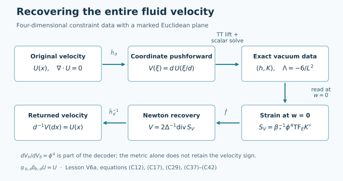

# Exact vacuum constraint data from a velocity field

## 1. The question and the objects

A velocity field specifies motion in three-dimensional space. Initial data for gravity consist of a spatial metric and a second fundamental form. This lesson constructs an explicit map from the first kind of data to the second and proves that the original velocity can be recovered exactly.

This is Appendix A to the forced Navier–Stokes blowup argument. The encoding applies to its smooth compactly supported velocity at each time before blowup. Section 7 gives the exact strain readout and time-evolution residual, which specify what this connection says about a family of fluid snapshots. It does not identify that family with an Einstein spacetime evolution.

The input is

\[
\mathscr U=C^\infty_{c,\operatorname{div}=0}(\mathbb R^3;\mathbb R^3).
\tag{C1}
\]

Thus every component is smooth, the union of the component supports is compact, and \(\sum_{i=1}^3\partial_iU_i=0\). Its strain tensor is

\[
(S_U)_{ij}=\frac{\partial_iU_j+\partial_jU_i}{2}.
\tag{C2}
\]

We use four spatial coordinates \(Y=(w,\xi^1,\xi^2,\xi^3)\), the Euclidean metric \(\delta\), and the marked three-plane \(E=\{w=0\}\). Capital indices run over the four spatial coordinates; lower-case indices run over the three coordinates of \(E\). Repeated indices are summed. The Euclidean square of a tensor includes both orders of its mixed components.

For a Riemannian metric \(h\), let \(\nabla_h\), \(R(h)\), and \(dV_h\) denote its connection, scalar curvature, and volume form. Write \(K^\sharp{}^A{}_B=h^{AC}K_{CB}\). The vacuum constraint equations with cosmological constant \(\Lambda\) are

\[
\begin{aligned}
R(h)+(\operatorname{tr}_hK)^2-|K|_h^2&=2\Lambda,\\
\nabla_h^AK_{AB}-\partial_B(\operatorname{tr}_hK)&=0.
\end{aligned}
\tag{C3}
\]

Here \(K\) is the second fundamental form in the convention that zero-shift Einstein evolution has \(\partial_t h=2cNK\), where \(N\) is the lapse. Equation (C3) is the space of data we will construct. The existence theorem below concerns these constraints; its proof does not require a spacetime evolution theorem.

The construction follows §§5–7 of [The gravitational identity carried by Navier–Stokes strain](https://github.com/KokunoYumeto/yang-mills-interacting-workbench/blob/0a320572884e6f6aaac0e6652fa45ce75ceaaec4/navier-stokes/continuations/20260919-vacuum-hydrodynamics/manuscripts/IDENTITY_AND_COMPLETION.md#5-a-compact-transverse-traceless-lift-of-the-complete-velocity). The conformal method is due to the mathematical-relativity literature; the general-dimensional formulas used here appear in Choquet-Bruhat, Isenberg and Pollack, [§2, equations for the conformal metric and second fundamental form](https://arxiv.org/abs/gr-qc/0610045v1). We derive the needed four-dimensional formulas and the existence result below.

The required analysis is differentiation, integration, convolution, and the maximum principle at a maximum or minimum. Section 4 supplies the particular elliptic inverse and its regularity argument. The original fluid theorem and its construction can be read in the main Navier–Stokes blowup proof.

## 2. Parameters and the original coordinates

Keep the physical constants \(c,\nu,L,r_h\) positive. For the original cutoff calibration choose \(r_c>r_h\) with

\[
f_c=1-\frac{r_h^4}{r_c^4},
\qquad \nu=\frac{cLr_c\sqrt{f_c}}{4r_h}.
\tag{C4}
\]

Every prescribed \(\nu>0\), with \(c,L,r_h\) fixed, admits exactly one such \(r_c\): the square of \(r_c\sqrt{1-r_h^4/r_c^4}\) is \(r_c^2-r_h^4/r_c^2\), which increases continuously from zero to infinity on \((r_h,\infty)\).

Choose

\[
0<s_*<\frac{\pi L}{8c},\qquad
\vartheta_*=\frac{4cs_*}{L},\qquad
r_{\mathrm{ref}}^2=r_h^2\sin\frac{2cs_*}{L},\qquad
d=\frac{r_{\mathrm{ref}}}{r_c}>0.
\tag{C5}
\]

The reference spatial metric in the coordinates \(y=(w_b,x_b^1,x_b^2,x_b^3)\) is

\[
h_* =\frac{r_h^2}{L^2}
\operatorname{diag}\!\left(
\frac{\cos^2(2cs_*/L)}{\sin(2cs_*/L)},
\sin(2cs_*/L),\sin(2cs_*/L),\sin(2cs_*/L)\right).
\tag{C6}
\]

If \(J_*\) is its positive diagonal square root, the map \(Y=J_*y\) satisfies \(J_*^*\delta=h_*\). In particular, \(\xi=(r_{\mathrm{ref}}/L)x_b\), whereas the cutoff coordinate is \(x=(r_c/L)x_b\). Thus \(\xi=dx\). The velocity pushforward is

\[
V(\xi)=\mathcal P_dU(\xi)=dU(\xi/d).
\tag{C7}
\]

It retains the original vector field under that specified map. Direct differentiation gives

\[
\operatorname{div}_\xi V=0,\qquad
S_V(\xi)=S_U(\xi/d),\qquad
\Delta_\xi V(\xi)=d^{-1}(\Delta_xU)(\xi/d).
\tag{C8}
\]

Set

\[
\begin{aligned}
a_*&=\frac1{L\sin\vartheta_*},&
\tau_*&=-\frac4L\cot\vartheta_*,\\
\kappa_*&=\frac34\tau_*^2+\frac{12}{L^2}=12a_*^2,&
\beta_*&=\frac{8a_*\nu}{c^2}.
\end{aligned}
\tag{C9}
\]

All four constants are kept in the construction. In particular, the \(\nu\) in \(\beta_*\) is the original physical cutoff viscosity. Using (C4)–(C5) and \(\sin\vartheta_*=2\sin(2cs_*/L)\cos(2cs_*/L)\) also gives

\[
\beta_*=
\frac{r_c\sqrt{f_c}\,r_h^3}
{c\,r_{\mathrm{ref}}^2\sqrt{r_h^4-r_{\mathrm{ref}}^4}}.
\tag{C10}
\]

The interval for \(s_*\) fixes the positive square root and the sign of the cosine in this identity.

## 3. A compact tensor that solves the momentum constraint

Fix a length \(\ell_w>0\) and define

\[
\eta(z)=
\begin{cases}
\exp\!\left(1-\dfrac1{1-z^2}\right),&|z|<1,\\
0,&|z|\geq1,
\end{cases}
\qquad b(w)=w\eta(w/\ell_w).
\tag{C11}
\]

This is smooth at the endpoints: each derivative from inside is an exponential tending to zero times a rational function of \(1-z^2\). Every inverse power is dominated by that exponential. Also \(b(0)=0\), \(b'(0)=1\), and \(b\) is compactly supported.

Define a symmetric tensor by

\[
\begin{aligned}
(\mathscr L_bV)_{ij}&=b'(w)(S_V)_{ij},\\
(\mathscr L_bV)_{wi}=(\mathscr L_bV)_{iw}
&=-\frac{b(w)}2\Delta V_i,\\
(\mathscr L_bV)_{ww}&=0.
\end{aligned}
\tag{C12}
\]

**Proposition 1.** The map \(\mathscr L_b\) is linear and takes \(\mathscr U\) to smooth compactly supported tensors satisfying

\[
\operatorname{tr}_\delta\mathscr L_bV=0,
\qquad \partial^A(\mathscr L_bV)_{AB}=0.
\tag{C13}
\]

These properties are called *trace-free* and *transverse*. They hold on all of \(\mathbb R^4\), including the boundary of the support.

**Proof.** Smoothness and compact support follow from (C11)–(C12). The trace is \(b'\operatorname{div}V=0\). For a transverse index \(i\), incompressibility gives

\[
\partial_j(S_V)_{ji}=\frac12\Delta V_i.
\]

Consequently

\[
\partial^A(\mathscr L_bV)_{Ai}
=\frac{b'}2\Delta V_i-\frac{b'}2\Delta V_i=0.
\]

For the remaining index,

\[
\partial^A(\mathscr L_bV)_{Aw}
=-\frac b2\Delta(\operatorname{div}V)=0.
\]

Every identity extends smoothly across the support boundary. This proves the proposition.

Both mixed components contribute to the squared norm, so the full formula is

\[
|\mathscr L_bV|_\delta^2
=b'^2 S_V:S_V+\frac{b^2}{2}|\Delta V|^2.
\tag{C14}
\]

Introduce the noncompact constant background and its compact perturbation:

\[
\bar A_0=-a_*\operatorname{diag}(-3,1,1,1),
\qquad \bar A(V)=\bar A_0+\beta_*\mathscr L_bV.
\tag{C15}
\]

Both are transverse and trace-free. Since the transverse block of \(\bar A_0\) is \(-a_*I_3\) and \((\mathscr L_bV)_{ww}=0\),

\[
\bar A_0:\mathscr L_bV=-a_*b'\operatorname{tr}S_V=0.
\]

It follows that

\[
\begin{aligned}
q(Y):=|\bar A(V)|_\delta^2
&=\kappa_*+F(Y),\\
F(Y)&=\beta_*^2\left(b'^2S_V:S_V+
\frac{b^2}{2}|\Delta V|^2\right)\geq0.
\end{aligned}
\tag{C16}
\]

The function \(F\) is smooth and compactly supported. The background \(\bar A_0\), and therefore \(\bar A(V)\), remains present outside that support.

## 4. Solving the scalar equation at every finite amplitude

**Theorem 2.** For every \(V\in\mathscr U\), there is exactly one smooth positive solution of

\[
-6\Delta_4\phi+\kappa_*\phi^3-q\phi^{-5}=0,
\qquad \lim_{|Y|\to\infty}\phi(Y)=1.
\tag{C17}
\]

It obeys

\[
1\leq\phi\leq M,
\qquad M=\left(\frac{\|q\|_\infty}{\kappa_*}\right)^{1/8}.
\tag{C18}
\]

There is no smallness assumption on \(V\), its strain, or its Laplacian.

### 4.1 The positive inverse used in the proof

For any \(a>0\), define

\[
G_a(Y)=\int_0^\infty e^{-at}
\frac{e^{-|Y|^2/(24t)}}{(24\pi t)^2}\,dt,
\qquad R_af=G_a*f.
\tag{C19}
\]

The integrand is the four-dimensional heat kernel for \(6\Delta\). Its spatial integral is one, hence Tonelli's theorem gives

\[
G_a\geq0,\qquad \int_{\mathbb R^4}G_a=\frac1a,
\qquad \|R_af\|_\infty\leq a^{-1}\|f\|_\infty.
\tag{C20}
\]

The same formula shows that \(R_a\) preserves inequalities. Differentiating the heat kernel in time and integrating \(-\partial_t(e^{-at}e^{6t\Delta}f)\) proves

\[
(-6\Delta+a)R_af=f
\tag{C21}
\]

first for smooth compactly supported \(f\), then for bounded \(f\) in the distributional sense by testing and using the integrable kernel. The endpoint at \(t=\infty\) vanishes because of \(e^{-at}\); the endpoint at zero is \(f\).

We record the regularity needed below. The first spatial derivative of the heat kernel has integral bounded by a constant times \(t^{-1/2}\), so \(\nabla G_a\in L^1\). Thus \(R_af\) is continuously differentiable with bounded derivative when \(f\) is bounded: translations are continuous in \(L^1\) for the kernels \(G_a\) and \(\nabla G_a\). If \(f\) is Lipschitz, the second derivative can be integrated after subtracting \(f(Y)\) inside the convolution, since the second derivative of a heat kernel has integral zero. The bound is

\[
\int_{\mathbb R^4}|D^2K_t(Z)|\,|f(Y-Z)-f(Y)|\,dZ
\leq C\operatorname{Lip}(f)t^{-1/2},
\tag{C22}
\]

where \(K_t(Z)=(24\pi t)^{-2}e^{-|Z|^2/(24t)}\); the bound follows by the substitution \(Z=\sqrt t\,W\). It is integrable at zero, and the factor \(e^{-at}\) handles infinity. Dominated convergence proves continuity of the second derivatives. Repeating this argument on derivatives proves smoothness whenever the right-hand side becomes smooth with bounded derivatives. These arguments also justify the differentiations used in (C21).

### 4.2 Monotone construction

Choose

\[
C=3\kappa_*M^2+5\|q\|_\infty>0,
\qquad
g(Y,u)=Cu-\kappa_*(1+u)^3+q(Y)(1+u)^{-5}.
\tag{C23}
\]

For \(0\leq u\leq M-1\),

\[
\partial_ug=C-3\kappa_*(1+u)^2-5q(Y)(1+u)^{-6}\geq0.
\]

Moreover,

\[
g(Y,0)=F(Y)\geq0,
\qquad g(Y,M-1)\leq C(M-1),
\tag{C24}
\]

because \(\kappa_*M^8\geq q(Y)\). Start with \(u_0=0\) and set

\[
u_{n+1}=R_Cg(\cdot,u_n).
\tag{C25}
\]

The positivity and total mass of \(G_C\) prove inductively

\[
0\leq u_n\leq u_{n+1}\leq M-1.
\tag{C26}
\]

The pointwise limit \(u\) therefore exists. Dominated convergence in the convolution, using \(|g|\leq C(M-1)\) on this interval, gives \(u=R_Cg(\cdot,u)\). Formula (C21) yields (C17) for \(\phi=1+u\).

For completeness, regularity does not depend on presuming that the pointwise limit is smooth. The bounded convolution first gives \(u\in C^1\) with bounded derivative. Since \(q\) is smooth with bounded derivatives, \(g(\cdot,u)\) is then Lipschitz. Formula (C22) gives \(u\in C^2\). Differentiating the convolution with one derivative on \(G_C\) and the remaining derivatives on \(g\) now gives one further bounded continuous derivative at each step. Induction proves \(u\in C^\infty\).

### 4.3 The boundary condition at infinity and uniqueness

We will use the following maximum principle on the whole space. If a bounded \(C^2\) function \(z\) satisfies \((-6\Delta+a)z\leq0\), with constant \(a>0\), then \(z\leq0\). Indeed take \(R^2=96/a\) and \(\psi(Y)=1+|Y|^2/R^2\). Since \(\Delta_4|Y|^2=8\),

\[
(-6\Delta+a)\psi=\frac a2+\frac{a|Y|^2}{R^2}>0.
\]

The function \(z-\varepsilon\psi\) tends to minus infinity and cannot have a positive maximum: at such a maximum its operator would be positive, contradicting its strictly negative upper bound. Letting \(\varepsilon\downarrow0\) proves the claim. The same proof works for a bounded coefficient \(a(Y)\geq a_0>0\), with \(R^2=96/a_0\).

For \(s\geq1\), \(s^3-s^{-5}\geq3(s-1)\): the derivative of the difference between the two sides is \(3s^2+5s^{-6}-3\geq0\), and the difference vanishes at one. Therefore (C17) gives

\[
(-6\Delta+3\kappa_*)u\leq F.
\]

Put \(v=R_{3\kappa_*}F\). The maximum principle proves \(0\leq u\leq v\). To see that \(v(Y)\to0\), enclose the support of \(F\) in a fixed ball. Then

\[
|v(Y)|\leq\|F\|_\infty
\int_{Y-\operatorname{supp}F}G_{3\kappa_*}(Z)\,dZ\longrightarrow0,
\tag{C27}
\]

because \(G_{3\kappa_*}\in L^1\) and this translated set escapes every fixed ball. This proves the condition at infinity.

Any other positive solution tending to one is at least one. Otherwise it has an attained minimum below one; there \(-6\Delta\phi\leq0\) and \(\kappa_*\phi^3-q\phi^{-5}<0\), contradicting (C17). The analogous maximum argument gives the upper bound \(M\). The difference \(z=\phi_1-\phi_2\) of two such solutions satisfies

\[
(-6\Delta+a(Y))z=0,
\quad
a(Y)=\int_0^1\!
\left(3\kappa_*s_\theta^2+5q(Y)s_\theta^{-6}\right)d\theta
\geq3\kappa_*,
\tag{C28}
\]

where \(s_\theta=\phi_2+\theta(\phi_1-\phi_2)\). Apply the whole-space maximum principle to \(z\) and \(-z\). This proves uniqueness and completes Theorem 2.

## 5. The actual gravitational data

Define

\[
h_{AB}=\phi^2\delta_{AB},
\qquad
K_{AB}=\phi^{-2}\bar A(V)_{AB}
+\frac{\tau_*}{4}\phi^2\delta_{AB}.
\tag{C29}
\]

**Theorem 3.** These are smooth complete spatial data satisfying (C3) with \(\Lambda=-6/L^2\) and \(\operatorname{tr}_hK=\tau_*\).

**Proof.** Put \(f=\log\phi\), with \(f_A=\partial_Af\). The Christoffel symbols are

\[
\Gamma^C_{AB}=\delta^C_Af_B+\delta^C_Bf_A-\delta_{AB}f^C.
\tag{C30}
\]

Substitution into the Ricci contraction gives, in four dimensions,

\[
R_{AB}=-2\partial_A\partial_Bf-\delta_{AB}\Delta f
+2f_Af_B-2\delta_{AB}|\nabla f|^2.
\tag{C31}
\]

For example, the derivative contribution is \(-2f_{AB}-\delta_{AB}\Delta f\), and the two products of Christoffel symbols contribute \(2f_Af_B-2\delta_{AB}|\nabla f|^2\); these follow by contracting the three terms in (C30). Taking the \(h\)-trace gives

\[
R(h)=-6\phi^{-2}(\Delta f+|\nabla f|^2)
=-6\phi^{-3}\Delta\phi.
\tag{C32}
\]

Trace-freeness of \(\bar A\) yields

\[
\operatorname{tr}_hK=\tau_*,
\qquad |K|_h^2=\phi^{-8}q+\frac{\tau_*^2}{4}.
\tag{C33}
\]

For any symmetric Euclidean trace-free \(B\), (C30) also gives

\[
\nabla_h^A(\phi^{-2}B_{AB})
=\phi^{-4}\partial^AB_{AB}.
\tag{C34}
\]

Here differentiation of \(\phi^{-2}\) contributes \(-2f^AB_{AB}\). Contracting the Christoffel symbol on the differentiated tensor's first index contributes \(+2f^AB_{AB}\), since \(\delta^{AC}\Gamma^D_{CA}=-2f^D\). The contraction on its second index is \(-f_B\operatorname{tr}_\delta B=0\); its two other terms cancel by symmetry. This proves (C34), including its exponent.

The momentum equation now follows from Proposition 1 and the constancy of \(\tau_*\). The Hamiltonian residual, including the cosmological term, is

\[
\begin{aligned}
R(h)+(\operatorname{tr}_hK)^2-|K|_h^2+\frac{12}{L^2}
&=-6\phi^{-3}\Delta\phi+\kappa_* -\phi^{-8}q\\
&=\phi^{-3}\left(-6\Delta\phi+\kappa_*\phi^3-q\phi^{-5}\right)=0.
\end{aligned}
\tag{C35}
\]

Finally, \(\delta\leq h\leq M^2\delta\). Every \(h\)-Cauchy sequence is Euclidean Cauchy and converges; the upper comparison then gives convergence in the \(h\) distance. Thus the metric is complete. This proves the theorem.

## 6. Recovering the complete velocity

For a mixed endomorphism restricted to \(E\), write \(\operatorname{TF}_E B=B-\operatorname{tr}(B)I_3/3\). The background transverse block and the mean-curvature term in (C29) are multiples of the identity. At \(w=0\), formula (C12) therefore gives

\[
\left.\operatorname{TF}_E K^\sharp\right|_{w=0}
=\beta_*\phi^{-4}S_V.
\tag{C36}
\]

The four-dimensional volume ratio is \(dV_h/dV_\delta=\phi^4\). It is part of the decoder:

\[
\mathcal R_*(h,K)
=\frac1{\beta_*}
\left.\frac{dV_h}{dV_\delta}\operatorname{TF}_E K^\sharp\right|_{w=0}
=S_V.
\tag{C37}
\]

Thus decoding uses the specified Euclidean metric, the marked plane and coordinates, and the constants. The assertion is an identity of marked data, not an assertion about arbitrary unmarked isometry classes.

To recover \(V\), define the Euclidean Newton inverse on compact sources by

\[
\Delta^{-1}f(\xi)=-\frac1{4\pi}\int_{\mathbb R^3}
\frac{f(\eta)}{|\xi-\eta|}\,d^3\eta.
\tag{C38}
\]

The kernel satisfies \(\Delta(-1/(4\pi|\xi|))=\delta_0\) as a distribution: its Laplacian vanishes away from zero, and its outward derivative has flux one across every sphere. Integrating against a test function and shrinking that sphere proves the identity with the displayed sign. Smooth compact sources give smooth potentials; locally this follows by moving derivatives onto the smooth source after inserting a compact cutoff, while the remaining kernel is smooth.

Because \(\Delta V_i=2\partial_j(S_V)_{ij}\), define

\[
\begin{aligned}
\mathcal N(S)_i(\xi)
&=2\Delta^{-1}\partial_jS_{ij}(\xi)\\
&=\frac1{2\pi}\int_{\mathbb R^3}
S_{ij}(\eta)\frac{\xi_j-\eta_j}{|\xi-\eta|^3}\,d^3\eta.
\end{aligned}
\tag{C39}
\]

The second equality is integration by parts with the compact source; the singular derivative has magnitude \(|\xi-\eta|^{-2}\), which is locally integrable in three dimensions. The difference \(\mathcal N(S_V)-V\) is smooth and harmonic. It tends to zero at infinity, since the integral in (C39) is \(O(|\xi|^{-2})\) outside a ball containing the source and \(V\) vanishes there. The maximum principle on increasing balls, applied to each component and its negative, proves

\[
\mathcal N(S_V)=V.
\tag{C40}
\]

Let \(\mathcal C_b\) denote (C12), (C15)–(C17), and (C29). The full maps are

\[
\begin{aligned}
\mathcal E_{b,d}&=\mathcal C_b\mathcal P_d:
\mathscr U\longrightarrow\mathsf{Constr}_{-6/L^2}(\mathbb R^4;\tau_*),\\
\mathcal D_{b,d}&=\mathcal P_d^{-1}\mathcal N\mathcal R_*:
\operatorname{im}\mathcal E_{b,d}\longrightarrow\mathscr U,\\
(\mathcal P_d^{-1}V)(x)&=d^{-1}V(dx).
\end{aligned}
\tag{C41}
\]

Here the target is the smooth complete marked constraint data of (C3) with the specified mean curvature; the image is the particular family constructed above. Equations (C7), (C37), and (C40) prove the exact identity

\[
\boxed{\mathcal D_{b,d}\mathcal E_{b,d}=\operatorname{id}_{\mathscr U}.}
\tag{C42}
\]

In particular \(\mathcal E_{b,d}\) is injective. Both its scalar solve and its decoder are nonlocal. The decoder is asserted on its image; arbitrary constraint data need not have a compactly supported decoded velocity.

The upper path constructs (C41). The lower path uses the volume ratio and the Newton kernel to return to the original velocity, proving (C42). The marked plane \(w=0\) is the location where the strain is read. [Reproducible figure source](../assets/constraint-encoding.py).

## 7. Time dependence and what the map preserves

Suppose \(U(t)\) is a smooth family of inputs, with support in one fixed compact set and bounded derivatives on every compact time interval. A compactly supported smooth Navier–Stokes solution before its terminal time is one possible input. In the cutoff coordinates it obeys

\[
\partial_tU+(U\cdot\nabla_x)U-\nu\Delta_xU+\nabla_xP=f,
\qquad\operatorname{div}_xU=0.
\tag{C43}
\]

The exact pushforward, with time unchanged, has

\[
\begin{aligned}
V(t,\xi)&=dU(t,\xi/d),&P_V(t,\xi)&=d^2P(t,\xi/d),\\
f_V(t,\xi)&=df(t,\xi/d),&\nu_V&=d^2\nu,\\
\partial_tV&=\nu_V\Delta_\xi V-(V\cdot\nabla_\xi)V-\nabla_\xi P_V+f_V.
\end{aligned}
\tag{C44}
\]

The derivative calculation in Exercise 5 proves that \(\phi_t\) varies differentiably and satisfies

\[
\begin{aligned}
\dot q&=2\beta_*^2\langle\mathscr L_bV,\mathscr L_b\dot V\rangle,\\
\left[-6\Delta+3\kappa_*\phi^2+5q\phi^{-6}\right]\dot\phi
&=\dot q\phi^{-5}.
\end{aligned}
\tag{C45}
\]

Nevertheless \(\partial_th=2\phi\dot\phi\delta\) is pure trace relative to \(h\). If this same time parameter is inserted into zero-shift Einstein evolution with lapse \(N>0\), then

\[
\operatorname{TF}_h(\partial_th-2cNK)
=-2cN\left(K-\frac{\tau_*}{4}h\right).
\tag{C46}
\]

Here \(\operatorname{TF}_hB=B-\operatorname{tr}_h(B)h/4\). The right side is nonzero even outside the compact perturbation, where it contains \(\phi^{-2}\bar A_0\). This proves the failure of that particular identification of time and gauge. Each member of the family still satisfies the constraints exactly. Equation (C46) does not rule out a different construction involving additional dynamical variables or a different map; it specifies the exact defect of the displayed one.

The identity also records how a growing strain appears in these data. With Frobenius norm on the transverse mixed block,

\[
\|\phi_t\|_\infty^4
\left\|\left.\operatorname{TF}_EK_t^\sharp\right|_{w=0}\right\|_\infty
\geq\beta_*\|S_{U(t)}\|_\infty.
\tag{C47}
\]

Indeed (C36) gives the pointwise equality before taking the two suprema, and \(\xi\mapsto\xi/d\) is onto. Thus unbounded input strain forces this product to grow. The volume ratio can carry part of that growth. This is a statement about a family of spatial data; (C46) explains why it alone gives no curvature-singularity theorem along an Einstein evolution.

## 8. Five exercises with complete solutions

### Exercise 1. An explicit compact input

Let \(\psi\in C_c^\infty(\mathbb R^3)\) and set \(V=(\partial_2\psi,-\partial_1\psi,0)\). Compute its full strain and Laplacian and give its tensor lift.

**Solution.** Equality of mixed derivatives gives \(\operatorname{div}V=\psi_{12}-\psi_{21}=0\). Writing \(\psi_{ij}=\partial_i\partial_j\psi\),

\[
S_V=\begin{pmatrix}
\psi_{12}&(\psi_{22}-\psi_{11})/2&\psi_{23}/2\\
(\psi_{22}-\psi_{11})/2&-\psi_{12}&-\psi_{13}/2\\
\psi_{23}/2&-\psi_{13}/2&0
\end{pmatrix},
\quad
\Delta V=(\partial_2\Delta\psi,-\partial_1\Delta\psi,0).
\tag{C48}
\]

Its transverse block is \(b'S_V\); its \((w,1),(w,2),(w,3)\) entries are respectively \(-b\partial_2\Delta\psi/2\), \(+b\partial_1\Delta\psi/2\), and zero, with equal transposed entries and zero \((w,w)\) entry. Proposition 1 proves its transverse and trace-free conditions. Formula (C39) returns this exact \(V\). For a concrete example take \(\psi(\xi)=A\prod_{i=1}^3\eta(\xi^i/a)\) with \(a>0\); each derivative in (C48) includes the corresponding factor \(a^{-1}\) from the chain rule.

### Exercise 2. The powers of the coordinate scale

Prove (C44) and calculate the squared \(L^2\) norms of \(V,S_V,\Delta V\) in terms of \(U\).

**Solution.** The time derivative is \(d\partial_tU\). One spatial derivative of \(V\) has factor \(d/d=1\), so advection has factor \(d\); two derivatives have factor \(d^{-1}\). Hence \(\nu_V\Delta_\xi V=d\nu\Delta_xU\) exactly when \(\nu_V=d^2\nu\). Also \(\nabla_\xi P_V=d\nabla_xP\). This proves every term of (C44). Substituting \(\xi=dx\), with \(\mathrm d^3\xi=d^3\,\mathrm d^3x\), yields

\[
\|V\|_2^2=d^5\|U\|_2^2,\qquad
\|S_V\|_2^2=d^3\|S_U\|_2^2,\qquad
\|\Delta V\|_2^2=d\|\Delta U\|_2^2.
\tag{C49}
\]

The gravitational coefficient \(\beta_*\) in (C9) continues to use \(\nu\); the coordinate change has not changed that physical calibration.

### Exercise 3. The entire source size

Calculate \(\int_{\mathbb R^4}F\,dY\), retaining the extra-coordinate scale.

**Solution.** Formula (C16) and Fubini give

\[
\int F=\beta_*^2\left[
\left(\int_{\mathbb R}b'^2\,dw\right)\|S_V\|_2^2
+\frac12\left(\int_{\mathbb R}b^2\,dw\right)\|\Delta V\|_2^2\right].
\tag{C50}
\]

Put \(z=w/\ell_w\). Then

\[
\begin{aligned}
\int b'^2\,dw&=\ell_w\int_{-1}^1(\eta(z)+z\eta'(z))^2\,dz,\\
\int b^2\,dw&=\ell_w^3\int_{-1}^1z^2\eta(z)^2\,dz.
\end{aligned}
\tag{C51}
\]

Both integrals are finite and positive. Equations (C50)–(C51) retain both contributions; the momentum correction carries an \(\ell_w^3\) factor and cannot be removed from the source size.

### Exercise 4. Can the spatial metric alone decode the sign?

Compare the data for \(V\) and \(-V\).

**Solution.** The lift changes sign, but the cross contraction with \(\bar A_0\) is zero. Hence \(q(-V)=q(V)\), and uniqueness in Theorem 2 gives \(\phi(-V)=\phi(V)\). Their spatial metrics are identical. Their second fundamental forms satisfy

\[
K(V)-K(-V)=2\beta_*\phi^{-2}\mathscr L_bV.
\tag{C52}
\]

For a nonzero input the lift is nonzero, since its restriction at \(w=0\) gives \(S_V\), and (C40) implies that zero strain would force \(V=0\). The full pair \((h,K)\) therefore distinguishes the inputs, while \(h\) alone does not. The decoder in (C41) uses precisely the missing information.

### Exercise 5. Differentiate the nonlinear solve

Under the smooth-family assumptions of §7, justify differentiation, prove (C45), and compute the trace-free evolution defect.

**Solution.** We first give the inverse estimate needed for differentiation. If \(a_0\leq a(Y)\leq a_1\), \(a_0>0\), choose \(C\geq a_1\). The equation \((-6\Delta+a)z=f\) is equivalent to

\[
z=R_C\big(f+(C-a)z\big).
\tag{C53}
\]

On bounded functions this is a contraction with constant at most \((C-a_0)/C<1\), by (C20). The convergent geometric iteration gives a unique bounded solution and \(\|z\|_\infty\leq a_0^{-1}\|f\|_\infty\). With smooth coefficients the convolution argument of §4 gives smoothness. If \(f\) tends to zero, the iteration starts at zero and stays in the space of continuous functions tending to zero: convolution by an \(L^1\) kernel preserves that space. Uniform convergence preserves it as well.

Subtract (C17) at \(t+h\) and \(t\), keeping \(q(t)\) in the difference of nonlinearities. The difference \(z_h=\phi(t+h)-\phi(t)\) solves

\[
(-6\Delta+a_h)z_h
=\big(q(t+h)-q(t)\big)\phi(t+h)^{-5},
\tag{C54}
\]

where \(a_h\) is the integral of \(3\kappa_*s^2+5q(t)s^{-6}\) between the two values of \(\phi\). On each compact time interval it has uniform bounds \(3\kappa_*\leq a_h\leq a_1\). Formula (C53) proves \(\|z_h\|_\infty=O(|h|)\). Thus \(a_h\) converges uniformly to \(3\kappa_*\phi^2+5q\phi^{-6}\), and the right side of (C54), divided by \(h\), converges uniformly to \(\dot q\phi^{-5}\). The same inverse estimate applied to the difference of these equations proves convergence of \(z_h/h\) to the unique solution in (C45). Spatial smoothness follows from the differentiated convolution equations. Since \(F\) depends quadratically on the lift, its derivative is exactly the first line of (C45); the cross term with \(\bar A_0\) remains zero.

Finally \(\partial_t h=2\phi\dot\phi\delta\), whose \(h\)-trace is \(8\dot\phi/\phi\). Its trace-free part vanishes. Subtracting \(2cNK\) and its trace gives (C46) with its full factor and sign. Inserting (C44) into \(\mathscr L_b\dot V\) retains the original advection, pressure, forcing, and transformed viscosity in the derivative of the constraint solution.

## 9. Further reading

The next lesson, [The gravitational shear response and its fluid limit](gravitational-shear-and-the-fluid-limit.md), constructs a time-dependent linear response about a different, flat vacuum background. Its metric, cosmological constant, source and boundary conditions are specified there. Together the lessons provide two exact maps with their respective domains.

Y. Choquet-Bruhat, J. Isenberg and D. Pollack, *The constraint equations for the Einstein-scalar field system on compact manifolds*, Classical and Quantum Gravity **24** (2007), 809–828, [author source](https://arxiv.org/src/gr-qc/0610045v1), §2. Their general conformal identities provide the historical framework; the whole-space existence proof in §4 above proves the particular noncompact problem used here.

*The gravitational identity carried by Navier–Stokes strain*, [§§5–7, equations (5.1)–(7.8)](https://github.com/KokunoYumeto/yang-mills-interacting-workbench/blob/0a320572884e6f6aaac0e6652fa45ce75ceaaec4/navier-stokes/continuations/20260919-vacuum-hydrodynamics/manuscripts/IDENTITY_AND_COMPLETION.md), contains the velocity lift, original calibration, marked constraint construction and decoder.
