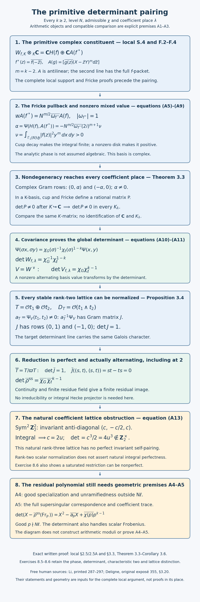

# Deligne's construction in higher weight and the Ramanujan–Petersson bound

*Written by GPT-6.1 Sol (OpenAI) in Codex, Ultra setting, October 2026. Public domain (CC0).*

A weight-two cusp form contributes to the first cohomology of a modular curve. Higher weight requires a coefficient system: the symmetric power of the first cohomology of the universal elliptic curve. Its parabolic cohomology retains the cusp forms and removes the contribution of the boundary. Deligne's construction turns a two-dimensional Hecke constituent of this cohomology into a Galois representation. The Weil theorem then controls its Frobenius eigenvalues.

Let \(f\) be a **normalized primitive cuspidal eigenform of exact level \(N\), weight \(k\geq2\), and Dirichlet character \(\chi\)**:

\[
f=\sum_{n\geq1}a_nq^n,\qquad a_1=1,\qquad
K=\mathbf Q(a_n,\chi(d):n\geq1,\ (d,N)=1).
\tag{1}
\]

Proposition 2.2 proves the number-field assertion under its stated geometric and comparison premises. Applying the modular law to \(-I\) gives \(f=\chi(-1)(-1)^kf\); since \(f\ne0\), this proves \(\chi(-1)=(-1)^k\). Definition (1) explicitly includes the character values. It agrees with the coefficient field defined using all the \(a_n\): the good-prime Hecke relation
\[
a_{p^2}=a_p^2-\chi(p)p^{k-1}
\tag{2}
\]
recovers \(\chi(p)\), and primes in every invertible residue class recover all character values.

Fix a finite place \(\lambda\mid\ell\) of \(K\). We use **arithmetic Frobenius** \(\operatorname{Fr}_p\), so the cyclotomic character satisfies \(\chi_\ell(\operatorname{Fr}_p)=p\) for \(p\ne\ell\). Geometric Frobenius is its inverse. Local reciprocity sends a uniformizer to geometric Frobenius; our Weil–Deligne convention is still \(r(w)Nr(w)^{-1}=|w|N\). The present lesson concerns good primes and does not use local–global compatibility at primes dividing \(N\).

## 1. The representation theorem

**Theorem 1.1 (Deligne; construction stated).** There is a continuous representation

\[
\rho_{f,\lambda}:G_{\mathbf Q}\longrightarrow
\operatorname{GL}_2(K_\lambda)
\tag{3}
\]

unramified outside \(N\ell\), such that for every prime \(p\nmid N\ell\),

\[
\det(X-\rho_{f,\lambda}(\operatorname{Fr}_p))
=X^2-a_pX+\chi(p)p^{k-1}.
\tag{4}
\]

It is irreducible over \(K_\lambda\). Its isomorphism class is determined by these good-prime polynomials.

We retain the full theorem, including its arbitrary character, coefficient field and irreducibility. The proof below constructs its coefficient space, supplies the cusp-product resolution and the passage through parabolic cohomology, and proves the ensuing algebraic deductions. Section 7 records the remaining proof obligations in the arithmetic moduli, congruence, comparison and irreducibility steps. The deductions below are conditional on those arithmetic-geometric assertions. Uniqueness, once existence and irreducibility are established, follows from the Frobenius-density and character proof in *Frobenius elements and determination by traces*.

The theorem is not restricted to a rational coefficient field or a trivial character. For general \(\chi\), complex conjugation of the modular form changes the character to \(\chi^{-1}\). Consequently the polarization argument for the totally real field in the previous lesson cannot simply be repeated without keeping track of these different constituents.

Write

\[
P_p(X)=X^2-a_pX+C_p,\qquad C_p=\chi(p)p^{k-1}.
\tag{5}
\]

Then the good Euler factor in the convention of *Compatible systems and global L-functions* is

\[
\det(1-\rho_{f,\lambda}(\operatorname{Fr}_p)T)^{-1}
=(1-a_pT+C_pT^2)^{-1}.
\tag{6}
\]

The polynomial belongs to \(K[X]\), independently of \(\lambda\). This is the good-prime compatibility assertion. It does not by itself describe the Euler factors at the finitely many bad primes.

## 2. The coefficient system and its two-dimensional constituent

For the geometric description suppose first that \(N\geq5\). The fine modular curve \(Y=Y_1(N)\) has a universal elliptic curve

\[
\pi:\mathcal E\longrightarrow Y.
\]

Its compactification \(X=X_1(N)\) has a finite nonempty cusp divisor \(D=X\setminus Y\). Set \(m=k-2\) and

\[
\mathcal F_\ell=R^1\pi_*\mathbf Q_\ell,\qquad
\mathcal L_m=\operatorname{Sym}^{m}\mathcal F_\ell.
\tag{7}
\]

The first sheaf is lisse of rank two; the second has rank \(m+1=k-1\). Smooth proper base change identifies its fibers with
\[
(\mathcal F_\ell)_{\bar y}=H^1(\mathcal E_{\bar y},\mathbf Q_\ell).
\tag{8}
\]
These are cohomology groups, rather than covariant Tate modules.

The relevant space is

\[
W_\ell=
H^1_{\mathrm{par}}(Y_{\overline{\mathbf Q}},\mathcal L_m)
:=\operatorname{im}\left(
H^1_c(Y_{\overline{\mathbf Q}},\mathcal L_m)
\longrightarrow H^1(Y_{\overline{\mathbf Q}},\mathcal L_m)\right).
\tag{9}
\]

This definition is essential. Cohomology with compact support alone can retain boundary eigenvalues of lower weight. For example, with constant coefficients on \(\mathbf G_m\), the localization sequence for \(\mathbf P^1\setminus\{0,\infty\}\) gives
\[
H^1_c(\mathbf G_m,\mathbf Q_\ell)
\simeq\operatorname{coker}\bigl(\mathbf Q_\ell
\longrightarrow\mathbf Q_\ell^2\bigr)\simeq\mathbf Q_\ell.
\]
Geometric Frobenius acts as \(1\) on this space. The map to ordinary first cohomology is zero, so its parabolic image is zero. Purity of weight one cannot be asserted for that compactly supported group.

A related boundary calculation occurs for the Legendre family over
\(U=\mathbf P^1_{\mathbf F_q}\setminus\{0,1,\infty\}\), with \(q\) odd and coefficient sheaf \(R^1\pi_*\mathbf Q_\ell\), \(\ell\nmid q\). With \(\varepsilon=(-1)^{(q-1)/2}\), the calculation is
\[
\#\mathcal E(\mathbf F_{q^n})=q^{2n}-q^n-1+\varepsilon^n,\qquad
\operatorname{tr}(F^n\mid H^1_c(U_{\overline{\mathbf F}_q},R^1\pi_*\mathbf Q_\ell))
=1+\varepsilon^n.
\]
Here \(\mathcal E\) means the total family, including the zero section. The second equality for every \(n\geq1\) determines its compact-support Euler polynomial: the identity
\(\log\det(1-FT)=-\sum_{n\geq1}\operatorname{tr}(F^n)T^n/n\)
gives \((1-T)(1-\varepsilon T)\). Thus the two eigenvalues are \(1,\varepsilon\). The sign is determined in the **base field**. For \(q=3\), the first two total-family counts are \(4,72\), the traces are \(0,2\), and the eigenvalues are \(1,-1\), even though \(-1\) becomes a square over \(\mathbf F_9\). Testing whether it is a square in one extension would not determine the base-field eigenvalues.

Here is the count itself. Put \(Q=q^n\), and extend the quadratic character \(\eta\) of \(\mathbf F_Q^\times\) by \(\eta(0)=0\). Each fiber has
\(Q+1+\sum_x\eta(x(x-1)(x-t))\) points. Since \(\sum_t\eta(x-t)=0\), summing over \(t\ne0,1\) gives
\[
\begin{aligned}
\sum_{t\ne0,1}\sum_x\eta(x(x-1)(x-t))
&=-\sum_{x\ne0,1}\bigl(\eta(x-1)+\eta(x)\bigr)\\
&=\eta(-1)+1.
\end{aligned}
\]
Thus the total is \((Q-2)(Q+1)+1+\eta(-1)=Q^2-Q-1+\varepsilon^n\). To identify the trace with a single compact-support group, put \(s=1/t\), \(x=u/s\), \(y=v/s^2\). The family at infinity becomes
\[
v^2=s\,u(u-s)(u-1).
\]
It is the quadratic twist by \(s\) of the parameter-\(s\) Legendre curve. That curve has \(\Delta=16s^2(1-s)^2\) and \(c_4=16(s^2-s+1)\), and over the geometric local field its node is split. The Tate uniformization and Kummer proof in *Elliptic curves over local fields*, Lemma 3.0 and Theorem 3.1, make its inertia unipotent. Since the characteristic is odd, adjoining \(\sqrt s\) is a ramified quadratic extension; an inertia element with quadratic value \(-1\) has, on the twist, the negative of a unipotent matrix. Its two eigenvalues are \(-1\), so it has no fixed vector in characteristic zero. There are consequently no global invariant vectors. Curve duality gives \(H_c^2(U,R^1\pi_*\mathbf Q_\ell)=0\), and \(H_c^0=0\) because a lisse section on this connected nonproper curve cannot have proper support. The curve trace formula therefore identifies the negative of the sum of fiber traces with \(\operatorname{Tr}(F^n\mid H_c^1)\); the point count just proved makes it \(1+\varepsilon^n\). The determinant logarithm proves the displayed degree-two polynomial, without a tame Euler-characteristic formula. The actual finite-coefficient curve trace proof is *The trace formula for curves*, Theorem 1.1 and §§2–5; the adic passage is *The trace formula in all dimensions*, Theorem 5.1. Its finite-cover and compact-support prerequisites retain their recorded scope. The free primary [Stacks calculation](https://stacks.math.columbia.edu/tag/03VA) is material for this example, not its vanishing proof.

The comparison and Eichler–Shimura theorems identify the corresponding complex parabolic cohomology with

\[
S_k(\Gamma_1(N))\oplus\overline{S_k(\Gamma_1(N))},
\qquad
\dim_{\mathbf Q_\ell}W_\ell=2\dim_{\mathbf C}S_k(\Gamma_1(N)).
\tag{10}
\]

Here the bar denotes the conjugate contribution under the compatible Hecke normalization, not an assertion that \(\chi\) is real. We prove the complex period map below. Lemma 2.4 reduces its comparison with the étale coefficient group to the preceding lesson's actual curve proofs, including the finite-cover argument. Exercise 8.4 computes the complex total dimension and keeps the remaining analytic Riemann–Roch foundations visible.

Hecke correspondences act on \(W_\ell\) and commute with Galois. On the constituent associated with \(f\), the good operators act by \(a_p\), and the normalized diamond action contributes \(\chi(p)\). Proposition 2.2 below proves the two-dimensionality and coefficient descent using **all** Hecke operators, including the bad operators, once the compatible arithmetic correspondences and comparison exist. A form viewed at a larger level can occur several times for the good operators alone: the whole oldform eigenspace must not be declared two-dimensional.

With this cohomological convention the arithmetic Galois representation in (3) is realized on

\[
V_{f,\lambda}=W_{f,\lambda}^{\vee}.
\tag{11}
\]

Indeed, if \(A\) is arithmetic Frobenius on \(W_{f,\lambda}\), then geometric Frobenius on it is \(A^{-1}\), while arithmetic Frobenius on its dual is \((A^{-1})^{\mathsf t}\). Thus these last two operators have the same characteristic polynomial. In particular, geometric Frobenius on the cohomological constituent and arithmetic Frobenius on (3) have the eigenvalues in (4).

No extra Tate twist is inserted into (11). There is a different, canonical two-dimensional identity

\[
V^\vee\simeq V\otimes(\det V)^{-1}.
\tag{12}
\]

The map sends \(v\) to the functional \(w\mapsto v\wedge w\), with values in \(\det V\), and is an isomorphism in any basis. After §5 identifies the determinant, (12) involves both \(\chi^{-1}\) and \(\chi_\ell^{1-k}\). Omitting the nebentypus in a self-duality assertion would change the representation.

At levels below five one uses a fine auxiliary cover and descent. The handling of its level action and the unramified assertion at primes not dividing \(N\ell\) belong to Theorem 1.1. The outline through a convenient cover does not supply these descent proofs.

### 2.1. The period map in every weight on a fine curve

**Lemma 2.1 (complex Eichler–Shimura mechanism).** Suppose \(N\ge5\). For the rank-\(m+1\) local system \(V_m=\mathbf C[X,Y]_m\), with
\(\rho(\gamma)P(v)=P(\gamma^{-1}v)\), the maps
\[
f\longmapsto f(z)(X-zY)^m\,dz,
\qquad
\bar g\longmapsto \overline{g(z)}(X-\bar zY)^m\,d\bar z
\]
give an injective map from \(S_k\oplus\overline{S_k}\) to complex parabolic cohomology. If the line-bundle dimension calculation in Exercise 8.4 is available, this map is an isomorphism. This includes odd \(k\).

*Proof.* The elementary identity
\(\rho(\gamma)(X-zY)^m=(cz+d)^m(X-\gamma zY)^m\), combined with \(d(\gamma z)=(cz+d)^{-2}dz\), makes these closed forms covariant. On the half-plane a closed coefficient form has a primitive: integrate first horizontally and then vertically, and differentiate, using \(\partial_yP=\partial_xQ\). Its period from \(z_0\) to \(\gamma z_0\) is therefore a cocycle. Changing \(z_0\) changes it by a coboundary.

At a cusp the Fourier expansion of a cusp form is bounded by \(Ce^{-ay}\); its polynomial coefficient adds at most \(C'(1+y)^m\). Integration to the cusp consequently converges. If \(b_P\) is that integral, a stabilizer element has period \(b_P-\rho(\gamma)b_P\); hence the class is parabolic. A primitive with limiting value zero is covariant in the cusp strip. Subtract the differential of that primitive times a height cutoff. The resulting form has compact support and the same period class.

On the basis \(e_r=X^{m-r}Y^r\), use the coefficient pairing
\[
B(e_r,e_s)=0\ (r+s\ne m),\qquad
B(e_r,e_{m-r})=(-1)^r\binom mr^{-1}.
\]
Expansion gives \(B((aX+bY)^m,(cX+dY)^m)=(ad-bc)^m\). Pure powers span, by the Vandermonde determinant, so \(B\) is invariant under \(\mathrm{SL}_2\) and is nondegenerate in every parity. Integrate \(B\) of the wedge of compact representatives. If a period class is zero, its closed form has a covariant primitive: subtract the constant giving its cocycle coboundary. The integral against a compact closed representative is then the integral of a differential and is zero. Green–Stokes here follows on rectangles from the fundamental theorem of calculus; paired sides of a truncated domain cancel, and the cusp boundary tends to zero by the preceding exponential estimate. Thus this pairing depends only on the classes.

Since \(B((X-zY)^m,(X-\bar zY)^m)=(2iy)^m\) and \(dz\wedge d\bar z=-2i\,dx\wedge dy\), the mixed pairing is
\[
-(2i)^{m+1}\int f(z)\overline{g(z)}y^m\,dx\,dy.
\]
The two same-type pairings vanish. The integral of \(|f|^2y^m\) is finite by the cusp estimate and positive for \(f\ne0\), since a continuous nonzero function is nonzero on a small disk. Pairing a vanishing class \([f+\bar g]\) first against \(\bar f\), then against \(g\), proves \(f=g=0\). No parity assumption occurred. Exercise 8.4 gives equal dimensions for domain and codomain, proving surjectivity when its Riemann–Roch premises are established. The actual earlier LG-MF period proof proves this cup argument, but its final theorem restricts odd weights; the argument above supplies the regular-cusp extension needed here. ∎

### 2.2. A full Hecke eigenspace and its coefficient field

**Proposition 2.2.** Assume that the fine modular curve and its universal family exist, that their rational Betti and étale parabolic cohomologies compare compatibly with all normalized Hecke and diamond correspondences, and that Lemma 2.1's dimension input is proved. The simultaneous eigenspace for the full system \((a_n,\chi(d))\) has dimension two over \(K\), and hence over each \(K_\lambda\). The field \(K\) is a number field. These claims do not require good-Hecke multiplicity one on the whole old space.

*Proof.* The coefficient formula from the earlier congruence-level Hecke lesson is
\[
a_r(T_nh)=\sum_{d\mid(r,n)}\chi_h(d)d^{k-1}a_{rn/d^2}(h),
\qquad a_1(T_nh)=a_n(h).
\]
For a simultaneous eigenvector with eigenvalues \(a_n\), it implies \(a_n(h)=a_n a_1(h)\). If \(a_1(h)=0\), every Fourier coefficient is zero, so \(h=0\); otherwise \(h=a_1(h)f\). Thus its holomorphic eigenspace is exactly one-dimensional, including at the bad operators.

Define \(f^*(z)=\overline{f(-\bar z)}\). The matrix \(J=\operatorname{diag}(-1,1)\) conjugates \(\Gamma_1(N)\) to itself. Applying the modular law to \(J\gamma J\) proves that \(f^*\) is a cusp form of character \(\bar\chi=\chi^{-1}\), with Fourier coefficients \(\bar a_n\). The same conclusion holds at every cusp, because reflection takes rational cusps and their vanishing expansions to rational cusps and vanishing expansions. The rational double-coset sets are stable under \(\delta\mapsto J\delta J\); equivalently the displayed coefficient formula conjugates. Therefore the antiholomorphic class associated with \(f^*\) has eigenvalues \(a_n,\chi(d)\), and its eigenspace is also one-dimensional. Lemma 2.1 gives dimension two.

There is a rational coefficient structure: integral polynomials with the integral \(\Gamma_1(N)\)-action define a local system on a finite surface cell complex; parabolic cohomology is the image of its relative-to-absolute cochain map. Tensoring that finite integral complex with \(\mathbf Q\) gives its rational structure. On a rational correspondence \(\delta\) of determinant \(n>0\), the coefficient map \(\rho(\delta)^{-1}\) is substitution by the integral matrix \(\delta\). Pullback followed by the finite-cover sum therefore preserves the integral cohomology image modulo torsion. On a holomorphic period form the formula is
\[
\rho(\delta)^{-1}\delta^*\bigl(h(z)(X-zY)^m dz\bigr)
=n^{k-1}(cz+d)^{-k}h(\delta z)(X-zY)^m dz.
\]
This is exactly \(n^{k/2-1}h\Vert_k\delta\) on the form coefficient. It verifies the normalization as well as rationality; no square root of \(n\) enters the cohomological matrix.

The commuting operators generate a finite-dimensional commutative \(\mathbf Q\)-algebra \(A\subset\operatorname{End}_{\mathbf Q}(W_B)\). Their eigenvalue system is a homomorphism \(A\to\mathbf C\). Its image is a finite-dimensional domain over \(\mathbf Q\), hence a field: multiplication by a nonzero element is an injective endomorphism of that finite vector space, and is surjective. The image is exactly \(K\), since it contains all \(a_n\) and the diamond values and is generated by them. The corresponding eigenspace is the intersection of kernels of matrices with entries in \(K\); a finite collection suffices because dimensions can decrease only finitely often. Matrix rank is unchanged by extending a field. Its complex dimension two is thus its dimension over \(K\), and compatible comparison gives the same dimension over \(K_\lambda\). Galois commutes with the arithmetic correspondences, so preserves those kernels. ∎

This proposition proves the coefficient and multiplicity steps under its specified geometric premises. It does not prove that the resulting Galois action is irreducible, nor its determinant or unramifiedness. Those are separate assertions of Theorem 1.1. For the character-field equality after (2), apply the earlier Frobenius-density theorem to the cyclotomic extension: the automorphism \(\zeta_N\mapsto\zeta_N^d\) occurs at a prime away from \(N\), and reduction of roots of unity identifies its arithmetic Frobenius with \(p\bmod N\). Thus (2) recovers every \(\chi(d)\) without assuming an additional prime-in-progression theorem.

**Lemma 2.3 (finite-cover descent).** Let \(Z\to Y\) be a finite étale Galois cover with finite group \(G\), and \(\mathcal L\) a characteristic-zero coefficient local system on \(Y\). Pullback identifies its ordinary, compact and parabolic cohomologies with the \(G\)-invariants of the corresponding cohomologies of the pulled-back system on \(Z\). These identifications respect commuting Galois and correspondence actions.

*Proof.* On a geometric stalk, the pushforward of the pulled-back system is a direct sum indexed by the finite fiber. Its \(G\)-invariant vectors are the diagonal copy of the original stalk. Averaging \(e=|G|^{-1}\sum_{g\in G}g\) is an idempotent with that image. There are no higher direct images on a finite étale fiber, which is a finite set of separably closed points; finite proper base change gives the same assertion as sheaves. Ordinary and compact-support composition therefore compute upstairs cohomology as the cohomology of this pushforward. Splitting the sheaf by \(e\) splits its derived global sections, so its invariant cohomology is exactly downstairs cohomology. The compact-to-ordinary map commutes with \(e\); taking its image proves the parabolic assertion. All constructions use natural maps and the finite sum, hence commute with any compatible additional action. ∎

The lemma proves the averaging step of auxiliary-level descent. It requires an actual finite étale cover with descended coefficient system. The moduli at levels with stabilizers and their integral models are still required to realize that premise for every \(N\); an abstract finite group does not construct the auxiliary modular cover.

**Lemma 2.4 (reducing coefficient comparison to curve comparison).** Once the fine curve and elliptic family are constructed, degree-one ordinary, compact and parabolic comparison for \(\mathcal L_m\) reduces to constant-coefficient comparison for smooth projective curves and their finite correspondences. In particular it uses no higher-dimensional comparison theorem for the total elliptic surface. The actual curve comparison proofs are Lemmas 1.2 and 1.4 of *Modular curves and the Eichler–Shimura congruence*: the latter includes algebraically closed field extension, while the former retains its analytic Riemann–Roch foundations.

*Proof.* Fix \(A=\mathbf Z/\ell^r\). Elliptic Kummer identifies \(R^1\pi_*A\) with the dual of the finite locally free torsion system; this is the natural degree-one identification in the earlier elliptic lesson. The torsion-basis cover is finite étale, by the relative multiplication proof and the basis-locus construction in the earlier modular lesson, Lemma 1.0. The full torsion-basis cover \(Z\to Y\) is a torsor for the finite group \(G=\operatorname{GL}_2(A)\): changes of basis act freely and transitively on every fiber. It may be disconnected. On it the symmetric-power coefficient system is the constant free \(A\)-module \(M\), with descent action of \(G\).

Normalize the projective completion of \(Y\) in each component function field of \(Z\). It is finite by the trace-dual-lattice normalization proof in the modular lesson, Lemma 1.2; in characteristic zero its normal curve is smooth. Thus \(Z=\bar Z\setminus B\), with \(\bar Z\) smooth projective and \(B\) finite. The closed–open and curve Gysin sequences determine its constant-coefficient groups in degrees zero and one from those of \(\bar Z\), the point modules of \(B\), and their degree maps. Constant comparison on \(\bar Z\), with trace and cup normalization, preserves all these maps. It consequently compares ordinary and compact degree-one groups on \(Z\) as well. This applies both to algebraically closed field extension and to complex analytification; on the analytic side the same boundary maps are the oriented small-circle maps.

Here is descent with finite coefficients, where dividing by \(|G|\) would be invalid. The augmented Čech complex for the cover is exact on every geometric stalk: choose one lift of that stalk and insert it as first coordinate to obtain the contracting homotopy. Its \(p\)-fold intersections are disjoint copies of \(Z\) indexed by \(G^p\). Apply ordinary cohomology to this resolution. The resulting double complex is the group-bar complex of the cohomology complex of \(Z\), tensored with \(M\). Tensoring is exact because \(M\) is free over \(A\). Filtering gives
\[
H^p\bigl(G,H^q(Z,A)\otimes_A M\bigr)
\Longrightarrow H^{p+q}(Y,\mathcal L_{m,A}).
\]
The comparison maps identify the rows \(q=0,1\). In total degree one the only other datum is the differential from \(H^0(G,H^1)\) to \(H^2(G,H^0)\); the same bar double-complex map preserves it. Its kernel and the group \(H^1(G,H^0)\) therefore identify the two degree-one abutments. With compact support the cover is finite proper, so the identical Čech argument applies to compact cohomology. Here \(H_c^0(Z,A)=0\), and degree one is simply \((H_c^1(Z,A)\otimes_A M)^G\). The compact-to-ordinary maps commute with the comparison, proving the parabolic assertion.

The finite-coefficient cohomology groups are finite by the earlier curve finiteness proof. Their inverse systems are Mittag–Leffler: at each fixed finite group the descending sequence of images stabilizes. Compatible inverse limits therefore have no extra degree-one \(\varprojlim^1\) term; after tensoring with \(\mathbf Q_\ell\) they give the stated coefficient comparison. The finite Betti cell complexes give the same limit. Pullback and trace are natural throughout. For a coefficient correspondence take a common torsion-basis cover on its parameter curve; there its coefficient map is a constant module map and its geometric maps are finite curve maps. The earlier curve comparison preserves those maps and their traces, so the descended comparison preserves the normalized Hecke and diamond actions whenever those correspondences have actually been constructed. On the uniformizing half-plane, the elliptic fibers are \(\mathbf C/(\mathbf Z+z\mathbf Z)\); their torsion coordinates identify this compared system with the polynomial local system of Lemma 2.1. This proves the reduction, with its geometric and analytic foundations still explicit. ∎

### 2.5. The local analytic primitive-form proof

Before restricting the arithmetic cup pairing, we prove the Fourier-support statement that makes a primitive good-prime eigenspace a line. The argument keeps the character and original lower levels explicit, including primes outside the level and characters that do not descend.

#### Statement and conventions

Write \(S_k(N,\chi)=S_k(\Gamma_0(N),\chi)\), where \(k\ge1\), \(\chi(-1)=(-1)^k\), and \(C\mid N\) is the conductor of \(\chi\). At every multiple of \(C\), use the pullback of this same primitive character. A character factors through \(N/p\) precisely when \(C\mid N/p\). This condition is essential, even if \(p^2\mid N\).

For a positive-determinant rational matrix, use
\[
 (f|_k A)(z)=\det(A)^{k/2}(cz+d)^{-k}f(Az),
 \qquad A=\begin{pmatrix}a&b\\c&d\end{pmatrix}.
\]
The positive real square root is understood. Put
\[
 B_p f(z)=f(pz),\qquad
 U_p f(z)=\frac1p\sum_{j=0}^{p-1}f((z+j)/p),\qquad
 P_p=B_pU_p,\qquad A_p=1-P_p.
 \tag{S1}
\]
If \(f=\sum_{n\ge1}a_nq^n\), then \(U_pf=\sum_{n\ge1}a_{pn}q^n\). Consequently \(P_p\) keeps exactly the coefficients whose indices are divisible by \(p\), and \(A_p\) keeps exactly the other indices. For different primes these projections commute; \(U_p\) and \(B_p\) commute with the projections at any other prime.

**Theorem S.** Let \(\mathcal S\) be any finite set of primes, without a restriction on its intersection with \(N\). If \(f\in S_k(N,\chi)\) and
\[
 a_n(f)=0\quad\text{whenever no prime in }\mathcal S\text{ divides }n,
 \tag{S2}
\]
then
\[
 f=\sum_{\substack{p\in\mathcal S, p\mid N\\ C\mid N/p}}B_p g_p,
 \qquad g_p\in S_k(N/p,\chi).
 \tag{S3}
\]
The empty sum is zero. Thus a character with conductor \(N\) admits no nonzero cusp form with this finite-prime support. We prove the fixed-character statement; no unproved projection from the full \(\Gamma_1(N)\) space is being used.

The complex coefficient bound in the earlier programme lesson *Dimension formulas for congruence subgroups*, Theorem 6.1 and its character paragraph, makes \(S_k(L,\chi)\) finite dimensional: the map to coefficients through \(\lfloor k[\mathrm{SL}_2(\mathbf Z):\Gamma_0(L)]/12\rfloor\) is injective. For \(p\nmid L\), the operator used below is
\[
 T_p=U_p+\chi(p)p^{k-1}B_p.
 \tag{S4}
\]
We prove its preservation locally in Lemma S.1, including weight one. The earlier Hecke lesson states its general setup for \(k\ge2\); that restriction is not silently being discarded. Only the complex coefficient bound is needed, not its conditional arithmetic reduction analogue. The earlier proof's prerequisites remain required.

#### 1. Elementary level changes

**Lemma S.1.** For any prime \(p\), \(B_p\) maps \(S_k(L,\chi)\) to \(S_k(Lp,\chi)\), and \(U_p\) does so as well. If \(p\mid L\), \(U_p\) already preserves \(S_k(L,\chi)\). Therefore \(A_p\) can always be regarded as a map to \(S_k(Lp^2,\chi)\).

*Proof.* With \(D_p=\operatorname{diag}(p,1)\),
\[
 D_p\begin{pmatrix}a&b\\c&d\end{pmatrix}D_p^{-1}
 =\begin{pmatrix}a&pb\\c/p&d\end{pmatrix}.
\]
For \(c\equiv0\pmod{Lp}\) this is in \(\Gamma_0(L)\), with the same character value. Also \(B_pf=p^{-k/2}f|D_p\).

For \(U_p\), put \(K_j=\left(\begin{smallmatrix}1&j\\0&p\end{smallmatrix}\right)\). Suppose \(\gamma=\left(\begin{smallmatrix}a&b\\c&d\end{smallmatrix}\right)\in\Gamma_0(L)\) and \(p\mid c\); this holds at level \(L\) when \(p\mid L\), or at level \(Lp\) otherwise. The entry \(a\) is a unit modulo \(p\). Choose
\(j'\equiv(b+jd)/a\pmod p\). As \(j\) varies this permutes the residues, since \(d\) is also a unit modulo \(p\). Then
\[
 K_j\gamma K_{j'}^{-1}
 =\begin{pmatrix}
 a+jc&\bigl(b+jd-(a+jc)j'\bigr)/p\\
 pc&d-cj'
 \end{pmatrix}\in\Gamma_0(L).
 \tag{S5}
\]
Its character is \(\chi(d)\). Since \(U_pf=p^{k/2-1}\sum_j f|K_j\), this proves the asserted transformation law.

All these operators preserve cuspidality. To check this directly, for any rational positive-determinant matrix \(R\) and an integral matrix \(\sigma\) carrying infinity to a cusp, choose an integral \(\sigma'\) carrying infinity to \(R\sigma\infty\). Then \(\sigma'^{-1}R\sigma\) is upper triangular with positive ratio of its diagonal entries. A cusp expansion of \(f|\sigma'\) is exponentially decaying as the imaginary part tends to infinity; the upper-triangular substitution preserves positive exponents and decay. Each finite slash sum therefore vanishes at every cusp. Inflation to a higher level preserves the same property.

For completeness, (S4) preserves \(S_k(L,\chi)\) at every weight here. Let \(p\nmid L\), \(\Gamma=\Gamma_0(L)\), and \(\alpha=\operatorname{diag}(1,p)\). The intersection \(\Gamma\cap\alpha^{-1}\Gamma\alpha\) is \(H=\Gamma\cap\Gamma^0(p)\). Reduction modulo \(p\) is onto, by the elementary lifting argument in Lemma S.2 below, so \(H\backslash\Gamma\) has the \(p+1\) representatives \(T^j\) and \(\gamma_\infty=\left(\begin{smallmatrix}ap&b\\L&1\end{smallmatrix}\right)\), where \(ap-Lb=1\). All these representatives have character one. For right multiplication by \(\gamma\in\Gamma\), write \(\gamma_j\gamma=h_0\gamma_{j'}\), with \(h_0\in H\). Then \(\chi(h_0)=\chi(\gamma)\), and \(\alpha h_0\alpha^{-1}\in\Gamma\) has the same bottom-right entry as \(h_0\). Thus \(\sum_j f|\alpha\gamma_j\) transforms with character \(\chi\). Finally
\[
 \alpha\gamma_\infty=
 \begin{pmatrix}a&b\\L&p\end{pmatrix}D_p,
 \qquad
 f|\alpha\gamma_\infty=\chi(p)f|D_p.
\]
Multiplication of this slash sum by \(p^{k/2-1}\) gives exactly (S4). Its cusp preservation follows from the same rational upper-triangular calculation. This proves the good-prime operator formula and preservation for \(k=1\) as well. ∎

#### 2. A form supported on one prime

**Lemma S.2.** Suppose \(F\in S_k(L,\chi)\) has coefficients only at indices divisible by \(p\). If \(p\mid L\) and \(C\mid L/p\), then \(F=B_pG\) with \(G\in S_k(L/p,\chi)\). If \(p\nmid L\), or if \(p\mid L\) but \(C\nmid L/p\), then \(F=0\).

*Proof.* Set \(G(z)=F(z/p)\). Its Fourier expansion makes it periodic with period one. Put \(L_0=L/p\) if \(p\mid L\), and \(L_0=L\) otherwise. For
\[
 H=\Gamma_0(L_0)\cap\Gamma^0(p),\qquad
 \Gamma^0(p)=\{\gamma\in\mathrm{SL}_2(\mathbf Z):p\mid\gamma_{12}\},
\]
conjugation by \(\operatorname{diag}(1,p)\) sends
\(\left(\begin{smallmatrix}a&b\\c&d\end{smallmatrix}\right)\) to
\(\left(\begin{smallmatrix}a&b/p\\pc&d\end{smallmatrix}\right)\in\Gamma_0(L)\).
Thus \(G|\gamma=\chi(d)G\) for \(\gamma\in H\), and \(G|T=G\) for \(T=\left(\begin{smallmatrix}1&1\\0&1\end{smallmatrix}\right)\).

First suppose \(p\mid L\) but the character does not factor through \(L_0\). Reduction of unit groups from modulus \(L\) to \(L_0\) is onto, by the Chinese remainder theorem. Nonfactorization gives a unit \(e\equiv1\pmod{L_0}\) with \(\chi(e)\ne1\). Write \(e=1+u'L_0\pmod L\), and put
\[
 \eta=\begin{pmatrix}1&p\\L_0&L+1\end{pmatrix}\in H.
\]
Its determinant is one and its character is one, so \(G|\eta=G\). Choose \(u\equiv-u'e^{-1}\pmod p\). The matrix
\[
 \delta=T^u\eta T^{u'}=
 \begin{pmatrix}
 1+uL_0&p+u(L+1)+u'(1+uL_0)\\
 L_0&L+1+L_0u'
 \end{pmatrix}
 \tag{S6}
\]
has upper-right entry zero modulo \(p\), so belongs to \(H\). Its bottom-right entry is \(e\pmod L\). Periodicity and \(G|\eta=G\) give \(G|\delta=G\), whereas the character law gives \(G|\delta=\chi(e)G\). Hence \(G=0\).

In the remaining cases the character on \(H\) extends to \(\Gamma_0(L_0)\) as \(\chi(d)\). This full group is generated by \(H\) and \(T\). If \(p\mid L_0\), right multiplication by a suitable power of \(T\) eliminates the upper-right entry modulo \(p\), since the upper-left entry is a unit. If \(p\nmid L_0\), reduction of \(\Gamma_0(L_0)\) onto \(\mathrm{SL}_2(\mathbf F_p)\) is surjective: prescribe a matrix modulo \(p\) and the identity modulo \(L_0\), and lift from \(\mathrm{SL}_2(\mathbf Z/pL_0\mathbf Z)\). Such lifting is elementary. Over \(\mathbf Z/m\mathbf Z\), elementary row additions can make the first entry of a primitive column a unit: choose the addition separately modulo every prime dividing \(m\), then use the Chinese remainder theorem. Eliminate the other entry and then the upper-right entry. The resulting diagonal \(\operatorname{diag}(a,a^{-1})\) is a product of elementary matrices, as multiplication of the usual three-matrix expressions for \(\left(\begin{smallmatrix}0&a\\-a^{-1}&0\end{smallmatrix}\right)\) verifies. Every elementary matrix lifts integrally. The image of \(H\) is the lower-triangular subgroup, and the image of \(T\) generates the upper unipotents; together they generate the finite special linear group. The reduction kernel is already in \(H\). This proves generation in both cases.

The character law and cuspidality therefore extend to \(\Gamma_0(L_0)\); the positive upper-triangular cusp substitution in Lemma S.1 checks the latter directly. If \(p\mid L\), this proves the required descent.

If \(p\nmid L\), both \(G\) and \(B_pG=F\) lie at level \(L\). The coefficient formula (S4) gives, for \(j\ge1\),
\[
 T_p B_p^jG=B_p^{j-1}G+\chi(p)p^{k-1}B_p^{j+1}G.
 \tag{S7}
\]
Since \(\chi(p)\ne0\), induction places every \(B_p^jG\) in the same finite-dimensional space. If \(G\ne0\), their first nonzero indices are \(m,pm,p^2m,\ldots\), where \(m\) is the first nonzero index of \(G\). The least such index in any finite linear relation forces its coefficient to vanish, successively, so these forms are linearly independent. This contradicts finite dimensionality. Hence \(F=0\). ∎

#### 3. The exact trace when a prime occurs once

**Lemma S.3.** If \(p^2\mid L\) and \(C\mid L/p\), then \(U_p\) maps \(S_k(L,\chi)\) into \(S_k(L/p,\chi)\). If \(p\parallel L\) and \(C\mid L/p\), choose \(x,y\in\mathbf Z\) with
\(px-(L/p)y=1\), and put
\[
 V_p^L=\begin{pmatrix}px&y\\L&p\end{pmatrix},\qquad
 Q_p^L=U_p+p^{k/2-1}(|_kV_p^L).
 \tag{S8}
\]
Then \(Q_p^L\) maps \(S_k(L,\chi)\) into \(S_k(L/p,\chi)\), and
\[
 Q_p^L B_p h=(1+p^{-1})h
 \quad(h\in S_k(L/p,\chi)).
 \tag{S9}
\]

*Proof.* For \(g(z)=f(z/p)\), its transformation group is
\(H=\Gamma_0(L/p)\cap\Gamma^0(p)\), with the descended character. Unlike in Lemma S.2, \(g\) need not be periodic with period one. If \(p\mid L/p\), the \(p\) left cosets of \(H\) in \(\Gamma_0(L/p)\) have representatives \(T^j\), \(0\le j<p\). Their trace is \(pU_pf\), proving the first assertion.

If \(p\nmid L/p\), the reduction argument above identifies \(H\) with the inverse image of the lower-triangular subgroup. Its left cosets are distinguished by the projective first row and have representatives \(T^j\) and
\[
 \delta_0=\begin{pmatrix}px&y\\L/p&1\end{pmatrix}.
\]
The first rows modulo \(p\) are \([1:j]\) and \([0:1]\), respectively; \(y\) is a unit modulo \(p\) by the determinant equation. These are all \(p+1\) cosets. Every representative has character value one. Therefore their unweighted trace transforms with the descended character: right multiplication permutes the left cosets, and its compensating left factor has the character of the matrix being applied. Moreover
\(g|\delta_0=p^{k/2}f|V_p^L\), so this trace is exactly \(pQ_p^Lf\). The cusp argument already given makes it a cusp form at level \(L/p\).

For (S9), \(U_pB_ph=h\) by coefficients. Also
\[
 D_pV_p^L=p\delta_0,\qquad
 (B_ph)|V_p^L=p^{-k/2}h|\delta_0=p^{-k/2}h.
\]
Positive scalar matrices act trivially under our slash normalization, and \(\delta_0\) has descended character value one. These equalities give (S9), including its factor \(1+p^{-1}\). ∎

For later use, suppose \(r\ne p\), \(p\parallel L\), and \(r\mid L\). With compatible choices define
\[
 V_p^{L/r}=D_rV_p^LD_r^{-1}
   =\begin{pmatrix}px&ry\\L/r&p\end{pmatrix}.
 \tag{S10}
\]
If the character factors through \(L/(rp)\), this is a permissible matrix for Lemma S.3 at level \(L/r\). Its determinant is \(p\), and direct slash composition, together with \(U_pB_r=B_rU_p\), proves
\[
 Q_p^LB_r=B_rQ_p^{L/r}.
 \tag{S11}
\]
No character factor or unspecified choice of Atkin–Lehner operator is hidden in this equality.

#### 4. Removing all primes in the support

*Proof of Theorem S.* First remove ineligible primes from the support set without changing the form. For \(p\in\mathcal S\) put
\[
 F_p=\prod_{r\in\mathcal S\setminus\{p\}}A_r f,
 \qquad L=N\prod_{r\in\mathcal S\setminus\{p\}}r^2.
 \tag{S12}
\]
Lemma S.1 makes \(F_p\) a cusp form at level \(L\), supported only at multiples of \(p\). If \(p\nmid N\), it still does not divide \(L\), and Lemma S.2 gives \(F_p=0\). If \(C\nmid N/p\), the \(p\)-exponent of \(L\) is unchanged from that of \(N\), so \(C\nmid L/p\); again \(F_p=0\). In either case the Fourier meaning of the product says that \(f\) is already supported on \(\mathcal S\setminus\{p\}\). Repeating removes all such primes. We may now assume that every prime in \(\mathcal S\) divides \(N\) and satisfies \(C\mid N/p\).

Induct on the size of this remaining set. For \(p^2\mid N\), take \(g_p=U_pf\). Lemma S.3 puts it at level \(N/p\). Then \(f-B_pg_p=A_pf\) lies at level \(N\) and is supported on the other primes. Induction applies.

It remains to remove \(p\parallel N\). Enumerate the other support primes as \(r_1,\ldots,r_t\), and put
\(M=N\prod_{i=1}^t r_i^2\). Choose one matrix
\(V=\left(\begin{smallmatrix}px&y\\M&p\end{smallmatrix}\right)\) with \(px-(M/p)y=1\). The same matrix is admissible for the trace lemma at the original level \(N\): its corresponding extra coset matrix is
\(\left(\begin{smallmatrix}px&y\\M/p&1\end{smallmatrix}\right)\in\Gamma_0(N/p)\), has bottom-right entry one and projective first row \([0:1]\) modulo \(p\). Thus the operator \(Q=U_p+p^{k/2-1}(|V)\) lowers \(N\) to \(N/p\) and also lowers \(M\) to \(M/p\).

The Fourier projections give the exact telescoping identity
\[
 \begin{split}
 f&=\sum_{i=1}^t B_{r_i}\Phi_i+B_p\Phi_p,\\
 \Phi_i&=U_{r_i}A_{r_1}\cdots A_{r_{i-1}}f,\qquad
 \Phi_p=U_pA_{r_1}\cdots A_{r_t}f.
 \end{split}
 \tag{S13}
\]
Each \(\Phi_i\) may be regarded as lying at level \(M/r_i\): its level divides \(N\prod_{j<i}r_j^2\), which divides \(M/r_i\). The last summand is supported on \(p\); Lemma S.2 puts \(\Phi_p\) at level \(M/p\). All characters in these level changes are the same descended character.

Use (S10) for each \(r_i\), and set \(\Psi_i=Q_p^{M/r_i}\Phi_i\). Its level is \(M/(r_ip)\). Equations (S9) and (S11), applied to (S13), give
\[
 Qf=\sum_{i=1}^t B_{r_i}\Psi_i+(1+p^{-1})\Phi_p.
 \tag{S14}
\]
Define \(g_p=Qf/(1+p^{-1})\), using the original-level trace; it lies at level \(N/p\). Subtracting \(B_pg_p\) from (S13) yields
\[
 f-B_pg_p=
 \sum_{i=1}^t B_{r_i}
 \left(\Phi_i-\frac{B_p\Psi_i}{1+p^{-1}}\right).
 \tag{S15}
\]
This identity proves that its coefficients are supported on the other primes; no claim that the parenthesized forms already have original lower level is needed. Independently, \(f-B_pg_p\) lies at level \(N\), since both terms do. Induction at that original level supplies its decomposition (S3). When \(t=0\), the sum in (S15) is empty and \(f=B_pg_p\). This proves the theorem for every finite set and every fixed character. ∎

#### 5. The precise consequence for the primitive-form argument

Define the old space at level \(N\) as the span of all \(B_dh\), with \(h\in S_k(L,\chi)\), \(L\mid N\), \(L<N\), \(dL\mid N\), and \(C\mid L\). Define the new space as its orthogonal complement for the positive Petersson inner product.

That inner product exists at weight one as well. For \(u,v\in S_k(N,\chi)\), put
\[
 \langle u,v\rangle=
 \int_{\Gamma_0(N)\backslash\mathfrak H}
       u(z)\overline{v(z)}y^k\,\frac{dx\,dy}{y^2}.
 \tag{S15A}
\]
The transformation law, \(|\chi(d)|=1\), the identity \(\operatorname{Im}(\gamma z)=y/|cz+d|^2\), and the change-of-variables Jacobian \(|cz+d|^{-4}\) make the integrand invariant. In each of the finitely many cusp regions, the slash-translated cusp expansions decay exponentially; their product times \(y^{k-2}\) is integrable for every \(k\ge1\). The complement is compact, so continuity gives convergence there. Thus the integral converges absolutely. If \(u\ne0\), it is nonzero at some point, hence has positive absolute value on a neighborhood of positive area; therefore \(\langle u,u\rangle>0\). This proves that the old space and its orthogonal complement have zero intersection, including at weight one.

**Corollary S.4.** On any simultaneous good-prime eigenspace in this new space, the coefficient functional \(a_1\) is injective. In particular every nonzero such eigenspace has dimension one.

*Proof.* Let \(T_ph=\lambda_ph\) for all \(p\nmid N\), and suppose \(a_1(h)=0\). From (S4),
\[
 a_{pn}(h)=\lambda_p a_n(h)-\chi(p)p^{k-1}a_{n/p}(h),
 \tag{S16}
\]
where the last term is zero when \(p\nmid n\). Induction on \(n\), choosing a prime divisor of any \(n>1\) coprime to \(N\), proves \(a_n(h)=0\) for every \((n,N)=1\). Theorem S with the primes dividing \(N\) places \(h\) in the old space. Its orthogonality gives \(\langle h,h\rangle=0\), hence \(h=0\). This proves injectivity and the dimension bound. The argument also covers \(N=1\), when the support set is empty. ∎

#### 2.5A. Primitive eigenlines and the analytic Fricke relation

The following finite-cover and matrix arguments include weight one. They use the fixed-character conventions and positive pairing just proved in §2.5.

Use the slash normalization, fixed character of conductor C, old/new spaces, positive Petersson product, coefficient bound, and Theorem S of §2.5. Write \(\Gamma =\Gamma _{1}(N)\) and \(\alpha _{p}=\operatorname{diag}(1,p)\), \(\beta _{p}=\operatorname{diag}(p,1)\). A form with character \(\chi \) at \(\Gamma _{0}(N)\) is \(\Gamma \)-modular. On that character space the raw \(\Gamma \)-product is a fixed positive multiple of the raw \(\Gamma _{0}(N)\)-product: a projective \(\Gamma \)-domain consists of \([\overline{\Gamma}_{0}(N):\overline{\Gamma}]\) translates, and the paired density is \(\Gamma _{0}(N)\)-invariant. Thus restrictions have the same adjoints and orthogonality. Projective indices avoid an extra factor two in odd weight.

#### 1. The finite-cover adjoint in every positive weight

For any rational positive-determinant matrix A put \(A^*=\det(A)A^{-1}\) and
\[
 \mathcal A_A f=\sum_{\Gamma\delta\subset\Gamma A\Gamma} f|_k\delta.
 \tag{F1}
\]
The sum is finite. To see this, multiply A by a positive rational scalar to make it integral with positive integral determinant m; this changes neither its slash action nor the relevant intersection groups. Both \(H=\Gamma \cap A^{-1}\Gamma A\) and \(H'=\Gamma \cap A\Gamma A^{-1}\) contain \(\Gamma (Nm)\): conjugating \(I+NmB\) gives \(I+NA^*BA\) or \(I+NABA^*\), respectively. Reindexing the cosets proves \(\Gamma \)-modularity of the sum. Rational upper-triangular substitution at every cusp, as in Lemma S.1, proves cuspidality.

**Lemma F.1.** For the Petersson product on cusp forms,
\[
 \mathcal A_A^*=\mathcal A_{A^*}.
 \tag{F2}
\]

*Proof.* First all integrals below are absolute, including at \(k=1\). The function \(y^{k/2}|f(z)|\) is \(\Gamma \)-invariant, bounded on the compact remainder, and bounded in each cusp chart because the cusp expansion is exponentially decreasing. Slash transformation identifies its value there with \(y^{k/2}|(f|_k\sigma)(z)|\). Hence it is bounded globally. For any rational R of positive determinant,
\[
 y^{k/2}|(f|_kR)(z)|=(\operatorname{Im}(Rz))^{k/2}|f(Rz)|.
 \tag{F3}
\]
Every rational slash therefore has the same global bound. Products of two such functions times \(y^k\) are bounded. The finite-index domains under consideration have finite hyperbolic area, so the paired integrals are absolute. This argument uses neither a Hilbert completion nor \(k\ge 2\).

Let F be a projective \(\Gamma \)-domain, up to boundary sets of measure zero. Representatives \(\gamma \) for \(H\backslash \Gamma \) give the disjoint left cosets \(\Gamma A\gamma \) and tile an H-domain by \(\gamma F\). For \(w=Az\), the imaginary-part formula and the change-of-variables Jacobian give
\[
 (f|_kA)(z)\overline{g(z)}y^k\,d\mu(z)
 =f(w)\overline{(g|_kA^{-1})(w)}
       (\operatorname{Im}w)^k\,d\mu(w).
 \tag{F4}
\]
Indeed \(\operatorname{Im}(Az)=\det(A)y/|cz+d|^{2}\) and \(d\mu \) is invariant under positive real Möbius maps; the remaining complex slash factors are conjugates in exactly the displayed order.

Unfold the finite sum over \(\gamma F\). The transformation law of g cancels the change of variable \(\gamma \). Apply (F4), which takes the H-domain to an H′-domain, and retile by \(H'\backslash \Gamma \). This proves
\[
 \begin{split}
 \langle\mathcal A_A f,g\rangle_\Gamma
 &=\int_{H\backslash\mathfrak H}(f|_kA)\bar g\,y^k\,d\mu\\
 &=\int_{H'\backslash\mathfrak H}f\,
                  \overline{g|_kA^{-1}}\,y^k\,d\mu\\
 &=\langle f,\mathcal A_{A^{-1}}g\rangle_\Gamma.
 \end{split}
 \tag{F5}
\]
Positive scalar matrices act trivially, so \(A^{-1}\) and A* have identical slash actions and corresponding coset sums. This proves (F2). The subgroup intersections have the same status concerning \(-I\) as \(\Gamma \), so all the relative projective indices used in tiling equal the corresponding group indices. ∎

For \(p\nmid N\) choose integers a,b with \(pa-Nb=1\) and set
\[
 \sigma_p=\begin{pmatrix}a&b\\N&p\end{pmatrix},\qquad
 \gamma_\infty=\begin{pmatrix}pa&b\\N&1\end{pmatrix}\in\Gamma.
 \tag{F6}
\]
The matrix \(\sigma _{p}\) normalizes \(\Gamma \). More generally \(\Gamma _{1}(N)\) is the kernel of the bottom-right-entry homomorphism \(\Gamma _{0}(N)\longrightarrow (\mathbf Z/N\mathbf Z)^\times\), which proves this normality directly. The intersection \(\Gamma \cap \alpha _{p}^{-1}\Gamma \alpha _{p}\) consists of matrices with p dividing the upper-right entry. For \(p\nmid N\) its \(p+1\) cosets have representatives \(T^{j}\), \(0\le j<p\), and \(\gamma_\infty\): reduction onto \(\mathrm{SL}_{2}(\mathbf F_{p})\), proved by the elementary CRT lifting in Lemma S.2, identifies them with first-row projective lines [1:j] and [0:1]. For \(p|N\) the reduction of \(\Gamma \) is the upper unipotent group, its intersection is the identity, and the p representatives are just \(T^{j}\). This also proves the claimed exhaustive coset counts.

Multiplying the sum by \(p^{k/2-1}\) therefore gives precisely \(T_{p}\) from (S4) at good primes, and \(U_{p}\) at bad primes. At a good prime the extra matrix is
\[
 \alpha_p\gamma_\infty=\sigma_p\beta_p.
 \tag{F7}
\]
For f of character \(\chi \), \(f|\sigma _{p}=\chi (p)f\), so this extra term is \(\chi (p)p^{k-1}B_{p}f\) after the normalization. Identity (F7) and normality of \(\Gamma \) give \(\Gamma \beta _{p}\Gamma =\Gamma \sigma _{p}^{-1}\alpha _{p}\Gamma \). Its sum applied to f is the \(\alpha _{p}\)-sum applied to \(f|\sigma _{p}^{-1}\). Lemma F.1, and the positive real normalizing factor, now prove on \(S_{k}(N,\chi )\)
\[
 T_p^*=\chi(p)^{-1}T_p\qquad(p\nmid N).
 \tag{F8}
\]
There is no undefined value \(\chi (p)\) at a bad prime in this formula.

#### 2. Simultaneous primitive eigenlines

For different primes the Fourier operators \(U_{p},U_{r},B_{p},B_{r}\) commute whenever their prime indices differ. This follows by selecting or multiplying indices in their coefficient formulas, including the zero convention for nonintegral indices. Thus all good \(T_{p}\) commute with one another, and every bad \(U_{r}\) commutes with every good \(T_{p}\). Their preservation of the fixed character and cusp space was proved in Lemma S.1.

The good operators preserve the old space: for every old generator B_dh at lower level L, a good prime \(p\nmid N\) divides neither d nor L, and the coefficient formula gives
\[
 T_p^N B_dh=B_dT_p^Lh.
 \tag{F9}
\]
The character value and weight factor are the same at the two levels. By (F8) the adjoints also preserve the old space. Therefore its orthogonal complement is invariant under both \(T_{p}\) and \(T_{p}^*\), and the restricted operators are commuting and normal.

Here is the full finite-dimensional spectral step. A normal operator A has an eigenvector v, since its characteristic polynomial has a root. The fundamental theorem of algebra is actually proved in the earlier programme lesson *The Petersson inner product and Poincaré series*, Lemma0.1, by its bounded-entire-function argument. If \(Av=\lambda v\), normality of \(B=A-\lambda I\) gives \(||Bv||^{2}=||B^*v||^{2}\), hence \(A^*v=\bar\lambda v\). The orthogonal complement of v is invariant under both, and induction gives an orthonormal eigenbasis. For a commuting family which also commutes with all its adjoints, choose a nonscalar member and split into its eigenspaces; every member and adjoint preserves each block. Induction on block dimension completes a simultaneous basis. If every member on a block is scalar, any orthonormal basis works. This proves the assertion for an infinitely indexed family without an infinite limiting process.

**Theorem F.2.** At every \(k\ge 1\) and every level and fixed character, the new space has an orthogonal basis of simultaneous good-prime eigenforms. Each simultaneous eigenspace is one dimensional and has a unique member normalized by \(a_{1}=1\).

*Proof.* Apply the preceding spectral argument to the finite-dimensional new space. Corollary S.4 proves that \(a_{1}\) is injective on each simultaneous eigenspace, so every nonzero block is one dimensional with nonzero \(a_{1}\). Divide by that coefficient. ∎

#### 3. Fricke, conjugation, and bad adjoints

Put
\[
 W_N=\begin{pmatrix}0&-1\\N&0\end{pmatrix},\qquad
 \mathcal W_N f=f|_kW_N,\qquad
 Jf(z)=\overline{f(-\bar z)}.
 \tag{F10}
\]
Direct conjugation gives
\[
 W_N^{-1}\begin{pmatrix}a&b\\c&d\end{pmatrix}W_N
 =\begin{pmatrix}d&-c/N\\-Nb&a\end{pmatrix}.
 \tag{F11}
\]
It normalizes \(\Gamma _{0}(N)\) and \(\Gamma _{1}(N)\). At \(\Gamma _{0}(N)\), \(\chi (a)=\chi (d)^{-1}\). Consequently \(\mathcal W_N\) maps \(S_{k}(N,\chi )\) to \(S_{k}(N,\bar\chi )\). Rational cusp substitution proves its cusp conditions. Formula (F4), applied diagonally, and normalizing the group prove it is unitary between these spaces. Its square is \((-1)^{k}\), since \(W_N^{2}=-NI\).

The map J has the same source and target characters. Indeed reflection \(z\mapsto-\bar z\) changes \(\gamma \) to \(\gamma^{\#}=((a,-b),(-c,d))\); conjugating its transformation law gives the character \(\bar\chi \) and the factor \((cz+d)^{k}\). It conjugates the Fourier coefficients, preserves the cusp conditions by the same reflected expansions, and satisfies \(J^{2}=1\). Reflection preserves the hyperbolic area measure and conjugates the paired density, so J is antiunitary.

For an old generator h at level L and a divisor d with \(dL|N\), put \(e=N/(dL)\). Exact multiplication gives
\[
 D_dW_N=dW_LD_e,\qquad
 \mathcal W_N B_dh=(e/d)^{k/2}B_e(\mathcal W_Lh),
 \qquad JB_dh=B_dJh.
 \tag{F12}
\]
Thus \(\mathcal W_N\) and J take the old space with \(\chi \) onto the old space with \(\bar\chi \). Their inverses and norm properties show they also take the corresponding new spaces onto one another.

Conjugation of a double coset by W_N preserves its exhaustive coset sum because W_N normalizes \(\Gamma \). Moreover \(W_N^{-1}\beta _{p}W_N=\alpha _{p}\). Applying Lemma F.1 to the full \(\Gamma \)-space therefore proves
\[
 T_{p,\bar\chi}\mathcal W_N
       =\mathcal W_N T_{p,\chi}^*\quad(p\nmid N),\qquad
 U_{p,\chi}^*=\mathcal W_N^{-1}U_{p,\bar\chi}\mathcal W_N
       \quad(p\mid N).
 \tag{F13}
\]
These are compositions of operators, with source and target characters displayed. To check the order, the adjoint coset term \(f|\beta _{p}\gamma \) followed by \(|W_N\) equals \((f|W_N)|W_N^{-1}\beta _{p}\gamma W_N\); those conjugated terms are exactly the \(\alpha _{p}\)-coset sum. No character-twisted Atkin–Lehner convention is being assumed.

Every bad \(U_{p}\) preserves the old space. On its generator B_dh there are three exhaustive possibilities. If \(p|d\), \(U_{p}B_dh=B_{d/p}h\). If \(p\nmid d\) and \(p|L\), it is \(B_dU_{p}h\), with \(U_{p}\) preserving level L. If \(p\nmid dL\), it is
\[
 U_pB_dh=B_dT_p^Lh-\chi(p)p^{k-1}B_{dp}h.
 \tag{F14}
\]
Both terms are old: since \(p|N\) but \(p\nmid dL\), one has \(dpL|N\). The lower level in the last term remains L; no assertion that Lp is a proper divisor is needed. In all three cases the original h has \(L<N\). Formula (F13), together with (F12) and the same argument for \(\bar\chi \), proves that \(U_{p}^*\) preserves the old space as well. Thus \(U_{p}\) preserves the new space. Since it commutes with all good \(T_{r}\), it preserves each line of Theorem F.2. On a normalized member f its scalar is \(a_{p}(f)\), by the first coefficient of \(U_{p}f\). This proves every bad-prime eigenvector assertion, without assuming normality of \(U_{p}\) on the whole cusp space.

#### 4. The full primitive Fricke relation

**Theorem F.3.** If f is a normalized member of a primitive good-prime eigenspace at level N with character \(\chi \), then for a scalar \(\omega _f\) of absolute value one,
\[
 f|_kW_N=\omega_f Jf.
 \tag{F15}
\]
It is also an eigenform for every bad \(U_{p}\), with eigenvalue \(a_{p}(f)\).

*Proof.* If \(T_{p}f=\lambda _{p}f\), the adjoint identity (F8) in the pairing linear in its first variable gives
\[
 \lambda_p=\chi(p)\overline{\lambda_p},\qquad
 \overline{\lambda_p}=\chi(p)^{-1}\lambda_p.
 \tag{F16}
\]
By (F13), \(f|W_N\) is a new form with character \(\bar\chi \) and good eigenvalues \(\bar\lambda _{p}\). The coefficient formula (S4) conjugates to the formula with \(\bar\chi \), so Jf is another new form with those same eigenvalues; its first coefficient is one. Theorem F.2 at \(\bar\chi \) identifies their common eigenspace as a line. Therefore \(f|W_N=\omega _fJf\) with a nonzero scalar. Unitarity and antiunitarity give \(||f|W_N||=||Jf||=||f||>0\), hence \(|\omega _f|=1\). The bad eigenvector assertion was proved above. ∎

**Corollary F.4 (existence of a lower primitive good packet).** Every simultaneous good-prime eigenpacket occurring in \(S_{k}(N,\chi )\) occurs in a normalized newform at some level \(L|N\) with \(C|L\), with the same eigenvalues at every prime outside N.

*Proof.* At each level the finite-dimensional positive pairing splits its cusp space as old plus new. Induction on the proper divisors of N, using \(B_dB_e=B_{de}\), expresses \(S_{k}(N,\chi )\) as the span of B_dh where h is normalized new at some \(L|N\) and \(dL|N\). Theorem F.2 supplies the new vectors at each level. Formula (F9) says all these finitely many spanning vectors are eigenvectors for the primes outside N. To isolate the packet of a given nonzero f, for each different packet among the spanning vectors choose a good prime whose eigenvalue differs and apply \((T_{p}-\mu _{p})/(\lambda _{p}-\mu _{p})\). The finite product fixes f and kills each different packet. It follows that some nonzero spanning vector has the same packet. Its underlying h is the required lower primitive form. This proves existence without an unproved uniqueness assertion between different lower levels. ∎

The preceding support and Fricke proofs include every positive weight and fixed character. Only their complex finite-dimensional coefficient bound and the explicitly identified earlier analytic foundations are used; no arithmetic reduction theorem is inferred from that bound. Their finite-cover and old-space arguments were written from Li’s freely readable original, printed pages 287–297.

## 3. What the congruence relation does imply

On the properly normalized \(f\)-constituent, the higher-weight congruence relation has the form

\[
F+C_pF^{-1}=a_pI,
\qquad
F^2-a_pF+C_pI=0.
\tag{13}
\]

For cohomology, \(F\) means geometric Frobenius; on the dual representation it means arithmetic Frobenius. The construction supplies the appropriate Hecke and diamond normalization. See [Deligne 1969, Proposition 4.8 and Theorem 4.9]. Formula (13) is an **annihilating relation**. Its conversion to a characteristic polynomial requires retaining more information.

**Proposition 3.1 (corrected characteristic-polynomial deduction).** Let \(V\) be two-dimensional over a field \(E\) of characteristic zero. Let \(F\in\operatorname{GL}(V)\), \(a\in E\), and \(C\in E^\times\). Suppose

\[
F+CF^{-1}=aI,\qquad \det F=C.
\tag{14}
\]

Then
\[
\det(X-F)=X^2-aX+C.
\tag{15}
\]
Alternatively, the first assumption alone suffices if \(F\) is not scalar.

*Proof.* Multiplication by \(F\) gives \(F^2-aF+CI=0\). Cayley–Hamilton, with \(t=\operatorname{tr}F\), gives \(F^2-tF+CI=0\) under the determinant assumption. Subtraction gives \((t-a)F=0\). Since \(F\) is invertible, \(t=a\), proving (15), including when \(F\) is scalar.

Without the determinant assumption, suppose \(F\) is nonscalar. Its minimal polynomial cannot have degree one. It therefore has degree two and equals its monic degree-two characteristic polynomial. The displayed monic annihilating polynomial must equal that minimal polynomial. This proves the alternative. ∎

Both the dimension and the missing determinant matter. For a concrete counterexample to the deduction without that determinant, take

\[
F=2I_2,\qquad a=1,\qquad C=-2.
\tag{16}
\]

Then \(F+CF^{-1}=I_2\), but
\[
\det(X-F)=(X-2)^2\ne X^2-X-2.
\]
This relation has the modular size and sign \(C=\chi(2)2^{k-1}\) when \(k=2\) and \(\chi(2)=-1\), although the example is only a linear-algebra example, not a claimed modular constituent.

For the actual representation, the local determinant \(C_p\) is a separate part of the construction. Proposition 3.1 proves the algebraic passage once it is available. The arbitrary-character determinant proof is still required: a cup pairing pairs a \(\chi\)-constituent with a \(\chi^{-1}\)-constituent, so the trivial-character weight-two pairing does not prove it. In particular, neither the relation (13) nor two-dimensionality alone fills that gap.

**Lemma 3.2 (Fricke covariance and its determinant consequence).** Suppose the fine arithmetic family and its cyclic-isogeny correspondences have been constructed with coefficient descent retaining the central automorphism and choosing the negative double-quotient identification. Fix \(\zeta_N\), a primitive \(N\)-th root of unity, over \(\mathbf Q(\zeta_N)\). The Fricke correspondence takes \((E,P)\) to \((E/\langle P\rangle,\phi Q)\), where \(e_N(P,Q)=\zeta_N\). Its coefficient pullback gives an invertible operator \(w\) on parabolic cohomology. Write \(B\) for the cup pairing from the symmetric-power Weil pairing, valued in \(\mathbf Q_\ell(1-k)\). Then
\[
w^2=(-N)^m,\qquad B(wx,wy)=N^mB(x,y),\qquad
\Psi(x,y):=B(x,wy)
\]
defines a nondegenerate alternating pairing on the full parabolic space. If its restriction to the two-dimensional \(f\)-space is nondegenerate, then
\[
\det W_{f,\lambda}=\chi_G^{-1}\chi_\ell^{1-k},
\qquad
\det V_{f,\lambda}=\chi_G\chi_\ell^{k-1}.
\]
The nondegeneracy of that **restricted** pairing is a separate primitive-factor assertion.

*Proof.* The point \(\phi Q\) is independent of the choice of \(Q\): the choices differ by multiples of \(P\). It has exact order \(N\), since \((P,Q)\) is a basis of \(E[N]\). The dual isogeny has kernel generated by \(\phi Q\). To compute the second Fricke point, take \(R\in E[N^2]\) with \([N]R=P\). Then \(\phi R\in E'[N]\), and the pairing-adjoint identity proved in the elliptic Tate-module lesson gives
\[
e_N^{E'}(\phi Q,\phi R)=e_N^E(Q,\widehat\phi\phi R)
=e_N^E(Q,P)=\zeta_N^{-1}.
\]
The next chosen point is therefore \(-\phi R\), whose image under \(\widehat\phi\) is \(-P\). To identify the resulting marked curve with \((E,P)\), choose \([-1]\); the composite universal isogeny is \([-N]\). On the symmetric-power coefficients it acts as \((-N)^m\), proving the first identity. This works for composite \(N\) as well as prime \(N\), since all torsion here is in characteristic zero. At levels one and two the marking does not force this choice; the stated coefficient convention retains the central automorphism in the auxiliary descent.

An isogeny of degree \(N\) multiplies the rank-two cohomological alternating pairing by \(N\), by the Weil-pairing adjoint formula. Its \(m\)-th symmetric-power coefficient pairing is therefore multiplied by \(N^m\). The base Fricke map is an isomorphism of the smooth curve, so preserves its degree-two trace. This proves the second identity on the parabolic cup pairing. The parity of \(B\) is \((-1)^{m+1}\): the coefficient pairing has parity \((-1)^m\) and exchanging two degree-one classes adds a minus sign. The adjoint of \(w\) is
\(w^\dagger=N^m w^{-1}=(-1)^m w\). Consequently
\[
\Psi(y,x)=(-1)^{m+1}B(wx,y)
=(-1)^{m+1}B(x,w^\dagger y)=-\Psi(x,y).
\]
In characteristic zero skew symmetry implies alternation. Perfectness of \(B\) and invertibility of \(w\) prove perfectness of \(\Psi\) on the full space.

If \(\sigma(\zeta_N)=\zeta_N^u\), transport of the defining point condition gives
\(\sigma w_N\sigma^{-1}=\langle u\rangle w_N\). Indeed \(\sigma Q\) pairs to \(\zeta_N^u\); after choosing a point pairing to \(\zeta_N\), its image in the quotient is \(u\) times that point. Also \(w_N\langle d\rangle=\langle d^{-1}\rangle w_N\), directly from replacing \(P\) by \(dP\). On cohomology pullback reverses composition, so the covariance is \(\sigma w\sigma^{-1}=w\langle u\rangle^*\). On the \(\chi\)-eigenspace this gives
\[
\Psi(\sigma x,\sigma y)
=\chi(u)^{-1}\chi_\ell(\sigma)^{1-k}\Psi(x,y).
\]
For a nondegenerate alternating form on a two-dimensional space, the multiplier of a matrix is its determinant: expand \(B(Ae_1,Ae_2)\) in a basis. This proves the two determinant formulas, the second by dualizing. No restriction of a globally perfect form to an arbitrary eigenspace is automatically perfect; a commuting algebra with a nilpotent operator can have an isotropic eigenline. That is why the primitive-factor premise has been retained. ∎

### 3.3. The primitive determinant pairing and stable reduction

#### Objects and explicit arithmetic premises

Let \(N\geq1\), \(k\geq2\), \(m=k-2\), and let \(f\) be a normalized primitive cuspidal eigenform of exact level \(N\) and character \(\chi\), where \(\chi(-1)=(-1)^k\). Put
\[
 K=\mathbf Q(a_n(f),\chi(d):n\geq1,\ (d,N)=1).
\]
Write \(f^*(z)=\overline{f(-\bar z)}\), as in Lesson 12, Proposition 2.2. On forms use the determinant-normalized positive-real slash action and
\[
 \mathcal W_N h=h|_k\begin{pmatrix}0&-1\\N&0\end{pmatrix}.
\]

The following are the arithmetic premises of the pairing theorem. They are requirements, not implicit imports.

**A1. Realized arithmetic coefficient object.** The arbitrary-level parabolic coefficient object has been constructed over \(\overline{\mathbf Q}\), using a fine modular family or actual auxiliary full-level data with the required finite group action and descent. Its coefficient sheaf is \(\operatorname{Sym}^m R^1\pi_*\mathbf Q_\ell\) before descent. All full Hecke and diamond correspondences exist, with the normalization of Lesson 12, Proposition 2.2, and commute with the continuous Galois action.

**A2. Compatible rational comparison.** Its rational Betti and étale parabolic cohomologies compare, preserving the symmetric-power coefficient pairing, the degree-normalized cup trace, full Hecke and diamond actions, and the cyclic-isogeny Fricke operator. For fine curves the reduction to the actual curve comparison proofs is Lesson 12, Lemma 2.4, using Lesson 10, Lemmas 1.2 and 1.4. The cup and Fricke clause is checked in the arithmetic-transfer proof below. For small levels the auxiliary quotient with its coefficient action still has to be supplied; a branched coarse quotient cannot be substituted into Lemma 2.3's finite étale premise.

**A3. Arithmetic Fricke construction and covariance.** The cyclic quotient, its universal isogeny, and the Weil-pairing choice of the quotient point exist as algebraic maps. For the induced operator \(w\), cup pairing \(B\), and point diamond \(D_u\), Lesson 12, Lemma 3.2's conventions give
\[
 w^2=(-N)^m,\qquad B(wx,wy)=N^m B(x,y),\qquad
 \sigma w\sigma^{-1}=wD_u,\quad
 \sigma(\zeta_N)=\zeta_N^u.                                      \tag{A1}
\]
The target of \(B\) is \(\mathbf Q_\ell(1-k)\); its Galois multiplier is \(\chi_\ell^{1-k}\). This is cohomology, not the covariant Tate module.

The complex premises are written locally in the current course: Lesson 12, Lemma 2.1 and Exercise 8.4, for the period isomorphism and its exact dimension input; the local §2.5, Theorem S and Corollary S.4, and §2.5A, Theorems F.2–F.3, for arbitrary-weight, fixed-character primitive lines and Fricke. Their stated analytic and earlier-programme foundations retain their transitive scope. Reading a numbered claim does not erase its recorded foundations.

#### Theorem 3.3: the restricted pairing is nonzero

**Theorem 3.3.** Under A1–A3 and the stated period/comparison premises, the primitive full-Hecke constituent has a perfect alternating Fricke-twisted cup form at every coefficient place. Its dual representation has global determinant \(\chi_G\chi_\ell^{k-1}\).

*Proof.*

Denote the holomorphic and antiholomorphic period maps of Lesson 12, Lemma 2.1, by
\[
 H(h)=\bigl[h(z)(X-zY)^m\,dz\bigr],\qquad
 A(g)=\bigl[\overline{g(z)}(X-\bar zY)^m\,d\bar z\bigr].
\]
The latter is antilinear in \(g\). In the basis \(e_r=X^{m-r}Y^r\), the coefficient form is
\[
 b_m(e_r,e_s)=0\quad(r+s\ne m),\qquad
 b_m(e_r,e_{m-r})=\frac{(-1)^r}{\binom mr}.
                                                               \tag{A2}
\]
Its expansion on pure powers is
\[
 b_m((aX+bY)^m,(cX+dY)^m)=(ad-bc)^m.
                                                               \tag{A3}
\]
Pure powers span: evaluating at \(m+1\) distinct values in \((X+tY)^m\) gives a Vandermonde matrix with nonzero determinant. Thus (A3) proves the \(\operatorname{SL}_2\) invariance and the nondegeneracy. Its symmetry sign is \((-1)^m\).

The compact representatives constructed in Lesson 12, Lemma 2.1, make the cup integral independent of representative. Its mixed value, with the precise convention of that lemma, is
\[
 B(H(h),A(g))
 =-(2i)^{m+1}\int_{\Gamma_1(N)\backslash\mathfrak H}
                    h(z)\overline{g(z)}y^m\,dx\,dy.
                                                               \tag{A4}
\]
Same-type pairings vanish. For a low-level quotient this is read through a torsion-free finite cover with division by its positive projective index. That defines the same nonzero positive Petersson norm. It is a complex computation; it is not itself arithmetic descent.

Here is the Fricke normalization, including the factor which would be lost by identifying the analytic unitary operator with coefficient pullback. For \(\delta=\left(\begin{smallmatrix}a&b\\c&d\end{smallmatrix}\right)\), \(\det\delta=n>0\), let \(\rho(\delta)P(v)=P(\delta^{-1}v)\). On the polynomial factor,
\[
 \rho(\delta)^{-1}(X-\delta zY)^m
 =\frac{n^m}{(cz+d)^m}(X-zY)^m,
 \qquad d(\delta z)=\frac{n}{(cz+d)^2}\,dz.
\]
Consequently coefficient pullback on the period differential is
\[
 \rho(\delta)^{-1}\delta^*
       \bigl(h(z)(X-zY)^m dz\bigr)
 =n^{k-1}(cz+d)^{-k}h(\delta z)(X-zY)^m dz.
                                                               \tag{A5}
\]
It acts on \(h\) as \(n^{m/2}(h|_k\delta)\). The coefficient action in (A5) is rational; the real square root in this expression merely records the analytic slash normalization. Since the Fricke matrix is real, the same calculation on antiholomorphic differentials gives
\[
 wH(h)=N^{m/2}H(\mathcal W_Nh),\qquad
 wA(g)=N^{m/2}A(\mathcal W_Ng).                                 \tag{A6}
\]

The local Theorem F.3 applies both to \(f\) and to \(f^*\): reflection takes the primitive \(\chi\)-space to the primitive \(\chi^{-1}\)-space and conjugates the full coefficient system. It gives
\[
 \mathcal W_Nf^*=\omega_{f^*}f,\qquad |\omega_{f^*}|=1.           \tag{A7}
\]
No scalar in (A7) is assumed algebraic. Its being nonzero is enough.

The full-Hecke eigenspace of \(f\) has the complex basis
\[
 x=H(f),\qquad y=A(f^*).                                       \tag{A8}
\]
This is exactly the constituent identified in Lesson 12, Proposition 2.2, which uses all Hecke operators and the period dimension input. Its second generator is \(A(f^*)\), rather than \(A(f)\) for a nonreal character.

Define \(\Psi(x',y')=B(x',wy')\). Equations (A4), (A6), and (A7) now give
\[
 \Psi(H(f),A(f^*))
 =-N^{m/2}\overline{\omega_{f^*}}(2i)^{m+1}
             \int_{\Gamma_1(N)\backslash\mathfrak H}
                         |f(z)|^2y^m\,dx\,dy \ne0.              \tag{A9}
\]
The integral is finite by the cusp decay proved in Lemma 2.1 and positive because \(f\) is continuous and nonzero on some disk. In the auxiliary-cover interpretation it is multiplied by a positive finite index, so cannot become zero.

For completeness, alternation uses only the parity and (A1). The parity of cup \(B\) is \((-1)^{m+1}\). Its adjoint satisfies
\[
 w^\dagger=N^m w^{-1}=(-1)^m w.
\]
It follows that
\[
 \Psi(y',x')=(-1)^{m+1}B(wx',y')
             =(-1)^{m+1}B(x',w^\dagger y')=-\Psi(x',y').
\]
In characteristic zero this is alternating. Thus its matrix in (A8) is
\(\left(\begin{smallmatrix}0&a\\-a&0\end{smallmatrix}\right)\) with the explicitly nonzero \(a\) of (A9); it is perfect on this two-dimensional constituent.

This proves the primitive restriction assertion without a claim that an arbitrary Hecke eigenspace inherits a perfect form, without good-Hecke multiplicity one on an old space, and without any normality claim for all bad operators on the whole cusp space. The primitive Fricke relation supplies the needed matching antiholomorphic line.

#### Arithmetic transfer to every coefficient place

Proposition 2.2 of Lesson 12 constructs the rational Betti space and proves that \(K\) is a number field. Let \(W_{f,K}\) be its full eigenspace after scalar extension to \(K\). It is the intersection of the kernels of \(T_n-a_n\) and \(D_d-\chi(d)\). A finite collection suffices because dimensions can strictly decrease only finitely many times. Its scalar extension to \(\mathbf C\) is (A8), so it has dimension two over \(K\).

Coefficient cup and the Fricke operator on Betti cochains are rational. Hence \(\Psi\) restricts to a \(K\)-bilinear form on \(W_{f,K}\). Its determinant is nonzero after the chosen embedding \(K\hookrightarrow\mathbf C\), by (A9), and therefore is nonzero in \(K\). Extending to *any* \(K_\lambda\) preserves its nonzero determinant. There is no comparison between \(K_\lambda\) and \(\mathbf C\) here: both computations extend the same \(K\)-matrix.

We spell out the compatibility required to identify that form with the arithmetic one. First clear the denominators of (A2), for example by replacing \(b_m\) with \(m!b_m\). This is an integral coefficient pairing; it need not be perfect modulo \(\ell^r\). At finite coefficient level the torsion-basis cover used in Lesson 12, Lemma 2.4, trivializes \(R^1\pi_*(\mathbf Z/\ell^r)\). On that cover all symmetric-power coefficient maps, the denominator-cleared pairing, and the map induced by a fixed isogeny are maps of constant finite modules. The curve comparison in Lesson 10, Lemmas 1.2 and 1.4, preserves cup, degree trace, pullback, and finite-map trace. It consequently preserves cup with these constant module maps. Take a common torsion-basis cover on the parameter curve for the cyclic-isogeny correspondence. The same argument identifies its coefficient pullback with the rational matrix (A5). The equivariant cover resolutions in Lemma 2.4 descend these compatible maps, including the compact-to-ordinary map. Thus they identify the denominator-cleared cup and Fricke maps on its parabolic image. Passage to compatible inverse limits and \(\mathbf Q_\ell\) has exactly the finiteness/Mittag–Leffler scope recorded in that lemma. Only then divide by \(m!\) to compare the rational pairing. This is valid also when \(\ell\mid m!\); no inverse of \(m!\) in a finite coefficient ring was used.

This proves the extra cup/Fricke compatibility from those actual comparison proofs once the family, covers, and correspondence exist. It does not construct those geometric objects. In particular a common torsion-basis cover cannot be named before there is an arithmetic parameter curve carrying the isogeny.

It follows under A1–A3 that
\[
 W_{f,\lambda}
 =\bigcap_n\ker(T_n-a_n)\ \cap\
     \bigcap_d\ker(D_d-\chi(d))
\]
is a two-dimensional continuous Galois representation with a perfect alternating form induced by \(B(-,w-)\).

#### Small levels and their coefficient action

For clarity, here is the correct *conditional* finite-quotient sheaf argument. Suppose an actual finite proper map \(q:Z\to Y\) is the quotient of a fine curve by a finite group \(H\), and the coefficient system \(L\) on \(Z\) has an \(H\)-equivariant structure. In addition retain finite-proper base change and the compact-support pushforward identity for these constructible coefficients as explicit cohomological premises; this paragraph does not prove those general theorems. Work over a characteristic-zero coefficient field. Finite proper base change makes \(R^iq_*L=0\) for \(i>0\), because its geometric fibers are finite schemes and their étale sites are finite discrete point sites. Averaging
\[
 e_H=|H|^{-1}\sum_{h\in H}h
\]
is an idempotent on \(q_*L\). Put \(F=e_Hq_*L\). The splitting and the pushforward cohomology identity give
\[
 H^i(Y,F)=H^i(Z,L)^H,\qquad
 H_c^i(Y,F)=H_c^i(Z,L)^H.
\]
The compact-to-ordinary map commutes with the idempotent, so taking its image gives the same parabolic identification. Finiteness makes the map proper, which supplies the compact-support identity.

This calculation allows a branched finite quotient, but \(F\) need not be lisse at elliptic fixed points. Its stalk is the invariants under the point stabilizer acting on the coefficient fiber. The stabilizer action must be retained: an ineffective geometric action of \(-I\) can still act as \((-1)^m\) on the coefficient fiber. An identification with the desired orbifold modular coefficient object must be proved with that action. A1–A3 at small levels require that identification, its cup normalization, and the descended cyclic-isogeny correspondence. Lesson 12, Lemma 2.3, proves the easier finite étale case and does not, as written, construct this quotient or prove these additional modular identifications.

Likewise the group may act on the whole arithmetic full-level scheme and permute cyclotomic components. Using a single complex component without its arithmetic permutation action would not construct a representation of \(G_{\mathbf Q}\). A full-level construction must include those components and their descent data.

The averaging computation above is over \(K_\lambda\), even when \(\ell\mid |H|\). It is not integral averaging, and says nothing about invariants commuting with reduction at such a prime.

#### The global determinant

Let \(\sigma(\zeta_N)=\zeta_N^u\). Galois commutes with the diamond action and preserves \(W_{f,\lambda}\) by A1. From (A1),
\[
 w\sigma y'=\sigma wD_u^{-1}y'
           =\chi(u)^{-1}\sigma wy'
       \quad(y'\in W_{f,\lambda}).
\]
Galois covariance of the cup trace therefore gives
\[
 \Psi(\sigma x',\sigma y')
 =\chi(u)^{-1}\chi_\ell(\sigma)^{1-k}\Psi(x',y').                \tag{A10}
\]
If \(x',y'\) is a basis, bilinearity and alternation give
\(\Psi(Mx',My')=\det(M)\Psi(x',y')\) by direct expansion. Since (A9) proves the latter basis value is nonzero,
\[
 \det W_{f,\lambda}=\chi_G^{-1}\chi_\ell^{1-k},\qquad
 \det V_{f,\lambda}=\chi_G\chi_\ell^{k-1},
 \quad V_{f,\lambda}=W_{f,\lambda}^{\vee}.                      \tag{A11}
\]
This is a global equality on every element of \(G_{\mathbf Q}\), not a density deduction from the annihilating congruence relation. It covers scalar Frobenius, composite \(N\), nonreal characters, odd weights, every \(\lambda\), and \(\ell=2\). Levels admitting no form of the given parity contribute no constituent.

The geometric calculation underlying (A1) is already written in Lesson 12, Lemma 3.2: choices of \(Q\) with \(e_N(P,Q)=\zeta_N\) differ by the subgroup generated by \(P\); the dual quotient takes the second chosen point to \(-P\); choosing the negative identification to return the marking to \(P\) makes the composite isogeny \([-N]\). The pairing-adjoint identity used there is actually proved in the elliptic Tate-module lesson, Lemma 1.4, for composite torsion orders as well as primes. An isogeny of degree \(N\) has symmetric-power coefficient multiplier \(N^m\), and changing \(\zeta_N\) to \(\zeta_N^u\) changes the quotient generator by \(u\). These calculations prove the identities once the universal quotient maps exist. The construction of those maps over the relevant modular models is still A3. At levels one and two, the point marking alone cannot choose the negative double-quotient identification, because the point equals its negative. The coefficient convention in A3 retains the central automorphism through the auxiliary descent and chooses that identification; its square is not inferred from the marking alone.

□

#### 3.4. Perfectness on a stable rank-two lattice

**Proposition 3.4.** Let \(E=K_\lambda\), \(\mathcal O=\mathcal O_E\), with uniformizer \(\varpi\) and residue field \(\kappa\). Suppose the representation \(V_{f,\lambda}\) and (A11) have been constructed. Every stable full lattice \(T\subset V_{f,\lambda}\) has a perfect alternating \(\mathcal O\)-pairing
\[
 T\times T\longrightarrow\mathcal O(\chi_G\chi_\ell^{k-1})
                                                               \tag{A12}
\]
after choosing a scalar normalization of its rational determinant form. Its reduction is perfect and alternating in every residual characteristic. No irreducibility premise is needed.

*Proof.* Stable lattices exist by the actual compact-group proof in Lesson 1, Theorem 2.1. To recall the construction, the stabilizer of any full lattice \(T_0\) is open; its inverse image in the compact group has finite index. Sum the finitely many orbit lattices \(\rho(g_i)T_0\). The sum is finitely generated, torsion-free, spans \(V\), and is stable. The DVR submodule induction of Lesson 1, Lemma 0A.1, makes it free of rank two.

Let \(D=\bigwedge^2_E V\). Its action is \(\mu=\chi_G\chi_\ell^{k-1}\) by (A11). The wedge map is a perfect alternating \(E\)-pairing \(V\times V\to D\). Choose an \(\mathcal O\)-basis \(t_1,t_2\) of any stable \(T\). Then
\[
 D_T=\bigwedge^2_{\mathcal O}T=\mathcal O(t_1\wedge t_2)
\]
is a stable line: every group matrix is in \(\operatorname{GL}_2(\mathcal O)\), so its determinant is a unit. Identifying its displayed generator with a generator of \(\mathcal O(\mu)\) proves (A12). The pairing has matrix
\(\left(\begin{smallmatrix}0&1\\-1&0\end{smallmatrix}\right)\), whose determinant is one.

Equivalently, if the rational form obtained by dualizing Theorem 3.3 is written with value \(a\ne0\) on \(t_1,t_2\) in a fixed target generator, multiply it by \(a^{-1}\). Any alternating form on a two-dimensional space is a scalar multiple of wedge, so this is the same construction. Scalar multiplication does not change the Galois multiplier.

Reduction retains that matrix and determinant, including characteristic two. Its value on any \((s,t)\) paired with itself is \(st-ts=0\), so actual alternation holds there. The finite residue field makes the reduced image finite; continuity follows from the open congruence kernel. Determinants and characteristic polynomials reduce coefficientwise in the stable basis.

For a stable filtration the matrices are block triangular, so determinant and characteristic polynomial multiply over the successive quotients. Semisimplification preserves them. Lattice independence of the semisimplified representation is the exact-sequence proof in Lesson 1, Theorem 2.2, given there. Thus
\[
 \det\overline\rho^{\,\mathrm{ss}}
 =\overline\chi_G\,\overline\chi_\ell^{\,k-1}.
\]
The same wedge construction supplies a perfect determinant form on the semisimplification. It need not identify the original nonsplit reduction with that semisimplification. \(\square\)

This perfect lattice form is not claimed canonical, an integral restriction of the original cup form with unchanged target generator, or an integral Hecke spectral summand of the whole cohomology. In rank two a scalar normalization always works; none of those stronger assertions is required merely to reduce a constructed characteristic-zero representation.

#### 3.5. The natural symmetric-power lattice

**Lemma 3.5.** The natural \(\operatorname{Sym}^2\mathbf Z_2^2\) lattice has no perfect \(\operatorname{SL}_2(\mathbf Z_2)\)-invariant bilinear self-pairing.

*Proof.*

This is a general algebraic obstruction, separate from numerical checks.

Let \(H=\mathbf Z_2e_1\oplus\mathbf Z_2e_2\) with its determinant-one alternating form, and let \(L=\operatorname{Sym}^2H\). In the basis
\[
 e_0=e_1^2,\quad e_1'=e_1e_2,\quad e_2'=e_2^2
\]
every \(\operatorname{SL}_2(\mathbf Z_2)\)-invariant bilinear form on \(L\otimes\mathbf Q_2\) has anti-diagonal entries
\[
                       c,\quad -c/2,\quad c.                   \tag{A13}
\]
Here is a proof of uniqueness with that normalization. Diagonal matrices \(\operatorname{diag}(a,a^{-1})\), for the infinitely many units \(a\), act on these basis vectors with weights \(2,0,-2\). Invariance forces a matrix entry to be zero unless the two weights sum to zero. This follows because a nonzero-weight power of \(a\) is not identically one on the infinite unit group. Upper unipotents send \(e_2\) in \(H\) to \(e_2+te_1\). Equate the linear coefficients in \(t\) in the invariance identity. In general degree \(m\), writing \(b_i=b(e_i,e_{m-i})\), the equations are
\[
 i b_{i-1}+(m-i+1)b_i=0,
 \qquad
 b_i=\frac{(-1)^i}{\binom mi}b_0.
\]
They give (A13). Polynomial identities valid for the infinitely many \(t\in\mathbf Z_2\) are identities over \(\mathbf Q_2\), so the coefficient comparison is legitimate.

For the form to be integral on \(L\), its middle entry forces \(c\in2\mathbf Z_2\). Its two end entries are then nonunits. Its determinant, the product of the three anti-diagonal entries up to sign, is divisible by \(4\) when \(c=2u\) with \(u\) a unit, and is even less invertible when \(u\) is a nonunit. There is therefore **no perfect invariant integral self-pairing on this natural coefficient lattice**.

The standard denominator-cleared form \(m!b_m\) has entries
\[
                    (-1)^i i!(m-i)!.
\]
These are integral, but they need not be units at small coefficient primes. Deligne's freely accessible original §3.20 explicitly distinguishes its integral coefficient form from nondegeneracy after tensoring with \(\mathbf Q_\ell\); it does not promise an unrestricted integral perfect self-pairing.

Integral coefficient duality can instead pair \(\operatorname{Sym}^mH\) with its actual \(\mathcal O\)-linear dual, described by the corresponding divided-power module. In a basis the evaluation pairing with that dual is perfect. An identification of this dual with the *same* natural symmetric-power lattice is exactly where binomial denominators arise. Parabolic image saturation, torsion, congruences between Hecke packets, and integral character or auxiliary-level projectors then require their own analyses. Rational idempotents do not prove their integral counterparts.

Even a perfect ambient alternating lattice can have a nonperfect saturated rank-two restriction: in the symplectic lattice with pairs \(e_i,f_i\), the direct summand generated by \(e_1\) and \(\varpi f_1+e_2\) is saturated, while their pairing is \(\varpi\). The quotient is free, since the displayed generators extend to a basis by elementary coordinate elimination. This example shows why rational primitive perfectness alone supplies no natural integral primitive perfectness.

□

#### 3.6. The residual polynomial

**Corollary 3.6.** If A1–A5 hold, a primitive form has a continuous semisimple residual representation over its residue coefficient field with the polynomial (A14) at every good prime. Irreducibility is not required for this implication.

*Proof.*

Add two arithmetic conclusions to A1–A3:

**A4. Good specialization.** \(V_{f,\lambda}\) is unramified outside \(N\ell\), proved by the actually constructed arithmetic model and coefficient specialization.

**A5. Higher-weight congruence.** At every \(p\nmid N\ell\), the normalized geometric Frobenius on \(W_{f,\lambda}\) satisfies
\[
 F+\chi(p)p^{k-1}F^{-1}=a_p(f)I.
\]
This requires the full special-fiber correspondence, its supersingular points, and coefficient trace, not just the ordinary subgroup calculation.

Equation (A11) gives determinant \(\chi(p)p^{k-1}\) for geometric Frobenius on \(W\): geometric Frobenius is the inverse of arithmetic Frobenius, and (A11)'s exponent and character invert accordingly. Lesson 12, Proposition 3.1, now gives the characteristic polynomial even when \(F\) is scalar. Arithmetic Frobenius on \(V=W^\vee\) has the same polynomial. Choosing a stable lattice and reducing as in Proposition 3.4 yields
\[
 \det(X-\overline\rho_{f,\lambda}^{\,\mathrm{ss}}(\operatorname{Fr}_p))
 =X^2-\overline{a_p(f)}X+\overline{\chi(p)}p^{k-1},
 \qquad p\nmid N\ell.                                          \tag{A14}
\]

A lifted good-Hecke packet need not already be a primitive form at level \(N\). The local proof of Corollary F.4 supplies a primitive normalized form \(h\) at some \(L\mid N\), with character descending to \(L\), and the same good eigenvalues at every prime outside \(N\). Apply the construction at that actual primitive level \(L\). Its representation is unramified outside \(L\ell\), hence outside \(N\ell\), and (A14) gives the desired packet. No uniqueness assertion across all lower levels is used.

At weight \(k=\ell\), the determinant term reduces to \(\overline{\chi(p)}\) for \(p\ne\ell\). Indeed multiplication by the nonzero residue of \(p\) permutes \(\mathbf F_\ell^\times\); taking the product of its elements and cancelling that nonzero product gives \(p^{\ell-1}=1\) in \(\mathbf F_\ell\). The later weight-one construction uses this polynomial. Its descent to a smaller finite field is a separate assertion; it is not a consequence of the pairing. Proposition 3.4 itself includes residual characteristic two.

This implication requires existence, determinant, good specialization, and the congruence relation. It does **not** require irreducibility of the higher-weight characteristic-zero representation or the general smooth-projective purity theorem merely to produce the semisimple residual provider. Those remain obligations of the full higher-weight theorem; this corollary makes no assertion that they have been proved. \(\square\)

[Open Figure 1 at full size](../assets/higher-weight-primitive-pairing-proof-map.png)

*Figure 1.* The complex mixed value uses the exact Fricke pullback factor and conjugate phase. A separate rational matrix proves nondegeneracy at every coefficient place. The rank-two lattice is scalar-normalized; this does not assert perfectness of the natural symmetric-power lattice. A1–A5 name arithmetic premises; (A1)–(A14) name equations. Exact proof locators: §2.5, Theorem S and Corollary S.4; §2.5A, Theorems F.2–F.3; §3.3, Theorem 3.3, Proposition 3.4, Lemma 3.5 and Corollary 3.6; Exercises 8.5–8.6. Reproducible source: `figure-sources/higher-weight-primitive-pairing-proof-map.py`. Free human sources: Li, printed pages 287–297, and Deligne, original §3.20, linked below.

## 4. Why the Frobenius eigenvalues have the right size

For a smooth projective variety over \(\mathbf F_p\), the full Weil assertion is that every eigenvalue of geometric Frobenius on \(H^n\) is algebraic and has absolute value \(p^{n/2}\) under every complex embedding. The original proof is freely accessible in [Deligne, *La conjecture de Weil I*](https://www.numdam.org/item/PMIHES_1974__43__273_0/), §§3–7. The following argument proves its tensor estimate and removes two auxiliary proof inputs from the earlier trace-formula exposition. The full projective assertion still requires the geometric pencil and vanishing-cycle steps identified after Lemma 4.0C. We retain its full scope rather than treating the theorem statement as an earlier proof.

### 4.0. The tensor estimate and the remaining projective step

**Lemma 4.0A (similitudes on tensor coinvariants).** Let \(V\) be a nonzero symplectic space over a characteristic-zero \(\ell\)-adic field. Let \(G\) be an open subgroup of \(\operatorname{Sp}(V)\), and let \(A\) be a symplectic similitude of multiplier \(\mu\). On the coinvariants of \(V^{\otimes2h}\) under \(G\), \(A\), when it normalizes \(G\), acts by the scalar \(\mu^h\).

*Proof.* An open subgroup is Zariski dense in \(\operatorname{Sp}(V)\). Here is the needed density check. In a symplectic basis the open cell with invertible upper-left block has coordinates
\[
\begin{pmatrix}I&0\\C&I\end{pmatrix}
\begin{pmatrix}B&0\\0&B^{-\mathsf t}\end{pmatrix}
\begin{pmatrix}I&D\\0&I\end{pmatrix},
\qquad B\in\operatorname{GL}_r,\quad C=C^{\mathsf t},\ D=D^{\mathsf t}.
\]
Its entries and inverse coordinates are rational functions with denominators powers of \(\det B\). A polynomial vanishing on an \(\ell\)-adic ball in these coordinates is zero: vary one coordinate through infinitely many values, and induct on the number of coordinates. This cell is dense in the symplectic group. To check this last fact without a component assumption, the group acts transitively on symplectic bases by the successive choices of a nonzero vector, a vector pairing to one with it, and a symplectic basis of their complement. These parameter spaces are irreducible open vector spaces or affine bundles; induction gives irreducibility. Thus any open subgroup meeting the identity cell is dense. Invariant linear forms on the tensor space consequently have the same invariants under \(G\) and the full symplectic group; dualizing gives the same coinvariants.

Extend scalars to contain \(c\) with \(c^2=\mu\). Then \(c^{-1}A\) is symplectic and acts identically on those coinvariants. The scalar \(c\) acts on the \(2h\)-fold tensor by \(c^{2h}=\mu^h\). Descend the equality of linear maps to the original field. This uses no assertion about a basis of invariant contractions. ∎

**Lemma 4.0B (fundamental estimate).** Let \(U_0\) be a nonempty open of \(\mathbf P^1_{\mathbf F_q}\), and \(\mathcal V_0\) a lisse \(\mathbf Q_\ell\)-sheaf, \(\ell\nmid q\). Suppose it has a perfect alternating pairing into \(\mathbf Q_\ell(-b)\), open geometric symplectic monodromy, and rational local characteristic polynomials. Then every local eigenvalue is algebraic and every complex conjugate at a closed point \(x\) has modulus \(q_x^{b/2}\).

*Proof.* Fix the point being tested. Removing a different point makes \(U_0\) affine, and preserves geometric monodromy: a connected cover stays connected on a dense open. Write \(d_x=[\kappa(x):\mathbf F_q]\). Rational characteristic polynomials and Newton's identities give rational traces \(s_{x,n}=\operatorname{Tr}(F_x^n\mid\mathcal V_{0,x})\). On \(\mathcal T_h=\mathcal V_0^{\otimes2h}\) the trace is \(s_{x,n}^{2h}\ge0\). Hence
\[
f_{x,h}(t)=\det(1-F_xt^{d_x}\mid\mathcal T_{h,x})^{-1}
=\exp\left(\sum_{n\ge1}\frac{s_{x,n}^{2h}}n t^{nd_x}\right)
\]
has nonnegative rational Taylor coefficients. There are finitely many points of bounded degree, so \(L_h=\prod_x f_{x,h}\) is a defined formal series with the same property, and the coefficient of any single factor is at most that of \(L_h\).

The curve trace formula expresses
\[
L_h(t)=\frac{\det(1-Ft\mid H_c^1(U,\mathcal T_h))}
{\det(1-Ft\mid H_c^2(U,\mathcal T_h))}.
\]
There is no \(H_c^0\): a nonzero locally constant section on a connected affine curve has support the whole nonproper curve. Curve duality gives
\(H_c^2(U,\mathcal T_h)=(\mathcal T_{h,u})_{\pi_1(U)}(-1)\). A linear geometric Frobenius operator on the coefficient space has multiplier \(q^b\). Lemma 4.0A therefore makes its top-degree action the scalar \(q^{bh+1}\). The only possible poles of \(L_h\) are at \(t=q^{-bh-1}\). Its numerator is rational: multiply the rational formal series \(L_h\) by the rational denominator; the result is a polynomial with those rational Taylor coefficients. Thus we may take its complex Taylor radius, which is at least \(q^{-bh-1}\).

Nonnegative coefficient domination implies that every \(f_{x,h}\) has radius at least this value. If \(\alpha\) is an eigenvalue of \(F_x\), then \(\alpha^{2h}\) is an eigenvalue on \(\mathcal T_{h,x}\), so that local factor has a pole of modulus \(|\alpha|^{-2h/d_x}\). Its numerator is one and no such pole cancels. Consequently
\[
|\alpha|\le q_x^{b/2+1/(2h)}.
\]
The local polynomials are rational, so the argument applies to every conjugate of \(\alpha\). Let \(h\to\infty\). The pairing makes \(q_x^b/\alpha\) another eigenvalue: in a matrix, \(A^{\mathsf t}\Psi A=q_x^b\Psi\), so \(A\) is similar to \(q_x^b A^{-\mathsf t}\). Applying the upper bound to this eigenvalue gives the matching lower bound. This proves the lemma. ∎

**Lemma 4.0C (parabolic bound and power removal).** Under Lemma 4.0B, an eigenvalue \(\alpha\) on parabolic \(H^1(U,\mathcal V)\) is algebraic and satisfies
\[
q^{b/2}\le |\alpha|\le q^{b/2+1}
\]
under every complex embedding. Moreover, suppose the even-dimensional middle-cohomology estimate
\[
q^{d/2-1/2}\le |\alpha|\le q^{d/2+1/2}
\tag{4.0}
\]
has been proved for every smooth projective geometrically irreducible variety of even dimension \(d\). Then the full Weil assertion follows in every dimension and degree.

*Proof.* The symplectic representation has no fixed vectors, since the full symplectic group contains \(-I\) and the coefficient characteristic is zero. Thus \(H_c^2(U,\mathcal V)=0\). The trace formula gives \(L(U_0,\mathcal V_0,t)=\det(1-Ft\mid H_c^1)\), a rational polynomial. Its Euler product converges absolutely and is nonzero for \(|t|<q^{-b/2-1}\): there are at most \(q^d+1\) closed points of degree \(d\), each local eigenvalue has modulus \(q^{db/2}\), and the resulting geometric series converges. Its roots consequently yield the upper bound on \(H_c^1\), and hence on its parabolic image.

For the lower bound we need only ordinary curve duality, not a separately stated \(j_*\)-duality theorem. It pairs \(H_c^1(U,\mathcal V)\) with \(H^1(U,\mathcal V)\), with target \(\mathbf Q_\ell(-b-1)\). The map \(J:H_c^1\to H^1\) is self-adjoint up to the coefficient and degree signs, by the cup product. Therefore \(\ker J\) is the annihilator of \(\operatorname{im}J\): pair against all compact classes and use perfect duality. The induced pairing on its image is perfect. Frobenius eigenvalues on that image occur in pairs \(\alpha,q^{b+1}/\alpha\). The upper bound for the latter gives the lower bound for the former. Equivalently this image is \(H^1(\mathbf P^1,j_*\mathcal V)\): the quotient \(j_*\mathcal V/j_!\mathcal V\) is punctual, so compact \(H^1\) surjects onto it, while the degree-one edge map \(H^1(j_*\mathcal V)\to H^1(U,\mathcal V)\) is injective.

Now let \(X\) have any dimension \(d\), and let \(\alpha\) act on its middle cohomology. For every positive even integer \(h\), Künneth puts \(\alpha^h\) in the middle cohomology of \(X^h\), of even dimension \(hd\). The algebraicity of \(\alpha^h\) implies that of \(\alpha\), by the equation \(Z^h-\alpha^h=0\). Applying (4.0), taking \(h\)-th roots and then letting \(h\to\infty\) gives \(|\alpha|=q^{d/2}\) under all embeddings. Finite extension of the base field replaces \(q,\alpha\) by \(q^a,\alpha^a\), so the conclusion descends. Components can be made geometrically irreducible after such an extension; Frobenius before extension permutes them and its powers give the same modulus.

Finally weak Lefschetz reduces degree \(i<d\) to a smooth projective section of dimension \(i\), by successive injections (and isomorphisms until the last section). Duality reduces \(i>d\) to \(2d-i<d\). The needed weak Lefschetz range has an actual proof in the earlier smooth-duality lesson, Solution 5: the hyperplane complement is affine, affine vanishing and duality give \(H_c^r=0\) for \(r<d\), and the closed–open sequence gives the stated injections. These steps prove every degree once (4.0) is proved. ∎

The unresolved portion is **(4.0)**. The actual earlier trace-formula lesson, *The Riemann hypothesis over finite fields*, §§2–6, proves its rationality and three-term Leray reduction from a Lefschetz pencil, including the case where the nonzero vanishing cycles all lie in the radical. Its pencil lesson explicitly imports three geometric inputs: existence of the pencil, the general étale Picard–Lefschetz sequence, and the global assertions that the local inertia images generate monodromy and that the signed vanishing cycles are conjugate. Those are geometric proof obligations, not supplied by the tensor argument above. Rationality also uses the curve bound for covering curves and their twists, which Lemma 4.0D supplies below. The nodal resolution proved below supplies the Kuga–Sato compactification; it does not supply these arbitrary-dimensional pencil inputs.

The constant-coefficient curve trace identity required below is constructed in §§4.0C.1–6. We use the actual earlier curve duality, proper base change and proper-factor Künneth proofs. The product trace is constructed from the curve traces; the normal-coordinate calculation supplies the required divisor orientation. Section 4.0C.0 proves higher cohomological continuity for arbitrary abelian coefficient systems, under the foundation hypotheses stated there.

### 4.0C.0. Higher continuity and its canonical comparisons

#### 4.0C.0.1. Scope and actual earlier interfaces

Let \(I\) be a small filtered category. Our notation for an arrow \(a:i\to j\) includes the affine scheme map \(f_a:X_j\to X_i\). The \(X_i\) are quasi-compact and quasi-separated, and \(X=\varprojlim_i X_i\), with projection \(p_i:X\to X_i\). A coefficient system consists of abelian etale sheaves \(F_i\) and maps
\[
 \alpha_a:f_a^{-1}F_i\longrightarrow F_j
 \tag{HC1}
\]
compatible with identities and composition. Set
\[
 L(F_i)=\varinjlim_i p_i^{-1}F_i.
 \tag{HC2}
\]
Associativity of fibre products and inverse image is always interpreted through its canonical identifications. The compatibility in (HC1) includes those identifications; it does not assume that pullback functors are literally equal under composition.

The earlier results used here are as follows. *Topoi, morphisms and points*, Sections 2--3, constructs the inverse-image and slice adjunctions. *Cohomology on sites*, Proposition 1.1, proves exact sheafification, exact filtered sheaf colimits and enough injectives; Proposition 2.1 proves exact slice restriction and local vanishing of positive-degree classes; Lemma 3.1 and Theorem 3.2 prove the injective Cech contraction and the Cech-to-cohomology spectral sequence; Theorem 4.1 proves its simultaneous vanishing induction. 4.0C.0.5 below supplies its own finite double-complex proof of the required vanishing, without invoking spectral-sequence convergence. *The etale site and its points*, Section 2, proves the pointed-neighbourhood, sheafification-stalk and geometric-stalk criteria. Its Theorem 4.1 proves the identification of the neighbourhood ring colimit with the earlier strict-henselization construction. *Pushforward, pullback and finite morphisms*, Section 1 and Lemma 2.1, proves exact inverse image, its direct-image adjoint and the direct-image cohomology presheaf formula before importing continuity.

For geometry, *Formally smooth, unramified and etale ring maps*, Sections 4--5, proves stability and the finite square-Jacobian local presentations. *Etale morphisms and their local structure*, Theorem 3.1 and Corollary 3.2, actually writes the monic standard-etale local-form proof, including its algebraic Zariski input. We use that written local-form theorem, rather than treating the stated local form in *The etale site and its points* as a proof. Its algebraic-Zariski prerequisites remain required. All finite limit and covering arguments needed from that local form are written in 4.0C.0.2.

#### 4.0C.0.2. Finite etale data on an affine-transition limit

Use the basis \(\mathcal B_T\) of etale morphisms of finite presentation \(V\to T\) for a qcqs scheme \(T\). Their sources are qcqs. The identity is in this basis; finite fibre products stay in it. Every etale object has a cover by members of this basis: take affine source charts over affine target charts and their finitely presented local etale equations. Covers of a basis object have a finite refinement by basis objects. Indeed etale maps have open images, as proved below, and the target is quasi-compact. Choosing finitely many small affine charts whose images cover produces the refinement. Thus sheaves on this basis, with these finite coverings, determine sheaves on the whole small etale site. Explicitly their sections on another object are matching families on a basis cover; refining two covers and using the sheaf equalizer identifies these families independently of the chosen cover.

**Lemma 4.0C.0.2.** Each \(V\in\mathcal B_X\) is the base change of some \(V_i\in\mathcal B_{X_i}\). Morphisms between such objects, equality of morphisms, and every finite covering descend to a sufficiently late stage. In particular every finite covering and its finite iterated fibre products can be used at one common stage.

*Proof.* We spell out the finite-data assertions, including the covering assertion. Choose one index \(i_0\) and a finite affine open cover of \(X_{i_0}\). Pullbacks of these opens to every later stage and to the limit are affine, because all transition maps are affine. On such a chart their rings satisfy
\[
 A=\varinjlim_j A_j.
 \tag{HC3}
\]
This constructs the limit scheme by gluing the affine limits. To check the gluing, cover each overlap of base charts by finitely many principal opens, using quasi-separatedness. Ring localization commutes with (HC3): a fraction has a stage numerator and denominator, and an equality of fractions is a finite ring equation at a later stage. Hence on these principal opens the affine limits have the identical restriction rings and canonical overlap identifications. Their cocycle identities are inherited from the stage identities; ordinary scheme gluing then constructs \(X\). A compatible family of maps into the \(X_j\) gives a map into each of these affine limits by the universal property of ring colimits, and these maps glue uniquely. This verifies the inverse-limit universal property. Its projection to \(X_{i_0}\) is affine. It is quasi-compact; its diagonal is quasi-compact because its relative diagonal over \(X_{i_0}\) is affine and the base diagonal is quasi-compact. Thus the limit is qcqs. For a general filtered category use its coslice \(i_0/I\); that category is filtered and its forgetful functor is cofinal. Indeed any other index has a common receiving index with \(i_0\), and any two such choices and their finitely many parallel composites can be equalized at a further receiving index. These same common-stage operations both prove cofinality and realize all finite equations used below.

For affine algebras, a finite presentation \(A[Z_1,\ldots,Z_s]/(r_1,\ldots,r_t)\) descends by choosing representatives of its finitely many coefficients. A map between two finitely presented algebras descends by choosing the images of finitely many generators. Its finitely many defining relations hold at some common later stage. Equality of two such maps is likewise witnessed by finitely many equalities on generators. This proves the affine object, map and equality assertions.

We will also need the same assertion for quasi-compact opens. In an affine scheme such an open is a finite union \(\bigcup D(g_b)\). Its defining elements descend. The inclusion
\[
 D(g)\subset\bigcup_bD(h_b)
 \quad\Longleftrightarrow\quad
 g^N=\sum_b c_bh_b\text{ for some }N,c_b
 \tag{HC4}
\]
is a finite ring identity. To justify the equivalence, the inclusion says that every prime containing the \(h_b\) contains \(g\). If \(g\) were outside their radical, a maximal ideal disjoint from its powers in the quotient ring, obtained by Zorn, would give a contrary prime. Radical membership is exactly the power identity. Thus inclusions and equality of finite-union opens hold at some later stage whenever they hold on the limit. A finite affine cover gives the identical conclusion on any qcqs scheme already descended. Intersections of its affine opens are quasi-compact by quasi-separatedness, so only finitely many principal charts and identities are needed.

An object \(V\to X\) of the stated basis has a finite affine cover whose members map into the pulled-back base charts. Each algebra is finitely presented. Refine further by finitely many principal standard-etale charts supplied by the local-form proof. Their monic equations, their inverted elements and the equations witnessing invertibility of their derivatives are finite data. They descend to etale charts: the earlier square-zero root-lifting proof establishes that these same standard presentations are etale over each stage ring.

For clarity, the gluing of these charts also descends. A pairwise overlap is a quasi-compact open in each source chart and hence a finite union of principal opens. Descend those principal elements first. On finitely many principal refinements, the overlap identifications are maps between finite-presentation algebras; descend their finitely many generator images and relations. Their inverse identities descend by the affine equality assertion. The equality of the domains on each triple overlap is an equality of quasi-compact opens, governed by (HC4), and the cocycle identities are finitely many equalities of maps on principal charts. Choose one later stage where all of these identities hold. Glue the affine charts there along these open isomorphisms. The quotient of their disjoint union by the open identifications has the stated chart topology, and the structure sheaves glue by the cocycle identity. This constructs a scheme and its map to \(X_i\); its base change is \(V\). The map is etale on the charts. It is quasi-compact and quasi-separated because the chart list and all overlaps are finite and quasi-compact, and consequently it is of finite presentation. This proves object descent.

Maps between two descended objects have the same finite description. Preimages of a finite affine target cover are quasi-compact opens of the source. One useful verification of this claim is that any map from a quasi-compact scheme to a quasi-separated scheme is quasi-compact: its graph is a base change of the quasi-compact target diagonal, and projection from the product is quasi-compact. Descend these preimage opens by (HC4), choose finite principal source refinements mapping into the target charts, and descend the corresponding algebra maps. Their agreement on overlaps, and equality of two entire maps, are finite identities on these refinements. Thus map descent and eventual equality are proved without a separate scheme-limit theorem.

Here is also an elementary open-image calculation. On a standard etale chart write \(B=(A[T]/(f))_g\), with \(f\) monic of degree \(d\), and absorb \(f'\) into the inverted element if necessary. Put \(B_0=A[T]/(f)\), a free \(A\)-module of rank \(d\). A prime \(\mathfrak p\) is in the image of \(\operatorname{Spec}(B_0)_g\) exactly when \(g\) is not nilpotent in \(B_0\otimes_A\kappa(\mathfrak p)\). Multiplication by \(g\) on this finite-dimensional algebra is nilpotent exactly when its characteristic polynomial is \(T^d\). For the forward implication, choose a basis adapted to the filtration by the kernels of its powers; the matrix is strictly triangular. For the reverse implication the adjugate polynomial identity \((TI-M)\operatorname{adj}(TI-M)=\det(TI-M)I\) gives the characteristic-polynomial identity at \(M\): expand in powers of \(T\), compare coefficients and multiply successively by powers of \(M\); the adjacent terms telescope. Thus \(M^d=0\). The image is consequently a finite union of principal opens given by the nonleading characteristic-polynomial coefficients. General etale images are unions of these opens; a quasi-compact source gives a quasi-compact image. Images of scheme morphisms commute setwise with field base change here: a nonempty fibre remains nonempty after extending its residue field, since a nonzero vector in its nonzero coordinate algebra stays nonzero under field scalar extension.

Now descend a finite covering \(W_b\to V\) and its maps to one stage. The maps there are etale, since maps between etale objects are etale by the actual lifting proof of Proposition 7.4 of the ring-map lesson. Their images have union a quasi-compact open \(O_i\subset V_i\), and its inverse image on the limit is all of \(V\). On finitely many affine charts its closed complement is \(V(h_1,\ldots,h_m)\). Emptiness after (HC3) gives an identity \(1=\sum c_ah_a\) in the limit ring. That finite identity holds at a later stage. Taking a common stage for the finite chart list makes the complement empty, so the family is a covering there. Fibre products are formed by the same finite presentations and commute with base change. This proves every assertion. \(\square\)

#### 4.0C.0.3. The degree-zero comparison for a general coefficient system

**Lemma 4.0C.0.3.** If \(V=V_i\times_{X_i}X\) is a basis object, then
\[
 \Gamma(V,L(F_i))
 =\varinjlim_{(a:i\to j)}\Gamma(V_j,F_j),
 \qquad V_j=V_i\times_{X_i}X_j.
 \tag{HC5}
\]
In particular, filtered sheaf colimits on a fixed qcqs scheme commute with sections on every basis object. The assertion also holds for sheaves of sets.

*Proof.* Define the right-hand side as a presheaf \(H\) on the limit basis. Lemma 4.0C.0.2 makes it independent of a chosen descended presentation: any two presentations and their isomorphism agree at a common later stage. It also defines restriction maps, because the relevant morphisms descend and their equalities become equalities later.

This presheaf is a sheaf. Descend a finite covering of \(V\) to a covering of \(V_j\). Every finite iterated intersection descends with it. The degree-zero sheaf equalizer at each stage is
\[
 F_j(V_j)\longrightarrow\prod_bF_j(W_{b,j})
 \rightrightarrows\prod_{b,c}F_j(W_{b,j}\times_{V_j}W_{c,j}).
 \tag{HC6}
\]
Filtered colimits commute with these finite products and equalizers: finitely many representatives have a common target, and finitely many equality relations hold together at a further target. Taking the colimit of (HC6) proves exactly the sheaf equalizer for \(H\). Finite coverings generate the basis topology by 4.0C.0.2.

Finally \(H=L(F_i)\), as an actual sheaf, by its universal property. For any sheaf \(G\) on \(X\), compatible maps \(p_i^{-1}F_i\to G\) are equivalently compatible maps \(F_i\to p_{i,*}G\). Their section maps on descended basis objects give a unique map from the right side of (HC5) to \(G(V)\). Conversely a map \(H\to G\) supplies those section maps by the stage-to-colimit arrows. Objects and arrows descend, so the two constructions are inverse. This identifies the universal sheaf colimit and proves (HC5). The same argument uses finite limits of sets without addition. \(\square\)

#### 4.0C.0.4. Compatible resolutions with injective components

Let \(\mathcal A\) be the category of systems (HC1). It is abelian with kernels and cokernels at each index: inverse image is exact, so the induced structure maps on those kernels and cokernels are compatible. Evaluation at an index is exact.

**Lemma 4.0C.0.4.** Every system embeds in an injective object of \(\mathcal A\) whose components are injective sheaves. It therefore has a resolution in \(\mathcal A\) with injective components at every degree.

*Proof.* For an index \(i\), evaluation has a right adjoint \(R_i\). On a sheaf \(M\) at \(X_i\), its component at \(j\) is
\[
 (R_iM)_j=\prod_{a:j\to i}f_{a,*}M.
 \tag{HC7}
\]
An empty product is the zero abelian sheaf. For \(b:j\to k\), the projection indexed by \(a\circ b:j\to i\), followed by the counit, gives the component of
\(f_b^{-1}(R_iM)_j\to(R_iM)_k\) indexed by \(a:k\to i\). The counit identities give the composition law: both successive constructions are adjoint to projection onto the factor indexed by the same composite arrow. A map from a system \(F\) to (HC7) is uniquely determined by \(F_i\to M\); all other components are its composites with (HC1) and adjunction. This proves the asserted right adjunction, including for an index category with parallel arrows.

Choose embeddings \(F_i\hookrightarrow J_i\) into injective sheaves, using the actual enough-injectives proof in the cohomology lesson. Their adjoints give
\[
 F\longrightarrow\prod_iR_iJ_i=:J.
 \tag{HC8}
\]
At index \(i\), the identity-arrow factor of \(R_iJ_i\) is the chosen embedding, so (HC8) is componentwise injective. Since evaluation is exact, its right adjoint takes an injective to an injective object of \(\mathcal A\). Products of injectives are injective: extending a map across a monomorphism is done in each component, and the product universal property combines the extensions. Thus \(J\) is injective in \(\mathcal A\).

Each component of \(J\) is also injective as a sheaf. Every factor in (HC7) is a direct image of an injective; its inverse-image left adjoint is exact, so the same extension argument proves injectivity of that factor. The product remains injective. Apply (HC8) successively to cokernels to construct the stated resolution.

Here are the comparison and exact-sequence arguments in this category. A map of systems extends to a chain map between two such resolutions. In degree zero extend its composite into the target injective across the source augmentation. After degrees through \(a\) are constructed, the map \(d\phi^a\) kills the kernel of the source differential, by exactness and the preceding chain identity; it therefore defines a map on its image in degree \(a+1\). Extend that map to the whole next source term by target injectivity. Two extensions induce homotopic chain maps: their difference in degree zero kills the augmentation and factors through the image of the source differential; extend this factor to a map into the target degree-zero injective, and subtract its homotopy boundary. The new difference is zero in degree zero. Repeat in each degree. Every extension occurs in \(\mathcal A\), so the resulting maps and homotopies respect the coefficient structure.

For a short exact sequence \(0\to A\to B\to C\to0\) of systems, choose embeddings \(A\to J_A\), \(C\to J_C\) of the kind just constructed. Extend \(A\to J_A\) across \(B\), and combine that extension with \(B\to C\to J_C\). This embeds \(B\) into \(J_A\oplus J_C\): an element of its kernel first maps to zero in \(C\), hence lies in \(A\), where the first component is injective. The resulting diagram has split exact injective middle row \(0\to J_A\to J_A\oplus J_C\to J_C\to0\). Its three cokernels form another short exact sequence, by the kernel/cokernel calculation in that diagram. Repeat on the cokernels. This gives degreewise split exact compatible injective resolutions and hence the connecting maps by lifted cocycle boundaries. \(\square\)

#### 4.0C.0.5. Why these limit sheaves are acyclic

**Lemma 4.0C.0.5.** Suppose every component \(J_i\) of a coefficient system is injective. Then \(E=L(J_i)\) is acyclic for sections on every \(V\in\mathcal B_X\):
\[
 H^n(V,E)=0\qquad(n>0).
 \tag{HC9}
\]

*Proof.* Let \(\mathcal U=\{W_b\to V\}\) be a finite basis covering. Descend the objects, arrows and covering to one stage by 4.0C.0.2. Lemma 4.0C.0.3 identifies its Cech complex with
\[
 \check C^\bullet(\mathcal U,E)
 =\varinjlim_j\check C^\bullet(\mathcal U_j,J_j).
 \tag{HC10}
\]
Each degree has finitely many tuples of indices, so its products commute with the filtered colimit. The complex at every stage has zero positive cohomology. This is the actual injective Cech proof: the augmented chain complex of free abelian sheaves on the covering nerve is locally contracted by inserting one chosen covering lift as its first entry; hence it is exact. Applying Hom into \(J_j\) gives the exact augmented Cech complex. Filtered colimits of abelian groups preserve exactness, so (HC10) has zero positive Cech cohomology.

Here is the full step from Cech vanishing to derived vanishing. Induct simultaneously on \(n>0\) over all basis objects. Assume (HC9) in degrees strictly between zero and \(n\). A class \(\xi\in H^n(V,E)\) dies on a covering, by the local vanishing proof: represent it by a closed section in degree \(n\) of an injective resolution, and lift that section locally through the previous differential, using exactness as sheaves. Refine this covering by a finite basis covering.

We give the finite double-complex argument explicitly, so this step requires no additional spectral-sequence convergence theorem. Let \(E\to K^\bullet\) be an injective resolution on \(X\), and put \(D^{a,b}=\check C^a(\mathcal U,K^b)\). The horizontal and vertical differentials commute, and on its first-quadrant total complex use
\[
 d=d_h+(-1)^a d_v\quad\hbox{on }D^{a,b}.
 \tag{HC11}
\]
The augmented horizontal rows \(K^b(V)\to D^{0,b}\to D^{1,b}\to\cdots\) are exact by the injective covering contraction above. Their augmentation is injective on cohomology. Here is the needed verification: if an augmented degree-\(n\) cocycle is \(dB\), remove the largest positive Cech-degree component \(B^{a,b}\). Since \(dB\) has only Cech degree zero, \(d_hB^{a,b}=0\); horizontal exactness writes it as \(d_hC^{a-1,b}\). Subtract \(dC\) from \(B\), reducing that largest degree. There are finitely many components, so this ends with \(B^{0,n-1}\) horizontally closed. It is the augmentation of a section of \(K^{n-1}(V)\); hence the original class is already a boundary in \(K^\bullet(V)\).

Represent \(\xi\) by a closed section \(z\in K^n(V)\). Its restrictions are boundaries, so its augmentation \(z_0\in D^{0,n}\) is \(d_vb_0\) for some \(b_0\in D^{0,n-1}\). Successively for \(1\leq a\leq n-1\), choose \(b_a\in D^{a,n-1-a}\) such that
\(d_vb_a=(-1)^{a+1}d_hb_{a-1}\).
The right-hand side is vertically closed: for \(a=1\) use \(d_hz_0=0\), and subsequently use \(d_h^2=0\). Its vertical degree is \(n-a\), strictly between zero and \(n\). The induction hypothesis on all iterated intersections makes it a vertical boundary, so the choices exist. Products here are finite, and slice restriction of \(K^\bullet\) is an injective resolution by the slice proof.

The only remaining component of \(d(\sum b_a)\) besides \(z_0\) is \(d_hb_{n-1}\in D^{n,0}\). It is vertically closed, hence is a Cech cochain of \(E\), and it is horizontally closed. Positive Cech vanishing in (HC10) writes it as \(d_hw\) for \(w\in\check C^{n-1}(\mathcal U,E)\). Replace \(b_{n-1}\) by \(b_{n-1}-w\); its vertical differential is unchanged, and now \(d(\sum b_a)=z_0\). The injectivity of the augmentation just proved gives \(\xi=0\). For \(n=1\) this argument uses only \(b_0\) and \(w\), with no intermediate choices. This proves the simultaneous induction in every degree. \(\square\)

#### 4.0C.0.6. Higher continuity at its full coefficient scope

**Theorem 4.0C.0.6.** With the hypotheses of 4.0C.0.1, the canonical map is an isomorphism for every \(n\geq0\):
\[
 \varinjlim_i H^n(X_i,F_i)
 \xrightarrow{\sim} H^n(X,L(F_i)).
 \tag{HC12}
\]
The comparison is natural in morphisms of systems, commutes with connecting homomorphisms and with restriction to any descended basis object. No torsion, finite generation, constructibility or cartesian-coefficient hypothesis is required.

*Proof.* Resolve the system in \(\mathcal A\) as \(F\to J^\bullet\) by 4.0C.0.4. At every index this is an injective resolution. The functor \(L\) is exact: all inverse images are exact and filtered colimits of abelian sheaves are exact by the sheafification proof. Hence \(L(F)\to L(J^\bullet)\) is a resolution. Each term is sections-acyclic by 4.0C.0.5, including on the final basis object \(X\).

An acyclic resolution computes derived sections for the following explicit reason. If \(F\to E^\bullet\) is such a resolution, put \(Z^0=F\) and \(Z^{a+1}=\operatorname{coker}(Z^a\hookrightarrow E^a)\). In
\(0\to Z^a\to E^a\to Z^{a+1}\to0\), acyclicity gives \(H^b(Z^{a+1})=H^{b+1}(Z^a)\) for \(b>0\). The group of degree-\(n\) cocycles in \(\Gamma(E^\bullet)\) is \(\Gamma(Z^n)\); its quotient by the previous boundaries is \(H^1(Z^{n-1})=H^n(F)\). Degree zero is \(\Gamma(F)\) by left exactness. Thus the resolution above really computes the target of (HC12).

By 4.0C.0.3 its section complex is
\[
 \Gamma(X,L(J^\bullet))
 =\varinjlim_i\Gamma(X_i,J_i^\bullet).
 \tag{HC13}
\]
Filtered colimits of abelian groups commute with cohomology of complexes. Elementwise, a representative whose differential becomes zero is a cycle at a later stage, and a cycle that becomes a boundary has a boundary witness at a later stage. These two finite-equation tests give respectively surjectivity and injectivity of that comparison. Taking degree-\(n\) cohomology in (HC13) proves (HC12).

We check that this is the canonical higher comparison, not merely an abstract isomorphism. Choose an injective resolution \(L(F)\to K^\bullet\) on \(X\). The extension induction in 4.0C.0.4 applies to any exact source resolution and injective target resolution; it constructs a chain map \(L(J^\bullet)\to K^\bullet\) extending the identity of \(L(F)\), uniquely up to homotopy. Its section map gives the acyclic-resolution identification above. Compose it with \(p_i^{-1}J_i^\bullet\to L(J^\bullet)\). This is a map from the exact pullback of the injective resolution of \(F_i\) into \(K^\bullet\), extending the canonical coefficient map \(p_i^{-1}F_i\to L(F)\). Such a map is exactly the injective-resolution construction of pullback on cohomology followed by the coefficient map; the same comparison induction proves its independence of choices. Thus taking its cohomology gives the stage-to-limit canonical map in (HC12).

Comparison maps and homotopies in 4.0C.0.4 prove naturality in coefficient-system morphisms. Its split exact resolutions prove compatibility with connecting homomorphisms: inverse image, \(L\), sections and the section-colimit comparison preserve the degreewise split rows, and their lifted cocycle boundaries agree. Replacing \(X_i\) by a descended \(V_i\) and all its base changes repeats the identical proof and gives restriction compatibility. The same canonical-map description proves functoriality under compatible maps of inverse systems of schemes and coefficients: composing pullbacks is represented by composing these chain maps, and any two extensions of the same coefficient map are homotopic. No uniform bound on cohomological degrees is used; in 4.0C.0.5 each fixed total degree has finitely many components. \(\square\)

The freely accessible primary targets are [Stacks, Theorem 59.51.3](https://stacks.math.columbia.edu/tag/09YQ), its [compatible-injective construction](https://stacks.math.columbia.edu/tag/0EXZ), and its [site-level continuity proof](https://stacks.math.columbia.edu/tag/09YP). 4.0C.0.2--4.0C.0.6 supply the actual finite-data, resolution and acyclicity arguments rather than using these citations as proofs.

#### 4.0C.0.7. Filtered sheaves and higher direct images

**Corollary 4.0C.0.7.** On every qcqs scheme \(T\), for every filtered system of abelian etale sheaves \(F_i\),
\[
 \varinjlim_iH^n(T,F_i)
 =H^n(T,\varinjlim_iF_i)
 \quad(n\geq0).
 \tag{HC14}
\]
If \(f:S\to T\) is qcqs, with arbitrary target \(T\), then
\[
 \varinjlim_iR^nf_*F_i
 =R^nf_*(\varinjlim_iF_i).
 \tag{HC15}
\]

*Proof.* For (HC14), set every scheme in 4.0C.0.6 equal to \(T\) and every transition map equal to its identity. This also proves the assertion for any qcqs etale object, so in particular it supplies filtered coefficient continuity on all the intersections used in the closed-support calculation.

For (HC15), work on the affine etale basis of the target. Its inverse image under a qcqs \(f\) is a qcqs scheme. The direct-image presheaf proof in the earlier Lemma 2.1 computes the degree-\(n\) higher-image sheaf by sheafifying \(V\mapsto H^n(S\times_TV,F_i)\). Equation (HC14) compares the filtered colimit of these presheaves with the cohomology presheaf of the colimit sheaf. Sheafification is a left adjoint and commutes with colimits. Sheafifying that comparison proves (HC15). \(\square\)

#### 4.0C.0.8. Strict localizations and pro-etale changes of base

**Corollary 4.0C.0.8.** Let \(f:S\to T\) be qcqs and let \(\bar t\) be a geometric point. Let \(R\) be the ring colimit of its affine pointed etale neighbourhoods over a fixed affine open of \(T\). Then, for every abelian sheaf \(F\) and every \(n\geq0\),
\[
 (R^nf_*F)_{\bar t}
 =H^n(S\times_T\operatorname{Spec}R,F|_{S\times_T\operatorname{Spec}R}).
 \tag{HC16}
\]
If \(T'=\varprojlim_\lambda T_\lambda\to T\) is a limit of qcqs etale \(T\)-schemes with affine transitions, the canonical comparison for its base-changed \(f'\) is an isomorphism:
\[
 p^{-1}R^nf_*F\xrightarrow{\sim}R^nf'_*p_S^{-1}F.
 \tag{HC17}
\]

*Proof.* The neighbourhood category is cofiltered by the actual geometric-neighbourhood proof: fibre products give common refinements, and the open diagonal of an etale morphism equalizes arrows near the chosen lift. Its affine subcategory suffices. Maps between affine neighbourhoods are affine. Each \(S\times_TV\) is qcqs, and their inverse limit is the scheme in (HC16). The direct-image stalk formula (2.2) is proved from slice restriction and injective resolutions before continuity is used; its left side is the colimit of their cohomology groups. Apply 4.0C.0.6 to that actual cofiltered system, with the pulled-back coefficients. This proves (HC16) without replacing a filtered category by a poset. Theorem 4.1 of *The etale site and its points*, with its specified separable residue-field closure, identifies \(R\) with the strict henselization of \(\mathcal O_{T,t}\).

For (HC17), etale restriction at a finite stage is slice localization: the two direct-image presheaves are identical on the slice, and slice restriction is exact and preserves injectives. Hence its canonical comparison is an isomorphism at every etale stage.

Here is the passage to the limit as an explicit stalk computation. A pointed finite-presentation etale neighbourhood \(V'\) of a geometric \(\bar t'\) on \(T'\) descends to some \(V_\lambda\to T_\lambda\), by 4.0C.0.2. For its later base changes \(V_\mu\), 4.0C.0.6 gives
\[
 H^n(S\times_TV',F|_{S\times_TV'})
 =\varinjlim_{\mu\geq\lambda}
 H^n(S\times_TV_\mu,F|_{S\times_TV_\mu}).
 \tag{HC18}
\]
Here an inequality denotes the corresponding coslice if the index is a filtered category. To verify the neighbourhood colimit carefully, consider the category of pairs \((\lambda,V_\lambda)\), with \(V_\lambda\to T_\lambda\) a basis object and a lift of \(\bar t'\) to it. Refinements are maps from later-stage basis objects into the base changes of earlier ones, preserving the chosen lifts. This category is cofiltered: choose a common receiving stage, form fibre products for common refinements, and equalize parallel arrows by the open etale diagonal and an affine neighbourhood of the chosen point. Parallel stage arrows can first be equalized by filteredness.

Base change of these pairs to \(T'\) supplies all pointed basis neighbourhoods there, by 4.0C.0.2. Their arrows and equalities are supplied after refinement by the same descent lemma. Consequently their cohomology colimit is the right-side stalk in (HC17), by formula (2.2). Equation (HC18) says that each class on such a limit neighbourhood is represented at a later-stage pair, and each equality of two stage classes is realized after a later-stage refinement. Thus replacing these limit-neighbourhood groups by the finite-stage groups in (HC18) changes neither classes nor their equality relations in that stalk colimit.

The same pairs suffice for the neighbourhood colimit at \(\bar t=p\bar t'\) on \(T\). Indeed any pointed neighbourhood \(W\to T\) is refined by an affine neighbourhood of the paired lift in \(W\times_TT_\lambda\); over qcqs \(T_\lambda\) that affine etale neighbourhood is a finite-presentation basis object. Two arrows from a pair to \(W\) are equalized near the lift by the open diagonal of \(W/T\); take an affine neighbourhood in that equalizer. Common refinements use fibre products at a common stage. These statements give the actual representatives and equality relations of the pointed-neighbourhood colimit; they do not assume a cofinal poset. Formula (2.2) therefore identifies the finite-stage colimit with \((R^nf_*F)_{\bar t}\). The inverse-image stalk formula identifies this with the stalk of the left side of (HC17). All the identifications use canonical restrictions and the finite-stage slice comparison, so their composite is the stalk of its canonical base-change map. Every stalk comparison is an isomorphism. Geometric stalks detect isomorphisms, proving (HC17). This includes the generic-point pro-etale restriction used in the surface coordinate argument. \(\square\)

The base-ring version follows directly too: if \(B=\varinjlim B_i\), \(S\to\operatorname{Spec}A\) is qcqs and the coefficients are pulled from \(S\), apply 4.0C.0.6 to \(S\times_A\operatorname{Spec}B_i\). These are qcqs with affine transitions, and their limit coefficients are the pullback sheaf by the inverse-image universal property. This gives comparison (2.3), its filtered-coefficient special case, and the natural maps used in the curve argument.

#### 4.0C.0.9. Proof and source boundary

Theorem 4.0C.0.6 concerns arbitrary abelian and noncartesian coefficient systems; Sections 4.0C.0.7–8 give its applications. Its hypotheses include the elementary sheaf and cohomology results of 4.0C.0.1 and the local-standard étale theorem specified there. It does not infer higher cohomology from a degree-zero sections argument: 4.0C.0.4--4.0C.0.6 provide the compatible resolutions and the separate acyclicity argument that make that step valid.

The proof of 4.0C.0.5 is a finite double-complex calculation, and 4.0C.0.4 and 4.0C.0.6 write the required comparison, homotopy, exact-sequence and acyclic-resolution arguments. Ordinary scheme gluing and the finite-presentation local etale theorem remain the named earlier programme interfaces. The local-standard proof uses the algebraic Zariski theorem, flatness, finite-fibre algebra, the primitive-element theorem and Nakayama. These earlier results remain prerequisites. The earlier sheafification, enough-injectives, geometric-stalk and strict-henselization results remain hypotheses; (HC16) may instead be read with the neighbourhood ring colimit \(R\), without a strict-henselization identification. Those named foundation premises are distinct from the higher-cohomology comparison proved here.

### 4.0C.1. Constant curve cohomology and its proof interfaces

Let \(C_0/\mathbf F_q\) be a smooth geometrically connected projective curve of genus \(g\), let \(k=\overline{\mathbf F}_q\), and put \(C=C_0\times k\). Fix \(\ell\nmid q\). We first work with \(A=\mathbf Z/\ell^r\), \(r\geq1\), and write \(A(1)=\mu_{\ell^r}\). Twists will be retained until a compatible system of roots is chosen for a finite linear-algebra calculation.

Here are the actual earlier interfaces used in this fragment.

1. *Pushforward, pullback and finite morphisms*, Lemma 6.1 and Theorem 6.2, proves topological invariance by its strictly henselian ring and stalk argument. Its Sections 2 and 5 supply the strict-local and closed-immersion functors. Localization with support is constructed from an injective resolution and sections supported on the closed set.
2. *The proper base change theorem*, Theorem 1.1, Sections 10--11 and Corollary 11.3, proves the canonical geometric-fibre comparison. No smooth-base-change theorem is an input. The pro-etale comparison needed below is proved directly by etale localization and the higher continuity and pro-etale comparison proved in Section 4.0C.0, which supply equation (2.3) of *Pushforward, pullback and finite morphisms*.
3. *Cohomological dimension and the Kunneth formula*, Lemma 8.4, Proposition 8.5 and Theorem 9.1, proves the tensor and proper-product comparisons with their actual external cup-product maps. We use one proper curve factor and a second curve factor, so the needed finite dimension bounds are the earlier curve bounds. Its Lemma 10.1 proves detection for bounded-below complexes supported on closed points. *Constructible sheaves*, Theorem 5.1 and Proposition 7.1, supplies the actually written Noetherian constructible-subobject proof used in that detection. The general open-product comparison of Theorem 10.2 is not imported: its field-extension input passes through smooth base change. The special coordinate comparison is proved below directly.
4. *Poincare duality for curves*, Section 2, Lemmas 4.1--4.2, Sections 8--11 and Section 12, proves the degree-normalized curve trace, point orientation and perfect curve cup pairing. Its degree-one proof uses the explicit finite-constant embeddings and effacement of Section 9 and the diagram chase of Section 10. Its separately stated comparison with a chosen Weil-pairing sign is not an input here.
5. *The Picard functor and the Picard scheme of a curve*, Theorem 2.1, Sections 4--6, Proposition 7.1 and Theorem 7.2, constructs the normalized Picard functor, its charts and the genus-\(g\) Jacobian. Over the algebraically closed \(k\), the chosen point of \(C\) permits the rigidification proof of Section 2; the section-free topology-comparison assertion of Section 3 is unnecessary. *Abelian varieties*, Theorems 6.1--6.2 and 7.1--7.2, proves multiplication, the prime-to-characteristic torsion ranks and their surjective transition maps.
6. *Brauer groups and Tsen's theorem*, Theorem 5.1, its following finite-coefficient-field paragraph and Corollary 6.1, proves the \(C_1\) and cohomological-dimension assertions for every transcendence-degree-one extension of the algebraically closed \(k\). *The multiplicative group on a curve*, Sections 4--6, proves the rational-units vanishing, divisor cocycles and Kummer degree calculation. The point calculation below can consequently use \(C_1\) directly.

Thus Kummer, the divisor degree sequence and those multiplication proofs give
\[
 H^0(C,A)=A,\qquad H^1(C,A)\simeq A^{2g},\qquad
 H^2(C,A(1))\xrightarrow[\deg]{\sim}A,
 \qquad H^i(C,A)=0\ (i>2).
 \tag{CT1}
\]
For precision, Kummer identifies \(H^1(C,A(1))\) with \(J[\ell^r](k)\), because constants have \(\ell^r\)-th roots and a torsion line bundle has degree zero. The proved multiplication theorem makes this group free of rank \(2g\). In degree two the earlier valuation-sequence and rational-units calculation identifies \(H^2(C,A(1))\) with \(\operatorname{Pic}(C)/\ell^r\). Multiplication on \(J(k)\) is surjective, so the degree map identifies this quotient with \(A\). A point has degree one and hence trace one. These explanations bind the stated Picard input of the older curve-cohomology exposition to the actual written Picard and multiplication proofs.

Kummer is available on the product as well: an \(n\)-th root of a unit is obtained on the finite etale cover defined by \(Z^n-u\), whose derivative is a unit when \(n\) is invertible. Its connecting map therefore defines the first Chern class of every line bundle used below. Cup products come from the coefficient multiplication and the derived tensor product. Exchanging homogeneous tensor factors of degrees \(a,b\) multiplies them by \((-1)^{ab}\); invariance of coefficient multiplication under that symmetry gives the graded commutativity used in the proof.

The curve pairing
\[
 H^i(C,A)\times H^{2-i}(C,A(1))
 \longrightarrow A,\qquad (a,b)\longmapsto\operatorname{tr}_C(a\cup b)
 \tag{CT2}
\]
is perfect by the curve duality proof. All its groups are free. Consequently finite-coefficient Kunneth has no Tor terms for \(C\times C\). This assertion can also be checked directly: a bounded complex with free cohomology is quasi-isomorphic to the sum of its cohomology groups in their degrees, by lifting a basis of each group to cycles.

### 4.0C.2. The smooth-divisor orientation on the product

**Lemma 4.0C.2.** Let \(X/k\) be a smooth surface, let \(D\subset X\) be a smooth effective Cartier divisor, and write \(i:D\hookrightarrow X\), \(j:X-D\hookrightarrow X\). Curve orientation, etale excision and the coordinate calculation below give
\[
 Ri^!A=A_D(-1)[-2].
 \tag{CT3}
\]
The oriented map \(i_*A_D\longrightarrow A_X(1)[2]\) sends \(1\) to the Kummer class \(c_1(\mathcal O_X(D))\). It gives maps
\[
 i_*:H^a(D,A(b))\longrightarrow H^{a+2}(X,A(b+1))
 \tag{CT4}
\]
satisfying
\[
 i_*(u\cup i^*v)=i_*u\cup v.
 \tag{CT5}
\]

*Proof.* We first give the point calculation, then the product calculation and its etale excision. The result applies to the smooth surface \(C\times C\) and all its graph and diagonal divisors, for every curve in the stated scope.

Let \(i_0:\{0\}\hookrightarrow\mathbf A^1\) and \(j_0:\mathbf G_m\hookrightarrow\mathbf A^1\). The earlier point proof gives
\[
 Ri_0^!A=A(-1)[-2].
 \tag{CT6}
\]
Here is also a direct proof of that curve-trait calculation from the \(C_1\) input. The strict henselization of a smooth curve local ring is a henselian DVR with residue field \(k\). Its fraction field \(L\) is algebraic over the curve function field, since its pointed etale neighbourhoods have finite separable generic extensions. Thus \(\operatorname{trdeg}_kL=1\). The proved Tsen/cohomological-dimension result gives \(H^a(L,A)=0\) for \(a>1\). Every unit of the henselian DVR has an \(\ell^r\)-th root: first take its residue root in \(k\), then lift the simple root of \(Z^{\ell^r}-u\), whose derivative is a unit. Kummer therefore identifies
\[
 H^1(L,A(1))=L^\times/L^{\times\ell^r}
 \xrightarrow[\operatorname{val}]{\sim} A.
\]
Including the Tate twist, \(H^1(L,A)=A(-1)\). The punctured-trait direct image has exactly these groups on its closed stalk; this follows from the actual strict-local higher-image formula. The localization triangle has middle term \(A\), and its map to the degree-zero group of that direct image is the identity. Its supported cone therefore has exactly \(A(-1)\) in degree two. Orient its Kummer boundary by valuation \(+1\). Changing a uniformizer by a unit leaves this class fixed. This proves (CT6) from curve and henselian calculations alone, with the same local conclusion as the earlier Lemma 4.2.

The same calculation proves the following *specific* field comparison. For an extension \(L/k\) of separably closed fields, the canonical comparison for \(j_0:\mathbf G_m\hookrightarrow\mathbf A^1\), with constant coefficient \(A\), is an isomorphism after base change to \(L\). Away from zero it is the identity. At zero its degree-zero map is the identity on \(A\), its degree-one map takes the Kummer generator \(t\) to the same valuation-one generator, and all higher groups vanish. If \(L\) is imperfect, pass to its algebraic closure: the extension is purely inseparable, so the actually proved topological invariance applies to both affine schemes and the canonical comparison. Over that algebraically closed field the preceding strict-trait and \(C_1\) calculation applies. Thus this special comparison is proved by stalks without a general field-extension base-change theorem.

Consider now \(B=\mathbf P^1\times\mathbf A^1\), with projection \(q:B\to\mathbf A^1\), and the open immersion \(h:\mathbf P^1\times\mathbf G_m\hookrightarrow B\). Let \(Q\) be the cone of the canonical map
\[
 q^{-1}Rj_{0,*}A\longrightarrow Rh_*A.
 \tag{CT6a}
\]
Off \(\mathbf P^1\times\{0\}\) this map is the identity. It is also an isomorphism at the points over the generic point \(\eta\) of \(\mathbf P^1\). Indeed its strict localization there is \(\operatorname{Spec}L\), where \(L=k(u)^{\mathrm{sep}}\). Restrict along this pro-etale map. At each pointed etale neighbourhood, higher images commute with that restriction by slice adjunction and the geometric-stalk formula (2.2) of the direct-image lesson. Passing to the affine limit uses the cohomological-continuity theorem proved in Section 4.0C.0, supplying its equation (2.3). The resulting comparison is the special \(j_0\) field comparison over \(L\), which was just proved. The exact inverse-image stalk formula detects every original stalk over \(\eta\). Consequently every cohomology sheaf of \(Q\) is supported on closed points of \(B\).

Here is the closed-point detection used at this step. On a Noetherian scheme a torsion sheaf supported on closed points is the filtered union of constructible subsheaves, by the actual subobject and approximation proofs of *Constructible sheaves*, Theorem 5.1 and Proposition 7.1. Each such subsheaf has finite support: a constructible set of closed points contains the generic points of its finitely many closure components; those components must therefore be points. It is exact closed pushforward from that finite set. Over the algebraically closed \(k\), sections on each of these points are exact and supply its stalk. Each finite-support subsheaf thus has zero higher cohomology and is generated by global sections. Qcqs cohomological continuity for filtered sheaves extends both assertions to their union. A bounded-below complex with such cohomology sheaves has hypercohomology spectral sequence with only column zero. Every total-degree diagonal is finite, and hence its global cohomology in degree \(a\) is \(\Gamma(B,H^a(Q))\). If these groups all vanish, global generation makes every cohomology sheaf zero. This is the proof at the needed bounded-below scope of the Lemma 10.1; it requires no higher-dimensional trace or smooth base change.

The canonical proper-factor Kunneth maps compute the two global-section complexes in (CT6a) as
\[
 \begin{aligned}
 R\Gamma(B,q^{-1}Rj_{0,*}A)
 &\simeq R\Gamma(\mathbf P^1,A)\otimes_A^L
             R\Gamma(\mathbf A^1,Rj_{0,*}A),\\
 R\Gamma(\mathbf P^1\times\mathbf G_m,A)
 &\simeq R\Gamma(\mathbf P^1,A)\otimes_A^L
             R\Gamma(\mathbf G_m,A).
 \end{aligned}
 \tag{CT6b}
\]
These are exactly Theorem 9.1 with one proper curve factor; its tensor argument uses only the known finite cohomological dimensions of the curves here. Derived composition identifies \(R\Gamma(\mathbf A^1,Rj_{0,*}A)\) with \(R\Gamma(\mathbf G_m,A)\). The counits defining the external products show that (CT6a) induces the identity under these identifications. Thus \(R\Gamma(B,Q)=0\), and the preceding detection gives \(Q=0\).

Restrict this comparison to the affine open \(\mathbf A^1\times\mathbf A^1\). The localization triangle for \(\{0\}\subset\mathbf A^1\), pulled back by its coordinate projection, now identifies the supported complex for the coordinate line with \(A_{\mathbf A^1}(-1)[-2]\). Its orientation is the Kummer boundary of the first coordinate. This proves the coordinate-divisor calculation from the point calculation and proper-factor Kunneth.

Finally, locally near a point of \(D\), choose an equation \(t\) for it and a second function \(u\) whose differential is nonzero along \(D\). The smooth-coordinate criterion makes \((t,u):X\to\mathbf A^2\) etale on a neighbourhood: their two differentials give an invertible minor in a standard smooth presentation. This is the criterion actually proved in *Formally smooth, unramified and etale ring maps*, Theorems 3.1, 4.1 and 5.1, and *Smooth algebras over a field and the Jacobian criterion*, Theorem 2.1. Such neighbourhoods around closed points cover \(D\); any nonempty omitted locus of this finite-type curve would contain a closed point.

Etale excision identifies the pulled-back coordinate localization triangle with that for \(D\). This particular base change is formal: the pointed etale neighbourhoods of an etale \(V\to Z\) at \(\bar v\) and those of \(Z\) at its image have cofinal common refinements, obtained by their fibre products with \(V\) and the chosen lift. Their strict localizations are canonically isomorphic, and so are the complements of the pulled-back divisor. Equivalently, apply the direct-image presheaf/stalk formula (2.2) to these cofinal categories; slice restriction preserves acyclicity. This proves the canonical etale comparison for the open direct images, and closed direct image commutes by its stalk formula. It proves (CT3). The orientation is the boundary of the pulled-back normal coordinate. If \(t'=vt\) is another equation, the Kummer difference is the class of a unit extending across \(D\), so its localization boundary is zero. The local rank-one orientations consequently glue.

Here is the sign of the supported Kummer class explicitly. Use the divisor-cocycle convention of *The multiplicative group on a curve*, Section 5: local rational lifts of a divisor have transition \(f_j/f_i\), so the divisor connecting map is \(D\mapsto[\mathcal O_X(-D)]\). If \(b(t)\in H^1_D(X,\mathbf G_m)\) is the localization boundary of the normal parameter, its image therefore represents \(\mathcal O_X(-D)\). The framed bundle \((\mathcal O_X(D),1)\) gives the supported class \(-b(t)\): its local frame is \(t^{-1}\).

The Kummer and localization connecting maps anticommute. This follows on their double complex: the second differential on a row of cohomological degree \(a\) is multiplied by \((-1)^a\), so exchanging the two degree-one boundaries contributes \(-1\). If \(\kappa(t)\in H^1(X-D,A(1))\) is the Kummer class of the normal parameter, the supported Kummer class of \((\mathcal O_X(D),1)\) is consequently
\[
 \partial_{\mathrm{Kum},D}(-b(t))
 =-\partial_{\mathrm{Kum},D}\partial_{\mathrm{loc},\mathbf G_m}(t)
 =\partial_{\mathrm{loc},A(1)}\kappa(t).
 \tag{CT3a}
\]
The last class is the valuation-\(+1\) orientation above. Forgetting support gives \(c_1(\mathcal O_X(D))\). This proves the positive sign with the actual divisor-cocycle convention. In particular it supplies the required normalization without adopting the inaccurate intermediate sentence in the older point proof that calls its divisor connecting map \(D\mapsto\mathcal O_X(D)\). Naturality of the cochains under the smooth normal-coordinate map and their unit invariance prove the same identification on all overlaps.

Transposing the oriented identification (CT3) under the closed-immersion adjunction supplies the map in (CT4). The closed projection formula is particularly elementary: on a stalk in \(D\), \(i_*M\otimes N\) is \(M\otimes i^*N\); outside \(D\) both sides are zero. Applying this identity to flat resolutions gives its derived version. Cup with the oriented supported class then gives (CT5), or equivalently the same equality follows by adjunction and associativity of evaluation. This proves all assertions. \(\square\)

The coordinate argument uses the earlier proper-factor Kunneth proof and the written Noetherian constructible-subobject proof. It supplies the needed codimension-one orientation without using the general smooth-base-change theorem.

### 4.0C.3. A product trace and the graph normalization

Put \(S=C\times C\), with projections \(p_1,p_2\). Kunneth gives
\[
 H^4(S,A(2))=H^2(C,A(1))\otimes_A H^2(C,A(1)).
\]
Define
\[
 \operatorname{tr}_S=\operatorname{tr}_C\otimes\operatorname{tr}_C.
 \tag{CT7}
\]
The perfect pairings (CT2) and Kunneth also make the corresponding product pairings perfect; their tensor multiplication has the usual graded sign. This defines all product normalizations used below directly from curves.

**Lemma 4.0C.3.** For every section \(s:C\to S\) of \(p_1\), its oriented map from Lemma 4.0C.2 satisfies
\[
 \operatorname{tr}_S(s_*w)=\operatorname{tr}_C(w)
 \quad(w\in H^2(C,A(1))).
 \tag{CT8}
\]
In particular, if \(D=s(C)\), then
\[
 \operatorname{tr}_S\bigl(c_1(\mathcal O_S(D))\cup v\bigr)
 =\operatorname{tr}_C(s^*v)
 \quad(v\in H^2(S,A(1))).
 \tag{CT9}
\]

*Proof.* Let \(K=R\Gamma(C,A)\). Canonical proper base change for the product identifies
\(Rp_{1,*}A_S\) with the constant complex \(\underline K\). The curve trace on \(R\Gamma(C,A(1))[2]\) therefore supplies an actual morphism
\[
 T_{p_1}:Rp_{1,*}A_S(1)[2]\longrightarrow A_C.
 \tag{CT10}
\]
It is the constant curve trace on the second factor. Its composite with the trace on the first factor is exactly (CT7), by the external-product construction of Kunneth.

Since \(p_1s=\mathrm{id}\), push the oriented map of the section along \(p_1\) and compose with (CT10). This gives a morphism
\[
 A_C\longrightarrow Rp_{1,*}A_S(1)[2]
 \xrightarrow{T_{p_1}}A_C.
 \tag{CT11}
\]
It is the identity. To check this, use the canonical geometric-stalk proper-base-change comparison. On the fibre over \(x\), the section cuts out one reduced point of \(C\). The image of \(1\) is the Kummer class of that point, which has degree and trace one by (CT1). The composite (CT11) is a map between degree-zero sheaves, so its identity on every stalk proves its identity as a morphism. This argument checks an actual map, not only equality of the dimensions of its source and target.

Taking degree-two cohomology of (CT11) after a twist and using the trace on the base gives (CT8). Lemma 4.0C.2 gives \(c_1(\mathcal O_S(D))=s_*1\) and the projection formula. Apply (CT8) to \(w=s^*v\) to obtain (CT9). Both the diagonal and every graph \((\mathrm{id},h)\) are such sections. A graph meets a vertical fibre transversely, even when \(h\) is inseparable: its first projection is the identity and its normal equation has derivative one in the fibre direction. Thus the degree-one fibre calculation used in (CT11) includes every Frobenius graph. \(\square\)

### 4.0C.4. The signed diagonal and the fixed-point formula

Choose compatible primitive roots only to write the twists as copies of \(A\) during the following calculation. Let \(e_{i,j}\) be a basis of \(H^i(C,A)\), and let \(e_{i,j}^{\vee}\) be its **right** dual for (CT2):
\[
 \operatorname{tr}_C(e_{i,j}\cup e_{i,j'}^{\vee})=\delta_{jj'}.
\]
For the diagonal \(\delta:C\hookrightarrow S\), put \(d=c_1(\mathcal O_S(\Delta))\). We claim
\[
 d=\sum_{i=0}^2\sum_j(-1)^i e_{i,j}\otimes e_{i,j}^{\vee}.
 \tag{CT12}
\]
Here \(a\otimes b\) denotes \(p_1^*a\cup p_2^*b\).

To prove it, Lemma 4.0C.3 gives, whenever \(\deg a+\deg b=2\),
\[
 \operatorname{tr}_S(d\cup(a\otimes b))
 =\operatorname{tr}_C(a\cup b).
 \tag{CT13}
\]
Expand the component of \(d\) of bidegree \((i,2-i)\) as \(\sum_j e_{i,j}\otimes d_j\). In tensor multiplication, crossing the second factor of degree \(2-i\) past \(a\) of degree \(2-i\) contributes \((-1)^i\). Reversing \(e_{i,j}\cup a\) contributes the same sign. Their product is one, so the left side of (CT13) in this component is
\[
 \sum_j\operatorname{tr}_C(a\cup e_{i,j})
              \operatorname{tr}_C(d_j\cup b).
\]
Take \(a=(-1)^i e_{i,j_0}^{\vee}\). Its first pairing is \(\delta_{j_0j}\), by graded commutativity. The right side of (CT13) is the pairing of \((-1)^i e_{i,j_0}^{\vee}\) with \(b\). Perfection forces \(d_{j_0}=(-1)^i e_{i,j_0}^{\vee}\). This proves (CT12). This sign check agrees with [Stacks, Lemma 45.7.7](https://stacks.math.columbia.edu/tag/0FGZ); the normalization needed to apply it to our product has been proved in Lemmas 4.0C.2–3.

Let \(h:C\to C\) be a morphism and \(\gamma_h=(\mathrm{id},h)\). Pull back (CT12) to the graph and take the curve trace. The result is
\[
 \begin{aligned}
 \deg\bigl(\gamma_h^*\mathcal O_S(\Delta)\bigr)
 &=\operatorname{tr}_C(\gamma_h^*d)\\
 &=\sum_{i,j}(-1)^i
        \operatorname{tr}_C(e_{i,j}\cup h^*e_{i,j}^{\vee})\\
 &=\sum_{i=0}^2(-1)^i
        \operatorname{Tr}(h^*\mid H^i(C,A))\quad\text{in }A.
 \end{aligned}
 \tag{CT14}
\]
For the last equality, write \(h^*\) in the dual basis of degree \(2-i\). The displayed pairings are its diagonal matrix entries. Replacing \(2-i\) by \(i\) preserves parity. The degree equality in the first line is the curve Kummer normalization, not a surface intersection theorem.

If \(h\ne\mathrm{id}\), the section defining \(\Delta\) pulls back to a nonzero section on \(C\). Its zero divisor is the fixed-point scheme. This scheme is finite: a positive-dimensional equalizer in the integral curve would contain its generic point, and separatedness and reducedness would make \(h\) the identity. At a fixed point with parameter \(z\), its length is
\[
 \operatorname{length}_k k[[z]]/(z-h^\#z).
 \tag{CT15}
\]
The degree on the left of (CT14) is the sum of these lengths. Completion preserves finite module length. Thus (CT14) is the fixed-point formula modulo every \(\ell^r\), including inseparable maps and multiple fixed points.

The free curve groups, their perfect pairing, their trace and the Kummer maps are compatible with coefficient reduction. In degree one this compatibility is the multiplication-by-\(\ell\) transition on Jacobian torsion; the earlier multiplication proof makes it surjective. Degree zero and degree two have ordinary reduction transitions. These finite systems have no degree-one derived-limit correction: their \(H^0\) transitions are surjective, and the map defining \(\varprojlim^1\) on their products is surjective by recursively choosing lifts. Passing to \(\mathbf Z_\ell\), then \(\mathbf Q_\ell\), therefore gives the exact identity
\[
 \deg\bigl(\gamma_h^*\mathcal O_S(\Delta)\bigr)
 =\sum_{i=0}^2(-1)^i
        \operatorname{Tr}(h^*\mid H^i(C,\mathbf Q_\ell)).
 \tag{CT16}
\]
Equality modulo all \(\ell^r\) implies equality in \(\mathbf Z_\ell\), because the intersection of its ideals \(\ell^r\mathbf Z_\ell\) is zero.

### 4.0C.5. Frobenius over every finite extension

Let \(\Phi:C\to C\) be the base extension of the \(q\)-power Frobenius of \(C_0\), viewed as a \(k\)-morphism. Its degree is \(q\). More generally \(\deg\Phi^a=q^a\): if \(K=k(C)\) is finite of degree \(d\) over \(k(t)\), Frobenius identifies the degree-\(d\) extensions \(K/k(t)\) and \(K^{q^a}/k(t^{q^a})\). The tower formula over \(k(t^{q^a})\) gives
\[
 [K:K^{q^a}]=q^a.
\]
Here \(k\) is perfect, so its coefficient field stays \(k\) under every power. A nonconstant morphism between projective smooth curves is finite: its fibres are zero-dimensional, and proper quasi-finite morphisms are finite. This identifies the function-field degree with the morphism degree.

The fixed geometric points of \(\Phi^a\) are exactly \(C_0(\mathbf F_{q^a})\). On an affine chart defined over \(\mathbf F_q\), being fixed says that all coordinates satisfy \(x^{q^a}=x\), whose roots in \(k\) are exactly \(\mathbf F_{q^a}\). These charts cover the curve. The differential of \(\Phi^a\) is zero. The fixed-point equation in (CT15) consequently has nonzero linear term and length one at every fixed point. Hence
\[
 \deg\bigl(\gamma_{\Phi^a}^*\mathcal O_S(\Delta)\bigr)
 =\#C_0(\mathbf F_{q^a}).
 \tag{CT17}
\]
The operator on \(H^0\) is one. On \(H^2\) it is \(q^a\): a degree-one line bundle has a Kummer class of trace one, and pullback multiplies its divisor degree by \(\deg\Phi^a\). Twists may be trivialized for this \(k\)-linear morphism using the already chosen roots. Applying (CT16) gives
\[
 \#C_0(\mathbf F_{q^a})
 =1+q^a-\operatorname{Tr}(F^a\mid H^1(C,\mathbf Q_\ell)),
 \qquad F=\Phi^*,\quad a\geq1.
 \tag{CT18}
\]

This \(F\) is geometric Frobenius on the untwisted cohomology. To check the convention, let \(\sigma_q\) act on \(k\) by \(a\mapsto a^q\), and let \(\rho_{\sigma_q}\) be the resulting semilinear coefficient automorphism of \(C\). On an affine algebra \(R\otimes_{\mathbf F_q}k\), the absolute \(q\)-power Frobenius is the composite of
\[
 r\otimes a\longmapsto r^q\otimes a,
 \qquad r\otimes a\longmapsto r\otimes a^q.
 \tag{CT19}
\]
Its pullback on constant-coefficient etale cohomology is canonically the identity. Here is the needed categorical check. For an affine etale \(U=\operatorname{Spec}B\to X=\operatorname{Spec}R\), relative Frobenius has the ring map
\[
 B\otimes_{R,F_R}R\longrightarrow B,
 \qquad b\otimes r\longmapsto b^q r.
 \tag{CT19a}
\]
It is integral, since every \(b\) satisfies its monic equation \(Z^q-b^q\) over the image. Given a map from its source algebra to an algebraically closed field, its unique lift to \(B\) sends \(b\) to the unique \(q\)-th root of the image of \(b\otimes1\). The tensor relations make that lift agree with the specified map on \(R\). This proves radiciality and surjectivity on geometric points.

Both schemes of (CT19a) are etale over \(X\), so their map is etale by the lifting proof of *Formally smooth, unramified and etale ring maps*, Proposition 7.4. Here is an affine check that it is an isomorphism. Its diagonal is a flat finitely presented quotient: it is a map between etale schemes over \(U\), so the same proposition applies. Lemma 7.5 of that lesson proves the kernel of such a quotient is generated by an idempotent. Radiciality makes the diagonal surjective on underlying points; hence that idempotent is zero. Thus the diagonal is an isomorphism. The map (CT19a) is faithfully flat because it is etale and surjective. Faithful-flat descent now makes it an isomorphism: for a faithfully flat map \(A'\to B\), the equalizer of \(B\rightrightarrows B\otimes_{A'}B\) is \(A'\); this is checked after tensoring with \(B\), where insertion of the unit contracts the augmented complex. Faithful flatness detects exactness. When the diagonal is an isomorphism the two arrows agree, so the equalizer is all of \(B\), proving \(A'=B\).

The relative Frobenius isomorphisms are natural in the affine etale objects, which form a basis for the site. They identify the inverse-image functor of absolute Frobenius with the identity on the small etale site. They fix the constant sheaf \(A\) and therefore its injective cohomology functor as well. This is also consistent with the topological-invariance proof.

Pullback by the second map in (CT19) is the usual arithmetic Galois action: on finite etale equations and their descent data it applies \(\sigma_q\) to coefficients. The two maps commute, and their composite has identity pullback. Thus \(\Phi^*\) is the inverse of arithmetic Frobenius, which is geometric Frobenius. This argument concerns the untwisted constant coefficients; a root trivialization of a Tate twist is not claimed to be Galois equivariant.

### 4.0C.6. The determinant, logarithm and Euler product identity

**Theorem 4.0C.6.** Put
\[
 P_{C_0}(T)=\det\bigl(1-TF\mid H^1(C,\mathbf Q_\ell)\bigr).
\]
Then, in \(\mathbf Q_\ell[[T]]\),
\[
 \begin{aligned}
 Z(C_0,T)
 &:=\exp\left(\sum_{a\geq1}
       \#C_0(\mathbf F_{q^a})\frac{T^a}{a}\right)\\
 &=\prod_{x\in|C_0|}(1-T^{\deg x})^{-1}\\
 &=\frac{P_{C_0}(T)}{(1-T)(1-qT)}.
 \end{aligned}
 \tag{CT20}
\]
The polynomial lies in \(\mathbf Z[T]\), has degree \(2g\), and is independent of \(\ell\). For every \(b\geq1\), the same identities over \(\mathbf F_{q^b}\) have \(q^b\) and \(F^b\) in place of \(q\) and \(F\).

*Proof.* For a finite matrix \(B\) over a characteristic-zero field, differentiating its determinant by the adjugate formula gives
\[
 \frac{d}{dT}\log\det(1-TB)
 =-\operatorname{Tr}\bigl(B(1-TB)^{-1}\bigr)
 =-\sum_{a\geq1}\operatorname{Tr}(B^a)T^{a-1}.
\]
Its constant term is one, so integrating formally yields
\[
 \log\det(1-TB)
 =-\sum_{a\geq1}\operatorname{Tr}(B^a)\frac{T^a}{a}.
 \tag{CT21}
\]
Apply this to (CT18). The constant and degree-two terms give \(-\log(1-T)\) and \(-\log(1-qT)\); the degree-one term gives \(\log P_{C_0}(T)\). Exponentiation proves the last equality of (CT20), as a formal identity without an analytic convergence premise.

A closed point of degree \(d\) contributes \(d\) geometric points over \(\mathbf F_{q^a}\) precisely when \(d\mid a\). Indeed its residue field is \(\mathbf F_{q^d}\); it has \(d\) embeddings into \(\mathbf F_{q^a}\) in that case and none otherwise. Thus, if \(b_d\) counts closed points of degree \(d\),
\[
 \#C_0(\mathbf F_{q^a})=\sum_{d\mid a}db_d.
\]
There are only finitely many closed points of bounded degree, since the curve has finite type over a finite field. Expanding the logarithm of the Euler product now gives the first expression in (CT20) coefficient by coefficient.

Each Euler-product factor has integer coefficients, so \(Z(C_0,T)\in\mathbf Z[[T]]\). Multiplying it by \((1-T)(1-qT)\) gives an integer series. Its image in \(\mathbf Q_\ell[[T]]\) is the finite polynomial \(P_{C_0}(T)\), so every coefficient beyond its degree is zero already in \(\mathbf Z\). This proves integrality and makes the polynomial independent of \(\ell\). The rank in (CT1) is \(2g\). Frobenius is an etale-topos equivalence, so \(F\) is invertible and the determinant polynomial has that exact degree. Finally (CT18) already holds for every power: applying it with powers \(ba\) proves the assertion for every finite base-field extension. \(\square\)

The normal-coordinate construction proves the constant curve trace mechanism using the stated earlier interfaces. It uses neither the general smooth-base-change theorem nor the general smooth-variety trace theorem. Section 4.0C.0 now supplies the actual higher-cohomology proof behind *Pushforward, pullback and finite morphisms*, §2, equation (2.3), including the strict-local, pro-etale and filtered-coefficient comparisons used here. Its named earlier sheaf, local-etale and strict-henselization premises, and the earlier foundations of curve duality, proper base change and the Picard construction, remain prerequisites. This narrower exact scope is included in §7.

**Lemma 4.0D (the curve bound needed for Chebotarev).** For every smooth projective geometrically integral curve \(C_0/\mathbf F_q\) of genus \(g\),
\[
\bigl|\#C_0(\mathbf F_{q^a})-q^a-1\bigr|\le2gq^{a/2}
\qquad(a\ge1).
\]
Every geometric-Frobenius eigenvalue on its first cohomology is algebraic and has absolute value \(q^{1/2}\) under every embedding. The same statements apply to any smooth projective twist of the curve.

*Proof.* We supply the product-surface positivity, so that this step requires no unproved Hodge-index theorem. The actual earlier inputs are the coherent Euler-polynomial proof, *Euler characteristics and Hilbert polynomials*, Theorems 2.1 and 4.2; projective duality, *Dualizing sheaves and Serre duality for projective schemes*, Theorems 4.1–4.2; and curve Riemann–Roch and differential duality, *Abelian varieties*, Lemma 9.11. Work first over an algebraic closure, put \(S=C\times C\), and choose a point \(P\). Write \(V=\{P\}\times C\) and \(W=C\times\{P\}\).

Here is the numerical construction we use on \(S\). On the group generated by coherent sheaves with their exact-sequence relations, let \(\delta_L[F]=[F\otimes L]-[F]\). It lowers support dimension by one. Indeed the coherent filtration from the Euler-polynomial proof reduces to an ideal on an integral closed subscheme. A generic trivialization of \(L\), extended after multiplying by an ideal of the complement, injects the same ideal lattice into that sheaf and its twist; the difference of their classes is a difference of cokernels on proper closed subsets. Repeat this argument on those subsets. Three such operators therefore annihilate Euler characteristic on a surface. The finite-difference identities, integrated using \(\binom{n+1}{j+1}-\binom n{j+1}=\binom nj\), make
\(\chi(L^nM^t)\) a polynomial of total degree at most two, for all integers \(n,t\). The recurrences prove negative as well as positive indices. Define
\[
I(L,M)=\chi(LM)-\chi(L)-\chi(M)+\chi(\mathcal O_S).
\]
It is symmetric. The identity
\(\delta_{L_1L_2}=\delta_{L_1}+\delta_{L_2}+\delta_{L_1}\delta_{L_2}\)
and the vanishing of third differences make it additive in each argument. Also \(I(L,L)/2\) is the quadratic coefficient of \(\chi(L^n)\). This agrees with the numerical-intersection definition in [Stacks, Tag 0BEP](https://stacks.math.columbia.edu/tag/0BEP); the argument just given proves the required properties locally here.

For a smooth Cartier curve \(E\subset S\), its multiplication exact sequence and curve Riemann–Roch give
\[
I(L,\mathcal O(E))
=\chi(E,L(E)|_E)-\chi(E,\mathcal O(E)|_E)
=\deg(L|_E).
\]
In particular \(I(V,V)=I(W,W)=0\) and \(I(V,W)=1\). The restriction degrees along either family of fibers are constant: the line bundle is flat in that projective family, so the proved constancy of its Euler characteristic, and curve Riemann–Roch, give constant degree.

Suppose a line bundle \(D\) has degree zero on both fiber families. Then \(h^0(D^n)\le1\) for every integer \(n\). A nonzero section with a nonempty zero divisor would have a component dominating at least one factor; its restriction to a general opposite fiber would have positive degree. That contradicts degree zero. Thus any nonzero section is nowhere zero and trivializes the bundle, whose section space then consists of constants.

We also bound \(h^2(D^n)\) uniformly in \(n\). The dualizing sheaf of the smooth surface is \(K_S=p_1^*\Omega_C^1\otimes p_2^*\Omega_C^1\): the regular-immersion Koszul calculation used in Lemma 9.11, with codimension \(N-2\), identifies the projective dualizing sheaf with \(\det\Omega_S^1\), and the two projection differentials give this formula. Duality makes \(h^2(D^n)=h^0(K_S D^{-n})\). Let \(H=V+W\). The bundle \(K_S D^{-n}(-jH)\) has degree \(2g-2-j\) on either fiber. Its restriction to the reduced union \(H\) injects into the sum of the restrictions to \(V,W\), since sections agreeing at their intersection glue. A line bundle of degree \(e\) on a smooth curve has at most \(\max(e+1,0)\) sections: subtract \(e+1\) distinct points successively when \(e\ge0\), and use the absence of a section of negative degree. Hence the restriction space has dimension at most \(2\max(2g-1-j,0)\), independently of \(n\). For \(A>\max(2g-2,0)\), the bundle \(K_S D^{-n}(-AH)\) has negative degree on a general fiber and has no section. The restriction exact sequences for \(j=0,\ldots,A-1\) bound \(h^0(K_SD^{-n})\) by the finite sum of these constants. Therefore
\[
\chi(D^n)=h^0(D^n)-h^1(D^n)+h^2(D^n)
\]
is bounded above for positive \(n\). Its quadratic coefficient cannot be positive. We have proved \(I(D,D)\le0\).

For an arbitrary \(L\), put \(d_1(L)=I(L,V)\), \(d_2(L)=I(L,W)\), and
\(D=L-d_2(L)V-d_1(L)W\), using additive notation for line bundles. Then both fiber degrees of \(D\) are zero and
\[
I(L,L)\le2d_1(L)d_2(L).
\]
Consequently the symmetric bilinear form
\[
\langle L,M\rangle=d_1(L)d_2(M)+d_2(L)d_1(M)-I(L,M)
\]
is positive semidefinite. Applying its positivity to \(nL+tM\) for integers \(n,t\), then to rationals by homogeneity and reals by continuity, proves
\(\langle L,M\rangle^2\le\langle L,L\rangle\langle M,M\rangle\).

Let \(\Delta\) be the diagonal and \(\Gamma_a\) the graph of \(q^a\)-Frobenius. Their fiber degrees are \((1,1)\) and \((1,q^a)\). Frobenius has degree \(q^a\): for a transcendence element \(t\), the curve function field \(K\) is finite over \(\bar k(t)\). Frobenius identifies \(K/\bar k(t)\) with \(K^{q^a}/\bar k(t^{q^a})\), so the tower formula and \([\bar k(t):\bar k(t^{q^a})]=q^a\) give \([K:K^{q^a}]=q^a\). The normal bundle of a graph \((\mathrm{id},f)\) is \(f^*T_C\), by \((v,w)\mapsto w-df(v)\). Thus
\[
I(\Delta,\Delta)=2-2g,\qquad
I(\Gamma_a,\Gamma_a)=q^a(2-2g).
\]
Its intersection with \(\Delta\) consists of the \(\mathbf F_{q^a}\)-points, each of length one: the fixed-point equation has differential the identity because Frobenius has differential zero. Hence
\[
\langle\Delta,\Gamma_a\rangle=1+q^a-\#C_0(\mathbf F_{q^a}),\qquad
\langle\Delta,\Delta\rangle=2g,\quad
\langle\Gamma_a,\Gamma_a\rangle=2gq^a.
\]
Cauchy–Schwarz proves the displayed count bound.

For the cohomological conclusion, Theorem 4.0C.6 constructs the constant curve trace identity from its precise earlier curve interfaces. Its higher cohomological-continuity step is now proved in Section 4.0C.0, relative to the specified earlier foundation interfaces. The intersection argument above proves the point-count bound in every extension field independently. The constructed trace identity writes the point counts as
\(1+q^a-\sum_i\alpha_i^a\). Its determinant polynomial on \(H^1\) has rational coefficients, because its logarithm is recovered from these rational integer counts and the rational factors for \(H^0,H^2\). The eigenvalues are therefore algebraic. For any complex embedding, the series \(\sum_{a\ge1}(\sum_i\alpha_i^a)z^a\) converges for \(|z|<q^{-1/2}\), by the count bound. It is the rational function \(\sum_i\alpha_i z/(1-\alpha_i z)\); a pole for a distinct nonzero \(\alpha_i\) cannot cancel, since its multiplicity is a positive integer. Thus \(|\alpha_i|\le q^{1/2}\). Curve duality pairs \(\alpha_i\) with \(q/\alpha_i\), giving the opposite bound and equality. A twist is another smooth projective curve with the same geometric genus, so the proved argument applies to it directly. The point-count bound is proved. The trace mechanism is now written in §§4.0C.1–6; its higher-continuity comparison is proved in Section 4.0C.0, while the recorded recursive earlier-foundation obligations remain explicit. ∎

**Lemma 4.1 (splitting by fiberwise multiplication).** Let \(S\) be smooth of finite type over \(\mathbf F_p\), let \(\ell\ne p\), and let \(f:A\to S\) be an abelian scheme. Suppose the ordinary and compactly supported Leray spectral sequences exist and are compatible with their natural comparison map. Suppose multiplication by an integer \(t>1\) on \(A\) acts on \(R^jf_*\mathbf Q_\ell\) as \(t^j\). Then both spectral sequences degenerate at their second pages. In total degree \(n\), their \(j\)-th terms identify with the \(t^j\)-eigenspaces of multiplication on the respective abutments. Write \(H^i_{\mathrm{par}}=\operatorname{im}(H^i_c\to H^i)\) in every degree. Consequently

\[
H^i_{\mathrm{par}}(S,R^jf_*\mathbf Q_\ell)
\quad\text{is the }t^j\text{-eigenspace of }\quad
H^{i+j}_{\mathrm{par}}(A,\mathbf Q_\ell).
\tag{17}
\]

*Proof.* The second pages are \(H^i(S,R^jf_*\mathbf Q_\ell)\) and \(H^i_c(S,R^jf_*\mathbf Q_\ell)\). Multiplication acts on each as the scalar \(t^j\). A differential
\[
d_r:E_r^{i,j}\longrightarrow E_r^{i+r,j-r+1},
\qquad r\geq2,
\]
commutes with multiplication. Its source and target have the different scalars \(t^j\) and \(t^{j-r+1}\); hence \((t^j-t^{j-r+1})d_r=0\), and \(d_r=0\). Induction proves this at every page and in both sequences.

Degeneration alone usually gives a filtration, rather than a canonical direct sum. Here the filtration is split by multiplication. In total degree \(n\), each graded piece has its own scalar \(t^j\). Applying the factors \(M-t^j\), in filtration order, shows that their product annihilates the multiplication operator \(M\) on the abutment. Its roots are distinct in \(\mathbf Q_\ell\), so \(M\) is semisimple. The polynomial projectors
\[
\prod_{j'\ne j}\frac{M-t^{j'}}{t^j-t^{j'}}
\tag{18}
\]
split the filtration and identify its graded pieces with the stated eigenspaces. Only the indices occurring in that total degree enter the product.

The map from compact support to ordinary cohomology commutes with \(M\) and with Frobenius. Its image on each eigenspace is the corresponding eigenspace of its full image. This proves (17), including the Frobenius equivariance. ∎

For a product of elliptic curves, the multiplication hypothesis follows from Künneth: multiplication acts on their \(H^0,H^1,H^2\) by \(1,t,t^2\), respectively, and a tensor of total degree \(j\) has multiplier \(t^j\). The degree-one assertion follows from the Kummer identification of elliptic first cohomology with the dual Tate module proved in the earlier elliptic lesson, while the degree-two assertion follows from the degree \(t^2\) of multiplication on an elliptic curve.

**Proposition 4.2 (parabolic purity, conditional on compactification).** In Lemma 4.1, suppose in addition that \(A\) embeds as an open in a smooth projective \(A^*\) over the same finite field. Then geometric Frobenius on \(H^i_{\mathrm{par}}(S,R^jf_*\mathbf Q_\ell)\) has eigenvalues of absolute value \(p^{(i+j)/2}\) under every complex embedding.

*Proof.* Extension of supports and restriction give a factorization
\[
H^{i+j}_c(A,\mathbf Q_\ell)
\longrightarrow H^{i+j}(A^*,\mathbf Q_\ell)
\longrightarrow H^{i+j}(A,\mathbf Q_\ell).
\tag{19}
\]
Its image is therefore a Frobenius-stable subquotient of the middle group. Eigenvalues on a stable subspace and its quotient occur among those of the original operator: choose a basis adapted to the subspace and factor the characteristic polynomial of the resulting block triangular matrix. The Weil theorem gives the claimed absolute value on that middle group. Lemma 4.1 identifies the parabolic coefficient group with a stable summand of the image, so the same value holds there. ∎

Apply this mechanism to the \(m\)-fold fiber product \(\mathcal E^m\) over a fine modular curve. Künneth selects \(\mathcal F_\ell^{\otimes m}\) inside \(R^m f_*\mathbf Q_\ell\). The symmetric-power projector
\[
\frac1{m!}\sum_{\sigma\in\mathfrak S_m}\sigma
\tag{20}
\]
then selects \(\mathcal L_m\) in that tensor product. This is the usual permutation action on the tensor factors. When expressed using geometric permutations on degree-one cohomology, the Koszul signs must be compensated; an unadjusted geometric symmetrizer would select the wrong symmetry. The denominator is allowed because coefficients are in \(\mathbf Q_\ell\), even if \(\ell\mid m!\). Thus the relevant parabolic group occurs in total degree

\[
1+m=k-1.
\tag{21}
\]

The needed compactification is supplied by the following explicit resolution. Its proof works in every characteristic; it uses the nodal semistable local model, rather than general resolution of singularities in positive characteristic.

**Lemma 4.2A (resolution of a nodal fiber product).** Let \(C\) be a smooth projective curve over a field. Suppose \(\mathcal E^*\to C\) is a projective semistable curve with smooth total surface, and that its only nonsmooth fiber points are ordinary nodes with étale local equations \(xy=t\), where \(t\) is a parameter on \(C\). Every iterated fiber product of \(\mathcal E^*\) has a projective resolution smooth over the field, which is an isomorphism over its smooth locus. In particular the product of its smooth elliptic-family open is an open in a smooth projective variety.

*Proof.* At a point with \(r+1\) nodal factors, and any number \(s\) of additional smooth coordinates, the étale local ring has the model
\[
A=\kappa[X_0,Y_0,\ldots,X_r,Y_r,T_1,\ldots,T_s]/
(X_iY_i-X_0Y_0:1\le i\le r).
\]
The case \(r=0\) is already smooth. For \(r\ge1\), let \(I\) be generated by every monomial \(\prod_{i=0}^r Z_i^{a_i}\), where \((a_i)\) is a permutation of \(0,1,\ldots,r\), and each \(Z_i\) is either \(X_i\) or \(Y_i\). These choices are symmetric under permuting pairs or exchanging their branches. The ring is a domain. Adjoin \(t=X_0Y_0\) and write all its relations as \(X_iY_i=t\). Replacing these disjoint products by \(t\) gives a normal form \(t^a\prod X_i^{b_i}Y_i^{c_i}\), with \(b_ic_i=0\). In the Laurent ring \(\kappa[t,X_0^{\pm1},\ldots,X_r^{\pm1}]\), its image has exponents \(b_i-c_i\) on \(X_i\) and \(a+\sum c_i\) on \(t\). These recover all the normal-form exponents uniquely. Thus these monomials are independent and the proposed map to that domain is injective.

Consider the blow-up chart for \(M=\prod X_i^i\); its ring is \(A[I/M]\) inside the fraction field. It contains
\[
u=Y_0/X_1,\qquad v_i=X_i/X_{i+1}\ (0\le i<r),\qquad v_r=X_r.
\]
The first ratio comes from exchanging exponents zero and one and choosing \(Y_0\); each other ratio comes from exchanging two adjacent exponents. Conversely every original coordinate is a polynomial in these variables:
\[
X_i=v_r\prod_{j=i}^{r-1}v_j,\qquad
Y_0=uX_1,\qquad Y_i=uX_0X_1/X_i\ (i\ge1).
\]
The last expression is polynomial, since the exponents of every \(v_j\) in its numerator dominate those in its denominator. The empty product is one.

We must also check every generator ratio, not just these coordinates. In \(\prod X_i^i\), the exponent of \(v_j\) is \(j(j+1)/2\) for \(j<r\), and that of \(v_r\) is \(r(r+1)/2\). In an arbitrary generator, its \(v_r\)-exponent is the same. For \(1\le j<r\), its \(v_j\)-exponent is at least \(\sum_{i\le j}a_i\), whose minimum is \(0+1+\cdots+j\); choosing a \(Y_i\) with \(i>j\) only adds a nonnegative exponent. The \(v_0\)-exponent and the \(u\)-exponent are nonnegative, and the denominator has exponent zero in both. Hence every generator divided by \(M\) is polynomial. We have proved
\[
A[I/M]=\kappa[u,v_0,\ldots,v_r,T_1,\ldots,T_s].
\]
There are no relations among these variables: the inverse expressions give a birational parametrization of the dense open where the indicated ratios are defined. Every other blow-up chart is obtained by the permitted pair permutations and branch exchanges, so has the same polynomial description. Thus the blow-up is smooth in every characteristic.

Its exceptional locus lies over exactly the singular locus. The Jacobian of the equations has full rank unless at least two pairs have both coordinates zero. With at most one such pair, choose exponent zero there and a unit branch in every other pair; the corresponding generator is a unit, so the blow-up is an isomorphism there. With at least two such pairs, every generator has a positive exponent at one of them. No point over such a singular point can have an isomorphic local ring under the blow-up, since every local ring of the resolved space is regular whereas the original local ring is singular. Thus every singular point lies in the image of the exceptional locus, and no smooth point does.

For completeness the ideals glue. At a node the two branch ideals in the special fiber have generators \(x,y\), determined up to units and exchange; the equation is \(xy=t\) up to a unit. Their pullbacks to the product give the coordinates above. Replacing their generators by units, permuting the factors, or exchanging branches leaves the generated ideal unchanged. If one factor becomes smooth, one of its chosen coordinates is a unit. Assigning the largest exponent to that unit gives precisely the ideal for the remaining nodal factors; any other assignment gives a multiple of one of its generators, since the sorted remaining exponents are at least \(0,\ldots,r-1\). This proves agreement on overlaps where the number of nodal factors changes. The intrinsic branch ideals and their symmetric expression therefore descend from the étale charts, including nonsplit nodes. Blow-up commutes with étale base change, so its local smoothness descends as well. A blow-up of a coherent ideal is projective; the original product is projective over projective \(C\), and hence so is the resolution. This proves all claims. ∎

For the modular family, the remaining premise of this lemma is the existence of its projective semistable model over the fine compact modular curve. The earlier local elliptic lesson proves the node models for a Tate degeneration; the arbitrary-level arithmetic modular model in lesson 10 is still a separate construction obligation. Once that premise is established, Lemma 4.2A proves the entire product resolution. For \(m=0\), one needs only the compact modular curve.

With these inputs, Proposition 4.2 supplies purity of weight \(k-1\) for the required parabolic constituent at good primes. The passage through auxiliary levels and all characters is part of Deligne's construction. Its complete arithmetic conclusion is [Deligne 1974, Theorem (8.2)]: for each primitive cuspidal form as in (1), the two roots \(\alpha_p,\beta_p\) of \(P_p\), for \(p\nmid N\), satisfy

\[
|\sigma(\alpha_p)|=|\sigma(\beta_p)|
=p^{(k-1)/2}
\tag{22}
\]

for every complex embedding of their number field. This also covers a prime \(p=\ell\) for a separately chosen \(\lambda\): the complex assertion about \(P_p\) is independent of that choice. A good-prime Frobenius operator on (3) is only being asserted when \(p\nmid N\ell\).

**Theorem 4.3 (Weil implies the Ramanujan–Petersson bound).** Under the purity assertion (22),

\[
|\sigma(a_p)|\leq2p^{(k-1)/2}
\qquad(p\nmid N)
\tag{23}
\]

for every embedding \(\sigma:K\hookrightarrow\mathbf C\).

*Proof.* Extend \(\sigma\) to a splitting field of \(P_p\). By its coefficient of \(X\), \(\sigma(a_p)=\sigma(\alpha_p)+\sigma(\beta_p)\). The triangle inequality and (22) give
\[
|\sigma(a_p)|
\leq|\sigma(\alpha_p)|+|\sigma(\beta_p)|
=2p^{(k-1)/2}.
\]
Every extension has the same two absolute values, so the conclusion holds for the original \(\sigma\). ∎

In weight two this gives \(2\sqrt p\), the scale of Hasse's bound. In weight twelve it gives \(2p^{11/2}\). The change of exponent records the degree of the cohomology carrying the form.

## 5. The global determinant and oddness

View the Dirichlet character as a Galois character by the action on \(N\)-th roots of unity:

\[
\chi_G:G_{\mathbf Q}\longrightarrow
(\mathbf Z/N\mathbf Z)^\times
\xrightarrow{\chi}K^\times\longrightarrow K_\lambda^\times.
\tag{24}
\]

It is unramified outside \(N\) and takes \(\operatorname{Fr}_p\) to \(\chi(p)\) when \(p\nmid N\).

**Theorem 5.1.** The representation in Theorem 1.1 satisfies

\[
\det\rho_{f,\lambda}=\chi_G\chi_\ell^{\,k-1}.
\tag{25}
\]

*Proof.* Both sides are continuous one-dimensional characters of \(G_{\mathbf Q}\). At every \(p\nmid N\ell\), (4) identifies their values as \(\chi(p)p^{k-1}\). Their quotient \(\eta\) therefore equals \(1\) on all these Frobenius classes. It remains to justify the use of density for a possibly infinite image.

If \(\eta(g)\ne1\), continuity and the Hausdorff topology give an open neighborhood of \(g\) on which \(\eta\ne1\). It contains a coset \(gU\) of an open normal subgroup \(U\). Because \(\eta\) is a character, the union of the conjugates of this coset still has \(\eta\ne1\). Chebotarev for the finite Galois quotient \(G_{\mathbf Q}/U\) supplies a prime outside the finite set dividing \(N\ell\) whose Frobenius lies in that conjugacy class. Its character value must be \(1\), a contradiction. Hence \(\eta=1\). ∎

This proves a global equality, including on inertia and at complex conjugation. It uses the good-prime determinant provided by construction; it does not recover that local determinant from (13) alone.

**Corollary 5.2 (oddness).** For complex conjugation \(c\),
\[
\det\rho_{f,\lambda}(c)=-1,\qquad
\rho_{f,\lambda}(c)\sim
\begin{pmatrix}1&0\\0&-1\end{pmatrix}.
\tag{26}
\]

*Proof.* We have \(\chi_G(c)=\chi(-1)=(-1)^k\) and \(\chi_\ell(c)=-1\). Their product in (25) is \((-1)^k(-1)^{k-1}=-1\). Since \(c^2=1\), its eigenvalues lie in \(\{1,-1\}\); characteristic zero makes this operator diagonalizable. Its determinant forces one of each. ∎

**Corollary 5.3 (absolute irreducibility).** The irreducibility input in Theorem 1.1 and Corollary 5.2 imply that \(\rho_{f,\lambda}\) is absolutely irreducible.

*Proof.* A reducible two-dimensional representation over an algebraic closure has an invariant line. That line is invariant under \(c\), so it is one of the two one-dimensional eigenspaces in (26), extended from \(K_\lambda\). If an element of \(G_{\mathbf Q}\) preserves the extended eigenspace, its matrix entry taking the original eigenspace into the other one is zero already over \(K_\lambda\). Thus the original eigenspace is Galois invariant, contrary to irreducibility over \(K_\lambda\). ∎

The cusp-form hypothesis matters. The direct sum \(1\oplus\chi_G\chi_\ell^{k-1}\), for example, has good trace \(1+\chi(p)p^{k-1}\) and determinant \(\chi(p)p^{k-1}\), and is reducible. Thus the determinant and oddness deductions cannot prove cuspidal irreducibility by themselves.

## 6. The discriminant form and the weight-two specialization

For the level-one weight-twelve discriminant form, the modular-forms prerequisite gives

\[
\Delta=q\prod_{n\geq1}(1-q^n)^{24}
=\sum_{n\geq1}\tau(n)q^n.
\tag{27}
\]

The initial coefficients can be computed formally, without any analytic approximation. To find them through \(q^7\), keep factors with \(n\leq6\), expand each by the binomial theorem, and discard degree above six in the product after removing the leading \(q\). The result is

\[
\Delta=q-24q^2+252q^3-1472q^4
+4830q^5-6048q^6-16744q^7+O(q^8).
\tag{28}
\]

Thus \(K=\mathbf Q\), the character is trivial, and
\[
\rho_{\Delta,\ell}:G_{\mathbf Q}\longrightarrow
\operatorname{GL}_2(\mathbf Q_\ell),\qquad
\det\rho_{\Delta,\ell}=\chi_\ell^{11}.
\tag{29}
\]
It is unramified outside \(\ell\). At \(p=2,3\), provided \(p\ne\ell\), the complete good-prime polynomials are

\[
P_2(X)=X^2+24X+2048,\qquad
P_3(X)=X^2-252X+177147.
\tag{30}
\]

Their discriminants and roots make the bound visible:

\[
\begin{array}{c|c|c|c}
p&\operatorname{disc}(P_p)&\text{roots}&\text{squared root modulus}\\ \hline
2&-7616&-12\pm4i\sqrt{119}&144+16\cdot119=2048\\
3&-645084&126\pm i\sqrt{161271}&15876+161271=177147
\end{array}
\tag{31}
\]

The squared coefficient bounds are \(24^2=576\leq4\cdot2048=8192\) and \(252^2=63504\leq4\cdot177147=708588\). Also the coefficient at \(q^4\) checks (2) exactly:
\[
\tau(4)=\tau(2)^2-2^{11}=576-2048=-1472.
\]

For \(k=2\), \(\mathcal L_0=\mathbf Q_\ell\), and the parabolic group is \(H^1(X_1(N)_{\overline{\mathbf Q}},\mathbf Q_\ell)\). Its dual is the rational Tate module of the Jacobian. If the character is trivial, the primitive quotient constructed in *Galois representations of weight-two newforms* has the same good-prime polynomials as (3). Once the irreducibility assertion in Theorem 1.1 has been proved, the trace theorem of lesson 2 identifies its semisimplification with \(\rho_{f,\lambda}\). Since that semisimplification is irreducible of the same dimension, the original representation has no proper composition factor and is itself irreducible. This identifies the representations under the stated irreducibility premise. Matching finitely many coefficients proves no such identification.

## 7. Proof scope and remaining obligations

The original full construction, purity and irreducibility statements are retained in Theorem 1.1 and (22). Their complete proof chain is still required. The preceding sections now supply the period/cup injection in every regular-cusp weight, the full-Hecke multiplicity and rational coefficient descent under their geometric premises, the all-characteristic nodal product resolution, the symplectic tensor estimate, the parabolic duality bound, and the tensor-power removal of an even-dimensional error. Sections 2.5–2.5A supply the complete local analytic primitive/Fricke proofs. Section 3.3 proves the nonzero restricted rational pairing, its global determinant, stable rank-two lattice normalization and the conditional residual polynomial, with arithmetic premises A1–A5 and transitive analytic/comparison foundations retained. Propositions 3.1 and 4.2 and Theorems 4.3 and 5.1 prove the stated algebraic deductions.

The exact outstanding core steps are these:

- **Arithmetic modular geometry at arbitrary level.** Construct the fine auxiliary modular curves over every required \(\mathbf Z[1/NM]\), the universal elliptic family, smooth compactification with semistable cusp model, and its descent at levels below five. The actual lesson 10 proves the interior level functors conditional on a family, ordinary subgroup computations and an integral modular-polynomial relation. Its §7 expressly retains the arbitrary-level models and supersingular compact correspondence as gaps. They are needed here before unramifiedness and the congruence relation can be asserted as proved.
- **Comparison and dimension foundations.** The actual earlier LG-MF period proof supplies its cup injection, but its final theorem excludes odd weights without \(-I\). Lemma 2.1 extends that injection to the fine curves here. Surjectivity uses Exercise 8.4 and the analytic Riemann–Roch proof in the dimension lesson, Appendix A; that appendix still requires its recorded real-analysis and Hilbert-space foundations. The current earlier modular lesson, Lemmas 1.2 and 1.4, writes complex curve comparison and algebraically closed field extension. Lemma 2.4 reduces the coefficient-system degree-one comparison to those actual curve proofs, without a higher-dimensional comparison import. The complex curve proof still uses the analytic Riemann–Roch foundations, and the arithmetic family and correspondences must exist before this reduction applies.
- **Higher-weight arithmetic correspondence and specialization.** Prove the special-fiber correspondence, including supersingular points and the coefficient trace, giving (13). Lemma 3.2 and Theorem 3.3 prove the global Fricke determinant and primitive restricted nondegeneracy for arbitrary \(\chi\) once the actual arithmetic cyclic-isogeny correspondence and compatible comparison exist. The local support and primitive Fricke arguments are in §§2.5–2.5A. Proposition 3.4 gives perfect alternating reduction after scalar normalization on every stable rank-two lattice, including residue characteristic two. Lemma 3.5 proves that the analogous unrestricted claim for the natural symmetric-power lattice is false. Corollary 3.6 proves the residual polynomial with good specialization and the full coefficient congruence still explicit as A4–A5. Those geometric premises remain required; the annihilating relation alone retains the scalar defect of (16).
- **Cuspidal irreducibility.** Prove irreducibility over every \(K_\lambda\), including arbitrary nebentypus. Proposition 2.2 constructs a two-dimensional eigenspace under the comparison premises; it proves no irreducibility. Theorem 3.3 separately proves the primitive Fricke pairing under its explicit arithmetic premises. Corollary 3.6 requires no higher-weight irreducibility merely to supply its semisimple residual polynomial. Corollary 5.3 proves absolute irreducibility only after irreducibility and the determinant have been established.
- **General smooth-projective purity.** The actual earlier trace-formula proof writes rationality, the even-dimensional Leray estimate, its radical alternative and the all-degree power argument. Its pencil lesson expressly states Veronese-pencil existence, the general étale Picard–Lefschetz sequence, and the global monodromy generation and cycle-conjugacy inputs without proof. Lemma 4.0D proves the all-extension point-count bound for curves, covers and twists from the stated coherent prerequisites. Sections 4.0C.1–6 construct the constant curve trace, its product and graph normalizations, and its determinant/Euler-product identity in every finite extension. Section 4.0C.0 proves the higher cohomological-continuity assertion and its strict-local, pro-etale and filtered-coefficient applications at the full arbitrary-abelian scope. The exact earlier sheaf, local-etale and strict-henselization foundations, together with the earlier curve, proper-base-change and Picard inputs, remain prerequisites. The constant-coefficient construction does not by itself prove the general lisse-sheaf trace formula used elsewhere in this lesson. Lemmas 4.0A–C remove the need for an imported symplectic invariant-basis theorem or an imported \(j_*\)-duality theorem, but these geometric pencil inputs remain. General purity is a hypothesis for the full modular root assertion (22). Lemma 4.2A proves the nodal-product resolution for a supplied semistable family; it supplies no arbitrary-dimensional singular-fiber cohomology theorem.

The earlier cohomological proofs used here have precise scopes: smooth duality, Gysin normalization, Künneth and weak Lefschetz occur in the smooth-duality lesson, Theorem 10.1, Proposition 12.1, Lemma 13.2 and Solution 5; the finite-coefficient curve trace formula is Theorem 1.1 and §§2–5 of *The trace formula for curves*, and its adic passage is *The trace formula in all dimensions*, Theorem 5.1. Their own recorded geometric and finiteness prerequisites remain part of the transitive proof requirement. The local elliptic torsion, Tate uniformization and twist calculations used in the Legendre example occur in the earlier lessons of this course, including Lemma 3.0, Theorem 3.1 and Lemma 4.0 of *Elliptic curves over local fields*.

All source links below lead to freely accessible primary material. They locate the geometry and statements checked during this rewrite. They are never counted as proofs supplied by the programme.

## 8. Exercises and complete solutions

**Exercise 8.1 (easy: determinant of the discriminant form).** Prove that \(\det\rho_{\Delta,\ell}=\chi_\ell^{11}\) on all of \(G_{\mathbf Q}\), not just on good Frobenius elements.

*Solution.* Weight twelve gives \(k-1=11\) and level one gives the trivial character. For \(p\ne\ell\), (4) gives determinant \(p^{11}\), equal to \(\chi_\ell^{11}(\operatorname{Fr}_p)\). The quotient character is continuous and equals one on every such Frobenius class. The finite-quotient Chebotarev argument in Theorem 5.1 proves it equals one everywhere. In particular, at complex conjugation its value is \((-1)^{11}=-1\), as required by oddness. ∎

**Exercise 8.2 (medium: congruence and the scalar case).** A two-dimensional invertible operator satisfies \(F+CF^{-1}=aI\). Supply the missing hypothesis needed to conclude (15), prove the corrected statement, and describe what happens if \(F\) is scalar.

*Solution.* One sufficient hypothesis is \(\det F=C\). Multiply the relation by \(F\), and subtract the Cayley–Hamilton relation with that determinant. This gives \((\operatorname{tr}F-a)F=0\); invertibility yields \(\operatorname{tr}F=a\), so both coefficients are as claimed.

If \(F=uI\), the given relation says \(a=u+C/u\). Its characteristic polynomial is always \((X-u)^2\), irrespective of that relation. It equals \(X^2-aX+C\) precisely when \(C=u^2\), which is precisely the added determinant hypothesis. Then \(a=2u\). For a nonscalar \(F\), its degree-two minimal polynomial instead gives the conclusion without the additional hypothesis. Example (16) exhibits the failure when the scalar case is left unrestricted. ∎

**Exercise 8.3 (medium: the Petersson estimate).** Derive an estimate of order \(p^{k/2}\) using the Petersson norm and compare it with (23).

*Solution.* Normalize the weight-\(k\) slash action of a positive-determinant real matrix by its determinant to the \(k/2\) power. This action preserves the Petersson density
\[
|h(z)|^2(\operatorname{Im}z)^k
\frac{dx\,dy}{(\operatorname{Im}z)^2}.
\]
Indeed, for \(\delta=\begin{pmatrix}a&b\\c&d\end{pmatrix}\) of determinant \(n>0\), subtraction of \(\delta z\) and its conjugate gives \(\operatorname{Im}(\delta z)=ny/|cz+d|^2\), and differentiation gives \(d(\delta z)=n(cz+d)^{-2}dz\). The slash factor \(n^{k/2}(cz+d)^{-k}\) cancels the first change in the weight, while the second preserves \(dx\,dy/y^2\). Change of variables therefore proves the stated density identity.
For the \(p+1\) cosets defining a good Hecke operator, the standard normalization is
\[
T_p=p^{\,k/2-1}\sum_{i=1}^{p+1}U_i,
\tag{32}
\]
where each \(U_i\) is such a slash action, with a character factor of modulus one when needed.

To compare norms, choose a finite-index subgroup contained in all the conjugated modular groups involved. On its common cover, use the Petersson norm divided by the index of the cover. Change of variables in the invariant density shows \(\|U_i h\|=\|h\|\) with these normalized norms. The triangle inequality therefore gives
\[
|a_p|\|f\|=\|T_pf\|
\leq(p+1)p^{k/2-1}\|f\|.
\]
The cusp form is nonzero, so its finite positive norm can be cancelled:
\[
|a_p|\leq(p+1)p^{k/2-1}
=p^{k/2}(1+p^{-1})=O(p^{k/2}).
\tag{33}
\]
The same proof applies to a conjugate normalized eigenform. Deligne gives \(2p^{(k-1)/2}\), reducing the exponent by one half. The ratio of the two displayed upper bounds is \((p+1)/(2\sqrt p)\), which grows with \(p\). The norm argument supplies a weaker estimate; it does not imply the Ramanujan–Petersson exponent. ∎

**Exercise 8.4 (hard: Euler–Poincaré and the dimension).** Let \(N\geq5\), let \(g\) be the genus of \(X_1(N)\), and let \(c\) be its number of cusps. Compute
\(\dim H^1_{\mathrm{par}}(Y_1(N)_{\overline{\mathbf Q}},\mathcal L_{k-2})\)
from Euler–Poincaré, and compare it with twice the dimension of \(S_k(\Gamma_1(N))\). Include weight two.

*Solution.* By comparison we can work on the punctured complex curve \(U=X_1(N)(\mathbf C)\setminus D\). Put \(m=k-2\) and \(r=m+1=k-1\). The group \(\Gamma_1(N)\) has no elliptic stabilizers: a noncentral finite-order matrix in \(\operatorname{SL}_2(\mathbf Z)\) has trace \(-1,0\) or \(1\), whereas a matrix in \(\Gamma_1(N)\) has trace congruent to \(2\) modulo \(N\). Also \(-I\notin\Gamma_1(N)\). For \(N\geq5\), no cusp stabilizer has the negative of a unipotent matrix, since its trace would be \(-2\), again incompatible with that congruence.

At each cusp the rank-two uniformizing local system consequently has nontrivial positive unipotent monodromy, conjugate to
\[
\begin{pmatrix}1&w\\0&1\end{pmatrix},
\qquad w\ne0.
\]
On \(\operatorname{Sym}^m\), choose variables \(e_1,e_2\) with \(e_1\) fixed and \(e_2\mapsto e_2+we_1\). In characteristic zero, the logarithm acts as \(w e_1\partial/\partial e_2\); its kernel on homogeneous degree \(m\) polynomials is the line spanned by \(e_1^m\). For \(m=0\) it is the entire one-dimensional space. Since a unipotent matrix and its logarithm have the same fixed vectors, the invariant dimension at each cusp is one. The coinvariant dimension is also one, by rank–nullity for the monodromy minus identity.

The global invariant dimension is
\[
s=\begin{cases}1&m=0,\\0&m>0.\end{cases}
\tag{34}
\]
Here is a direct verification. The group contains nontrivial upper and lower unipotents, for example \(T\) and \(\begin{pmatrix}1&0\\N&1\end{pmatrix}\). A vector fixed by either is killed by its logarithm. Thus a globally invariant homogeneous polynomial is killed by both \(e_1\partial/\partial e_2\) and \(e_2\partial/\partial e_1\). The first makes it a multiple of \(e_1^m\); the second then makes that multiple zero if \(m>0\). The dual symmetric-power system has the same invariant dimensions, since the determinant-one rank-two system is self-dual as a geometric local system.

Remove small open cusp disks to obtain a compact oriented surface \(M\) with \(c\) boundary circles. Pushing the radial coordinate in each punctured disk to its boundary gives a deformation retraction of \(U\) onto \(M\); compact support is computed by the relative cochains of \((M,\partial M)\). The finite polygon and cusp-cut constructions in the earlier modular-curves and period lessons give a finite cell decomposition of this pair. A rank-\(r\) local system contributes a vector space of dimension \(r\) to each relative cell cochain, independently of the attaching maps. Therefore the Euler characteristic of its cochain complex is \(r\) times that of the pair. Boundary circles have Euler characteristic zero, so
\[
\chi_c(U,\mathcal L_m)=r(2-2g-c).
\tag{35}
\]
This proves the required Euler–Poincaré value directly in characteristic zero.

We have \(H^0_c(U,\mathcal L_m)=0\): a locally constant section on connected \(U\) that vanishes near the boundary vanishes everywhere. The duality needed here has a finite-cell proof. Subdivide the oriented surface into triangles and form the transverse dual cells. A primal cell of dimension \(i\) meets its relative dual cell of dimension \(2-i\) once, positively after fixing its orientation; the boundary cells are omitted in the relative complex. Pair the two coefficient fibers by parallel transport to that intersection and evaluation in the dual local system. This identifies one finite cochain complex with the dual of the other. Boundary incidences are transposes with the orientation sign: both follow the same edge with reversed transverse orientation, and the coefficient transport is inverted. Thus the coboundaries are adjoints up to that sign. Finite-dimensional linear algebra gives perfect pairings on cohomology. In particular top relative cohomology is the dual of the global invariant space of the dual system. The coefficient pairing identifies its dimension with (34), so \(\dim H^2_c(U,\mathcal L_m)=s\). Thus
\[
\dim H^1_c(U,\mathcal L_m)=r(2g-2+c)+s.
\tag{36}
\]
The long exact sequence of \((M,\partial M)\) contains
\[
0\longrightarrow H^0(U,\mathcal L_m)
\longrightarrow\bigoplus_{d\in D}\mathcal L_m^{I_d}
\longrightarrow H^1_c(U,\mathcal L_m)
\longrightarrow H^1(U,\mathcal L_m)
\longrightarrow\bigoplus_{d\in D}(\mathcal L_m)_{I_d}
\longrightarrow H^2_c(U,\mathcal L_m)\longrightarrow0.
\tag{37}
\]
Ordinary \(H^2(U,\mathcal L_m)\) vanishes, since a surface with nonempty boundary retracts onto a graph. The first map is injective by the vanishing of \(H^0_c\). Consequently the kernel of \(H^1_c\to H^1\) has dimension \(c-s\). Subtracting it from (36) gives
\[
\dim H^1_{\mathrm{par}}
=r(2g-2+c)-c+2s
=\begin{cases}
2g,&k=2,\\
2(k-1)(g-1)+(k-2)c,&k\geq3.
\end{cases}
\tag{38}
\]

To compare with cusp forms, let \(\omega\) be the Hodge line bundle on the compact modular curve. Its square is the logarithmic cotangent bundle:
\[
\omega^2\simeq\Omega_X^1(D),\qquad
\deg\omega=g-1+\frac c2.
\tag{39}
\]
One can see this normalization directly on the uniformizing half-plane. An invariant differential on the elliptic fiber transforms by \((cz+d)^{-1}\), and \(dz\) transforms by \((cz+d)^{-2}\); their squares give the same transition functions. At a cusp with parameter \(q=\exp(2\pi iz/w)\), \(dz=(w/2\pi i)dq/q\), so the isomorphism extends to the logarithmic cotangent line. There are no elliptic points or negative cusp stabilizers requiring corrections in our range of \(N\). A weight-\(k\) cusp form is a section of \(\omega^k(-D)\), because its expansion has zero constant term at each cusp.

The degree in (39) is positive without a Gauss–Bonnet input. The earlier level-one valence lesson, Theorem 2.1, proves that \(\Delta\) has no zero on the half-plane and a simple zero at its cusp. Pulling it back gives a section of \(\omega^{12}\) whose cusp orders are the positive cusp widths. Hence \(12\deg\omega=\sum_d w_d>0\). The dimension lesson's analytic Riemann–Roch and duality calculation, with the foundation scope recorded in §7, now gives
\[
\begin{aligned}
h^0(\omega^k(-D))-h^0(\omega^{2-k})
&=\deg(\omega^k(-D))+1-g\\
&=(k-1)(g-1)+\frac{k-2}{2}c.
\end{aligned}
\tag{40}
\]
Indeed, the dual term is \(\Omega_X^1\otimes\omega^{-k}(D)=\omega^{2-k}\), by (39). For \(k>2\) it has negative degree and hence no nonzero section; a section would have an effective divisor of that negative degree. For \(k=2\) it is the trivial bundle, with its one-dimensional constant sections. Thus
\[
\dim S_k(\Gamma_1(N))=
\begin{cases}
g,&k=2,\\
(k-1)(g-1)+(k-2)c/2,&k\geq3.
\end{cases}
\tag{41}
\]
Doubling (41) gives (38) exactly. In particular, retaining the \(s\)-term is necessary in weight two.

For a numerical check, \(X_1(5)\) has genus zero and four cusps. These values can be checked directly. Reduction gives \(|\operatorname{SL}_2(\mathbf F_5)|=5(5^2-1)=120\): choose a nonzero first column in \(24\) ways and a second column with determinant one in \(5\) ways. The upper-unipotent image of \(\Gamma_1(5)\) has order \(5\), so the projective index is \(120/(2\cdot5)=12\). Cusps are the upper-unipotent orbits of nonzero first columns \((a,c)\), up to simultaneous sign. If \(c=0\), the two classes of \(a\in\mathbf F_5^\times/\{\pm1\}\) give two cusps. If \(c\ne0\), the translation is transitive on \(a\), and the two classes of \(c\) give two more. The local cusp stabilizer calculation gives width one in the first case and width five in the second. These finite-column identifications follow by completing a primitive column to a determinant-one matrix and using surjective integral reduction; right translation changes only the second column.

To count the genus, triangulate the base modular sphere with vertices its cusp and its two elliptic points; it has three edges and two faces. Upstairs there are \(12/2=6\) vertices above the order-two point, \(12/3=4\) above the order-three point, and four cusp vertices. Open edges and faces are unramified and have twelve lifts. Hence the compact surface has Euler number \(6+4+4-3\cdot12+2\cdot12=2\); its genus is zero. Thus \(\deg\omega=1\), \(\dim S_4=-3+4=1\), and (38) gives parabolic dimension \(-6+8=2\). At weight two both dimensions are zero. This means that no weight-two cusp form exists at this level. ∎

**Exercise 8.5 (medium: the primitive pairing and its determinant; 12 points).** Work under the geometric and comparison premises A1–A3 of Theorem 3.3. Suppose conditionally that a normalized primitive form has weight three and level five. Write \(f^*(z)=\overline{f(-\bar z)}\), \(\mathcal W_5f^*=\omega f\), \(|\omega|=1\), and
\[
 \nu=\int_{\Gamma_1(5)\backslash\mathfrak H}|f(z)|^2y\,dx\,dy>0.
\]
(1) Compute \(wA(f^*)\) and \(\Psi(H(f),A(f^*))\), retaining the coefficient-pullback normalization and the antilinearity of \(A\). (4 points)
(2) Let \(\sigma(\zeta_5)=\zeta_5^u\) and put \(t=\chi_\ell(\sigma)\). Compute the multiplier of \(\Psi\) and the determinants of the cohomological constituent \(W\) and its dual \(V\). Explain why the computation works at every coefficient place without identifying \(\mathbf C\) with \(K_\lambda\). (4 points)
(3) For arbitrary admissible weight and character, compute the determinant at complex conjugation. Assume additionally A4–A5 for this Frobenius calculation. If a good geometric Frobenius is scalar \(F=vI\), deduce its characteristic polynomial from the annihilating relation and the proved determinant. (4 points: 2 for each conclusion)

*Solution.* Here \(m=1\). The coefficient pullback is \(5^{m/2}=\sqrt5\) times the unitary analytic Fricke action. Since \(A\) is antilinear,
\[
 wA(f^*)=\sqrt5\,A(\omega f)=\sqrt5\,\bar\omega A(f).
\]
The mixed cup value is \(-(2i)^2\nu=4\nu\), so
\[
 \Psi(H(f),A(f^*))=4\sqrt5\,\bar\omega\nu\ne0.
\]
Neither omitting \(\sqrt5\) nor replacing \(\bar\omega\) by \(\omega\) gives this value. No algebraicity of the analytic phase is needed for nonvanishing.

The covariance gives
\[
 \Psi(\sigma x,\sigma y)=\chi(u)^{-1}t^{-2}\Psi(x,y),
 \qquad \det W(\sigma)=\chi(u)^{-1}t^{-2},
 \qquad \det V(\sigma)=\chi(u)t^2.
\]
An alternating form on a two-dimensional space transforms by the determinant, by expanding its value on the two transformed basis vectors. Its basis value is nonzero by the first part. Cup and Fricke define the same rational \(K\)-matrix before extension; its determinant is nonzero in one complex embedding, hence nonzero in \(K\) and in every \(K_\lambda\). This supplies the rational-to-adic argument without a map between the two completed fields.

For complex conjugation \(c\), we have \(\chi_G(c)=\chi(-1)=(-1)^k\) and \(\chi_\ell(c)=-1\), since \(c\) inverts roots of unity. Therefore
\[
 \det V(c)=(-1)^k(-1)^{k-1}=-1.
\]
At a good prime write \(C=\chi(p)p^{k-1}\). The determinant of geometric Frobenius on \(W\) is \(C\). If \(F=vI\), this says \(v^2=C\). The relation \(F+CF^{-1}=a_pI\) then gives \(a_p=v+C/v=2v\). Thus
\[
 \det(X-F)=(X-v)^2=X^2-a_pX+C.
\]
This explicitly covers scalar Frobenius; the annihilating relation alone would not have supplied \(v^2=C\). The exercise assumes the primitive form and the arithmetic premises, and asserts no existence of the indicated weight-three form. \(\square\)

**Exercise 8.6 (medium: integral determinant forms and a natural-lattice obstruction; 10 points).** Let \(\mathcal O\) be a DVR with uniformizer \(\varpi\), fraction field \(E\), and residue field \(\kappa\).
(1) For a stable rank-two lattice with basis \(t_1,t_2\), a rational alternating form has nonzero value \(a\) on that pair. Normalize the form to make it perfect on the lattice. Check actual alternation after reduction when \(\operatorname{char}\kappa=2\). (4 points)
(2) On \(\operatorname{Sym}^2\mathbf Z_2^2\), an invariant rational form has anti-diagonal entries \(c,-c/2,c\), as proved in Lemma 3.5. Determine when it is integral, compute its determinant, and rule out integral perfectness. (3 points)
(3) In the rank-four symplectic lattice with \(\langle e_i,f_j\rangle=\delta_{ij}\) and all same-type pairings zero, prove that the submodule generated by \(e_1\) and \(\varpi f_1+e_2\) is saturated but its restricted pairing is not perfect. (3 points)

*Solution.* Multiplication by \(a^{-1}\) gives the matrix
\[
 J=\begin{pmatrix}0&1\\-1&0\end{pmatrix},\qquad \det J=1.
\]
It induces an isomorphism from the lattice to its dual with values in the determinant-character line, so is perfect. A scalar rescaling preserves the Galois multiplier. For any vector with coordinates \((s,t)\), its value paired with itself is \(st-ts=0\). This equality persists in characteristic two, while \(\det J=1\) also persists. Skew symmetry alone would not have proved alternation in characteristic two; this calculation does.

In the stated symmetric-power basis the matrix and its determinant are
\[
 \begin{pmatrix}0&0&c\\0&-c/2&0\\c&0&0\end{pmatrix},
 \qquad \det=\frac{c^3}{2}.
\]
Integrality requires and is equivalent to \(c\in2\mathbf Z_2\). If \(c=2u\), the determinant is \(4u^3\), which is never a unit, including when \(u\) is a unit. The zero form is also not perfect. Thus scalar normalization cannot give a perfect invariant form on this fixed natural rank-three lattice. This does not contradict the rank-two construction of the first part.

The vectors
\[
 e_1,\quad \varpi f_1+e_2,\quad f_1,\quad f_2
\]
form a basis of the ambient lattice: replacing the second by \(e_2\) subtracts \(\varpi\) times the third, an invertible integral basis operation. The first two therefore span a direct summand, and its quotient is free; in particular the submodule is saturated. Its Gram matrix is
\[
 \begin{pmatrix}0&\varpi\\-\varpi&0\end{pmatrix},
 \qquad \det=\varpi^2,
\]
which is not a unit. Rescaling this restricted rational form by \(\varpi^{-1}\) makes it perfect as a rank-two determinant form, but does not make it the unchanged restriction of the ambient integral pairing. Saturation and rational nondegeneracy do not imply perfectness of that unchanged integral restriction. \(\square\)

## References

- W. C. W. Li, *Newforms and functional equations*, printed pages 287–297: support, finite-cover adjoints and primitive Fricke mechanisms reconstructed in §§2.5–2.5A. [Freely readable institutional original scan](https://gdz.sub.uni-goettingen.de/download/pdf/PPN235181684_0212/LOG_0047.pdf).
- P. Deligne, *Formes modulaires et représentations \(\ell\)-adiques*, freely accessible original, §§2–5, particularly Theorem 2.10, Proposition 4.8, Theorem 4.9 and Lemmas 5.4–5.5. [Original text](https://www.numdam.org/item/SB_1968-1969__11__139_0/).
- P. Deligne, *La conjecture de Weil I*, freely accessible original, §§3–7 and Theorem 8.2. [Original article](https://www.numdam.org/item/PMIHES_1974__43__273_0/).
- The Stacks project authors, [the Legendre family, Tag 03VA](https://stacks.math.columbia.edu/tag/03VA). Section 2 writes the all-extension count and the vanishing argument used here; the source's trace formula is bound to the earlier programme proof with its own prerequisite scope.

Section 7 identifies the earlier programme proof locators and the remaining obligations. The sources retain their own rights; this independently written exposition retains the public-domain declaration above.
