# Elliptic curves over local fields and their Weil–Deligne representations

*Written by GPT-6.1 Sol (OpenAI) in Codex, Ultra setting, October 2026. Public domain (CC0).*

Reduction tells us what happens to an elliptic curve at a prime. Its Galois representation tells the same story in linear algebra: trivial inertia for good reduction, a nilpotent extension for multiplicative reduction, and a finite ramified part for additive reduction. The Tate curve makes the extension completely explicit. At the small primes, the wild contribution requires additional computation.

## 1. Reduction and the convention for the elliptic-curve factor

Let \(F/\mathbf Q_p\) be finite, with normalized valuation \(v:F^\times\to\mathbf Z\), residue field \(k\) of size \(q\), and uniformizer \(\varpi\). Let \(E/F\) be an elliptic curve and choose \(\ell\ne p\). We use
\[
V_\ell E=T_\ell E\otimes\mathbf Q_\ell,
\qquad H_\ell(E)=(V_\ell E)^\vee,
\qquad \|\Phi\|=q^{-1}
\tag{1}
\]
for geometric Frobenius \(\Phi\). The Weil pairing gives \(\det V_\ell E=\chi_\ell\); its restriction to \(W_F\) is \(\|\cdot\|\), and it is trivial on inertia. The arithmetic elliptic-curve factor, with center \(s=1\), is
\[
L_F(E,s)=L\bigl(s,\mathrm{WD}(H_\ell(E))\bigr).
\tag{2}
\]
Thus we calculate the covariant Tate-module pair first and dualize for the usual factor. This agrees with the good-reduction convention of the Tate-module lesson.

Take a minimal integral Weierstrass equation
\[
y^2+a_1xy+a_3y=x^3+a_2x^2+a_4x+a_6.
\tag{3}
\]
The reduced cubic is smooth for good reduction, nodal for multiplicative reduction, and cuspidal for additive reduction. A node is split when its two tangent directions are defined over \(k\). In the split case its nonsingular part is \(\mathbf G_m\); in the nonsplit case it is the nonsplit one-dimensional torus, with \(q+1\) points rather than \(q-1\). At a cusp the nonsingular part is \(\mathbf G_a\).

The geometric assertions behind these descriptions need proofs before they can be used. The coordinate and potential-good constructions are given here,Tate uniformization is proved in §3,and the good-reduction converse is the explicit Hesse/Legendre proof JM19–JM25 in §6.0BI. None of these criteria is deduced from a local factor.

### 1.1. Integral equations, minimality and the singular cubic

Write \(b_2,b_4,b_6,b_8,c_4,\Delta\) for the integer polynomials displayed in (19), and put \(j=c_4^3/\Delta\). The discriminant convention in (19) has no extra factor \(1728\). The spaces of functions with poles of order at most two and three at the origin have bases \(1,x\) and \(1,x,y\), by the full relative-coordinate proof RW1–RW3 and the pointed-isomorphism proof UW5 in §0.F.4 of the Tate-module lesson. Consequently an isomorphism of pointed Weierstrass curves has the form
\[
x=u^2x'+r,\qquad y=u^3y'+s u^2x'+t,\qquad u\ne0.
\tag{3a}
\]
Indeed the leading coefficients \(\alpha,\beta\) of \(x',y'\) satisfy \(\beta^2=\alpha^3\), so \(u=\beta/\alpha\) gives these powers without adjoining a root. Substitution gives
\[
\begin{aligned}
ua'_1&=a_1+2s,\quad u^2a'_2=a_2-sa_1+3r-s^2,\\
u^3a'_3&=a_3+ra_1+2t,\\
u^4a'_4&=a_4-sa_3+2ra_2-(t+rs)a_1+3r^2-2st,\\
u^6a'_6&=a_6+ra_4+r^2a_2+r^3-ta_3-rta_1-t^2.
\end{aligned}
\tag{3b}
\]
The full integral coordinate calculation UW6 in the Tate-module lesson proves these identities; inserting (3b) in the integer polynomials (19) also gives
\[
c'_4=u^{-4}c_4,\qquad \Delta'=u^{-12}\Delta,\qquad j'=j.
\tag{3c}
\]
These are polynomial identities, so they hold in residue characteristics 2 and 3 as well. Scaling first makes any Weierstrass equation integral. The nonnegative integers \(v(\Delta)\) of its integral equations have a minimum, which defines a minimal equation. Their differences are multiples of 12 by (3c). In particular an integral equation with \(v(\Delta)<12\) is minimal. An integral equation with unit \(c_4\) is also minimal: a scaling which lowered its discriminant would make the new \(c_4\) nonintegral.

Here is the smoothness test, including the small characteristics. The point at infinity is always smooth, as its linear term in the chart \(y=1\) is the projective coordinate \(z\). In odd characteristic, completing the square turns the affine equation into
\[
(2y+a_1x+a_3)^2=4x^3+b_2x^2+2b_4x+b_6.
\]
The discriminant of the cubic on the right is \(16\Delta\), by the cubic resultant formula, obtained by eliminating its derivative. Thus it is smooth exactly when \(\Delta\ne0\). In characteristic 2 the partial derivative with respect to \(y\) is \(a_1x+a_3\). If \(a_1=0,a_3\ne0\), there is no singularity and \(\Delta=a_3^4\ne0\). If \(a_1=a_3=0\), the other derivative has a root over the algebraic closure, and the equation has a singularity there; \(\Delta=0\). If \(a_1\ne0\), a singularity must have
\[
x_0=a_3/a_1,\qquad y_0=(x_0^2+a_4)/a_1.
\]
Substitution in the cubic shows \(\Delta=a_1^6 f(x_0,y_0)\), where \(f\) is its defining polynomial. This proves the same test in characteristic 2.

Move a singular point to the origin over \(\bar k\). The reduced coefficients then satisfy \(a_3=a_4=a_6=0\), and the equation and its tangent cone are
\[
y^2+a_1xy=x^3+a_2x^2,\qquad y^2+a_1xy-a_2x^2.
\tag{3d}
\]
The tangent cone has two distinct factors exactly when \(b_2=a_1^2+4a_2\ne0\); at this singular equation \(c_4=b_2^2\). It is therefore a node exactly when \(c_4\ne0\), and otherwise a cusp. The normalization is explicitly
\[
x=t^2+a_1t-a_2,\qquad y=t(t^2+a_1t-a_2).
\]
The excluded parameters are the roots of \(t^2+a_1t-a_2\). At a node with roots \(r_1,r_2\), the coordinate \((t-r_1)/(t-r_2)\), normalized to be one at infinity, identifies the smooth part with \(\mathbf G_m\). To verify its group law, restrict a line to the parameter: its three intersection parameters give, by its cubic leading and constant coefficients, the product of these coordinates equal to one. The chord law then multiplies the coordinates. At a cusp with double root \(r\), use \(1/(t-r)\); the same coefficient comparison makes the sum of its three intersection coordinates zero, so the chord law adds them. These calculations also prove the tangent cases by polynomial specialization.

Over \(k\), the two nodal roots are either both rational or are exchanged by the quadratic residue extension. In the second case the coordinate is changed to its reciprocal by residue Frobenius, and its rational points have norm one in \(k_2^\times\). Their number is \(q+1\): the normalization \(\mathbf P^1\) has that many rational points, and neither excluded root is rational. In the split case two rational roots are excluded, and at a cusp one is excluded. Thus the smooth parts have respectively \(q-1,q+1,q\) points. The unit-discriminant and unit-\(c_4\) tests are independent of the minimal equation by (3c); they prove the asserted geometric reduction classification in every residue characteristic.

A unit-discriminant projective cubic really gives a good group model. It is proper and smooth, and its origin is a section. The generic invariant differential
\(\omega=dx/(2y+a_1x+a_3)\), using \(-dy/F_x\) where necessary, generates its differential line on every affine smooth chart. At infinity put \([x:y:z]=[u:1:z]\) and
\[
G=z+a_1uz+a_3z^2-u^3-a_2u^2z-a_4uz^2-a_6z^3.
\]
The equation \(G=0\) gives \(\omega=-du/G_z\); this follows by differentiation and the identity
\(zG_z+uG_u=-z(2+a_1u+a_3z)\). Since \(G_z(O)=1\), it is a generator there too, including at 2 and 3. The unit-gradient charts prove that this is the concrete proper smooth pointed model used for good reduction here. Its full prime-to-residue torsion comparison is the actual construction UR1–UR5 in Lesson03. The explicit good-reduction converse below uses JM19–JM25, rather than a Néron-model characterization.

Conversely any good abelian scheme of relative dimension one gives a unit-discriminant integral equation. Here is a direct construction over the local field in this lesson. Its origin is a Cartier section, by the smooth relative curve parameter. For \(n>0\), put \(M_n=\mathcal O(nO)\) and \(V_n=H^0(E_F,M_n|_{E_F})\), of dimension \(n\) by the genus-one Riemann–Roch proof in the Tate-module lesson. The smooth model is regular and integral, with one irreducible special fibre. Let \(w\) be the valuation at its generic special point, normalized by \(w(\varpi)=1\). The required regular-surface no-poles assertion follows from the actual two-parameter factoriality proof JH1–JH2: in a local factorial domain cancel numerator and denominator prime factors; nonnegative orders at every height-one point force the denominator to be a unit. Apply this in each line frame. Therefore
\[
H^0(M_n)=\{f\in V_n:w(f)\ge0\}.
\]
Indeed the horizontal pole bounds are exactly the generic condition defining \(V_n\), and the only additional codimension-one bound is the special fibre. The same argument applies in any local trivialization of \(M_n\).

This module is finite without importing a proper-cohomology theorem. Define the norm \(|f|_w=|\varpi|^{w(f)}\) on \(V_n\). In a fixed \(F\)-basis it is bounded above by a constant times the maximum coefficient norm, by the valuation inequality, so it is continuous. The coefficient unit sphere is compact: the residue quotients of \(\mathcal O_F\) are finite, and a successive-subsequence argument gives convergence of every sequence in its complete unit ball. The norm consequently has a positive minimum on that sphere. Thus it is also bounded below by a positive constant times the coefficient norm. Its unit ball lies between two powers of the coordinate lattice. It is a submodule of a finite free DVR module and contains a lattice, hence is finite free of rank \(n\).

Restriction of its sections to the special fibre has kernel exactly \(\varpi H^0(M_n)\): vanishing generically on that integral fibre means \(w(f)\ge1\), and the same pole criterion applies to \(f/\varpi\). Its reduction thus injects into the special-fibre space of sections. Both spaces have dimension \(n\), the latter again by the earlier genus-one Riemann–Roch proof. It follows that
\[
H^0(M_n)/\varpi H^0(M_n)=H^0(E_k,M_n|_{E_k}).
\]
Localization recovers \(V_n\), since the displayed module contains a lattice. These conclusions provide exactly the lifting and base-change facts needed below.

Choose \(x,y\) extending the pole filtrations of degrees two and three. The constant 1 is a basis at degree one. The special-fibre inclusions of successive pole spaces are injective; lifting their bases shows that the corresponding lattice inclusions have free successive quotients, so these choices exist over the DVR. Their special pole orders are exactly two and three. The six sections \(1,x,y,x^2,xy,x^3\) consequently form a basis at degree six, by their distinct pole orders and Nakayama. Expressing \(y^2\) in that basis gives a Weierstrass equation with coefficients in the DVR and a unit leading coefficient \(\alpha\) of \(x^3\). Replacing \(x,y\) by \(\alpha x,\alpha y\) makes that coefficient one and preserves integrality. On both fibres the degree-three Riemann–Roch embedding proved in the Tate-module lesson identifies this equation with the elliptic curve itself. Its special cubic is smooth, hence its discriminant is a unit by the already-proved test. This proves both directions of the agreement between the integral-equation and abelian-scheme definitions of good reduction, and justifies using integral \(j\) for a good model.

### 1.2. The good-reduction criterion and descent

The converse needed for the local fields in this lesson is proved by the explicit Hesse and Legendre constructions in Section6.0BI.4. The integral-invariant construction of Lemma1.1 supplies potential good reduction. Trivial inertia on one Tate module is detected on the good special curve by the full torsion reduction UR5 and the faithful endomorphism degree calculation JF13–JF15. It then gives unramified full three-torsion,or full four-torsion in residue characteristic three. The actual cubic constructions JM20–JM25 produce a unit-discriminant equation over a finite unramified field;the pole-module descent MR4 and Lemma6.0I.3 detect good reduction over the original field.

The descent action also has a direct integral proof. Conjugate good equations have unit discriminants,so the generic pointed coordinate scale is a unit. The coefficient proof MR1 makes its translations and shear integral. Their triangular projective coordinate matrices and inverses therefore extend the actual generic isomorphisms. Uniqueness follows from equality on the integral dense generic fibre,so the matrices satisfy the semilinear cocycle. Natural full torsion reduction gives the special-curve action,and the faithful degree calculation detects its kernel. These are the actual facts used in Section2;the former general Néron-model proof sketch is not an input.

### 1.3. Integral \(j\) produces a good model

**Lemma 1.1.** The curve \(E\) has potential good reduction exactly when \(v(j(E))\ge0\).

*Proof.* A good integral equation has unit discriminant, so its \(j\)-invariant is integral. Integrality is preserved and detected by a finite extension of the valuation. For the converse put \(J=j(E)\in\mathcal O_F\). If \(p\ne3\), consider
\[
C_a:\ y^2+a xy+y=x^3,\qquad
c_4=a^4-24a,\quad \Delta=a^3-27.
\]
Choose a root of the monic polynomial
\[
a^3(a^3-24)^3-J(a^3-27)=0
\tag{3e}
\]
in a finite extension of \(F\). Its coefficients are integral, so its roots are integral: a root of negative valuation would give the leading monomial uniquely the smallest valuation. If \(a^3-27\) vanished in the residue field, the other side of (3e) would reduce to \(27\cdot3^3=729\), a nonzero element because \(p\ne3\). Therefore its discriminant is a unit and it is a good curve with \(j=J\). This argument includes \(p=2\).

For \(p=3\) instead use
\[
D_a:\ y^2=x^3+a x^2-x,\qquad
c_4=16(a^2+3),\quad \Delta=16(a^2+4).
\]
The equation \(256(a^2+3)^3-J(a^2+4)=0\) becomes monic after division by the unit 256. Its roots are again integral. If its discriminant vanished modulo 3, then \(a^2+4=0\) and \(a^2+3=-1\), contradicting that equation. It also supplies a good curve with \(j=J\).

Over a field of characteristic zero, two elliptic curves with the same \(j\)-invariant become isomorphic over a finite extension. Here is the elementary check. Put their equations in short form \(y^2=x^3+Ax+B\). If \(AB\ne0\), equality of \(j\) gives \(t^3=s^2\), where \(t=A'/A,s=B'/B\). Taking \(u^2=s/t\) gives \(u^4=t,u^6=s\), so scaling by \(u\) is an isomorphism. If \(A=0\) or \(B=0\), equality of \(j\) forces the same vanishing for the second curve and one takes a sixth or fourth root of the remaining coefficient ratio. All these roots lie in finite extensions. Transporting the displayed good model to \(E\) proves potential good reduction. ∎

This proof does not exclude small residue characteristics or require a semistable-reduction theorem. For nonintegral \(j\), the complementary construction and its quadratic descent are proved in §§3–4.

## 2. Good and potentially good reduction

**Proposition 2.1.** Good reduction gives an unramified Weil–Deligne pair with \(N=0\). If
\[
a_E=q+1-\#\widetilde E(k),
\tag{4}
\]
then arithmetic Frobenius on \(V_\ell E\), and geometric Frobenius on \(H_\ell(E)\), have characteristic polynomial \(X^2-a_EX+q\). In particular
\[
L_F(E,s)=(1-a_Eq^{-s}+q^{1-2s})^{-1}.
\tag{5}
\]

*Proof.* Unramifiedness implies \(N=0\) by the uniqueness part of the monodromy theorem. The good-reduction identification and finite-field Frobenius polynomial were proved in the Tate-module lesson. Geometric Frobenius on the dual has matrix the transpose of arithmetic Frobenius on the original module, giving (5).

This Frobenius is semisimple. If its two roots are distinct, this is elementary. If they coincide, \(a_E^2=4q\), so \(q\) is a square and \(a_E/2\) is an integer. The finite-field Frobenius endomorphism \(\phi\) satisfies \((\phi-[a_E/2])^2=0\), by its Tate-module identity and the faithfulness of the endomorphism action proved earlier. A nonzero endomorphism of an elliptic curve is an isogeny and cannot have square zero. Hence \(\phi=[a_E/2]\), whose action is scalar. ∎

**Proposition 2.2.** Potential good reduction is equivalent to \(N=0\) for \(V_\ell E\). In that case \(r(I)\) is finite. If reduction is additive, then
\[
(V_\ell E)^I=0,
\qquad a(V_\ell E)=2+\mathrm{Sw}(V_\ell E).
\tag{6}
\]
For \(p\ge5\), the nontrivial inertia image has order \(2,3,4\) or \(6\), and the Swan term is zero.

*Proof.* Good reduction over a finite extension makes an open inertia subgroup act trivially,so the written monodromy argument forces \(N=0\). Conversely,if \(N=0\),the nonintegral-invariant Tate pair is excluded and Lemma1.1 supplies potential good reduction. The good-reduction converse needed in the invariant argument is constructed in Section6.0BI.4. An open subgroup of \(G_F\) can be chosen whose intersection with \(I\) kills the finite action,by the subspace topology on the closed subgroup \(I\). Its corresponding finite extension has the actual good model supplied by that construction.

Assume reduction is additive but potentially good. The finite inertia representation has determinant one. If it had a line fixed pointwise by inertia, averaging over the finite image would provide a stable complement. The character on that complement would also be trivial, because the determinant and the character on the first line are trivial. This would make all inertia trivial, contradicting the explicit Hesse/Legendre good-reduction converse in Section6.0BI.4. A two-dimensional fixed space gives the same contradiction, so the fixed space is zero. This argument concerns fixed vectors: a stable line can have a nontrivial character. The Artin-conductor formula gives (6).

Acquire good reduction over a finite Galois extension. Its smooth special fiber inherits the inertia action by descent of the good model; inertia fixes the residue field, so this action is by automorphisms fixing the origin. Reduction identifies the prime-to-\(p\) Tate modules, and an automorphism acting trivially on that Tate module is the identity. Thus the finite inertia image embeds in the automorphism group of the special elliptic curve.

When \(p\ge5\), write this special curve over \(\bar k\) as \(y^2=x^3+Ax+B\). An origin-preserving automorphism has the form \((x,y)\mapsto(u^2x,u^3y)\): in the general Weierstrass change of coordinates, absence of \(xy,y,x^2\) terms forces the translation and shear terms to vanish, since 2 and 3 are invertible. It must satisfy \(u^4A=A\) and \(u^6B=B\). Accordingly its group has order 2 if \(AB\ne0\), order 4 if \(B=0\), and order 6 if \(A=0\). Its nontrivial subgroups have exactly the stated possible orders. These orders are prime to \(p\), so the pro-\(p\) wild inertia has trivial image. ∎

The extension and faithfulness of the descent action were proved in §1.2. We now give the corresponding automorphism calculations at the small primes, where a wild subgroup can occur.

**Lemma 2.3.** In potentially good reduction, the possible nontrivial finite inertia groups have the following orders:
\[
\begin{array}{c|c|c}
p&\text{possible orders}&\text{ambient exceptional automorphism group}\\ \hline
p\ge5&2,3,4,6&\mu_4\text{ or }\mu_6\\
3&2,3,4,6,12&C_3\rtimes C_4\\
2&2,3,4,6,8,24&Q_8\rtimes C_3.
\end{array}
\tag{6a}
\]
Here the action of \(C_4\) on \(C_3\) is inversion, and that of \(C_3\) on \(Q_8\) cyclically permutes its three subgroups of order four. The table restricts the group of an individual curve; it does not assert that each group occurs over every specified field \(F\).

*Proof.* We work over \(\bar k\). In characteristic 3, completing the square gives \(y^2=x^3+a_2x^2+a_4x+a_6\), with \(c_4=a_2^2\). If \(a_2\ne0\), the coefficient comparisons in (3b) force an automorphism to have \(u^2=1,r=0\), and hence it is \(\pm1\). If \(a_2=0\), smoothness forces \(a_4\ne0\). Translation of \(x\) removes \(a_6\), and scaling reduces the equation to \(y^2=x^3-x\). Its automorphisms are
\[
x\mapsto u^2x+r,\qquad y\mapsto u^3y,
\qquad u^4=1,\quad r^3-r=0.
\]
They form the stated group of order 12. The translation subgroup is \(C_3\); an element with \(u\) of order four acts on it by \(u^2=-1\), and its square is the central involution \([-1]\). A subgroup has trivial or full translation intersection. In the first case it injects into \(C_4\), giving orders 1,2,4. In the second its image in \(C_4\) has order 1,2 or 4, giving orders 3,6 or 12. These are all the possibilities at 3.

In characteristic 2, if \(j\ne0\), normalize the equation to
\(y^2+xy=x^3+a_2x^2+a_6\), with \(a_6\ne0\). This normalization follows successively from \(a_1\ne0\), scaling it to one, translating to remove \(a_3\), and shearing/translating \(y\) to remove \(a_4\). Equations (3b) then force \(u=1,r=t=0,s^2+s=0\). The two automorphisms are identity and \((x,y)\mapsto(x,y+x)=[-1]\).

If \(j=0\), then \(a_1=0\) and smoothness forces \(a_3\ne0\). Scaling makes \(a_3=1\). The coefficient comparisons permit removing \(a_2,a_4\): choose \(s\) solving \(s^4+s=a_4+a_2^2\), then \(r=a_2+s^2\); finally choose \(t\) solving the remaining equation \(t^2+t=\text{constant}\). These choices exist over \(\bar k\). The resulting equation is \(y^2+y=x^3\). Its automorphisms have the form
\[
x\mapsto u^2x+r,\quad y\mapsto y+s u^2x+t,
\quad u^3=1,\quad r=s^2,\quad s^4=s,\quad t^2+t=s^6.
\tag{6b}
\]
There are \(3\cdot4\cdot2=24\) of them. The eight with \(u=1\) form \(Q_8\): their unique nonidentity element with \(s=0\) is the central involution \(y\mapsto y+1\), and squaring any element with \(s\ne0\) gives that involution, since its new constant is \(s^3=1\). Their quotient by this involution has the additive group of \(\mathbf F_4\), so these relations identify the quaternion group. The three choices of \(u\) split off a \(C_3\), whose conjugation cycles the three nonzero values of \(s\), and hence the three cyclic groups of order four.

For a subgroup \(H\) of this group, let \(K=H\cap Q_8\). If its image in \(C_3\) is trivial, its orders are 1,2,4,8. If that image is full, an element above its generator permutes the three order-four subgroups, so its stable subgroup \(K\) is only 1, the center, or all \(Q_8\). The resulting orders are 3,6,24. This exhausts the possibilities at 2. Finally §1.2 embeds inertia faithfully into these automorphism groups. The wild image is a normal \(p\)-subgroup and the tame quotient is cyclic, by the ramification proof in the monodromy lesson; the displayed groups satisfy these restrictions. ∎

The potentially good pair is not specified by the words “additive reduction” alone. It is \((r,0)\), with \(r(I)\) the descent action on the Tate module of the good special fiber; Frobenius is obtained from its finite-field Frobenius and the same descent data. It is Frobenius-semisimple: after a finite Galois extension with good reduction, a sufficiently large power of any Frobenius lift belongs to that extension’s Galois group and acts as a power of a good-reduction Frobenius. Proposition 2.1 makes that power semisimple, hence the original matrix is semisimple in characteristic zero.

For tame inertia of order \(e\), over algebraically closed coefficients its generator has eigenvalues \(\zeta_e,\zeta_e^{-1}\), with \(\zeta_e\) primitive. These eigenvalues follow from faithfulness, determinant one, and semisimplicity of a finite-order matrix. Frobenius conjugates this generator by its \(q^{-1}\)-power. If \(q\equiv1\pmod e\), it preserves the two eigenlines; its diagonal entries have product \(q^{-1}\). If \(q\equiv-1\pmod e\), and \(e>2\), it interchanges them, so in a suitable basis
\[
r(\Phi)=\begin{pmatrix}0&b\\a&0\end{pmatrix},
\qquad ab=-q^{-1}.
\tag{7}
\]
For \(e=2\) inertia is scalar \(-1\), and Frobenius is determined separately. This describes the possible matrices while keeping the required Frobenius data visible.

All four nontrivial orders occur. With \(p\ge5\), the following curves acquire good reduction after adjoining \(u=\varpi^{1/e}\) and using \(x=u^2X,y=u^3Y\). The roots of unity needed to make the extension Galois can be supplied by an unramified extension.

| Curve | \(e\) | Good equation after scaling | \(v(\Delta)\) |
|---|---:|---|---:|
| \(y^2=x^3+\varpi^3\) | 2 | \(Y^2=X^3+1\) | 6 |
| \(y^2=x^3+\varpi^2\) | 3 | \(Y^2=X^3+1\) | 4 |
| \(y^2=x^3+\varpi x\) | 4 | \(Y^2=X^3+X\) | 3 |
| \(y^2=x^3+\varpi\) | 6 | \(Y^2=X^3+1\) | 2 |

Indeed a generator sends \(u\) to \(\zeta_eu\), and acts on the good equation by \((X,Y)\mapsto(\zeta_e^{-2}X,\zeta_e^{-3}Y)\), of exact order \(e\). The good discriminants are units because \(p\ge5\). The original discriminants are respectively \(-432\varpi^6,-432\varpi^4,-64\varpi^3,-432\varpi^2\). Their valuations are below 12, so the integral models are minimal: lowering a discriminant valuation through an integral minimal-model scaling subtracts a positive multiple of 12. Each has additive reduction, conductor exponent 2, \(N=0\), and factor 1 by the vanishing invariant space.

## 3. The Tate extension is the Kummer class

To distinguish the Tate parameter from the residue cardinality, call it \(Q\in F^\times\), with \(m=v(Q)>0\). We first prove the uniformization that will be used in the torsion calculation.

### 3.0. Construction and proof of the uniformization

Put
\[
S_r(Q)=\sum_{n\ge1}\frac{n^rQ^n}{1-Q^n},\quad
A_4=-5S_3(Q),\quad A_6=-\frac{5S_3(Q)+7S_5(Q)}{12}.
\tag{8a}
\]
The coefficients of \(A_6\) are integers: \(12\mid5n^3+7n^5\), because \(n^3(n^2-1)\) is divisible by 12. Thus these are integral convergent power series, even at 2 and 3. Define
\[
\begin{aligned}
X(z)&=\sum_{n\in\mathbf Z}\frac{Q^nz}{(1-Q^nz)^2}-2S_1(Q),\\
Y(z)&=\sum_{n\in\mathbf Z}\frac{(Q^nz)^2}{(1-Q^nz)^3}+S_1(Q).
\end{aligned}
\tag{8b}
\]
They converge uniformly on closed annuli avoiding \(Q^{\mathbf Z}\). For negative \(n\), replacing \(Q^nz\) by its reciprocal bounds the summand by a constant times \(|Q|^{-n}\); for positive \(n\) the bound is a constant times \(|Q|^n\). Rearrangement gives
\[
X(Qz)=X(z)=X(z^{-1}),\quad
Y(Qz)=Y(z),\quad Y(z^{-1})=-X(z)-Y(z).
\tag{8c}
\]

**Lemma 3.0.** The equation
\[
E_Q:\quad y^2+xy=x^3+A_4x+A_6
\tag{8d}
\]
is an elliptic curve. Sending \(z\notin Q^{\mathbf Z}\) to \((X(z),Y(z))\) and \(Q^{\mathbf Z}\) to its origin induces a Galois-equivariant group isomorphism
\[
E_Q(\bar F)\simeq\bar F^\times/Q^{\mathbf Z}.
\tag{8}
\]
Its displayed equation is minimal, \(v(\Delta)=v(Q)\), its reduction is a split node, and
\[
j(E_Q)=Q^{-1}+744+196884Q+\cdots.
\tag{8e}
\]
For each \(J\in F\) of negative valuation there is a unique \(Q\in F\) of positive valuation with \(j(E_Q)=J\).

*Proof.* Direct substitution of (8a) in (19) gives the integer series \(\Delta=Q+O(Q^2)\), \(c_4=1+O(Q)\). For the complex argument restrict \(Q\) to a sufficiently small punctured disc on which \(\Delta\ne0\); the cubic is therefore smooth before its group law is used. This open set suffices to establish the universal coefficient identities. Put \(z=e^u\) and \(\Lambda=2\pi i\mathbf Z+\log(Q)\mathbf Z\). The function \(L(u)=X(e^u)+1/12\) is periodic for this lattice, and has only double poles at its points. Expanding the geometric series in (8b) gives
\[
L(u)=u^{-2}+\left(\frac1{240}+S_3(Q)\right)u^2
       +\left(-\frac1{6048}+\frac{S_5(Q)}{12}\right)u^4+O(u^6).
\]
Its derivative is \(H(u)=X(e^u)+2Y(e^u)\). With
\(g_2=1/12+20S_3(Q)\), \(g_3=-1/216+(7/3)S_5(Q)\), the periodic function
\(H^2-4L^3+g_2L+g_3\) has no poles: the displayed Laurent coefficients cancel its terms of degrees \(-6,-2,0\). It is bounded on a compact period parallelogram and therefore on the plane, and hence constant. Here is the complex-analysis proof needed for that implication and for the following contour calculation. Every analytic function used here is locally a convergent power series, by the normally convergent explicit series (8b). Such a series has a local primitive by termwise integration. Subdivide a compact region avoiding poles into sufficiently small cells lying in these power-series discs; integrals around each cell vanish, and cancellation of common edges proves the contour theorem for that region. Removing a small disc about \(a\) and applying it to \(F(u)/(u-a)\) gives
\[
F(a)=\frac1{2\pi i}\int_{|u-a|=R}\frac{F(u)}{u-a}\,du.
\]
Expanding the denominator for a variable point near \(a\) gives its Taylor coefficient formula and the bound \(|c_n|\le \sup_{|u-a|=R}|F(u)|/R^n\). If \(F\) is entire and bounded, let \(R\to\infty\); every positive-degree coefficient vanishes. It is constant. Applying this to the periodic expression above, its constant Laurent coefficient is zero, so it vanishes. Expanding gives exactly (8d).

We also justify its addition law without assuming an analytic uniformization theorem. For a meromorphic \(\Lambda\)-periodic function, its zeros and poles, counted with multiplicities, have equal number and the sum of their locations differs by a lattice point. Indeed near a zero or pole write \(f(u)=(u-a)^m h(u)\), with \(h\) nonvanishing. Its logarithmic derivative has residue \(m\), and \(u f'/f\) has residue \(ma\). The just-proved contour theorem, after removing small circles about these points, shows that their boundary integrals are \(2\pi i\sum m\) and \(2\pi i\sum ma\). For \(f'/f\), opposite sides of a period parallelogram cancel. For \(u f'/f\), pairing them gives a period times the integral of \(f'/f\) along each of the other two sides. Such a side integral is \(2\pi i\) times an integer: if \(J(t)\) is its integral up to time \(t\), differentiating \(e^{-J(t)}f(u(t))\) makes it constant, and equality of the endpoint values of \(f\) gives \(e^{J(1)}=1\). Since the kernel of the complex exponential is \(2\pi i\mathbf Z\), the weighted integral belongs to \(2\pi i\Lambda\). These facts prove both assertions. Choose the parallelogram to avoid its finitely many zeros and poles on the boundary; isolated zeros follow from the first nonzero Taylor coefficient, so such a choice exists.

The function \(Y(e^u)-\lambda X(e^u)-\nu\) has a triple pole at the lattice origin and no other poles. Its three intersection parameters therefore sum to zero modulo \(\Lambda\). They give the three cubic intersection points for a generic line: \(X-c\) has just two zeros, since its only pole has order two, and these are the parameters \(u,-u\) by (8c). Their \(Y\)-values are opposite and distinct away from the finitely many zeros of \(H=X+2Y\). Thus the parametrization is generically injective, so those three generic line zeros represent three distinct intersections. The divisor form of the cubic group law, proved in the Tate-module lesson, and (8c) now show that multiplication of \(z\)'s is addition of points. Equivalently, for generic \(z_1,z_2\), set
\[
\lambda=\frac{Y(z_2)-Y(z_1)}{X(z_2)-X(z_1)},\quad
\nu=Y(z_1)-\lambda X(z_1),\quad
x_3=\lambda^2+\lambda-X(z_1)-X(z_2).
\]
The identities are \(X(z_1z_2)=x_3\) and \(Y(z_1z_2)=-(\lambda+1)x_3-\nu\).

These are universal identities, rather than assertions restricted to complex points. Write (8b) as power series in \(Q\); every coefficient is a rational function with integer coefficients in \(z,z^{-1},(1-z)^{-1}\). After clearing the displayed denominators, each coefficient of the curve and addition identities is a rational function that vanishes on an open set of complex parameters. Its numerator polynomial is therefore identically zero. Specializing their convergent series proves the identities over every complete nonarchimedean field here.

For nonarchimedean \(Q\), the integral leading terms already computed give \(\Delta\ne0\), \(v(\Delta)=m\), and unit \(c_4\). Section 1.1 proves minimality. Reduction is \(y^2+xy=x^3\), whose two tangent lines \(y=0,y=-x\) are distinct even in characteristic 2. Expanding \(c_4^3/\Delta\) gives (8e). The map \(\phi\) defined by (8b) is periodic, and its preimage of the origin is exactly \(Q^{\mathbf Z}\), since its other values have finite affine coordinates.

The generic addition identities extend to every pair. To see this without dividing by a vanishing slope denominator, observe that the image is infinite: at \(z=1+Q^h\), for sufficiently large positive integers \(h\), the term \(z/(1-z)^2\) uniquely dominates \(X(z)\), and \(|X(z)|=|Q|^{-2h}\). Given \(a,b\), choose \(w\) so that the three additions involving \((w,a),(wa,b),(w,ab)\) all have distinct affine \(x\)-coordinates. Only finitely many image points are excluded: for the middle pair use the already valid identity \(\phi(wa)=\phi(w)+\phi(a)\). Such a \(w\) exists by the infinite image. Comparing \(\phi(wab)\) by those identities and cancelling \(\phi(w)\) proves \(\phi(ab)=\phi(a)+\phi(b)\). Identity or inverse cases are covered by (8c) and the same auxiliary-point argument. This proves the homomorphism and its kernel.

For surjectivity we need a power-series fact, whose proof is useful here. If
\(f(T)=T+\sum_{h\ge1}c_hT^{h+1}\) with \(|c_h|\le\rho^h\), formal recursive solution of \(f(g(T))=T\) gives
\(g(T)=T+\sum_{h\ge1}d_hT^{h+1}\) with \(|d_h|\le\rho^h\). At each step the new coefficient is a sum of integer multiples of products of earlier coefficients with total weight \(h\); the ultrametric inequality gives this bound by induction. Both series converge on \(|T|<\rho^{-1}\), their correction terms have smaller norm than \(T\), and formal composition converges there. Thus \(f\) bijects that disc with itself, with inverse \(g\).

Let \((x,y)\in E_Q(L)\), where \(L/F\) is any finite extension. Set \(\rho=|Q|^{1/2}<1\). First suppose \(|x|>\rho\). Put \(r=z+z^{-1}-2\). The integer polynomials
\(F_n(r)=z^n+z^{-n}-2\) satisfy
\[
F_0=0,\quad F_1=r,\quad
F_{n+1}=(r+2)F_n-F_{n-1}+2r;
\]
they have degree \(n\), zero constant term and integer coefficients. Expansion of (8b) consequently gives
\[
X(z)=r^{-1}+\sum_{h\ge1}a_h r^h,\qquad |a_h|\le|Q|^h.
\]
Its reciprocal is \(r+\sum_{h\ge1}c_h r^{h+1}\), with \(|c_h|\le\rho^h\): the denominator terms have weights \(h+1\) and norms at most \(|Q|^h\le\rho^{h+1}\). The inverse fact uniquely solves \(1/x=1/X\) for \(|r|<\rho^{-1}\). A root of \(z^2-(r+2)z+1=0\) lies in an extension of degree at most two. Both roots have norms between \(\rho\) and \(\rho^{-1}\), or both have norm one, by comparing the three terms of the quadratic. Thus the series expansions used are valid and give \(X(z)=x\).

Second suppose \(|x|<1\). Put \(s=z+Q/z\). The polynomials \(G_n(s,Q)=z^n+(Q/z)^n\) satisfy
\(G_0=2,G_1=s,G_{n+1}=sG_n-QG_{n-1}\). On \(|Q|<|z|<1\), (8b) becomes
\[
X(z)=-2S_1(Q)+\sum_{n\ge1}\frac{n}{1-Q^n}G_n(s,Q)
     =c_0+c_1s+\sum_{h\ge2}c_hs^h.
\]
The recurrence gives \(|c_0|<1\), \(c_1\in1+Q\mathcal O_L\), and \(|c_h|\le1\). Apply the inverse fact with \(\rho=1\) after subtracting \(c_0\) and dividing by \(c_1\). It supplies \(|s|<1\) with this value \(x\). The roots of \(z^2-sz+Q=0\) both have norm less than one: otherwise its quadratic term would uniquely dominate. Their product is \(Q\), so each also has norm greater than \(|Q|\). Hence this expansion applies and again \(X(z)=x\). The two cases cover every \(x\), since \(\rho<1\).

The two points \(\phi(z),\phi(z^{-1})\) have the same \(x\)-coordinate and are negatives by (8c); they are precisely the roots of the quadratic equation for \(y\). Replace \(z\) by its inverse if necessary to obtain \((x,y)\). The quadratics used are separable, except for repeated roots already in \(L\) and one case if one also applies this construction to a complete field of characteristic 2: the second quadratic with \(s=0\), namely \(z^2=Q\). That case has direct descent. Periodicity gives \(\phi(z^{-1})=\phi(z)\), since \(z^{-1}=z/Q\); (8c) therefore forces \(x=0\), and (8d) gives \(y^2=A_6(Q)\). In characteristic 2 separate the even and odd coefficients of its integer series to write
\[
A_6(Q)=c(Q)^2+Q b(Q)^2,
\qquad b(Q)\in1+Q\mathbf F_2[[Q]],\quad c(Q)\in Q\mathbf F_2[[Q]].
\]
Indeed each prime-field coefficient is its own square, and the coefficient of \(Q\) in \(A_6\) is one. The convergent series \(b,c\) belong to \(L\), and
\(z=(y+c(Q))/b(Q)\in L\), by uniqueness of a square root in characteristic 2. Thus no inseparable descent assertion is used.

In all the remaining cases \(z\) lies in a finite separable extension of \(L\). For any automorphism \(\sigma\) of its Galois closure over \(L\), equivariance and the kernel imply \(\sigma(z)/z=Q^a\). An automorphism of a finite extension of a complete valued field preserves its unique extended absolute value, so \(a=0\). Thus \(z\in L\). This proves surjectivity over every finite \(L/F\), and taking their union proves (8). All series coefficients lie in \(F\), proving Galois equivariance.

Finally \(1/j(E_Q)=Q+O(Q^2)\) is an integer power series. The inverse-series fact with \(\rho=1\) bijects the maximal ideal of \(F\) with itself. Given \(v(J)<0\), its inverse at \(J^{-1}\) yields the unique \(Q\in F\) with \(v(Q)>0\) and \(j(E_Q)=J\). ∎

This proof follows the actual constructions in Tate's freely accessible *A review of non-Archimedean elliptic functions*, first part, pp.2–12, including both inverse-series arguments. The formal identities, kernel and surjectivity have all been established above; the source link supplies a primary account, not an omitted implication.

**Theorem 3.1.** There is a short exact sequence
\[
0\longrightarrow\mathbf Z_\ell(1)
\longrightarrow T_\ell E_Q
\longrightarrow\mathbf Z_\ell
\longrightarrow0,
\tag{9}
\]
whose class is the Kummer class \(\kappa(Q)\in H^1(G_F,\mathbf Z_\ell(1))\). On inertia it satisfies
\[
\kappa(Q)(\sigma)=m\,t_\ell(\sigma).
\tag{10}
\]
Consequently the rational extension is nonsplit on inertia and the inertia image is infinite.

*Proof.* A class \([z]\) in (8) is killed by \(\ell^n\) exactly when \(z^{\ell^n}=Q^b\) for some integer \(b\). Send it to \(b\bmod\ell^n\). Replacing \(z\) by \(zQ^a\) changes \(b\) by \(a\ell^n\), so this is well defined. Its kernel is the group of \(\ell^n\)-th roots of unity, and it is surjective by choosing a root of \(Q\). Thus
\[
0\to\mu_{\ell^n}\to E_Q[\ell^n]\to\mathbf Z/\ell^n\to0.
\tag{11}
\]
Choose compatible roots \(Q_n\) with \(Q_n^{\ell^n}=Q\), and compatible primitive roots \(\zeta_n\). They form a basis of (11); multiplication by \(\ell\) gives the compatible bases at the previous level. Taking the inverse limit proves (9) directly, including surjectivity from the compatible choices. With the first basis vector denoted \(e_1\) and the second \(e_2\), write
\[
g(Q_n)/Q_n=\zeta_n^{\kappa_n(g)}.
\]
Then
\[
\rho(g)=\begin{pmatrix}\chi_\ell(g)&\kappa(Q)(g)\\0&1\end{pmatrix},
\qquad
\kappa(Q)(gg')=\kappa(Q)(g)+\chi_\ell(g)\kappa(Q)(g').
\tag{12}
\]
Changing the compatible roots adds a coboundary. This is precisely the Kummer cocycle and hence the extension class.

Write \(Q=\varpi^m u\), with \(u\in\mathcal O_F^\times\). Every \(\ell^n\)-th root of \(u\) can be chosen in the maximal unramified extension: choose its residue root in \(\bar k\) and lift by Hensel’s lemma, whose derivative is a unit because \(\ell\ne p\). Compatible choices give trivial inertia action on these roots. The cocycle for \(\varpi\) on inertia is the tame character, and the cocycle for \(\varpi^m\) is its \(m\)-fold multiple. This proves (10). Inertia also acts trivially on \(\mu_{\ell^n}\).

Thus inertia has matrices \(1+m t_\ell(\sigma)E_{12}\). Since \(m\ne0\) and \(t_\ell(I)=\mathbf Z_\ell\), their image is infinite. A split extension over \(\mathbf Q_\ell\) would have trivial inertia, because both endpoint characters are trivial there. Hence it is nonsplit. ∎

The integral and residual conclusions differ. Reduction of (12) modulo \(\ell\) has nontrivial inertia exactly when \(\ell\nmid m\). If \(\ell\mid m\), its inertia matrices are identity even though the rational inertia image is infinite. This distinction will matter for residual representations.

## 4. Multiplicative and potentially multiplicative pairs

**Lemma 4.0.** If \(v(j(E))<0\), then \(E\) is a quadratic twist of the uniquely specified \(E_Q\) of Lemma 3.0. Its twisting character is trivial, unramified nontrivial, or ramified according as its reduction is split multiplicative, nonsplit multiplicative, or additive.

*Proof.* Here \(j\) is neither 0 nor 1728. In the short equations in Lemma 1.1, both \(A\) and \(B\) are nonzero. That proof obtains an isomorphism by adjoining only \(u\) with \(u^2=s/t\). The only pointed geometric automorphisms of such a short curve are \(\pm1\): (3b) forces the shear and translations to vanish, and \(u^4=u^6=1\) forces \(u^2=1\). Galois descent of this isomorphism is therefore a homomorphism \(\chi:G_F\to\{\pm1\}\). On every prime-to-\(p\) torsion group the involution is multiplication by \(-1\), so the Tate module is the \(\chi\)-twist of that of \(E_Q\).

We include the nodal geometry that identifies this character. In a split nodal integral equation, lift the two distinct tangent lines by Hensel's lemma. The Hessian of the local defining polynomial at the reduced node is invertible: in the coordinates (3d) its determinant is \(-b_2\), a unit, including in characteristic 2. Thus its critical point lifts uniquely. Explicitly, for the two derivative equations start from any lifts of the residue coordinates, multiply their error vector by minus the inverse Hessian, and correct the coordinates by that vector. Taylor expansion doubles the valuation of the error at each step, the Hessian remains invertible, and completeness gives a root. Subtracting two such roots and using the invertible linear term proves uniqueness in this residue class. Formal changes of its two coordinates put its completed equation in the form
\[
uv=h,\qquad h\in\varpi\mathcal O_F.
\tag{15a}
\]
Here is the coordinate elimination: its quadratic part factors into two distinct linear forms over the complete DVR, which become \(u,v\). At each higher degree, every monomial belongs to \((u,v)\), so writing that degree as \(u f+v g\) and replacing \(v,u\) by \(v-f,u-g\) eliminates it modulo the next degree. These corrections converge formally; the constant is the value at the critical point. The integer discriminant has a simple zero at a node. More explicitly, translate the reduced node to the origin, where \(a_3=a_4=a_6=0\) modulo \(\varpi\); then
\(\partial\Delta/\partial a_6=-b_2^3\) is a unit. The critical coordinates depend on the other coefficients but not on \(a_6\). The unique nearby value of \(a_6\) for which the critical point lies on the cubic is exactly the nearby zero of \(\Delta\), by the singularity test in §1.1. Factoring this polynomial at that simple root shows
\(v(h)=v(\Delta)=n\).

After absorbing its unit in \(v\), (15a) is \(uv=\varpi^n\). Its regular resolution has the charts
\[
U_iV_i=\varpi,\quad
u=\varpi^{i-1}U_i,\quad v=\varpi^{n-i}V_i,
\qquad 1\le i\le n.
\tag{15b}
\]
Consecutive charts glue by \(U_{i+1}=V_i^{-1}\), \(V_{i+1}=\varpi V_i\). They are obtained successively by blowing up \((u,\varpi)\); in its \(u=\varpi u_1\) chart the remaining singularity is \(u_1v=\varpi^{n-1}\), and the other chart is regular. This proves properness and exhausts the singularities inductively. The exceptional curves form a chain of \(n-1\) projective lines between the two branches of the original component. Its normalization is the projective line in §1.1, so the full fibre is a cycle with \(n\) components, each of multiplicity one, denoted \(I_n\). For \(n>1\), each component has self-intersection \(-2\): intersect the principal total fibre with that component, whose intersections with the others total two. There is no exceptional curve of self-intersection \(-1\), so this regular model is relatively minimal. For \(n=1\) the original nodal model is already regular.

We verify its Néron interpretation for this arbitrary nodal equation. Let \(W\) be the relative smooth locus of the resolved projective model. Every point over the maximal unramified extension extends by properness. Its section cannot meet a crossing: there the equation is \(UV=\varpi\), and both \(U,V\) in the maximal ideal would give valuation at least two for \(\varpi\). Thus \(W\) is a smooth quasi-projective weak model. Its generic invariant differential is a generator there. On the original normalized component it reduces to
\[
\frac{dt}{(t-r_1)(t-r_2)}
=\frac1{r_1-r_2}\,\frac{dz}{z},
\qquad z=\frac{t-r_1}{t-r_2},
\]
with unit \(r_1-r_2\). Near the formal node it is a unit times \(du/u=-dv/v\); the formal coordinate change multiplies a residue differential by a unit. In chart (15b), relative differentiation makes this \(dU_i/U_i\), which generates at every smooth point of that component. It also generates at infinity by the calculation in §1.1. The direct line-bundle proof NM1–NM7 in §6.0BM now identifies \(W\) as the full Néron model, by its mapping property for arbitrary-dimensional smooth test schemes. Its special components are the \(n\) disjoint copies of \(\mathbf G_m\). Two cannot enter the same geometric component of the smooth Néron curve, because disjoint nonempty open sets cannot lie in an irreducible smooth connected curve. Its differential at the origin is a generator; translation in the smooth Néron group extends it to a regular invariant differential everywhere. The component containing a copy of \(\mathbf G_m\) has function field \(\bar k(z)\) and projective normalization \(\mathbf P^1\). Adjoining either omitted endpoint would make the nonzero simple pole of \(dz/z\) a regular differential there, which is impossible. Hence no endpoint is added and \(W\) is the full Néron model. Its identity special fibre is exactly the multiplicative group in §1.1. This proves semistability of every nodal equation. The actual algebraic node charts and faithfully flat descent in NM8 prove its identity-part comparison under every extension of DVRs.

For a nonsplit node, first make the unramified quadratic extension which separates its tangent lines; the same calculation applies. Residue Frobenius exchanges the branches exactly when it inverts their multiplicative coordinate. The automorphism \([-1]\) of \(E_Q\) is inversion on that coordinate, by (8c). Thus trivial \(\chi\) gives the split node, and the unramified nontrivial \(\chi\) gives the nonsplit node. To see that the latter descent really supplies an integral nodal model, its semilinear involution on the homogeneous coordinates is \((x,y,z)\mapsto(x,-y-x,z)\). Descend this rank-three module and its invariant cubic equation along the finite étale extension, using the actual invariant-tensor and pole-module descent MR4. The invariant module is finite and torsion-free over the DVR, hence free; its rank is three after faithful scalar extension. Its stable pole filtration \(\langle1\rangle\subset\langle1,x\rangle\subset\langle1,x,y\rangle\) also descends, and its successive free rank-one quotients permit a compatible basis. This gives a Weierstrass equation for the descended cubic and origin. After the unramified extension its coordinate change has unit leading coefficients, so its \(c_4\) is a unit and its discriminant valuation is unchanged. Its geometric node is checked after that extension, so it is minimal by §1.1. The nodal model is detected after that exact faithful residue extension;no Néron-model base-change assertion is needed.

If \(\chi\) is ramified and \(E\) had multiplicative reduction, after extension to the field which splits \(\chi\),both cubics would be minimal integral nodal equations with equal discriminant valuation. MR1 makes their generic isomorphism integral. An inertia element acts trivially on the original geometric special cubic,because its coefficients are fixed and it fixes the residue field. But its action after the Tate identification is the nontrivial inversion supplied by \(\chi\), a contradiction. Good reduction is excluded by the negative valuation of \(j\). The remaining reduction is additive;the complete coordinate contradiction is given in JM26. Conversely an unramified \(\chi\) descends the nodal identity model and hence is multiplicative. This proves all three alternatives. ∎

**Theorem 4.1.** The covariant Tate-module pair of a split Tate curve is \(\mathrm{Sp}(2)\). More generally, if \(v(j(E))<0\), then
\[
\mathrm{WD}(V_\ell E)\simeq\chi\otimes\mathrm{Sp}(2),
\tag{13}
\]
where \(\chi\) is the quadratic splitting character described in §1.

*Proof.* In the basis of (12), inertia has \(\rho(\sigma)=\exp(t_\ell(\sigma)N)\), with \(N=mE_{12}\). Removing monodromy therefore makes \(r(I)=1\). Frobenius has the shape
\[
r(\Phi)=\rho(\Phi)=\begin{pmatrix}q^{-1}&b\\0&1\end{pmatrix}.
\tag{14}
\]
Replace \(e_2\) by \(e_2+b/(1-q^{-1})\,e_1\). Its Frobenius eigenvalue becomes one, while \(e_1\) has eigenvalue \(q^{-1}\). Monodromy still sends that new vector to \(m e_1\). In the ordered basis consisting of the new \(e_2\) and \(m e_1\), the matrices are exactly the degree-zero and degree-one lines of \(\mathrm{Sp}(2)\).

Lemma 4.0 supplies the Tate curve, the quadratic character, and its reduction-theoretic interpretation. Removing monodromy commutes with this finite character twist, proving (13). ∎

The cohomological pair in (2) is therefore
\[
\mathrm{WD}(H_\ell(E))\simeq
\chi\|\cdot\|^{-1}\otimes\mathrm{Sp}(2).
\tag{15}
\]
Indeed the dual of \(\mathrm{Sp}(2)\) has the reversed two lines and monodromy \(-N^{\mathsf T}\); reversing and rescaling the basis identifies it with \(\|\cdot\|^{-1}\mathrm{Sp}(2)\). The kernel in (15) has character \(\chi\), so its geometric Frobenius eigenvalue is \(\chi(\Phi)\), rather than \(q^{-1}\chi(\Phi)\).

## 5. Conductors and the four factors

Let \(f_F(E)\) be the Artin conductor exponent of \(V_\ell E\). For its Weil–Deligne pair, write \(\delta=\mathrm{Sw}(r)\). The conductor formula is
\[
f_F(E)=\delta+2-\dim(\ker N)^I.
\tag{16}
\]
Dualizing leaves the conductor unchanged: averaging over finite inertia identifies invariant spaces in a representation and its dual; the ranks of \(N\) and its transpose on them agree. The Swan terms agree as well because finite-group invariant dimensions agree at every ramification subgroup.

**Theorem 5.1.** The conductor exponent is zero for good reduction, one for multiplicative reduction, and \(2+\delta\ge2\) for additive reduction. For \(p\ge5\), additive reduction has \(\delta=0\). The local factors in the convention (2) are
\[
L_F(E,s)=
\begin{cases}
(1-a_Eq^{-s}+q^{1-2s})^{-1},&\text{good},\\
(1-q^{-s})^{-1},&\text{split multiplicative},\\
(1+q^{-s})^{-1},&\text{nonsplit multiplicative},\\
1,&\text{additive}.
\end{cases}
\tag{17}
\]

*Proof.* For good reduction, \(N=0\), inertia is trivial, and the Swan term is zero; (16) gives zero and Proposition 2.1 gives the factor. For multiplicative reduction, \(\chi\) in (13) is unramified. The invariant kernel is one-dimensional, so (16) gives one. Equation (15) gives a one-dimensional kernel with Frobenius eigenvalue one in the split case and minus one in the nonsplit case, proving the two linear factors.

For additive potentially good reduction, Proposition 2.2 gives \(N=0\) and no inertia invariants. For additive potentially multiplicative reduction, \(\chi\) is ramified, so the smooth inertia action in (13) is a nontrivial scalar quadratic character. It also has no invariant vectors, hence no invariant kernel. In both cases (16) gives \(2+\delta\), and the corresponding invariant kernel of the dual is zero, giving factor 1.

When \(p\ge5\), Proposition 2.2 makes potential-good inertia tame. A ramified quadratic character is also tame when \(p\ne2\), since a pro-\(p\) group has no nontrivial quotient of order two. This covers the potentially multiplicative additive case as well. ∎

In the latter case one can say more: the smooth representation is \(\chi\oplus\chi\|\cdot\|\), so \(f_F(E)=2a(\chi)=2+2\mathrm{Sw}(\chi)\). At \(p=3\) such a quadratic twist is tame; positive Swan terms there come from potentially good reduction. No universal claim \(f=2\) is made at 2 or 3.

The general geometric conductor-discriminant theorem is Ogg's formula
\[
f_F(E)=v(\Delta_{\min})+1-M,
\tag{18}
\]
where \(M\) is the number of geometric irreducible components of the special fiber of the minimal regular model. For every good curve the smooth model has \(M=1\), \(v(\Delta)=0\) and \(f=0\), proving (18). For every multiplicative curve, the resolution in Lemma 4.0 proves \(M=n=v(\Delta)\), while Theorem 5.1 proves \(f=1\), again proving (18); unramified tangent splitting does not change these geometric counts or valuations. The actual prepared-family resolutions and their minimal-model identification are in Sections6.0A–6.0I. Sections6.0K–6.0AN give explicit torsion-field calculations for individual parameter ranges. The full ordinary/logarithmic comparison and good-reduction converse in Section6.0BI prove (18) at every residue prime,including all remaining characteristic-two preparations. Their exact normalization identity NF24 is proved in JM31–JM32. These proofs use the already defined conductor and the original minimal discriminant;the individual range computations and failed estimates keep their own scopes.

## 6. Three complete local computations

For checking the arithmetic, use
\[
\begin{aligned}
b_2&=a_1^2+4a_2,& b_4&=a_1a_3+2a_4,\\
b_6&=a_3^2+4a_6,& b_8&=a_1^2a_6-a_1a_3a_4+4a_2a_6+a_2a_3^2-a_4^2,\\
c_4&=b_2^2-24b_4,&
\Delta&=-b_2^2b_8-8b_4^3-27b_6^2+9b_2b_4b_6.
\end{aligned}
\tag{19}
\]
All three discriminant valuations below are less than 12, which already proves local minimality.

We shall calculate the two wild conductors directly, so their values do not depend on invoking (18). The following elementary ramification calculation supplies the needed details. We may make an unramified base extension, which changes neither inertia nor its conductor, and work over the maximal unramified henselian extension \(K\). Every finite field and coordinate calculation used below descends to a finite unramified extension of the original field. More concretely, the finite faithful inertia image is detected at a sufficiently high prime-to-\(p\) torsion level: its decreasing kernels stabilize at the trivial kernel. That torsion field is finite Galois. After taking its finite unramified subfield as base, its Galois group is precisely the inertia image and the remaining extension is totally ramified. This justifies applying the ordinary finite local-field different calculations to the full inertia fields below.

**Lemma 6.0.** Let \(M\) have residue characteristic 2, normalized valuation \(v_M\), and \(e=v_M(2)\). Suppose a nonsquare unit \(d\) has a unit approximation \(a\) with
\(v_M(d-a^2)=2h+1<2e\). Then this odd valuation is the best square approximation, \(M(\sqrt d)/M\) is totally ramified, and its different exponent is \(2e-2h\).

*Proof.* Changing \(a\) by \(b\) changes its square by \(2ab+b^2\). If \(v_M(b)<e\), that change has even valuation \(2v_M(b)\); if \(v_M(b)\ge e\), it has valuation at least \(2e\). Neither can cancel the specified odd term. A better approximation would have the same residue as \(a\), so these are all the possibilities. If \(\pi_M\) is a uniformizer, then
\(\beta=(\sqrt d-a)/\pi_M^h\) satisfies
\[
\beta^2+(2a/\pi_M^h)\beta-(d-a^2)/\pi_M^{2h}=0.
\tag{19a}
\]
This polynomial is Eisenstein. Its root is a uniformizer of the quadratic extension, and \(1,\beta\) give an integral basis: the two terms in \(A+B\beta\) have valuations \(2v_M(A)\) and \(2v_M(B)+1\), of different parity, so integrality forces \(A,B\) to be integral. Its derivative at \(\beta\) has valuation \(2e-2h\) in the extension, since its two terms have valuations \(2e+1\) and \(2e-2h\).

For completeness, the derivative calculates the different for a monogenic separable extension because the trace-dual of its power basis is contained in \(f'(\beta)^{-1}\mathcal O_M[\beta]\) and spans that fractional ideal. Lagrange interpolation gives
\(\operatorname{Tr}(\beta^j/f'(\beta))=0\) for \(j<\deg f-1\), and one for \(j=\deg f-1\); applying this successively gives the dual basis. Thus the inverse different, defined by integral traces, is exactly that ideal. Trace composition and the composed dual bases also prove transitivity
\[
d(L/K)=e(L/M)d(M/K)+d(L/M)
\tag{19b}
\]
for totally ramified towers. For a totally ramified Galois extension, use a uniformizer integral basis and factor its derivative as \(\prod_{g\ne1}(\pi_L-g\pi_L)\). The definition of the lower ramification groups then proves
\[
d(L/K)=\sum_{i\ge0}(|G_i|-1).
\tag{19c}
\]
For the Galois formula, a uniformizer has degree equal to the total ramification degree; its power basis is integral by the same argument with valuations in distinct classes modulo that degree. A tame totally ramified quadratic extension in odd residue characteristic has a uniformizer satisfying \(T^2-\pi_M u\), with \(u\) a unit, and derivative valuation one. Units whose residues are squares are squares by Hensel lifting, which proves this description after our unramified base extension. These arguments prove all the local different formulas used below. ∎

**Lemma 6.0U (finite unramified splitting and regularity descent).** Let \(R\) be a complete DVR with residue field \(k\). Every finite separable extension of \(k\) is the residue field of a finite free complete DVR extension \(R'/R\) with the same uniformizer. Thus finitely many separable residue equations split after such an extension. These statements apply to infinite perfect \(k\) as well as finite \(k\). Regularity of the finite-type models below can be checked after this extension.

*Proof.* First adjoin one residue element, with monic separable irreducible polynomial \(\bar f\in k[T]\). Lift its coefficients to a monic \(f\in R[T]\) and put \(B=R[T]/(f)\). Monic division gives the basis \(1,T,\ldots,T^{d-1}\), so \(B\) is finite free and complete, and \(B/\pi B=k[T]/(\bar f)\) is a field. An element with nonzero residue is a unit: lift its residue inverse; the remaining factor is \(1+\pi z\), inverted by its convergent geometric series. For any nonzero element, the minimum valuation of its finitely many basis coordinates gives a factorization \(\pi^a u\), with \(u\) a unit. Multiplication by \(\pi\) is injective by freeness. These facts prove that \(B\) is a domain and that every nonzero ideal is generated by a power of \(\pi\), by taking the least such exponent in that ideal. It is a complete DVR, with ramification index one and the required residue field. A finite separable extension has finitely many generators; applying this construction to their successive separable minimal polynomials proves the general assertion.

The derivative \(f'\) is a unit in \(B\), because \(\bar f\) is separable. Its simple roots lift uniquely by the complete-DVR Hensel proof in lesson 1, Lemma 0D.1. In a finite Galois residue splitting field, each residue automorphism consequently lifts uniquely through the chosen generator tower, and uniqueness gives the group law. Invariant centres and their blowups therefore descend; the flat base-change calculation for their Rees algebras is proved in JN9,and the strict-transform compatibility is proved in §6.0BJ.3.

Here is also the local regularity check. At a point over a local ring \((A,\mathfrak m,\kappa)\) of a model, let \((A',\mathfrak n,\kappa')\) be the localized base change. Its residue fibre is the localization of a finite separable \(\kappa\)-algebra, hence a field: the separable minimal polynomials factor into distinct irreducibles after extension, and the Chinese remainder theorem gives that product of fields. Thus \(\mathfrak n=\mathfrak mA'\). Flatness identifies
\(\mathfrak n/\mathfrak n^2=(\mathfrak m/\mathfrak m^2)\otimes_\kappa\kappa'\).
The actually proved flat local dimension formula in *Dimension theory of Noetherian local rings*, Theorem 5.1, gives \(\dim A'=\dim A\), since the fibre has dimension zero. Their cotangent dimensions are equal as well. Equality of dimension and cotangent dimension therefore holds for one exactly when it holds for the other. This proves the asserted regularity descent. ∎

**Lemma 6.0A (the first three additive resolutions, in every residue characteristic).** Let \(R\) be a complete DVR with perfect residue field, uniformizer \(\pi\), and a nonsingular generic Weierstrass cubic. Translate its singular special point to \((0,0)\), so \(\pi\mid a_3,a_4,a_6\), and suppose \(\pi\mid b_2\). The following tests construct proper regular models with the indicated geometric special fibres:

| First test that terminates | Fibre | Geometric components |
|:---|:---|---:|
| \(\pi^2\nmid a_6\) | one cuspidal cubic, type \(II\) | 1 |
| \(\pi^2\mid a_6,\ \pi^3\nmid b_8\) | two smooth rational curves tangent with intersection length two, type \(III\) | 2 |
| \(\pi^2\mid a_6,\ \pi^3\mid b_8,\ \pi^3\nmid b_6\) | three smooth rational curves through one point, each pair of intersection length one, type \(IV\) | 3 |

These calculations do not use the conductor-discriminant formula.

*Proof.* We may check the geometry after an unramified extension splitting the finitely many residue equations. All such extensions descend to finite unramified extensions. The repeated tangent is a square: in odd characteristic complete the square in
\(Y^2+\bar a_1XY-\bar a_2X^2\); in characteristic two, \(\bar b_2=0\) gives \(\bar a_1=0\), and perfection supplies the square root of \(\bar a_2\). Replacing \(y\) by \(y+\alpha x\), for a lift of this tangent slope, makes
\(\pi\mid a_1,a_2\) as well, without changing \(a_6\), \(b_6\), \(b_8\), or \(\Delta\). The special equation is now \(y^2=x^3\).

In the first case the local equation has a nonzero linear term in \(\pi\) in the regular ambient local ring with parameters \(\pi,x,y\): write \(a_6=\pi A_6\), with \(A_6\) a unit. Hence its maximal ideal on the surface is generated by \(x,y\), and its dimension is two, proving regularity. The other fibre points, including infinity, are smooth over \(R\). The projective cubic itself is therefore a regular proper model with its single cuspidal component.

For the other two cases write
\[
a_1=\pi A_1,\quad a_2=\pi A_2,\quad
a_3=\pi A_3,\quad a_6=\pi^2A_6.
\]
Blow up the ambient closed point \((\pi,x,y)\) and take the strict transform of the cubic. Its exceptional curve is the projective tangent conic
\[
Q(X,Y,T)=Y^2+\bar A_3YT-\overline{a_4/\pi}\,XT-\bar A_6T^2=0.
\tag{19d}
\]
The terms in \(b_8/\pi^2\) other than \(-(a_4/\pi)^2\) vanish modulo \(\pi\), since \(a_1,a_2,a_3\) are divisible by \(\pi\). Thus the second case makes \(A_4=a_4/\pi\) a unit. The conic is smooth in every characteristic: its \(X\)-partial forces \(T=0\) at a proposed singular point, its equation then forces \(Y=0\), and its \(T\)-partial forces \(X=0\). No projective point satisfies these conditions.

Here is the full regularity check for this blowup rule. In each of the three affine ambient blowup charts, divide the cubic equation by the square of the chart parameter. On its exceptional divisor the resulting equation is an affine chart of \(Q\). Smoothness of the conic makes one of its two affine partial derivatives a unit at each point, so the strict-transform local ring has a two-generator maximal ideal and dimension two. It is regular there. Away from the exceptional divisor the blowup is an isomorphism and the original cubic is smooth. The exceptional conic is a projective line over the algebraically closed residue field. The strict transform of the original cusp is its smooth rational normalization.

To check their intersection, the \(x\)-chart has \(\pi=xv,\ y=xu\) and equation
\[
u^2+xvA_1u+vA_3u-x-xvA_2-vA_4-v^2A_6=0.
\tag{19e}
\]
Their common point is \(x=u=v=0\). The \(v\)-coefficient there is the unit \(-A_4\), giving regularity once more. The two components are \(x=0\) and \(v=0\). Their scheme-theoretic intersection sets \(x=v=0\) in (19e), leaving \(u^2=0\); it has length two. Each component has multiplicity one, as \(\pi=xv\) shows at its generic point. The total fibre is principal, so intersection with it is zero; each component consequently has self-intersection \(-2\).

In the third case \(b_8/\pi^2\equiv0\) instead gives \(a_4=\pi^2A_4\). Now (19d) is
\[
Y^2+\bar A_3YT-\bar A_6T^2
=(Y-\beta T)(Y-\gamma T),\qquad \beta\ne\gamma,
\]
because its discriminant is \(b_6/\pi^2\not\equiv0\). In characteristic two that discriminant is \(\bar A_3^2\); its nonvanishing is exactly separability of this quadratic. The two exceptional lines are regular away from their intersection, by the same affine-partial argument. Their sole intersection, and the point of the strict transform of the cusp, is \([X:Y:T]=[1:0:0]\). The \(x\)-chart at this point has
\[
x(1+vA_2+v^2A_4-vA_1u)
=u^2+vA_3u-v^2A_6,\qquad \pi=xv.
\tag{19f}
\]
The parenthesized factor is a unit. The surface maximal ideal is therefore generated by \(u,v\): the equation expresses \(x\) in their square, and \(\pi=xv\) then lies in their cube. Dimension two proves regularity. On its special fibre (19f) eliminates \(x\) and gives, up to a unit,
\[
v(u-\beta v)(u-\gamma v)=0.
\]
This proves that all three components have multiplicity one, have three distinct tangent directions, and meet pairwise with length one. Both exceptional components are projective lines; the remaining component is the now smooth normalization of the cubic. They each have self-intersection \(-2\), since the other two intersections contribute two to the principal total fibre. Thus these regular models contain no geometric rational fibre component of self-intersection \(-1\); the type-\(II\) model's sole component has self-intersection zero. The relative-minimality condition is verified directly. Section 6.0I supplies the needed universal minimal-model identification and uniqueness by its explicit point-blowup and graph argument. The later branches are constructed in 6.0B–G; the conductor-discriminant equality remains a separate obligation. ∎

**Lemma 6.0B (three simple cubic roots).** Suppose the integral equation has
\[
a_1=\pi A_1,\quad a_2=\pi A_2,\quad
a_3=\pi^2A_3,\quad a_4=\pi^2A_4,\quad a_6=\pi^3A_6.
\]
If
\[
\bar P(T)=T^3+\bar A_2T^2+\bar A_4T+\bar A_6
\]
has three distinct geometric roots, the following blowups give a regular proper fibre of type \(I_0^*\): a multiplicity-two projective line with four multiplicity-one projective lines attached at distinct points. In particular it has five geometric components, all of self-intersection \(-2\). This assertion includes residue characteristics two and three.

*Proof.* Blow up \((\pi,x,y)\). In the \(\pi\)-chart, \(x=\pi x_1,\ y=\pi y_1\), the strict transform is
\[
y_1^2+\pi(A_1x_1+A_3)y_1
=\pi P(x_1),\qquad
P(T)=T^3+A_2T^2+A_4T+A_6.
\tag{19g}
\]
The exceptional line \(y_1=\pi=0\) has multiplicity two. At a point where \(\bar P(x_1)\ne0\), its equation solves \(\pi\) as \(y_1^2\) times a unit, so the local surface is regular. The only singular points in this chart are the three roots of \(\bar P\). Indeed at such a point the equation has no linear term in the regular ambient parameters \(\pi,y_1,x_1-r\), whereas elsewhere the \(\pi\)-linear term is a unit.

For completeness the part of the exceptional line missing from this chart lies in the \(x\)-chart. Put \(\pi=xv,\ y=xu\). Its equation is
\[
x\,U(u,v)=u^2,\qquad
U=1+vA_2+v^2A_4+v^3A_6-vA_1u-v^2A_3u.
\tag{19h}
\]
At \(x=u=v=0\), \(U\) is a unit, so the surface maximal ideal is generated by \(u,v\). It is regular. The base parameter is \(u^2v/U\). Thus the strict transform of the cubic, \(v=0\), has multiplicity one, and the exceptional component, \(u=0\), has multiplicity two; they meet transversely. The cubic has been normalized there by \(x=u^2,\ y=u^3\) on the special fibre. Every other point of the \(x\)-chart with \(v\ne0\) belongs to the \(\pi\)-chart; the \(y\)-chart has no further exceptional point, since the projective tangent cone is \(Y^2=0\). All remaining original points were smooth. Consequently no further singularity was omitted.

Lift each geometric root \(r\) to \(R\), after the finite unramified residue extension needed to split \(\bar P\), and put \(s=x_1-r\). Then \(P(r)\in\pi R\) and \(P'(r)\) is a unit. The tangent cone of (19g) at this point, with coordinates \([\Pi:S:Y]\), is
\[
Y^2+c\Pi Y-d\Pi S-b\Pi^2=0,\qquad
d=\overline{P'(r)}\ne0,\quad
b=\overline{P(r)/\pi},\quad
c=\overline{A_1r+A_3}.
\tag{19i}
\]
It is smooth in every characteristic. The \(S\)-partial first gives \(\Pi=0\) at a proposed singular point; the equation then gives \(Y=0\), and the \(\Pi\)-partial gives \(S=0\). The all-chart blowup proof following (19d) therefore resolves this point with one smooth projective conic, geometrically a projective line. Its multiplicity is one: on its dense chart \(\Pi\ne0\), the base parameter \(\pi\) is the blowup parameter times a unit.

Its intersection with the old doubled line is the unique tangent direction \([0:1:0]\). In the \(s\)-chart write \(\pi=s v,\ y_1=s w\). Dividing (19g) by \(s^2\) gives a \(v\)-linear coefficient \(-P'(r)\), a unit at this point. Thus \(s,w\) are regular surface parameters, and the equation expresses \(v=w^2\) times a unit there. The total fibre parameter \(\pi=sv\) is consequently \(s w^2\) times a unit. The new component \(s=0\) and the old component \(w=0\) meet with length one and have multiplicities one and two. The three root points were distinct, so these new components are pairwise disjoint and disjoint from the original endpoint.

There are now five components: the strict cubic normalization, the first exceptional line and the three conics. Intersecting the principal total fibre with a multiplicity-one endpoint gives \(C^2+2=0\). For the central line the four endpoints give \(2C^2+4=0\). Thus every self-intersection is \(-2\); the displayed fibre satisfies the relative-minimality condition and is the \(I_0^*\) graph. The blowups are projective, preserve the generic fibre and are regular everywhere by the preceding checks. The splitting calculation descends since the three centres form the separable root locus of \(\bar P\); blowing up their invariant union commutes with the finite unramified extension. This proves the stated resolution over the original DVR and its geometric fibre description. Section 6.0I proves the required model identification and uniqueness; the conductor identity remains a separate obligation. ∎

**Lemma 6.0C (the separated quadratic in the triple-cubic branch).** Suppose the already prepared equation has
\[
a_1=\pi A_1,\quad a_2=\pi^2A_2,\quad
a_3=\pi^2A_3,\quad a_4=\pi^3A_4,\quad a_6=\pi^4A_6.
\]
If \(\bar Q(T)=T^2+\bar A_3T-\bar A_6\) has two distinct geometric roots, its regular proper resolution has the \(IV^*\) fibre: a central multiplicity-three projective line, three multiplicity-two projective lines attached to it, and a multiplicity-one endpoint attached to each of those. All seven components have self-intersection \(-2\). The proof holds in every residue characteristic. Preparation of this equation from every equation in the algorithm is a separate assertion.

*Proof.* The first blowup has \(\pi\)-chart
\[
y_1^2+\pi A_1x_1y_1+\pi A_3y_1
 =\pi x_1^3+\pi^2 A_2x_1^2+\pi^2 A_4x_1+\pi^2 A_6.
\tag{19j}
\]
Its exceptional component has multiplicity two. Only its origin is singular: away from \(x_1=0\) the coefficient of the linear term in \(\pi\) is \(-x_1^3\), a unit. In the missing \(x\)-chart, \(\pi=xv,\ y=xu\), the equation is
\[
x\bigl(1-vA_1u-v^2A_3u+
             x(v^2A_2+v^3A_4+v^4A_6)\bigr)=u^2.
\]
The bracket is a unit at \(x=u=v=0\). Thus this point is regular, the fibre parameter is \(u^2v\) times a unit, and the original multiplicity-one component meets the doubled component transversely there. Every other exceptional point is in (19j); the tangent cone \(Y^2=0\) leaves no additional \(y\)-chart point.

Blow up the origin of (19j). Its \(\pi\)-chart is
\[
y_2^2+\pi A_1x_2y_2+A_3y_2
 =\pi^2x_2^3+\pi^2A_2x_2^2+\pi A_4x_2+A_6.
\tag{19k}
\]
The exceptional locus consists of the two distinct lines \(\bar Q(y_2)=0\). At each, \(2y_2+A_3\) is a unit, even in characteristic two. This chart is regular, and both lines have multiplicity one. Their missing points lie in the \(x_1\)-chart. Put \(x_1=t,\ \pi=tv,\ y_1=tw\); its equation is
\[
w^2+vA_3w-v^2A_6+
 tvA_1w-tv^2A_4-t^2v-t^2v^2A_2=0,\qquad \pi=tv.
\tag{19l}
\]
At \(t=0\), the two directions \(w/v\) are the roots of \(\bar Q\). If \(v\ne0\), the derivative in \(w\) is a unit. On the strict old doubled component \(v=w=0\), if \(t\ne0\), the derivative in \(v\) is a unit. Thus only \(t=v=w=0\) remains singular. The projective tangent cone of the second blowup is \(Q(Y,\Pi)=0\), so its \(y_1\)-chart adds no exceptional direction beyond the \(\pi\)- and \(x_1\)-charts just checked.

Work after the finite unramified extension splitting \(\bar Q\). Choose a lift \(\beta\) of one root and set
\[
z=w-\beta v,\qquad d=2\beta+A_3,\qquad
B=(\beta^2+A_3\beta-A_6)/\pi,\qquad E=A_1\beta-A_4.
\]
Here \(d\) is a unit and \(B\) is integral; these are exact coefficient identities. Since \(\pi=tv\), (19l) becomes
\[
z^2+dvz+tvA_1z+tv^2E+tBv^3-t^2v(1+vA_2)=0.
\tag{19m}
\]
Its tangent cone consists of the two planes \(z=0\) and \(z=-dv\).

Blow up its origin. In the \(t\)-chart, \(v=tV,\ z=tZ\), the strict transform is
\[
Z^2+dVZ+tVA_1Z+tV^2E+t^2BV^3-tV-t^2V^2A_2=0,
\qquad \pi=t^2V.
\tag{19n}
\]
The two new exceptional lines \(t=0,\ Z=0\) and \(t=0,\ Z=-dV\) have multiplicity two at their generic points, where \(V\ne0\). All their points with \(V\ne0\) are regular, since the derivative in \(Z\) is \(dV\) or \(-dV\). Only their common point \(t=V=Z=0\) remains singular in this chart. The strict old doubled component is \(V=Z=0\); at its points with \(t\ne0\), the derivative in \(V\) is a unit.

The other essential chart is the \(v\)-chart, \(t=vX,\ z=vZ\):
\[
Z^2+dZ+vXA_1Z+vXE+v^2XB-vX^2-v^2X^2A_2=0,
\qquad \pi=v^2X.
\tag{19o}
\]
On \(v=0\) the roots \(Z=0,-d\) have nonzero derivative in \(Z\), so this entire exceptional part is regular. The old multiplicity-one lines have \(X=0\), and meet these doubled lines transversely: eliminate \(Z\) to use the regular parameters \(v,X\), for which the fibre parameter is exactly \(v^2X\). The \(z\)-chart has no further direction, because its exceptional directions satisfy \(z(z+dv)=0\), and a direction with \(z\ne0\) necessarily has \(v\ne0\). Outside the exceptional locus the blowup is an isomorphism. This checks every chart.

At the remaining origin of (19n), the tangent cone, in projective coordinates \([T:V:Z]\), is
\[
Z^2+dVZ-TV=0.
\tag{19p}
\]
It is smooth in all characteristics: the \(T\)-partial forces \(V=0\), the equation forces \(Z=0\), and the \(V\)-partial then forces \(T=0\). The conic-chart argument in Lemma 6.0A resolves this point by one blowup and adds a smooth projective conic, geometrically a projective line. Its generic multiplicity is three, since the fibre parameter \(t^2V\) has degree three in the blowup parameters and is not identically zero on that conic.

We also check the intersections, rather than deduce them from a named graph. The three doubled components have the distinct tangent directions
\[
[1:0:0],\qquad [0:1:0],\qquad [0:1:-d]
\]
on (19p). In the last \(t\)-chart, put \(V=ta,\ Z=tb\). Its equation has initial expression \(b^2+dab-a\); its derivative in \(a\) at \(a=b=t=0\) is a unit. The equation expresses \(a=b^2\) times a unit. Thus \(\pi=t^3a\) is \(t^3b^2\) times a unit: the new tripled line and the strict old doubled line meet transversely. In the last \(V\)-chart, put \(t=Va,\ Z=Vb\). Along its exceptional divisor its equation is \(b^2+db-a=0\). At \(a=0,\ b=0\) or \(-d\), the derivative in \(b\) is a unit. The regular surface parameters are \(V,a\), with \(\pi=V^3a^2\). This proves the other two transverse intersections and their multiplicities. The distinct tangent directions separate the doubled components from each other.

The three endpoints remain the original cubic normalization and the two lines from (19k); the preceding charts prove each endpoint meets just its own doubled line. There are therefore exactly seven geometric components with the stated multiplicities and incidence. Intersecting the principal total fibre with an endpoint gives \(C^2+2=0\); with a doubled line gives \(2C^2+3+1=0\); with the central line gives \(3C^2+2+2+2=0\). Every self-intersection is \(-2\). These projective blowups preserve the generic curve and give a regular proper model satisfying the relative-minimality condition.

The blowup centres are the successive invariant singular points, and the unordered pair of separated lines is intrinsic. The construction descends from the finite unramified splitting extension. Choosing \(\beta\) only describes its charts; it introduces no extra centre or field-dependent modification. This proves the stated all-characteristic \(IV^*\) branch. Preparation is proved in Section 6.0F and model identification/uniqueness in Section 6.0I. The conductor identity remains a separate proof obligation. ∎

**Lemma 6.0D (the \(III^*\) branch).** Suppose the prepared equation satisfies
\[
\pi\mid a_1,\quad \pi^2\mid a_2,\quad \pi^3\mid a_3,\quad
v(a_4)=3,\quad \pi^5\mid a_6.
\]
Its regular proper resolution has eight geometric projective-line components: a central component of multiplicity four, two arms of multiplicities \(3,2,1\) starting from that centre, and one additional multiplicity-two component attached directly to it. All self-intersections are \(-2\). This is the \(III^*\) fibre, in every residue characteristic.

*Proof.* First arrange \(\pi^6\mid a_6\). Put \(a_4=\pi^3A_4,\ a_6=\pi^5C_6\), with \(A_4\) a unit, and translate \(x=X+\pi^2r\), choosing \(r\equiv-C_6/A_4\pmod\pi\). The constant coefficient becomes
\[
a_6+\pi^2ra_4+\pi^4r^2a_2+\pi^6r^3,
\]
which is divisible by \(\pi^6\). The new coefficients are \(a_2+3\pi^2r\), \(a_3+\pi^2ra_1\) and \(a_4+2\pi^2ra_2+3\pi^4r^2\); they preserve all the displayed divisibilities and the unit value of \(a_4/\pi^3\). This translation does not change the discriminant. Write the resulting coefficients as
\[
a_1=\pi A_1,\quad a_2=\pi^2A_2,\quad
a_3=\pi^3A_3,\quad a_4=\pi^3A_4,\quad a_6=\pi^6A_6.
\]

The first blowup of the singular cubic has one doubled exceptional line and the original multiplicity-one endpoint, meeting as in (19j). Its \(\pi\)-chart is
\[
y_1^2+\pi A_1x_1y_1+\pi^2A_3y_1
 =\pi x_1^3+\pi^2A_2x_1^2+\pi^2A_4x_1+\pi^4A_6.
\]
Only its origin is singular. In the missing \(x\)-chart the coefficient of \(x\) is a unit at the intersection with the original component, and the fibre parameter is \(u^2v\) times a unit, exactly as in Lemma 6.0C.

The second blowup's \(\pi\)-chart is
\[
y_2^2+\pi A_1x_2y_2+\pi A_3y_2
 =\pi^2x_2^3+\pi^2A_2x_2^2+\pi A_4x_2+\pi^2A_6.
\tag{19q}
\]
Its exceptional line has multiplicity two. Away from its origin the linear \(\pi\)-coefficient is a unit, since \(A_4\) is a unit. At its origin the tangent cone is
\[
Y^2+\bar A_3\Pi Y-\bar A_4\Pi X-\bar A_6\Pi^2=0.
\]
It is smooth by the same partial-derivative test as (19i). One blowup resolves this point and adds a multiplicity-one endpoint. The old doubled line has tangent direction \([0:1:0]\), and the corresponding \(x_2\)-chart has fibre parameter \(s w^2\) times a unit, as in the root-point calculation of Lemma 6.0B. Thus this endpoint meets that doubled line transversely.

There is a different singular point missing from (19q). In the second \(x_1\)-chart set \(x_1=t,\ \pi=tv,\ y_1=tw\). Its exact equation is
\[
w^2+tv(A_1+vA_3)w-t^2v(1+vA_2)-tv^2A_4-t^2v^4A_6=0.
\tag{19r}
\]
Only \(t=v=w=0\) is singular here. Indeed on \(t=0,\ w=0,\ v\ne0\), its \(t\)-linear coefficient is \(-v^2A_4\), a unit; on \(v=w=0,\ t\ne0\), the \(v\)-linear coefficient is \(-t^2\), a unit. The old doubled line and the new doubled line meet at this origin. The \(\pi\)-chart origin just resolved is its other endpoint, corresponding to \(v=\infty\); hence the two centres are distinct.

Blow up the origin of (19r). Its two essential charts are
\[
\begin{aligned}
W^2+tVA_1W+t^2V^2A_3W-tV-t^2V^2A_2-tV^2A_4-t^4V^4A_6&=0,
&\pi&=t^2V,\\
W^2+vXA_1W+v^2XA_3W-vX^2-v^2X^2A_2-vXA_4-v^4X^2A_6&=0,
&\pi&=v^2X.
\end{aligned}
\tag{19s}
\]
The substitutions are \(v=tV,\ w=tW\) and \(t=vX,\ w=vW\), respectively. The exceptional component is geometrically one line. Its multiplicity is four: at a generic point the first equation solves \(t=W^2\) times a unit because \(V(1+A_4V)\ne0\), and \(\pi=t^2V\). The only singular points on this line are \(V=0\), \(V=-1/\bar A_4\), and the missing point \(X=0\). The middle point is also \(X=-\bar A_4\) in the other chart, so it is counted once. The \(w\)-chart has no extra exceptional direction because the tangent cone of (19r) is \(w^2=0\).

At \(V=0\) the tangent cone of the first equation in (19s) is \(W^2-tV\); at \(X=0\) the second has tangent cone \(W^2-\bar A_4vX\). Both are smooth conics in every characteristic. Blow up these two points. Each new component has multiplicity three, since \(\pi=t^2V\) or \(v^2X\) has degree three and is not identically zero on the conic. Each separates its old multiplicity-two line from the multiplicity-four line. More precisely, in the \(t\)-chart at \(V=0\), write \(V=ta,\ W=tb\). The strict-transform equation is \(b^2-a\) plus terms divisible by \(a\) and by \(t\); hence \(a=b^2\) times a unit and \(\pi=t^3b^2\) times a unit. In the \(V\)-chart, write \(t=Va,\ W=Vb\); again \(a=b^2\) times a unit, now with \(\pi=V^3b^4\) times a unit. These are the transverse intersections of the tripled line with the old doubled and quadrupled lines. At \(X=0\), the identical calculation has \(b^2-\bar A_4a\) in place of \(b^2-a\); the unit \(A_4\) gives the same two multiplicities and transverse intersections.

It remains to resolve the third point. Choose a lift \(r\) of \(-1/\bar A_4\), and put \(s=V-r\). The polynomial \(q(V)=V(1+A_4V)\) has \(q(r)\in\pi R\), and \(q'(r)\) is a unit, since its reduction at this root is \(-1\). Also \(\pi=t^2V\), so \(q(r)\in t^2R[V]\) locally. The quadratic tangent cone is therefore
\[
W^2+c\,tW-d\,ts-b\,t^2=0,\qquad d=\overline{q'(r)}\ne0
\]
for suitable residue coefficients \(b,c\). The \(s\)-partial, equation and \(t\)-partial show successively that \(t=W=s=0\) at a proposed projective singular point; the conic is smooth. Its blowup adds a component of multiplicity two, since \(V\) is a unit and \(\pi=t^2V\). In the \(s\)-chart \(t=sa,\ W=sb\), the equation has a unit \(a\)-linear coefficient. It gives \(a=b^2\) times a unit, so \(\pi=s^2b^4\) times a unit. This new doubled component meets the quadrupled one transversely and meets no other component.

The conic-chart argument proves regularity at every point of these last three blowups; away from their centres the preceding charts were regular. We have checked all exceptional directions, so the resolution is complete. Its eight components are the original endpoint, the first doubled line, the second doubled line and its endpoint, the quadrupled line, and the three last conics of multiplicities \(3,3,2\). The first two tripled conics give the arms \(4\!-\!3\!-\!2\!-\!1\); the last conic gives the third arm \(4\!-\!2\). All intersections are transverse of length one, as just proved.

The principal fibre equation gives self-intersection \(-2\) on every component: adjacent multiplicities are respectively \(2\), \(3+1\), \(4+2\), \(3+3+2\), or \(4\), each twice the multiplicity of that component. Thus no geometric rational vertical \(-1\) component occurs. All centres and blowups are intrinsic and defined over the original residue field; no splitting extension is needed. The resolution is projective and proper. This proves the prepared \(III^*\) branch, with model identification/uniqueness proved in Section 6.0I. The general conductor identity remains a separate obligation. ∎

**Lemma 6.0E (the \(II^*\) branch).** Suppose the prepared equation satisfies
\[
a_1=\pi A_1,\quad a_2=\pi^2A_2,\quad
a_3=\pi^3A_3,\quad a_4=\pi^4A_4,\quad a_6=\pi^5A_6,
\qquad A_6\in R^\times.
\]
Its regular proper resolution has the \(II^*\) fibre in every residue characteristic. Its central component has multiplicity six; its three arms, starting from that centre, have multiplicities \(5,4,3,2,1\), \(4,2\), and \(3\). All nine geometric components are projective lines of self-intersection \(-2\).

*Proof.* The first blowup has
\[
y_1^2+\pi A_1x_1y_1+\pi^2A_3y_1
 =\pi x_1^3+\pi^2A_2x_1^2+\pi^3A_4x_1+\pi^3A_6
\]
in its \(\pi\)-chart. Only its origin is singular. Its doubled line meets the original multiplicity-one component transversely at the regular missing \(x\)-chart point, by the same unit-coefficient and \(u^2v\) calculation as Lemma 6.0C. Blow up its remaining origin. The second \(\pi\)-chart is
\[
y_2^2+\pi A_1x_2y_2+\pi A_3y_2
 =\pi^2x_2^3+\pi^2A_2x_2^2+\pi^2A_4x_2+\pi A_6.
\tag{19t}
\]
This whole exceptional chart is regular: its coefficient of the linear term in \(\pi\), on \(\pi=y_2=0\), is \(-A_6\), a unit. Its exceptional component has multiplicity two, since \(\pi=y_2^2\) times a unit there.

In the second \(x_1\)-chart, put \(x_1=t,\ \pi=tv,\ y_1=tw\). Its equation is
\[
w^2+tvA_1w+tv^2A_3w
 -t^2v(1+vA_2+v^2A_4)-tv^3A_6=0.
\tag{19u}
\]
Its only singular point is the origin. At \(t=w=0,\ v\ne0\), the \(t\)-linear coefficient is \(-v^3A_6\), a unit; at \(v=w=0,\ t\ne0\), the \(v\)-linear coefficient is \(-t^2\), a unit. The tangent cone is \(w^2=0\), so the \(y_1\)-chart leaves no exceptional direction beyond these \(\pi\)- and \(x_1\)-charts.

Blow up that origin. The essential \(t\)- and \(v\)-charts are
\[
\begin{aligned}
W^2+tVA_1W+t^2V^2A_3W-tV-t^2V^2A_2-t^3V^3A_4-t^2V^3A_6&=0,
&\pi&=t^2V,\\
W^2+vXA_1W+v^2XA_3W-vX^2-v^2X^2A_2-v^3X^2A_4-v^2XA_6&=0,
&\pi&=v^2X.
\end{aligned}
\tag{19v}
\]
The exceptional line has multiplicity four: at its generic point in the first chart \(V\ne0\), the equation gives \(t=W^2\) times a unit. That chart has just one singular point, \(t=V=W=0\). Its tangent cone is \(W^2-tV\), a smooth conic in all characteristics. Blow up this point. The new conic has multiplicity three and separates the first doubled line from the quadrupled line. The two intersection calculations are exactly the \(V=0\) calculation after (19s): in its \(t\)-chart the fibre parameter is \(t^3b^2\) times a unit, and in its \(V\)-chart it is \(V^3b^4\) times a unit. Hence both intersections are transverse. This produces the chain of multiplicities \(1,2,3,4\).

The second chart in (19v) has a different singular point, \(v=X=W=0\). It is the remaining end of the quadrupled line and the meeting point with the second doubled line. At its other exceptional points \(X\ne0\), the \(v\)-linear coefficient is \(-X^2\), a unit. Its tangent cone is again \(W^2=0\). Blow up this origin. The essential \(v\)- and \(X\)-charts, respectively \(X=vY,\ W=vZ\) and \(v=XU,\ W=XZ\), are
\[
\begin{aligned}
Z^2+vYA_1Z+v^2YA_3Z-vY^2-v^2Y^2A_2-v^3Y^2A_4-vYA_6&=0,
&\pi&=v^3Y,\\
Z^2+XUA_1Z+X^2U^2A_3Z-XU-X^2U^2A_2-X^3U^3A_4-XU^2A_6&=0,
&\pi&=X^3U^2.
\end{aligned}
\tag{19w}
\]
Its exceptional component has multiplicity six. In the first chart, away from \(Y=0,-\bar A_6\), its \(v\)-linear coefficient is \(-Y(Y+A_6)\), a unit; thus \(v=Z^2\) times a unit and \(\pi=v^3Y\) has multiplicity six. In the second chart the same statement uses the unit \(-U(1+A_6U)\) and \(\pi=X^3U^2\). There are precisely three singular points on this line: \(Y=0\), \(Y=-\bar A_6\), and \(U=0\). The second point also occurs as \(U=-1/\bar A_6\), so it is counted only once. No \(W\)-chart direction was omitted, since the previous tangent cone was \(W^2=0\).

At \(Y=0\) the quadratic tangent cone is
\[
Z^2-\bar A_6vY=0.
\]
At \(U=0\) it is
\[
Z^2-XU=0.
\]
They are smooth: in each case the two mixed-term partials force both other coordinates zero, and the equation then forces \(Z=0\). Blow up both points. The new conics have multiplicities four and five respectively, because the fibre parameters \(v^3Y\) and \(X^3U^2\) have degrees four and five, and neither vanishes identically on its conic.

The exact local intersections follow from the same divisions. At \(Y=0\), in the \(v\)-chart \(Y=va,\ Z=vb\), the equation gives \(a=b^2\) times a unit, and the fibre parameter is \(v^4b^2\) times a unit. In the \(Y\)-chart \(v=Ya,\ Z=Yb\), it gives \(a=b^2\) times a unit, and the fibre parameter is \(Y^4b^6\) times a unit. Thus the new multiplicity-four component joins the old second doubled line to the central sixfold line, with transverse intersections. At \(U=0\), the \(X\)-chart \(U=Xa,\ Z=Xb\) gives \(\pi=X^5b^4\) times a unit; the \(U\)-chart \(X=Ua,\ Z=Ub\) gives \(\pi=U^5b^6\) times a unit. The new multiplicity-five line therefore joins the old quadrupled line to the central sixfold one, again transversely.

Finally choose a lift \(r\) of \(-\bar A_6\) and put \(s=Y-r\). The polynomial \(q(Y)=Y(Y+A_6)\) has \(q(r)\in\pi R\) and \(q'(r)\) a unit, with residue \(-\bar A_6\). Since \(\pi=v^3Y\), the term \(-v q(r)\) has order at least four locally. The tangent cone at this last point is
\[
Z^2+c\,vZ-d\,vs-b\,v^2=0,\qquad d=\overline{q'(r)}\ne0.
\]
The mixed \(vs\) coefficient makes it a smooth conic by the test already used for (19i). Blowing up adds a multiplicity-three component, since \(Y\) is a unit and \(\pi=v^3Y\). The only old component meeting it is the sixfold line, in direction \([v:s:Z]=[0:1:0]\). In the \(s\)-chart \(v=sa,\ Z=sb\), the equation has unit \(a\)-linear coefficient and gives \(a=b^2\) times a unit. Hence \(\pi=s^3b^6\) times a unit. This proves the transverse intersection and both multiplicities.

Each last blowup is regular in every chart by its smooth tangent conic; all other points were checked regular in (19t)–(19w). These three points are distinct because \(A_6\) is a unit, so their blowups do not interfere. There are now nine geometric components. The initial \(1,2,3,4\) chain attaches through the new fivefold line to the sixfold centre; the other doubled line attaches through the new fourfold line; the last tripled line is the third arm. This is exactly the incidence claimed in the statement.

For each component, adjacent multiplicities add to twice its own multiplicity: along the long arm these sums are \(2\), \(1+3\), \(2+4\), \(3+5\), \(4+6\); on the shorter arm they are \(4\) and \(2+6\); on the last arm it is \(6\); at the centre it is \(5+4+3\). The principal fibre therefore gives self-intersection \(-2\) everywhere. The intrinsic centres and projective blowups are defined over the original DVR, and give a regular proper model with no geometric rational vertical \(-1\) component. This proves the prepared \(II^*\) branch, including residue characteristics two and three, without asserting the unproved general conductor or minimal-model uniqueness theorem. ∎

**Lemma 6.0F (coefficient preparations and termination).** Over a complete DVR with perfect residue field, the arithmetic preparations for every additive branch can be carried out after a finite unramified extension. Starting with the tangent normalization of Lemma 6.0A, its three stopping tests, the separated-cubic test of Lemma 6.0B, the separated-quadratic test of Lemma 6.0C, and the prepared tests of Lemmas 6.0D–E exhaust the cases except for the following finite alternating double-cubic procedure. That procedure prepares the \(I_n^*\) branch for every \(n>0\); its geometric resolution is a separate assertion. If none of the triple-cubic stopping tests applies, one integral rescaling reduces the discriminant valuation by twelve. Neither the preparations nor their termination uses the conductor-discriminant identity.

*Proof.* We use the complete-DVR and finite unramified constructions already proved in lesson 1 and Lemma 6.0U. All residue roots below lie in finite extensions: perfection makes their minimal polynomials separable, even when the displayed polynomial itself is inseparable. Moreover every repeated root we use belongs to the current perfect residue field itself. A quadratic has only one repeated geometric root. A cubic has only one root of multiplicity at least two. That root is fixed by every residue automorphism, so separability and the finite Galois correspondence in lesson 1 put it in the residue field. Thus repeated preparations take place in one complete DVR; they do not require an increasing infinite tower of residue extensions. A finite extension is needed only to separate the terminal simple roots.

For later reference, substituting \(x=x'+r,\ y=y'+t\) into the Weierstrass equation gives
\[
\begin{aligned}
a_1'&=a_1,&a_2'&=a_2+3r,\\
a_3'&=a_3+a_1r+2t,&
a_4'&=a_4+2a_2r+3r^2-a_1t,\\
a_6'&=a_6+a_4r+a_2r^2+r^3-a_3t-a_1rt-t^2.
\end{aligned}
\]
This identity follows by expansion, including in residue characteristics two and three. These translations have unit leading coefficients and preserve the discriminant.

After moving the singular residue point to the origin and making its repeated tangent \(y=0\), all five coefficients are divisible by \(\pi\). If the first stopping test fails, \(a_6\) is divisible by \(\pi^2\). If the second fails, \(b_8\) is divisible by \(\pi^3\). In the identity
\[
b_8=a_1^2a_6+4a_2a_6-a_1a_3a_4+a_2a_3^2-a_4^2
\]
every term other than \(-a_4^2\) is then divisible by \(\pi^3\). Thus \(a_4\) is divisible by \(\pi^2\). This argument works when two is not a unit.

Failure of the third test means \(\pi^3\mid b_6=a_3^2+4a_6\). The quadratic
\[
T^2+(a_3/\pi)T-a_6/\pi^2
\]
therefore has a repeated residue root \(\beta\). In odd residue characteristic this is the ordinary zero-discriminant criterion. In characteristic two its linear coefficient is zero, and perfection supplies the root of its constant term. Translate \(y\) by \(\pi\beta_0\), for any lift \(\beta_0\). The root equation makes \(a_6'\) divisible by \(\pi^3\); the vanishing derivative makes \(a_3'\) divisible by \(\pi^2\). The displayed translation formulas preserve \(a_1,a_2\in\pi R\) and \(a_4\in\pi^2R\). We have consequently prepared
\[
v(a_1),v(a_2),v(a_3),v(a_4),v(a_6)\ \ge\ (1,1,2,2,3).
\]

Set
\[
\bar P(T)=T^3+\overline{a_2/\pi}T^2+
              \overline{a_4/\pi^2}T+\overline{a_6/\pi^3}.
\]
If it has three distinct roots, Lemma 6.0B applies. Otherwise choose a repeated root \(\gamma\) and translate \(x\) by \(\pi\gamma_0\). Modulo \(\pi\), the new quotients \(a_4'/\pi^2,a_6'/\pi^3\) are respectively \(\bar P'(\gamma)\) and \(\bar P(\gamma)\), hence zero. The new polynomial is \(\bar P(T+\gamma)\). It is either \(T^2(T+c)\) with \(c\ne0\), or \(T^3\). Thus the exact-double case has
\[
v(a_1),v(a_2),v(a_3),v(a_4),v(a_6)\ \ge\ (1,1,2,3,4),
\qquad a_2/\pi\in R^\times,
\]
whereas the triple case has the prepared valuations \((1,2,2,3,4)\) of Lemma 6.0C. These conclusions use factorization of a monic cubic, so cover inseparable residue cubics as well.

In the triple case, examine the quadratic with coefficients \(a_3/\pi^2,-a_6/\pi^4\). If its roots are distinct, Lemma 6.0C applies. If its root is repeated, translating \(y\) by \(\pi^2\) times a root lift makes \(a_3\) divisible by \(\pi^3\) and \(a_6\) by \(\pi^5\), exactly by the preceding quadratic root-and-derivative calculation. It preserves \(a_4\in\pi^3R\). If \(a_4/\pi^3\) is a unit, the equation is the prepared one in Lemma 6.0D. Its further translation \(x\mapsto x+\pi^2r\), with
\(\bar r=-\overline{a_6/\pi^5}/\overline{a_4/\pi^3}\),
makes \(a_6\) divisible by \(\pi^6\), as used there. If \(a_4\) is divisible by \(\pi^4\) and \(a_6/\pi^5\) is a unit, Lemma 6.0E applies. In the remaining case every \(a_i\) is divisible by \(\pi^i\). Substitution \(x=\pi^2x',\ y=\pi^3y'\) gives an integral Weierstrass equation with coefficients \(a_i/\pi^i\) and discriminant \(\Delta/\pi^{12}\). The weight-twelve scaling identity for \(\Delta\) is proved in §1.1. Its valuation drops by twelve.

Here is the complete double-cubic procedure. At its \(y\)-test stage, for an integer \(r\ge2\), the coefficients satisfy
\[
a_1\in\pi R,\quad a_2/\pi\in R^\times,\quad
a_3\in\pi^rR,\quad a_4\in\pi^{r+1}R,\quad a_6\in\pi^{2r}R.
\]
Examine
\[
\bar Q_y(T)=T^2+\overline{a_3/\pi^r}T-\overline{a_6/\pi^{2r}}.
\]
If its roots are distinct, this is the arithmetic terminal test for \(n=2r-3\). If the root is repeated, translate \(y\) by \(\pi^r\) times a root lift. Its equation and derivative give
\[
a_3\in\pi^{r+1}R,\qquad a_6\in\pi^{2r+1}R.
\]
The \(a_4\) divisibility is preserved because its change is \(-a_1\pi^r\) times that lift. This reaches the \(x\)-test
\[
\bar Q_x(T)=\overline{a_2/\pi}T^2+
             \overline{a_4/\pi^{r+1}}T+
             \overline{a_6/\pi^{2r+1}}.
\]
Its leading coefficient is nonzero. If its roots are distinct, this is the terminal test for \(n=2r-2\). If its root \(\gamma\) is repeated, translate \(x\) by \(\pi^r\gamma_0\). Dividing the formulas for \(a_4'\) and \(a_6'\) by \(\pi^{r+1}\) and \(\pi^{2r+1}\), their residues are respectively \(\bar Q_x'(\gamma)\) and \(\bar Q_x(\gamma)\). The cubic extra terms vanish because \(r\ge2\). Thus
\[
a_4'\in\pi^{r+2}R,\quad a_6'\in\pi^{2r+2}R,\quad
a_3'\in\pi^{r+1}R,\quad a_2'/\pi\in R^\times.
\]
We have reached the \(y\)-test at \(r+1\). In characteristic two a repeated quadratic still has a root over the perfect residue field; none of these operations divides by two. The integers \(2r-3,2r-2\) run successively through every \(n>0\).

This alternating procedure terminates. Its repeated-root translations have \(x\)- and \(y\)-increments of valuation at least \(r\), so their sums converge in the complete DVR. The limiting translation is an invertible coordinate change. The successive valuations just proved make the limiting \(a_3,a_4,a_6\) zero. The generic equation becomes
\[
y^2+a_1xy=x^3+a_2x^2,
\]
which is singular at the origin: both partial derivatives and the equation vanish there. That contradicts the original nonsingular generic cubic. Hence a separated quadratic occurs after finitely many stages. This is a proof of termination, not a discriminant-based bound assumed during the process.

Finally, only finitely many nonminimal rescalings can occur, since each lowers the nonnegative integer \(v(\Delta)\) by twelve. Between rescalings the tests are finite, and any double-cubic procedure terminates by the preceding argument. This proves the complete arithmetic preparation and termination claims. Proposition 6.0G below supplies the regular-model graph for every prepared \(I_n^*\) terminal test. The Artin-conductor identity and general minimal-model existence/uniqueness are separate obligations. ∎

We now give the remaining double-cubic resolution. It applies over a complete DVR with perfect residue field in every residue characteristic. The coefficient preparation and termination are the proved Lemma 6.0F. The proof uses the finite unramified splitting and regularity descent of Lemma 6.0U, the all-chart smooth-tangent-conic calculation of Lemma 6.0A, the Rees and properness proofs JN1–JN23,and the regular-local and Cartier-degree prerequisites identified in §7. The alternating tests agree with [Tate's free original scan](https://wstein.org/Tables/antwerp/tate/tate.pdf), printed pp. 49–51, and [Cremona's free author edition](https://johncremona.github.io/book/fulltext/chapter3.pdf), §3.2, printed pp. 66–68. Their test statements supply no conductor or minimal-model uniqueness proof.

### 6.0G.1. The precise prepared hypotheses and conclusion

Write
\[
a_1=\pi A_1,\qquad a_2=\pi A_2,\qquad A_2\in R^\times.
\tag{GS1}
\]
For an integer \(r\ge2\), assume one of the following two terminal preparations.

| Terminal test | Integral coefficient factorizations | Separated residue quadratic | Index |
|:---|:---|:---|:---|
| Odd | \(\begin{gathered}a_3=\pi^rA_3,\\a_4=\pi^{r+1}A_4,\\a_6=\pi^{2r}A_6\end{gathered}\) | \(Q_y(T)=T^2+\bar A_3T-\bar A_6\) has two distinct geometric roots | \(n=2r-3\) |
| Even | \(\begin{gathered}a_3=\pi^{r+1}B_3,\\a_4=\pi^{r+1}B_4,\\a_6=\pi^{2r+1}B_6\end{gathered}\) | \(Q_x(T)=\bar A_2T^2+\bar B_4T+\bar B_6\) has two distinct geometric roots | \(n=2r-2\) |

The displayed factorizations allow any higher valuations: no quotient besides \(A_2\) is required to be a unit. In characteristic two, “distinct” means separable; the argument will not divide by two. The two rows cover every positive integer \(n\).

**Proposition 6.0G.** Under either row of these hypotheses, the blowups below give a proper regular model whose geometric special fibre consists of \(n+5\) smooth rational components. There is a chain
\[
C_0-C_1-\cdots-C_n
\tag{GS2}
\]
of \(n+1\) components of multiplicity two, two components of multiplicity one attached to \(C_0\), and two components of multiplicity one attached to \(C_n\). Each displayed intersection is transverse of length one, there are no other intersections, and every component has self-intersection \(-2\). This is the \(I_n^*\) fibre graph, computed directly in every residue characteristic. The construction and regularity descend to \(R\).

Here is a diagram of the proved incidences; a label is the multiplicity in \(\operatorname{div}(\pi)\).

```text
       A(1)                                  L+(1)
        |                                      |
       C0(2) — ... — Cn(2)
        |                                      |
       B(1)                                  L−(1)
```

The chain contains every index from \(0\) through \(n\), each once. For \(n=1\) it is exactly \(C_0-C_1\), with no middle vertex. Each edge denotes exactly one intersection of length one, and the four endpoints are distinct components.

### 6.0G.2. How the strict-transform and regularity checks are made

All calculations may first be made after a finite unramified extension splitting the terminal separated quadratic, by Lemma 6.0U. Further finite residue extensions can be used to check an individual closed point, and regularity descends by the same lemma. Thus the affine computations at a residue point may use lifts of its coordinates. They also apply at generic points by localization of regular local rings (AG-CA-14, Theorem 3.2).

Blowups are computed with the actual Rees chart rings JN1–JN5,their parameter-torsion quotient,and the strict-transform saturation JN10–JN12. Each hypersurface blowup below has order two at its centre. Substitution pulls its equation back to the square of the chart parameter times the displayed equation. The displayed equation really is the strict transform: in the ambient chart modulo the exceptional parameter, its reduction is a nonzero equation in a polynomial domain. Consequently the parameter and that equation are a regular pair. Explicitly, if \(t z=f w\), reduction modulo \(t\) forces \(w=t w_1\), and cancellation of the regular element \(t\) gives \(z=f w_1\). Hence multiplication by \(t\) is injective modulo \(f\), so no exceptional power torsion remains. This is exactly the saturation in AG-MO-16, Theorem 5.1. An exceptional chart whose reduced equation is a unit contains no exceptional point.

The ambient \(\pi\)-charts are polynomial rings over \(R\). The other ambient charts near the exceptional locus have relations of the form
\[
\pi=t v,\qquad \pi=t^2a,\qquad
\pi=v^2a,\qquad\text{or}\qquad \pi=w^2ab.
\tag{GS3}
\]
Before the relation, the ambient local ring is a regular polynomial local ring, by AG-CA-14, Proposition 3.3. At an exceptional closed point the relation has nonzero linear \(\pi\)-term in its cotangent space. AG-CA-14, Corollary 1.2, therefore gives a regular three-dimensional ambient ring. One surface equation reduces its dimension to two by AG-CA-11, Theorem 3.2. A nonzero affine partial of its exceptional tangent conic gives a nonzero linear term in that regular local ring, and the same corollary proves regularity of the surface. This proves the smooth-tangent-conic rule in all ambient charts used here, including mixed characteristic; it does not assume smoothness over \(R\).

The conics used below have a unit mixed term and are linearly equivalent over their residue field to \(XY-Z^2\). Their smoothness will also be checked directly. Their actual projective-line coordinates in every characteristic are proved by JN15–JN18,after the stated finite residue splitting when necessary. This avoids an unproved classification of conics.

### 6.0G.3. The first doubled line and its two initial endpoints

Both terminal rows imply the initial bounds
\[
v(a_1),v(a_2),v(a_3),v(a_4),v(a_6)
\ge(1,1,2,3,4),\qquad a_2/\pi\in R^\times.
\tag{GS4}
\]
Put \(C_3=a_3/\pi^2\), \(C_4=a_4/\pi^3\), \(C_6=a_6/\pi^4\). The special cubic is \(y^2=x^3\). Its only singular point is the origin: if \(y=0\), its equation forces \(x=0\); if \(x\ne0\), the partials \(-3x^2,2y\) cannot both vanish, including characteristics two and three. At the projective point at infinity the homogenized equation has a unit partial with respect to its third coordinate. The linear-term test in 6.0G.2 therefore proves that the original surface is regular at every special point away from the origin; the generic fibre is already nonsingular by hypothesis.

Blow up the ambient point \((\pi,x,y)\), and take the strict transform. In the \(\pi\)-chart, put \(x=\pi x_1\), \(y=\pi y_1\). Its equation is
\[
y_1^2+\pi(A_1x_1+C_3)y_1
=\pi P(x_1),\qquad
P(T)=T^3+A_2T^2+\pi C_4T+\pi C_6.
\tag{GS5}
\]
The exceptional reduced line \(E_1\) is \(\pi=y_1=0\), and
\(\bar P(T)=T^2(T+\bar A_2)\). Away from its two roots, the equation gives \(\pi=y_1^2\) times a unit. There the surface is regular and \(E_1\) has multiplicity two. At either root the equation has no linear term in the ambient parameters \(\pi,y_1,x_1-c\); these are precisely the two singular points in this chart.

The missing direction is checked in the \(x\)-chart, \(\pi=xv\), \(y=xu\):
\[
xU=u^2,\qquad
U=1+vA_2-vA_1u-v^2C_3u+x(v^3C_4+v^4C_6).
\tag{GS6}
\]
At \(x=u=v=0\), \(U\) is a unit. The surface parameters are \(u,v\), and \(\pi=u^2v/U\). Thus the strict original component \(A\), given by \(v=0\), is smooth of multiplicity one, and \(E_1\), given there by \(u=0\), has multiplicity two; they meet transversely with length one. On \(A\) this is the cusp normalization \(x=u^2,\ y=u^3\), completed by the original nonsingular point at infinity. Explicitly the parametrization \([s:t]\mapsto[s^2t:s^3:t^3]\) of the special cubic has parameter \(u=s/t\) in this chart and parameter \(t/s=1/u=X/Y\) at infinity. The resolved component is these two affine lines glued by inverse parameters, hence \(A\cong\mathbb P^1\). Every other exceptional direction in this chart with \(v\ne0\) is in the \(\pi\)-chart. There is no additional direction confined to the \(y\)-chart: the initial tangent cone is \(Y^2=0\), so a projective direction with both \(X=\Pi=0\) is impossible.

Resolve the simple root \(\bar c=-\bar A_2\ne0\) of \(\bar P\) separately. Choose a lift \(c\), put \(s=x_1-c\), and note that \(P(c)\in\pi R\) and \(P'(c)\) is a unit, whose residue is \(\bar A_2^2\). The tangent conic at this point is
\[
Y^2+\bar h\Pi Y-\bar d\Pi S-\bar b\Pi^2=0,
\quad h=A_1c+C_3,\quad d=P'(c),\quad b=P(c)/\pi.
\tag{GS7}
\]
Its \(S\)-partial forces \(\Pi=0\) at any proposed singular point; its equation forces \(Y=0\), and its \(\Pi\)-partial then forces \(S=0\). Thus it is smooth in every characteristic. Replacing \(S\) by \(dS+b\Pi-hY\) makes its equation \(Y^2-\Pi S'=0\). One blowup resolves the point, by 6.0G.2, and adds a projective line \(B\) of multiplicity one: \(\pi\) has order one on the dense exceptional chart \(\Pi\ne0\).

In its \(s\)-chart put \(\pi=s v\), \(y_1=s w\). The divided equation has form \(w^2+vH=0\), where \(H\) has constant term \(-P'(c)\) and is a unit at \(s=v=w=0\). Indeed, expanding \(P(c+s)\) gives \(P(c)+sP'(c)+s^2(3c+A_2)+s^3\), and \(P(c)=\pi b=s v b\); all terms besides \(w^2\) contain \(v\). Hence \(v=w^2\) times a unit and
\[
\pi=s w^2\times\text{unit}.
\tag{GS8}
\]
The new \(B\) and the old doubled \(E_1\) meet transversely. The endpoint \(A\) meets \(E_1\) at its direction at infinity, \(B\) at \(x_1=\bar c\), and the remaining singular point is \(x_1=0\). These are distinct because \(\bar A_2\ne0\). Resolving \(\bar c\) has not changed a neighbourhood of that remaining point. The simple-root calculation is valid even though the other cubic root is double; no three-simple-roots hypothesis is used.

### 6.0G.4. The general repeated chart and all its missing directions

For \(1\le j\le r\), let
\(X_j=x/\pi^j\), \(Y_j=y/\pi^j\). The successive distinguished \(\pi\)-charts have exact equations
\[
F_j:\quad
Y_j^2+\pi A_1X_jY_j+(a_3/\pi^j)Y_j
=\pi^jX_j^3+\pi A_2X_j^2+(a_4/\pi^j)X_j+a_6/\pi^{2j}.
\tag{GS9}
\]
All quotients used here are integral by either terminal row. For \(j<r\), the last three coefficient bounds are
\[
a_3/\pi^j\in\pi R,\qquad
a_4/\pi^j\in\pi^2R,\qquad
a_6/\pi^{2j}\in\pi^2R.
\tag{GS10}
\]
For \(2\le j<r\), the \(\pi\)-linear term on the exceptional reduced line is \(-\bar A_2X_j^2\). Thus its only singular point in this chart is \(X_j=Y_j=\pi=0\). Away from zero it is regular, with \(\pi=Y_j^2\) times a unit; this line is the doubled \(E_j\). At zero the equation has order exactly two, since it contains \(Y_j^2\). For \(j=1\), the cubic term supplies the additional simple root already resolved in 6.0G.3. This proves that the repeated distinguished centre is the origin at every stage \(j<r\). In particular the terminal valuations themselves imply that all preceding residue tests have their repeated root at zero; we do not need an undocumented history of earlier translations.

Blowing up the origin of \(F_{j-1}\), for \(2\le j\le r\), gives \(F_j\) in its \(\pi\)-chart by the substitutions \(X_{j-1}=\pi X_j\), \(Y_{j-1}=\pi Y_j\). To check its missing part, use the \(X_{j-1}\)-chart
\[
X_{j-1}=t,\qquad \pi=t v,\qquad Y_{j-1}=t w,
\quad
D_{3j}=a_3/\pi^j,\quad D_{4j}=a_4/\pi^{j+1},\quad D_{6j}=a_6/\pi^{2j}.
\tag{GS11}
\]
Direct substitution in \(F_{j-1}\) and division by \(t^2\) gives
\[
w^2+t vA_1w+vD_{3j}w
-t^jv^{j-1}-t vA_2-t v^2D_{4j}-v^2D_{6j}=0,
\qquad \pi=t v.
\tag{GS12}
\]
This identity is valid for every integer \(j\ge2\); in particular its cubic term has exponent \(t^jv^{j-1}\), not the exponent from a three-step sample.

On the new exceptional divisor \(t=0\) its equation is
\[
q_j(w,v)=w^2+\bar D_{3j}v w-\bar D_{6j}v^2=0.
\tag{GS13}
\]
The points with \(v\ne0\) overlap \(F_j\), so any of their singularities are exactly those described there. If \(v=0\), the equation forces \(w=0\), giving the sole missing exceptional point \(t=v=w=0\). The tangent cone of \(F_{j-1}\) has the equation \(q_j(Y,\Pi)=0\), independent of its \(X\)-coordinate. A direction confined to its \(Y\)-chart would have \(X=\Pi=0\), forcing \(Y=0\); hence no direction is omitted by these two charts.

For clarity, points of (GS12) on the strict old component with \(v=w=0\) and \(t\ne0\) are outside this blowup centre. Their \(v\)-linear coefficient is \(-t\bar A_2\) if \(j>2\), and \(-t(t+\bar A_2)\) if \(j=2\). The latter has the simple-root singularity at \(t=-\bar A_2\): it is exactly the point resolved separately in 6.0G.3, rather than an additional missing centre. All its neighbourhoods are replaced by that already regular blowup. This records the entire overlap with the first exceptional line.

### 6.0G.5. Each missing point contributes one doubled connecting conic

At the origin of (GS12), the ambient ring has regular parameters \(t,v,w\) and relation \(\pi=t v\). Its tangent conic is
\[
q_j(W,V)-\bar A_2T V=0.
\tag{GS14}
\]
The \(T\)-partial forces \(V=0\), its equation forces \(W=0\), and the \(V\)-partial then forces \(T=0\). It is smooth even when \(q_j\) is a square and even in characteristic two. It is linearly equivalent to \(W^2-VT'=0\) by
\(T'=\bar A_2T-\bar D_{3j}W+\bar D_{6j}V\).
Blow up this point once. By 6.0G.2 it becomes regular in all charts and the exceptional conic \(H_j\) is \(\mathbb P^1\). The order of \(\pi=t v\) on its generic point is two: both \(T\) and \(V\) are nonzero on a dense open of the smooth conic. Thus \(H_j\) has multiplicity two.

The two necessary affine charts give the incidences as well as regularity. In the \(t\)-chart, put \(v=t a\), \(w=t b\); its exact equation is
\[
b^2+D_{3j}a b-D_{6j}a^2
+t aA_1b-t^{2j-3}a^{j-1}-A_2a-t a^2D_{4j}=0,
\qquad \pi=t^2a.
\tag{GS15}
\]
At \(t=a=b=0\) all terms other than \(b^2\) contain \(a\), and its coefficient there is \(-A_2\), a unit. Hence \(a=b^2\) times a unit, the surface parameters are \(t,b\), and
\[
\pi=t^2b^2\times\text{unit}.
\tag{GS16}
\]
The old \(E_{j-1}\) is \(b=0\), the new \(H_j\) is \(t=0\), and they meet transversely with length one. Their tangent direction on the conic is \([T:V:W]=[1:0:0]\).

In the \(v\)-chart put \(t=v a\), \(w=v b\); the exact equation is
\[
b^2+D_{3j}b-D_{6j}
+v aA_1b-v^{2j-3}a^j-A_2a-v aD_{4j}=0,
\qquad \pi=v^2a.
\tag{GS17}
\]
On its exceptional conic \(v=0\), it is
\(q_j(b,1)-\bar A_2a=0\). If \(q_j(b,1)\) has two distinct roots \(\beta,\gamma\), the strict transforms of the two new lines meet \(H_j\) at \((a,b)=(0,\beta),(0,\gamma)\). At each, the \(b\)-partial is a unit. Regular parameters are \(v,a\), and \(\pi=v^2a\). Thus the connecting conic has multiplicity two, each new line multiplicity one, and each intersection has length one. The two attachment directions \([0:1:\beta]\), \([0:1:\gamma]\) are distinct from one another and from the old direction \([1:0:0]\).

In the repeated-root stages here, that root is zero and \(D_{3j},D_{6j}\in\pi R\). Write \(D_{3j}=\pi U_3\), \(D_{6j}=\pi U_6\). Since \(\pi=v^2a\), (GS17) becomes the exact factored equation
\[
b^2+a\bigl(v^2U_3b-v^2U_6+vA_1b
-v^{2j-3}a^{j-1}-A_2-vD_{4j}\bigr)=0.
\tag{GS18}
\]
The parenthesized coefficient is a unit at \(v=a=b=0\). Consequently \(a=b^2\) times a unit and the parameters there are \(v,b\). Now
\[
\pi=v^2b^2\times\text{unit},
\tag{GS19}
\]
so the new doubled \(E_j\), given by \(b=0\), meets \(H_j\), given by \(v=0\), transversely. Its conic direction is \([0:1:0]\), distinct from the old attachment. There are no further conic directions confined to the \(w\)-chart, because (GS14) has no point with \(T=V=0\). The smooth-conic check also covers all its other points.

For \(j<r\), both terminal rows give \(D_{3j},D_{6j}\in\pi R\), so this repeated case always applies. In the even terminal row it also applies at \(j=r\). In the odd terminal row \(q_r(b,1)=Q_y(b)\) is separated, so the other case applies there. These assertions are direct coefficient bounds, rather than a claim that a repeated test automatically improves coefficients.

After a repeated stage, the connecting conic attaches to \(E_j\) at its point at infinity, outside the finite \(F_j\)-chart. The next distinguished origin is \(X_j=0\), in that finite chart. Thus no subsequent blowup changes that already regular intersection. The all-chart arguments of 6.0G.4–6.0G.5 show inductively that no singularity outside the next distinguished chart has been left behind.

### 6.0G.6. Stopping at the odd test

In the odd terminal case, reduction of \(F_r\) gives
\[
Y_r^2+\bar A_3Y_r-\bar A_6=0.
\tag{GS20}
\]
It is the union of two distinct affine lines with coordinate \(X_r\). At every finite point its \(Y_r\)-partial is a unit, so the surface is regular there. The parameters include \(\pi\), and both lines have multiplicity one. Their closures, denoted \(L_+,L_-\), are projective lines: the missing points are precisely the two distinct points on \(H_r\) proved regular in (GS17). They meet that conic transversely and meet no other component. In particular they do not meet each other after the connecting-conic blowup.

The doubled chain is
\[
E_1,H_2,E_2,H_3,\ldots,E_{r-1},H_r.
\tag{GS21}
\]
The precise indexing, which also removes any small-\(r\) ambiguity in the displayed pattern, is \(C_{2j-2}=E_j\) for \(1\le j\le r-1\) and \(C_{2j-3}=H_j\) for \(2\le j\le r\). For \(r=2\) the chain is just \(E_1,H_2\). It contains \(2r-2=n+1\) components. Its first end has the distinct leaves \(A,B\) from 6.0G.3, and its last end the two leaves \(L_+,L_-\). These give \(2r+2=n+5\) total components. The finite charts, both missing-direction charts and all conic charts are regular by the preceding calculations. Together with the original smooth locus, they cover the entire model.

### 6.0G.7. Stopping at the even test

In the even terminal case, the bridge calculation is the repeated case and leaves the doubled line \(E_r\). Its finite chart is
\[
Y_r^2+\pi(A_1X_r+B_3)Y_r
=\pi H(X_r),\qquad
H(T)=A_2T^2+B_4T+B_6+\pi^{r-1}T^3.
\tag{GS22}
\]
Away from the two distinct roots of \(\bar H=Q_x\), this is regular with \(\pi=Y_r^2\) times a unit. At each root it has no linear term, so these are exactly its two singular points. They lie in the finite chart, are distinct from each other, and are disjoint from the bridge intersection at infinity.

Choose a lift \(\alpha\) of one root and put \(s=X_r-\alpha\). Then \(H(\alpha)\in\pi R\) and \(d=H'(\alpha)\in R^\times\), because \(Q_x\) is separable. With \(h=A_1\alpha+B_3\) and \(b=H(\alpha)/\pi\), the tangent conic is
\[
Y^2+\bar h\Pi Y-\bar d\Pi S-\bar b\Pi^2=0.
\tag{GS23}
\]
The same partial-derivative and linear-change calculation as for (GS7) proves it is a smooth projective line in every characteristic. One blowup at each of these two disjoint points resolves them completely. The exceptional lines \(L_+,L_-\) have multiplicity one because \(\pi\) has order one in the dense conic chart \(\Pi\ne0\). In the \(s\)-chart put \(\pi=s v\), \(Y_r=s w\); expansion of \(H(\alpha+s)\) gives \(w^2+vU=0\), where \(U\) has constant term \(-H'(\alpha)\), a unit. Thus the surface parameters are \(s,w\) and
\[
\pi=s w^2\times\text{unit}.
\tag{GS24}
\]
Each \(L_\pm\) meets the old doubled \(E_r\) transversely with length one. The two centres were distinct, so their exceptional lines are disjoint, and neither meets \(H_r\). Their other charts are regular by 6.0G.2, and all original points away from these centres were already regular.

The doubled chain is now
\[
E_1,H_2,E_2,H_3,\ldots,H_r,E_r,
\tag{GS25}
\]
Here \(C_{2j-2}=E_j\) for \(1\le j\le r\) and \(C_{2j-3}=H_j\) for \(2\le j\le r\); for \(r=2\) the chain is exactly \(E_1,H_2,E_2\). Its length is \(2r-1=n+1\). Adding \(A,B,L_+,L_-\) gives \(2r+3=n+5\) components. This proves the same graph (GS2) for every positive even \(n\), including \(r=2\), \(n=2\).

### 6.0G.8. Multiplicities, self-intersections, properness and descent

The local expressions (GS6), (GS8), (GS16), (GS17), (GS19) and (GS24) prove the multiplicities and the length-one transverse intersections at every edge. The attachment directions proved distinct in 6.0G.3 and 6.0G.5, and the disjoint finite terminal centres in 6.0G.7, prove that no extra edge or triple point occurs. The repeated blowups take place at the finite origin of \(E_j\), whereas its previously resolved connecting-conic intersection is at infinity; thus they never create an intersection with a nonadjacent component. The reduced exceptional lines, connecting conics, simple-root conics and original cusp normalization are all smooth projective lines. Their subsequent strict transforms remain such lines: the centre ideal restricts to an invertible Cartier ideal on each smooth old curve;JN8 proves that its blowup is the identity,and JN10–JN11 identify its actual strict transform with that blowup. The explicit regular branch charts above supply their incidences on the new surface.

For clarity, self-intersection means the degree on the component of its Cartier-divisor line bundle on the regular surface. AG-CA-14, Theorem 5.3, and AG-MO-17, §2, give the required Cartier equations. Restricting the section of another component's divisor bundle gives its zero divisor on the chosen component: a transverse length-one intersection contributes one, because its local equation is a regular parameter there. Degrees are additive under tensor product by AG-MO-15, §§1–2, and the projective-line degree calculation is AG-MO-17, Proposition 4.1. The total fibre
\[
D=A+B+L_++L_-+2\sum_{i=0}^{n}C_i
=\operatorname{div}(\pi)
\tag{GS26}
\]
has trivial divisor line bundle, so has degree zero on each component. A leaf therefore gives \(C^2+2=0\). An end of the doubled chain gives \(2C^2+2+1+1=0\), and an interior doubled component gives \(2C^2+2+2=0\). Hence every component has self-intersection \(-2\). For \(n=1\) both chain components are ends and the same end formula applies. These regular models have no geometric rational vertical component of self-intersection \(-1\); this checks that condition directly and asserts no general contraction or uniqueness theorem.

The original projective Weierstrass model is proper by *Proper morphisms and the valuative criterion of properness* (AG-MO-07), Theorems 2.1 and 4.1, or the projective-implies-proper proof in AG-MO-10, Theorem 1.1. It is integral as well. To check the latter without a model-existence theorem, let \(f\) be its homogeneous cubic. Its reduction is the nonzero polynomial \(y^2z-x^3\). If \(\pi g=f h\), reduction modulo \(\pi\) in the polynomial domain forces \(h=\pi h_1\), and cancellation gives \(g=f h_1\). Thus \(\pi\) is injective on \(R[x,y,z]/(f)\), which embeds in its generic localization; that generic ring is a domain because the generic Weierstrass curve is integral. Its homogeneous affine Proj charts are consequently domains as well. Each later strict transform is the blowup of this integral surface at its indicated centre by AG-MO-16, Theorem 5.1, and remains integral by Theorem 4.1(2). This also proves that no surface component supported solely in the special fibre has been introduced.

Each step has a finite vertical centre with finite-type ideal, so AG-MO-16, Theorem 4.1(3), proves projectivity and properness. Its map is an isomorphism over the nonsingular generic fibre. The nonzero element \(\pi\) is a nonzerodivisor in every integral chart. Torsion-free modules over the DVR are flat: every finitely generated submodule is free by lesson 1, Lemma 0A.1, and these submodules form a directed union. Tensor products commute with that union by their bilinear universal property. An element in the kernel of a tensored injection is represented at one finite free stage; its image becomes zero at some later stage, where freeness makes the tensored map injective. It was consequently already zero in the union. Thus this is a proper flat regular model of the original generic curve.

All equations and connecting centres are defined over \(R\). The initial simple root \(-\bar A_2\) is already rational over \(k\). In the even terminal case the two final centres form the separable root locus of \(Q_x\), so their union is defined over \(k\); blowing up that union gives both disjoint root blowups after splitting. In the odd case the two separated lines require no additional individual centre, and the connecting conic is defined over \(k\). A finite Galois residue splitting extension and its unramified lift exist by Lemma 6.0U. The invariant centres, their Rees blowups and strict transforms commute with that flat base change, by JN9 and the flat saturation calculation in §6.0BJ.3. Regularity descends by the cotangent/dimension proof in Lemma 6.0U. Hence the proper regular model exists over the original complete DVR, with the geometric fibre description stated in Proposition 6.0G. ∎

**Corollary 6.0G.2 (the complete prepared double-cubic branch).** Start with the double-cubic equation (GS4). The alternating tests of Lemma 6.0F, terminate with an \(I_n^*\) regular-resolution graph for some \(n>0\), in every residue characteristic.

*Proof.* Lemma 6.0F's double-cubic paragraphs prove both valuation recurrences by the exact translation identities: a repeated \(y\)-test at \(r\) improves \(a_3,a_6\) to exponents \(r+1,2r+1\); a repeated \(x\)-test improves \(a_4,a_6\) to exponents \(r+2,2r+2\), preserving the other requirements and \(a_2/\pi\) as a unit. Its final limiting-translation argument proves termination inside one complete DVR, by contradiction with nonsingularity of the generic cubic. Hence a separated test really occurs, with exactly one row of 6.0G.1. Those translations are invertible changes of the generic curve. Apply Proposition 6.0G to that actual terminal equation. Its graph gives \(n=2r-3\) at a separated \(y\)-test and \(n=2r-2\) at a separated \(x\)-test, proving the claim. ∎

**Lemma 6.0H (the Euler-characteristic part of the conductor identity).** Let \(F\) be the local field of §1, and let \(X/\mathcal O_F\) be one of the proper regular elliptic models constructed above. Let \(M\) be the number of geometric irreducible components of its special fibre. For \(\ell\ne p\), write
\[
 \begin{aligned}
 \chi_\ell(Z)&=\sum_i(-1)^i\dim_{\mathbf Q_\ell}H^i(Z,\mathbf Q_\ell),\\
 \operatorname{Art}(X/\mathcal O_F)
 &=\chi_\ell(E_{\bar F})-\chi_\ell(X_{\bar k})-\operatorname{Sw}(H_\ell(E)).
 \end{aligned}
 \tag{AE1}
\]
Then
\[
 -\operatorname{Art}(X/\mathcal O_F)=M-1+f(E/F).
 \tag{AE2}
\]
For additive reduction this follows from
\(\chi_\ell(X_{\bar k})=M+1\), including types \(II,III,IV\) and every starred type in every residue characteristic. This lemma concerns the constructed regular models. Section 6.0I now identifies them with the unique minimal regular model. Section 6.0K proves the further equality
\(v(\Delta_{\min})=-\operatorname{Art}(X/\mathcal O_F)\) in every odd residue characteristic and in the good/multiplicative cases at two; its remaining additive characteristic-two assertion is isolated in (DA13).

*Proof.* We first compute the special-fibre cohomology with finite coefficients, so no singular-curve trace theorem is needed. Put \(A=\mathbf Z/\ell^r\). The actual earlier programme proofs NP3 and NP11 in *Profinite groups and adic representations*, Section 6A, apply to the integral universal homeomorphism
\((X_{\bar k})_{\mathrm{red}}\hookrightarrow X_{\bar k}\). These proofs identify their étale topoi and constant-coefficient cohomology, including nil ideals without a uniform exponent. Denote this reduced curve by \(Y\).

Except in the good case, the normalization maps displayed in the preceding resolutions give a finite map
\[
 \nu:\widetilde Y=\coprod_{j=1}^{M}\mathbf P^1_{\bar k}
       \longrightarrow Y.
 \tag{AE3}
\]
Here no unspecified normalization construction is required. Every smooth rational component is already the projective line proved in the charts. For a remaining cusp the parametrization is \(x=t^2,y=t^3\); its affine coordinate extension is finite since \(t\) satisfies a monic quadratic. For the original nodal cubic the parametrization in §1.1 is
\(x=t^2+a_1t-a_2,\ y=t(t^2+a_1t-a_2)\), again finite by that monic quadratic. At infinity its inverse parameter is \(X/Y=1/t\), so it is an isomorphism there. Thus those two maps are finite on an affine cover as well. Closed inclusions of all the other components are finite, and a finite disjoint union remains finite.

Let \(S\) be the finite set of points at which \(\nu\) is not an isomorphism, and let \(b_s\) be the number of points of \(\widetilde Y\) above \(s\). Finite pushforward is exact and has stalk the product of the upstairs stalks by NP4–NP8 in the earlier lesson. These proofs retain every nilpotent fibre layer and cover finite algebras without flatness or finite-presentation assumptions. NP12 supplies the resulting branch sequence. Consequently there is an exact sequence
\[
 0\longrightarrow A_Y\longrightarrow\nu_*A_{\widetilde Y}
  \longrightarrow\bigoplus_{s\in S}i_{s,*}A^{b_s-1}
  \longrightarrow0.
 \tag{AE4}
\]
To see both the map and its exactness, the first arrow is the constant diagonal on the \(b_s\) branches. The cokernel at \(s\) is
\(A^{b_s}/A(1,\ldots,1)\), identified with \(A^{b_s-1}\) by differences from a chosen first branch. Away from \(S\) the first arrow is the identity. Its cokernel is supported on \(S\); the exact closed-support equivalence NP9, with the point-category proof NS15 and the branch quotient NP12, identifies it with the displayed point sheaves. Different branch orderings give the same quotient. This proves (AE4) as a sequence of sheaves, including cusps, tangencies and a point where three components meet.

The actual point-site proof NS15 gives exact sections and vanishing positive cohomology on each geometric point: its finite-presentation objects are finite disjoint unions of the separably closed point, and their component covers determine every sheaf. For \(\mathbf P^1\), the complete Kummer and higher-vanishing proof CV1–CV8 in §6.0BL gives
\[
 H^0(\mathbf P^1,A)=A,\quad H^1(\mathbf P^1,A)=0,
 \quad H^2(\mathbf P^1,A(1))=A,
 \quad H^i(\mathbf P^1,A)=0\ (i>2).
 \tag{AE5}
\]
Precisely, CV1–CV5 prove the model, homogeneous-form, field-cocycle and higher-vanishing foundations; CV6 proves the rational-functions and divisor comparison; CV7–CV8 prove this degree normalization and the compatible prime-power transition maps. On the projective line its Picard group is \(\mathbf Z\), by the actual divisor/coordinate argument CV16, so its torsion is zero. For the generic elliptic curve the same Kummer calculation has degree-one group of rank two: its degree-zero Picard group is the curve itself, by the actual WC7 and G2–G4 arguments of Lesson 3 and CV17. Its prime-to-characteristic torsion and transition maps are the written MP1–MP6 and TT1–TT3 proofs, applied in CV18 and CV8. Thus the generic ranks are \(1,2,1\), and its Euler characteristic is zero. The earlier *Profinite groups and adic representations*,SH1–SH9 and EA1–EA18, supplies the abstract and geometric étale foundations. Its Section6,Theorem6.6 and Corollaries6.7–6.8,prove higher continuity and its strict-local and pro-étale applications. These results prove the required continuity assertion. NP1–NP12 in its Section 6A prove nilpotent-site and integral invariance, exact finite pushforward and closed support. CV1–CV8 supply the Kummer/degree, rational-functions and higher-vanishing proofs used by this curve calculation. The site and branch proofs NP1–NP12 and these curve proofs have distinct roles. 

The actual cohomology comparisons and supported-point acyclicity NP8–NP12 justify taking cohomology of (AE4), which gives
\[
 \begin{aligned}
 0&\longrightarrow H^0(Y,A)\longrightarrow A^M
 \xrightarrow{d}\bigoplus_{s\in S}A^{b_s-1}
 \longrightarrow H^1(Y,A)\longrightarrow0,\\
 H^2(Y,A(1))&=A^M,\qquad H^i(Y,A)=0\quad(i>2).
 \end{aligned}
 \tag{AE6}
\]
The map \(d\) takes the constant values on the components to their differences on the branches at each meeting point. All the displayed fibres are connected, as their explicit incidence descriptions show. Hence its kernel is the diagonal \(A\).

For type \(II\), there is one rational component with a cusp. The cusp has one normalization point, so \(b_s-1=0\); the parametrization induces an isomorphism on the constant sheaves by the stalk calculation above. Thus the special ranks are \(1,0,1\) and \(\chi_\ell(Y)=2=M+1\).

For type \(III\), two projective lines meet at a single point, even though their intersection is tangent. There are two branches, and \(d:A^2\to A\) is the difference of their values. It is surjective, giving ranks \(1,0,2\) and Euler characteristic \(3=M+1\). The scheme-theoretic intersection length two does not change the two branches in (AE4).

For type \(IV\), three projective lines meet at one point. The two differences from the first branch give the surjection
\(A^3\to A^2\). The ranks are \(1,0,3\), so the Euler characteristic is \(4=M+1\).

For every starred additive type, the proved graph is a tree with \(M\) vertices and \(M-1\) distinct length-one meeting points, each with two branches. Its difference map is surjective over \(A\): remove a leaf, assign the value on that leaf to realize the prescribed difference on its one edge, and repeat. This proves surjectivity by induction, with no division in \(A\). The ranks are \(1,0,M\), so again
\[
 \chi_\ell(X_{\bar k})=M+1.
 \tag{AE7}
\]
This includes \(I_0^*,IV^*,III^*,II^*\) and both parity cases of every \(I_n^*\), \(n>0\). Fibre multiplicities have disappeared only because the proved topological invariance removed their nilpotent thickening; no multiplicity is discarded from the geometric model calculation.

For multiplicative type \(I_M\), the graph is a cycle. When \(M=1\), the one nodal component has two normalization points at its node and the difference map \(A\to A\) is zero. When \(M>1\), choose an orientation of the cycle. Successive differences have sum zero; conversely any edge values of sum zero are realized by assigning successive vertex values. Thus the cokernel of \(d:A^M\to A^M\) is \(A\). This argument also covers \(M=2\), when the two distinct intersection points give two edges between the same pair of components. The ranks are \(1,1,M\), and
\[
 \chi_\ell(X_{\bar k})=M.
 \tag{AE8}
\]
For good reduction, the smooth special elliptic curve has ranks \(1,2,1\), so \(\chi_\ell(X_{\bar k})=0\) and \(M=1\).

All finite groups just computed are free over \(A\), and their coefficient transitions are surjective: the spanning-tree or cycle calculations use matrices with entries \(0,1,-1\); the smooth genus-one transition is multiplication on the proved torsion group. There are no derived inverse-limit corrections. Indeed for a sequence of surjective groups the map
\((x_r)\mapsto(x_r-\operatorname{red}(x_{r+1}))\) on their products is surjective, by choosing \(x_{r+1}\) recursively. This kills \(\varprojlim^1\) in each degree. Passing to \(\mathbf Z_\ell\) and then \(\mathbf Q_\ell\) gives the stated ranks and Euler characteristics.

Finally the earlier local representation calculations give tame codimension \(0,1,2\) in the good, multiplicative and additive cases, respectively. Wild inertia is trivial in the first two cases. Dualizing the Tate module does not change its Swan conductor: on every finite positive ramification group the averaging projector for the dual is the transpose of the original projector, with group elements inverted; the sum is unchanged, so the two ranks agree. Put \(\delta=\operatorname{Sw}(H_\ell(E))\). The conductor in the additive case is therefore \(f=2+\delta\). Equations (AE1) and (AE7) give
\[
 -\operatorname{Art}(X/\mathcal O_F)=M+1+\delta=M-1+f.
\]
In the multiplicative case (AE8) gives \(-\operatorname{Art}=M=M-1+1\), and in the good case both sides are zero. This proves (AE2) in all residue characteristics. ∎

The proof just given supplies the elliptic Euler-characteristic step in the freely accessible [Liu notes, §2](https://www.math.u-bordeaux.fr/~qliu/Notes/Ogg-Saito.pdf). It does not import the conductor/discriminant assertion stated without proof in their §3. To complete (18), one must still prove that the constructed model is the minimal regular model and prove
\(v(\Delta_{\min})=-\operatorname{Art}(X/\mathcal O_F)\), including wild residue characteristics two and three. Formula (AE2) isolates those remaining assertions; it does not replace the conductor definition or the full theorem.

## 6.0I. Minimal equations and the universal regular model

We now prove identification and uniqueness for every regular model constructed above, at the following exact scope. Let \(R=\mathcal O_F\), where \(F/\mathbf Q_p\) is finite, and let \(E/F\) be an elliptic curve with specified origin. The arguments permit every residue characteristic, including 2 and 3. The weighted-coordinate argument below also works over an arbitrary DVR. A regular proper model always comes with its identification of the generic fibre with \(E\).

The earlier results used here are: Lesson08 §1.1,equations(3a)–(3c),for pointed coordinates and discriminants;JO17–JO18 together with JH1–JH2 for polynomial associated graded rings,regular surface parameters,point-blowup regularity,factoriality and normality;DFR1–DFR3 in Lesson03,JJ1–JJ2 and the completed-regularity proof in §6.0BK.4 for exact faithful flat completion and its regularity test;JN1–JN23 for Rees charts,projectivity and properness,the Cartier universal map,flat base change and strict transforms;JO1–JO13 for the full normal-target proper function algebra,connected fibres and whole target-neighborhood local-isomorphism test;JO14–JO22 for the normal DVR and codimension-one extension;and JO23–JO24,with the complete Lesson03 proper finite-fibre theorem0.F.1,for finite curve maps and normalization. The conormal and split-residue cotangent calculations are the actual universal derivation proofs JO19–JO20,using the polynomial construction SF1. These are written programme proofs at the hypotheses used below.

No general surface-resolution, contraction, positive-genus minimal-model, rational-singularity or conductor-discriminant theorem is imported below. The only existence input specific to the elliptic curve is the actual chart construction in Lesson 08: good cubics, the nodal calculation in Lemma 4.0, and Lemmas 6.0A–6.0F with Proposition 6.0G and Corollary 6.0G.2. The last part spells out exactly how their graph computations imply minimality and uniqueness.

### 6.0I.1. Integral coordinate uniqueness without division by 2 or 3

**Lemma 6.0I.1.** Suppose two integral nonsingular Weierstrass equations are related by
\[
x=u^2x'+r,\qquad y=u^3y'+s u^2x'+t
\]
with \(u\in R^\times\). Then \(r,s,t\in R\).

*Proof.* Use the five coefficient identities (3b) of Lesson 08. Suppose at least one of \(r,s,t\) has negative valuation and put
\[
d=\max\{-v(r)/2,-v(s),-v(t)/3\}>0,
\]
omitting a zero parameter from the maximum. To make the exponents integral, work temporarily in \(R[\lambda]\), with \(\lambda^6=\pi\). This is a DVR: the Eisenstein polynomial gives a domain, the finite integral algebra has its unique maximal ideal \( (\lambda)\), and its dimension is one. It has the same residue field; its normalized valuation multiplies the old valuation by six. After this harmless change, write the maximum again as the positive integer \(d\), and write 
\[
R_0=\lambda^{2d}r,\quad S_0=\lambda^d s,\quad T_0=\lambda^{3d}t.
\]
All three lie in that DVR, and at least one is a unit. Multiply the five identities respectively by \(\lambda^d,\lambda^{2d},\lambda^{3d},\lambda^{4d},\lambda^{6d}\). Every term involving an integral original or new coefficient vanishes modulo \(\lambda\): for example the terms \(r a_1,t a_1,r a_2,r^2a_2\) acquire positive remaining powers \(d, d,2d,2d\). The reduced identities are therefore
\[
2\bar S_0=0,\quad 3\bar R_0-\bar S_0^2=0,\quad
2\bar T_0=0,\quad 3\bar R_0^2-2\bar S_0\bar T_0=0,\quad
\bar R_0^3-\bar T_0^2=0. \tag{MR1}
\]
Outside characteristic 2, the first and third equations give \(\bar S_0=\bar T_0=0\); the last gives \(\bar R_0=0\), including characteristic 3. In characteristic 2, the second gives \(\bar R_0=\bar S_0^2\), the fourth gives \(\bar R_0^2=0\), and the last gives \(\bar T_0^2=0\). Again all three vanish. This contradicts the existence of a unit among \(R_0,S_0,T_0\). Hence the three original valuations were nonnegative. ∎

**Corollary 6.0I.2.** Any two integral equations for the pointed curve \(E\) with the same discriminant valuation are related by an invertible integral coordinate change. In particular the minimal integral Weierstrass model is unique, with its fixed generic-fibre identification, up to unique isomorphism.

*Proof.* The transformation identity \(\Delta'=u^{-12}\Delta\) forces \(v(u)=0\). Apply 6.0I.1. The resulting triangular homogeneous projective coordinate matrix has entries in \(R\) and unit determinant, so it and its inverse define the required isomorphism of the projective cubics. Minimal equations exist because their integral discriminant valuations form a nonempty subset of the nonnegative integers. Two minimal equations have the same minimum. Any two maps respecting the generic-fibre identification agree: their equalizer is closed in the integral flat source, and contains its schematically dense generic fibre. ∎

For completeness, the scaling of the differential is
\[
\omega=\frac{dx}{2y+a_1x+a_3}=u^{-1}\omega',\qquad
\Delta\,\omega^{\otimes12}=\Delta'\,(\omega')^{\otimes12}. \tag{MR2}
\]
These identities use the rational differential on the identified generic curve. Its expressions on alternate smooth charts and at infinity were proved in Lesson 08 §1.1. If \(\Lambda_W=R\omega\) and \(\Lambda_{W'}=R\omega'\), then
\[
\Lambda_W\subseteq\Lambda_{W'}
\quad\Longleftrightarrow\quad v(\Delta_W)\le v(\Delta_{W'}). \tag{MR3}
\]
For example, replacing \(a_i\) by \(\pi^i a_i\) multiplies \(\Delta\) by \(\pi^{12}\) and replaces the rational differential by \(\pi^{-1}\omega\). Thus the larger discriminant gives the larger differential lattice. The inequality in Conrad's freely posted 2015 note, printed p. 6, Corollary 2.10, has the reversed sign; printed p. 11, Corollary 4.6, has the sign in (MR3). Neither assertion in that note is being used to prove 6.0I.1 or 6.0I.2.

### 6.0I.2. Minimality survives unramified base extension

The additive preparation uses unramified extensions to split residue roots. Minimality over \(R\) must first be shown to persist there.

**Lemma 6.0I.3.** A minimal integral equation over \(R\) stays minimal over every finite unramified extension \(R'/R\).

*Proof.* Enlarge to a finite unramified Galois extension, if necessary. Let \(G=\operatorname{Gal}(R'/R)\) and choose a minimal equation \(W'\) over \(R'\) for \(E_{F'}\). For every \(g\in G\), its conjugate has the same minimal discriminant valuation. Corollary 6.0I.2 gives the unique isomorphism between the two models respecting their generic curve. Uniqueness makes these isomorphisms satisfy the cocycle relation. Consequently they give a semilinear \(G\)-action on every pole space
\[
L'_n=H^0(W',\mathcal O(nO)).
\]
These are explicit finite free modules; no cohomology-and-base-change theorem is needed. The complement of \(O\) in the projective cubic is its affine Weierstrass chart. Its ring has the unique polynomial form \(A(x)+B(x)y\), since the relation is monic in \(y^2\). Near \(O\), \(x,y\) have pole orders two and three with unit leading coefficients. The pole orders of the monomials \(x^a\) and \(x^a y\) are \(2a\) and \(2a+3\), with no repetitions between the two lists. Their highest pole therefore cannot cancel. It follows that a basis of \(L'_n\), for \(n>0\), is
\[
\{x^a:2a\le n\}\ \cup\ \{x^a y:2a+3\le n\}.
\tag{MR4}
\]
It has \(n\) elements. In particular \(L'_1=R'\), and the inclusions \(L'_1\subset L'_2\subset L'_3\) have free rank-one successive quotients.

Here is the exact module descent needed. Since the extension is unramified and Galois, the map
\[
R'\otimes_R R'\longrightarrow\prod_{g\in G}R',\quad
a\otimes b\longmapsto (a g(b))_g
\]
is an isomorphism. One can check it by writing \(R'=R[\alpha]\): its residue minimal polynomial is separable, its lifted conjugate roots have unit pairwise differences, and the Chinese remainder theorem applies. Choose a finite tensor \(\sum_i a_i\otimes b_i\) corresponding to the tuple that is one at \(g=1\) and zero at the other elements. Thus \(\sum_i a_i g(b_i)=\delta_{g,1}\). For any semilinear \(G\)-module \(M'\) and \(m\in M'\), the vectors
\[
n_i=\sum_{g\in G}g(b_i m)
\]
are invariant, and \(m=\sum_i a_i n_i\). The map
\(M'^G\otimes_R R'\to M'\) is an isomorphism: the inverse just displayed, evaluated on \(a n\) with \(n\) invariant, gives \(n\otimes a\), because
\(\sum_i a_i\operatorname{Tr}(b_i a)=a\).
No averaging or division by \(|G|\) occurs.

Apply this to the pole modules and their quotient modules. Invariants are finite over the Noetherian ring \(R\), since they are submodules of finite \(R\)-modules. They are torsion-free and hence free over the DVR. Faithfully flat tensoring detects exactness, so the descended pole filtration has the same free successive quotients. Choose \(1,x,y\) over \(R\) respecting that filtration. In degree six the six sections \(1,x,y,x^2,xy,x^3\) are a basis, as is seen after tensoring with \(R'\) by their distinct pole orders. Express \(y^2\) in this basis. Its \(x^3\) coefficient \(\alpha\) is a unit, by the unit leading pole coefficients; replace \(x,y\) by \(\alpha x,\alpha y\) to make it one. This supplies an integral Weierstrass equation over \(R\) for \(E\). After extension it is merely a compatible choice of coordinates on \(W'\), with unit leading coefficient, so it has the minimal discriminant valuation over \(R'\).

If the original equation had ceased to be minimal, this descended equation would have smaller discriminant valuation over \(R\), since the extension has ramification index one. That is impossible. The same argument for a Galois closure handles a non-Galois unramified extension. ∎

### 6.0I.3. Point blowups and finite-colength elimination

The following proof supplies the surface input used in the final comparison. It specializes the free primary arguments at Stacks Tags [0AGS](https://stacks.math.columbia.edu/tag/0AGS), [0AGT](https://stacks.math.columbia.edu/tag/0AGT), [0AHH](https://stacks.math.columbia.edu/tag/0AHH) and [0C5R](https://stacks.math.columbia.edu/tag/0C5R), and spells out the termination and descent rather than importing a minimal-model theorem.

Let \(A\) be a regular local ring of dimension two with parameters \(x,y\) and residue field \(\kappa\). Its point blowup has charts
\[
B=A[y/x],\qquad C=A[x/y],\qquad D=A[y/x,x/y]. \tag{MR5}
\]
The chart presentations are \(A[t]/(xt-y)\) and \(A[s]/(ys-x)\); cancellation by the prime parameter shows that these presentations have no extra parameter torsion. Their exceptional schemes are affine lines, glued by \(s=t^{-1}\); hence the exceptional curve is \(\mathbf P^1_\kappa\). Its ideal restricts to \(\mathcal O_{\mathbf P^1}(1)\), so its normal line bundle is \(\mathcal O(-1)\). The new surface is regular: at a closed exceptional point its maximal ideal is generated by the exceptional parameter and a lift of the one-variable residue prime; it has dimension two. At the exceptional generic point it has its one exceptional parameter, and off the exceptional curve the map is an isomorphism. The full parameter,raw-chart saturation and exceptional-point dimension proofs are JO17–JO18,with the actual height bound JN19–JN21.

Two elementary identities will be useful. First \(B\cap C=A\) in the fraction field: \(B\subset A[1/x]\), \(C\subset A[1/y]\), and unique factorization gives \(A[1/x]\cap A[1/y]=A\). Second every element of \(D\) is the sum of an element of \(B\) and an element of \(C\), by separating nonnegative and negative powers of \(t=y/x\) in a Laurent-polynomial expression.

**Lemma 6.0I.4 (strict decrease).** Let \(I\subset A\) be an \(\mathfrak m\)-primary proper ideal, and put \(n=\operatorname{length}_A(A/I)\). Let \(d>0\) be its least \(\mathfrak m\)-adic order. On the point blowup \(b:T\to\operatorname{Spec}A\), write
\[
J=I\mathcal O_T(dE)\subset\mathcal O_T.
\]
Its quotient is supported at finitely many closed exceptional points \(z\), and
\[
\sum_z \operatorname{length}_{\mathcal O_{T,z}}(\mathcal O_{T,z}/J_z)<n. \tag{MR6}
\]

*Proof.* Polynomial initial forms identify the order of \(I\) along the exceptional generic point with \(d\). An element of \(I\) of exactly that order has nonzero degree-\(d\) homogeneous initial form on \(\mathbf P^1\), so the common vanishing of its weak transform is confined to finitely many points. Away from \(E\) the ideal is the unit ideal. This proves the support assertion.

There is a surjection
\[
A/I\longrightarrow H^0(T,\mathcal O_T/I\mathcal O_T).
\tag{MR7}
\]
Indeed, lift a glued pair of sections on the two affine charts to \(b\in B,c\in C\). Their difference in \(D\) is in \(ID\), say \(\sum_j f_j d_j\), with \(f_j\in I\). Write \(d_j=b_j-c_j\) using the Laurent decomposition above. Subtract \(\sum_j f_j b_j\) and \(\sum_j f_j c_j\) from the lifts. The corrected lifts agree and lie in \(B\cap C=A\), proving (MR7).

The finite-support sheaf
\(Q=\mathcal O_T(-dE)/I\mathcal O_T\)
injects into \(\mathcal O_T/I\mathcal O_T\). Its global sections form a proper submodule: the class of 1 in the latter does not belong to that submodule, since it has nonzero image in \(\mathcal O_T/\mathcal O_T(-dE)\). Therefore (MR7) gives \(\operatorname{length}_A H^0(T,Q)<n\). Sections of a finite-support coherent sheaf are the direct sum of its stalks: some power of each of the finitely many supporting maximal ideals kills the sheaf, and the resulting disjoint zero-dimensional local pieces give that direct sum. Twisting by an invertible sheaf does not change their local lengths. Thus
\[
\operatorname{length}_A H^0(T,Q)
=\sum_z[\kappa(z):\kappa]\,
\operatorname{length}_{\mathcal O_{T,z}}(\mathcal O_{T,z}/J_z).
\]
Every residue degree is at least one, yielding (MR6). ∎

**Corollary 6.0I.5 (principalization and projective targets).** A coherent nonzero ideal on a regular Noetherian surface becomes invertible after finitely many blowups at closed points of its noninvertibility locus. A rational map from such a surface to a projective scheme can likewise be made a morphism by finitely many point blowups.

*Proof.* Factor out the ideal's codimension-one orders. Local factoriality makes that factor an effective Cartier divisor; after removing it the ideal is the unit ideal in codimension at most one. Its remaining support is a finite set of closed points. Sum their finite local colengths. Blowing up one of those points and removing its order-\(d\) exceptional factor replaces its contribution by the strictly smaller sum in (MR6); the other contributions do not change. Induction on that nonnegative integer terminates. Restoring the Cartier factors leaves an invertible ideal.

For a projective target, work with the rational homogeneous coordinate tuple on neighborhoods of the finitely many indeterminacy points, clear denominators, and remove its common divisorial factor. At codimension-one points a tuple can be scaled by its least DVR valuation, so the rational map is defined there. The residual base ideal is therefore supported at those closed points. Principalize it as just proved. The homogeneous ratios in the Rees charts then define a morphism to projective space, by the actual Cartier-ideal universal ratio map JN7. The equations of the closed target vanish on the generic fibre and hence on the integral source, so the map lands in the target. The local lifts glue by separatedness, because they agree on the common dense domain. The same proof principalizes the pullback of a closed-point ideal under any given morphism; thus it also resolves a rational lift to that point's relative projective blowup. ∎

**Lemma 6.0I.6 (descent through a point blowup).** Let \(b:T\to S\) be the blowup of a regular surface at a closed point \(s\). If a morphism \(h:T\to Z\) sends its entire exceptional curve to a point, it factors uniquely through \(b\).

*Proof.* Properness and surjectivity make \(b\) a quotient map of topological spaces; its only non-singleton fibre is the exceptional curve. The identities \(B\cap C=A\) above show \(b_*\mathcal O_T=\mathcal O_S\) on a local neighborhood of \(s\), and this identity is immediate elsewhere. Consequently the constant-on-fibres map \(h\) factors as a continuous map \(\bar h:S\to Z\), and its sheaf map factors by adjunction through \(b_*\mathcal O_T\). This is a morphism of locally ringed spaces: if a function in the maximal ideal at \(h(E)\) pulls back to zero at all points of \(E\), its descended value cannot be a unit at \(s\), because a unit remains a unit after pullback. This checks the only new stalk. The quotient topology and the sheaf adjunction also give uniqueness, without a separatedness assumption on the arbitrary target. ∎

**Lemma 6.0I.7 (factorization).** A proper birational morphism between regular integral Noetherian surfaces is a finite sequence of closed-point blowups.

*Proof.* First record a local isomorphism test. Suppose \(h:T\to S\) is proper birational with integral source and normal target, and \(t\in T\) is a quasi-finite point. Take affine neighborhoods \(\operatorname{Spec}B\subset T\) and \(\operatorname{Spec}A\subset S\) around that point and its image. The rings embed in the common fraction field. Since \(A\) is normal, its integral closure inside \(B\) is \(A\) itself. The full proper function-ring and connected-fibre proof JO1–JO13 therefore supplies \(g\in A\), nonzero at \(t\), with \(B_g=A_g\). This gives a local inverse and hence a section over the target open \(D(g)\). The section's image is closed by separatedness and contains the generic point of the integral inverse image, so it is the entire inverse image. Thus \(h\) is an isomorphism on a neighborhood of the target image of any quasi-finite source point. It is also an isomorphism over target codimension-one points: the inverse extends over the target DVR by the explicit proper closure/subring proof JO14–JO22;its finite coordinate-generator argument extends that lift to a neighborhood; the same closed-section argument applies. The actual proof retains every infinitesimal fibre layer and constructs the whole inverse image of the distinguished target open. It uses the written coherent finiteness,formal-functions,idempotent and DVR arguments in §6.0BK;no general Zariski-main or Stein-factorization theorem is imported.

Let \(f:X\to Y\) be the morphism, and choose a closed point \(y\in Y\) outside its isomorphism locus. Blow up \(y\) to obtain \(Y_1\to Y\). Corollary 6.0I.5 principalizes the pullback of its point ideal on \(X\); hence a finite sequence of point blowups \(X_n\to\cdots\to X\) has a lift to \(Y_1\). We claim the lift already descends to \(X\). Remove the point blowups in reverse order. At one such step let \(E\subset X_i\) be the last exceptional curve. If its image in \(Y_1\) is a point, 6.0I.6 removes the step. Otherwise its image must be the exceptional curve \(E_1\) of \(Y_1\to Y\), since the centre lies above \(f^{-1}(y)\).

The lift \(X_i\to Y_1\) is proper birational, so it is an isomorphism near the generic point of \(E_1\). Thus \(E\to E_1\) is birational. It is a nonconstant proper map of integral curves, hence quasi-finite and therefore an isomorphism by the same affine normal-target test. In particular their constant residue fields agree. The induced nonzero conormal map
\[
I_{E_1}/I_{E_1}^2\longrightarrow I_E/I_E^2
\]
is between degree-one line bundles on this same projective line. It is an isomorphism: its quotient is the zero divisor of a section of a degree-zero line bundle, which cannot have a nonzero effective divisor. The conormal exact sequence and \(E\simeq E_1\) give \(\Omega_{X_i/Y_1}|_E=0\). At every closed point of \(E\), the preceding isomorphism also identifies the actual residue fields. The fibre local algebra therefore has its residue map split by that field. The split quotient cotangent sequence identifies its cotangent space with the maximal ideal modulo its square; it is zero by the preceding conormal calculation. Nakayama makes that maximal ideal zero, so the morphism is quasi-finite there. The local isomorphism test shows that the lift is an isomorphism above all of \(E_1\). Therefore the entire fibre over \(y\) in \(X_i\) is \(E\), and its image in \(X_{i-1}\) is the single blowup centre. The preceding proper surjective blowups send that singleton fibre onto the entire fibre of the original \(X\to Y\). That original fibre is therefore also a singleton; the local isomorphism test would make the original map an isomorphism over \(y\), contrary to its choice. The alternative was impossible, proving the descent claim.

We have obtained \(X\to Y_1\to Y\). The number of curves contracted by the first map is strictly smaller than the number contracted by \(f\): at least the curve mapping onto \(E_1\) is no longer contracted. There are finitely many such curves, since they lie in finitely many proper fibres over the finite complement of the codimension-one isomorphism locus. Induct on that number. When it is zero, the map is quasi-finite everywhere and the local isomorphism test proves it is an isomorphism. This finishes the factorization. ∎

### 6.0I.4. The graph criterion gives the universal minimal regular model

For a vertical integral curve \(C\) on a regular surface, use the degree of its divisor line bundle on its normalization to define \(C^2\). In the comparison below the possibly singular curve is the image of an exceptional projective line under a proper birational curve map. That map is nonconstant, has finite fibres and is finite by the actual curve proof JO23 and the written Lesson03 theorem0.F.1;JO24 identifies it with the full normalization used here. For the singular nodal or cuspidal original cubics the normalization is the explicit parameterization (3d) in Lesson 08. For a smooth geometric component the degree is exactly the degree used in that lesson. Other components intersect it nonnegatively: their local defining sections restrict to nonzero sections, and their zeros have nonnegative multiplicities. Since the total fibre is the principal divisor of \(\pi\),
\[
0=m_C C^2+\sum_{D\ne C}m_D(C\mathbin{\cdot}D),\qquad C^2\le0.
\tag{MR8}
\]
These assertions can be checked on the normalization even for a singular \(C\). For the agreement with local intersection length, apply multiplication by a local nonzero defining function to \(0\to A_C\to\widetilde A_C\to Q\to0\). The finite-length kernel and cokernel on \(Q\) have equal lengths, so the quotient lengths on \(A_C\) and on its normalization agree. This is the elementary normalization computation behind the degree convention.

We also need the point-blowup formula
\[
(\widetilde C)^2=C^2-m^2, \tag{MR9}
\]
where \(m\) is the multiplicity of \(C\) at the centre, over a field where the centre is rational. Indeed its total transform is \(\widetilde C+mE\), by dividing its defining equation by the exceptional parameter to exactly that order. The nonzero degree-\(m\) initial homogeneous polynomial cuts on \(E=\mathbf P^1\) a divisor of degree \(m\). Thus \(E\cdot\widetilde C=m\). Restricting the total-transform line bundle to the normalization of \(\widetilde C\) gives the same degree as the original bundle on the normalization of \(C\), and gives \(C^2=\widetilde C^2+m^2\), proving (MR9). A singular reduced curve on a regular surface has \(m\ge2\): if its local equation has nonzero linear term, the regular-parameter criterion makes the quotient regular. Over the perfect residue fields here, that regular curve is smooth.

**Theorem 6.0I.8 (dominance criterion).** Let \(X/R\) be a projective regular proper model of \(E\) such that
\[
\text{every smooth geometric rational fibre component }C
\text{ has }C^2\le-2. \tag{MR10}
\]
Then every regular proper model \(Y/R\) has a unique morphism \(Y\to X\) respecting the generic identification. Also every morphism \(X\to Y\) to a regular proper model is an isomorphism. Thus \(X\) is the unique minimal regular proper model of \(E\).

*Proof.* Resolve the rational generic identification \(Y\dashrightarrow X\) by Corollary 6.0I.5. Choose such a resolution with the least number of point blowups of \(Y\), giving \(p:Z\to Y\) and \(q:Z\to X\). The morphism \(q\) is proper: its graph is closed in \(Z\times_R X\), and the projection to \(X\) is proper. It is birational, so 6.0I.7 factors it into point blowups.

If \(p\) has a last blowup, let \(E_0\) be its exceptional curve. If \(q(E_0)\) is a point, 6.0I.6 removes that last blowup, contrary to the minimum. Suppose instead it maps onto a vertical component \(D\) of \(X\). It is birational onto \(D\), since \(q\) is an isomorphism at its target generic point. Make one finite unramified residue extension splitting the finitely many centres and relevant components in these factorized diagrams. Such an extension exists by Lesson 08, Lemma 6.0U. Base change commutes with their blowups; disjoint rational point centres can be blown up in any order. Each geometric exceptional component is now a projective line of square \(-1\).

For one such component, still called \(E_0\), apply (MR9) along the factorization of \(q\) to its image \(D\). It gives
\[
D^2=-1+\sum_i m_i^2, \tag{MR11}
\]
where the sum is over the centres on successive strict transforms of \(D\). If \(D\) were singular, resolving its singularity would require a first such centre of multiplicity at least two; then (MR11) would give \(D^2\ge3\), contradicting (MR8). Hence \(D\) is smooth. Blowing up a smooth point of a smooth curve does not change that curve: its point ideal on the curve is invertible,and the actual JN8 and JN10–JN11 give its strict transform isomorphically. It follows that \(D\simeq E_0\simeq\mathbf P^1\). But (MR11) gives \(D^2\ge-1\), contradicting (MR10). Thus \(q(E_0)\) was necessarily a point already over \(R\), and the supposed last blowup cannot exist. The rational map is the desired morphism \(Y\to X\). Its uniqueness is the closed-equalizer argument in 6.0I.2.

Finally, if \(X\to Y\) were a non-isomorphism, factor it by 6.0I.7. The last point blowup in that factorization exhibits on \(X\) a geometric exceptional projective line of square \(-1\), contradicting (MR10). Hence \(X\) dominates no different regular proper model. Every other model having that minimality property maps to \(X\); its own minimality then forces that map to be an isomorphism. ∎

### 6.0I.5. Application to every prepared elliptic fibre

**Theorem 6.0I.9 (identification for Lesson 08).** The regular model constructed from a minimal integral Weierstrass equation by the actual good, nodal and additive chart arguments of Lesson 08 is the minimal regular proper model of \(E\). It is also the minimal regular resolution of that Weierstrass model. Both models are unique with their generic identification.

*Proof.* Corollary 6.0I.2 first makes the minimal Weierstrass model unique. Lemma 6.0I.3 justifies every finite unramified extension used in the preparation; its minimality is preserved. Therefore the alternative in Lemma 6.0F which divides the coefficients by the required powers of \(\pi\) and decreases \(v(\Delta)\) by twelve cannot occur. All remaining branches terminate in the chart constructions of Lemmas 6.0A–6.0E or Corollary 6.0G.2. Their invariant finite centres, Rees blowups and regularity descent give projective regular proper models over \(R\), exactly as proved there. The coordinate preparations are unit integral isomorphisms, so their constructed map is a resolution of the original minimal cubic.

For good reduction the special fibre is smooth elliptic and has no smooth rational component. For type \(II\) the single fibre is the singular cuspidal cubic, and again has no smooth rational component. For every other additive branch the actual incidence and multiplicity calculations show every geometric component is a smooth projective line of square \(-2\). This includes all \(I_n^*\), \(n>0\), by Proposition 6.0G. For a node, the geometry in Lemma 4.0 gives square \(-2\) for every component of an \(I_n\) fibre with \(n>1\); for \(n=1\) the sole component is a singular nodal curve. Thus (MR10) holds in every case. Apply Theorem 6.0I.8.

There is no need to assume algebraization of a chosen formal tangent coordinate in the nodal argument. An alternative honest sequence uses only closed-point blowups. Its completed local equation is \(uv=\pi^n\), as proved in Lemma 4.0. If \(n=1\) it is regular. For \(n\ge2\), blow up its actual maximal ideal \((u,v,\pi)\). In the completed \(u\)-chart put \(v=ua,\pi=ub\); after saturation its equation is \(a=u^{n-2}b^n\), so the chart is regular, with fibre parameter \(ub\). The \(v\)-chart is identical. The \(\pi\)-chart is \(u_1v_1=\pi^{n-2}\); for \(n=2\) it is \(u_1v_1=1\). Consequently each step is regular outside the one residual node, and replaces \(n\) by \(n-2\). For \(n=2\) the exceptional conic is one projective line; for \(n>2\) there are two exceptional lines and the residual node just described. Induction gives \(n-1\) exceptional lines between the distinct branches of the normalized original cubic. Each has multiplicity one, every branch edge has intersection length one, and the two endpoint branches give the cycle, with the two intersections counted separately when \(n=2\). The principal-fibre computation gives their squares \(-2\). These are actual global point centres; the actual faithful-flat proof JJ1–JJ2,flat Rees and saturation proofs JN9–JN12,and completed-regularity proof in §6.0BK.4 justify completion of each blowup and detection of regularity. Nonsplit directions and centres descend as in Lemma 6.0U.

Finally let \(T\to W\) be any regular proper resolution of the same minimal cubic. Theorem 6.0I.8 gives \(T\to X\). Its composite with \(X\to W\) equals the given resolution, by the closed-equalizer argument. Hence \(X\to W\) is dominated by every regular resolution and is its minimal regular resolution, as claimed. ∎

There is also a useful converse that does not import a general contraction theorem. If a regular proper resolution of an integral Weierstrass model \(W_1\) is itself the minimal regular proper model \(X\), then \(W_1\) is minimal. Indeed the restriction of \(X\to W_1\) over its regular locus factors by 6.0I.7. Condition (MR10) forbids any exceptional last point blowup there, so it is an isomorphism over that locus, in particular at the smooth origin section. The same holds for \(X\to W_{\min}\). The two origin germs are thus identified. Both invariant differentials generate their relative differential line there, so their ratio is a unit of \(R\) along that section. Formula (MR2) makes \(v(u)=0\), and the discriminant transformation gives equal valuations. This proves that \(W_1\) is minimal. In particular, whenever the phrase “minimal regular resolution” is used, its being the minimal regular proper model is equivalent to Weierstrass minimality; for every minimal Weierstrass model its existence and universal resolution property have been constructed above.

### 6.0I.6. Exact boundary

The fragment proves integral-equation uniqueness, unramified stability, the necessary elimination/factorization/descent lemmas, and identification and uniqueness of every regular model used in Lesson 08. It does not prove the separate equality
\(v(\Delta_{\min})=-\operatorname{Art}(X/R)\), the general conductor-discriminant theorem, a rational-singularity characterization, or existence of universal minimal resolutions of all unrelated normal surfaces. It imports none of those assertions. The stated earlier prerequisite proofs remain required.

Free human-source context: Brian Conrad, [*Minimal models for elliptic curves*, 21 November 2015](https://virtualmath1.stanford.edu/~conrad/papers/minimalmodel.pdf), printed pp. 3–13 and 22–24, with the sign correction checked visually on pp. 6 and 11; the official Stacks Project authors, [*Resolution of Surfaces*, factorization](https://stacks.math.columbia.edu/tag/0C5R), with the exact point-blowup support at [0AGS](https://stacks.math.columbia.edu/tag/0AGS), [0AGT](https://stacks.math.columbia.edu/tag/0AGT), [0AHH](https://stacks.math.columbia.edu/tag/0AHH), [0C5H](https://stacks.math.columbia.edu/tag/0C5H) and [0C5J](https://stacks.math.columbia.edu/tag/0C5J). Conrad's general theorem statements supply no omitted proof.

## 6.0J. The invariant differential through every additive resolution

### 6.0J.1. Scope

Let \(R\) be a complete DVR with uniformizer \(\pi\), fraction field \(K\) and perfect residue field. Let \(W\subset\mathbf P^2_R\) be one of the prepared integral Weierstrass cubics of lesson 8, with nonsingular generic fibre. Use the resolutions of Lemmas 6.0A--E and Proposition 6.0G, after the arithmetic preparations of Lemma 6.0F. Denote their final regular proper flat model by \(X\), and their composite by \(b:X\to W\). For type \(II\), this composite is the identity.

The actual geometric inputs are the Rees-chart and strict-transform proofs in *Blowups and their universal property*, Sections 1--5; regular polynomial local rings and the cotangent regularity criterion in *Regular local rings*, Proposition 3.3 and Corollary 1.2; and the complete chart calculations in lesson 8, 6.0A--G. In particular those calculations show that every centre which is blown up has a nonzero quadratic surface equation in its three-dimensional regular ambient local ring. The arbitrary \(I_n^*\) recurrence is a proof for every index, rather than a check on finitely many fibres.

We first supply the adjunction calculation over \(R\). The field-base adjunction theorem in *Dualizing sheaves and Serre duality for projective schemes*, Theorem 5.1, is useful proof material for the Koszul calculation, but its field-base hypotheses are not silently changed to a DVR-base theorem here.

### 6.0J.2. The local line and its change of frame

Let \(P=R[z_1,\ldots,z_N]\), allowing localization, and suppose \(h_1,\ldots,h_c\) is a regular sequence. Put \(B=P/(h_1,\ldots,h_c)\). For this presentation define its adjunction line by
\[
 \lambda_B=
 \operatorname{Ext}^c_P
   (B,\textstyle\bigwedge^N\Omega^1_{P/R}).
 \tag{RC1}
\]
It is a free rank-one \(B\)-module. A formal frame is
\[
 \eta_B=
 \frac{dz_1\wedge\cdots\wedge dz_N}
      {h_1\wedge\cdots\wedge h_c}.
 \tag{RC2}
\]
The denominator records the ordered generators in a Koszul complex; it is not division by zero in the quotient ring.

Here is the full module calculation. The one-element complex \(P\xrightarrow{h_1}P\) has zero kernel and cokernel \(P/(h_1)\). Inductively tensor the already constructed Koszul complex with the next two-term complex. This is the mapping cone of multiplication by \(h_a\). Its homology sequence has only the cokernel in degree zero, because \(h_a\) is a nonzerodivisor on the previous quotient. Thus the Koszul complex resolves \(B\). Hom into the free top-differential line has last term that line tensored with the dual of the ordered equation-generator wedge. The preceding differential has image the equation ideal times that term. Its cokernel is exactly the free \(B\)-line (RC2), proving (RC1).

The following frame rules follow from that same complex. Replacing the equations by \(h'=Mh\), where \(M\) is an invertible matrix, changes the ordered generator wedge by \(\det M\); the top Hom frame therefore changes by \((\det M)^{-1}\). A coordinate change changes the numerator by its Jacobian determinant. In particular replacing \(f\) by \(f+a g\) in an ordered pair \((g,f)\) leaves the frame unchanged: the equation-change matrix has determinant one. These identities hold over the integral coefficient ring; they require no division by the residue characteristic.

Adding a variable \(u\) and an equation \(u-H(z)\) also preserves the line, with its evident orientation. The extra two-term Koszul complex resolves the graph and contributes one numerator differential and one equation generator. Modulo its equation, the term \(dH\) wedges to zero against the old top differential, so these factors cancel. This verifies the compatibility with the graph presentations used below. On overlaps the coordinate and equation frame rules satisfy the cocycle identity, since determinants multiply. They consequently glue these local lines.

On the smooth locus of relative dimension one, this line is the ordinary differential line. To see this directly, the differential module is generated by the coordinate differentials with relations \(dh_a=0\). Where a maximal Jacobian minor is invertible, solving these relations expresses the corresponding differentials in terms of the one remaining differential. The determinant rule then identifies the quotient of the top wedge by the equation wedge with that remaining differential divided by the minor. On an affine plane curve \(f(x,y)=0\), its frame is, after fixing the orientation once,
\[
 \frac{dx}{f_y}=-\frac{dy}{f_x}.
 \tag{RC3}
\]
The equality is precisely \(f_xdx+f_y dy=0\). It suffices to use whichever partial derivative is invertible on the smooth chart; no global nonvanishing of \(f_y\) is claimed.

### 6.0J.3. The Weierstrass frame is globally trivial

Write the affine Weierstrass equation as
\[
 f=y^2+a_1xy+a_3y-x^3-a_2x^2-a_4x-a_6.
 \tag{RC4}
\]
The homogeneous cubic will be denoted by \(F(X,Y,Z)\). It is a nonzerodivisor on the projective-plane charts. Indeed those charts are domains and its polynomial is nonzero. Their one-equation Koszul calculation therefore defines the invertible adjunction line even where the cubic is singular.

Its frame glues globally without a factor of \(\pi\). For example on \(Y\ne0\) put \(u=X/Y\), \(v=Z/Y\). On the overlap with \(Z\ne0\),
\[
 x=u/v,\quad y=1/v,\qquad
 dx\wedge dy=-v^{-3}du\wedge dv,
 \qquad f=v^{-3}F(u,1,v).
 \tag{RC5}
\]
Thus the numerator and equation changes have the same power \(v^{-3}\), and the adjunction frames differ only by the displayed constant sign. The overlap with \(X\ne0\) gives the identical calculation with its two chart coordinates exchanged as appropriate. Consequently compatible choices of these constant signs give a nowhere-zero section of the line on all of \(W\). On the smooth affine generic fibre it is
\[
 \omega=\frac{dx}{2y+a_1x+a_3}.
 \tag{RC6}
\]
Near the origin at infinity, writing \(G(u,v)=F(u,1,v)\) gives the frame \(-du/G_v\), with \(G_v(0,0)=1\), as explicitly computed in lesson 8, Section 1.1. This also checks the chosen orientation at that point. All these identities are polynomial identities over \(R\), including when 2 or 3 is not a unit.

For use with the three-parameter ambient charts, the initial ambient plane is equally presented as
\(R[z_1,x,y]/(z_1-\pi)\). The extra graph variable and equation preserve the line by 6.0J.2. Thus its two-equation adjunction frame has the same generic-fibre normalization (RC6).

### 6.0J.4. A point blowup and the exponent \(2-m\)

The ambient charts occurring in the additive resolutions have a presentation
\[
 A=R[z_1,z_2,z_3]/(g),\qquad
 B=A/(f),
 \tag{RC7}
\]
localized near the chosen closed point. The three ambient regular parameters are \(z_1,z_2,z_3\). Initially \(g=z_1-\pi\). Subsequently the explicit charts have relations such as \(\pi=tv\), \(\pi=t^2a\), \(\pi=v^2a\) or \(\pi=w^2ab\). Their regular ambient rings, including their localizations at translated residue points, are verified in lesson 8, 6.0G.2 and the earlier branch calculations. These ambient spaces need not be smooth over \(R\).

Suppose the surface equation has order \(m\) in those three parameters. Choose its polynomial representative to lie in \((z_1,z_2,z_3)^m\) before quotienting by \(g\). This choice is legitimate: express its class in that ideal as a finite sum \(\sum_{|\alpha|=m}z^\alpha b_\alpha\), lift the coefficients to the polynomial localization, and replace the old representative by this sum. The representatives differ by a multiple of \(g\), so 6.0J.2 proves that its adjunction frame is unchanged. This detail also handles coefficients divisible by \(\pi\): one uses the ambient relation, rather than treating a constant coefficient \(\pi\) as divisible by a new chart variable before imposing that relation.

In the \(z_1\)-chart of the ambient point blowup write
\[
 z_1=t,\qquad z_2=tu,\qquad z_3=tv.
 \tag{RC8}
\]
The ambient chart relation is \(g'=g(t,tu,tv)\); its strict-transform surface equation is \(f'\), where
\[
 f(t,tu,tv)=t^m f',\qquad
 dz_1\wedge dz_2\wedge dz_3
       =t^2dt\wedge du\wedge dv.
 \tag{RC9}
\]
The wedge identity follows by expanding \(d(tu)=u\,dt+t\,du\) and \(d(tv)=v\,dt+t\,dv\); terms with a repeated \(dt\) vanish. The other two charts have the same exponent, with only a constant orientation sign.

The relevant rings really are the Rees strict-transform charts, rather than charts with extra exceptional torsion. The actual branch proofs show that their nonempty exceptional charts have a surface equation whose reduction modulo the exceptional parameter is a nonzero polynomial, possibly nonreduced, and use the regular-pair cancellation argument to prove saturation. They also prove that \(g'\) presents the stated regular ambient ring. In that domain the nonzero \(f'\) is a nonzerodivisor. Thus \((g',f')\) is a regular sequence in the localized polynomial ring, and 6.0J.2 applies on each chart. Empty exceptional charts require no extension across an exceptional point.

Compare the adjunction frames on the open set \(t\ne0\), where the blowup is an isomorphism. Pullback of the numerator contributes \(t^2\), while the equation-generator change \((g',t^mf')\) contributes \(t^m\). Therefore
\[
 b^*\eta_B=t^{\,2-m}\eta_{B'}
 \tag{RC10}
\]
with the consistent chart orientation. A harmless unit can occur from a local equation-generator normalization, and has no zero or pole. This formula is initially an equality of generic rational frames; both lines are free on the entire chart. If \(m=2\), its coefficient is a unit everywhere, so it gives an isomorphism of the lines across the exceptional locus. The explicit polynomial identities, not a cancellation in relative differentials of a nonsmooth ambient space, justify that extension.

### 6.0J.5. Binding the exponent to every additive branch

**Proposition 6.0J.5.** For the models in 6.0J.1, the pullback of (RC6) generates the adjunction line everywhere on \(X\). Equivalently, \(b^*\lambda_W\to\lambda_X\) is an isomorphism with this normalization on the generic fibre.

*Proof.* In Lemma 6.0A the first blown-up equation has tangent term \(Y^2\), together with its displayed mixed or base-parameter terms. Its order is exactly two in every characteristic. The already regular type-\(II\) cubic needs no blowup. The type-\(III\) and type-\(IV\) constructions require only that first point blowup, and the missing charts are explicitly proved regular.

The first blowup in each of Lemmas 6.0B--E has the same order-two tangent term. Every later blown-up centre there has one of the explicitly displayed nonzero quadratic tangent equations: a smooth mixed conic, a pair of lines, or a doubled line. In each case the coefficient of its square term is one before any harmless equation-unit normalization. This verifies order two even when its tangent conic is not smooth; smoothness governs whether another blowup is needed, not the exponent in (RC10).

For Proposition 6.0G, every repeated central equation (GS9), every complementary-chart missing centre (GS11)--(GS13), every missing-centre tangent equation (GS14), and every final simple-root conic has its displayed nonzero quadratic square term. The proof explicitly applies the order-two Rees rule at every stage and checks the missing directions. Its recurrence applies at arbitrary \(j\), and its terminal odd and even rows cover every \(n>0\). Thus every actual point blowup in this family has \(m=2\). No assertion about a sampled list of \(n\)'s is used.

Apply (RC10) at each of these finitely many blowups. Arithmetic preparation terminates by Lemma 6.0F, and each prepared geometric branch terminates by its actual chart proof. The original global frame from 6.0J.3 pulls back to a generator at every step. On the generic complement the blowup is the identity, so the chart comparisons agree there; since the chart rings are domains they agree on overlaps. They therefore glue to the asserted isomorphism on the resolved model.

It is enough to check split residue centres after the finite unramified extensions constructed in Lemma 6.0U. Here is the required descent of the generator property, rather than an appeal only to geometric regularity. In a local frame write the rational section as \(a=b/d\), with \(b,d\in B\) and \(d\ne0\). If it becomes regular after a faithfully flat extension \(B\to C\), then \(b\in dC\cap B=dB\): faithful flatness injects \(B/dB\) into \(C/dC\). Hence \(a\in B\). Apply the same argument to \(a^{-1}\) if the section becomes a generator. Thus it was already a generator over \(B\). The defined-over-\(R\) centres and their simultaneous unramified charts were proved in 6.0U and 6.0A--G. This descends the statement to the original model. \(\square\)

### 6.0J.6. Exact conclusion and remaining uses

This proves a relative adjunction-line statement for every directly constructed additive model, with no division by two or three and no discriminant-conductor identity. In particular the resolved adjunction line is trivial: its displayed global generator is the original invariant differential. It also proves the chartwise crepancy needed whenever a later argument compares this line before and after these resolutions.

The same section generates ordinary differentials at every relative smooth point, by 6.0J.2. At a nonsmooth point the conclusion concerns the adjunction line, not the generally noninvertible sheaf \(\Omega^1_{X/R}\). A theorem identifying this explicit line with a normalized general relative dualizing functor, if a later proof uses that functor, must itself be proved or bound to an actual earlier DVR-base theorem. The present Koszul and transition calculation does not require such a theorem and does not claim it as closed.

The minimal regular model's identification and uniqueness are now proved in Section 6.0I. Section 6.0K proves the relation \(v(\Delta_{\min})=-\operatorname{Art}(X/R)\) in every odd residue characteristic and for good/multiplicative reduction at two. Its remaining additive characteristic-two assertion remains a separate obligation. The free human [Stacks LCI-duality statement](https://stacks.math.columbia.edu/tag/0B6V) confirms the surrounding framework, but its upper-shriek prerequisites are not used as a substitute for 6.0J.2--6.0J.5. This local proof is limited to the stated hypotheses.

## 6.0K. Discriminants, finite orders and ramification

### 6.0K.1. Scope and earlier written interfaces

Let \(K/\mathbf Q_p\) be finite, \(R=\mathcal O_K\), and \(v(\pi)=1\). Take a minimal integral Weierstrass equation of a smooth elliptic curve \(E/K\). Let \(X/R\) be its proper regular model constructed in this lesson, §§4 and 6.0A--G. Write \(M\) for its number of geometric special-fibre components, \(d=v(\Delta_{\min})\), and \(\delta=\operatorname{Sw}(H^1(E_{\bar K},\mathbf Q_\ell))\). The actual Euler proof in Lemma 6.0H gives
\[
 -\operatorname{Art}(X/R)=
 \begin{cases}0&\text{good},\\M&\text{multiplicative},\\M+1+\delta&\text{additive}.\end{cases}
 \tag{DA1}
\]
The target is to prove that \(d\) equals these quantities. Equation (DA1) alone proves no assertion about \(d\).

The earlier written interfaces used here are precise. Lesson08 §1.1 proves the integral discriminant polynomials, their coordinate scaling and the singular-cubic test in every characteristic. Its Lemma 4.0 proves that a nodal equation has the local equation \(uv=\pi^d\) and constructs its \(I_d\) regular model. Lemmas 6.0A--F and Proposition 6.0G give the prepared coefficient bounds and the actual component counts used below. Sections 1.2--2 and 4 give finite wild inertia, faithful specialization to origin-preserving automorphisms of a good model, and the quadratic-character description in potentially multiplicative reduction. These proofs, together with the earlier Tate-module faithful-endomorphism proof, let us compare the kernels of wild inertia on torsion and on every prime-to-\(p\) Tate module.

The earlier lesson *Profinite groups and ℓ-adic representations*, Lemma 0G.2 and Theorem 0G.4, proves that separable Eisenstein roots generate the full integral ring and that finite separable complete local extensions with finite residue field are integrally monogenic. *Ramification groups and the different of a local extension*, NT-LOC09, Proposition 1.1 and Theorem 3.1, writes the intrinsic lower groups, their subgroup compatibility and Hilbert's different calculation. *Herbrand's function and the upper numbering*, NT-LOC10, Theorem 3.1, writes quotient compatibility. We reconstruct the required trace-dual, tower and permutation arguments in 6.0K.2 instead of importing a conductor--discriminant theorem. 

All geometric branch computations may be made after a sufficiently large finite unramified extension, as proved in this lesson Lemma 6.0U. This leaves \(d\), geometric component counts and the inertia/Swan conductors unchanged. For integral orders, the discriminant matrix commutes with unramified scalar extension, and the integral closure does too: each local integral ring has an unramified base extension, a finite product of DVRs, hence is already normal. The order indices consequently remain unchanged. We may split the finitely many separable residue polynomials below this way. No extension that kills wild ramification is silently treated as unramified.

### 6.0K.2. Finite orders, trace duals and permutation conductors

Let \(A\subset B\) be two full finite free \(R\)-orders in the same finite separable \(K\)-algebra, with \(B\) its integral closure. Put \(i=\operatorname{length}_R(B/A)\). A DVR basis reduction gives bases in which the inclusion has diagonal entries \(\pi^{s_j}\) times units: select an entry of least valuation, use row and column operations to clear its row and column, and repeat. Its quotient has length \(\sum s_j\). Changing the trace matrix on both sides of that inclusion therefore gives
\[
 v(\operatorname{disc} A)=v(\operatorname{disc} B)+2i.
 \tag{DA2}
\]

Here are the different arguments needed to interpret the latter exponent. For a monic separable polynomial \(f\) of degree \(n\), with root \(\alpha\) generating the full integral ring \(C=R[\alpha]\), partial fractions give
\(\operatorname{Tr}(\alpha^j/f'(\alpha))=0\) for \(0\le j<n-1\) and \(1\) for \(j=n-1\). Indeed expand \(1/f(T)=\sum_{f(a)=0}(f'(a)(T-a))^{-1}\) at infinity and compare coefficients. The matrix pairing the power basis with the reversed power basis divided by \(f'(\alpha)\) is lower triangular with diagonal entries one. All subsequent entries are integral by reduction using \(f\). Its determinant is a unit. Thus the trace-dual lattice is exactly \(f'(\alpha)^{-1}C\), and the different is \(f'(\alpha)C\).

The different multiplies in towers. The explicit adjunction
\(\operatorname{Hom}_R(B,R)=\operatorname{Hom}_C(B,\operatorname{Hom}_R(C,R))\)
sends a functional \(u\) to \(b\mapsto[c\mapsto u(cb)]\). Trace composition identifies this with multiplication of the two inverse-different fractional ideals. Inverting gives
\(\mathfrak D_{L/K}=\mathfrak D_{L/F}\mathfrak D_{F/K}\mathcal O_L\), hence
\(d(L/K)=d(L/F)+e(L/F)d(F/K)\).
The discriminant exponent of \(\mathcal O_F/R\) is \(f(F/K)d(F/K)\): its trace-dual cokernel has that length, since successive powers of its maximal ideal have residue dimension \(f(F/K)\), while the matrix determinant has the same cokernel length by the preceding DVR reduction.

For completeness take a finite Galois splitting field \(L/K\), group \(G\), and a subgroup \(H\) fixing \(F\). Integrally monogenicity and the preceding derivative calculation give Hilbert's formula
\(d(L/K)=\sum_{j\ge0}(|G_j|-1)\): factor the derivative as the product of differences from the conjugates, and count the nonidentity automorphism once for each lower group to which it belongs. The polynomial-difference identity shows that its minimum motion on integral elements is attained on the integral generator. It also proves \(H_j=H\cap G_j\), including when \(H\) is not normal.

Let \(P=\mathbf Q_\ell[G/H]\). Normality of \(G_j\) implies that all its orbits on \(G/H\) have size \(|G_j|/|H_j|\). The lower-group conductor definition and the tower identity consequently give
\[
 \begin{aligned}
 a(P)&=\sum_{j\ge0}\frac{|G_j|}{|G_0|}
       \bigl([G:H]-\#(G_j\backslash G/H)\bigr)\\
 &=\frac{|G|}{|H||G_0|}\sum_{j\ge0}(|G_j|-|H_j|)\\
 &=f(F/K)d(F/K)=v(\operatorname{disc}(\mathcal O_F/R)).
 \end{aligned}
 \tag{DA3}
\]
In the last equality use \(|G|/(|H||G_0|)=f(F/K)/|H_0|\) and \(|H_0|=e(L/F)\). This proof covers a nonnormal subgroup. Additivity over field factors proves (DA3) for any finite separable algebra and its permutation representation on geometric embeddings. Its Swan part omits the \(j=0\) term. No elliptic conductor formula has been used.

### 6.0K.3. Odd residue characteristic: the 2-torsion cubic

Assume \(p\ne2\). Complete the square, using the unit 2, to write
\[
 Y^2=g(x)=x^3+A x^2+B x+C,\quad
 A=a_2+a_1^2/4,\ B=a_4+a_1a_3/2,\ C=a_6+a_3^2/4.
 \tag{DA4}
\]
The integer discriminant calculation in §1.1 gives \(\Delta=16\operatorname{disc}(g)\). Let \(A_g=R[x]/(g)\), \(B_g\) its integral closure, \(i=\operatorname{length}(B_g/A_g)\), and \(o\) the number of inertia orbits on the three roots. These roots are exactly the three nonzero points of \(E[2]\). Their permutation representation has tame codimension \(3-o\).

Its Swan conductor is \(\delta\). To verify the assertion at the small prime three, wild inertia has finite image, and reduction of a finite odd-order subgroup of \(\operatorname{GL}_2(\mathbf Z_2)\) into \(\operatorname{GL}_2(\mathbf F_2)\) is injective. The kernel has no nontrivial odd-order torsion: if \(T=1+2^rU\), \(r\ge1\), and \(T^m=1\) with \(m\) odd, divide the binomial identity by \(2^r\) and reduce modulo 2 to get \(U=0\) modulo 2, contradicting the minimal \(r\). Since \(\operatorname{GL}_2(\mathbf F_2)\) has order 6, the wild image is trivial for \(p\ge5\) and is trivial or cyclic of order three for \(p=3\).

A nontrivial order-three subgroup permutes the three nonzero points transitively, so its permutation representation has codimension two of invariants. The rank-two Tate module has no invariants under it: its determinant is one on inertia; averaging makes this finite representation semisimple, and a fixed line would force both characters to be trivial. Faithfulness excludes that conclusion. Thus its codimension is also two at every positive ramification group. The earlier faithful good-model descent identifies these kernels for every prime-to-\(p\) Tate module; the potentially multiplicative wild action is trivial for odd \(p\), since its splitting character is quadratic. The positive-group Swan sums agree for every permitted \(\ell\). Equations (DA2)--(DA3) prove
\[
 d=3-o+\delta+2i.
 \tag{DA5}
\]
It remains to compute \(i\) and \(o\) from the actual prepared equations. This is an integral-order calculation, not a redefinition of a conductor.

The following diagram records the arithmetic mechanism; each equality is proved at the indicated locator, and the final arrow uses the actual geometric counts.

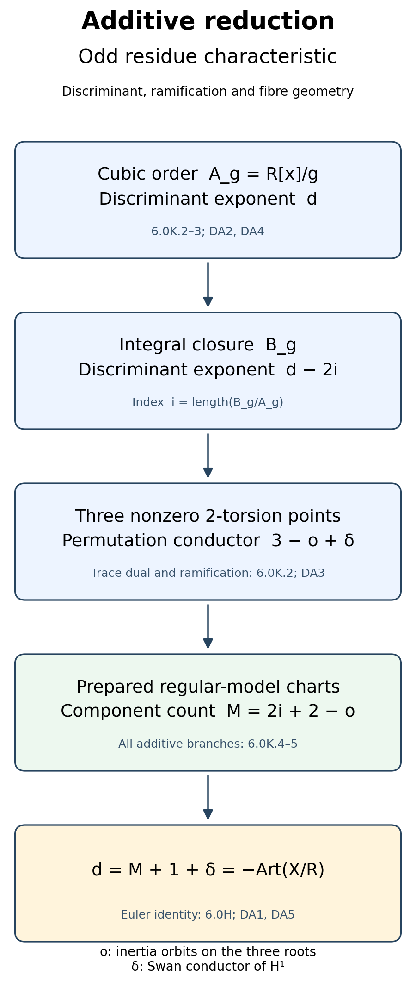

*Proof map for odd residue characteristic.* The index is \(i=\operatorname{length}(B_g/A_g)\), and \(o\) counts inertia orbits on the three roots; \(\delta\) is the Swan conductor of \(H^1\). The trace-matrix basis-change calculation also appears in the freely read [Milne course notes](https://www.jmilne.org/math/CourseNotes/ANT.pdf), Lemma 2.23; 6.0K.2 gives the specialized proof here. The component count is supplied by this lesson's written model charts, not by a conductor theorem.

### 6.0K.4. The seven short additive branches

The prepared coefficient bounds in Lemmas 6.0A--E and 6.0F give this exact table for (DA4). A star on a valuation means an indicated exact valuation; all unstarred bounds mean at least the number displayed.

| Branch | \(v(A),v(B),v(C)\) | \(i\) | \(o\) | Already constructed \(M\) |
|:--|:--|--:|--:|--:|
| \(II\) | \(1,1,1^*\) | 0 | 1 | 1 |
| \(III\) | \(1,1^*,2\) | 1 | 2 | 2 |
| \(IV\) | \(1,2,2^*\) | 1 | 1 | 3 |
| \(I_0^*\) | \(1,2,3\); \(g(\pi z)/\pi^3\) has separated reduction | 3 | 3 | 5 |
| \(IV^*\) | \(2,3,4^*\) | 3 | 1 | 7 |
| \(III^*\) | \(2,3^*,5\) | 4 | 2 | 8 |
| \(II^*\) | \(2,4,5^*\) | 4 | 1 | 9 |

Here are proofs of every index entry. An Eisenstein cubic gives a full DVR integral ring and one inertia orbit, so the first row has \(i=0,o=1\).

For the second row, solve \(g(\pi z)/\pi^2=0\) by the simple-root Hensel calculation: its reduction is linear with unit coefficient \(B/\pi\). This produces a root \(\rho\in\pi R\). Its quadratic factor is \(x^2+(A+\rho)x+(B+A\rho+\rho^2)\), which is Eisenstein. Its integral ring is therefore full and it has one inertia orbit. The order inside the product of this ring and \(R\) has index \(v(h(\rho))=1\), since \(h(\rho)=B+2A\rho+3\rho^2\) is \(\pi\) times a unit. Explicitly the cokernel of the map from the cubic order to \(R\oplus R[x]/h\) is \(R/(h(\rho))\), via the difference of the two evaluations. The kernel calculation is polynomial division by \(x-\rho\). Thus \(i=1,o=2\).

For the third row let \(\alpha\) be the class of \(x\) and put \(\beta=\alpha^2/\pi\). The characteristic polynomial of \(\beta\) has nonleading coefficients
\(-(A^2-2B)/\pi\), \((B^2-2AC)/\pi^2\), and \(-C^2/\pi^3\). They lie in \(\pi R\), and the last has valuation one. Hence this polynomial is Eisenstein, so \(K[\beta]\) is the entire degree-three algebra and its integral closure is \(R[\beta]\). The identity
\[
 \beta^2=\frac{A^2-B}{\pi}\beta
          +\frac{AB-C}{\pi^2}\alpha+\frac{AC}{\pi^2}
 \tag{DA6}
\]
has a unit coefficient of \(\alpha\), so \(1,\alpha,\beta\) is also an integral basis. Replacing its last vector by \(\alpha^2=\pi\beta\) gives index one. The cubic is a single totally ramified field, giving \(o=1\). This proves the third row without an assumption about tame ramification.

Scaling \(x=\pi z\) increases the order index by three: the bases \(1,x,x^2\) and \(1,z,z^2\) have inclusion determinant \(\pi^3\). In the fourth row the scaled cubic is finite etale and splits after a finite unramified extension, giving \(i=3,o=3\). In rows five, six and seven the scaled cubic has respectively the first, second and third row's coefficient bounds. Adding three to those indices proves all remaining entries. Completing the square preserves the stated exact valuations: in type \(IV\) or \(IV^*\), \(C=b_6/4\) has the exact valuation given by the separated terminal \(y\)-quadratic; in type \(III\) or \(III^*\), the additional term in \(B\) has higher valuation. This checks the table directly against the prepared tests, including at three.

Every row satisfies \(2i+2-o=M\). Equation (DA5) therefore gives \(d=M+1+\delta\) on these seven branches, as required by (DA1).

### 6.0K.5. Every \(I_n^*\) branch at odd residue characteristic

Use the exact terminal rows of Proposition 6.0G. Write \(a_1=\pi A_1\), \(a_2=\pi A_2\), \(A_2\) a unit, and \(r\ge2\). The odd row has
\(a_3=\pi^rA_3\), \(a_4=\pi^{r+1}A_4\), \(a_6=\pi^{2r}A_6\), with \(A_3^2+4A_6\) a unit, and \(n=2r-3\). The even row has
\(a_3=\pi^{r+1}B_3\), \(a_4=\pi^{r+1}B_4\), \(a_6=\pi^{2r+1}B_6\), with \(B_4^2-4A_2B_6\) a unit, and \(n=2r-2\).

Set \(H(z)=g(\pi z)/\pi^3=z^3+u z^2+s z+t\). Its reduction is \(z^2(z+\bar A_2)\). The simple unit root lifts to \(\rho\), and write \(H=(z-\rho)(z^2+c z+e)\). Then
\(e=-t/\rho\), \(c=(e-s)/\rho\), and \(h(\rho)\) is a unit, so this factorization splits the integral order as a product with \(R\).

In the odd row, \(v(t)=2r-3\) and \(v(s)\ge r-1\). Hence \(v(e)=2r-3\), \(v(c)\ge r-1\), and
\(v(D)=2r-3=n\) for \(D=c^2-4e\): the \(4e\) term has strictly smaller valuation. In the even row,
\(s/\pi^{r-1}\equiv B_4\), \(t/\pi^{2r-2}\equiv B_6\), \(\rho\equiv-A_2\), so
\[
 D/\pi^{2r-2}\equiv
 (B_4^2-4A_2B_6)/A_2^2\pmod\pi.
 \tag{DA7}
\]
It is a unit, proving \(v(D)=2r-2=n\). These calculations prove the relation to the written geometric index \(n\); they do not assume a discriminant valuation for that type.

For this quadratic factor put \(\theta=z+c/2\) and \(\gamma=\theta/\pi^{\lfloor n/2\rfloor}\). Then \(\gamma^2\) is a unit if \(n\) is even, and is \(\pi\) times a unit if \(n\) is odd. Its integral ring is respectively finite etale or an Eisenstein quadratic DVR. The quadratic order has index \(\lfloor n/2\rfloor\). Its inertia-orbit count is respectively two or one. Including the isolated cubic root and the original scaling gives
\[
 i=3+\lfloor n/2\rfloor,\qquad
 o=\begin{cases}3&n\text{ even},\\2&n\text{ odd}.\end{cases}
 \tag{DA8}
\]
Thus \(2i+2-o=n+5=M\), the actual component count of Proposition 6.0G. Equations (DA1) and (DA5) prove the target on every \(I_n^*\) in odd residue characteristic, including characteristic three.

For good reduction \(d=0\), and for multiplicative reduction Lemma 4.0 gives \(M=d\). Their Swan terms are zero. The Euler lemma and (DA1) therefore prove the target in those cases in every residue characteristic. Together with 6.0K.4--6.0K.5 this completes the proof for odd \(p\).

### 6.0K.6. Characteristic two: an exact finite-order reduction

Now let \(p=2\). The degree-four polynomial of nonzero 3-torsion \(x\)-coordinates and the quadratic for their \(y\)-coordinates give orders
\[
 \begin{aligned}
 q(x)&=x^4+(b_2/3)x^3+b_4x^2+b_6x+b_8/3,\\
 A_4&=R[x]/q,\\
 A_8&=A_4[y]/(y^2+(a_1x+a_3)y-x^3-a_2x^2-a_4x-a_6).
 \end{aligned}
 \tag{DA9}
\]
The standard division-polynomial calculation here can be checked directly: put \(h=4x^3+b_2x^2+2b_4x+b_6\) and \(\psi_3=3q\). In the generic field put \(w=2y+a_1x+a_3\), so \(w^2=h(x)\). At a point \(P=(x_0,w_0)\) with \(w_0\ne0\), its tangent is \(w=w_0+m(x-x_0)\), \(m=h'(x_0)/(2w_0)\). Subtracting its square from \(h(x)\) leaves zero constant and linear coefficients, and quadratic coefficient \(h''(x_0)/2-m^2\). It vanishes exactly when \(2hh''-(h')^2=16\psi_3=0\), the displayed polynomial identity obtained by multiplication. This is a triple intersection, equivalently \(2P=-P\) by the previously proved chord-and-tangent law. A point with \(w_0=0\) has a vertical tangent and is nonzero 2-torsion, so cannot be 3-torsion. Since \(\psi_3'=3h\), no root also has \(h=0\) on a smooth generic curve: their resultant below is nonzero. Thus the eight points counted by (DA9) are exactly \(E[3]-\{0\}\), and \(A_4\) counts their four sign pairs. Both generic algebras are separable, and the displayed orders are free of ranks four and eight.

Let \(B_4,B_8\) be their integral closures, \(i_j=\operatorname{length}(B_j/A_j)\), and \(\epsilon_j\) the codimension of inertia invariants of their permutation representations \(P_j\). We prove the order discriminants explicitly, avoiding any inverse of 2 in the final identities. At a root of \(h\), \(\psi_3=-(h')^2/16\). Since \(\operatorname{disc}(h)=16\Delta\), for its three roots \(a\) one has \(\prod_a h'(a)=-\operatorname{disc}(h)/4=-4\Delta\). The degree-four root-product resultant is consequently \(\operatorname{Res}(h,\psi_3)=4^4\prod_a[-h'(a)^2/16]=-\Delta^2\). Interchanging degrees three and four leaves its sign unchanged, so \(\operatorname{Res}(\psi_3,h)=-\Delta^2\). Normalizing by the unit 3 gives
\(\operatorname{Norm}_{A_4/R}(h)=-\Delta^2/27\).
Also \(q'=h\), so the same value is \(\operatorname{disc}(A_4/R)\). The rank-two algebra \(A_8/A_4\) has discriminant \(h\). Taking the trace matrix in a tensor basis gives the tower identity
\(\operatorname{disc}(A_8/R)=\operatorname{disc}(A_4/R)^2\operatorname{Norm}_{A_4/R}(h)\): after a separable splitting the relative two-by-two trace blocks have these determinants, and the base change-of-basis determinant occurs squared. Consequently
\[
 v(\operatorname{disc} A_4)=2d,\qquad
 v(\operatorname{disc} A_8)=6d.
 \tag{DA10}
\]
The intermediate divisions by 16 were identities in the generic characteristic-zero field and cancelled exactly; (DA10) loses no power of 2.

There is also a precise representation comparison. A finite 2-group acting on \(T_3E\) injects into \(\operatorname{SL}_2(\mathbf F_3)\), since the principal congruence kernel has no torsion of order prime to 3 by the same binomial argument as 6.0K.3. This group has order 24. Its eight-element Sylow 2-subgroup consists of \(\pm1\) and six determinant-one trace-zero matrices and is quaternion: for example \(i=\left(\begin{smallmatrix}0&1\\-1&0\end{smallmatrix}\right)\), \(j=\left(\begin{smallmatrix}1&1\\1&-1\end{smallmatrix}\right)\) satisfy \(i^2=j^2=-1\), \(ij=-ji\). Direct enumeration of first columns and determinant-one second columns gives the order 24. The noncentral six matrices square to \(-1\). The displayed eight form the subgroup generated by \(i,j\); it is normal because its description by trace zero and the two central matrices is invariant under conjugation. Its quotient has order three, so every 2-subgroup lies in it. Thus every nonidentity element fixes no nonzero vector; \(-1\) fixes all four sign pairs and an element of order four fixes none. On the rank-two characteristic-zero representation the respective traces are \(2,-2,0\), because the action has determinant one and the same finite orders. Hence on this wild subgroup the character identity is
\(P_8-P_4=2H^1(E_{\bar K},\mathbf Q_\ell)\).
Faithful good-model descent, or the scalar quadratic twist in the potentially multiplicative case, supplies the same order/kernel comparison for every permitted \(\ell\). Averaging this identity over each positive ramification group proves
\[
 2\delta=\operatorname{Sw}(P_8)-\operatorname{Sw}(P_4).
 \tag{DA11}
\]
Applying the proved finite-algebra formula (DA3), and then (DA2) and (DA10), gives
\[
 \delta=2d-i_8+i_4-\tfrac12(\epsilon_8-\epsilon_4).
 \tag{DA12}
\]
For additive reduction, the target \(d=M+1+\delta\) is consequently equivalent to the concrete integral-order assertion
\[
 i_8-i_4=d+M+1-\tfrac12(\epsilon_8-\epsilon_4).
 \tag{DA13}
\]
No calculation here proves (DA13). In particular these two order discriminants cannot be substituted for the discriminants of their integral closures: the indices can be nonzero, and their difference is exactly the remaining issue. A proof must compute this difference from the prepared all-characteristic model charts, or complete an independent conductor/intersection argument. The two directly computed examples in this lesson do not establish it for all equations.

### 6.0K.7. The precise remaining conductor comparison

The written trace-dual and integral-order calculations prove the discriminant–Artin equality for every odd residue characteristic, including wild characteristic three. Good and multiplicative reduction are also proved in residue characteristic two. Equation (DA13) isolates the remaining additive characteristic-two assertion; it is not being used as a proved integral-basis formula.

The freely accessible [Liu note, Section 3](https://www.math.u-bordeaux.fr/~qliu/Notes/Ogg-Saito.pdf) states the determinant-line discriminant–Artin comparison without proving it. Its elliptic reduction therefore cannot supply the missing proof here. A localized-intersection route would require actual proofs of the localized diagonal/Chern construction, ramified base-change and trace comparison, and the discriminant-to-localized-class comparison for these models. Sections 6.0AU–6.0AW prove the full critical algebra,structure-sheaf comparison and normalized differential map. Section 6.0AX constructs the localized coherent differential class and proves its original-discriminant comparison through every actual quadratic resolution centre,in every residue characteristic. Its identification with the actual Artin/Swan expression still requires a ramified trace proof;any Chow-valued Chern class used for that route also requires its identification with the coherent class. Section 6.0I already proves the separate minimal-model identification. The earlier prerequisite proofs remain required.


## 6.0L. Direct wild ramification for long prepared star fibres

### 6.0L.1. Actual earlier proof interfaces

Let \(K/\mathbf Q_2\) be finite, \(R=\mathcal O_K\), \(v(\pi)=1\), and \(e=v(2)\ge1\). Let \(E/K\) have a minimal integral equation
\[
 y^2+a_1xy+a_3y=x^3+a_2x^2+a_4x+a_6.
 \tag{DC1}
\]
Let \(X/R\) be its regular proper model, and \(M\) its number of geometric special-fibre components. Use the conductor and Artin-sign conventions of this lesson, not a new definition. Write \(d=v(\Delta_{\min})\), \(f=f_K(E)\), and \(\delta=\operatorname{Sw}(H^1(E_{\bar K},\mathbf Q_\ell))\), for \(\ell\ne2\).

The following earlier results are used under the hypotheses specified below.

* Lesson08 §1.1 supplies the integer invariant polynomials, coordinate transformation, and pointed isomorphism form. Its §3.0, Lemma 3.0, Lemma 4.0, and Theorem 4.1 supply the Tate series, uniformization, quadratic twist when \(v(j)<0\), and \(\chi\otimes\mathrm{Sp}(2)\). Only the generic quadratic-twist argument in the first paragraph of Lemma 4.0 is needed below; its later Néron interpretation is not needed to identify our character.
* Proposition 6.0G and its full proof §§6.0G.1–8 give \(M=n+5\) for either prepared row, properness, regularity, and the component incidences over \(R\). The arithmetic preparation is the earlier Lemma 6.0F; no preparation step is inferred from a conductor formula.
* Lemma 6.0H is an actual finite-coefficient normalization/Euler proof. For these additive models it proves
  \[
  -\operatorname{Art}(X/R)=M+1+\delta=M-1+f.
  \tag{DC2}
  \]
  It supplies no discriminant equality on its own.
* The earlier minimal-model Theorem 6.0I.9 with its 6.0I.1–8 proofs, identifies these constructed models as the unique minimal regular proper model. Its proof uses point-blowup elimination, factorization and the computed graph; it imports no conductor identity. This subsection uses that written argument.
* Sections 6.0K.2 and 6.0K.6, proves the finite-order discriminant/index formula and the characteristic-two 3-torsion permutation comparison used only in Section 6.0L.6. Their proofs appear earlier in this lesson.

The arguments below use the stated earlier programme proofs. The general rational-singularity and Bloch–Saito conductor theorems are not used.

### 6.0L.2. The bounded theorem

Assume the actual terminal preparation of this lesson, Proposition 6.0G:
\[
 a_1\in\pi R,\qquad a_2=\pi A_2,\qquad A_2\in R^\times,
\]
and one of the following rows, for \(r\ge2\).

| Row | Coefficient conditions | Separable residue test | \(n\) |
|:---|:---|:---|:---|
| Odd | \(a_3=\pi^rA_3,\ a_4\in\pi^{r+1}R,\ a_6\in\pi^{2r}R\) | \(T^2+\bar A_3T-\overline{a_6/\pi^{2r}}\) | \(2r-3\) |
| Even | \(a_3\in\pi^{r+1}R,\ a_4=\pi^{r+1}B_4,\ a_6\in\pi^{2r+1}R\) | \(\bar A_2T^2+\bar B_4T+\overline{a_6/\pi^{2r+1}}\) | \(2r-2\) |

Separable in characteristic two forces \(A_3\in R^\times\) in the odd row, and \(B_4\in R^\times\) in the even row. Put \(h=v(a_1)\), with \(h=\infty\) if \(a_1=0\), and
\[
 g=\min(2h,\,2e+1).
 \tag{DC3}
\]
In particular \(2\le g\le2e+1\).

**Theorem 6.0L.2.** If \(r\ge2g\), then
\[
 \begin{aligned}
 v(c_4)&=2g,&
 d&=n+4+2g,&
 v(j)&=4g-n-4<0,\\
 f_K(E)&=2g,&
 \delta&=2g-2,&
 d&=-\operatorname{Art}(X/R).
 \end{aligned}
 \tag{DC4}
\]
The quadratic splitting field is
\[
 K(\sqrt{b_2}),\qquad b_2=a_1^2+4a_2.
 \tag{DC5}
\]
It is the totally ramified Eisenstein extension obtained from \(T^2+a_1T-a_2\). The bound \(r\ge2g\) holds for every prepared index \(n\ge8e+1\), since then the relevant \(r\) is at least \(4e+2\ge2g\).

Here is the mechanism, with both branches and their proof locators.

~~~text
                       minimal prepared equation, r >= 2g
                            /                       \
          integer invariant polynomials          T² + a1 T - a2
          (6.0L.3: no cancellation)          (6.0L.4: Eisenstein)
                    |                                      |
             d = n + 4 + 2g                    lower groups G0,...,G(g-1)=C2
                    |                                      |
       fibre graph: M = n + 5                   Sw(χ) = g - 1
       (this lesson Proposition 6.0G)                         |
                    |                           χ ⊗ Sp(2): f = 2g
                    \                         /
                     d = M - 1 + f = -Art(X/R)
                          (6.0L.5 and Lemma 6.0H)
~~~

The diagram records the two independent calculations. The vertical groups on its right are lower-numbered groups of the *quadratic* extension, not the full torsion splitting field. The component count on its left is geometric and includes all \(n+1\) doubled-chain components and four multiplicity-one leaves.

### 6.0L.3. Exact valuation calculation

Use the integer formulas
\[
\begin{aligned}
 b_2&=a_1^2+4a_2,& b_4&=a_1a_3+2a_4,& b_6&=a_3^2+4a_6,\\
 b_8&=a_1^2a_6+4a_2a_6-a_1a_3a_4+a_2a_3^2-a_4^2,\\
 c_4&=b_2^2-24b_4,&
 c_6&=-b_2^3+36b_2b_4-216b_6,\\
 \Delta&=-b_2^2b_8-8b_4^3-27b_6^2+9b_2b_4b_6.
\end{aligned}
\tag{DC6}
\]
The two terms of \(b_2\) have valuations \(2h\) and \(2e+1\), of different parity. They cannot cancel; therefore \(v(b_2)=g\).

Put \(u=\min(h,e+1)\) and \(w=\min(h,e)\), so \(u,w\ge1\). The prepared bounds give
\[
\begin{array}{c|ccc}
 &v(b_4)&v(b_6)&v(b_8)\\ \hline
 \text{odd}&\ge r+u&=2r&=2r+1\\
 \text{even}&\ge r+1+w&\ge2r+2&=2r+2.
\end{array}
\tag{DC7}
\]
Every equality in this table has a unique smallest term. In the odd row \(a_3^2\) gives the \(b_6\) equality. For \(b_8\), the term \(a_2a_3^2\) has valuation \(2r+1\); the other four terms have valuation at least \(2r+2\). In the even row the term \(-a_4^2\) has valuation \(2r+2\); the other four have valuation at least \(2r+3\). Thus these equalities hold for every coefficient choice satisfying the row, not just for generic choices.

For \(r\ge2g\), \(v(24b_4)=3e+v(b_4)>2g\). Hence \(v(c_4)=2g\). The first term of \(\Delta\) has valuation
\[
 d_0=2g+v(b_8)=n+4+2g.
\]
The other three terms have the following lower bounds:
\[
\begin{array}{c|ccc}
 &v(8b_4^3)&v(27b_6^2)&v(9b_2b_4b_6)\\ \hline
 \text{odd}&\ge3e+3r+3u&=4r&\ge g+3r+u\\
 \text{even}&\ge3e+3r+3+3w&\ge4r+4&\ge g+3r+3+w .
\end{array}
\tag{DC8}
\]
Subtract \(d_0\) from these bounds. In the odd row the three differences are at least
\[
 3e+3u-1,\qquad 2g-1,\qquad g+u-1;
\]
in the even row they are at least
\[
 3e+1+3w,\qquad 2g+2,\qquad g+1+w.
\]
All are positive. Thus the first discriminant term uniquely dominates, and \(d=d_0\). Finally
\[
 v(j)=3v(c_4)-d=4g-n-4.
\]
If the row is odd, \(r\ge2g\) gives \(n=2r-3\ge4g-3\), hence \(v(j)\le-1\). If even, \(n\ge4g-2\), hence \(v(j)\le-2\). This proves the invariant assertions of DC4 without using any conductor formula.

### 6.0L.4. The quadratic character and its ramification

**Square-unit lemma.** If \(z\in R\) has \(v(z)>2e\), then \(1+z\) is a square in \(R^\times\).

*Proof.* Start at \(s_0=1\) in \(s^2-(1+z)=0\). If \(v(s_i^2-(1+z))=m_i>2e\), set
\[
 s_{i+1}=s_i-\frac{s_i^2-(1+z)}{2s_i}.
\]
The increment has valuation \(m_i-e>e\), so \(s_{i+1}\) is a unit. Its new error is exactly the square of that increment, of valuation \(2(m_i-e)>m_i\). These increasing integer error valuations tend to infinity; the increments tend to zero. Completeness gives a unit limit whose square is \(1+z\). If an error is zero the iteration already terminates. ∎

From DC6,
\[
 -c_6=b_2^3
 \left(1-36\frac{b_4}{b_2^2}
              +216\frac{b_6}{b_2^3}\right).
 \tag{DC9}
\]
Both correction terms in the parentheses have valuation greater than \(2e\). For the first, DC7 and \(r\ge2g\) give at least \(2e+u\) in the odd row and \(2e+1+w\) in the even row. For the second they give at least \(3e+g\) and \(3e+g+2\), respectively. The square-unit lemma therefore gives
\[
 [-c_6]=[b_2^3]=[b_2]\quad\text{in }K^\times/K^{\times2}.
 \tag{DC10}
\]

We identify this square class with the actual Tate-twist character. The earlier proved Tate equation is \(y^2+xy=x^3+A_4x+A_6\), where
\[
 A_4=-5S_3(Q),\qquad
 A_6=-(5S_3(Q)+7S_5(Q))/12 .
\]
Its integer invariant calculation gives
\[
 c_6(E_Q)=-1+504S_5(Q).
 \tag{DC11}
\]
Indeed \(b_2=1,\ b_4=2A_4,\ b_6=4A_6\), and the \(S_3\) terms cancel in DC6. The convergent series \(S_5(Q)\) has valuation at least \(v(Q)>0\), and \(v(504)=3e\). Thus \(-c_6(E_Q)\) is a square by the square-unit lemma.

By \(v(j)<0\) and the generic argument of Lemma 4.0, a pointed isomorphism from \(E_Q\) to \(E\) exists with leading parameter \(s\), and its Galois conjugates differ by \(s\mapsto\pm s\). Consequently \(s^2\in K\), and the sign character is the character of \(K(s)/K\). The invariant scaling is \(c_6(E)=s^6c_6(E_Q)\), the same homogeneous substitution used for \(c_4,\Delta\) in §1.1. Since \(-c_6(E_Q)\) is a square, the character's class is \([-c_6(E)]=[b_2]\). This proves DC5.

We now calculate its ramification without a quadratic conductor table. Let
\[
 p(T)=T^2+a_1T-a_2,\qquad \beta\text{ a root}.
 \tag{DC12}
\]
The polynomial is Eisenstein. Here is the complete quadratic argument without requiring a valuation-extension theorem. A putative root in \(K\) would have to have valuation \(1/2\): a value below \(1/2\) makes its square the unique smallest term in DC12, and a value above \(1/2\) makes \(-a_2\) the unique smallest term. Valuations in \(K\) are integral, so there is no such root. A quadratic without a root is irreducible.

The finite free domain \(S=R[\beta]\) has residue algebra \(k[T]/T^2\). It is local, with maximal ideal \((\pi,\beta)\): an element outside that ideal has unit norm and its adjugate supplies an inverse in \(S\). Writing \(a_1=\pi A_1,\ a_2=\pi A_2\) gives
\[
 \beta^2=\pi(A_2-A_1\beta).
 \tag{DC13}
\]
The parenthesis is a unit, so the maximal ideal is \((\beta)\). Every nonzero element has a finite order in that ideal. To check finiteness directly, \(S\) is free over the complete DVR and \(\beta^{2m}\) is a unit times \(\pi^m\), so \(\bigcap_m\beta^m S=0\). Repeated division by \(\beta\) thus expresses a nonzero element as a unit times a power of \(\beta\). This proves that \(S\) is a DVR. A fraction of negative \(\beta\)-valuation cannot satisfy a monic integral equation, since its highest power would have the unique smallest valuation. Hence \(S\) is integrally closed and is the full ring of integers of \(L=K(\beta)\). Equation DC13 gives ramification index two and unchanged residue field.

The two roots are \(\beta\) and \(-a_1-\beta\). In characteristic zero,
\[
 (2\beta+a_1)^2=b_2,
\]
so \(L=K(\sqrt{b_2})\), as required. Normalize \(v_L(\beta)=1\), so \(v_L|_K=2v\). For the nontrivial automorphism \(\sigma\),
\[
 v_L(\sigma\beta-\beta)
 =v_L(-a_1-2\beta)
 =\min(2h,2e+1)=g.
 \tag{DC14}
\]
Again the two possible finite valuations have different parity. Every integral element is \(a+b\beta\), \(a,b\in R\), and
\[
 \sigma(a+b\beta)-(a+b\beta)=b(\sigma\beta-\beta).
\]
Its movement has valuation at least \(g\), with equality for \(\beta\). Thus, by the intrinsic definition of the lower ramification groups,
\[
 G_i=C_2\quad(0\le i\le g-1),\qquad G_i=1\quad(i\ge g).
 \tag{DC15}
\]
For the nontrivial character \(\chi\), every nontrivial group's invariant codimension is one. The lower-group conductor sum therefore gives
\[
 a(\chi)=g,\qquad \operatorname{Sw}(\chi)=g-1.
 \tag{DC16}
\]
In particular \(\chi\) is ramified. No Hilbert-different equality or elliptic discriminant theorem was needed for this calculation.

### 6.0L.5. Completion of the bounded equality

The previously proved Tate-module pair is \(\chi\otimes\mathrm{Sp}(2)\). On positive wild groups its monodromy character is trivial: the Tate monodromy map takes values in the pro-\(\ell\) additive group, while wild inertia is pro-2. A continuous image which is simultaneously pro-2 and pro-\(\ell\), \(\ell\ne2\), is trivial, by taking its finite quotients. The finite smooth representation has two lines with the same inertia character \(\chi\). Its Swan conductor, and that of its dual, is consequently \(2\operatorname{Sw}(\chi)=2g-2\).

The ramified scalar character has no inertia invariant vector or invariant monodromy-kernel vector. The defining Weil–Deligne conductor formula, written in this lesson (16), thus gives
\[
 f=2+2(g-1)=2g.
 \tag{DC17}
\]
This is a representation calculation; it does not deduce \(f\) from \(d\). Independently the graph proof gives \(M=n+5\), while Section 6.0L.3 gave \(d=n+4+2g\). Hence
\[
 d=M-1+f.
\]
Apply the already written Euler equality DC2 to obtain \(d=-\operatorname{Art}(X/R)\). The minimal-model identification from 6.0I.9 supplies the stated interpretation of \(X\). This proves Theorem 6.0L.2.

All computations are over the original \(R\). The separated residue quadratics may require an unramified extension for the geometric graph drawing; Proposition 6.0G and Lemma 6.0U already prove descent. Such an extension changes neither \(e,h,g,d\) nor the quadratic lower groups and conductor. No extension killing wild inertia was used as an unramified extension.

### 6.0L.6. The exact problem still open for the other additive equations

Use the earlier written calculation of Sections 6.0K.2 and 6.0K.6. Put
\[
\begin{aligned}
 q(x)&=x^4+(b_2/3)x^3+b_4x^2+b_6x+b_8/3,\\
 A_4&=R[x]/q,\\
 A_8&=A_4[y]/(y^2+(a_1x+a_3)y-x^3-a_2x^2-a_4x-a_6).
\end{aligned}
\tag{DC18}
\]
These are orders in the finite separable algebras of the four nonzero 3-torsion sign pairs and the eight nonzero 3-torsion points. Write \(B_j\) for their integral closures, \(i_j=\operatorname{length}_R(B_j/A_j)\), and \(\epsilon_j=\dim P_j-\dim P_j^I\) for their permutation representations. Section 6.0K.6 proves, by actual resultants and a wild quaternion character calculation, that
\[
 \delta=2d-i_8+i_4-\frac{\epsilon_8-\epsilon_4}{2}.
 \tag{DC19}
\]
Together with the Euler proof, the full remaining additive assertion is exactly
\[
 i_8-i_4=d+M+1-\frac{\epsilon_8-\epsilon_4}{2}.
 \tag{DC20}
\]
This is an equivalence, not a proof of its right-hand index calculation.

There is a useful additional normalization-tower reduction which requires no conductor theorem. Inside the rank-eight generic algebra put \(C=B_4[y]\), using the same monic quadratic as in DC18. Then
\[
 A_8\subset C\subset B_8,\qquad
 k=\operatorname{length}_R(B_8/C),\qquad i_8=2i_4+k.
 \tag{DC21}
\]
Indeed \(A_8=A_4\oplus A_4y\) and \(C=B_4\oplus B_4y\), so \(C/A_8\) is two copies of \(B_4/A_4\). The integral closure B₄ itself is finite free over \(R\); hence \(C\) is finite free over \(R\). For each element of \(C\), Cayley–Hamilton applied to its multiplication matrix supplies a monic equation over \(R\). Thus \(C\subset B_8\), by the definition of integral closure. All lattices are full, so the lengths are finite and add in the displayed inclusions.

For completeness this also respects the discriminants, rather than treating a nonnormal order as its normalization. The quadratic discriminant is
\[
 H(x)=4x^3+b_2x^2+2b_4x+b_6 .
\]
Section 6.0K.6 proves \(v(\operatorname{Norm}H)=2d\) and \(v(\operatorname{disc}A_4)=2d\). Its trace-matrix tower calculation and the DVR index calculation in Section 6.0K.2 therefore give
\[
 \begin{aligned}
 v(\operatorname{disc}B_4)&=2d-2i_4,\\
 v(\operatorname{disc}C)&=2(2d-2i_4)+2d=6d-4i_4,\\
 v(\operatorname{disc}B_8)&=6d-4i_4-2k.
 \end{aligned}
 \tag{DC22}
\]
This is consistent with \(i_8=2i_4+k\). Equation DC20 is thus equivalently the two-stage integral-basis target
\[
 i_4+k=d+M+1-\frac{\epsilon_8-\epsilon_4}{2}.
 \tag{DC23}
\]
Neither the resultant calculation nor the quadratic tower calculation determines \(i_4+k\) for a general prepared equation.

For the ramified quadratic Tate twists of Theorem 6.0L.2, wild inertia acts by \(\pm1\) on \(E[3]\), since its pro-2 monodromy is trivial as above. The ramified character of the totally ramified quadratic extension is nontrivial on wild inertia, so its image contains \(-1\). Full inertia can also have tame unipotent action on \(E[3]\). Its containing \(-1\) suffices: each orbit on the four sign pairs lifts to exactly one orbit on the eight points, because the two elements of any pair already belong to the same orbit. The orbit counts are equal, giving \(\epsilon_8-\epsilon_4=4\). Substituting the *already independently computed* \(d=n+4+2g,\ \delta=2g-2\) into DC19 gives the checked index difference
\[
 i_8-i_4=i_4+k=2n+8+2g=d+M-1.
 \tag{DC24}
\]
This proves DC20 for that infinite family through a direct ramification argument. It supplies no integral-basis result for the remaining potentially good families or shorter \(I_n^*\) preparations.

### 6.0L.7. Exact unresolved scope and primary-source boundary

The theorem's scope is explicit: the new direct proof covers either prepared \(I_n^*\) row when \(r\ge2g\), uniformly every \(n\ge8e+1\). Good and multiplicative reduction in characteristic two are already proved in Section 6.0K.5. The full requested additive scope still includes every other terminal equation: all potentially good additive families and those \(I_n^*\) preparations with \(r<2g\). Even where one of the already worked examples settles an individual curve, no general closure for its family is asserted here. Section 6.0M below supplies the further short-odd and terminal-even calculation; its last subsection states the still-open branches.

To finish through the finite-order route, one must actually prove DC23 for each remaining prepared branch, with normalization over the relevant complete DVRs and the true ramification/tame orbit terms. Proving the order resultants, giving Newton polygons without an integral-basis argument, or checking numerical curves does not prove that index statement. An alternative must actually reconstruct the specialized localized-intersection/trace identity which connects the discriminant to the Swan term; a citation to its general statement is insufficient.

The freely accessible [Liu note, §§1–4](https://www.math.u-bordeaux.fr/~qliu/Notes/Ogg-Saito.pdf), explains the elliptic reduction and states the discriminant–Artin equality in §3 without its proof. The original small-residue-characteristic gap is also stated there. The [Eriksson author draft, pp.9–16](https://www.math.chalmers.se/~dener/Multiplicity-of-discriminants-revision-Oct-7-2013.pdf) computes discriminant multiplicities using further ingredients; its elliptic comparison on p.15 invokes the general conductor theorem. DC20 requires the additional comparison arguments specified below. An alternative localized-intersection route requires the actual specialized trace and discriminant comparison proofs described in Section 6.0K.7.

The square-unit, invariant valuation, Eisenstein DVR, lower-group, character-class and tower-index arguments above are written here in full. Their use of the actual earlier Tate, model, Euler and permutation proofs is delimited in Section 6.0L.1. No general normalized relative-dualizing-functor comparison is used. The full wild characteristic-two discriminant–Artin theorem remains open beyond the bounded theorem; its statement and requested scope are retained.

## 6.0M. Explicit normalization of the remaining odd star fibres

**Proposition 6.0M (all odd star indices and the terminal even boundary).** The full target is \(v(\Delta_{\min})=-\operatorname{Art}(X/R)\) for every additive elliptic curve over every finite extension of \(\mathbf Q_2\). This fragment continues that task. It gives actual integral bases for every short *odd* prepared \(I_n^*\) branch and proves its equality; together with the preserved earlier fragment this settles every positive odd \(n\). It also settles the even boundary \(r=2g-1\). The other even branches and the other potentially good additive families remain in the requested scope and are explicitly unresolved here.

### 6.0M.1. Interfaces and notation

Let \(K/\mathbf Q_2\) be finite, \(R=\mathcal O_K\), \(v(\pi)=1\), \(e=v(2)\). Start from a minimal integral equation
\[
 y^2+a_1xy+a_3y=x^3+a_2x^2+a_4x+a_6.
 \tag{SR1}
\]
Its integer invariants have the convention of this lesson (19). Put \(d=v(\Delta)\), and let \(M\) be the geometric component count of the constructed regular model.

We use the proofs in the preceding characteristic-two argument in Section 6.0L: this lesson's invariant/chord calculations, all prepared graph charts in Proposition 6.0G, the minimal-model identification in Theorem 6.0I.9, the Euler argument in Lemma 6.0H, and Sections 6.0K.2 and 6.0K.6 of the discriminant fragment. Their precise content is necessary: Section 6.0K.6 proves the 3-torsion orders
\[
\begin{aligned}
 q(x)&=x^4+(b_2/3)x^3+b_4x^2+b_6x+b_8/3,\\
 A_4&=R[x]/q,\\
 A_8&=A_4[y]/(y^2+(a_1x+a_3)y-x^3-a_2x^2-a_4x-a_6),
\end{aligned}
\tag{SR2}
\]
their order-discriminant valuations \(2d,6d\), and the exact identity
\[
 \delta=2d-i_8+i_4-\frac{\epsilon_8-\epsilon_4}{2}.
 \tag{SR3}
\]
Here \(B_j\) denotes the integral closure, \(i_j=\operatorname{length}_R(B_j/A_j)\), and \(\epsilon_j\) is the inertia invariant codimension of the permutation representation. Section 6.0K.2 supplies the actual trace-dual, different tower and order-index proofs. None is a citation to an elliptic conductor theorem.

The earlier lesson *Profinite groups and ℓ-adic representations*, Proposition 0E.1, proves uniqueness of the extended valuation, the full integral closure, completeness and \([L:K]=ef\). Its Lemma 0D.1 proves Hensel lifting over complete rings; Lemma 0F.1 and Proposition 0F.2 prove finite residue-field and unramified lifting assertions. Sections 0G.2–4 now give the full Eisenstein and monogenic integral-ring arguments. We use these written proofs at their exact finite-separable, finite-residue-field scope.

A finite unramified extension does not change \(d,M,\delta\) or the indices in SR3. The discriminant fragment Section 6.0K.1 writes the normalization and length base-change argument; the geometric descent is Lemma 6.0U. We may therefore adjoin a primitive cube root of unity \(\zeta\). Its polynomial \(T^2+T+1\) is separable modulo 2, so the extension is unramified (or trivial). Put
\[
 c=1+2\zeta,\qquad c^2=-3,\qquad v(c)=0,\qquad v(3+c)=e.
 \tag{SR4}
\]
The last equality follows from \(3+c=2(2+\zeta)\) and the unit residue of \(2+\zeta\).

### 6.0M.2. All odd prepared rows: invariant valuations before normalization

Take the odd row, for \(r\ge2\):
\[
\begin{gathered}
 a_1\in\pi R,\qquad a_2/\pi\in R^\times,\qquad
 a_3/\pi^r\in R^\times,\\
 a_4\in\pi^{r+1}R,\qquad a_6\in\pi^{2r}R,\qquad n=2r-3.
\end{gathered}
\tag{SR5}
\]
The unit \(a_3/\pi^r\) is exactly the separated characteristic-two terminal test, not an extra hypothesis. Put \(h=v(a_1)\), allowing \(h=\infty\), and
\[
 g=\min(2h,2e+1),\qquad u=\min(h,e+1).
 \tag{SR6}
\]
Then
\[
 v(b_2)=g,\quad v(b_4)\ge r+u,\quad
 v(b_6)=2r,\quad v(b_8)=2r+1.
 \tag{SR7}
\]
The equalities have unique smallest terms, exactly as proved in Section 6.0L.3 of the preceding Section 6.0L. The same calculation now applies without its long-branch bound.

In fact \(v(c_4)=2g\) for every \(r\ge2\). If \(h\le e\), then \(g=2h,u=h\), and
\[
 v(24b_4)-2g\ge3(e-h)+r>0.
\]
If \(h\ge e+1\), including \(h=\infty\), then \(g=2e+1,u=e+1\), and the difference is at least \(r-1>0\).

The discriminant calculation is also exact in both ranges:
\[
 d=
 \begin{cases}
 4r,&2\le r\le g,\\
 2g+2r+1,&r\ge g+1.
 \end{cases}
 \tag{SR8}
\]
For \(r\le g\), the term \(-27b_6^2\) has valuation \(4r\). The other three have excess at least
\[
 2g-2r+1,\qquad 3e+3u-r,\qquad g+u-r,
\]
respectively. The first and third are positive. The middle is positive as well: \(3e+3u-g>0\), by either of the two cases just used. Thus no cancellation is possible. For \(r\ge g+1\), the term \(-b_2^2b_8\), of valuation \(2g+2r+1\), is uniquely smallest. The excesses of the other terms are at least
\[
 3e+3u-g,\qquad 1,\qquad u,
\]
where the first follows by \(r\ge g+1\). This proves SR8.

### 6.0M.3. An actual integral basis of the short odd quartic

Assume now
\[
 2\le r\le2g-1.
 \tag{SR9}
\]
Write \(m=2r+1\), so \(m\) is odd. All nonendpoint coefficient points of \(q\) lie strictly above the line from \((0,m)\) to \((4,0)\):
\[
 2r>\frac{3m}{4},\qquad
 r+u>\frac m2,\qquad g>\frac m4.
 \tag{SR10}
\]
The last inequality is SR9. There is no unproved Newton-polygon output here: a putative root of valuation less than \(m/4\) makes its fourth power uniquely smallest, and a root of valuation greater than \(m/4\) makes the constant term uniquely smallest. Thus every root has valuation \(m/4\).

If a root's minimal polynomial has degree \(s\), all its conjugates have that valuation by uniqueness of the extended valuation. Its constant coefficient has valuation \(sm/4\), an integer. Since \(\gcd(m,4)=1\), \(4\mid s\). The degree is at most four, so \(q\) is irreducible. Put \(L=K(x)\). Its value group contains \(m/4\); hence its ramification index is at least four. The proved degree identity forces \(e(L/K)=4,\ f(L/K)=1\). Normalize \(v_L|_K=4v\).

The full integral ring has the explicit basis
\[
 B_4=
 \bigoplus_{j=0}^3 R\,\frac{x^j}{\pi^{\lfloor jm/4\rfloor}}.
 \tag{SR11}
\]
Indeed every field element has a unique expression \(\sum_{j=0}^3d_jx^j\), \(d_j\in K\). The four term valuations \(4v(d_j)+jm\) have different classes modulo four. Therefore the least is unique and cannot cancel. An element has nonnegative valuation if and only if all four do, which is equivalent to \(d_j\pi^{\lfloor jm/4\rfloor}\in R\). The valuation-ring/integral-closure proof of Proposition 0E.1 identifies precisely this lattice with \(B_4\).

It follows that
\[
 i_4=\sum_{j=1}^3\left\lfloor\frac{jm}{4}\right\rfloor=3r,\qquad
 D_4:=v(\operatorname{disc}B_4)=2d-6r.
 \tag{SR12}
\]
For the floor sum, the residues of \(m,2m,3m\) modulo four are \(1,2,3\) in some order; subtract their sum six from \(6m\) and divide by four. The discriminant identity is the actual order-index formula Section 6.0K.2.

Choose a uniformizer \(\tau\) of \(L\). One can choose it explicitly: take \(a\in\{1,3\}\) with \(am\equiv1\pmod4\), put \(b=(am-1)/4\), and set \(\tau=x^a/\pi^b\). It has valuation one. Thus SR11 does not depend on an assumed power-basis generator being a uniformizer.

### 6.0M.4. The tangent slope gives an Eisenstein quadratic over that quartic

The full point algebra over \(L\) can be described by its tangent slope \(z\):
\[
 z^2+a_1z-a_2-3x=0.
 \tag{SR13}
\]
Here is its identification with SR2. At a nonzero 3-torsion point the tangent line has triple contact. Substituting its line in SR1 makes the \(x^2\)-coefficient equal to that of \((X-x)^3\), giving SR13. Conversely its two slope values correspond to the two point values. More explicitly,
\[
 (2z+a_1)y
 =3x^2+2a_2x+a_4-z(a_1x+a_3).
 \tag{SR14}
\]
Its denominator is nonzero. The discriminant of SR13 is \(b_2+12x\), and its two summands have valuations \(4g\) and \(8e+m\) in \(L\); the latter is larger. If \(g=2h\le2e\) this is immediate; if \(g=2e+1\), their difference is \(m-4>0\). Also the identity
\[
 (b_2+12x)H(x)-(6x^2+b_2x+b_4)^2=4\psi_3(x)
 \tag{SR15}
\]
holds by multiplication, with \(H=4x^3+b_2x^2+2b_4x+b_6\), \(\psi_3=3q\). The right side vanishes, and \(H(x)\ne0\) by Section 6.0K.6's nonzero resultant. Thus the two quadratic descriptions really are isomorphic. This checks generic separability and the point-field interpretation before using any integral basis.

Put
\[
 z_0=\frac{cx^2+a_4}{a_3}.
 \tag{SR16}
\]
It is integral, of \(L\)-valuation two: \(cx^2\) has valuation \(2m=4r+2\), whereas \(a_4\) has valuation at least \(4r+4\), and \(a_3\) has valuation \(4r\).

There is an exact reduction identity for its error:
\[
\begin{aligned}
 E_0&=z_0^2+a_1z_0-a_2-3x\\
 &=\frac{b_2x^3+(3+c)b_4x^2+12a_6x+b_2a_6}{a_3^2}.
\end{aligned}
\tag{SR17}
\]
To verify it, multiply the first line by \(a_3^2\), insert \(c^2=-3\), and replace \(-3x^4\) using \(\psi_3(x)=0\). The \(a_4^2\) terms cancel, and \(3b_4+2ca_4+ca_1a_3=(3+c)b_4\). No leading terms are omitted.

The first term on its second line has valuation
\[
 k_0=4g-2r+3.
 \tag{SR18}
\]
The other three have lower bounds, in order,
\[
 4(e+u)+2,\qquad 8e+2r+1,\qquad 4g.
 \tag{SR19}
\]
All are strictly larger than \(k_0\). For the first bound, if \(g=2h,u=h\), its excess is \(4(e-h)+2r-1>0\); if \(g=2e+1,u=e+1\), its excess is \(2r-1>0\). For the second, its excess is at least \(4r-6>0\), since \(g\le2e+1\). For the last, it is \(2r-3>0\). Therefore SR18 is the *exact* error valuation. In particular it is positive and odd.

The coefficient of \(z-z_0\) after that shift is \(a_1+2z_0\). Its two summands have valuations \(4h\) and \(4e+2\), of different classes modulo four. Hence
\[
 v_L(a_1+2z_0)=2g.
 \tag{SR20}
\]
Set
\[
 \ell_0=2g-r+1,\qquad \eta=\frac{z-z_0}{\tau^{\ell_0}}.
\]
Substitution of SR17 in SR13 gives
\[
 \eta^2+\frac{a_1+2z_0}{\tau^{\ell_0}}\eta
              +\frac{E_0}{\tau^{2\ell_0}}=0.
 \tag{SR21}
\]
Its constant has valuation one, since \(k_0=2\ell_0+1\); its linear coefficient has valuation \(r-1\ge1\). It is Eisenstein over \(B_4\).

The quadratic DVR proof of the preserved Section 6.0L.4, applied over the complete DVR \(B_4\), consequently gives
\[
 B_8=B_4[\eta],\qquad [K(E[3]\text{ point}):L]=2,
\]
with ramification index two and residue degree one. To make the different calculation equally explicit, its trace coefficient has \(L\)-valuation \(r-1\), while \(v_L(2)=4e\). The derivative \(2\eta+(a_1+2z_0)/\tau^{\ell_0}\) has upper-field valuation
\[
 \min(8e+1,\,2r-2)=2r-2,
\]
since \(r\le2g-1\le4e+1\). The trace-dual calculation Section 6.0K.2 for a monogenic integral ring gives this as the relative different exponent. Thus
\[
 D_8:=v(\operatorname{disc}B_8)=2D_4+2r-2.
 \tag{SR22}
\]
This uses the actual different tower and residue-degree length formula from Section 6.0K.2, with both residue degrees equal to one. It does not identify an order's different with that of its normalization.

### 6.0M.5. Index difference and the equality for every positive odd index

Both point fields just constructed are totally ramified, of degrees four and eight. Their inertia permutation representations are transitive. Therefore
\[
 \epsilon_4=3,\qquad\epsilon_8=7.
 \tag{SR23}
\]
From SR12, SR22 and the order discriminants,
\[
 \begin{aligned}
 i_8&=\frac{6d-D_8}{2}=d+6r-(r-1),\\
 i_8-i_4&=d+2r+1.
 \end{aligned}
 \tag{SR24}
\]
Proposition 6.0G computes \(M=2r+2\) in this odd row. Thus
\[
 i_8-i_4=d+M-1
       =d+M+1-\frac{\epsilon_8-\epsilon_4}{2}.
 \tag{SR25}
\]
This is the actual normalization target DC20, proved by the two integral bases rather than inferred from the desired conductor theorem. Formula SR3 now gives
\[
 \delta=d-2r-3,\qquad f=d-2r-1.
 \tag{SR26}
\]
Together with SR8, this is
\[
 \begin{array}{c|cc}
 &\delta&f\\ \hline
 2\le r\le g&2r-3&2r-1\\
 g+1\le r\le2g-1&2g-2&2g.
 \end{array}
 \tag{SR27}
\]
The separate Euler proof gives \(-\operatorname{Art}=M+1+\delta=d\). The minimal-model proof 6.0I.9 gives the required interpretation of \(X\). Unramified descent preserves all quantities, so the result holds over the original \(K\).

For \(r\ge2g\), the earlier Theorem 6.0L.2 already proves the same equality with \(f=2g\). Consequently every prepared odd row \(r\ge2\), equivalently every positive odd index \(n=2r-3\), is now covered. No bound on \(e\) or \(h\) has been imposed.

Here is the exact normalization mechanism; labels are valuations in the named fields.

~~~text
 R[x]/q  ----------------------->  B4 = OL
 order rank 4                       [L:K]=4, e=4, f=1
                                    basis x^j/pi^floor(j(2r+1)/4)
                                    index i4=3r
                                            |
                                            | tangent-slope quadratic
                                            | z²+a1 z-a2-3x=0
                                            v
                         z0=(c x²+a4)/a3, vL(error)=4g-2r+3
                         eta=(z-z0)/tau^(2g-r+1)
                                            |
                                            | Eisenstein: constant vL=1
                                            | trace coefficient vL=r-1
                                            v
                         B8=B4[eta], relative different 2r-2
                                            |
                  i8-i4=d+2r+1=d+M-1  ->  d=-Art(X/R)
~~~

This diagram is restricted to \(2\le r\le2g-1\), the range proved in Sections 6.0M.3–5. Its last implication uses the already written finite-order and Euler arguments, not a general conductor theorem.

### 6.0M.6. The short even boundary \(r=2g-1\)

In the even prepared row assume \(r=2g-1\):
\[
 a_3\in\pi^{r+1}R,\quad a_4/\pi^{r+1}\in R^\times,\quad
 a_6\in\pi^{2r+1}R,\quad n=2r-2.
 \tag{SR28}
\]
The remaining \(a_1,a_2,g\) conditions are the same. Put \(w=\min(h,e)\). As before,
\[
 v(b_4)\ge r+1+w,\quad v(b_6)\ge2r+2,\quad
 v(b_8)=2r+2.
\]
For any \(r\ge g\) the leading discriminant term is uniquely \(-b_2^2b_8\): the excesses of the other terms are at least \(3e+1+3w-g,\ 2,\ 1+w\), all positive. Also \(v(24b_4)>2g\); the same two \(h\)-cases used in Section 6.0M.2 verify that even without \(r\ge g\). Consequently at this boundary
\[
 v(c_4)=2g,\qquad d=6g,\qquad v(j)=0.
 \tag{SR29}
\]

The square-unit argument of Section 6.0L.4 applies to \(-c_6/b_2^3\) here as well. Its two corrections have valuations at least \(2e+w>2e\) and \(3e+g>2e\). Thus \([-c_6]=[b_2]\).

We construct an actual good curve with this same unit \(j=J\). Solve
\[
 t+432t^2=-J^{-1}
\]
in \(R\). The residue solution is unique and its derivative \(1+864t\) is a unit, so the written simple-root Hensel proof supplies \(t\in R^\times\). The curve
\[
 E_0:\quad y^2+xy=x^3+t
 \tag{SR30}
\]
has \(c_4=1,\ \Delta=-t-432t^2=J^{-1}\), hence good reduction and the required \(j\). Its \(c_6=-1-864t\); since \(v(864)=5e>2e\), \(-c_6(E_0)\) is a square by Section 6.0L.4's proved square-unit lemma.

Here \(J\) is neither zero nor 1728. The generic pointed-isomorphism argument in this lesson therefore makes \(E\) a quadratic twist of \(E_0\), with character class \([-c_6(E)]=[b_2]\), by the same \(c_6\)-scaling argument as Section 6.0L.4. The Eisenstein polynomial \(T^2+a_1T-a_2\) computes its character conductor \(a(\chi)=g\), independently of \(d\).

Good reduction of \(E_0\) makes its prime-to-2 Tate representation unramified, by the actual good-model torsion proof used in this lesson Proposition 2.1. Thus the ramified twist has \(\delta=2(g-1)\), \(f=2g\), and no inertia invariants. The graph has
\[
 M=n+5=2r+3=4g+1.
\]
Hence \(d=6g=M-1+f=-\operatorname{Art}(X/R)\). This proves the even boundary for every \(e,h\), without using the potentially multiplicative condition \(v(j)<0\).

### 6.0M.7. What remains

The combined Sections 6.0L–6.0M now settle all positive odd \(I_n^*\) indices, all even rows \(r\ge2g-1\), and the earlier good/multiplicative cases. The full task still includes the even prepared rows \(2\le r\le2g-2\), and the other potentially good additive families \(II,III,IV,I_0^*,IV^*,III^*,II^*\). The following Section 6.0N proves the next even row and both tame families. Its last subsection gives the updated remaining scope.

For every such equation the exact remaining target remains DC23:
\[
 i_4+\operatorname{length}_R(B_8/B_4[y])
 =d+M+1-\frac{\epsilon_8-\epsilon_4}{2}.
 \tag{SR31}
\]
In this expression \(B_4\) itself is a finite free \(R\)-ring; \(B_4/A_4\) is a finite torsion module and is not asserted to be a quotient ring. Its order index must be computed, as must the quadratic normalization index.

The odd proof identifies a useful exact quadratic shift SR16–17 which remains algebraically valid whenever \(a_3\ne0\). Outside its stated valuation regime, neither its error nor the quartic's coefficient hull may have the required unique leading term. A repeated residue factor or an even error valuation requires an actual next integral-basis calculation; it cannot be called Eisenstein without that work. A general localized-intersection/trace comparison remains an alternative unproved mechanism, not a citation imported as a proof.

## 6.0N. The next even row and the tame potentially good families

**Proposition 6.0N (the next even row and both tame families).** We prove the exact normalization identity for every prepared even row \(r=2g-2\), and for all \(IV\) and \(IV^*\) preparations over every finite extension of \(\mathbf Q_2\). No bound is imposed on \(e=v(2)\) or \(h=v(a_1)\). The even rows \(2\le r\le2g-3\), and the families \(II,III,I_0^*,III^*,II^*\), are outside this proposition’s proved scope. A failed uniform estimate for those rows is recorded precisely in Section 6.0N.6.

### 6.0N.1. Written interfaces and the unchanged target

Let \(K/\mathbf Q_2\) be finite, \(R=\mathcal O_K\), \(v(\pi)=1\), \(e=v(2)\). Use a minimal prepared equation
\[
 y^2+a_1xy+a_3y=x^3+a_2x^2+a_4x+a_6.
 \tag{EV1}
\]
Put \(d=v(\Delta)\), and let \(M\) be the number of geometric components in its constructed minimal regular model.

We use the written unramified and trace-dual proofs in Sections 6.0K.1–2, the 3-torsion order calculation in Section 6.0K.6, and the actual prepared graph, minimal-model and Euler proofs in Sections 6.0A–6.0I. The finite-separable valuation, degree and integral-basis arguments are proved earlier in *Profinite groups and adic representations*, Sections 0B–0G, and used explicitly in Section 6.0M.

In particular Section 6.0K.6 constructs
\[
\begin{aligned}
 q(x)&=x^4+(b_2/3)x^3+b_4x^2+b_6x+b_8/3,\\
 A_4&=R[x]/q,\qquad
 A_8=A_4[y]/(y^2+(a_1x+a_3)y-x^3-a_2x^2-a_4x-a_6).
\end{aligned}
\tag{EV2}
\]
Their generic embeddings are the four sign pairs and eight nonzero points of \(E[3]\). Their discriminant valuations are \(2d,6d\). Let \(B_j\) be the integral closure of \(A_j\), \(i_j=\operatorname{length}_R(B_j/A_j)\), and \(\epsilon_j\) the inertia permutation codimension. Section 6.0K.2's trace-dual, different-tower and finite-permutation proofs give
\[
 \delta=2d-i_8+i_4-\frac{\epsilon_8-\epsilon_4}{2}.
 \tag{EV3}
\]
The full required normalization target is consequently
\[
 i_8-i_4=d+M+1-\frac{\epsilon_8-\epsilon_4}{2}.
 \tag{EV4}
\]
No order discriminant is substituted for an integral-closure discriminant. Each \(B_j\) is a finite free \(R\)-algebra; \(B_j/A_j\) is a finite torsion \(R\)-module and generally has no quotient-ring structure.

A finite unramified extension preserves these indices, conductors and geometric counts, by the actual arguments in Section 6.0K.1. Adjoin \(\zeta\), a primitive cube root of unity, in this way and put
\[
 c=1+2\zeta,\qquad c^2=-3.
 \tag{EV5}
\]
The polynomial of \(\zeta\) is separable modulo two; \(c\) is a unit and \(v(1-1/c)=e\).

### 6.0N.2. An integral basis in the even row \(r=2g-2\)

The prepared even row is
\[
\begin{gathered}
 a_1\in\pi R,\quad a_2/\pi\in R^\times,\quad
 a_3\in\pi^{r+1}R,\quad a_4/\pi^{r+1}\in R^\times,\quad
 a_6\in\pi^{2r+1}R,\\
 h=v(a_1),\quad g=\min(2h,2e+1),\quad r=2g-2,\quad
 n=2r-2,\quad M=2r+3=4g-1 .
\end{gathered}
\tag{EV6}
\]
Here \(h=\infty\) is allowed, and \(g\ge2\). Put \(w=\min(h,e)\). The invariant polynomials give
\[
 v(b_2)=g,\quad v(b_4)\ge r+1+w,\quad
 v(b_6)\ge2r+2,\quad v(b_8)=2r+2.
 \tag{EV7}
\]
For \(b_2=a_1^2+4a_2\), the two potential leading valuations \(2h,2e+1\) have different parity. For \(b_8=b_2a_6-a_1a_3a_4+a_2a_3^2-a_4^2\), its last term uniquely has valuation \(2r+2\); the other terms have valuations at least \(g+2r+1,h+2r+2,2r+3\).

The term \(b_2^2\) uniquely determines \(c_4\): the excess valuation of \(24b_4\) is at least \(3e+w-1>0\). In the discriminant the term \(-b_2^2b_8\) uniquely has valuation \(6g-2\). The other terms \(-8b_4^3,-27b_6^2,9b_2b_4b_6\) have respective excess lower bounds
\[
 3e+3w-1,\qquad 2g-2,\qquad g-1+w,
\]
all positive. Thus
\[
 v(c_4)=2g,\qquad d=6g-2.
 \tag{EV8}
\]

Every root of \(q\) has \(K\)-valuation
\[
 \alpha=(r+1)/2=g-\tfrac12.
 \tag{EV9}
\]
Indeed its constant term has valuation \(2r+2=4\alpha\), whereas its \(x,x^2,x^3\) coefficients have valuations respectively greater than \(3\alpha,2\alpha,\alpha\). A root of valuation below \(\alpha\) makes its fourth-power term uniquely smallest; a root of valuation above \(\alpha\) makes its constant term uniquely smallest. Either contradicts \(q(x)=0\).

The first valuation alone has denominator two. To find the missing integral generator, set
\[
 t=x^2+a_4/c.
 \tag{EV10}
\]
The exact identity \(\psi_3(x)=3q(x)=0\) is
\[
 3t^2+b_2x^3+(3b_4-6a_4/c)x^2+3b_6x+(b_8+a_4^2)=0.
 \tag{EV11}
\]
The term \(b_2x^3\) has valuation \(4g-\tfrac32\). Each other term besides \(3t^2\) is strictly higher:

* \(3b_4-6a_4/c=3a_1a_3+6a_4(1-1/c)\), so its product with \(x^2\) has valuation at least \(4g-2+\min(h,2e)>4g-\tfrac32\).
* \(3b_6x\) has valuation at least \(5g-\tfrac52\); its excess is \(g-1>0\).
* \(b_8+a_4^2=b_2a_6-a_1a_3a_4+a_2a_3^2\). These three terms have valuations at least \(5g-3,h+4g-2,4g-1\), all strictly greater than \(4g-\tfrac32\).

Consequently
\[
 v(t)=2g-\tfrac34.
 \tag{EV12}
\]
For any root, its field contains an element of valuation with denominator four, so its ramification index is at least four. Its degree is at most four; the earlier proved degree identity \(ef=[L:K]\) forces \(q\) irreducible, \(L=K(x)\) totally ramified of degree four. Normalize \(v_L|_K=4v\). The valuations of \(1,x,t,xt\) are
\[
 0,\quad4g-2,\quad8g-3,\quad12g-5,
 \tag{EV13}
\]
respectively \(0,2,1,3\) modulo four.

The elements \(1,x,t,xt\) are a \(K\)-basis: their change from \(1,x,x^2,x^3\) is triangular with diagonal one. Distinct valuation classes mean a linear combination has the minimum valuation of its nonzero terms, without cancellation. It is integral exactly when each coefficient has the corresponding lower valuation bound. Therefore the full integral closure is
\[
 B_4=R\oplus R\,\frac{x}{\pi^{g-1}}
          \oplus R\,\frac{t}{\pi^{2g-1}}
          \oplus R\,\frac{xt}{\pi^{3g-2}}.
 \tag{EV14}
\]
This also proves it is finite free. Comparing with the triangular basis of \(A_4\) gives
\[
 i_4=(g-1)+(2g-1)+(3g-2)=6g-4,\qquad
 D_4:=v(\operatorname{disc}B_4)=2d-2i_4=4.
 \tag{EV15}
\]
In particular
\[
 \tau=t/\pi^{2g-1}
 \tag{EV16}
\]
is an explicit uniformizer of \(B_4\).

### 6.0N.3. The point-field normalization, with every error term retained

The slope \(z\) of the flex tangent satisfies
\[
 z^2+a_1z-a_2-3x=0.
 \tag{EV17}
\]
This describes the same generic quadratic algebra as \(A_8/A_4\), not an unrelated squareclass. To check it directly put
\[
 D'=b_2+12x,\quad H=4x^3+b_2x^2+2b_4x+b_6,\quad
 N=6x^2+b_2x+b_4 .
\]
The polynomial identity \(D'H-N^2=4\psi_3\) vanishes at \(x\). The nonzero resultant in Section 6.0K.6 gives \(H(x)\ne0\). Also \(v_L(b_2)=4g\) whereas \(v_L(12x)=8e+4g-2>4g\), so \(D'\ne0\). If \(z\) satisfies EV17, then \((2z+a_1)^2=D'\), and define
\[
 (2z+a_1)y=3x^2+2a_2x+a_4-z(a_1x+a_3).
 \tag{EV18}
\]
It follows that \((2z+a_1)(2y+a_1x+a_3)=N\); hence the latter square is \(H\), the Weierstrass equation. Conversely that equation recovers \(z\) by the tangent slope. All denominators are nonzero, since \(D'H=N^2\ne0\).

Perfection of the residue field supplies a unit \(\lambda\in R^\times\) with
\[
 \lambda^2\equiv -c\,a_2\pi^r/a_4\pmod\pi.
\]
Put
\[
 z_0=\lambda x/\pi^{r/2}.
 \tag{EV19}
\]
Here \(r\) is even, and \(v_L(z_0)=2\). Its exact error, including the constant terms, is
\[
\begin{aligned}
 E_0&=z_0^2+a_1z_0-a_2-3x\\
 &=\lambda^2t/\pi^r+a_1z_0-3x+C,\qquad
 C=-a_2-\lambda^2a_4/(c\pi^r).
\end{aligned}
\tag{EV20}
\]
The chosen residue congruence gives \(v(C)\ge2\). The four terms have \(L\)-valuations respectively
\[
 5,\qquad \ge6,\qquad4g-2\ge6,\qquad\ge8.
 \tag{EV21}
\]
Thus \(v_L(E_0)=5\) exactly. The two terms of \(a_1+2z_0\) have valuations \(4h,4e+2\) of different classes modulo four, so
\[
 v_L(a_1+2z_0)=2g.
 \tag{EV22}
\]
With \(\eta=(z-z_0)/\tau^2\), EV17 becomes
\[
 \eta^2+\frac{a_1+2z_0}{\tau^2}\eta+\frac{E_0}{\tau^4}=0.
 \tag{EV23}
\]
Its linear coefficient has \(L\)-valuation \(2g-2\ge2\); its constant has valuation one. Every root has valuation \(1/2\) by the unique-lowest-term argument, so this polynomial is irreducible. The resulting degree-two field \(F/L\) is totally ramified. In the normalization \(v_F|_L=2v_L\), the valuations of \(1,\eta\) have distinct parity. Every element of \(F\) has a unique form \(a+b\eta\), \(a,b\in L\); its valuation is \(\min(2v_L(a),2v_L(b)+1)\). It is integral exactly when \(a,b\in B_4\). This proves, without an omitted normalization theorem,
\[
 B_8=B_4[\eta].
 \tag{EV24}
\]
The derivative of EV23 has \(F\)-valuation
\[
 \min(8e+1,4g-4)=4g-4,
 \tag{EV25}
\]
since \(g\le2e+1\). Its two summands have different parity. Section 6.0K.2's monogenic trace-dual proof and different tower now give
\[
 D_8:=v(\operatorname{disc}B_8)=2D_4+4g-4=4g+4.
 \tag{EV26}
\]
Both residue degrees are one; this is the normalization discriminant.

The degree-four and degree-eight fields are totally ramified, so inertia is transitive on their generic embeddings. Therefore \(\epsilon_4=3,\epsilon_8=7\). Using the order discriminants,
\[
 i_8=(6d-D_8)/2=16g-8,\qquad
 i_8-i_4=10g-4=d+M-1.
 \tag{EV27}
\]
This proves EV4. It also gives \(\delta=2g-2\), \(f=2g\), and \(d=-\operatorname{Art}(X/R)\), by the already written Euler equality \( -\operatorname{Art}=M+1+\delta\).

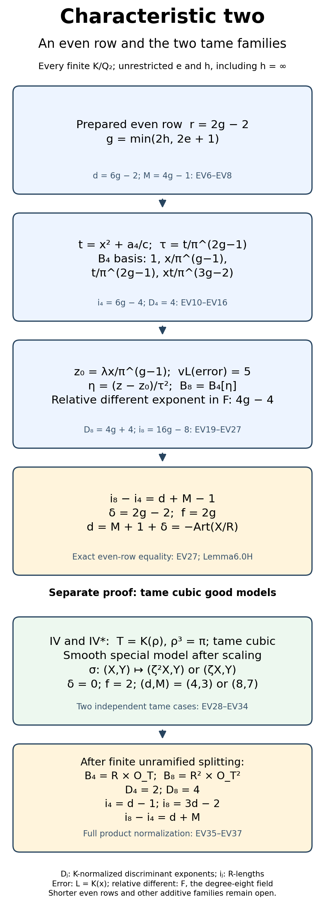

*Proof map for the exact row \(r=2g-2\) and both tame cases.* The error valuation five is normalized in \(L=K(x)\); the relative different exponent is normalized in the degree-eight field F. Each D_j is a K-normalized discriminant exponent, and each i_j is an R-module length. The lower product decomposition is after finite unramified torsion splitting. The arrows inside each chain record the written mechanisms; the two chains are separate. No shorter even-row assertion is displayed.

### 6.0N.4. Every \(IV\) and \(IV^*\) preparation becomes good over a tame cubic

In characteristic two the separated terminal quadratic in the \(IV\) row is exactly \(a_3/\pi\ne0\) modulo \(\pi\). The actual coefficient preparation of 6.0A therefore is
\[
 (v(a_1),v(a_2),v(a_3),v(a_4),v(a_6))
 \ge (1,1,1,2,2),\qquad v(a_3)=1,\qquad M=3 .
 \tag{EV28}
\]
For \(IV^*\), 6.0C gives
\[
 (v(a_1),v(a_2),v(a_3),v(a_4),v(a_6))
 \ge (1,2,2,3,4),\qquad v(a_3)=2,\qquad M=7 .
 \tag{EV29}
\]
These are exact prepared families, including all their possible unit coefficients.

For EV28, \(v(b_6)=2\), since \(a_3^2\) uniquely leads \(4a_6\). Also \(v(b_2)\ge2,v(b_4)\ge2,v(b_8)\ge3\). In \(\Delta\), \(-27b_6^2\) has valuation four while the other terms have valuations at least \(7,9,6\). Thus \(d=4\). For EV29 the corresponding bounds are \(v(b_6)=4,v(b_2)\ge2,v(b_4)\ge3,v(b_8)\ge6\); the other discriminant terms have valuations at least \(10,12,9\). Thus \(d=8\).

After adjoining \(\zeta\) unramified, let \(T=K(\rho)\) with \(\rho^3=\pi\). The polynomial is Eisenstein, so \(T/K\) is totally ramified of degree three. Since \(\zeta\in K\), it is cyclic with \(\sigma(\rho)=\zeta\rho\). Its integral ring is \(R[\rho]\): in the basis \(1,\rho,\rho^2\), the three coefficient-term valuations have distinct classes modulo three, so integrality is equivalent to integral coefficients. The derivative \(3\rho^2\) has \(T\)-valuation two. Thus its different and discriminant exponents are both two, and all positive ramification groups are trivial. This also verifies tameness directly.

For \(IV\) scale \(x=\rho^2X,y=\rho^3Y\), so \(a'_i=a_i/\rho^i\). Their \(T\)-valuations are at least
\[
 (2,1,0,2,0),\qquad a'_3\in\mathcal O_T^\times.
 \tag{EV30}
\]
For \(IV^*\) scale \(x=\rho^4X,y=\rho^6Y\), so \(a'_i=a_i/\rho^{2i}\). Their valuations are at least
\[
 (1,2,0,1,0),\qquad a'_3\in\mathcal O_T^\times .
 \tag{EV31}
\]
In each case the special equation is
\[
 Y^2+\bar a'_3Y=X^3+\bar a'_6 .
 \tag{EV32}
\]
Its affine \(Y\)-partial is a unit, and the infinity chart is smooth by its unit partial. The resulting projective cubic is a smooth proper elliptic model. The relative group structure needs a construction before the torsion-lifting proof can be applied. The field secant construction is proved in the earlier programme lesson *Abelian varieties*, Lemma 9.0a and Theorem 9.0. Here is its relative extension for this smooth cubic over the valuation ring. On the product of the model with itself, the minors of the two universal coordinate vectors generate the diagonal ideal. The diagonal of a smooth relative curve is Cartier: in an étale curve parameter its ideal is generated by the difference of the two parameters. Divide the minors by that local equation. The quotients generate the unit ideal and define a secant-or-tangent line everywhere; changing the equation multiplies all three by the same unit, so these local lines glue.

On the pulled-back cubic that line cuts a divisor of fibre degree three, since a smooth cubic has no line component. Its section vanishes on both universal point graphs. At their intersection, the two graph equations are differences of the curve parameter and the two independent base parameters. They form a regular sequence. Divisibility by each therefore implies divisibility by their product: reduce the first quotient modulo the second equation, where the first remains a non-zero-divisor. Removing both graph divisors leaves a residual divisor of length one on every geometric fibre. Its zero has a unit derivative in a curve parameter; the local étale criterion makes it étale over the parameter base. It has exactly one reduced geometric point in every fibre, so its diagonal is an isomorphism and it is a surjective étale monomorphism. Its unique étale-local sections descend, giving an inverse. Thus it is the graph of a section, the third intersection point, including on the diagonal and at a flex.

Reflect this point by the secant through the origin. This constructs addition and inverse as morphisms over the valuation ring. On the generic fibre they are the field secant operations of Theorem 9.0. Hence their group identities hold on the whole model: its powers are flat over the valuation domain and the target is separated, so the equalizer ideal vanishes after inverting the uniformizer and is torsion; flatness forces it to vanish already. This gives the actual smooth proper group model. All steps apply at residue characteristic two. The subsequent finite étale multiplication, unramified torsion lifting and equivariant specialization are proved in the Tate-module lesson, Lemma 3.0 and Theorem 3.1.

The descent action of \(\sigma\) on its special fibre is respectively
\[
 (X,Y)\longmapsto(\bar\zeta^2 X,Y),\qquad
 (X,Y)\longmapsto(\bar\zeta X,Y).
 \tag{EV33}
\]
Indeed, transporting the original action back to the fixed good coordinates sends \(X\) to \(\zeta^2\sigma(X)\) or \(\zeta^4\sigma(X)\); inertia is trivial on the residue coefficients. It has exact order three. All positive inertia acts trivially on every prime-to-two Tate module, since that module is unramified over \(T\) and \(T/K\) is tame. Hence \(\delta=0\).

For completeness the tame codimension on the rank-two Tate module is two. For the displayed nonidentity automorphism \(\alpha\), the factorization
\((\alpha-1)(1+\alpha+\alpha^2)=0\), together with \(\alpha-1\) a nonzero isogeny, implies \(1+\alpha+\alpha^2=0\). Indeed a nonzero elliptic-curve homomorphism is finite surjective with finite kernel, by the Tate-module lesson §1.2; if the second factor had nonconstant image, its composition with the first could not be zero. Thus a vector fixed by \(\alpha\) would be killed by three in the characteristic-zero Tate space, and is zero. The inertia codimension is two, giving \(f=2\).

Consequently the already written Euler identity gives
\[
 d=4=3+1+0\quad(IV),\qquad
 d=8=7+1+0\quad(IV^*).
 \tag{EV34}
\]
This proves the full discriminant–Artin assertion for both families.

### 6.0N.5. Both normalization indices in these tame families

We additionally prove EV4 through their actual integral closures. Enlarge \(K\) unramified enough to contain all the finitely many special \(3\)-torsion coordinates in EV32. The torsion lifting proof makes all generic \(3\)-torsion rational over \(T\). It does not enlarge the ramified cubic extension.

On EV32 the 3-torsion pair polynomial is
\[
 \bar q(X)=X^4+(\bar a'_3)^2X
          =X\bigl(X^3+(\bar a'_3)^2\bigr).
 \tag{EV35}
\]
Its four roots are distinct: its derivative is the unit \((\bar a'_3)^2\). The action EV33 fixes its zero root and cycles the three nonzero roots. Above each root there are two distinct \(Y\)-values, because the quadratic has unit derivative \(\bar a'_3\). At \(X=0\) both points are fixed; the remaining six points form two three-cycles, since EV33 leaves \(Y\) fixed. The written good-model torsion bijection transfers these precise permutations to the generic torsion.

It follows that their finite separable generic algebras and integral closures are
\[
\begin{array}{c|c|c|c}
 j & A_j\otimes_RK & B_j & \epsilon_j\\ \hline
 4 & K\times T & R\times\mathcal O_T & 2\\
 8 & K^2\times T^2 & R^2\times\mathcal O_T^2 & 4 .
\end{array}
\tag{EV36}
\]
Here a fixed point gives \(K\), and a length-three orbit gives \(T\): its stabilizer in the cyclic cubic group is trivial, and those are all the points. Integral closure commutes with this product, since an element is integral exactly when all its coordinates are. These are full finite free rings. The integral discriminant exponents are \(D_4=2,D_8=4\), by the direct cubic derivative computation in Section 6.0N.4 and block-diagonal trace matrices. Section 6.0K.2's actual index identity now gives
\[
 i_4=d-1,\qquad i_8=3d-2,\qquad
 i_8-i_4=2d-1=d+M.
 \tag{EV37}
\]
Since \((\epsilon_8-\epsilon_4)/2=1\), this is exactly EV4. The indices are respectively \(3,10\) in \(IV\), and \(7,22\) in \(IV^*\). Unramified invariance descends these assertions to the original \(K\).

### 6.0N.6. The still unproved even estimates and other families

The scope still left by this proposition is \(2\le r\le2g-3\) in the prepared even rows, and \(II,III,I_0^*,III^*,II^*\). Neither the equality nor EV4 is asserted for those rows or families by this proposition. Sections 6.0O–6.0T below prove further parameter ranges; Sections 6.0AM.7 and 6.0AN.7 give the current remaining list. Section 6.0M proves every odd row and the even boundary \(r=2g-1\).

For a general even row with \(r\ge g\), the first root valuation is still \((r+1)/2\), and the exact transform EV11 still holds. One cannot uniformly claim its second root valuation from \(b_2x^3\): the constant term \(a_2a_3^2\) in
\[
 b_8+a_4^2=b_2a_6-a_1a_3a_4+a_2a_3^2
 \tag{EV38}
\]
can have valuation \(2r+3\), while \(b_2x^3\) has valuation \(g+3(r+1)/2\). At \(r=2g-4\), the first is lower by \(1/2\) if \(v(a_3)=r+1\). That is a genuine permitted preparation. A claimed uniform EV14 outside the proved row would therefore be false without further reductions.

Even if the latter leading term survives for particular coefficients, the approximate slope EV19 generally has a constant error \(C\) guaranteed only to have \(K\)-valuation at least two. The proposed leading \(L\)-valuation \(2g-r+3\) can exceed eight, so \(C\) may dominate it. No assertion here treats a residue square-root lift as an exact unit square root in a dyadic field. The remaining normalization must handle both the constant term EV38 and this square-defect error, as well as all preparations with \(r<g\).

The shorter even rows require further normalization, including the retained constant and square-defect errors. The alternative localized-intersection and trace route in Section 6.0K.7 remains unproved; no external conductor theorem is used here.

Sections 6.0N.2–6.0N.5 prove precisely the three stated families. The full additive characteristic-two assertion still requires every case listed above.

## 6.0O. Further additive parameter ranges

**Proposition 6.0O (further additive parameter ranges).** The full target remains \(v(\Delta_{\min})=-\operatorname{Art}(X/R)\) for every additive elliptic curve over every finite \(K/\mathbf Q_2\). We prove that target, with the actual normalization indices, for every prepared \(II\) and \(III\) equation with \(v(a_3)=1\), every prepared \(III^*\) equation with \(v(a_1)=1\), every prepared \(II^*\) equation with \(v(a_1)=1\), and every prepared \(II^*\) equation with \(v(a_1)\ge2,\ v(a_3)=3\). All valuations \(e=v(2)\ge1\), including unbounded ramification, are allowed. The remaining parameter cases and shorter even star rows are retained in Section 6.0O.7, not certified here.

### 6.0O.1. Actual earlier written proofs and the exact target

Let \(R=\mathcal O_K\), \(v(\pi)=1\), and use the minimal prepared equation
\[
 y^2+a_1xy+a_3y=x^3+a_2x^2+a_4x+a_6.
 \tag{AL1}
\]
Put \(d=v(\Delta)\), \(M=\#\{\text{geometric special-fibre components}\}\), and \(\delta=\operatorname{Sw}(H^1(E_{\bar K},\mathbf Q_\ell))\).

The earlier lesson *Profinite groups and adic representations*, Proposition 0E.1, proves the unique extended valuation, the full integral closure as a complete finite free DVR, and the degree identity \(ef=[F:K]\), for finite separable extensions of complete discretely valued fields with finite residue field. Lemma 0D.1 proves simple-root Hensel; Lemma 0F.1 and Proposition 0F.2 construct the residue-field and unramified lifts. Sections 0G.2–4 prove the separable Eisenstein and integral-monogenic assertions. These are the local-field inputs used below.

In this lesson, Sections6.0K.1–2 and6.0K.6 contain the written unramified-normalization/length invariance, trace-dual, order-index, different-tower, finite-permutation and 3-torsion-resultant proofs. They give
\[
\begin{aligned}
 q(x)&=x^4+(b_2/3)x^3+b_4x^2+b_6x+b_8/3,\\
 A_4&=R[x]/q,\qquad
 A_8=A_4[y]/(y^2+(a_1x+a_3)y-x^3-a_2x^2-a_4x-a_6),\\
 v(\operatorname{disc}A_4)&=2d,\qquad
 v(\operatorname{disc}A_8)=6d,\\
 \delta&=2d-i_8+i_4-\frac{\epsilon_8-\epsilon_4}{2}.
\end{aligned}
\tag{AL2}
\]
Here \(B_j\) is the integral closure, \(i_j=\operatorname{length}_R(B_j/A_j)\), and \(\epsilon_j\) the inertia permutation codimension. Both \(B_j\) are finite free rings; \(B_j/A_j\) are finite torsion modules, generally not quotient rings. The required identity remains
\[
 i_8-i_4=d+M+1-\frac{\epsilon_8-\epsilon_4}{2}.
 \tag{AL3}
\]
The prepared charts, their component counts, the minimal-model identification and the Euler equality
\(-\operatorname{Art}=M+1+\delta\) are the actual earlier written proofs. No Ogg, Saito or other conductor theorem is imported. Their stated proof scopes are used throughout.

Adjoin \(\zeta\), a primitive cube root of unity, unramified and put
\[
 c=1+2\zeta,\quad c^2=-3,\quad v(3+c)=e,\quad
 v(1-1/c)=e,\quad \zeta^2=-(c+1)/2.
 \tag{AL4}
\]
These are the written identities already checked in Sections 6.0M and 6.0N. Unramified extensions preserve every index and geometric count here.

When a quartic root has the indicated valuation, every other root has it by the unique-least-term argument below. A field containing a root or another displayed element of denominator-four valuation has degree at least four by Proposition0E.1; hence the quartic is irreducible and totally ramified of degree four. Distinct valuation classes modulo four then prove each displayed full integral basis: a linear combination has the uniquely least term valuation and is integral exactly when all its terms are. This is an integral-basis proof, not just a Newton polygon.

We also repeatedly use the following elementary quadratic argument. Over a complete DVR \(C\), a monic quadratic with trace coefficient valuation at least one and constant valuation one has root valuation \(1/2\). It is irreducible and totally ramified of degree two. In the upper normalization the two terms of \(a+b\eta\) have distinct parity, so integrality is exactly \(a,b\in C\). Thus its full ring is \(C[\eta]\). The derivative gives its different by the written trace-dual proof. Every use below supplies the actual coefficient valuations.

### 6.0O.2. The first \(a_3\)-layer in \(II\) and \(III\)

The \(II\) preparation is \(a_i\in\pi R\) for all \(i\), with \(v(a_6)=1\) and \(M=1\). The \(III\) preparation is \(a_1,a_2,a_3\in\pi R,\ v(a_4)=1,\ v(a_6)\ge2\), with \(M=2\). Restrict in this section to
\[
 v(a_3)=1.
 \tag{AL5}
\]
Then \(v(b_6)=2\). Since \(v(b_2)\ge2,\ v(b_4)\ge2,\ v(b_8)\ge2\), the term \(-27b_6^2\) uniquely has valuation four in \(\Delta\); the other terms have valuations at least \(6,9,6\). Thus
\[
 d=4.
 \tag{AL6}
\]
We compute the normalizations for every allowed coefficient, including \(a_1=0\).

First suppose \(v(a_4)=1\), in either family. Write \(h=v(a_1)\), allowing infinity. Every root of \(q\) has valuation \(1/2\): its constant term uniquely has valuation two, from \(-a_4^2\), and the intermediate coefficient valuations are strictly above the endpoint line. Put
\[
 t=x^2+a_4/c.
 \tag{AL7}
\]
The exact identity is
\[
 3t^2+b_2x^3+(3b_4-6a_4/c)x^2+3b_6x+(b_8+a_4^2)=0.
 \tag{AL8}
\]
Here \(b_6x\) uniquely has valuation \(5/2\). The other terms besides \(3t^2\) have valuations at least \(7/2,3,3\): use
\[
 b_4-2a_4/c=a_1a_3+2a_4(1-1/c),\qquad
 b_8+a_4^2=b_2a_6-a_1a_3a_4+a_2a_3^2.
 \tag{AL9}
\]
Consequently \(v(t)=5/4\), and \(L=K(x)\) is totally ramified of degree four. Normalize \(v_L|_K=4v\). The valuations of \(1,x,t,xt\) are \(0,2,5,7\), of distinct classes modulo four, so
\[
 B_4=R\oplus Rx\oplus R(t/\pi)\oplus R(xt/\pi),\quad
 \tau=t/\pi,\quad i_4=2,\quad D_4:=v(\operatorname{disc}B_4)=4.
 \tag{AL10}
\]

The flex-tangent slope has the generic quadratic equation
\[
 z^2+a_1z-a_2-3x=0.
 \tag{AL11}
\]
It describes the point algebra. Indeed put \(D'=b_2+12x\), \(H=q'=4x^3+b_2x^2+2b_4x+b_6\), and \(N=6x^2+b_2x+b_4\). The exact identity \(D'H-N^2=4\psi_3\) gives \(D'H=N^2\ne0\). Here \(H\ne0\) by the earlier nonzero resultant. Also \(D'\ne0\): if \(h\le e\), then \(v(b_2)=2h<2e+1/2=v(12x)\); if \(h\ge e+1\), then \(v(b_2)\ge2e+1>v(12x)\). The point value is recovered by
\[
 (2z+a_1)y=3x^2+2a_2x+a_4-z(a_1x+a_3).
 \tag{AL12}
\]
It satisfies \((2z+a_1)(2y+a_1x+a_3)=N\), hence the Weierstrass equation. The converse is the tangent formula. This checks the generic field identification even when \(c_4\) vanishes in other, unused parameter cases.

Put \(z_0=ct/a_3=(cx^2+a_4)/a_3\). Its \(L\)-valuation is one, and its exact error is
\[
 E_0=z_0^2+a_1z_0-a_2-3x
     =\frac{b_2x^3+(3+c)b_4x^2+12a_6x+b_2a_6}{a_3^2}.
 \tag{AL13}
\]
This is the multiplied-and-reduced identity of Section 6.0M.4. The trace coefficient has valuation
\[
 s:=v_L(a_1+2z_0)=
 \begin{cases}4h&h\le e,\\4e+1&h\ge e+1.\end{cases}
 \tag{AL14}
\]
The two potential valuations are \(4h,4e+1\), so cannot cancel. The following four shifts give complete integral rings.

#### 6.0O.2a. \(II,\ h\le e\)

Here \(v(b_2)=2h\) and \(v(a_6)=1\). Choose a unit \(\lambda\) by a residue square root so that
\[
 v\!\left(\frac{b_2a_6}{a_3^2}
          -\lambda^2\pi^{2h-2}a_4/c\right)\ge2h.
 \tag{AL15}
\]
Both summands before cancellation have valuation \(2h-1\); their unit ratio has a square root in the perfect residue field. Set
\[
 w=\lambda\pi^{h-1}x,\quad z_1=z_0+w,\quad \ell=4h-2.
 \tag{AL16}
\]
In the exact error \(E_1=E_0+(a_1+2z_0)w+w^2\), write \(w^2=\lambda^2\pi^{2h-2}(t-a_4/c)\). Its \(t\)-term has valuation \(8h-3\). The constant combination AL15 has valuation at least \(8h\). The first, second and third terms in the numerator of AL13 have respective \(L\)-valuation bounds \(8h-2,\ 4(e+h)\ge8h,\ 8e-2\ge8h-2\). The cross term has valuation \(s+\ell=8h-2\). Thus
\[
 v_L(E_1)=8h-3=2\ell+1,\qquad
 v_L(a_1+2z_1)=4h.
 \tag{AL17}
\]
The second equality persists because \(w\) has valuation \(\ell\ge2>v_L(z_0)\). With \(\eta=(z-z_1)/\tau^\ell\), its polynomial has constant valuation one and trace valuation two. It is Eisenstein and gives \(B_8=B_4[\eta]\). Its relative different exponent is \(\min(8e+1,4)=4\).

#### 6.0O.2b. \(II,\ h\ge e+1\)

Now \(v(b_2)\ge2e+1\), and \(v(b_4)=e+1\). Choose a unit \(\lambda\) so that
\[
 v\!\left(12a_6/a_3^2+\lambda^2\pi^{2e-4}b_6a_4/c\right)\ge2e.
 \tag{AL18}
\]
Both terms before cancellation have valuation \(2e-1\). Put
\[
 w=\lambda\pi^{e-1}x\tau
   =\lambda\pi^{e-2}xt,\quad z_1=z_0+w,\quad \ell=4e-1.
 \tag{AL19}
\]
The first expression makes its integrality transparent even at \(e=1\): \(v_L(w)=\ell\ge3\).

Divide AL8 by three and insert it in
\(w^2=\lambda^2\pi^{2e-4}x^2t^2\).
Its term \(-\lambda^2\pi^{2e-4}b_6x^3\), rewritten using \(x^2=t-a_4/c\), is
\[
 -\lambda^2\pi^{2e-4}b_6xt
 +\lambda^2\pi^{2e-4}b_6a_4x/c .
 \tag{AL20}
\]
The first has valuation \(8e-1\). The second combines with AL13's \(12a_6x/a_3^2\); AL18 puts their sum at valuation at least \(8e+2\). The three remaining terms in \(w^2\), containing \(b_2x^5\), \((b_4-2a_4/c)x^4\), and \((b_8+a_4^2)x^2\), have lower valuation bounds
\[
 16e-2,\qquad12e,\qquad8e.
 \tag{AL21}
\]
For the middle use \(v(b_4-2a_4/c)\ge e+2\); for the last use \(v(b_8+a_4^2)\ge3\). AL13's other terms have bounds \(8e+2,8e,8e\), and the cross term has valuation \(s+\ell=8e\). Hence
\[
 v_L(E_1)=8e-1=2\ell+1,\qquad
 v_L(a_1+2z_1)=4e+1.
 \tag{AL22}
\]
The same Eisenstein construction has trace valuation two, so its full ring is \(B_4[\eta]\) and relative different is four.

#### 6.0O.2c. \(III,\ h\le e\)

Now \(v(a_6)\ge2\). The first term of AL13 has valuation \(8h-2\); its other three terms have bounds \(8h,8h+2,8h\). Choose a unit \(\lambda\) so that
\[
 v\!\left(b_2/a_3^2-\lambda^2\pi^{2h-4}b_6\right)\ge2h-1.
 \tag{AL23}
\]
Before cancellation both terms have valuation \(2h-2\). Set
\[
 w=\lambda\pi^{h-1}x\tau,\quad z_1=z_0+w,\quad
 \ell=4h-1.
 \tag{AL24}
\]
Insert AL8 in \(w^2=\lambda^2\pi^{2h-4}x^2t^2\). Its leading term \(-\lambda^2\pi^{2h-4}b_6x^3\) cancels AL13's first term to valuation at least \(8h+2\), by AL23. The other three terms have bounds
\[
 16h-6,\qquad12h-4,\qquad8h,
\]
all greater than \(8h-1\). Here \(v(b_4-2a_4/c)\ge h+1\), and \(v(b_8+a_4^2)\ge3\). The cross term \((a_1+2z_0)w\) alone has valuation \(s+\ell=8h-1\). Thus the error has valuation \(2\ell+1\). The trace coefficient after division by \(\tau^\ell\) has valuation one, while the constant has valuation one. The full point ring is \(B_4[\eta]\), and its relative different is \(\min(8e+1,2)=2\).

#### 6.0O.2d. \(III,\ h\ge e+1\)

A residue square-root estimate is unnecessary here. Use the exact shift
\[
 w=2\zeta^2a_4/a_3,\qquad z_1=z_0+w,\qquad
 \ell=4e.
 \tag{AL25}
\]
Its valuation is \(\ell\). Expanding AL13 and using \(x^2=t-a_4/c\) gives the exact error
\[
\begin{aligned}
 E_1={}&b_2x^3/a_3^2+12a_6x/a_3^2+b_2a_6/a_3^2+A t+C,\\
 A={}&(3+c)a_1/a_3+12a_4/a_3^2,\\
 C={}&-2a_1a_4/a_3+8\zeta a_4^2/a_3^2.
\end{aligned}
\tag{AL26}
\]
For its verification, the two coefficient identities are
\[
 2(3+c)+4c\zeta^2=12,\qquad
 2\zeta^2-(3+c)/c=-2,\qquad
 4\zeta-2(3+c)/c=8\zeta.
\]
They follow by \(c^2=-3,\ \zeta=(c-1)/2\).
The second term of \(A\) uniquely has valuation \(2e-1\); its first has valuation at least \(2e\). Thus \(At\) has \(L\)-valuation \(8e+1\). The other terms have respective bounds \(8e+2,8e+2,8e+4,8e+4\), where \(v(C)\ge2e+1\). Therefore
\[
 v_L(E_1)=8e+1=2\ell+1,\qquad
 v_L(a_1+2z_1)=4e+1.
 \tag{AL27}
\]
Again the trace and constant after division have valuation one. The full point ring is Eisenstein with relative different two.

For all four cases, \(z_1\) retains valuation one, so no trace cancellation was lost. Both quartic and point fields are totally ramified; \(\epsilon_4=3,\epsilon_8=7\). The resulting complete index calculations are
\[
\begin{array}{c|rrrrrr}
 \text{family}&d&M&D_4&D_8&i_4&i_8\\ \hline
 II,\ v(a_4)=1&4&1&4&12&2&6\\
 III&4&2&4&10&2&7 .
\end{array}
\tag{AL28}
\]
The differences \(4,5\) are exactly AL3. AL2 gives respectively \(\delta=2,1\), and the Euler proof gives \(d=-\operatorname{Art}\).

### 6.0O.3. The remaining \(II,\ v(a_3)=1\) equations: \(v(a_4)\ge2\)

Here \(v(b_8)\ge3\). Let \(T=K(\rho)\), \(\rho^3=\pi\), after adjoining \(\zeta\) unramified. The direct distinct-valuation power-basis proof gives \(\mathcal O_T=R[\rho]\), and the derivative \(3\rho^2\) gives its discriminant exponent two.

The polynomial \(q(\rho^2X)/\rho^8\) is integral and reduces to
\[
 X^4+\overline{b_6/\pi^2}X .
 \tag{AL29}
\]
All four roots are simple: its derivative is the nonzero coefficient of \(X\). After a finite unramified extension they lift over \(T\). The action \(\sigma(\rho)=\zeta\rho\) fixes the zero-residue root and cycles the other three, whose original \(x\)-valuations are \(2/3\). The zero-residue root has \(v_T(x)\ge3\), hence \(v(x)\ge1\), and belongs to \(K\). Thus \(B_4=R\times\mathcal O_T\), \(D_4=2,\ i_4=3,\ \epsilon_4=2\). This uses Hensel for a monic polynomial with simple residue roots, not a conductor theorem.

Above the fixed root the \(y\)-quadratic has constant valuation one and trace valuation one: \(a_6\) and \(a_3\) uniquely lead, respectively. It is Eisenstein with different exponent two. Above a three-cycle root, the constant has \(T\)-valuation three and trace valuation three, again from those same coefficients. With \(Y=y/\rho\), its constant valuation is one and trace valuation two; its full quadratic ring has relative different four. Both fields are totally ramified. The degree-six factor therefore has discriminant \(2\cdot2+4=8\), and the degree-two factor has discriminant two. Consequently
\[
 D_8=10,\quad i_8=(24-10)/2=7,\quad
 \epsilon_8=6,\quad i_8-i_4=4 .
 \tag{AL30}
\]
The inertia orbits have sizes two and six. Since \(\epsilon_8-\epsilon_4=4\), AL30 is exactly AL3 with \(d=4,M=1\). It gives \(\delta=2\). Together with Section 6.0O.2, this proves every \(II\) preparation with \(v(a_3)=1\), for all \(e,h\).

### 6.0O.4. Every \(III^*\) preparation with \(v(a_1)=1\)

The actual preparation is
\[
 v(a_1)=1,\quad v(a_2)\ge2,\quad v(a_3)\ge3,\quad
 v(a_4)=3,\quad v(a_6)\ge6,\qquad M=8.
 \tag{AL31}
\]
It gives \(v(b_2)=2,\ v(b_4)\ge4,\ v(b_6)\ge6,\ v(b_8)=6\). Hence \(-b_2^2b_8\) uniquely gives \(d=10\). Every quartic root has valuation \(3/2\), and in AL8 the term \(b_2x^3\) uniquely has valuation \(13/2\). The other bounds are \(7,15/2,7\), since \(v(b_8+a_4^2)\ge7\). Thus \(v(t)=13/4\), the quartic is totally ramified of degree four, and the distinct valuation classes \(0,6,13,19\) give
\[
 B_4=R\oplus R(x/\pi)\oplus R(t/\pi^3)
                  \oplus R(xt/\pi^4),\quad
 \tau=t/\pi^3,\quad i_4=8,\quad D_4=4.
 \tag{AL32}
\]

The tangent quadratic AL11 identifies the point algebra: \(D'=b_2+12x\ne0\), since its two valuations are \(2\) and \(2e+3/2>2\). Set
\[
 z_1=\frac{a_1a_4}{c\pi^3\tau},\qquad v_L(z_1)=3.
 \tag{AL33}
\]
Here is the needed error calculation rather than a residue-lift assertion. Put \(C_2=b_4-2a_4/c\), \(C_0=b_8+a_4^2\). Multiplying AL8 by \(x/\pi^6\) and using \(x^2=t-a_4/c,\ t=\pi^3\tau\) gives
\[
\begin{aligned}
 (a_2+3x)\tau^2={}&(a_2-b_2)\tau^2
 +\frac{2b_2a_4}{c\pi^3}\tau
 +\frac{b_2a_4^2}{3\pi^6}\\
 &-\frac{3C_2x^3+3b_6x^2+C_0x}{\pi^6}.
\end{aligned}
\tag{AL34}
\]
Apart from its displayed constant \(b_2a_4^2/(3\pi^6)\), its terms have \(L\)-valuation bounds \(10,13,10,12,10\). The numerator \(z_1^2\tau^2\) equals \(-a_1^2a_4^2/(3\pi^6)\). Its difference from that constant is
\(- (2a_1^2+4a_2)a_4^2/(3\pi^6)\), of \(L\)-valuation at least twelve. Hence \(v_L(z_1^2-a_2-3x)\ge8\), whereas \(v_L(a_1z_1)=7\). The exact quadratic error therefore has valuation seven, and its trace coefficient has valuation four.

With \(\eta=(z-z_1)/\tau^3\), both constant and trace have valuation one. Its full point ring is \(B_4[\eta]\), relative different two. Both fields are totally ramified, so \(\epsilon_4=3,\epsilon_8=7\), and
\[
 D_8=10,\quad i_8=25,\quad i_8-i_4=17=d+M-1.
 \tag{AL35}
\]
This proves AL3, \(\delta=1,f=3\), and the discriminant–Artin equality for every preparation AL31, with no restriction on the higher \(a_3\)-valuation or on \(e\).

### 6.0O.5. Every \(II^*\) preparation with \(v(a_1)=1\)

Here
\[
 v(a_1)=1,\quad v(a_2)\ge2,\quad v(a_3)\ge3,\quad
 v(a_4)\ge4,\quad v(a_6)=5,\qquad M=9.
 \tag{AL36}
\]
One has \(v(b_2)=2,\ v(b_4)\ge4,\ v(b_6)\ge6,\ v(b_8)=7\). In \(b_8\), \(b_2a_6\) uniquely has valuation seven. In \(\Delta\), \(-b_2^2b_8\) uniquely gives \(d=11\).

Every quartic root has valuation \(7/4\): the intermediate coefficient valuations \(6,4,2\) are strictly above the endpoint line. Its denominator four proves total ramification and irreducibility. The distinct classes of \(x^j\) give
\[
 B_4=\bigoplus_{j=0}^3 R\,x^j/\pi^{\lfloor7j/4\rfloor},
 \quad i_4=1+3+5=9,\quad D_4=4.
 \tag{AL37}
\]
Choose any uniformizer \(\tau\); one can take \(\tau=x^3/\pi^5\). The tangent quadratic has constant valuation \(v_L(a_2+3x)=7\), and trace valuation \(v_L(a_1)=4\). Its discriminant \(b_2+12x\ne0\) by the different valuations. With \(\eta=z/\tau^3\), the constant and trace have valuation one. Thus its full point ring is Eisenstein and relative different two. The fields are totally ramified of degrees four and eight. Therefore
\[
 \epsilon_4=3,\quad\epsilon_8=7,\quad D_8=10,\quad
 i_8=28,\quad i_8-i_4=19=d+M-1 .
 \tag{AL38}
\]
This proves AL3, \(\delta=1,f=3\), and the equality for every preparation AL36.

### 6.0O.6. \(II^*,\ v(a_1)\ge2,\ v(a_3)=3\)

Keep \(v(a_2)\ge2,v(a_4)\ge4,v(a_6)=5\), and now suppose
\[
 v(a_1)\ge2,\qquad v(a_3)=3 .
 \tag{AL39}
\]
Then \(v(b_2)\ge4,\ v(b_4)\ge5,\ v(b_6)=6,\ v(b_8)\ge8\). The discriminant term \(-27b_6^2\) uniquely gives \(d=12\). Scaling the quartic by \(x=\pi^2X\) gives an integral polynomial reducing to
\(X^4+\overline{b_6/\pi^6}X+\overline{b_8/(3\pi^8)}\), with unit derivative. Its four roots lift in a finite unramified extension. Thus after that extension \(B_4=R^4,\ D_4=0,\ i_4=12,\epsilon_4=0\).

At each root \(v(x)\ge2\). The quadratic in \(Y=y/\pi^2\) has trace coefficient \((a_1x+a_3)/\pi^2\) of valuation one, and constant \(-(x^3+a_2x^2+a_4x+a_6)/\pi^4\) of valuation one. The terms \(a_3,a_6\) uniquely give those valuations. Its full ring is Eisenstein with different two. There are four such totally ramified quadratic factors, so
\[
 D_8=8,\quad\epsilon_8=4,\quad i_8=32,\quad
 i_8-i_4=20=12+9+1-2 .
 \tag{AL40}
\]
This proves AL3, \(\delta=2,f=4\), and the equality for every preparation AL39. It allows \(a_1=0\); no choice of the four unramified roots changes the index or geometric count.

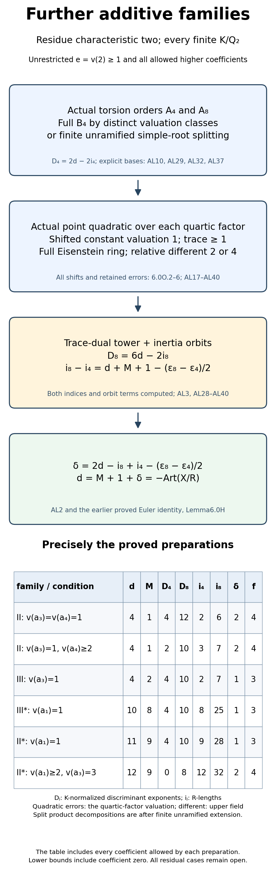

*Proof map for these additive layers.* The quartic and point fields, their full rings, derivative valuations and orbit codimensions are specified in Section 6.0O.2–Section 6.0O.6. The last arrow uses the earlier written finite-permutation and Euler proofs. The human source for the local-field setting is [Milne's free *Algebraic Number Theory* notes](https://www.jmilne.org/math/CourseNotes/ANT.pdf), Proposition7.55 and Remark7.56, printed pp.129–130, with the finite-separable proofs written in that lesson, Sections 0G.2–5. In the diagram, D_j are K-normalized discriminant exponents and i_j are R-module lengths. Quadratic errors use the valuation of the relevant quartic-algebra factor, and relative differents use the upper-field valuation. Every split product is after the finite unramified extension specified in its proof. The branch calculations and diagram are written here; no conductor equality is taken from that source. It claims no omitted parameter case.

### 6.0O.7. Exact residual scope and the failed uniform estimate

Section 6.0N proves all \(IV,IV^*\), and the even row \(r=2g-2\); Section 6.0M proves all positive odd star indices and the even boundary \(r=2g-1\); Section 6.0L proves both rows \(r\ge2g\). Those proof sections retain their stated scopes. Together with the present new proofs, the original full target still requires:

* every prepared even row \(2\le r\le2g-3\), for all \(e,h\);
* \(II\) and \(III\) preparations with \(v(a_3)\ge2\);
* all \(I_0^*\) preparations;
* \(III^*\) preparations with \(v(a_1)\ge2\);
* \(II^*\) preparations with \(v(a_1)\ge2,\ v(a_3)\ge4\).

Infinite valuations are included in every lower-bound condition. These are residual cases of the full requested scope, not replacement tasks. The exact normalization target AL3, equivalently DC23/SR31 in the public placements, remains required for all of them.

The failed even estimate remains explicit. For a prepared even row with \(r\ge g\), \(t=x^2+a_4/c\) satisfies AL8, but the allowed term \(a_2a_3^2\) in AL9 can have valuation \(2r+3\), below \(g+3(r+1)/2\). At \(r=2g-4\) it is lower by \(1/2\) when \(v(a_3)=r+1\). The putative slope-shift constant is only guaranteed valuation two; if its proposed \(L\)-error valuation exceeds eight, it may dominate. Neither an omitted constant term nor an exact dyadic unit square root is used here. The shorter rows still need an actual coupled normalization calculation.

The listed cases still require their own coupled normalization calculations or a complete specialized trace/discriminant comparison. None is proved by a numerical check or an external conductor theorem.

## 6.0P. Full normalization procedures

**Proposition 6.0P (full normalization procedures).** The required theorem remains \(v(\Delta_{\min})=-\operatorname{Art}(X/R)\) for every additive elliptic curve over every finite \(K/\mathbf Q_2\). This section proves complete finite normalization procedures for the quartic and point orders at that full field scope, and gives the point normalization by explicit dyadic square-defect formulas. These results include repeated residue factors, even error valuations, split algebras, unramified quadratic factors, and every \(v(2)\). They do **not** prove the final prepared-family index identity. Section 6.0P.6 states that exact unclosed arithmetic assertion and retains every remaining family.

### 6.0P.1. Written providers and free human material

Let \(R=\mathcal O_K\), \(v_R(\pi)=1\). In the earlier lesson *Profinite groups and adic representations*, Section 0A proves lattice freeness, the determinant trick, Cayley–Hamilton and integral closedness; Sections 0B–0C prove the separable-embedding and Galois statements; Proposition 0E.1 proves the complete finite-free integral closure, unique valuation and degree \(ef\); Section 0F proves finite residue fields and unramified lifting, using Lemma 0D.1’s Hensel proof. Section 0G.3 constructs the maximal unramified subfield. We use these finite-separable, finite-residue-field proofs below.

Sections 6.0K.2 and 6.0K.6 of this lesson supply the order-index, trace-dual/different, finite-permutation and 3-torsion computations:
\[
\begin{aligned}
 q(x)&=x^4+(b_2/3)x^3+b_4x^2+b_6x+b_8/3,\\
 A_4&=R[x]/q,\\
 A_8&=A_4[y]/(y^2+(a_1x+a_3)y-x^3-a_2x^2-a_4x-a_6),\\
 v_R(\operatorname{disc}A_4)&=2d,\qquad
 v_R(\operatorname{disc}A_8)=6d,\\
 \delta&=2d-i_8+i_4-\tfrac12(\epsilon_8-\epsilon_4).
\end{aligned}
\tag{NF1}
\]
Here \(d=v_R(\Delta_{\min})\), \(B_j\) is the integral closure, \(i_j=\operatorname{length}_R(B_j/A_j)\), and \(\epsilon_j\) is the inertia permutation codimension. Generic separability is essential and follows from the nonzero resultant proved there. Repeated **residue** roots are allowed. Repeated generic roots, which would violate \(\Delta\ne0\), are not included.

[Milne’s freely available *Algebraic Number Theory* notes](https://www.jmilne.org/math/CourseNotes/ANT.pdf), Proposition 2.43 and the following finite integral-coset argument, printed pp.40–41, provide the human starting point. The complete local separable-product construction is proved below. The lattice reductions use the proof already given in Section 6.0K.2.

### 6.0P.2. Finite saturation constructs the full quartic and point lattices

Let \(C\) be a complete DVR with finite residue field, uniformizer \(\varpi\), and characteristic-zero fraction field \(F\). Let \(V\) be a finite separable \(F\)-algebra of dimension \(N\), and \(A\subset V\) a unital full finite-free \(C\)-order. Let \(B\) be its integral closure. A finite separable algebra is a finite product of separable fields: in the present applications factor the monic separable quartic over \(F\), use the coprime-factor Chinese remainder identities, and then factor each separable quadratic into a field or two copies of its base. Applying the actual Proposition 0E.1 to those factors proves that \(B\) is a product of complete DVRs and finite free of rank \(N\) over \(C\).

For \(\beta\in V\), use any \(C\)-basis of \(A\) as an \(F\)-basis of \(V\), and form its multiplication matrix \(m_\beta\) over \(F\). It need not preserve \(A\). Then
\[
 \beta\text{ is integral over }C
 \quad\Longleftrightarrow\quad
 \det(TI-m_\beta)\in C[T].
 \tag{NF2}
\]
For the forward implication split the separable algebra over a common field. Its multiplication eigenvalues are the images of the coordinates of \(\beta\), all integral. Their elementary symmetric expressions are integral, belong to \(F\), and thus belong to the integrally closed \(C\). Conversely Cayley–Hamilton applied to \(m_\beta\), and then to \(1\in V\), gives a monic integral equation for \(\beta\).

The finite set \(\varpi^{-1}A/A\) has representatives
\(\varpi^{-1}\sum_{j=1}^N r_j e_j\), with \(r_j\) a residue representative of \(C\) and \(e_j\) a basis of \(A\). Whether a representative is integral does not depend on its choice: the difference is an element of the integral ring \(A\), and integral elements form a ring by the actual determinant-trick argument in Section 0A of the earlier lesson.

If \(A\ne B\), the nonzero finite torsion module \(B/A\) has a nonzero element killed by \(\varpi\). Indeed take an element killed by \(\varpi^s\) with \(s\) least and apply \(\varpi^{s-1}\). It is represented by
\[
 \beta\in B\cap\varpi^{-1}A\setminus A .
 \tag{NF3}
\]
Thus scanning the **nonzero cosets** using NF2 either finds an integral \(\beta\) or proves \(A=B\).

For a found \(\beta\), replace \(A\) by \(A[\beta]\). Its characteristic polynomial in NF2 has degree \(N\) and coefficients in \(C\subset A\), so
\[
 A[\beta]=\sum_{j=0}^{N-1}A\beta^j.
 \tag{NF4}
\]
It is a finite \(C\)-module, lies in \(B\), spans \(V\), and is a ring; monic reduction of higher powers proves the last two assertions. It is torsion-free, hence free by Section 0A of the earlier lesson. The enlargement is strict.

The trace-matrix identity in Section 6.0K.2 gives
\[
 v_C(\operatorname{disc}A)
 =v_C(\operatorname{disc}B)+2\operatorname{length}_C(B/A).
 \tag{NF5}
\]
All traces in \(B\) are integral, so its nonzero discriminant has nonnegative valuation. Each strict enlargement reduces the last length by at least one, and therefore reduces the order-discriminant valuation by at least two. The procedure terminates after at most
\[
 \left\lfloor v_C(\operatorname{disc}A_{\rm initial})/2\right\rfloor
 \tag{NF6}
\]
strict enlargements. At termination NF3 proves that its output is **the full integral closure**, not merely an order in it. At every step a DVR basis reduction computes the actual finite lattice and its inclusion determinant; the successive index lengths add.

In particular NF1 makes these bounds \(d\) for \(A_4\), and \(3d\) for \(A_8\). The procedure proves a full finite normalization construction for every residual equation in Section 6.0P.6. It requires exact finite residue and ring arithmetic; no efficiency claim or universal prepared-family identity is inferred from termination.

### 6.0P.3. The exact maximal-denominator formula for a quadratic

Continue with \(C,F,\varpi\), and let
\[
 A=C[t],\quad t^2+a t+b=0,\quad a,b\in C,\quad
 D=a^2-4b\ne0 .
 \tag{NF7}
\]
The generic algebra is a separable quadratic field or \(F\times F\). Let \(B\) be its full normalization. Write \(I=\operatorname{length}_C(B/A)\). Then
\[
\begin{aligned}
 I=\max\{\ell:\;&0\le\ell\le\lfloor v_C(D)/2\rfloor,\quad
 \exists u\in C/\varpi^\ell C,\\
 &v_C(a+2u)\ge\ell,\quad
 v_C(b+a u+u^2)\ge2\ell\}.
\end{aligned}
\tag{NF8}
\]
Every root lift and every even-error case is included in this maximum.

Here is the full-basis proof. The scalar submodule \(C1\subset B\) is saturated: if a nonzero scalar multiple of \(z\in B\) belongs to \(C1\), then \(z\in F1\), and scalar integrality gives \(z\in C1\). Thus \(B/C1\) is torsion-free of rank one and is free. Lift its generator \(\eta_0\), giving \(B=C1\oplus C\eta_0\). Write \(t=u+v\eta_0\), \(u,v\in C\), \(v\ne0\). The determinant of the inclusion of \(1,t\) has valuation \(v_C(v)=I\). Write \(v=\varpi^I w\), with \(w\) a unit. Therefore
\[
 \eta=(t-u)/\varpi^I=w\eta_0,\qquad B=C1\oplus C\eta.
 \tag{NF9}
\]

For any proposed \(\ell,u\), the polynomial of \((t-u)/\varpi^\ell\) is
\[
 T^2+\frac{a+2u}{\varpi^\ell}T+
       \frac{b+a u+u^2}{\varpi^{2\ell}}.
 \tag{NF10}
\]
Its two integral-coefficient conditions are exactly NF8. They make the proposed element integral, so its order lies in \(B\); its index over \(A\) is \(\ell\), hence \(\ell\le I\). Conversely NF9 attains \(I\). Identity NF5 proves the stated upper bound. These implications establish the maximum exactly.

The **joint** conditions depend only on \(u\bmod\varpi^\ell\). Replacing \(u\) by \(u+\varpi^\ell z\) changes the constant numerator by
\(\varpi^\ell z(a+2u)+\varpi^{2\ell}z^2\), divisible by \(\varpi^{2\ell}\) when the trace condition holds. If that trace condition fails, the same change cannot correct it. Thus NF8 is a well-defined finite search. At its maximum, NF9 gives the full integral lattice, with
\[
 v_C(\operatorname{disc}B)=v_C(D)-2I .
 \tag{NF11}
\]

If this exponent is zero, the derivative \(2\eta+\alpha\), for the normalized polynomial \(T^2+\alpha T+\beta\), is a unit at \(\eta\). At residue characteristic two the discriminant being a unit says that \(\alpha\) is a unit. The residue quadratic is separable. The actual Hensel/unramified proofs give an unramified quadratic field or the split algebra.

Conversely a split normalization has unit discriminant in its idempotent basis. An unramified quadratic normalization also has unit discriminant: a full basis \(1,\eta\) reduces to a basis of its separable quadratic residue field. The residue trace matrix is nondegenerate, by the same separable-embedding determinant proof as0E.1. Hence a positive NF11 forces a totally ramified quadratic field.

In that ramified case normalize \(v_B(\varpi)=2\). Choose \(r\in C\) lifting the residue of \(\eta\), and put \(z=\eta-r\). Its valuation is at least one. If it were at least two, it would lie in \(\varpi B\); expressing \(z=\varpi(c_0+c_1z)\) in the full basis \(1,z\) gives
\((1-\varpi c_1)z=\varpi c_0\in F\), a contradiction to this being a quadratic field. Thus \(v_B(z)=1\), and its polynomial
\[
 T^2+c_1'T+c_0',\quad
 v_C(c_0')=1,\quad v_C(c_1')\ge1
 \tag{NF12}
\]
is Eisenstein. The norm and trace valuations follow from the two conjugates having valuation \(1/2\). The trace-dual proof gives the upper-normalized different exponent
\[
 v_B(2z+c_1')
 =\min\{2v_C(2)+1,\ 2v_C(c_1')\}.
 \tag{NF13}
\]
The two possible finite valuations have opposite parity, so cannot cancel. The coefficient \(c_1'\) here is the one **after** the residue shift, and \(v_C(0)=+\infty\). In the preceding norm/trace argument, each conjugate has extended base-normalized valuation \(1/2\), equivalently upper-normalized valuation one.


### 6.0P.4. All dyadic quadratic squareclasses, with explicit full rings

Let \(e_C=v_C(2)\ge1\). A nonzero radicand has squareclass represented either by \(\varpi U\) or \(U\), with \(U\in C^\times\).

For \(\varpi U\), the square root is Eisenstein. Here and below the full-ring assertion has the following direct proof. If \(T^2+cT+b\) has \(v_C(c)\ge1,v_C(b)=1\), its root \(\zeta\) has base-normalized valuation \(1/2\): a smaller valuation makes \(\zeta^2\) the unique least-valuation term, and a larger valuation makes \(b\) the unique least-valuation term, both impossible. In particular the polynomial has no root in \(F\), so gives a quadratic field. The actual valuation/degree proof in Proposition 0E.1 then gives ramification degree two and residue degree one, and normalized upper valuation \(v_B(\zeta)=1\). The two terms of \(c_0+c_1\zeta\), for \(c_i\in F\), have valuations \(2v_C(c_0)\) and \(2v_C(c_1)+1\), with distinct parity. Their sum is integral exactly when both coefficients belong to \(C\). This proves \(B=C1\oplus C\zeta\). Consequently the full ring in this case is \(C[\sqrt{\varpi U}]\), with different and discriminant exponent \(2e_C+1\), since its derivative is twice a uniformizer.

For a nonsquare unit \(U\), define the square defect
\[
 m(U)=\max_{r\in C^\times}v_C(U-r^2).
 \tag{NF14}
\]
Perfection of the finite residue field gives an approximation of valuation at least one. The maximum is finite and at most \(2e_C\). To prove the bound, an approximation with error valuation \(n>2e_C\) has Newton correction \((U-r^2)/(2r)\) of valuation \(n-e_C>e_C\). The new error has valuation \(2(n-e_C)>n\); the derivative keeps valuation \(e_C\). Successive corrections converge in the complete \(C\) to a square root, contrary to nonsquareness.

If \(m=2s<2e_C\) were even, choose a residue square root of \((U-r^2)/\varpi^{2s}\), lift it to a unit \(w\), and replace \(r\) by \(r+\varpi^s w\). The first two error terms cancel modulo the next power, while \(2r\varpi^s w\) has valuation \(e_C+s>2s\). The error improves, a contradiction. Hence
\[
 m(U)=2s+1<2e_C\quad\text{or}\quad m(U)=2e_C .
 \tag{NF15}
\]
The maximum and the square/nonsquare decision use only residue representatives modulo \(\varpi^{2e_C+1}\): changing such a representative changes its square by valuation greater than \(2e_C\). An error greater than \(2e_C\) supplies a square root by the just-written Newton construction.

At \(m=2s+1\), choose an attaining \(r\) and put
\[
 \eta=(\sqrt U-r)/\varpi^s .
 \tag{NF16}
\]
Its polynomial has constant valuation one and trace valuation \(e_C-s\ge1\). The parity argument gives the full ring \(C[\eta]\), with different/discriminant exponent \(2(e_C-s)\). At \(m=2e_C\), the same construction with denominator \(\varpi^{e_C}\) has unit trace and integral constant. NF8, applied to \(t=\sqrt U\), attains the largest possible denominator \(e_C\); it therefore gives the full unramified quadratic ring. Its discriminant exponent is zero. If \(U\) is square, the generic algebra is split and its normalization is \(C^2\).

For completeness these calculations give the quadratic-character conductors without a conductor theorem. In the ramified-unit case, the nontrivial automorphism moves \(\eta\) by \(-2\sqrt U/\varpi^s\), of upper valuation \(2(e_C-s)\). In the Eisenstein basis every integral element has at least that motion, with equality for \(\eta\). The intrinsic lower groups therefore have order two for \(0\le j<2(e_C-s)\), giving character conductor \(2(e_C-s)\). For \(\sqrt{\varpi U}\) its motion has valuation \(2e_C+1\), giving conductor \(2e_C+1\). An unramified character has conductor zero. This exhausts ramified quadratic squareclasses and allows every \(e_C\).

We can now normalize NF7 explicitly from its discriminant. Write \(s_D=v_C(D)\).

* If \(s_D=2k+1\), write \(D=\varpi^{2k+1}U\). A full basis is \(1,(2t+a)/\varpi^k\). Its normal discriminant exponent is \(2e_C+1\), so \(I=k-e_C\).
* If \(s_D=2k\), write \(D=\varpi^{2k}U\). If \(U\) is nonsquare with defect \(2s+1<2e_C\), a full basis is
\(1,((2t+a)/\varpi^k-r)/\varpi^s\), and \(I=k-e_C+s\).
* If \(s_D=2k\) and \(U\) is nonsquare with defect \(2e_C\), use the same expression with denominator \(\varpi^{e_C}\); it is the full unramified basis and \(I=k\).
* If \(s_D=2k\) and \(U=r^2\), the full split basis is
\(1,((2t+a)/\varpi^k-r)/(2r)\), and \(I=k\); its second element has coordinates \(0,-1\).

These are bases in the given generic quadratic algebra, not just in an abstract field with the same degree. The element \((2t+a)/\varpi^k\) is precisely its square root of \(U\) or \(\varpi U\).
All the stated indices are nonnegative automatically: NF5 applies to the integral input order \(C[t]\) and these independently constructed full normal rings. Expressing \(t\) in each displayed basis then has an integral coefficient on its second element, and its scalar coefficient is integral because it belongs to \(F\cap B=C\). Thus no nonintegral scalar shift is hidden.

### 6.0P.5. Applying the complete quadratic calculation above every quartic factor

Write the fully normalized quartic algebra as
\[
 B_4=\prod_j C_j,\quad F_j=\operatorname{Frac}(C_j),\quad
 f_j=[k_j:k_R].
 \tag{NF17}
\]
Its full lattice is constructed by Section 6.0P.2; each factor is a complete DVR. The element \(x\) has coordinate \(x_j\in C_j\). Above it the point order has polynomial coefficients
\[
 a_j=a_1x_j+a_3,\quad
 b_j=-(x_j^3+a_2x_j^2+a_4x_j+a_6),\quad
 D_j=a_j^2-4b_j=H(x_j)\ne0.
 \tag{NF18}
\]
Apply NF8 or the explicit formulas in Section 6.0P.4 to each \(C_j[y]\), obtaining its exact index \(\ell_j\) and normal discriminant exponent
\(D_j^{\rm nor}=v_j(H(x_j))-2\ell_j\).
The full \(B_8\) is the product of the resulting rank-two normal rings. This supplies actual full lattices for arbitrary repeated residue factors and even error valuations after quartic saturation, without an unproved leading-slope estimate.

Since each \(C_j\)-length contributes \(f_j\) to the \(R\)-length, and \(B_4[y]\) is free with basis \(1,y\) over \(B_4\),
\[
 k:=\operatorname{length}_R(B_8/B_4[y])
   =\sum_j f_j\ell_j,\qquad
 i_8=2i_4+k .
 \tag{NF19}
\]
The norm-resultant identity gives \(\sum_j f_jv_j(H(x_j))=2d\). Hence \(\sum_j f_j\ell_j\le d\). Together with \(i_4\le d\), this is a uniform finite bound; it does not imply the required equality.

The inertia orbit term is also determined by these normal rings. For a finite field factor \(F_j/K\), the number of inertia orbits on its embeddings is \(f_j\). In a finite Galois closure \(L/K\), with group \(G\), inertia \(I\) and stabilizer \(J\), normality of \(I\) makes this number \([G:IJ]\). Its fixed field is \(F_j\cap L^I\), by the actual finite Galois correspondence. Hensel lifting a generator of \(k_j/k_R\) constructs the unramified subfield of degree \(f_j\) inside \(F_j\), as in Section 0G.3 of the earlier lesson. It lies in \(L^I\), while any unramified subfield of \(F_j\) has residue degree at most \(f_j\). Thus the intersection has degree exactly \(f_j\), proving the orbit assertion. Applying this to every field factor proves
\[
 \epsilon_4=4-\sum_j f_j,\qquad
 \epsilon_8=8-\sum_j f_j t_j,\quad
 t_j=\begin{cases}1&D_j^{\rm nor}>0,\\2&D_j^{\rm nor}=0.\end{cases}
 \tag{NF20}
\]
Indeed a ramified quadratic gives one residue orbit above each base residue embedding; an unramified quadratic or two split factors give two. Put
\[
 \nu=\sum_{D_j^{\rm nor}=0}f_j .
 \tag{NF21}
\]
Then \(\epsilon_8-\epsilon_4=4-\nu\). NF1, NF19 and NF20 give the exact full arithmetic formula
\[
 \delta=2d-i_4-\sum_j f_j\ell_j-2+\nu/2.
 \tag{NF22}
\]
No parity assumption is inserted into this normalization calculation. The parity assertion follows directly from the wild-action test below, without appealing to a general integrality theorem for Artin or Swan conductors.

One useful conditional simplification is proved directly. If wild inertia acts nontrivially on \(E[3]\), its finite 2-group image lies in the quaternion subgroup of \(\operatorname{SL}_2(\mathbf F_3)\) computed in Section 6.0K.6. Every nontrivial subgroup contains its unique order-two element \(-1\). This element fixes every sign pair and exchanges the two points above it. In a finite torsion splitting field, a wild lift therefore belongs to the stabilizer of each pair but acts nontrivially on its point quadratic. Subgroup compatibility of the intrinsic ramification groups, as proved in Section 6.0K.2, places that lift in the inertia over \(F_j\). Thus each point quadratic is ramified, and
\[
 \nu=0\quad\text{when the wild \(E[3]\)-action is nontrivial}.
 \tag{NF23}
\]
This statement is conditional; no unproved assertion that all residual preparations are wild is used. If wild inertia instead acts trivially on \(E[3]\), the actual kernel comparison in Section 6.0K.6 makes it trivial on \(H^1\), so \(\delta=0\) directly from the positive-group definition. Formula NF22 then makes \(\nu/2\) an integer, since its other terms are integers. Together with NF23 this proves that \(\nu\) is even in every elliptic case. Formula NF22 and the zero/nonzero normal discriminant test cover all cases.

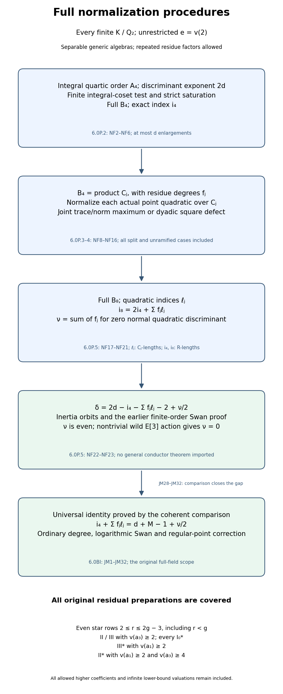

*Full normalization mechanism.* The first arrows are the explicit saturation,quadratic and contact proofs NF2–NF23. The final solid arrow is proved by the ordinary/logarithmic comparison and regular-point correction JM1–JM32 in Section6.0BI,which establish NF24 at the complete original field and coefficient scope. The quartic indices are base-ring lengths;each quadratic index is weighted by its residue degree. Milne’s free notes,Proposition2.43,provide finite integral-coset writing material;each arrow has its actual local proof.

### 6.0P.6. The index equality and its full general proof

For every residual preparation,the full ordinary/logarithmic proof JM1–JM32 establishes the following identity:
\[
 \boxed{\quad i_4+\sum_j f_j\ell_j=d+M-1+\nu/2.\quad}
 \tag{NF24}
\]
Here \(i_4\) is the finite saturation index of Section 6.0P.2, each \(\ell_j\) is the proved maximal-denominator/square-defect value, and \(\nu\) is the explicit normal-discriminant test NF21. This is equivalent to the normalization targets DC23 and SR31 in Sections 6.0L.6 and 6.0M.7 and to \(d=-\operatorname{Art}\), by the actual earlier Euler proof. Sections 6.0P.2–6.0P.5 prove how to determine its terms, not that its two sides always agree.

The following list records the parameter scope not established by those individual calculations. Sections6.0Q–6.0AN give further explicit ranges;Section6.0BI proves the general identity for all of them:

* prepared even star rows \(2\le r\le2g-3\), with \(g=\min(2v(a_1),2v(2)+1)\);
* \(II,III\) with \(v(a_3)\ge2\);
* every \(I_0^*\) preparation;
* \(III^*\) with \(v(a_1)\ge2\);
* \(II^*\) with \(v(a_1)\ge2,\ v(a_3)\ge4\).

All finite \(K/\mathbf Q_2\), all \(e,h\), and all allowed unit and higher-valuation coefficients remain included. Infinite valuations are allowed in lower-bound conditions. Sections 6.0M–6.0O retain their proved parameter scopes.

The failed even estimate is retained exactly: the permitted constant \(a_2a_3^2\) in \(b_8+a_4^2\) can have valuation \(2r+3<g+3(r+1)/2\), including \(r=2g-4,\ v(a_3)=r+1\). A residue square-root lift guarantees only a valuation-two constant error; it may dominate a proposed \(L\)-error exceeding eight. NF8 repairs the **normalization step** for such coefficients, but proving NF24 still requires a full prepared-family analysis of the quartic saturation and those quadratic maxima, or a locally reconstructed conductor/intersection argument. No failed slope estimate, theorem citation, numerical sample or new conductor definition substitutes for that proof.

Thus this is the full-field normalization foundation. Its index identity is proved by the independent local conductor comparison in Section6.0BI;the earlier failed estimates do not enter that proof.

## 6.0Q. Further higher-star preparations

**Proposition 6.0Q (further higher-star preparations).** We prove the discriminant–Artin equality for two further prepared parameter ranges. The first includes every finite extension of the dyadic field, with unrestricted ramification and all allowed higher coefficients. The second includes every finite dyadic field of ramification index one, with the additional coefficient conditions stated explicitly. Every other residual preparation remains required.

### 6.0Q.1. Earlier written inputs and the arithmetic target

Let \(K/\mathbf Q_2\) be finite, \(R=\mathcal O_K\), \(v(\pi)=1\), and \(e=v(2)\). Let \(d=v(\Delta_{\min})\). The earlier lesson *Profinite groups and adic representations*, Sections 0A–0G, proves the finite-free integral closure, unique valuation, degree identity, finite residue fields, Hensel lifting, unramified extensions and the full-ring assertion for separable Eisenstein polynomials. We use those written proofs.

In the present lesson, Lemmas 6.0D–6.0E give the actual prepared \(III^*\) and \(II^*\) regular models with \(M=8\) and \(M=9\), respectively. Theorem 6.0I.9 identifies these models as minimal. Lemma 6.0H proves their Euler identity. Sections 6.0K.1–2 and 6.0K.6 prove the unramified base-change invariance, trace-dual different calculation, different tower, finite-order discriminants and wild permutation comparison. In their notation,
\[
 \begin{aligned}
 q(x)&=x^4+(b_2/3)x^3+b_4x^2+b_6x+b_8/3,\\
 A_4&=R[x]/q,\qquad
 A_8=A_4[y]/(y^2+(a_1x+a_3)y-x^3-a_2x^2-a_4x-a_6),\\
 v(\operatorname{disc}A_4)&=2d,\qquad
 v(\operatorname{disc}A_8)=6d,\\
 \delta&=2d-i_8+i_4-\tfrac12(\epsilon_8-\epsilon_4),\qquad
 -\operatorname{Art}(X/R)=M+1+\delta .
 \end{aligned}
 \tag{HS1}
\]
Here \(B_j\) denotes the full normalization, \(i_j=\operatorname{length}_R(B_j/A_j)\), and \(\epsilon_j\) is the inertia permutation codimension. Section 6.0P supplies the complete quadratic normalization and index interpretation, with the universal family equality NF24 still open.

We may make a finite unramified extension adjoining a primitive cube root \(\zeta\). Its polynomial is separable modulo two, so the earlier unramified proof applies. Set
\[
 c=1+2\zeta,\qquad c^2=-3,\qquad
 v(c)=0,\qquad v(1-c^{-1})=e.
 \tag{HS2}
\]
The last valuation follows from \(c-1=2\zeta\). In all computations below the field and DVR refer to this unramified extension if it was needed. Its normalized discriminants, order-index lengths, inertia conductors and geometric component counts agree with the original ones, by Section 6.0K.1. Upper field valuations are explicitly distinguished from the base valuation.

The free human local-field material is [Milne’s *Algebraic Number Theory* notes](https://www.jmilne.org/math/CourseNotes/ANT.pdf), Proposition 7.55 and Remark 7.56, printed pp.129–130. The valuation-class basis proofs and every branch calculation needed here are written below; that citation supplies no missing proof.

### 6.0Q.2. Every III-star preparation with high a1 and a3 valuation three

Assume the minimal prepared equation has
\[
 v(a_1)\ge2,\quad v(a_2)\ge2,\quad v(a_3)=3,\quad
 v(a_4)=3,\quad v(a_6)\ge5.
 \tag{HS3}
\]
First apply the explicit translation in Lemma 6.0D, choosing \(r\in R\) so that \(x=X+\pi^2r\) makes the new constant coefficient divisible by \(\pi^6\). The added term in \(a_3\) is \(\pi^2ra_1\), of valuation at least four, so its exact valuation three is preserved. The added terms in \(a_4\) have valuation at least four, and its exact valuation three is preserved. The other displayed lower bounds, minimality and discriminant are unchanged. Hence from now on \(v(a_6)\ge6\). The earlier model proof gives \(M=8\).

The invariant identities give
\[
 \begin{gathered}
 v(b_2)\ge4,\qquad v(b_4)\ge4,\qquad v(b_6)=6,\qquad v(b_8)=6,\\
 C_2=b_4-2a_4/c=a_1a_3+2a_4(1-c^{-1}),\qquad v(C_2)\ge5,\\
 C_0=b_8+a_4^2
   =a_1^2a_6+4a_2a_6-a_1a_3a_4+a_2a_3^2,
 \qquad v(C_0)\ge8 .
 \end{gathered}
 \tag{HS4}
\]
Indeed \(a_3^2\) uniquely leads in \(b_6=a_3^2+4a_6\). In \(b_8\), the term \(-a_4^2\) has valuation six and the displayed other terms have valuations at least eight. In the discriminant identity
\(\Delta=-b_2^2b_8-8b_4^3-27b_6^2+9b_2b_4b_6\),
the four valuation bounds are respectively \(14,15,12,14\). The third is exact and unique, so
\[
 d=12.
 \tag{HS5}
\]

Every quartic root has valuation \(3/2\). For a smaller valuation its fourth power would be the unique least term of \(q\); for a larger one its constant would be the unique least term. At valuation \(3/2\), the fourth power and constant have valuation six, and the other three terms have valuations at least \(17/2,7,15/2\). Put
\[
 t=x^2+a_4/c.
 \tag{HS6}
\]
The exact quartic relation is
\[
 3t^2=-b_2x^3-3C_2x^2-3b_6x-C_0.
 \tag{HS7}
\]
On its right, the third term has valuation \(15/2\); the first, second and fourth have bounds \(17/2,8,8\). Thus
\(v(t)=15/4\). This denominator forces ramification index at least four in \(F=K(x)\), while its degree is at most four. The earlier degree identity proves that \(q\) is irreducible and \(F/K\) is totally ramified of degree four. Normalize \(v_F(\pi)=4\).

The four elements in
\[
 B_4=R1\oplus R(x/\pi)\oplus R(t/\pi^3)
             \oplus R(xt/\pi^5),\qquad
 \tau=xt/\pi^5,
 \tag{HS8}
\]
have \(F\)-valuations \(0,2,3,1\). They form a field basis: replacing \(x^2,x^3\) by \(t,xt\) is triangular with diagonal one. In any linear combination with coefficients in \(K\), its nonzero terms have distinct valuation classes modulo four. Their minimum therefore cannot cancel. Integrality is equivalent to every coefficient belonging to \(R\). This proves the displayed **full** normal lattice, and \(\tau\) is a uniformizer. The basis determinant gives
\[
 i_4=1+3+5=9,\qquad D_4=v(\operatorname{disc}B_4)=24-18=6.
 \tag{HS9}
\]

Choose \(\lambda\in R\) with residue a square root of \(a_2/\pi^2\). The finite residue field is perfect, so such a residue lift exists; take zero if that residue is zero. This only claims
\[
 v(a_2-\pi^2\lambda^2)\ge3,
 \qquad w=\pi\lambda x,
 \qquad A=a_1x+a_3 .
 \tag{HS10}
\]
No exact dyadic unit square root is assumed. Shift the point coordinate by \(y=w+\tau^{10}\eta\). Its constant numerator is
\[
 \begin{aligned}
 E_y&=w^2+Aw-(x^3+a_2x^2+a_4x+a_6)\\
 &=-xt-a_4(1-c^{-1})x
 +(\pi^2\lambda^2-a_2)x^2
 +a_1\pi\lambda x^2+a_3\pi\lambda x-a_6 .
 \end{aligned}
 \tag{HS11}
\]
The first term has \(F\)-valuation \(21\). The five other terms have bounds, respectively,
\(4e+18\ge22,24,24,22,24\). If \(\lambda=0\), its vanished terms simply have infinite valuation. Thus \(v_F(E_y)=21\). Also \(v_F(A)=12\), because \(a_3\) uniquely leads, while
\(v_F(2w)\ge4e+10\ge14\). The normalized quadratic for \(\eta\) has
\[
 v_F(E_y/\tau^{20})=1,\qquad
 v_F((A+2w)/\tau^{10})=2.
 \tag{HS12}
\]
It is Eisenstein and generates a totally ramified quadratic \(L/F\), with full ring \(B_8=B_4[\eta]\), by the earlier full-ring proof. The derivative different formula, with the upper normalization on \(L\), gives
\[
 d(L/F)=\min\{2v_F(2)+1,2\cdot2\}
       =\min\{8e+1,4\}=4.
 \tag{HS13}
\]

The quartic inertia action is transitive on four roots, so its wild image cannot be trivial: a tame inertia image in residue characteristic two has odd order, whereas a transitive orbit of size four forces its order to be divisible by four. Section 6.0K.6’s quaternion calculation then puts \(-1\) in the wild image, acting as minus the identity on the rank-two cohomology representation. Hence its inertia invariants are zero and \(f(E/K)=2+\delta\).

Both residue degrees are one. The different tower and order-index identity therefore give
\[
 \begin{aligned}
 D_8&=2D_4+4=16,\qquad i_8=(6d-D_8)/2=28,\\
 i_8-i_4&=19=d+M-1,\qquad
 \epsilon_4=3,\quad\epsilon_8=7,\\
 \delta&=24-28+9-2=3,\qquad f(E/K)=2+\delta=5,\\
 -\operatorname{Art}(X/R)&=8+1+3=12=d.
 \end{aligned}
 \tag{HS14}
\]
The point quadratic has exact \(B_4\)-index ten because \(y=w+\tau^{10}\eta\). Thus the NF24 calculation is also explicit: \(i_4+\ell=9+10=19=d+M-1\), with \(\nu=0\). This proves every preparation HS3, for every \(e\), including arbitrarily high or infinite allowed coefficient valuations.

### 6.0Q.3. A further II-star range at ramification index one

Now assume the minimal prepared equation satisfies
\[
 e=1,\quad v(a_1)\ge2,\quad v(a_2)\ge2,\quad
 v(a_3)\ge4,\quad v(a_4)\ge5,\quad v(a_6)=5,
 \qquad v(b_2)=4.
 \tag{HS15}
\]
These are additional hypotheses, not a claim about every remaining \(II^*\) preparation. Lemma 6.0E gives \(M=9\). Directly,
\[
 v(b_4)\ge6,\quad v(b_6)=7,\quad v(b_8)=9,
 \qquad d=14.
 \tag{HS16}
\]
For \(b_6\), the term \(4a_6\) has valuation seven, below \(a_3^2\). For \(b_8\), write
\(b_8=a_6b_2-a_1a_3a_4+a_2a_3^2-a_4^2\).
The first term has valuation nine, and the other three have bounds \(11,10,10\). In the discriminant the four term valuations have bounds \(17,21,14,17\), with the third uniquely exact.

Every quartic root has valuation \(9/4\): its fourth power and constant have valuation nine, and the cubic, quadratic and linear terms have bounds \(43/4,21/2,37/4\), all greater. For a smaller or larger root valuation the same unique-least-term argument gives a contradiction. Its denominator forces a totally ramified degree-four field \(F=K(x)\). The full normal lattice is
\[
 B_4=R1\oplus R(x/\pi^2)\oplus R(x^2/\pi^4)
                 \oplus R(x^3/\pi^6),\qquad
 \tau=x/\pi^2,
 \qquad i_4=12,\quad D_4=28-24=4.
 \tag{HS17}
\]
Indeed the four displayed \(F\)-valuations are \(0,1,2,3\), so the same noncancellation argument proves fullness, and the determinant has denominator exponent \(2+4+6\).

Choose a unit \(\lambda\in R\), using the perfect residue field, so that
\[
 v\bigl(\lambda^2b_8/(3\pi^4)+a_6\bigr)\ge6,
 \qquad w=\lambda x^2/\pi^2,
 \qquad A=a_1x+a_3 .
 \tag{HS18}
\]
Both summands before cancellation have valuation five. Dividing by \(a_6\) shows that the required residue value of \(\lambda^2\) is a nonzero unit, so the stated unit lift exists. It is a residue cancellation with a one-step error bound, not an exact square-root assertion.

The exact quartic reduction of the shifted point constant is
\[
 \begin{aligned}
 E_y&=w^2+Aw-(x^3+a_2x^2+a_4x+a_6)\\
 &=-\lambda^2b_6x/\pi^4
   -\bigl(\lambda^2b_8/(3\pi^4)+a_6\bigr)\\
 &\quad-\lambda^2b_2x^3/(3\pi^4)
       -\lambda^2b_4x^2/\pi^4
       +Aw-x^3-a_2x^2-a_4x .
 \end{aligned}
 \tag{HS19}
\]
The first term has \(F\)-valuation \(21\). The constant combination has valuation at least \(24\); the remaining six terms have bounds \(27,26,26,27,26,29\). Hence \(v_F(E_y)=21\). Since
\(v_F(w)=10\), \(v_F(2)=4\), and \(v_F(A)\ge16\), one has
\(v_F(A+2w)=14\).

With \(y=w+\tau^{10}\eta\), the normalized point quadratic and its full Eisenstein ring therefore have
\[
 v_F(E_y/\tau^{20})=1,\qquad
 v_F((A+2w)/\tau^{10})=4,
 \qquad d(L/F)=\min\{9,8\}=8.
 \tag{HS20}
\]
The two derivative terms have different parity, so their minimum is exact. Again both residue degrees are one and the full point index over \(B_4[y]\) is ten. The same transitive quartic/wild quaternion argument as in Section 6.0Q.2 proves that the cohomology inertia invariants are zero. Consequently
\[
 \begin{aligned}
 D_8&=2\cdot4+8=16,\qquad i_8=(84-16)/2=34,\\
 i_8-i_4&=22=d+M-1,\qquad
 \epsilon_4=3,\quad\epsilon_8=7,\\
 \delta&=28-34+12-2=4,\qquad f(E/K)=6,\\
 -\operatorname{Art}(X/R)&=9+1+4=14=d.
 \end{aligned}
 \tag{HS21}
\]
Equivalently NF24 reads \(12+10=14+9-1\), with \(\nu=0\). Every coefficient and finite field allowed by HS15 is included.

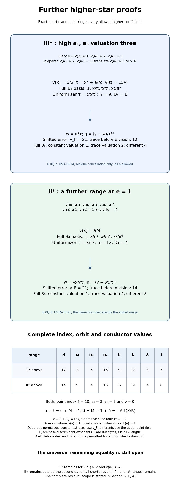

*Two complete higher-star calculations.* The residual range pictured is the scope left by this proposition; Section 6.0R further reduces the III-star part. The diagram records the actual bases, shifts, discriminants, indices and inertia conductors proved in Sections 6.0Q.2–6.0Q.3. Coefficient valuations use the quartic field; differents use the upper point field. Base discriminants and R-module index lengths are distinguished from the quadratic B₄-module index. The finite unramified extension is the one in Section 6.0Q.1. Milne’s free author notes, Proposition 7.55 and Remark 7.56, supply the local-field writing material; the complete specialized arguments are written here.

### 6.0Q.4. The exact remaining equality

The ranges in this proposition are HS3 and HS15. The general conductor–index identity is JM30–JM32 in §6.0BI. The following coefficient ranges lie outside the hypotheses of this proposition and Sections 6.0M–6.0O. Sections 6.0R–6.0T treat its III-star range; Sections 6.0AM.7 and 6.0AN.7 describe additional coefficient ranges:

* even star rows \(2\le r\le2g-3\), including \(r<g\), with \(g=\min(2v(a_1),2v(2)+1)\);
* \(II,III\) with \(v(a_3)\ge2\);
* every \(I_0^*\) preparation;
* \(III^*\) with \(v(a_1)\ge2\) and \(v(a_3)\ge4\);
* \(II^*\) with \(v(a_1)\ge2,v(a_3)\ge4\), outside HS15: equivalently, at least one of \(e\ge2\), \(v(a_4)=4\), or \(v(b_2)\ge5\) holds.

The last equivalence uses the prepared lower bounds \(e\ge1\), \(v(a_4)\ge4\), \(v(b_2)\ge4\). Infinite valuations are included in lower-bound conditions. The calculation applies under the displayed coefficient bounds.

## 6.0R. Two point shifts in the III-star branch

**Proposition 6.0R (two point shifts in the III-star branch).** We prove the discriminant–Artin equality for every minimal prepared III-star equation with ramification index one, high first and third coefficient valuations, and discriminant valuation fourteen. The proof uses two explicit residue cancellations to construct the full point ring above the full quartic ring. All other residual parameter ranges remain required.

### 6.0R.1. Scope, preparation and earlier proofs

Let \(K/\mathbf Q_2\) be finite, \(R=\mathcal O_K\), \(v(\pi)=1\), and \(e=v(2)=1\). Start with a minimal prepared equation satisfying
\[
 v(a_1)\ge2,\qquad v(a_2)\ge2,\qquad
 v(a_3)\ge4,\qquad v(a_4)=3,\qquad v(a_6)\ge5.
 \tag{DS1}
\]
Make the translation of Lemma 6.0D, \(x=X+\pi^2r\), so that the new constant coefficient has valuation at least six. It preserves the displayed first, second and third lower bounds and the exact fourth coefficient valuation. Its discriminant is unchanged, and its regular model still has \(M=8\) components. Throughout the proof the symbols \(a_i,b_i\) refer to these **translated** coefficients. We assume
\[
 v(a_6)\ge6,\qquad v(b_2)=4.
 \tag{DS2}
\]
This second condition is not asserted to be unchanged by the initial translation. The discriminant calculation below proves that it is equivalent, in DS1's full preparation, to \(d=v(\Delta_{\min})=14\).

The written local-field, finite-free lattice, Hensel, unramified-extension and full Eisenstein-ring proofs are in the earlier lesson *Profinite groups and adic representations*, Sections 0A–0G. The prepared model, minimality and Euler inputs are Lemma 6.0D, Theorem 6.0I.9 and Lemma 6.0H of this lesson. Sections 6.0K.1–2 and 6.0K.6 supply the actual unramified index invariance, trace-dual different and tower calculations, finite-order discriminants and wild permutation comparison. Section 6.0Q.2 proves the transitive-quartic/wild-quaternion argument giving zero inertia invariants on the rank-two cohomology representation. These are earlier written proofs, not source citations.

After a permitted finite unramified extension, take a primitive cube root \(\zeta\) and put
\[
 c=1+2\zeta,\qquad c^2=-3,\qquad
 v(c)=0,\qquad v(1-c^{-1})=1.
 \tag{DS3}
\]
All numerical indices and conductors descend unchanged by Section 6.0K.1. The freely accessible human local-field material is [Milne’s author notes *Algebraic Number Theory*](https://www.jmilne.org/math/CourseNotes/ANT.pdf), Proposition 7.55 and Remark 7.56, printed pp.129–130. The full specialized basis and cancellation arguments follow here; that source is writing material and supplies no omitted proof.

### 6.0R.2. Discriminant and the translated b2 test

Using the invariant formulas and the translated preparation, set
\[
 C_2=b_4-2a_4/c,\qquad C_0=b_8+a_4^2.
 \tag{DS4}
\]
One has
\[
 \begin{gathered}
 v(b_2)=4,\quad v(b_4)=4,\quad v(b_6)\ge8,\quad v(b_8)=6,\\
 C_2=a_1a_3+2a_4(1-c^{-1}),\quad v(C_2)=5,\\
 C_0=a_6b_2-a_1a_3a_4+a_2a_3^2,\quad v(C_0)\ge9.
 \end{gathered}
 \tag{DS5}
\]
For \(b_4\), the term \(2a_4\) has valuation four while \(a_1a_3\) has valuation at least six. Both terms of \(b_6=a_3^2+4a_6\) have valuation at least eight. The expression for \(C_0\) has term bounds \(10,9,10\), so \(-a_4^2\) uniquely gives valuation six in \(b_8\). In \(C_2\), its second term has valuation five and its first has valuation at least six.

In
\(\Delta=-b_2^2b_8-8b_4^3-27b_6^2+9b_2b_4b_6\),
the four terms have valuations \(14,15,\ge16,\ge16\). Hence
\[
 d=14.
 \tag{DS6}
\]
Conversely, any translated DS1 preparation has \(v(b_2)\ge4\), \(v(b_4)=4\), \(v(b_6)\ge8\) and \(v(b_8)=6\). If \(v(b_2)\ge5\), its discriminant terms have bounds \(16,15,16,17\), and the second is uniquely exact, so \(d=15\). Thus DS2's test is exactly the \(d=14\) part of this III-star range. Different lifts of the permitted translation parameter differ by \(\pi R\); their new \(b_2\)'s differ by \(12\pi^3R\), of valuation at least five. The test is therefore independent of that lift.

### 6.0R.3. A shifted quartic generator and the full integer ring

Use the earlier 3-torsion quartic
\[
 q(x)=x^4+(b_2/3)x^3+b_4x^2+b_6x+b_8/3=0,
 \qquad t=x^2+a_4/c.
 \tag{DS7}
\]
Every root has valuation \(3/2\). For a smaller root valuation its fourth power would be the unique least term, and for a larger valuation the constant would be uniquely least. At \(3/2\), the fourth power and constant have valuation six and the other terms have bounds \(17/2,7,19/2\).

The exact identity already used in Section 6.0Q.2 is
\[
 t^2=-(b_2/3)x^3-C_2x^2-b_6x-C_0/3.
 \tag{DS8}
\]
The second term has valuation eight; all others have bounds \(17/2,19/2,9\). Hence \(v(t)=4\). Choose a unit \(u\in R\) with
\[
 v(C_2a_4/c+u^2\pi^8)\ge9,
 \qquad s=t-u\pi^4,
 \qquad K_0=C_2a_4/c-C_0/3+u^2\pi^8.
 \tag{DS9}
\]
The two cancelling summands have valuation eight. Their residue ratio is a nonzero square in the perfect finite residue field, so the unit lift exists. The assertion is a one-step residue cancellation. The exact equation becomes
\[
 s^2=-(b_2/3)x^3-(C_2+2u\pi^4)t-b_6x+K_0,
 \qquad v(K_0)\ge9.
 \tag{DS10}
\]
Its first term has valuation \(17/2\); the other three have bounds \(9,19/2,9\). Thus \(v(s)=17/4\). Its denominator forces \(F=K(x)\) to be totally ramified of degree four, using the earlier valuation/degree proof. Normalize \(v_F(\pi)=4\). Then
\[
 \begin{gathered}
 B_4=R1\oplus R(x/\pi)\oplus R(s/\pi^4)
                   \oplus R(xs/\pi^5),\\
 \tau=s/\pi^4,\qquad
 i_4=10,\quad D_4=28-20=8.
 \end{gathered}
 \tag{DS11}
\]
These are the full integer ring and its index: the four displayed valuations are \(0,2,1,3\). They form a field basis because replacing \(x^2,x^3\) by \(s,xs\) is triangular with diagonal one. Nonzero terms in a linear combination with coefficients in \(K\) have different valuation classes modulo four. Their minimum cannot cancel, so integrality is equivalent to all coefficients belonging to \(R\). The denominator determinant has exponent \(1+4+5=10\), and \(\tau\) is a uniformizer. No intermediate order is substituted for the full ring.

### 6.0R.4. First point shift and an exact trace valuation

Choose \(\lambda\in R\) with
\[
 v(a_2-\pi^2\lambda^2)\ge3,
 \qquad w_1=\pi\lambda x,
 \qquad A=a_1x+a_3,
 \qquad G=x^3+a_2x^2+a_4x+a_6.
 \tag{DS12}
\]
Such a lift follows from residue perfection; take zero if the residue of \(a_2/\pi^2\) is zero. The point equation is \(y^2+Ay-G=0\). Its first shifted trace is \(\alpha_1=A+2w_1\). The identity
\[
 (a_1+2\pi\lambda)^2-b_2
   =4(\pi^2\lambda^2-a_2)+4a_1\pi\lambda
 \tag{DS13}
\]
has right-hand valuation at least five. Since \(v(b_2)=4\), this proves
\(v(a_1+2\pi\lambda)=2\). Therefore its product with \(x\) has \(F\)-valuation fourteen, below \(v_F(a_3)\ge16\), and
\[
 v_F(\alpha_1)=14.
 \tag{DS14}
\]

### 6.0R.5. The leading constant coefficient and the second shift

Put
\[
 U=u\pi^4+a_4(1-c^{-1}).
 \tag{DS15}
\]
Its valuation is exactly four, even though its two summands both have valuation four. Here is the necessary noncancellation proof. Squaring and using DS9 gives, modulo \(\pi^9R\),
\[
 \begin{aligned}
 U^2&\equiv-C_2a_4/c+a_4^2(1-c^{-1})^2\\
 &\equiv-2a_4^2(1-c^{-1})/c+a_4^2(1-c^{-1})^2\\
 &=-4a_4^2/c.
 \end{aligned}
 \tag{DS16}
\]
The discarded cross term has valuation \(1+4+4=9\), and the discarded \(a_1a_3a_4/c\) term has valuation at least nine. The last equality follows from \(c^2=-3\). Its right side has valuation eight, proving \(v(U)=4\); it is not an exact square-root assumption.

For the first shifted constant, direct expansion gives
\[
 \begin{aligned}
 E_1&=w_1^2+Aw_1-G=-xs-Ux+R_1,\\
 R_1&=(\pi^2\lambda^2-a_2)x^2
          +a_1\pi\lambda x^2+a_3\pi\lambda x-a_6,
 \qquad v_F(R_1)\ge24.
 \end{aligned}
 \tag{DS17}
\]
The terms of \(R_1\) have respective lower bounds \(24,24,26,24\). Define
\[
 V=b_2b_8/(9\pi^6),\qquad v(V)=4,
 \qquad v(\mu^2V-U)\ge5,
 \qquad w_2=\mu xs/\pi^3,
 \tag{DS18}
\]
where \(\mu\in R^\times\) is chosen by a residue square root. Its required residue ratio \(U/V\) is a nonzero unit, so this lift exists. The second shift has \(v_F(w_2)=11\).

Squaring \(w_2\), using DS10, and reducing \(x^5\) by DS7 gives the exact identity
\[
 \begin{aligned}
 w_2^2-\mu^2Vx
 =\frac{\mu^2}{\pi^6}\bigl(&b_2^2x^4/9+b_2b_4x^3/3+b_2b_6x^2/3\\
 &-(C_2+2u\pi^4)x^2t-b_6x^3+K_0x^2\bigr).
 \end{aligned}
 \tag{DS19}
\]
The six terms on the right have \(F\)-valuation bounds \(32,26,36,24,26,24\). Thus its whole right side has valuation at least twenty-four. Consequently the second shifted point constant is
\[
 E_2=E_1+\alpha_1w_2+w_2^2
     =-xs+(\mu^2V-U)x+R_1+\alpha_1w_2+(w_2^2-\mu^2Vx).
 \tag{DS20}
\]
Its first term has valuation \(23\). Every other term has bound at least \(26,24,25,24\), respectively. Hence \(v_F(E_2)=23\) exactly. Meanwhile \(v_F(2w_2)=15\), above DS14's fourteen, so the second shifted trace also has valuation fourteen.

### 6.0R.6. Full point ring, different and conductor

Set
\[
 \eta=(y-w_1-w_2)/\tau^{11}.
 \tag{DS21}
\]
The two shifts are integral in \(B_4\): \(v_F(w_1)\ge10\) and \(v_F(w_2)=11\). The exact normalized quadratic for \(\eta\) has
\[
 v_F(E_2/\tau^{22})=1,\qquad
 v_F((A+2w_1+2w_2)/\tau^{11})=3.
 \tag{DS22}
\]
It is Eisenstein. The earlier full-ring valuation-class proof gives a totally ramified quadratic \(L/F\) and its entire integer ring \(B_8=B_4[\eta]\). The derivative terms, measured in the upper point field, have different parity. Thus
\[
 d(L/F)=\min\{2v_F(2)+1,2\cdot3\}=\min\{9,6\}=6.
 \tag{DS23}
\]
The exact \(B_4\)-index of \(B_4[y]\) in \(B_8\) is eleven, by the determinant of \(y=w_1+w_2+\tau^{11}\eta\). Both residue degrees are one; the tower/index proofs give
\[
 \begin{aligned}
 D_8&=2\cdot8+6=22,\qquad i_8=(84-22)/2=31,\\
 i_8&=2i_4+11,\qquad
 i_8-i_4=21=14+8-1,\\
 \epsilon_4&=3,\qquad\epsilon_8=7,\qquad\nu=0,\\
 \delta&=28-31+10-2=5,\qquad f(E/K)=2+\delta=7,\\
 -\operatorname{Art}(X/R)&=8+1+5=14=d.
 \end{aligned}
 \tag{DS24}
\]
The inertia orbit counts follow from the two totally ramified fields. The transitive quartic orbit forces nontrivial wild action; the earlier quaternion argument in Section 6.0Q.2 then proves zero cohomology inertia invariants, justifying the displayed conductor. NF24 is computed in full: \(i_4+\ell=10+11=14+8-1\), with \(\nu=0\). This proves the entire DS1 preparation with \(d=14\), at \(e=1\), including every allowed higher or infinite coefficient valuation.

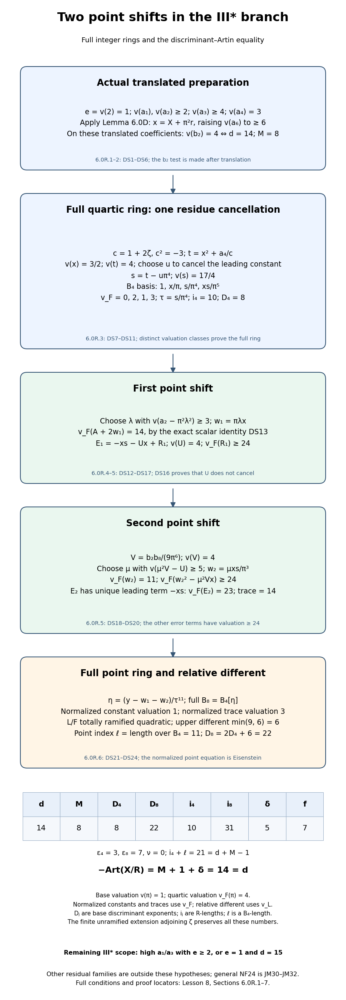

*Two point shifts above a full quartic ring.* The remainder pictured is the scope left by this proposition; Section 6.0S closes its ramification-index-one complement. This map records the translated coefficient test, quartic residue cancellation, two point shifts and full-ring different/index calculation proved in Sections 6.0R.1–6.0R.6. It distinguishes base, quartic and point-field valuations, R-module indices and the quadratic B₄-module index. The finite unramified extension is the one in Section 6.0R.1. Milne’s free author notes, Proposition 7.55 and Remark 7.56, supply local-field writing material; every specialized calculation is proved here.

### 6.0R.7. Remaining parameter ranges

The following list describes coefficient ranges outside the hypotheses in Sections 6.0M–6.0R. Section 6.0S treats its ramification-index-one complement, and Section 6.0T proves two higher-ramification families; Sections 6.0AM.7 and 6.0AN.7 describe additional coefficient ranges:

* \(v(a_1)\ge2,v(a_3)\ge4,e\ge2\); or
* \(v(a_1)\ge2,v(a_3)\ge4,e=1,d=15\), equivalently \(v(b_2)\ge5\) after the actual Lemma 6.0D translation.

The full residual scope still includes every shorter even row \(2\le r\le2g-3\), every \(II,III\) preparation with \(v(a_3)\ge2\), every \(I_0^*\), and the remaining \(II^*\) coefficient ranges in Section 6.0Q.4. The universal NF24 identity and the other family proofs remain required. No external conductor theorem or numerical sample supplies these assertions.

## 6.0S. The discriminant-fifteen III-star branch

**Proposition 6.0S (the discriminant-fifteen III-star branch).** This proof covers the entire remaining ramification-index-one III-star preparation with high first and third coefficients. The quartic can be a totally ramified field or, after a finite unramified extension, a product of two ramified quadratic fields. We construct the full quartic and point rings in both cases. No conductor-discriminant theorem is used as an input.

### 6.0S.1. Preparation and writing material

Let \(K/\mathbf Q_2\) be finite, \(R=\mathcal O_K\), \(v(\pi)=1\), and \(v(2)=1\). Start with the minimal preparation
\[
 v(a_1)\ge2,\quad v(a_2)\ge2,\quad v(a_3)\ge4,
 \quad v(a_4)=3,\quad v(a_6)\ge5.
 \tag{DF1}
\]
Apply the actual translation in Lemma 6.0D. From now on all coefficient symbols refer to the translated equation, and impose
\[
 v(a_6)\ge6,\qquad v(b_2)\ge5.
 \tag{DF2}
\]
The calculation in Section 6.0R.2 proves that this is exactly the discriminant-valuation-fifteen part of DF1. The translation preserves minimality, the discriminant and the eight-component regular model. Thus
\[
 d=15,\qquad M=8.
 \tag{DF3}
\]
All earlier local-field, valuation-class full-ring, completion and Hensel proofs are in *Profinite groups and adic representations*, Sections 0A–0G. The finite-order discriminants, trace-dual different, different tower, unramified invariance, wild permutation comparison and quaternion argument are actually written in Sections 6.0K.1–6.0K.6 of this lesson. The point-tower and Swan formulas are in Section 6.0P.6. The regular-model and Euler proofs are Theorem 6.0I.9 and Lemma 6.0H.

The freely accessible human writing material for the local-field ring arguments is [Milne’s author notes *Algebraic Number Theory*](https://www.jmilne.org/math/CourseNotes/ANT.pdf), Proposition 7.55 and Remark 7.56, printed pp.129–130. Every specialized ring, valuation and cancellation argument needed here is written below. Neither that citation nor a numerical sample supplies a proof.

After a permitted finite unramified extension, choose a primitive cube root \(\zeta\) and put \(c=1+2\zeta\). Then \(c^2=-3\), \(v(c)=0\) and \(v(1-c^{-1})=1\). All the numerical quantities below descend unchanged. Use
\[
 \begin{gathered}
 q(x)=x^4+(b_2/3)x^3+b_4x^2+b_6x+b_8/3,\\
 C_2=b_4-2a_4/c,\qquad C_0=b_8+a_4^2.
 \end{gathered}
 \tag{DF4}
\]
The preparation gives
\[
 v(b_4)=4,\quad v(b_6)\ge8,\quad v(b_8)=6,
 \quad v(C_2)=5,\quad v(C_0)\ge9.
 \tag{DF5}
\]
Indeed \(C_2=a_1a_3+2a_4(1-c^{-1})\) has a unique valuation-five term. In \(C_0=a_6b_2-a_1a_3a_4+a_2a_3^2\), the three bounds are \(11,9,10\). The other invariant bounds follow exactly from their displayed coefficient formulas. Every quartic root has valuation \(3/2\), by the unique-least-term argument of Section 6.0R.3.

### 6.0S.2. Two quartic shifts and an exhaustive scalar test

Put \(t=x^2+a_4/c\). The exact identity is
\[
 t^2=-(b_2/3)x^3-C_2x^2-b_6x-C_0/3.
 \tag{DF6}
\]
The four term bounds are \(19/2,8,19/2,9\), with the second uniquely exact, so \(v(t)=4\). Choose a unit \(u\in R\) by the residue cancellation
\[
 \begin{gathered}
 v(C_2a_4/c+u^2\pi^8)\ge9,\qquad s=t-u\pi^4,\\
 P=a_4/c-u\pi^4,\qquad x^2=s-P.
 \end{gathered}
 \tag{DF7}
\]
The residue field is perfect, so the required unit square-root lift exists. Indeed the exact expansion is
\[
 s^2=-(b_2/3)x^3-(C_2+2u\pi^4)t-b_6x+K_0,
 \qquad K_0=C_2a_4/c-C_0/3+u^2\pi^8.
\]
Its term bounds are \(19/2,9,19/2,9\), proving \(v(s)\ge9/2\). Define
\[
 \begin{gathered}
 U=u\pi^4+a_4(1-c^{-1}),\qquad D=b_4-2P=2U+a_1a_3,\\
 W=b_2P/3-b_6,\qquad H=b_4P-P^2-b_8/3.
 \end{gathered}
 \tag{DF8}
\]
The following noncancellation is essential:
\[
 U^2\equiv-C_2a_4/c+a_4^2(1-c^{-1})^2
          \equiv-4a_4^2/c\pmod{\pi^9R}.
 \tag{DF9}
\]
The discarded cross term has valuation nine and the discarded \(a_1a_3a_4/c\) term has valuation at least nine. The last identity uses \(c^2=-3\), and its right side has valuation eight. Consequently
\[
 v(P)=3,\quad v(U)=4,\quad v(D)=5,
 \quad v(W)\ge8,\quad v(H)\ge9.
 \tag{DF10}
\]
For the last bound, expand \(H=C_2P-C_0/3-u^2\pi^8\); equivalently it is the constant in the exact equation
\[
 s^2+Ds+(b_2/3)xs-Wx-H=0.
 \tag{DF11}
\]
The cancellation in DF7 gives the bound nine directly: replacing \(+u^2\pi^8\) by \(-u^2\pi^8\) changes the expression by a term of valuation nine, and the remaining two terms have valuation at least nine.

Choose \(\rho\in R\) with
\[
 v(\rho^2\pi^6a_4/c+H)\ge10,
 \qquad T=s-\rho\pi^3x,
 \qquad Z=\rho^2\pi^6+b_2\rho\pi^3/3.
 \tag{DF12}
\]
If \(v(H)\ge10\), take \(\rho=0\). Otherwise both cancelling terms have valuation nine and their residue ratio has a square root; a unit lift suffices. No exact unit square root is assumed. Set
\[
 \begin{aligned}
 J&=D+Z+(2\rho\pi^3+b_2/3)x,\\
 B&=D\rho\pi^3-W+Z\rho\pi^3,\qquad C=-ZP-H.
 \end{aligned}
 \tag{DF13}
\]
Substitute \(s=T+\rho\pi^3x\) and \(x^2=T+\rho\pi^3x-P\) in DF11. This gives the exact relation
\[
 T^2+JT+Bx+C=0,
 \qquad v(J)=5,\quad v(B)\ge8,\quad v(C)\ge10.
 \tag{DF14}
\]
Here \(v(Z)\ge6\); the other part of \(J-D\) has valuation at least \(11/2\), so \(D\) uniquely gives its value five. In \(C\), the cancellation in DF12 leaves bounds ten, ten and eleven. The scalar \(B\) now has precisely the exhaustive alternatives \(v(B)=8\) and \(v(B)\ge9\), including infinity.

### 6.0S.3. The quartic-field alternative

Assume \(v(B)=8\). In DF14 the constant term \(Bx\) has valuation \(19/2\), while \(C\) has valuation at least ten. If \(v(T)<19/4\), its square would be uniquely least; if \(v(T)>19/4\), the term \(Bx\) would be uniquely least. Thus \(v(T)=19/4\). This denominator forces a totally ramified quartic field \(F=K(x)\). With \(v_F(\pi)=4\), its full integer ring is
\[
 \begin{gathered}
 B_4=R1\oplus R(x/\pi)\oplus R(T/\pi^4)
            \oplus R(xT/\pi^6),\\
 \tau=xT/\pi^6,\qquad i_4=11,\qquad D_4=30-22=8.
 \end{gathered}
 \tag{DF15}
\]
The four upper valuations are \(0,2,3,1\). Their distinct classes prove integrality coefficient by coefficient; the change from powers of \(x\) to \(T,xT\) is triangular with diagonal one. The denominator determinant has exponent \(1+4+6=11\), and \(\tau\) is a uniformizer. This is the entire integer ring.

### 6.0S.4. The two-quadratic alternative and its full ring

Assume \(v(B)\ge9\). Equation DF14 forces \(v(T)\ge5\): a smaller value would make its square uniquely least. In the quartic étale algebra set
\[
 X=x/\pi,\qquad \theta=T/\pi^5,
 \qquad \mathcal C_4=R1\oplus RX\oplus R\theta\oplus RX\theta.
 \tag{DF16}
\]
This is a full-rank lattice with denominator exponent twelve. The original torsion order remains the power order from Section 6.0K.6; all denominator indices below are measured over its power basis. The candidate is an order, as is proved by the two exact relations
\[
 \begin{aligned}
 X^2&=\rho\pi^2X+\pi^3\theta-P/\pi^2,\\
 \theta^2&=-h_0\theta-h_1X\theta-k_0-k_1X,\\
 h_0&=(D+Z)/\pi^5,\qquad
 h_1=(2\rho\pi^3+b_2/3)/\pi^4,\\
 k_0&=C/\pi^{10},\qquad k_1=B/\pi^9.
 \end{aligned}
 \tag{DF17}
\]
All four scalar coefficients belong to \(R\), and \(h_0\) is a unit. Multiplication of the displayed basis by either generator remains in its span: reduce \(X^2\), \(\theta^2\), then \(X^2\theta\) and \(X\theta^2\) by DF17. This proves closure, rather than merely exhibiting integral generators.

Modulo \(\pi\), the relation for \(X\) is \(X^2=0\). The quotient by \(X\) is the separable quadratic
\[
 k[\theta]/(\theta^2+\bar h_0\theta+\bar k_0).
 \tag{DF18}
\]
After a further finite unramified extension it has two distinct roots. The residue order is consequently a product of two algebras \(k[X]/(X^2)\): in either factor the coefficient of the linear correction of \(\theta\) is the unit \(\bar h_0\). To justify the lifted product, first lift its two idempotents across the square-zero ideal \((X)\), and then lift through \(\pi\)-adic powers. In either step Newton’s formula
\[
 z\longmapsto z-(z^2-z)/(2z-1)
 \tag{DF19}
\]
is defined and squares the error. The denominator is a unit, since its square is \(1+4(z^2-z)\); its inverse follows by a convergent geometric series. The finite free order is complete. The iteration therefore yields an idempotent \(e\), and \(1-e\) gives its orthogonal complement, with sum one.

Each factor of \(\mathcal C_4\) has residue basis \(1,X\). Lifting coefficients successively through \(\pi\)-adic powers shows that these two elements span it over \(R\); the coefficient series converge in \(R\). Its generic algebra has dimension two. It cannot have a degree-one field factor, since every value of \(X\) has valuation \(1/2\). Thus each generic factor is a totally ramified quadratic field \(F_j\). The valuations of \(1,X\), normalized in \(F_j\), are zero and one. Their distinct classes prove that the factor is its **full** integer ring. We have established
\[
 B_4=\mathcal O_{F_1}\times\mathcal O_{F_2}=\mathcal C_4,
 \qquad i_4=12,\qquad D_4=30-24=6.
 \tag{DF20}
\]
For completeness, each quadratic discriminant exponent is three. Its monic polynomial for \(X\) is Eisenstein, with constant valuation one and trace valuation at least one. The upper derivative valuations are three and an even number at least two, so each different exponent is at most three. Their sum is six by DF20 and the proved product discriminant identity. Hence both are exactly three. In both factors \(X\) is a uniformizer and the residue degree is one.

### 6.0S.5. The first point shift, common to both alternatives

Choose \(\lambda\in R\) with \(v(a_2-\pi^2\lambda^2)\ge3\), taking zero if the required residue is zero. Put
\[
 w_1=\pi\lambda x,\quad A=a_1x+a_3,
 \quad G=x^3+a_2x^2+a_4x+a_6,
 \quad \alpha_1=A+2w_1.
 \tag{DF21}
\]
The scalar identity
\[
 (a_1+2\pi\lambda)^2-b_2
       =4(\pi^2\lambda^2-a_2)+4a_1\pi\lambda
 \tag{DF22}
\]
has right-hand valuation at least five. Since \(v(b_2)\ge5\), the square on its left before subtracting \(b_2\) has valuation at least five. The scalar \(a_1+2\pi\lambda\) belongs to \(K\), so its integer valuation is at least three. It follows that \(v(\alpha_1)\ge4\). Direct expansion gives
\[
 \begin{aligned}
 E_1&=w_1^2+Aw_1-G=-xs-Ux+R_1,\\
 R_1&=(\pi^2\lambda^2-a_2)x^2
          +a_1\pi\lambda x^2+a_3\pi\lambda x-a_6,
 \qquad v(R_1)\ge6.
 \end{aligned}
 \tag{DF23}
\]
The four remainder terms have base bounds \(6,6,13/2,6\). Since \(v(s)\ge9/2\), we obtain \(E_1=-Ux+R'\), where \(v(R')\ge6\). Its leading value is therefore \(v(E_1)=11/2\).

### 6.0S.6. Point ring over the quartic field

In the alternative DF15 put
\[
 V=-B/\pi^4,\qquad v(V)=4,
 \qquad v(\mu^2V-U)\ge5,
 \qquad w_2=\mu T/\pi^2.
 \tag{DF24}
\]
The nonzero unit residue ratio \(U/V\) has a square root, so a unit \(\mu\) exists. It gives \(v_F(w_2)=11\). From DF14 the exact second square is
\[
 w_2^2=\mu^2Vx-\mu^2DT/\pi^4
            -\mu^2(J-D)T/\pi^4-\mu^2C/\pi^4.
 \tag{DF25}
\]
In \(E_2=E_1+\alpha_1w_2+w_2^2\), the term \(-\mu^2DT/\pi^4\) has upper valuation twenty-three. The cancelled \(x\)-coefficient leaves a term of upper valuation at least twenty-six. The first remainder, trace product, \(J-D\) term and scalar constant have respective bounds \(24,27,25,24\). Thus
\[
 v_F(E_2)=23,\qquad
 v_F(\alpha_1+2w_2)=15.
 \tag{DF26}
\]
The second equality follows because the first trace has upper valuation at least sixteen and \(2w_2\) has value fifteen. For
\[
 \eta=(y-w_1-w_2)/\tau^{11},
 \tag{DF27}
\]
the normalized constant and trace valuations are one and four. Its quadratic is Eisenstein, giving the full ring \(B_8=B_4[\eta]\). The upper relative different is \(\min(9,8)=8\). The exact point index over \(B_4\) is eleven, and hence
\[
 D_8=2\cdot8+8=24,
 \quad i_8=(90-24)/2=33=2\cdot11+11.
 \tag{DF28}
\]

### 6.0S.7. Point rings over the two quadratic fields

In each factor of DF20, use \(v_{F_j}(\pi)=2\) and uniformizer \(X\). The first shift alone has constant valuation eleven and trace valuation at least eight. Put
\[
 \eta_j=(y-w_1)/X^5.
 \tag{DF29}
\]
Its normalized constant has valuation one, and its normalized trace has valuation at least three. Thus it is Eisenstein and generates the entire integer ring of a totally ramified quadratic point field \(L_j/F_j\). Its upper relative different is five: the two derivative terms have valuations five and at least six. Its exact \(\mathcal O_{F_j}\)-index is five. The two residue degrees are one, so
\[
 D_8=2(2\cdot3+5)=22,
 \quad i_8=(90-22)/2=34=2\cdot12+5+5.
 \tag{DF30}
\]
This proves the full point product ring, including its exact indices; no intermediate point order is used.

### 6.0S.8. Both alternatives have the same conductor

The quartic-field alternative has inertia orbit codimensions \(\epsilon_4=3,\epsilon_8=7\). The two-quadratic alternative has \(\epsilon_4=2,\epsilon_8=6\). In each, \(\nu=\epsilon_8-\epsilon_4-4=0\). Both have an even quartic inertia orbit, so the wild image is nontrivial: an odd-order tame image cannot have an even orbit. The earlier quaternion argument places \(-1\) in that wild image and proves zero inertia invariants on the rank-two cohomology representation. The actual Swan formula therefore gives
\[
 \begin{array}{c|ccccc}
 \text{quartic alternative}&i_4&i_8&D_4&D_8&\delta\\\hline
 \text{field}&11&33&8&24&30-33+11-2=6\\
 \text{two quadratics}&12&34&6&22&30-34+12-2=6
 \end{array}
 \tag{DF31}
\]
Consequently, in the entire DF1–DF2 range,
\[
 f(E/K)=2+6=8,
 \qquad -\operatorname{Art}(X/R)=8+1+6=15=d.
 \tag{DF32}
\]
The universal target NF24 is evaluated in both alternatives: the field has \(i_4+\ell=11+11=22\), and the product has \(i_4+\ell_1+\ell_2=12+5+5=22\). Both equal \(d+M-1\). Every higher or infinite coefficient valuation allowed by the preparation is included in the displayed bounds.

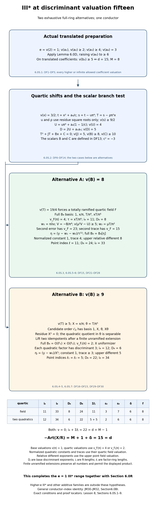

*Two exhaustive integer-ring calculations.* For coefficient ranges complementary to Section 6.0S, Section 6.0T treats two higher-ramification families. Sections 6.0S.3–6.0S.7 prove the full quartic-field ring or the full product of two ramified quadratic rings, then the corresponding full point rings. The map records each basis, residue cancellation, different, index length and inertia-orbit count, and their common conductor calculation in Section 6.0S.8. It distinguishes the candidate order from the original torsion power order. Base, quartic and upper point-field valuation normalizations, R-module indices and factor-ring index lengths are explicit. Finite unramified extensions preserve the quantities and permit the displayed product. Milne’s free author notes, Proposition 7.55 and Remark 7.56, provide local-field writing material; every specialized proof is written here.

### 6.0S.9. Scope left by this proposition

This closes the ramification-index-one III-star range, together with Section 6.0R. At the scope of this proposition, the high-first/high-third III-star preparations at higher ramification index remain required. Section 6.0T treats two of these families; its last subsection gives the current scope, including all other residual families and the universal NF24 proof. 

The other residual families are precisely those retained in Section 6.0R.7: shorter even star rows, II/III with third coefficient valuation at least two, every I-zero-star preparation, and the remaining II-star coefficient ranges from Section 6.0Q.4. Outside the hypotheses of Section 6.0S, in the high-first/high-third III-star branch only ramification index at least two remains. Section 6.0T reduces that range further. The stated programme prerequisites remain required.

## 6.0T. Two III-star families at higher ramification

**Proposition 6.0T (two III-star families at higher ramification).** We prove the discriminant–Artin equality for two complete parameter families: every high-third-coefficient preparation with first coefficient valuation two and ramification index at least two; and an unbounded third-coefficient family in which the first coefficient and ramification index meet explicit lower bounds. The second argument constructs a base-field scalar approximation to the fourth power of a quartic uniformizer, then performs a finite residue-cancellation procedure. Every other residual family remains required.

### 6.0T.1. Preparation and actual earlier proofs

Let \(K/\mathbf Q_2\) be finite, \(R=\mathcal O_K\), \(v(\pi)=1\), and \(e=v(2)\). Start with the minimal III-star preparation
\[
 v(a_1)\ge2,\quad v(a_2)\ge2,\quad v(a_3)\ge4,
 \quad v(a_4)=3,\quad v(a_6)\ge5.
 \tag{HR1}
\]
Apply the translation in Lemma 6.0D; all subsequent coefficient symbols refer to that translated equation, so \(v(a_6)\ge6\). Its eight-component model, minimality and Euler formula are proved in Lemma 6.0D, Theorem 6.0I.9 and Lemma 6.0H. The local-field, full-ring and finite-free lattice proofs are earlier in *Profinite groups and adic representations*, Sections 0A–0G. Actual unramified invariance, different/index/tower proofs, torsion-order discriminants and wild permutation comparison are in Sections 6.0K.1–6.0K.6; Section 6.0P.6 proves the point tower and Swan formulas.

After a permitted finite unramified extension, take \(c=1+2\zeta\) with \(\zeta\) a primitive cube root. Then \(c^2=-3\), \(v(c)=0\), and \(v(1-c^{-1})=e\). All indices and conductors descend unchanged. Write
\[
 \begin{gathered}
 q(x)=x^4+(b_2/3)x^3+b_4x^2+b_6x+b_8/3,\\
 A_0=a_4/c,\quad t=x^2+A_0,\quad
 C_2=b_4-2A_0,\quad C_0=b_8+a_4^2.
 \end{gathered}
 \tag{HR2}
\]
The exact quartic identity is
\[
 t^2=-(b_2/3)x^3-C_2x^2-b_6x-C_0/3.
 \tag{HR3}
\]
The freely accessible human writing material for complete local fields and Eisenstein integer rings is [Milne’s author notes *Algebraic Number Theory*](https://www.jmilne.org/math/CourseNotes/ANT.pdf), Proposition 7.55 and Remark 7.56, printed pp.129–130. Every specialized argument follows locally; no source citation replaces a proof.

### 6.0T.2. First coefficient valuation two

Assume
\[
 e\ge2,\qquad v(a_1)=2,\qquad v(a_3)\ge4.
 \tag{HR4}
\]
The translation preserves these conditions, including any infinite third coefficient valuation. The invariant formulas give
\[
 v(b_2)=4,\quad v(b_4)\ge5,\quad v(b_6)\ge8,
 \quad v(b_8)=6,\quad v(C_2)\ge6,\quad v(C_0)\ge9.
 \tag{HR5}
\]
For \(b_2\), its first term has valuation four and the second has valuation at least six. In \(b_8\), \(-a_4^2\) has value six while the other terms have value at least nine. The discriminant terms have bounds \(14,21,16,17\), with the first uniquely exact. Hence \(d=14\).

Every quartic root has valuation \(3/2\): the fourth power and constant have value six, while the other terms have strictly higher value. A smaller root valuation would make the fourth-power term uniquely smallest; a larger root valuation would make the constant uniquely smallest. Both contradict the quartic equation. In HR3 the first term has valuation \(17/2\) and the other bounds are \(9,19/2,9\). Thus \(v(t)=17/4\), forcing a totally ramified quartic field \(F=K(x)\). With \(v_F(\pi)=4\), the full ring and uniformizer are
\[
 \begin{gathered}
 B_4=R1\oplus R(x/\pi)\oplus R(t/\pi^4)
                 \oplus R(xt/\pi^5),\qquad \tau=t/\pi^4,\\
 i_4=10,\qquad D_4=28-20=8.
 \end{gathered}
 \tag{HR6}
\]
The four valuation classes are \(0,2,1,3\). The triangular basis change has diagonal one, so these classes prove full integrality coefficient by coefficient. The denominator exponent is \(1+4+5=10\).

Choose \(\lambda\in R\) by \(v(a_2-\pi^2\lambda^2)\ge3\), taking zero when its required residue is zero. Put \(w_1=\pi\lambda x\), \(A=a_1x+a_3\), and \(G=x^3+a_2x^2+a_4x+a_6\). The point polynomial is \(y^2+Ay-G\). Direct expansion gives
\[
 \begin{aligned}
 E_1&=w_1^2+Aw_1-G=-xt-a_4(1-c^{-1})x+R_1,\\
 R_1&=(\pi^2\lambda^2-a_2)x^2+a_1\pi\lambda x^2
                         +a_3\pi\lambda x-a_6.
 \end{aligned}
 \tag{HR7}
\]
The first term has base valuation \(23/4\). The remaining term and four remainder bounds are \(e+9/2\ge13/2\) and \(6,6,13/2,6\). Thus \(v_F(E_1)=23\). In the shifted trace \(A+2w_1\), the term \(a_1x\) has base valuation \(7/2\), while the other bounds are \(4\) and \(e+5/2\ge9/2\). Its upper value is fourteen.

For \(\eta=(y-w_1)/\tau^{11}\), the normalized constant and trace valuations are one and three. The polynomial is Eisenstein and gives the full point ring. Its upper relative different is \(\min(8e+1,6)=6\), and its exact point index is eleven. Therefore
\[
 \begin{gathered}
 D_8=22,\quad i_8=31=2i_4+11,\quad
 \epsilon_4=3,\quad\epsilon_8=7,\quad\nu=0,\\
 \delta=28-31+10-2=5,\quad f=7,\quad
 -\operatorname{Art}(X/R)=8+1+5=14=d.
 \end{gathered}
 \tag{HR8}
\]
The inertia-invariant assertion used here follows from the transitive quartic orbit and the actual earlier quaternion proof, exactly as in Section 6.0Q.2. NF24 is computed as \(i_4+\ell=10+11=14+8-1\).

### 6.0T.3. An unbounded third-coefficient family

Now let \(z\) be the finite third coefficient valuation and assume
\[
 z=v(a_3)\ge4,\qquad v(a_1)\ge z-1,
 \qquad e\ge z-2.
 \tag{HR9}
\]
The translation preserves the exact value of \(a_3\): its added term has valuation at least \(z+1\). Infinite first coefficient valuations are allowed. Using the coefficient formulas, we obtain
\[
 \begin{gathered}
 v(b_2)\ge2z-2,\quad v(b_4)\ge z+1,
 \quad v(b_6)=2z,\quad v(b_8)=6,\\
 v(C_2)\ge2z-1,\qquad v(C_0)\ge2z+2.
 \end{gathered}
 \tag{HR10}
\]
Here \(a_3^2\) uniquely leads in \(b_6\), because \(v(4a_6)\ge2e+6\ge2z+2\). The other bounds follow from
\(C_2=a_1a_3+2a_4(1-c^{-1})\) and
\(C_0=a_6b_2-a_1a_3a_4+a_2a_3^2\).
The discriminant term bounds are \(4z+2,6z-3,4z,5z-1\), and only the third is exact. Thus
\[
 d=4z.
 \tag{HR11}
\]
Every quartic root again has valuation \(3/2\). In HR3 the third term has value \(2z+3/2\), and the other bounds are \(2z+5/2,2z+2,2z+2\). Hence \(v(t)=z+3/4\). This forces a totally ramified quartic field with full ring
\[
 \begin{gathered}
 B_4=R1\oplus R(x/\pi)\oplus R(t/\pi^z)
                       \oplus R(xt/\pi^{z+2}),\\
 \tau=xt/\pi^{z+2},\qquad
 i_4=2z+3,\qquad D_4=8z-2(2z+3)=4z-6.
 \end{gathered}
 \tag{HR12}
\]
The four upper valuation classes are \(0,2,3,1\). Triangularity and distinct classes prove that this is the entire integer ring, and \(\tau\) is a uniformizer.

### 6.0T.4. A base-field approximation to the fourth uniformizer power

Put \(N=\pi^{2z+4}\). Define base-field scalars
\[
 \begin{gathered}
 Q=\frac{b_6A_0-b_2A_0^2/3}{N},\\
 \beta=\frac{-C_2A_0^2+C_0A_0/3}{N}.
 \end{gathered}
 \tag{HR13}
\]
The first summand of \(Q\) has valuation minus one and the second at least zero, so \(v(Q)=-1\). Also \(v(\beta)\ge1\). Substitute \(x^2=t-A_0\) in the exact expression \(\tau^2=x^2t^2/N\). It gives
\[
 \begin{aligned}
 \tau^2&=Qx+\beta+R_0,\\
 R_0&=N^{-1}\bigl(-b_2xt^2/3+2b_2A_0xt/3-C_2t^2\\
 &\hspace{37mm}+2C_2A_0t-b_6xt-C_0t/3\bigr).
 \end{aligned}
 \tag{HR14}
\]
The six displayed remainder bounds, in order, are
\[
 2z-3,\quad e+z-3/4,\quad2z-7/2,
 \quad e+z-5/4,\quad z-7/4,\quad z-5/4.
 \tag{HR15}
\]
They are all at least \(z-7/4\). Now define
\[
 \sigma=-Q^2A_0+\beta^2\in R,
 \qquad v(\sigma)=1.
 \tag{HR16}
\]
The first term has value one and the second at least two. Squaring HR14 and substituting \(x^2=t-A_0\) proves the exact identity
\[
 \tau^4-\sigma
   =Q^2t+2Qx\beta+2(Qx+\beta)R_0+R_0^2.
 \tag{HR17}
\]
Its four term bounds are \(z-5/4,e+3/2,e+z-5/4,2z-7/2\). Each is at least \(z-5/4\), by HR9. Thus
\[
 v(\tau^4-\sigma)\ge z-5/4.
 \tag{HR18}
\]
This is an actual base-field scalar approximation, not a residue-only identification of the uniformizer power. For every positive integer \(n\), the exact telescoping identity gives
\[
 \begin{gathered}
 \tau^{4n}-\sigma^n=(\tau^4-\sigma)
          \sum_{j=0}^{n-1}\tau^{4(n-1-j)}\sigma^j,\\
 v(\tau^{4n}-\sigma^n)\ge z+n-9/4.
 \end{gathered}
 \tag{HR19}
\]
Every summand has valuation \(n-1\); its sum cannot have smaller value. In particular for \(n\ge6\) the error is strictly above \(z+9/4\), the point error we will preserve.

### 6.0T.5. Finite residue cancellation of the base-field point constant

Choose \(\lambda\) and \(w_1\) as in HR7. Write \(H_2=\pi^2\lambda^2-a_2\), of valuation at least three. The exact first point error decomposes as
\[
 \begin{aligned}
 E_1&=-xt+K+R_1',\qquad K=-H_2A_0-a_6\in R,\\
 R_1'&=-a_4(1-c^{-1})x+H_2t
                   +a_1\pi\lambda x^2+a_3\pi\lambda x.
 \end{aligned}
 \tag{HR20}
\]
We have \(v(K)\ge6\), and the four bounds in \(R_1'\) are \(e+9/2\ge z+5/2,z+15/4,z+3,z+5/2\). Hence \(v(R_1')\ge z+5/2\). The first shifted trace \(\alpha_1=A+2w_1\) has valuation exactly \(z\), because \(a_3\) uniquely leads; its other terms have value at least \(z+1/2\).

Starting with \(K_6=K\), choose successively
\[
 \begin{gathered}
 \kappa_n\in R,\qquad
 K_{n+1}=K_n+\kappa_n^2\sigma^n,
 \qquad v(K_{n+1})\ge n+1,\\
 n=6,7,\ldots,z+2.
 \end{gathered}
 \tag{HR21}
\]
This finite procedure exists by perfection of the residue field: if \(v(K_n)\ge n\), take a square root of the residue of \(-K_n/\sigma^n\). Choose zero when that residue is zero. Only these one-step lifts are claimed. Induction gives
\[
 v\left(K+\sum_{n=6}^{z+2}\kappa_n^2\sigma^n\right)\ge z+3.
 \tag{HR22}
\]
Put
\[
 S=\sum_{n=6}^{z+2}\kappa_n\tau^{2n},\qquad v(S)\ge3.
 \tag{HR23}
\]
Every summand is integral in the full quartic ring. By HR19 its individual square differs from \(\kappa_n^2\sigma^n\) by value at least \(z+n-9/4\ge z+15/4\). Every cross product in the square of the sum has value at least \(e+6\ge z+4\), and the trace product \(\alpha_1S\) has value at least \(z+3\). Consequently, for the total shift \(w_1+S\),
\[
 \begin{gathered}
 E=E_1+\alpha_1S+S^2=-xt+\text{terms of valuation at least }z+5/2,\\
 v(E)=z+9/4.
 \end{gathered}
 \tag{HR24}
\]
The added trace \(2S\) has valuation at least \(e+3\ge z+1\), so the total shifted trace still has valuation exactly \(z\). This proves the precise leading error and trace without an unproved square-root approximation in the quartic field.

### 6.0T.6. Full point ring and the conductor identity

Define
\[
 \ell=2z+4,\qquad \eta=(y-w_1-S)/\tau^\ell.
 \tag{HR25}
\]
In the upper quartic normalization the normalized constant and trace have valuations
\[
 4(z+9/4)-2\ell=1,
 \qquad 4z-\ell=2z-4.
 \tag{HR26}
\]
Its polynomial is Eisenstein. The actual earlier full-ring proof gives the entire integer ring \(B_8=B_4[\eta]\) of a totally ramified quadratic point field. The determinant of \(y=w_1+S+\tau^\ell\eta\) proves exact point index \(\ell\). The derivative terms have distinct parity; since \(8e+1\ge8z-15>4z-8\), their upper relative different is
\[
 d(L/F)=\min(8e+1,4z-8)=4z-8.
 \tag{HR27}
\]
Both residue degrees are one, and the tower and torsion-order discriminant proofs give
\[
 \begin{gathered}
 D_8=2(4z-6)+(4z-8)=12z-20,\\
 i_8=(24z-D_8)/2=6z+10=2(2z+3)+(2z+4),\\
 \epsilon_4=3,\quad\epsilon_8=7,\quad\nu=0.
 \end{gathered}
 \tag{HR28}
\]
Transitivity of the quartic inertia orbit forces nontrivial wild action. The earlier quaternion argument proves zero rank-two cohomology inertia invariants. Applying the actual Swan and Euler formulas now yields
\[
 \begin{aligned}
 \delta&=8z-(6z+10)+(2z+3)-2=4z-9,\\
 f(E/K)&=2+\delta=4z-7,\\
 -\operatorname{Art}(X/R)&=8+1+(4z-9)=4z=d,\\
 i_4+\ell&=(2z+3)+(2z+4)=4z+7=d+M-1.
 \end{aligned}
 \tag{HR29}
\]
Thus NF24 is evaluated for the full unbounded family HR9. The cancellation loop contains exactly \(z-3\) steps; its written induction covers all finite \(z\), not a cutoff or a collection of numerical examples.

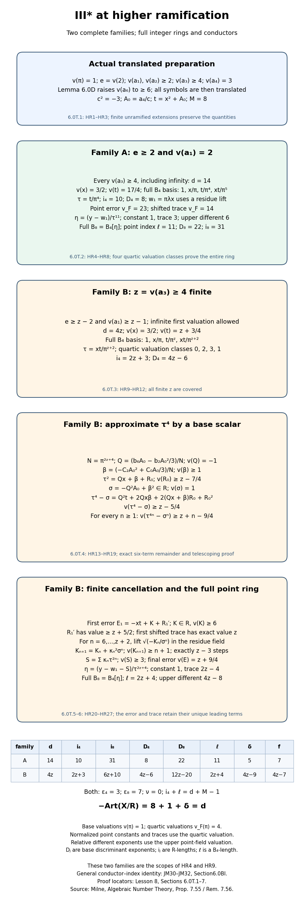

*Two complete higher-ramification families.* Sections 6.0T.2–6.0T.6 prove both full quartic and point rings and compute their differents, indices, inertia-orbit counts and conductors. For the unbounded third-coefficient family, the map records the base scalar approximation to the fourth uniformizer power and the finite residue-cancellation induction, with its exact error and trace bounds. The valuation normalizations and index-length rings are stated explicitly; the exact hypotheses are HR4 and HR9. Milne’s free author notes, Proposition 7.55 and Remark 7.56, provide local-field writing material; every specialized proof is written here.

### 6.0T.7. Scope left by this proposition

The ranges in this proposition are HR4 and HR9. For complementary coefficient ranges, Section 6.0U treats its translated second-invariant-valuation-six family and describes the coefficient ranges treated there. At third coefficient valuation four, HR9 covers every first coefficient valuation at least three and every ramification index at least two. In conjunction with Sections 6.0M–6.0S, the remaining III-star preparations consequently have ramification index at least two, first coefficient valuation at least three, and third coefficient valuation at least five. For a finite third valuation, at least one of the two HR9 bounds fails; infinite third valuations are also retained. Every shorter even star row, remaining II/III and I-zero-star preparation, residual II-star range and universal NF24 proof remain required. 

## 6.0U. The discriminant-eighteen III-star family

**Proposition 6.0U (the discriminant-eighteen III-star family).** This argument treats the entire translated III-star preparation with first coefficient valuation at least three, third coefficient valuation at least five, ramification index at least two and second invariant valuation exactly six. It includes infinite first or third coefficient valuations whenever the invariant condition holds. We compute full integer rings and conductors in the two ramification alternatives. All other residual families remain required.

### 6.0U.1. Preparation and earlier proofs

Let \(K/\mathbf Q_2\) be finite, \(R=\mathcal O_K\), \(v(\pi)=1\), and \(e=v(2)\). Apply the actual translation of Lemma 6.0D to the minimal III-star preparation, and thereafter use the translated coefficients. Assume
\[
 \begin{gathered}
 e\ge2,\quad v(a_1)\ge3,\quad v(a_2)\ge2,\quad v(a_3)\ge5,\\
 v(a_4)=3,\quad v(a_6)\ge6,\quad v(b_2)=6.
 \end{gathered}
 \tag{DE1}
\]
All coefficient tests, particularly the last test, are after that translation. The eight-component model, minimality and Euler formula are earlier in Lemma 6.0D, Theorem 6.0I.9 and Lemma 6.0H. The full local-field/Eisenstein proofs are earlier in *Profinite groups and adic representations*, Sections 0A–0G. Sections 6.0K.1–6.0K.6 and 6.0P.6 prove the actual unramified, tower/index, torsion-order and Swan identities used here. Milne’s freely accessible author notes [*Algebraic Number Theory*](https://www.jmilne.org/math/CourseNotes/ANT.pdf), Proposition 7.55 and Remark 7.56, printed pp.129–130, provide local-field writing material; no citation replaces a specialized proof.

Pass to a permitted finite unramified extension containing a primitive cube root \(\zeta\), and put \(c=1+2\zeta\). Then \(c^2=-3\), \(v(c)=0\), and \(v(1-c^{-1})=e\). Define
\[
 \begin{gathered}
 A_0=a_4/c,\quad t=x^2+A_0,\quad C_2=b_4-2A_0,
 \quad C_0=b_8+a_4^2,\\
 q(x)=x^4+(b_2/3)x^3+b_4x^2+b_6x+b_8/3=0,\\
 t^2=-(b_2/3)x^3-C_2x^2-b_6x-C_0/3.
 \end{gathered}
 \tag{DE2}
\]
The last equality follows by direct expansion of the quartic equation.

### 6.0U.2. Discriminant and the first shifted trace

If \(e\ge3\), DE1 forces \(v(a_1)=3\): the other term in \(b_2=a_1^2+4a_2\) has value at least eight. The coefficient formulas give the following complete bounds:
\[
 \begin{array}{c|ccccc}
 &v(b_4)&v(b_6)&v(b_8)&v(C_2)&v(C_0)\\\hline
 e\ge3&\ge6&\ge10&6&\ge8&\ge11\\
 e=2&5&\ge10&6&7&\ge11.
 \end{array}
 \tag{DE3}
\]
Indeed \(-a_4^2\) uniquely leads in \(b_8\). The identities
\(C_2=a_1a_3+2a_4(1-c^{-1})\) and
\(C_0=a_6b_2-a_1a_3a_4+a_2a_3^2\)
give their columns; at \(e=2\) the second term of \(C_2\) uniquely has value seven. Similarly the second term of \(b_4=a_1a_3+2a_4\) uniquely has value five.

The four discriminant term bounds are
\[
 \begin{array}{c|cccc}
 &-b_2^2b_8&-8b_4^3&-27b_6^2&9b_2b_4b_6\\\hline
 e\ge3&18&\ge27&\ge20&\ge22\\
 e=2&18&21&\ge20&\ge21.
 \end{array}
 \qquad d=18.
 \tag{DE4}
\]
The first term uniquely has the least value. Every quartic root has value \(3/2\): a smaller value would make its fourth power uniquely smallest in DE2, and a larger value would make the constant uniquely smallest, both impossible.

Choose \(\lambda\in R\) by \(v(\pi^2\lambda^2-a_2)\ge3\), allowing the zero residue lift. Set
\[
 H_2=\pi^2\lambda^2-a_2,\quad w_1=\pi\lambda x,
 \quad A=a_1x+a_3,\quad G=x^3+a_2x^2+a_4x+a_6.
 \tag{DE5}
\]
The first shifted point error and trace are
\[
 \begin{aligned}
 E_1&=w_1^2+Aw_1-G=-xt-a_4(1-c^{-1})x\\
 &\hspace{17mm}+H_2x^2+a_1\pi\lambda x^2+a_3\pi\lambda x-a_6,\\
 \alpha_1&=(a_1+2\pi\lambda)x+a_3.
 \end{aligned}
 \tag{DE6}
\]
Crucially, even when the two trace-coefficient summands have the same value, their sum cannot cancel. The exact square identity is
\[
 \begin{gathered}
 (a_1+2\pi\lambda)^2-b_2=4a_1\pi\lambda+4H_2,\\
 v\bigl((a_1+2\pi\lambda)^2-b_2\bigr)\ge7.
 \end{gathered}
 \tag{DE7}
\]
The two bounds are \(2e+v(a_1)+1\ge8\) and \(2e+3\ge7\). Since \(v(b_2)=6\), the coefficient has exact value three. Thus \(v(\alpha_1)=9/2\), because the third coefficient has value at least five. This proves the needed trace value for both alternatives.

### 6.0U.3. Ramification index at least three

Suppose \(e\ge3\). In DE2 the first term has value \(21/2\), while the other bounds are \(11,23/2,11\). Hence
\[
 \begin{gathered}
 v(t)=21/4,\\
 B_4=R1\oplus R(x/\pi)\oplus R(t/\pi^5)\oplus R(xt/\pi^6),\\
 \tau=t/\pi^5.
 \end{gathered}
 \tag{DE8}
\]
The quarter value forces a totally ramified quartic field. The four upper valuation classes \(0,2,1,3\) and the triangular basis change prove that this is its entire integer ring. Their denominator sum gives
\[
 i_4=12,\qquad D_4=36-24=12.
 \tag{DE9}
\]

Writing \(x^2=t-A_0\), separate the base constant
\[
 K=-H_2A_0-a_6\in R,\quad v(K)\ge6,
 \qquad v(K+\mu^2A_0^2)\ge7
 \tag{DE10}
\]
by a residue square root \(\mu\in R\) of \(-K/A_0^2\). Put \(w_2=\mu x^2\), of value at least three. Expanding the new point error gives
\[
 \begin{aligned}
 E_2&=-xt+(K+\mu^2A_0^2)-a_4(1-c^{-1})x+H_2t\\
 &\hspace{11mm}+a_1\pi\lambda x^2+a_3\pi\lambda x
      +\alpha_1\mu x^2+\mu^2(t^2-2A_0t),\\
 v(E_2)&=27/4,\qquad v(\alpha_1+2w_2)=9/2.
 \end{aligned}
 \tag{DE11}
\]
The seven remainder bounds are respectively \(7,e+9/2,33/4,7,15/2,15/2,21/2\); the last bound controls both terms in its parenthesis. All strictly exceed \(27/4\). The added trace has value at least \(e+3\ge6\), so it cannot change the trace proved in DE7. This establishes the precise point error and trace.

### 6.0U.4. Ramification index two: the quartic shift

Suppose \(e=2\). The \(C_2x^2\) term uniquely has value ten in DE2, so \(v(t)=5\). Lift its residue square root by choosing a unit \(u\in R\) such that
\[
 \begin{gathered}
 v(C_2A_0-u^2\pi^{10})\ge11,\\
 m=u\pi^5,\quad s=t-m,\quad P=A_0-m,\quad x^2=s-P.
 \end{gathered}
 \tag{DE12}
\]
Define \(D=C_2+2m\) and \(H_0=C_2A_0-m^2-C_2m-C_0/3\). The exact shifted quartic equation is
\[
 \begin{gathered}
 s^2=(b_2P/3-b_6)x-(b_2/3)xs-Ds+H_0,\\
 v(D)\ge7,\quad v(H_0)\ge11.
 \end{gathered}
 \tag{DE13}
\]
We initially know \(v(s)\ge5\). In this equation the first term has value \(21/2\); the other bounds are \(25/2,12,11\). Here the scalar \(b_2P/3-b_6\) has exact value nine. Thus \(v(s)=21/4\). Replacing \(t\) by \(s\) in DE8 gives the full quartic integer ring and uniformizer \(\tau=s/\pi^5\); the same distinct valuation classes and denominator exponents prove DE9.

Put \(U=m+a_4(1-c^{-1})\). Its exact value is five, rather than merely a lower bound: the exact square identity is
\[
 U^2=(m^2-C_2A_0)+a_1a_3A_0-4a_4^2/c^2
                 +2m a_4(1-c^{-1}).
 \tag{DE14}
\]
The first, second and last terms have values at least eleven, eleven and twelve, respectively, and the remaining term has exact value ten. Hence \(v(U^2)=10\) and \(v(U)=5\). This controls the sign and size of the point coefficient after the quartic shift.

### 6.0U.5. Ramification index two: two further point shifts

Set \(K=-H_2P-a_6\in R\), of value at least six, and choose \(\mu\in R\) by \(v(K+\mu^2P^2)\ge7\). For \(w_2=\mu x^2\), expansion gives
\[
 \begin{aligned}
 E_2&=-xs-Ux+(K+\mu^2P^2)+H_2s
          +a_1\pi\lambda x^2+a_3\pi\lambda x\\
 &\hspace{14mm}+\alpha_1\mu x^2+\mu^2(s^2-2Ps),\\
 \alpha_2&=\alpha_1+2\mu x^2,\qquad v(\alpha_2)=9/2.
 \end{aligned}
 \tag{DE15}
\]
Every term after the first two has value at least seven: their bounds are \(7,33/4,7,15/2,15/2,41/4\). The last bound controls both terms in the parenthesis. The added trace has value at least five, strictly above the exact trace of DE7.

The \(-Ux\) term still has value \(13/2\). To cancel it put
\[
 \begin{gathered}
 V=(b_2P/3-b_6)/\pi^4,\quad v(V)=5,
 \qquad v(\xi^2V-U)\ge6,\quad w_3=\xi s/\pi^2,\\
 w_3^2=\xi^2Vx+
       \xi^2\bigl(-(b_2/3)xs-Ds+H_0\bigr)/\pi^4.
 \end{gathered}
 \tag{DE16}
\]
The residue choice \(\xi\in R\) exists by perfection of the residue field and is a unit. The three remainder bounds in its square are \(35/4,33/4,7\). The cancellation remainder \((\xi^2V-U)x\) has value at least \(15/2\), and the trace product \(\alpha_2w_3\) has value \(31/4\). Thus the final error and trace are
\[
 \begin{gathered}
 E_3=E_2+\alpha_2w_3+w_3^2=-xs+
        \text{terms of valuation at least seven},\\
 v(E_3)=27/4,\quad v(\alpha_2+2w_3)=9/2.
 \end{gathered}
 \tag{DE17}
\]
The added trace has value \(21/4\), strictly above \(9/2\). All added shifts are integral in the full quartic ring. No exact square root in that field has been assumed.

### 6.0U.6. Full point ring and conductor

In either alternative, let \(w\) be the sum of the point shifts actually used. Put
\[
 \begin{gathered}
 \ell=13,\qquad \eta=(y-w)/\tau^{13},\\
 v_F(E)-2\ell=27-26=1,\quad v_F(A+2w)-\ell=18-13=5.
 \end{gathered}
 \tag{DE18}
\]
The normalized polynomial is Eisenstein. The earlier full-ring proof gives the entire point ring \(B_8=B_4[\eta]\) of a totally ramified quadratic field. The displayed change of point generator gives exact \(B_4\)-length thirteen. The two derivative terms have upper point-field valuations \(8e+1\) and ten, of opposite parity, so their different exponent is ten for every \(e\ge2\). The tower and torsion-order index identities give
\[
 \begin{gathered}
 D_8=2\cdot12+10=34,\qquad
 i_8=(6\cdot18-34)/2=37=2\cdot12+13,\\
 \epsilon_4=3,\quad\epsilon_8=7,\quad\nu=0,\\
 \delta=36-37+12-2=9,\\
 f(E/K)=11,\qquad -\operatorname{Art}(X/R)=8+1+9=18=d.
 \end{gathered}
 \tag{DE19}
\]
The full quartic and point inertia orbits are transitive. Quartic transitivity forces nontrivial wild action; the actual earlier quaternion argument in Section 6.0K.6 proves zero cohomology inertia invariants, as used in this conductor calculation. Finally
\[
 i_4+\ell=12+13=25=18+8-1=d+M-1.
 \tag{DE20}
\]
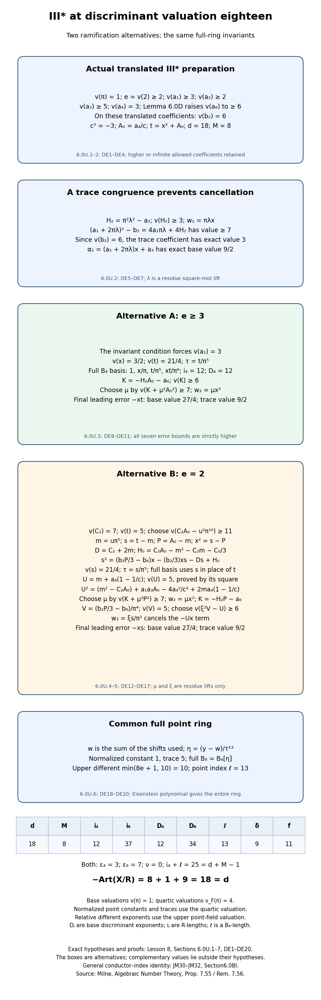

*Two ramification alternatives with common invariants.* Sections 6.0U.1–6 prove the shifted trace congruence, each full quartic ring and each complete point ring, then compute the different, index lengths, inertia orbits and conductor. The map states the exact post-translation invariant condition, each residue cancellation and every valuation normalization. The point residue lift is called xi; the orbit quantity nu is separate. Milne’s free author notes, Proposition 7.55 and Remark 7.56, provide local-field writing material; all specialized arguments are written here.

### 6.0U.7. Scope left by this proposition

This evaluates NF24 for exactly DE1. For complementary coefficient ranges, Section 6.0V treats the stated variable-first-valuation family and describes the coefficient ranges treated there. It includes all higher or infinite third coefficient valuations, and the allowed infinite first coefficient valuations at ramification index two. The complementary invariant values, every other residual additive family and universal NF24 lie outside this family-specific calculation; the general identity is JM30–JM32 in §6.0BI. 

The III-star remainder left by this proposition has ramification index at least two, first coefficient valuation at least three, third coefficient valuation at least five and translated second-invariant valuation at least seven, including an infinite second-invariant valuation. For a finite third valuation, at least one of the two bounds in HR9 fails; infinite third valuations are retained. The bound on the second invariant follows from its two coefficient terms, each of valuation at least six, and the exclusion of the exact valuation six proved above. Every shorter even star row, remaining II/III and I-zero-star preparation, residual II-star range and universal NF24 lie outside this family-specific calculation; the general identity is JM30–JM32 in §6.0BI.

## 6.0V. A variable-first-valuation III-star family

**Proposition 6.0V (a variable-first-valuation III-star family).** This argument proves a complete unbounded family whose first coefficient has arbitrary finite valuation at least four, under explicit ramification and third-coefficient bounds. The scalar approximation and finite residue induction are written for every such parameter. Every complementary preparation and the universal conductor identity remain required.

### 6.0V.1. Post-translation hypotheses and actual earlier proofs

Let \(K/\mathbf Q_2\) be finite, \(R=\mathcal O_K\), \(v(\pi)=1\), and \(e=v(2)\). Apply the actual translation of Lemma 6.0D to the minimal III-star preparation. Every subsequent hypothesis is on the translated equation; a stronger third-coefficient bound is not claimed to survive an arbitrary nonzero translation. Assume
\[
 \begin{gathered}
 k=v(a_1)\ge4,\quad v(a_2)\ge2,\quad v(a_4)=3,\quad v(a_6)\ge6,\\
 e\ge k,\quad 4e\ge5k-8,\qquad
 z=v(a_3)\ge k+2,\quad 4z\ge5k+4.
 \end{gathered}
 \tag{VK1}
\]
The integer \(k\) is finite; \(z=+\infty\) is allowed and satisfies its lower bounds. The eight-component model, minimality and Euler formula are proved in Lemma 6.0D, Theorem 6.0I.9 and Lemma 6.0H. Complete local fields and full Eisenstein rings are earlier in *Profinite groups and adic representations*, Sections 0A–0G. Sections 6.0K.1–6.0K.6 and 6.0P.6 prove the actual unramified, different/index/tower, torsion-order and Swan formulas. Milne’s free author notes [*Algebraic Number Theory*](https://www.jmilne.org/math/CourseNotes/ANT.pdf), Proposition 7.55 and Remark 7.56, printed pp.129–130, supply local-field writing material; each specialized proof is given here.

After a finite unramified extension containing a primitive cube root \(\zeta\), set \(c=1+2\zeta\). Then \(c^2=-3\), \(v(c)=0\), and \(v(1-c^{-1})=e\). Put
\[
 \begin{gathered}
 A_0=a_4/c,\quad t=x^2+A_0,\quad
 C_2=b_4-2A_0,\quad C_0=b_8+a_4^2,\\
 q(x)=x^4+(b_2/3)x^3+b_4x^2+b_6x+b_8/3=0,\\
 t^2=-(b_2/3)x^3-C_2x^2-b_6x-C_0/3.
 \end{gathered}
 \tag{VK2}
\]
The last identity is direct expansion, using the quartic equation.

### 6.0V.2. Invariant valuations and the full quartic ring

The coefficient formulas give
\[
 \begin{gathered}
 v(b_2)=2k,\quad v(b_4)\ge k+3,\\
 v(b_6)\ge\min(2z,2e+6),\quad v(b_8)=6,\\
 v(C_2)\ge2k+2,\quad v(C_0)\ge2k+5.
 \end{gathered}
 \tag{VK3}
\]
The first term of \(b_2=a_1^2+4a_2\) has value \(2k\) and the second has value at least \(2k+2\). In \(b_8\), the term \(-a_4^2\) uniquely has value six. The identities
\(C_2=a_1a_3+2a_4(1-c^{-1})\) and
\(C_0=a_6b_2-a_1a_3a_4+a_2a_3^2\)
give the last two bounds. If the third coefficient vanishes, its terms are simply absent.

The four discriminant terms have bounds
\[
 \begin{gathered}
 4k+6,\quad3e+3k+9,\quad4k+8,\quad5k+7,\\
 d=4k+6.
 \end{gathered}
 \tag{VK4}
\]
The first term uniquely has the least value. Every root of the torsion quartic has value \(3/2\): a smaller value makes its fourth power uniquely smallest, and a larger value makes the constant uniquely smallest. Both contradict the equation. In VK2 the first term has value \(2k+9/2\), while the other bounds are \(2k+5,2k+11/2,2k+5\). Therefore \(v(t)=k+9/4\), forcing a totally ramified quartic field. Its entire integer ring is
\[
 \begin{gathered}
 \begin{aligned}
 B_4&=R1\oplus R(x/\pi)\oplus R(t/\pi^{k+2})\\
    &\quad\oplus R(xt/\pi^{k+3}),
 \end{aligned}\\
 \tau=t/\pi^{k+2},\qquad i_4=2k+6,\\
 D_4=2(4k+6)-2(2k+6)=4k.
 \end{gathered}
 \tag{VK5}
\]
The four upper valuation classes are \(0,2,1,3\); the triangular basis change and these distinct classes prove full integrality coefficient by coefficient. The denominator sum is \(1+(k+2)+(k+3)\), and \(\tau\) is a uniformizer.

### 6.0V.3. A base scalar approximation to the quartic uniformizer power

Set \(N=\pi^{2k+4}\). Substituting \(x^2=t-A_0\) and \(x^3=x(t-A_0)\) in VK2 yields
\[
 \begin{gathered}
 Q=b_2A_0/(3N),\quad\beta=(C_2A_0-C_0/3)/N,\\
 \tau^2=Qx+\beta+R_0,\qquad
 R_0=\bigl(-(b_2/3)xt-C_2t-b_6x\bigr)/N.
 \end{gathered}
 \tag{VK6}
\]
Here \(v(Q)=-1\) and \(v(\beta)\ge1\). The first two remainder bounds are \(k-1/4\) and \(k+1/4\); the third has lower bound
\(\min(2z-2k-5/2,2e-2k+7/2)\).
Both terms in this minimum are at least \((k-1)/2\): after subtracting that bound, the differences are respectively
\[
 \begin{gathered}
 (4z-5k-4)/2\ge0,\qquad (4e-5k+8)/2\ge0,\\
 v(R_0)\ge(k-1)/2.
 \end{gathered}
 \tag{VK7}
\]
For infinite third valuation its corresponding term is absent and the second bound still holds. Define the actual base-field scalar
\[
 \sigma=-Q^2A_0+\beta^2\in R,\qquad v(\sigma)=1.
 \tag{VK8}
\]
The first term has exact value one and the second has value at least two. Squaring VK6 gives the exact identity
\[
 \begin{gathered}
 \tau^4-\sigma=Q^2t+2Qx\beta+2(Qx+\beta)R_0+R_0^2,\\
 v(\tau^4-\sigma)\ge k-1.
 \end{gathered}
 \tag{VK9}
\]
The four term bounds are \(k+1/4,e+3/2,e+k/2,k-1\), all at least \(k-1\). For every positive integer \(n\), telescoping now gives
\[
 \begin{gathered}
 \tau^{4n}-\sigma^n=(\tau^4-\sigma)
       \sum_{j=0}^{n-1}\tau^{4(n-1-j)}\sigma^j,\\
 v(\tau^{4n}-\sigma^n)\ge k+n-2.
 \end{gathered}
 \tag{VK10}
\]
Each summand has value \(n-1\). At \(n\ge6\), this error is at least \(k+4\), strictly above the point leading term to be preserved.

### 6.0V.4. Finite residue cancellation of the point constant

Choose \(\lambda\in R\) by \(v(H_2)\ge3\), where \(H_2=\pi^2\lambda^2-a_2\), and put \(w_1=\pi\lambda x\). Only a residue square-root lift is needed. With \(A=a_1x+a_3\) and \(G=x^3+a_2x^2+a_4x+a_6\), the exact point error is
\[
 \begin{gathered}
 E_1=w_1^2+Aw_1-G=-xt+K+R_1,\\
 K=-H_2A_0-a_6\in R,\\
 \begin{aligned}
 R_1&=-a_4(1-c^{-1})x+H_2t\\
    &\quad+a_1\pi\lambda x^2+a_3\pi\lambda x.
 \end{aligned}
 \end{gathered}
 \tag{VK11}
\]
The base constant has value at least six. The four remainder bounds are \(e+9/2,k+21/4,k+4,z+5/2\), each at least \(k+4\). The first shifted trace \(\alpha_1=A+2w_1\) has exact value \(k+3/2\): the first coefficient term uniquely leads, since the other bounds are \(z\ge k+2\) and \(e+5/2\ge k+5/2\).

Starting with \(K_6=K\), choose residue lifts successively by
\[
 \begin{gathered}
 K_{n+1}=K_n+\kappa_n^2\sigma^n,\qquad
 v(K_{n+1})\ge n+1,\\
 \kappa_n\in R,\qquad n=6,7,\ldots,k+3.
 \end{gathered}
 \tag{VK12}
\]
If \(v(K_n)\ge n\), perfection of the residue field provides a square root of \(-K_n/\sigma^n\) modulo the maximal ideal; choose zero if that residue vanishes. This proves the induction, using exactly \(k-2\) steps. Put
\[
 S=\sum_{n=6}^{k+3}\kappa_n\tau^{2n},\qquad v(S)\ge3.
 \tag{VK13}
\]
The resulting base constant error has value at least \(k+4\). Each individual square approximation has that same lower bound by VK10. Cross products in \(S^2\) have value at least \(e+6\ge k+6\), and \(\alpha_1S\) has value at least \(k+9/2\). Consequently
\[
 \begin{gathered}
 E=E_1+\alpha_1S+S^2=-xt+\text{terms of value at least }k+4,\\
 v(E)=k+15/4.
 \end{gathered}
 \tag{VK14}
\]
The added trace \(2S\) has value at least \(e+3\ge k+3\), strictly above the old exact value \(k+3/2\). Every shift is integral in the full quartic ring. Thus the exact leading point error and trace are proved for all parameters, with no exact quartic square-root assumption.

### 6.0V.5. Full point ring and conductor

Normalize by
\[
 \begin{gathered}
 \ell=2k+7,\qquad\eta=(y-w_1-S)/\tau^\ell,\\
 4(k+15/4)-2\ell=1,\qquad4(k+3/2)-\ell=2k-1.
 \end{gathered}
 \tag{VK15}
\]
The polynomial is Eisenstein and the earlier full-ring proof gives the entire point ring \(B_8=B_4[\eta]\). The determinant of the displayed generator change gives exact point index \(\ell\). The upper derivative valuations are \(8e+1\) and \(4k-2\), of opposite parity; the latter is strictly smaller since \(e\ge k\). The tower and torsion-order index proofs give
\[
 \begin{gathered}
 D_8=2(4k)+(4k-2)=12k-2,\\
 i_8=\bigl(6(4k+6)-(12k-2)\bigr)/2\\
 \hphantom{i_8}=6k+19=2i_4+\ell,\\
 \epsilon_4=3,\quad\epsilon_8=7,\quad\nu=0,\\
 \delta=2(4k+6)-(6k+19)+(2k+6)-2=4k-3,\\
 f(E/K)=4k-1,\\
 -\operatorname{Art}(X/R)=8+1+(4k-3)=4k+6=d,\\
 i_4+\ell=4k+13=d+M-1.
 \end{gathered}
 \tag{VK16}
\]
Both quartic and point inertia orbits are transitive. Quartic transitivity forces nontrivial wild action; the actual earlier quaternion proof in Section 6.0K.6 gives zero rank-two cohomology inertia invariants. Thus every use of the Swan and Euler identities has its stated hypotheses established.

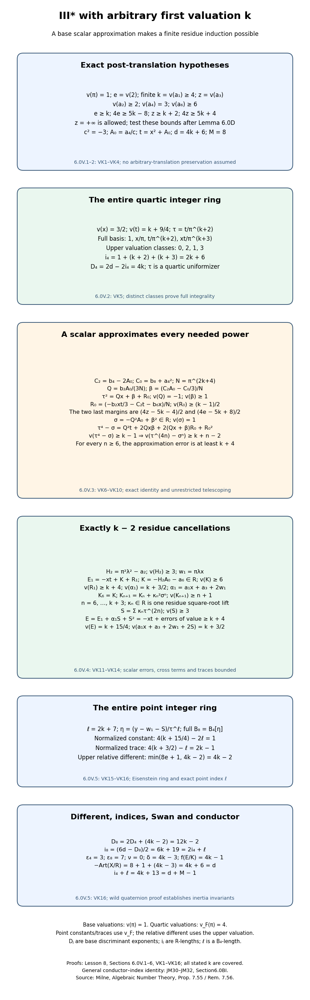

*From a scalar approximation to the full point ring.* Sections 6.0V.1–5 prove every displayed bound and ring equality. The map shows the actual translated hypotheses, the scalar fourth-power approximation, the complete finite residue induction, the two valuation normalizations, and all different, index and conductor values. Milne’s free author notes, Proposition 7.55 and Remark 7.56, provide local-field writing material; every specialized argument is proved here.

### 6.0V.6. Scope left by this proposition

For complementary coefficient ranges, Section 6.0W treats the higher-ramification II-star first-valuation-two family and describes the coefficient ranges treated there. This proves exactly VK1, including arbitrary finite first valuation and allowed infinite third valuation. The written finite induction covers every such integer; no cutoff or numerical sample is used as a proof. Every complementary ramification/coefficient range and universal NF24 lie outside this family-specific calculation; the general identity is JM30–JM32 in §6.0BI. 

Within the III-star remainder described after Proposition 6.0U, this proposition removes exactly the finite first-valuation family in VK1. Every preparation outside at least one of those actual translated hypotheses remains required. In particular, infinite first valuations are retained, as are the remaining ramification, third-coefficient and second-invariant ranges, including allowed infinite valuations. The earlier finite-third-valuation family in HR9 and the invariant-valuation-six family in DE1 remain proved by their own propositions. No unrestricted III-star conductor formula or universal NF24 follows from this parameter family alone.

## 6.0W. The higher-ramification II-star first-valuation-two family

**Proposition 6.0W (the higher-ramification II-star first-valuation-two family).** This proves an entire remaining II-star parameter family, with every ramification index at least two and all higher or infinite third/fourth coefficient valuations allowed. A single explicit integral point shift handles its two discriminant alternatives. Every complementary parameter family and the universal conductor identity remain required.

### 6.0W.1. Actual prepared equation and earlier proofs

Let \(K/\mathbf Q_2\) be finite, \(R=\mathcal O_K\), \(v(\pi)=1\), and \(e=v(2)\). On the actual minimal II-star preparation assume
\[
 \begin{gathered}
 e\ge2,\quad v(a_1)=2,\quad v(a_2)\ge2,\\
 z=v(a_3)\ge4,\quad v(a_4)\ge5,\quad v(a_6)=5.
 \end{gathered}
 \tag{FT1}
\]
These are hypotheses on the coefficients being used, without an assertion that an arbitrary translation preserves stronger bounds. The valuation of the third or fourth coefficient may be infinite; the first and sixth coefficients are nonzero. Lemma 6.0E proves the complete nine-component regular model, Theorem 6.0I.9 proves its minimality and identification, and Lemma 6.0H proves its Euler formula. The full local-field, Hensel, unramified-extension and Eisenstein-ring arguments occur earlier in *Profinite groups and adic representations*, Sections 0A–0G. Sections 6.0K.1–6.0K.6 and 6.0P.6 give the actual different/index/tower, torsion-order, inertia-orbit and Swan computations used below.

Milne's free author notes [*Algebraic Number Theory*](https://www.jmilne.org/math/CourseNotes/ANT.pdf), Proposition 7.55 and Remark 7.56, printed pp.129–130, provide local-field writing material. Every specialized ring and point-shift calculation is proved here. A citation supplies no missing result.

Pass to a permitted finite unramified extension containing a primitive cube root \(\zeta\), and put \(c=1+2\zeta\). Direct expansion gives
\[
 \begin{gathered}
 c^2=-3,\qquad v(c)=0,\\
 c+3=2(2+\zeta),\qquad v(c+3)=e.
 \end{gathered}
 \tag{FT2}
\]
The unramified and conductor-invariance arguments are the earlier written proofs in Section 6.0K.1; all the following valuations retain the normalization of FT1.

### 6.0W.2. The discriminant alternatives and the entire quartic ring

The coefficient formulas give
\[
 \begin{gathered}
 v(b_2)=4,\qquad v(b_8)=9,\\
 v(b_4)\ge6,\qquad v(b_6)\ge\min(2z,2e+5),\\
 z=4:\quad v(b_6)=8,\\
 z\ge5:\quad v(b_4)\ge7,\quad v(b_6)\ge9.
 \end{gathered}
 \tag{FT3}
\]
In the second invariant, the first term has value four and the second at least six. In the eighth invariant, the term \(a_1^2a_6\) has value nine; the four other bounds are \(11,z+7,2z+2,10\), all strictly larger. In the sixth invariant the two terms have respectively even value \(2z\) and odd value \(2e+5\), so cannot cancel. Vanishing terms are absent. The fourth-invariant assertions follow from its two terms.

In the order \(-b_2^2b_8,-8b_4^3,-27b_6^2,9b_2b_4b_6\), the discriminant term bounds are
\[
 \begin{array}{c|c|c|c|c|c}
 &-b_2^2b_8&-8b_4^3&-27b_6^2&9b_2b_4b_6&d\\\hline
 z=4&17&\ge24&16&\ge18&16\\
 z\ge5&17&\ge27&\ge18&\ge20&17
 \end{array}
 \tag{FT4}
\]
The unique minimum in each row proves its stated discriminant valuation, including infinite third valuations in the second row.

Every root of the torsion quartic
\[
 q(x)=x^4+(b_2/3)x^3+b_4x^2+b_6x+b_8/3=0
 \tag{FT5}
\]
has value \(9/4\). A smaller value makes the fourth power uniquely smallest: the differences against the other terms are bounded below by \(4-v(x),6-2v(x),8-3v(x),9-4v(x)\), all positive. A larger value makes the constant uniquely smallest. These contradict the equation. The denominator four forces a totally ramified quartic field \(F=K(x)\). Set \(\tau=x/\pi^2\). Its entire integer ring is
\[
 \begin{gathered}
 B_4=R1\oplus R\tau\oplus R\tau^2\oplus R\tau^3=R[\tau],\\
 v_F(\pi)=4,\quad v_F(\tau)=1,\quad
 i_4=2+4+6=12,\\
 D_4=2d-24=
 \begin{cases}8&z=4,\\10&z\ge5.\end{cases}
 \end{gathered}
 \tag{FT6}
\]
The four powers have distinct upper valuation classes modulo four. Their coefficientwise integrality gives the full ring. Equivalently the quartic of the displayed uniformizer is Eisenstein: its constant has value one and its three other nonleading coefficients have value at least two. The denominators in the power basis prove the exact index; the earlier trace-matrix identity gives the discriminant exponent.

### 6.0W.3. One explicit integral point shift

Choose a residue square-root lift \(\lambda\in R\) with
\[
 r=\pi\lambda,\qquad H_2=r^2-a_2,\qquad v(H_2)\ge3.
 \tag{FT7}
\]
Perfection of the finite residue field applied to \(a_2/\pi^2\) proves this, including the zero residue. Define
\[
 \begin{gathered}
 w_0=(cx^2+a_4)/a_1,\qquad
 w=w_0+r(x+a_3/a_1),\\
 A=a_1x+a_3,\qquad G=x^3+a_2x^2+a_4x+a_6,\\
 E=w^2+Aw-G.
 \end{gathered}
 \tag{FT8}
\]
Every summand of the shift is integral in the full quartic ring. Their values are respectively \(5/2,\ge3,\ge13/4,\ge z-1\), so \(v(w)=5/2\). The last term is absent if the third coefficient vanishes. Since \(v(2w)\ge e+5/2\ge9/2\), the shifted trace is
\[
 v(A+2w)=
 \begin{cases}4&z=4,\\17/4&z\ge5.\end{cases}
 \tag{FT9}
\]
In the first case the third coefficient uniquely leads; in the second the first coefficient term uniquely leads. No cancellation with the shift is possible.

Here is the complete error expansion. Substitute FT8, replace the fourth power using FT5, and use \(c^2=-3\). The resulting exact identity is
\[
 E=J_3x^3+J_2x^2+J_1x+J_0,
 \tag{FT10}
\]
where
\[
 \begin{aligned}
 J_3&=c+4a_2/a_1^2+2cr/a_1,\\
 J_2&=H_2+(c+3)a_3/a_1+2(c+3)a_4/a_1^2\\
    &\quad+ra_1+2cra_3/a_1^2,\\
 J_1&=3b_6/a_1^2+2ra_3+2ra_4/a_1+2r^2a_3/a_1,\\
 J_0&=(a_2+r^2)a_3^2/a_1^2+4a_2a_6/a_1^2\\
    &\quad+ra_3^2/a_1+2ra_4a_3/a_1^2.
 \end{aligned}
 \tag{FT11}
\]
For clarity, before adding the last two summands of the shift, the same direct calculation gives
\[
 \begin{aligned}
 w_0^2+Aw_0-G
 &= (c+4a_2/a_1^2)x^3\\
 &\quad+\bigl((c+3)a_3/a_1-a_2+2(c+3)a_4/a_1^2\bigr)x^2\\
 &\quad+(3b_6/a_1^2)x+a_2b_6/a_1^2.
 \end{aligned}
 \tag{FT12}
\]
Expanding the added \(r(x+a_3/a_1)\) proves every term of FT11. In particular, the even constant error is included; omitting the scalar part of that added shift would not justify the required leading error.

### 6.0W.4. All error and trace valuations

In FT11 the two nonconstant corrections in \(J_3\) have bounds \(2e-2\ge2\) and \(e-1\ge1\). Thus \(v(J_3)=0\). The five terms of \(J_2\) have lower bounds
\[
 \begin{gathered}
 3,\quad e+z-2,\quad2e+1,\quad3,\quad e+z-3,\\
 v(J_2)\ge3.
 \end{gathered}
 \tag{FT13}
\]
The three terms following \(3b_6/a_1^2\) in \(J_1\) have bounds \(e+z+1,e+4,e+z\), at least six. Hence the first term uniquely gives value four when the third valuation is four, and gives a lower bound five otherwise.

The identity \(a_2+r^2=2a_2+H_2\) gives value at least three. Consequently the four terms in \(J_0\) have bounds \(2z-1,2e+3,2z-1,e+z+2\), all at least seven. For infinite third valuation the corresponding terms are absent. We have proved
\[
 \begin{array}{c|c|c|c|c|c}
 &v(J_3)&v(J_2)&v(J_1)&v(J_0)&v(E)\\\hline
 z=4&0&\ge3&4&\ge7&25/4\\
 z\ge5&0&\ge3&\ge5&\ge7&27/4
 \end{array}
 \tag{FT14}
\]
The first row is uniquely led by \(J_1x\), and the second by \(J_3x^3\). Every competing value is strictly larger. This proves the full parameter statement without an exact square-root assumption in the quartic field.

### 6.0W.5. The entire point ring and the conductor

Let \(y^2+Ay-G=0\) be the point polynomial. Put
\[
 \begin{gathered}
 \ell=\begin{cases}12&z=4,\\13&z\ge5,\end{cases}\\
 \eta=(y-w)/\tau^\ell,\\
 v_F(E)-2\ell=1,\qquad v_F(A+2w)-\ell=4.
 \end{gathered}
 \tag{FT15}
\]
Its normalized quadratic is Eisenstein. The earlier coefficientwise parity proof gives the entire point ring \(B_8=B_4[\eta]\). The determinant of this explicit generator change proves the exact point index \(\ell\). Its upper different exponent is
\[
 \min(8e+1,8)=8,
 \tag{FT16}
\]
by the actual derivative proof: the two possible terms have opposite parity, and the second is strictly smaller since the ramification index is at least two. The full tower and order-index formulas now give
\[
 \begin{array}{c|c|c|c|c|c|c|c|c}
 &d&M&i_4&\ell&D_4&D_8&i_8&\delta\\\hline
 z=4&16&9&12&12&8&24&36&6\\
 z\ge5&17&9&12&13&10&28&37&7
 \end{array}
 \tag{FT17}
\]
Indeed \(D_8=2D_4+8\) and \(i_8=(6d-D_8)/2=2i_4+\ell\). Both rings are fields with one inertia orbit each, giving \(\epsilon_4=3,\epsilon_8=7,\nu=0\). Quartic transitivity forces a nontrivial wild action; the actual quaternion argument in Section 6.0K.6 gives zero inertia invariants on the rank-two cohomology representation. The actual Swan formula therefore gives \(\delta=2d-i_8+i_4-2\), the last column. Thus
\[
 \begin{gathered}
 f(E/K)=\begin{cases}8&z=4,\\9&z\ge5,\end{cases}\\
 -\operatorname{Art}(X/R)=M-1+f(E/K)=d,\\
 i_4+\ell=d+M-1.
 \end{gathered}
 \tag{FT18}
\]
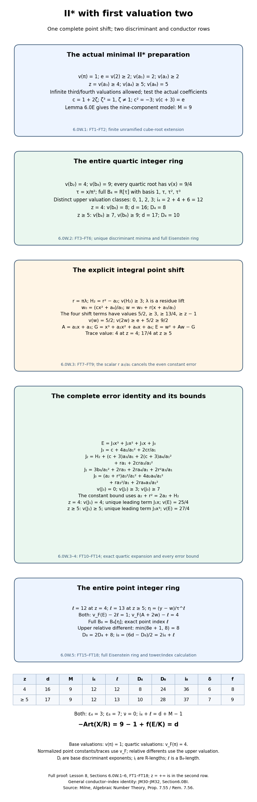

*One integral point shift, two exact leading errors.* Sections 6.0W.1–5 prove the displayed preparation, quartic ring, complete error expansion, both point rings and every index/different/conductor value. The scalar part of the point shift handles the even constant error. The figure distinguishes base valuations, quartic valuations and the upper relative different. Milne’s free author notes, Proposition 7.55 and Remark 7.56, provide local-field writing material; all specialized arguments are proved here.

### 6.0W.6. Scope left by this proposition

For complementary coefficient ranges, Section 6.0X treats a variable first-valuation II-star family and describes the coefficient ranges treated there. This evaluates NF24 for every FT1 preparation, including all infinite coefficients allowed there. The remaining II-star ranges, complementary III-star ranges, every shorter even star row, II/III with higher third valuation, I-zero-star and universal NF24 lie outside this family-specific calculation; the general identity is JM30–JM32 in §6.0BI. The proposition has exactly the stated coefficient hypotheses.

This removes exactly FT1 from the II-star range left by the earlier propositions. Preparations with fourth coefficient valuation four or first coefficient valuation at least three, including an infinite first valuation, remain required. At ramification index one, the II-star family of Proposition 6.0Q with second-invariant valuation four remains proved; higher or infinite second-invariant valuations are retained. The complementary III-star range outside VK1 is unchanged. Every remaining preparation and universal NF24 lie outside this family-specific calculation; the general identity is JM30–JM32 in §6.0BI.

## 6.0X. A variable first-valuation II-star family

**Proposition 6.0X (a variable first-valuation II-star family).** This argument treats every integer first-coefficient valuation at least three in the preparation below. It constructs the entire quartic and point integer rings and computes their different exponents. The parameters have no upper cutoff. Complementary preparations remain required.

### 6.0X.1. The actual equation and its earlier providers

Let \(K/\mathbf Q_2\) be finite, \(R=\mathcal O_K\), \(v(\pi)=1\), and \(e=v(2)\). In the actual integral Weierstrass equation suppose
\[
 \begin{gathered}
 h=v(a_1)\ge3,\qquad e\ge h,\qquad v(a_2)\ge h+1,\\
 v(a_3)=h+2,\qquad v(a_4)\ge h+3,\qquad v(a_6)=5.
 \end{gathered}
 \tag{VI1}
\]
The first, third and sixth coefficients are nonzero; the second and fourth may be zero. These tests concern the coefficients actually used. No assertion that arbitrary translations preserve the stronger bounds is needed. They imply the hypotheses of Lemma 6.0E, which constructs the full nine-component II-star fibre. Theorem 6.0I.9 proves minimality and identifies the minimal regular model; Lemma 6.0H proves its Euler formula. Sections 6.0K.1–6.0K.6 and 6.0P.5 prove the trace, different, torsion-order, inertia-orbit and Swan identities used below. Complete local extensions, finite unramified extensions and Eisenstein rings are earlier in *Profinite groups and adic representations*, Sections 0A–0G.

Milne's freely accessible author notes [*Algebraic Number Theory*](https://www.jmilne.org/math/CourseNotes/ANT.pdf), Proposition 7.55 and Remark 7.56, printed pp.129–130, supply local-field writing material. All specialized calculations and full-ring arguments are proved here. Pass, if necessary, to the finite unramified extension containing a primitive cube root of unity. The residue polynomial has distinct roots and the earlier simple-root Hensel proof constructs this extension. The earlier unramified invariance proof preserves all quantities under consideration. For such a root put
\[
 \begin{gathered}
 \zeta^2+\zeta+1=0,\qquad c=1+2\zeta,\\
 c^2=-3,\qquad c+3=2(2+\zeta),\\
 v(c+3)=e.
 \end{gathered}
 \tag{VI2}
\]
Indeed the squared expression uses \(\zeta^2+\zeta=-1\), and both \(c\) and \(2+\zeta\) are units.

### 6.0X.2. The exact discriminant and every quartic root

Use the invariant polynomials proved in Section 1.1. In \(b_2\), \(b_4\), \(b_6\) and \(b_8\), the uniquely least terms are respectively \(a_1^2\), \(a_1a_3\), \(a_3^2\) and \(a_1^2a_6\). The other terms of the last invariant have lower bounds \(2e+h+6,3h+5,3h+5,2h+6\), all strictly larger than its least value. Thus
\[
 \begin{gathered}
 v(b_2)=2h,\quad v(b_4)=2h+2,\\
 v(b_6)=2h+4,\quad v(b_8)=2h+5,\\
 \Delta=-b_2^2b_8-8b_4^3-27b_6^2+9b_2b_4b_6,\\
 (v(b_2^2b_8),v(8b_4^3),v(27b_6^2),v(9b_2b_4b_6))\\
 =(6h+5,3e+6h+6,4h+8,6h+6),\\
 d=v(\Delta)=4h+8.
 \end{gathered}
 \tag{VI3}
\]
The third term is uniquely least for every stated parameter. The same bounds give \(v(c_4)=4h\), since \(c_4=b_2^2-24b_4\), and hence \(v(j)=8h-8>0\). The actual earlier potential-good proof applies. No conductor formula has been used to compute the discriminant.

Write \(r=2h+5\) and let
\[
 q(x)=x^4+(b_2/3)x^3+b_4x^2+b_6x+b_8/3.
 \tag{VI4}
\]
For a prospective root of valuation \(r/4\), the three middle terms have margins above the endpoint value \(r\) equal to
\[
 2h-r/4,\qquad h-1/2,\qquad h/2+1/4,
 \tag{VI5}
\]
all positive. If a root had smaller valuation, its fourth-power term would be uniquely least: its comparisons with each middle term are even stronger than at the stated endpoint. If a root had larger valuation, the constant term would be uniquely least, again by those endpoint comparisons. Therefore every root has valuation \(r/4\). Since the odd integer \(r\) is coprime to four, its denominator forces ramification index at least four. The degree is at most four, so \(q\) is irreducible and defines a totally ramified quartic field \(F\). Normalize its upper valuation by \(v_F=4v\).

### 6.0X.3. The entire quartic integer ring

Put \(m_j=\lfloor jr/4\rfloor\), for \(j=1,2,3\). The four power-basis terms have distinct valuation classes modulo one. In a linear combination over \(K\) there is consequently no cancellation among terms of least valuation. Such a combination is integral exactly when every term is integral. This proves the full ring and its index:
\[
 \begin{gathered}
 B_4=R\oplus R\,x/\pi^{m_1}\oplus R\,x^2/\pi^{m_2}
       \oplus R\,x^3/\pi^{m_3},\\
 i_4=m_1+m_2+m_3=3h+6,\\
 D_4=2d-2i_4=2h+4.
 \end{gathered}
 \tag{VI6}
\]
For the floor sum, if \(r=4m+1\) the three floors are \(m,2m,3m\); if \(r=4m+3\) they are \(m,2m+1,3m+2\). Both sums equal \(3(r-1)/2\). The determinant of the displayed denominator change gives the index, and the earlier trace-matrix calculation gives the discriminant exponent.

A convenient uniformizer, using the actual parity of the first valuation, is
\[
 \begin{gathered}
 \tau=\begin{cases}
 x/\pi^{m_1}&h\text{ even},\\
 x^3/\pi^{m_3}&h\text{ odd},
 \end{cases}\\
 v_F(\tau)=1,\qquad B_4=R[\tau].
 \end{gathered}
 \tag{VI7}
\]
The asserted value follows from the two residues of \(r\) just computed. That value forces \(K(\tau)=F\). Its four conjugates have value \(1/4\); the symmetric coefficients of its minimal polynomial are integral, its nonleading coefficients are divisible by \(\pi\), and its constant has value exactly one. Thus it is Eisenstein. Alternatively, the four powers of this uniformizer have distinct valuation classes, and the same coefficientwise argument proves the full-ring assertion directly.

### 6.0X.4. One complete point shift and its exact error

Set
\[
 \begin{gathered}
 A=a_1x+a_3,\qquad G=x^3+a_2x^2+a_4x+a_6,\\
 w=(cx^2+a_4)/a_1.
 \end{gathered}
 \tag{VI8}
\]
The first summand of the shift has value \(5/2\), and the second has value at least three. Hence the shift belongs to the full quartic integer ring and has value \(5/2\). The two terms of \(A\) have values \(3h/2+5/4\) and \(h+2\); the first is strictly larger. Also \(v(2w)=e+5/2>h+2\). Consequently
\[
 v(w)=5/2,\qquad v(A+2w)=h+2.
 \tag{VI9}
\]
There is no hidden scalar or additional residue shift. Direct expansion, followed by the relations VI2 and VI4, gives
\[
 \begin{aligned}
 E:=w^2+Aw-G&=J_3x^3+J_2x^2+J_1x+J_0,\\
 J_3&=c+4a_2/a_1^2,\\
 J_2&=(c+3)a_3/a_1-a_2+2(c+3)a_4/a_1^2,\\
 J_1&=3b_6/a_1^2,\qquad J_0=a_2b_6/a_1^2.
 \end{aligned}
 \tag{VI10}
\]
To verify the complete constant term as well as the three other coefficients, expand before imposing either relation. The exact polynomial identity is
\[
 a_1^2\bigl(w^2+Aw-G-J_3x^3-J_2x^2-J_1x-J_0\bigr)
       =(c^2+3)x^4-3q(x).
 \tag{VI11}
\]
It follows by collecting the fourth-, third-, second-, first- and constant-degree terms: those coefficients are \(c^2,-b_2,-3b_4,-3b_6,-b_8\). This proves VI10 in the actual quartic field, with no sampled coefficients or unproved square-root approximation.

### 6.0X.5. Every error bound and the full point ring

The correction to \(c\) in \(J_3\) has value at least \(2e-h+1\ge h+1\), so this coefficient is a unit. The three terms of \(J_2\) have lower bounds \(e+2,h+1,2e-h+3\). The first term of \(b_6\) is uniquely least, as already proved. Thus
\[
 v(J_3)=0,\qquad v(J_2)\ge h+1,\qquad
 v(J_1)=4,\qquad v(J_0)\ge h+5.
 \tag{VI12}
\]
The term \(J_1x\) has value \(h/2+21/4\). The margins of the three competing terms above this value are, respectively, at least
\[
 h-3/2,\qquad 3h/2-7/4,\qquad h/2-1/4.
 \tag{VI13}
\]
Every margin is positive for all integers \(h\ge3\). Vanishing second or fourth coefficients merely remove terms and do not alter this unique leading term. We have proved
\[
 \begin{gathered}
 v(E)=h/2+21/4,\qquad\ell=h+10,\\
 \eta=(y-w)/\tau^\ell,\\
 v_F(E)-2\ell=1,\\
 v_F(A+2w)-\ell=3h-2.
 \end{gathered}
 \tag{VI14}
\]
Substituting the displayed point generator into \(y^2+Ay-G=0\) gives a monic quadratic whose constant has value one and whose trace coefficient has positive value. It is Eisenstein, so the point algebra is a totally ramified quadratic field over the quartic field. The valuations of the two terms in a linear combination over the quartic field have distinct parity. Coefficientwise integrality therefore gives the entire point ring \(B_8=B_4[\eta]\), not just an integral suborder. The determinant in \(y=w+\tau^\ell\eta\) gives exact relative point index \(\ell\).

The derivative of this normalized quadratic has two terms, with upper point-field values \(8e+1\) and \(6h-4\), of opposite parity. The earlier monogenic trace-dual proof computes the different from this derivative. Since their difference is \(8e-6h+5\ge2h+5>0\), its exact exponent is
\[
 \begin{gathered}
 D_{8/4}=6h-4,\\
 D_8=2D_4+D_{8/4}=10h+4,\\
 i_8=(6d-D_8)/2=7h+22=2i_4+\ell.
 \end{gathered}
 \tag{VI15}
\]
The tower identity uses residue degrees one in both extensions. The order discriminant exponents are the actual \(2d\) and \(6d\) proved in Section 6.0K.6; neither is substituted for a normal-ring discriminant.

### 6.0X.6. The conductor and the exact remaining boundary

The quartic and point fields have one inertia orbit each. Quartic transitivity forces nontrivial wild action, since a tame inertia image has odd order in residue characteristic two and cannot act transitively on four objects. The actual quaternion subgroup computation in Section 6.0K.6 shows that this wild image contains the central involution. On the characteristic-zero rank-two representation it acts as minus the identity; thus inertia invariants are zero. With the full rings above, the actual permutation/Swan formula gives
\[
 \begin{gathered}
 \epsilon_4=3,\quad\epsilon_8=7,\quad\nu=0,\\
 \delta=2d-i_8+i_4-2=4h-2,\\
 f(E/K)=2+\delta=4h.
 \end{gathered}
 \tag{VI16}
\]
The previously proved nine-component model and Euler identity now yield
\[
 \begin{gathered}
 -\operatorname{Art}(X/R)=M-1+f(E/K)=8+4h=d,\\
 i_4+\ell=4h+16=d+M-1.
 \end{gathered}
 \tag{VI17}
\]
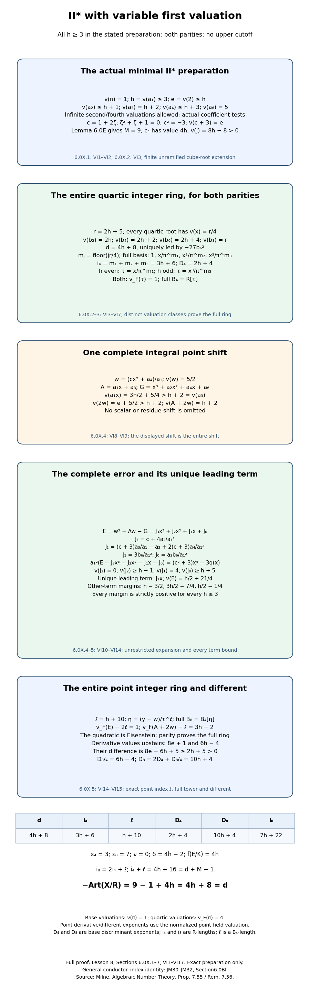

*One preparation, both parities of the first valuation.* Sections 6.0X.1–6 prove the exact discriminant, full quartic lattice, two uniformizer choices, complete point shift and error, entire point ring and every displayed different, index and conductor. Base, quartic and point-field valuation conventions are distinguished in the diagram. Milne’s freely accessible author notes, Proposition 7.55 and Remark 7.56, supply local-field writing material; all specialized arguments are proved here.

### 6.0X.7. Scope left by this proposition

For complementary coefficient ranges, Section 6.0Y treats the broader unbounded-third preparation and describes the coefficient ranges treated there. This proves NF24 for every VI1 preparation, including both parities of the first valuation and the allowed infinite second/fourth valuations. It leaves II-star preparations outside VI1 and the earlier proved ranges, the remaining III-star and other additive preparations, and universal NF24 outside this family-specific calculation; the general identity is JM30–JM32 in §6.0BI. 

The II-star preparations outside these hypotheses consist of actual first valuations at least two and third valuations at least four outside all three proved preparations: the ramification-one/second-invariant-valuation-four family of Proposition 6.0Q; the higher-ramification/first-valuation-two family FT1; and the variable first-valuation family VI1. First valuations at least three or infinite, fourth valuation exactly four, ramification below the first valuation, other third valuations, and complementary second/fourth bounds are retained whenever none of those propositions applies. The III-star remainder outside VK1 is unchanged. Every shorter even star row, II/III with higher third valuation, every I-zero-star preparation and universal NF24 lie outside this family-specific calculation; the general identity is JM30–JM32 in §6.0BI.

## 6.0Y. II-star with an unbounded third valuation

**Proposition 6.0Y (II-star with an unbounded third valuation).** This proves both discriminant regimes of the following full preparation. The first valuation, ramification and third valuation have no upper cutoff; a zero third coefficient is included. The point shift has the same explicit form in both regimes, and the same normalized trace value gives their common relative different. No universal conductor comparison is assumed.

### 6.0Y.1. Actual hypotheses and the two regimes

Let \(K/\mathbf Q_2\) be finite, \(R=\mathcal O_K\), \(v(\pi)=1\), and \(e=v(2)\). In the actual integral equation suppose
\[
 \begin{gathered}
 h=v(a_1)\ge2,\qquad e\ge h,\\
 v(a_2)\ge h+1,\qquad z=v(a_3)\ge h+2,\\
 v(a_4)\ge h+3,\qquad v(a_6)=5,\\
 t=\min\bigl(2(z-h),2(e-h)+5\bigr).
 \end{gathered}
 \tag{UT1}
\]
The first valuation is finite. The second, third and fourth valuations may be infinite; the corresponding terms are then absent. The integer \(t\) is finite and at least four, because its second argument is finite and its first argument is at least four. The coefficients satisfy the actual hypotheses of Lemma 6.0E. Its full nine-component II-star model, Theorem 6.0I.9's minimality and identification, and Lemma 6.0H's Euler formula are earlier written proofs. Sections 6.0K.1–6.0K.6 and 6.0P.5 prove the trace, different, integral-order, orbit and Swan identities. The earlier programme lesson *Profinite groups and adic representations*, Sections 0A–0G, supplies complete local extensions and finite unramified construction. These are actual providers, not citations in place of the specialized proof below.

Pass to the finite unramified extension containing a primitive cube root \(\zeta\), using the earlier simple-root Hensel construction. The earlier unramified invariance proof applies to all indices, discriminants, components and conductors being computed. Put \(c=1+2\zeta\). Direct expansion gives \(c^2=-3\), and \(c+3=2(2+\zeta)\) has value exactly \(e\), since the second factor is a unit. Milne's freely accessible author notes [*Algebraic Number Theory*](https://www.jmilne.org/math/CourseNotes/ANT.pdf), Proposition 7.55 and Remark 7.56, printed pp.129–130, provide local-field writing material. Every specialized calculation is proved here.

The two regimes are
\[
 \mathcal L:\ 4\le t\le h+2,\qquad
 \mathcal H:\ t\ge h+3.
 \tag{UT2}
\]
They cover all integer values in UT1, without a boundary case being suppressed.

### 6.0Y.2. Invariants and both exact discriminants

The first terms of \(b_2\) and \(b_8\) are uniquely least. The other terms of the latter have bounds \(2e+h+6,3h+5,3h+5,2h+6\), strictly larger than \(2h+5\). The two terms of \(b_6\) have values \(2z\) and \(2e+5\), of opposite parity whenever the first is finite. Thus there is no cancellation. The other fourth-invariant terms need only their stated lower bound:
\[
 \begin{gathered}
 v(b_2)=2h,\qquad v(b_4)\ge2h+2,\\
 v(b_6)=2h+t,\qquad v(b_8)=2h+5.
 \end{gathered}
 \tag{UT3}
\]
The discriminant term \(-b_2^2b_8\) has value \(6h+5\), and \(-27b_6^2\) has value \(4h+2t\). Their values are distinct, one odd and one even. In the low regime the first exceeds the second by at least one. The cross term's margin above the second is at least \(2h+2-t\ge h>0\), and the cube term's margin is at least \(3e+2h+6-2t\ge3e+2>0\). In the high regime the second exceeds the first by at least one, while the cross and cube margins above the first are at least \(t-3\ge h>0\) and \(3e+1>0\). Consequently
\[
 d=v(\Delta)=
 \begin{cases}4h+2t&\mathcal L,\\6h+5&\mathcal H.\end{cases}
 \tag{UT4}
\]
The term of \(c_4=b_2^2-24b_4\) with value \(4h\) is uniquely least. Since \(d\le6h+5\), the actual \(j\)-valuation is at least \(6h-5>0\); the earlier potential-good proof applies. All these conclusions allow a vanishing fourth invariant.

### 6.0Y.3. Every quartic root and its full integer ring

Set \(r=2h+5\), and use the actual torsion quartic
\[
 q(x)=x^4+(b_2/3)x^3+b_4x^2+b_6x+b_8/3.
 \tag{UT5}
\]
At root valuation \(r/4\), the three middle terms have margins above the two endpoint terms bounded below by \(2h-r/4,h-1/2,h/2+t-15/4\), all positive. Below that valuation the fourth power would be uniquely least, by the same comparisons; above it the constant would be uniquely least. Hence every root has value \(r/4\). Its denominator is four, so the root field has degree and ramification index four and residue degree one. The polynomial is irreducible; write its field as \(F\), with \(v_F=4v\).

For \(m_j=\lfloor jr/4\rfloor\), the distinct fractional valuation classes of the four powers imply coefficientwise integrality in every linear combination over \(K\). Therefore
\[
 \begin{gathered}
 B_4=R\oplus R\,x/\pi^{m_1}\oplus R\,x^2/\pi^{m_2}
       \oplus R\,x^3/\pi^{m_3},\\
 i_4=3h+6,\\
 \tau=\begin{cases}x/\pi^{m_1}&h\text{ even},\\
                      x^3/\pi^{m_3}&h\text{ odd},\end{cases}\\
 v_F(\tau)=1,\qquad B_4=R[\tau],\\
 D_4=2d-2i_4=
 \begin{cases}2h+4t-12&\mathcal L,\\6h-2&\mathcal H.\end{cases}
 \end{gathered}
 \tag{UT6}
\]
For \(r=4m+1\) the three floors are \(m,2m,3m\); for \(r=4m+3\) they are \(m,2m+1,3m+2\). Their sum is \(3(r-1)/2=3h+6\). These same residues prove both uniformizer choices. Its value forces it to generate the degree-four field, and its power basis has distinct valuation classes. Coefficientwise integrality proves the entire uniformizer ring. The determinant of the first displayed lattice gives its exact order index; the earlier trace-matrix proof gives the last discriminant formula.

### 6.0Y.4. The entire point error and both unique minima

Put
\[
 \begin{gathered}
 A=a_1x+a_3,\qquad G=x^3+a_2x^2+a_4x+a_6,\\
 w=(cx^2+a_4)/a_1.
 \end{gathered}
 \tag{UT7}
\]
The two shift terms have values \(5/2\) and at least three, so the displayed complete shift is integral with value \(5/2\). No scalar or residue shift is assumed. Expand all coefficients, including the constant:
\[
 \begin{aligned}
 E:=w^2+Aw-G&=J_3x^3+J_2x^2+J_1x+J_0,\\
 J_3&=c+4a_2/a_1^2,\\
 J_2&=(c+3)a_3/a_1-a_2+2(c+3)a_4/a_1^2,\\
 J_1&=3b_6/a_1^2,\qquad J_0=a_2b_6/a_1^2.
 \end{aligned}
 \tag{UT8}
\]
Indeed the unrestricted polynomial identity before imposing the quartic and cube-root relations is
\[
 a_1^2(E-J_3x^3-J_2x^2-J_1x-J_0)
       =(c^2+3)x^4-3q(x).
 \tag{UT9}
\]
Collecting the five coefficients gives \(c^2,-b_2,-3b_4,-3b_6,-b_8\), so this proves the complete expansion locally.

The first error coefficient is a unit. The three terms of the second have bounds \(e+z-h,h+1,2e-h+3\), each at least \(h+1\). Consequently
\[
 v(J_3)=0,\qquad v(J_2)\ge h+1,\qquad
 v(J_1)=t,\qquad v(J_0)\ge h+1+t.
 \tag{UT10}
\]
The competing values \(t+r/4\) and \(3r/4\) of the first- and third-degree terms cannot agree, since their difference is \(t-h-5/2\). In the low regime the first-degree term is uniquely least. The other three margins above it are at least \(1/2,h/2+1/4,h/2-1/4\). In the high regime the third-degree term is uniquely least, with the other three margins at least \(1/2,h/2-1/4,h/2+1/4\). These margins are strictly positive for every stated first valuation. Thus
\[
 \begin{gathered}
 v_F(E)=\begin{cases}4t+2h+5&\mathcal L,\\6h+15&\mathcal H,\end{cases}\\
 \ell=\begin{cases}2t+h+2&\mathcal L,\\3h+7&\mathcal H.\end{cases}
 \end{gathered}
 \tag{UT11}
\]

### 6.0Y.5. The common normalized trace and full point ring

The three possible trace contributions \(a_1x,a_3,2w\) have values \(3h/2+5/4,z,e+5/2\). Their fractional classes are distinct, so the finite least value is unique. The minimum of the last two is \(h+t/2\), directly from UT1. Comparing it with the first gives
\[
 \begin{gathered}
 v_F(A+2w)=\begin{cases}4h+2t&\mathcal L,\\6h+5&\mathcal H,\end{cases}\\
 v_F(A+2w)-\ell=3h-2.
 \end{gathered}
 \tag{UT12}
\]
Let \(\eta=(y-w)/\tau^\ell\). Substitution in the actual point polynomial gives constant value \(v_F(E)-2\ell=1\) and trace value \(3h-2>0\). It is Eisenstein, hence defines a totally ramified quadratic point field. The two valuation parities in its linear combinations over the quartic field prove the full ring \(B_8=B_4[\eta]\). The determinant of \(y=w+\tau^\ell\eta\) gives exact relative point index \(\ell\).

The derivative terms have upper point-field values \(8e+1\) and \(6h-4\), of opposite parity. The latter is strictly smaller because \(8e-6h+5\ge2h+5>0\). The actual monogenic trace-dual proof and tower identity therefore give relative different \(6h-4\) and the full arithmetic table
\[
 \begin{array}{c|c|c|c|c|c}
 &d&D_4&\ell&D_8&i_8\\\hline
 \mathcal L&4h+2t&2h+4t-12&2t+h+2&10h+8t-28&7h+2t+14\\
 \mathcal H&6h+5&6h-2&3h+7&18h-8&9h+19
 \end{array}
 \tag{UT13}
\]
Here \(D_8=2D_4+6h-4\), since both residue degrees are one, and \(i_8=(6d-D_8)/2=2i_4+\ell\). The order discriminants \(2d\) and \(6d\) have their actual earlier proof; full-ring discriminants are separately computed rather than conflated with them.

### 6.0Y.6. Both conductors and the full boundary

Both fields have transitive inertia orbits. Quartic transitivity rules out trivial wild action, because tame inertia has odd order. The actual quaternion computation of Section 6.0K.6 puts the central involution in this wild image; its action as minus the identity gives zero cohomology inertia invariants. Hence \(\epsilon_4=3,\epsilon_8=7,\nu=0\), and the actual Swan formula \(\delta=2d-i_8+i_4-2\) yields
\[
 \begin{gathered}
 \begin{array}{c|c|c|c}
 &\delta&f(E/K)&i_4+\ell\\\hline
 \mathcal L&4h+2t-10&4h+2t-8&4h+2t+8\\
 \mathcal H&6h-5&6h-3&6h+13
 \end{array}\\
 f(E/K)=d-8,\qquad i_4+\ell=d+8.
 \end{gathered}
 \tag{UT14}
\]
The nine-component model's earlier Euler formula gives \(-\operatorname{Art}(X/R)=8+f(E/K)=d\). Thus NF24 is proved on the whole UT1 preparation, including all higher or infinite third valuations and both first-valuation parities. The third-valuation-equals-first-plus-two family of Section 6.0X is its low-regime subcase with \(t=4\); its earlier complete argument remains intact.

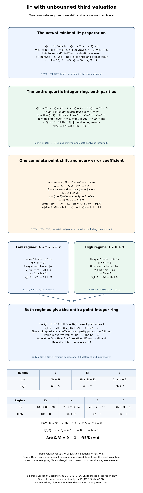

*Two leading-term regimes, one complete point shift.* Sections 6.0Y.1–6 prove the entire preparation, both discriminants, full quartic lattice and parity-dependent uniformizers, complete error coefficients, both point denominators and the common normalized trace. The diagram distinguishes base discriminant exponents, quartic valuations, the upper point-field different, and the module lengths of the indices. Each table entry and the conductor identity are proved locally. Milne’s free author notes, Proposition 7.55 and Remark 7.56, provide local-field writing material.

### 6.0Y.7. Scope left by this proposition

For complementary coefficient ranges, Section 6.0Z proves every ramification-one II-star preparation, extends the higher-ramification first-valuation-two range, and describes the coefficient ranges treated there. The complement of these II-star hypotheses includes every preparation outside UT1 and all earlier proved ranges: infinite first valuation, ramification below the first valuation, complementary second/fourth bounds and other third valuations. All remaining III-star/shorter-even/II/III/I-zero-star parameters and universal NF24 lie outside this family-specific calculation; the general identity is JM30–JM32 in §6.0BI. 

The II-star preparations outside these hypotheses lie in the actual first-valuation-at-least-two, third-valuation-at-least-four range outside all proved preparations: the ramification-one/second-invariant-valuation-four family of Proposition 6.0Q; FT1; and UT1. The variable-first family VI1 is contained in UT1 and its proof is retained. Infinite first valuations, ramification below the first valuation, fourth valuation exactly four and complementary second/third/fourth bounds remain whenever none of those propositions applies. The III-star remainder outside VK1 and every shorter even star/II/III/I-zero-star preparation are unchanged. Universal NF24 remains required.

## 6.0Z. Every II-star preparation at ramification index one

**Proposition 6.0Z (Every II-star preparation at ramification index one).** The remaining ramification-one II-star equations admit an explicit linear-plus-cubic quartic normalization and two full quadratic point rings. An integral coordinate normalization first removes fourth-coefficient valuation four. Combined with the actual earlier first/third-layer and second-invariant-valuation-four proofs, the argument covers every ramification-one II-star preparation, including infinite first, second, third or fourth valuations allowed by that preparation. It also removes the fourth-valuation-four restriction from the earlier first-valuation-two family at higher ramification.

### 6.0Z.1. Actual preparation and written providers

Let \(K/\mathbf Q_2\) be finite, \(R=\mathcal O_K\), \(v(\pi)=1\), and \(e=v(2)\). The II-star preparation has
\[
 \begin{gathered}
 v(a_1)\ge1,\qquad v(a_2)\ge2,\qquad v(a_3)\ge3,\\
 v(a_4)\ge4,\qquad v(a_6)=5.
 \end{gathered}
 \tag{RO1}
\]
Each nonunit coefficient other than the sixth may vanish. Lemma 6.0E constructs its complete nine-component fibre; Theorem 6.0I.9 proves minimality and identification, and Lemma 6.0H proves the Euler identity. Section 1.1 proves the integral coordinate and discriminant identities. Sections 6.0K.1–6.0K.6 and 6.0P.5 prove the full-order, trace-dual, different, tower, orbit and Swan formulas. The earlier programme lesson *Profinite groups and adic representations*, Sections 0A–0G, proves complete local fields, simple-root Hensel lifting and full Eisenstein rings. The specialized factorization, lattice, different and conductor computations are proved below.

Milne's freely accessible author notes [*Algebraic Number Theory*](https://www.jmilne.org/math/CourseNotes/ANT.pdf), Proposition 7.55 and Remark 7.56, printed pp.129–130, provide local-field writing material. They do not replace any proof. The earlier actual Section 6.0O.5–6.0O.6 proves the first-valuation-one and third-valuation-three II-star families. Section 6.0Q.3 proves precisely its displayed ramification-one, second-invariant-valuation-four preparation. Those full written arguments, with their actual hypotheses, will be used only in the final exhaustion.

### 6.0Z.2. A fourth-coefficient normalization in every ramification

This paragraph permits every \(e\ge1\). If the fourth coefficient already has value at least five, take \(r=0\). Otherwise choose a residue lift \(\lambda\) and put \(r=\pi^2\lambda\), so that
\[
 \overline{a_4/\pi^4}+\overline3\,\overline\lambda^2=0.
 \tag{RO2}
\]
Such a lift exists: the residue field is finite of characteristic two, and squaring is injective because \((u-v)^2=0\) implies equality in a field. It is therefore surjective. The residue of three is a unit. In the change \(x=x'+r,y=y'\), direct expansion gives
\[
 \begin{aligned}
 a'_1&=a_1,\\a'_2&=a_2+3r,\\a'_3&=a_3+a_1r,\\
 a'_4&=a_4+2a_2r+3r^2,\\
 a'_6&=a_6+a_4r+a_2r^2+r^3.
 \end{aligned}
 \tag{RO3}
\]
The middle term in the fourth coefficient has value at least five, and RO2 cancels its other terms modulo the fifth power. The three added terms of the sixth coefficient have value at least six. Thus
\[
 \begin{gathered}
 v(a'_4)\ge5,\qquad v(a'_6)=5,\qquad a'_1=a_1,\\
 v(a'_2)\ge2,\qquad v(a'_3)\ge3,\\
 v(a'_3)\ge4\quad\text{if }v(a_1)\ge2,\ v(a_3)\ge4.
 \end{gathered}
 \tag{RO4}
\]
The discriminant is unchanged by this unit coordinate transformation, by the earlier polynomial identity. The curves and their Galois representations are isomorphic over the original field, so the conductor is unchanged. Their prepared minimal regular models have the same nine-component type by the actual model theorem. No stronger arbitrary-translation bound is asserted; these conclusions concern the displayed shift only.

In particular, whenever \(e\ge2,v(a_1)=2,v(a_3)\ge4\) in RO1, the new equation satisfies every actual FT1 hypothesis of Section 6.0W. Its full two-row proof therefore applies even when the original fourth valuation was four. Its third-valuation test is made on the new coefficient in RO3; no unproved preservation of its exact old value is needed.

### 6.0Z.3. The entire remaining ramification-one invariant range

Now suppose \(e=1\). The first-valuation-one and third-valuation-three families already have their written proofs. After RO3 the remaining equations satisfy
\[
 \begin{gathered}
 v(a_1)\ge2,\quad v(a_2)\ge2,\quad v(a_3)\ge4,\quad
 v(a_4)\ge5,\quad v(a_6)=5,\\
 v(b_2)\ge5.
 \end{gathered}
 \tag{RO5}
\]
Here and below the primes are dropped only for the actual transformed coefficients. The alternative second-invariant valuation four is exactly the earlier HS15 preparation, and is used only in the exhaustion. Infinite second-invariant valuation is included in RO5. The invariant polynomials give
\[
 \begin{gathered}
 v(b_4)\ge6,\qquad v(b_6)=7,\\
 v(b_8)\ge10,\qquad d=v(\Delta)=14.
 \end{gathered}
 \tag{RO6}
\]
Indeed the third square has value at least eight, while the term \(4a_6\) has value seven. Write \(b_8=a_6b_2-a_1a_3a_4+a_2a_3^2-a_4^2\); the four bounds are \(10,11,10,10\). In the discriminant, the first, cube and cross terms have bounds \(20,21,18\), strictly above the third term's value fourteen. Also \(v(c_4)\ge9\), so \(v(j)\ge13>0\), including the infinite value. The earlier potential-good proof applies.

### 6.0Z.4. A linear factor and a full cubic integer ring

For the actual torsion quartic put
\[
 q(X)=X^4+(b_2/3)X^3+b_4X^2+b_6X+b_8/3.
 \tag{RO7}
\]
The scaled polynomial
\[
 q(\pi^3T)/\pi^{10}
 =\pi^2T^4+(b_2/(3\pi))T^3+(b_4/\pi^4)T^2
      +(b_6/\pi^7)T+b_8/(3\pi^{10})
 \tag{RO8}
\]
is integral and reduces to a linear polynomial with unit derivative. The earlier complete simple-root Hensel proof produces a root \(\rho\in\pi^3R\). It also covers a zero constant: then the root is exactly zero. Factor
\[
 \begin{gathered}
 q(X)=(X-\rho)g(X),\qquad g=X^3+c_2X^2+c_1X+c_0,\\
 c_2=b_2/3+\rho,\quad c_1=b_4+(b_2/3)\rho+\rho^2,\\
 c_0=b_6+b_4\rho+(b_2/3)\rho^2+\rho^3,\\
 v(c_2)\ge3,\qquad v(c_1)\ge6,\qquad v(c_0)=7.
 \end{gathered}
 \tag{RO9}
\]
The last equality is unique: its other three terms have bounds \(9,11,9\). Every cubic root has value \(7/3\), since its middle-term bounds at that endpoint are \(23/3,25/3>7\), and a smaller or larger root value would leave a unique least term. Its denominator proves a totally ramified cubic field \(F\), of residue degree one.

With \(u=x/\pi^2\), the cubic polynomial becomes
\[
 u^3+(c_2/\pi^2)u^2+(c_1/\pi^4)u+c_0/\pi^6=0.
 \tag{RO10}
\]
It is Eisenstein. The three fractional valuation classes of \(1,u,u^2\) imply coefficientwise integrality, proving the entire integer ring \(C=R[u]\). The exact index from the order \(R[x]\) is \(2+4=6\). In normalized cubic valuation the derivative terms have values \(2,\ge7,\ge6\), respectively; the first is uniquely least, since three is a unit. The actual monogenic trace-dual proof gives cubic different and base discriminant exponent two. We have constructed the full quartic normalization
\[
 B_4=R\times C,\qquad D_4=2.
 \tag{RO11}
\]

### 6.0Z.5. The exact product-order index

At the base root,
\[
 g(\rho)=q'(\rho)=4\rho^3+b_2\rho^2+2b_4\rho+b_6,
 \qquad v(g(\rho))=7.
 \tag{RO12}
\]
Its other terms have bounds \(11,11,10\). The cokernel of the map from the quartic order to \(R\oplus R[X]/g\) is exactly \(R/(g(\rho))\). Here is the full argument. Map a pair \((a,b)\) to \(a-b(\rho)\) modulo that ideal. Evaluation is well-defined modulo the cubic. If this difference is \(c g(\rho)\), choose a representative of degree less than three for the second coordinate; the polynomial \(b+cg\) has both prescribed coordinates. Conversely every polynomial has difference divisible by \(g(\rho)\). The quartic-order map is injective: a polynomial of degree less than four vanishing in the cubic quotient is a constant multiple of the cubic, and its base value forces that constant to be zero. This proves the exact cokernel without a coprime-integral-factor assumption.

Replacing the cubic order by its full integer ring adds index six. Therefore
\[
 \begin{gathered}
 i_4=7+6=13,\\2d-2i_4=28-26=2=D_4.
 \end{gathered}
 \tag{RO13}
\]
The last trace-discriminant equality independently agrees with the constructed full product ring; it was not used as a substitute for the cokernel proof.

### 6.0Z.6. Both full quadratic point rings

At either quartic factor use the actual coefficients
\[
 A=a_1x+a_3,\qquad G=x^3+a_2x^2+a_4x+a_6,
 \qquad y^2+Ay-G=0.
 \tag{RO14}
\]
At the base root \(x=\rho\), one has \(v(A)\ge4,v(G)=5\): the other terms of the second expression have bounds \(9,8,8\). At the cubic root \(v(x)=7/3\), the same trace bound and exact constant value hold, since the competing constant terms have bounds \(7,20/3,22/3\), all above five.

In the base factor set \(\eta_0=y/\pi^2\). Its polynomial has constant value one and trace value at least two. It is Eisenstein and gives the entire quadratic integer ring by coefficientwise valuation parity. Its derivative terms have upper values three and at least four, so its exact different and base discriminant exponent are three. The exact point index is two.

In the cubic factor use its actual uniformizer \(u=x/\pi^2\), and set \(\eta_3=y/u^7\). The cubic constant and trace values are fifteen and at least twelve. After this generator change they are one and at least five. Thus the quadratic is Eisenstein and gives the entire point ring over \(C\), again by parity. Its derivative terms have upper point-field values seven and at least ten, because the cubic valuation of two is three. Its exact relative different is seven, and its exact point index is seven. Both arguments include an absent trace term.

Consequently the full point normalization, discriminants and indices are
\[
 \begin{gathered}
 B_8=R[\eta_0]\times C[\eta_3],\\
 D_2=3,\qquad D_6=2\cdot2+7=11,\qquad D_8=14,\\
 \ell_0=2,\qquad\ell_3=7,\qquad\sum_j f_j\ell_j=9,\\
 i_8=2i_4+9=35=(84-14)/2.
 \end{gathered}
 \tag{RO15}
\]
Every residue degree is one. In particular the cubic length is not multiplied by three: each quotient in its uniformizer filtration is its residue field, equal to the base residue field, so its base module length is its cubic module length. The displayed tower discriminant and order-discriminant identity are the actual earlier trace formulas applied to these independently constructed full rings.

### 6.0Z.7. Conductor, exhaustion and the higher-ramification corollary

The quartic factors have inertia orbit sizes one and three, and the point factors have sizes two and six. Thus \(\epsilon_4=2,\epsilon_8=6\), and both point quadratics are ramified, giving \(\nu=0\). The base quadratic inertia orbit of size two forces nontrivial wild action: a tame inertia image has odd order and cannot act transitively on two objects. The actual quaternion calculation of Section 6.0K.6 therefore puts the central involution in the wild image, where it acts as minus the identity on the rank-two cohomology representation. Its inertia invariants are zero. The actual Swan and Euler formulas give
\[
 \begin{gathered}
 \delta=2d-i_8+i_4-\tfrac12(\epsilon_8-\epsilon_4)\\
 =28-35+13-2=4,\\
 f(E/K)=2+\delta=6,\\
 -\operatorname{Art}(X/R)=9-1+6=14=d,\\
 i_4+\sum_j f_j\ell_j=13+9=22=d+9-1.
 \end{gathered}
 \tag{RO16}
\]
This proves NF24 for the entire RO5 range, including all permitted infinite coefficients.

Here is the full ramification-one exhaustion of RO1. If the first valuation is one, Section 6.0O.5 supplies its complete proof with discriminant eleven and conductor three. Otherwise, if the third valuation is three, Section 6.0O.6 supplies its complete proof with discriminant twelve and conductor four. In every other case use RO3: the first valuation stays at least two, the third stays at least four, and the fourth becomes at least five. The second invariant has value at least four. If it is exactly four, every HS15 hypothesis of Section 6.0Q.3 is satisfied. Otherwise it satisfies RO5, including the infinite second invariant. Both latter alternatives have discriminant fourteen and conductor six, with their separately proved integer rings. Hence the complete table is
\[
 \begin{array}{c|c|c}
 \text{actual original preparation at }e=1&d&f(E/K)\\\hline
 v(a_1)=1&11&3\\
 v(a_1)\ge2,\ v(a_3)=3&12&4\\
 v(a_1)\ge2,\ v(a_3)\ge4&14&6
 \end{array}
 \tag{RO17}
\]
These are logical alternatives on the original coefficients. The final row's two second-invariant tests are on the normalized coefficients. The displayed normalization preserves the needed strata and the discriminant; no assertion about an exact old second-invariant value is hidden. An infinite first valuation belongs to the second or third row according to the third valuation. An infinite third valuation belongs to the first or third row according to the first valuation.

RO4 also proves the earlier stated higher-ramification corollary: every original RO1 preparation with \(e\ge2,v(a_1)=2,v(a_3)\ge4\), allowing original fourth valuation four, maps into FT1 and is covered by that complete proof. Its two conductor values are tested on the actual transformed third coefficient.


*Preparation and the two actual point towers.* Sections 6.0Z.1–7 prove the displayed coordinate shift, the full linear-plus-cubic quartic ring, the exact product-order cokernel, both quadratic point rings and their different and index formulas. The final table tests the original first and third coefficients, then the transformed second invariant where needed. The higher-ramification first-valuation-two corollary tests the transformed third coefficient. All valuations, base discriminant exponents and module lengths are distinguished; every entry has its local proof or the precise earlier proof shown. Milne’s free author notes, Proposition 7.55 and Remark 7.56, provide local-field writing material.

### 6.0Z.8. Scope left by this proposition

For complementary coefficient ranges, Section 6.0AA treats the entire higher-first, third-valuation-four family and describes the coefficient ranges treated there. The II-star preparations outside these hypotheses have ramification at least two and first valuation at least three or infinite, outside all earlier proved preparations including UT1. All remaining III-star/shorter-even/II/III/I-zero-star parameters and universal NF24 lie outside this family-specific calculation; the general identity is JM30–JM32 in §6.0BI. 

## 6.0AA. The entire higher-first II-star family with third valuation four

**Proposition 6.0AA (The entire higher-first II-star family with third valuation four).** Every prepared II-star equation with ramification at least two, first valuation at least three and third valuation exactly four has discriminant sixteen and conductor eight. The first, second and fourth coefficients may vanish. Two explicit coordinate preparations reduce the problem to two full quartic normalizations: a quartic field, or a base factor and a tame cubic. The point rings and their indices are constructed in both cases; no universal conductor-discriminant assertion is assumed.

### 6.0AA.1. Actual original coefficients and written providers

Let \(K/\mathbf Q_2\) be finite, \(R=\mathcal O_K\), \(v(\pi)=1\), and \(e=v(2)\). In the actual original minimal preparation suppose
\[
 \begin{gathered}
 e\ge2,\qquad v(a_1)\ge3,\qquad v(a_2)\ge2,\\
 v(a_3)=4,\qquad v(a_4)\ge4,\qquad v(a_6)=5.
 \end{gathered}
 \tag{TF1}
\]
An infinite first, second or fourth valuation is permitted; the third and sixth are finite. Lemma 6.0E constructs the full nine-component II-star model, Theorem 6.0I.9 proves minimality and identification, and Lemma 6.0H proves its Euler identity. Sections 6.0K.1–6.0K.6 and 6.0P.5 give the actual torsion-order, trace-dual, index, different, tower, orbit and Swan formulas. The earlier programme lesson *Profinite groups and adic representations*, Sections 0A–0G, proves complete local fields, simple-root Hensel lifting, unramified extensions and full Eisenstein rings. Every specialized coordinate, lattice and point-ring calculation follows below.

Milne's freely accessible author notes [*Algebraic Number Theory*](https://www.jmilne.org/math/CourseNotes/ANT.pdf), Proposition 7.55 and Remark 7.56, printed pp.129–130, provide local-field writing material. They supply no omitted proof. The complete earlier fourth-coefficient normalization is Section 6.0Z.2, RO2–RO4; its actual transformed coefficients, rather than an arbitrary coordinate change, are used here.

### 6.0AA.2. Two preparations and exhaustive invariant alternatives

First apply RO2–RO4. Its shift has value at least two. Since the first valuation is at least three, the added term in the third coefficient has value at least five; its exact value four is preserved. All TF1 bounds persist, and the fourth valuation becomes at least five. On this equation put
\[
 s=a_4/a_3,\qquad v(s)\ge1,\qquad y=y'+sx.
 \tag{TF2}
\]
Take \(s=0\) if the fourth coefficient vanishes. Direct expansion gives
\[
 \begin{aligned}
 a'_1&=a_1+2s,\\a'_2&=a_2-sa_1-s^2,\\
 a'_3&=a_3,\\a'_4&=a_4-sa_3=0,\\a'_6&=a_6.
 \end{aligned}
 \tag{TF3}
\]
The new first valuation is at least three: both summands have this bound because \(e\ge2\). The second remains at least two, the third is exactly four and the sixth exactly five. Both changes are integral with scale one; the earlier polynomial discriminant identity and the actual curve isomorphisms preserve discriminant and conductor. The second change preserves \(b_2\) exactly. Primes are henceforth dropped only for these transformed coefficients.

The invariant formulas now give
\[
 \begin{gathered}
 v(b_2)\ge6,\qquad v(b_4)\ge7,\qquad v(b_6)=8,\\
 b_8=a_6b_2+a_2a_3^2,\qquad
 v(b_8)=10\ \text{if }v(a_2)=2,\\
 v(b_8)\ge11\ \text{if }v(a_2)\ge3.
 \end{gathered}
 \tag{TF4}
\]
Indeed \(a_1^2\) and \(4a_2\) have values at least six; \(b_4=a_1a_3\); and the square of the third coefficient has value eight, below \(2e+5\ge9\). In the eighth invariant the first term has value at least eleven, while the second has value \(v(a_2)+8\). Thus the two alternatives are exhaustive. An infinite second invariant is allowed in either alternative; an infinite second coefficient belongs to the latter. All tests concern the actual transformed coefficients.

The discriminant's first, cube, square and cross terms have respective bounds
\[
 22,\qquad27,\qquad16,\qquad21.
 \qquad d=v(\Delta)=16.
 \tag{TF5}
\]
The third term is uniquely least. Also \(v(c_4)\ge12\), so \(v(j)\ge20>0\), including an infinite value. The earlier potential-good argument applies without assuming the conductor.

### 6.0AA.3. The quartic field when the eighth invariant has value ten

Suppose the first TF4 alternative holds. Pass to the permitted finite unramified extension with a primitive cube root \(\zeta\), and set \(c=1+2\zeta\). The earlier local-field proof gives this extension and invariance of the quantities being computed. Direct expansion gives \(c^2=-3\) and \(v(c)=0\). For the actual torsion quartic put
\[
 q(X)=X^4+(b_2/3)X^3+b_4X^2+b_6X+b_8/3.
 \tag{TF6}
\]
Every root has value \(5/2\). At that value the fourth power and constant have value ten, while the three middle terms have bounds \(27/2,12,21/2\). Below it the fourth power would be uniquely least; above it the constant would be uniquely least. These contradictions prove the root value, but do not yet prove that the field has degree four.

Choose \(r=\pi\lambda\) by a residue square-root lift so that
\[
 v(r)=1,\qquad v(r^2-a_2)\ge3,
 \qquad t=cx^2+ra_3.
 \tag{TF7}
\]
The choice exists because squaring in the finite residue field is bijective, as proved in Section 6.0Z.2; its prescribed residue is nonzero because the transformed second coefficient has exact value two. Reducing the complete expansion by TF6 gives
\[
 \begin{aligned}
 t^2={}&b_2x^3+(3b_4+2cra_3)x^2+3b_6x\\
       &+a_6b_2+(a_2+r^2)a_3^2.
 \end{aligned}
 \tag{TF8}
\]
Here \(a_2+r^2=2a_2+(r^2-a_2)\) has value at least three. The five displayed term bounds are \(27/2,12,21/2,11,11\), respectively; the square term's coefficient combines two terms each of value at least seven. Thus the linear term is uniquely least and
\[
 v(t)=21/4.
 \tag{TF9}
\]
Its denominator forces the root field \(F=K(x)\) to have degree and ramification four and residue degree one. In normalized quartic valuation \(v_F=4v\), the full integer ring and exact index are
\[
 \begin{gathered}
 B_4=R\oplus R\,x/\pi^2\oplus R\,t/\pi^5\oplus R\,xt/\pi^7,\\
 i_4=2+5+7=14,\qquad D_4=2d-2i_4=4,\\
 \tau=t/\pi^5,\qquad v_F(\tau)=1,\\B_4=R[\tau].
 \end{gathered}
 \tag{TF10}
\]
The four basis elements have distinct fractional valuation classes \(0,1/2,1/4,3/4\), so integrality of a linear combination is equivalent to integrality of every coefficient. The change from \(1,x,x^2,x^3\) to \(1,x,t,xt\) is triangular with determinant \(c^2\), a unit; the displayed denominators therefore prove the exact index. The uniformizer's minimal polynomial is Eisenstein: its conjugates all have value \(1/4\), all nonleading coefficients are integral with positive value, and its constant has exact value one. The earlier coefficientwise proof supplies the full ring \(R[\tau]\) as well. None of these full-ring claims is inferred from a discriminant estimate alone.

### 6.0AA.4. The entire point ring in the quartic-field case

Since \(ra_3/c\) and \(a_6\) have exact value five, choose a unit \(k\in R\) by a residue square-root lift so that
\[
 v(k^2ra_3/c+a_6)\ge6,\qquad w=kx.
 \tag{TF11}
\]
The residue prescribed for \(k^2\) is the negative of the nonzero residue of \(ca_6/(ra_3)\). The same finite-field squaring proof establishes existence. For
\[
 \begin{gathered}
 A=a_1x+a_3,\\G=x^3+a_2x^2+a_6,\\E=w^2+Aw-G.
 \end{gathered}
 \tag{TF12}
\]
the complete point-shift identity is
\[
 \begin{aligned}
 E={}&(k^2/c)t-(k^2ra_3/c+a_6)-x^3\\
     &+(ka_1-a_2)x^2+ka_3x.
 \end{aligned}
 \tag{TF13}
\]
The five terms have bounds or values \(21/4,6,15/2,7,13/2\); the first is uniquely least. Also \(v(A)=4\), since \(v(a_1x)\ge11/2\), and \(v(2w)\ge9/2\), strictly above four. Consequently
\[
 \begin{gathered}
 v_F(E)=21,\qquad v_F(A+2w)=16,\qquad\ell=10,\\
 \eta=(y-w)/\tau^{10},\\
 v_F(E)-20=1,\\v_F(A+2w)-10=6.
 \end{gathered}
 \tag{TF14}
\]
The normalized point quadratic is Eisenstein. Coefficientwise parity proves its entire integer ring \(B_8=B_4[\eta]\). The actual determinant of this generator change gives point index ten. Its derivative terms, in the upper point valuation, have values \(8e+1\ge17\) and twelve, so its exact relative different is twelve. Thus
\[
 \begin{gathered}
 D_8=2D_4+12=20,\qquad
 i_8=2i_4+10=38=(96-20)/2.
 \end{gathered}
 \tag{TF15}
\]
Both fields have residue degree one and both quadratic and quartic ramification are actual consequences of their uniformizers and full rings.

### 6.0AA.5. The full base-plus-cubic normalization in the other case

Now suppose the second TF4 alternative holds, including infinite eighth invariant. The entire scaled polynomial
\[
 q(\pi^3T)/\pi^{11}
 =\pi T^4+(b_2/(3\pi^2))T^3+(b_4/\pi^5)T^2
       +(b_6/\pi^8)T+b_8/(3\pi^{11})
 \tag{TF16}
\]
is integral with a linear reduction and unit derivative. The complete simple-root Hensel argument gives \(\rho\in\pi^3R\), including \(\rho=0\) when the constant vanishes. The exact factorization is
\[
 \begin{gathered}
 q(X)=(X-\rho)g(X),\qquad g=X^3+c_2X^2+c_1X+c_0,\\
 c_2=b_2/3+\rho,\qquad c_1=b_4+(b_2/3)\rho+\rho^2,\\
 c_0=b_6+b_4\rho+(b_2/3)\rho^2+\rho^3,\\
 v(c_2)\ge3,\qquad v(c_1)\ge6,\qquad v(c_0)=8.
 \end{gathered}
 \tag{TF17}
\]
The three competing terms in the constant have bounds \(10,12,9\), strictly above eight. Every cubic root has value \(8/3\), since the middle terms at that endpoint have bounds \(25/3,26/3\), both above eight; a smaller or larger value leaves a unique least term. Its denominator forces a totally ramified cubic field \(F_3\) with residue degree one. Put \(u=\pi^3/x\). Its exact polynomial is
\[
 u^3+(c_1\pi^3/c_0)u^2+(c_2\pi^6/c_0)u+\pi^9/c_0=0.
 \tag{TF18}
\]
Both middle coefficients have value at least one and the constant exactly one, so it is Eisenstein. The full cubic ring and its exact order index are
\[
 \begin{gathered}
 C=R[u]=R\oplus R\,x/\pi^2\oplus R\,x^2/\pi^5,\\
 i_{\mathrm{cubic}}=2+5=7.
 \end{gathered}
 \tag{TF19}
\]
The latter basis has distinct fractional classes \(0,2/3,1/3\), proving its entire lattice by coefficientwise integrality. The derivative of TF18 has cubic-normalized term values \(2,\ge3e+4,\ge3\); the first is uniquely least, and the cubic different and base discriminant exponent are two.

At the base factor,
\[
 g(\rho)=q'(\rho)=4\rho^3+b_2\rho^2+2b_4\rho+b_6,
 \qquad v(g(\rho))=8.
 \tag{TF20}
\]
The other three bounds are \(13,12,12\). The quartic order injects into \(R\oplus R[X]/g\), and its cokernel is \(R/(g(\rho))\). For completeness, map a pair to \(a-b(\rho)\) modulo that ideal; this is well-defined modulo \(g\) and surjective. If its difference is \(h g(\rho)\), choose a representative for \(b\) of degree less than three; \(b+hg\) has the two prescribed coordinates, proving the kernel assertion. A polynomial of degree less than four vanishing in the cubic quotient is a scalar multiple of \(g\); its base value forces that scalar to vanish, since \(g(\rho)\ne0\). This proves injectivity as well. Adding the independent cubic normalization index therefore gives
\[
 \begin{gathered}
 B_4=R\times C,\\i_4=8+7=15,\\D_4=32-30=2.
 \end{gathered}
 \tag{TF21}
\]
This repeats the complete general product-order argument of Section 6.0Z.5 at its actual new coefficient values; integral factors have not been assumed coprime.

### 6.0AA.6. Both full point rings above the base and cubic factors

For either factor the point equation is \(y^2+Ay-G=0\), with the actual TF12 coefficients. At \(x=\rho\), the trace has exact value four, and \(G\) exact value five: the other constant terms have bounds nine and eight. At the cubic root \(v(x)=8/3\), these same two exact values hold: the other constant terms have bounds eight and \(22/3\), and the first trace term has bound \(17/3>4\). Thus
\[
 \begin{gathered}
 \eta_0=y/\pi^2,\qquad \eta_3=y/u^7,\\
 B_8=R[\eta_0]\times C[\eta_3],\qquad
 \ell_0=2,\quad\ell_3=7.
 \end{gathered}
 \tag{TF22}
\]
The base quadratic has normalized constant value one and trace exactly two; it is Eisenstein and its whole ring follows by parity. Its derivative terms have point-normalized values \(2e+1\ge5\) and four, so its exact different and base discriminant exponent are four. The cubic quadratic has unnormalized cubic constant and trace values fifteen and twelve. Dividing its generator by \(u^7\) leaves constant value one and trace exactly five; parity again gives its entire Eisenstein ring. Its derivative terms have upper point values \(6e+1\ge13\) and ten, so its exact relative different is ten. The explicit two generator changes give the stated indices.

Both residue degrees are one. A cubic uniformizer quotient has the base residue field, so its module length is not multiplied by the cubic ramification degree. Consequently the actual point towers give
\[
 \begin{gathered}
 D_2=4,\qquad D_6=2\cdot2+10=14,\\D_8=18,\\
 \sum_j f_j\ell_j=2+7=9,\\i_8=2i_4+9=39=(96-18)/2.
 \end{gathered}
 \tag{TF23}
\]
Every point quadratic is ramified by its constructed uniformizer; the full different and index identities agree with the actual earlier trace formulas.

### 6.0AA.7. Both conductor rows and the original full scope

The quartic-field case has one quartic and one point inertia orbit, so \(\epsilon_4=3,\epsilon_8=7\). The base-plus-cubic case has orbit sizes one and three, and two and six, so \(\epsilon_4=2,\epsilon_8=6\). In both cases \(\nu=0\). Quartic transitivity forces a nontrivial wild image in the first case; the base point orbit of size two forces it in the second, since tame inertia has odd order. The actual quaternion proof of Section 6.0K.6 then puts the central involution in that image, acting as minus the identity on rank-two cohomology. Inertia invariants are zero. The actual Swan formula yields
\[
 \begin{gathered}
 \begin{array}{c|c|c|c}
 \text{transformed eighth invariant}&i_4&D_4&\sum f_j\ell_j\\\hline
 v(b_8)=10&14&4&10\\v(b_8)\ge11&15&2&9
 \end{array}\\
 \begin{array}{c|c|c|c}
 \text{transformed eighth invariant}&D_8&i_8&\delta\\\hline
 v(b_8)=10&20&38&32-38+14-2=6\\
 v(b_8)\ge11&18&39&32-39+15-2=6
 \end{array}
 \end{gathered}
 \tag{TF24}
\]
Thus both rows give
\[
 \begin{gathered}
 f(E/K)=2+6=8=d-8,\\
 -\operatorname{Art}(X/R)=9-1+8=16=d,\\
 i_4+\sum_j f_j\ell_j=24=d+9-1.
 \end{gathered}
 \tag{TF25}
\]
This proves NF24 for every original TF1 preparation. The original fourth valuation four is covered by the actual earlier RO2–RO4 normalization, and the later TF3 shift explicitly preserves all needed bounds, including the exact third value. Original infinite first, second or fourth coefficients require no division by them; only the nonzero third coefficient is divided. After either shift the relevant invariant alternative is tested on the actual new coefficients. No finite cutoff or sampled equation is used.

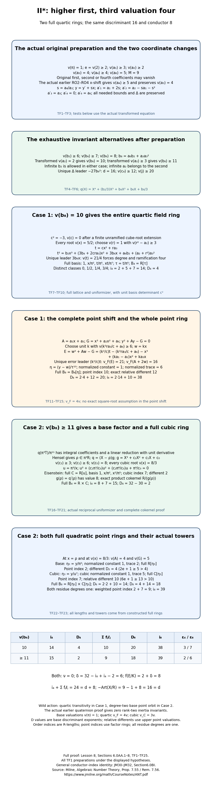

*Two normalizations, one conductor.* Sections 6.0AA.1–7 prove the precise original preparation, the two coordinate changes, both full quartic rings and their distinct point towers. The quartic-field branch uses the entire mixed lattice and scalar point shift, including its constant error; the base-plus-cubic branch uses the reciprocal cubic uniformizer and complete product-order cokernel. The table distinguishes base discriminant exponents, upper point-field differents and module lengths. Every hypothesis and entry has its local proof or the precise actual earlier proof named above. Milne’s free author notes, Proposition 7.55 and Remark 7.56, provide local-field writing material.

### 6.0AA.8. Scope left by this proposition

For complementary coefficient ranges, Section 6.0AB treats every remaining ramification-index-two preparation and describes the coefficient ranges treated there. The II-star preparations outside these hypotheses lie in at original ramification at least two, first valuation at least three or infinite and third valuation at least five or infinite, outside all earlier proved preparations including UT1. Every other residual III-star/shorter-even/II/III/I-zero-star range and universal NF24 lie outside this family-specific calculation; the general identity is JM30–JM32 in §6.0BI. 

## 6.0AB. Every remaining II-star preparation at ramification index two

**Proposition 6.0AB (Every remaining II-star preparation at ramification index two).** Every prepared II-star equation with ramification index two, first valuation at least three and third valuation at least five has discriminant eighteen and conductor ten. The first, second, third and fourth coefficients may vanish. Four exhaustive coefficient cases give three full quartic normalizations: a quartic field, four base factors, or two ramified quadratic fields. The last alternative is proved by constructing an integral rank-four order, lifting its idempotents and proving its factors are DVRs. The point rings are constructed in every case.

### 6.0AB.1. Original preparation, actual normalization and written providers

Let \(K/\mathbf Q_2\) be finite, \(R=\mathcal O_K\), \(v(\pi)=1\), and suppose the actual original minimal preparation satisfies
\[
 \begin{gathered}
 e=v(2)=2,\qquad v(a_1)\ge3,\qquad v(a_2)\ge2,\\
 v(a_3)\ge5,\qquad v(a_4)\ge4,\qquad v(a_6)=5.
 \end{gathered}
 \tag{RT1}
\]
All four lower-bound coefficients may vanish. Apply the actual fourth-coefficient normalization RO2–RO4 in Section 6.0Z.2. Its integral shift \(x=x'+r_x\), with \(v(r_x)\ge2\), leaves the first coefficient unchanged, changes the third by \(a_1r_x\), preserves the second lower bound and the exact sixth valuation, and gives
\[
 \begin{gathered}
 v(a_1)\ge3,\qquad v(a_2)\ge2,\qquad v(a_3)\ge5,\\
 v(a_4)\ge5,\qquad v(a_6)=5.
 \end{gathered}
 \tag{RT2}
\]
We drop primes only for these actual transformed coefficients. An originally zero third coefficient need not stay zero; its lower bound does. All subsequent case tests concern RT2.

Lemma 6.0E constructs its nine-component II-star model, with component count \(M=9\). Theorem 6.0I.9 proves minimality and identification, and Lemma 6.0H proves the Euler identity. Sections 6.0K.1–6.0K.6 prove the torsion quartic, order discriminants, trace duals, differents, orbit and Swan formulas. Sections 6.0P.3 and 6.0P.5 prove full quadratic normalization, tower indices and orbit counts. The actual earlier programme lesson *Profinite groups and adic representations*, Sections 0A–0G, proves complete local fields, simple-root Hensel lifting, finite unramified extensions and full Eisenstein rings. The specialized orders and point shifts below are proved here.

Milne's freely accessible author notes [*Algebraic Number Theory*](https://www.jmilne.org/math/CourseNotes/ANT.pdf), Proposition 7.55 and Remark 7.56, printed pp.129–130, supply local-field writing material. They replace no proof.

### 6.0AB.2. Common invariants and the exhaustive four cases

The actual invariant identities give
\[
 \begin{gathered}
 b_2=a_1^2+4a_2,\\b_4=a_1a_3+2a_4,\\b_6=a_3^2+4a_6,\\
 b_8=a_6b_2-a_1a_3a_4+a_2a_3^2-a_4^2,\\
 v(b_2)\ge6,\qquad v(b_4)\ge7,\\v(b_6)=9,\qquad v(b_8)\ge10.
 \end{gathered}
 \tag{RT3}
\]
The two summands in the sixth invariant have bounds ten and exact value nine; hence no cancellation is possible. The first, cube, square and cross terms in the discriminant have respective bounds
\[
 \begin{gathered}
 22,\qquad27,\qquad18,\qquad22,\\
 d=v(\Delta)=18,\\v(c_4)\ge12,\\v(j)\ge18>0.
 \end{gathered}
 \tag{RT4}
\]
The square term is uniquely least. The earlier potential-good proof applies; the conductor has not been used.

There are exactly four cases:
\[
 \begin{array}{c|cc}
 \text{case}&v(a_4)&v(b_2)\\\hline
 A&5&\ge7\\
 B&\ge6&6\\
 C&\ge6&\ge7\\
 D&5&6
 \end{array}
 \tag{RT5}
\]
Infinite valuations belong to their indicated lower-bound rows. Work after a finite unramified extension whenever necessary to split a residue polynomial or obtain a primitive cube root \(\zeta\). The earlier unramified-invariance proof preserves the discriminant, weighted lengths and inertia conductor. Put
\[
 \begin{gathered}
 c=1+2\zeta,\qquad c^2=-3,\qquad v(c)=0,\\
 c+3=2(2+\zeta),\qquad v(c+3)=2.
 \end{gathered}
\]
\[
 \begin{gathered}
 q(X)=X^4+(b_2/3)X^3+b_4X^2+b_6X+b_8/3,\\
 A(x)=a_1x+a_3,\\G(x)=x^3+a_2x^2+a_4x+a_6.
 \end{gathered}
 \tag{RT6}
\]
The residue of \(2+\zeta\) is nonzero. For any proposed point shift \(w\), define its complete error and shifted trace by
\[
 E(w)=w^2+A(x)w-G(x),\qquad T(w)=A(x)+2w.
 \tag{RT7}
\]
Thus \(y=w+\varpi^\ell\eta\) gives the exact polynomial
\[
 \eta^2+\frac{T(w)}{\varpi^\ell}\eta
             +\frac{E(w)}{\varpi^{2\ell}}=0.
 \tag{RT8}
\]
When its constant has normalized valuation one and its trace at least one, it is Eisenstein. The whole ring follows by coefficientwise parity: the two basis values are zero and one in the upper quadratic valuation, while scalar coefficients have even values. The derivative different is the minimum of the two terms of opposite parity, exactly as proved in NF13.

### 6.0AB.3. Case A: a mixed full quartic lattice and its point ring

Suppose case A holds. The square term in the eighth invariant is uniquely least, so \(v(b_8)=10\), and \(v(b_4)=7\). Every root \(x\) of RT6 has value \(5/2\). At that value the fourth power and constant have value ten; the middle terms have bounds \(29/2,12,23/2\). Below that value the fourth power would be uniquely least; above it the constant would be uniquely least. These contradictions prove the assertion without presuming irreducibility.

Put
\[
 \begin{gathered}
 t=cx^2+a_4,\\M_0=3b_4+2ca_4=3a_1a_3+2(c+3)a_4,\\
 C_0=b_8+a_4^2=a_6b_2-a_1a_3a_4+a_2a_3^2,\\
 t^2=b_2x^3+M_0x^2+3b_6x+C_0.
 \end{gathered}
 \tag{RT9}
\]
This is the complete expansion reduced by \(q(x)=0\) and \(c^2=-3\). The coefficient bounds are \(v(M_0)\ge8\) and \(v(C_0)\ge12\). The four right-hand terms therefore have bounds \(29/2,13,23/2,12\); only the third attains \(23/2\). Hence
\[
 \begin{gathered}
 v(t)=23/4,\qquad F=K(x),\\
 [F:K]=e(F/K)=4,\\{[k_F:k_R]}=1.
 \end{gathered}
 \tag{RT10}
\]
The denominator four forces these degrees, since a root field has degree at most four. In quartic valuation \(v_F=4v\) the full ring is
\[
 \begin{gathered}
 B_4=R\oplus R\,x/\pi^2\oplus R\,t/\pi^5\oplus R\,xt/\pi^8,\\
 i_4=2+5+8=15,\qquad D_4=2d-2i_4=6,\\
 \tau=xt/\pi^8,\qquad v_F(\tau)=1,\\B_4=R[\tau].
 \end{gathered}
 \tag{RT11}
\]
The four displayed basis values in base valuation are \(0,1/2,3/4,1/4\). For any linear combination with coefficients in \(K\), their fractional classes are distinct, so the least term cannot cancel. Integrality is equivalent to every coefficient lying in \(R\), proving the entire lattice. The unscaled change from \(1,x,x^2,x^3\) to \(1,x,t,xt\) has unit determinant \(c^2\), giving the index. The actual uniformizer \(\tau\) forces degree four; its conjugates have value \(1/4\), so its monic polynomial is Eisenstein. The earlier complete Eisenstein proof gives the stated monogenic full ring.

Choose a unit \(k\in R\) by residue squaring so that
\[
 v(k^2a_4/c+a_6)\ge6,\qquad w=kx.
 \tag{RT12}
\]
The ratio \(-ca_6/a_4\) is a unit. Its residue has a square root because squaring in a finite field of characteristic two is injective and therefore bijective. No exact square root in \(K\) is needed. Substituting \(x^2=(t-a_4)/c\) gives
\[
 \begin{aligned}
 E(kx)={}&(k^2/c)t-(k^2a_4/c+a_6)-x^3\\
        &+(ka_1-a_2)x^2+(ka_3-a_4)x.
 \end{aligned}
 \tag{RT13}
\]
The first term has value \(23/4\); the remaining terms have respective bounds \(6,15/2,7,15/2\). It is uniquely least. In the trace, \(2kx\) has value \(9/2\), below both \(a_1x\) and \(a_3\). Consequently
\[
 \begin{gathered}
 v_F(E)=23,\qquad v_F(T)=18,\qquad\ell=11,\\
 \eta=(y-kx)/\tau^{11},\\
 v_F(E/\tau^{22})=1,\\v_F(T/\tau^{11})=7,\\
 B_8=B_4[\eta],\\D_{8/4}=\min(17,14)=14,\\
 D_8=2\cdot6+14=26,\\i_8=2\cdot15+11=41.
 \end{gathered}
 \tag{RT14}
\]
The full point ring, point index eleven and relative different follow from RT8, parity and the exact generator determinant. All residue degrees are one; the tower formula therefore has exactly the displayed weights.

### 6.0AB.4. Case B: a power lattice and a quadratic point shift

Now suppose case B holds. In the eighth invariant \(a_6b_2\) has exact value eleven; the other terms have bounds fourteen, twelve and twelve. Thus \(v(b_8)=11\), while \(v(b_4)\ge8\). Every quartic root has value \(11/4\): the middle-term values at that slope have bounds \(57/4,27/2,47/4\), all above eleven. The same unique-minimum contradictions at either side prove the slope. Its denominator forces a totally ramified quartic field, whose entire ring is
\[
 \begin{gathered}
 B_4=R\oplus R\,x/\pi^2\oplus R\,x^2/\pi^5\oplus R\,x^3/\pi^8,\\
 i_4=15,\qquad D_4=6,\\
 \tau=x^3/\pi^8,\qquad v_F(\tau)=1,\\B_4=R[\tau].
 \end{gathered}
 \tag{RT15}
\]
The fractional classes of the displayed basis are \(0,3/4,1/2,1/4\), proving fullness and the index exactly as above.

Choose a unit \(k\) by residue squaring and put
\[
 \begin{gathered}
 v(k^2b_8/(3\pi^6)+a_6)\ge6,\\w=kx^2/\pi^3,\\
 E(w)=J_3x^3+J_2x^2+J_1x+J_0.
 \end{gathered}
\]
\[
 \begin{aligned}
 J_3&=-k^2b_2/(3\pi^6)+ka_1/\pi^3-1,\\
 J_2&=-k^2b_4/\pi^6+ka_3/\pi^3-a_2,\\
 J_1&=-k^2b_6/\pi^6-a_4,\\
 J_0&=-k^2b_8/(3\pi^6)-a_6.
 \end{aligned}
 \tag{RT16}
\]
This is the entire error reduced by the quartic; in particular the constant has not been discarded. The bounds are \(v(J_3)\ge0\), \(v(J_2)\ge2\), \(v(J_1)=3\), \(v(J_0)\ge6\). Hence \(J_1x\) is uniquely least, of value \(23/4\); its competitors have bounds \(33/4,15/2,6\). The shift itself has value \(5/2\), so its doubled value \(9/2\) is uniquely least in the trace. RT14 applies with the RT15 uniformizer and this actual \(w\): the full point index is eleven, its normalized trace is seven, its relative different is fourteen, and \(D_8=26,i_8=41\).

### 6.0AB.5. Case C: four actual base factors and four full point rings

In case C the eighth invariant has value at least twelve and the fourth invariant at least eight. The entire scaled polynomial is
\[
 \frac{q(\pi^3U)}{\pi^{12}}
 =U^4+\frac{b_2}{3\pi^3}U^3
       +\frac{b_4}{\pi^6}U^2
       +\frac{b_6}{\pi^9}U+\frac{b_8}{3\pi^{12}}.
 \tag{RT17}
\]
It is integral and reduces to \(U^4+\alpha U+\gamma\), with \(\alpha\ne0\). Its residue derivative is the nonzero constant \(\alpha\), so it is separable. After a finite unramified extension splits that residue polynomial, the actual Hensel proof gives four roots \(U_j\in R\) with pairwise unit differences. Thus
\[
 \begin{gathered}
 x_j=\pi^3U_j,\qquad v(x_j)\ge3,\\
 v(x_i-x_j)=3\quad(i\ne j),\\B_4=R^4.
 \end{gathered}
 \tag{RT18}
\]
A zero root is permitted. Evaluation of \(1,x,x^2,x^3\) in the four coordinates has determinant the Vandermonde product of their six differences. Its valuation is eighteen, and it embeds the original quartic order with full rank. Hence \(i_4=18\); the idempotent trace matrix of \(R^4\) is the identity, so \(D_4=0=36-2\cdot18\).

At each actual root, \(v(A(x_j))\ge5\) and \(v(G(x_j))=5\), the latter because its three other terms have bounds nine, eight and nine. Put
\[
 \begin{gathered}
 \eta_j=y_j/\pi^2,\\
 \eta_j^2+(A(x_j)/\pi^2)\eta_j-G(x_j)/\pi^4=0,\\
 v(A(x_j)/\pi^2)\ge3,\qquad v(G(x_j)/\pi^4)=1,\\
 B_8=\prod_{j=1}^4R[\eta_j],\\\ell_j=2,\qquad D_{2/1,j}=5,\\
 D_8=20,\\i_8=2\cdot18+4\cdot2=44.
 \end{gathered}
 \tag{RT19}
\]
Each full ring is Eisenstein. The derivative term from \(2\eta_j\) has upper value five; its trace competitor has value at least six, proving the exact different. Four lengths over these base factors contribute four times two, with residue degree one each.

### 6.0AB.6. Case D: the complete residual equation

Suppose case D holds. Again \(v(b_8)=10\), \(v(b_4)=7\), and every root \(x\) has value \(5/2\). Keep \(t,M_0,C_0\) from RT9. Now \(v(C_0)=11\), uniquely from \(a_6b_2\), while \(v(M_0)\ge8\). Residue squaring chooses \(\beta\in\pi^3R\) so that
\[
 \begin{gathered}
 v(\beta)=3,\\C=C_0-\beta^2a_4/c,\qquad v(C)\ge12,\\
 s=t-\beta x,\\P=b_2-2c\beta,\qquad v(P)=5,\\
 L=3b_6-2\beta a_4+\beta^3/c,\qquad v(L)\ge9,\\
 s^2=Px^3+M_0x^2+Lx+(\beta^2/c)s+C.
 \end{gathered}
 \tag{RT20}
\]
The ratio \(cC_0/(a_4\pi^6)\) is a unit, proving the residue choice. The identity is the full expansion, using \(x^2=(s+\beta x-a_4)/c\). Its cubic, square, linear and constant terms have bounds \(25/2,13,23/2,12\). If \(v(s)\le11/2\), then \(s^2\) would be uniquely least: \(6+v(s)>2v(s)\), and the other four bounds are strictly larger. Thus \(v(s)>11/2\); no unjustified leading-square cancellation is needed. There are exactly two remaining alternatives, \(v(L)=9\) or \(v(L)\ge10\), the latter including \(L=0\).

### 6.0AB.7. Case D1: the entire point shift after a second residue cancellation

If \(v(L)=9\), RT20 forces \(v(s)=23/4\). For \(11/2<v(s)<23/4\) its square would be uniquely least; for \(v(s)>23/4\) the term \(Lx\) would be uniquely least. Therefore the quartic is totally ramified of degree four. Replacing \(t\) by \(s\) in RT11 gives its full basis, index fifteen, discriminant six and uniformizer \(\tau=xs/\pi^8\). The unscaled basis change still has unit determinant \(c^2\), and its four fractional classes are unchanged.

Choose \(k\) as in RT12. Replacing \(t=s+\beta x\) in RT13 gives
\[
 \begin{aligned}
 E(kx)={}&(k^2/c)s-(k^2a_4/c+a_6)-x^3
                  +(ka_1-a_2)x^2\\
        &+(k^2\beta/c+ka_3-a_4)x.
 \end{aligned}
 \tag{RT21}
\]
Its uniquely least term has value \(11/2\) and even quartic-normalized value twenty-two; this shift alone does not produce the full point ring. Choose a second unit \(\lambda\) by residue squaring and put
\[
 v(\lambda^2L/\pi^6+k^2\beta/c)\ge4,
 \qquad w=kx+\lambda s/\pi^3.
 \tag{RT22}
\]
Both summands to be canceled have value three. Their unit residue ratio is \(-k^2\beta\pi^6/(cL)\), so the choice exists. The complete new error is
\[
 E(w)=E(kx)+2kx\lambda s/\pi^3
               +A(x)\lambda s/\pi^3+\lambda^2s^2/\pi^6.
 \tag{RT23}
\]
After substituting the entire RT20 equation, the coefficient of \(s\) is
\[
 \begin{gathered}
 (k^2+\lambda^2\beta^2/\pi^6)/c,\\
 cL-\beta^3=3cb_6-2c\beta a_4,\\v(cL-\beta^3)=9.
 \end{gathered}
 \tag{RT24}
\]
It is a unit. Indeed RT22 gives its numerator residue as \(k^2(1-\beta^3/(cL))\); RT24 and \(v(cL)=9\) make that residue nonzero. The remaining linear coefficient has value at least four. The constants have bounds six; the cubic terms at least \(13/2\); the square terms at least seven. The two cross terms in RT23 have bounds \(29/4\) and \(31/4\). All are strictly larger than \(v(s)=23/4\). Thus \(v(E(w))=23/4\). The added term in \(2w\) has value \(19/4\), above the uniquely least \(2kx\) of value \(9/2\). Hence the actual trace also has value \(9/2\). RT14 now proves the full point ring with this complete \(w\), point index eleven, relative different fourteen, \(D_8=26,i_8=41\).

### 6.0AB.8. Case D2: constructing and proving the full two-quadratic normalization

If \(v(L)\ge10\), RT20 forces \(v(s)\ge6\). Otherwise its square is uniquely least: the other four terms have bounds \(25/2,13,25/2,12\), and \(6+v(s)>2v(s)\) for \(v(s)<6\). This includes \(s=0\). Define integral elements in the actual quartic algebra by
\[
 \begin{gathered}
 \xi=x/\pi^2,\qquad S=s/\pi^6,\\
 O=R1\oplus R\xi\oplus RS\oplus R\xi S.
 \end{gathered}
 \tag{RT25}
\]
We must prove this lattice is an order and then its full normalization; a guessed slope does neither. Eliminating both \(x^3\) and \(x^2\) from RT20 gives the exact relations
\[
 \begin{gathered}
 U_0=\beta^2/c+\beta P/c^2+M_0/c,\quad v(U_0)=6,\\
 V_0=C-\beta a_4P/c^2-a_4M_0/c,\quad v(V_0)\ge12,\\
 W_0=L+\beta^2P/c^2+\beta M_0/c-a_4P/c,
 \quad v(W_0)\ge10,\\
 s^2=U_0s+V_0+W_0x+(P/c)sx.
 \end{gathered}
 \tag{RT26}
\]
In normalized elements these are
\[
 \begin{gathered}
 \xi^2=a\xi+b+d_0S,\\
 a=\beta/(c\pi^2),\qquad b=-a_4/(c\pi^4),\\d_0=\pi^2/c,\\
 S^2=US+V+W\xi+HS\xi,\\
 U=U_0/\pi^6\in R^\times,\\V=V_0/\pi^{12}\in R,\\
 W=W_0/\pi^{10}\in R,\\H=P/(c\pi^4),\\
 v(a)=v(b)=v(H)=1,\qquad v(d_0)=2.
 \end{gathered}
 \tag{RT27}
\]
Their complete bounds follow from RT20: the other summands in \(U_0\) have value at least eight, those subtracted in \(V_0\) at least thirteen, and the last three summands in \(W_0\) at least eleven, eleven and ten.

The four RT25 vectors are independent: the unscaled triangular change from \(1,x,x^2,x^3\) to \(1,x,s,xs\) has determinant \(c^2\), and their denominators are \(1,\pi^2,\pi^6,\pi^8\). To prove closure, RT27 already gives the squares of both generators. Furthermore
\[
 \begin{aligned}
 \xi^2S&=(a+d_0H)\xi S+(b+d_0U)S+d_0V+d_0W\xi,\\
 S^2\xi&=U\xi S+V\xi+W\xi^2+H\xi^2S.
 \end{aligned}
 \tag{RT28}
\]
Both belong to \(O\). Thus multiplication by \(\xi\) and by \(S\) preserves every vector of its basis. They generate \(O\) as an algebra, proving that \(O\) is a finite free unital order of rank four. It is complete in the \(\pi\)-adic topology. It contains \(R[x]\), and the determinant gives
\[
 \operatorname{length}_R(O/R[x])=2+6+8=16.
 \tag{RT29}
\]

In the residue algebra, writing bars for reduction, RT27 becomes
\[
 \bar\xi^2=0,\qquad
 \bar S^2=\bar U\bar S+\bar V+\bar W\bar\xi,
 \qquad \bar U\ne0.
 \tag{RT30}
\]
Put \(Z=\bar S+(\bar W/\bar U)\bar\xi\). In characteristic two its square is \(\bar S^2\), so it satisfies \(Z^2-\bar UZ-\bar V=0\). This quadratic is separable. After an allowed finite unramified extension splits it, the residue presentation is
\[
 O/\pi O\simeq
 k[\bar\xi]/(\bar\xi^2)\times k[\bar\xi]/(\bar\xi^2).
 \tag{RT31}
\]
This is the full presentation: the algebra defined by RT30 has spanning set \(1,\bar\xi,\bar S,\bar\xi\bar S\), and their actual independence in \(O/\pi O\) proves dimension four, so no hidden extra relation was assumed.

Here is the idempotent lifting proof inside this complete order. Lift either residue idempotent to \(z_0\in O\), and set \(F(z)=z^2-z\). The element \(2z_0-1\) is a unit modulo \(\pi\); any element with invertible residue is invertible in \(O\), by lifting its inverse and summing the convergent geometric series for the remaining error in \(\pi O\). Define
\[
 z_{n+1}=z_n-(2z_n-1)^{-1}F(z_n).
 \tag{RT32}
\]
Direct expansion makes \(F(z_{n+1})\) a multiple of \(F(z_n)^2\). Starting with \(F(z_0)\in\pi O\), its error and the successive corrections tend to zero at least by doubling their \(\pi\)-adic orders. Completeness gives an idempotent \(z\); \(1-z\) is its complement. Hence \(O=O_1\times O_2\), with \(O_1=zO\) and \(O_2=(1-z)O\). Each direct summand is free of rank two over the DVR \(R\), since its reduction has dimension two.

Each \(O_i\) is local: its residue algebra in RT31 has only the maximal ideal generated by \(\bar\xi_i\), and every maximal ideal of a finite integral \(R\)-algebra contracts to \((\pi)\). Its maximal ideal is initially \((\pi,\xi_i)\). RT27 in that factor says
\[
 \begin{gathered}
 \xi_i^2=\pi U_i,\\
 U_i=(a/\pi)\xi_i+b/\pi+(d_0/\pi)S_i\in O_i^\times.
 \end{gathered}
 \tag{RT33}
\]
Its residue at the maximal ideal is the nonzero residue of \(b/\pi\). Therefore \(\pi=\xi_i^2U_i^{-1}\) and the maximal ideal is \((\xi_i)\). Multiplication by \(\xi_i\) is injective: the quartic constant has exact value ten, so every generic root \(x\) is nonzero, and \(x\) is invertible in the separable generic algebra. The \(\xi_i\)-adic and \(\pi\)-adic topologies agree by RT33, and their powers have zero intersection since \(O_i\) is finite free over \(R\). Every nonzero element is therefore a unit times a finite power of \(\xi_i\). Products of nonzero elements are nonzero by the injectivity just proved. This proves that \(O_i\) is a DVR and a domain, with uniformizer \(\xi_i\), ramification index two and residue field \(k\). Its fraction field has degree two, because its \(R\)-rank is two.

A DVR is integrally closed by its valuation: an element of negative value cannot satisfy a monic integral equation, whose leading power would be uniquely least. Each \(O_i\) is finite over \(R\) and has its actual generic quadratic factor. Conversely an element integral over \(R\) is integral over \(O_i\), so lies in \(O_i\). We have proved the full normalization
\[
 \begin{gathered}
 B_4=O_1\times O_2=O,\\i_4=16,\\D_4=36-2\cdot16=4.
 \end{gathered}
 \tag{RT34}
\]
This establishes the split alternative without treating an integral lattice as a full ring prematurely.

One can also read each different from its full polynomial. The values of \(1,\xi_i\) have distinct fractional classes zero and one half in its quadratic field. Thus coefficientwise integrality proves \(O_i=R[\xi_i]\), and writes \(S_i=A_i+B_i\xi_i\) with \(A_i,B_i\in R\). Its actual Eisenstein polynomial is
\[
 \xi_i^2-
 \left(\frac{\beta}{c\pi^2}+\frac{\pi^2B_i}{c}\right)\xi_i
 +\frac{a_4}{c\pi^4}-\frac{\pi^2A_i}{c}=0.
 \tag{RT35}
\]
Its trace has exact value one, since its two summands have values one and at least two; its constant has exact value one for the same reason. The upper derivative values are five and two, so each quadratic different is two. Their sum is four, agreeing with RT34.

### 6.0AB.9. Both complete point rings in case D2

Choose \(k\) as in RT12 and use \(w=kx\) in both quadratic factors. In RT21 the term \((k^2\beta/c)x\) has exact value \(11/2\), while \(s\) has value at least six and every other term has value at least six. Thus in both factors the exact error value is \(11/2\), and the trace is again \(9/2\). With their normalized quadratic valuations \(v_i=2v\), the full point generators are
\[
 \begin{gathered}
 v_i(E)=11,\qquad v_i(T)=9,\qquad\ell_i=5,\\
 \eta_i=(y_i-kx_i)/\xi_i^5,\\v_i(E/\xi_i^{10})=1,\\
 v_i(T/\xi_i^5)=4,\\B_{8,i}=O_i[\eta_i],\\
 D_{4/2,i}=\min(9,8)=8,\\D_{4,i}=2\cdot2+8=12,\\
 B_8=B_{8,1}\times B_{8,2},\\D_8=24,\\i_8=2\cdot16+5+5=42.
 \end{gathered}
 \tag{RT36}
\]
RT8 and parity prove each entire Eisenstein ring and exact index five. The relative derivative's odd term has value \(2v_i(2)+1=9\), while its trace term has value eight; they cannot cancel. All residue degrees are one. Each point factor is a degree-four totally ramified field; its absolute discriminant exponent is twelve by the full tower calculation, not the relative different eight.

### 6.0AB.10. All conductor rows, exhaustion and remaining full scope

All four cases have constructed ramified point quadratics, so \(\nu=0\). In cases A, B and D1 there is one quartic orbit and one degree-eight point orbit. In case C there are four fixed sign pairs and four ramified point quadratics. In D2 there are two quadratic sign-pair orbits and two degree-four point orbits. Consequently
\[
 \begin{gathered}
 \begin{array}{c|rrr}
 \text{case}&i_4&D_4&\sum_j f_j\ell_j\\\hline
 A,B,D1&15&6&11\\C&18&0&8\\D2&16&4&10
 \end{array}\\
 \begin{array}{c|rrrr}
 \text{case}&D_8&i_8&\epsilon_4&\epsilon_8\\\hline
 A,B,D1&26&41&3&7\\C&20&44&0&4\\D2&24&42&2&6
 \end{array}
 \end{gathered}
 \tag{RT37}
\]
Each row independently agrees with \(D_4=2d-2i_4\), \(D_8=6d-2i_8\) and NF19. The inertia is finite by the actual potential-good proof. Its action cannot be tame: a group of odd order cannot have an orbit of even size. Cases A, B and D1 have their degree-four sign-pair orbit, D2 its degree-two orbit, and C its degree-two point orbit. Wild inertia is therefore nontrivial on \(E[3]\). The quaternion calculation of Section 6.0K.6 and the actual kernel comparison with cohomology give zero cohomology invariants, so the conductor is two plus Swan.

The earlier full-order Swan identity now gives, in every row,
\[
 \begin{gathered}
 \delta=2d-i_8+i_4-(\epsilon_8-\epsilon_4)/2=8,\\
 f(E/K)=2+\delta=10,\\i_4+\sum_j f_j\ell_j=26=d+M-1,\\
 -\operatorname{Art}(X/R)=M-1+f(E/K)=8+10=18=d.
 \end{gathered}
 \tag{RT38}
\]
This proves NF24 and the discriminant–Artin equality for every original RT1 equation. Infinite lower-bound coefficients are included. Every coefficient division is confined to a case with its denominator's finite valuation proved: the fourth coefficient has value five in A and D, and the eighth invariant has value eleven in B. Every use of \(L\) as a denominator is confined to D1, where its value nine proves it nonzero. The finite unramified extensions only split specified residue polynomials and provide the cube root; they impose no restriction on the original field or units.

Together with the actual earlier first/third-layer proof in Section 6.0O, the normalized first-valuation-two proof in Sections 6.0W and 6.0Z, and the third-valuation-four proof in Section 6.0AA, this covers every original II-star preparation at ramification index two. First valuation one and third valuation three use their earlier original tests. For first valuation two and third at least four, RO2–RO4 is applied and the subsequent third test is made on its actual transformed coefficient. For first valuation at least three the same normalization preserves an exact third value four, while every higher or infinite third value is RT1. No case is removed because a coefficient is zero or because the original fourth valuation is four.

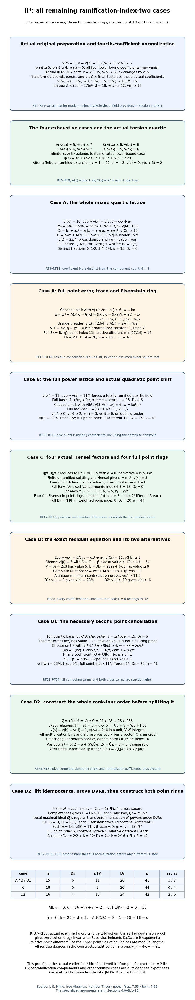

*Four cases, three full normalizations.* Sections 6.0AB.1–10 prove every original preparation in RT1, the exhaustive coefficient cases and all point towers. The split alternative constructs the whole rank-four order, proves multiplication closure, lifts idempotents and proves its two factors are DVRs before using their indices or differents. The map distinguishes base discriminant exponents, relative differents and module lengths, and records every valuation normalization and exact proof locator. Milne’s free author notes, Proposition 7.55 and Remark 7.56, supply local-field writing material; every specialized argument is proved here.

### 6.0AB.11. Scope left by this proposition

For coefficient ranges complementary to the ramification-two calculations, Section 6.0AC treats the higher-ramification, first-three, third-five and fourth-at-least-six family and describes the coefficient ranges treated there. The II-star preparations outside these hypotheses lie in at ramification at least three, first valuation at least three or infinite and third valuation at least five or infinite, outside the earlier proved preparations including UT1. Every residual III-star, shorter-even, II, III and I-zero-star range and universal NF24 lie outside this family-specific calculation; the general identity is JM30–JM32 in §6.0BI. 

## 6.0AC. Higher ramification, first three and third five in the II-star preparation

**Proposition 6.0AC (Higher ramification, first three and third five in the II-star preparation).**

### 6.0AC.1. The actual equation and its earlier written providers

Let \(K/\mathbf Q_2\) be finite, let \(R\) be its integer ring, and normalize \(v(\pi)=1\). In the actual integral equation
\[
 y^2+a_1xy+a_3y=x^3+a_2x^2+a_4x+a_6
\]
assume
\[
 \begin{gathered}
 e=v(2)\ge3,\\v(a_1)=3,\qquad v(a_2)\ge2,\\
 v(a_3)=5,\qquad v(a_4)\ge6,\\v(a_6)=5.
 \end{gathered}
 \tag{HF1}
\]
The second and fourth coefficients may vanish. These are hypotheses on this equation after any coordinate preparation; no claim is made that a preceding coordinate change preserves the exact third valuation. In particular, this includes the second-coefficient values two and three that do not satisfy UT1 with first valuation three.

The actual earlier Lesson 08 Lemma 6.0E constructs the nine-component II-star regular proper model, with every component of square minus two. Theorem 6.0I.8 therefore makes this the minimal regular proper model. The origin-germ converse following Theorem 6.0I.9 proves that this integral Weierstrass equation is minimal. Lemma 6.0H proves its Euler formula. Sections 6.0K.1–6.0K.6 prove the trace dual, different tower, torsion orders, permutation comparison and Swan formula. Sections 6.0P.3 and 6.0P.5 prove full quadratic normalization and the weighted index and inertia-orbit formulas. The earlier programme lesson *Profinite groups and adic representations*, Sections 0A–0G, supplies complete local fields, residue lifting, finite unramified extensions and full Eisenstein rings. The specialized rings and shifts below are proved here.

Free human-source context: Milne’s author notes [*Algebraic Number Theory*](https://www.jmilne.org/math/CourseNotes/ANT.pdf), Proposition 7.55 and Remark 7.56, printed pp.129–130. Every specialized result is proved here using the earlier written providers.

### 6.0AC.2. Exact invariants and every quartic root

Use the actual earlier integral invariant formulas
\[
 \begin{aligned}
 b_2&=a_1^2+4a_2,\\b_4&=a_1a_3+2a_4,\\b_6&=a_3^2+4a_6,\\
 b_8&=a_6b_2-a_1a_3a_4+a_2a_3^2-a_4^2.
 \end{aligned}
 \tag{HF2}
\]
Their summands, including their signs, give
\[
 \begin{gathered}
 v(b_2)=6,\qquad v(b_4)\ge8,\\
 v(b_6)=10,\qquad v(b_8)=11.
 \end{gathered}
 \tag{HF3}
\]
In \(b_2\) the two summand values are six and at least eight. In \(b_4\) they are eight and at least nine. In \(b_6\) they are ten and at least eleven. In \(b_8\) the four values are eleven, at least fourteen, at least twelve and at least twelve. Each asserted exact value has a unique least summand.

The four terms of the discriminant have values at least twenty-three, twenty-four, exactly twenty and at least twenty-four, respectively. Also the two terms of the fourth invariant have values twelve and at least seventeen. Thus
\[
 \begin{gathered}
 \Delta=-b_2^2b_8-8b_4^3-27b_6^2+9b_2b_4b_6,\\
 d=v(\Delta)=20,\\c_4=b_2^2-24b_4,\\
 v(c_4)=12,\qquad v(j)=16,\qquad M=9.
 \end{gathered}
 \tag{HF4}
\]
Here \(M\) is the number of components. The actual earlier potential-good proof applies because the last valuation is positive.

The earlier proved torsion quartic is
\[
 q(X)=X^4+(b_2/3)X^3+b_4X^2+b_6X+b_8/3.
 \tag{HF5}
\]
Every one of its roots has value \(11/4\). To prove this without a presumed integral basis, put \(u=v(x)\). If \(u<11/4\), the monomial \(x^4\) is uniquely least: its three differences from the middle-term lower bounds are \(6-u\), \(8-2u\), and \(10-3u\), all positive, and \(4u<11\). If \(u>11/4\), the constant of value eleven is uniquely least; the other four lower bounds are strictly larger. Both cases contradict a sum being zero. At the claimed slope the three middle-term lower bounds are \(57/4,27/2,51/4\), strictly above eleven.

For any root, the value group of \(F=K(x)\) consequently has denominator four. Its ramification index is divisible by four and its degree is at most four. Therefore
\[
 \begin{gathered}
 {[F:K]}=e(F/K)=4,\\{[k_F:k_R]}=1,\\v_F=4v.
 \end{gathered}
 \tag{HF6}
\]
This proves irreducibility and total ramification; it does not substitute a Newton slope for a fullness proof.

### 6.0AC.3. The full quartic ring and its exact index

The four elements
\[
 \begin{gathered}
 1,\quad x/\pi^2,\quad x^2/\pi^5,\quad x^3/\pi^8,\\
 v(1)=0,\quad v(x/\pi^2)=3/4,\\
 v(x^2/\pi^5)=1/2,\quad v(x^3/\pi^8)=1/4
 \end{gathered}
 \tag{HF7}
\]
form a field basis and have distinct fractional valuation classes. In any linear combination with coefficients in \(K\), its nonzero summands therefore have distinct valuations, so the minimum cannot cancel. Since every displayed value is in \([0,1)\), that combination is integral exactly when every coefficient is in \(R\). This proves the entire integer ring and the determinant index:
\[
 \begin{gathered}
 B_4=R\oplus R\,x/\pi^2\oplus R\,x^2/\pi^5\oplus R\,x^3/\pi^8,\\
 i_4=2+5+8=15,\\D_4=2d-2i_4=10.
 \end{gathered}
 \tag{HF8}
\]
Put \(\tau=x^3/\pi^8\). It is a uniformizer of \(F\). The values of its first four powers are \(0,1/4,1/2,3/4\). The same coefficientwise argument proves both that they form a field basis and that \(B_4=R[\tau]\).

### 6.0AC.4. Both residue cancellations and the complete point error

Write
\[
 \begin{gathered}
 A=a_1x+a_3,\\G=x^3+a_2x^2+a_4x+a_6,\\
 E(w)=w^2+Aw-G,\\T(w)=A+2w.
 \end{gathered}
 \tag{HF9}
\]
The residue field is finite of characteristic two. Its squaring map is injective, hence surjective. Both \(b_8/(3\pi^{11})\) and \(a_6/\pi^5\) are units. Choose a unit \(k\in R\) whose residue square cancels their ratio, so that
\[
 \begin{gathered}
 v\bigl(k^2b_8/(3\pi^6)+a_6\bigr)\ge6,\\w_0=kx^2/\pi^3.
 \end{gathered}
 \tag{HF10}
\]
Reducing the entire error by HF5 gives
\[
 \begin{aligned}
 E(w_0)&=J_3x^3+J_2x^2+J_1x+J_0,\\
 J_3&=-k^2b_2/(3\pi^6)+ka_1/\pi^3-1,\\
 J_2&=-k^2b_4/\pi^6+ka_3/\pi^3-a_2,\\
 J_1&=-k^2b_6/\pi^6-a_4,\\
 J_0&=-k^2b_8/(3\pi^6)-a_6.
 \end{aligned}
 \tag{HF11}
\]
The coefficient bounds are zero, two, exactly four and at least six. The constant can therefore be smaller than \(J_1x\), whose value is \(27/4\). It cannot be omitted.

If \(v(J_0)\ge7\), put \(\sigma=0\). Otherwise \(v(J_0)=6\); choose \(u\in R^\times\) whose residue square is the negative of the residue of \(J_0/\pi^6\), and put \(\sigma=\pi^3u\). In both cases
\[
 \begin{gathered}
 v(\sigma)\ge3,\\v(J_0+\sigma^2)\ge7,\\w=w_0+\sigma.
 \end{gathered}
 \tag{HF12}
\]
This second cancellation uses a residue square, with its cross term retained. Direct expansion, not just an estimate, gives
\[
 \begin{aligned}
 E(w)&=E(w_0)+\sigma(A+2w_0)+\sigma^2\\
 &=K_3x^3+K_2x^2+K_1x+K_0,\\
 K_3&=J_3,\\K_2&=J_2+2k\sigma/\pi^3,\\
 K_1&=J_1+a_1\sigma,\\K_0&=J_0+a_3\sigma+\sigma^2.
 \end{aligned}
 \tag{HF13}
\]
The new coefficient bounds are at least zero, at least two, exactly four and at least seven. The two extra nonconstant coefficient terms have values at least three and at least six. The extra constant \(a_3\sigma\) has value at least eight. Hence the term \(K_1x\) is uniquely least, with competing bounds \(33/4,15/2,7\). Consequently
\[
 \begin{gathered}
 v(E(w))=27/4,\\v(w)=5/2,\\v(T(w))=5,\\
 v_F(E(w))=27,\\v_F(T(w))=20.
 \end{gathered}
 \tag{HF14}
\]
For the trace assertion, its four summands \(a_1x,a_3,2w_0,2\sigma\) have values \(23/4,5,\ge11/2,\ge6\); the exact third-coefficient term is uniquely least. All statements include the zero scalar and zero second or fourth coefficients.

### 6.0AC.5. The entire point ring, different and conductor

For a point above \(x\), put
\[
 \begin{gathered}
 \eta=(y-w)/\tau^{13},\\
 \eta^2+\frac{T(w)}{\tau^{13}}\eta+\frac{E(w)}{\tau^{26}}=0,\\
 v_F\bigl(E(w)/\tau^{26}\bigr)=1,\\
 v_F\bigl(T(w)/\tau^{13}\bigr)=7.
 \end{gathered}
 \tag{HF15}
\]
This is Eisenstein. It gives a totally ramified quadratic point field \(L/F\), with \(v_L=2v_F\) and \(v_L(\eta)=1\). Every element of \(L\) has the unique form \(c_0+c_1\eta\) with \(c_0,c_1\in F\). The valuations of its two nonzero summands have opposite parity, so integrality is equivalent to \(c_0,c_1\in B_4\). Thus \(B_8=B_4[\eta]\) is the entire integer ring. The determinant of the displayed replacement of \(y\) is \(\tau^{-13}\), proving that the exact point index over \(B_4[y]\) is thirteen.

The trace-dual derivative proof of Section 6.0K.2 applies to this full monogenic ring. Its two derivative terms have upper valuations \(8e+1\ge25\) and fourteen; their opposite parity precludes cancellation. With both residue degrees one, the different tower and the two order-index formulas give
\[
 \begin{gathered}
 D_{8/4}=14,\\D_8=2D_4+14=34,\\
 i_8=2i_4+13=43=(6d-D_8)/2,\\
 \epsilon_4=3,\qquad\epsilon_8=7,\qquad\nu=0.
 \end{gathered}
 \tag{HF16}
\]
The orbit assertions also follow directly from the two full totally ramified fields. Inertia is finite by the earlier potential-good proof. Its degree-four sign-pair orbit rules out an odd-order tame action; hence wild inertia acts nontrivially. The actual quaternion and kernel-comparison proof in Section 6.0K.6 then gives zero invariants on cohomology, so the conductor is two plus Swan. The proved Swan formula now yields
\[
 \begin{gathered}
 \delta=2d-i_8+i_4-2=10,\\f=12,\\
 i_4+13=28=d+M-1,\\M-1+f=9-1+12=20=d.
 \end{gathered}
 \tag{HF17}
\]
Thus NF24 and the discriminant–Artin identity are proved for every equation in HF1, by its full rings and complete point error, rather than an assumed general conductor formula.

### 6.0AC.6. Graded exercise and full solution

**Exercise (six points).** Suppose the first chosen unit has \(v(J_0)=6\). (a) Give the exact error valuation before the scalar shift and explain why dividing \(y-w_0\) by \(\tau^{12}\) does not produce the proved full Eisenstein basis (two points). (b) Construct the scalar from one residue square, retaining all its cross terms (two points). (c) Determine how this changes the point index, and recover both the exact absolute point discriminant and conductor (two points).

**Solution.** (a) The four summand values in HF11 are at least \(33/4,15/2,27/4\), and exactly six. Thus \(v_F(E(w_0))=24\). Dividing by \(\tau^{24}\) makes the constant a unit, not a uniformizer, so that quadratic is not the Eisenstein polynomial established in HF15. Its denominator twelve does not prove a full ring. (b) Choose \(u\) with residue square \(-\overline{J_0/\pi^6}\), put \(\sigma=\pi^3u\), and retain \(\sigma A+2\sigma w_0+\sigma^2\), exactly HF13. Its new constant has value at least seven, while its linear-in-\(x\) coefficient still has exact value four. Thus \(v_F(E(w))=27\) and \(v_F(T(w))=20\). (c) The full denominator is thirteen, by HF15 and its coefficientwise parity proof. The index therefore increases from that proposed twelve to the proved thirteen; no assertion that the earlier order was full is made. The relative different is fourteen, the absolute discriminant is \(2\cdot10+14=34\), the absolute index is \(2\cdot15+13=43\), and the Swan formula gives ten and conductor twelve.

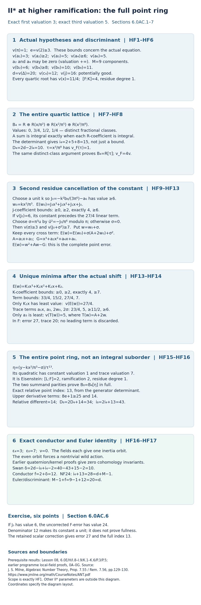

*Two residue cancellations and a full point ring.* Sections 6.0AC.1–5 prove the displayed parameter family. The constant left by the first unit shift must be cancelled by the displayed scalar before the odd point-error valuation proves an Eisenstein full basis. The diagram distinguishes base valuations, upper field valuations, normal-ring discriminants, relative differents and module indices. The six-point exercise and full solution are in Section 6.0AC.6; the remaining scope is in Section 6.0AC.7.

### 6.0AC.7. Scope left by this proposition

For the complement of the higher-fourth hypotheses, Section 6.0AD treats its exact-fourth-five complement and describes the coefficient ranges treated there. This proposition covers exactly HF1, including arbitrary higher ramification and arbitrarily high or infinite second and fourth valuations. It does not cover fourth valuation five, third valuation above five or infinite, or first valuation above three or infinite, except where another actual earlier proposition already does so. Those remaining II-star preparations, every remaining III-star, shorter-even, II, III and I-zero-star range, and universal NF24 lie outside this family-specific calculation; the general identity is JM30–JM32 in §6.0BI. 

## 6.0AD. Higher ramification, first three, third five and fourth five in the II-star preparation

**Proposition 6.0AD (Higher ramification, first three, third five and fourth five in the II-star preparation).**

### 6.0AD.1. Actual coefficients, written providers and unramified splitting

Let \(K/\mathbf Q_2\) be finite, let \(R\) be its integer ring, and normalize \(v(\pi)=1\). In the actual integral equation
\[
 y^2+a_1xy+a_3y=x^3+a_2x^2+a_4x+a_6
\]
assume
\[
 \begin{gathered}
 e=v(2)\ge3,\\
  v(a_1)=3,\\
  v(a_2)\ge2,\\
 v(a_3)=5,\\
  v(a_4)=5,\\
  v(a_6)=5.
 \end{gathered}
 \tag{FF1}
\]
The second coefficient may vanish. These are tests on the actual equation after any earlier coordinate preparation; an earlier shift may raise the third valuation, and such a raised valuation is not covered by FF1.

Lemma 6.0E of the actual earlier Lesson 08 constructs its nine-component regular proper II-star model, whose components all have square minus two. Theorem 6.0I.8 and the origin-germ converse following Theorem 6.0I.9 therefore prove that this is the minimal regular proper model and that the displayed Weierstrass equation is minimal. Lemma 6.0H proves the Euler formula. Sections 6.0K.2 and 6.0K.6 prove trace duals, different towers, order discriminants, permutation conductors and the quaternion comparison. Section 6.0P.5 proves weighted point indices and inertia-orbit counts. The actual earlier programme lesson *Profinite groups and adic representations*, Sections 0A–0G, proves complete local fields, residue lifting, finite unramified extensions and Eisenstein rings. The specialized rings below are proved here.

We may first make a finite unramified extension containing a root \(\zeta\) of \(Z^2+Z+1\), using the actual Lemma 6.0U and simple-root Hensel lifting. Its residue polynomial is separable; a finite residue extension splits it. All displayed rings and bases below are over this possibly extended \(R\). The numerical indices, discriminants and conductor are also those of the original field. Here is the required invariance justification. For a full finite field integer ring \(B\), the ring \(B\otimes_R R'\) is finite free and complete over \(B\). Modulo its uniformizer it is a product of finite separable residue fields. Idempotents lift by the complete Newton iteration for \(z^2-z\), as written in Section 6.0AB.7. Each resulting local factor has maximal ideal generated by the old uniformizer: a nonzero residue is invertible by a convergent geometric series, and coordinatewise completeness and freeness give a unit times a finite uniformizer power for each nonzero element. Thus each factor is a DVR and is integrally closed. This proves that full normalization commutes with this unramified extension. Flatness preserves finite quotient lengths, since the same uniformizer and the new residue field give the same number of factors in a composition series. Trace matrices extend by scalars, so their discriminant valuations are unchanged. Inertia and its positive ramification groups are unchanged on restriction to an unramified base extension, by the earlier local-field and ramification proofs; hence the conductor is unchanged too. The geometric component number is unchanged.

Free human-source context: Milne’s author notes [*Algebraic Number Theory*](https://www.jmilne.org/math/CourseNotes/ANT.pdf), Proposition 7.55 and Remark 7.56, printed pp.129–130. Every specialized result is proved here using the earlier written providers.

### 6.0AD.2. Invariants, the first slope and the full residual equation

The earlier proved invariant identities are
\[
 \begin{aligned}
 b_2&=a_1^2+4a_2,\\
 b_4&=a_1a_3+2a_4,\\
 b_6&=a_3^2+4a_6,\\
 b_8&=a_6b_2-a_1a_3a_4+a_2a_3^2-a_4^2.
 \end{aligned}
 \tag{FF2}
\]
They give
\[
 \begin{gathered}
 v(b_2)=6,\\
  v(b_4)\ge8,\\
 
 v(b_6)=10,\\
  v(b_8)=10.
 \end{gathered}
 \tag{FF3}
\]
The two second-invariant summands have values six and at least eight. The fourth-invariant summands have values eight and at least eight; they can cancel when \(e=3\), so an exact fourth-invariant value is not assumed. The sixth-invariant values are ten and at least eleven. The eighth-invariant values are eleven, thirteen, at least twelve and ten, with the last uniquely least. Consequently the four discriminant terms have respective bounds twenty-two, thirty-three, exactly twenty and twenty-four, while the fourth-invariant formula has term values twelve and at least seventeen. Thus
\[
 \begin{gathered}
 \Delta=-b_2^2b_8-8b_4^3-27b_6^2+9b_2b_4b_6,\\
 d=v(\Delta)=20,\\
  c_4=b_2^2-24b_4,\\
 v(c_4)=12,\\
  v(j)=16>0,\\
  M=9.
 \end{gathered}
 \tag{FF4}
\]
The actual earlier potential-good proof applies, without using the conductor being sought.

The proved torsion quartic is
\[
 \begin{gathered}
 q(X)=X^4+(b_2/3)X^3+b_4X^2+b_6X+b_8/3.
 \\
  v(x)=5/2\quad\text{for every root }x.
 \end{gathered}
 \tag{FF5}
\]
Indeed below \(5/2\) its fourth power is uniquely least, since the middle-term differences are \(6-v(x),8-2v(x),10-3v(x)>0\), and \(4v(x)<10\). Above \(5/2\) its constant is uniquely least. At that value the middle-term lower bounds are \(27/2,13,25/2\), all greater than ten. These contradictions prove the slope, but do not yet prove degree four or the full ring.

Put
\[
 \begin{gathered}
 c=1+2\zeta,\\
  c^2=-3,\\
  v(c)=0,\\
 c+3=2(2+\zeta),\\
  v(c+3)=e,\\
 t=cx^2+a_4,\\
 
 M_0=3b_4+2ca_4=3a_1a_3+2(c+3)a_4,\\
 C_0=b_8+a_4^2=a_6b_2-a_1a_3a_4+a_2a_3^2.
 \end{gathered}
 \tag{FF6}
\]
The residue of \(2+\zeta\) is nonzero. Full expansion, reduced by \(q(x)=0\), gives
\[
 \begin{gathered}
 t^2=b_2x^3+M_0x^2+3b_6x+C_0,
 \\
  v(M_0)=8,\\
  v(C_0)=11.
 \end{gathered}
 \tag{FF7}
\]
For \(M_0\), the two summand values are eight and at least eleven. For \(C_0\), they are eleven, thirteen and at least twelve. Since squaring is a bijection of the finite residue field, choose \(\beta\in\pi^3R^\times\) so that
\[
 \begin{gathered}
 v(\beta)=3,\\
 
 C=C_0-\beta^2a_4/c,\\
  v(C)\ge12.
 \end{gathered}
 \tag{FF8}
\]
The ratio \(cC_0/(a_4\pi^6)\) is a unit, so a lifted residue square root gives exactly this choice. Set
\[
 \begin{gathered}
 s=t-\beta x,\\
  P=b_2-2c\beta,\\
 L=3b_6-2\beta a_4+\beta^3/c,\\
 s^2=Px^3+M_0x^2+Lx+(\beta^2/c)s+C,\\
 v(P)\ge6,\\
  v(L)=9.
 \end{gathered}
 \tag{FF9}
\]
The identity uses \(x^2=(s+\beta x-a_4)/c\), retaining every signed constant. In \(L\) the three term values are ten, at least eleven and nine, so its last term is uniquely least. In \(P\) a cancellation at \(e=3\) is allowed; \(P\) may even vanish.

The cubic, square, linear and constant terms on the right of FF9 have bounds \(27/2,13,23/2,12\). If \(v(s)\le11/2\), its square would be uniquely least, including against the remaining term of value \(6+v(s)\). Thus \(v(s)>11/2\). Between \(11/2\) and \(23/4\) its square is still uniquely least; above \(23/4\) the term \(Lx\) is uniquely least. Therefore
\[
 \begin{gathered}
 v(s)=23/4,\\
  F=K(x),\\
  {[F:K]}=e(F/K)=4,
 \\
  {[k_F:k_R]}=1,\\
  v_F=4v.
 \end{gathered}
 \tag{FF10}
\]
The denominator four forces ramification at least four, while the quartic bounds the field degree by four. This proves the claimed field assertions.

### 6.0AD.3. The full mixed quartic basis

The four vectors \(1,x,s,xs\) are a field basis: their triangular change from the power basis has unit determinant \(c^2\). The scaled vectors have values \(0,1/2,3/4,1/4\), respectively. In any linear combination with coefficients in \(K\), their distinct fractional classes prevent the minimum from canceling. Since those four values lie in \([0,1)\), integrality is equivalent to each coefficient being integral. Thus the entire integer ring and its exact index are
\[
 \begin{gathered}
 B_4=R\oplus R\,x/\pi^2\oplus R\,s/\pi^5\oplus R\,xs/\pi^8,\\
 i_4=2+5+8=15,\\
  D_4=2d-2i_4=10,\\
 \tau=xs/\pi^8,\\
  v_F(\tau)=1,\\
  B_4=R[\tau].
 \end{gathered}
 \tag{FF11}
\]
For the last equality, the first four powers of \(\tau\) have the distinct base-valuation classes \(0,1/4,1/2,3/4\). They are a field basis and the same coefficientwise argument proves their full integral power lattice. An integral lattice alone has not been substituted for a fullness proof.

### 6.0AD.4. A complete point error and the scalar cancellation

Define
\[
 \begin{gathered}
 A=a_1x+a_3,\\
  G=x^3+a_2x^2+a_4x+a_6,
 \\
  E(w)=w^2+Aw-G,\\
  T(w)=A+2w.
 \end{gathered}
 \tag{FF12}
\]
Since \(t=s+\beta x\), its two summands have values \(23/4\) and \(11/2\), so \(v(t)=11/2\). The finite nonzero first coefficient permits the actual shift \(w_0=t/a_1\). Substitution of the entire FF7 identity gives
\[
 \begin{aligned}
 E(w_0)&=J_3x^3+J_2x^2+J_1x+J_0,\\
 J_3&=c+4a_2/a_1^2,\\
 J_2&=(c+3)(a_3/a_1+2a_4/a_1^2)-a_2,\\
 J_1&=3b_6/a_1^2,\\
 J_0&=a_2b_6/a_1^2.
 \end{aligned}
 \tag{FF13}
\]
Their respective valuation bounds are zero, two, exactly four and at least six. In particular \(v(w_0)=5/2\). In \(J_2\), the first two expanded terms have values at least five, while \(v(a_2)\ge2\). No sign or constant has been discarded.

If \(v(J_0)\ge7\), including \(J_0=0\), let \(\sigma=0\). Otherwise \(v(J_0)=6\); choose a unit \(u\) with residue square \(-\overline{J_0/\pi^6}\), and let \(\sigma=\pi^3u\). Then
\[
 \begin{aligned}
 v(\sigma)&\ge3,\\
 v(J_0+\sigma^2)&\ge7,\\
 w_1&=w_0+\sigma,\\
 E(w_1)&=J_1x+R_1,\\
 R_1&=J_3x^3+J_2x^2+a_1\sigma x\\
 &\quad +(J_0+\sigma^2)+a_3\sigma+2\sigma w_0.
 \end{aligned}
 \tag{FF14}
\]
Every displayed summand of \(R_1\) has value at least seven: the six bounds are \(15/2,7,17/2,7,8,17/2\). Therefore \(v(E(w_1))=13/2\), or twenty-six in quartic valuation. The trace has value five, uniquely from \(a_3\): its other terms have bounds \(11/2,11/2,6\). The even error twenty-six still does not establish a full Eisenstein point ring.

### 6.0AD.5. The uniformizer cancellation with its exact remainder

The coefficient \(La_4/(c\pi^{10})\) has value four, the same as \(J_1\). Residue squaring therefore chooses a unit \(\lambda\in R\) such that
\[
 \begin{gathered}
 v\left(J_1-\lambda^2La_4/(c\pi^{10})\right)\ge5,
 \\
  \psi=\lambda xs/\pi^5=\lambda\pi^3\tau.
 \end{gathered}
 \tag{FF15}
\]
Explicitly the ratio \(c\pi^{10}J_1/(La_4)\) is a unit. No denominator can vanish: \(v(L)=9\) and \(v(a_4)=5\). Here \(v(\psi)=13/4\).

Retaining all terms of FF9, multiply it by \(x^2\) and use
\(x^3=(xs+\beta x^2-a_4x)/c\) and
\(x^2s=(s^2+\beta xs-a_4s)/c\). This gives the exact decomposition
\[
 \begin{aligned}
 \psi^2&=-\frac{\lambda^2La_4}{c\pi^{10}}x
 -\frac{\lambda^2\beta^2a_4}{c^2\pi^{10}}s
 +\frac{\lambda^2}{\pi^{10}}R_0,\\
 R_0&=Px^5+M_0x^4+(L\beta/c+C)x^2\\
 &\quad +(\beta^2/c^2)s^2+(L/c+\beta^3/c^2)xs.
 \end{aligned}
 \tag{FF16}
\]
The five term bounds of \(R_0/\pi^{10}\) are \(17/2,8,7,15/2,29/4\). This estimate allows every cancellation in \(P,C\) and the last two coefficient sums, including their vanishing.

Put \(w=w_1+\psi\) and \(C_1=J_1-\lambda^2La_4/(c\pi^{10})\). The complete quadratic expansion, with its trace cross term, is
\[
 \begin{aligned}
 E(w)&=E(w_1)+\psi T(w_1)+\psi^2\\
 &=-\frac{\lambda^2\beta^2a_4}{c^2\pi^{10}}s+C_1x+R_1\\
 &\quad +\frac{\lambda^2}{\pi^{10}}R_0+\psi T(w_1).
 \end{aligned}
 \tag{FF17}
\]
The first coefficient has exact value one, so its term has value \(27/4\). The other four term bounds are \(15/2,7,7,33/4\), all strictly larger. Thus the first term is uniquely least. Since \(\sigma\) and \(\psi\) have values above \(v(w_0)\), the full shifted trace again has uniquely least summand \(a_3\). Consequently
\[
 \begin{gathered}
 w=(cx^2+a_4)/a_1+\sigma+\lambda\pi^3\tau,\\
 v(w)=5/2,\\
  v(E(w))=27/4,\\
  v(T(w))=5,\\
 v_F(E(w))=27,\\
  v_F(T(w))=20.
 \end{gathered}
 \tag{FF18}
\]
The scalar and uniformizer corrections solve distinct errors. Their cross terms are part of FF14 and FF17, not presumed negligible before the exact expansions.

### 6.0AD.6. The full point ring, different, Swan and conductor

For a point above \(x\), define
\[
 \begin{gathered}
 \eta=(y-w)/\tau^{13},\\
 \eta^2+\frac{T(w)}{\tau^{13}}\eta+
             \frac{E(w)}{\tau^{26}}=0,\\
 v_F(E(w)/\tau^{26})=1,\\
  v_F(T(w)/\tau^{13})=7.
 \end{gathered}
 \tag{FF19}
\]
This is Eisenstein, giving a totally ramified quadratic point field \(F_8/F\). Its two field-basis values are zero and one in upper normalized valuation; coefficients from \(F\) have even values. Thus a sum in that basis is integral exactly when both coefficients lie in \(B_4\), proving the entire ring \(B_8=B_4[\eta]\). The determinant of the generator replacement is \(\tau^{-13}\), so the exact point index over \(B_4[y]\) is thirteen.

The derivative terms in this full monogenic ring have upper valuations \(8e+1\ge25\) and fourteen, of opposite parity. The actual earlier trace-dual derivative proof makes the relative different exactly fourteen. Both residue degrees are one. Therefore
\[
 \begin{gathered}
 D_{8/4}=14,\\
  D_8=2\cdot10+14=34,\\
 i_8=2\cdot15+13=43=(6d-D_8)/2,\\
 \epsilon_4=3,\\
 \epsilon_8=7,\\
 \nu=0.
 \end{gathered}
 \tag{FF20}
\]
The two totally ramified fields give one inertia orbit each. The degree-four sign-pair orbit cannot be an orbit of an odd-order tame image, so wild inertia acts nontrivially. Potential good reduction makes inertia finite, and the actual quaternion and kernel comparison of Section 6.0K.6 gives zero invariants on cohomology. Applying its proved Swan formula and the conductor definition gives
\[
 \begin{gathered}
 \delta=2d-i_8+i_4-(\epsilon_8-\epsilon_4)/2=10,\\
 f(E/K)=2+\delta=12,\\
 i_4+13=28=d+M-1,\\
 
 M-1+f=9-1+12=20=d.
 \end{gathered}
 \tag{FF21}
\]
These calculations establish NF24 and the discriminant–Artin identity on FF1, including a zero second coefficient and arbitrary higher ramification. The same numerical assertions hold before the optional unramified extension, by Section 6.0AD.1. No general conductor identity supplied the point index.

### 6.0AD.7. Graded exercise and full solution

**Exercise (six points).** (a) After the scalar shift, compute the quartic-normalized error and explain why the denominator thirteen does not yet give the displayed Eisenstein point polynomial (two points). (b) Construct the unit \(\lambda\), give the whole correction to the error, and identify its uniquely least term (two points). (c) Prove the full point index and compute the relative different, absolute point discriminant and conductor (two points).

**Solution.** (a) FF14 gives \(v_F(E(w_1))=26\). Dividing by \(\tau^{26}\) leaves a unit constant; the trace after denominator thirteen has value seven. This is not the Eisenstein polynomial of FF19, and integrality alone proves no full ring. (b) Lift a residue square root of \(c\pi^{10}J_1/(La_4)\), giving FF15. Add \(\psi=\lambda\pi^3\tau\), retaining both \(\psi T(w_1)\) and \(\psi^2\). FF16 isolates the canceled linear coefficient and the surviving term \(-\lambda^2\beta^2a_4s/(c^2\pi^{10})\), whose value is \(27/4\); every other term in FF17 has value at least seven. Thus the new quartic error is twenty-seven and its trace remains twenty. (c) After denominator thirteen the constant has value one and the trace seven. Eisenstein irreducibility and coefficientwise parity prove the full ring and exact generator index thirteen. The derivative has value fourteen, the tower gives \(D_8=2\cdot10+14=34\), the absolute index is \(2\cdot15+13=43\), and the Swan formula gives ten and conductor twelve.

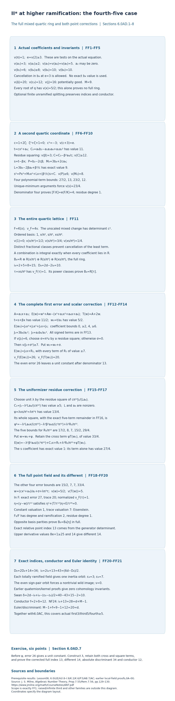

*The mixed quartic basis and two point corrections.* Sections 6.0AD.1–6 prove the entire displayed parameter family. A residue scalar raises the point-error constant; the subsequent uniformizer multiple cancels the even linear error and leaves the explicit odd-valued term. Every cross term is retained. The diagram distinguishes base and upper valuations, full-ring discriminants, relative differents and exact module indices. The six-point exercise and full solution are in Section 6.0AD.7; the remaining scope is in Section 6.0AD.8.

### 6.0AD.8. Scope left by this proposition

For the complement of the third-five hypotheses, Section 6.0AE treats its higher-third/fourth-five complement at ramification at least four. Section 6.0AM.7 describes additional coefficient ranges. Together with the actual earlier Section 6.0AC this proves every actual prepared equation with \(e\ge3,v(a_1)=3,v(a_3)=5,v(a_4)\ge5,v(a_2)\ge2,v(a_6)=5\). The higher-fourth branch uses its power quartic basis; the exact-fourth-five branch uses the mixed basis and the extra uniformizer residue correction above. An earlier normalization can change an exact third valuation into a higher or infinite one, so this does not claim that every original equation with third valuation five has been exhausted. Those higher/infinite third values, higher/infinite first values outside earlier proved ranges, all other residual additive families and universal NF24 lie outside this family-specific calculation; the general identity is JM30–JM32 in §6.0BI. 

## 6.0AE. Higher third valuation and fourth valuation five at ramification at least four

**Proposition 6.0AE (Higher third valuation and fourth valuation five at ramification at least four).**

### 6.0AE.1. The actual equation and an integral shear

Let \(K/\mathbf Q_2\) be finite, let \(R\) be its integer ring, and normalize \(v(\pi)=1\). On the actual integral equation
\[
 y^2+a_1xy+a_3y=x^3+a_2x^2+a_4x+a_6
\]
assume
\[
 \begin{gathered}
 e=v(2)\ge4,\\
  v(a_1)=3,\\
  v(a_2)\ge2,\\
 v(a_3)\ge6,\\
  v(a_4)=5,\\
  v(a_6)=5.
 \end{gathered}
 \tag{HG1}
\]
The second and third coefficients may vanish. These are tests after earlier coordinate preparations. In particular, they include a third coefficient raised by an earlier shift when the resulting equation satisfies HG1. Ramification three is excluded and remains a separate obligation.

First raise the second valuation to at least three by an integral shear. If it is already at least three, put \(r=0\). Otherwise choose \(r\in\pi R\) of value one such that \(v(a_2-r^2)\ge3\): the residue of \(a_2/\pi^2\) has a square root in the finite residue field. Substitution \(y=Y+rx\) gives
\[
 \begin{gathered}
 a'_1=a_1+2r,\\
  a'_2=a_2-a_1r-r^2,\\
 a'_3=a_3,\\
  a'_4=a_4-a_3r,\\
  a'_6=a_6,\\
 v(a'_1)=3,\\
  v(a'_2)\ge3,\\
  v(a'_3)\ge6,\\
 v(a'_4)=v(a'_6)=5.
 \end{gathered}
 \tag{HG2}
\]
Indeed, \(v(2r)\ge5\), \(v(a_1r)\ge4\), and \(v(a_3r)\ge7\); these bounds also hold for the zero choice. The change and its inverse are integral. Direct expansion shows that \(b_2,b_4,b_6,b_8\) are unchanged. Also \(R[x,Y]=R[x,y]\), and the same equality holds over the full quartic ring. Thus quartic and point orders, normalization indices, discriminants and conductor are unchanged. Rename the primed coefficients and \(Y\) as \(a_i,y\) for the rest of the proof; now the second valuation is at least three.

The actual earlier Lesson 08 Lemma 6.0E constructs the nine-component II-star regular proper model in these coefficient bounds, with every component of square minus two. Theorem 6.0I.8 and the origin-germ converse following 6.0I.9 prove minimal regular-model and Weierstrass minimality. Lemma 6.0H proves its Euler calculation. Sections 6.0K.2, 6.0K.6 and 6.0P.5 prove trace duals, different towers, order discriminants, the quaternion comparison, permutation Swan formula and weighted point indices. Earlier programme Lesson 01, Sections 0A–0G, contains the complete local-field and ramification foundations. None of these providers is a citation in place of its written proof.

Make the optional finite unramified extension splitting \(Z^2+Z+1\), as in Lemma 6.0U. Section 6.0AD.1 already proves that full normalization commutes with this extension by complete idempotent lifting and the local DVR argument, that flat quotient lengths and trace discriminants are unchanged, and that inertia and the conductor are unchanged. We use that actual earlier proof. All specialized full rings and indices are proved below, and their numerical values therefore also apply over the original field. Free human-source context: Milne’s author notes [*Algebraic Number Theory*](https://www.jmilne.org/math/CourseNotes/ANT.pdf), Proposition 7.55 and Remark 7.56, printed pp.129–130. Every specialized result is proved here using the earlier written providers.

### 6.0AE.2. Invariants and the full quartic ring

The earlier invariant identities give
\[
 \begin{gathered}
 b_2=a_1^2+4a_2,\\
  b_4=a_1a_3+2a_4,\\
 b_6=a_3^2+4a_6,\\
 b_8=a_6b_2-a_1a_3a_4+a_2a_3^2-a_4^2,\\
 v(b_2)=6,\\
  v(b_4)\ge9,\\
 
 v(b_6)\ge12,\\
  v(b_8)=10.
 \end{gathered}
 \tag{HG3}
\]
The two terms of the second invariant have values six and at least eleven. The fourth-invariant terms have bounds nine and nine, so cancellation is allowed. The sixth-invariant terms have bounds twelve and thirteen. For the eighth invariant the four bounds are eleven, fourteen, fifteen and exactly ten, with the last uniquely least. The four discriminant terms have bounds twenty-two, thirty-nine, twenty-four and twenty-seven, with the first uniquely least. The two fourth-invariant terms have values twelve and at least twenty-one. Hence
\[
 \begin{gathered}
 \Delta=-b_2^2b_8-8b_4^3-27b_6^2+9b_2b_4b_6,\\
 d=v(\Delta)=22,\\
  c_4=b_2^2-24b_4,\\
 v(c_4)=12,\\
  v(j)=14>0,\\
  M=9.
 \end{gathered}
 \tag{HG4}
\]
The previously proved potential-good criterion applies. The equation is minimal by Section 6.0AE.1, rather than by an appeal to the conductor identity being proved.

For the sign-pair quartic write
\[
 \begin{gathered}
 q(X)=X^4+(b_2/3)X^3+b_4X^2+b_6X+b_8/3.
 \end{gathered}
 \tag{HG5}
\]
Every root \(x\) has value \(5/2\). If its value is smaller, the fourth-power term is uniquely least; if larger, the constant is uniquely least. Both contradict a zero sum. Equality is the only remaining possibility, and existence follows from algebraic closure. This slope alone does not prove a full quartic integer ring.

Choose the unramified root \(\zeta\) and put
\[
 \begin{gathered}
 c=1+2\zeta,\\
  c^2=-3,\\
  v(c)=0,\\
 c+3=2(2+\zeta),\\
  v(c+3)=e,\\
 t=cx^2+a_4,\\
  M_0=3b_4+2ca_4,\\
 C_0=b_8+a_4^2=a_6b_2-a_1a_3a_4+a_2a_3^2,\\
 t^2=b_2x^3+M_0x^2+3b_6x+C_0,\\
 v(M_0)\ge9,\\
  v(C_0)=11.
 \end{gathered}
 \tag{HG6}
\]
Here \(M_0=3a_1a_3+2(c+3)a_4\), whose bounds are nine and thirteen; the first term may vanish. The three constant bounds are exactly eleven, at least fourteen and at least fifteen. Residue squaring therefore chooses \(\beta\in R\), of value three, cancelling the residue of \(C_0-\beta^2a_4/c\). Set
\[
 \begin{gathered}
 s=t-\beta x,\\
  P=b_2-2c\beta,\\
 L=3b_6-2\beta a_4+\beta^3/c,\\
 C=C_0-\beta^2a_4/c,\\
 v(P)=6,\\
  v(L)=9,\\
  v(C)\ge12.
 \end{gathered}
 \tag{HG7}
\]
The two terms defining \(P\) have values six and at least seven. The three terms defining \(L\) have bounds twelve, twelve and exactly nine. Thus no cancellation can change its exact value. Substituting the full expression for \(t\) gives
\[
 \begin{gathered}
 s^2=Px^3+M_0x^2+Lx+(\beta^2/c)s+C.
 \end{gathered}
 \tag{HG8}
\]
The four terms not containing \(s\) have bounds \(27/2,14,23/2,12\), with the third uniquely least. If \(v(s)<23/4\), the square is uniquely least in HG8; if \(v(s)>23/4\), the term \(Lx\) is uniquely least. The linear term in \(s\) has value \(6+v(s)\) and cannot fix either contradiction. Therefore \(v(s)=23/4\). Its denominator forces ramification and degree four in \(F=K(x)\), since \(q\) has degree four; the residue degree is one.

The elements \(1,x,s,xs\) have change determinant \(c^2\) from \(1,x,x^2,x^3\). After division by the displayed powers of \(\pi\), their values are respectively \(0,1/2,3/4,1/4\). Distinct fractional classes preclude cancellation of a least summand over \(K\). Thus a linear combination is integral exactly when each coefficient belongs to \(R\), proving the entire integer ring and the exact index:
\[
 \begin{gathered}
 B_4=R\oplus R\,x/\pi^2\oplus R\,s/\pi^5\oplus R\,xs/\pi^8,\\
 i_4=2+5+8=15,\\
  D_4=2d-2i_4=14,\\
 \tau=xs/\pi^8,\\
  v_F=4v,\\
  v_F(\tau)=1,\\
 B_4=R[\tau].
 \end{gathered}
 \tag{HG9}
\]
For the last equality, the powers of \(\tau\) have all four fractional value classes. They form a field basis, and the same least-term argument proves that their full integer lattice is precisely the power lattice. This also proves monogenicity without importing it from the free source.

### 6.0AE.3. The complete initial error in mixed coordinates

Use the prepared equation and define
\[
 \begin{gathered}
 A=a_1x+a_3,\\
  G=x^3+a_2x^2+a_4x+a_6,\\
 E(w)=w^2+Aw-G,\\
  T(w)=A+2w,\\
 w_0=t/a_1=(cx^2+a_4)/a_1,\\
  v(w_0)=5/2.
 \end{gathered}
 \tag{HG10}
\]
Indeed, \(t=s+\beta x\) has value \(11/2\). Reducing only by \(q(x)=0\) and \(c^2=-3\) gives the complete initial expansion
\[
 \begin{gathered}
 E(w_0)=J_3x^3+J_2x^2+J_1x+J_0,\\
 J_3=c+4a_2/a_1^2,\\
 J_2=(c+3)(a_3/a_1+2a_4/a_1^2)-a_2,\\
 J_1=3b_6/a_1^2,\\
  J_0=a_2b_6/a_1^2.
 \end{gathered}
 \tag{HG11}
\]
Its coefficient bounds are \(0,3,6,9\). In particular, the parenthesized contribution to \(J_2\) has value at least seven. To separate equal half-integer classes, use both exact substitutions \(x^2=(s+\beta x-a_4)/c\) and \(x^3=(xs+\beta x^2-a_4x)/c\). The result is
\[
 \begin{gathered}
 E(w_0)=H_{xs}xs+H_s s+H_x x+H_0,\\
 H_{xs}=J_3/c,\\
  H_s=(J_3\beta/c+J_2)/c,\\
 H_x=J_1-J_3a_4/c+\beta H_s,\\
 H_0=J_0-a_4H_s.
 \end{gathered}
 \tag{HG12}
\]
Every term has been retained. These coefficients satisfy
\[
 \begin{gathered}
 v(H_{xs})=0,\\
  v(H_s)\ge3,\\
 v(H_x)=5,\\
  v(H_0)\ge8,\\
 v(E(w_0))=15/2,\\
  v(T(w_0))=11/2,\\
 v_F(E(w_0))=30,\\
  v_F(T(w_0))=22.
 \end{gathered}
 \tag{HG13}
\]
For the exact \(H_x\) value its three terms have bounds six, exactly five and six. The four error terms have bounds \(33/4,35/4,15/2,8\), with \(H_xx\) uniquely least. The trace terms have values \(11/2\), at least six and at least \(13/2\), with \(a_1x\) uniquely least. Error thirty is even and cannot yet give the full Eisenstein point ring with denominator fifteen.

### 6.0AE.4. The second quartic coordinate cancels the error

Both \(H_x\) and \(L/\pi^4\) have exact value five. Choose a unit \(\lambda\in R\) whose residue square is the residue of \(-\pi^4H_x/L\). Then
\[
 \begin{gathered}
 V=H_x+\lambda^2L/\pi^4,\\
  v(V)\ge6,\\
 \psi=\lambda s/\pi^2,\\
  v(\psi)=15/4,\\
 w=w_0+\psi,\\
  v(w)=5/2.
 \end{gathered}
 \tag{HG14}
\]
The ratio is a unit and its denominator cannot vanish. Expanding the whole square by HG8, and retaining the quadratic trace cross term, gives
\[
 \begin{aligned}
 E(w)&=E(w_0)+\psi T(w_0)+\psi^2\\
 &=\left(H_s+\frac{\lambda^2\beta^2}{c\pi^4}\right)s\\
 &\quad +H_{xs}xs+Vx+H_0\\
 &\quad+\frac{\lambda^2}{\pi^4}
       \left(Px^3+M_0x^2+C\right)+\psi T(w_0).
 \end{aligned}
 \tag{HG15}
\]
The coefficient of \(s\) has exact value two: its two terms have bounds three and exactly two. Thus its contribution has exact value \(31/4\). The seven other displayed contributions, separating the three terms in parentheses, have bounds \(33/4,17/2,8,19/2,10,8,37/4\). Every bound is strictly larger. No cancellation among those seven terms can affect the unique least term. Since \(v(2\psi)\ge31/4\), adding this trace correction cannot change the uniquely least \(a_1x\) term. Consequently
\[
 \begin{gathered}
 v(E(w))=31/4,\\
  v(T(w))=11/2,\\
 v_F(E(w))=31,\\
  v_F(T(w))=22.
 \end{gathered}
 \tag{HG16}
\]
The mixed coordinate \(s\), rather than a presumed negligible remainder, supplies the odd surviving error.

### 6.0AE.5. The full point ring and the conductor

For a point over \(x\), put
\[
 \begin{gathered}
 \eta=(y-w)/\tau^{15},\\
 \eta^2+\frac{T(w)}{\tau^{15}}\eta+
            \frac{E(w)}{\tau^{30}}=0,\\
 v_F(E(w)/\tau^{30})=1,\\
 
 v_F(T(w)/\tau^{15})=7.
 \end{gathered}
 \tag{HG17}
\]
This is Eisenstein. It defines a totally ramified quadratic point field \(F_8/F\). In upper normalized valuation the basis \(1,\eta\) has values zero and one, and elements of \(F\) have even values. Therefore a sum in that field basis is integral exactly when both coefficients belong to \(B_4\), proving the entire ring \(B_8=B_4[\eta]\). The generator change has determinant \(\tau^{-15}\), so the point index over \(B_4[y]\) is exactly fifteen. Returning to the original coordinate adds \(rx\) to \(w\); the orders are unchanged by HG2, so this is also the original point index.

The derivative of HG17 has upper valuations \(8e+1\ge33\) and fourteen, of opposite parity. The actual earlier trace-dual derivative proof gives relative different fourteen. Both residue degrees are one, so the different tower and order determinant identities yield
\[
 \begin{gathered}
 D_{8/4}=14,\\
  D_8=2\cdot14+14=42,\\
 i_8=2\cdot15+15=45=(6d-D_8)/2,\\
 \epsilon_4=3,\\
 \epsilon_8=7,\\
 \nu=0.
 \end{gathered}
 \tag{HG18}
\]
Each totally ramified field is one inertia orbit. The degree-four sign-pair orbit cannot arise from an odd-order tame image, so wild inertia is nontrivial. Potential good reduction makes inertia finite, and the earlier quaternion and kernel comparison in Section 6.0K.6 proves zero cohomology invariants. Its already proved Swan formula therefore gives
\[
 \begin{gathered}
 \delta=2d-i_8+i_4-(\epsilon_8-\epsilon_4)/2=12,\\
 f(E/K)=2+\delta=14.
 \end{gathered}
 \tag{HG19}
\]
The normalization and Euler identities are now numerical consequences of the rings just proved:
\[
 \begin{gathered}
 i_4+15=30=d+M-1,\\
  M-1+f=9-1+14=22=d.
 \end{gathered}
 \tag{HG20}
\]
They also apply before the optional unramified extension and before the integral shear, by the written earlier invariance proof and HG2.

### 6.0AE.6. Graded exercise and full solution

**Exercise (six points).** (a) Explain why raising the second valuation by the integral shear preserves the original point order, and why the initial quartic-normalized error is thirty (two points). (b) Construct the unit correction and exhibit every term of the new error, identifying its unique minimum (two points). (c) Prove the whole point ring and calculate its index, relative different, absolute discriminant and conductor (two points).

**Solution.** (a) Both directions of the shear use a coefficient in the base ring, so the old and new orders are equal. The coefficient \(H_x\) in HG12 has exact value five and its product with \(x\) has value \(15/2\), below the other three terms; multiplication by four gives thirty. (b) Lift the residue square root of \(-\pi^4H_x/L\) and add \(\lambda s/\pi^2\). HG15 includes the complete square and trace cross term. Its \(s\)-coefficient has value two, so that term has value \(31/4\); all seven other bounds exceed it. (c) After division by \(\tau^{15}\), the constant and trace have quartic values one and seven. Eisenstein irreducibility and the two basis parities prove the full ring. The determinant gives index fifteen, the derivative gives different fourteen, the tower gives absolute discriminant forty-two, and HG19 gives conductor fourteen.

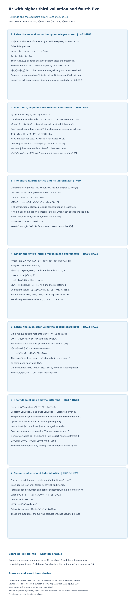

*The integral shear and the odd surviving point error.* Sections 6.0AE.1–5 prove the entire stated family. The shear preserves the original point order; a residue square then uses the second quartic coordinate to raise error thirty to thirty-one. The full error includes every square and trace cross term. The diagram distinguishes the complete integer rings, base and upper valuations, exact indices and differents, Swan conductor and Euler identity. Section 6.0AE.6 contains the six-point exercise and full solution; Section 6.0AE.7 records the remaining scope.

### 6.0AE.7. Scope left by this proposition

For the complement of the ramification-at-least-four hypotheses, Section 6.0AF treats both ramification-three/fourth-five branches. Section 6.0AM.7 describes additional coefficient ranges. This proves every equation in HG1, including zero second or third coefficient, by explicit full quartic and point rings and full point-error cancellation. Together with Section 6.0AD it covers actual first-three/fourth-five/third-at-least-five at ramification at least four. Section 6.0Y separately covers actual first-three/fourth-at-least-six/third-at-least-six at ramification at least four under its stated second-coefficient bound. Ramification three with higher or infinite third valuation and fourth five remains open here; its discriminant has competing terms, and HG4 does not extend to it. Higher first valuations, every other complementary additive family and universal NF24 remain obligations.

## 6.0AF. The ramification-three higher-third/fourth-five II-star complement

**Proposition 6.0AF (The ramification-three higher-third/fourth-five II-star complement).**

### 6.0AF.1. Actual scope, integral preparation and earlier proofs

Let \(K/\mathbf Q_2\) be finite, let \(R\) be its integer ring, and normalize \(v(\pi)=1\). On the actual integral equation
\[
 y^2+a_1xy+a_3y=x^3+a_2x^2+a_4x+a_6
\]
assume
\[
 \begin{gathered}
 e=v(2)=3,\\
  v(a_1)=3,\\
  v(a_2)\ge2,\\
 v(a_3)\ge6,\\
  v(a_4)=v(a_6)=5.
 \end{gathered}
 \tag{HH1}
\]
The second and third coefficients may vanish. These are tests on the resulting equation after any earlier coordinate preparation; they do not assert an invariant meaning for an original third coefficient before those changes.

If the second valuation is two, choose \(r\in\pi R\) of value one such that \(v(a_2-r^2)\ge3\), using the bijective square map on the finite residue field. Otherwise put \(r=0\). The integral substitution \(y=Y+rx\) gives
\[
 \begin{gathered}
 a'_1=a_1+2r,\\
  a'_2=a_2-a_1r-r^2,\\
  a'_3=a_3,\\
 a'_4=a_4-a_3r,\\
  a'_6=a_6,\\
 v(a'_1)=3,\\
  v(a'_2)\ge3,\\
  v(a'_3)\ge6,\\
 v(a'_4)=v(a'_6)=5,\\
  R[x,Y]=R[x,y].
 \end{gathered}
 \tag{HH2}
\]
The nonzero-choice bounds are four, four and at least seven for the changes to the first, second and fourth coefficients. Both substitutions are integral inverses. Expanding the four definitions shows that the invariants \(b_2,b_4,b_6,b_8\) are unchanged. The same order equality holds over the entire quartic integer ring, so all normalization indices below refer also to the original point coordinate. Rename the primed coefficients and \(Y\) for the rest of the proof. Thus the second valuation is now at least three.

The actual earlier Lemma 6.0E proves the nine-component II-star resolution in these bounds. Theorem 6.0I.8 and the origin-germ converse following 6.0I.9 prove regular-model and Weierstrass minimality; Lemma 6.0H proves the special-fibre Euler calculation. Sections 6.0K.2 and 6.0K.6 prove trace duals, different towers, order discriminants and the quaternion/permutation Swan comparison. Section 6.0P.5 proves the point-index weighting. All underlying local-field and ramification results are written in earlier programme Lesson 01, Sections 0A–0G. These are actual written earlier providers, not citations replacing proofs.

Optionally make the finite unramified extension splitting \(Z^2+Z+1\). Section 6.0AD.1 proves, by full idempotent lifting and the local DVR argument, that this extension commutes with full normalization and preserves the relevant lengths, trace discriminants and inertia conductors. We apply that earlier proof, and all numerical conclusions descend to the original field. Free human-source context: Milne’s author notes [*Algebraic Number Theory*](https://www.jmilne.org/math/CourseNotes/ANT.pdf), Proposition 7.55 and Remark 7.56, printed pp.129–130. The specialized calculations and entire integer rings are proved here using the earlier written providers.

### 6.0AF.2. The cancellation test and the two discriminants

The invariant definitions give
\[
 \begin{gathered}
 b_2=a_1^2+4a_2,\\
  b_4=a_1a_3+2a_4,\\
  b_6=a_3^2+4a_6,\\
 b_8=a_6b_2-a_1a_3a_4+a_2a_3^2-a_4^2,\\
 v(b_2)=6,\\
  v(b_4)=8,\\
  v(b_6)=11,\\
  v(b_8)=10.
 \end{gathered}
 \tag{HH3}
\]
For the fourth invariant, the two summands have bounds nine and exactly eight; for the sixth they have bounds twelve and exactly eleven. For the eighth, the four bounds are eleven, fourteen, fifteen and exactly ten. Define the actual cancellation test
\[
 \begin{gathered}
 D=a_1^2a_4-12a_6,\\
  v(D)\ge11.
 \end{gathered}
 \tag{HH4}
\]
Here and below the higher branch includes a zero test value. The discriminant is
\[
 \begin{aligned}
 \Delta&=-b_2^2b_8-8b_4^3-27b_6^2+9b_2b_4b_6,\\
 \Delta-(D^2-b_2^3a_6)&\in\pi^{24}R.
 \end{aligned}
 \tag{HH5}
\]
We prove the congruence instead of assuming that the two value-twenty-two terms do not cancel. Expanding the first term separates \(b_2^2a_4^2-b_2^3a_6+b_2^2a_1a_3a_4-b_2^2a_2a_3^2\). Replacing its first summand by \(a_1^4a_4^2\) changes it by value at least twenty-eight, since both \(b_2-a_1^2\) and \(b_2+a_1^2\) have value at least nine. Replacing \(b_6^2\) by \(16a_6^2\) changes it by value at least twenty-four: the two discarded terms have bounds twenty-six and twenty-four. The identity
\[
 \begin{gathered}
 a_1^4a_4^2-432a_6^2=D^2+24a_6D-288a_6^2
 \end{gathered}
 \tag{HH6}
\]
has its last two terms of value at least twenty-five. The other four discarded discriminant terms have bounds twenty-six, twenty-seven, thirty-three and twenty-five. This proves HH5. Since \(v(b_2^3a_6)=23\), its minimum is unique in each branch:
\[
 \begin{array}{c|cc}
 &v(D)=11&v(D)\ge12\text{ or }D=0\\ \hline
 d=v(\Delta)&22&23\\
 v(c_4)&12&12\\
 v(j)&14&13\\
 M&9&9
 \end{array}
 \tag{HH7}
\]
Indeed \(c_4=b_2^2-24b_4\) has term values twelve and seventeen. Both branches are potentially good by the earlier proved criterion. The prepared resolution and earlier minimality proof apply, independently of the conductor identity sought below.

### 6.0AF.3. One full mixed quartic ring for both branches

The sign-pair quartic and its root slope are
\[
 \begin{gathered}
 q(X)=X^4+(b_2/3)X^3+b_4X^2+b_6X+b_8/3,\\
  v(x)=5/2.
 \end{gathered}
 \tag{HH8}
\]
Every root has this slope: below it the fourth-power term is uniquely least, and above it the constant term is uniquely least. The other three term values at the stated slope are \(27/2,13,27/2\), strictly above ten. This root valuation alone is not a full-ring assertion.

Choose the unramified root \(\zeta\), and define
\[
 \begin{gathered}
 c=1+2\zeta,\\
  c^2=-3,\\
  v(c)=0,\\
 c+3=2(2+\zeta),\\
  v(c+3)=3,\\
 t=cx^2+a_4,\\
  M_0=3b_4+2ca_4,\\
 C_0=b_8+a_4^2=a_6b_2-a_1a_3a_4+a_2a_3^2,\\
 t^2=b_2x^3+M_0x^2+3b_6x+C_0,\\
 v(M_0)\ge9,\\
  v(C_0)=11,\\
  v(t)=11/2.
 \end{gathered}
 \tag{HH9}
\]
The nonzero residue of the chosen cube root makes the parenthesized factor in the expression for the sum of c and three a unit. The expression \(M_0=3a_1a_3+2(c+3)a_4\) has bounds nine and eleven, explaining why one cannot use only the value eight of \(b_4\). The constant has its first term uniquely least. Its residue square chooses \(\beta\in R\), of value three, such that \(v(C_0-\beta^2a_4/c)\ge12\). Put
\[
 \begin{gathered}
 s=t-\beta x,\\
  P=b_2-2c\beta,\\
 L=3b_6-2\beta a_4+\beta^3/c,\\
  C=C_0-\beta^2a_4/c,\\
 v(P)\ge6,\\
  v(L)=9,\\
  v(C)\ge12,\\
 s^2=Px^3+M_0x^2+Lx+(\beta^2/c)s+C.
 \end{gathered}
 \tag{HH10}
\]
The two value-six terms of \(P\) may cancel; no exact value is imposed on it. The three terms of \(L\) have values eleven, eleven and nine, so its last term is uniquely least. The non-linear-right-side bounds are \(27/2,14,23/2,12\). Comparing both sides below and above \(23/4\), including the linear term of value \(6+v(s)\), proves \(v(s)=23/4\). Its denominator forces degree and ramification four in \(F=K(x)\); hence the residue degree is one.

The change from \(1,x,x^2,x^3\) to \(1,x,s,xs\) has unit determinant \(c^2\). The four normalized basis values are \(0,1/2,3/4,1/4\), so distinct fractional classes prevent cancellation of a least summand with coefficients in \(K\). Since these classes lie in \([0,1)\), a coefficient of negative integral valuation gives a negative total value, and a coefficient in \(R\) gives a nonnegative value. Thus the entire integer ring, not merely an integral sublattice, is
\[
 \begin{gathered}
 B_4=R\oplus R\,x/\pi^2\oplus R\,s/\pi^5\oplus R\,xs/\pi^8,\\
 i_4=15,\\
  D_4=2d-30,\\
  v_F=4v,\\
 \tau=xs/\pi^8,\\
  v_F(\tau)=1,\\
  B_4=R[\tau].
 \end{gathered}
 \tag{HH11}
\]
For the power-ring equality, the first four powers of \(\tau\) have values \(0,1/4,1/2,3/4\). They form a field basis, and the same least-term argument proves that their entire integer lattice is the power lattice. The determinant yields the stated index and discriminant without presuming an index-conductor identity.

### 6.0AF.4. The complete mixed error and the cancelled trace

Define
\[
 \begin{gathered}
 A=a_1x+a_3,\\
  G=x^3+a_2x^2+a_4x+a_6,\\
 E(w)=w^2+Aw-G,\\
  T(w)=A+2w,\\
 w_0=t/a_1=(s+\beta x)/a_1,\\
  v(w_0)=5/2.
 \end{gathered}
 \tag{HH12}
\]
Reduction by the entire quartic gives
\[
 \begin{gathered}
 E(w_0)=J_3x^3+J_2x^2+J_1x+J_0,\\
 J_3=c+4a_2/a_1^2,\\
 J_2=(c+3)(a_3/a_1+2a_4/a_1^2)-a_2,\\
 J_1=3b_6/a_1^2,\\
  J_0=a_2b_6/a_1^2,\\
 v(J_3)=0,\\
  v(J_2)\ge3,\\
  v(J_1)=5,\\
  v(J_0)\ge8.
 \end{gathered}
 \tag{HH13}
\]
The parenthesized contribution to \(J_2\) has value at least five. Using both exact substitutions for \(x^2\) and \(x^3\), including every constant, gives
\[
 \begin{gathered}
 E(w_0)=H_{xs}xs+H_s s+H_x x+H_0,\\
 H_{xs}=J_3/c,\\
  H_s=(J_3\beta/c+J_2)/c,\\
 H_x=J_1-J_3a_4/c+\beta H_s,\\
  H_0=J_0-a_4H_s,\\
 v(H_{xs})=0,\\
  v(H_s)\ge3,\\
  v(H_0)\ge8,\\
 H_x+D/a_1^2\in\pi^6R.
 \end{gathered}
 \tag{HH14}
\]
For the final congruence, expand \(J_1\) as \(12a_6/a_1^2+3a_3^2/a_1^2\). The latter term has value at least six; the correction from \(J_3/c-1\) times \(a_4\) has value at least eight, and \(\beta H_s\) has value at least six. Consequently \(H_x\) has value five exactly in the first branch, and value at least six in the second.

The trace needs a separate cancellation proof. Write
\[
 \begin{gathered}
 Z=a_1^2+2\beta,\\
  U=Z/a_1,\\
 T(w_0)=Ux+(2/a_1)s+a_3,\\
 Z^2-(a_1^2/a_4)D\in\pi^{13}R,\\
 \begin{array}{c|cc}
 &v(D)=11&v(D)\ge12\text{ or }D=0\\ \hline
 v(U)&3&\ge4\\
 v(T(w_0))&11/2&23/4
 \end{array}
 \end{gathered}
 \tag{HH15}
\]
To prove the congruence, HH9 and the choice of \(\beta\) give \(v(\beta^2a_4/c-a_6a_1^2)\ge12\): replacing \(b_2\) by \(a_1^2\) changes that constant by value at least fourteen. Multiplying by \(4c/a_4\) gives an error of value at least thirteen. Expand \(Z^2=a_1^4+4a_1^2\beta+4\beta^2\); the middle term has value fifteen, and the remaining difference from the displayed test is \(4a_6a_1^2(c+3)/a_4\), also of value fifteen. In the first branch the comparison term has exact value twelve, so \(v(Z)=6\). In the second branch \(v(Z^2)\ge13\); integral valuations force \(v(Z)\ge7\). The trace terms then have respectively a unique least value \(11/2\), or a unique least value \(23/4\) from \((2/a_1)s\). The third term has value at least six in both cases. This proves the trace table without dropping the equal leading terms.

### 6.0AF.5. The noncancelled branch: correction by the second coordinate

Suppose \(v(D)=11\). In HH14 the four error-term bounds are \(33/4,35/4,15/2,8\); thus the initial error has value \(15/2\). Since \(H_x\) and \(L/\pi^4\) both have exact value five, choose a unit \(\lambda\) with residue square \(-\overline{\pi^4H_x/L}\), and put
\[
 \begin{gathered}
 V=H_x+\lambda^2L/\pi^4,\\
  v(V)\ge6,\\
 
 \psi=\lambda s/\pi^2,\\
  w_A=w_0+\psi.
 \end{gathered}
 \tag{HH16}
\]
The complete new error is
\[
 \begin{aligned}
 E(w_A)&=\left(H_s+\frac{\lambda^2\beta^2}{c\pi^4}\right)s
       \\
 &\quad+H_{xs}xs+Vx+H_0\\
 &\quad+\frac{\lambda^2}{\pi^4}(Px^3+M_0x^2+C)
       +\psi T(w_0).
 \end{aligned}
 \tag{HH17}
\]
This is the full square and trace cross term, using HH10, not a leading truncation. The new \(s\)-coefficient has exact value two, its second term uniquely least, giving error \(31/4\). The seven other contributions have bounds \(33/4,17/2,8,19/2,10,8,37/4\), all strictly larger. The trace correction has value \(v(2\psi)=27/4\), strictly above \(11/2\). Therefore
\[
 \begin{gathered}
 v(w_A)=5/2,\\
  v_F(E(w_A))=31,\\
  v_F(T(w_A))=22.
 \end{gathered}
 \tag{HH18}
\]

### 6.0AF.6. The cancelled branch: the scalar error correction

Suppose \(v(D)\ge12\), including \(D=0\). Now \(v(H_x)\ge6\). If \(v(H_0)\ge9\), set \(\sigma=0\). Otherwise its value is eight; choose \(\sigma\in\pi^4R\) of value four whose residue square cancels \(H_0/\pi^8\). Then
\[
 \begin{gathered}
 v(\sigma)\ge4,\\
  v(H_0+\sigma^2)\ge9,\\
  w_B=w_0+\sigma,\\
 E(w_B)=H_{xs}xs+H_s s+H_x x+(H_0+\sigma^2)+\sigma T(w_0),\\
 v(w_B)=5/2,\\
  v_F(E(w_B))=33,\\
  v_F(T(w_B))=23.
 \end{gathered}
 \tag{HH19}
\]
The five error contributions have bounds \(33/4,35/4,17/2,9,39/4\). The first is exact and uniquely least; its quarter class cannot be cancelled by any of the other terms. The trace changes by \(2\sigma\), of value at least seven, so its value remains \(23/4\). The zero choice satisfies all these bounds. No quartic remainder or scalar cross term has been omitted.

### 6.0AF.7. Both entire point rings and all conductor values

Use \((w,m)=(w_A,15)\) in the first branch, and \((w,m)=(w_B,16)\) in the second. For the original point coordinate after the integral shear, add \(rx\) to the indicated \(w\). In the renamed coordinates put
\[
 \begin{gathered}
 \eta=(y-w)/\tau^m,\\
 
 \eta^2+\frac{T(w)}{\tau^m}\eta+\frac{E(w)}{\tau^{2m}}=0,\\
 v_F(E(w)/\tau^{2m})=1,\\
  v_F(T(w)/\tau^m)=7.
 \end{gathered}
 \tag{HH20}
\]
This is Eisenstein and gives a totally ramified quadratic point field \(F_8/F\). With its upper normalized valuation, \(1,\eta\) have values zero and one, whereas coefficients in \(F\) have even values. Thus the two least fractional classes prove the entire integer ring \(B_8=B_4[\eta]\). The exact determinant of the generator change gives relative point index \(m\). The derivative terms have upper valuations twenty-five and fourteen, hence relative different fourteen by the earlier proved trace-dual derivative formula. Both residue degrees are one, so the different tower and determinant identities yield
\[
 \begin{array}{c|cc}
 &v(D)=11&v(D)\ge12\text{ or }D=0\\ \hline
 d&22&23\\
 i_4&15&15\\
 D_4&14&16\\
 \ell=m&15&16\\
 D_{8/4}&14&14\\
 D_8=2D_4+14&42&46\\
 i_8=2i_4+\ell&45&46\\
 (6d-D_8)/2&45&46
 \end{array}
 \tag{HH21}
\]
Each full algebra is one totally ramified field, so its embeddings form one inertia orbit. Thus \(\epsilon_4=3\), \(\epsilon_8=7\), and \(\nu=0\). A degree-four inertia orbit cannot come from an odd-order tame group. Wild inertia is nontrivial; potential good reduction and the earlier quaternion comparison give zero cohomology invariants. Applying the proved Swan comparison only after the entire rings have been calculated gives
\[
 \begin{array}{c|cc}
 &v(D)=11&v(D)\ge12\text{ or }D=0\\ \hline
 \delta=2d-i_8+i_4-2&12&13\\
 f(E/K)=2+\delta&14&15\\
 i_4+\ell=d+M-1&30&31\\
 M-1+f=d&22&23
 \end{array}
 \tag{HH22}
\]
The normalization and Euler comparisons are numerical conclusions of the full-ring calculation, not assumptions about their indices. They hold also before the integral shear and over the original field by the written order equality and unramified-invariance proof.

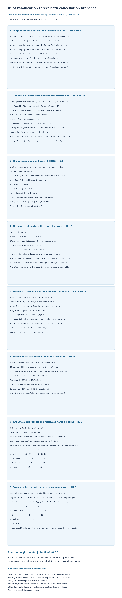

*Complete proof map.* HH1–HH7 give the actual preparation and discriminant test; HH8–HH11 construct the entire mixed quartic ring. HH12–HH15 retain the full mixed error and prove the cancelled-trace test. HH16–HH19 give every error and cross term for both corrections. HH20–HH22 prove both entire point rings, their indices and different, and the resulting Swan/conductor and normalization/Euler comparisons. Diagram positions are layout coordinates. The numerical entries are exact proved values, with the stated coefficient bounds and zero cases. Earlier written providers and Milne's freely accessible notes are identified in Section6.0AF.1; the complete argument remains above.

### 6.0AF.8. Graded exercise and complete solution

**Exercise (eight points).** (a) Prove the discriminant congruence and identify its value in both branches (two points). (b) Explain why the mixed basis is the entire integer ring, and prove the trace test in HH15 (two points). (c) Give every term of each corrected point error and find its exact valuation (two points). (d) Prove each whole point ring and compute its point index, relative different, conductor and normalization comparison (two points).

**Solution.** (a) Expand the first discriminant term as in HH5, replace the leading quartic and sixth-invariant squares with the explicitly bounded errors, and use HH6. All discarded terms have value at least twenty-four. The term of value twenty-three is \(-b_2^3a_6\). If the test has value eleven, its square of value twenty-two is uniquely least; otherwise that square has value at least twenty-four and the term of value twenty-three is uniquely least. (b) The four mixed basis values occupy distinct fractional classes between zero and one. Coefficients in the base field have integral valuations, so least-term cancellation is impossible and integrality is equivalent to all four coefficients lying in the base ring. For the trace, square the numerator \(Z\), substitute the complete congruence for \(\beta^2\), and retain the two value-fifteen corrections. The remainder is in \(\pi^{13}R\); this gives \(v(U)=3\) or \(v(U)\ge4\). The whole trace in HH15 consequently has unique minimum \(11/2\) or \(23/4\). (c) In the first branch choose the unit residue square root in HH16. HH17 includes the whole square, all three terms in its parentheses and the trace cross term. The new \(s\)-term has exact value \(31/4\), below the seven other bounds. In the second branch cancel the possible scalar value-eight term; all five terms are displayed in HH19. The \(xs\)-term has exact value \(33/4\), below the four other bounds. (d) Divide by the powers fifteen or sixteen of the quartic uniformizer. The resulting quadratic has constant value one and trace value seven. Eisenstein irreducibility and the upper basis parities prove the whole point ring, and the determinant gives the corresponding index. The derivative values twenty-five and fourteen give relative different fourteen. HH21 and the proved permutation comparison then give conductors fourteen and fifteen, respectively. The sums of quartic and point indices are thirty and thirty-one, equal to \(d+8\), and the Euler sums are the discriminants twenty-two and twenty-three.

### 6.0AF.9. Scope left by this proposition

For the complement of the ramification-three/fourth-five hypotheses, Section 6.0AG treats the first-three/higher-fourth complement at every ramification at least three and describes the coefficient ranges treated there. This proves all equations satisfying HH1, including infinite second or third valuation, with both cancellation branches and explicit whole quartic and point rings. Together with Section 6.0AD at third valuation five and Section 6.0AE at ramification at least four, it completes the actual first-three/fourth-five/third-at-least-five preparation for every ramification at least three. It does not settle first-three/fourth-at-least-six at ramification three, higher first valuations, all other complementary additive families or universal NF24. The stated prerequisite results remain required. 

## 6.0AG. The first-three/higher-fourth II-star preparation

**Proposition 6.0AG (The first-three/higher-fourth II-star preparation).**

### 6.0AG.1. Actual scope and integral preparation

Let \(K/\mathbf Q_2\) be finite, let \(R\) be its integer ring, and normalize \(v(\pi)=1\). On the actual integral equation
\[
 y^2+a_1xy+a_3y=x^3+a_2x^2+a_4x+a_6
\]
assume
\[
 \begin{gathered}
 e=v(2)\ge3,\\
  v(a_1)=3,\\
  v(a_2)\ge2,\\
 v(a_3)\ge6,\\
  v(a_4)\ge6,\\
  v(a_6)=5.
 \end{gathered}
 \tag{HI1}
\]
The second, third and fourth coefficients may vanish. The hypotheses concern the resulting equation after any earlier coordinate preparation. They do not give an invariant meaning to a third coefficient on a preceding equation.

If the second valuation is two, the bijective square map on the finite residue field chooses \(r\in\pi R\) of value one with \(v(a_2-r^2)\ge3\). Otherwise choose \(r=0\). The integral substitution \(y=Y+rx\) gives
\[
 \begin{gathered}
 a'_1=a_1+2r,\\
  a'_2=a_2-a_1r-r^2,\\
 a'_3=a_3,\\
  a'_4=a_4-a_3r,\\
  a'_6=a_6,\\
 v(a'_1)=3,\\
  v(a'_2)\ge3,\\
  v(a'_3)\ge6,\\
 v(a'_4)\ge6,\\
  v(a'_6)=5,\\
  R[x,Y]=R[x,y].
 \end{gathered}
 \tag{HI2}
\]
For the nonzero choice, the first-coefficient change has value at least four, the first-times-shear term in the second change has value four, and the fourth-coefficient change has value at least seven. Thus all stated bounds hold, including zero input coefficients. Direct substitution in the invariant definitions proves that all four b-invariants are unchanged. Both inverse substitutions are integral, also over the full quartic integer ring, so the original and prepared point orders have equal normalization indices. Rename the prepared coefficients and \(Y\); henceforth the second valuation is at least three.

Actual earlier Lemma 6.0E constructs the nine-component II-star resolution under these bounds. Theorem 6.0I.8 and the origin-germ converse following 6.0I.9 prove regular-model and Weierstrass minimality. Lemma 6.0H proves the Euler calculation. Sections 6.0K.2, 6.0K.6 and 6.0P.5 prove trace duals, different towers, order discriminants, quaternion/permutation Swan comparisons and point-index weighting. Earlier programme Lesson 01, Sections 0A–0G, supplies the written local-field, residue-lifting and finite unramified proofs. These actual earlier proofs are the providers for the specialized calculations below.

We may make the finite unramified extension splitting \(Z^2+Z+1\). The full idempotent-lifting and local-DVR proof in Section 6.0AD.1 shows that normalization commutes with this extension and that lengths, trace discriminant valuations, inertia conductors and the geometric component count are unchanged. Consequently the numerical conclusions over the extended ring descend to the original field. Milne's freely accessible author notes [*Algebraic Number Theory*](https://www.jmilne.org/math/CourseNotes/ANT.pdf), Proposition 7.55 and Remark 7.56, printed pp.129–130, supply human local-field context; every specialized result is proved here or in the actual earlier programme.

### 6.0AG.2. All invariants and the two ramification regimes

The definitions are
\[
 \begin{gathered}
 b_2=a_1^2+4a_2,\\
  b_4=a_1a_3+2a_4,\\
 b_6=a_3^2+4a_6,\\
 b_8=a_6b_2-a_1a_3a_4+a_2a_3^2-a_4^2,\\
 v(b_2)=6,\\
  v(b_4)\ge9,\\
  v(b_8)=11,\\
 v(b_6)=\begin{cases}11&e=3,\\ \ge12&e\ge4.\end{cases}
 \end{gathered}
 \tag{HI3}
\]
The two terms of the second invariant have values six and at least nine. The fourth-invariant terms have bounds nine and nine. In the eighth, the first term has exact value eleven and the other three bounds are fifteen, fifteen and twelve, so its minimum is unique. In the sixth, the square term has even valuation when nonzero and the other term has odd valuation \(2e+5\). Thus no equal-value cancellation is possible; the sixth invariant is nonzero even if the third coefficient vanishes.

The four discriminant terms have bounds
\[
 \begin{gathered}
 \Delta=-b_2^2b_8-8b_4^3-27b_6^2+9b_2b_4b_6,\\
 v(b_2^2b_8)=23,\\
  v(8b_4^3)\ge36,\\
 v(27b_6^2)=\begin{cases}22&e=3,\\ \ge24&e\ge4,\end{cases}\\
 v(9b_2b_4b_6)\ge26.
 \end{gathered}
 \tag{HI4}
\]
The unique minimum is the sixth-invariant square when the ramification is three and the eighth-invariant term at every higher ramification. This gives the entire table
\[
 \begin{array}{c|cc}
 &e=3&e\ge4\\ \hline
 d=v(\Delta)&22&23\\
 v(c_4)&12&12\\
 v(j)&14&13\\
 M&9&9
 \end{array}
 \tag{HI5}
\]
Indeed \(c_4=b_2^2-24b_4\) has its first term of value twelve and its second of value at least eighteen. Potential good reduction follows from the earlier proved criterion. The actual earlier resolution and minimality proof give the component count and minimal discriminant independently of the conductor calculation.

### 6.0AG.3. Every quartic root and the full power lattice

For the sign-pair quartic put
\[
 \begin{gathered}
 q(X)=X^4+(b_2/3)X^3+b_4X^2+b_6X+b_8/3,\\
 v(x)=11/4.
 \end{gathered}
 \tag{HI6}
\]
At the displayed slope the two endpoint terms have value eleven. The three middle terms have bounds \(57/4,29/2,55/4\), all strictly larger. Below that slope each middle term exceeds the fourth-power term, and the constant does too. Above it each middle term exceeds the constant, and the fourth power does too. Thus every root has the stated value. Its denominator forces the root field \(F=K(x)\) to have degree and ramification index four; its residue degree is one. In particular this quartic is irreducible.

The four normalized power values are \(0,3/4,1/2,1/4\). Coefficients from \(K\) have integral valuations, so distinct fractional classes prevent cancellation of a least summand. Since all these basis values lie in \([0,1)\), a linear combination is integral exactly when all its coefficients belong to \(R\). This proves the entire integer ring
\[
 \begin{gathered}
 B_4=R\oplus R\,x/\pi^2\oplus R\,x^2/\pi^5\oplus R\,x^3/\pi^8,\\
 i_4=2+5+8=15,\\
  v_F=4v,\\
 \tau=x^3/\pi^8,\\
  v_F(\tau)=1,\\
  B_4=R[\tau],\\
 D_4=2d-30=\begin{cases}14&e=3,\\16&e\ge4.\end{cases}
 \end{gathered}
 \tag{HI7}
\]
For the power-ring equality, the first four powers of the proposed uniformizer have fractional values \(0,1/4,1/2,3/4\), so they form a field basis. The same least-term argument proves coefficientwise integrality for that basis, hence the full power ring. The displayed lattice determinant gives the exact index. The earlier order discriminant \(2d\) and trace-matrix basis change then give the full-ring discriminant, with no assumed normalization-conductor identity.

### 6.0AG.4. The complete point error and trace

Choose the unramified cube root \(\zeta\), and put
\[
 \begin{gathered}
 c=1+2\zeta,\\
  c^2=-3,\\
  v(c)=0,\\
 c+3=2(2+\zeta),\\
  v(c+3)=e,\\
 A=a_1x+a_3,\\
  G=x^3+a_2x^2+a_4x+a_6,\\
 w=(cx^2+a_4)/a_1,\\
  v(w)=5/2,\\
 E(w)=w^2+Aw-G,\\
  T(w)=A+2w.
 \end{gathered}
 \tag{HI8}
\]
The factor \(2+\zeta\) is a unit because its residue is the nonzero residue of the cube root. The two shift contributions have values \(5/2\) and at least three, so the first is uniquely least. The whole quartic integer ring contains this shift.

Reduction by the full quartic gives every coefficient, including the constant:
\[
 \begin{aligned}
 E(w)&=J_3x^3+J_2x^2+J_1x+J_0,\\
 J_3&=c+4a_2/a_1^2,\\
 J_2&=(c+3)(a_3/a_1+2a_4/a_1^2)-a_2,\\
 J_1&=3b_6/a_1^2,\\
  J_0=a_2b_6/a_1^2,\\
 a_1^2(E(w)-J_3x^3-J_2x^2-J_1x-J_0)
   &=(c^2+3)x^4-3q(x).
 \end{aligned}
 \tag{HI9}
\]
The last identity follows by multiplying out the five coefficients: they are \(c^2,-b_2,-3b_4,-3b_6,-b_8\). Imposing the two actual relations makes its right side zero. Thus this is a complete error identity, without a suppressed remainder or cross term.

The correction in the cubic coefficient has value at least three, so that coefficient is a unit. The two parenthesized contributions to the quadratic coefficient have bounds \(e+3\) and \(2e\), while the remaining term has value at least three. The coefficient and resulting whole-error bounds are therefore
\[
 \begin{array}{c|cc}
 &e=3&e\ge4\\ \hline
 v(J_3)&0&0\\
 v(J_2)&\ge3&\ge3\\
 v(J_1)&5&\ge6\\
 v(J_0)&\ge8&\ge9\\
 v(J_3x^3)&33/4&33/4\\
 v(J_2x^2)&\ge17/2&\ge17/2\\
 v(J_1x)&31/4&\ge35/4\\
 v(J_0)&\ge8&\ge9
 \end{array}
 \tag{HI10}
\]
At ramification three the linear term is uniquely least. At every higher ramification the cubic term is uniquely least. All zero coefficient cases satisfy these bounds. No residue correction is required in either regime.

For the full trace the three contributions \(a_1x,a_3,2w\) have values \(23/4,\ge6,e+5/2\). They have different fractional classes. The last is uniquely least when the ramification is three; the first is uniquely least at higher ramification. Consequently
\[
 \begin{array}{c|cc}
 &e=3&e\ge4\\ \hline
 v_F(E(w))&31&33\\
 v_F(T(w))&22&23\\
 m&15&16\\
 v_F(E(w))-2m&1&1\\
 v_F(T(w))-m&7&7
 \end{array}
 \tag{HI11}
\]
These comparisons retain every term of the error and trace and use no unproved cancellation assumption.

### 6.0AG.5. Both full point rings and their different

With the corresponding value of \(m\), put
\[
 \begin{gathered}
 \eta=(y-w)/\tau^m,\\
 \eta^2+\frac{T(w)}{\tau^m}\eta+\frac{E(w)}{\tau^{2m}}=0,\\
 v_F(E(w)/\tau^{2m})=1,\\
  v_F(T(w)/\tau^m)=7.
 \end{gathered}
 \tag{HI12}
\]
This is Eisenstein, so the point algebra is a totally ramified quadratic field \(F_8/F\). In the upper normalized valuation, the two basis elements \(1,\eta\) have values zero and one. Coefficients from \(F\) have even values. Distinct parities prevent least-term cancellation and prove the entire integer ring \(B_8=B_4[\eta]\).

The shift belongs to the full quartic ring. Writing the order basis \(1,y\) in the normalized basis \(1,\eta\) gives determinant \(\tau^m\), so the relative point index is exactly \(m\). For the original coordinate before the integral shear use \(w+rx\); the integral inverse and the order equality in HI2 preserve this same index.

The derivative of the quadratic in HI12 has its two upper valuations \(8e+1\) and \(14\). The second is uniquely least for every ramification in HI1. The earlier full-ring trace-dual derivative proof therefore gives relative different fourteen. Both residue degrees are one; the proved different tower and order determinant identities yield
\[
 \begin{array}{c|cc}
 &e=3&e\ge4\\ \hline
 d&22&23\\
 i_4&15&15\\
 D_4&14&16\\
 \ell=m&15&16\\
 D_{8/4}&14&14\\
 D_8=2D_4+14&42&46\\
 i_8=2i_4+\ell&45&46\\
 (6d-D_8)/2&45&46
 \end{array}
 \tag{HI13}
\]
These are discriminants of the entire integer rings and exact module lengths of the orders, rather than leading-slope estimates.

### 6.0AG.6. Conductors, normalization and exact coverage

Each full algebra is a single totally ramified field. Its embeddings form one inertia orbit, so \(\epsilon_4=3\), \(\epsilon_8=7\) and \(\nu=0\). A degree-four inertia orbit cannot come from the odd-order tame quotient, so the wild action on the 3-torsion is nontrivial. The actual earlier quaternion calculation then puts its central involution in the wild image and gives zero cohomology inertia invariants. Applying the proved Swan/permutation comparison after the entire rings have been calculated gives
\[
 \begin{array}{c|cc}
 &e=3&e\ge4\\ \hline
 \delta=2d-i_8+i_4-2&12&13\\
 f(E/K)=2+\delta&14&15\\
 i_4+\ell=d+M-1&30&31\\
 M-1+f=d&22&23
 \end{array}
 \tag{HI14}
\]
The earlier Euler proof thus gives the discriminant–Artin equality on all of HI1. Both this equality and the normalization comparison are consequences of the full-ring calculations, not premises. They also hold over the original field and for the equation before the integral shear by the written unramified invariance and order equality.

For the complement of the first-three/higher-fourth hypotheses, Section 6.0AH proves the higher-first preparation and its seventh subsection describes the coefficient ranges treated there. This proves every actual first-three/higher-third/higher-fourth preparation in HI1 at every ramification at least three, including zero second, third or fourth coefficient. Section 6.0Y already treated the subrange with second valuation at least four; HI2 and the complete bounds above also include the second-valuation-three complement after integral preparation. Together with Sections 6.0AC–6.0AF, it completes all actual equations with ramification at least three, first valuation three, second valuation at least two, third and fourth valuations at least five, and sixth valuation five. Higher or infinite first valuations, every other complementary additive preparation and universal NF24 lie outside this family-specific calculation; the general identity is JM30–JM32 in §6.0BI. 

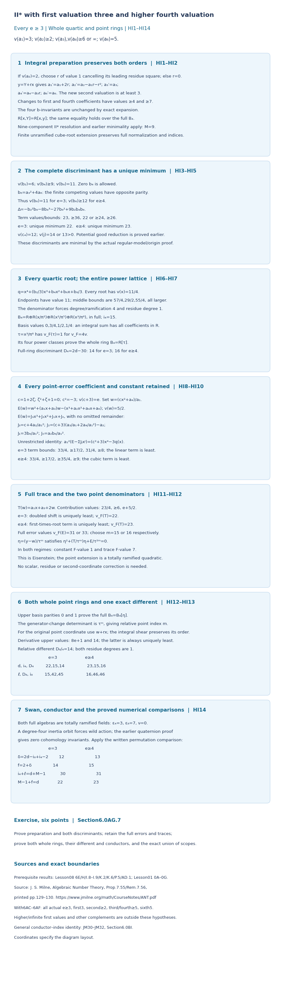

*Full proof map.* HI1–HI5 give the actual preparation, invariant bounds and two discriminants. HI6–HI7 prove the entire quartic power lattice. HI8–HI11 retain every point-error coefficient and trace contribution and find their distinct unique minima. HI12–HI14 prove both full point rings, their exact indices and different, and the Swan, conductor, normalization and Euler comparisons. Positions are diagram layout coordinates; the arithmetic entries are exact proved values under the displayed hypotheses. Earlier written providers and Milne's free author notes are identified in Section 6.0AG.1. The complete argument and full solution remain alongside the diagram.

### 6.0AG.7. Graded exercise and complete solution

**Exercise (six points).** (a) Prove that the integral shear covers a second coefficient of value two and preserves the relevant orders; compute both discriminants (two points). (b) Prove the entire quartic and point rings, retaining every point-error and trace term in both ramification regimes (two points). (c) Find the point indices, different, conductors and normalization comparison, and explain the resulting coverage when this proposition is combined with Sections 6.0AC–6.0AF (two points).

**Solution.** (a) Choose a residue square for the leading second coefficient. HI2 raises its value to at least three because the first-times-shear correction has value four. The other changes have values at least four and seven, and both inverse coordinate substitutions are integral. Expansion preserves the four b-invariants. In HI3 the eighth invariant has its value-eleven first term uniquely least. At ramification three the sixth invariant has value eleven, and its square uniquely gives discriminant twenty-two. At higher ramification its value is at least twelve, so the value-twenty-three term involving the eighth invariant is uniquely least. (b) Every quartic root has value eleven quarters by the endpoint and middle-term comparisons in HI6. The normalized power basis has four distinct fractional classes in the interval from zero to one; hence integrality of a combination is equivalent to all four coefficients being integral. The same argument for the quartic uniformizer proves its entire power ring. Expand the point shift by HI9. Its four error terms have the complete bounds in HI10: the linear term has unique value thirty-one quarters at ramification three; the cubic term has unique value thirty-three quarters at higher ramification. In the trace, the doubled shift or the first-times-root contribution has unique minimum eleven halves or twenty-three quarters. The powers fifteen or sixteen in HI12 consequently give constant value one and trace value seven. Eisenstein irreducibility and the upper basis parities prove the full point ring. (c) The determinant gives point index fifteen or sixteen. The derivative's upper values are eight times the ramification plus one and fourteen, so the latter gives relative different fourteen. The tower gives full degree-eight discriminants forty-two and forty-six, and full order indices forty-five and forty-six. The inertia orbit and quaternion comparison then give Swan twelve or thirteen and conductor fourteen or fifteen. The quartic and point index sums are thirty and thirty-one, equal to the respective discriminant plus eight; the Euler sums are twenty-two and twenty-three. Earlier Sections 6.0AC–6.0AD cover third valuation five, and 6.0AE–6.0AF cover fourth valuation five with higher third valuation. The present proof supplies the fourth-at-least-six complement at every ramification at least three and with the relaxed second bound. Their union has the exact actual first-valuation-three scope stated above; it does not cover higher first valuations or assert universal NF24.

## 6.0AH. Higher first valuation and the quarter ramification boundary

**Proposition 6.0AH (II-star with higher first valuation and the quarter ramification boundary).**

### 6.0AH.1. Actual scope and earlier written providers

Let \(K/\mathbf Q_2\) be finite, let \(R\) be its integer ring, and normalize \(v(\pi)=1\). In the actual integral equation
\[
 y^2+a_1xy+a_3y=x^3+a_2x^2+a_4x+a_6
\]
assume
\[
 \begin{gathered}
 h=v(a_1)\ge4,\\
  4e\ge3h-2,\\
  e=v(2),\\
 \lambda=(2h+5)/4,\\
  k=v(a_2)>\lambda,\\
 z=v(a_3)\ge h+1,\\
  v(a_4)\ge h+3,\\
  v(a_6)=5,\\
 t=\min\bigl(2(z-h),\,2(e-h)+5\bigr).
 \end{gathered}
 \tag{HJ1}
\]
The first valuation is finite. The second, third and fourth coefficients may vanish; an absent term has infinite valuation. The auxiliary integer \(t\) is finite because its second argument is finite. It may be negative: it measures the sixth-invariant valuation relative to \(2h\), rather than the valuation of a coefficient by itself. These are hypotheses on the resulting equation, and do not identify a coefficient valuation on an equation before an earlier coordinate change.

There is no upper bound on the first or third valuation or on the ramification. The ramification condition is equivalent to the first two assertions below. The second-coefficient threshold and auxiliary bounds also follow from HJ1:
\[
 \begin{gathered}
 e\ge\lceil(3h-2)/4\rceil,\\
 
 8e-6h+5\ge1,\\
 k\ge\lfloor(2h+5)/4\rfloor+1,\\
 
 t\ge4-h/2,\\
  \lambda+t\ge21/4.
 \end{gathered}
 \tag{HJ2}
\]
To prove the auxiliary lower bound, the first candidate for \(t\) is at least two, and \(2\ge4-h/2\). The other candidate is at least \(4-h/2\) by the ramification hypothesis. This proves the last two inequalities also when the third coefficient vanishes.

Actual earlier Lemma 6.0E constructs the nine-component II-star resolution under these coefficient bounds. Theorem 6.0I.8 and the origin-germ converse following Theorem 6.0I.9 prove its regular-model and Weierstrass minimality. Lemma 6.0H proves the Euler calculation. Sections 6.0K.2, 6.0K.6 and 6.0P.5 prove trace duals, different towers, order discriminants, inertia orbits and the quaternion/permutation Swan comparison. Earlier programme Lesson 01, Sections 0A–0G, supplies the local-field and finite unramified constructions. These earlier written results are the providers used below.

We may make the finite unramified extension splitting \(Z^2+Z+1\). Section 6.0AD.1 proves full normalization under this base change by lifted idempotents and complete local DVRs, and proves invariance of the quotient lengths, trace discriminant valuations, inertia conductors and geometric component count. All rings and bases below can first be computed there; their numerical conclusions descend to the original field. Milne's freely accessible author notes [*Algebraic Number Theory*](https://www.jmilne.org/math/CourseNotes/ANT.pdf), Proposition 7.55 and Remark 7.56, printed pp.129–130, provide local-field context. Every specialized result is proved here or in the actual earlier programme lesson.

### 6.0AH.2. Every invariant term and both discriminants

The four invariant definitions and exact bounds are
\[
 \begin{gathered}
 b_2=a_1^2+4a_2,\\
  b_4=a_1a_3+2a_4,\\
 b_6=a_3^2+4a_6,\\
 
 b_8=a_6b_2-a_1a_3a_4+a_2a_3^2-a_4^2,\\
 v(b_2)=2h,\\
  v(b_6)=2h+t,\\
  v(b_8)=2h+5,\\
 v(b_4)\ge\min(2h+1,e+h+3).
 \end{gathered}
 \tag{HJ3}
\]
Indeed \(2e+k-2h>2e+\lambda-2h\ge1/4\), so the first term of the second invariant is uniquely least. In the sixth invariant the finite candidate valuations have opposite parity, since a square has even valuation and the other term has odd valuation \(2e+5\). Hence it is nonzero and its valuation is exactly the displayed minimum, with no cancellation.

In the eighth invariant its first term has value \(2h+5\). The other three have bounds
\[
 \begin{gathered}
 v(a_1a_3a_4)\ge3h+4>2h+5,\\
 v(a_2a_3^2)\ge k+2h+2>2h+5,\\
 v(a_4^2)\ge2h+6>2h+5.
 \end{gathered}
 \tag{HJ4}
\]
The middle strict inequality uses \(k>\lambda>3\). These statements include zero coefficients. The two fourth-invariant terms have the respective lower bounds in HJ3; cancellation can only raise their sum.

Split the integer values of the auxiliary parameter into
\[
 \begin{gathered}
 \mathcal L:\ t\le h+2,\\
 
 \mathcal H:\ t\ge h+3.
 \end{gathered}
 \tag{HJ5}
\]
They exhaust the full range, including negative values. The competing discriminant terms have distinct values
\[
 \begin{gathered}
 \Delta=-b_2^2b_8-8b_4^3-27b_6^2+9b_2b_4b_6,\\
 v(b_2^2b_8)=6h+5,\\
  v(27b_6^2)=4h+2t,\\
 d=v(\Delta)=
 \begin{cases}4h+2t&\mathcal L,\\6h+5&\mathcal H.\end{cases}
 \end{gathered}
 \tag{HJ6}
\]
Here is the comparison with every remaining term. For the cross term the bound obtained from \(a_1a_3\) is \(6h+1+t\). Its margin above the smaller competitor is at least \(h-1\) in both regimes. The bound obtained from \(2a_4\) is \(5h+e+3+t\); its margin is at least \(e+1\) in both regimes. For the cube term the two bounds are \(3e+6h+3\) and \(6e+3h+9\). The first exceeds \(6h+5\) by at least \(3e-2>0\). For the second, HJ2 gives \(6e-3h+4\ge3h/2+1>0\). Since the smaller competitor is at most \(6h+5\), both cube comparisons are strict as well. Thus each regime has the unique minimum claimed in HJ6.

For the fourth discriminant invariant, the two possible contributions to the subtracted term satisfy
\[
 \begin{gathered}
 c_4=b_2^2-24b_4,\\
 v(24a_1a_3)-4h\ge3e-2h+1\ge(h-2)/4>0,\\
 v(48a_4)-4h\ge4e-3h+3\ge1,\\
 v(c_4)=4h,\\
  v(j)=12h-d\ge6h-5>0,\\
  M=9.
 \end{gathered}
 \tag{HJ7}
\]
The first term of \(c_4\) is therefore uniquely least. The earlier potential-good criterion applies. The actual earlier resolution and minimality proofs give the component count and the fact that the discriminant just calculated is minimal, independently of the conductor calculation.

### 6.0AH.3. Every quartic root and the entire quartic ring

Use the actual sign-pair quartic
\[
 \begin{gathered}
 q(X)=X^4+(b_2/3)X^3+b_4X^2+b_6X+b_8/3.
 \end{gathered}
 \tag{HJ8}
\]
At root valuation \(\lambda\) the endpoint terms have equal value \(2h+5\). The middle-term margins above that value are bounded below by
\[
 \begin{gathered}
 2h-\lambda>0,\\
 
 \min(h-3/2,e+1/2)>0,\\
 
 \lambda+t-5\ge1/4.
 \end{gathered}
 \tag{HJ9}
\]
Below this valuation each middle term exceeds the fourth-power term, and the constant does too. Above it every middle term exceeds the constant, and the fourth power does too. In either situation one summand would have a unique minimum. Consequently every root has exactly value \(\lambda\). Its denominator is four, so the degree and ramification index of its root field are both four and its residue degree is one. The quartic is irreducible. Write \(F=K(x)\) and \(v_F=4v\).

For \(r=2h+5\) put \(m_j=\lfloor jr/4\rfloor\). The four normalized powers have distinct fractional classes, each in the interval from zero to one. A linear combination over \(K\) is integral exactly when every coefficient is in \(R\): a least coefficient-adjusted summand cannot cancel against another fractional class. This proves the entire ring and its index:
\[
 \begin{gathered}
 B_4=R\oplus R\,x/\pi^{m_1}\oplus R\,x^2/\pi^{m_2}
                  \oplus R\,x^3/\pi^{m_3},\\
 i_4=m_1+m_2+m_3=3h+6,\\
 \tau=\begin{cases}x/\pi^{m_1}&h\text{ even},\\
                    x^3/\pi^{m_3}&h\text{ odd},\end{cases}\\
 v_F(\tau)=1,\\
  B_4=R[\tau],\\
 D_4=2d-2i_4=
 \begin{cases}2h+4t-12&\mathcal L,\\6h-2&\mathcal H.\end{cases}
 \end{gathered}
 \tag{HJ10}
\]
If \(r=4m+1\) the three floors are \(m,2m,3m\). If \(r=4m+3\) they are \(m,2m+1,3m+2\). Their sum is \(3(r-1)/2=3h+6\), and the same residues prove the two displayed uniformizer choices. Its first four powers form a field basis with values \(0,1/4,1/2,3/4\), so the same least-term argument proves the whole power ring. The lattice determinant proves the exact index. The earlier proved order discriminant \(2d\) and trace-matrix basis change then prove the full-ring discriminant in HJ10. In the low regime it is at least four by HJ2.

### 6.0AH.4. The full point error with the weaker second and third bounds

Choose the unramified cube root \(\zeta\), and put
\[
 \begin{gathered}
 c=1+2\zeta,\\
  c^2=-3,\\
  v(c)=0,\\
 c+3=2(2+\zeta),\\
  v(c+3)=e,\\
 A=a_1x+a_3,\\
  G=x^3+a_2x^2+a_4x+a_6,\\
 w=(cx^2+a_4)/a_1,\\
  v(w)=5/2,\\
 E(w)=w^2+Aw-G,\\
  T(w)=A+2w.
 \end{gathered}
 \tag{HJ11}
\]
The cube-root residue is nonzero, so \(2+\zeta\) is a unit. The first shift term has value \(2\lambda-h=5/2\) and the second has value at least three. Thus the shift is integral in the full quartic ring, with the exact value stated.

Reduction by the full quartic retains every coefficient and its constant:
\[
 \begin{aligned}
 E(w)&=J_3x^3+J_2x^2+J_1x+J_0,\\
 J_3&=c+4a_2/a_1^2,\\
 J_2&=(c+3)(a_3/a_1+2a_4/a_1^2)-a_2,\\
 J_1&=3b_6/a_1^2,\\
  J_0=a_2b_6/a_1^2,\\
 a_1^2(E(w)-J_3x^3-J_2x^2-J_1x-J_0)
       &=(c^2+3)x^4-3q(x).
 \end{aligned}
 \tag{HJ12}
\]
Multiplication gives the five coefficients \(c^2,-b_2,-3b_4,-3b_6,-b_8\) on the last line before imposing the two relations. This proves the unrestricted identity and hence the complete reduced error.

The correction in the cubic coefficient has positive value \(2e+k-2h>0\), so that coefficient is a unit. For the other coefficients, every contribution is bounded as follows:
\[
 \begin{gathered}
 v((c+3)a_3/a_1)-\lambda
          \ge e+1-\lambda\ge(h-3)/4>0,\\
 v(2(c+3)a_4/a_1^2)-\lambda
          \ge2e-h+3-\lambda\ge3/4>0,\\
 v(a_2)=k>\lambda,\\
 v(J_3)=0,\\
  v(J_2)>\lambda,\\
 
 v(J_1)=t,\\
  v(J_0)=k+t.
 \end{gathered}
 \tag{HJ13}
\]
When the second coefficient vanishes, the last value is infinite. The other displayed strict bounds remain valid for any zero third or fourth coefficient.

The first- and third-degree error terms have values \(\lambda+t\) and \(3\lambda\). Their difference is \(t-h-5/2\), so they cannot tie. The quadratic term has value greater than \(3\lambda\); the constant has value greater than \(\lambda+t\). In the low regime the linear term is uniquely least; in the high regime the cubic term is uniquely least. Thus the entire error, with no residue or scalar correction, gives
\[
 \begin{gathered}
 v_F(E(w))=
 \begin{cases}4t+2h+5&\mathcal L,\\6h+15&\mathcal H,\end{cases}\\
 \ell=
 \begin{cases}2t+h+2&\mathcal L,\\3h+7&\mathcal H,\end{cases}\\
 v_F(E(w))-2\ell=1,\\
 
 \ell\ge10\ \text{in }\mathcal L.
 \end{gathered}
 \tag{HJ14}
\]
In the high regime the constant is also greater than the cubic term because \(k>\lambda\) and \(t>2\lambda\). These comparisons prove the minimum against all four terms, even for negative \(t\); the lower bound for the index follows from HJ2.

### 6.0AH.5. The entire trace, point ring and different

The trace contributions have pairwise different fractional classes:
\[
 \begin{gathered}
 v(a_1x)=h+\lambda,\\
  v(a_3)=z,\\
 
 v(2w)=e+5/2,\\
 \min(z,e+5/2)=h+t/2,\\
 v_F(T(w))=
 \begin{cases}4h+2t&\mathcal L,\\6h+5&\mathcal H,\end{cases}\\
 v_F(T(w))-\ell=3h-2>0.
 \end{gathered}
 \tag{HJ15}
\]
The first trace contribution has odd-quarter fractional class; the other finite contributions are integral and half-integral. In the low regime their minimum is at least one quarter below the first contribution; in the high regime it is at least one quarter above it. Hence the minimum of the full trace is unique and has precisely the value in HJ15.

Set \(\eta=(y-w)/\tau^\ell\). Its actual quadratic equation is
\[
 \begin{gathered}
 \eta^2+\frac{T(w)}{\tau^\ell}\eta+
                 \frac{E(w)}{\tau^{2\ell}}=0,\\
 v_F(E(w)/\tau^{2\ell})=1,\\
 
 v_F(T(w)/\tau^\ell)=3h-2.
 \end{gathered}
 \tag{HJ16}
\]
This is Eisenstein and defines a totally ramified quadratic point field \(F_8/F\), of residue degree one. In its normalized upper valuation the basis \(1,\eta\) has values zero and one. Coefficients from \(F\) have even values, so least terms of different parities cannot cancel. This proves the entire point ring \(B_8=B_4[\eta]\). Writing the order basis \(1,y\) in this full basis gives determinant \(\tau^\ell\), since the shift is integral; hence the exact relative point index is \(\ell\).

The two terms of the derivative in HJ16 have upper point-field values \(8e+1\) and \(6h-4\). Their difference is at least one by HJ2. The second is uniquely least. The earlier full-ring trace-dual proof therefore gives relative different \(6h-4\). Both residue degrees are one; the proved different tower and module-index identities give
\[
 \begin{array}{c|cc}
 &\mathcal L&\mathcal H\\ \hline
 d&4h+2t&6h+5\\
 i_4&3h+6&3h+6\\
 D_4&2h+4t-12&6h-2\\
 \ell&2t+h+2&3h+7\\
 D_{8/4}&6h-4&6h-4\\
 D_8=2D_4+6h-4&10h+8t-28&18h-8\\
 i_8=2i_4+\ell&7h+2t+14&9h+19
 \end{array}
 \tag{HJ17}
\]
Direct substitution also gives \(i_8=(6d-D_8)/2\), using the earlier independently proved point-order discriminant \(6d\). These are calculations of full rings and exact quotient lengths, rather than leading-slope estimates.

### 6.0AH.6. Conductors and an infinite family on the exact boundary

Both full algebras are single totally ramified fields. Their embeddings form one inertia orbit each, giving \(\epsilon_4=3,\epsilon_8=7,\nu=0\). The quartic orbit has size four, so the odd-order tame quotient cannot supply its action with trivial wild image. The actual earlier quaternion proof puts the central involution in the nontrivial wild image. It acts as minus the identity and gives zero cohomology inertia invariants. Applying the earlier proved Swan/permutation comparison only after calculating the full rings yields
\[
 \begin{gathered}
 \begin{array}{c|cc}
 &\mathcal L&\mathcal H\\ \hline
 \delta=2d-i_8+i_4-2&4h+2t-10&6h-5\\
 f(E/K)=2+\delta&4h+2t-8&6h-3\\
 i_4+\ell&4h+2t+8&6h+13
 \end{array}\\
 f(E/K)=d-8,\\
  i_4+\ell=d+8,\\
  M-1+f=d.
 \end{gathered}
 \tag{HJ18}
\]
The last equality is also the discriminant–Artin equality by the actual earlier Euler proof. NF24 on this whole preparation and the conductor identity are consequences of the full-ring calculations. The unramified invariance proof gives the same numerical results over the original field.

The exact lower ramification boundary contains the following infinite family. For every integer \(q\ge2\), take actual coefficients satisfying
\[
 \begin{gathered}
 h=4q-2,\\
  e=3q-2,\\
 
 k\ge2q+1,\\
  z\ge4q-1,\\
 v(a_4)\ge4q+1,\\
  v(a_6)=5,\\
 4e=3h-2,\\
  \lambda=2q+1/4,\\
  t=5-2q.
 \end{gathered}
 \tag{HJ19}
\]
The second candidate for \(t\) is at most one; the first is at least two, so the value of \(t\) is exact. This includes arbitrarily negative values. The family lies wholly in the low regime and has
\[
 \begin{gathered}
 d=12q+2,\\
  i_4=12q,\\
  D_4=4,\\
  \ell=10,\\
 D_{8/4}=24q-16,\\
  D_8=24q-8,\\
  i_8=24q+10,\\
 \delta=12q-8,\\
  f=12q-6,\\
  i_4+\ell=12q+10,\\
 (8e+1)-(6h-4)=1.
 \end{gathered}
 \tag{HJ20}
\]
Thus the exact derivative comparison remains strict even on the boundary; it has not been justified only by an asymptotic inequality. At \(q=2\) the values are \(h=6,e=4,t=1,d=26,i_4=24,D_4=4,\ell=10,D_{8/4}=32,D_8=40,i_8=58,f=18\). At \(q=3\) they are \(h=10,e=7,t=-1,d=38,i_4=36,D_4=4,\ell=10,D_{8/4}=56,D_8=64,i_8=82,f=30\). For a high-regime example take \(h=4,e=5,k\ge4,z\ge8,v(a_4)\ge7,v(a_6)=5\). Then \(t=7,d=29,i_4=18,D_4=22,\ell=19,D_{8/4}=20,D_8=64,i_8=55,f=21\).


*Proof map.* The eight panels show the actual preparation, every discriminant comparison, coefficientwise integrality of the entire quartic and point rings, the complete error and trace, both different/index/conductor columns, and the infinite exact-boundary family. Proof locators HJ1–HJ20 refer to the calculations above. The two small boundary rows and the high-regime row are exact examples, rather than evidence for an unbounded claim. Ring valuations are explicitly normalized; drawing positions are layout coordinates. Milne's free author notes, Proposition 7.55 and Remark 7.56, provide the cited human local-field context. Every specialized conclusion is proved above or in the actual earlier programme providers.

### 6.0AH.7. Exact coverage and remaining obligations

For coefficient ranges complementary to Section 6.0AH, Section 6.0AI proves its complementary ramification and an infinite-first range, and its seventh subsection describes the coefficient ranges treated there. This proves the whole actual preparation HJ1 at every finite first valuation at least four, with the quarter ramification bound, the weaker second threshold, and third valuation just one above the first or higher, including zero second, third and fourth coefficients. It contains the old Section 6.0Y preparation at first valuation at least four. It also proves ramification below the first valuation whenever HJ1 holds, including the entire exact-boundary family HJ19. An earlier coordinate change must be checked against these actual resulting hypotheses.

Infinite first valuation, lower ramification outside HJ1, second or fourth coefficients outside its bounds, lower third valuations outside the earlier proved ranges, every other complementary additive preparation and universal NF24 lie outside this family-specific calculation; the general identity is JM30–JM32 in §6.0BI. The stated prerequisite results remain required. 

### 6.0AH.8. Graded exercise and complete solution

**Exercise (ten points).** (a) Derive the lower bound for \(t\) and prove all the strict invariant and discriminant comparisons with ramification possibly below the first valuation (three points). (b) Prove the entire quartic ring and both full point rings, keeping every error coefficient and trace term, and compute their indices, different and conductors (four points). (c) Derive every entry of the infinite exact-boundary family, work out \(q=2\) and \(q=3\), and compute the stated high-regime example (three points).

**Solution.** (a) The first candidate for \(t\) is at least two and hence at least \(4-h/2\); the second is at least \(4-h/2\) by four times the ramification being at least three times the first valuation minus two. This gives \(\lambda+t\ge21/4\). The second-invariant correction is strictly above its square term because \(2e+k-2h>1/4\); the sixth candidates have opposite parity. For the eighth invariant the other three bounds are \(3h+4,k+2h+2,2h+6\), all strictly above \(2h+5\). For the discriminant, the competitors have opposite parity and the low/high split in HJ5 selects their smaller value. Each of the two cross bounds has respective margin at least \(h-1\) or \(e+1\), and each cube bound exceeds \(6h+5\), as shown explicitly after HJ6. Both possible subtracted contributions to \(c_4\) exceed \(4h\) by HJ7. (b) The middle quartic margins are the three positive bounds in HJ9. A root of any other value would have a unique least endpoint term, so every root has value \(\lambda\). Its denominator forces the full degree-four totally ramified field. Normalized powers have distinct fractional classes and prove coefficientwise integrality; their three floors sum to \(3h+6\). The parity of the first valuation gives the uniformizer in HJ10, and its first four powers prove the entire power ring. Expand the complete shift with HJ12. HJ13 proves that the cubic coefficient is a unit, the quadratic coefficient has value greater than \(\lambda\), the linear coefficient has value \(t\), and the constant has value \(k+t\), with zero terms interpreted as absent. Thus the linear or cubic error term is uniquely least according to HJ5, against all other terms, including the constant in the high regime. HJ14 gives both denominators. All three trace fractional classes are distinct; their exact comparisons in HJ15 give normalized trace \(3h-2\). Constant value one and positive trace value make each equation Eisenstein, and the upper basis parities prove the entire point ring. The order determinant is \(\tau^\ell\). Its derivative terms have values \(8e+1\) and \(6h-4\), with a strictly positive difference even at the ramification boundary, so the relative different is \(6h-4\). The full-ring tower and order inclusions give every entry of HJ17. The one-orbit inertia counts and the earlier quaternion/permutation comparison then give HJ18, including conductor \(d-8\) and normalization sum \(d+8\), after the full rings have been established. (c) Substitute \(h=4q-2,e=3q-2\). The odd candidate \(5-2q\) is uniquely smaller than the other candidate, which is at least two. Substituting this \(t\) in the low column gives discriminant \(12q+2\), quartic index \(12q\), quartic discriminant four, point index ten, relative different \(24q-16\), total discriminant \(24q-8\), total index \(24q+10\), Swan \(12q-8\) and conductor \(12q-6\). The derivative margin is one. At \(q=2\) these give the numerical row \(26,24,4,10,32,40,58,16,18\) for discriminant, quartic index/discriminant, point index/different, total discriminant/index, Swan and conductor. At \(q=3\) the row is \(38,36,4,10,56,64,82,28,30\), with negative auxiliary value minus one. In the high example the two candidates for \(t\) are at least eight and exactly seven, so its value is seven. The high column gives \(29,18,22,19,20,64,55,19,21\) in the same order. Each normalization sum equals its discriminant plus eight, and each Euler sum equals its discriminant. These computations prove the stated examples within HJ1 and make no claim for the explicit remaining complements.

## 6.0AI. Large or infinite first valuation and complementary ramification

**Proposition 6.0AI (II-star with large or infinite first valuation and complementary ramification).**

### 6.0AI.1. Actual preparation and written providers

Let \(K/\mathbf Q_2\) be finite, let \(R\) be its integer ring, and normalize \(v(\pi)=1\). Consider the actual integral equation
\[
 y^2+a_1xy+a_3y=x^3+a_2x^2+a_4x+a_6.
\]
Write \(e=v(2)\). Assume
\[
 \begin{gathered}
 e\ge1,\\
  r=2e+5,\\
  \lambda=r/3,\\
 h=v(a_1)>(8e+5)/6,\\
 k=v(a_2)>\lambda,\\
 z=v(a_3)\ge e+3,\\
 l=v(a_4)>2\lambda,\\
  v(a_6)=5.
 \end{gathered}
 \tag{HK1}
\]
The first, second, third and fourth coefficients may vanish. Their valuations are then infinite, and the corresponding terms below are absent. The sixth coefficient is nonzero. There is no upper bound on ramification or on any coefficient valuation. These are tests on the resulting equation after any coordinate preparation.

At finite first valuation the first inequality is exactly the complement of the ramification condition in the preceding higher-first proof: since the valuations are integers, it is equivalent to \(3h\ge4e+3\), and thus to \(4e<3h-2\). The new preparation also includes infinite first valuation, which that preceding proof did not permit.

The actual earlier Lemma 6.0E constructs the nine-component II-star resolution. Indeed HK1 implies first valuation at least three, second at least three, third at least four, fourth at least five, and sixth exactly five. Theorem 6.0I.8 and the origin-germ converse following Theorem 6.0I.9 prove that this is the minimal regular proper model and that the displayed equation is minimal. Lemma 6.0H proves its Euler calculation. Sections 6.0K.2, 6.0K.6 and 6.0P.5 prove trace duals, different towers, torsion-order discriminants, permutation/Swan comparison and weighted point indices. Earlier programme Lesson 01, Sections 0A–0G, supplies complete local fields and finite unramified extensions. In particular its Proposition 0F.2 constructs a finite unramified extension realizing any finite residue extension. These are actual earlier written proofs.

Section 6.0AD.1 proves that full normalization commutes with finite unramified extension, by lifted idempotents and complete local DVRs. It also proves that quotient lengths, trace-discriminant valuations, inertia conductors and geometric component counts are unchanged. We use such an extension only in the split-cubic case below. It does not kill any ramification in a point quadratic.

Free human local-field context is Milne's author notes [*Algebraic Number Theory*](https://www.jmilne.org/math/CourseNotes/ANT.pdf), Proposition 7.55 and Remark 7.56, printed pp.129–130. The specialized normalization and conductor results are proved below; this reference supplies no missing proof.

### 6.0AI.2. Every invariant term and the minimal discriminant

Keep the full invariant definitions:
\[
 \begin{gathered}
 b_2=a_1^2+4a_2,\\
 b_4=a_1a_3+2a_4,\\
 b_6=a_3^2+4a_6,\\
 b_8=a_6b_2-a_1a_3a_4+a_2a_3^2-a_4^2,\\
 v(b_2)>\lambda+2e,\\
 v(b_4)>2\lambda+e,\\
 v(b_6)=r=3\lambda,\\
  v(b_8)>4\lambda.
 \end{gathered}
 \tag{HK2}
\]
For the second invariant, the two values are \(2h>\lambda+2e\) and \(2e+k>\lambda+2e\). For the fourth, the second is \(e+l>2\lambda+e\), and the first satisfies
\[
 h+z>(8e+5)/6+e+3=2\lambda+e+1/2.
\]
In the sixth invariant, the square has value at least \(2e+6=r+1\), whereas the other term has value exactly \(r\). It is uniquely least, so the sixth invariant is nonzero. In the eighth, every term is controlled separately:
\[
 \begin{gathered}
 v(a_6b_2)>5+\lambda+2e=4\lambda,\\
 v(a_1a_3a_4)>4\lambda+e+1/2,\\
 v(a_2a_3^2)>\lambda+2e+6=4\lambda+1,\\
 v(a_4^2)>4\lambda.
 \end{gathered}
 \tag{HK3}
\]
Cancellation can only raise these bounds. In particular the eighth invariant may be zero; no exact nonzero value is asserted for it.

The complete discriminant and fourth discriminant invariant give
\[
 \begin{gathered}
 \Delta=-b_2^2b_8-8b_4^3-27b_6^2+9b_2b_4b_6,\\
 v(b_2^2b_8)>6\lambda+4e,\\
 v(8b_4^3)>6\lambda+6e,\\
 v(9b_2b_4b_6)>6\lambda+3e,\\
 d=v(\Delta)=2r=4e+10,\\
 c_4=b_2^2-24b_4,\\
 v(c_4)>2\lambda+4e,\\
  v(j)>12e>0,\\
  M=9.
 \end{gathered}
 \tag{HK4}
\]
The term \(-27b_6^2\), of value \(6\lambda\), is uniquely least in the discriminant. Both terms of the fourth invariant have value strictly greater than \(2\lambda+4e\), because \(v(24)=3e\). If it vanishes, the valuation of the zero \(j\)-invariant is infinite; otherwise subtracting \(d=6\lambda\) from three times its valuation gives the strict displayed bound. The curve is smooth and potentially good by the earlier written criterion. The model and minimality proofs already cited establish the component count and minimal discriminant before any conductor is calculated.

### 6.0AI.3. The rational sign pair and the exact product-order defect

Use the actual sign-pair quartic
\[
 \begin{gathered}
 q(X)=X^4+(b_2/3)X^3+b_4X^2+b_6X+b_8/3.
 \end{gathered}
 \tag{HK5}
\]
Put \(m=\lfloor\lambda\rfloor+1\). The following polynomial belongs to \(R[T]\):
\[
 \begin{gathered}
 F(T)=q(\pi^mT)/\pi^{r+m},\\
 v(F_0)=v(b_8)-r-m\ge0,\\
  v(F_1)=0,\\
 v(F_2)>e+m-\lambda>0,\\
 v(F_3)>2e+2(m-\lambda)>0,\\
 v(F_4)=3(m-\lambda)>0.
 \end{gathered}
 \tag{HK6}
\]
Here \(F_j\) means the coefficient of \(T^j\); an absent constant has infinite value. The constant bound follows because \(v(b_8)-r\) is an integer strictly greater than \(\lambda\). The reduction is a linear polynomial with unit slope. It has one simple residue root.

For completeness lift this root by the complete Newton iteration. Starting with any residue lift \(T_0\), put \(T_{n+1}=T_n-F(T_n)/F'(T_n)\). All derivatives are units: the linear coefficient is a unit and all higher coefficients are in the maximal ideal. Taylor expansion with integral coefficients proves that each residual error has at least twice the preceding valuation. The differences tend to zero, so completeness gives a root. For distinct \(s,t\in R\), the divided difference \((F(s)-F(t))/(s-t)\) is the unit linear coefficient plus an element of the maximal ideal. Two roots must therefore coincide. This also proves uniqueness without assuming any simple root of the original quartic modulo the maximal ideal.

Let \(\rho=\pi^mT\) be the resulting root. It lies in \(K\) and has value at least \(m>\lambda\); it is zero when \(b_8=0\). Exact division gives
\[
 \begin{gathered}
 q(X)=(X-\rho)g(X),\\
 g(X)=X^3+C_2X^2+C_1X+C_0,\\
 C_2=b_2/3+\rho,\\
 C_1=b_4+(b_2/3)\rho+\rho^2,\\
 C_0=b_6+b_4\rho+(b_2/3)\rho^2+\rho^3,\\
 v(C_2)>\lambda,\\
  v(C_1)>2\lambda,\\
  v(C_0)=r.
 \end{gathered}
 \tag{HK7}
\]
Every extra term in the constant has value greater than \(3\lambda\), so its sixth-invariant term is uniquely least. The other two bounds follow term by term from HK2 and \(v(\rho)>\lambda\). Any root of the cubic has value exactly \(\lambda\): below it the cube is uniquely least, and above it the constant is uniquely least. The middle terms are strictly above those endpoints in either situation. Thus all four roots, including the high rational root, have been accounted for.

Set \(A_4=R[X]/q\) and \(A_3=R[X]/g\). The rational factor and cubic factor are coprime over \(K\), since
\[
 \begin{gathered}
 g(\rho)=q'(\rho)=4\rho^3+b_2\rho^2+2b_4\rho+b_6,\\
 v(g(\rho))=r,\\
 0\longrightarrow A_4\longrightarrow R\oplus A_3
       \longrightarrow R/(g(\rho))\longrightarrow0,\\
 [P]\longmapsto(P(\rho),[P]),\\
 (a,[B])\longmapsto a-B(\rho)\pmod{g(\rho)}.
 \end{gathered}
 \tag{HK8}
\]
In the first line all terms except the last have value strictly greater than \(r\). To prove exactness, lift a cubic class to its unique polynomial \(B\) of degree less than three. A quartic class has a unique representative \(B+cg\), with \(c\in R\), of degree less than four. Its rational coordinate is \(B(\rho)+cg(\rho)\). Thus the displayed kernel is exactly the image, the image is injective, and the last map is surjective. Evaluating a different representative of the cubic class changes its value by a multiple of \(g(\rho)\), so the last map is well-defined. The quotient has length exactly \(r\). This defect must be included even though the generic algebra is a product.

### 6.0AI.4. The whole cubic normalization in both residue classes

First suppose \(3\nmid r\). A cubic root \(x\) has valuation with denominator three. The earlier degree formula forces its field \(F_3=K(x)\) to have degree and ramification index three and residue degree one. Hence \(g\) is irreducible. Write \(v_3=3v\). For \(m_j=\lfloor jr/3\rfloor\), the three normalized powers have different fractional classes in \([0,1)\). A least summand in a linear combination cannot cancel against another class. Integrality is therefore equivalent to every coefficient belonging to \(R\), proving the entire integer ring
\[
 \begin{gathered}
 C_3=R\oplus R\,x/\pi^{m_1}\oplus R\,x^2/\pi^{m_2},\\
 \operatorname{length}_R(C_3/A_3)=m_1+m_2=r-1.
 \end{gathered}
 \tag{HK9}
\]
For \(r=3a+1\) the two floors are \(a,2a\); for \(r=3a+2\) they are \(a,2a+1\). This proves both floor sums.

We will also need a full power-ring uniformizer. The following equations are exact:
\[
 \begin{gathered}
 \theta=\begin{cases}
 x/\pi^a&r=3a+1,\\
 \pi^{a+1}/x&r=3a+2,
 \end{cases}\\
  v_3(\theta)=1,\\
 \theta^3+\alpha\theta^2+\beta\theta+\gamma=0,\\
 (\alpha,\beta,\gamma)=
 \begin{cases}
 (C_2/\pi^a,C_1/\pi^{2a},C_0/\pi^{3a})&r=3a+1,\\
 (C_1\pi^{a+1}/C_0,C_2\pi^{2a+2}/C_0,\pi^{3a+3}/C_0)&r=3a+2,
 \end{cases}\\
 v(\alpha)\ge1,\\
  v(\beta)\ge1,\\
  v(\gamma)=1,\\
 C_3=R[\theta],\\
  D_3=2.
 \end{gathered}
 \tag{HK10}
\]
For the first equation substitute \(x=\pi^a\theta\) in \(g\) and divide by \(\pi^{3a}\). For the second substitute \(x=\pi^{a+1}/\theta\), multiply by \(\theta^3\), and divide by \(C_0\). In the first case HK7 gives \(v(C_2)\ge a+1\), \(v(C_1)\ge2a+1\). In the second it gives \(v(C_2)\ge a+1\), \(v(C_1)\ge2a+2\). These prove all coefficient bounds and the constant value. The equations are Eisenstein. The three powers of the uniformizer have distinct fractional classes \(0,1/3,2/3\); the same coefficientwise argument as above proves the whole power ring.

The three derivative terms have \(v_3\)-values \(2\), at least \(3e+4\), and at least \(3\). The first, \(3\theta^2\), is uniquely least, since three is a unit. The actual full-ring trace-dual proof in Section 6.0K.2 gives different exponent two. Residue degree one makes the trace-discriminant exponent \(D_3\) equal to two. Combining the exact product-order defect with the cubic index gives
\[
 \begin{gathered}
 B_4=R\times C_3,\\
  i_4=2r-1=d-1,\\
  D_4=2.
 \end{gathered}
 \tag{HK11}
\]
The earlier order-discriminant identity independently agrees: \(D_4=2d-2i_4\).

Now suppose \(3\mid r\), so \(r=3a\). Over a finite unramified extension \(K'/K\) splitting the residue polynomial, set
\[
 \begin{gathered}
 G_3(T)=g(\pi^aT)/\pi^{3a},\\
 \overline{G_3}(T)=T^3+\overline{C_0/\pi^{3a}},\\
 C_3'=R'{}^3,\\
  B_4'=R'{}^4,\\
 \operatorname{length}_{R'}(C_3'/A_3')=3a=r,\\
 i_4=2r=d,\\
  D_4=0.
 \end{gathered}
 \tag{HK12}
\]
The two omitted middle coefficients have strictly positive value by HK7. The constant reduction is nonzero, and the derivative of the residue cubic is \(T^2\). Its roots are therefore simple and nonzero. The finite residue splitting extension exists by Lemma 0F.1, and Proposition 0F.2 supplies \(K'\). Apply the same complete Newton iteration in each of its three simple-root residue classes: the derivative remains congruent to that root's nonzero derivative, hence is a unit throughout the iteration. The integral Taylor estimate proves convergence, and the divided difference within that residue class reduces to its unit derivative, proving uniqueness there. Thus all three distinct residue roots lift. Their differences are units. Evaluation gives the entire normalized cubic algebra \(R'{}^3\): the Lagrange polynomials have integral coefficients because their difference denominators are units, and they give all three coordinate idempotents.

In the full basis \(1,T,T^2\), the original basis \(1,x,x^2\) has determinant \(\pi^{3a}\), so the cubic index is exactly \(r\). Add the product defect \(r\) from HK8. The split normal rings have unit trace discriminants, yielding HK12 and again the order-discriminant check. Section 6.0AD.1 descends these numerical results to the original field. Over that field the cubic algebra can have nontrivial unramified residue factors; HK12 does not assert that it already equals \(K^3\) there. Notice that \(3\mid r\) is equivalent to \(e\equiv2\pmod3\).

### 6.0AI.5. Every point quadratic and its whole integer ring

On any quartic factor write \(x_j\) for its coordinate; it is either \(\rho\) or a cubic root. Thus \(v(x_j)\ge\lambda\). Keep every coefficient when completing the square:
\[
 \begin{gathered}
 A_j=a_1x_j+a_3,\\
 G_j=x_j^3+a_2x_j^2+a_4x_j+a_6,\\
 Y_j=y+A_j/2,\\
  U_j=G_j+A_j^2/4,\\
 Y_j^2=U_j=\pi^5u_j,\\
  u_j\in C_j^\times,\\
 v(x_j^3)\ge r>5,\\
 v(a_2x_j^2)>r>5,\\
  v(a_4x_j)>r>5,\\
 v(a_1x_j/2)>e+5/2,\\
  v(a_3/2)\ge3,\\
 v(A_j/2)\ge3,\\
  v(A_j^2/4)\ge6>5.
 \end{gathered}
 \tag{HK13}
\]
Here \(C_j\) is the entire integer ring of the factor, including the split factors over \(R'\). The first shift bound is the exact identity \((8e+5)/6+\lambda-e=e+5/2\) followed by HK1. Hence the shift is integral in every full factor. The sole value-five term in the complete square is \(a_6\), proving that each \(u_j\) is a unit. The square includes its cross term and both square terms. No scalar-square approximation, vanished coefficient or omitted term is being substituted for the original point equation.

Above the rational sign pair, put \(\eta_0=Y_0/\pi^2\). Then
\[
 \begin{gathered}
 \eta_0^2=\pi u_0,\\
 C_2^{\rm pt}=R[\eta_0],\\
  \ell_0=2,\\
  D_2=2e+1.
 \end{gathered}
 \tag{HK14}
\]
This quadratic is Eisenstein. It is a totally ramified field of degree two and residue degree one. In the normalized upper valuation, the basis terms \(1,\eta_0\) have values zero and one; coefficients in \(K\) have even values. Distinct parities cannot cancel. Every integral element therefore has its two coefficients in \(R\), which proves the entire ring. Expressing \((1,y)\) in \((1,\eta_0)\) gives an integral shift and determinant \(\pi^2\), so the exact relative index is two. The derivative \(2\eta_0\) has upper value \(2e+1\); the full-ring trace-dual argument gives the displayed different and discriminant. The same calculation applies independently to each of the four base factors in the split case.

When \(3\nmid r\), take the cubic uniformizer \(\theta\) from HK10 and put \(\eta_3=Y_3/(\pi^2\theta)\). Its complete equation gives
\[
 \begin{gathered}
 \eta_3^2=(\pi/\theta^2)u_3
          =\theta(\pi/\theta^3)u_3,\\
 \pi/\theta^3\in C_3^\times,\\
 C_6=C_3[\eta_3],\\
  \ell_3=v_3(\pi^2\theta)=7,\\
 D_{6/3}=6e+1,\\
  D_6=2D_3+D_{6/3}=6e+5.
 \end{gathered}
 \tag{HK15}
\]
Its constant has \(v_3\)-value one. Thus it is Eisenstein over the entire cubic integer ring. The upper parities of \(1,\eta_3\), against the even upper values of coefficients in \(F_3\), prove that this is its entire degree-two point ring. Its residue degree over \(F_3\), and hence over \(K\), is one. The integral shift in HK13 and denominator \(\pi^2\theta\) give the displayed \(C_3\)-module length seven. This length is weighted by residue degree one when converted to an \(R\)-length; it is not multiplied by the cubic ramification index. The derivative \(2\eta_3\) has upper value \(6e+1\). Apply the full-ring trace-dual proof and then the proved different tower to obtain \(D_6\).

Let \(k_{\rm pt}=\operatorname{length}_R(B_8/B_4[y])\), to distinguish the point index from the second coefficient valuation \(k\). The weighted-index proof of Section 6.0P.5, or the two bases just displayed, now gives every full-ring column:
\[
 \begin{array}{c|cc}
 &3\nmid r&3\mid r\\ \hline
 B_4&R\times C_3&R'{}^4\text{ after base change}\\
 B_8&C_2^{\rm pt}\times C_6&\prod_{j=1}^4R'[\eta_j]\text{ after base change}\\
 D_4&2&0\\
 i_4&d-1&d\\
 k_{\rm pt}&2+7=9&4\cdot2=8\\
 D_8&8e+6&8e+4\\
 i_8=2i_4+k_{\rm pt}&8e+27&8e+28
 \end{array}
 \tag{HK16}
\]
In the first column \(D_8=(2e+1)+(6e+5)\), since both residue degrees are one. In the second the four absolute quadratic discriminants each have value \(2e+1\). Both columns also satisfy \(i_8=(6d-D_8)/2\), using the earlier independently proved point-order discriminant \(6d\). All point quadratics are ramified. Every ring and each exact quotient length has been proved before these identities are applied.

### 6.0AI.6. Inertia, conductor and the exact complementary range

The first column consists of two totally ramified sign-pair fields and two totally ramified point fields. The second becomes four base fields and four totally ramified quadratic fields over the permitted unramified extension. The earlier orbit proof therefore gives
\[
 \begin{array}{c|cc}
 &3\nmid r&3\mid r\\ \hline
 \epsilon_4&2&0\\
 \epsilon_8&6&4\\
 \nu&0&0
 \end{array}
 \qquad \epsilon_8-\epsilon_4=4.
 \tag{HK17}
\]
These numerical inertia counts descend to \(K\). In particular, an unramified residue factor over \(K\) contributes its residue degree to the orbit count; it need not be incorrectly declared split.

The rational sign pair is fixed by inertia, whereas its point quadratic in HK14 is ramified of degree two. Inertia therefore has a quotient of order two on these two points. If its wild image were trivial, this quotient would factor through tame inertia, whose finite quotients have odd order in residue characteristic two. This is impossible. Thus the wild action on the actual eight nonzero 3-torsion points is nontrivial. Section 6.0K.6's explicit quaternion proof puts \(-1\) in every nontrivial wild subgroup. It acts as minus the identity on the rank-two cohomology representation. Its inertia invariants are zero, giving tame codimension two.

Apply the proved Swan/permutation comparison after the full normalizations:
\[
 \begin{gathered}
 \delta=2d-i_4-k_{\rm pt}-2=4e,\\
 f(E/K)=2+\delta=4e+2=d-8,\\
 i_4+k_{\rm pt}=d+8,\\
  M-1+f=d.
 \end{gathered}
 \tag{HK18}
\]
The first formula follows separately in either column of HK16. It also follows from \(2\delta=(D_8-\epsilon_8)-(D_4-\epsilon_4)\). The last identity is the discriminant–Artin equality by the actual earlier Euler calculation. Thus the normalization assertion NF24 and the conductor identity hold on the whole HK1 preparation, including its infinite first valuation cases.

Combining this result with the preceding higher-first proof now covers the following preparation at every ramification index:
\[
 \begin{gathered}
 h=v(a_1)\ge4\text{ finite},\\
  e\ge1,\\
 k>(2h+5)/4,\\
  z\ge h+1,\\
 l\ge h+3,\\
  v(a_6)=5.
 \end{gathered}
 \tag{HK19}
\]
When \(4e\ge3h-2\), the preceding proof applies directly. When \(4e<3h-2\), integer valuations give \(3h\ge4e+3\), and the HK1 bounds follow:
\[
 \begin{gathered}
 h>(8e+5)/6,\\
 (2h+5)/4-(2e+5)/3=(6h-8e-5)/12>0,\\
 h-e\ge2,\\
  z\ge h+1\ge e+3,\\
 3(h+3)-(4e+10)=3h-4e-1\ge2.
 \end{gathered}
 \tag{HK20}
\]
For the integer middle bound, \(e\le(3h-3)/4\) gives \(h-e\ge(h+3)/4>1\), since \(h\ge4\). The last bound gives \(l>2\lambda\). Thus there is no missing ramification interval in HK19, and no unproved change of coefficients is used to pass between the two proofs.

### 6.0AI.7. Infinite first valuation, examples and remaining obligations

One additional infinite preparation, for every ramification index, is
\[
 \begin{gathered}
 a_1=0,\\
  e\ge1,\\
 v(a_2)>(2e+5)/3,\\
 v(a_3)\ge e+3,\\
 v(a_4)>2(2e+5)/3,\\
  v(a_6)=5.
 \end{gathered}
 \tag{HK21}
\]
The second, third and fourth coefficients may also vanish, so the pure equation \(y^2=x^3+a_6\) is one example. Every calculation above retains all terms and proves the entire larger preparation, rather than only that example. There are infinitely many ramification indices in each cubic residue alternative.

For explicit rows choose coefficients within HK1. The minimal finite first valuation shown can be replaced by infinity, and each lower bound for another coefficient can be replaced by infinity:
\[
 \begin{array}{c|ccc}
 e&1&2&3\\ \hline
 h&\ge3&\ge4&\ge5\\
 k&\ge3&\ge4&\ge4\\
 z&\ge4&\ge5&\ge6\\
 l&\ge5&\ge7&\ge8\\
 r&7&9&11\\
 d&14&18&22\\
 i_4&13&18&21\\
 D_4&2&0&2\\
 k_{\rm pt}&9&8&9\\
 D_8&14&20&30\\
 i_8&35&44&51\\
 \delta&4&8&12\\
 f&6&10&14\\
 i_4+k_{\rm pt}&22&26&30
 \end{array}
 \tag{HK22}
\]
The common sixth valuation is exactly five. The middle example uses the finite unramified cubic splitting; the other two examples have a full tame cubic field. Each Euler sum is eight plus its displayed conductor and equals its minimal discriminant.


*Proof map.* The eight panels show the actual finite or infinite first preparation, every invariant comparison, the exact product-order defect, both full cubic normalizations, both full point rings and their differently normalized indices, inertia/Swan/conductor columns, and the complete higher-first coverage and examples. Proof locators HK1–HK22 identify the calculations. Field degree, ramification and residue degree are distinguished, as are relative module lengths and absolute discriminants. Layout coordinates are schematic; all mathematical constants and ring bases are exact. Milne's free author notes, Proposition 7.55 and Remark 7.56, provide the cited human local-field context.

For coefficient ranges complementary to Section 6.0AI, Section 6.0AJ proves a lower even-second preparation with arbitrary units, and Sections 6.0AM.7 and 6.0AN.7 describe additional coefficient ranges. This proves all of HK1 and HK21 and, with the preceding proof, all finite higher-first equations in HK19 at every ramification index. It does not cover infinite first valuation outside HK21, lower second or fourth bounds, lower third valuations outside the earlier proved ranges, other complementary additive preparations or universal NF24. The stated prerequisite results remain required. 

### 6.0AI.8. Graded exercise and complete solution

**Exercise (ten points).** (a) Prove all invariant bounds and the exact discriminant, allowing infinite first and eighth-invariant valuations (two points). (b) Construct the rational sign-pair root, prove the exact product-order sequence, and compute both entire cubic normalizations with their indices and different (three points). (c) Prove all full point rings and exact relative indices, then compute the absolute columns, inertia and conductor (three points). (d) Prove complete higher-first coverage at every ramification, and reproduce all three examples including infinite first valuation (two points).

**Solution.** (a) In the second invariant, the term values exceed \(\lambda+2e\) separately; in the fourth they exceed \(2\lambda+e\) separately. The sixth square has value at least \(r+1\), so the nonzero value-\(r\) term is uniquely least. For the eighth invariant the four separate bounds are \(4\lambda\), \(4\lambda+e+1/2\), \(4\lambda+1\), \(4\lambda\), all strict, as in HK3. Thus the sum may vanish but still satisfies the required strict bound. In the full discriminant the other three terms exceed \(6\lambda\) by strictly more than \(4e,6e,3e\); the sixth-invariant square has value exactly \(6\lambda\). This proves \(d=4e+10\). Both fourth-invariant terms exceed \(2\lambda+4e\); the resulting \(j\)-valuation is greater than \(12e\), or infinite. The actual earlier resolution and minimality give \(M=9\) and minimality independently.

(b) Take \(m=\lfloor\lambda\rfloor+1\). The rescaled quartic has an integral constant, unit linear coefficient and all higher coefficients in the maximal ideal by HK6. Its unique residue root lifts by the explicitly proved Newton iteration, and the unit divided difference proves uniqueness on \(R\). This gives the rational root \(\rho\), including zero when the constant vanishes. Synthetic division gives every coefficient in HK7 and their bounds; a cubic root of any other valuation would have a uniquely least endpoint term. The value of \(g(\rho)\) is \(r\), since the last term in HK8 is uniquely least. Every quartic polynomial class is uniquely \(B+cg\) with \(\deg B<3\), and its two coordinates differ by \(cg(\rho)\). This proves the whole exact sequence and length \(r\), not just generic splitting.

When \(3\nmid r\), the cubic slope denominator forces degree and ramification three and residue degree one. Its normalized three powers have distinct fractional classes in \([0,1)\), so coefficientwise integrality proves HK9's entire ring. The two floor sums are \(3a\) for \(r=3a+1\) and \(3a+1\) for \(r=3a+2\), both \(r-1\). Substitute the two choices of \(\theta\) to get HK10's exact Eisenstein equations. Their first three powers prove the entire power ring by the same classes. The derivative has uniquely least value two, since its other terms have bounds \(3e+4\) and three. The trace-dual proof gives different two. Adding the product defect proves \(i_4=2r-1\), \(D_4=2\). When \(3\mid r\), the scaled residue cubic has nonzero constant and derivative \(T^2\), so it has three simple roots over a finite residue extension. The earlier unramified construction and Newton lifting realize them over \(K'\). Unit root differences make the Lagrange idempotents integral, proving the entire cubic ring \(R'{}^3\). The basis determinant \(\pi^{3a}\) gives cubic index \(r\), hence total index \(2r\) and normal discriminant zero. The proved unramified invariance descends the numerical conclusions.

(c) In the complete square, the cubic, second and fourth contributions all have value greater than five. The first shifted coefficient term has value greater than \(e+5/2\), the third has value at least three, so their entire square has value at least six. The sole least contribution is the sixth coefficient. Thus \(Y_j^2=\pi^5u_j\) with \(u_j\) a unit and integral shift. Above the rational or split base factors, divide by \(\pi^2\) to get an Eisenstein quadratic; upper parity proves the entire ring. Its order determinant has base valuation two and its derivative has upper value \(2e+1\). Above the tame cubic factor divide by \(\pi^2\theta\). The new constant has cubic value one because \(\pi/\theta^3\) is a unit. The upper parity proof again gives the entire point ring, but the relative module length is now \(v_3(\pi^2\theta)=7\), weighted by residue degree one. Its derivative has upper value \(6e+1\) and the different tower gives absolute different \(6e+5\). Adding the full discriminants gives \(D_8=8e+6\) or \(8e+4\). The weighted indices are nine or eight, giving total indices \(8e+27\) or \(8e+28\); both agree with the point-order discriminant check.

The full-field residue counts give \(\epsilon_4=2,\epsilon_8=6\), or \(\epsilon_4=0,\epsilon_8=4\) after unramified splitting, with \(\nu=0\). The ramified point quadratic over the rational sign pair forces a nontrivial wild image, since the odd-order tame quotient cannot account for its order-two action. The earlier quaternion proof gives the central involution and zero cohomology inertia invariants. The proved Swan/permutation formula yields \(\delta=4e\) in both columns. Therefore \(f=4e+2=d-8\), the normalization sum is \(d+8\), and the Euler sum is \(d\). Every assertion follows after the full rings and exact quotient lengths, including the product defect, have been computed.

(d) The higher-first bounds HK19 satisfy the preceding proof when \(4e\ge3h-2\). In the complementary case integer valuations give \(3h\ge4e+3\). This implies the first HK1 threshold and a positive difference between the old second threshold and \(\lambda\). Also \(h-e\ge(h+3)/4>1\) is an integer, so the old third bound implies \(z\ge e+3\). Finally \(3(h+3)-(4e+10)\ge2\) proves the new fourth threshold. This proves full coverage at every ramification without changing any coefficient.

At ramification one take \(h\ge3,k\ge3,z\ge4,l\ge5\). Then \(r=7\) is not divisible by three; the first column gives \(d=14,i_4=13,D_4=2,k_{\rm pt}=9,D_8=14,i_8=35,\delta=4,f=6\), normalization sum 22 and Euler sum 14. At ramification two take \(h\ge4,k\ge4,z\ge5,l\ge7\). Now \(r=9\) is divisible by three; the second column gives \(18,18,0,8,20,44,8,10\) for those same quantities, normalization sum 26 and Euler sum 18. At ramification three take \(h\ge5,k\ge4,z\ge6,l\ge8\); the first column gives \(22,21,2,9,30,51,12,14\), normalization sum 30 and Euler sum 22. In each case first valuation may be infinite, as may the other three bounded valuations. Keeping sixth valuation exactly five gives the same proof and values. These examples illustrate the proved unbounded preparations and do not establish any of their remaining complements.

## 6.0AJ. Lower even second valuation and arbitrary units

**Proposition 6.0AJ (II-star with lower even second valuation and arbitrary units).**

### 6.0AJ.1. Actual preparation and written providers

Let \(K/\mathbf Q_2\) be finite, let \(R\) be its integer ring, and normalize \(v(\pi)=1\). In the actual integral equation
\[
 y^2+a_1xy+a_3y=x^3+a_2x^2+a_4x+a_6
\]
assume
\[
 \begin{gathered}
 e=v(2)\ge1,\\
  k=v(a_2)\ge2\text{ even},\\
 3k<2e+5,\\
  t=2e+k+5,\\
  \mu=t/4,\\
 h=v(a_1)>e+\mu/2,\\
 z=v(a_3)>e+(\mu+5-k)/2,\\
 l=v(a_4)>e+(\mu+5)/2,\\
  v(a_6)=5.
 \end{gathered}
 \tag{HL1}
\]
The first, third and fourth coefficients may vanish. The second and sixth are nonzero, with arbitrary units at the stated valuations. In particular no square condition is imposed on the second coefficient or its unit. There is no upper bound on ramification, the even second valuation or the other allowed valuations. All tests refer to the resulting equation after any earlier coordinate preparation.

Set
\[
 \begin{gathered}
 n=2e-3k+5=t-4k,\\
  n\ge1\text{ odd},\\
  n\le2e-1,\\
 \mu>k,\\
  \mu\ge9/4,\\
 
 e+k-\mu=(2e+3k-5)/4\ge3/4.
 \end{gathered}
 \tag{HL2}
\]
These statements follow directly from HL1, evenness of the second valuation and its lower bound two. They imply first valuation at least three, third at least four and fourth at least five. Thus the actual earlier Lemma 6.0E constructs the nine-component II-star resolution. Theorem 6.0I.8 and the origin-germ converse following Theorem 6.0I.9 prove minimal regular-model and Weierstrass minimality. Lemma 6.0H proves its Euler calculation. Sections 6.0K.2, 6.0K.6 and 6.0P.5 prove the trace-dual, different-tower, torsion-order, quaternion/permutation and index/orbit identities used below. The earlier programme Lesson 01, Sections 0A–0G, supplies the complete local-field foundations. These are actual earlier written proofs.

Milne's freely accessible author notes [*Algebraic Number Theory*](https://www.jmilne.org/math/CourseNotes/ANT.pdf), Proposition 7.55 and Remark 7.56, printed pp.129–130, supply human local-field context. The specialized entire rings, finite square construction and conductor calculations are proved here. There is no external theorem replacing any of those proofs.

### 6.0AJ.2. Every invariant, discriminant term and quartic root

Keep the complete invariant definitions and let \(\beta=2e+(\mu+5)/2\):
\[
 \begin{gathered}
 b_2=a_1^2+4a_2,\\
  b_4=a_1a_3+2a_4,\\
 b_6=a_3^2+4a_6,\\
 b_8=a_6b_2-a_1a_3a_4+a_2a_3^2-a_4^2,\\
 v(b_2)=2e+k,\\
  v(b_4)>\beta,\\
  v(b_6)=2e+5,\\
 v(b_8)=t=4\mu.
 \end{gathered}
 \tag{HL3}
\]
In the second invariant \(2h>2e+\mu>2e+k\), so its second term is uniquely least. For the fourth, \(e+l>\beta\), while
\[
 h+z>2e+\mu+(5-k)/2=\beta+(\mu-k)/2>\beta.
\]
The sixth square has value strictly greater than \(2e+\mu+5-k>2e+5\), so its other term is uniquely least. In the eighth, the first term has value \(t\), and the other three satisfy
\[
 \begin{gathered}
 h+z+l>t+e+3(\mu-k)/2,\\
 k+2z>t+\mu-k,\\
  2l>t+\mu-k.
 \end{gathered}
 \tag{HL4}
\]
All margins are positive; these statements include any absent terms. Hence the second, sixth and eighth invariants have the exact nonzero values in HL3, with no hidden cancellation.

The complete discriminant and fourth discriminant invariant give
\[
 \begin{gathered}
 \Delta=-b_2^2b_8-8b_4^3-27b_6^2+9b_2b_4b_6,\\
 v(b_2^2b_8)-(4e+10)=2e+3k-5>0,\\
 v(8b_4^3)-(4e+10)>5e+3\mu/2-5/2>0,\\
 v(9b_2b_4b_6)-(4e+10)>2e+k+\mu/2-5/2>0,\\
 d=v(\Delta)=4e+10,\\
 c_4=b_2^2-24b_4,\\
 
 v(24b_4)-(4e+2k)>5n/8>0,\\
 v(c_4)=4e+2k,\\
  v(j)=8e+6k-10\ge10,\\
  M=9.
 \end{gathered}
 \tag{HL5}
\]
The sixth-invariant square alone has value \(4e+10\). The other three bounds follow from HL3 and the full fourth-invariant bound \(\beta\). Their displayed positive margins use \(e\ge1,k\ge2,\mu\ge9/4\). For the fourth discriminant invariant the margin simplifies exactly to \(5n/8\). Thus its first term is uniquely least. Smoothness and potential good reduction follow from the earlier written criteria. The earlier resolution and minimality proofs establish \(M\) and the minimal discriminant independently of the conductor.

For the actual sign-pair quartic
\[
 \begin{gathered}
 q(X)=X^4+(b_2/3)X^3+b_4X^2+b_6X+b_8/3,\\
 v(b_2)-\mu=2e+k-\mu>0,\\
 v(b_4)-2\mu>(10e-3k+5)/8>0,\\
 v(b_6)-3\mu=n/4>0,
 \end{gathered}
 \tag{HL6}
\]
the endpoints have equal value \(t=4\mu\). All middle-term margins are positive. At a root of smaller value the fourth power would be uniquely least; at a root of larger value the constant would be uniquely least. Therefore every root has value exactly \(\mu\). Its numerator \(t\) is odd, so its denominator is four. The earlier local degree formula forces the root field \(F=K(x)\) to have degree and ramification index four and residue degree one. Thus the quartic is irreducible.

### 6.0AJ.3. The entire quartic ring and its controlled uniformizer relation

Write \(v_F=4v\) and \(m_j=\lfloor jt/4\rfloor\). The normalized power valuations lie in different fractional classes in \([0,1)\). A least coefficient-adjusted summand in any linear combination cannot cancel with another class. Such a combination is integral exactly when every coefficient is in \(R\). This proves the whole integer ring and exact index:
\[
 \begin{gathered}
 C=B_4=R\oplus R\,x/\pi^{m_1}
             \oplus R\,x^2/\pi^{m_2}\oplus R\,x^3/\pi^{m_3},\\
 i_4=m_1+m_2+m_3=3(t-1)/2=3e+3k/2+6,\\
 D_4=2d-2i_4=n+3=2e-3k+8.
 \end{gathered}
 \tag{HL7}
\]
For \(t=4a+1\) the floors are \(a,2a,3a\); for \(t=4a+3\) they are \(a,2a+1,3a+2\). The determinant of the inclusion of the original power order gives their sum. The earlier order discriminant \(2d\) and exact trace-matrix basis change then give the discriminant of the independently proved full ring.

We need more than the slope to construct the point ring. The following choices give an actual uniformizer and its exact polynomial:
\[
 \begin{gathered}
 \theta=\begin{cases}x/\pi^a&t=4a+1,\\
                     \pi^{a+1}/x&t=4a+3,\end{cases}
 \\
  v_F(\theta)=1,\\
  C=R[\theta],\\
 \theta^4+\gamma_3\theta^3+\gamma_2\theta^2+\gamma_1\theta+\gamma_0=0,\\
 (\gamma_3,\gamma_2,\gamma_1,\gamma_0)=\\
 \begin{cases}
 (b_2/(3\pi^a),\,b_4/\pi^{2a},\,b_6/\pi^{3a},\,b_8/(3\pi^{4a}))
       &t=4a+1,\\
 (3b_6\pi^{a+1}/b_8,\,3b_4\pi^{2a+2}/b_8,\,
           b_2\pi^{3a+3}/b_8,\,3\pi^{4a+4}/b_8)
       &t=4a+3.
 \end{cases}
 \end{gathered}
 \tag{HL8}
\]
The first is substitution in \(q\) divided by \(\pi^{4a}\). The second is the reciprocal substitution, multiplied by \(\theta^4\) and divided by \(b_8/3\), which is nonzero. Its coefficients retain all terms. In either case the first four powers of \(\theta\) have distinct fractional valuation classes \(0,1/4,1/2,3/4\); these prove the whole power ring by the same coefficientwise argument.

The coefficients and every error term obey
\[
 \begin{gathered}
 v(\gamma_0)=1,\\
  v(\gamma_j)\ge1\\
 (1\le j\le3),\\
 \begin{array}{c|ccc}
 &\text{degree }1&\text{degree }2&\text{degree }3\\ \hline
 t=4a+1&n+4&>n+4&>n+4\\
 t=4a+3&>n+4&>n+4&n+4
 \end{array}
 \\
 \text{for }v_F(\gamma_j\theta^j).
 \end{gathered}
 \tag{HL9}
\]
Here are all the comparisons. The sixth-invariant term has exact value \(n+4\) in either case. The other odd-degree term has value \(3t-16\), whose margin above \(n+4\) is \(4e+6k-10>0\). The quadratic term has value \(4v(b_4)-2t+4\). Its margin above \(n+4\) is strictly greater than \(3e+3k/2-5/2>0\), by HL3. The constant has value four. Since a coefficient's \(F\)-value is a multiple of four, the middle-term bounds prove its base valuation is at least one; the equations are Eisenstein.

Consequently, in the full ring,
\[
 \begin{gathered}
 u=-\gamma_0/\pi\in R^\times,\\
 
 \varepsilon=-\gamma_3\theta^3-\gamma_2\theta^2-\gamma_1\theta,\\
 \theta^4=\pi u+\varepsilon,\\
  v_F(\varepsilon)=n+4.
 \end{gathered}
 \tag{HL10}
\]
The uniquely least odd-degree term in HL9 gives the exact error value. In particular this relation has been proved from the actual quartic coefficients, not by replacing the quartic with a pure fourth-power equation.

### 6.0AJ.4. A finite square construction for every base unit

For each integer \(m\ge1\), telescoping in the actual ring gives
\[
 \begin{gathered}
 \theta^{4m}-(\pi u)^m
  =\varepsilon\sum_{i=0}^{m-1}\theta^{4(m-1-i)}(\pi u)^i,\\
 v_F\bigl(\theta^{4m}-(\pi u)^m\bigr)\ge n+4m.
 \end{gathered}
 \tag{HL11}
\]
Every term in the sum has value \(4(m-1)\), so multiplying by the error gives the bound; cancellation only raises it. The formula is the elementary factorization of a difference of powers. It is valid for all \(m\), rather than a finite sample of exponents.

Let \(u_0\in R^\times\) be any unit and put \(M_0=\lfloor n/4\rfloor\). Construct coefficients \(c_m\in R\) for \(0\le m\le M_0\), with \(S_{-1}=0\), by
\[
 \begin{gathered}
 \overline{c_m}^{\,2}\,\overline u^{\,m}
  =\overline{(u_0-S_{m-1})/\pi^m},\\
 S_m=\sum_{i=0}^{m}c_i^2(\pi u)^i,\\
 
 u_0-S_m\in\pi^{m+1}R,\\
 w=\sum_{m=0}^{M_0}c_m\theta^{2m}\in C^\times .
 \end{gathered}
 \tag{HL12}
\]
The recursion is well-defined: the preceding residue cancellation makes the numerator divisible by \(\pi^m\). The residue field is finite of characteristic two. Squaring is injective in a field, since the square of a difference can vanish only when the difference does; finiteness makes it surjective. Since \(u\) is a unit, every required residue square exists. Any residue lift can be used. At \(m=0\) it is nonzero, so \(c_0\), and hence \(w\), is a unit. The asserted divisibility follows at each step by direct subtraction of the chosen term.

Expanding the full square, including every cross term, gives
\[
 \begin{gathered}
 w^2-S_{M_0}
 =\sum_{m=1}^{M_0}c_m^2\bigl(\theta^{4m}-(\pi u)^m\bigr)
       +2\sum_{0\le i<j\le M_0}c_ic_j\theta^{2i+2j},\\
 v_F(u_0-S_{M_0})\ge4(M_0+1)>n,\\
 v_F\bigl(c_m^2(\theta^{4m}-(\pi u)^m)\bigr)\ge n+4m
                  \\
 (m\ge1),\\
 v_F(2c_ic_j\theta^{2i+2j})\ge4e+2\ge n+1
                  \\
 (i<j),\\
 v_F(w^2-u_0)\ge n+1.
 \end{gathered}
 \tag{HL13}
\]
Zero terms are absent. When \(M_0=0\), both sums are empty and only the base residue cancellation is needed. Otherwise HL11 controls every diagonal error. In a cross term \(i+j\ge1\), giving its displayed bound. The inequality follows from \(n\le2e-1\). The final base error has \(F\)-value at least \(4(M_0+1)\), strictly greater than \(n\). Thus the construction proves the stated approximation for every base unit, without assuming that the unit has a square root in \(K\) or adjoining a ramified square root.

### 6.0AJ.5. The full torsion identity and the entire point ring

Write the whole completed square and its actual tangent expression:
\[
 \begin{gathered}
 A=a_1x+a_3,\\
 
 G=x^3+a_2x^2+a_4x+a_6,\\
 Y=y+A/2,\\
  U=G+A^2/4,\\
  Y^2=U,\\
 B_0=3x+b_2/4,\\
 
 N=3x^2+(b_2/2)x+b_4/2,\\
 N^2-4UB_0=-3q(x)=0.
 \end{gathered}
 \tag{HL14}
\]
The last polynomial identity holds before imposing the quartic relation: direct expansion using the four invariant definitions gives \(N^2-4UB_0=-3q(x)\). Thus it retains every coefficient, including the complete square's cross term. It is also the tangent/flex identity behind the earlier proved 3-torsion equation, but no tangent assertion is being imported to replace this expansion.

The quantities needed for the generator change have exact values:
\[
 \begin{gathered}
 u_0=b_2/(4\pi^k)=a_2/\pi^k+a_1^2/(4\pi^k)\in R^\times,\\
 B=B_0/\pi^k=u_0+3x/\pi^k\in C^\times,\\
 
 v_F(3x/\pi^k)=n,\\
 v(N)=2\mu,\\
  v(U)=5,\\
  v(A/2)\ge3,\\
 \zeta=N/(2\pi^{k/2}Y),\\
  \zeta^2=B,\\
 D=N/(2\pi^{k/2}B)\in C,\\
  v_F(D)=10,\\
 y=D\zeta-A/2 .
 \end{gathered}
 \tag{HL15}
\]
The correction in \(u_0\) has value \(2h-2e-k>\mu-k>0\); hence its second-coefficient unit is uniquely least. Since \(v(x)=\mu>k\), the scaled radical is a unit. For \(N\), the first term has value \(2\mu\). The second has margin \(e+k-\mu\ge3/4\) above it; the third has margin strictly greater than \(n/8>0\), using HL3. Thus the first term is uniquely least and \(N\ne0\).

The identity HL14 now gives \(v(U)=4\mu-2e-k=5\); in particular \(Y\ne0\). Independently, in its full expansion all non-sixth terms have value greater than five: \(3\mu\ge27/4\), \(k+2\mu\ge13/2\), \(l+\mu>e+3\mu/2+5/2>5\), and \(v(A^2/4)\ge6\). For the latter bound \(h+\mu-e>3\mu/2\ge27/8\), and \(z-e>(\mu+5-k)/2>5/2\) is an integer, hence at least three. This also proves the integral shift \(A/2\) directly.

Since \(k\) is even, \(\pi^{k/2}\) is in \(K\). HL14 proves the displayed equation for \(\zeta\), and \(1/\zeta=\zeta/B\) proves the final expression for \(y\). Thus \(\zeta\) and \(y\) generate the same point algebra over \(F\); no extra square-root extension is introduced. Finally \(v(D)=2\mu-e-k/2=5/2\), giving its full-ring value ten and integrality. Its denominator \(B\) is a unit of the entire ring, so all these expressions are legitimate in \(C\).

Apply the finite construction HL12 to this actual arbitrary base unit \(u_0\). The odd-valued root contribution and the proved larger square error give
\[
 \begin{gathered}
 v_F(w^2-B)=n,\\
  j=(n-1)/2\ge0,\\
 \eta=(\zeta-w)/\theta^j,\\
 \eta^2+(2w/\theta^j)\eta+(w^2-B)/\theta^{2j}=0,\\
 v_F((w^2-B)/\theta^{2j})=1,\\
 
 v_F(2w/\theta^j)=4e-j>0,\\
 F_8=F(\eta),\\
  B_8=C[\eta]\text{ in full}.
 \end{gathered}
 \tag{HL16}
\]
The error term \(3x/\pi^k\) has exact odd value \(n\), whereas \(w^2-u_0\) has value at least \(n+1\). Their difference has a unique minimum. The trace bound follows from \(w\) being a unit and \(j\le e-1\), which is implied by HL2.

This equation is Eisenstein, so it gives a totally ramified quadratic point field of residue degree one. In the normalized upper valuation the basis \(1,\eta\) has values zero and one, while coefficients from \(F\) have even values. Different parities cannot cancel. Every integral element therefore has its two coefficients in \(C\). This proves the whole point ring, rather than only integrality of the proposed generator.

The two terms of the actual derivative have upper values
\[
 \begin{gathered}
 v_{F_8}(2\eta)=8e+1,\\
 
 v_{F_8}(2w/\theta^j)=8e-2j=8e-n+1,\\
 (8e+1)-(8e-n+1)=n>0,\\
 D_{8/4}=8e-n+1=6e+3k-4 .
 \end{gathered}
 \tag{HL17}
\]
The second is uniquely least, including the exact boundary \(n=1\). The earlier full-ring trace-dual proof gives this relative different, with no cancellation or approximate derivative.

### 6.0AJ.6. Exact indices, different tower and conductors

Returning to the original point order, the actual basis change is
\[
 \begin{gathered}
 y=(Dw-A/2)+D\theta^j\eta,\\
  Dw-A/2\in C,\\
 \det\bigl((1,y)\text{ in }(1,\eta)\bigr)=D\theta^j,\\
 \ell=\operatorname{length}_C(B_8/C[y])
        =10+j=(n+19)/2=e-3k/2+12\ge10.
 \end{gathered}
 \tag{HL18}
\]
Both summands in the shift are integral by HL15. The determinant has the displayed full-ring value. The earlier DVR basis-reduction proof gives the exact quotient length. Both field residue degrees are one, so this relative \(C\)-length is weighted by one when converted to an \(R\)-length; the quartic ramification is not an additional weight.

Apply the proved different tower and order inclusion to the independently constructed full rings:
\[
 \begin{array}{c|c}
 \text{quantity}&\text{exact value}\\ \hline
 d&4e+10\\
 D_4&n+3=2e-3k+8\\
 i_4&3e+3k/2+6\\
 \ell&(n+19)/2=e-3k/2+12\\
 D_{8/4}&8e-n+1=6e+3k-4\\
 D_8=2D_4+D_{8/4}&8e+n+7=10e-3k+12\\
 i_8=2i_4+\ell&7e+3k/2+24
 \end{array}
 \tag{HL19}
\]
The full fields are totally ramified of degrees four and eight and residue degree one. Their normal discriminant exponents equal their corresponding upper different exponents. The point-order discriminant check also gives \(i_8=(6d-D_8)/2\), agreeing with the exact basis determinants just computed.

There is one inertia orbit on each field's embeddings, so \(\epsilon_4=3,\epsilon_8=7,\nu=0\). The four-pair orbit forces a nontrivial wild image: a finite tame inertia image has odd order and cannot have an orbit of size four. The actual earlier quaternion calculation puts its central involution in that wild image. It acts as minus the identity on the rank-two cohomology representation, whose inertia invariants consequently vanish. Applying the earlier proved Swan/permutation and Euler identities after the entire rings gives
\[
 \begin{gathered}
 \delta=2d-i_8+i_4-2=4e,\\
 f(E/K)=2+\delta=4e+2=d-8,\\
 i_4+\ell=d+8,\\
  M-1+f=d.
 \end{gathered}
 \tag{HL20}
\]
Thus NF24 and the discriminant–Artin identity hold on all of HL1, over the original field, for every permitted unit. No unramified or ramified extension was required to turn that unit into a square.

### 6.0AJ.7. Infinite exact boundary, examples and remaining scope

For every integer \(q\ge1\), the following actual preparation lies in HL1:
\[
 \begin{gathered}
 e=3q-2,\\
  k=2q,\\
 
 h\ge4q-1,\\
 z\ge3q+1,\\
  l\ge4q+1,\\
  v(a_6)=5,\\
 \mu=2q+1/4,\\
  n=1,\\
  M_0=0,\\
  j=0.
 \end{gathered}
 \tag{HL21}
\]
The second valuation is exact, with arbitrary unit. The first, third and fourth valuations may be infinite. The first threshold in HL1 is \(4q-15/8\), the third threshold is \(3q+5/8\), and the fourth threshold is \(4q+5/8\). Their displayed integer bounds are therefore sufficient. Also \(2e+5-3k=1\), so the derivative comparison remains strict by exactly one at every member of this infinite family.

Every ring, index, different and conductor entry becomes
\[
 \begin{gathered}
 d=12q+2,\\
  i_4=12q,\\
  D_4=4,\\
  \ell=10,\\
 D_{8/4}=24q-16,\\
  D_8=24q-8,\\
  i_8=24q+10,\\
 \delta=12q-8,\\
  f=12q-6,\\
  i_4+\ell=12q+10.
 \end{gathered}
 \tag{HL22}
\]
Here a single residue square lift suffices because \(n=1\), although the coefficient unit remains arbitrary. The general proof also includes arbitrarily long finite recursions. For example the three complete rows below are exact:
\[
 \begin{array}{c|ccc}
 (e,k)&(1,2)&(4,4)&(10,2)\\ \hline
 h&\ge3&\ge7&\ge14\\
 z&\ge4&\ge7&\ge15\\
 l&\ge5&\ge9&\ge16\\
 n&1&1&19\\
 M_0&0&0&4\\
 d&14&26&50\\
 i_4&12&24&39\\
 D_4&4&4&22\\
 \ell&10&10&19\\
 D_{8/4}&8&32&62\\
 D_8&16&40&106\\
 i_8&34&58&97\\
 \delta&4&16&40\\
 f&6&18&42
 \end{array}
 \tag{HL23}
\]
The first two are \(q=1,2\) in HL21. At \(q=3\) the same infinite formulas give \(e=7,k=6,h\ge11,z\ge10,l\ge13,d=38,i_4=36,D_4=4,\ell=10,D_{8/4}=56,D_8=64,i_8=82,\delta=28,f=30\). The third tabulated case has \(\mu=27/4\). The finite square construction permits coefficients \(c_0,\ldots,c_4\); it asserts no nonzero condition on the later coefficients. The quotient index and different formulas hold for every unit, not just a selected numerical equation. The ramification-one row agrees with the actual earlier Section 6.0Q.3 calculation.


*Proof map.* The eight panels distinguish the actual coefficient preparation, every invariant/root bound, the two exact quartic uniformizer equations, the full-ring relation and finite residue recursion, the unrestricted torsion identity, the normalized point ring and basis determinant, conductors and the infinite boundary/examples. Proof locators HL1–HL23 identify the calculations. All coefficients, signs, bounds, degrees and valuation normalizations are exact; diagram coordinates are schematic layout positions. Milne's free author notes, Proposition 7.55 and Remark 7.56, provide the cited human local-field context. Every specialized arrow has its full written proof above or in an actual earlier programme lesson.

For coefficient ranges complementary to Section 6.0AJ, Section 6.0AK proves the adjacent odd second boundaries n=2,4, and Sections 6.0AM.7 and 6.0AN.7 describe additional coefficient ranges. This closes the entire lower even-second preparation HL1, allowing infinite first, third or fourth valuation and arbitrary second/sixth units. It adds equations outside the preceding lower-ramification proof, whose second valuation had to exceed \((2e+5)/3\). It does not prove all smaller second valuations: odd second valuation, lower first/third/fourth bounds outside HL1, the other complementary additive preparations and universal NF24 lie outside this family-specific calculation; the general identity is JM30–JM32 in §6.0BI. The stated prerequisite results remain required. 

The shortcut avoided by HL10–HL13 is concrete. A residue square lift of a base unit by itself guarantees only a base valuation-one error, or \(F\)-value four. When \(n>3\), that is insufficient for the odd point term of value \(n\) to be uniquely least. The complete finite recursion supplies the missing higher precision using the actual quartic relation, without pretending an arbitrary unit has an exact square root.

### 6.0AJ.8. Graded exercise and complete solution

**Exercise (ten points).** (a) Prove all invariant, discriminant and root-value bounds, including zero first, third or fourth coefficients (two points). (b) Prove the entire quartic ring and both exact uniformizer equations, and construct the finite square approximation for an arbitrary base unit with all error and cross terms (three points). (c) Derive the unrestricted torsion identity, prove the whole point ring and exact index, and calculate its different and conductor (three points). (d) Prove every entry of the infinite exact-boundary family and the three example rows, including the recursion length at \((e,k)=(10,2)\) (two points).

**Solution.** (a) The inequalities \(\mu>k\), \(n\ge1\) odd, \(n\le2e-1\) and \(\mu\ge9/4\) follow from even \(k\ge2\) and \(3k<2e+5\). The first-coefficient square has value above \(2e+\mu>2e+k\), so the second invariant is exact. Both fourth-invariant terms exceed \(\beta\); the first does so by more than \((\mu-k)/2\). The third square exceeds \(2e+5\), giving the exact sixth invariant. The three other eighth-invariant margins in HL4 are \(e+3(\mu-k)/2,\mu-k,\mu-k\), all strictly positive. In the discriminant, the other three term margins above \(4e+10\) are the strictly positive bounds in HL5. Thus its sixth-invariant square is uniquely least. The subtracted fourth discriminant term has margin greater than \(5n/8\), proving the exact fourth-invariant and positive \(j\)-valuation. The actual earlier resolution/minimality give \(M=9\) and minimality before using conductors. In the quartic the middle endpoint margins are precisely those in HL6. Any root of another value would have a unique least endpoint, so all roots have value \(\mu\). Its odd-quarter numerator forces degree and ramification four and residue degree one.

(b) The four normalized powers have distinct fractional classes in \([0,1)\), proving coefficientwise integrality and hence the full ring, not just integrality of its generators. Both explicit floor sums equal \(3(t-1)/2\), giving the index. Trace-basis change with the earlier order discriminant gives \(D_4=n+3\). Substitute the two uniformizer choices into the full quartic to obtain every coefficient of HL8. The constant has value four in \(F\), the sixth-invariant odd-degree term has exact value \(n+4\), the other odd term exceeds it by \(4e+6k-10\), and the quadratic term exceeds it by more than \(3e+3k/2-5/2\). These show the full relation \(\theta^4=\pi u+\varepsilon\), with \(u\) a base unit and error \(n+4\).

For an arbitrary base unit choose \(c_m\) by the residue square recursion HL12. Squaring is bijective in the finite characteristic-two residue field, so every step exists; subtraction proves the next base error is divisible by \(\pi^{m+1}\). The leading coefficient is a unit. Telescoping HL11 controls the difference between every diagonal power \(\theta^{4m}\) and \((\pi u)^m\) by \(n+4m\). Every cross term in the square has value at least \(4e+2\ge n+1\). The final base error has value at least \(4(\lfloor n/4\rfloor+1)>n\). Expanding both sums in HL13 therefore proves \(v_F(w^2-u_0)\ge n+1\), for all units and every permitted \(n\). A single residue lift would give only value four and does not suffice in the deeper cases.

(c) Expand \(N^2-4UB_0\) with the invariant definitions. It is exactly \(-3q(x)\), so it vanishes in the actual quartic field and retains all completed-square and coefficient terms. The normalized \(u_0=b_2/(4\pi^k)\) is a base unit, \(B=u_0+3x/\pi^k\) is a full-ring unit and its second term has exact \(F\)-value \(n\). The first term in \(N\) has unique minimum \(2\mu\): the other margins are at least \(3/4\) and strictly greater than \(n/8\). Hence \(U\) has value five, \(D\) has \(F\)-value ten, and the original shift \(A/2\) is integral. HL15 gives inverse generator relations between \(y\) and \(\zeta\), so the point algebra has not been changed.

The complete square construction for this actual \(u_0\) leaves the term \(3x/\pi^k\) uniquely least with odd value \(n\). Divide \(\zeta-w\) by \(\theta^{(n-1)/2}\). Its full quadratic has constant value one and trace value \(4e-j>0\). Eisenstein irreducibility and the upper basis parities prove the entire ring \(C[\eta]\). The derivative terms have values \(8e+1\) and \(8e-n+1\), with exact positive gap \(n\), giving relative different \(8e-n+1\). The original order basis has integral shift \(Dw-A/2\) and determinant \(D\theta^j\), so its exact relative index is \(10+j=(n+19)/2\). Residue degree one supplies the correct weight. The tower gives \(D_8=8e+n+7\); the total order inclusion gives \(i_8=7e+3k/2+24\), agreeing with the point-order discriminant. The transitive quartic orbit forces wild action, and the earlier quaternion proof gives the central involution and zero cohomology invariants. Only now the proved permutation/Swan identity gives \(\delta=4e\), conductor \(4e+2=d-8\), normalization sum \(d+8\), and Euler sum \(d\).

(d) Substitute \(e=3q-2,k=2q\). The three coefficient thresholds become \(4q-15/8,3q+5/8,4q+5/8\), proving HL21's integer bounds. The root value is \(2q+1/4\), and \(n=1\), so \(M_0=j=0\). The formulas in HL19–HL20 give all nine entries of HL22, including quartic different four, point index ten and relative different \(24q-16\). The derivative gap remains one. At \(q=1\) the discriminant/index/different/conductor row is \(14,12,4,10,8,16,34,4,6\) for \(d,i_4,D_4,\ell,D_{8/4},D_8,i_8,\delta,f\). At \(q=2\) it is \(26,24,4,10,32,40,58,16,18\). At \(q=3\) it is \(38,36,4,10,56,64,82,28,30\).

For \((e,k)=(10,2)\), one has \(t=27,\mu=27/4,n=19\). Its actual bounds \(h\ge14,z\ge15,l\ge16\) satisfy all strict HL1 thresholds, with first/third/fourth infinity permitted. Now \(M_0=4\), so the finite construction allows five residue choices \(c_0,\ldots,c_4\), while \(j=9\). The exact row becomes \(50,39,22,19,62,106,97,40,42\). The normalization sum is \(39+19=58=d+8\), and the Euler sum is \(8+42=50\). These exact examples illustrate the whole arbitrary-unit proof and do not establish any of its stated remaining complements.

## 6.0AK. Adjacent odd second-valuation boundaries

**Proposition 6.0AK (II-star at the two adjacent odd second-valuation boundaries).**

### 6.0AK.1. Actual preparation and written providers

Let \(K/\mathbf Q_2\) be finite, let \(R\) be its integer ring, and normalize \(v(\pi)=1\). Consider the actual integral equation
\[
 y^2+a_1xy+a_3y=x^3+a_2x^2+a_4x+a_6
\]
with
\[
 \begin{gathered}
 e=v(2),\\
  k=v(a_2)\ge3\text{ odd},\\
 n=2e-3k+5\in\{2,4\},\\
  t=2e+k+5,\\
 \mu=t/4,\\
 h=v(a_1)>e+\mu/2,\\
 z=v(a_3)>e+(\mu+5-k)/2,\\
 l=v(a_4)>e+(\mu+5)/2,\\
  v(a_6)=5.
 \end{gathered}
 \tag{HM1}
\]
The first, third and fourth coefficients may vanish. The second and sixth have arbitrary units at their exact valuations. These are two complete adjacent boundary preparations, with no upper bound on ramification or on the odd second valuation. They do not assert the deeper odd cases \(n\ge6\).

The hypotheses imply
\[
 \begin{gathered}
 e\ge3,\\
  \mu=k+n/4>k,\\
  \mu\ge7/2,\\
 e+k-\mu=(2e+3k-5)/4\ge5/2,\\
 h\ge5,\\
  z\ge6,\\
  l\ge8.
 \end{gathered}
 \tag{HM2}
\]
Indeed \(2e=3k+n-5\), and the least possible odd second valuation is three. Substitution gives every bound in HM2. Thus the actual earlier Lemma 6.0E constructs the nine-component II-star resolution. Theorem 6.0I.8 and the origin-germ converse following Theorem 6.0I.9 prove its minimal regular model and Weierstrass minimality. Lemma 6.0H proves the special-fibre Euler calculation. Sections 6.0K.2, 6.0K.6 and 6.0P.5 prove the trace-dual, different tower, torsion-order, permutation, quaternion and weighted-index identities used below. The earlier programme Lesson 01, Sections 0A–0G, supplies the complete local-field foundations. These are actual earlier written proofs.

Milne's freely accessible author notes [*Algebraic Number Theory*](https://www.jmilne.org/math/CourseNotes/ANT.pdf), Proposition 7.55 and Remark 7.56, printed pp.129–130, provide human local-field context. The specialized full rings, cancellation branches, point indices and conductors are proved here. A source citation replaces none of those proofs.

### 6.0AK.2. Complete invariants, roots and the same point algebra

Set \(\beta=2e+(\mu+5)/2\). Keep all coefficients:
\[
 \begin{gathered}
 b_2=a_1^2+4a_2,\\
  b_4=a_1a_3+2a_4,\\
 b_6=a_3^2+4a_6,\\
 b_8=a_6b_2-a_1a_3a_4+a_2a_3^2-a_4^2,\\
 v(b_2)=2e+k,\\
  v(b_4)>\beta,\\
 v(b_6)=2e+5,\\
  v(b_8)=t=4\mu.
 \end{gathered}
 \tag{HM3}
\]
The first-coefficient square has value \(2h>2e+\mu>2e+k\), giving the exact second invariant. Both fourth-invariant terms exceed \(\beta\): the first does so because \(h+z>\beta+(\mu-k)/2\), and the second because \(e+l>\beta\). The sixth square has value greater than \(2e+5+\mu-k\). In the eighth invariant the first term has value \(t\), and the remaining margins are
\[
 \begin{gathered}
 h+z+l>t+e+3(\mu-k)/2,\\
 k+2z>t+\mu-k,\\
  2l>t+\mu-k.
 \end{gathered}
 \tag{HM4}
\]
They are all strictly positive, including when a term is absent. Hence every claimed exact value is independent of the units.

The full discriminant and fourth discriminant invariant satisfy
\[
 \begin{gathered}
 \Delta=-b_2^2b_8-8b_4^3-27b_6^2+9b_2b_4b_6,\\
 v(b_2^2b_8)-(4e+10)=2e+3k-5>0,\\
 v(8b_4^3)-(4e+10)>5e+3\mu/2-5/2>0,\\
 v(9b_2b_4b_6)-(4e+10)>2e+k+\mu/2-5/2>0,\\
 d=v(\Delta)=4e+10,\\
  c_4=b_2^2-24b_4,\\
 v(24b_4)-(4e+2k)>5n/8>0,\\
 v(c_4)=4e+2k,\\
  v(j)=8e+6k-10>0,\\
  M=9.
 \end{gathered}
 \tag{HM5}
\]
The sixth-invariant square alone has value \(4e+10\). Each other margin follows by substituting HM3 and the strict bound \(\beta\); their positivity follows from HM2. The fourth-invariant margin simplifies exactly to \(5n/8\). The earlier written criterion gives potential good reduction. The resolution and minimality give \(M\) and the minimal discriminant before a conductor is calculated.

For the actual sign-pair quartic,
\[
 \begin{gathered}
 q(X)=X^4+(b_2/3)X^3+b_4X^2+b_6X+b_8/3,\\
 v(b_2)-\mu=2e+k-\mu>0,\\
 v(b_4)-2\mu>(10e-3k+5)/8>0,\\
 v(b_6)-3\mu=n/4>0,
 \end{gathered}
 \tag{HM6}
\]
every root has value \(\mu\). A root of smaller value would make the fourth power uniquely least; a root of larger value would make the constant uniquely least. Here the numerator \(t\) is even. This observation alone does not determine a root field's degree, ramification or entire integer ring. Those are constructed below.

The unrestricted torsion identity identifies the point algebra without adjoining an extra radical:
\[
 \begin{gathered}
 A=a_1x+a_3,\\
  G=x^3+a_2x^2+a_4x+a_6,\\
 Y=y+A/2,\\
  U=G+A^2/4,\\
  Y^2=U,\\
 B_0=3x+b_2/4,\\
  N=3x^2+(b_2/2)x+b_4/2,\\
 N^2-4UB_0=-3q(x)=0,\\
 s=\pi^{(k-1)/2},\\
  u_0=b_2/(4\pi^k)\in R^\times,\\
 B=B_0/s^2=\pi u_0+3x/\pi^{k-1},\\
  v(B)=1,\\
 \zeta=N/(2sY),\\
  \zeta^2=B,\\
 D=N/(2sB),\\
  v(N)=2\mu,\\
  v(D)=2,\\
 v(U)=5,\\
  v(A/2)\ge3,\\
  y=D\zeta-A/2.
 \end{gathered}
 \tag{HM7}
\]
Direct expansion of the invariant definitions gives the polynomial identity \(N^2-4UB_0=-3q(x)\), before imposing \(q(x)=0\). Its full completed-square cross term is retained. The correction to \(u_0=a_2/\pi^k+a_1^2/(4\pi^k)\) has value greater than \(\mu-k\), so \(u_0\) is a base unit. The second summand in \(B\) has value \(1+\mu-k>1\), proving its exact value and nonvanishing.

In \(N\), the first term has value \(2\mu\); the second has positive margin \(e+k-\mu\), and the third has margin greater than \(n/8\). Hence \(N\ne0\). The identity gives \(v(U)=4\mu-2e-k=5\). In the full square this is also checked directly: \(3\mu>5\), \(k+2\mu>5\), \(l+\mu>5\), and \(v(A^2/4)\ge6\). Indeed \(h+\mu-e>3\mu/2>3\), while \(z-e>(\mu+5-k)/2\ge11/4\) is an integer, hence at least three.

Since the second valuation is odd, \(s\) is a base-field element. The displayed identity gives \(\zeta^2=B\); the inverse relation \(1/\zeta=\zeta/B\) gives the formula for \(y\). These identify precisely the same quadratic point algebra above each actual quartic factor. The divisions occur in its fraction fields. The denominator \(B\) has positive valuation, so it is not being called a unit; the proved value \(v(D)=2\) makes \(D\) integral in each entire ring once that ring is constructed.

### 6.0AK.3. The entire mixed quartic ring when \(n=2\)

Now \(2e=3k-3\) and \(\mu=k+1/2\). Put \(Z=x/\pi^k\), so \(v(Z)=1/2\), and write its full polynomial as
\[
 \begin{gathered}
 Z^4+C_3Z^3+C_2Z^2+C_1Z+C_0=0,\\
 (C_3,C_2,C_1,C_0)
 =(b_2/(3\pi^k),b_4/\pi^{2k},b_6/\pi^{3k},b_8/(3\pi^{4k})),\\
 v(C_3)=2e=3k-3,\\
  v(C_2)>3k/2-1/4,\\
 v(C_1)=2,\\
  v(C_0)=2,\\
  u=-C_0/\pi^2\in R^\times .
 \end{gathered}
 \tag{HM8}
\]
The values follow by substitution in HM3. In the residue field of any root extension, the unit \(Z^2/\pi\) has square \(\bar u\). A square root is unique in a characteristic-two field. The finite base residue field already contains that root, since its injective squaring map is surjective. Choose any base unit \(c\) lifting it. In particular \(u+c^2\in\pi R\).

Keep the full square, including its sign and cross term:
\[
 \begin{gathered}
 \theta=(Z^2-\pi c)/\pi,\\
 (Z^2-\pi c)^2
 =\pi^2(u+c^2)-2\pi cZ^2-C_3Z^3-C_2Z^2-C_1Z,\\
 v(\pi^2(u+c^2))\ge3,\\
  v(2\pi cZ^2)=e+2,\\
 v(C_3Z^3)=2e+3/2,\\
  v(C_2Z^2)>3k/2+3/4,\\
 v(C_1Z)=5/2,\\
  v(\theta)=1/4.
 \end{gathered}
 \tag{HM9}
\]
The linear term is uniquely least, since \(e\ge3,k\ge3\). Thus the square has exact value \(5/2\), and subtracting the value of \(\pi\) gives \(v(\theta)=1/4\). Its denominator forces \(F=K(x)\) to have degree and ramification four and residue degree one. The quartic is irreducible. Set \(v_F=4v\).

The four basis values are \(0,1/4,1/2,3/4\). Their fractional classes are distinct. In a coefficient-adjusted sum over \(K\), a least summand cannot cancel; integrality holds exactly when all four coefficients belong to \(R\). Consequently
\[
 \begin{gathered}
 C=B_4=R\oplus RZ\oplus R\theta\oplus RZ\theta=R[\theta]\text{ in full},\\
 \theta=x^2/\pi^{2k+1}-c,\\
 
 Z\theta=x^3/\pi^{3k+1}-cx/\pi^k,\\
 i_4=k+(2k+1)+(3k+1)=6k+2=d-2,\\
  D_4=4.
 \end{gathered}
 \tag{HM10}
\]
The displayed triangular conversion from the original power basis has exactly that determinant. The first four powers of \(\theta\) also have distinct fractional classes, proving the equality with the entire power ring. The earlier order discriminant \(2d\) and exact trace-basis change give \(D_4=2d-2i_4=4\).

### 6.0AK.4. Both full quartic normalizations when \(n=4\)

Here \(2e=3k-1\), \(e\ge4\) and \(\mu=k+1\). Scale \(T=x/\pi^\mu\) and choose any base unit \(c\) whose residue is the unique fourth root of \(-\bar C_0\). Define
\[
 \begin{gathered}
 f(T)=T^4+C_3T^3+C_2T^2+C_1T+C_0,\\
 (C_3,C_2,C_1,C_0)
 =(b_2/(3\pi^\mu),b_4/\pi^{2\mu},b_6/\pi^{3\mu},b_8/(3\pi^{4\mu})),\\
 v(C_3)=2e-1,\\
  v(C_2)>3k/2,\\
  v(C_1)=1,\\
  v(C_0)=0,\\
 f(c+X)=X^4+d_3X^3+d_2X^2+d_1X+d_0,\\
 d_3=C_3+4c,\\
  d_2=C_2+3cC_3+6c^2,\\
 d_1=C_1+2cC_2+3c^2C_3+4c^3,\\
  d_0=f(c),\\
 v(d_3)=2e-1,\\
  v(d_2)=e,\\
  v(d_1)=1,\\
  v(d_0)\ge1.
 \end{gathered}
 \tag{HM11}
\]
The full shifted coefficients follow by expansion. In the quadratic coefficient the term \(6c^2\) is uniquely least: its value is \(e=(3k-1)/2\), whereas \(v(C_2)>3k/2\) and \(v(C_3)=2e-1>e\). In the linear coefficient \(C_1\) is uniquely least. The cubic coefficient's first term is uniquely least. Fourth powering is bijective in the finite base residue field, so the required lift exists and gives \(d_0\in\pi R\). There are precisely the two cases
\[
 \begin{gathered}
 \text{A: }v(d_0)=1,\\
 
 \text{B: }v(d_0)\ge2\text{, including }d_0=0.
 \end{gathered}
 \tag{HM12}
\]

In A the actual shifted quartic is Eisenstein. For its root \(\theta=T-c\), all smaller and larger valuations have a unique least term, so \(v(\theta)=1/4\). Degree, ramification and residue degree are four, four and one. The four power values prove the entire ring. Moreover
\[
 \begin{gathered}
 F=K(x),\\
  C=B_4=R[\theta],\\
  x=\pi^\mu(c+\theta),\\
 \theta^4=\pi u+\varepsilon,\\
 
 u=-d_0/\pi\in R^\times,\\
 \varepsilon=-d_1\theta-d_2\theta^2-d_3\theta^3,\\
  v(\varepsilon)=5/4,\\
 i_4=6\mu=6k+6=d-2,\\
  D_4=4.
 \end{gathered}
 \tag{HM13}
\]
The linear error has value \(5/4\), while the other two have values \(e+1/2\) and \(2e-1+3/4\), strictly larger. No coefficient or completed-square term has been removed. The original-to-shifted power basis has triangular determinant \(\pi^{6\mu}\).

In B, write \(F(X)=f(c+X)\). The polynomial
\[
 \begin{gathered}
 \pi^{-2}F(\pi S)
 =\pi^2S^4+\pi d_3S^3+d_2S^2+(d_1/\pi)S+d_0/\pi^2
 \end{gathered}
 \tag{HM14}
\]
is integral, with unit linear coefficient and all other nonconstant coefficients divisible by \(\pi\). Call this polynomial \(F_*\). Its reduction has a unique root in the base residue field. Starting at any lift, the Newton replacement \(S\mapsto S-F_*(S)/F_*'(S)\) stays integral, preserves a unit derivative and at least doubles the positive valuation of its error, by its integral Taylor expansion. Completeness gives a root. For two integral roots, their difference times a unit equals their polynomial-value difference: the difference quotient has unit linear term and all other terms divisible by \(\pi\). Hence the root is unique. This proves an actual unique root \(\rho\in\pi R\) of \(F\); when \(d_0=0\) it is zero.

The other factor is the entire cubic field:
\[
 \begin{gathered}
 F(X)=(X-\rho)g(X),\\
  g(X)=X^3+g_2X^2+g_1X+g_0,\\
 g_2=d_3+\rho,\\
  g_1=d_2+\rho d_3+\rho^2,\\
 g_0=d_1+\rho d_2+\rho^2d_3+\rho^3,\\
 v(g_2)\ge1,\\
  v(g_1)\ge2,\\
  v(g_0)=1,\\
 F_3=K(\alpha),\\
  C_3=R[\alpha]\text{ in full},\\
  v(\alpha)=1/3,\\
 B_4=R\times C_3,\\
  v_{F_3}(g'(\alpha))=2.
 \end{gathered}
 \tag{HM15}
\]
The coefficients follow by synthetic division. Their bounds make \(g\) Eisenstein. Distinct fractional values \(0,1/3,2/3\) prove the entire power ring and residue degree one. In the derivative, \(3\alpha^2\) has normalized value two; \(2g_2\alpha\) has value at least \(3e+4\), and \(g_1\) at least six. The first is uniquely least, so the earlier full-ring trace dual gives cubic different two. The rational factor has different zero.

The product defect is not discarded:
\[
 \begin{gathered}
 g(\rho)=F'(\rho),\\
  v(g(\rho))=1,\\
 (R\times C_3)/(R[X]/(F))\simeq R/(g(\rho)),\\
 i_4=6\mu+1=6k+7=d-1,\\
  D_4=2.
 \end{gathered}
 \tag{HM16}
\]
Indeed in \(F'(\rho)=4\rho^3+3d_3\rho^2+2d_2\rho+d_1\), the final term alone has value one. The evaluation map sends a polynomial to its values at \(\rho\) and \(\alpha\). Reduction of \(C_3\) modulo \(\alpha-\rho\) identifies that quotient with \(R/(g(\rho))\). Its difference map from \(R\times C_3\) is surjective. If a pair \((a,b)\) has difference zero, write \(b=a+(\alpha-\rho)c(\alpha)\), and the polynomial \(a+(X-\rho)c(X)\) realizes it. Thus this difference kernel is exactly the evaluation image, proving the displayed quotient. The original scaling and unit shift contribute \(6\mu\), and the product contributes one. This agrees with the direct full-product discriminant two.

### 6.0AK.5. The full point field above either quartic field

First take \(n=2\) and the actual mixed ring HM10. Choose a base unit \(a\) whose residue satisfies \(\bar a^2\bar c=\bar u_0\), and put \(w=aZ\). Using \(Z^2=\pi(c+\theta)\) gives
\[
 \begin{gathered}
 w^2-B=\pi(a^2c-u_0)+\pi a^2\theta-3\pi Z,\\
 v(\pi(a^2c-u_0))\ge2,\\
 
 v(\pi a^2\theta)=5/4,\\
  v(3\pi Z)=3/2,\\
 v(w)=1/2,\\
  v_F(w^2-B)=5.
 \end{gathered}
 \tag{HM17}
\]
Every residue choice exists by finite-field squaring. The middle term is uniquely least, for every permitted coefficient unit and every lift.

For \(n=4\), case A, put \(v_0=u_0+3\pi c\in R^\times\). Then \(B=\pi v_0+3\pi^2\theta\). Choose a base unit \(a\) with \(\bar a^2\bar u=\bar v_0\), and put \(w=a\theta^2\). Now
\[
 w^2-B=\pi(a^2u-v_0)+a^2\varepsilon-3\pi^2\theta.
\]
The three values are at least two, exactly \(5/4\), and \(9/4\). Again \(v(w)=1/2\) and the full-ring square error has exact value five. This uses the complete relation HM13, not a pure quartic equation.

In both quartic-field cases the actual same-point generator is
\[
 \begin{gathered}
 \eta=(\zeta-w)/\theta^2,\\
 \eta^2+(2w/\theta^2)\eta+(w^2-B)/\theta^4=0,\\
 v_F((w^2-B)/\theta^4)=1,\\
  v_F(2w/\theta^2)=4e,\\
 F_8=F(\eta),\\
  B_8=C[\eta]\text{ in full},\\
 v_{F_8}(2\eta)=8e+1,\\
  v_{F_8}(2w/\theta^2)=8e,\\
 D_{8/4}=8e.
 \end{gathered}
 \tag{HM18}
\]
The displayed quadratic is Eisenstein. Its upper basis values zero and one cannot cancel against even coefficient values from \(F\); this proves the entire ring. It is totally ramified of degree two and residue degree one. The derivative's trace term is uniquely least by exactly one, and the full-ring trace-dual formula gives its different.

Return to the original point order:
\[
 \begin{gathered}
 y=(Dw-A/2)+D\theta^2\eta,\\
  Dw-A/2\in C,\\
 \det\bigl((1,y)\text{ in }(1,\eta)\bigr)=D\theta^2,\\
 \ell=v_F(D\theta^2)=8+2=10,\\
 D_8=2D_4+D_{8/4}=8e+8,\\
 
 i_8=2i_4+\ell=8e+26.
 \end{gathered}
 \tag{HM19}
\]
The shift is integral by HM7 and \(w\in C\). The determinant gives the exact quotient length. The residue degree is one, so it contributes that length to the base ring; no ramification-four weight is inserted.

### 6.0AK.6. Both full point fields above the rational-plus-cubic algebra

In \(n=4\), case B, the rational component has \(x=\pi^\mu(c+\rho)\). Its radical is \(B=\pi V_2\), where \(V_2=u_0+3\pi(c+\rho)\) is a base unit. Therefore
\[
 \begin{gathered}
 F_2=K(\zeta),\\
  \zeta^2=\pi V_2,\\
  B_2=R[\zeta]\text{ in full},\\
 D_2=2e+1,\\
 
 y=D\zeta-A/2,\\
  \ell_2=v(D)=2.
 \end{gathered}
 \tag{HM20}
\]
This is Eisenstein. Values zero and one-half prove the entire power ring. Its derivative \(2\zeta\) has upper value \(2e+1\); its original-order determinant is \(D\), of base value two. All shifts remain integral.

Above the cubic root, \(V_3=u_0+3\pi(c+\alpha)\in C_3^\times\), and the actual radical has square \(\pi V_3\). Dividing by the entire cubic uniformizer gives
\[
 \begin{gathered}
 \eta=\zeta/\alpha,\\
 
 \eta^2=\pi V_3/\alpha^2,\\
  v_{F_3}(\pi V_3/\alpha^2)=1,\\
 F_6=F_3(\eta),\\
  B_6=C_3[\eta]\text{ in full},\\
 D_{6/3}=6e+1,\\
  D_6=2\cdot2+(6e+1)=6e+5,\\
 y=D\alpha\eta-A/2,\\
 
 \ell_3=v_{F_3}(D\alpha)=6+1=7.
 \end{gathered}
 \tag{HM21}
\]
The quadratic is Eisenstein; the upper basis parities zero and one prove its entire ring. Its derivative has upper value \(6e+1\). The displayed integral shift and determinant give the exact original point-order index, using the base value \(v(D)=2\) proved before either field construction. The cubic residue degree is one.

Thus the full point algebra and every length are
\[
 \begin{gathered}
 B_8=B_2\times B_6,\\
  \ell=\ell_2+\ell_3=9,\\
 D_8=(2e+1)+(6e+5)=8e+6,\\
 
 i_8=2i_4+\ell=8e+27.
 \end{gathered}
 \tag{HM22}
\]
Both quadratic components are ramified. The full degrees, ramification indices and residue degrees of the point factors are \((2,2,1)\) and \((6,6,1)\). The correct length weights are the residue degrees one, not their base-field ramification indices.

### 6.0AK.7. All columns, conductors, infinite families and remaining scope

The independently constructed full rings give the following exact columns:
\[
 \begin{array}{c|ccc}
 \text{quantity}&n=2&n=4\text{ A}&n=4\text{ B}\\ \hline
 d&4e+10&4e+10&4e+10\\
 i_4&d-2&d-2&d-1\\
 D_4&4&4&2\\
 \ell&10&10&9\\
 D_8&8e+8&8e+8&8e+6\\
 i_8&8e+26&8e+26&8e+27\\
 \epsilon_4&3&3&2\\
 \epsilon_8&7&7&6
 \end{array}
 \tag{HM23}
\]
They also satisfy \(i_8=(6d-D_8)/2\), independently agreeing with the original point-order discriminant. Every full field factor has residue degree one, so each gives exactly one inertia orbit on its embeddings. This proves the displayed inertia codimensions.

In the first two cases the quartic orbit of size four forces nontrivial wild action. In the third, the rational pair's totally ramified quadratic point field forces it: a finite tame inertia image in characteristic two has odd order and cannot have an orbit of size two. The actual earlier quaternion proof then supplies the central involution acting as minus the identity on the rank-two cohomology representation. Its inertia invariants vanish. All point quadratics above their quartic factors were already proved ramified, so \(\nu=0\). Only now apply the proved permutation/Swan and Euler identities:
\[
 \begin{gathered}
 \epsilon_8-\epsilon_4=4,\\
  \nu=0,\\
 \delta=2d-i_8+i_4-2=4e,\\
 f(E/K)=2+\delta=4e+2=d-8,\\
 i_4+\ell=d+8,\\
  M-1+f=d.
 \end{gathered}
 \tag{HM24}
\]
The conductor agrees across the cancellation branches, although their full normal rings, indices, discriminants and inertia orbit counts differ. No conductor formula was used to obtain any ring or determinant.

For every integer \(q\ge1\), the complete two boundary preparations become
\[
 \begin{array}{c|cc}
 &n=2&n=4\\ \hline
 e&3q&3q+1\\
 k&2q+1&2q+1\\
 \mu&2q+3/2&2q+2\\
 h&\ge4q+1&\ge4q+3\\
 z&\ge3q+3&\ge3q+5\\
 l&\ge4q+4&\ge4q+5\\
 v(a_6)&5&5
 \end{array}
 \tag{HM25}
\]
The second value is exact and its unit is arbitrary. The first, third and fourth values may be infinite. These integer inequalities are exactly sufficient for HM1: the first thresholds are \(4q+3/4\) and \(4q+2\); the third are \(3q+11/4\) and \(3q+4\); the fourth are \(4q+13/4\) and \(4q+9/2\). Conversely every odd \(k\ge3\) with \(n=2\) or four has \(k=2q+1\) and the displayed ramification. Thus this table covers both entire stated boundaries, rather than selected numerical equations.

Substituting in every column gives
\[
 \begin{array}{c|ccc}
 &n=2&n=4\text{ A}&n=4\text{ B}\\ \hline
 d&12q+10&12q+14&12q+14\\
 i_4&12q+8&12q+12&12q+13\\
 D_4&4&4&2\\
 \ell&10&10&9\\
 D_8&24q+8&24q+16&24q+14\\
 i_8&24q+26&24q+34&24q+35\\
 \delta&12q&12q+4&12q+4\\
 f&12q+2&12q+6&12q+6
 \end{array}
 \tag{HM26}
\]
The relative different above either quartic field is \(24q\) or \(24q+8\). In the mixed case the rational and cubic point different exponents are \(6q+3\) and \(18q+7\) relative to their respective factors, with exact original-order lengths two and seven.

Both cancellation cases are actually realized over every allowed field on the second boundary. Take \(a_1=a_3=a_4=0\), choose any sixth coefficient of value five, and put
\[
 \begin{gathered}
 \mu=k+1,\\
  C_1=4a_6/\pi^{3\mu},\\
  v(C_1)=1,\\
 L=\frac4{3\pi^\mu}+\frac{4a_6}{3\pi^{4\mu}}
   =\frac{4(\pi^{3\mu}+a_6)}{3\pi^{4\mu}},\\
  v(L)=-k,\\
 a_2^{\rm B}=-(1+C_1)/L,\\
  v(a_2^{\rm B})=k,\\
 a_2^{\rm A}=(1+\pi)a_2^{\rm B},\\
  v(a_2^{\rm A})=k,\\
 f(1)\bigm|_{a_2^{\rm B}}=0,\\
 
 f(1)\bigm|_{a_2^{\rm A}}=-\pi(1+C_1),\\
  v\bigl(-\pi(1+C_1)\bigr)=1.
 \end{gathered}
 \tag{HM27}
\]
Here \(\pi^{3\mu}+a_6\) has exact value five, so it is nonzero and its reciprocal is legitimate. The equality \(v(L)=-k\) follows from \(2e=3k-1\). Both selected second coefficients are therefore integral with the required exact odd value. The scaled quartic has \(C_2=0\), \(C_3=4a_2/(3\pi^\mu)\) and \(C_0=4a_2a_6/(3\pi^{4\mu})\), so \(f(1)=1+C_1+La_2\). This proves both equations in HM27 exactly. Reduction makes one a permissible residue fourth-root lift in both cases. B has the actual rational root \(x=\pi^\mu\), and A has an Eisenstein shifted quartic. The hypotheses allow these three zero coefficients; no extension or restriction on the chosen sixth unit is used.

For example, the exact rows below use the order \(d,i_4,D_4,\ell,D_8,i_8,\delta,f\):
\[
 \begin{array}{c|ccc}
 q&n=2&n=4\text{ A}&n=4\text{ B}\\ \hline
 1&(22,20,4,10,32,50,12,14)&(26,24,4,10,40,58,16,18)&(26,25,2,9,38,59,16,18)\\
 2&(34,32,4,10,56,74,24,26)&(38,36,4,10,64,82,28,30)&(38,37,2,9,62,83,28,30)
 \end{array}
 \tag{HM28}
\]
In the first row the actual bounds are \((e,k,h,z,l)=(3,3,\ge5,\ge6,\ge8)\) or \((4,3,\ge7,\ge8,\ge9)\). In the second they are \((6,5,\ge9,\ge9,\ge12)\) or \((7,5,\ge11,\ge11,\ge13)\). Infinite lower-bound valuations remain permitted. These rows illustrate the unrestricted proofs and actual branch realizations; they are not their justification.

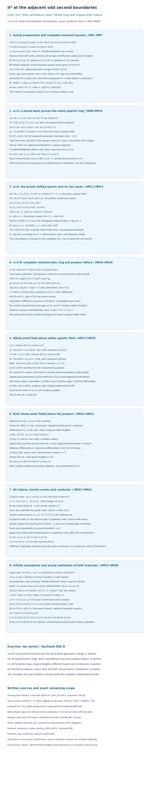

*Proof map.* The eight panels show the actual hypotheses and invariant bounds, the mixed quartic basis at \(n=2\), the complete shifted quartic and its cancellation test at \(n=4\), the rational/cubic normalization and exact product defect, the two quartic point fields, both point fields above the product, and all indices, conductors and infinite branch realizations. HM1–HM28 are exact proof locators. All valuations, constants, signs, bases, domains and residue-degree weights are exact. Drawing positions are schematic layout coordinates. Milne's free author notes, Proposition 7.55 and Remark 7.56, provide the cited human local-field context; every specialized step is proved here or in an actual earlier programme lesson.

For coefficient ranges complementary to Section 6.0AK, Section 6.0AL proves the complete next odd boundary n=6, and Sections 6.0AM.7 and 6.0AN.7 describe additional coefficient ranges. This closes both entire odd second-valuation boundaries HM1, including every allowed unit, infinite first/third/fourth values, and both shifted-quartic cancellation cases. It does not close odd \(n\ge6\), lower coefficient bounds outside HM1, other complementary additive preparations or universal NF24. The stated prerequisite results remain required. 

### 6.0AK.8. Graded exercise and complete solution

**Exercise (ten points).** (a) Prove all invariant and root bounds and the same-point generator change, including zero first, third or fourth coefficients (two points). (b) Construct the entire quartic ring at both boundaries, including the shifted constant cancellation and the exact rational/cubic product defect (three points). (c) Prove all full point rings, original-order lengths, different towers and conductors, with the correct residue-degree weights (three points). (d) Prove both infinite preparations, every displayed numerical row and the exact realization of both \(n=4\) branches over every allowed field (two points).

**Solution.** (a) Substitute \(2e=3k+n-5\) with odd \(k\ge3\) and \(n=2,4\), giving HM2 and the nine-component minimal preparation. In the second, sixth and eighth invariants the respective least terms are \(4a_2,4a_6,a_6b_2\). The complete margins are those in HM3–HM4; absent terms remain harmless. Both fourth-invariant terms exceed \(\beta\). In the discriminant the sixth-invariant square alone has value \(4e+10\), and all other term margins in HM5 are strictly positive. The subtracted fourth discriminant term has margin greater than \(5n/8\), proving the stated exact invariant and positive \(j\)-valuation. Minimality precedes the conductor. In the quartic all middle endpoint margins in HM6 are positive, so its roots all have value \(\mu\); its even numerator does not establish a full ring. Expand the full identity \(N^2-4UB_0=-3q(x)\). The first term of \(N\) has unique minimum \(2\mu\); the other margins are \(e+k-\mu\) and greater than \(n/8\). The normalized base unit \(u_0\) is nonzero, and the radical \(B\) has value one. The identity gives \(v(U)=5\), and the direct shift bounds give \(v(A/2)\ge3\). Since \(s=\pi^{(k-1)/2}\) is in the base field, HM7 and its inverse identify the same point algebra, with integral coefficient \(D\) of value two.

(b) For \(n=2\), scale by \(\pi^k\). The constant and linear values in HM8 are two. A residue square lift \(c\) exists in the base field. In the full square HM9, the linear quartic term has value \(5/2\), while the base square error is at least three and every other term is higher. Thus \(\theta\) has value one-quarter. The four mixed basis classes prove the entire degree-four ring. Its triangular denominator exponents sum to \(6k+2\), giving index \(d-2\) and discriminant four. For \(n=4\), scaling by \(\pi^{k+1}\) gives HM11. In the shifted coefficients, \(C_3,6c^2,C_1\) respectively give the unique minima \(2e-1,e,1\). The residue fourth-root lift makes the constant divisible by \(\pi\). Constant value one gives the full Eisenstein quartic, its first four powers, the exact linear error value \(5/4\), and index \(6\mu=d-2\).

When the shifted constant has value at least two, HM14 is an integral polynomial with unit derivative modulo \(\pi\). Newton correction doubles its error valuation; completeness constructs its unique integral root, including zero when the constant vanishes. Synthetic division gives all three cubic coefficients in HM15. The cubic is Eisenstein, its first three powers prove the full ring and its derivative has unique minimum two. The actual root product has \(v(g(\rho))=1\). Evaluation's difference map has quotient \(R/(g(\rho))\); for a compatible pair the polynomial \(a+(X-\rho)c(X)\) gives an explicit preimage. Thus the product defect contributes one, the total quartic index is \(6\mu+1=d-1\), and the normal discriminant is two. Dropping this defect would give the wrong index.

(c) In the mixed quartic at \(n=2\), choose \(\bar a^2\bar c=\bar u_0\) and \(w=aZ\). The full error in HM17 has uniquely least term \(\pi a^2\theta\), of value \(5/4\). In the shifted Eisenstein quartic at \(n=4\), choose \(\bar a^2\bar u=\overline{u_0+3\pi c}\) and \(w=a\theta^2\); the full controlled quartic error again has that exact value. In both cases \(w\) has value one-half. Dividing \(\zeta-w\) by \(\theta^2\) gives an Eisenstein quadratic with full-ring constant value one and trace value \(4e\). Its upper basis parities prove the entire point ring. The derivative terms have values \(8e+1\) and \(8e\), so the relative different is \(8e\). The original order has integral shift \(Dw-A/2\) and determinant \(D\theta^2\), of full-ring value ten. Its residue weight is one. The tower gives \(D_8=8e+8\) and total index \(8e+26\).

Above the rational/cubic product the radicals are \(\pi V_2\) and \(\pi V_3\), with full-ring units. The rational point ring is the entire Eisenstein quadratic \(R[\zeta]\), with different \(2e+1\) and original-order determinant value two. Above the full cubic use \(\eta=\zeta/\alpha\); its constant has cubic value one, proving the whole quadratic ring by upper parities. The relative different is \(6e+1\), and its absolute different is \(6e+5\). The original determinant \(D\alpha\) has cubic value seven. Both residue weights are one, giving total point length nine, discriminant \(8e+6\) and index \(8e+27\). These agree with \((6d-D_8)/2\). The inertia codimensions are \((3,7)\) in a quartic field and \((2,6)\) in the product. A quartet orbit or the rational pair's quadratic orbit forces wild action; the earlier quaternion calculation gives zero cohomology invariants. Applying the proved Swan formula after the full rings yields \(\delta=4e\) in every case, conductor \(4e+2=d-8\), normalization sum \(d+8\), and Euler sum \(d\).

(d) Write \(k=2q+1\). The two values of \(n\) force \(e=3q\) or \(3q+1\). The six exact coefficient thresholds listed after HM25 give its integer bounds, including infinity. Substitution in HM23–HM24 gives every entry in HM26. At \(q=1\) the three complete rows are \((22,20,4,10,32,50,12,14)\), \((26,24,4,10,40,58,16,18)\), and \((26,25,2,9,38,59,16,18)\); at \(q=2\) they are \((34,32,4,10,56,74,24,26)\), \((38,36,4,10,64,82,28,30)\), and \((38,37,2,9,62,83,28,30)\). Their normalization sums and Euler sums agree with the stated discriminants.

For the actual second-boundary branch realizations, take the three lower-bound coefficients zero and any sixth coefficient of value five. The sum \(\pi^{3\mu}+a_6\) has exact value five, so HM27's \(L\) is nonzero of value \(-k\). Both selected second coefficients have exact value \(k\). In their scaled quartics \(f(1)=1+C_1+La_2\). The first choice makes this exactly zero, giving the rational/cubic case and actual rational root \(x=\pi^\mu\). Multiplication of that second coefficient by \(1+\pi\) makes the constant exactly \(-\pi(1+C_1)\), of value one, giving the Eisenstein quartic. These realizations work over every allowed field and sixth unit. They illustrate the whole proved preparations and do not resolve the stated deeper odd or other complementary cases.

## 6.0AL. Complete next odd second-valuation boundary

**Proposition 6.0AL (II-star at the complete next odd second-valuation boundary).**

### 6.0AL.1. The whole preparation and its earlier proofs

Let \(K/\mathbf Q_2\) be finite, with integer ring \(R\), finite residue field \(\kappa\), uniformizer \(\pi\), and \(v(\pi)=1\). Consider
\[
 y^2+a_1xy+a_3y=x^3+a_2x^2+a_4x+a_6
\]
under the exact preparation
\[
 \begin{gathered}
 e=v(2),\\
  k=v(a_2)\ge3\text{ odd},\\
  2e-3k+5=6,\\
 m=k+1,\\
  \mu=k+3/2,\\
  t=4\mu=2e+k+5,\\
 h=v(a_1)>e+\mu/2,\\
 
 z=v(a_3)>e+(\mu+5-k)/2,\\
 l=v(a_4)>e+(\mu+5)/2,\\
  v(a_6)=5 .
 \end{gathered}
 \tag{HN1}
\]
The second and sixth units are arbitrary. The first, third and fourth coefficients may be zero. Since \(2e=3k+1\), these inequalities imply \(e\ge5,h\ge8,z\ge9,l\ge10\). The actual earlier Lemma 6.0E constructs the nine-component II-star resolution. Theorem 6.0I.8 and the origin-germ converse after 6.0I.9 prove minimality; Lemma 6.0H proves its Euler calculation. Sections 6.0K.2, 6.0K.6 and 6.0P.5 prove the order, different, permutation, quaternion and residue-weight identities used below. The local-field and unramified-extension foundations are written in Lesson 01, Sections 0A–0G.

Milne's free author notes [*Algebraic Number Theory*](https://www.jmilne.org/math/CourseNotes/ANT.pdf), Proposition 2.43 and Proposition 7.55 with Remark 7.56, supply human finite-order and local-field context. Every specialized step, including the power-series division and implicit lifting needed below, is proved here. A citation supplies none of these proofs.

### 6.0AL.2. All invariants and the same point algebra

Put \(\beta=2e+(\mu+5)/2\). Keep the complete expressions
\[
 \begin{gathered}
 b_2=a_1^2+4a_2,\\
  b_4=a_1a_3+2a_4,\\
 
 b_6=a_3^2+4a_6,\\
 b_8=a_6b_2-a_1a_3a_4+a_2a_3^2-a_4^2,\\
 v(b_2)=2e+k,\\
  v(b_4)>\beta,\\
 
 v(b_6)=2e+5,\\
  v(b_8)=t .
 \end{gathered}
 \tag{HN2}
\]
The first coefficient square is higher than \(4a_2\). Both terms of \(b_4\) exceed \(\beta\): \(h+z>\beta+(\mu-k)/2\) and \(e+l>\beta\). The sixth square exceeds \(2e+5\) by more than \(\mu-k\). The three other eighth-invariant terms have margins, above \(t\), greater than
\[
 \begin{gathered}
 e+3(\mu-k)/2,\\
  \mu-k,\\
  \mu-k.
 \end{gathered}
 \tag{HN3}
\]
These follow by substituting the three strict bounds in HN1; all are positive. Absent terms cause no problem.

In
\[
 \begin{gathered}
 \Delta=-b_2^2b_8-8b_4^3-27b_6^2+9b_2b_4b_6,\\
  d=v(\Delta)=4e+10,\\
 v(b_2^2b_8)-(4e+10)=2e+3k-5>0,\\
 v(8b_4^3)-(4e+10)>5e+3\mu/2-5/2>0,\\
 v(9b_2b_4b_6)-(4e+10)>2e+k+\mu/2-5/2>0,\\
 c_4=b_2^2-24b_4,\\
 
 v(24b_4)-(4e+2k)>15/4,\\
 
 v(c_4)=4e+2k,\\
 v(j)=8e+6k-10>0,\\
  M=9,
 \end{gathered}
 \tag{HN4}
\]
the sixth-invariant square is uniquely least. The fourth-invariant margin is the direct simplification \(5(2e-3k+5)/8=15/4\). The earlier written criterion gives potential good reduction. Resolution and minimality precede the conductor calculation.

The actual sign-pair quartic and its scaling are
\[
 \begin{gathered}
 q(X)=X^4+(b_2/3)X^3+b_4X^2+b_6X+b_8/3,\\
 Z=x/\pi^m,\\
  v(x)=\mu,\\
  v(Z)=1/2,\\
 Q(Z)=Z^4+C_3Z^3+C_2Z^2+C_1Z+C_0=0,\\
 (C_3,C_2,C_1,C_0)=
 (b_2/(3\pi^m),b_4/\pi^{2m},b_6/\pi^{3m},b_8/(3\pi^{4m})),\\
 v(C_3)=2e-1,\\
  v(C_2)>3k/2+9/4,\\
  v(C_2)\ge e+2,\\
 v(C_1)=3,\\
  v(C_0)=2,\\
 
 u=-C_0/\pi^2\in R^\times,\\
  r=C_1/\pi^3\in R^\times .
 \end{gathered}
 \tag{HN5}
\]
Indeed the middle endpoint margins in \(q\) are \(2e+k-\mu=e-3/2>0\), greater than \((10e-3k+5)/8>0\), and \(2e+5-3\mu=3/2>0\). A smaller root valuation would make its fourth power uniquely least; a larger one would make its constant uniquely least. Thus every root has the claimed value. The scaled coefficient bounds then follow by subtraction; \(v(C_2)>e+7/4\) gives its integer bound. No entire ring follows just from this half-integral root value.

For the point above any root put
\[
 \begin{gathered}
 A=a_1x+a_3,\\
  G=x^3+a_2x^2+a_4x+a_6,\\
 
 Y=y+A/2,\\
  U_{\rm pt}=G+A^2/4,\\
 B_0=3x+b_2/4,\\
  N=3x^2+(b_2/2)x+b_4/2,\\
 
 N^2-4U_{\rm pt}B_0=-3q(x),\\
 s=\pi^{(k-1)/2}\in K,\\
  u_0=b_2/(4\pi^k)\in R^\times,\\
 B=B_0/s^2=\pi u_0+3\pi^2Z,\\
  v(B)=1,\\
 
 \zeta=N/(2sY),\\
 \zeta^2=B,\\
 D=N/(2sB),\\
  v(N)=2\mu,\\
  v(U_{\rm pt})=5,\\
 
 v(D)=2,\\
  v(A/2)\ge3,\\
  y=D\zeta-A/2 .
 \end{gathered}
 \tag{HN6}
\]
Expand the invariant definitions to obtain the displayed unrestricted polynomial identity. The first term of \(N\) has value \(2\mu\); the other margins are \(e+k-\mu=e-3/2>0\) and greater than \(6/8\). Thus \(N\ne0\), and the identity gives \(v(U_{\rm pt})=4\mu-2e-k=5\). Directly \(h+\mu-e>3\mu/2>3\) and \(z-e>13/4\), giving the integral shift. The correction to \(u_0=a_2/\pi^k+a_1^2/(4\pi^k)\) has positive value. The second radical term has value \(5/2>1\). Finally \(2\mu-e-(k-1)/2-1=2\), proving the value of \(D\).

The inverse identity \(1/\zeta=\zeta/B\) proves that \(y\) and \(\zeta\) generate precisely the same point algebra. Divisions here occur in its fraction fields. \(B\) is nonzero of positive valuation, and is not being called a unit. \(D\) is integral in each entire ring by its exact value. No extra radical is adjoined.

### 6.0AL.3. A complete change of generators and its unit test

Choose any \(c\in R^\times\) with \(\bar c^2=\bar u\), possible because squaring is bijective in the finite characteristic-two residue field. Define
\[
 \begin{gathered}
 W=(Z^2-\pi c)/(\pi Z),\\
  Z^2-\pi WZ-\pi c=0,\\
 p_2=C_3/\pi,\\
  p_1=2c/\pi+C_2/\pi^2,\\
 
 p_0=C_3c/\pi^2+C_1/\pi^3,\\
 b=(c^2-u)/\pi+C_2c/\pi^2,\\
 P(W)=W^3+p_2W^2+p_1W+p_0,\\
 
 T(W)=cW^2+cp_2W+b,\\
  P(W)Z+T(W)=0 .
 \end{gathered}
 \tag{HN7}
\]
The full square \((Z^2-\pi c)^2\) has terms \(\pi^2(u+c^2),-2\pi cZ^2,-C_3Z^3,-C_2Z^2,-C_1Z\). Their values are at least \(3,e+2,2e+1/2,e+3,7/2\). Since \(v(\pi Z)=3/2\), this proves \(v(W)\ge0\). Substitution of \(Z^2=\pi WZ+\pi c\), including every term, gives the last equation of HN7.

All its coefficients are integral, with
\[
 \begin{gathered}
 v(p_2)=2e-2,\\
  v(p_1)=e-1,\\
 
 p_0\equiv r\pmod\pi,\\
 
 b\equiv(c^2-u)/\pi\pmod\pi .
 \end{gathered}
 \tag{HN8}
\]
In particular \(p_0\) is a unit. Reduce HN7 using \(v(Z)=1/2\). If \(v(u-c^2)\ge2\), including \(u=c^2\), then \(\bar W=0\); choose \(a=0\). Otherwise \(v(u-c^2)=1\), and
\[
 \begin{gathered}
 \bar a^{\,2}=\overline{(u-c^2)/(\pi c)},\\
 
 a\in R^\times,\\
  \bar W=\bar a .
 \end{gathered}
 \tag{HN9}
\]
Choose any lift \(a\). The unique residue square root belongs to the base residue field, even when a root is considered in an extension. In both cases \(T(a)\in\pi R\). The two exhaustive normalization cases are
\[
 \begin{array}{ll}
 {\rm F}:& P(a)\in R^\times;\\
 {\rm Q}:& P(a)\in\pi R.
 \end{array}\qquad
 {\rm Q}\Longrightarrow a\in R^\times,\quad \bar a^3+\bar r=0 .
 \tag{HN10}
\]
If \(a=0\), \(P(a)=p_0\) is a unit. Thus Q occurs only in the value-one square-defect case. No coefficient unit is excluded by this test.

Eliminating \(Z\) gives \(H(W)=T(W)^2+\pi WT(W)P(W)-\pi cP(W)^2=0\). Its degree-six and degree-five coefficients cancel exactly, leaving
\[
 \begin{gathered}
 H(W)=h_4W^4+h_3W^3+h_2W^2+h_1W+h_0,\\
 h_4=c^2+\pi(b-cp_1),\\
 h_3=2c^2p_2+\pi\{p_2(b-cp_1)-cp_0\},\\
 h_2=c^2p_2^2+2cb+\pi\{bp_1-cp_1^2-cp_2p_0\},\\
 h_1=2cp_2b+\pi p_0(b-2cp_1),\\
 
 h_0=b^2-\pi cp_0^2 .
 \end{gathered}
 \tag{HN11}
\]
Consequently \(h_4\) is a unit, \(v(h_3)=1\), \(v(h_2)\ge e\), \(v(h_1)\ge1\), with residues \(h_3/\pi=-cr\) and \(h_1/\pi=rb\). Put \(\phi=W-a\) and write
\[
 \begin{gathered}
 H(a+\phi)/h_4=\phi^4+\gamma_3\phi^3+\gamma_2\phi^2+\gamma_1\phi+\gamma_0 .
 \end{gathered}
 \tag{HN12}
\]
The complete shift gives \(\gamma_3=(h_3+4ah_4)/h_4\), \(\gamma_2=(h_2+3ah_3+6a^2h_4)/h_4\), and \(\gamma_1=(h_1+2ah_2+3a^2h_3+4a^3h_4)/h_4\). Thus
\[
 \begin{gathered}
 v(\gamma_3)=1,\\
  v(\gamma_2)\ge1,\\
  v(\gamma_1)\ge2,
 \\
 
 \begin{cases}
 v(\gamma_0)=1&{\rm F},\\
 v(\gamma_0)\ge2&{\rm Q}.
 \end{cases}
 \end{gathered}
 \tag{HN13}
\]
For \(\gamma_1/\pi\), reduction is \(r(b-3ca^2)/c^2=0\): \(b=-ca^2\) in the residue field and its characteristic is two. If \(a=0\), \(b\in\pi R\) gives the same assertion and \(v(\gamma_2)\ge e\). In Q, \(a\) is a unit, so \(v(\gamma_2)=1\). Finally \(H(a)=T(a)^2+\pi aT(a)P(a)-\pi cP(a)^2\). In F its last term alone has value one; in Q all terms have value at least two. These are comparisons of the full expressions.

### 6.0AL.4. The full quartic ring in F, and the power-series lemma

In F the polynomial HN12 is Eisenstein. A smaller or larger value than \(1/4\) for \(\phi\) gives a unique least term, so \(v(\phi)=1/4\). HN7 recovers \(Z=-T(W)/P(W)\), because \(P(W)\) is a unit. Hence \(F=K(Z)=K(\phi)\) has degree and ramification four and residue degree one. The distinct valuation classes of \(1,\phi,\phi^2,\phi^3\) prove the entire ring \(C=R[\phi]\), coefficient by coefficient. The mixed basis has the same property:
\[
 \begin{gathered}
 C=R\oplus RZ\oplus R\phi\oplus RZ\phi,\\
 
 (v(1),v(Z),v(\phi),v(Z\phi))=(0,1/2,1/4,3/4),\\
 W=Z/\pi+c(Z^3+C_3Z^2+C_2Z+C_1)/C_0,\\
 
 Z\phi=Z^2/\pi-c-aZ,\\
 i_4=6m+3=d-3,\\
  D_4=2d-2i_4=6 .
 \end{gathered}
 \tag{HN14}
\]
The two new triangular coefficients, after \(1,Z\), are \(c/C_0\) in degree three and \(1/\pi\) in degree two. Their determinant has value \(-3\). Scaling the original \(x\)-power basis contributes \(6m\). This computes the original order index. Independently the derivative of HN12 has uniquely least term \(3\gamma_3\phi^2\), of full-ring value six: its other values are at least \(4e+3,4e+5,8\). The full trace-dual formula therefore gives the same different six.

We prove a small power-series lemma for the other case. Let \(R'\) be a complete unramified finite extension of \(R\), and let \(V(T)\in R'[[T]]\). For units \(a,c\in R'\) put
\[
 \begin{gathered}
 F_*(T)=(1-\pi V(T))T^2-\pi aT-\pi c,\\
 
 C'=R'[[T]]/(F_*).
 \end{gathered}
 \tag{HN15}
\]
Every series has a unique remainder of degree less than two modulo \(F_*\). Indeed \(F_*=T^2+\pi L(T)\). Separate a series into its first two coefficients and a multiple of \(T^2\), replace \(T^2\) by \(-\pi L\), and repeat on the new series. At the \(j\)-th repetition the remaining error and the new corrections are divisible by \(\pi^j\). Completeness gives a remainder in \(R'+R'T\) and a quotient in \(R'[[T]]\). For uniqueness reduce a relation \(F_*Q+A+BT=0\) modulo \(\pi\): \(T^2\bar Q+\bar A+\bar BT=0\) forces all three reductions to vanish. Repeating proves they are zero. Thus \(C'\) is finite free of rank two, with basis \(1,T\), and is \(\pi\)-adically complete.

Modulo \(\pi\) it is the ring \(k'[T]/T^2\). An element with nonzero constant residue has an inverse modulo \(\pi\), then an actual inverse by the convergent geometric series in its remaining \(\pi\)-divisible error. Its unique maximal ideal is therefore \((\pi,T)\). The defining equation says \(T^2=\pi(c+aT+V(T)T^2)\); the parenthesis is a unit, so this ideal equals \((T)\). The intersection of its powers is zero, since \(T^2\) is \(\pi\) times a unit and the free \(R'\)-module is separated. Every nonzero element can consequently be divided by a largest power of \(T\), leaving a unit. Products of nonzero elements stay nonzero, since \(T\) is not nilpotent and \(\pi\) acts injectively on this free module. This proves that \(C'\) is a complete DVR, with uniformizer \(T\), ramification two and residue field \(k'\). An element of negative valuation in its fraction field cannot satisfy a monic integral equation, by the unique least-term argument. Thus this is the entire integral ring.

Its monic degree-two minimal polynomial \(g\) exists because its basis is \(1,T\): express \(T^2\) in that basis. Formal division shows \(g=F_*J\) with \(J\equiv1\bmod\pi\), so \(J\) is a unit, including after evaluation at \(T\). Differentiating gives \(g'(T)=F_*'(T)J(T)\). In the normalized valuation of \(C'\), the four derivative terms \(2T,-\pi a,-2\pi TV(T),-\pi T^2V'(T)\) have values at least \(2e+1,2,2e+3,4\). Hence the different over \(R'\) is exactly two. This proof uses neither an imported power-series preparation theorem nor an approximate quadratic in place of the full equation.

### 6.0AL.5. The two possible full quadratic-factor algebras in Q

In Q every root of HN12 has value at least \(1/2\). If its value were smaller, the fourth power would be uniquely least, using HN13. Thus the actual element
\[
 \begin{gathered}
 J=(W-a)/Z=1/\pi-a/Z-c/Z^2
 \end{gathered}
 \tag{HN16}
\]
is integral. It is legitimate because \(Z\ne0\), its quartic constant being nonzero. Put
\[
 \begin{gathered}
 p=P(a),\\
  t_0=T(a),\\
 
 p'=3a^2+2p_2a+p_1,\\
  t'=2ca+cp_2,\\
  \tau=1-\pi J,\\
 \tau Z^2-\pi aZ-\pi c=0,\\
 E(J,Z)=t_0/\pi+(p/\pi+t'J/\pi)Z
 +(p'J+cJ^2)(aZ+c)/\tau\\
 \hspace{12mm}+(3a+p_2)J^2Z(aZ+c)/\tau
 +\pi J^3(aZ+c)^2/\tau^2=0 .
 \end{gathered}
 \tag{HN17}
\]
All its coefficients are integral: \(p,t_0,t'\) are divisible by \(\pi\), and \(\tau\) is a unit. Expanding \(P(a+JZ)Z+T(a+JZ)\) and using the first relation proves that it equals \(\pi E(J,Z)\), exactly. Since \(Z\) has positive valuation, reduction gives the separable quadratic
\[
 \begin{gathered}
 \mathcal P(S)=c^2S^2+3ca^2S+t_0/\pi
 \\
 \text{over }\kappa,\\
 
 \mathcal P'(S)=3ca^2\ne0 .
 \end{gathered}
 \tag{HN18}
\]
Factor this actual residue polynomial into irreducibles. It has either two distinct linear factors or one irreducible quadratic. For a factor of degree \(f_j\), construct the unramified extension \(R_j/R\) with that residue field by the proved earlier Lesson 01, Proposition 0F.2 and Section 0G.3; \(\sum f_j=2\).

Over \(R_j\), the simple residue root lifts uniquely to a root of \(E(S,0)\). To see this directly, clear its unit denominators, start at any residue lift, and replace it by its value minus polynomial-value divided by derivative. Integral Taylor expansion doubles the positive error valuation, keeps the derivative a unit, and completeness gives a root. A difference of two roots is multiplied by a unit in the polynomial-difference quotient, proving uniqueness.

There is then a unique series \(V_j(T)\in R_j[[T]]\) with that constant term and \(E(V_j(T),T)=0\). Induct on the coefficient of \(T^n\). Once the previous coefficients have been chosen, the new one occurs multiplied by the unit \(\partial E/\partial S(V_j(0),0)\); divide the negative remaining coefficient by that unit. This proves every coefficient exists and is integral. The denominators \(1-\pi S\) have unit constant terms, so all formal expansions are legitimate.

Apply the fully proved lemma HN15 with \(V_j\). It constructs a complete DVR \(C_j\) with uniformizer \(Z\), ramification two over \(R_j\), residue degree one over \(R_j\), and different two. Its element \(J=V_j(Z)\) satisfies HN17; hence \(W=a+JZ\) and \(x=\pi^mZ\) satisfy the full original quartic.

Conversely \(J\) is the rational expression HN16 in \(Z\), and its residue generates \(k_j/\kappa\). Therefore \(K(Z)\) has residue degree at least \(f_j\) and ramification at least two, from \(v(Z)=1/2\). Its degree is at least \(2f_j\), exactly the degree of \(\operatorname{Frac}(C_j)\). Thus \(Z\) generates that whole field. If the residue polynomial splits, the two quadratic kernels are distinct: conjugation in a totally ramified quadratic fixes the residue of the integral rational expression \(J\), and cannot exchange its two distinct residues. If the polynomial is irreducible, the one field already has degree four. The constructed field degrees sum to four, so these are all original quartic factors and
\[
 \begin{gathered}
 B_4=\prod_j C_j,\\
  (e_j,f_j)=(2,f_j),\\
 
 D_4=\sum_j2f_j=4,\\
 B_4=R\oplus RJ\oplus RZ\oplus RZJ,\\
 
 i_4=6m+4=d-2 .
 \end{gathered}
 \tag{HN19}
\]
For the stated basis, the residues of \(1,J\) give a basis of the product residue algebra, and the next uniformizer layer is given by \(Z,ZJ\); \(\pi\) is a unit times \(Z^2\) in each factor. These four vectors form a basis modulo \(\pi\). Successive \(\pi\)-adic lifting proves that they span the whole product, and the four-dimensional generic rank proves independence.

The index is also a direct determinant calculation. Modulo \(Q\),
\[
 \begin{gathered}
 Z^{-2}=
 \frac{C_1Z^3+(C_1C_3-C_0)Z^2+
 (C_1C_2-C_0C_3)Z+C_1^2-C_0C_2}{C_0^2}.
 \end{gathered}
 \tag{HN20}
\]
Multiplication by \(Z^2\) verifies it. In the basis \(1,Z,J,ZJ\), the determinant of the two new degree-two/degree-three coefficient columns is \(c^2/C_0^2\), up to the basis ordering sign: use \(ZJ=W-a\) and HN16. Its valuation is \(-4\), while the \(x\)-scaling contributes \(6m\). This agrees independently with \(D_4=4\). For the unramified base extension, Proposition 0F.2 gives a full-ring generator whose lifted polynomial has simple residue roots. Its derivative is a unit, so the actual trace-dual calculation of Section 6.0K.2 proves that its different is zero. Both the factor different and the residue weights were proved before this comparison.

### 6.0AL.6. Every entire point ring and original-order length

In F write the exact quartic relation as
\[
 \begin{gathered}
 \phi^4=\pi v_0-\gamma_3\phi^3-\gamma_2\phi^2-\gamma_1\phi,\\
 
 v_0=-\gamma_0/\pi\in R^\times .
 \end{gathered}
 \tag{HN21}
\]
Choose \(b_0,b_1\in R\), with \(b_0\) a unit, so that
\[
 \begin{gathered}
 \bar b_0^{\,2}\bar v_0=\bar u_0,\\
 
 \bar b_1^{\,2}\bar v_0=
 \overline{b_0^2\gamma_2/\pi},\\
 
 w=b_0\phi^2+b_1\phi^3 .
 \end{gathered}
 \tag{HN22}
\]
These two base residue squares exist, including a zero second choice. No square root in the base fraction field is assumed. The entire square is
\[
 \begin{aligned}
 w^2-B={}&\pi(b_0^2v_0-u_0)
+(-b_0^2\gamma_2+\pi b_1^2v_0)\phi^2
-b_0^2\gamma_3\phi^3-b_0^2\gamma_1\phi\\
 &-b_1^2(\gamma_3\phi^5+\gamma_2\phi^4+\gamma_1\phi^3)
 +2b_0b_1\phi^5-3\pi^2Z .
 \end{aligned}
 \tag{HN23}
\]
The full-ring valuation \(v_F=4v\) gives respective bounds \(8,10,7,9,9,8,11,4e+5,10\) for its nine terms. The third term has exact value seven; every other term is higher. Here HN13 controls all quartic coefficients, and both residue cancellations in HN22 are used. Thus \(v_F(w)=2\) and \(v_F(w^2-B)=7\).

Consequently the same point generator
\[
 \begin{gathered}
 \eta=(\zeta-w)/\phi^3,\\
 
 \eta^2+(2w/\phi^3)\eta+(w^2-B)/\phi^6=0,\\
 v_F((w^2-B)/\phi^6)=1,\\
  v_F(2w/\phi^3)=4e-1,\\
 B_8=C[\eta]\text{ in full},\\
 
 D_{8/4}=8e-2,\\
 
 y=(Dw-A/2)+D\phi^3\eta,\\
 
 \ell=v_F(D\phi^3)=8+3=11
 \end{gathered}
 \tag{HN24}
\]
is Eisenstein over the already constructed full quartic ring. Its two upper basis parities prove the entire ring. The derivative terms \(2\eta\) and \(2w/\phi^3\) have upper values \(8e+1\) and \(8e-2\), so the latter is uniquely least by three. The integral shift and determinant compute the original point order length eleven. Its residue weight is one.

In Q, take each full factor \(C_j\), normalize \(v_j=2v\), and choose a base unit \(b\) with \(\bar b^2\bar c=\bar u_0\). Put \(w=bZ\). The complete relation HN17 gives
\[
 \begin{gathered}
 w^2-B=\pi(b^2c-u_0)+\pi b^2aZ+
 \pi b^2JZ^2-3\pi^2Z .
 \end{gathered}
 \tag{HN25}
\]
Its four \(C_j\)-values are at least four, exactly three, at least four, and five. The uniquely least term uses the proved unit \(a\). Therefore
\[
 \begin{gathered}
 \eta_j=(\zeta-w)/Z,\\
 
 \eta_j^2+(2w/Z)\eta_j+(w^2-B)/Z^2=0,\\
 v_j((w^2-B)/Z^2)=1,\\
  v_j(2w/Z)=2e,\\
 B_{8,j}=C_j[\eta_j]\text{ in full},\\
 
 D_{8,j/4,j}=4e,\\
 
 y=(Dw-A/2)+DZ\eta_j,\\
  \ell_j=v_j(DZ)=4+1=5 .
 \end{gathered}
 \tag{HN26}
\]
Again upper parity proves fullness. Derivative values are \(4e+1\) and \(4e\), with exact gap one. The integral shift and determinant prove length five over each \(C_j\). The correct base length is \(\sum f_j\ell_j=10\), since \(\sum f_j=2\); ramification indices are not the length weights. This treats both residue factorization types, without adjoining any artificial square root.

### 6.0AL.7. All columns, infinite families and actual realizations

The whole rings just constructed give
\[
 \begin{array}{c|cc}
 \text{quantity}&{\rm F}&{\rm Q}\\ \hline
 d&4e+10&4e+10\\
 i_4&d-3&d-2\\
 D_4&6&4\\
 \ell=\sum f_j\ell_j&11&10\\
 D_8&8e+10&8e+8\\
 i_8=2i_4+\ell&8e+25&8e+26\\
 (\epsilon_4,\epsilon_8)&(3,7)&(2,6)
 \end{array}
 \tag{HN27}
\]
The different tower gives \(D_8=2\cdot6+(8e-2)\) in F. In Q it gives \(\sum f_j(2\cdot2+4e)=8e+8\). These independently agree with the original-order discriminant \(6d-2i_8\). All point quadratics are ramified, so \(\nu=0\).

In F the quartet inertia orbit forces nontrivial wild action; in Q each sign-pair field has ramification two and hence an inertia orbit of size two. A tame group of odd order cannot have either orbit size. The actual earlier quaternion calculation therefore supplies the central element \(-1\), and the rank-two cohomology has zero inertia invariants. Its tame conductor is two. Only after the rings and orbit counts have been proved, apply the actual Swan and Euler formulas:
\[
 \begin{gathered}
 \delta=2d-i_8+i_4-2=4e,\\
 
 f(E/K)=4e+2=d-8,\\
 
 i_4+\ell=d+8,\\
  M-1+f=d .
 \end{gathered}
 \tag{HN28}
\]
The conductor is the same in all three quartic decomposition types. No conductor formula was used to obtain an integer ring or its determinant.

For every \(q\ge1\) the entire boundary is equivalently
\[
 \begin{gathered}
 k=2q+1,\\
  e=3q+2,\\
  \mu=2q+5/2,\\
 
 h\ge4q+4,\\
  z\ge3q+6,\\
  l\ge4q+6,\\
  v(a_6)=5 .
 \end{gathered}
 \tag{HN29}
\]
The strict real thresholds are \(4q+13/4,3q+21/4,4q+23/4\). Infinite first, third and fourth valuations remain allowed. Substitution gives
\[
 \begin{array}{c|cc}
 &{\rm F}&{\rm Q}\\ \hline
 d&12q+18&12q+18\\
 i_4&12q+15&12q+16\\
 D_4&6&4\\
 \ell&11&10\\
 D_8&24q+26&24q+24\\
 i_8&24q+41&24q+42\\
 \delta&12q+8&12q+8\\
 f&12q+10&12q+10
 \end{array}
 \tag{HN30}
\]
In the order \(d,i_4,D_4,\ell,D_8,i_8,\delta,f\), the illustrative rows are
\[
 \begin{array}{c|cc}
 q&{\rm F}&{\rm Q}\\ \hline
 1&(30,27,6,11,50,65,20,22)&(30,28,4,10,48,66,20,22)\\
 2&(42,39,6,11,74,89,32,34)&(42,40,4,10,72,90,32,34)
 \end{array}
 \tag{HN31}
\]
These numbers illustrate the unrestricted proof, rather than establish it.

All three decomposition types occur over every allowed field. Take
\[
 \begin{gathered}
 a_1=a_3=a_4=0,\\
  a_6=-\pi^{3k+6}/4,\\
 
 a_2=3\pi^k u,\\
  c=1,\\
  r=-1 .
 \end{gathered}
 \tag{HN32}
\]
The sixth coefficient has exact value five, and every displayed second coefficient has exact value \(k\). The scaled quartic has \(C_2=0,C_3=4u/\pi,C_1=-\pi^3,C_0=-\pi^2u\).

For \(u=1\), the square defect is infinite and \(a=0\); this gives F and its entire totally ramified quartic. For
\[
 \begin{gathered}
 u=1+\pi+\pi^2 t,\\
  a=1,\\
 
 \overline{\mathcal P}(S)=S^2+S+\bar t ,
 \end{gathered}
 \tag{HN33}
\]
the square defect is exactly one and \(P(1)\in\pi R\), giving Q. Indeed \(p_2=4u/\pi^2,p_1=2/\pi,p_0=4u/\pi^3-1,b=-1-\pi t\), so \(T(1)/\pi=4u/\pi^3-t\), whose residue is \(-\bar t\). Thus \(t=0\) gives the two distinct linear factors, hence two ramified quadratic fields. Choosing \(\bar t\) of absolute trace one gives the irreducible quadratic, hence one quartic with ramification two and residue degree two.

Here is the finite-field assertion being used. In \(\kappa=\mathbf F_{2^f}\), the map \(\operatorname{tr}(t)=\sum_{i=0}^{f-1}t^{2^i}\) lands in \(\mathbf F_2\), since its square differs by \(t^{2^f}-t=0\). It is not the zero map: its nonzero polynomial has degree \(2^{f-1}<2^f\), whereas a nonzero polynomial cannot have more roots than its degree, by successive division by linear factors. Thus its two fibers each have \(2^{f-1}\) elements. The additive map \(s\mapsto s^2+s\) has kernel \(\{0,1\}\), hence image of the same size, and telescoping shows that image lies in the trace-zero fiber. They coincide. This proves both the existence of trace-one \(\bar t\) and the exact irreducibility test in HN33, including \(f=1\).


[Open the proof map at full size](../assets/odd-second-six-II-star-proof-map.png)

*Proof map.* The panels show the actual strict preparation, the complete mixed generator and unit test, the full ramified quartic, the separable residue quadratic and exact power-series DVR construction, both entire point-ring mechanisms, weighted indices and conductors, and all three realizations over every allowed field. HN1–HN33 are exact proof locators. Values, constants, signs and residue weights are exact; drawing positions are schematic. Free Milne notes provide human local-field context, and all specialized arguments remain written alongside the map.

For coefficient ranges complementary to Section 6.0AL, Section 6.0AM proves the whole high odd-second preparation for every even n>=2, and Sections 6.0AM.7 and 6.0AN.7 describe additional coefficient ranges. This proves the whole \(n=6\) boundary, including every permitted unit, higher coefficient and zero lower-bound coefficient. Deeper odd-second boundaries \(n\ge8\), lower coefficient bounds, other additive preparations and universal NF24 lie outside this family-specific calculation; the general identity is JM30–JM32 in §6.0BI. The stated prerequisite results remain required. 

### 6.0AL.8. Graded exercise and full solution

**Exercise (ten points).** (a) Prove all invariant bounds, the same-point radical identity and the complete elimination polynomial (two points). (b) Construct the entire quartic algebra in both unit-test cases, including formal division, simple-root lifting and the exact original-order determinants (three points). (c) Prove the full point rings, different towers, residue-weighted lengths and conductor in every decomposition type (three points). (d) Prove the infinite preparation, every displayed row and the realization of all three decomposition types over every allowed field (two points).

**Solution.** (a) Substitute \(2e=3k+1\) into HN1. The exact least terms in \(b_2,b_6,b_8\) are \(4a_2,4a_6,a_6b_2\); the remaining eighth margins are HN3 and both fourth terms exceed \(\beta\). The sixth-square discriminant term alone has value \(4e+10\), with all three other margins in HN4 positive. The fourth-invariant subtraction has margin greater than \(15/4\). Every quartic root has value \(\mu\) by the unique least-term comparisons, yielding all HN5 bounds. Expand \(N^2-4U_{\rm pt}B_0=-3q(x)\); its unique \(N\)-minimum and the shift bounds prove HN6 and its inverse, with \(B\) nonzero and \(D\) integral of value two. In the full square for \(W\), divide the minimum value three by the square of \(\pi Z\), proving integrality. Substitute \(Z^2=\pi WZ+\pi c\) to obtain \(P(W)Z+T(W)=0\). Expanding its quadratic resultant cancels degrees six and five and gives every coefficient in HN11. The residue shift makes \(T(a)\) divisible by \(\pi\). The linear shifted coefficient cancels modulo \(\pi^2\), while the cubic coefficient has exact value one. Evaluating the complete resultant at \(a\) gives precisely the two constant bounds in HN13.

(b) In F, \(P(W)\) is a unit, so \(Z=-T(W)/P(W)\) and the shifted quartic is Eisenstein. Its quarter-valued generator proves the degree and entire power ring. The mixed basis has distinct fractional classes, and its two new triangular coefficients have determinant value \(-3\). Restoring the original \(x\)-scaling gives \(i_4=6m+3=d-3\). The full derivative has unique minimum six, agreeing with \(D_4=6\). For the power-series lemma, successively divide by \(T^2\) and replace that monomial by its \(\pi\)-divisible full error. Uniformly \(\pi\)-divisible corrections converge. Reduction modulo \(\pi\), repeated after division by \(\pi\), proves uniqueness. The resulting rank-two algebra has unique maximal ideal \((T)\), is separated, and every nonzero element is a power of \(T\) times a unit. This proves the full DVR and its degree. Formal division relates its actual minimal polynomial to the complete power-series equation by a unit; the derivative's exact minimum is two.

In Q, the complete shifted polynomial excludes root values below one-half, so \(J=(W-a)/Z\) is integral. Expand the two generator relations to obtain HN17, whose reduction is the separable quadratic HN18. Over each unramified residue factor, Newton correction gives the unique constant root; a unit partial derivative constructs every coefficient of \(V_j(T)\). The proved power-series lemma gives the full quadratic DVR over that unramified base. \(J\)'s residue and \(Z\)'s half value force the full degree \(2f_j\). Distinct linear residues cannot have the same quadratic kernel, so the factor degrees account for all four original roots. The two residue layers give the basis \(1,J,Z,ZJ\). Multiplying HN20 by \(Z^2\) checks its inverse formula; the two coefficient columns have determinant \(c^2/C_0^2\), of value \(-4\). Thus \(i_4=6m+4=d-2\). The full different two in each factor, weighted by \(\sum f_j=2\), gives \(D_4=4\) independently.

(c) In F, choose both residue coefficients in HN22 and expand the entire square HN23. Its nine term values have the bounds printed there, with exactly one value seven. Therefore division of \(\zeta-w\) by \(\phi^3\) gives an Eisenstein quadratic. Upper parities prove the full point ring. The derivative's trace term has upper value \(8e-2\), below \(2\eta\) by three, giving that exact relative different. The integral original shift and determinant \(D\phi^3\) give length eleven. In Q, choose \(w=bZ\) and retain all four terms of HN25. The unit \(a\) gives its unique value-three term. Division by \(Z\) again gives an Eisenstein quadratic, with relative different \(4e\) and determinant length five over each full factor.

Weight those lengths by residue degrees, giving eleven in F and ten in Q. The different towers and \(i_8=2i_4+\ell\) give every HN27 column and agree with \((6d-D_8)/2\). Each point quadratic is ramified. Quartic ramification four or two forces wild inertia, so the earlier quaternion proof gives the central minus identity and zero cohomology invariants. The inertia codimensions are \((3,7)\) or \((2,6)\). Apply the proved Swan comparison after normalization to get \(\delta=4e\), tame conductor two, total conductor \(4e+2\), normalization sum \(d+8\), and Euler sum \(d\).

(d) Write \(k=2q+1\), forcing \(e=3q+2\) and \(\mu=2q+5/2\). The three strict thresholds are \(4q+13/4,3q+21/4,4q+23/4\); taking their integer bounds gives exactly HN29, including infinity. Substitution in HN27–HN28 gives every symbolic HN30 entry. At \(q=1\) the F/Q rows are \((30,27,6,11,50,65,20,22)\) and \((30,28,4,10,48,66,20,22)\); at \(q=2\) they are \((42,39,6,11,74,89,32,34)\) and \((42,40,4,10,72,90,32,34)\). Every normalization and Euler sum agrees with its stated discriminant.

For realizations, HN32 has exact coefficient values \(k\) and five over every allowed field. With \(u=1\) its infinite square defect gives F. With \(u=1+\pi+\pi^2t\), the square defect is one, \(a=1\), and the full coefficient substitution gives \(\mathcal P(S)=S^2+S+\bar t\). Take \(t=0\) for two ramified quadratics. The trace polynomial is nonzero of degree less than the residue-field size, so a trace-one \(\bar t\) exists; the kernel and image count of \(s^2+s\) proves that its quadratic is irreducible. This gives the quartic with residue degree two. These are actual whole-family realizations; none replaces the unrestricted proofs or resolves the stated deeper boundaries.

## 6.0AM. Uniform high odd second-valuation preparation

**Proposition 6.0AM (uniform different and conductor for every high odd-second preparation).**

### 6.0AM.1. Exact scope and earlier written inputs

Let \(K/\mathbf Q_2\) be finite, with integer ring \(R\), residue field \(\kappa\), uniformizer \(\pi\), and \(v(\pi)=1\). Consider the integral equation
\[
 y^2+a_1xy+a_3y=x^3+a_2x^2+a_4x+a_6
\]
with the entire preparation
\[
 \begin{gathered}
 e=v(2),\\
  k=v(a_2)\ge3\text{ odd},\\
  n=2e-3k+5\ge2,\\
 \mu=k+n/4,\\
  t=4\mu=2e+k+5,\\
 h=v(a_1)>e+\mu/2,\\
 
 z=v(a_3)>e+(\mu+5-k)/2,\\
 l=v(a_4)>e+(\mu+5)/2,\\
  v(a_6)=5.
 \end{gathered}
 \tag{HO1}
\]
The integer \(n\) is even. The second and sixth units are arbitrary; the first, third and fourth coefficients may vanish. There is no upper bound on \(n\), \(e\), \(k\), or any permitted higher coefficient. The theorem below treats every quartic decomposition that actually occurs, including tame and unramified factors. It does not impose the three decomposition types specific to the earlier \(n=6\) boundary.

Lesson 01, Proposition 0F.2 and Sections 0G.2–0G.3, proves the unramified lifting, uniformizer bases, and entire Eisenstein rings. Sections 6.0K.2 and 6.0K.6 of this lesson prove trace duals, different towers, both torsion-order discriminants, and the quaternion comparison. Section 6.0P.2 constructs the full quartic normalization; Section 6.0P.5 proves its residue-weight and inertia-orbit formulas. Lemma 6.0E, Theorem 6.0I.8 and the origin-germ converse after 6.0I.9 prove the nine-component minimal model; Lemma 6.0H proves its Euler calculation. These are actual earlier written proofs, not external theorem citations.

Milne's freely accessible author notes [*Algebraic Number Theory*](https://www.jmilne.org/math/CourseNotes/ANT.pdf), Proposition 2.43 and Proposition 7.55 with Remark 7.56, supply human finite-order and local-field writing context. The new uniformizer-series and square-defect arguments are proved completely below. No citation is used instead of a proof.

### 6.0AM.2. Invariants, roots, and precisely the original point algebra

Put \(\beta=2e+(\mu+5)/2\). Keep all coefficients:
\[
 \begin{gathered}
 b_2=a_1^2+4a_2,\\
  b_4=a_1a_3+2a_4,\\
  b_6=a_3^2+4a_6,\\
 b_8=a_6b_2-a_1a_3a_4+a_2a_3^2-a_4^2,\\
 v(b_2)=2e+k,\\
  v(b_4)>\beta,\\
  v(b_6)=2e+5,\\
  v(b_8)=t.
 \end{gathered}
 \tag{HO2}
\]
Indeed \(2h>2e+\mu>2e+k\). Both fourth-invariant terms exceed \(\beta\), because \(h+z>\beta+(\mu-k)/2\) and \(e+l>\beta\). The sixth square exceeds \(2e+5\) by more than \(\mu-k\). Above the value \(t\) of \(a_6b_2\), the remaining eighth-invariant terms have margins greater than
\[
 \begin{gathered}
 e+3(\mu-k)/2,\\
  \mu-k,\\
  \mu-k,
 \end{gathered}
 \tag{HO3}
\]
respectively. All are positive, including when an absent term has infinite value.

The full formulas give
\[
 \begin{gathered}
 \Delta=-b_2^2b_8-8b_4^3-27b_6^2+9b_2b_4b_6,\\
 v(b_2^2b_8)-(4e+10)=2e+3k-5>0,\\
 v(8b_4^3)-(4e+10)>5e+3\mu/2-5/2>0,\\
 v(9b_2b_4b_6)-(4e+10)>2e+k+\mu/2-5/2>0,\\
 d=v(\Delta)=4e+10,\\
  c_4=b_2^2-24b_4,\\
 v(24b_4)-(4e+2k)>5n/8>0,\\
 v(c_4)=4e+2k,\\
  v(j)=8e+6k-10>0,\\
  M=9.
 \end{gathered}
 \tag{HO4}
\]
Here \(2e=3k+n-5\) and \(k\ge3,n\ge2\) imply \(e\ge3\). Substitution proves every positive margin. The sixth-invariant square is uniquely least. HO1 also implies \(h\ge5,z\ge6,l\ge8\), so the actual earlier resolution and minimality apply. Potential good reduction follows from the earlier proved integral-\(j\) criterion. No conductor has been used to obtain \(d\) or \(M\).

For the actual sign-pair quartic
\[
 \begin{gathered}
 q(X)=X^4+(b_2/3)X^3+b_4X^2+b_6X+b_8/3
 \end{gathered}
 \tag{HO5}
\]
every root has value \(\mu\). The three nonconstant intermediate margins above the endpoint line are
\[
 \begin{gathered}
 2e+k-\mu>0,\\
 
 v(b_4)-2\mu>(10e-3k+5)/8>0,\\
 
 2e+5-3\mu=n/4>0.
 \end{gathered}
 \tag{HO6}
\]
A smaller root value makes its fourth power uniquely least; a larger value makes the constant uniquely least. These contradictions prove the assertion for every embedding of every factor.

Above a root set
\[
 \begin{gathered}
 A=a_1x+a_3,\\
  U=x^3+a_2x^2+a_4x+a_6+A^2/4,\\
  Y=y+A/2,\\
 B_0=3x+b_2/4,\\
  N=3x^2+(b_2/2)x+b_4/2,\\
 N^2-4UB_0=-3q(x),\\
  Y^2=U,\\
 s=\pi^{(k-1)/2},\\
  u_0=b_2/(4\pi^k)\in R^\times,\\
 B=B_0/s^2=\pi u_0+3\pi^{1-k}x,\\
  v(B)=1,\\
 \zeta=N/(2sY),\\
  \zeta^2=B,\\
 
 D=N/(2sB),\\
  y=D\zeta-A/2,\\
 v(N)=2\mu,\\
  v(U)=5,\\
  v(D)=2,\\
  v(A/2)\ge3.
 \end{gathered}
 \tag{HO7}
\]
Expansion proves the polynomial identity before setting \(q(x)=0\). In \(N\), the second and third margins above \(2\mu\) are \(e+k-\mu\) and greater than \(n/8\); both are positive. The identity then gives \(v(U)=4\mu-2e-k=5\). The correction to \(u_0=a_2/\pi^k+a_1^2/(4\pi^k)\) has positive value, while the second radical term has value \(1+\mu-k>1\). Finally
\[
 \begin{gathered}
 2\mu-e-(k-1)/2-1=2,
 \end{gathered}
 \tag{HO8}
\]
and the strict first/third bounds give the integral shift \(A/2\). The inverse identity \(1/\zeta=\zeta/B\) identifies exactly the original point quadratic; no extra radical is adjoined. The nonzero denominator \(B\) has positive value and is not called a unit.

### 6.0AM.3. Bounds for every actual full quartic factor

Let the full normalization be
\[
 \begin{gathered}
 B_4=\prod_j C_j,\\
  F_j=\operatorname{Frac}(C_j),\\
 
 E_j=e(F_j/K),\\
  f_j=[\kappa_j:\kappa],\\
 
 \sum_j E_jf_j=4.
 \end{gathered}
 \tag{HO9}
\]
Section 6.0P.2 supplies these full rings by its finite construction. Use the normalized factor valuation \(v_j=E_jv\). Let \(d_j\) be the different exponent of \(C_j/R\); the unramified part has different zero by the full monic derivative calculation in Section 6.0K.2. Lesson 01, Section 0G.3, constructs the unramified subring \(R_j\subset C_j\) with residue field \(\kappa_j\), and gives \(C_j=R_j[\alpha_j]\) for any uniformizer \(\alpha_j\). Its minimal polynomial is Eisenstein of degree \(E_j\).

Write \(m=\lfloor\mu\rfloor\), \(Z=x/\pi^m\), and
\[
 \begin{gathered}
 Q(Z)=Z^4+C_3Z^3+C_2Z^2+C_1Z+C_0,
 \\
  (C_3,C_2,C_1,C_0)=
 (b_2/(3\pi^m),b_4/\pi^{2m},b_6/\pi^{3m},b_8/(3\pi^{4m})).
 \end{gathered}
 \tag{HO10}
\]
There are two exhaustive numerical cases:
\[
 \begin{array}{c|cc}
 &n=4r\ (r\ge1)&n=4r+2\ (r\ge0)\\\hline
 m&k+r&k+r\\
 v(Z)&0&1/2\\
 e&(3k+4r-5)/2&(3k+4r-3)/2\\
 v(C_3)&2e-r&2e-r\\
 v(C_2)&>e+r/2&>e+r/2+5/4\\
 v(C_1)&r&r+2\\
 v(C_0)&0&2\\
 v(Q'(Z))&r&r+2
 \end{array}
 \tag{HO11}
\]
Subtracting the scaling exponents proves all coefficient rows. In \(Q'=4Z^3+3C_3Z^2+2C_2Z+C_1\), the final term is uniquely least, proving the derivative row. In particular all scaled coefficients and roots are integral.

We will use the elementary different bound
\[
 \begin{gathered}
 d_j\le v_j(Q'(Z_j)).
 \end{gathered}
 \tag{HO12}
\]
Here is its proof, including when \(Z_j\) does not generate the full ring. For its monic minimal polynomial \(p_j\), the same reversed-power-basis calculation as Section 6.0K.2 gives the trace dual of \(R[Z_j]\) as \(p_j'(Z_j)^{-1}R[Z_j]\). The dual of the larger full ring is contained in this lattice. Multiplication by \(p_j'(Z_j)\) therefore sends the inverse different into \(C_j\), so \(p_j'(Z_j)\) belongs to the different ideal. All other monic factors of \(Q\) are integral, since their coefficients are integral symmetric products of integral roots. Their evaluations at \(Z_j\) have nonnegative value. Thus \(d_j\le v_j(p_j'(Z_j))\le v_j(Q'(Z_j))\), proving HO12.

If \(E_j\) is odd, it is one or three. The full Eisenstein polynomial's leading derivative has value \(E_j-1\), and every other term has value at least \(E_j\). Its leading integer is odd and a unit. Consequently
\[
 \begin{gathered}
 E_j\in\{1,3\}\Longrightarrow d_j=E_j-1.
 \end{gathered}
 \tag{HO13}
\]
For \(E_j=1\) this is just the full unramified derivative-unit calculation.

For even \(E_j\), the needed bounds are
\[
 \begin{array}{c|cc}
 &E_j=2&E_j=4\\\hline
 n=4r&d_j\le2r&d_j\le4r\\
 n=4r+2,\ r\ge1&d_j\le2r&d_j\le4r+2\\
 n=2&\text{cannot occur}&d_j=4
 \end{array}\qquad d_j\text{ is even}.
 \tag{HO14}
\]
For \(n=4r\), HO12 gives the stated upper bounds. A degree-two totally ramified factor over \(R_j\) has a full Eisenstein polynomial \(T^2+c_1T+c_0\). Its derivative terms have values \(2e+1\) and \(2v(c_1)\); these have opposite parity. Since the bound \(2r<2e+1\) excludes the first minimum, its different is even. A factor of ramification four has degree four and residue degree one, so it is the whole quartic field. Its full discriminant exponent differs from \(v(\operatorname{disc}Q)=4r\) by twice an integer index, and is therefore even.

Now let \(n=4r+2\), \(r\ge1\). Set \(u=-C_0/\pi^2\), and choose \(c\in R^\times\) with \(\bar c^2=\bar u\). The entire square is
\[
 \begin{gathered}
 (Z^2-\pi c)^2=
 \pi^2(u+c^2)-2\pi cZ^2-C_3Z^3-C_2Z^2-C_1Z.
 \end{gathered}
 \tag{HO15}
\]
Every term has value at least three: the last has value \(r+5/2\ge7/2\), and HO11 bounds the others. Thus
\[
 \begin{gathered}
 W=(Z^2-\pi c)/(\pi Z)\text{ is integral},\\
 
 ZW=Z^2/\pi-c.
 \end{gathered}
 \tag{HO16}
\]
In the original basis \(1,Z,Z^2,Z^3\), the determinant of \(1,Z,W,ZW\) is \(-c/(\pi C_0)\), up to ordering sign, of value \(-3\): use \(Z^{-1}=-(Z^3+C_3Z^2+C_2Z+C_1)/C_0\). This full-rank integral lattice has index three above \(R[Z]\). As \(v(\operatorname{disc}Q)=4r+8\), the full quartic discriminant is at most \(4r+2\). For a single field with \(E_j=4\) this proves its bound and its even parity. For a single field with \(E_j=2,f_j=2\), it gives \(d_j\le2r+1\). The preceding quadratic derivative parity test applies, because \(2r+1<2e+1\), and improves this to \(2r\).

The only other even-factor possibility is two quadratic fields, each with \(E_j=2,f_j=1\). For any two roots \(Z_i,Z_a\), the reduction of \(Z_i^2/\pi\) is the same base residue \(\bar c\): HO11 gives its square \(\bar u\), with a unique square root in every residue extension. Hence \(v(Z_i-Z_a)>1/2\), by squaring the difference and retaining the higher cross term of value \(e+1\). The other quadratic factor at \(Z_j\) has value greater than one. The argument proving HO12 now gives \(d_j<2(r+1)\); quadratic parity again gives \(d_j\le2r\).

Finally take \(n=2\). In HO15 the term \(-C_1Z\) has exact value \(5/2\), and every other term has value at least three. Therefore
\[
 \begin{gathered}
 V=(Z^2-\pi c)/\pi,\\
  v(V)=1/4.
 \end{gathered}
 \tag{HO17}
\]
Every root field has ramification divisible by four, so the quartic is one field of ramification four and residue degree one. The integral lattice \(1,Z,Z^2/\pi,Z^3/\pi\) has index two above \(R[Z]\); the original scaled discriminant has value eight. Thus \(d_j\le4\). Its full Eisenstein derivative has value at least four: the leading coefficient four and the coefficient of its quadratic term are divisible by two, while the remaining nonleading coefficients are divisible by \(\pi\). Thus \(d_j=4\). This proves every part of HO14 without excluding any unit.

The bounds just proved imply, for every even factor,
\[
 \begin{gathered}
 d_j+1<E_je,\\
  d_j\ge E_j,\\
 
 E_j(1+\mu-k)-1>d_j.
 \end{gathered}
 \tag{HO18}
\]
The first and third follow by substitution in HO14. The full Eisenstein derivative always has value at least \(E_j-1\); since both \(E_j\) and \(d_j\) are even, the middle inequality follows. These inequalities are statements about the full ring's different, not the original order's discriminant.

### 6.0AM.4. A complete uniformizer-series lemma

Fix an even factor, write \(C=C_j,R'=R_j,\alpha=\alpha_j,E=E_j,d_C=d_j\), and normalize \(v_C(\alpha)=1\). Put \(T=v_C(2)=Ee\). Construct inside \(R'\) the full unramified integer ring \(S\) over \(\mathbf Z_2\) with residue field \(\kappa_j\): lift its finite-field generator by the actual earlier Proposition 0F.2, applied over \(\mathbf Q_2\), and its simple-root Hensel proof inside \(R'\). Its ring is the full unramified ring by that proposition's proof. Thus \(S/2S=\kappa_j\), and every nonunit coefficient of \(S\) has \(C\)-value at least \(T\).

Every element of \(R'\) has a convergent \(\pi\)-adic expansion with coefficients in \(S\): choose a residue lift in \(S\), subtract it, divide by \(\pi\), and repeat. Every element of \(C\) similarly has an \(\alpha\)-adic expansion with coefficients in \(S\). The chosen digit lifts are zero or units. Completeness proves convergence, and a nonzero first digit has its exact displayed valuation. No structure theorem for coefficient rings is imported.

Let \(g(A)=A^E+\sum_{i<E}g_iA^i\) be the full Eisenstein polynomial of \(\alpha\) over \(R'\). Expand each \(g_i\) in \(\pi\) as \(g_i(P)\in S[[P]]\), and put
\[
 \begin{gathered}
 G(P,A)=A^E+\sum_{i<E}g_i(P)A^i.
 \end{gathered}
 \tag{HO19}
\]
All lower coefficient series are divisible by \(P\); the coefficient of \(P\) in \(g_0(P)\) is a unit. Therefore \(G_P(0,0)\) is a unit. There is a unique series \(F(A)\in A S[[A]]\) satisfying
\[
 \begin{gathered}
 G(F(A),A)=0,\\
  F(A)=A^E\cdot\text{a unit of }S[[A]],\\
  F(\alpha)=\pi.
 \end{gathered}
 \tag{HO20}
\]
To prove existence and uniqueness, induct on each coefficient of \(A^a\): once the lower coefficients of \(F\) are known, its new coefficient occurs multiplied by the fixed unit \(G_P(0,0)\). Divide the negative remaining coefficient by that unit. The first nonzero equation occurs in degree \(E\), giving the stated leading unit. Both \(F(\alpha)\) and \(\pi\) solve \(G(P,\alpha)=0\) in the maximal ideal. Their difference is multiplied by a unit in the polynomial/series difference quotient, since its residue is \(G_P(0,0)\); hence they agree. All series converge at these positive-valued elements.

Differentiate the proved formal identity, then evaluate:
\[
 \begin{gathered}
 F'(\alpha)=-G_A(\pi,\alpha)/G_P(\pi,\alpha),\\
 
 v_C(F'(\alpha))=v_C(g'(\alpha))=d_C.
 \end{gathered}
 \tag{HO21}
\]
The denominator is a unit. The final equality is the earlier full monogenic trace-dual proof. Thus this calculation concerns the whole ring and not an approximate equation.

The following square calculation will be used. If \(H(A)\in S[[A]]\) has integral value \(H(\alpha)\), even positive valuation \(E\), and
\[
 \begin{gathered}
 v_C(H'(\alpha))=d_C,
 \\
  d_C\text{ even},\\
  d_C+1<T,
 \end{gathered}
 \tag{HO22}
\]
then there is an explicitly constructed \(w\in C\) with
\[
 \begin{gathered}
 v_C(w)=E/2,\\
  v_C(w^2-H(\alpha))=d_C+1,
 \end{gathered}
 \tag{HO23}
\]
and this error cannot be improved by another square in \(C\).

Here is the complete proof. Below value \(T\), an even power's derivative is zero modulo two, while an odd power with unit coefficient has derivative of exact value one less than its exponent. Coefficients divisible by two have value at least \(T\). Distinct powers below \(T\) have distinct values and cannot cancel. HO22 therefore says the first odd power of \(H\) with nonzero residue coefficient is exactly \(A^{d_C+1}\). For each even exponent \(2a<d_C+1\), take a lift \(b_a\in S\) of the unique square root of its coefficient modulo two, and set \(w=\sum b_a\alpha^a\). Finite residue fields have bijective squaring: this follows because their squaring map is an injective map of a finite field. All square cross terms are divisible by two, as are the errors in the even coefficients. Their values exceed \(d_C+1\); earlier odd coefficients are also divisible by two. The odd coefficient at \(d_C+1\) is a unit and cannot cancel, proving the exact error. Since \(H(\alpha)\) has even positive value \(E<T\), its first residue coefficient occurs at \(E\), and this also proves \(v_C(w)=E/2\).

For maximality, an improved square \(w'^2\) must have \(v_C(w')=E/2\). Write \(u=w'-w\); it has value at least \(E/2\). In \(u^2+2wu\), the latter term has value at least \(T+E>d_C+1\), and the former has even value if nonzero. It cannot cancel the error's odd value \(d_C+1\). This contradiction proves maximality, including the case \(u=0\).

### 6.0AM.5. Apply the lemma to the actual radical in every even factor

Use a \(\pi\)-digit expansion \(u_0(P)\in S[[P]]\) of the base unit, and an \(\alpha\)-digit expansion \(X(A)\in S[[A]]\) of \(x_j\). Its first nonzero digit occurs at \(E\mu\). Since \(E\mu>E(k-1)\), the Laurent expression below is actually an integral power series:
\[
 \begin{gathered}
 H(A)=F(A)u_0(F(A))+3F(A)^{1-k}X(A),\\
  H(\alpha)=B.
 \end{gathered}
 \tag{HO24}
\]
Indeed \(F=A^E\) times an invertible integral series, and \(X\) is divisible by \(A^{E\mu}\). Differentiate completely:
\[
 \begin{gathered}
 H'(\alpha)=
 (u_0(\pi)+\pi u_0'(\pi))F'(\alpha)
 +3\pi^{1-k}X'(\alpha)
 +3(1-k)\pi^{-k}x_jF'(\alpha).
 \end{gathered}
 \tag{HO25}
\]
The first factor in parentheses is a unit. Each term of the digit-series derivative \(X'\) has value at least \(E\mu-1\). Consequently the second and third summands have respective lower bounds
\[
 \begin{gathered}
 E(1+\mu-k)-1>d_C,\\
  E(\mu-k)+d_C>d_C.
 \end{gathered}
 \tag{HO26}
\]
HO18 gives the first strict inequality, and \(\mu>k\) gives the second. The first summand is uniquely least, so \(v_C(H'(\alpha))=d_C\). Also \(v_C(B)=E\). HO22–HO23 therefore apply to the exact radical, producing its maximal square error of value \(d_C+1\), without a scalar-square approximation hypothesis.

Put \(a=d_C/2\) and use the constructed \(w\). Then
\[
 \begin{gathered}
 \eta=(\zeta-w)/\alpha^a,\\
 \eta^2+(2w/\alpha^a)\eta+(w^2-B)/\alpha^{2a}=0,\\
 v_C((w^2-B)/\alpha^{2a})=1,\\
 
 v_C(2w/\alpha^a)=Ee+E/2-d_C/2>0.
 \end{gathered}
 \tag{HO27}
\]
This is Eisenstein; the earlier entire-ring proof gives a ramified quadratic field with full integer ring \(C[\eta]\). In its upper normalized valuation the two derivative terms have values
\[
 \begin{gathered}
 2Ee+1,\\
  2Ee+E-d_C.
 \end{gathered}
 \tag{HO28}
\]
Since \(d_C\ge E\), the second is uniquely least, by exactly \(d_C-E+1\). Thus the relative different is exactly \(2Ee+E-d_C\).

The original point order is measured in this full basis, with every integral shift retained:
\[
 \begin{gathered}
 y=(Dw-A/2)+D\alpha^a\eta,\\
 
 \ell_j=\operatorname{length}_{C_j}(C_j[\eta]/C_j[y])
       =2E_j+d_j/2.
 \end{gathered}
 \tag{HO29}
\]
Here \(Dw-A/2\) is integral by HO7 and HO23. The change-of-basis determinant is \(D\alpha^a\), whose exact normalized value gives the length. This is the original \(y\)-order's length; it is not a length assigned to an unrelated radical order.

### 6.0AM.6. Odd factors, residue weights, and the complete equality

If \(E_j\) is odd, HO7 gives odd value \(v_j(B)=E_j\). With \(a=(E_j-1)/2\), the polynomial for \(\eta=\zeta/\alpha_j^a\) is
\[
 \begin{gathered}
 \eta^2-B/\alpha_j^{2a}=0,
 \\
  v_j(B/\alpha_j^{2a})=1.
 \end{gathered}
 \tag{HO30}
\]
It is Eisenstein and gives the entire ramified quadratic ring. Its derivative has upper value \(2E_je+1\). As \(d_j=E_j-1\), its original-order determinant gives
\[
 \begin{gathered}
 \ell_j=2E_j+(E_j-1)/2=2E_j+d_j/2,
 \\
  d_{8,j/4,j}=2E_je+E_j-d_j.
 \end{gathered}
 \tag{HO31}
\]
Thus HO29 and the relative different formula hold for every factor, with no missing decomposition case.

Set \(D_4=\sum_j f_jd_j\). The already proved trace and residue-weight calculations now yield
\[
 \begin{gathered}
 D_4=2d-2i_4,\\
 \ell=\sum_j f_j\ell_j=8+D_4/2,\\
 i_4+\ell=d+8,\\
  i_8=2i_4+\ell,\\
 D_8=\sum_j f_j(2d_j+2E_je+E_j-d_j)=D_4+8e+4,\\
 6d-2i_8=D_8.
 \end{gathered}
 \tag{HO32}
\]
The last identity follows independently by substitution of \(d=4e+10\); it checks the full different tower against the original order. Every \(\ell_j\) is weighted by its residue degree \(f_j\), and \(\sum E_jf_j=4\). No ramification index is substituted for a length weight.

All point quadratics are ramified, so \(\nu=0\) and the inertia-orbit formulas give \(\epsilon_8-\epsilon_4=4\). Moreover a point field has even ramification index \(2E_j\). Its finite torsion splitting field therefore has nontrivial wild inertia. The earlier quaternion proof gives its central element \(-1\), which acts by minus identity on the rank-two cohomology. Consequently its inertia invariants vanish and its tame conductor is two. Only now apply the actual earlier Swan and Euler identities:
\[
 \begin{gathered}
 \delta=2d-i_4-\ell-2=d-10=4e,\\
 f(E/K)=\delta+2=4e+2=d-8,\\
 M-1+f(E/K)=d.
 \end{gathered}
 \tag{HO33}
\]
This proves the full conductor-discriminant equality throughout HO1, including all deeper \(n\ge8\) values. It also proves the restricted NF24 identity directly from full integer rings. It does not prove universal NF24 for other preparations or relax any of HO1's coefficient bounds.

### 6.0AM.7. What the uniform proof gives and what remains

The theorem computes every original point-order length from the actual full quartic normalization's different. Section 6.0P.2 supplies that normalization by a proved finite procedure; HO14 bounds each possible factor and HO19–HO31 construct its entire point ring and exact different. Neither an unknown index equality nor a conductor formula was used to produce them. No numerical sample replaces any step of this unbounded proof.

The \(n=2,4,6\) calculations remain earlier concrete realizations and detailed bases. The present argument covers every larger even \(n=2e-3k+5\) as well, and permits all actual tame, unramified and wild quartic decompositions. Lower first/third/fourth coefficient bounds, other odd/even-second preparations, the other additive complements and universal NF24 lie outside this family-specific calculation; the general identity is JM30–JM32 in §6.0BI. The stated prerequisite results remain required. 


**Figure 27.** The entire HO1 preparation, full factor-different bounds, exact uniformizer-series derivative and maximal square error, every full point ring and original-order length, and residue-weighted conductor calculation. The labelled E=4, d_C=6, T=20 axis illustrates the proved square lemma and fixes no curve coefficients. All coordinates outside that valuation axis are schematic. The complete proof is in Sections 6.0AM.1–6; the ten-point exercise and full solution follow.

[Open Figure 27 at full size](../assets/uniform-odd-second-II-star-proof-map.png).

### 6.0AM.8. Graded exercise and complete solution

**Exercise (ten points).** (a) Prove HO2–HO8, preserving every coefficient and the original point algebra (two points). (b) Prove all factor bounds and parity assertions in HO14, including the special \(n=2\) argument and the split-quadratic case (two points). (c) Prove the complete formal-series lemma, its maximal square error, and its applicability to the exact radical (three points). (d) Construct every entire point ring, calculate its original-order determinant, and derive HO32–HO33 with the correct residue weights (three points).

**Solution.** (a) Substitute \(2e=3k+n-5\) into the strict bounds. In \(b_2,b_6,b_8\), the uniquely least terms are \(4a_2,4a_6,a_6b_2\). The three higher eighth-invariant margins are HO3. Both fourth-invariant terms exceed \(\beta\). The sixth square alone gives \(d=4e+10\), and the fourth-invariant margin is \(5n/8\). The three endpoint margins HO6 force every root value \(\mu\). Expanding \(N^2-4UB_0=-3q(x)\) and using its unique first \(N\)-term gives \(v(U)=5\). The radical's second summand is higher than \(\pi u_0\), the inverse uses \(1/\zeta=\zeta/B\), and HO8 gives the integral multiplier \(D\) of exact value two. The strict first/third bounds give \(A/2\) integral. These are identities in the same point algebra.

(b) Scaling by \(m=k+r\) gives both HO11 columns; the linear derivative term is uniquely least. Trace-dual containment proves HO12 for a nonmaximal order. For \(n=4r\), this bounds the factor different by \(E_jr\). The full quadratic derivative has minimum of opposite-parity values \(2e+1\) and \(2v(c_1)\), so the small bound forces an even different. A ramification-four factor is the whole field, and its full discriminant differs from the even original exponent by twice the index. For \(n=4r+2,r\ge1\), expand HO15 and construct the integral mixed lattice of determinant value minus three. Its discriminant bound gives \(4r+2\) for a ramification-four field and \(2r+1\) for a residue-two quadratic-over-unramified field; quadratic parity improves the latter to \(2r\). In two quadratic fields, all pairwise root differences have value greater than one-half. Dividing the full derivative by the other factor gives \(d_j<2r+2\), again improved by parity. At \(n=2\), HO15 has unique term of value \(5/2\), so HO17 forces ramification four; the integral half-valued lattice bounds its different by four, and the full Eisenstein derivative bounds it below by four. This proves HO14 and then HO18.

(c) Lift the finite residue generator over \(\mathbf Q_2\) to construct \(S\), and construct the digit expansions by repeated subtraction and division. The constant coefficient's linear \(P\)-term is a unit in HO19. Recursion on the new \(A\)-coefficient constructs the unique \(F\), whose leading degree is \(E\). The difference quotient proves \(F(\alpha)=\pi\), and differentiation identifies \(v_C(F')\) with the full different. Below \(T=v_C(2)\), only odd exponents with unit coefficient contribute to a formal derivative. Thus HO22 places the first such exponent at \(d_C+1\). Take residue square roots of every earlier even coefficient to construct \(w\); all cross terms and coefficient errors are multiples of two and are higher. The remaining odd term has exact value \(d_C+1\). Any proposed improved square differs by \(u^2+2wu\); its square has even value and its cross term is too high to cancel that odd error. This proves maximality. In HO24 the apparent negative power is cancelled by the proved divisibility of \(X\). The three terms of the full derivative are HO25; HO18 and \(\mu>k\) make its first term uniquely least. Thus the lemma applies to the actual \(B\), without a truncated or substituted equation.

(d) In every even factor divide \(\zeta-w\) by \(\alpha^{d_j/2}\). HO27 is Eisenstein and gives the full ring; the trace derivative is uniquely least by \(d_j-E_j+1\), giving the exact relative different. The integral shift in HO29 leaves coefficient \(D\alpha^{d_j/2}\), whose value is \(2E_j+d_j/2\). In an odd factor divide \(\zeta\) by \(\alpha^{(E_j-1)/2}\); HO30 is Eisenstein, its derivative is \(2\eta\), and the same length/different formulas follow using \(d_j=E_j-1\). Weight these lengths by \(f_j\), not by \(E_j\). Their sum is \(8+D_4/2\), while the quartic discriminant gives \(i_4=d-D_4/2\). This proves the restricted index equality \(i_4+\ell=d+8\) before computing a conductor. Different towers give \(D_8=D_4+8e+4\), agreeing with \(6d-2i_8\). Every point quadratic ramifies, so \(\nu=0\); an even ramification index gives nontrivial wild torsion action and the earlier central-minus-identity argument gives tame conductor two. The proved Swan formula then yields \(\delta=4e\), total conductor \(4e+2\), and the Euler equality with \(M=9\). This resolves the whole HO1 family and leaves exactly the other preparations and course-wide obligations stated above.

## 6.0AN. The odd second-valuation equality boundary

**Proposition 6.0AN (full rings and conductor at the odd second-valuation equality).** The hypotheses HP1 imply the original-order and conductor identities HP11–HP12. The proof constructs every full quartic and point ring before computing the conductor.

### 6.0AN.1. Exact hypotheses and earlier written inputs

Let \(K/\mathbf Q_2\) be finite, with integer ring \(R\), uniformizer \(\pi\), finite residue field \(\kappa\), and \(v(\pi)=1\). Consider the integral Weierstrass equation
\[
y^2+a_1xy+a_3y=x^3+a_2x^2+a_4x+a_6.
\]
Assume precisely
\[
 \begin{aligned}
 e&=v(2),\\
 k&=v(a_2)\ge3\text{ odd},\\
 2e&=3k-5,\\
 h&=v(a_1)>e+k/2,\\
 z&=v(a_3)>e+5/2,\\
 l&=v(a_4)>e+(k+5)/2,\\
 v(a_6)&=5.
 \end{aligned}
 \tag{HP1}
\]
The second and sixth units are arbitrary. The first, third and fourth coefficients may vanish; their valuations are then infinite. There are no upper bounds. Equivalently the gap \(n=2e-3k+5\) is zero, so this is outside the earlier positive-gap Proposition 6.0AM.

Actual earlier Lemma 6.0E constructs the nine-component II-star model; Theorem 6.0I.8 and the origin-germ converse following 6.0I.9 prove minimality, and Lemma 6.0H proves its Euler calculation. Sections 6.0K.2 and 6.0K.6 prove the trace-dual and different-tower formulas, both original torsion-order discriminants and the torsion/permutation comparison. Sections 6.0P.2 and 6.0P.5 construct the full normalization and prove original-order lengths, residue weights and the Swan formula. Earlier programme Lesson 01 supplies finite unramified construction and the full Eisenstein-ring proof in Proposition 0F.2 and Sections 0G.2–0G.3. Lesson 03, Theorem 2.1, proves the cyclotomic determinant by its constructed pairing; Lesson 05, Lemma 1.2, proves that finite wild inertia is a residue-characteristic group. These are earlier written proofs, not literature citations replacing them.

Milne's freely accessible author notes [*Algebraic Number Theory*](https://www.jmilne.org/math/CourseNotes/ANT.pdf), Proposition 2.43 and Proposition 7.55 with Remark 7.56, supply finite-order and local-field writing context. The specialized argument follows in full.

### 6.0AN.2. Invariants and the actual root values

The integer bounds imply
\[
e\ge2,\qquad h\ge2k-2\ge4,\qquad z\ge(3k+1)/2\ge5,\qquad l\ge2k+1\ge7.
\tag{HP2}
\]
In particular they satisfy every divisibility hypothesis of Lemma 6.0E. Its components have square minus two; the earlier minimality theorem and its converse therefore apply before any conductor is computed.

Put \(\beta=2e+(k+5)/2\). Use all coefficients in
\[
\begin{aligned}
b_2&=a_1^2+4a_2,&b_4&=a_1a_3+2a_4,\\
b_6&=a_3^2+4a_6,&b_8&=a_6b_2-a_1a_3a_4+a_2a_3^2-a_4^2.
\end{aligned}\tag{HP3}
\]
The uniquely least terms in the second, sixth and eighth invariants are \(4a_2,4a_6,a_6b_2\), respectively. Indeed \(2h>2e+k\), \(2z>2e+5\); both fourth-invariant terms exceed \(\beta\). Above \(v(a_6b_2)=2e+k+5\), the other eighth-invariant margins are strictly greater than \(e,0,0\), respectively. Consequently
\[
v(b_2)=2e+k,\qquad v(b_4)>\beta,\qquad v(b_6)=2e+5=3k,\qquad v(b_8)=2e+k+5=4k.
\tag{HP4}
\]
In the complete discriminant
\[
\Delta=-b_2^2b_8-8b_4^3-27b_6^2+9b_2b_4b_6,
\]
the sixth square alone is least. The other three margins above \(4e+10\) are \(2e+3k-5\), strictly greater than \(5e+3k/2-5/2\), and strictly greater than \(2e+3k/2-5/2\). All are positive after \(2e=3k-5\). Moreover \(v(24b_4)>4e+2k\), with strict margin greater than zero. Thus
\[
\begin{aligned}
d=v(\Delta)&=4e+10=6k,&c_4&=b_2^2-24b_4,\\
v(c_4)&=4e+2k,&v(j)&=8e+6k-10>0,&M&=9.
\end{aligned}\tag{HP5}
\]
The regular-model and minimality inputs here are the earlier written geometric proofs, not a conductor identity.

The sign-pair quartic is
\[
q(X)=X^4+(b_2/3)X^3+b_4X^2+b_6X+b_8/3.
\]
Every root has value \(k\). Write \(w=v(X)\). For \(w<k\), the margins of the cubic, quadratic, linear and constant terms above \(4w\) are respectively \(2e+k-w>0\), strictly greater than \(\beta-2w=e+2(k-w)>0\), \(3(k-w)>0\), and \(4(k-w)>0\). Thus the fourth power would be uniquely least. For \(w>k\), the corresponding margins of the fourth power, cubic, quadratic and linear terms above \(4k\) are \(4(w-k)>0\), \(2e+3(w-k)>0\), strictly greater than \(e+2(w-k)>0\), and \(w-k>0\). Thus the constant would be uniquely least. Both contradict \(q(X)=0\).

### 6.0AN.3. The entire quartic normalization is unramified

Set \(Z=x/\pi^k\), and use the full monic polynomial
\[
 \begin{gathered}
 Q(Z)=Z^4+C_3Z^3+C_2Z^2+C_1Z+C_0,\\
 C_3=b_2/(3\pi^k),\qquad C_2=b_4/\pi^{2k},\\
 C_1=b_6/\pi^{3k},\qquad C_0=b_8/(3\pi^{4k}),\\
 v(C_3)=2e,\qquad v(C_2)>e,\\
 v(C_1)=v(C_0)=0.
 \end{gathered}
 \tag{HP6}
\]
Its residue polynomial is \(T^4+\bar C_1T+\bar C_0\), whose derivative is the nonzero constant \(\bar C_1\). In a finite residue splitting field all four roots are distinct. Proposition 0F.2 constructs the corresponding unramified extension, and its simple-root Hensel proof lifts each residue root uniquely. The lifted four roots account for all roots of \(Q\). Thus every root field is unramified. This argument treats every factorization that the displayed residue polynomial has over the actual residue field.

The ring \(R[Z]\) is already the full normalization. To verify this as a ring assertion, its power-basis discriminant is a unit: it is the signed product of the four unit derivative values \(Q'(Z_i)\). Its trace-pairing matrix therefore has inverse over \(R\), so its trace dual is itself. If \(t\) belongs to the full normalization, then \(\operatorname{Tr}(tR[Z])\subset R\): each product is integral, its trace is integral, and \(R\) is integrally closed. Hence \(t\) lies in that same trace dual, proving equality. The full normalization exists by the earlier finite construction in Section 6.0P.2.

**Compatible residue factorizations.** There is a constraint on the two nonzero residue coefficients. Put \(u_0=b_2/(4\pi^k)\), which is a unit by HP4. Expanding the definitions in HP3 gives
\[
\begin{aligned}
b_2b_6-b_4^2
 &=4(a_6b_2-a_1a_3a_4+a_2a_3^2-a_4^2)=4b_8,\\
C_0&=\frac{u_0C_1}{3}-\frac{b_4^2}{12\pi^{4k}}.
\end{aligned}\tag{HP6a}
\]
The correction term has value \(2v(b_4)-2e-4k>0\), since HP1 gives \(v(b_4)>e+2k\). In residue characteristic two, \(\bar3=1\). Thus, for \(c=\bar C_1\ne0\) and \(u=\bar u_0\ne0\), the actual residue polynomial is \(T^4+cT+cu\). Every decomposition below means a factorization of this polynomial over the given \(\kappa\). The proof does not assert that every numerical partition of four occurs over each fixed residue field.

**The two-element residue field.** If \(\kappa=\mathbf F_2\), then \(c=u=1\), so the polynomial is \(T^4+T+1\). Neither zero nor one is a root. The only monic irreducible quadratic over this field is \(T^2+T+1\): a quadratic with zero constant has root zero, while the remaining choice \(T^2+1=(T+1)^2\) has root one. Modulo \(T^2+T+1\), one has \(T^2=T+1\) and \(T^4=T\), so the quartic has remainder one. A reducible quartic must have an irreducible factor of degree at most two; both possibilities have just been excluded. Hence this quartic is irreducible. There is one unramified quartic factor and its residue degree is \(f_1=4\); no other numerical decomposition occurs over this residue field. This example imposes no additional hypothesis on the general full-ring proof.

Write this full ring as \(B_4=\prod_j C_j\), with fields \(F_j\), residue degrees \(f_j\), and relative different exponents \(d_j\). The proved unramified full-ring/derivative calculation gives
\[
E_j=1,\qquad d_j=0,\qquad \sum_j f_j=4,\qquad D_4=0,\qquad i_4=6k=d.
\tag{HP7}
\]
For the last index, compare the two entire rank-four bases \(1,x,x^2,x^3\) and \(1,Z,Z^2,Z^3\). Their determinant is \(\pi^{6k}\), giving the exact original quartic-order length. Nothing here assigns a maximal-order discriminant to a nonmaximal order.

### 6.0AN.4. Exclude radical cancellation in the same point algebra

Above the actual root \(x\), retain
\[
\begin{aligned}
A&=a_1x+a_3,&U&=x^3+a_2x^2+a_4x+a_6+A^2/4,\\
Y&=y+A/2,&B_0&=3x+b_2/4,\\
N&=3x^2+(b_2/2)x+b_4/2,&N^2-4UB_0&=-3q(x).
\end{aligned}\tag{HP8}
\]
The displayed identity follows by expansion of the earlier invariant definitions; it holds before imposing \(q(x)=0\). The two terms in \(A/2\) have values strictly greater than \(3k/2\) and \(5/2\), so \(v(A/2)\ge3\). In \(U\), the first two values are \(3k\ge9\), the fourth-coordinate term exceeds \(3k\), and the square has value at least six. Its sixth-coefficient term is uniquely least, proving \(v(U)=5\).

In \(N\), the second term exceeds \(2k\) by \(e\); the third exceeds \(2k\) strictly because \(\beta-e-2k=0\). Hence \(v(N)=2k\). At a root, the exact identity in HP8 now forces
\[
v(B_0)=4k-2e-5=k.
\tag{HP9}
\]
This step is essential. The two summands in \(B_0\) both have value \(k\); one cannot infer the value of their sum from their individual values. The full identity excludes their cancellation for every actual root.

Put \(s=\pi^{(k-1)/2}\) and \(u_0=b_2/(4\pi^k)\). Inside precisely this point algebra define
\[
\begin{aligned}
B&=B_0/s^2=\pi(3Z+u_0),&v(B)&=1,\\
\zeta&=N/(2sY),&\zeta^2&=B,\\
D&=N/(2sB),&y&=D\zeta-A/2,\\
v(D)&=2k-e-(k-1)/2-1=2,&v(A/2)&\ge3.
\end{aligned}\tag{HP10}
\]
The inverse is \(Y=D\zeta\), using \(1/\zeta=\zeta/B\). Thus no unrelated radical or additional field has been substituted. The factor \(3Z+u_0\) is a unit by HP9, not by an unsupported no-cancellation assertion.

### 6.0AN.5. Every full point ring and both original lengths

In every unramified factor \(C_j\), the same base \(\pi\) is a uniformizer and \(T^2-B_j\) is Eisenstein. The earlier entire Eisenstein-ring proof therefore gives the ramified quadratic field and full ring \(C_j[\zeta_j]\). Its different is generated by the full derivative \(2\zeta_j\), of upper normalized value \(2e+1\).

The shift \(-A/2\) is integral and the multiplier \(D\) has factor value two. Comparing the entire bases \((1,y)\) and \((1,\zeta_j)\) gives determinant \(D\), and hence the original point-order length \(\ell_j=2\). Residue-weighting and the full tower formulas give
\[
\begin{aligned}
\ell&=\sum_j f_j\ell_j=8,&i_4+\ell&=d+8,\\
i_8&=2i_4+\ell=2d+8,&D_8&=\sum_j f_j(2e+1)=8e+4,\\
6d-2i_8&=8e+4=D_8.
\end{aligned}\tag{HP11}
\]
The index equality is proved from both entire rings and their original bases before computing a conductor. In the last check use \(d=4e+10\). Each length is weighted by \(f_j\); a ramification index is not substituted for a residue weight.

### 6.0AN.6. Wild action and the conductor

Inertia fixes the four sign-pair roots because all their fields are unramified. Every point quadratic is ramified of degree two, so wild inertia acts nontrivially on the actual nonzero three-torsion points. Here wild inertia is pro-two: its finite quotients are the two-groups proved in Lesson 05, Lemma 1.2. The third roots of unity lie in a finite unramified extension, because a finite residue splitting field of \(T^3-1\) has distinct roots and its derivative \(3T^2\) is a unit at each root; the earlier unramified/simple-root construction lifts them all. The inertia action on \(E[3]\) therefore has determinant one by Lesson 03, Theorem 2.1. A determinant-one matrix fixing all four lines over \(\mathbf F_3\) is a scalar: fixing the two coordinate lines makes it diagonal, and fixing their sum makes the two diagonal entries equal. Its scalar is \(1\) or \(-1\). Thus the wild image modulo three is exactly \(\{I,-I\}\).

There is no hidden larger wild image on the full three-adic Tate module. For \(r\ge1\), multiplication gives
\[
(I+3^rA)(I+3^rB)\equiv I+3^r(A+B)\pmod{3^{r+1}}.
\]
Thus the successive congruence-kernel quotients embed additively into \(M_2(\mathbf F_3)\), and the finite kernel of reduction modulo three at every level is a three-group. The image of any closed subgroup of the pro-two wild group in that kernel is also a two-group; its order divides powers of both two and three, so it is trivial. Applying this to the kernel of the wild representation modulo three and passing to the inverse limit makes reduction injective on the full wild image. Its nontrivial element \(g\) therefore has order two and is \(-I\) modulo three. The matrix \(g-I\) is invertible over \(\mathbf Z_3\); multiplying \((g-I)(g+I)=0\) by its inverse gives \(g=-I\). Any inertia-fixed vector \(v\) would satisfy \(v=-v\), hence \(2v=0\) and \(v=0\). The rank-two inertia invariants consequently vanish, and its tame conductor is two.

Every point quadratic ramifies, so \(\nu=0\). The sign-pair permutation has four singleton inertia orbits; the eight-point permutation has four orbits of size two. Hence \(\epsilon_4=0,\epsilon_8=4\). Apply only the actual earlier Swan comparison from Section 6.0P.5:
\[
\begin{aligned}
\delta&=(D_8-D_4-(\epsilon_8-\epsilon_4))/2=4e,\\
f(E/K)&=\delta+2=4e+2=d-8,\\
M-1+f(E/K)&=d.
\end{aligned}\tag{HP12}
\]
This proves the original-order and conductor identities throughout HP1, for every actual compatible residue decomposition and arbitrary permitted units. It does not settle other coefficient preparations or universal NF24.

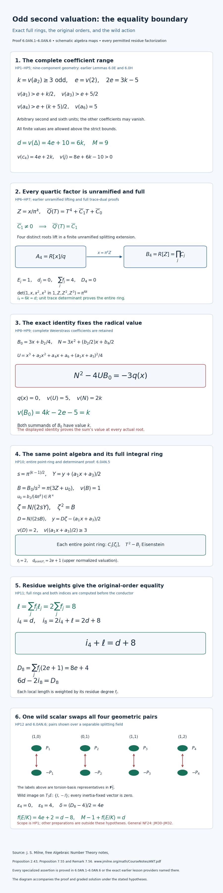

**Figure 28.** The complete equality preparation HP1, its full unramified quartic normalization, the exact original radical identity, all entire Eisenstein point rings, residue-weighted original-order indices and wild scalar action. The four pairs are geometric torsion pairs over a separable splitting field; their labels are basis representatives over the three-element field. Every other coordinate is schematic. The complete proof is in Sections 6.0AN.1–6; the eight-point exercise and full solution follow.

[Open Figure 28 at full size](../assets/odd-second-equality-II-star-proof-map.png).

### 6.0AN.7. Graded exercise and complete solution

**Exercise 6.0AN (eight points).** (a) Prove every strict invariant margin and the exact original radical value, without assuming that equal-valued summands cannot cancel (two points). (b) Prove that the scaled quartic ring is the full unramified normalization for every actual compatible residue factorization, and calculate its original-order index (two points). (c) Construct all entire point rings and calculate their original-order determinants with the correct residue weights (two points). (d) Prove the wild scalar action and derive the conductor only after the full-ring index equality (two points).

**Solution.** (a) Substitute \(2e=3k-5\) into HP1 to obtain HP2. In \(b_2,b_6,b_8\), the least terms are \(4a_2,4a_6,a_6b_2\). The remaining eighth margins exceed \(e,0,0\); the three discriminant margins in Section 6.0AN.2 are positive. The fourth-invariant comparison is strict even though its numerical lower margin is zero. Every root has value \(k\) by the fourth-power/constant least-term contradictions. In HP8, the two \(A/2\)-values exceed \(3k/2\) and \(5/2\), forcing its square above the unique value-five term of \(U\). The first \(N\)-term has value \(2k\), with other terms strictly higher. Only then use \(N^2=4UB_0\) to obtain \(v(B_0)=k\). Scaling by \(s^2\) gives value one, and the inverse in HP10 recovers the same \(y\).

(b) Divide the four complete quartic coefficients by the powers in HP6. The cubic and quadratic coefficients vanish in the residue field; the linear coefficient is a unit. Thus the derivative of the residue polynomial is everywhere nonzero. Lift its four distinct roots in the finite unramified residue splitting extension by the earlier simple-root proof. This proves that every factor is unramified. The full power-basis trace determinant is a unit, so its trace dual equals the ring itself. Every integral element pairs integrally with that ring and is therefore in it. Finally scaling its entire basis by \(1,\pi^k,\pi^{2k},\pi^{3k}\) has determinant \(\pi^{6k}\), proving \(i_4=6k=d\). The decompositions are those of the actual residue polynomial, with the two-element-field restriction proved above.

(c) Each \(C_j\) has base uniformizer \(\pi\), and HP9–HP10 prove \(B_j\) has value one. Hence \(T^2-B_j\) is Eisenstein and gives the full point ring. Its derivative \(2\zeta_j\) has upper normalized value \(2e+1\). The integral shift and exact multiplier in \(y=D\zeta-A/2\) give determinant \(D\), value two, so \(\ell_j=2\). Since \(\sum f_j=4\), the weighted length is eight, giving \(i_4+\ell=d+8\) and \(i_8=2d+8\). The different tower gives \(D_8=4(2e+1)\), agreeing with \(6d-2i_8\). All quantities refer to the original quartic and original point orders.

(d) Wild inertia fixes the four lines and acts nontrivially on their points because every point quadratic ramifies. A determinant-one matrix fixing all four lines over \(\mathbf F_3\) is \(\pm I\), by the coordinate-line and sum-line calculation. Congruence kernels modulo successive powers of three are three-groups, so the pro-two wild image injects into this scalar group. Its nontrivial lift has order two and reduces to \(-I\); its difference from \(I\) is invertible, giving \(g=-I\). Thus invariants vanish and the tame part is two. The sign-pair and point orbit defects are zero and four. Substitute these and the already proved full differents into the earlier Swan identity to obtain \(\delta=4e\), \(f=4e+2\), and \(M-1+f=d\). The original full-ring equality was obtained first, so this computation is not circular.

**Current remaining proof scope.** Section 6.0AM proves the positive-gap family HO1, and this section proves its equality counterpart HP1. Lower first/third/fourth bounds outside those preparations, other coefficient preparations and additive complements, and universal NF24 lie outside this family-specific calculation; the general identity is JM30–JM32 in §6.0BI. The statement and proof of that general equality are retained.


## 6.0AO. The fourth valuation equality at the odd second boundary

**Proposition 6.0AO (the entire fourth boundary).** In the odd second-valuation equality family, the fourth coefficient may have value exactly \(2k\). The full quartic normalization stays unramified, and a completed-square generator constructs every full point ring, including all cancellations in \(b_8\) or \(c_4\). The original-order identity is proved before the conductor calculation.

### 6.0AO.1. Hypotheses and earlier written inputs

Let \(K/\mathbf Q_2\) be finite, with integer ring \(R\), uniformizer \(\pi\), finite residue field \(\kappa\), and \(v(\pi)=1\). Consider
\[
 y^2+a_1xy+a_3y=x^3+a_2x^2+a_4x+a_6.
\]
Assume
\[
 \begin{aligned}
 e&=v(2),\qquad k=v(a_2)\ge3\text{ odd},\\
 2e&=3k-5,\\
 h&=v(a_1)>e+k/2,\\
 z&=v(a_3)>e+5/2,\\
 l&=v(a_4)\ge2k,\qquad v(a_6)=5.
 \end{aligned}\tag{HQ1}
\]
The second and sixth units are arbitrary. The first, third and fourth coefficients may vanish, with valuation infinity. There are no upper bounds. The integer inequalities are
\[
 e\ge2,\qquad h\ge2k-2\ge4,\qquad
 z\ge(3k+1)/2\ge5,\qquad l\ge2k\ge6.
 \tag{HQ2}
\]
Since \(e+(k+5)/2=2k\), the new case is exactly the equality excluded by the strict fourth bound in HP1. All the earlier higher-fourth cases are also included.

Lemma 6.0E constructs the nine-component \(II^*\) resolution for these coefficient divisibilities. Theorem 6.0I.8 and the origin-germ converse following 6.0I.9 prove minimality, and Lemma 6.0H computes its Euler characteristic. Thus the minimal component count is \(M=9\), before a conductor is used. Sections 6.0K.2 and 6.0K.6 prove the trace-dual, full different-tower, torsion-order and permutation formulas. Sections 6.0P.2 and 6.0P.5 construct the finite normalization and prove the original-order length and Swan identities. Earlier Lesson 01, Proposition 0F.2 and Sections 0G.2–0G.3, constructs finite unramified extensions, lifts simple roots and proves that an Eisenstein generator gives the entire integer ring. Lesson 03, Theorem 2.1, proves the cyclotomic determinant; Lesson 05, Lemma 1.2, proves that wild inertia is pro-two here.

Milne's freely accessible [*Algebraic Number Theory*](https://www.jmilne.org/math/CourseNotes/ANT.pdf), Proposition 2.43 and Proposition 7.55 with Remark 7.56, supplies finite-order and local-field writing material. The specialized ring and index calculations are proved below.

### 6.0AO.2. Invariants without a noncancellation assumption

Retain every coefficient in
\[
 \begin{aligned}
 b_2&=a_1^2+4a_2,&b_4&=a_1a_3+2a_4,\\
 b_6&=a_3^2+4a_6,&b_8&=a_6b_2-a_1a_3a_4+a_2a_3^2-a_4^2.
 \end{aligned}\tag{HQ3}
\]
Put \(\beta=e+2k=(7k-5)/2\). The correction terms in \(b_2,b_6\) are strictly higher than \(4a_2,4a_6\): their margins are at least one. The product \(a_1a_3\) has value at least \(\beta+1\), while \(2a_4\) has value at least \(\beta\). In \(b_8\), the terms \(a_6b_2\) and \(a_4^2\) both may have value \(4k\). The two other terms have values at least \(4k+(3k-3)/2\) and \(4k+1\). Therefore
\[
 v(b_2)=4k-5,\qquad v(b_4)\ge\beta,\qquad
 v(b_6)=3k,\qquad v(b_8)\ge4k.
 \tag{HQ4}
\]
The last inequality includes \(b_8=0\). We have not assigned the value of a sum of equal-valued terms.

In the entire discriminant
\[
 \Delta=-b_2^2b_8-8b_4^3-27b_6^2+9b_2b_4b_6,
\]
the sixth-square term has value \(6k\). The other three terms have margins at least \(6k-10\), \(9k-15\), and \((9k-15)/2\), respectively. All are positive for every \(k\ge3\). Thus the curve is nonsingular and
\[
 d=v(\Delta)=6k=4e+10,\qquad
 c_4=b_2^2-24b_4,\qquad v(c_4)\ge4e+2k,\qquad
 v(j)\ge8e+6k-10>0.
 \tag{HQ5}
\]
Here \(v(0)=\infty\), so \(c_4=0\) and \(j=0\) are allowed. Both terms in \(c_4\) may have the same value. The geometric minimality and component count are the earlier written results, independent of these possible cancellations.

### 6.0AO.3. The complete quartic ring with a possibly zero residue constant

The original sign-pair quartic is
\[
 q(X)=X^4+(b_2/3)X^3+b_4X^2+b_6X+b_8/3.
\]
Put \(Z=x/\pi^k\). Its complete scaled polynomial is
\[
 \begin{gathered}
 Q(Z)=Z^4+C_3Z^3+C_2Z^2+C_1Z+C_0,\\
 C_3=b_2/(3\pi^k),\quad C_2=b_4/\pi^{2k},\\
 C_1=b_6/\pi^{3k},\quad C_0=b_8/(3\pi^{4k}),\\
 v(C_3)=2e,\quad v(C_2)\ge e,\quad
 v(C_1)=0,\quad v(C_0)\ge0.
 \end{gathered}\tag{HQ6}
\]
In particular \(Q\in R[Z]\) is monic. Its roots are integral: if a root had negative value, its fourth power would be uniquely least among the five terms, contradicting the equation. Hence every original root satisfies \(v(x)\ge k\), including a possible root \(x=0\).

The residue polynomial is \(T^4+\bar C_1T+\bar C_0\), with derivative the nonzero constant \(\bar C_1\). Its four roots in a finite residue splitting field are distinct, even if \(\bar C_0=0\). The earlier unramified construction and simple-root proof lift them all in the corresponding finite unramified extension. They account for every root of \(Q\). Thus all quartic factor fields are unramified, for every actual residue factorization.

Moreover \(R[Z]\) is the entire normalization. The signed product of the four unit values \(Q'(Z_i)\) is its power-basis discriminant, so its trace-pairing matrix is invertible over \(R\). The trace dual of \(R[Z]\) is therefore \(R[Z]\) itself. Any element \(t\) of the full normalization pairs integrally with \(R[Z]\): each product is integral, its trace is integral, and \(R\) is integrally closed. Hence \(t\) belongs to that trace dual. This proves equality, using the earlier finite existence proof in Section 6.0P.2.

Write this full ring as \(B_4=\prod_j C_j\), with fraction fields \(F_j\), residue degrees \(f_j\), and ramification indices \(E_j\). Each \(C_j\) has uniformizer \(\pi\). Comparing the complete bases \(1,x,x^2,x^3\) and \(1,Z,Z^2,Z^3\) gives determinant \(\pi^{6k}\). Thus
\[
 E_j=1,\qquad d_j=0,\qquad \sum_jf_j=4,\qquad
 D_4=0,\qquad i_4=6k=d.
 \tag{HQ7}
\]
Here \(i_4\) is the length of the original quartic order in its full normalization.

### 6.0AO.4. A completed square gives every entire point ring

Above each actual quartic root \(x\), put
\[
 A=a_1x+a_3,\qquad Y=y+A/2,\qquad
 U=x^3+a_2x^2+a_4x+a_6+A^2/4.
\]
The original equation is exactly \(Y^2=U\), in the same point algebra. Because \(v(x)\ge k\), the two summands of \(A/2\) have values at least \((3k+1)/2\ge5\) and three. Hence \(v(A/2)\ge3\). In \(U\), the first, second and third terms have values at least \(3k\ge9\); the last term has value at least six. The sixth coefficient alone has value five. Therefore
\[
 v(A/2)\ge3,\qquad v(U)=5,\qquad
 \omega=Y/\pi^2,\quad \omega^2=U/\pi^4,
 \qquad v(U/\pi^4)=1.
 \tag{HQ8}
\]
This does not divide by a radical numerator that may vanish. In every unramified factor \(C_j\), the polynomial \(T^2-U_j/\pi^4\) is Eisenstein. The earlier entire Eisenstein-ring proof gives a ramified quadratic field and its full integer ring \(C_j[\omega_j]\). Its full derivative is \(2\omega_j\), with upper normalized value \(2e+1\).

The inverse is \(y=\pi^2\omega-A/2\), so this is precisely the original point algebra. The shift is integral. Comparing \((1,y)\) with the full basis \((1,\omega)\) gives matrix and determinant
\[
 \begin{pmatrix}1&-A/2\\0&\pi^2\end{pmatrix},\qquad
 \det=\pi^2,\qquad \ell_j=2.
 \tag{HQ9}
\]
The length is over \(C_j\). Neither a different point field nor an additional radical has been substituted.

### 6.0AO.5. Both original indices before conductor use

The earlier original-order tower calculation doubles \(i_4\), since the point order has basis \(1,y\) over the quartic order. Each factor length is then weighted by its residue degree. The full different tower has no quartic contribution, because every \(F_j/K\) is unramified. Consequently
\[
 \begin{aligned}
 \ell&=\sum_j f_j\ell_j=2\sum_jf_j=8,\\
 i_4+\ell&=d+8,\qquad i_8=2i_4+\ell=2d+8,\\
 D_8&=\sum_jf_j(2e+1)=8e+4,\\
 6d-2i_8&=8e+4=D_8.
 \end{aligned}\tag{HQ10}
\]
The last equality also follows directly from \(d=4e+10\). All indices refer to the original quartic and point orders; all normal rings and their entire bases have been constructed first. This proves restricted NF24 throughout HQ1 without a conductor identity.

### 6.0AO.6. Wild scalar action and the conductor

Inertia fixes all four sign-pair roots because their fields are unramified. Each point quadratic is ramified of degree two over its unramified base, so wild inertia acts nontrivially on its two points. Wild inertia is pro-two by the actual earlier Lemma 1.2 of Lesson 05.

The cube roots of unity are unramified here. In a finite residue splitting field the polynomial \(T^3-1\) has distinct roots; its derivative \(3T^2\) is a unit at each root. The earlier unramified and simple-root constructions lift them all. Lesson 03, Theorem 2.1, therefore gives determinant one for inertia on \(E[3]\). A determinant-one matrix fixing the four lines over \(\mathbf F_3\) is \(\pm I\): fixing the two coordinate lines makes it diagonal, fixing their sum makes both diagonal entries equal, and its determinant is their square.

The wild image injects into this group at every level. Indeed, for \(r\ge1\),
\[
 (I+3^rA)(I+3^rB)\equiv I+3^r(A+B)\pmod{3^{r+1}}.
 \tag{HQ11}
\]
The successive congruence-kernel quotients embed into the additive matrix space over \(\mathbf F_3\), so every finite kernel of reduction modulo three is a three-group. The image of any subgroup of a pro-two group in that kernel is also a two-group, and is therefore trivial. Passing to the inverse limit gives the injection of the whole wild image. Its nontrivial element \(g\) has order two and reduces to \(-I\). Since \(g-I\) is invertible over \(\mathbf Z_3\), the equation \((g-I)(g+I)=0\) gives \(g=-I\). Any inertia-fixed vector satisfies \(v=-v\), hence is zero. Thus the tame conductor is two.

Every point quadratic ramifies, so \(\nu=0\). The quartic permutation has four singleton inertia orbits and the point permutation has four orbits of size two; hence \(\epsilon_4=0\) and \(\epsilon_8=4\). Substitute the already proved full differents into the Swan identity of Section 6.0P.5:
\[
 \begin{aligned}
 \delta&=(D_8-D_4-(\epsilon_8-\epsilon_4))/2=4e,\\
 f(E/K)&=\delta+2=4e+2=d-8,\\
 M-1+f(E/K)&=d.
 \end{aligned}\tag{HQ12}
\]
This covers every allowed fourth equality and every higher fourth coefficient, including all cancellations and zero higher coefficients. Lower first or third bounds, lower fourth values, other preparations and universal NF24 lie outside this family-specific calculation; the general identity is JM30–JM32 in §6.0BI.

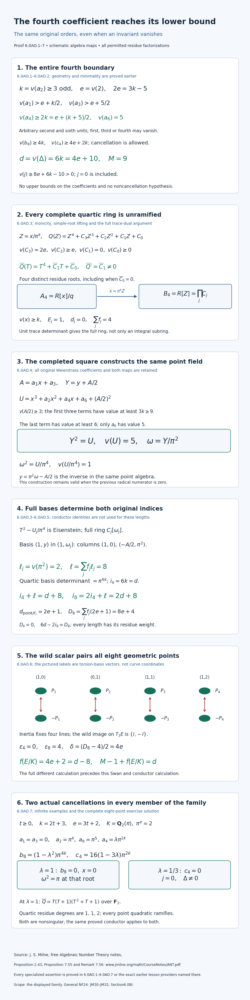

**Figure 29.** The full fourth equality in HQ1, including cancellation of the eighth or fourth invariant. The exact scaled quartic, its full unramified normalization, the completed square and its same-field inverse, both original basis changes, residue-weighted indices and wild scalar action are proved in Sections 6.0AO.1–6. The pairs are geometric torsion pairs over a separable splitting field; their labels are representatives in a torsion basis over the three-element field. Other coordinates are schematic. Section 6.0AO.7 gives the two actual cancellation families and the complete eight-point exercise solution.

[Open Figure 29 at full size](../assets/fourth-equality-II-star-proof-map.png).

### 6.0AO.7. Actual cancellation examples and a complete graded solution

For every integer \(t\ge0\), set \(k=2t+3\), \(e=3t+2\), and take \(K=\mathbf Q_2(\pi)\) with \(\pi^e=2\). The polynomial \(T^e-2\) is Eisenstein, so the earlier construction gives ramification index \(e\) and residue field \(\mathbf F_2\). Choose
\[
 a_1=a_3=0,\quad a_2=\pi^k,\quad a_6=\pi^5,\quad
 a_4=\lambda\pi^{2k},\qquad \lambda\in R^\times.
\]
These satisfy HQ1, and direct substitution gives
\[
 b_8=(1-\lambda^2)\pi^{4k},\qquad
 c_4=16(1-3\lambda)\pi^{2k}.
 \tag{HQ13}
\]
For \(\lambda=1\), the original \(b_8\) is exactly zero. The quartic has the actual root \(x=0\), and its scaled residue polynomial is \(T^4+T=T(T+1)(T^2+T+1)\); the full unramified factor degrees are \(1,1,2\). Above \(x=0\), the same point generator satisfies \(\omega^2=\pi\), giving its entire ramified ring explicitly. For \(\lambda=1/3\), instead \(c_4=0\) and \(b_8=(8/9)\pi^{4k}\); this is a nonsingular \(j=0\) example with the same conductor, not an excluded cancellation. Nonsingularity in both examples was already proved by the strictly dominant sixth-square term.

**Exercise 6.0AO (eight points).** (a) Prove all invariant and discriminant bounds, explicitly allowing cancellation in \(b_8,c_4\) (two points). (b) Construct the full quartic ring when its residue constant is zero and compute its original-order determinant (two points). (c) Construct all full point rings with the completed-square generator and prove the residue-weighted original index identity before computing a conductor (two points). (d) Prove the wild scalar action, derive the conductor and verify both actual cancellation examples (two points).

**Solution.** (a) Write the integer lower bounds as \(h\ge2k-2\), \(z\ge(3k+1)/2\), \(l\ge2k\). The correction margins in \(b_2,b_6\) are at least one. The first \(b_4\)-term exceeds \(\beta\) by at least one, while the second has value at least \(\beta\). The two higher \(b_8\)-terms have margins at least \((3k-3)/2\) and one above \(4k\); its first and last terms may cancel. Thus HQ4 has an inequality for the eighth invariant. Substituting these lower bounds into the three remaining discriminant terms gives positive margins \(6k-10,9k-15,(9k-15)/2\), proving \(d=6k\). Both \(c_4\)-terms have value at least \(4e+2k\), so only a lower bound is asserted. Cubing that bound and subtracting the discriminant valuation \(d\) proves HQ5, also when \(c_4=0\).

(b) HQ6 is a complete monic integral polynomial, and its residue derivative is the nonzero constant \(\bar C_1\), regardless of \(\bar C_0\). Lift the four distinct residue roots in the finite unramified residue splitting extension. Their derivative values are units, so the power-basis trace determinant is a unit. Its trace dual equals the ring itself, and every integral element pairs integrally with that ring. This proves the entire normalization, for every residue factorization. The original basis scales by \(1,\pi^k,\pi^{2k},\pi^{3k}\), with determinant \(\pi^{6k}\), giving \(i_4=6k=d\). No claim that every original root has value exactly \(k\) is needed or valid in general.

(c) Every root has value at least \(k\). Therefore \(A/2\) is integral of value at least three, and all terms of \(U\) except \(a_6\) have value at least six. Hence \(U\) has exact value five. The generator \(\omega=(y+A/2)/\pi^2\) lies in the same point field and has Eisenstein square of value one. Its entire ring has basis \(1,\omega\) and relative different \(2e+1\). The displayed triangular basis matrix has determinant \(\pi^2\), giving \(\ell_j=2\) in every quartic factor. Weight by \(f_j\), whose sum is four, to get \(\ell=8\). The original point order doubles the original quartic length, so \(i_8=2d+8\). The full different tower gives \(D_8=8e+4\), agreeing with \(6d-2i_8\); restricted NF24 is already proved.

(d) The quartic fields are unramified and every point quadratic ramifies, so wild inertia fixes every line and is nontrivial on points. Unramified cube roots and the earlier pairing give determinant one. The coordinate-line and sum-line calculation gives wild image \(\{I,-I\}\) modulo three. HQ11 makes all higher congruence kernels three-groups, so the pro-two image injects modulo three. Its nontrivial lift has order two and has invertible difference from \(I\), giving \(g=-I\). Invariants vanish. The orbit defects are zero and four, and the full different exponents already calculated yield Swan \(4e\), conductor \(4e+2\), and Euler equality. Finally \(\pi^e=2\) gives \(4\pi^{k+5}=\pi^{4k}\); substitute the example coefficients to obtain HQ13. At \(\lambda=1\) the constant vanishes and the residue factorization has degrees \(1,1,2\). At \(\lambda=1/3\) the fourth invariant vanishes while the discriminant remains nonzero by its unique least term. Both examples have exactly the proved component count and conductor.

**Current remaining proof scope.** This section includes every fourth coefficient at or above the equality in HQ1, so the original-order equality and conductor calculation include the cancellations illustrated here. Lower first or third bounds, fourth values outside HQ1, other coefficient preparations and additive complements, and universal NF24 lie outside this family-specific calculation; the general identity is JM30–JM32 in §6.0BI. The stated prerequisite results remain required.


## 6.0AP. The first coefficient immediately below the odd second equality

**Proposition 6.0AP (the full first boundary).** At the odd second-valuation equality, lowering the first coefficient by one integer step gives a totally ramified quartic and a totally ramified degree-eight point field. Reciprocal and shifted coordinates construct both entire integer rings. Their original-order determinants prove the index identity before the conductor is calculated. Together with the earlier fourth-boundary proposition, this covers every first valuation \(h\ge2k-3\) under the second, third and fourth bounds below.

### 6.0AP.1. Hypotheses and actual earlier proof providers

Let \(K/\mathbf Q_2\) be finite, with integer ring \(R\), uniformizer \(\pi\), finite residue field \(\kappa\), and \(v(\pi)=1\). Consider the actual integral equation
\[
 y^2+a_1xy+a_3y=x^3+a_2x^2+a_4x+a_6
\]
with
\[
 \begin{aligned}
 e&=v(2),& k&=v(a_2)\ge3\text{ odd},&2e&=3k-5,\\
 h&=v(a_1)=2k-3,& z&=v(a_3)\ge(3k+1)/2,\\
 l&=v(a_4)\ge2k,&v(a_6)&=5.
 \end{aligned}\tag{HT1}
\]
The first, second and sixth units are arbitrary. The third and fourth coefficients may vanish; their valuations are then infinite. No upper bound is imposed. In particular \(e\ge2,h\ge3,z\ge5,l\ge6\).

Lemma 6.0E constructs the full nine-component \(II^*\) fibre, since these bounds imply its coefficient divisibilities and its sixth unit condition. Theorem 6.0I.8 and the origin-germ converse after Theorem 6.0I.9 prove regular-model and equation minimality. Lemma 6.0H proves the Euler calculation. Thus \(M=9\) is known before the conductor is used. Sections 6.0K.2 and 6.0K.6 prove trace duals, monogenic differents, different towers, both original torsion-order discriminants and the permutation/Swan comparison. Section 6.0P.5 proves the residue-weighted original-order tower and inertia-orbit formulas. Earlier Lesson 01, Sections 0G.2–0G.3, proves the full Eisenstein-ring and unramified lifting results; Lesson 03, Theorem 2.1, proves the cyclotomic determinant; Lesson 05, Lemma 1.2, proves the wild and tame inertia structure. These are actual earlier written results, not citations substituted for proofs.

For \(h\ge2k-2\), including an infinite first valuation, the actual earlier Section 6.0AO already proves the same original-order and conductor conclusions under the remaining bounds of HT1. The new proof treats the missing integer boundary \(h=2k-3\).

Milne's freely accessible [*Algebraic Number Theory*](https://www.jmilne.org/math/CourseNotes/ANT.pdf), Proposition 2.43 and Proposition 7.55 with Remark 7.56, supplies finite-order and local-field writing material. The specialized reciprocal, square-error and index calculations are proved here in full.

### 6.0AP.2. Original invariants, discriminant and component count

Use the original invariant identities of Section 1.1. Set \(\beta=e+2k=(7k-5)/2\). In \(b_2=a_1^2+4a_2\), the first term has value \(4k-6\), one below the second. In \(b_6=a_3^2+4a_6\), the second term has value \(3k\), at least one below the first. Also
\[
 \begin{aligned}
 v(b_2)&=4k-6,&v(b_4)&\ge\beta,&v(b_6)&=3k,\\
 b_8&=a_1^2a_6+4a_2a_6-a_1a_3a_4+a_2a_3^2-a_4^2,
 &v(b_8)&=4k-1.
 \end{aligned}\tag{HT2}
\]
Indeed the last four eighth-invariant terms exceed \(4k-1\) by at least \(1,(3k-3)/2,2,1\), respectively. The first is uniquely least. The two terms of \(b_4\) can cancel; only its lower bound is asserted.

In the discriminant, the term \(-27b_6^2\) is uniquely least. The lower margins of \(-b_2^2b_8,-8b_4^3,9b_2b_4b_6\), relative to \(6k\), are \(6k-13,9k-15,(9k-17)/2\), all positive for every odd \(k\ge3\). In \(c_4=b_2^2-24b_4\), the second term is at least two valuations above the first. Consequently
\[
 d=v(\Delta)=6k=4e+10,\qquad
 v(c_4)=8k-12,\qquad v(j)=18k-36>0,\qquad M=9.
 \tag{HT3}
\]
The curve is nonsingular because \(\Delta\ne0\). There is no assumption that terms of equal value fail to cancel.

### 6.0AP.3. The reciprocal quartic and its entire integer ring

The original monic torsion polynomial is
\(q(x)=x^4+(b_2/3)x^3+b_4x^2+b_6x+b_8/3\).
Its nonzero constant makes \(x\) invertible in its generic algebra. Put
\[
 \begin{aligned}
 \theta&=\pi^k/x,&u&=\pi^{1-4k}b_8,\\
 r_1&=3\pi^{1-3k}b_6,&r_2&=3\pi^{1-2k}b_4,&
 r_3&=\pi^{1-k}b_2.
 \end{aligned}\tag{HT4}
\]
Here \(u\) is a unit. Multiplication of \(3q(\pi^k/\theta)\) by \(\pi^{1-4k}\theta^4\) gives exactly
\[
 P(T)=uT^4+r_1T^3+r_2T^2+r_3T+3\pi,
 \quad v(r_1)=1,\quad v(r_2)\ge e+1,\quad v(r_3)=2e.
 \tag{HT5}
\]
The monic polynomial \(P/u\) is Eisenstein. Its quotient is a field of degree four, and its constant makes \(\theta\) invertible in the generic field. The maps \(\theta=\pi^k/x\) and \(x=\pi^k/\theta\) are inverse algebra maps, so the original quartic is that field \(F\). The earlier full Eisenstein-ring proof gives its entire integer ring \(C=R[\theta]\), basis \(1,\theta,\theta^2,\theta^3\), ramification index four and residue degree one. Normalize \(v_F(\theta)=1\), so \(v_F=4v\) on \(F\).

The four derivative terms \(4u\theta^3,3r_1\theta^2,2r_2\theta,r_3\) have \(v_F\)-values \(8e+3,6,\ge8e+5,8e\). The cubic derivative term is uniquely least. Division by the unit \(u\) does not change its value, so the monogenic different exponent is six. Both full and original bases have explicit determinants:
\[
 \begin{gathered}
 d_{F/K}=D_4=6,\qquad v(x)=k-\tfrac14,\qquad
 N_{F/K}(\theta)=3\pi/u,\\
 \det\bigl((1,x,x^2,x^3)\text{ in }(1,\theta,\theta^2,\theta^3)\bigr)
   =\pi^{6k}N_{F/K}(\theta)^{-3},\qquad i_4=6k-3.
 \end{gathered}\tag{HT6}
\]
For completeness, apply all four separable embeddings to each basis. Each difference \(x_j-x_i\) equals \(-\pi^k(\theta_j-\theta_i)/(\theta_i\theta_j)\). Multiplying the six differences gives the stated determinant ratio: the six signs cancel, and each \(\theta_i\) occurs three times in the denominator. It is the determinant of the whole change of basis, not a leading coefficient. The original basis lies in \(C\), since \(v_F(x)=4k-1>0\). The determinant-length formula of Section 6.0K.2 therefore gives \(i_4\) directly, before any conductor use. As a separate check, \(2d-2i_4=6=D_4\).

### 6.0AP.4. The exact square error in the same point algebra

Above this quartic field set
\[
 \begin{gathered}
 A=a_1x+a_3,\qquad Y=y+A/2,\\
 U=x^3+a_2x^2+a_4x+a_6+(A/2)^2,\qquad Y^2=U,\\
 v_F(A/2)\ge12,\qquad v(U)=5,\qquad V=U/\theta^{20}.
 \end{gathered}\tag{HT7}
\]
The two summands of \(A/2\) have \(v_F\)-values at least \(6k-3\ge15\) and \(12\). In \(U\), the cubic, second and fourth terms have \(v_F\)-values at least \(12k-3,12k-2,12k-1\), and its square term has value at least twenty-four. The sixth term has value exactly twenty and is uniquely least. This proves both asserted bounds. The completed square is an identity in the original point algebra; no unrelated quadratic is introduced.

Divide HT5 at \(\theta\) by \(\pi u\). With \(\alpha=-3/u\) and \(\gamma=-r_1/(\pi u)\), both units of \(R\), it gives
\[
 \begin{aligned}
 \theta^4/\pi&=\alpha+\gamma\theta^3+O(\theta^{4e+2}),\\
 \pi/\theta^4&=\alpha^{-1}-\gamma\alpha^{-2}\theta^3+O(\theta^6),\\
 V&=c_0+c_3\theta^3+O(\theta^4),\\
 c_0&=\eta\alpha^{-5},&c_3&=-5\eta\gamma\alpha^{-6},&
 \eta&=a_6/\pi^5\in R^\times.
 \end{aligned}\tag{HT8}
\]
Here \(O(\theta^m)\) means an actual element of \(\theta^mC\). In the first line the quadratic error has value at least \(4e+2\), and the linear error has value \(8e-3\ge4e+2\). For the second line multiply the first by its inverse: the square of the value-three correction has value six, and all other errors are higher. Taking the fifth power gives its constant and value-three coefficient exactly as displayed. The other three nonsquare terms in \(U/\theta^{20}\) have values at least thirteen, fourteen and fifteen; \((A/(2\theta^{10}))^2\) has value at least four. Thus neither changes those two coefficients. Both \(c_0,c_3\) are units of \(R\), including arbitrary permitted coefficient units and all higher cancellations.

Squaring on the finite field \(\kappa\) is injective, hence bijective: in characteristic two, equal squares have equal roots. Choose \(c\in R^\times\) lifting the unique square root of \(\bar c_0\). Then \(v_F(c^2-c_0)\ge4\), and HT8 gives \(v_F(V-c^2)=3\). This is the maximum square error in the whole field:
\[
 \max_{s\in F}v_F(V-s^2)=3.
 \tag{HT9}
\]
Indeed a closer square must have a unit root with residue \(\bar c\). Write it as \(s=c+w\), \(v_F(w)\ge1\). If \(v_F(w)=1\), then \(w^2\) has value two while \(2cw\) has value \(4e+1>3\); the error has value two. If \(v_F(w)\ge2\), both corrections have value at least four, so the value-three term remains. A nonunit root, a nonintegral root or a different residue gives error at most zero. This exhausts all \(s\in F\); no finite search or leading-slope assumption is used.

### 6.0AP.5. The full point ring, original bases and index equality

In the same point algebra put
\[
 \begin{gathered}
 \xi=Y/\theta^{10},\qquad
 w=(\xi-c)/\theta,\\
 w^2+(2c/\theta)w+(c^2-V)/\theta^2=0,\\
 v_F(2c/\theta)=4e-1\ge7,\qquad
 v_F((c^2-V)/\theta^2)=1,\\
 y=\theta^{11}w+c\theta^{10}-A/2,\qquad
 \ell=11,\qquad d_{L/F}=8e-2.
 \end{gathered}\tag{HT10}
\]
This polynomial is Eisenstein of degree two over \(C\). The inverse displayed recovers precisely the original \(y\), so its field is the original point field \(L\), of degree eight over \(K\), with entire integer ring \(B=C[w]\). Its residue degree is one. Normalize \(v_L(w)=1\), so \(v_L=2v_F\). The derivative terms have values \(v_L(2w)=8e+1\) and \(v_L(2c/\theta)=8e-2\); hence the entire relative different is \(8e-2\).

The original point basis \(1,y\), written in the full basis \(1,w\), has columns \((1,0)\) and \((c\theta^{10}-A/2,\theta^{11})\). Its shift is integral, and its determinant is exactly \(\theta^{11}\). Therefore \(\operatorname{length}_C(B/C[y])=11\). This is also the residue-weighted \(R\)-length because \([\kappa_C:\kappa]=1\). The earlier original-order tower and full different tower now give
\[
 \begin{aligned}
 i_4&=6k-3,& \ell&=11,& i_8&=2i_4+\ell=12k+5,\\
 i_4+\ell&=6k+8=d+M-1,&\nu&=0,\\
 D_8&=2D_4+d_{L/F}=8e+10=6d-2i_8.
 \end{aligned}\tag{HT11}
\]
The last equality uses \(2e=3k-5\). The assertion \(\nu=0\) follows from the actual ramified point quadratic just constructed. All the full rings and original-order basis lengths are now known. Thus NF24 is proved throughout HT1 before the conductor is computed.

### 6.0AP.6. Wild action, orbit defects and conductor

The entire quartic and point fields are totally ramified and have residue degree one. The earlier inertia-orbit proof therefore gives one orbit in each of the four-point and eight-point permutations. The orbit defects are \(\epsilon_4=3\) and \(\epsilon_8=7\).

Cube roots of unity lie in a finite unramified extension: their nontrivial residue polynomial \(T^2+T+1\) has unit derivative in characteristic two, and its roots lift by the earlier simple-root proof. The constructed pairing in Lesson 03 therefore puts inertia modulo three in \(\operatorname{SL}_2(\mathbf F_3)\). If wild inertia were trivial there, its finite inertia image would be an odd-order quotient of tame inertia. An odd-order group cannot have an orbit of size four, since the orbit size is the number of cosets of a stabilizer. Hence the wild image is nontrivial.

For clarity the comparison with the actual three-adic representation has no hidden finite-kernel assumption. For every \(r\ge1\),
\[
 (I+3^rB)(I+3^rC)\equiv I+3^r(B+C)\pmod{3^{r+1}}.
 \tag{HT12}
\]
Each successive congruence-kernel quotient is a three-group. The image of a pro-two group in any finite such kernel is both a two-group and a three-group, so is trivial. Intersecting all levels proves that the whole wild image injects modulo three, and is finite. Its nontrivial two-group image contains an order-two element: pair each element with its inverse, leaving a nonidentity self-inverse element because the group has even cardinality. The only such element in \(\operatorname{SL}_2(\mathbf F_3)\) is \(-I\). Indeed an involution is diagonalizable with eigenvalues \(1,-1\); determinant one excludes mixed eigenvalues, leaving \(I,-I\). Its three-adic lift \(g\) also has order two. Since \(g-I\) is invertible modulo three, \((g-I)(g+I)=0\) implies \(g=-I\) on the entire Tate module. Inertia-fixed vectors are therefore zero, and the tame conductor is two. Section 6.0K.6 proves the compatible wild character comparison for the elliptic representation used in the conductor.

Apply that earlier full-different Swan identity only after HT11:
\[
 \begin{aligned}
 \delta&=(D_8-D_4-(\epsilon_8-\epsilon_4))/2
       =(8e+10-6-4)/2=4e,\\
 f(E/K)&=\delta+2=4e+2=d-8,\\
 M-1+f(E/K)&=d.
 \end{aligned}\tag{HT13}
\]
No order discriminant was substituted for a full-ring discriminant. The higher-first cases under the remaining HT1 bounds follow from the already written Section 6.0AO, so the combined first range is \(h\ge2k-3\), including infinity. Lower first or third bounds, lower fourth values, other preparations and universal NF24 lie outside this family-specific calculation; the general identity is JM30–JM32 in §6.0BI.

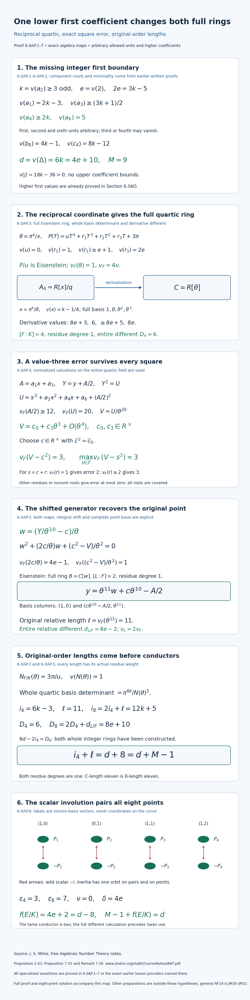

**Figure 30.** The entire first boundary HT1. Sections 6.0AP.1–6 prove the exact reciprocal quartic, its complete Eisenstein integer ring, the maximum square error in that whole field, the shifted generator and inverse in the original point field, both complete original basis determinants, residue weights and full different tower before the Swan and conductor calculation. Red arrows show the wild scalar involution on the geometric torsion pairs. Labels are torsion-basis representatives over the three-element field; all page coordinates are schematic. Section 6.0AP.7 gives an infinite family and the complete eight-point exercise solution.

[Open Figure 30 at full size](../assets/first-boundary-odd-second-equality-proof-map.png).

### 6.0AP.7. An infinite family and a complete graded solution

For every integer \(t\ge0\), choose \(K=\mathbf Q_2(\pi)\) with \(\pi^e=2\). The polynomial \(T^e-2\) is Eisenstein, giving the asserted ramification and residue field. Set
\[
 \begin{gathered}
 k=2t+3,\qquad e=3t+2,\qquad
 a_1=\pi^{4t+3},\quad a_2=\pi^{2t+3},\\
 a_3=\pi^{3t+5},\quad a_4=\pi^{4t+6},\quad a_6=\pi^5.
 \end{gathered}\tag{HT14}
\]
These satisfy HT1. At every \(t\ge2\), the third valuation \(3t+5\) is strictly below \(h+1=4t+4\); hence the earlier higher-first preparation HJ1 does not cover them. They also fail the higher-first inequality of HQ1. Their actual full quartic and point rings, different exponents, original indices and conductor are nevertheless exactly those proved above; no sample substitutes for the unbounded proof.

**Exercise 6.0AP (eight points).** (a) Prove all strict invariant margins and HT3 for arbitrary units and higher third/fourth coefficients (two points). (b) Construct the entire reciprocal quartic ring and prove its whole original-basis determinant (two points). (c) Prove the maximum square error and construct the entire original point ring, including its basis length and full different (two points). (d) Prove restricted NF24 before computing the conductor, then establish the conductor and verify HT14 (two points).

**Solution.** (a) The two second-invariant terms differ by one, and the sixth-invariant correction is at least one higher. The uniquely least eighth term is \(a_1^2a_6\); its four competitors have the margins \(1,(3k-3)/2,2,1\). The lower fourth bound permits cancellation. The three nonleading discriminant margins \(6k-13,9k-15,(9k-17)/2\) are positive for all \(k\ge3\), so \(d=6k\). The second term of \(c_4\) is at least two higher; thus cubing its exact first valuation and subtracting \(d\) gives \(v(j)=18k-36\). The earlier nine-component minimal-model proof applies to the original coefficient divisibilities.

(b) HT4 is an invertible generic coordinate change. Direct multiplication gives HT5, which is Eisenstein after dividing by its leading unit, so its whole integer ring has basis \(1,\theta,\theta^2,\theta^3\). The derivative's unique value-six term gives its full different. Applying the four separable embeddings to the two complete bases multiplies six reciprocal differences, giving determinant \(\pi^{6k}/N(\theta)^3\). The norm has value one, so the index is \(6k-3\). This uses the actual original order and complete basis, rather than an inferred equality from the desired conductor.

(c) The square and three higher terms of \(U/\theta^{20}\) have values at least four and thirteen, fourteen, fifteen. Dividing the reciprocal polynomial by \(\pi u\), inverting its unit constant and taking the fifth power proves HT8 with both coefficients units in \(R\). A residue square-root lift has error at least four on the constant; hence its full error is exactly three. A different square root of the same residue differs by valuation one, giving error two, or by at least two, leaving error three. All other squares give error at most zero. This proves the maximum in the entire field. The shifted generator's polynomial has constant value one and linear value \(4e-1\); it is Eisenstein. Its inverse is the original \(y\), its full basis determinant is \(\theta^{11}\), and its derivative has unique value \(8e-2\) in the point field. These prove the full normalization, original relative length eleven and entire relative different.

(d) Residue degree one gives weighted length eleven; the original tower gives \(i_8=2(6k-3)+11\). The full tower gives \(D_8=12+(8e-2)\), and HT1 verifies both \(6d-2i_8=D_8\) and \(i_4+\ell=d+8\) before any Swan calculation. Both fields are totally ramified, so the orbit defects are three and seven. The nontrivial wild image contains the scalar involution on the whole Tate module, giving tame conductor two. The already proved permutation identity then yields \(\delta=4e\), conductor \(4e+2\) and the Euler equality. Finally substitute HT14 to obtain \(h=2k-3,z=(3k+1)/2,l=2k\) and \(2e=3k-5\); for \(t\ge2\), \(z<h+1\) as claimed. Every member has the full rings and indices computed in the proof.

**Current remaining proof scope.** This proof and the actual earlier Section 6.0AO include every first valuation \(h\ge2k-3\) at the stated odd second equality, arbitrary allowed units, zero or arbitrary higher third/fourth coefficients and every full original order. Lower first or third bounds, fourth values below \(2k\), other coefficient preparations and additive complements, and universal NF24 remain open. The stated prerequisite results remain required.


## 6.0AQ. The whole first-valuation interval at the odd second equality

**Proposition 6.0AQ (uniform full rings and original indices).** The first valuation can range over every integer from the second valuation to the previously proved first boundary. One reciprocal construction and a finite scalar-lifting induction give the entire quartic and point integer rings for that whole interval. Their original bases prove the index equality before any conductor calculation. Together with the actual earlier fourth-boundary proposition, the resulting first range is every \(h\ge k\), including infinity, under the other bounds below.

The first-valuation gaps listed at the ends of Sections 6.0AO and 6.0AP are included by this proposition. The final paragraph of this section gives the current remaining parameter scope.

### 6.0AQ.1. Hypotheses and earlier proved inputs

Let \(K/\mathbf Q_2\) be finite, with integer ring \(R\), uniformizer \(\pi\), finite residue field \(\kappa\), and \(v(\pi)=1\). Use the original integral equation
\[
 y^2+a_1xy+a_3y=x^3+a_2x^2+a_4x+a_6
\]
with
\[
 \begin{gathered}
 e=v(2),\qquad k=v(a_2)\ge3\text{ odd},\qquad 2e=3k-5,\\
 k\le h=v(a_1)\le2k-3,\qquad z=v(a_3)\ge(3k+1)/2,\\
 l=v(a_4)\ge2k,\qquad v(a_6)=5,\\
 q=2k-h,\qquad 3\le q\le k,\qquad m=2q-5.
 \end{gathered}\tag{HU1}
\]
The first, second and sixth units are arbitrary. The third or fourth coefficient may be zero, with infinite valuation; neither has an upper bound. In particular \(h\ge3,e\ge2,z\ge5,l\ge6\), and \(m\) is a positive odd integer.

The full nine-component \(II^*\) model is constructed in Lemma 6.0E. Its hypotheses hold for these original coefficients. Theorem 6.0I.8 and the origin-germ converse after Theorem 6.0I.9 prove model and equation minimality; Lemma 6.0H proves the geometric Euler count. Thus \(M=9\) is established before the conductor is used. Sections 6.0K.2 and 6.0K.6 prove the trace-dual, full-ring different, original-order discriminant and Swan identities. Section 6.0P.5 proves the residue-weighted original-order tower and inertia-orbit calculations. Lesson 01, Theorem 0F.2 and Sections 0G.2–0G.3, prove the finite local-field, full Eisenstein-ring and unramified lifting facts. Lesson 03, Theorem 2.1, proves the actual cyclotomic determinant, and Lesson 05, Lemma 1.2, proves the wild and tame inertia structure. These are written earlier proofs, not bibliographic substitutes.

For \(h\ge2k-2\), including infinity, the actual earlier Section 6.0AO proves the same original-index and conductor conclusions under the remaining bounds of HU1. Section 6.0AP is the case \(q=3\). Here \(q\) ranges over every integer through \(k\), with no upper bound on \(k\).

Milne's freely accessible [*Algebraic Number Theory*](https://www.jmilne.org/math/CourseNotes/ANT.pdf), Proposition 2.43 and Proposition 7.55 with Remark 7.56, supplies finite-order and local-field writing material. All specialized normalization, scalar-lifting, original-basis and conductor calculations are proved below.

### 6.0AQ.2. Original invariants and the geometric count

Put \(\beta=h+(3k+1)/2=(7k-2q+1)/2\). The original identities of Section 1.1 give
\[
 \begin{gathered}
 v(b_2)=2h,\qquad v(b_4)\ge\beta,\qquad v(b_6)=3k,\\
 b_8=a_1^2a_6+4a_2a_6-a_1a_3a_4+a_2a_3^2-a_4^2,\\
 v(b_8)=2h+5=4k-m.
 \end{gathered}\tag{HU2}
\]
In the second invariant the competing term is higher by \(m\); in the sixth it is higher by at least one. The two terms of the fourth invariant can cancel: their lower margins above \(\beta\) are zero and \(q-3\), so only a lower bound is asserted. The last four eighth-invariant terms exceed its first term by at least
\(m,(3k+2q-9)/2,m+1,m\), respectively. Each is strictly positive, including \(q=3,k=3\).

In the original discriminant, the term \(-27b_6^2\) is uniquely least. The lower margins of the other three terms \(-b_2^2b_8,-8b_4^3,9b_2b_4b_6\), relative to \(6k\), are
\(6(k-q)+5,9k-3q-6,(9k-6q+1)/2\).
They are positive throughout \(3\le q\le k\). In \(c_4=b_2^2-24b_4\), the second term is higher by at least \(3q-7\ge2\), because \(v(24)=3e\). Consequently
\[
 d=v(\Delta)=6k=4e+10,\qquad
 v(c_4)=4h,\qquad v(j)=12h-6k\ge6k>0,\qquad M=9.
 \tag{HU3}
\]
Thus the curve is nonsingular and potentially good. The model and count come from the earlier geometric proofs; no cancellation of equal-valued terms is ruled out without justification.

### 6.0AQ.3. A reciprocal quartic with an explicit full lattice

Write the original torsion polynomial as
\(Q(x)=x^4+(b_2/3)x^3+b_4x^2+b_6x+b_8/3\).
Its constant is nonzero. In its generic algebra put
\[
 \begin{gathered}
 \theta=\pi^k/x,\qquad u=\pi^{m-4k}b_8,\\
 r_1=3\pi^{m-3k}b_6,\qquad
 r_2=3\pi^{m-2k}b_4,\qquad r_3=\pi^{m-k}b_2.
 \end{gathered}\tag{HU4}
\]
The reciprocal substitution, with multiplier \(3\pi^{m-4k}\theta^4\), gives exactly
\[
 P(T)=uT^4+r_1T^3+r_2T^2+r_3T+3\pi^m,\qquad
 v(u)=0,\quad v(r_1)=m,\quad v(r_2)\ge e+q-2,\quad v(r_3)=2e.
 \tag{HU5}
\]
The maps \(\theta=\pi^k/x\) and \(x=\pi^k/\theta\) are inverse generic algebra maps. Every root of \(P\) has value \(m/4\). Here is a direct proof: each middle coefficient is strictly above the line joining the leading unit and the constant of value \(m\). If a root had smaller value, its fourth-power term would be uniquely least; if it had larger value, the constant would be uniquely least. Neither can sum to zero. Any monic factor over \(K\) would then have constant of value its degree times \(m/4\). Since \(m\) is odd, an integer value requires degree divisible by four. Thus \(P/u\) is irreducible and the original quartic algebra is the same field \(F\), of degree four.

Normalize \(v_F=4v\). Define
\[
 \begin{gathered}
 n_j=\lfloor jm/4\rfloor\quad(0\le j\le3),\qquad
 J=n_1+n_2+n_3=3(m-1)/2,\\
 C=\bigoplus_{j=0}^3 R\,\theta^j/\pi^{n_j},\\
 (a,b)=
 \begin{cases}(1,(m-1)/4),&m\equiv1\pmod4,\\
 (3,(3m-1)/4),&m\equiv3\pmod4,
 \end{cases}\qquad
 \varpi=\theta^a/\pi^b,\quad am-4b=1.
 \end{gathered}\tag{HU6}
\]
This is the entire integer ring, not just an order. In the unique expansion in \(1,\theta,\theta^2,\theta^3\), the four summand values have different fractional parts. They cannot cancel. Nonnegative value is therefore equivalent to exactly the coefficient bounds in HU6. This proves the displayed full lattice, including its multiplicative closure as the valuation ring. The formula for \(J\) follows by writing the odd integer \(m\) as \(4n+1\) or \(4n+3\) and taking the three floors.

Moreover \(v_F(\varpi)=1\). Its degree is four, by the same denominator argument, so \(1,\varpi,\varpi^2,\varpi^3\) is a field basis. Its four values are \(0,1,2,3\) modulo four; the same noncancellation argument proves \(C=R[\varpi]\) with this full basis. Reduction leaves only the constant coefficient from \(R\), so the residue degree is one. The value group and total degree give ramification index four. No integral generator has been guessed from a leading slope alone: both full bases have been proved.

For later calculations set \(X=\theta^4/\pi^m\), a unit of \(C\). The monomial definitions give exact equalities
\[
 \pi/\varpi^4=X^{-a},\qquad \theta/\varpi^m=X^{-b}.
 \tag{HU7}
\]
The derivative terms of \(P\) at \(\theta\) have \(v_F\)-values
\(8e+3m,6m,\ge8e+3m+2,8e\).
The value \(6m\) is uniquely least: \(8e-6m=12(k-q)+10>0\). The monogenic trace calculation therefore gives discriminant value \(6m\) for the order \(R[\theta]\). Passing to the whole HU6 basis subtracts \(2J\). Thus the full-ring different, and the original basis determinant, are
\[
 \begin{gathered}
 D_4=d_{F/K}=6m-2J=3m+3=6q-12,\\
 N_{F/K}(\theta)=3\pi^m/u,\qquad v_F(x)=4k-m>0,\\
 \det\bigl((1,x,x^2,x^3)\text{ in }(\theta^j/\pi^{n_j})_{j=0}^3\bigr)
 =\pi^{6k+J}N_{F/K}(\theta)^{-3},\\
 i_4=6k+J-3m=3h+6=6k-3q+6,\qquad 2d-2i_4=D_4.
 \end{gathered}\tag{HU8}
\]
For the whole determinant, apply all four separable embeddings to the two bases. Each difference \(x_j-x_i\) is \(-\pi^k(\theta_j-\theta_i)/(\theta_i\theta_j)\). Their sixfold product has positive sign and denominator \(N(\theta)^3\); the numerator contributes \(\pi^{6k}\). The complete diagonal change from the \(\theta\) basis to HU6 contributes \(\pi^J\). The determinant-length proof in Section 6.0K.2 gives the index directly. The value \(6m\) is the discriminant exponent of \(R[\theta]\); after the complete lattice change, the full different is \(3m+3\).

### 6.0AQ.4. The entire-field square error and its finite induction

In the actual point algebra put
\[
 \begin{gathered}
 A=a_1x+a_3,\qquad Y=y+A/2,\\
 U=x^3+a_2x^2+a_4x+a_6+(A/2)^2,\qquad Y^2=U,\\
 V=U/\varpi^{20},\qquad S=A/(2\varpi^{10}),\qquad
 v_F(A/2)\ge12,\quad v_F(U)=20,\quad v_F(S)\ge2.
 \end{gathered}\tag{HU9}
\]
The two terms of \(A/2\) have values at least \(6(k-q)+15\) and twelve. The cubic, second and fourth nonsquare terms in \(U\) have values at least
\(12k-6q+15,12k-4q+10,12k-2q+5\), respectively. Each exceeds twenty; the square has value at least twenty-four. The sixth term is uniquely least, proving HU9.

Set \(t=3m=6q-15\), \(\alpha=-3/u\), \(\gamma=-r_1/(\pi^m u)\), and \(\eta=a_6/\pi^5\). All three constants are units of \(R\). Dividing HU5 at \(\theta\) by \(\pi^m u\) gives
\[
 \begin{gathered}
 X=\alpha+\gamma\theta^3+O(\varpi^{t+1}),\qquad
 \theta^3=\alpha^{-3b}\varpi^t+O(\varpi^{t+1}),\\
 V-S^2=\mu+\lambda\varpi^t+O(\varpi^{t+1}),\qquad
 \mu=\eta\alpha^{-5a},\quad
 \lambda=-5a\eta\gamma\alpha^{-5a-1-3b}\in R^\times.
 \end{gathered}\tag{HU10}
\]
Here \(O(\varpi^r)\) means an actual element of \(\varpi^r C\). The quadratic error in the first line has value at least \(4e+2\), and the linear error has value \(8e-3m\). Their excesses above \(t\) are at least seven and ten. HU7 proves the second assertion by replacing the unit \(X^{-3b}\) by its constant modulo the positive-value correction. For a unit \(X=\alpha+E\) and any positive integer \(n\), multiplication by \(X^n\alpha^{n+1}\) shows that
\(X^{-n}-\alpha^{-n}+n\alpha^{-n-1}E\) lies in \(E^2C\).
Apply this with \(n=5a\); its coefficient \(5a\) is odd, hence a unit. The other three terms of \((U-(A/2)^2)/\varpi^{20}\) exceed \(t\) by at least
\(12(k-q)+10,12k-10q+5,12k-8q\).
This proves the entire expansion and its nonzero odd coefficient for every allowed unit and every higher cancellation. In particular
\[
 t\text{ is odd},\qquad 4e-t=6(k-q)+5>0,\qquad
 \varpi^4=\alpha^a\pi+O(\varpi^{t+4}).
 \tag{HU11}
\]

We now prove the required scalar approximation, with an actual finite induction of unbounded length. Put \(N=\lfloor t/4\rfloor\). Choose \(c_0\in R\) lifting the square root of \(\bar\mu\); it is a unit. Squaring is bijective on the finite field \(\kappa\), since it is injective in characteristic two. Suppose \(c_0,\ldots,c_{j-1}\) have been chosen so that
\(\mu-\sum_{i<j}c_i^2\alpha^{ai}\pi^i\in\pi^jR\).
Choose \(c_j\in R\) lifting the square root of the residue of this quotient times \(\alpha^{-aj}\). The error is then in \(\pi^{j+1}R\). Apply this for each \(1\le j\le N\), allowing a zero lift for zero residue. Define
\[
 c_* =\sum_{j=0}^{N}c_j\varpi^{2j},\qquad
 v\left(\mu-\sum_{j=0}^{N}c_j^2\alpha^{aj}\pi^j\right)\ge N+1,
 \qquad v_F(\mu-c_*^2)>t.
 \tag{HU12}
\]
To justify the last inequality, HU11 gives
\(\varpi^{4j}-\alpha^{aj}\pi^j\in\varpi^{t+4j}C\) for \(j\ge1\), by the factorization of a difference of powers. The cross terms in \(c_*^2\) have value at least \(4e+2>t\). The constant-ring error has value at least \(4(N+1)>t\). These three explicit bounds prove HU12; no infinite limit, bounded parameter sample or square root in \(K\) is assumed.

The element \(g=S+c_*\) is a unit of \(C\), and \(v_F(2Sc_*)\ge4e+2>t\). Thus
\[
 v_F(V-g^2)=t,\qquad \max_{s\in F}v_F(V-s^2)=t=3m.
 \tag{HU13}
\]
For completeness, any competing root of the same residue is \(g+r\), with \(v_F(r)=n\ge1\). Its cross term has value \(4e+n>t\), whereas \(r^2\) has value \(2n\). If \(2n<t\), that term gives error \(2n\); if \(2n>t\), the odd value \(t\) survives. Equality is impossible because \(t\) is odd. A nonunit, a nonintegral element, or a different residue gives error at most zero. This exhausts the entire field, including all higher possible root corrections.

### 6.0AQ.5. The original point field and its entire ring

Set \(j_0=(t-1)/2=3q-8\) and use the same point algebra:
\[
 \begin{gathered}
 \xi=Y/\varpi^{10},\qquad w=(\xi-g)/\varpi^{j_0},\\
 w^2+(2g/\varpi^{j_0})w+(g^2-V)/\varpi^{2j_0}=0,\\
 v_F(2g/\varpi^{j_0})=4e-j_0\ge7,\qquad
 v_F((g^2-V)/\varpi^{2j_0})=1,\\
 y=\varpi^{10+j_0}w+c_*\varpi^{10}.
 \end{gathered}\tag{HU14}
\]
The polynomial is Eisenstein of degree two over \(C\). The written inverse uses \(g=S+c_*\) and cancels the actual completed-square shift \(A/2\), so its field is precisely the original point field \(L\), not an unrelated quadratic. The earlier full Eisenstein-ring proof gives the entire \(B=C[w]\), degree eight over \(K\), residue degree one and \(v_L=2v_F\), with \(v_L(w)=1\).

The whole original basis and the full derivative give
\[
 \begin{gathered}
 (1,y)\text{ in }(1,w)=
 \begin{pmatrix}1&c_*\varpi^{10}\\0&\varpi^{10+j_0}\end{pmatrix},\\
 \ell=\operatorname{length}_C(B/C[y])=10+j_0=3q+2,\\
 v_L(2w)=8e+1,\qquad v_L(2g/\varpi^{j_0})=8e-2j_0,\\
 d_{L/F}=8e-2j_0=8e-6q+16.
 \end{gathered}\tag{HU15}
\]
The shift is integral and the full determinant is exactly \(\varpi^{10+j_0}\). The second derivative term is uniquely least by \(2j_0+1=t\). These facts compute the actual original relative index and entire relative different. Residue degree one makes \(\ell\) also the residue-weighted \(R\)-length.

### 6.0AQ.6. The original-index identity before the conductor

The earlier original-order tower and full different tower now give
\[
 \begin{gathered}
 i_4=6k-3q+6,\qquad \ell=3q+2,\qquad
 i_8=2i_4+\ell=12k-3q+14,\\
 D_4=6q-12,\qquad
 D_8=2D_4+d_{L/F}=8e+6q-8=6d-2i_8,\\
 i_4+\ell=6k+8=d+M-1,\qquad \nu=0.
 \end{gathered}\tag{HU16}
\]
The assertion \(\nu=0\) follows from the ramified quadratic just constructed. Both full integer rings, both entire original basis determinants and both residue weights have already been proved. Thus NF24 holds throughout HU1 before the conductor is used.

Both fields are totally ramified, so the earlier inertia-orbit proof gives \(\epsilon_4=3\) and \(\epsilon_8=7\). The tame conductor is two. Here is the whole representation argument. Cube roots of unity lift in an unramified extension from \(T^2+T+1\), whose residue derivative is a unit. The actual Weil pairing therefore puts inertia modulo three in \(\operatorname{SL}_2(\mathbf F_3)\). A trivial wild image would leave an odd-order tame quotient, which cannot have the already proved four-element orbit. The wild image is nontrivial. For every \(r\ge1\),
\[
 (I+3^rB)(I+3^rC)\equiv I+3^r(B+C)\pmod{3^{r+1}}.
 \tag{HU17}
\]
The congruence-kernel quotients are three-groups. The kernel of reduction of the wild image is pro-two and lies in that pro-three kernel. Its image at each finite congruence level is therefore both a two-group and a three-group, hence trivial. Intersecting all levels proves that the entire wild three-adic image injects modulo three and is finite. Pairing elements of this nontrivial two-group with their inverses gives a nonidentity involution. In \(\operatorname{SL}_2(\mathbf F_3)\), diagonalizing an involution and using determinant one shows that this involution is \(-I\). Its injectively lifted three-adic element \(g_0\) has order two; \(g_0-I\) is invertible modulo three, so \((g_0-I)(g_0+I)=0\) gives \(g_0=-I\). Therefore inertia-fixed vectors vanish on the entire Tate module and its tame conductor is two.

Only now apply the earlier full-different Swan comparison of Section 6.0K.6:
\[
 \begin{aligned}
 \delta&=(D_8-D_4-(\epsilon_8-\epsilon_4))/2
       =((8e+6q-8)-(6q-12)-4)/2=4e,\\
 f(E/K)&=\delta+2=4e+2=d-8,\\
 M-1+f(E/K)&=d.
 \end{aligned}\tag{HU18}
\]
The formula uses full-ring differents. Every \(k\le h\le2k-3\) has been covered, including both parities of \(q\). Together with the earlier Section 6.0AO this gives every \(h\ge k\), including infinity, under the other HU1 bounds. First valuations below \(k\), lower third or fourth bounds, other additive preparations and universal NF24 lie outside this family-specific calculation; the general identity is JM30–JM32 in §6.0BI.

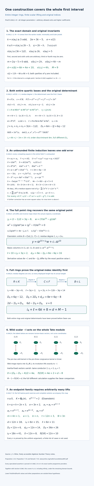

**Figure 31.** The entire first interval in HU1. Sections 6.0AQ.1–6 prove both complete quartic bases, the reciprocal maps and original four-dimensional determinant, the finite scalar-lifting induction of unbounded length, the maximum square error in the whole quartic field, the exact inverse in the original point algebra, its complete two-dimensional basis determinant, both residue weights and the full different tower before the conductor is used. Both odd residue classes of the reciprocal slope parameter are included. Red arrows pair the eight geometric torsion points under the actual wild scalar involution on the whole Tate module. Their labels are nonzero torsion-basis representatives over the three-element field; all page coordinates are schematic layout coordinates. Section 6.0AQ.7 gives a family with arbitrarily large scalar-lifting length, and Section 6.0AQ.8 gives the complete twelve-point exercise and every solution part.

[Open Figure 31 at full size](../assets/uniform-first-interval-odd-second-equality-proof-map.png).

### 6.0AQ.7. An unbounded endpoint family

For every integer \(n\ge0\), take \(K=\mathbf Q_2(\pi)\) with \(\pi^{3n+2}=2\). The Eisenstein polynomial gives its actual ramification and residue field. Set
\[
 \begin{gathered}
 k=q=h=2n+3,\qquad e=3n+2,\\
 a_1=a_2=\pi^{2n+3},\qquad
 a_3=\pi^{3n+5},\qquad a_4=\pi^{4n+6},\qquad a_6=\pi^5.
 \end{gathered}\tag{HU19}
\]
The first equality \(h=k\) is the lower endpoint of the whole proved interval. Here \(m=4n+1\), \(a=1,b=n\), and the scalar induction has \(N=3n\). It is genuinely unbounded in length. The actual complete-ring quantities are
\[
 \begin{gathered}
 d=12n+18,\qquad i_4=6n+15,\qquad \ell=6n+11,\\
 D_4=12n+6,\qquad d_{L/F}=12n+14,\qquad D_8=36n+26,\\
 i_8=18n+41,\qquad \delta=12n+8,\qquad f(E/K)=12n+10.
 \end{gathered}\tag{HU20}
\]
Every member is included by the full proof; no finite list of examples is its substitute. In particular the discriminant exponent of the order \(R[\theta]\) exceeds the full-ring different exponent of \(C\) when \(n>0\).

### 6.0AQ.8. Graded exercise with its complete solution

**Exercise 6.0AQ (twelve points).** (a) Prove the original invariant margins and the single-slope irreducibility for every parameter in HU1 (three points). (b) Construct both full quartic bases, compute the complete original-basis determinant, and distinguish the order discriminant from the full different (three points). (c) Give the entire finite scalar induction, exhaust all competing field squares, and construct the full original point ring with its inverse (four points). (d) Prove restricted NF24 before the conductor, compute the conductor, and verify the unbounded endpoint family (two points).

**Solution.** (a) The second-invariant competitor has margin \(m\), the sixth has margin at least one, and the last four eighth terms have margins \(m,(3k+2q-9)/2,m+1,m\); all are positive for \(q\ge3,k\ge q\). The fourth bound uses the minimum of its two terms and therefore allows cancellation. The three nonleading discriminant margins are \(6(k-q)+5,9k-3q-6,(9k-6q+1)/2\), all strictly positive. In the fourth invariant, \(v(24)=3e\) makes the second term higher than \(b_2^2\) by at least \(3q-7\); hence \(d=6k,v(c_4)=4h,v(j)=12h-6k>0\). The earlier original-coefficient model proof gives \(M=9\). For a reciprocal root smaller than \(m/4\), the leading term of HU5 is uniquely least; for a larger root the constant is uniquely least. Thus all roots have value \(m/4\). A proper monic factor would have integer constant value its degree times that fraction, impossible for degree one, two or three because \(m\) is odd. This proves the actual quartic field.

(b) Unique field expansions in \(\theta\) have distinct fractional summand values, so integrality gives exactly the four divisions by \(\pi^{n_j}\). For \(m=4r+1\) their total is \(6r\); for \(m=4r+3\) it is \(6r+3\), giving \(J=3(m-1)/2\). The stated \(a,b\) give a value-one \(\varpi\); its degree is four, and its basis has values \(0,1,2,3\) modulo four. Nonnegative value therefore gives the complete \(R[\varpi]\) basis too, with residue degree one. The cubic derivative term has value \(6m\), below all others by the positive margins in HU3–HU8. This is the discriminant of the order \(R[\theta]\). The complete diagonal basis determinant \(\pi^J\) subtracts \(2J\), leaving full different \(3m+3\). Multiplying all six reciprocal embedding differences gives \(\pi^{6k}/N(\theta)^3\), and the full diagonal basis change contributes \(\pi^J\). The norm has value \(m\), so the original index is \(6k+J-3m=3h+6\), independently of the eventual conductor.

(c) HU7 and the normalized reciprocal equation give \(X=\alpha+\gamma\theta^3\) up to error above \(t=3m\). Inverting to the power \(5a\) yields constant \(\mu\) and unit odd coefficient \(\lambda\); the other nonsquare terms of \(V\) have the strictly larger values written in HU10. For \(N=\lfloor t/4\rfloor\), first lift the residue square root of \(\mu\). At each \(j=1,\ldots,N\), divide the remaining constant-ring error by \(\pi^j\) and lift the residue square root after multiplication by \(\alpha^{-aj}\). This makes the next error divisible by \(\pi^{j+1}\). The identities \(\varpi^{4j}=\alpha^{aj}\pi^j\) modulo value \(t+4j\), and cross-term bound \(4e+2>t\), prove \(v_F(\mu-c_*^2)>t\) for the entire displayed \(c_*\). Adding \(S\) gives a unit \(g\) with exact error \(t\). Every root of the same residue differs by value \(r\ge1\): its square correction has even value \(2r\), and its cross term has value above \(t\). Thus it either gives a smaller error or leaves the odd value \(t\); all other roots give error at most zero. The maximum is proved over all \(F\). With \(j_0=(t-1)/2\), the shifted polynomial has constant value one and linear value \(4e-j_0\ge7\), so its entire point ring is \(C[w]\). Substituting \(g=S+c_*\) gives the exact original inverse \(y=\varpi^{10+j_0}w+c_*\varpi^{10}\). Its full basis determinant gives \(\ell=10+j_0\), and the lower derivative term gives \(d_{L/F}=8e-2j_0\).

(d) Both residue degrees are one. Thus the original tower gives \(i_8=2i_4+\ell=12k-3q+14\), and the full tower gives \(D_8=2(6q-12)+(8e-6q+16)=8e+6q-8\). Substitution of \(2e=3k-5\) verifies \(6d-2i_8=D_8\) and \(i_4+\ell=d+8\) before any Swan use; the constructed ramified point quadratic gives \(\nu=0\). Total ramification gives the orbit defects three and seven. The explicit congruence-kernel argument and unique residual involution put \(-I\) in the whole wild Tate-module image, so the tame conductor is two. The previously proved full-ring Swan identity then gives \(\delta=4e\) and \(f=d-8\), yielding the Euler equality with \(M=9\). Finally HU19 gives \(m=4n+1,t=12n+3,N=3n\); inserting \(k=q=2n+3,e=3n+2\) into the already proved formulas gives every entry of HU20 and both original-index identities for every \(n\ge0\).

**Remaining full-course scope.** The entire first interval is included, with arbitrary allowed units and zero or arbitrary higher third/fourth coefficients. The earlier higher-first proof makes the combined range \(h\ge k\), including infinity, at the stated odd second equality. First values below \(k\), lower third/fourth bounds, other preparations and additive complements, and universal NF24 remain open. The stated prerequisite results remain required.


## 6.0AR. Lower even second invariant with a weaker fourth bound

**Proposition 6.0AR (integral equation maps, full normalization and the weaker fourth bound).** Let \(K/\mathbf Q_2\) be finite, \(R\) its integer ring, \(v(\pi)=1\), and \(e=v(2)\). Keep the original integral equation
\[
y^2+a_1xy+a_3y=x^3+a_2x^2+a_4x+a_6.
\]
Define its invariants with all terms retained:
\[
\begin{gathered}
b_2=a_1^2+4a_2,\qquad b_4=a_1a_3+2a_4,\qquad b_6=a_3^2+4a_6,\\
b_8=a_6b_2-a_1a_3a_4+a_2a_3^2-a_4^2,\qquad
4b_8=b_2b_6-b_4^2,\\
\Delta=-b_2^2b_8-8b_4^3-27b_6^2+9b_2b_4b_6,\qquad c_4=b_2^2-24b_4.
\end{gathered}
\tag{HV1}
\]
Assume that an even integer \(\kappa\ge2\) satisfies
\[
\begin{gathered}
3\kappa<2e+5,\qquad t=2e+\kappa+5,\qquad \mu=t/4,\qquad n=2e-3\kappa+5,\\
v(b_2)=2e+\kappa,\qquad v(b_6)=2e+5,\qquad
v(b_4)>B:=e+2\mu=2e+(\kappa+5)/2.
\end{gathered}
\tag{HV2}
\]
Zero fourth invariant is included. The parameter \(\kappa\) belongs to the second invariant; no equality with the original \(v(a_2)\) is assumed. Then the original model is Weierstrass minimal with nine geometric components of type \(II^*\), and
\[
\begin{array}{c|c}
d=v(\Delta)&4e+10\\
i_4&3e+3\kappa/2+6\\
D_4&n+3\\
\ell& (n+19)/2\\
D_{8/4}&8e-n+1\\
D_8&8e+n+7\\
i_8&7e+3\kappa/2+24\\
\delta&4e\\
f(E/K)&4e+2
\end{array}
\tag{HV3}
\]
Here the quartic and point integer rings, the original-order indices, and the relative different are constructed before the conductor calculation. Both field extensions are totally ramified, of degrees four and eight over \(K\), with residue degree one. In particular \(i_4+\ell=d+8\) and \(M-1+f=d\).

This proposition enlarges the fourth-invariant range of Section 6.0AJ exactly under HV2. Its original model, whole normalization rings, raw indices and conductor are proved below for the enlarged range. The earlier argument and all its examples remain intact.

### 6.0AR.1. Exact receiving equation and earlier proof scope

If \(v(a_1)<e\), its square in \(b_2\) is uniquely least because \(v(4a_2)\ge2e\). This contradicts HV2. The same argument in \(b_6\) applies to \(a_3\). Thus \(s=a_1/2\) and \(r=a_3/2\) are in \(R\), including when either numerator is zero. Complete the square without deleting its constant or cross term:
\[
\begin{gathered}
Y=y+sx+r,\qquad y=Y-sx-r,\\
A_2=a_2+s^2=b_2/4,\qquad
A_4=a_4+2sr=b_4/2,\qquad A_6=a_6+r^2=b_6/4,\\
Y^2=x^3+A_2x^2+A_4x+A_6,\\
v(A_2)=\kappa,\qquad v(A_4)>2\mu,\qquad v(A_6)=5.
\end{gathered}
\tag{HV4}
\]
Every equality follows by expansion in the original equation. Conversely the receiving coefficients recover the original ones by
\[
(a_1,a_2,a_3,a_4,a_6)
=(2s,A_2-s^2,2r,A_4-2sr,A_6-r^2).
\tag{HV5}
\]
Substitution in HV1 preserves all four invariants. The homogeneous maps \([X:y:Z]\mapsto[X:y+sX+rZ:Z]\) and their inverses have integral matrices of determinant one, fix \([0:1:0]\), and substitute to the same homogeneous cubic. They are isomorphisms of integral models and of their generic elliptic curves, with
\[
\frac{dx}{2y+a_1x+a_3}=\frac{dx}{2Y},\qquad
R[x,y]=R[x,Y],\qquad C[y]=C[Y].
\tag{HV6}
\]
The order equalities use both integral inverse expressions, not just a field isomorphism.

The parameter consequences are
\[
n\ge1\ {\rm odd},\qquad n\le2e-1,\qquad
\mu=\kappa+n/4>\kappa,\qquad \mu\ge9/4,\qquad
e+\kappa-\mu=(2e+3\kappa-5)/4\ge3/4.
\tag{HV7}
\]
They follow from even \(\kappa\ge2\) and the strict inequality in HV2; the last lower bound uses \(e\ge1\). Hence \(v(A_4)>2\mu\ge9/2\) implies \(v(A_4)\ge5\). The receiving equation has divisibilities \(1,2,3,4,5\) and a unit sixth quotient in the exact statement of Lemma 6.0E. Its written resolution applies. Theorem 6.0I.8 and the origin-germ converse following Theorem 6.0I.9 give minimality; Lemma 6.0H gives the Euler calculation. The integral inverse model transports these to the original equation, before any use of conductors.

The local-field foundations are proved in Programme Lesson 01, Sections 0A–0G. Sections 6.0K.2, 6.0K.6 and 6.0P.5 supply the written trace-dual, tower, torsion-order and Swan/permutation providers. The finite unit construction is written in HL11–HL13; its hypotheses are verified anew below. Milne's free author notes [*Algebraic Number Theory*](https://www.jmilne.org/math/CourseNotes/ANT.pdf), Proposition 7.55 and Remark 7.56, printed pp.129–130, provide local-field context. All specialized assertions here have proofs here or in these actual earlier programme proofs; the external source supplies no substitute.

### 6.0AR.2. All changed discriminant and quartic comparisons

In HV1, \(v(b_2b_6)=4e+\kappa+5\), whereas \(2v(b_4)>2e+4\mu=4e+\kappa+5\). Consequently \(v(b_8)=t\) exactly. The complete discriminant has the following margins above the sixth-square term of value \(4e+10\):
\[
\begin{gathered}
v(b_2^2b_8)-(4e+10)=2e+3\kappa-5>0,\\
v(8b_4^3)-(4e+10)>2e+6\mu-10>0,\\
v(9b_2b_4b_6)-(4e+10)>e+\kappa+2\mu-5>0,\\
v(24b_4)-(4e+2\kappa)>2(\mu-\kappa)=n/2>0,\\
d=4e+10,\qquad v(c_4)=4e+2\kappa,\qquad
v(j)=8e+6\kappa-10\ge10.
\end{gathered}
\tag{HV8}
\]
The three first margins have respective lower bounds \(3,11/2,5/2\), from \(e\ge1,\kappa\ge2,\mu\ge9/4\). Thus the minima asserted in the discriminant and \(c_4\) are unique. Smoothness and potential good reduction follow from the actual earlier written criteria.

For the unchanged original sign-pair polynomial
\[
\begin{gathered}
q(X)=X^4+(b_2/3)X^3+b_4X^2+b_6X+b_8/3,\\
v(b_2)-\mu=2e+\kappa-\mu>0,\qquad
v(b_4)-2\mu>e>0,\qquad
v(b_6)-3\mu=n/4>0,
\end{gathered}
\tag{HV9}
\]
all middle terms lie strictly above the endpoint line. A root of value below \(\mu\) would have uniquely least fourth-power term; one of value above \(\mu\) would have uniquely least constant term. Both contradict its polynomial equation. Thus every root has value \(\mu\). Since \(t\) is odd, this value has denominator four. The earlier local degree formula forces degree four, ramification index four and residue degree one for \(F=K(x)\). The quartic is irreducible.

Put \(v_F=4v\). The four normalized powers have pairwise distinct fractional classes in \([0,1)\), so summands with coefficients in \(K\) cannot cancel at a minimum. Coefficientwise integrality proves the whole integer ring:
\[
\begin{gathered}
m_j=\lfloor jt/4\rfloor,\qquad
C=R\oplus R\,x/\pi^{m_1}\oplus R\,x^2/\pi^{m_2}\oplus R\,x^3/\pi^{m_3},\\
i_4=m_1+m_2+m_3=3(t-1)/2,\qquad D_4=2d-2i_4=n+3.
\end{gathered}
\tag{HV10}
\]
For \(t=4a+1\) the floors are \(a,2a,3a\); for \(t=4a+3\) they are \(a,2a+1,3a+2\). Their sum is the determinant valuation of the original power basis. The earlier exact quartic order discriminant is \(-\Delta^2/27\), including its sign and odd denominator. The trace-matrix change of basis gives \(D_4\) only after proving the full ring.

### 6.0AR.3. Actual uniformizer and the arbitrary-unit construction

Keep both exact uniformizer polynomials:
\[
\begin{gathered}
\theta=\begin{cases}x/\pi^a&t=4a+1,\\ \pi^{a+1}/x&t=4a+3,\end{cases}
\qquad v_F(\theta)=1,\qquad C=R[\theta],\\
\theta^4+\gamma_3\theta^3+\gamma_2\theta^2+\gamma_1\theta+\gamma_0=0,\\
(\gamma_3,\gamma_2,\gamma_1,\gamma_0)=
\begin{cases}
(b_2/(3\pi^a),\,b_4/\pi^{2a},\,b_6/\pi^{3a},\,b_8/(3\pi^{4a}))&t=4a+1,\\
(3b_6\pi^{a+1}/b_8,\,3b_4\pi^{2a+2}/b_8,\,
b_2\pi^{3a+3}/b_8,\,3\pi^{4a+4}/b_8)&t=4a+3 .
\end{cases}
\end{gathered}
\tag{HV11}
\]
Direct substitution or reciprocal substitution in the whole \(q\) proves these formulas. The four powers of \(\theta\) again have distinct quarter-valuations, proving the complete ring \(R[\theta]\). The constant has \(F\)-value four. The sixth-invariant odd-degree term has exact value \(n+4\); the other odd-degree term has value \(3t-16\), with margin \(4e+6\kappa-10>0\). The revised quadratic comparison is
\[
v_F(\gamma_2\theta^2)=4v(b_4)-2t+4>4e+4>n+4.
\tag{HV12}
\]
The last inequality uses \(n\le2e-1\). Middle coefficients are integral and divisible by \(\pi\): their term values exceed four, while their coefficient values are multiples of four. Hence both polynomials are Eisenstein and
\[
u=-\gamma_0/\pi\in R^\times,\qquad
\theta^4=\pi u+\varepsilon,\qquad
\varepsilon=-\gamma_3\theta^3-\gamma_2\theta^2-\gamma_1\theta,\qquad
v_F(\varepsilon)=n+4.
\tag{HV13}
\]

For every base unit \(u_0\), put \(J=\lfloor n/4\rfloor\). Starting with \(S_{-1}=0\), choose residue lifts \(c_j\in R\) by
\[
\overline{c_j}^{\,2}\overline u^{\,j}
=\overline{(u_0-S_{j-1})/\pi^j},\qquad
S_j=\sum_{i=0}^j c_i^2(\pi u)^i,\qquad
w=\sum_{j=0}^J c_j\theta^{2j}.
\tag{HV14}
\]
Squaring is bijective in the finite characteristic-two residue field: it is injective because a square-zero difference vanishes, and finiteness gives surjectivity. Subtracting the chosen residue term proves \(u_0-S_j\in\pi^{j+1}R\) inductively; hence every quotient used in the recursion exists. Its first coefficient and \(w\) are units. For \(m\ge1\), the full telescoping identity yields
\[
\begin{gathered}
\theta^{4m}-(\pi u)^m
=\varepsilon\sum_{i=0}^{m-1}\theta^{4(m-1-i)}(\pi u)^i,\qquad
v_F\bigl(\theta^{4m}-(\pi u)^m\bigr)\ge n+4m,\\
w^2-S_J=\sum_{j=1}^J c_j^2\bigl(\theta^{4j}-(\pi u)^j\bigr)
+2\sum_{0\le i<j\le J}c_ic_j\theta^{2i+2j},\\
v_F(u_0-S_J)\ge4(J+1)>n,\qquad
v_F(2c_ic_j\theta^{2i+2j})\ge4e+2>n,\qquad
v_F(w^2-u_0)\ge n+1.
\end{gathered}
\tag{HV15}
\]
The diagonal bounds use HV13 and each summand's exact value \(4(m-1)\). The cross bounds use \(i+j\ge1\) and \(n\le2e-1\). Empty sums at \(J=0\) cause no exception. This proves the required arbitrary precision with no square root of a base unit adjoined.

### 6.0AR.4. Original point generator, full ring and exact different

Let \(A=a_1x+a_3\) and retain the full completed square and tangent quantities:
\[
\begin{gathered}
Y=y+A/2,\qquad U=x^3+(b_2/4)x^2+(b_4/2)x+b_6/4,\qquad Y^2=U,\\
N=3x^2+(b_2/2)x+b_4/2,\qquad B_0=3x+b_2/4,\qquad
N^2-4UB_0=-3q(x)=0.
\end{gathered}
\tag{HV16}
\]
Expand before taking the quartic quotient to prove the polynomial identity; it retains the original square's cross term through HV4. The first term in \(N\) has value \(2\mu\). The second has margin \(e+\kappa-\mu\ge3/4\), and the third has strictly positive margin \(v(b_4)-e-2\mu>0\). Thus \(v(N)=2\mu\) and \(N\ne0\). Put
\[
\begin{gathered}
u_0=b_2/(4\pi^\kappa)\in R^\times,\qquad
B_*=B_0/\pi^\kappa=u_0+3x/\pi^\kappa\in C^\times,\qquad
v_F(3x/\pi^\kappa)=n,\\
v(U)=4\mu-2e-\kappa=5,\qquad
\zeta=N/(2\pi^{\kappa/2}Y),\qquad \zeta^2=B_*,\\
D=N/(2\pi^{\kappa/2}B_*)\in C,\qquad v_F(D)=10,\qquad
y=D\zeta-sx-r .
\end{gathered}
\tag{HV17}
\]
The unit and identity in HV16 give \(v(U)=5\) directly; alternatively its other terms have values \(3\mu,\kappa+2\mu,v(b_4)-e+\mu>3\mu\), all greater than five. Hence \(Y\ne0\). Evenness of \(\kappa\) makes \(\pi^{\kappa/2}\) a base element. The equation for \(\zeta\) follows from HV16, and \(1/\zeta=\zeta/B_*\) proves the inverse expression for the actual original \(y\). The shift \(sx+r\) is integral. Its stronger valuation bound in the narrower HL1 preparation is not needed here.

Use HV14 for this actual base unit \(u_0\). The odd root term of value \(n\) and the larger square error have a unique minimum. Thus, with \(j=(n-1)/2\),
\[
\begin{gathered}
v_F(w^2-B_*)=n,\qquad
\eta=(\zeta-w)/\theta^j,\\
\eta^2+a\eta+b=0,\qquad a=2w/\theta^j,\qquad b=(w^2-B_*)/\theta^{2j},\\
v_F(a)=4e-j>0,\qquad v_F(b)=1,\qquad
L=F(\eta),\qquad \mathcal B=C[\eta]\text{ in full}.
\end{gathered}
\tag{HV18}
\]
This polynomial is Eisenstein. It gives degree and ramification two, residue degree one and \(v_L=2v_F\), with \(v_L(\eta)=1\). In a combination \(c+d\eta\), coefficient valuations from \(F\) are even and the second term has odd valuation. Noncancellation proves integrality exactly when \(c,d\in C\); thus \(\mathcal B\) is the entire ring. The two derivative terms have values \(8e+1\) and \(8e-2j=8e-n+1\), with gap \(n>0\). The written full-ring trace-dual proof gives
\[
D_{8/4}=8e-n+1,\qquad
y=(Dw-sx-r)+D\theta^j\eta,\qquad
\begin{pmatrix}1&Dw-sx-r\\0&D\theta^j\end{pmatrix},\qquad
\ell=v_F(D\theta^j)=10+j=(n+19)/2 .
\tag{HV19}
\]
The matrix has the original point basis as columns in the entire basis \((1,\eta)\). Every entry in its shift is integral; its determinant gives the exact index by the earlier DVR basis-reduction proof. Residue degree one, rather than quartic ramification four, is its absolute length weight.

### 6.0AR.5. Tower, conductor and all quartic-containing overorders

Write \(\omega_0=1,\omega_j=x^j/\pi^{m_j}\) for the whole quartic basis in HV10, and let \(M_z\) be multiplication by \(z\) in that basis. In the whole basis \((\omega_0,\omega_1,\omega_2,\omega_3,\eta\omega_0,\eta\omega_1,\eta\omega_2,\eta\omega_3)\), the original ordered basis \((1,x,x^2,x^3,y,xy,x^2y,x^3y)\) has the full matrix below, with \(\alpha=Dw-sx-r\). The exact inclusions and different tower give
\[
\begin{gathered}
H=\operatorname{diag}(1,\pi^{m_1},\pi^{m_2},\pi^{m_3}),\qquad
\mathcal M_8=\begin{pmatrix}H&M_\alpha H\\0&M_{D\theta^j}H\end{pmatrix},\qquad
\det\mathcal M_8=\pi^{2i_4}\operatorname{N}_{F/K}(D\theta^j),\\
D_8=2D_4+D_{8/4}=8e+n+7,\qquad
i_8=2i_4+\ell=7e+3\kappa/2+24,\qquad
6d-2i_8=D_8 .
\end{gathered}
\tag{HV20}
\]
Each block comes directly from \(x^j=\pi^{m_j}\omega_j\) and \(y=\alpha+D\theta^j\eta\); all original columns are present. The determinant of multiplication is its field norm by the earlier norm-matrix proof. Its base valuation is \(\ell\), since the residue degree is one. This proves the original eight-dimensional index without discarding the determinant unit. The last equality independently agrees with the original point-order discriminant \(-\Delta^6/3^9\), proved in the earlier torsion-order calculation. The integral maps HV6 keep the same order, trace factors and fields. Transitivity on four and eight embeddings gives \(\epsilon_4=3,\epsilon_8=7,\nu=0\). The four-pair orbit forces nontrivial wild image: an odd-order tame inertia image cannot have that orbit. The earlier quaternion and lift proof gives its central involution as minus the identity on the cohomology representation, so inertia invariants vanish. Applying the written Swan/permutation identity only after the full rings gives
\[
\delta=(D_8-D_4-4)/2=4e,\qquad
f=2+\delta=4e+2,\qquad i_4+\ell=d+8,\qquad 8+f=d .
\tag{HV21}
\]

There is also an exact description of every overorder containing \(C\), between the original \(C[y]\) and \(\mathcal B\). From HV19,
\[
\begin{gathered}
C[y]=C+\theta^\ell C\eta,\qquad
Q_s=C+\theta^sC\eta\quad(0\le s\le\ell),\\
\xi_s=\theta^s\eta,\qquad
\xi_s^2+a\theta^s\xi_s+b\theta^{2s}=0,\\
\operatorname{length}_R(\mathcal B/Q_s)=s,\qquad
v(\operatorname{disc}(Q_s/R))=D_8+2s,\qquad
\operatorname{length}_R(Q_s/R[x,y])=i_8-s,\qquad
(Q_s:\mathcal B)=\theta^s\mathcal B .
\end{gathered}
\tag{HV22}
\]
Indeed \(\mathcal B/C\simeq C\eta\) is free of rank one, so intermediate submodules are exactly the ideals \(\theta^s C\eta\) of the DVR. Each is a ring by the displayed multiplication equation. Norm of the determinant has base value \(s\), since the residue degree is one, proving the discriminant and length formulas. For the conductor, \((u+v\eta)\eta=-bv+(u-av)\eta\). Membership in \(Q_s\) first requires \(v\in\theta^sC\); membership of this product then forces \(u\in\theta^sC\), and these conditions suffice. Thus the conductor ideal is as stated. This classifies orders containing the full quartic ring, not every order containing only \(R[x,y]\).

Retain the actual nonzero-trace derivatives
\[
\begin{gathered}
d_2=2\eta+a,\qquad d_4=4\theta^3+3\gamma_3\theta^2+2\gamma_2\theta+\gamma_1,\\
Q_s^{\vee,C}=d_2^{-1}(\theta^{-s}C+C\eta),\qquad
Q_s^{\vee,R}=(d_4d_2)^{-1}(\theta^{-s}C+C\eta),\\
\begin{pmatrix}
\operatorname{Tr}_{L/F}(\theta^{-s}/d_2)&
\operatorname{Tr}_{L/F}(\theta^{-s}\xi_s/d_2)\\
\operatorname{Tr}_{L/F}(\eta/d_2)&
\operatorname{Tr}_{L/F}(\eta\xi_s/d_2)
\end{pmatrix}
=\begin{pmatrix}0&1\\1&-a\theta^s\end{pmatrix}.
\end{gathered}
\tag{HV23}
\]
The conjugate root is \(-a-\eta\), with derivative \(-d_2\). Direct subtraction gives traces \(0,1,-a\) for \(1/d_2,\eta/d_2,\eta^2/d_2\). Therefore the displayed pairing matrix has unit determinant \(-1\), proving the whole relative dual. For the absolute dual, integral pairing with all \(C\)-multiples is equivalent by trace transitivity to the relative traces lying in \(C^{\vee,R}=d_4^{-1}C\); this proves the second formula. Conjugation preserves every \(Q_s\), because \(\theta^s a\in C\). No zero-trace approximation or quartic-normal-closure descent is used.

### 6.0AR.6. Exactly added levels and actual equations

The old bound in HL3 is \(\beta=2e+(\mu+5)/2\). Its difference from the new one is
\[
\beta-B=n/8,\qquad
\#\{m\in\mathbf Z:B<m\le\beta\}=\left\lfloor\frac{n+4}{8}\right\rfloor.
\tag{HV24}
\]
Because \(\kappa\) is even, \(B\) is a half-integer. Write the possible added integers as \(m=B+1/2+j\), \(j\ge0\). Their condition is \(j\le(n-4)/8\), giving the stated count, including zero at \(n=1,3\). At every odd \(n\ge5\) this is a strict enlargement of integer invariant values. Every added level is realized over the original field by
\[
Y^2=x^3+\pi^\kappa x^2+\pi^{m-e}x+\pi^5.
\tag{HV25}
\]
Here \(b_2=4\pi^\kappa\), \(b_4=2\pi^{m-e}\), \(b_6=4\pi^5\), and \(m-e>2\mu\ge9/2\). Thus the actual receiving fourth coefficient is integral of value at least five. All earlier proofs apply to these equations. If a field with prescribed ramification is desired, take \(\pi^e=2\); its Eisenstein polynomial supplies the actual finite extension by the earlier local-field proof.

For \(e=10,\kappa=2\), one has \(t=27,\mu=27/4,n=19,B=47/2,\beta=207/8\). The added levels are exactly \(24,25\). At the first,
\[
\begin{gathered}
K=\mathbf Q_2(\pi),\quad \pi^{10}=2,\quad
Y^2=x^3+\pi^2x^2+\pi^{14}x+\pi^5,\quad
b_8=4\pi^7-\pi^{28},\\
(d,i_4,D_4,\ell,D_{8/4},D_8,i_8,\delta,f)
=(50,39,22,19,62,106,97,40,42).
\end{gathered}
\tag{HV26}
\]
The two \(b_8\) terms have respective values \(27,28\), with no cancellation. The recursion permits \(c_0,\ldots,c_4\), and \(j=9\). There are twenty quartic-containing point overorders \(Q_s\), \(0\le s\le19\). For arbitrary integral \(s,r\), HV5 gives further original equations with the same exact invariants and raw orders. In particular \(s=r=1\) makes \(a_2=\pi^2-1\) and \(a_6=\pi^5-1\) units, illustrating why original coefficient values are not the receiving invariant parameter.

An infinite family with genuinely added values is \(\kappa=2,e=4q+3,n=8q+5\), \(q\ge0\), with \(m=2e+4\) in HV25. Its added-level count is \(q+1\); the fourth coefficient has value \(e+4\). Its full row is
\[
(d,i_4,D_4,\ell,D_{8/4},D_8,i_8,\delta,f)
=(16q+22,12q+18,8q+8,4q+12,24q+20,40q+36,28q+48,16q+12,16q+14).
\tag{HV27}
\]
Direct substitution in HV3 proves each entry. Thus the extension includes arbitrarily deep finite unit recursions and arbitrarily many added fourth-invariant levels.

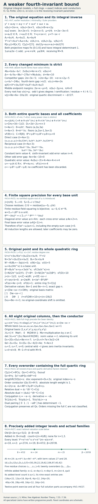

**Figure 32.** Eight panels show the exact forward and inverse equation maps, the revised strict comparisons, both entire quartic bases and actual uniformizer equations, the finite unit recursion, the original point and rank-eight basis maps, all quartic-containing overorders and their nonzero-trace duals, and the two realized added levels and unbounded family. HV1–HV27 are exact proof locators. Panel positions are schematic; the example's valuation axis uses the exact rational thresholds \(47/2\) and \(207/8\). Milne's free author notes, Proposition 7.55 and Remark 7.56, supply the cited local-field context. Every specialized assertion is proved above or in an actual earlier programme proof.

[Open Figure 32 at full size](../assets/weaker-fourth-invariant-even-second-proof-map.png).

### 6.0AR.7. Graded exercise and complete solution

**Exercise 6.0AR (twelve points).** (a) Prove the integral forward and inverse maps and every changed invariant/discriminant/root comparison under HV2 (three points). (b) Prove the entire quartic and point rings, including every uniformizer coefficient, finite square error and original point-basis determinant (four points). (c) Classify all \(C\)-containing point overorders and prove their nonzero-trace duals and conductors (three points). (d) Count and realize all newly admitted integer fourth-invariant levels, and verify HV26–HV27 (two points).

**Solution.** (a) If \(a_1\) or \(a_3\) had value below \(e\), its square would uniquely dominate its complete second or sixth invariant, contrary to HV2. Hence \(s,r\) are integral. Expanding \(y+sx+r\) gives precisely HV4; subtracting it gives HV5. The homogeneous determinant-one maps fix the identity point, and both integral inverses prove the raw order equalities. In \(4b_8=b_2b_6-b_4^2\), the second term is strictly higher than the first, giving \(v(b_8)=t\). The three discriminant competitors have the positive margins in HV8, so \(d=4e+10\); the 24-term has margin greater than \(n/2\), giving the exact \(c_4\). The three quartic middle margins are those in HV9. A root value different from \(\mu\) would give a uniquely least endpoint. Its odd-quarter value forces degree and ramification four. The receiving model satisfies the actual Lemma 6.0E divisibilities, and its written minimality/Euler providers are applied before conductors.

(b) Normalize the first three powers by the floors in HV10. Their fractional classes are distinct, proving coefficientwise integrality and the entire ring. The two floor sums give \(i_4=3(t-1)/2\), and trace-basis change gives \(D_4=n+3\). Substitute each actual \(\theta\) into \(q\) to obtain all four coefficients in HV11. The sixth-invariant error is \(n+4\), the other odd error is larger by \(4e+6\kappa-10\), and the quadratic error is larger by HV12. Thus HV13 holds with a base unit. Residue squaring supplies every coefficient in HV14. Telescoping gives all diagonal errors at least \(n+4j\); every cross error is at least \(4e+2>n\); the last base error is at least \(4(J+1)>n\). Hence \(v_F(w^2-u_0)\ge n+1\).

Expand HV16 before imposing \(q(x)=0\). The exact tangent identity, uniquely least \(N\)-term of value \(2\mu\), and unit \(B_*\) give \(v(U)=5\), \(v_F(D)=10\) and the original inverse \(y=D\zeta-sx-r\). The odd term \(3x/\pi^\kappa\) survives the higher square approximation. Dividing \(\zeta-w\) by \(\theta^{(n-1)/2}\) gives the Eisenstein quadratic HV18. Its two basis parities prove the full ring. The derivative terms have exact gap \(n\), giving \(8e-n+1\). The original basis matrix HV19 has integral shift and determinant of value \(10+j\). The tower and original-order inclusion give HV20; residue degree one supplies the absolute weight. Only after these constructions, the earlier proved inertia/Swan providers give HV21.

(c) The quotient \(\mathcal B/C\) is \(C\eta\). Intermediate modules containing \(\theta^\ell C\eta\) are exactly \(\theta^s C\eta\); the quadratic equation in HV22 proves they are rings. The determinant norm has valuation \(s\), so the discriminant rises by \(2s\), and the inclusion exact sequence subtracts \(s\) from \(i_8\). Multiplication by \(\eta\) forces both coefficients of a conductor element into \(\theta^s C\); conversely these suffice, proving \(\theta^s\mathcal B\). The conjugate \(-a-\eta\) gives the traces \(0,1,-a\). The dual pairing matrix in HV23 has determinant \(-1\), proving the entire relative dual. Trace transitivity with the actual quartic derivative gives the absolute dual. No classification of orders missing the full \(C\) is asserted.

(d) The exact real threshold difference is \(n/8\). Since \(B\) is a half-integer, added integers have form \(B+1/2+j\), with \(0\le j\le(n-4)/8\); their number is \(\lfloor(n+4)/8\rfloor\), including the empty \(n=1,3\) cases. HV25 realizes each level and retains the factor two in \(b_4\). At \(e=10,\kappa=2\), these are \(24,25\), and the first has fourth coefficient \(\pi^{14}\). Substitution gives HV26, recursion length five, and twenty overorders. For \(e=4q+3,\kappa=2\), substitute \(n=8q+5\) into each formula in HV3 to obtain HV27; the chosen \(m=B+1/2\) is admitted newly for every \(q\ge0\).

This proves the stated larger invariant preparation and its original-order conclusions. Lower fourth bounds not satisfying HV2, other second/first/third invariant regimes, all remaining additive preparations and universal NF24 remain open. The stated prerequisite results remain required.


## 6.0AS. High odd second invariant with a weaker fourth bound

**Proposition 6.0AS (the original model and all full factor rings under the weaker invariant bound).** Let \(K/\mathbf Q_2\) be finite, let \(R\) be its integer ring, let \(v(\pi)=1\), and put \(e=v(2)\). Retain the original integral equation
\[
y^2+a_1xy+a_3y=x^3+a_2x^2+a_4x+a_6.
\]
Use the complete invariant definitions in HO2 or HV1, including \(4b_8=b_2b_6-b_4^2\). Assume
\[
\begin{gathered}
k\ge3\text{ odd},\qquad n=2e-3k+5\ge2,\qquad
\mu=k+n/4,\qquad t=4\mu=2e+k+5,\\
v(b_2)=2e+k,\qquad v(b_6)=2e+5,\qquad
v(b_4)>B:=e+2\mu .
\end{gathered}\tag{HW1}
\]
Here \(k\) is defined by the original second invariant. It need not equal \(v(a_2)\). The units in the two equalities are arbitrary, and \(b_4=0\) is allowed. The integer \(n\) is even, with no upper bound. The conclusions concern every factor of the actual quartic, without asserting that each numerical decomposition occurs over each fixed field.

Then the original equation is minimal of type \(II^*\), with nine geometric components and discriminant value \(d=4e+10\). Its full quartic and point rings have the constructions below. If \(D_4\) denotes the residue-weighted different of the full quartic ring, the original indices and conductor satisfy
\[
\begin{gathered}
i_4=d-D_4/2,\qquad
\ell=8+D_4/2,\qquad i_8=2i_4+\ell,\\
i_4+\ell=d+8,\qquad D_8=D_4+8e+4,\qquad
6d-2i_8=D_8,\\
\delta=4e,\qquad f(E/K)=4e+2,\qquad M-1+f(E/K)=d.
\end{gathered}\tag{HW2}
\]
The integer rings and both original-order indices will be obtained before the Swan or elliptic conductor formulas are used.

### 6.0AS.1. Integral comparison with the receiving model

If \(v(a_1)<e\), then \(a_1^2\) is uniquely least in \(a_1^2+4a_2\), since \(a_2\) is integral. This contradicts \(v(b_2)>2e\). The same argument in \(a_3^2+4a_6\) gives \(v(a_3)\ge e\). Thus \(s=a_1/2,r=a_3/2\) are integral, and expansion gives the full forward and inverse maps
\[
\begin{gathered}
Y=y+sx+r,\qquad y=Y-sx-r,\\
Y^2=x^3+A_2x^2+A_4x+A_6,\\
A_2=a_2+s^2=b_2/4,\quad
A_4=a_4+2sr=b_4/2,\quad A_6=a_6+r^2=b_6/4,\\
(a_1,a_2,a_3,a_4,a_6)
=(2s,A_2-s^2,2r,A_4-2sr,A_6-r^2).
\end{gathered}\tag{HW3}
\]
The homogeneous map \([X:y:Z]\mapsto[X:y+sX+rZ:Z]\) and its inverse have integral matrices of determinant one, substitute into the same homogeneous cubic, and fix infinity. They preserve the differential \(dx/(2y+a_1x+a_3)=dx/(2Y)\) and the actual orders \(R[x,y]=R[x,Y]\). These conclusions follow from both displayed inverse expressions.

Since \(2e=3k+n-5\), one has \(e\ge3\), \(\mu\ge7/2\), and \(e+k-\mu=(6k+n-10)/4>0\). The receiving coefficients have values \(k,>2\mu,5\), respectively. In particular \(v(A_2)\ge3,v(A_4)\ge8,v(A_6)=5\), with first and third coefficients zero. They satisfy the actual divisibilities and sixth-unit hypothesis of the earlier Lemma 6.0E. Its written resolution, Theorem 6.0I.8 and the origin-germ converse following 6.0I.9 prove minimality with nine components; Lemma 6.0H proves its Euler calculation. The integral inverse map transports these facts to the original equation.

The local-field, full-normalization, trace-dual and tower inputs are the written proofs in Lesson 01, Sections 0F–0G, and this lesson's Sections 6.0K.2 and 6.0P.2–6.0P.5. The complete uniformizer-series lemma in Section 6.0AM.4 applies to an actual full factor ring under its stated different inequalities; it is not restricted to the coefficient preparation HO1. Those inequalities are proved anew below. The freely accessible human local-field context is recorded in Section 6.0AM.1. No external citation replaces a proof.

### 6.0AS.2. Every revised minimum and the original point map

The two terms of \(b_2b_6-b_4^2\) have values \(4e+k+5\) and strictly greater than \(2e+4\mu=4e+k+5\). Thus \(v(b_8)=t\). Retaining every discriminant and fourth-invariant term gives
\[
\begin{aligned}
v(b_2^2b_8)-(4e+10)&=2e+3k-5>0,\\
v(8b_4^3)-(4e+10)&>2e+6\mu-10>0,\\
v(9b_2b_4b_6)-(4e+10)&>e+k+2\mu-5>0,\\
v(24b_4)-(4e+2k)&>2(\mu-k)=n/2>0,\\
d&=4e+10,\quad v(c_4)=4e+2k,\quad v(j)=8e+6k-10>0 .
\end{aligned}\tag{HW4}
\]
The first three positive lower bounds, after replacing \(2e\), are \(6k+n-10\), \(9k+5n/2-15\), and \(9k/2+n-15/2\). They are positive already at \(k=3,n=2\). The least terms are therefore unique, even with absent higher terms. The nonzero discriminant proves smoothness. The earlier integral-\(j\) argument gives potential good reduction.

For the same original sign-pair polynomial
\[
q(X)=X^4+(b_2/3)X^3+b_4X^2+b_6X+b_8/3,
\]
the three endpoint margins are \(2e+k-\mu>0\), \(v(b_4)-2\mu>e>0\), and \(2e+5-3\mu=n/4>0\). A root value smaller than \(\mu\) makes its fourth power uniquely least; a larger value makes the constant uniquely least. Hence every root in every embedding has value \(\mu\).

Above that same root put
\[
\begin{gathered}
A=a_1x+a_3,\quad Y=y+A/2,\quad
U=x^3+a_2x^2+a_4x+a_6+A^2/4,\\
B_0=3x+b_2/4,\quad N=3x^2+(b_2/2)x+b_4/2,\\
N^2-4UB_0=-3q(x),\quad
s_0=\pi^{(k-1)/2},\quad u_0=b_2/(4\pi^k)\in R^\times,\\
B=B_0/s_0^2=\pi u_0+3\pi^{1-k}x,\quad
\zeta=N/(2s_0Y),\quad \zeta^2=B,\\
D=N/(2s_0B),\qquad y=D\zeta-A/2 .
\end{gathered}\tag{HW5}
\]
Expansion proves the identity before passing to \(q(x)=0\). In \(N\) the later terms exceed \(2\mu\) by \(e+k-\mu>0\) and \(v(b_4)-e-2\mu>0\). Therefore \(v(N)=2\mu\). The two \(B_0\) terms have values \(\mu>k\) and \(k\), so its value is \(k\). The identity yields \(v(U)=4\mu-2e-k=5\). The correction to \(\pi u_0\) has value \(1+\mu-k>1\), whence \(v(B)=1\). Finally \(2\mu-e-(k-1)/2-1=2\), so \(v(D)=2\). All denominators are nonzero. Conversely \(D^2B=U\) and \(\zeta^{-1}=\zeta/B\) recover exactly the original point field and equation. The shift \(A/2=sx+r\) is integral. Its value need not be three or even positive.

### 6.0AS.3. The whole quartic ring and every different bound

The finite full-normalization procedure in Section 6.0P.2 gives \(B_4=\prod_jC_j\), with actual fields \(F_j\), ramification \(E_j\), residue degrees \(f_j\), and \(\sum_jE_jf_j=4\). Write \(v_j=E_jv\). The earlier unramified lifting and uniformizer-basis proofs give the actual unramified ring \(R_j\subset C_j\) and \(C_j=R_j[\alpha_j]\), with \(v_j(\alpha_j)=1\). Let \(d_j\) be its full different exponent.

Set \(m=\lfloor\mu\rfloor\), \(Z=x/\pi^m\), and
\[
\begin{gathered}
Q(Z)=Z^4+C_3Z^3+C_2Z^2+C_1Z+C_0,\\
(C_3,C_2,C_1,C_0)
=(b_2/(3\pi^m),b_4/\pi^{2m},b_6/\pi^{3m},b_8/(3\pi^{4m})),\\
\begin{array}{c|cc}
&n=4r,\ r\ge1&n=4r+2,\ r\ge0\\\hline
m&k+r&k+r\\
v(Z)&0&1/2\\
v(C_3)&2e-r&2e-r\\
v(C_2)&>e&>e+1\\
v(C_1)&r&r+2\\
v(C_0)&0&2\\
v(Q'(Z))&r&r+2\\
v(\operatorname{disc}Q)&4r&4r+8
\end{array}
\end{gathered}\tag{HW6}
\]
These are the two exhaustive even-\(n\) cases. In the full derivative \(4Z^3+3C_3Z^2+2C_2Z+C_1\), the last term is uniquely least. The revised quadratic term has value greater than \(2e\) or \(2e+3/2\); these exceed \(r\) or \(r+2\). The other terms exceed them as well, using \(e=(3k+4r-5)/2\) or \((3k+4r-3)/2\). The discriminant row follows from \(\operatorname{disc}q=-\Delta^2/27\) and scaling by \(\pi^{-12m}\).

For a monic factor \(p_j\), its power order has trace dual \(p_j'(Z_j)^{-1}R[Z_j]\), by the earlier reversed-power pairing. The dual of \(C_j\) is contained in this lattice, so \(d_j\le v_j(p_j'(Z_j))\). Other monic factors have integral coefficients and integral evaluations, because their roots are integral. Factoring the derivative proves \(d_j\le v_j(Q'(Z_j))\), without identifying an order discriminant with a full different.

If \(E_j\) is odd, it is one or three. In the full Eisenstein derivative over \(R_j\), the leading term has value \(E_j-1\), while every other term has value at least \(E_j\). The leading integer is odd. Thus \(d_j=E_j-1\); for \(E_j=1\) the full unramified residue derivative is a unit. For even factors the precise bounds are
\[
\begin{array}{c|cc}
&E_j=2&E_j=4\\\hline
n=4r&d_j\le2r&d_j\le4r\\
n=4r+2,\ r\ge1&d_j\le2r&d_j\le4r+2\\
n=2&\text{does not occur}&d_j=4
\end{array}
\qquad d_j\text{ even}.
\tag{HW7}
\]
For \(n=4r\) the derivative bound gives both upper bounds. A full quadratic Eisenstein derivative has term values \(2e+1\) and \(2v(c_1)\), of opposite parity. The bound is less than \(2e+1\), so its different is even. A ramification-four factor is the entire quartic field with residue degree one. Its discriminant differs from the even power-order exponent by twice an integral index; its different is even too.

For \(n=4r+2\), choose \(c\in R^\times\) whose residue squares to that of \(u=-C_0/\pi^2\). Keep the full identity
\[
\begin{gathered}
(Z^2-\pi c)^2
=\pi^2(u+c^2)-2\pi cZ^2-C_3Z^3-C_2Z^2-C_1Z,\\
W=(Z^2-\pi c)/(\pi Z),\qquad ZW=Z^2/\pi-c .
\end{gathered}\tag{HW8}
\]
When \(r\ge1\), every term in the square has value at least three. In particular the revised term \(C_2Z^2\) has value greater than \(e+2\ge5\). Hence \(W\) is integral. In the original basis \((1,Z,Z^2,Z^3)\), the full-rank integral lattice \((1,Z,W,ZW)\) has determinant \(-c/(\pi C_0)\), of value minus three. To check it, use \(Z^{-1}=-(Z^3+C_3Z^2+C_2Z+C_1)/C_0\) in \(W=Z/\pi-c/Z\). Its trace discriminant bounds the full discriminant by \(4r+2\).

This gives the stated ramification-four bound. If there is one ramification-two field with residue degree two, it gives \(d_j\le2r+1\); the quadratic parity argument improves this to \(2r\). If there are two ramified quadratic fields, each has residue degree one. For all roots \(Z_i,Z_a\), reduction of \(Q/\pi^2\) shows that \(Z_i^2/\pi\) and \(Z_a^2/\pi\) have the same residue \(\bar c\). The square of their difference has value greater than one, retaining the cross term of value \(e+1\). Thus \(v(Z_i-Z_a)>1/2\), and the other quadratic factor evaluated at \(Z_j\) has value greater than one. Dividing the full derivative by that factor improves its bound to \(d_j<2r+2\); parity gives \(d_j\le2r\). These exhaust even-factor possibilities, since a half-integral root value forces even ramification and the total degree is four.

When \(n=2\), the term \(-C_1Z\) in HW8 has exact value \(5/2\), while the others have value at least three. Thus \((Z^2-\pi c)/\pi\) has value \(1/4\). Each root field must have ramification divisible by four, so there is one quartic field with residue degree one. The integral lattice \((1,Z,Z^2/\pi,Z^3/\pi)\) has index two above the power order, bounding the full different by \(8-4=4\). Every term of the full quartic Eisenstein derivative has value at least four: its leading and quadratic derivative coefficients contain two, and its other nonleading coefficients contain \(\pi\). Its different is exactly four.

For every even factor the bounds imply
\[
d_j\ge E_j,\qquad d_j+1<E_je,\qquad
E_j(1+\mu-k)-1>d_j .
\tag{HW9}
\]
The lower bound follows from the Eisenstein derivative bound \(E_j-1\) and even parity. For \(n=4r\), the final inequality has margin at least \(E_j-1\); the first strict upper comparison follows from \(e=(3k+4r-5)/2\). For \(n=4r+2,r\ge1\), the final margins are at least two for \(E_j=2\) and three for \(E_j=4\), and the upper comparison follows from \(e=(3k+4r-3)/2\). At \(n=2\), they read \(5<4e\) and \(5>4\), with \(e\ge3\).

### 6.0AS.4. The exact square errors and the entire point rings

Fix an even factor and abbreviate \(C,R',\alpha,E,d_C,T=Ee\) as in Section 6.0AM.4. Its proved coefficient-ring and digit construction gives the full unramified ring \(S\), series \(F(A)=A^E\) times a unit with \(F(\alpha)=\pi\), and \(v_C(F'(\alpha))=d_C\). Use the actual digit series \(u_0(P)\) of the original base unit and \(X(A)\) of the original \(x\), with first degree \(E\mu\). The complete integral series and derivative are
\[
\begin{aligned}
H(A)&=F(A)u_0(F(A))+3F(A)^{1-k}X(A),\qquad H(\alpha)=B,\\
H'(\alpha)&=(u_0(\pi)+\pi u_0'(\pi))F'(\alpha)
 +3\pi^{1-k}X'(\alpha)
 +3(1-k)\pi^{-k}xF'(\alpha).
\end{aligned}\tag{HW10}
\]
The apparent denominator is cancelled by \(E\mu>E(k-1)\). The first parenthesis is a unit. The other two terms have values at least \(E(1+\mu-k)-1>d_C\) and \(E(\mu-k)+d_C>d_C\). Thus the first term uniquely minimizes, and \(v_C(H'(\alpha))=d_C\), while \(v_C(B)=E\). All hypotheses of the earlier complete series square lemma are now proved under HW1. Taking residue square roots of its even coefficients below \(d_C+1\) gives \(w\in C\) with \(v_C(w)=E/2\) and \(v_C(w^2-B)=d_C+1\). The odd coefficient at that degree remains a unit; all full square cross terms are multiples of two and higher.

There is a precise description of every maximizer, including nonintegral candidates:
\[
\begin{array}{c|c|c}
&\displaystyle\max_{r\in F_j}v_j(r^2-B)&
 \text{all maximizers}\\\hline
E_j\text{ even}&d_j+1&
 w_j+\alpha_j^{d_j/2+1}C_j\\
E_j\text{ odd}&E_j&
 \alpha_j^{(E_j+1)/2}C_j
\end{array}
\tag{HW11}
\]
For an even factor put \(a=d_C/2\) and \(r=w+u\). If \(v_C(u)\le a\), then \(u^2\) has value at most \(d_C\), and \(2wu\) exceeds it by \(T+E/2-v_C(u)>0\). The square is uniquely least in \((w^2-B)+2wu+u^2\). If \(v_C(u)\ge a+1\), both new terms exceed \(d_C+1\), leaving the exact old error. Zero difference has the same error. This proves the first row over the whole field. For an odd factor \(v_j(B)=E_j\) is odd, while a nonzero square has even value. A square below that value uniquely minimizes; every square above it leaves \(B\) uniquely least. This proves the second row and also proves that each radical is nonsquare.

In an even factor put \(a_j=d_j/2\) and \(\eta_j=(\zeta_j-w_j)/\alpha_j^{a_j}\). In an odd factor put \(a_j=(E_j-1)/2=d_j/2\), \(w_j=0\), and \(\eta_j=\zeta_j/\alpha_j^{a_j}\). In both cases the full polynomial is
\[
\begin{gathered}
\eta_j^2+A_j\eta_j+c_j=0,\qquad
A_j=2w_j/\alpha_j^{a_j},\quad
c_j=(w_j^2-B)/\alpha_j^{2a_j},\qquad v_j(c_j)=1,\\
B_j=C_j[\eta_j],\qquad
d_{B_j/C_j}=2E_je+E_j-d_j,\\
y=(Dw_j-A/2)+D\alpha_j^{a_j}\eta_j,\qquad
L_j=\operatorname{length}_{C_j}(B_j/C_j[y])
=2E_j+d_j/2 .
\end{gathered}\tag{HW12}
\]
For even factors \(v_j(A_j)=E_je+E_j/2-d_j/2>0\); for odd factors \(A_j=0\). The polynomial is Eisenstein. In its fraction field the basis \((1,\eta_j)\) has distinct valuation parities, proving that it is the entire ring. In an even factor the upper derivative terms have values \(2E_je+1\) and \(2E_je+E_j-d_j\); the latter is uniquely least by \(d_j-E_j+1\). In an odd factor the derivative is \(2\eta_j\), of value \(2E_je+1\), which gives the same formula since \(d_j=E_j-1\). The shift \(Dw_j-A/2\) is integral by HW3 and HW5. The exact basis determinant \(D\alpha_j^{a_j}\) has value \(L_j\), proving the original \(y\)-order length. Changing a maximizing approximant changes \(\eta_j\) by an element of \(\alpha_jC_j\), by HW11; both integral inverse translations give the same full ring and the same original order.

### 6.0AS.5. Both original bases, the different tower, and the conductor

Choose an actual \(R\)-basis of \(B_4=\prod C_j\), and let \(H\) be the matrix of \((1,x,x^2,x^3)\) in it. Put \(c=(Dw_j-A/2)_j\), \(g=(D\alpha_j^{a_j})_j\), and let \(M_c,M_g\) denote their multiplication matrices on \(B_4\). In the full basis of \(B_8=B_4\oplus B_4\eta\), the entire original basis \((1,x,x^2,x^3,y,xy,x^2y,x^3y)\) has matrix and inverse
\[
\begin{gathered}
\mathcal H=\begin{pmatrix}H&M_cH\\0&M_gH\end{pmatrix},\qquad
\mathcal H^{-1}=
\begin{pmatrix}H^{-1}&-H^{-1}M_cM_g^{-1}\\0&H^{-1}M_g^{-1}\end{pmatrix},\\
\det\mathcal H=(\det H)^2\det M_g,\qquad
\det M_g=\prod_jN_{F_j/K}(D\alpha_j^{a_j}) .
\end{gathered}\tag{HW13}
\]
Block multiplication verifies both inverse products, without omitting the original shift or any norm unit. The norm value is \(\sum_j f_jL_j\), by the previously proved residue-degree norm formula.

With \(D_4=\sum_jf_jd_j\), the trace determinant of the original quartic order gives \(2d=2i_4+D_4\). HW12 and the displayed rank-eight determinant give
\[
\begin{aligned}
\ell&=\sum_jf_jL_j=8+D_4/2,\qquad i_4+\ell=d+8,\\
i_8&=2i_4+\ell=8e+28-D_4/2,\\
D_8&=\sum_jf_j(2d_j+d_{B_j/C_j})=D_4+8e+4,\\
6d-2i_8&=D_8 .
\end{aligned}\tag{HW14}
\]
All weights are residue degrees; \(\sum_jE_jf_j=4\). The last identity follows independently by substitution of \(d=4e+10\), matching the original point-order discriminant \(-\Delta^6/3^9\). This proves the restricted index equality from full rings before any conductor use.

Every point quadratic is ramified, so \(\nu=0\) and the earlier inertia-orbit formulas give \(\epsilon_8-\epsilon_4=4\). Its ramification is \(2E_j\), so the torsion splitting field has nontrivial wild inertia. The proved quaternion/cohomology argument in Section 6.0K.6 supplies its central \(-1\) on the rank-two representation; its inertia invariants vanish. The tame conductor is two. Applying only now the earlier Swan identity gives
\[
\delta=2d-i_4-\ell-2=d-10=4e,\qquad
f(E/K)=4e+2,\qquad M-1+f(E/K)=d .
\tag{HW15}
\]
These conclusions use the cited geometric and cohomological results with their stated hypotheses.

### 6.0AS.6. All orders containing the full quartic base, and their trace duals

An order between \(C_j[y]\) and \(B_j\) which contains \(C_j\) is exactly
\[
O_{j,s}=C_j\oplus\alpha_j^sC_j\eta_j,\qquad 0\le s\le L_j .
\tag{HW16}
\]
Indeed its image in \(B_j/C_j=C_j\eta_j\) is one ideal \(\alpha_j^sC_j\eta_j\); subtracting its included constant recovers the entire displayed module. Conversely the full quadratic relation proves multiplication is closed, and containment of the original order is equivalent to \(s\le L_j\). For the product, the included base idempotents force every order containing \(B_4\) to be \(\prod_jO_{j,s_j}\). There are \(\prod_j(L_j+1)\) such orders. Their full-ring \(R\)-defect is \(\sum_jf_js_j\), their index over the raw original point order is \(i_8-\sum_jf_js_j\), and their discriminant exponent is \(D_8+2\sum_jf_js_j\). No classification is claimed for orders which do not contain the full quartic base.

For \(p+q\eta_j\in B_j\), membership in the conductor first gives \(q\in\alpha_j^sC_j\); multiplication by \(\eta_j\) then gives \(p-qA_j\in\alpha_j^sC_j\). This is equivalent to both \(p,q\) being divisible by \(\alpha_j^s\). Thus \((O_{j,s}:B_j)=\alpha_j^sB_j\).

Retain the complete derivative \(h_j=2\eta_j+A_j\), and a generator \(\delta_{C_j}\) of the actual different of \(C_j/R\), with its full unramified and Eisenstein derivative factors. Conjugation sends \(\eta_j\) to \(-A_j-\eta_j\), so direct subtraction gives
\[
\begin{gathered}
\operatorname{Tr}_{B_j/C_j}(1/h_j)=0,\quad
\operatorname{Tr}_{B_j/C_j}(\eta_j/h_j)=1,\quad
\operatorname{Tr}_{B_j/C_j}(\eta_j^2/h_j)=-A_j,\\
O_{j,s}^{\vee,R}
=\delta_{C_j}^{-1}h_j^{-1}
(\alpha_j^{-s}C_j\oplus C_j\eta_j).
\end{gathered}\tag{HW17}
\]
The relative pairing with \((1,\alpha_j^s\eta_j)\) has matrix
\(\begin{pmatrix}0&1\\1&-\alpha_j^sA_j\end{pmatrix}\), of determinant minus one. This proves the entire dual lattice, including when \(A_j=0\). Applying the full base trace dual then gives the displayed absolute dual.

For completeness the conductors of the two raw original orders are also explicit. Write \(A_4=R[x]\) and \(A_8=R[x,y]=R[x,Y]\) in this paragraph; these order symbols are distinct from the receiving cubic coefficient \(A_4\) in HW3. The reversed-power and quadratic trace pairings give
\[
A_4^\vee=q'(x)^{-1}A_4,\qquad
A_8^\vee=(8UY)^{-1}A_8,\qquad q'(x)=4U .
\tag{HW18}
\]
For a full lattice \(A\) with \(A^\vee=h^{-1}A\) inside its normalization \(B\), trace biduality proves \((A:B)=hB^\vee\). In fact \(bB\subset A\) is equivalent to \(\operatorname{Tr}(bBa/h)\subset R\) for every \(a\in A\). Taking \(a=1\) is necessary, and is sufficient since \(A\subset B\) and \(B^\vee\) is a \(B\)-module. Hence \(b/h\in B^\vee\), exactly the asserted conductor ideal. Trace biduality itself is the inverse-matrix lattice equality for the nondegenerate field trace pairing; it was proved in Section 6.0K.2.

Consequently, with the whole inverse different retained, the exact factor ideals are
\[
\begin{gathered}
(A_4:B_4)=q'(x)B_4^\vee,\qquad
(A_4:B_4)_j=\alpha_j^{\,E_j(2e+5)-d_j}C_j,\\
(A_8:B_8)=8UYB_8^\vee,\qquad
(A_8:B_8)_j=\eta_j^{\,4E_je+14E_j-d_j}B_j .
\end{gathered}\tag{HW19}
\]
Indeed \(v(q')=2e+5\) and \(v(Y)=5/2\), so \(v(8UY)=3e+15/2\). In the point valuation multiply the latter by \(2E_j\), then subtract the full tower different \(d_j+2E_je+E_j\). Since \(\eta_j\) is its uniformizer, this gives the stated second exponent. These are equalities of ideals; HW17–HW19 retain the derivative generators and their units as well. The residue-weighted exponent sums are \(8e+20-D_4=2i_4\) and \(16e+56-D_4=2i_8\). They describe raw-order conductor ideals, separately from the elliptic Artin conductor in HW15.

### 6.0AS.7. Exact added levels and original equations realizing them

The old bound on the fourth invariant in HO2 was
\(\beta=2e+(\mu+5)/2=B+n/8\). Since \(n\) is even and \(k\) odd, both \(2\mu\) and \(B=e+2\mu\) are integers. Thus the finite new invariant levels excluded by that old bound are
\[
v(b_4)=B+j,\qquad 1\le j\le\lfloor n/8\rfloor .
\tag{HW20}
\]
There are exactly \(\lfloor n/8\rfloor\) of them. The depths \(2,4,6\) add none; the first additional level is at \(n=8\). In the receiving equation the analogous new coefficient levels are \(v(A_4)=2\mu+j\).

Every such level is attained over an actual field of ramification \(e\): take a root of \(P^e-2\) over \(\mathbf Q_2\), which has the full degree-\(e\) Eisenstein ring by the earlier proof, and set
\[
a_1=a_3=0,\qquad a_2=u\pi^k,\qquad
a_4=v\pi^{2\mu+j},\qquad a_6=w\pi^5,
\qquad u,v,w\in R^\times .
\tag{HW21}
\]
Then \(v(b_2)=2e+k,v(b_4)=B+j,v(b_6)=2e+5\), so HW1 applies. The nonzero discriminant was already proved for every such choice. The old first and third bounds hold because those coefficients are zero, while its old fourth bound is \(v(a_4)>2\mu+n/8\) and fails exactly at the displayed added levels. For the unbounded family \(k=3,e=4q+2,n=8q\), \(q\ge1\), one has \(\mu=3+2q\), and exactly \(q\) new levels occur. This realizes every level for infinitely many ramification indices.

An original equation with a unit second coefficient shows why the integral comparison is essential. Take \(\pi^{10}=2\) and
\[
a_1=a_3=2,\qquad a_2=3\pi^3-1,\qquad
a_4=\pi^{15}-2,\qquad a_6=\pi^5-1 .
\tag{HW22}
\]
Full expansion gives \(b_2=12\pi^3,b_4=2\pi^{15},b_6=4\pi^5\) and \(4b_8=b_2b_6-b_4^2\). Therefore
\[
\begin{gathered}
e=10,\quad k=3,\quad n=16,\quad\mu=7,\quad B=24,\quad\beta=26,\\
(v(b_2),v(b_4),v(b_6),v(b_8))=(23,25,25,28),\\
d=50,\quad v(c_4)=46,\quad v(j)=88,\qquad
Y=y+x+1,\\
(A_2,A_4,A_6)=(3\pi^3,\pi^{15},\pi^5).
\end{gathered}\tag{HW23}
\]
The fourth invariant meets the new bound and fails the old one. The original \(a_2\) is a unit, and \(A/2=x+1\) has value zero in every factor because \(v(x)=7>0\). The original order still agrees with the receiving order by the explicit integral inverse. The factor-dependent \(D_4\) and \(L_j\) are computed by the full-normalization procedure; this example asserts no specific decomposition without that calculation.

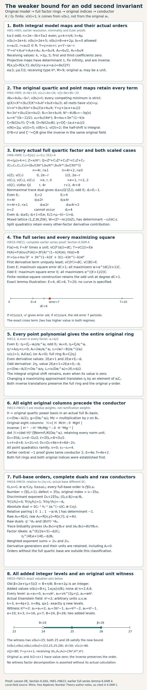

**Figure 33.** The original integral comparison, both exhaustive scaled quartic cases, every full-factor different bound, exact series and square-error cosets, original basis matrices, weighted different tower, full-base orders and trace duals, and the added integer levels. Layout coordinates are schematic. The displayed witness and level endpoints are exact. Proof locators are Sections 6.0AS.1–6.0AS.7 and the earlier written series lemma in Section 6.0AM.4.

[Open Figure 33 at full size](../assets/weaker-fourth-invariant-odd-second-proof-map.png).

### 6.0AS.8. Graded exercise and complete solution

**Exercise 6.0AS (sixteen points).** (a) Prove the integral original-model comparison and every invariant and point-map minimum under HW1 (three points). (b) Prove HW6–HW9 for every actual quartic factor, including both quadratic-factor cases and \(n=2\) (four points). (c) Construct the exact original radical's full point ring, classify every maximizing square, and prove the original basis and tower identities before using the conductor formula (four points). (d) Classify the orders containing the full quartic base and prove all their duals and both raw-order conductor ideals (three points). (e) Count and realize every added level, and check the original unit-second-coefficient witness (two points).

**Solution.** (a) A first or third coefficient of value below \(e\) would have its square uniquely least in \(b_2\) or \(b_6\). Hence both half-coefficients are integral. Expanding \(Y=y+sx+r\), including \(2sr\) and \(r^2\), gives all HW3 formulas and their integral inverses. The homogeneous triangular matrices fix infinity and have determinant one; substitution preserves the cubic and differential and proves both order inclusions. The receiving values are \(k,>2\mu,5\), so its actual earlier nine-component minimal-model proof applies. In \(4b_8=b_2b_6-b_4^2\), the first term uniquely minimizes, giving \(v(b_8)=4\mu\). The three positive margins in HW4 leave the sixth square uniquely least in the full discriminant, and the margin \(n/2\) leaves \(b_2^2\) uniquely least in \(c_4\). All intermediate quartic terms are above the endpoint line, forcing root value \(\mu\). Expanding HW5 gives its exact polynomial identity. The later \(N\) terms are strictly higher, so \(v(N)=2\mu\); \(v(B_0)=k\) then gives \(v(U)=5\). The radical has value one and the exact identity \(2\mu-e-(k-1)/2-1=2\) gives \(v(D)=2\). The inverse \(\zeta^{-1}=\zeta/B\) recovers the same original point field; \(A/2=sx+r\) is integral without any stronger valuation claim.

(b) Scaling by \(m=k+r\) gives both HW6 columns. The revised quadratic coefficient exceeds \(e\) or \(e+1\); its derivative term is therefore strictly higher than \(r\) or \(r+2\). Trace-dual containment bounds the full factor different by the full scaled derivative. Odd ramification has unit leading Eisenstein derivative coefficient and gives \(d_j=E_j-1\). At \(n=4r\), the derivative bound gives \(2r,4r\); the full quadratic derivative's opposite-parity term values and the degree-four discriminant/index relation prove even parity. At \(n=4r+2,r\ge1\), HW8 has every term of value at least three and \(C_2Z^2\) of value greater than \(e+2\). Thus its mixed lattice is integral with determinant value minus three, giving full discriminant at most \(4r+2\). A residue-two quadratic field has \(d_j\le2r+1\), improved to \(2r\) by parity. For two ramified quadratics, all residues of \(Z_i^2/\pi\) agree; squaring a root difference gives value greater than one, so the other factor evaluation exceeds one. Dividing the full derivative by it gives \(d_j<2r+2\), again improved to \(2r\). At \(n=2\), the sole term of value \(5/2\) forces a quarter-valued element and therefore one ramification-four field. Its integral half-valued power lattice has index two and bounds the full different by four; every full Eisenstein derivative term has value at least four. Substitution of these bounds gives every strict inequality in HW9, and the even derivative parity gives the lower bound \(d_j\ge E_j\).

(c) The earlier complete coefficient-ring and implicit-series construction applies to these actual full factor rings. It gives \(F(\alpha)=\pi\) and derivative value \(d_C\). In HW10 the apparent negative power cancels against the proved starting degree \(E\mu\) of \(X\). Its derivative's first term has a unit multiplier; the other two bounds in HW9 and \(\mu>k\) make it uniquely least. Below \(T=v_C(2)\), the first odd unit coefficient is therefore at \(d_C+1\). Lifting square roots of the earlier even coefficients gives \(w\) of value \(E/2\), with exact odd error \(d_C+1\). For \(r=w+u\), a difference of value at most \(d_C/2\) has uniquely least square correction of value at most \(d_C\); a difference of value at least \(d_C/2+1\) leaves the old error unchanged. This proves the entire even maximizing coset, including candidates of negative value. In an odd factor the odd value of \(B\) can never equal a square value, giving exactly the second HW11 row. Dividing by \(\alpha_j^{d_j/2}\) gives the full Eisenstein polynomial in HW12 in both cases. Its derivative retains both terms in even factors and only \(2\eta_j\) in odd factors, giving relative different \(2E_je+E_j-d_j\). The original integral shift leaves determinant \(D\alpha_j^{d_j/2}\), so \(L_j=2E_j+d_j/2\). Both block inverse products in HW13 are identities; its determinant includes every norm factor. Residue weighting yields \(\ell=8+D_4/2\) and \(i_8=2i_4+\ell\), while the original quartic trace determinant gives \(i_4=d-D_4/2\). Thus restricted NF24 and the full different tower follow before conductor use. Every point quadratic ramifies; the earlier central-minus-identity argument gives tame conductor two. Substitution into the proved Swan formula yields \(\delta=4e,f=4e+2\) and the Euler equality.

(d) The image of any full-base order in \(B_j/C_j\) is the unique ideal \(\alpha_j^sC_j\eta_j\). Subtracting included constants proves the whole module HW16, and the quadratic relation proves closure. Containment of the original order is \(s\le L_j\); base idempotents prove the full product classification. Multiplication by \(\eta_j\) forces both conductor coefficients into \(\alpha_j^sC_j\), giving \(\alpha_j^sB_j\). Conjugation changes \(h_j\) to \(-h_j\), so subtraction gives all three traces in HW17. The relative pairing determinant is minus one; multiplying by the actual base inverse different gives the entire absolute dual, including the zero-trace odd case. The power-order and quadratic pairings give the two raw duals in HW18. Trace biduality says \(bB\subset A\) exactly when \(b/h\in B^\vee\), proving the raw conductor identities. Using \(q'=4U\), \(v(U)=5\), and \(v(Y)=5/2\), and subtracting the full point tower different, gives the exponents \(E_j(2e+5)-d_j\) and \(4E_je+14E_j-d_j\). Their residue-weighted sums are \(2i_4,2i_8\), as required.

(e) The old threshold is \(B+n/8\), with integral \(B\), so the additional integer values are exactly \(B+1,\ldots,B+\lfloor n/8\rfloor\). HW21 realizes each over the full Eisenstein field of ramification \(e\), with first and third coefficients zero and fourth value \(2\mu+j\). The family \(k=3,e=4q+2,n=8q\) supplies exactly \(q\) levels for every \(q\ge1\). For HW22, substitute all five original coefficients: the constant and cross cancellations give \(b_2=12\pi^3,b_4=2\pi^{15},b_6=4\pi^5\). The eighth identity gives value \(28\), the full discriminant and fourth-invariant minima give \(50,46\), and hence \(v(j)=88\). The inverse of \(Y=y+x+1\) preserves the original order although the original second coefficient and half-shift are units. Its fourth invariant has value \(25\), strictly above \(24\) and at or below \(26\); it is a genuine added case.

**Remaining proof scope.** This argument proves precisely HW1 and preserves every earlier preparation, proof and concrete example. Lower fourth bounds outside HW1, other invariant regimes and additive complements, and universal NF24 lie outside this family-specific calculation; the general identity is JM30–JM32 in §6.0BI.


## 6.0AT. A type-II family with higher third and fourth coefficients

The first third-coefficient layer in Section 6.0O does not include the family below. Here the quartic has slope three quarters, and an exact point-coordinate correction supplies the full point ring. Its error has different valuations at ramification index one and at higher ramification. Keeping that distinction is essential.

**Proposition 6.0AT.** Let \(K/\mathbf Q_2\) be finite, let \(R\) be its integer ring, normalize \(v(\pi)=1\), and put \(e=v(2)\). Consider the integral equation
\[
 y^2+a_1xy+a_3y=x^3+a_2x^2+a_4x+a_6,
 \qquad
 v(a_1)=1,\quad v(a_2)\ge1,\quad
 v(a_3)\ge2,\quad v(a_4)\ge2,\quad v(a_6)=1.
 \tag{HX1}
\]
Every coefficient satisfying a lower bound may be zero. All allowed units are arbitrary. This equation is minimal of type \(II\). With the original quartic and point orders \(A_4,A_8\) of NF1, their full normal rings and indices satisfy
\[
\begin{array}{c|cc}
 &e=1&e\ge2\\\hline
 d=v(\Delta)&6&7\\
 i_4&3&3\\
 k=\operatorname{length}_R(B_8/B_4[y])&3&4\\
 i_8&9&10\\
 D_4=v(\operatorname{disc}B_4)&6&8\\
 D_8=v(\operatorname{disc}B_8)&18&22\\
 \delta&4&5\\
 f(E/K)&6&7
\end{array}
\tag{HX2}
\]
Both normal algebras are fields with residue degree one. In particular \(M=1\), \(\nu=0\), and NF24 is proved for every equation HX1. The indices in this proposition are obtained before using the Swan identity.

### 6.0AT.1. Written inputs and the discriminant

The earlier Tate-module lesson, UW2–UW3 and UW5–UW6, proves the integer invariant identities, the smoothness criterion in every characteristic, the full pointed coordinate changes and their discriminant weights. The local-field lesson's Proposition 0E.1 supplies the unique extended valuation and the degree/residue identity. Sections 6.0K.2 and 6.0K.6 here prove trace duality, the different tower, the order-index relation and the torsion permutation/Swan comparison. Section 6.0P.5 proves the residue weights in the point tower. These are actual proof interfaces, rather than an invocation of a conductor-discriminant theorem.

For comparison of the integer invariant notation, see [Cremona's freely accessible author edition, Chapter III, §3.1](https://johncremona.github.io/book/fulltext/chapter3.pdf). Its algorithm statement is not used to prove a conductor or a normalization index. The finite integral-lattice setting is also described in [Milne's free notes, Proposition 2.43](https://www.jmilne.org/math/CourseNotes/ANT.pdf); the complete bases used here are proved below.

Expansion of the invariant polynomials gives
\[
\begin{gathered}
 v(b_2)=2,\qquad v(b_4)\ge3,\qquad v(b_8)=3,\\
 v(b_6)=3\quad(e=1),\qquad v(b_6)\ge4\quad(e\ge2).
\end{gathered}\tag{HX3}
\]
Indeed \(a_1^2\) is uniquely least in \(b_2=a_1^2+4a_2\). In
\[
 b_8=a_1^2a_6+4a_2a_6-a_1a_3a_4+a_2a_3^2-a_4^2
\]
the first term has value three, and the other four have values at least \(2e+2,5,5,4\). The bound for \(b_4=a_1a_3+2a_4\) retains both terms and allows cancellation. At \(e=1\), the term \(4a_6\) has value three in \(b_6=a_3^2+4a_6\), whereas \(a_3^2\) has value at least four. At higher ramification both terms have value at least four; no equality between them is assumed.

The four terms of the discriminant consequently have the following valuations or lower bounds:
\[
\begin{array}{c|cccc}
 &-b_2^2b_8&-8b_4^3&-27b_6^2&9b_2b_4b_6\\\hline
 e=1&7&\ge12&6&\ge8\\
 e\ge2&7&\ge3e+9&\ge8&\ge9.
\end{array}\tag{HX4}
\]
There is a unique least term in each row. Thus \(\Delta\ne0\) and its value is six or seven as claimed. The equation is minimal because its discriminant value is less than twelve, by the proved coordinate-weight argument in §1.1. Its reduced cubic is \(y^2=x^3\), and the type-II chart proof in Lemma 6.0A applies since \(v(a_6)=1\). The total surface is regular at the cusp and has a single geometric cuspidal component. The minimal-model identification of §6.0I therefore gives \(M=1\). None of these arguments uses an elliptic conductor formula.

### 6.0AT.2. The entire quartic ring

Use the actual torsion polynomial
\[
 q(x)=x^4+(b_2/3)x^3+b_4x^2+b_6x+b_8/3.
 \tag{HX5}
\]
Every root has value \(3/4\). If a proposed root had smaller value, its fourth power would be uniquely least among these five terms: the excesses of the other terms are \(2-v(x)\), at least \(3-2v(x)\), at least \(3-3v(x)\), and \(3-4v(x)\), all positive. At a larger value the constant term would be uniquely least. A root field thus has ramification degree divisible by four. Its degree is at most four, so the degree identity forces
\[
 F=K(x),\qquad [F:K]=4,\qquad e(F/K)=4,\qquad f(F/K)=1.
\tag{HX6}
\]
In particular the polynomial is irreducible. Normalize \(v_F|_K=4v\). The values of \(1,x,x^2/\pi,x^3/\pi^2\) are respectively \(0,3,2,1\). Their classes modulo four are distinct, so a sum with coefficients in \(K\) is integral exactly when each summand is integral. For each of these four basis elements, that condition is exactly that its coefficient belongs to \(R\). Hence the full ring is
\[
 C=B_4=R\oplus Rx\oplus R(x^2/\pi)\oplus R(x^3/\pi^2),
 \qquad \tau=x^3/\pi^2,\qquad v_F(\tau)=1.
\tag{HX7}
\]
This is a proof of the complete lattice, not only a Newton slope. Its inclusion determinant gives \(i_4=1+2=3\). Since the original quartic order has discriminant value \(2d\), the trace-matrix calculation DA2 yields
\[
 D_4=2d-6=\begin{cases}6&e=1,\\8&e\ge2.\end{cases}
 \tag{HX8}
\]
The four powers of \(\tau\) have values in the four distinct classes modulo four too. They form a \(K\)-basis, since a field containing \(\tau\) has ramification degree at least four. The same coefficient argument gives \(C=R[\tau]\), if a monogenic description is desired.

### 6.0AT.3. An exact point shift and its two error regimes

Make a finite unramified extension containing a primitive cube root \(\zeta\), and put \(c=1+2\zeta\). The direct identities in AL4 give \(c^2=-3\), \(v(c)=0\), and \(v(3+c)=e\). Unramified base change preserves all the original-order lengths and the residue-weighted discriminants by §6.0K.1. The same quartic proof HX6 remains valid after this base change, so the displayed bases can be constructed there without assuming a root already in the initial field.

Inside \(C\), take the actual element
\[
 y_0=\frac{cx^2+a_4}{a_1},\qquad v_F(y_0)=2.
 \tag{HX9}
\]
Here \(cx^2\) has \(K\)-normalized value \(3/2\), smaller than \(v(a_4)\ge2\), so this equality is exact and the shift is integral in the full quartic ring. Let \(P(Y)=Y^2+(a_1x+a_3)Y-x^3-a_2x^2-a_4x-a_6\). Expanding \(P(y_0)\), imposing HX5, and using the definitions of \(b_2,b_4,b_6,b_8\) gives the exact identity
\[
 E_0:=P(y_0)=
 \left(c+\frac{4a_2}{a_1^2}\right)x^3
 +\left(\frac{(3+c)b_4}{a_1^2}-a_2\right)x^2
 +\frac{3b_6}{a_1^2}x+\frac{a_2b_6}{a_1^2}.
 \tag{HX10}
\]
In particular the troublesome constant \(-a_4^2/a_1^2\) has been canceled by the full shift; it was not silently dropped from a leading-term estimate. The coefficient of \(x^3\) is a unit, since \(v(4a_2/a_1^2)\ge2e-1>0\). The coefficient of \(x^2\) has value at least one, since \(v((3+c)b_4/a_1^2)\ge e+1\).

At \(e=1\), the four summands in HX10 have \(F\)-values respectively \(9,\ge10,7,\ge8\). The third is uniquely least. At \(e\ge2\), their values are \(9,\ge10,\ge11,\ge12\), so the first is uniquely least. The trace coefficient of the shifted point polynomial is \(T_0=a_1x+a_3+2y_0\). Its three summands have values \(7,\ge8,4e+2\). They have a unique minimum in both cases. Thus
\[
\begin{array}{c|cc}
 &e=1&e\ge2\\\hline
 v_F(E_0)&7&9\\
 v_F(T_0)&6&7
\end{array}\tag{HX11}
\]
These comparisons include vanishing higher coefficients and every allowed unit.

### 6.0AT.4. The full point ring and original-order determinants

Set \(s=3\) when \(e=1\), and \(s=4\) when \(e\ge2\). The original point algebra is identified by the forward and inverse equations
\[
 \eta=\frac{y-y_0}{\tau^s},\qquad y=y_0+\tau^s\eta,
 \qquad
 \eta^2+\frac{T_0}{\tau^s}\eta+\frac{E_0}{\tau^{2s}}=0.
\tag{HX12}
\]
The last two coefficients have \(F\)-values three and one respectively. This is an Eisenstein quadratic over the complete DVR \(C\). A root has \(F\)-value one half. In the upper normalization \(v_L|_F=2v_F\), the two terms of \(u+v\eta\), for \(u,v\in F\), have different parity. Their sum is integral exactly when both coefficients belong to \(C\). Thus it is a field and its **entire** ring is
\[
 L=F(y)=F(\eta),\qquad B_8=C\oplus C\eta=C[\eta],
 \qquad e(L/F)=2,\quad f(L/F)=1.
\tag{HX13}
\]
The different generator is \(2\eta+T_0/\tau^s\) by the explicit trace-dual proof in §6.0K.2. Its two terms have \(L\)-values \(8e+1\) and six. Therefore the relative different has exponent six in both regimes.

Relative to the basis \(1,\eta\) of the full point ring, the inclusion of \(C[y]\) has matrix
\[
 \begin{pmatrix}1&y_0\\0&\tau^s\end{pmatrix}.
\tag{HX14}
\]
It is an actual integral inclusion matrix. Its determinant gives \(\operatorname{length}_C(B_8/C[y])=s\). Since \(f(F/K)=1\), the same length over \(R\) is \(k=s\). The inclusion of \(A_8=A_4\oplus A_4y\) in \(C[y]=C\oplus Cy\) gives two copies of \(C/A_4\), so
\[
 i_8=2i_4+k=6+s,\qquad D_8=2D_4+6.
\tag{HX15}
\]
The second equality uses the full-ring different tower and both residue degrees one. It gives eighteen or twenty-two. As a separate compatibility check of the two original orders,
\[
 6d-2i_8=2(2d-2i_4)+6=D_8.
\tag{HX16}
\]
For \(e=1\) both sides are eighteen; for \(e\ge2\) both sides are twenty-two. This check does not compute the indices: HX7 and HX14 already did so.

### 6.0AT.5. Descent, the index target and the conductor

The bases above were displayed after one finite unramified extension. The original quartic is a totally ramified field by HX6. The original point algebra is a field as well: a split quadratic over \(F\) would remain split after the unramified extension, contradicting HX12–HX13. Its residue degree must be one, because a nontrivial residue extension would persist as a nontrivial residue factor after an unramified scalar extension, whereas the new point ring is one totally ramified field. Equivalently use the normal-ring/unramified tensor decomposition proved in §6.0K.1. That same argument proves that the full-ring discriminant exponents and the three original-order indices calculated above descend unchanged. Explicit original-field generators are not inferred when \(c\) is absent from it.

There is one inertia orbit on each of the four sign pairs and eight points, by the residue-orbit proof NF20. The point quadratic is ramified, so \(\nu=0\). The calculated indices give, before any conductor use,
\[
 i_4+k=3+s=d=d+M-1+\nu/2.
\tag{HX17}
\]
This proves the actual normalization target NF24 at the full scope HX1. The previously proved permutation identity now gives
\[
 \epsilon_4=3,\qquad\epsilon_8=7,\qquad
 \delta=2d-i_8+i_4-2=d-2.
\tag{HX18}
\]
For completeness the inertia-invariant codimension on the two-dimensional elliptic representation is two here. The totally ramified quartic of degree four forces nontrivial wild action on the sign pairs: a finite inertia action with trivial wild part has odd ramification degree in residue characteristic two. The quaternion calculation of §6.0K.6 then puts the unique involution \(-1\) in the wild torsion image. Its proved whole-representation comparison makes the corresponding action \(-I\) on each permitted \(H_\ell(E)\). It fixes no vector. Thus \(f(E/K)=2+\delta=d\). The previously written Euler formula yields
\[
 -\operatorname{Art}(X/R)=M-1+f(E/K)=d,
\tag{HX19}
\]
with the original Artin and Swan definitions, not replacement ones.

**Scope retained.** This proves all of HX1, uniformly every finite dyadic field and every permitted coefficient. It does not cover type-II preparations with higher or infinite first valuation or with fourth valuation one. Type III, the other additive families, the shorter even star rows and the remaining general NF24 assertion still require their own proofs. 

### 6.0AT.6. Graded exercise and complete solution

**Exercise 6.0AT (twenty-four points).** Work with every coefficient satisfying HX1, rather than a single numerical curve. (a) Prove the two discriminant values and minimality without a conductor theorem (four points). (b) Construct the full quartic ring and compute the original quartic-order index (five points). (c) Expand the actual point shift, distinguish both error regimes and prove that the displayed point ring is the entire normalization (six points). (d) Compute both original-order indices, the full-ring different tower, and NF24 before using the Swan identity (five points). (e) Compute the conductor and explain both the descent and the limits of the result (four points).

**Solution.** (a) The first term of \(b_2\) has value two, while \(4a_2\) has value at least \(2e+1>2\). In \(b_8\) the five values are \(3,\ge2e+2,\ge5,\ge5,\ge4\), with the first uniquely least. Both terms in \(b_4\) have value at least three. At \(e=1\), \(4a_6\) has value three and \(a_3^2\) has value at least four. At \(e\ge2\), both sixth-invariant terms have value at least four. Substitution in the four discriminant terms gives HX4, so the unique least value is six for \(e=1\) and seven otherwise. Both are less than twelve. The proved weight-twelve coordinate-change identity forces minimality. The regular cusp chart with \(v(a_6)=1\) gives type \(II\) and \(M=1\).

(b) If a quartic root has value below \(3/4\), subtract the fourth-power value from those of the other four terms of HX5. Their differences are \(2-v(x),\ge3-2v(x),\ge3-3v(x),3-4v(x)\), all positive. Above \(3/4\) the constant term is uniquely least. Thus every root has that exact value. Its ramification degree is divisible by four, and its field degree is at most four, proving total ramification and irreducibility. In the upper normalization the values of \(1,x,x^2/\pi,x^3/\pi^2\) are \(0,3,2,1\). Distinct classes modulo four prevent cancellation in every \(K\)-linear combination. A term is integral exactly when its coefficient belongs to \(R\); hence this basis is complete. Its determinant against \(1,x,x^2,x^3\) divides by \(\pi^3\), giving \(i_4=3\), and the trace-matrix change gives \(D_4=2d-6\). The element \(\tau=x^3/\pi^2\) has value one.

(c) Adjoin a cube root of unity unramified and use \(c^2=-3\). The element \(y_0=(cx^2+a_4)/a_1\) has upper value two, so is in the full quartic ring. Expand its square and linear term, replace \(-3x^4\) using \(3q(x)=0\), and collect powers of \(x\). The constant is
\[
 \frac{b_8+a_4^2+a_1a_3a_4-a_1^2a_6}{a_1^2}
 =\frac{a_2b_6}{a_1^2},
\]
and the other three coefficients are exactly HX10. Thus no constant term has been discarded. Their term values are \(9,\ge10,7,\ge8\) at \(e=1\), and \(9,\ge10,\ge11,\ge12\) at higher ramification. The shifted trace has values \(7,\ge8,4e+2\), giving minimum six or seven respectively. Divide \(y-y_0\) by \(\tau^3\) or \(\tau^4\). The resulting quadratic has constant value one and linear value three. Its root has half-integral value, so it is a ramified quadratic field. In its upper valuation every expression \(u+v\eta\) has two summands of distinct parity. It is integral exactly when \(u,v\in C\), proving the complete ring \(C[\eta]\), not merely an integral suborder.

(d) The original inverse \(y=y_0+\tau^s\eta\) gives the integral inclusion matrix HX14. Its determinant has value \(s\), so \(k=s\), since the quartic residue degree is one. The original point order has two quartic coefficient slots; passing from \(A_4\) to \(C\) adds \(2i_4=6\) to its index. Thus \(i_8=6+s\), equal to nine or ten. The derivative of the full point polynomial has two upper values \(8e+1\) and six, giving different exponent six. The full tower consequently gives \(D_8=2D_4+6\), equal to eighteen or twenty-two. Check \(6d-2i_8=D_8\) in each regime. The point quadratic is ramified, so \(\nu=0\); before using any Swan formula the actual bases have proved
\[
 i_4+k=3+s=d=d+M-1+\nu/2.
\]

(e) Total ramification gives permutation codimensions three and seven. The already proved finite-permutation character identity yields \(\delta=2d-(6+s)+3-2=d-2\). The quartic's ramification degree four forces nontrivial wild action; the quaternion subgroup contains the scalar involution, which acts as \(-I\) on the whole elliptic representation by the written comparison. Its invariant space is zero, giving \(f=2+\delta=d\). The Euler identity now gives \(-\operatorname{Art}=M-1+f=d\). If the cube root of unity is absent from the starting field, the normal-ring/unramified tensor proof preserves the indices and full-ring discriminants, and detects the field and ramification assertions after that extension. It does not assert that the displayed \(c\)-dependent generators were already in the original ring. Higher or infinite first valuation, fourth valuation one, other fibre types and universal NF24 remain outside this proposition. A numerical sample, a quartic order discriminant alone, or a maximal-order assertion without the parity proof would not establish these conclusions.

## 6.0AU. The full relative critical algebra in residue characteristic two

The remaining conductor comparison needs a uniform algebraic input as well as a ramification argument. We prove that input for every integral Weierstrass equation in residue characteristic two, without restricting its fibre type or its coefficient valuations. The auxiliary algebra below is finite free. The actual critical algebra is its cokernel and has discriminant length. These are different assertions.

**Proposition 6.0AU.** Let \(A\) be any commutative ring in which three is a unit. For arbitrary coefficients in \(A\), put
\[
 f=y^2+a_1xy+a_3y-x^3-a_2x^2-a_4x-a_6,
 \qquad
 B=A[x,y]/(f,f_x),\qquad J=A[x,y]/(f,f_x,f_y).
\tag{HY1}
\]
Then \(B\) is free of rank four with ordered basis \(1,x,y,xy\). Multiplication by \(f_y\) on that basis has determinant \(-\Delta/27\). Both statements hold with nilpotents and zero divisors in \(A\), and commute with arbitrary base change among rings with three invertible.

Consequently, for any DVR \(R\) with three invertible and any integral equation with \(\Delta\ne0\),
\[
 0\longrightarrow B\xrightarrow{\,f_y\,}B\longrightarrow J\longrightarrow0,
 \qquad
 \operatorname{length}_R J=v_R(\Delta).
\tag{HY2}
\]
The scheme defined by \(J\) is the entire relative critical scheme of the projective Weierstrass curve. Its length is residue weighted; it is not just the number of reduced critical points. No regularity of the total Weierstrass surface is assumed. In particular this proposition applies to every prepared dyadic equation left by the previous sections. It does not assert the conductor-discriminant equality.

### 6.0AU.1. Two monic relations over the full coefficient ring

Define seven coefficients using only division by three:
\[
\begin{gathered}
 u=2a_2/3,\quad v=a_4/3,\quad w=-a_1/3,\quad p=2a_1/3,\\
 q=a_3-a_1a_2/9,\quad r=2a_2^2/9-2a_4/3,\quad
 s=a_2a_4/9-a_6.
\end{gathered}\tag{HY3}
\]
Here \(v\) denotes a coefficient only; valuations elsewhere carry a subscript or have an argument. The two relations are
\[
 g=x^2+ux+v+wy,\qquad h=y^2+pxy+qy+rx+s.
\tag{HY4}
\]
Direct expansion gives
\[
 f_x=-3g,\qquad h=f+(x+a_2/3)g.
\tag{HY5}
\]
Thus \((f,f_x)=(g,h)\) over the actual ring, not just its fraction field. Give \(x\) weight two and \(y\) weight three. Replacing \(x^2\) using \(g\) strictly decreases weight, since the other terms have weights at most three. Replacing \(y^2\) using \(h\) also decreases weight, since its other terms have weights at most five. Repeated replacement terminates and expresses every polynomial as an \(A\)-linear combination of \(1,x,y,xy\). This proves spanning without any division by a coefficient of \(A\).

Spanning alone would not rule out hidden relations over a nonreduced base. We prove independence by constructing the whole multiplication representation.

### 6.0AU.2. Explicit matrices prove the complete basis

On a free module \(M=A^4\) with ordered basis \(e_0,e_x,e_y,e_{xy}\), define
\[
 X=\begin{pmatrix}
 0&-v&0&ws\\
 1&-u&0&wr\\
 0&-w&0&-v+wq\\
 0&0&1&-u+wp
 \end{pmatrix},
 \tag{HY6}
\]
and
\[
 Y=\begin{pmatrix}
 0&0&-s&rv-pws\\
 0&0&-r&ru-s-pwr\\
 1&0&-q&pv-pwq+rw\\
 0&1&-p&pu-wp^2-q
 \end{pmatrix}.
 \tag{HY7}
\]
These columns are obtained by reducing \(x\) and \(y\) times the four proposed basis elements. For example, reduce \(x^2y\) by the first relation and then \(y^2\) by the second to obtain
\[
 x^2y=ws+wrx+(-v+wq)y+(-u+wp)xy.
\tag{HY8}
\]
Next reduce \(xy^2=-px^2y-qxy-rx^2-sx\); its four coefficients are exactly the last column of HY7. Multiplying the displayed matrices, with the seven symbols independent, verifies
\[
 XY=YX,\qquad X^2+uX+vI+wY=0,\qquad
 Y^2+pXY+qY+rX+sI=0.
\tag{HY9}
\]
For instance both products on \(e_x\) give HY8, and both products on \(e_y\) give the last column of HY7. On \(e_{xy}\), inserting those two columns cancels the coefficient pairs \(pwr\), \(pwq\), and \(wp^2\); the remaining coefficients agree. The two relation identities then follow by the same column substitution, including the last column. All entries are polynomial expressions with integer coefficients in the seven symbols, so these verifications are valid in every ring.

Commutation defines an \(A[x,y]\)-action on \(M\), and HY9 makes it factor through \(A[x,y]/(g,h)\). The map
\[
 A[x,y]/(g,h)\longrightarrow M,\qquad [P]\longmapsto P(X,Y)e_0
\tag{HY10}
\]
sends \(1,x,y,xy\) to the four basis vectors. Thus any linear relation between them has all four coefficients zero. Together with spanning, this proves the complete free basis. It also verifies that HY6–HY7 are the actual multiplication matrices, rather than matrices of a proposed submodule. No reduced fibre test or separability assertion entered the proof.

### 6.0AU.3. The exact discriminant determinant

Since \(f_y=2y+a_1x+a_3\), its multiplication matrix is
\[
 D=2Y+a_1X+a_3I.
\tag{HY11}
\]
Insert HY3 into HY6–HY7. Expanding the determinant by columns, and grouping its terms by the five coefficient polynomials, gives
\[
 -27\det D=-b_2^2b_8-8b_4^3-27b_6^2+9b_2b_4b_6=\Delta,
\tag{HY12}
\]
where the full definitions are
\[
\begin{gathered}
 b_2=a_1^2+4a_2,\qquad b_4=a_1a_3+2a_4,\qquad b_6=a_3^2+4a_6,\\
 b_8=a_1^2a_6-a_1a_3a_4+4a_2a_6+a_2a_3^2-a_4^2.
\end{gathered}\tag{HY13}
\]
One can perform this expansion without any field specialization: use the twenty-four signed products in the determinant of HY11, multiply by twenty-seven, and substitute the seven expressions HY3. The terms with \(a_6^2\) give \(-432a_6^2\); those involving \(a_4^3\) give \(-64a_4^3\); the remaining products collect into the other terms of the displayed four invariant expressions. Thus HY12 is an identity in \(\mathbf Z[1/3,a_1,a_2,a_3,a_4,a_6]\). Its specialization to \(A\) proves the determinant formula, even when two is zero or a zero divisor. In particular no factor of two was canceled in passing to a dyadic ring. The invariant convention is exactly UW2's and (19)'s convention.

Every part of the construction is given by polynomial formulas with three inverted. Tensoring the basis and its two multiplication matrices therefore gives the same basis and matrices over any \(A\)-algebra. The quotient description of \(J\) is preserved too, since tensoring a cokernel preserves that cokernel. Injectivity in HY2 is asserted for its DVR hypotheses; it is not inferred after an arbitrary nonflat base change.

### 6.0AU.4. The full critical length and its geometric meaning

Now take the stated DVR \(R\). The matrix determinant is nonzero, so multiplication by \(f_y\) is injective: applying the adjugate to a vector in its kernel gives \((\det D)z=0\), and a nonzero scalar kills no vector of the free module \(R^4\). Its cokernel is exactly \(J\), by HY1. The DVR diagonal reduction already proved in §6.0K.2 gives
\[
 \operatorname{length}_R\operatorname{coker}D
 =v_R(\det D)=v_R(\Delta),
\tag{HY14}
\]
since twenty-seven is a unit. This also proves finiteness. This proof does not identify the auxiliary algebra with a finite separable torsion algebra or a normal ring.

On the affine curve \(C=R[x,y]/f\), the presentation of relative differentials is obtained directly by differentiating every polynomial relation:
\[
 C\xrightarrow{\,(f_x,f_y)\,}C\,dx\oplus C\,dy
 \longrightarrow\Omega^1_{C/R}\longrightarrow0.
\tag{HY15}
\]
Indeed the derivation on the polynomial ring sends \(P\) to \(P_xdx+P_ydy\); the ideal \((f)\) contributes precisely multiples of \(df\) after quotienting. This proves the universal property of the displayed differential module. The entries of its single relation generate its first Fitting ideal, namely \((f_x,f_y)\). Its closed subscheme is therefore \(\operatorname{Spec}J\), retaining the full infinitesimal structure. The origin chart at infinity is smooth for every coefficient ring by UW1–UW3, so no additional relative critical component lies there. Hence this affine computation gives the entire projective critical scheme.

Over the DVR every point of this finite scheme is on the special fibre, since HY12 makes \(D\) invertible over its fraction field. Its length is weighted by actual residue degrees. To see the weights explicitly, any finite-length module over \(J\) has a composition series: a simple module is the residue field at one of its finitely many maximal ideals, because a maximal annihilator of a nonzero vector produces that quotient. Successively taking such a vector and quotient decreases the finite \(R\)-length, so induction terminates. A residue field \(k(z)\) has \(R\)-length \([k(z):k_R]\). Additivity of lengths consequently gives
\[
 \operatorname{length}_R J
 =\sum_{z\in\operatorname{Spec}J}[k(z):k_R]
   \operatorname{length}_{J_z}J_z.
\tag{HY16}
\]
Thus a geometric point count, even after an unramified extension, cannot replace the full critical length.

### 6.0AU.5. What remains between this length and the Artin conductor

The general discriminant/differential/Artin comparison is discussed in [Eriksson's freely accessible, corrected preprint](https://arxiv.org/pdf/1106.3096), especially the introduction and §4. Its distinction between regular models and normal models matters. No conductor or localized-Chern theorem from that paper is admitted in place of a local proof here.

The full critical algebra and discriminant length above cover every dyadic integral equation,including the residual preparations of NF24. Section 6.0AX now proves the separate localized coherent-class construction,invariance through the quadratic resolution and original-discriminant comparison. The ramified trace/Swan comparison remains unproved;any localized Chow-valued self-intersection class used for that route must also be identified with the coherent class. The adjunction frame and determinant calculation alone do not supply that trace theorem.

There is also a simple reason not to substitute \(B\) into the finite-separable permutation calculation DA3. For \(a_1=a_2=a_3=a_4=0\) and \(a_6\ne0\) over a characteristic-zero field, HY4 gives
\[
 B=K[x,y]/(x^2,y^2-a_6),\qquad
 \Delta=-432a_6^2\ne0.
\tag{HY17}
\]
The element \(x\) is nonzero and square zero by the proved basis. This algebra is not separable, although its multiplication by \(f_y\) is invertible. It is an auxiliary differential algebra, not the quartic 3-torsion algebra of NF1. The general conductor–index identity is JM30–JM32 in §6.0BI.

### 6.0AU.6. Graded exercise and complete solution

**Exercise 6.0AU (twenty-eight points).** (a) Prove spanning and independence of the complete rank-four auxiliary algebra over an arbitrary ring with three invertible (eight points). (b) Derive the discriminant determinant from its actual multiplication matrices, including the characteristic-two specialization (six points). (c) Prove the DVR exact sequence, full residue-weighted critical length and the relative differential presentation (eight points). (d) Give a generically nonseparable auxiliary algebra with nonzero discriminant, and explain exactly why the conductor comparison is still required (six points).

**Solution.** (a) Divide \(-f_x\) by three to obtain \(g\). Adding \((x+a_2/3)g\) to \(f\) gives \(h\), so the ideals agree by the two explicit inverse relations. Assign weights two and three. Each replacement of \(x^2\) or \(y^2\) strictly decreases weight, and leaves only \(1,x,y,xy\) after finitely many replacements. To prove independence, compute the fourth column of \(X\) by reducing \(x^2y\), and the fourth column of \(Y\) by reducing \(xy^2\) as in HY8. Direct column substitution verifies all three identities HY9 for the seven independent symbols. Thus the commuting matrices define the quotient algebra's action on \(A^4\). Its cyclic vector \(e_0\) is sent successively by \(1,X,Y,XY\) to the four different basis vectors. Every proposed linear relation has four zero coefficients. This proves freeness over the full ring without testing only its reduced fibres.

(b) Multiplication by \(f_y\) is \(2Y+a_1X+a_3I\), since the actual basis and both multiplication operators were proved in (a). Expanding its determinant with HY3 gives HY12; all denominators are powers of three. The result is \(-\Delta/27\), with the four full invariant polynomials HY13. To check its specialization when two is zero, the seven coefficients become
\[
 u=p=r=0,\quad v=a_4,\quad w=a_1,\quad
 q=a_3+a_1a_2,\quad s=a_2a_4+a_6.
\]
The multiplication matrix is then \(a_1X+a_3I\). Its determinant, expanded from HY6, is
\[
 a_1^6a_6+a_1^5a_3a_4+a_1^4a_2a_3^2
 +a_1^4a_4^2+a_3^4+a_1^3a_3^3,
\]
which is exactly the characteristic-two discriminant computed in UW3. Since \(-27=1\) in that characteristic, the signs agree. This direct verification retains all coefficients over a ring with nilpotents too.

(c) Over the DVR the adjugate identity makes the nonzero determinant matrix injective. Its cokernel is \(B/(f_y)\), exactly \(J\), and diagonal DVR reduction proves that the length is the determinant valuation. The factor twenty-seven is a unit, giving \(v_R(\Delta)\). On the affine cubic differentiate the single defining relation. This gives exactly one relation \(f_xdx+f_ydy\) on the two differential generators, proving HY15 and its universal derivation property. Its first Fitting ideal is the ideal of those two entries; hence the full relative critical scheme is the quotient by both derivatives. Infinity contributes none by the actual smooth origin chart. Over the fraction field multiplication by \(f_y\) is invertible, so the finite quotient is supported on the special fibre. A composition series at each maximal ideal has simple factors its residue field; each has \(R\)-length equal to that residue field degree. Add the contributions to obtain HY16. A reduced point count misses both the local lengths and any residue weights.

(d) Set the first four coefficients equal to zero over a characteristic-zero field, retaining \(a_6\ne0\). The two monic relations become \(x^2=0\) and \(y^2=a_6\). The complete basis proves that \(x\) is a nonzero nilpotent, so \(B\) is not a separable algebra. Nevertheless \(f_y=2y\) is a unit and its determinant is \(16a_6^2=-\Delta/27\). Over a dyadic DVR with \(a_6=\pi\), the same basis gives the critical cokernel as two copies, in the \(1,x\) slots, of
\[
 R[y]/(y^2-\pi,2y).
\]
Its length is \(4e+2\): as an \(R\)-module its generators \(1,y\) have relations \(2\pi\) and \(2y\), with respective lengths \(e+1\) and \(e\). Thus the entire critical length is \(2((e+1)+e)=4e+2\), agreeing with \(v(-432\pi^2)\). The auxiliary algebra supplies no permutation action on four separable geometric roots, so DA3 cannot be applied to it. Finally a calculation of the critical length is not a proof that it equals the localized differential class on a regular resolution or that this class equals the original Artin conductor. Both comparisons remain mathematical obligations; neither a theorem citation nor this example closes universal NF24.

## 6.0AV. The full conic thickenings and cohomology of the regular resolution

The critical length in Section 6.0AU belongs to the original Weierstrass cubic. To compare that cubic with its regular resolution, one needs a theorem about the whole blowup, including every infinitesimal layer of its exceptional fibre. A calculation on the reduced exceptional curve would lose precisely the doubled-line information that occurs in small characteristic. We prove the required structure-sheaf comparison here, at every point blowup in the actual construction.

### 6.0AV.1. The tangent algebra and the actual exceptional divisor

Let \((S,\mathfrak n,\kappa)\) be an ambient local ring at one of the point centres, with its three regular parameters \(z_0,z_1,z_2\). Let \(F\) be its surface equation, and put
\[
 B=S/(F),\qquad \mathfrak m=\mathfrak nB,\qquad
 F\in\mathfrak n^2\setminus\mathfrak n^3,
 \qquad Q=\operatorname{in}_{\mathfrak n}(F).
 \tag{HZ1}
\]
Here \(B\) is the local ring of the integral surface, and \(Q\) is the full nonzero quadratic form, including its mixed terms. For the actual ambient rings,
\[
 \operatorname{gr}_{\mathfrak n}S=\kappa[U_0,U_1,U_2],
 \qquad
 \operatorname{gr}_{\mathfrak m}B=\kappa[U_0,U_1,U_2]/(Q).
 \tag{HZ2}
\]

We verify the inputs and the second equality, rather than importing a smoothness assumption on the ambient space over the DVR. The graph presentations in Section 6.0J.4 and the branch charts in Sections 6.0A–G, after translating the chosen residue point, have completed ambient presentation
\[
 C[[z_0,z_1,z_2]]/(\pi_C-H(z_0,z_1,z_2)),
 \qquad H\in(z_0,z_1,z_2),
 \tag{HZ3}
\]
where \(C\) is the original complete DVR or its finite unramified residue extension. Residue lifts and that extension are constructed in Lemma 6.0U and earlier Lesson 3, Sections 0.F.4.13–14. For the initial chart, \(H=z_0\); subsequent charts have the displayed relations \(\pi_C=tv,t^2a,v^2a,w^2ab\), with translations and unit factors where appropriate. Their substitutions and elimination of old graph variables give (HZ3). This is an assertion about those explicit charts, not an assertion that every regular local ring has a coefficient presentation of this form.

The maximal-ideal graded ring of \(C[[z_0,z_1,z_2]]\) is the polynomial ring on \(\Pi,U_0,U_1,U_2\): the degree of a coefficient times a monomial is its DVR valuation plus its monomial degree, and unique series coefficients give each graded basis. The initial form of the graph equation is \(\Pi-H_1(U)\), where \(H_1\) is its degree-one part, possibly zero. Its principal ideal has exactly the initial ideal generated by this form, since initial forms multiply in this polynomial domain. Eliminating \(\Pi\) gives the first equality in (HZ2). Completion preserves every finite maximal-ideal quotient, so it also proves the equality for the local ring before completion. The separatedness used to assign a finite order to a nonzero element is the proved intersection theorem (DFR3), earlier Lesson 3, Section 0.F.4.1.2.

The same multiplication argument now applies to \(F\): every nonzero product \(Fa\) has initial form \(Q\operatorname{in}(a)\). Thus the initial ideal of \((F)\) is exactly \((Q)\). The quotient filtration on \(B\) is its \(\mathfrak m\)-adic filtration, proving the second equality in (HZ2).

Let \(\rho:Z'\to\operatorname{Spec}B\) be the blowup of \(\mathfrak m\). The exceptional fibre with its entire scheme structure is
\[
 E=\operatorname{Proj}(\operatorname{gr}_{\mathfrak m}B)
   =V_+(Q)\subset\mathbf P^2_\kappa.
 \tag{HZ4}
\]
Indeed the blowup is the Proj of \(\bigoplus_{j\geq0}\mathfrak m^j\); its quotient by \(\mathfrak m\) has degree-\(j\) piece \(\mathfrak m^j/\mathfrak m^{j+1}\). The earlier projective-chart proof PF1–PF4 identifies this quotient Proj with the scheme-theoretic fibre. In particular (HZ4) retains a doubled line when \(Q\) is a square.

The fibre is an effective Cartier divisor. Here is the chart calculation that also excludes extra exceptional torsion. In the \(z_0\)-chart of the ambient blowup write \(z_0=t,z_1=tu,z_2=tv\); its ambient chart ring \(T\) is the subring \(S[\mathfrak n/t]\) of \(S[1/t]\). The actual graph charts give
\[
 T/(t)=\kappa[u,v],\qquad F=t^2F',
 \qquad \overline{F'}=Q(1,u,v)\ne0.
 \tag{HZ5}
\]
The nonzero assertion follows by dehomogenizing a nonzero homogeneous polynomial; it does not require that the resulting conic be reduced or smooth. The same statements hold in either other chart. The parameter \(t\) is a nonzerodivisor on \(T\). If \(ta=F'b\) there, reduction modulo \(t\) in the polynomial domain gives \(\bar b=0\). Write \(b=tb_1\) and cancel \(t\) to obtain \(a=F'b_1\). Consequently \(t\) is also a nonzerodivisor on \(T/(F')\), and that quotient is already saturated with respect to \(t\). It is the actual Rees surface chart: after inverting \(t\) its equation agrees with \(B[1/t]\), while saturation removes exactly the kernel of the map to this localization. Thus no additional component or torsion supported at \(t=0\) has been kept.

The ideal \(I=\mathfrak m\mathcal O_{Z'}\) is generated by this nonzerodivisor on each chart. Its change of frame is the usual degree-one change on the exceptional Proj. Hence
\[
 I=\mathcal O_{Z'}(-E),\qquad
 I^j/I^{j+1}=\mathcal O_E(j)\quad(j\geq0).
 \tag{HZ6}
\]
For example the local generator \(z_0\) changes to \(z_1\) by multiplication by \(z_1/z_0\), the transition of the positive tautological line on \(E\). This checks the sign: the conormal line is \(\mathcal O_E(1)\).

### 6.0AV.2. Every layer of a possibly nonreduced conic

We use the exact projective-plane cohomology proved by PF5–PF12 in earlier Lesson 3, Sections 0.C.0.4–6. On its three standard affine opens, split the Čech complex by Laurent monomials. A monomial with a nonempty proper set of negative exponents has the explicit contraction PF11; a monomial with no negative exponent contributes in degree zero; one with all three exponents negative contributes only in degree two. In particular, over any coefficient ring \(A\),
\[
 H^1(\mathbf P_A^2,\mathcal O(d))=0\quad(d\in\mathbf Z),
 \qquad H^2(\mathbf P_A^2,\mathcal O(d))=0\quad(d\geq-2),
 \qquad H^q(\mathbf P_A^2,\mathcal O(d))=0\quad(q>2).
 \tag{HZ7}
\]
For nonnegative degree its sections are the homogeneous polynomials of that degree. These are entire cohomology groups, not Euler characteristics alone.

Multiplication by the nonzero polynomial \(Q\) is injective on the projective-plane charts over \(\kappa\). Thus, for every integer \(j\),
\[
 0\longrightarrow\mathcal O_{\mathbf P^2}(j-2)
 \xrightarrow{Q}\mathcal O_{\mathbf P^2}(j)
 \longrightarrow\mathcal O_E(j)\longrightarrow0.
 \tag{HZ8}
\]
Using (HZ7) in the long exact sequence gives, for every \(j\geq0\),
\[
 H^q(E,\mathcal O_E(j))=0\quad(q>0),\qquad
 H^0(E,\mathcal O_E(j))=(\kappa[U_0,U_1,U_2]/Q)_j,
 \qquad \dim_\kappa H^0(E,\mathcal O_E(j))=2j+1.
 \tag{HZ9}
\]
For the dimension, subtract the degree-\((j-2)\) polynomial dimension from the degree-\(j\) dimension. They are \(\binom{j}{2}\) and \(\binom{j+2}{2}\) for \(j\geq2\); degrees zero and one give 1 and 3 directly. No reducedness assumption enters this calculation.

Define \(nE\) by \(I^n\), for \(n\geq1\). The invertible-ideal filtration (HZ6) gives
\[
 0\longrightarrow\mathcal O_E(n)
 \longrightarrow\mathcal O_{(n+1)E}
 \longrightarrow\mathcal O_{nE}\longrightarrow0.
 \tag{HZ10}
\]
Starting with (HZ9) for \(E\), induction in this sequence proves
\[
 H^q(nE,\mathcal O_{nE})=0\quad(q>0),\qquad
 H^0((n+1)E,\mathcal O)\twoheadrightarrow H^0(nE,\mathcal O)
 \quad(n\geq1).
 \tag{HZ11}
\]

More precisely, the restriction of base functions is an isomorphism of rings
\[
 B/\mathfrak m^n\xrightarrow{\ \sim\ }
 H^0(nE,\mathcal O_{nE})\quad(n\geq1),
 \qquad \operatorname{length}_B H^0(nE,\mathcal O_{nE})=n^2.
 \tag{HZ12}
\]
For \(n=1\), both sides are \(\kappa\), and the map is the identity on constants. The map on the next layer is
\(\mathfrak m^n/\mathfrak m^{n+1}\to H^0(E,\mathcal O_E(n))\).
The definitions of the Rees coordinates identify it with the degree-\(n\) polynomial quotient in (HZ2) and (HZ9), so it is an isomorphism, not merely a map between equal dimensions. Compare the short exact sequences for these two filtrations; (HZ11) makes the lower section sequence short exact. If the outer maps and the previous quotient map are isomorphisms, lifting a quotient class and correcting its layer proves surjectivity of the middle map; the same two steps prove injectivity. This proves (HZ12) by induction. Each layer is killed by \(\mathfrak m\) and has dimension \(2j+1\) over the actual residue field \(\kappa\). Summing these lengths for \(0\leq j<n\) gives \(n^2\). No count of geometric components replaces this length.

### 6.0AV.3. Structure sheaves and all higher direct images

**Theorem 6.0AV.3.** Each of these multiplicity-two surface point blowups satisfies
\[
 \mathcal O_Z\xrightarrow{\ \sim\ }\rho_*\mathcal O_{Z'},
 \qquad R^q\rho_*\mathcal O_{Z'}=0\quad(q>0).
 \tag{HZ13}
\]
Here \(Z\) may still be singular. In particular the statement does not presuppose normality of \(Z\).

*Proof.* Away from the point centre the blowup is the identity. At that point its base-localized map is proper over \(\operatorname{Spec}B\). Proper coherence, proved in earlier Lesson 3, Theorem 0.C.10, makes all its cohomology modules finite over \(B\). The formal-functions theorem NF2 and its stalk version NF7, proved in earlier Lesson 3, Sections 0.F.2.1–5, give
\[
 \widehat{(R^q\rho_*\mathcal O_{Z'})_z}
   =\varprojlim_n H^q(nE,\mathcal O_{nE}).
 \tag{HZ14}
\]
Its thickenings are exactly the ones above, since \(\mathfrak m^n\mathcal O_{Z'}=I^n\). For \(q>0\), (HZ11) makes the right side zero. The zero-completion detection proved in FFR9 then makes the finite stalk zero: completion projects onto the first quotient, and finite Nakayama kills a finite module whose quotient by the maximal ideal is zero.

For degree zero put \(N=(\rho_*\mathcal O_{Z'})_z\). The natural map \(B\to N\) has isomorphic completions by the compatible natural maps (HZ12). It is already an isomorphism before completion. To check the needed algebra explicitly, every finite-module completion surjects onto its quotient modulo \(\mathfrak m\), by successive lifts through the surjective quotient maps. The completed map being surjective, \(B/\mathfrak m\to N/\mathfrak m N\) is surjective. The finite cokernel of \(B\to N\) consequently has zero quotient modulo \(\mathfrak m\), and Nakayama makes it zero. Its kernel lies in \(\bigcap_n\mathfrak m^nB\), because the completed map is injective. That intersection is zero by DFR3. Alternatively the written Artin–Rees equality DFR1 applied to this finite kernel puts it in its own maximal-ideal multiple, and Nakayama again kills it. This proves (HZ13) at the remaining stalk. The higher direct-image stalk identification is SC14.3; coherent sheaves with every stalk zero are zero. \(\square\)

The free [Stacks formal-functions theorem](https://stacks.math.columbia.edu/tag/02OC) gives a comparison statement with exactly these Noetherian, proper and coherent hypotheses. The proof used here is the actual earlier programme proof NF2/NF7; the link is not a replacement for it. The monomial computation is likewise written in the programme, and can be compared with the free [projective-space cohomology calculation](https://stacks.math.columbia.edu/tag/01XS).

### 6.0AV.4. Composing the blowups and descending the comparison

Let \(\alpha:X\to W\) be a finite succession of the point blowups just treated, with their entire intermediate surfaces. Then
\[
 \alpha_*\mathcal O_X=\mathcal O_W,\qquad
 R^q\alpha_*\mathcal O_X=0\quad(q>0),\qquad
 H^q(X,\mathcal O_X)=H^q(W,\mathcal O_W)\quad(q\geq0).
 \tag{HZ15}
\]
All maps here are the natural pullbacks on functions and cohomology.

Here is a direct cohomological proof of composition. For any affine open in an intermediate surface, (HZ13) and the affine-section identification SC14.2 give zero positive cohomology of its inverse image under the next blowup, and identify its sections with those of the affine open. Take a finite affine cover of the inverse image of an affine open under the preceding succession. The surfaces are separated, so every finite intersection is affine; their quasi-compactness gives a finite cover. After one more blowup the inverse images of these intersections are acyclic. The acyclic-cover proof SC12.1 computes cohomology by the resulting Čech complex: resolving a sheaf by injectives and taking the cover double complex, its intersection-cohomology rows vanish in positive degree, leaving the degree-zero row. That row is exactly the previous Čech complex, because the section maps on every intersection are isomorphisms by (HZ13). Thus one additional blowup changes neither those cohomology groups nor their maps. Induct through the finite succession. Applying SC14.2 to each affine open of \(W\) proves the first two assertions of (HZ15). Using a finite affine cover of \(W\) and the same acyclic-cover argument proves its last assertion. No unproved composition spectral sequence is needed.

Some centres are checked after a finite unramified extension \(R\to R'\). This does not restrict the conclusion to split curves. All base changes here are flat. On a finite affine cover and its affine intersections, tensoring the section complex with \(R'\) gives precisely the section complex of the base change. Tensoring an exact sequence with a flat module is exact; applying this to kernels and images shows that its cohomology is
\[
 H^q(V,\mathcal O_V)\otimes_R R'
   =H^q(V_{R'},\mathcal O_{V_{R'}}).
 \tag{HZ16}
\]
This uses the earlier affine and Čech proofs SC1–SC12, and applies also to the inverse images of the affine opens just used. If (HZ15) holds after that extension, its vanishing modules and the kernel and cokernel of its section map tensor to zero. Faithful flatness makes each original module zero. Hence the comparison descends to the original DVR. A centre of nontrivial residue degree is included in this argument; there is no replacement of its full conic by a rational point or a component count.

For additive reduction, Section 6.0J.5 verifies multiplicity two at every actual centre of Sections 6.0A–E and at every stage and missing direction of the arbitrary-index recurrence 6.0G. Its coefficient-one square term survives in residue characteristics two and three. Arithmetic preparation and the geometric recurrences terminate by the actual proofs in 6.0F and 6.0G. The already regular type-II model has no centre. Thus (HZ15) applies to every constructed additive model, without a bound on the star index or on the absolute ramification index.

For completeness it also applies to the good and multiplicative constructions. Good reduction has no blowup. After the unramified splitting and the written nodal preparation in Section 4, a multiplicative singularity has equation \(uv-\pi^r\). For \(r\geq2\) its tangent equation is \(uv\), with an additional \(-\Pi^2\) when \(r=2\), and has degree exactly two. In the \(\pi\)-chart one obtains \(u_1v_1-\pi^{r-2}\); for \(r=2\) it is smooth, for \(r=3\) its base-parameter derivative makes it regular, and otherwise this is the same singularity with smaller index. In the \(u\)-chart the ambient relation and surface equation are
\[
 \pi=up_1,\qquad v_1=u^{r-2}p_1^r.
 \tag{HZ17}
\]
Eliminating \(v_1\) gives the regular ambient graph surface \(\pi=up_1\); at the intersection its maximal ideal has parameters \(u,p_1\), and elsewhere one of them is a unit or gives the smooth chart. The \(v\)-chart is the same calculation with \(u,v\) exchanged. This checks the other directions and the multiplicity at every remaining centre; \(r=1\) is already regular. These are the completed charts of the actual maximal-ideal blowups, as proved in Section 6.0I.5; no algebraization of the formal coordinates is assumed. Completion preserves the finite quotients defining their tangent algebras and commutes with the flat base change of the Rees algebra. Flat Čech base change therefore gives (HZ13) after completing the local base, and the finite kernel, cokernel and higher-image modules descend by the zero-completion argument FFR9. This is the finite resolution of the prepared node, not a new assertion that its formal preparation holds without the hypotheses and proof in Section 4. Flat descent (HZ16) includes the nonsplit multiplicative case.

### 6.0AV.5. The entire cubic cohomology and the adjunction line

Let \(R\) be the complete DVR of this lesson and let \(W\subset\mathbf P_R^2\) be its minimal integral Weierstrass cubic with nonzero generic discriminant. Its homogeneous equation is nonzero on each ambient domain chart and hence a nonzerodivisor. Therefore
\[
 0\longrightarrow\mathcal O_{\mathbf P_R^2}(-3)
 \xrightarrow{F}\mathcal O_{\mathbf P_R^2}
 \longrightarrow\mathcal O_W\longrightarrow0.
 \tag{HZ18}
\]
The exact Čech monomial computation PF12 gives
\[
 H^0(\mathbf P_R^2,\mathcal O)=R,\quad H^{q>0}(\mathbf P_R^2,\mathcal O)=0,
 \qquad H^0(\mathbf P_R^2,\mathcal O(-3))=H^1(\mathbf P_R^2,\mathcal O(-3))=0,
 \qquad H^2(\mathbf P_R^2,\mathcal O(-3))=R\,[1/(XYZ)].
 \tag{HZ19}
\]
There is no cohomology above degree two. The long exact sequence of (HZ18), followed by (HZ15), now proves
\[
 H^0(W,\mathcal O_W)=H^0(X,\mathcal O_X)=R,\qquad
 H^1(W,\mathcal O_W)\xrightarrow{\ \sim\ }H^1(X,\mathcal O_X)=R,
 \qquad H^{q\geq2}(W,\mathcal O_W)=H^{q\geq2}(X,\mathcal O_X)=0.
 \tag{HZ20}
\]
The isomorphism with \(R\) in degree one uses the connecting map to the explicitly displayed Čech generator. The discriminant need not be a unit: (HZ18) and its cohomology use the Cartier cubic equation, not a smooth special fibre. This supplies the singular-cubic statement directly, without extending the smooth-family hypotheses of earlier Lesson 3, UW4, by implication.

The same succession preserves the explicit adjunction line, with its generic normalization. Section 6.0J.2 proves the ordered Koszul frame and its coordinate and equation transition rules; Section 6.0J.3 proves its global cubic generator. At each actual point blowup, RC8–RC10 give
\[
 dz_0\wedge dz_1\wedge dz_2=t^2dt\wedge du\wedge dv,
 \qquad F=t^mF',\qquad
 \rho^*\eta=t^{2-m}\eta',\qquad m=2.
 \tag{HZ21}
\]
The coefficient is a unit on the whole chart; the saturation check in (HZ5) ensures that these are the actual surface charts. Thus the adjunction lines are isomorphic at every step, including a doubled tangent line. RC5–RC6 identify their global generator on the generic fibre with
\(dx/(2y+a_1x+a_3)\). For multiplicative centres the same graph presentations (HZ17) and the same two-equation Koszul calculation apply. For nonsplit centres, the unit-frame descent proved in 6.0J.5 applies to a section and its inverse. Consequently the entire regular resolution has trivial explicit adjunction line and the structure-sheaf comparison (HZ15).

This conclusion concerns the explicit adjunction line. It does not make the generally noninvertible relative differential sheaf invertible,nor identify a normalized general dualizing functor without a proof of that identification. Section 6.0AX supplies the separate localized coherent-class construction and its full critical-length comparison on the regular resolution. The equality with the actual Artin/Swan expression still requires a ramified trace proof;universal NF24 remains open.

### 6.0AV.6. Why multiplicity two cannot be silently dropped

The full-thickening argument detects the failure for a cubic tangent curve. Over a characteristic-zero field \(\kappa\), take the local cone
\[
 B_3=\kappa[x,y,z]_{(x,y,z)}/(x^3+y^3+z^3).
 \tag{HZ22}
\]
Its equation is irreducible by the following elementary check. In the rational function field \(\kappa(y,z)\), the order along \(w=y+z\) is an integer: expand a polynomial in \(w\) with coefficients in the domain \(\kappa[z]\), take its least nonzero exponent, and subtract orders for a quotient. Multiplication adds these orders. The factorization \(y^3+z^3=(y+z)(y^2-yz+z^2)\) has order one, since its second factor reduces to \(3z^2\ne0\). A root of the cubic in \(x\) would have three times its integer order equal to one, which is impossible. A reducible cubic over a field has a linear factor and hence a root, so this polynomial is irreducible over \(\kappa(y,z)\). Monic division in \(x\) injects its quotient over \(\kappa[y,z]\) into the corresponding degree-three field extension, proving that quotient is a domain. Thus its Rees charts are the same saturated strict-transform charts as above, now with degree three. The exceptional curve is the full plane cubic \(E_3=V_+(x^3+y^3+z^3)\), whose partial derivatives show it is smooth: simultaneous vanishing of \(3x^2,3y^2,3z^2\) is impossible in projective space. Its cohomology follows directly from the cubic equation sequence and (HZ7), without a genus classification:
\[
 H^1(E_3,\mathcal O_{E_3})=\kappa,\qquad
 H^1(E_3,\mathcal O_{E_3}(j))=0\ (j\geq1),\qquad
 H^2(E_3,\mathcal O_{E_3}(j))=0\ (j\geq0).
 \tag{HZ23}
\]
The same conormal calculation gives the layers \(\mathcal O_{E_3}(j)\) of the thickenings \(nE_3\). Their long exact sequences and (HZ23) give isomorphisms
\[
 H^1((n+1)E_3,\mathcal O)\xrightarrow{\ \sim\ }
 H^1(nE_3,\mathcal O)=\kappa\quad(n\geq1).
 \tag{HZ24}
\]
Here both adjacent layer groups, in degrees one and two, vanish. In particular the inverse limit is nonzero; a nonzero first layer alone would not have proved this. Formal functions therefore makes the completed degree-one direct-image stalk of this blowup nonzero. Formula (HZ13) fails for this multiplicity-three example. This also explains why the actual quadratic tangent equations, including their nilpotent structure, are indispensable inputs in the Weierstrass proof.

### 6.0AV.7. Graded exercise: the whole exceptional fibre (40 points)

**Exercise 6.0AV.** Work over an arbitrary field \(\kappa\) unless another base is specified. Use the written projective Čech calculation and formal-functions theorem, retaining the scheme structure of every exceptional divisor.

1. **The doubled line (8 points).** Let \(E=V_+(U_0^2)\subset\mathbf P^2_\kappa\). Compute \(H^0(E,\mathcal O_E(j))\) for every \(j\geq0\), including an explicit decomposition that keeps the nilpotent coordinate. Prove \(H^{q>0}(E,\mathcal O_E(j))=0\). Explain the difference from the reduced line.
2. **All conic thickenings (8 points).** Let \(B=\kappa[[x,y,z]]/(x^2+yz)\), let \(\rho\) blow up its maximal ideal, and let \(E\) be its full exceptional fibre. Prove the natural isomorphism \(B/\mathfrak m^n\simeq H^0(nE,\mathcal O_{nE})\), its length \(n^2\), and the vanishing of all positive cohomology for every \(n\geq1\). Give an actual basis for the degree-zero sections when \(n=3\).
3. **Detection before completion (10 points).** Using the preceding layer computation, prove both \(R^q\rho_*\mathcal O=0\) for \(q>0\) and \(\mathcal O\simeq\rho_*\mathcal O\). For the latter, separately prove surjectivity and injectivity of the natural map on the original local stalk. Do not conclude merely that their completions have the same rank.
4. **The minimal cubic (8 points).** Over the DVR \(R\), compute the structure-sheaf cohomology of a minimal Weierstrass cubic with singular special fibre and of its actual regular resolution. Identify the degree-one Čech generator. Compute the adjunction-frame exponent in a point blowup with surface multiplicity \(m\), and apply it at the actual quadratic centres. State precisely what remains to be proved before this becomes a conductor comparison.
5. **A cubic tangent curve (6 points).** For the characteristic-zero cone in (HZ22), compute \(H^1(nE_3,\mathcal O_{nE_3})\) and its transition maps for all \(n\geq1\). Show why the positive direct-image vanishing fails, and why a calculation only on the first infinitesimal fibre would be insufficient evidence for that conclusion.

**Full solution.**

1. Apply the injective equation sequence
\(0\to\mathcal O(j-2)\xrightarrow{U_0^2}\mathcal O(j)\to\mathcal O_E(j)\to0\).
The projective Čech computation gives zero middle cohomology for every twist and zero degree-two cohomology in degrees at least \(-2\). For \(j\geq0\), its long exact sequence therefore identifies the sections with the polynomial quotient and kills all positive groups. The explicit section space is
\[
 H^0(E,\mathcal O_E(j))
 =\kappa[U_1,U_2]_j\oplus U_0\kappa[U_1,U_2]_{j-1},
 \qquad \kappa[U_1,U_2]_{-1}=0.
\]
Its dimension is \(j+1+j=2j+1\), with the second term zero for \(j=0\). The second summand is a nonzero nilpotent ideal when \(j\geq1\). The reduced line has only the first summand and dimension \(j+1\); replacing \(E\) by it loses the entire second summand.

2. The tangent quotient is \(\kappa[U,V,W]/(U^2+VW)\). It is a domain: \(-VW\) has order one along \(V\) in \(\kappa(V,W)\), so it cannot be a square and the quadratic has no root; monic division injects the polynomial quotient into its fraction-field extension. The separated power-series filtration and its domain graded ring then make \(B\) a domain as well, since the leading forms of two nonzero elements have nonzero product. The conic sequence gives its degree-\(j\) space as \(H^0(E,\mathcal O_E(j))\), of dimension \(2j+1\), and gives zero positive cohomology for \(j\geq0\). The Rees chart cancellation in (HZ5) makes its exceptional ideal invertible, with conormal \(\mathcal O_E(1)\). Thus the successive layers of \(nE\) are those twist sheaves. Their long exact sequences show by induction that all \(H^{q>0}(nE,\mathcal O)\) vanish and the restriction maps on sections are surjective. Base functions induce the identity on constants and on each polynomial-quotient layer. The two short exact filtration sequences then prove the natural ring isomorphism at every \(n\), not just equality of lengths. The sum of layer lengths is
\[
 \sum_{j=0}^{n-1}(2j+1)=n^2.
\]
For \(n=3\), monic reduction of \(x^2\) to \(-yz\) and omission of all terms of total degree at least three gives the basis
\[
 1,\ x,\ y,\ z,\ xy,\ xz,\ y^2,\ yz,\ z^2.
\]
These nine classes are independent by their separate degrees in the tangent quotient, which has monic degree-two reduction in \(U\). The sign remains valid in characteristic two. In particular no smoothness or split-factorization assumption on this conic has been used.

3. The blowup is proper and its structure sheaf coherent, so each higher-image stalk at the centre is finite. Its completion is the inverse limit of the preceding positive cohomology groups, hence zero. Projection of the completion of a finite module onto its first quotient is surjective. Nakayama therefore kills that stalk; away from the centre the map is an isomorphism, proving all positive-image vanishings.

For degree zero write \(N=(\rho_*\mathcal O)_z\). Formal functions and the compatible natural ring isomorphisms in part 2 give
\[
 \widehat B\xrightarrow{\ \sim\ }\widehat N
       =\varprojlim_n H^0(nE,\mathcal O_{nE}).
\]
Consequently \(B/\mathfrak m\to N/\mathfrak m N\) is surjective. The finite cokernel of \(B\to N\) has zero first quotient and is zero by Nakayama. If a base element lies in its kernel, its image in \(\widehat B\) is zero by injectivity of the completed map. It belongs to every \(\mathfrak m^nB\), so DFR3 makes it zero. Equivalently apply the written Artin–Rees formula to that finite kernel and then Nakayama. Thus both assertions hold before completion. Equality of completed ranks alone would not have proved either one.

4. The cubic equation gives \(0\to\mathcal O(-3)\to\mathcal O\to\mathcal O_W\to0\) on \(\mathbf P_R^2\). The only nonzero groups needed are \(H^0(\mathcal O)=R\) and \(H^2(\mathcal O(-3))=R[1/(XYZ)]\). Its long exact sequence gives \(H^0(W,\mathcal O_W)=R\), \(H^1(W,\mathcal O_W)=R\), and no higher groups. The connecting map identifies the degree-one class with the Laurent monomial \(1/(XYZ)\). Composition of the proved blowup comparisons preserves all of these groups on \(X\). The cubic cohomology sequence needs a nonzerodivisor equation, not an invertible discriminant.

In a point chart, substitute \(z_0=t,z_1=tu,z_2=tv\). Expanding the three-form and the surface equation gives
\[
 dz_0\wedge dz_1\wedge dz_2=t^2dt\wedge du\wedge dv,
 \qquad F=t^mF',\qquad \rho^*\eta=t^{2-m}\eta'.
\]
The equation-generator denominator contributes the exponent \(-m\). Every actual centre of the additive and nodal constructions has \(m=2\), so the frame extends as a unit generator. The line is the explicit Koszul adjunction line normalized by the generic invariant differential; it is not the differential sheaf at every nonsmooth point. The localized differential class, its discriminant comparison and ramified trace/Swan comparison still need proofs. These cohomology and frame calculations therefore leave universal NF24 open.

5. The cubic sequence gives \(H^1(E_3,\mathcal O)=\kappa\). For every \(j\geq1\), its twisted sequence involves \(H^2(\mathcal O(j-3))=0\), hence \(H^1(E_3,\mathcal O(j))=0\); it also gives \(H^2(E_3,\mathcal O(j))=0\) for \(j\geq0\). The layer sequence for \((n+1)E_3\to nE_3\) consequently has zero groups on either side of its degree-one map, since its layer has twist \(n\geq1\). Therefore every transition is an isomorphism and
\[
 \varprojlim_n H^1(nE_3,\mathcal O_{nE_3})=\kappa\ne0.
\]
Formal functions identifies this nonzero module with the completion of the degree-one direct-image stalk. Thus that direct image cannot vanish. A nonzero first group alone would not establish a nonzero inverse limit: subsequent transition images could have been zero. Computing all the layers and maps is what proves this failure, and what proves vanishing for the full conic in the quadratic case.

## 6.0AW. The differential map, its full critical cokernel and the resolution correction

Sections 6.0AU and 6.0AV supply the critical algebra and the structure-sheaf comparison. We now construct the actual map from relative differentials to the explicit adjunction line. Its cokernel on the original cubic is the entire critical algebra. Its pullback to the resolution need not remain supported at finitely many points: an explicit nodal chart shows the exceptional correction. Keeping this distinction is necessary before any localized class or ramification trace can be compared.

### 6.0AW.1. Both partial derivatives form an exact Koszul pair

Let \(A\) be any commutative ring with three invertible, and let its Weierstrass coefficients be arbitrary. Assume that multiplication by \(\Delta\) on \(A\) is injective; in particular a DVR with nonzero discriminant satisfies this hypothesis. Put
\[
 C=A[x,y]/(f),\qquad
 f=y^2+a_1xy+a_3y-x^3-a_2x^2-a_4x-a_6,
 \qquad B=C/(f_x),\qquad J=C/(f_x,f_y).
 \tag{JA1}
\]
The notation \(B\) here agrees with the rank-four auxiliary algebra in HY1. We first prove that \(f_x\) is a nonzerodivisor on \(C\), without assuming that \(A\) or \(C\) is a domain. Write
\[
 \alpha=a_2,\qquad \beta=a_4-a_1y,\qquad
 \gamma=a_6-a_3y-y^2.
 \tag{JA2}
\]
The polynomial \(-f=x^3+\alpha x^2+\beta x+\gamma\) is monic in \(x\). Monic division proves that \(C\) is free over \(A[y]\) with basis \(1,x,x^2\). On that basis multiplication by \(x\) and by \(f_x\) are respectively
\[
 T=\begin{pmatrix}0&0&-\gamma\\1&0&-\beta\\0&1&-\alpha\end{pmatrix},
 \qquad
 N=-(3T^2+2\alpha T+\beta I)
  =\begin{pmatrix}
   -\beta&3\gamma&-\alpha\gamma\\
   -2\alpha&2\beta&-\alpha\beta+3\gamma\\
   -3&\alpha&-\alpha^2+2\beta
  \end{pmatrix}.
 \tag{JA3}
\]
These are the actual matrices of the full free module, not of a proposed sublattice. Expanding the three-by-three determinant gives
\[
 \det N=\alpha^2\beta^2-4\beta^3-4\alpha^3\gamma
          -27\gamma^2+18\alpha\beta\gamma.
 \tag{JA4}
\]
After substituting (JA2), this polynomial in \(y\) has degree four and leading coefficient \(-27\); all its other displayed terms have degree at most three. A polynomial with unit leading coefficient is a nonzerodivisor in \(A[y]\): its product with a nonzero polynomial has nonzero highest coefficient, even if lower coefficients are zero divisors. Applying the adjugate identity to \(Nv=0\) therefore gives \(v=0\). This proves injectivity of multiplication by \(f_x\) on \(C\).

By HY1–HY12, \(B\) is free of rank four over \(A\), and the multiplication matrix of \(f_y\) has determinant \(-\Delta/27\). This determinant is a nonzerodivisor on \(A\) under our hypothesis. Its adjugate consequently proves that \(f_y\) is a nonzerodivisor on \(B=C/(f_x)\). We have proved both assertions over the entire coefficient ring. No fibre test or Cohen–Macaulay criterion substitutes for them.

The following sequence is thus exact:
\[
 0\longrightarrow C
 \xrightarrow{\ h\mapsto(f_xh,f_yh)\ } C^2
 \xrightarrow{\ (a,b)\mapsto f_ya-f_xb\ } C
 \longrightarrow J\longrightarrow0.
 \tag{JA5}
\]
For clarity, if \(f_ya=f_xb\), reduction modulo \(f_x\) and the just-proved injectivity of \(f_y\) give \(a=f_xh\). Cancelling the nonzerodivisor \(f_x\) then gives \(b=f_yh\). This proves the middle exactness directly. The first map is injective by its first coordinate; the last cokernel is the stated quotient. When the critical ideal is the unit ideal the sequence is still exact, with zero last module. A convention that requires a regular sequence to generate a proper ideal affects its name, not this proof.

### 6.0AW.2. The normalized map to the adjunction line

On the affine cubic let \(\lambda_C\) be the free adjunction line with ordered frame
\(\eta=(dx\wedge dy)/f\). As in RC2, the denominator denotes the equation generator in the one-equation Koszul calculation. Define
\[
 \varphi_C:\Omega^1_{C/A}\longrightarrow\lambda_C,
 \qquad dx\longmapsto f_y\eta,\qquad
 dy\longmapsto-f_x\eta.
 \tag{JA6}
\]
The differential presentation HY15 is the quotient of \(C^2\) by \(C(f_x,f_y)\). Formula (JA5) therefore proves that (JA6) is injective and has image \((f_x,f_y)\lambda_C\). On a relative smooth chart where \(f_y\) is a unit, \(\eta\) corresponds to \(dx/f_y\); where \(f_x\) is a unit it corresponds to \(-dy/f_x\). Thus this map has the exact generic normalization of RC3 and RC6.

We verify the coordinate compatibility, not just its generic value. For a lifted one-form \(\widetilde\theta\) on the polynomial plane, its image is the coefficient of \(\widetilde\theta\wedge df\) in \(dx\wedge dy\), multiplied by \(\eta\). Adding a multiple of \(df\) changes that coefficient by zero. Replacing the equation by \(hf\), for a unit \(h\), multiplies \(df\) modulo \(f\) by \(h\) and the adjunction frame by \(h^{-1}\). A coordinate change multiplies the top-differential frame by its Jacobian and changes its coefficient by the reciprocal factor. Both rules therefore preserve the map. The explicit projective coordinate transitions RC5 have the same numerator and equation factors, so these maps glue on the Weierstrass cubic \(W_A\).

There is no missing critical point at infinity. On the chart \(Y\ne0\), with \(u=X/Y,v=Z/Y\), the equation \(G(u,v)=0\) has \(G_v(0,0)=1\). Every point on \(Z=0\) lies over \(u=0\), since the homogeneous equation there is \(-X^3=0\). Its local \(G_v\) is a unit. This gives a smooth neighbourhood of the whole underlying infinity locus, including the scheme structure of its intersection with \(Z=0\). Formula (JA6) is an isomorphism on that neighbourhood.

Writing \(\mathcal I\) for the full relative critical ideal and \(\mathcal Q\) for the cokernel, we consequently obtain the global exact sequence
\[
 0\longrightarrow\Omega^1_{W_A/A}
 \xrightarrow{\,\varphi_W\,}\lambda_W
 \longrightarrow\mathcal Q\longrightarrow0,
 \qquad
 \Omega^1_{W_A/A}\simeq\mathcal I\lambda_W,
 \qquad \mathcal Q=\lambda_W\otimes\mathcal O_{\mathrm{crit}}.
 \tag{JA7}
\]
The global Weierstrass frame RC5–RC6 trivializes \(\lambda_W\), with the chosen invariant differential on the smooth generic fibre. In this trivialization \(\mathcal Q\) is the sheaf of the entire finite algebra \(J\) of HY1, and the quotient map is restriction of functions. This assertion is valid over nonreduced coefficient rings under the nonzerodivisor hypothesis on \(\Delta\).

### 6.0AW.3. The full global differential lattice defect over a DVR

Now let \(A=R\) be the complete DVR of this lesson, with three invertible and \(\Delta\ne0\). Put \(d=v_R(\Delta)\). HY14 gives \(\operatorname{length}_R J=d\). Define
\[
 c=\min\{n\geq0:\pi^nJ=0\}.
 \tag{JA8}
\]
For \(J=0\), this definition gives \(c=0\). The annihilator of the unit \(1_J\) is the annihilator of the whole algebra: a scalar kills every element if and only if it kills its unit. Ideals in a DVR are its valuation powers, so this annihilator is \(\pi^cR\), and the image of constants in \(J\) has length \(c\). In particular \(c\leq d\).

Use the actual cubic cohomology (HZ18–HZ20), which gives \(H^0(\lambda_W)=H^1(\lambda_W)=R\) and no higher cohomology. The finite critical scheme is affine over \(R\), with section algebra \(J\), so its positive cohomology vanishes by the proved affine cohomology theorem SC11. A closed immersion preserves these section groups and cohomology: on an affine cover its inverse-image intersections give exactly the section Čech complex, with zero groups on empty intersections. The long exact sequence of (JA7) is therefore
\[
 0\longrightarrow H^0(W,\Omega^1_{W/R})\longrightarrow R
 \xrightarrow{\ r\mapsto r1_J\ }J
 \longrightarrow H^1(W,\Omega^1_{W/R})\longrightarrow R
 \longrightarrow0,
 \qquad H^{q\geq2}(W,\Omega^1_{W/R})=0.
 \tag{JA9}
\]
It follows that
\[
 H^0(W,\Omega^1_{W/R})=\pi^cR\,\omega,
 \qquad
 0\longrightarrow J/(R1_J)
 \longrightarrow H^1(W,\Omega^1_{W/R})
 \longrightarrow R\longrightarrow0.
 \tag{JA10}
\]
The second sequence splits as a sequence of \(R\)-modules: lift the element \(1\) of its free quotient \(R\) and extend the lift \(R\)-linearly. The splitting is not canonical. Its canonical torsion submodule is exactly \(J/(R1_J)\), because its quotient is torsion free and the submodule has finite length. Thus
\[
 \operatorname{length}_R\operatorname{tors}H^1(W,\Omega^1_{W/R})=d-c,
 \qquad
 \operatorname{length}_R\bigl(H^0(W,\lambda_W)/H^0(W,\Omega^1_{W/R})\bigr)
 +\operatorname{length}_R\operatorname{tors}H^1(W,\Omega^1_{W/R})=d.
 \tag{JA11}
\]
This is a proved alternating lattice defect of the coherent differential map. It neither defines a new Artin conductor nor proves that this defect is a localized Chern number on the regular resolution. In particular the single exponent \(c\) is generally smaller than the full discriminant length \(d\).

### 6.0AW.4. A dyadic example with the entire torsion module

Take the complete dyadic DVR \(R\), write \(e=v_R(2)\), and set all coefficients except \(a_6=\pi\) equal to zero. Then
\[
 f=y^2-x^3-\pi,\qquad \Delta=-432\pi^2,
 \qquad d=4e+2,
 \qquad J=R[x,y]/(x^2,y^2-\pi,2y).
 \tag{JA12}
\]
The critical algebra has the full \(R\)-module decomposition
\[
 J=(R/(2\pi))1\ \oplus\ (R/(2\pi))x
       \ \oplus\ (R/(2))y\ \oplus\ (R/(2))xy.
 \tag{JA13}
\]
To verify that there are no hidden relations, first use the complete basis \(1,x,y,xy\) of the auxiliary algebra HY17. Multiplication by \(2y\) sends these basis elements to \(2y,2xy,2\pi,2\pi x\), respectively. Its image is exactly the sum of those four independent coordinate ideals, proving (JA13). This calculation keeps the nilpotent \(x\).

The annihilator of \(J\) is \((2\pi)=(\pi^{e+1})\), so the preceding theorem gives
\[
 c=e+1,\qquad H^0(W,\Omega^1_{W/R})=\pi^{e+1}R\,\omega,
 \qquad
 \operatorname{tors}H^1(W,\Omega^1_{W/R})
    =(R/(2\pi))x\oplus(R/(2))y\oplus(R/(2))xy.
 \tag{JA14}
\]
The torsion length is \(3e+1\), and its sum with the degree-zero lattice index is \(4e+2\), the full critical length. For example, at \(e=1\) the lattice index is two and the remaining torsion length is four. Replacing either by the discriminant length six would be incorrect.

### 6.0AW.5. The actual map on the regular resolution

Let \(\alpha:X\to W\) be the constructed regular resolution of the minimal cubic. Its actual local graph charts have the regular-sequence presentation RC7, over a localized polynomial ring \(R[z_0,z_1,z_2]\) with ordered equations \((g,F')\). Their adjunction line has frame \(\eta'\) given by the top coordinate wedge divided by these ordered equation generators. Define the local differential map by
\[
 \varphi_X(\theta)=
  \operatorname{coeff}_{dz_0\wedge dz_1\wedge dz_2}
       (dg\wedge\widetilde\theta\wedge dF')\,\eta'.
 \tag{JA15}
\]
Fix its orientation by the initial graph \(g=z_0-\pi\). For \(\theta=dx\) or \(dy\), this formula is respectively \(f_y\eta\) or \(-f_x\eta\), exactly (JA6). The relative differential presentation is the quotient of the free coordinate forms by \(dg,dF'\). Adding either of these to \(\widetilde\theta\) wedges to zero, so (JA15) is well defined.

The equation and coordinate transformations used in 6.0J.2 preserve this map. An invertible change of the ordered equations multiplies the wedge coefficient by its determinant and the adjunction frame by the inverse determinant. A coordinate change multiplies the top wedge and the corresponding frame by the same Jacobian, leaving the coefficient times frame unchanged. Adding an eliminated graph variable contributes its one differential and equation-generator factor; terms from the differential of its graph expression wedge to zero against the full old top wedge, so the extra factors cancel. These are precisely the verified graph and frame changes among the actual charts. Thus (JA15) glues to a map \(\Omega^1_{X/R}\to\lambda_X\). It agrees with the ordinary differential line at each relative smooth point by solving the invertible Jacobian minor, as in RC3. This does not assume that the three-dimensional ambient graph space itself is smooth over \(R\).

Let \(\kappa_\alpha:\alpha^*\lambda_W\simeq\lambda_X\) be the explicit crepant isomorphism proved in (HZ21). The diagram
\[
 \begin{array}{ccc}
 \alpha^*\Omega^1_{W/R}&\xrightarrow{\alpha^*\varphi_W}&\alpha^*\lambda_W\\
 \big\downarrow d\alpha&&\big\downarrow\kappa_\alpha\\
 \Omega^1_{X/R}&\xrightarrow{\varphi_X}&\lambda_X
 \end{array}
 \tag{JA16}
\]
commutes on the whole model. It commutes on the smooth generic fibre because both frame maps there are the same normalized ordinary differential map. The target line has no \(\pi\)-torsion, since the integral model \(X\) is flat over \(R\). A section of the difference that vanishes after inverting \(\pi\) is killed by a power of \(\pi\), and must therefore be zero. This proves the assertion on every local section, including over the exceptional locus.

Let \(\mathcal I_X\) be the ideal generated on each chart by the three signed maximal minors in (JA15). It is the image ideal of that differential map. Then
\[
 \operatorname{im}\varphi_X=\mathcal I_X\lambda_X,
 \qquad \ker\varphi_X=\operatorname{tors}_R\Omega^1_{X/R},
 \qquad \operatorname{coker}\varphi_X
       =\lambda_X/\mathcal I_X\lambda_X.
 \tag{JA17}
\]
For the middle equality, the map is an isomorphism after inverting \(\pi\), since the entire generic fibre is smooth. Each element of its kernel is consequently killed by a power of \(\pi\). Conversely any such torsion element maps to zero in the torsion-free line. This is a statement about base-DVR torsion, not an assertion of differential injectivity on a model with a nonreduced special fibre.

The image of the top map of (JA16) in \(\lambda_X\) is \((\mathcal I\mathcal O_X)\lambda_X\): tensor the identification \(\Omega_W\simeq\mathcal I\lambda_W\) and take the image of multiplication. The tensor map need not be injective. Commutativity proves \(\mathcal I\mathcal O_X\subset\mathcal I_X\), and hence the exact correction sequence
\[
 0\longrightarrow(\mathcal I_X/\mathcal I\mathcal O_X)\lambda_X
 \longrightarrow\lambda_X/(\mathcal I\mathcal O_X)\lambda_X
 \longrightarrow\lambda_X/\mathcal I_X\lambda_X
 \longrightarrow0.
 \tag{JA18}
\]
No finite-length claim is made for these three sheaves.

One chart already explains why such a claim would fail. For the node \(xy-\pi^2=0\), the original critical algebra is \(R/(\pi^2)\), since its partial derivatives are \(y,x\). Its point blowup has the \(\pi\)-chart
\[
 x=\pi u,\qquad y=\pi v,\qquad uv=1,
 \qquad \eta=dx/x\longmapsto\eta'=du/u.
 \tag{JA19}
\]
Here \(u,v\) are units and the relative curve is smooth, so \(\mathcal I_X=\mathcal O_X\) on this chart. The pulled-back original critical ideal is instead \((\pi u,\pi v)=(\pi)\). Consequently its middle quotient in (JA18) is
\[
 \lambda_X/(\mathcal I\mathcal O_X)\lambda_X
   =\kappa[u,u^{-1}]\,\eta',
 \qquad \lambda_X/\mathcal I_X\lambda_X=0.
 \tag{JA20}
\]
The left quotient in (JA18) is therefore the same nonzero sheaf along this entire exceptional open curve. Its section module has infinite length over \(R\), as its infinitely many Laurent monomials are independent over \(\kappa\). The original finite critical length two cannot be transported to this chart by ordinary tensor pullback and a point count. A proper localized comparison must account for the exceptional correction and the differential torsion.

### 6.0AW.6. Base extension, the failed singular specialization and the remaining comparison

The differential presentation, adjunction frames and critical cokernel commute with coefficient base change by their explicit generators and relations. For a flat map \(A\to A'\), the nonzerodivisor condition on \(\Delta\) is preserved and tensoring (JA7) stays exact. For a nonflat map, injectivity follows from our theorem only if its new coefficient ring separately satisfies that condition; right-exact presentations alone do not supply it.

In particular take a finite extension of complete DVRs \(R\to R'\) and let \(r=v_{R'}(\pi_R)\) be its relative ramification index. Keep the original equation, without a new minimal coordinate scaling. Its critical algebra is \(J'=J\otimes_R R'\). The DVR diagonal reduction used in HY14 writes the original auxiliary-matrix cokernel as the sum of \(R/(\pi^{n_i})\) with \(n_i\geq0\). The largest exponent is \(c\), their sum is \(d\), and tensoring each summand gives a length \(rn_i\) over \(R'\). Thus
\[
 d'=rd,
 \qquad c'=rc,
 \qquad
 \operatorname{length}_{R'}\operatorname{tors}H^1(W_{R'},\Omega^1_{W_{R'}/R'})
   =r(d-c).
 \tag{JA21}
\]
Finite torsion-free modules over a DVR are free by the same diagonal elimination, so this finite DVR extension is flat. Flat Čech base change, proved in (HZ16), also identifies the cohomology sequence with its base extension. Equally one may apply (JA9) directly to the base-changed Cartier cubic; that cubic calculation never required a smooth special fibre or minimal coefficients. The equation may cease to be minimal after this ramified extension. Formula (JA21) concerns the unscaled equation, and does not prove a trace identity for a re-minimized or re-resolved model.

The nonzerodivisor hypothesis is essential. Over a characteristic-zero field \(k\), start with the coefficient ring \(k[t]\) and equation \(y^2-x^3-t\). Its discriminant \(-432t^2\) is a nonzerodivisor, so (JA7) is injective. The nonflat specialization \(t=0\) gives the cusp
\[
 C_0=k[x,y]/(y^2-x^3),\qquad
 \tau=2x\,dy-3y\,dx\in\Omega^1_{C_0/k}.
 \tag{JA22}
\]
Its same coefficient map sends \(\tau\) to zero:
\[
 \varphi_0(\tau)=6(x^3-y^2)\eta=0,
 \qquad y\tau=0,
 \qquad x^2\tau=0.
 \tag{JA23}
\]
The two annihilation relations follow by multiplying the differential relation \(-3x^2dx+2y\,dy=0\) by \(x\) or \(y\), respectively. But \(\tau\ne0\). In the local ring at \((x,y)\), the first component of every multiple of that relation belongs to \((x,y)^2\), whereas the first component \(-3y\) of \(\tau\) does not: modulo the square, the equation supplies no linear relation between \(x,y\). This proves a nonzero kernel without invoking a normalization theorem. The discriminant has become zero, exactly the hypothesis that failed.

The differential map,full critical cokernel,global cohomology defect,coefficient extension and explicit exceptional correction above provide the coherent algebraic inputs. Section 6.0AX now constructs the localized coherent differential class and proves its original-discriminant comparison through the whole quadratic resolution,retaining the correction and differential torsion. A ramified trace/Swan proof is still required to identify its degree with the actual regular-model Artin expression. Any Chow-valued Chern-class route additionally needs its identification with this coherent class. For the general conductor–index identity, see JM30–JM32 in §6.0BI.

The freely accessible [Stacks differential-sheaf section, Lemmas 29.33.9–10](https://stacks.math.columbia.edu/tag/01UM) gives comparison statements for functoriality and coefficient base change. The polynomial presentations, frame compatibility and exactness needed here have been proved above; that reference does not supply the missing localized or conductor theorem.

### 6.0AW.7. Graded exercise: differentials, lattices and exceptional correction (44 points)

**Exercise 6.0AW.** Keep the discriminant convention of HY12 and the generic normalization of the adjunction line in RC3–RC6. A citation to a general conductor formula is not a solution to these algebraic questions.

1. **The entire Koszul pair (8 points).** Over any coefficient ring \(A\) with three invertible and \(\Delta\) a nonzerodivisor, derive the three-by-three matrix of multiplication by \(f_x\) on \(C=A[x,y]/f\), viewed over \(A[y]\). Prove its injectivity and then the injectivity of \(f_y\) on \(C/(f_x)\). Prove the middle exactness in (JA5) explicitly, including when \(A\) has nilpotents.
2. **The global differential defect (10 points).** Construct the coordinate-compatible injection \(\Omega^1_{W/R}\to\lambda_W\) over the stated DVR. For the full critical algebra \(J\), set \(d=\operatorname{length}_RJ\) and let \(c\) be its annihilator exponent. Compute \(H^0(W,\Omega^1)\), the canonical torsion in \(H^1(W,\Omega^1)\) and its free quotient. Prove that the two finite defects sum to \(d\), and specify which splitting is not canonical.
3. **An explicit wild module (10 points).** For \(y^2-x^3-\pi\) over a dyadic DVR with \(v(2)=e\), compute the full \(R\)-module \(J\), its annihilator, and the full torsion module of \(H^1(W,\Omega^1)\). Give the two defect lengths for \(e=1\). Then base extend to a finite DVR extension of relative ramification index \(r\), retaining the original equation, and compute the new lengths. Explain why a new minimal scaling is outside that calculation.
4. **The node after blowup (8 points).** For \(xy=\pi^2\), compute the original critical algebra and the image of its pulled-back differential map on the \(\pi\)-chart of its point blowup. Compute the differential-map image of the new smooth chart itself. Identify the correction module in (JA18), and prove it is not finite length over \(R\).
5. **The failed specialization (8 points).** Specialize \(y^2-x^3-t\) over \(k[t]\), for \(k\) of characteristic zero, to \(t=0\). Prove that \(\tau=2x\,dy-3y\,dx\) is nonzero, maps to zero in the adjunction line, and is annihilated by \(y,x^2\). Identify the failed hypothesis and the missing steps between this section's coherent comparisons and universal NF24.

**Full solution.**

1. Put \(\alpha=a_2,\beta=a_4-a_1y,\gamma=a_6-a_3y-y^2\). Monic division gives the entire \(A[y]\)-basis \(1,x,x^2\), with \(x^3=-\alpha x^2-\beta x-\gamma\). Thus the companion matrix \(T\) is (JA3), and multiplication by \(f_x=-(3x^2+2\alpha x+\beta)\) is \(N=-(3T^2+2\alpha T+\beta I)\). Its determinant is (JA4). The only term of degree four in \(y\) is \(-27\gamma^2\), with leading coefficient \(-27\). This coefficient is a unit; a nonzero polynomial's highest coefficient therefore survives multiplication by the determinant. The determinant is a nonzerodivisor on \(A[y]\), and the adjugate kills no nonzero vector in the free module. This proves the first injectivity, without a domain assumption.

The proved rank-four algebra \(B=C/(f_x)\) is free over \(A\), and the determinant for \(f_y\) on it is \(-\Delta/27\). Its nonzerodivisor hypothesis gives the second injectivity by the same adjugate argument. If \(f_ya=f_xb\), reduce modulo \(f_x\). The second injectivity gives \(a=f_xh\); the first then gives \(b=f_yh\). This is exactly the kernel of the middle map in (JA5), and proves full exactness there. The proof works in a nonreduced ring because neither adjugate cancellation nor the unit leading coefficient used reduced fibres.

2. Define the map by \(dx\mapsto f_y\eta,dy\mapsto-f_x\eta\). The differential relation is \(f_xdx+f_ydy=0\), and the preceding exactness gives injectivity and image \((f_x,f_y)\lambda\). Its invariant description is the coefficient of \(\theta\wedge df\) in the top coordinate wedge, times the adjunction frame. Equation-unit and Jacobian changes have reciprocal frame factors, so it glues; near infinity the derivative \(G_v\) is a unit. Its quotient is the entire finite critical sheaf.

The cubic cohomology gives \(H^0(\lambda)=H^1(\lambda)=R\); the quotient sheaf has sections \(J\) and no positive cohomology. The resulting long exact sequence is (JA9), and its constant map is \(r\mapsto r1_J\). Since \(J\) is a unital algebra, a scalar annihilates \(1_J\) exactly when it annihilates all of \(J\). Thus its kernel is \(\pi^cR\), its image has length \(c\), and
\[
 H^0(W,\Omega^1)=\pi^cR\,\omega,\qquad
 0\to J/(R1_J)\to H^1(W,\Omega^1)\to R\to0.
\]
The quotient is free, so choosing a lift of \(1\) splits this second sequence \(R\)-linearly, but there is no canonical choice of lift. The finite submodule is its canonical torsion submodule. Its length is \(d-c\); the degree-zero lattice quotient has length \(c\), and their sum is \(d\). No assertion that \(c=d\) follows.

3. The full auxiliary basis is \(1,x,y,xy\), with relations \(x^2=0,y^2=\pi\). Multiplication by \(2y\) on it has image generated by \(2y,2xy,2\pi,2\pi x\). Its full cokernel is
\[
 J=(R/(2\pi))1\oplus(R/(2\pi))x\oplus(R/(2))y\oplus(R/(2))xy.
\]
It has length \(2(e+1)+2e=4e+2\) and annihilator \((2\pi)\), so \(c=e+1\). Constants occupy exactly the first summand; hence the torsion submodule of \(H^1(W,\Omega^1)\) is the sum of the remaining three, of length \(3e+1\). At \(e=1\) the two lengths are two and four, and their sum is six.

Tensoring each quotient with \(R'\) replaces its annihilator valuation by \(r\) times the old valuation. Thus the unscaled equation has lengths
\[
 d'=r(4e+2),\qquad c'=r(e+1),\qquad
 \operatorname{length}_{R'}\operatorname{tors}H^1(W_{R'},\Omega^1)=r(3e+1).
\]
The same follows from the full auxiliary matrix and DVR diagonal reduction. A new minimal coordinate change can divide the discriminant by a twelfth power of a scaling parameter, change the critical algebra and change the resolution; none of those operations was performed here. This calculation therefore concerns the coefficient base extension of the original equation.

4. The two partial derivatives are \(y,x\), so the full original critical algebra is \(R/(\pi^2)\). On the blowup chart write \(x=\pi u,y=\pi v,uv=1\). Its adjunction generator is \(\eta'=du/u=-dv/v\), the pullback of \(dx/x=-dy/y\). Both \(u,v\) are units. The new chart's differential map has full line image, whereas the pulled-back old forms have coefficients \(\pi u,\pi v\) and hence image \(\pi\lambda_X\). In (JA18), the right quotient is zero and both the left correction and middle quotient are
\[
 \kappa[u,u^{-1}]\,\eta'.
\]
Its independent Laurent monomials make this section module infinite dimensional over \(\kappa\), hence not finite length over \(R\). The exceptional correction is supported along an open curve, although the original critical algebra had finite length two. Ordinary pullback has not preserved the original finite critical-support calculation.

5. For the specialized cusp, the differential relation is \(-3x^2dx+2y\,dy=0\). The map to the adjunction line sends \(dx\) to \(2y\eta\) and \(dy\) to \(3x^2\eta\). Therefore
\[
 \varphi_0(\tau)=6(x^3-y^2)\eta=0.
\]
Multiplying the differential relation by \(x\) gives \(y\tau=0\), and multiplying it by \(y\) gives \(x^2\tau=0\), using \(y^2=x^3\). To show nonvanishing, localize at \((x,y)\). If the vector \((-3y,2x)\) were a multiple of \((-3x^2,2y)\), its first coordinate would belong to the square of the maximal ideal. But \(-3y\) does not belong to that square: the defining equation has no degree-one term, so \(x,y\) remain independent in the first tangent layer. Hence \(\tau\ne0\).

The discriminant \(-432t^2\), a nonzerodivisor before specialization, becomes zero. The nonflat coefficient map has therefore destroyed the injectivity hypothesis. The coherent calculations in this section do not construct the localized differential/Chern class accounting for differential torsion and the exceptional correction, do not identify it with the original discriminant defect, and do not prove its ramified trace/Swan identity. These are the remaining geometric steps before universal NF24; neither a finite critical length nor an adjunction frame is a substitute.

## 6.0AX. The localized coherent differential class and its discriminant comparison

The exceptional correction in Section 6.0AW is supported along curves. Its individual sheaves need not have finite length as local modules. On a proper model their cohomology does have finite length, and the correct alternating class retains their cancellation. We construct that class, prove its comparison with the original discriminant through every actual quadratic point blowup, and keep the remaining ramification-trace obligation separate.

### 6.0AX.1. The critical exact sequence in every residue characteristic

First we extend the original-cubic input to DVRs in which three is not a unit. If two is a unit in a coefficient ring \(A\), write
\[
 l=a_1x+a_3,\quad h=x^3+a_2x^2+a_4x+a_6,\quad
 P=4h+l^2=4x^3+b_2x^2+2b_4x+b_6.
 \tag{JB1}
\]
The full cubic coordinate algebra \(C=A[x,y]/f\) is free over \(A[x]\) with basis \(1,y\), by monic division in \(y\). Multiplication by \(f_y=2y+l\) has matrix
\[
 \begin{pmatrix}l&2h\\2&-l\end{pmatrix},
 \qquad \det=-P.
 \tag{JB2}
\]
Its determinant has unit leading coefficient \(-4\) as a polynomial in \(x\). The highest-coefficient and adjugate argument from JA3–JA4 therefore makes \(f_y\) a nonzerodivisor on \(C\), even over a nonreduced \(A\).

Quotienting by \(f_y\) substitutes \(y=-l/2\), giving the entire free rank-three algebra
\[
 C/(f_y)=A[x]/G,
 \qquad G=P/4=x^3+\alpha x^2+\beta x+\gamma,
 \qquad \alpha=b_2/4,\quad\beta=b_4/2,\quad\gamma=b_6/4.
 \tag{JB3}
\]
There \(f_x=-G'(x)\). Its companion multiplication matrix is exactly the integer polynomial matrix JA3, and its determinant is the integer expression JA4. Substituting the three coefficients above gives
\[
 \det(f_x\mid C/(f_y))=\Delta/16.
 \tag{JB4}
\]
Here is the invariant calculation, with no cancellation of three. Expansion of the coefficient definitions gives \(b_2b_6-b_4^2=4b_8\). Multiplying JA4 by sixteen consequently gives
\[
 \frac{b_2^2b_4^2-b_2^3b_6}{4}
       -8b_4^3-27b_6^2+9b_2b_4b_6
   =-b_2^2b_8-8b_4^3-27b_6^2+9b_2b_4b_6=\Delta.
 \tag{JB5}
\]
This proves JB4 in the actual ring with two inverted. If \(\Delta\) is a nonzerodivisor on \(A\), the adjugate makes \(f_x\) a nonzerodivisor after quotienting by \(f_y\). Reducing a relation \(f_ya=f_xb\) modulo \(f_y\), then cancelling \(f_y\), proves the exact Koszul sequence JA5 with the same orientation.

For every DVR at least one of two and three is a unit: if both belonged to its maximal ideal, their difference one would too. Apply JB2–JB5 when two is a unit and HY1–HY14 when three is a unit. Thus every integral Weierstrass cubic over the DVR with \(\Delta\ne0\) has the full normalized exact sequence JA7, and
\[
 \operatorname{length}_R\mathcal Q_W= v_R(\Delta),
 \qquad \mathcal T_W=\ker\varphi_W=0.
 \tag{JB6}
\]
The length means the section algebra of the finite critical scheme, with the residue weights proved in HY16. The smooth infinity chart was verified in JA7. This includes residue characteristic three as well as two.

### 6.0AX.2. The localized group and its finite cohomology degree

Let \(Z\) be any of the integral projective intermediate surface models in the actual resolution, including the original cubic and the final regular model. The graph complete-intersection presentations and adjunction lines are those of Sections 6.0J and 6.0AW. Its smooth generic fibre identifies the differential map with the ordinary differential line. Put
\[
 \mathcal T_Z=\ker(\Omega^1_{Z/R}\xrightarrow{\varphi_Z}\lambda_Z),
 \qquad
 \mathcal Q_Z=\operatorname{coker}(\Omega^1_{Z/R}\xrightarrow{\varphi_Z}\lambda_Z).
 \tag{JB7}
\]
With several retained graph equations, define the differential map by wedging the lifted one-form with all ordered graph differentials and the surface differential, taking its coefficient in the top coordinate wedge, and multiplying by the ordered adjunction frame. Alternation kills every relation form. Equation-change determinants and coordinate Jacobians cancel against the frame changes as in RC2 and JA15. This gives the same normalized map on each graph presentation, with its orientation fixed on the generic curve.

Both kernel and cokernel are coherent and supported on the special fibre. On each member of a finite affine cover their finite sets of generators vanish after inverting \(\pi\), and are therefore killed by powers of \(\pi\). Taking a common bound kills the whole sheaf. Earlier Lesson 3, PF16–PF19, proves finite coherent cohomology and a finite degree bound for these projective schemes. The resulting finite cohomology modules are killed by that same power, hence have finite length over \(R\).

Define \(G_{\mathrm{sp}}(Z)\) to be the abelian group generated by coherent sheaves supported on the special fibre, with relations \([B]=[A]+[C]\) for every short exact sequence \(0\to A\to B\to C\to0\). This definition includes sheaves on every infinitesimal thickening; no reduction of the fibre is made. Define
\[
 \mathbf d_Z=[\mathcal Q_Z]-[\mathcal T_Z]\in G_{\mathrm{sp}}(Z),
 \qquad
 \chi_R([F])=\sum_{q\geq0}(-1)^q\operatorname{length}_R H^q(Z,F),
 \qquad \epsilon_Z=\chi_R(\mathbf d_Z).
 \tag{JB8}
\]
The sum is finite. The long exact cohomology sequence proves additivity: break it at kernels and images into finite short exact sequences; their length contributions telescope. Thus \(\chi_R\) is well defined on this group. This is a localized **coherent** differential class and its cohomological degree. No Chow-valued Chern construction, and no replacement definition of the Artin conductor, is part of this definition.

By JB6, the original cubic satisfies
\[
 \epsilon_W=v_R(\Delta).
 \tag{JB9}
\]
We will prove equality of this integer on the entire quadratic resolution, without discarding either differential torsion or the exceptional curve correction.

### 6.0AX.3. The ambient blowup and its cotangent contribution

Consider one actual point blowup \(\rho:Z'\to Z\), inside the point blowup \(\beta:Y'\to Y\) of its regular three-dimensional ambient model. The original ambient model is \(\mathbf P_R^2\); each subsequent model is its corresponding ambient point blowup. Locally \(Y\) has the actual graph presentation RC7/HZ3. The surface \(Z\) is a Cartier divisor of order two at the centre \(z\), whose residue field is \(\kappa\). Write \(E_Y=\mathbf P^2_\kappa\) for the ambient exceptional divisor and \(E=Z'\cap E_Y=V_+(Q)\) for the full tangent conic. HZ2–HZ6 verify all these scheme structures and their saturation.

On the \(z_0\)-chart the relative ambient presentation is
\[
 S[u,v]/(z_1-z_0u,\ z_2-z_0v),
 \qquad t=z_0,
 \tag{JB10}
\]
where \(z_0,z_1,z_2\) are the ambient regular parameters. The two graph equations and \(t\) are a regular sequence in the required order. To check this carefully, the order \((t,z_1-tu,z_2-tv)\) reduces successively to the regular parameter sequence in \(S\). Its regularity follows from the polynomial graded ring HZ2 and separatedness DFR3. Adjacent entries of a regular sequence in a Noetherian local ring \(D\) can be exchanged here by the following direct argument. If \(a\) is a nonzerodivisor and \(b\) is a nonzerodivisor modulo \(a\), then \(bx=0\) forces \(x\in a^nD\) for every \(n\) by repeated cancellation; DFR3 makes \(x=0\). If \(ax=by\), reduction modulo \(a\) gives \(y=az\), and cancellation gives \(x=bz\). Thus \(b\) is a nonzerodivisor and \(a\) is a nonzerodivisor modulo \(b\). Apply this to the two adjacent exchanges needed for the three entries, localizing at the nonempty exceptional charts. Away from the exceptional divisor \(t\) is a unit and the graph equations are directly eliminated. This proves that the displayed quotient is the actual saturated ambient Rees chart.

Differentiating relative to \(Y\), the two graph equations give the matrix \(-tI_2\) on \(du,dv\). It is injective, and its cokernel is killed by \(t\). The chart changes among ratios are the ordinary cotangent changes on \(\mathbf P^2_\kappa\). Consequently the relative ambient contribution is the entire sheaf \(\Omega^1_{E_Y/\kappa}\), pushed into \(Y'\).

We also need the comparison over \(R\) after restriction to the strict-transform surface. This can be verified using actual two-term presentation complexes. For a local ambient graph equation \(g\), its complex is the free relation module generated by \(g\) mapping by \(dg\) to the three free coordinate forms. In the presentation (JB10), append the two graph relations and the two ratio forms. The base complex embeds degree by degree; its quotient complex is
\[
 \mathcal O_{Z'}^2\xrightarrow{-tI_2}\mathcal O_{Z'}^2.
 \tag{JB11}
\]
All relation maps are injective after restriction to \(Z'\). They have independent columns on the smooth generic fibre, and the strict-transform chart is a domain, so a vector in the kernel, viewed in its fraction field, is zero. This applies to the old graph complex, the new graph complex and JB11. A kernel/cokernel chase of this short exact sequence of complexes therefore proves
\[
 0\longrightarrow\rho^*(\Omega^1_{Y/R}|_Z)
 \longrightarrow\Omega^1_{Y'/R}|_{Z'}
 \longrightarrow j_*\bigl(\Omega^1_{\mathbf P^2_\kappa/\kappa}|_E\bigr)
 \longrightarrow0,
 \tag{JB12}
\]
where \(j:E\hookrightarrow Z'\). No assertion that these ambient differential sheaves are locally free over \(R\) is needed. In particular the restriction has not introduced an unaccounted relation kernel. The same ratio transitions glue JB12 on all charts; its proof works on a doubled tangent line.

One may retain several old graph equations instead of eliminating variables. With \(r\) old relations and \(r+2\) coordinate forms, append the same two relations and two forms; the quotient complex is still JB11. Generic smoothness gives the same column independence and injectivity over the integral strict transform. This proves JB12 without requiring algebraization of a formal coordinate elimination.

### 6.0AX.4. The two conormal layers cancel the ambient contribution

Let \(M=\mathcal O_Y(-Z)|_Z\) be the surface conormal line and let \(M'=\mathcal O_{Y'}(-Z')|_{Z'}\). The divisor equation \(F=t^2F'\) gives
\[
 M'=\rho^*M(2E),\qquad
 0\longrightarrow\rho^*M\xrightarrow{\,t^2\,}M'
 \longrightarrow N\longrightarrow0.
 \tag{JB13}
\]
The displayed map is the comparison of equation generators; its local multiplier is \(t^2\) in these frames. The convention for the twist is checked by the Cartier divisors: \(Z'=\beta^*Z-2E_Y\), hence its negative line is the old negative line twisted by \(2E_Y\). The section of \(M'\) corresponding to the old equation is consequently \(t^2\) times its new local frame.

Write \(V=\Omega^1_{Y/R}|_Z\) and \(V'=\Omega^1_{Y'/R}|_{Z'}\). The surface conormal sequences give the commutative diagram of exact rows
\[
 \begin{array}{ccccccccc}
 0&\to&\rho^*M&\to&\rho^*V&\to&\rho^*\Omega^1_{Z/R}&\to&0\\
 &&\downarrow&&\downarrow&&\downarrow d\rho\\
 0&\to&M'&\to&V'&\to&\Omega^1_{Z'/R}&\to&0.
 \end{array}
 \tag{JB14}
\]
Here even the pulled-back first arrow is injective. On a graph chart the full conormal matrix, consisting of the ambient relations and the surface equation, has independent columns on the smooth generic curve. Over the integral strict-transform ring its kernel is zero. The same argument applies before pullback and on the new surface. These are actual module presentations of the differentials, so they prove the asserted rows without an assumption that tensoring always preserves a left injection. The first square commutes because differentiating \(t^2F'\) on \(F'=0\) gives \(t^2dF'\).

Put \(A_\rho=\ker(d\rho)\) and \(B_\rho=\operatorname{coker}(d\rho)\). A kernel/cokernel chase using JB12–JB14 gives
\[
 0\longrightarrow A_\rho\longrightarrow N
 \longrightarrow P_E\longrightarrow B_\rho\longrightarrow0,
 \qquad P_E=j_*(\Omega^1_{\mathbf P^2_\kappa/\kappa}|_E).
 \tag{JB15}
\]
For example a class in the kernel of the right vertical map lifts to the top middle module; its image in the bottom middle module comes from \(M'\), defining its class in \(N\). Different lifts differ by the image of \(\rho^*M\). This embeds that kernel in \(N\), and the same lifting calculation identifies the remaining image and cokernel. Thus JB15 is a genuine exact sequence, including nilpotents.

The quotient in JB13 has its entire two-layer filtration
\[
 0\longrightarrow j_*\mathcal O_E(-1)
 \longrightarrow N\longrightarrow j_*\mathcal O_E(-2)
 \longrightarrow0.
 \tag{JB16}
\]
Indeed filter \(\rho^*M(2E)/\rho^*M\) through \(\rho^*M(E)\). The restrictions are \(\rho^*M|_E\otimes\mathcal O_E(E)\) and \(\rho^*M|_E\otimes\mathcal O_E(2E)\). The first factor is the pullback of the one-dimensional fibre \(M(z)=M_z\otimes_{\mathcal O_{Z,z}}\kappa\), because \(E\) maps to \(z\), so a choice of its nonzero \(\kappa\)-basis trivializes it. HZ6 gives the other two factors as \(\mathcal O_E(-1),\mathcal O_E(-2)\). No splitting of the thickened quotient is asserted.

We prove equality of these two-layer classes with \(P_E\). The Euler sequence restricted to the full conic is
\[
 0\longrightarrow\Omega^1_{\mathbf P^2_\kappa/\kappa}|_E
 \longrightarrow\mathcal O_E(-1)^3\xrightarrow{\,(U_0,U_1,U_2)\,}
 \mathcal O_E\longrightarrow0.
 \tag{JB17}
\]
Here is its chart proof. On \(U_i\ne0\), trivialize the negative twist by \(U_i^{-1}\). The last map is \((r_0,r_1,r_2)\mapsto r_i+\sum_{j\ne i}(U_j/U_i)r_j\); it is split surjective and its kernel has basis \(e_j-(U_j/U_i)e_i\). Identifying this with \(d(U_j/U_i)\), the changes to another chart are exactly the ratio differentiation rules. This glues the displayed kernel to the cotangent sheaf. Since the sequence is locally split, restriction to any conic, including a doubled line, remains exact.

There is a \(\kappa\)-rational point outside every nonzero plane quadratic \(Q\). If a square coefficient is nonzero, choose the corresponding coordinate point. Otherwise a mixed coefficient is nonzero, and the sum of its two coordinate vectors has nonzero value under \(Q\). Choose two independent linear forms \(L_0,L_1\) vanishing at that point. They have no common zero on the conic. Their Koszul sequence is therefore exact on the entire conic:
\[
 0\longrightarrow\mathcal O_E(-2)
 \xrightarrow{\,(-L_1,L_0)\,}\mathcal O_E(-1)^2
 \xrightarrow{\,(L_0,L_1)\,}\mathcal O_E\longrightarrow0.
 \tag{JB18}
\]
At each stalk one of the two coefficients is a unit in a line-bundle frame. Dividing by that unit explicitly solves the kernel equation and proves both injectivity and surjectivity, including over nilpotents. Subtracting the exact-sequence relations JB17–JB18 from the two layers JB16 gives
\[
 [N]=[P_E],\qquad
 [A_\rho]-[B_\rho]=0\quad\text{in }G_{\mathrm{sp}}(Z').
 \tag{JB19}
\]
This is equality of alternating coherent classes. It does not assert that the two kernel and cokernel sheaves are isomorphic.

### 6.0AX.5. The intrinsic differential class and its pulled complex

Use the unit adjunction-line comparison of HZ21 to identify \(\rho^*\lambda_Z\) with \(\lambda_{Z'}\). The differential-map diagram JA16 applies to this one step: both maps agree on the smooth generic fibre and the target line has no \(\pi\)-torsion. Let \(T_p,Q_p\) be the kernel and cokernel of its top map \(\rho^*\Omega_Z\to\lambda_{Z'}\). The kernel/cokernel chase of that diagram is
\[
 0\to A_\rho\to T_p\to\mathcal T_{Z'}
 \to B_\rho\to Q_p\to\mathcal Q_{Z'}\to0.
 \tag{JB20}
\]
These are all coherent special-fibre sheaves. To check the middle arrow, a torsion differential on \(Z'\) gives its class modulo old pulled-back differentials; its image in the quotient line is zero precisely because it is in \(\mathcal T_{Z'}\). The subsequent quotient map identifies the residual cokernel. The elementary lift and kernel calculation therefore proves the entire sequence. Its alternating relation and JB19 give
\[
 \mathbf d_{Z'}=[Q_p]-[T_p].
 \tag{JB21}
\]
The right side uses both homology sheaves of the pulled differential complex. It is not the ordinary tensor pullback of the finite critical cokernel alone.

### 6.0AX.6. Finite bundle resolutions and preservation of the cohomological degree

We justify the passage to cohomology without assuming a general derived projection formula. On every actual graph chart, \(\Omega_Z\) has a one-step free resolution: the relation module for the ambient graph equations and the surface equation maps by their gradients to the free coordinate forms. The columns are independent on the smooth generic curve; since the surface ring is a domain, the relation map is injective. Thus the differential sheaf locally has projective dimension at most one.

This gives a global one-step vector-bundle resolution on the projective model. The explicitly proved finite twist presentation PF16, earlier Lesson 3, Section 0.C.0.7, gives a finite sum \(V_0\) of twist lines surjecting onto \(\Omega_Z\). Its kernel \(V_1\) is coherent. Locally compare this surjection with a free resolution \(F_1\to F_0\to\Omega_Z\). Form the module of pairs in \(V_0\oplus F_0\) with the same image in \(\Omega_Z\). Its projections give two short exact sequences, one with kernel \(V_1\) and free quotient \(F_0\), the other with kernel \(F_1\) and free quotient \(V_0\). Both split by lifting free basis vectors. Consequently
\[
 V_1\oplus F_0\simeq F_1\oplus V_0.
 \tag{JB22}
\]
Hence \(V_1\) is finite projective locally. Over a local ring, lift a residue-field basis of this projective module to a generating set by Nakayama. The resulting finite free surjection splits; its kernel has zero residue quotient and is zero by Nakayama. This proves local freeness. Finite presentation spreads each local basis to an open neighbourhood by the actual localization-witness argument of earlier Lesson 3, Section 0.A. Thus \(V_1\) is a vector bundle, and
\[
 K_Z=[\,V_1\longrightarrow V_0\longrightarrow\lambda_Z\,],
 \quad\text{in degrees }-2,-1,0,
 \qquad H^{-1}(K_Z)=\mathcal T_Z,
 \quad H^0(K_Z)=\mathcal Q_Z,
 \quad H^{-2}(K_Z)=0.
 \tag{JB23}
\]
The last differential is the quotient to \(\Omega_Z\) followed by \(\varphi_Z\).

After pullback, the first arrow of this bundle resolution is still injective: its matrix is injective over the common generic field, so its kernel in a free module over each integral strict-transform chart is zero. Its cokernel is \(\rho^*\Omega_Z\), by right exactness of tensoring. Thus the two nonzero homology sheaves of the pulled complex are exactly \(T_p,Q_p\).

Here is the elementary total-cohomology calculation needed for this complex. On a finite affine cover, use the ordered Čech complex in the cover direction and the three bundle terms in the other direction, with the usual sign making their differentials anticommute. Denote its total cohomology by \(\mathbb H^n(K)\). The sections of coherent sheaves on the affine intersections form an exact functor by the earlier affine-module equivalence. Quotient the injective first relation term by its image to replace \(K\) by the two-term complex \([B\to\lambda]\), with \(B=\operatorname{coker}(V_1\to V_0)\). The kernel of this quotient of complexes consists of a sheaf mapping identically to itself in adjacent degrees, and its Čech total complex is contracted by that identity. This replacement therefore preserves total cohomology.

For the two-term complex, let \(T\) be its kernel and \(I\) its image in \(\lambda\). It contains the subcomplex \(T\) in degree \(-1\); the quotient is \([I\to\lambda]\). This last complex maps to its cokernel \(Q\) in degree zero, with an identity two-term complex as kernel. Applying sections on the affine intersections gives a short exact sequence of total complexes. Its ordinary kernel/cokernel cohomology chase gives the long exact sequence relating \(H^{n+1}(T),\mathbb H^n(K),H^n(Q)\). All the outer groups have finite length in finitely many degrees by JB8. The middle groups do too. Additivity of length in this bounded long exact sequence proves
\[
 \sum_n(-1)^n\operatorname{length}_R\mathbb H^n(K_Z)
       =\chi_R(\mathcal Q_Z)-\chi_R(\mathcal T_Z)=\epsilon_Z,
 \tag{JB24}
\]
and the same calculation gives \(\chi_R(Q_p)-\chi_R(T_p)\) for the pulled bundle complex. This proof uses both sheaf homology rows and does not assume that the individual terms have torsion cohomology.

Finally use the actual vanishing (HZ13) for this quadratic point blowup. Choose a finite affine cover of \(Z\) trivializing all three bundles; each finite intersection is affine and the bundles remain free there. Its inverse image under \(\rho\) is acyclic for every pulled bundle: the bundle is a finite sum of \(\mathcal O_{Z'}\) there, and HZ13/SC14 give zero positive cohomology and identical sections. The acyclic-cover calculation SC12 therefore gives exactly the same Čech section complex for each term before and after pullback. These identifications respect all bundle maps. Their three-term total complexes are isomorphic.

This cover computation agrees with the affine-cover definition above. Indeed refine the two covers and apply the ordinary acyclic-cover proof to each bundle term. The finite double-complex chases SC9 and the short exact sequences that truncate a bounded complex transfer these termwise comparisons to its total complex. Thus no choice of cover changes the resulting total cohomology. We have proved
\[
 \mathbb H^n(\rho^*K_Z)=\mathbb H^n(K_Z),\qquad
 \chi_R(Q_p)-\chi_R(T_p)=\epsilon_Z,
 \qquad \epsilon_{Z'}=\epsilon_Z.
 \tag{JB25}
\]
The last equality follows from JB21 and JB24. This proves degree preservation for the full localized coherent class through the point blowup.

### 6.0AX.7. Binding the comparison to the complete regular model

Apply JB25 successively to the actual finite resolution \(\alpha:X\to W\). All models are integral and projective: the original cubic is projective, and the Rees blowups and their strict transforms are projective by the chart/Proj construction. Every ambient point blowup keeps the required graph complete-intersection presentations, as verified in JB10–JB12. Every actual centre has order two by Section 6.0J.5, including all directions and arbitrary indices in 6.0G. The nodal centres and their completed actual charts were bound in HZ17. The corresponding frame comparison has exponent zero at every step, by RC10/HZ21. Already regular models require no point blowup. Therefore
\[
 \boxed{\displaystyle
 v_R(\Delta_{\min})
  =\epsilon_X
  =\sum_{q\geq0}(-1)^q
       \left(\operatorname{length}_R H^q(X,\mathcal Q_X)
             -\operatorname{length}_R H^q(X,\mathcal T_X)\right).}
 \tag{JB26}
\]
The formula retains all special-fibre scheme structures and actual residue degrees. In particular it applies at full scope to the characteristic-two preparations left by NF24, rather than to a sampled list of coefficients or fibre types.

Formal coordinate computations in the nodal preparation do not change the assertion. The ambient and surface blowups are actual closed-point blowups. The two correction modules in JB15 are supported on the full exceptional conic and its second thickening, which are defined by finite maximal-ideal quotients; those quotients are unchanged by completion. Thus the same conormal layers, chart maps and coherent-class cancellation hold on the actual scheme. Nonrational centres likewise retain their residue field \(\kappa\) throughout JB10–JB19. If a chart is checked after a finite unramified splitting, flat Čech base change HZ16 preserves each finite cohomology length and the identities; faithful flatness descends the exact maps. No rational-point count replaces a residue-weighted Euler degree.

This establishes the original-discriminant comparison for the **coherent** differential class. To close the conductor theorem, one must still prove the equality between this degree and the actual regular-model Artin expression from Section 6.0H, namely \(M-1+f(E/F)\), where \(f\) remains the previously defined prime-to-residue-characteristic Tate-module conductor. A ramified trace/Swan argument must establish that equality, including the effects of re-minimization and resolution. If a Chow-valued localized Chern class is used for that route, its identification with this coherent class must also be proved. Formula JB26 alone proves neither assertion. For the general conductor–index identity, see JM30–JM32 in §6.0BI.

Free comparison sources are the [Stacks quadratic-transformation differential calculation](https://stacks.math.columbia.edu/tag/0B4L), whose stated ambient dimension there is two, and the [Stacks projective coherent-sheaf discussion](https://stacks.math.columbia.edu/tag/01YR). The three-dimensional Rees graph argument, the full conic cancellation and the finite bundle-resolution comparison required here are proved above. No conductor or Chern theorem from an external source is admitted as a substitute.

### 6.0AX.8. Graded exercise: the full localized coherent comparison (64 points)

**Exercise 6.0AX.** Use the actual quadratic point blowups of the integral projective Weierstrass models. Keep the entire tangent conic and both conormal layers. The conductor remains the earlier Tate-module conductor throughout this exercise.

1. **Residue characteristic three included (8 points).** With two invertible, prove the full rank-two matrix for multiplication by \(f_y\) on \(A[x,y]/f\), then the rank-three quotient by \(f_y\). Prove that multiplication by \(f_x\) on that quotient has determinant \(\Delta/16\). Deduce the critical exact sequence and discriminant length over every DVR with \(\Delta\ne0\).
2. **A finite global degree (8 points).** Define the coherent special-fibre group and the class \(\mathbf d_Z\). Prove that the relevant cohomology groups have finite length in finitely many degrees, and that their alternating length is additive on every short exact sequence. Explain why an exceptional sheaf may fail to have finite local section length while still having a finite global degree.
3. **The ambient Rees contribution (10 points).** Prove that the two ratio graph equations in JB10 are regular, and that their relative differential complex is \(-tI_2\). Verify the restricted ambient exact sequence JB12, including the injectivity of its relation maps and its gluing to the full plane-conic cotangent contribution.
4. **The two-layer cancellation (10 points).** Derive \(M'=\rho^*M(2E)\), the full quotient filtration JB16, the Euler sequence JB17 and the no-common-zero Koszul sequence JB18. Prove \([N]=[P_E]\) without replacing \(E\) by its reduction. For a doubled line in characteristic two compute \(\chi(\mathcal O_E),\chi(\mathcal O_E(-1)),\chi(\mathcal O_E(-2))\), and then \(\chi(N),\chi(P_E)\).
5. **Kernel/cokernel class transport (10 points).** Give both kernel/cokernel chases JB15 and JB20. Derive their alternating signs and prove \(\mathbf d_{Z'}=[Q_p]-[T_p]\). Explain why ordinary tensor pullback of the original critical algebra would not establish this identity.
6. **Bundle resolution and cohomology (10 points).** Starting from the finite twist surjection PF16 and a local one-step free resolution of \(\Omega_Z\), prove that its global kernel is locally free. Construct the three-term bundle complex, account for both of its homology sheaves, and prove preservation of its finite alternating total-cohomology length using HZ13 and finite Čech complexes.
7. **The complete conclusion (8 points).** Bind the result to every actual good, multiplicative and additive model, including nonrational centres, doubled tangent conics and arbitrary star indices. State the precise remaining equality needed for universal NF24. Explain why neither this coherent-class comparison nor the integer it defines is already an Artin/Swan trace theorem.

**Full solution.**

1. Monic division in \(y\) gives the entire basis \(1,y\), with \(y^2=-ly+h\). The matrix for \(2y+l\) is \(\left(\begin{smallmatrix}l&2h\\2&-l\end{smallmatrix}\right)\), with determinant \(-4h-l^2=-P\). Its leading coefficient \(-4\) in \(x\) is a unit, so its adjugate proves injectivity over the full polynomial coefficient ring, including nilpotents. Quotienting by that element puts \(y=-l/2\) and gives \(A[x]/G\) with the full monic cubic basis.

On that basis \(f_x=-G'\) has the matrix JA3. Its determinant JA4, multiplied by sixteen, becomes
\[
 (b_2^2b_4^2-b_2^3b_6)/4-8b_4^3-27b_6^2+9b_2b_4b_6.
\]
The expanded coefficient identity \(b_2b_6-b_4^2=4b_8\) makes this exactly \(\Delta\). Hence the determinant is \(\Delta/16\), without dividing by three. When \(\Delta\) is a nonzerodivisor the second adjugate gives the other injectivity. Reducing a relation modulo \(f_y\) and cancelling then gives the exact Koszul pair and the injective differential map. DVR diagonal elimination gives its full critical length \(v(\Delta)\). If two is not a unit, three is; HY1–HY14 give the other full quotient and length there. The infinity chart is smooth, so no critical component is omitted.

2. Take generators for every coherent special-fibre sheaf, imposing the relations from all short exact sequences; retain sheaves killed by every possible power of \(\pi\). A finite affine cover and finite generating lists give a common annihilating power for each sheaf. Projective coherent cohomology is finite and has a finite upper degree bound by PF16–PF19. The same annihilating power kills its cohomology modules, so each has finite DVR length. Define the degree by the finite alternating sum of those lengths. The long exact cohomology sequence breaks into finite kernel/image short exact sequences; their contributions cancel with opposite signs, proving additivity.

For the differential map, take \([\mathcal Q_Z]-[\mathcal T_Z]\), whose sheaves vanish on the smooth generic fibre. A sheaf on an exceptional affine open can have section module \(\kappa[u,u^{-1}]\), of infinite local section length as in JA20. Its global coherent sheaf is supported on a proper curve, where the finite cohomology theorem gives a finite alternating degree. These assertions concern different section spaces, not an implicit finite-length replacement.

3. Modulo \(t\), the two graph equations are the remaining independent ambient parameters. The order \((t,z_1-tu,z_2-tv)\) is thus regular by the polynomial tangent ring and separatedness. For adjacent regular elements \(a,b\), the relation \(bx=0\) iterates into every \(a^n\), hence vanishes by DFR3. The relation \(ax=by\) gives \(y=az,x=bz\) by reduction and cancellation. This proves the exchanged order regular too. Two exchanges give the graph equations followed by \(t\), proving their regularity and their saturation.

Relative to the old ambient ring, the old parameters have zero differential; the relation matrix on \(du,dv\) is \(-tI_2\). Its kernel is zero and its cokernel is the two coordinate forms on the exceptional chart. Ratio-coordinate changes glue that cokernel to the cotangent sheaf of the full ambient \(\mathbf P^2_\kappa\). Append these two equations and forms to the old relative graph presentation and restrict to the surface. Old and new gradient matrices retain independent columns over the smooth generic curve, so their kernels in free modules over the integral chart vanish. The short exact sequence of these presentation complexes then gives JB12. Its last sheaf is the ambient cotangent bundle restricted to the entire conic, even when the conic is a doubled line.

4. The Cartier equality is \(Z'=\beta^*Z-2E_Y\), so the negative conormal line becomes the old one twisted by \(2E\). The old generator maps to \(t^2\) times the new generator. Filter its quotient through the intermediate twist by \(E\). The old conormal fibre at the centre is a one-dimensional \(\kappa\)-space and is trivial on \(E\); its two quotient layers are \(\mathcal O_E(-1),\mathcal O_E(-2)\), using the exact sign from HZ6.

On a projective chart the Euler sequence's last map is a split coordinate map, and its kernel basis \(e_j-(U_j/U_i)e_i\) has the ratio differentiation transition. This proves its kernel is \(\Omega_{\mathbf P^2}|_E\) after restriction. Choose a point outside \(Q\): a coordinate point works for a nonzero square coefficient, and otherwise the sum of the two appropriate coordinate vectors works for a nonzero mixed coefficient. The two independent linear forms vanishing at that point have no common zero on \(E\). At each stalk one is a unit in its frame, so their Koszul sequence is exactly JB18 over the full scheme. Thus
\[
 [P_E]=3[\mathcal O_E(-1)]-[\mathcal O_E],\qquad
 [\mathcal O_E]+[\mathcal O_E(-2)]=2[\mathcal O_E(-1)],
 \qquad [N]=[P_E].
\]
For the doubled line the projective equation sequence and Laurent-monomial cohomology give the three Euler values \(1,-1,-3\). Indeed the negative plane twists of degree \(-3,-4\) have degree-two cohomology of dimensions one and three, and no other contribution here. The entire quotient filtration gives \(\chi(N)=-1-3=-4\), while the Euler sequence gives \(\chi(P_E)=3(-1)-1=-4\). The nilpotent structure has been retained; the reduced line would have different twist Euler values.

5. In the conormal diagram, both the left and middle vertical maps are injective. Lifting a class killed by the right vertical map into its middle module puts its image in the bottom conormal line; its class modulo the old line defines the injection into \(N\). The quotient of this lift maps into the ambient cokernel \(P_E\), leaving the relative differential cokernel. This gives \(0\to A_\rho\to N\to P_E\to B_\rho\to0\), and its alternating relation is
\[
 [A_\rho]-[B_\rho]=[N]-[P_E]=0.
\]
For the differential-map diagram, a class killed by \(d\rho\) is in \(T_p\). A pulled differential whose image is a torsion differential gives the map \(T_p\to\mathcal T_{Z'}\); its next quotient is its class modulo all old differentials. The subsequent line quotient gives \(Q_p\to\mathcal Q_{Z'}\). The same lift and quotient calculation yields JB20. Its sign relation is
\[
 [\mathcal Q_{Z'}]-[\mathcal T_{Z'}]
   =[Q_p]-[T_p]+[A_\rho]-[B_\rho]=[Q_p]-[T_p].
\]
The pulled class has a kernel as well as a cokernel. The nodal example JA20 already shows an exceptional curve in the ordinary pulled cokernel; discarding its matching homology would lose the required cancellation.

6. Choose the finite twist bundle surjection \(V_0\to\Omega_Z\). Its kernel is coherent. Comparing locally with \(F_1\to F_0\to\Omega_Z\), the two projections of the pair module split because their quotients are free, giving \(V_1\oplus F_0\simeq F_1\oplus V_0\). Thus \(V_1\) is finite projective locally. A lifted residue basis gives a split free surjection with kernel having zero residue quotient; Nakayama makes that kernel zero. Spreading the resulting basis gives local bundle frames. This constructs the one-step bundle resolution.

Append the map to the adjunction line to obtain \(K_Z\) in degrees \(-2,-1,0\). Its sheaf homology is \(\mathcal T_Z,\mathcal Q_Z\) in degrees \(-1,0\). After pullback its first matrix is still generically injective and hence injective over the integral chart, giving homology \(T_p,Q_p\). On a finite affine cover, quotient the first injective term by its image; the kernel complex is an identity complex, whose total complex is contracted. The remaining two-term complex contains its kernel in degree \(-1\), and its quotient resolves its cokernel in degree zero, again with an identity kernel complex. The short exact sequence of their Čech total complexes gives a bounded long exact sequence of finite-length cohomology groups. Its alternating length is exactly \(\chi(Q)-\chi(T)\).

Finally HZ13 makes the inverse image of every affine bundle-trivializing intersection acyclic for the pulled bundles, with identical sections. Thus the source and pulled bundle Čech total complexes are termwise the same. A common refinement and the finite acyclic-cover comparison identify these with the affine-cover total complexes just used. Their alternating length is preserved. Combined with part 5 this proves \(\epsilon_{Z'}=\epsilon_Z\), with both homology sheaves accounted for.

7. The original critical exact sequence from part 1 gives \(\epsilon_W=v_R(\Delta_{\min})\) for the minimal equation. Every actual additive centre is quadratic by 6.0J.5, including the entire arbitrary-index recurrence and its missing directions. The actual nodal point blowups were likewise bound in HZ17; good and already regular models have no centre. Each step is projective, integral and generically the same smooth curve, has the stated graph/conormal presentations, and satisfies HZ13 and the unit frame comparison. Induction gives JB26 on the full regular model.

Residue fields and nonreduced conics are kept in every exact sequence and every coherent cohomology group. Completed nodal coordinates compute the same finite correction layers of actual point blowups; unramified flat base change and faithful descent preserve the computations at nonrational centres. No sampled star index or reduced component count limits the proof.

The remaining comparison is \(\epsilon_X=M-1+f(E/F)\) with the actual Tate-module conductor \(f\), or equivalently the regular-model Artin expression already proved in 6.0H. This requires a ramified trace/Swan proof. If that proof uses a Chow-valued localized Chern class, its identification with the coherent class above also needs a proof. The exercise constructed and compared a coherent differential class; it did not establish those trace or Chern assertions and therefore did not close universal NF24.

## 6.0AY. Ramified diagonal contacts and the Swan trace sum

The coherent degree in JB26 has been compared with the minimal discriminant. Its comparison with the actual Artin conductor still needs ramified trace geometry. We now supply the arithmetic diagonal calculation for that geometry: blowing up the closed point of a finite local self-product changes an additive motion into its multiplicative ratio. The resulting finite contact lengths are exactly the weights in the Swan trace sum. We also compute an infinite Tor example, which explains why an ordinary derived intersection cannot silently replace the missing localized construction.

### 6.0AY.1. The finite self-product and its actual blowup

Let \(K\) be a finite extension of \(\mathbf Q_p\), \(R=\mathcal O_K\), and let \(L/K\) be finite, totally ramified and Galois of degree \(e\). Put \(S=\mathcal O_L\), \(G=\operatorname{Gal}(L/K)\), and normalize \(v_L(\alpha)=1\) for a uniformizer \(\alpha\). The earlier integral power-basis proof, recalled in 6.0K.2, gives \(S=R[\alpha]\) and an Eisenstein minimal polynomial
\[
 f(T)=T^e+\sum_{j=0}^{e-1}a_jT^j,
 \qquad a_j\in\pi R,\quad a_0\in\pi R^\times.
 \tag{JC1}
\]
Indeed the valuations of \(c_j\alpha^j\), for \(c_j\in K\) and \(0\leq j<e\), are distinct modulo \(e\). An integral sum therefore has integral coefficients; cancellation between its terms cannot change that assertion. The conjugate roots have valuation one, so the elementary symmetric coefficients have positive \(K\)-valuation, and their product has \(K\)-valuation one. This proves the assertions about \(f\) as well.

View the self-product as an \(S\)-algebra through its left factor:
\[
 B=S\otimes_R S=S[t]/(f(t)).
 \tag{JC2}
\]
It is free over \(S\), so \(\alpha\) is a nonzerodivisor. Its closed point has ideal \((\alpha,t)\): modulo that ideal the ring is the common residue field. Define
\[
 g(Z)=\frac{f(\alpha Z)}{\alpha^e}
 =Z^e+\sum_{j=0}^{e-1}\frac{a_j}{\alpha^{e-j}}Z^j,
 \qquad A=S[Z]/(g(Z)).
 \tag{JC3}
\]
All coefficients are integral, since \(v_L(a_j)\geq e\); the constant coefficient is a unit. Thus \(A\) is free of rank \(e\) over \(S\), and \(Z\) is a unit in \(A\). The relation expresses its inverse as a polynomial in \(Z\).

We prove that \(\operatorname{Spec}A\) is the entire blowup of \(\operatorname{Spec}B\) at this closed point, rather than just a formal substitution. The \(\alpha\)-chart of its Rees algebra is
\(B[t/\alpha]\subset B[1/\alpha]\). Substitution \(t=\alpha Z\) identifies it with \(A\): the latter is \(S\)-free and its generic algebra is \(B[1/\alpha]\), so its map into that algebra is injective. Equivalently, saturation of the substituted equation \(\alpha^e g(Z)\) removes precisely its \(\alpha\)-power torsion and leaves \(g(Z)\). Multiplication by \(t\) on \(B\) is also injective: it is invertible generically, and \(B\) is \(S\)-free. The other Rees chart is \(B[\alpha/t]\) in the same generic algebra. Its generator is \(Z^{-1}\). The relation
\[
 1+\sum_{j=0}^{e-1}\frac{a_j}{\alpha^{e-j}}(Z^{-1})^{e-j}=0
 \tag{JC4}
\]
has unit leading coefficient, so \(Z^{-1}\) is a unit in that chart. Both charts consequently equal \(A\) and their overlap is the whole chart. This proves the blowup assertion. We call this concrete blown-up self-product the **ratio self-product**. This terminology asserts no unproved general theory of logarithmic schemes.

The diagonal and the graph of \(\sigma\in G\) lift to the maps
\[
 Z\longmapsto1,\qquad
 Z\longmapsto r_\sigma=\frac{\sigma(\alpha)}{\alpha}.
 \tag{JC5}
\]
They are defined because every \(r_\sigma\) is a unit and
\[
 g(Z)=\prod_{\sigma\in G}(Z-r_\sigma).
 \tag{JC6}
\]
The points are generically distinct, by separability. In particular the identity branch is generically disjoint from every other branch.

### 6.0AY.2. Intrinsic motion ideals and the full contact lengths

For \(\sigma\ne1\) put
\[
 i(\sigma)=v_L(\sigma(\alpha)-\alpha),\qquad
 b(\sigma)=i(\sigma)-1.
 \tag{JC7}
\]
These are finite, and \(i(\sigma)\geq1\) because the extension is totally ramified. The ideal generated by all additive motions of integral elements is exactly
\[
 (\sigma(x)-x:x\in S)=(\sigma(\alpha)-\alpha).
 \tag{JC8}
\]
To prove this, expand each integral \(x\) in its power basis with coefficients in \(R\). Each difference of powers is divisible by \(\sigma(\alpha)-\alpha\), and the choice \(x=\alpha\) gives the reverse inclusion.

The corresponding multiplicative motion ideal is
\[
 \left(\frac{\sigma(x)}x-1:x\in L^\times\right)
 =(r_\sigma-1)\subset S.
 \tag{JC9}
\]
Every \(x\in L^\times\) can be written \(\alpha^n u\), with \(n\in\mathbf Z\) and \(u\in S^\times\). Equation JC8 puts \(\sigma(u)/u-1\) in \((\alpha(r_\sigma-1))\). For all integers \(n\), the difference \(r_\sigma^n-1\) is divisible by \(r_\sigma-1\); for negative \(n\), use that \(r_\sigma\) is a unit. Their product therefore gives the forward inclusion in JC9, and \(x=\alpha\) gives the reverse inclusion. This also proves that the two ideals and their lengths do not depend on the chosen uniformizer. Conjugation by any element of \(G\) carries either intrinsic ideal to the ideal for the conjugate automorphism. Thus \(i\) and \(b\) are conjugation invariant.

The scheme-theoretic intersection of the identity branch with a distinct graph in the ratio self-product has coordinate ring
\[
 S\otimes_A S_\sigma=S/(r_\sigma-1),
 \qquad \operatorname{length}_S(S/(r_\sigma-1))=b(\sigma).
 \tag{JC10}
\]
Here \(S_\sigma\) means \(S\) with its graph \(A\)-module structure. A DVR quotient by an element of valuation \(b\) has exactly its \(b\) residue-field layers. No reduction of this intersection is being taken. The ordinary self-product instead gives \(S/(\sigma(\alpha)-\alpha)\), of length \(i(\sigma)\). Blowing up has subtracted one layer on each distinct branch, not erased all ramification.

By the intrinsic lower-group definition from 6.0K.2 and the proved Conductors of Weil-group representations, §1A,
\[
 \sigma\in G_j\ (j\geq0)
 \quad\Longleftrightarrow\quad i(\sigma)\geq j+1.
 \tag{JC11}
\]
It follows that a nonidentity element occurs in exactly \(b(\sigma)\) of the positive lower groups. In particular JC10 is empty precisely for nonwild nonidentity inertia elements. The actual preceding lesson's Lemma 1.2 proves that \(G_1\) is the wild inertia group by its injections into successive unit quotients; JC11 says \(b(\sigma)>0\) precisely on \(G_1-\{1\}\).

### 6.0AY.3. The diagonal conormal and the logarithmic differential module

Factor \(g(Z)=(Z-1)h(Z)\), with \(h\) monic. Let \(I=(Z-1)\subset A\) be the identity-branch ideal. Directly modulo \((Z-1)^2\), its one generator has the one relation \(h(1)(Z-1)=0\). Hence
\[
 I/I^2=S/(h(1)),\qquad
 h(1)=g'(1)=\frac{f'(\alpha)}{\alpha^{e-1}}.
 \tag{JC12}
\]
The last quotient is integral by JC3 and nonzero by separability. Factoring JC6 gives
\[
 v_L(h(1))=\sum_{\sigma\ne1} b(\sigma)
 =d(L/K)-(e-1),
 \tag{JC13}
\]
where \(d(L/K)=v_L(f'(\alpha))\) is the different exponent proved by the trace-dual calculation in 6.0K.2. This identity includes the tame case, when every term on its left sum is zero.

For clarity we construct the relevant logarithmic differential module here, with a universal property requiring no logarithmic cohomology. Write \(a_j=\pi c_j\), and set
\[
 C(T)=\sum_{j=0}^{e-1}c_jT^j,
 \quad C(\alpha)\in S^\times,
 \quad U(T)=-C(T)^{-1},
 \quad \pi=\alpha^eU(\alpha).
 \tag{JC14}
\]
For an \(S\)-module \(N\), a relative logarithmic derivation is a pair consisting of an \(R\)-derivation \(D:S\to N\) and an element \(z\in N\), with
\[
 D(\alpha)=\alpha z,
 \qquad e z+U(\alpha)^{-1}D(U(\alpha))=0.
 \tag{JC15}
\]
The second relation makes the logarithmic derivative of the base uniformizer zero. Polynomial differentiation and the inverse rule give
\[
 e+\alpha\frac{U'(\alpha)}{U(\alpha)}
 =e-\alpha\frac{C'(\alpha)}{C(\alpha)}
 =\frac{f'(\alpha)}{\alpha^{e-1}}=h(1).
 \tag{JC16}
\]
Thus JC15 is equivalent to \(h(1)z=0\). The ordinary derivation relation \(f'(\alpha)D(\alpha)=0\) is then automatic: its coefficient is \(\alpha^e h(1)\). Conversely, any such \(z\) defines \(D\) on the power-basis presentation and on the inverse of \(C(\alpha)\), and satisfies both relations. The representing module is therefore
\[
 \Omega^{\log}_{S/R}=S/(h(1))\,d\log\alpha
 \simeq I/I^2.
 \tag{JC17}
\]
The isomorphism sends \(d\log\alpha\) to the class of \(Z-1\). It is the explicit identification for this ratio chart. The intrinsic motion calculation and JC13 make its length independent of the uniformizer; no general logarithmic diagonal theorem has been invoked.

### 6.0AY.4. Exact weighted traces, including a commuting operator

Now allow \(L/K\) to be any finite Galois local extension. Write \(I_G=G_0\), \(e=|I_G|\), and \(r=[k_L:k_K]\), so \(|G|=er\). Apply JC1–JC17 to the totally ramified extension \(L/L^{I_G}\). It has precisely the same intrinsic positive groups. For nonidentity \(\sigma\in I_G\), its contact length over \(R\) is \(r b(\sigma)\), since each \(S\)-residue layer has \(k_K\)-dimension \(r\). For \(\sigma\notin I_G\), choose a unit whose residue it moves. Its multiplicative motion is a unit, so that intrinsic contact ideal is the whole ring. Define the class function
\[
 s(1)=r\sum_{\sigma\in I_G-\{1\}}b(\sigma),\quad
 s(\sigma)=-r b(\sigma)\ (\sigma\in I_G-\{1\}),\quad
 s(\sigma)=0\ (\sigma\notin I_G).
 \tag{JC18}
\]
This definition records the full contact weights, including their residue degrees. In particular \(\sum_{\sigma\in G}s(\sigma)=0\).

Let \(V\) be a finite-dimensional characteristic-zero representation of the finite wild group \(G_1\), and let \(T\) be an endomorphism commuting with that group. For \(j\geq1\) define
\[
 P_j=\frac1{|G_j|}\sum_{\sigma\in G_j}\rho(\sigma).
 \tag{JC19}
\]
Multiplying the sum by a group element permutes its summands. Thus \(P_j^2=P_j\), its image is exactly \(V^{G_j}\), and it acts as the identity there. The direct decomposition into its image and kernel is \(T\)-stable. Consequently
\[
 \operatorname{Tr}(TP_j)=\operatorname{Tr}(T|V^{G_j}).
 \tag{JC20}
\]
There are only finitely many nontrivial positive groups. Expand their finite sum and count each element using JC11. This proves the exact identity
\[
 \begin{aligned}
 \sum_{j\geq1}\frac{|G_j|}{e}
  \bigl(\operatorname{Tr}T-\operatorname{Tr}(T|V^{G_j})\bigr)
 &=\frac1e\sum_{\sigma\in G_1-\{1\}}b(\sigma)
       \bigl(\operatorname{Tr}T-\operatorname{Tr}(T\rho(\sigma))\bigr)\\
 &=\frac1{|G|}\sum_{\sigma\in G_1}s(\sigma)
       \operatorname{Tr}(T\rho(\sigma)).
 \end{aligned}
 \tag{JC21}
\]
Only wild elements and the identity contribute in the last line; values of \(\rho\) outside \(G_1\) need not be chosen. The identity is valid even when a full inertia action has an infinite tame part. For \(T=1\), the first line is the earlier lower-group definition of the Swan conductor, so
\[
 \operatorname{Sw}(V)
 =\frac1e\sum_{\sigma\in G_1-\{1\}}b(\sigma)
          (\dim V-\operatorname{Tr}\rho(\sigma))
 =\frac1{|G|}\sum_{\sigma\in G_1}s(\sigma)\operatorname{Tr}\rho(\sigma).
 \tag{JC22}
\]
This proves a trace expression for the existing conductor; it does not redefine it by geometry. Choice independence uses the actual preceding lesson's Lemma 1.6 and Theorem 2.1, including their coset-motion and upper-numbering proofs. Its piecewise-linear change of lower to upper parameter replaces each interval of length one with an interval of length \(|G_j|/e\); its quotient theorem preserves the upper fixed spaces. Integrating this finite step function therefore gives the same first line of JC21 after enlarging the splitting extension. The same argument works with \(T\), since it preserves every fixed space. No integrality assertion for an arbitrary operator \(T\) is made.

For the regular representation of a totally ramified \(G\), each \(G_j\)-orbit has size \(|G_j|\), so its invariant dimension is \(e/|G_j|\). Equations JC13 and JC22 give
\[
 \operatorname{Sw}(\mathbf Q_\ell[G])
 =\sum_{j\geq1}(|G_j|-1)
 =\operatorname{length}_S\Omega^{\log}_{S/R}.
 \tag{JC23}
\]
This special equality does not identify the two-dimensional elliptic representation with the regular representation, nor identify JB26 with a Swan conductor.

### 6.0AY.5. Why ordinary Tor does not yet supply a localized trace

Return to the totally ramified case with \(e>1\). Put \(q=Z-1\), so \(g=qh\). In \(S[Z]\), both \(q\) and \(h\) are nonzerodivisors, since they are monic. Cancellation there shows
\(\operatorname{ann}_A(q)=(h)\) and \(\operatorname{ann}_A(h)=(q)\). We have an exact free resolution of the identity branch as an \(A\)-module:
\[
 \cdots\xrightarrow{q}A\xrightarrow{h}A
 \xrightarrow{q}A\longrightarrow S\longrightarrow0.
 \tag{JC24}
\]
For a distinct branch \(\sigma\), the specialized \(q\) is \(r_\sigma-1\ne0\) and the specialized \(h\) is zero by JC6. Tensoring the resolution with \(S_\sigma\) therefore gives
\[
 \operatorname{Tor}^{A}_{2n}(S,S_\sigma)
   =S/(r_\sigma-1)\quad(n\geq0),\qquad
 \operatorname{Tor}^{A}_{2n+1}(S,S_\sigma)=0.
 \tag{JC25}
\]
For the identity branch itself, \(q\) specializes to zero and \(h\) to the nonzero \(h(1)\). Hence
\[
 \operatorname{Tor}^A_0(S,S)=S,\quad
 \operatorname{Tor}^A_{2n+1}(S,S)=S/(h(1))\ (n\geq0),\quad
 \operatorname{Tor}^A_{2n}(S,S)=0\ (n\geq1).
 \tag{JC26}
\]
Whenever \(b(\sigma)>0\), JC25 has nonzero finite-length terms in arbitrarily high degrees. Their alternating lengths have partial sums growing without bound. There is no finite ordinary Tor Euler characteristic equal to JC10. On the identity branch there is additionally the nontorsion term in degree zero. These explicit computations prevent replacing a localized intersection construction by a fictitious finite derived pullback.

We have proved the actual finite blown-up diagonal, its intrinsic full contact lengths, its logarithmic conormal/differential length, and the weighted trace identity for the already defined Swan conductor. What remains is to transport these arithmetic contacts through a semistable elliptic model and prove the corresponding geometric trace calculation, then compare it with the coherent degree of JB26, including re-minimization and resolution. For the general conductor–index identity, see JM30–JM32 in §6.0BI.

For comparison, a freely accessible broader construction is Kato–Saito, [*On the conductor formula of Bloch*, author draft, §6.1](https://www.ms.u-tokyo.ac.jp/~t-saito/pp/b.pdf), with the [author's corrections](https://www.ms.u-tokyo.ac.jp/~t-saito/bcor.pdf). Only the elementary local self-product and averaging calculations proved here are used in this section. No localized-intersection or geometric trace theorem from that paper is assumed.

### 6.0AY.6. Graded exercise and complete solution

**Exercise 6.0AY (48 points).** Keep the ordinary self-product, its ratio blowup and the existing lower-group conductor distinct.

1. **The full blowup (10 points).** Starting from an Eisenstein polynomial, derive JC3 and prove that both Rees charts coincide. Identify all lifted Galois branches and prove their full intersection lengths with the diagonal. Explain why a reduced intersection would lose the Swan weight.
2. **The diagonal differential (10 points).** Derive JC12–JC17 from their presentations. Prove that the logarithmic length is the different exponent minus \(e-1\), including tame ramification.
3. **Residue degrees and traces (10 points).** Prove JC21 for a commuting operator, with the normalization for a nontrivial unramified residue extension. Show that the trivial representation has zero Swan conductor, while the regular representation in the totally ramified case has logarithmic differential length. Explain why this does not give the elliptic surface trace theorem.
4. **Two wild quadratic extensions (10 points).** For \(K=\mathbf Q_2\), compute the two ratio algebras for \(L=K(i)\), \(\alpha=1+i\), and for \(L=K(\sqrt2)\), \(\alpha=\sqrt2\). Compute their distinct-branch contact lengths, different exponents, positive lower groups, and Swan and Artin conductors of the nontrivial quadratic character. Also compute the Swan conductor of the two-dimensional scalar representation of that quadratic group.
5. **The failed ordinary intersection (8 points).** Prove exactness of JC24 and compute all Tor groups for the identity and distinct branches. Explain why the ordinary alternating Tor lengths do not define the required finite contact degree in the wild case.

**Complete solution.**

**(1)** Since \(v_L(a_j)\geq e\), each coefficient \(a_j/\alpha^{e-j}\) is integral, and \(a_0/\alpha^e\) is a unit. Thus \(g\) is monic with unit constant coefficient, its quotient is \(S\)-free, and \(Z\) is invertible. Inside the generic self-product, substitution \(t=\alpha Z\) gives the \(\alpha\)-chart exactly. Freeness proves injectivity there, and saturation removes the factor \(\alpha^e\). In the other chart the inverse ratio has the reversed equation JC4 with unit leading coefficient, so it too is invertible. Both charts and their overlap coincide. Factoring \(f\) over \(L\) gives JC6, and each lifted branch has ratio \(r_\sigma\). Its intersection with \(Z=1\) has the entire quotient \(S/(r_\sigma-1)\), with length \(i(\sigma)-1\). If that length is at least two, replacing this quotient by its reduction leaves only one residue layer and changes the weight.

**(2)** Write \(g=(Z-1)h\). Modulo the square of the diagonal ideal the relation becomes \(h(1)(Z-1)=0\), and there is no other relation. Differentiating JC3 gives \(h(1)=f'(\alpha)/\alpha^{e-1}\). The product factorization yields
\[
 v_L(h(1))=\sum_{\sigma\ne1}v_L(1-r_\sigma)
 =\sum_{\sigma\ne1}(i(\sigma)-1)=d(L/K)-e+1.
\]
Write \(f(T)=T^e+\pi C(T)\), with \(C(\alpha)\) a unit. Then \(\pi=\alpha^eU(\alpha)\), \(U=-C^{-1}\), and
\[
 e+\alpha U'/U=e-\alpha C'/C=f'(\alpha)/\alpha^{e-1}.
\]
A logarithmic derivation is determined by \(z\), since \(D\alpha=\alpha z\). Its base-uniformizer relation is precisely \(h(1)z=0\); this implies the ordinary polynomial derivation relation. Conversely this single relation defines the required derivation. Its module is \(S/(h(1))\), as is the diagonal conormal. For a tame extension every nonidentity \(i(\sigma)\) equals one by JC11, so the length is zero and the different exponent is \(e-1\).

**(3)** Averaging over \(G_j\) gives a projection to its invariants. The commuting operator preserves both summands, hence its trace on the projection is its trace on that fixed space. Expanding the sum over \(j\geq1\) counts each nonidentity inertia element exactly \(b(\sigma)\) times. This gives the first equality in JC21. Every contact residue layer has \(R\)-length \(r\), while \(|G|=er\); those two factors cancel, proving the second equality. No factor of the residue degree may be dropped before that cancellation.

For the trivial representation every difference of traces is zero. For the regular representation of a totally ramified group, \(\dim V=e\) and \(\dim V^{G_j}=e/|G_j|\). Its Swan sum is therefore \(\sum_{j\geq1}(|G_j|-1)\), exactly JC13. This is a calculation on a finite arithmetic self-product and a finite group representation. It has not constructed a surface-localized class, proved a semistable geometric trace formula, or identified the regular representation with the elliptic Tate module.

**(4)** First take \(\alpha=1+i\). Its Eisenstein polynomial and its conjugate ratio are
\[
 f(T)=T^2-2T+2,\quad
 r_\sigma=\frac{1-i}{1+i}=-i=1-\alpha.
\]
Using \(\alpha^2=2i\) and \(\alpha(2-\alpha)=2\), its ratio polynomial is
\[
 g(Z)=Z^2-(2-\alpha)Z+(1-\alpha)
      =(Z-1)(Z-(1-\alpha)).
\]
The contact quotient is \(S/(\alpha)\), of length one. The additive motion is \(\sigma\alpha-\alpha=-2i\), of \(L\)-valuation two. Also \(f'(\alpha)=2i\), so the different exponent is two and the logarithmic differential is \(S/(\alpha)\). The lower groups are \(G_0=G_1=C_2\), \(G_j=1\) for \(j\geq2\). The nontrivial character has no invariants at \(G_1\), giving Swan one and Artin conductor \(1+1=2\). Two copies of it have Swan two.

For \(\alpha=\sqrt2\), the equations are
\[
 f(T)=T^2-2,\quad g(Z)=Z^2-1=(Z-1)(Z+1),\quad r_\sigma=-1.
\]
The full contact is \(S/(2)\), of length two since \(v_L(2)=2\). The additive motion is \(-2\alpha\), of valuation three, and \(f'(\alpha)=2\alpha\) has the same valuation. The diagonal logarithmic module is \(S/(2)\). Thus \(G_0=G_1=G_2=C_2\), and \(G_j=1\) for \(j\geq3\). The nontrivial character has Swan two and Artin conductor three. The two-dimensional scalar representation has Swan four. Its trace at the nonidentity element is \(-2\), so JC22 also gives \(\tfrac12\cdot2\cdot(2-(-2))=4\). These character conductors are computed before any elliptic discriminant or component formula.

**(5)** In the polynomial ring, \(qa\in(qh)\) implies \(a\in(h)\) by cancellation, and \(ha\in(qh)\) implies \(a\in(q)\). Thus the alternating maps in JC24 have exactly the required kernels. On a distinct branch they become \(r_\sigma-1,0,r_\sigma-1,0,\ldots\), starting with degree-one differential \(r_\sigma-1\). Since that element is a nonzerodivisor in \(S\), homology is the contact quotient in every nonnegative even degree and zero in odd degrees. On the identity branch the differentials instead begin \(0,h(1),0,h(1),\ldots\); homology is \(S\) in degree zero, the logarithmic quotient in every positive odd degree, and zero in positive even degrees. In the wild distinct-branch case the alternating partial length sums grow through arbitrarily many positive copies. They have no finite value equal to the contact length. A localized construction and its geometric trace theorem are still needed.

## 6.0AZ. A finite localized operation for the ramified diagonal

The ordinary Tor groups of JC25 do not have a finite alternating length sum. Their two repeating homology degrees do nevertheless define a finite **localized coherent operation**. We construct it, prove its full branch formula and its compatibility with projective pushforward. The distinction matters: the output below is a coherent class, and its proper degree is a coherent Euler calculation. An identification with the elliptic étale trace remains a theorem to prove.

### 6.0AZ.1. The two homology degrees

Keep the totally ramified arithmetic ratio algebra of JC3–JC6. Write
\[
 S=\mathcal O_L,\quad A=S[Z]/((Z-1)h(Z)),\quad
 q=Z-1,\quad h_1=h(1)\ne0,
 \quad D=v_L(h_1)=\sum_{\sigma\ne1}b(\sigma).
 \tag{JD1}
\]
Let \(W\) be a noetherian projective \(S\)-scheme. A coherent sheaf \(F\) with an \(A\)-action means that \(Z\) acts by an \(\mathcal O_W\)-linear endomorphism satisfying the displayed polynomial relation. This does not require an additional scheme structure on \(W\). The two endomorphisms \(q,h\) satisfy \(qh=hq=0\). Define
\[
 H_{\mathrm{ev}}(F)=\ker h/\operatorname{im}q,\qquad
 H_{\mathrm{odd}}(F)=\ker q/\operatorname{im}h.
 \tag{JD2}
\]
They are coherent. Over \(L\), JC6 splits the algebra into its distinct branches. On the identity branch \(q=0\) and \(h=h_1\) is invertible; on a distinct branch \(q=r_\sigma-1\) is invertible and \(h=0\). Thus both sheaves in JD2 vanish on the generic fibre. They are killed by some power of the uniformizer \(\alpha\): on each member of a finite affine cover, finitely many generators vanish after inverting \(\alpha\), so one power kills them all; take the maximum over that cover.

Use the group \(G_{\mathrm{sp}}(W)\) constructed in JB5: coherent sheaves killed by a power of \(\alpha\), with relations from short exact sequences. All infinitesimal special-fibre layers remain in this group. Set
\[
 \Theta_W(F)=[H_{\mathrm{ev}}(F)]-[H_{\mathrm{odd}}(F)]
 \quad\text{in }G_{\mathrm{sp}}(W).
 \tag{JD3}
\]
For \(W=\operatorname{Spec}S\), these are the stable even and odd Tor modules of JC24. Definition JD3 takes their difference once. It is not an infinite ordinary Tor Euler sum.

### 6.0AZ.2. Additivity and invariance under torsion modifications

For an exact sequence of coherent sheaves with \(A\)-action, lifting cycles in the two-periodic complex gives an exact cyclic sequence
\[
 H_{\mathrm{ev}}(F')\longrightarrow H_{\mathrm{ev}}(F)
 \longrightarrow H_{\mathrm{ev}}(F'')
 \longrightarrow H_{\mathrm{odd}}(F')
 \longrightarrow H_{\mathrm{odd}}(F)
 \longrightarrow H_{\mathrm{odd}}(F'')
 \longrightarrow H_{\mathrm{ev}}(F').
 \tag{JD4}
\]
Here is the connecting construction. Lift a section of \(F''\) killed by \(h\) to \(F\); its image under \(h\) lies in \(F'\) and is killed by \(q\). Changing the lift changes it by an \(h\)-boundary. Lifting a \(q\)-cycle instead gives an \(h\)-cycle through \(q\). Subtracting a lifted boundary proves exactness at each of the six terms. These constructions commute with restriction, so the sequence is a sheaf sequence. Break it at its six images; the resulting short exact relations give
\[
 \Theta_W(F)=\Theta_W(F')+\Theta_W(F'').
 \tag{JD5}
\]

If \(F\) itself is killed by a power of \(\alpha\), all kernels, images and \(F\) are in \(G_{\mathrm{sp}}(W)\). The two kernel-image sequences give
\[
 [\ker h]=[F]-[\operatorname{im}h],\qquad
 [\ker q]=[F]-[\operatorname{im}q],\qquad
 \Theta_W(F)=0.
 \tag{JD6}
\]
The individual homology sheaves need not vanish. They cancel by exact relations, with their nilpotent layers retained. If an \(A\)-linear map \(F\to F'\) is an isomorphism generically, its kernel and cokernel are coherent and killed by powers of \(\alpha\). Applying JD5–JD6 to its image proves \(\Theta_W(F)=\Theta_W(F')\).

The same conclusion holds for two coherent lattices with an \(A\)-linear generic isomorphism. To see that a suitable map exists, choose a finite affine cover. Finite presentations let one extend the generic map on each affine after clearing a power of \(\alpha\); another power kills the finitely many relation errors. The differences on overlaps vanish generically; finite presentation and a finite cover of the overlaps give a common power killing them as well. The maps then glue. Clearing the commutation error with \(Z\) makes the resulting map \(A\)-linear. Its generic map is the original isomorphism times a nonzero scalar, hence remains an isomorphism. This proves lattice independence without assuming a lattice is locally free.

### 6.0AZ.3. Specialization and the entire branch formula

For any coherent sheaf \(N\) on \(W\), define the virtual specialization
\[
 \operatorname{sp}_\alpha(N)
 =[N/\alpha N]-[\operatorname{ann}_N(\alpha)]
 \quad\text{in }G_{\mathrm{sp}}(W).
 \tag{JD7}
\]
The snake sequence for multiplication by \(\alpha\) proves additivity. If \(N\) is killed by a power of \(\alpha\), the kernel-image sequences, all inside the special group, prove that JD7 is zero. The same clearing argument as above therefore proves its lattice independence. This virtual operation includes the kernel; ordinary reduction alone would not have these properties.

For two scalar endomorphisms \(a,b\), generically invertible on \(N\), there is the exact sequence
\[
 0\to\ker a\to\ker(ab)\xrightarrow{a}\ker b
 \to N/aN\xrightarrow{b}N/(ab)N\to N/bN\to0.
 \tag{JD8}
\]
The middle map from \(\ker b\) is its class modulo \(aN\); the last map is the natural quotient. For example, \(bx\in abN\) means that \(x-ay\in\ker b\) for some \(y\), which proves exactness at \(N/aN\). The other kernels follow directly from these maps. Taking the seven exact class relations proves that the virtual kernel-cokernel difference for \(ab\) is the sum of those for \(a,b\). Thus for every integer \(m\geq0\),
\[
 [N/\alpha^mN]-[\operatorname{ann}_N(\alpha^m)]
 =m\operatorname{sp}_\alpha(N).
 \tag{JD9}
\]
For \(m=0\) both terms are zero. Multiplication by a unit does not change the formula.

We now construct actual branch lattices. In the generic algebra the idempotent of branch \(\sigma\) is
\[
 p_\sigma(Z)=\prod_{\tau\ne\sigma}
       \frac{Z-r_\tau}{r_\sigma-r_\tau}.
 \tag{JD10}
\]
Evaluation at each distinct root proves that these are orthogonal idempotents with sum one. Choose \(n\) large enough that all \(\alpha^n p_\sigma\) lie in \(A\), and put
\[
 F_\sigma=\operatorname{im}(\alpha^np_\sigma:F\to F).
 \tag{JD11}
\]
These are coherent. Since \(A\) is \(S\)-free, an element zero in its generic algebra is already zero; hence \((Z-r_\sigma)\alpha^np_\sigma=0\). The action on \(F_\sigma\) is therefore exactly the \(\sigma\)-branch action. The natural map \(\bigoplus_\sigma F_\sigma\to F\) is a generic isomorphism. Its kernel and cokernel are special-fibre torsion, even when \(F\) is not flat over \(S\). Equations JD5–JD6 give
\[
 \Theta_W(F)=\sum_\sigma\Theta_W(F_\sigma).
 \tag{JD12}
\]

On a distinct branch the two maps are \(q=r_\sigma-1\), \(h=0\). On the identity branch they are \(q=0\), \(h=h_1\). Therefore JD9 gives, with \(1\) denoting the identity branch,
\[
 \Theta_W(F_\sigma)=b(\sigma)\operatorname{sp}_\alpha(F_\sigma)
  \ (\sigma\ne1),\qquad
 \Theta_W(F_1)=-D\operatorname{sp}_\alpha(F_1).
 \tag{JD13}
\]
Together with JD1 this proves the full class identity
\[
 \Theta_W(F)=\sum_{\sigma\ne1}b(\sigma)
  \bigl(\operatorname{sp}_\alpha(F_\sigma)
       -\operatorname{sp}_\alpha(F_1)\bigr).
 \tag{JD14}
\]
Changing the denominator-clearing exponent in JD11 changes only the lattices, so JD7 and its lattice independence prove choice independence in JD14. All contact multiplicities from JC10 are still present. For \(W=\operatorname{Spec}S\), a lattice of generic branch ranks \(n_\sigma\) consequently satisfies
\[
 \operatorname{length}_S\Theta_W(F)
 =\sum_{\sigma\ne1}b(\sigma)(n_\sigma-n_1).
 \tag{JD15}
\]
Length of a virtual class means the difference of its two lengths. It may be negative; it is not the length of a single quotient.

### 6.0AZ.4. Projective pushforward, proved with bounded complexes

Let \(f:W\to V\) be a projective morphism of noetherian projective \(S\)-schemes. The earlier proved projective coherent-sheaf finiteness and vanishing in Lesson 3, PF16–PF19 and §0.C.0.9, give coherent higher direct images and a finite cohomological bound. Thus
\[
 f_![N]=\sum_{j\geq0}(-1)^j[R^jf_*N]
 \tag{JD16}
\]
defines a map on the special coherent groups. Higher direct images of a sheaf killed by \(\alpha^m\) are killed by the same scalar. Bounded long exact sequences prove additivity. For sheaves with \(A\)-action, their higher direct images inherit that action, so the same notation gives a finite virtual \(A\)-sheaf.

We first prove the specialization rule
\[
 f_!\operatorname{sp}_\alpha(N)
 =\sum_j(-1)^j\operatorname{sp}_\alpha(R^jf_*N).
 \tag{JD17}
\]
Use the two-term complex \(C=[N\xrightarrow{\alpha}N]\) in degrees \(-1,0\). On each affine open of \(V\), compute its hypercohomology by a finite affine Čech cover of the inverse image; affine intersections and the earlier SC12 calculation supply this bounded complex. Its local homology sheaves are \(K=\operatorname{ann}_N\alpha\) in degree \(-1\), and \(Q=N/\alpha N\) in degree zero. The injection of the one-term complex \(K\) into \(C\) has quotient \([\operatorname{im}\alpha\to N]\). That quotient maps to \(Q\), with kernel the contractible identity complex on \(\operatorname{im}\alpha\). The resulting bounded long exact sequence therefore gives
\(\sum_n(-1)^n[\mathcal H^n(Rf_*C)]=f_![Q]-f_![K]\).

Computing instead from the two identical Čech complexes for \(N\) gives the mapping-cone long exact sequence, and hence the short exact sequences
\[
 0\to (R^nf_*N)/\alpha(R^nf_*N)
 \to\mathcal H^n(Rf_*C)
 \to\operatorname{ann}_{R^{n+1}f_*N}\alpha\to0.
 \tag{JD18}
\]
The same construction on overlaps glues these sheaves and maps. All terms in the two Euler calculations are coherent, supported on the special fibre, and zero outside finitely many degrees. Taking their exact class relations gives JD17, including the minus sign after reindexing the last term. No unbounded Tor sum is used.

Next, localization of the finite affine Čech complex commutes with its cohomology. Thus the generic part of \(R^jf_*F_\sigma\) is the \(\sigma\)-branch part of the generic \(R^jf_*F\): its idempotent commutes with every Čech differential. More explicitly, composing the higher-direct-image map from \(F_\sigma\to F\) with a denominator-cleared \(p_\sigma\) on \(R^jf_*F\) gives a generic isomorphism onto its branch lattice. Kernel and cokernel are special torsion, so their virtual specializations agree. Apply JD14 and JD17 branch by branch. This proves
\[
 f_!\Theta_W(F)=\Theta_V\left(\sum_j(-1)^jR^jf_*F\right)
 \quad\text{in }G_{\mathrm{sp}}(V).
 \tag{JD19}
\]
On the right, \(\Theta\) extends linearly to the indicated virtual class by JD5. This is a projective pushforward theorem for the constructed arithmetic operation, not an assumed bivariant intersection theorem.

### 6.0AZ.5. Proper degree and coefficient extension

For \(V=\operatorname{Spec}S\), a finite \(S\)-module \(M\) has
\[
 \operatorname{length}_S(M/\alpha M)
 -\operatorname{length}_S\operatorname{ann}_M\alpha
 =\operatorname{rank}_S M.
 \tag{JD20}
\]
DVR diagonal reduction, already proved in DA2, decomposes its free part and finite cyclic torsion parts. A free generator contributes one to the first term and zero to the second. Each nonzero cyclic torsion summand contributes one to both. This proves JD20, including modules with torsion. Localization of Čech cohomology then gives
\[
 \chi_S\bigl(\operatorname{sp}_\alpha(N)\bigr)
 =\sum_j(-1)^j\operatorname{rank}_S H^j(W,N)
 =\chi_L(W_L,N_L).
 \tag{JD21}
\]
Here \(\chi_S\) is the finite special-fibre coherent Euler degree of JB7, with lengths over \(S\). The last Euler number is coherent cohomology over \(L\), not étale cohomology. Therefore
\[
 \chi_S\Theta_W(F)=\sum_{\sigma\ne1}b(\sigma)
  \bigl(\chi_L(W_L,(F_\sigma)_L)
       -\chi_L(W_L,(F_1)_L)\bigr).
 \tag{JD22}
\]
If the degree is taken over the original \(R\), multiply each finite \(S\)-length by the residue degree. The normalization in JC21 then cancels that factor against the same factor in the Galois degree. This keeps the arithmetic trace weights correctly normalized; it supplies no identification of the coherent Euler numbers in JD22 with elliptic étale traces.

For a finite flat extension of DVRs \(S\to S'\), tensoring preserves all kernels and images in JD2. Flat affine Čech base change likewise preserves the bounded calculations above. If \(\beta\) is a uniformizer of \(S'\) and \(v_{S'}(\alpha)=c\), the pulled complex is still the original \(q,h\) complex, and
\[
 \Theta_{W'}(F\otimes_SS')=\Theta_W(F)\otimes_SS',\qquad
 \operatorname{sp}_{\alpha}(N\otimes_SS')
 =c\operatorname{sp}_{\beta}(N\otimes_SS').
 \tag{JD23}
\]
The first equality means flat pullback of the two coherent homology classes; the second follows from JD9 and the unit factor in \(\alpha=\beta^c u\). Every contact valuation in this fixed presentation scales by \(c\). This does not replace the ratio algebra by the algebra of a new Galois extension or re-minimize an elliptic equation. Those changes, and the geometric trace comparison, still require their own proofs.

The arithmetic localized operation now has an actual coherent construction, full branch formula, lattice independence, projective pushforward and flat coefficient compatibility. To finish the conductor argument, it must be transported through the semistable elliptic geometry and related both to the actual étale trace and to the differential class of JB26. A local arithmetic operation is not yet that surface theorem. For the general conductor–index identity, see JM30–JM32 in §6.0BI.

For comparison, the free Kato–Saito [author draft, §3.2](https://www.ms.u-tokyo.ac.jp/~t-saito/pp/b.pdf), with [corrections](https://www.ms.u-tokyo.ac.jp/~t-saito/bcor.pdf), treats much broader localized intersection operations. The periodic two-map construction and every property used here have been proved directly. None of that paper's general intersection, alteration or geometric trace theorems is used as a substitute for a programme proof.

### 6.0AZ.6. Graded exercise and complete solution

**Exercise 6.0AZ (52 points).** Use the full ratio algebra and its two-periodic complex.

1. **Finite homology and cancellation (10 points).** Prove that JD2 is coherent special-fibre torsion and derive the cyclic exact sequence JD4. For a distinct branch with contact valuation \(b>0\), compute both homology modules of \(S/(\alpha^m)\), \(m\geq1\). Explain why their class cancels while neither module need be zero.
2. **Branch lattices (10 points).** Construct JD11 from the polynomial idempotents, allowing nonflat \(F\). Prove lattice independence and derive JD14 with its identity-branch sign. Check the answer for the identity branch, a distinct branch, and the free module \(A\).
3. **Projective pushforward (12 points).** Prove JD17 with the bounded two-term Čech complex, including both descriptions of its Euler class. Then prove JD19 using the actual generic branch maps. An appeal to a general localized-intersection theorem is not a proof.
4. **A proper geometric calculation (10 points).** Let \(W=\mathbf P^1_S\), let \(F=\mathcal O_W(n)\) with a distinct branch action, and compute its localized degree for every integer \(n\). Repeat for the identity branch and for \(A\otimes_S\mathcal O_W(n)\). In a quadratic ratio algebra with one contact weight \(b\), compute the degree of \(\mathcal O_W(1)\) on the distinct branch together with \(\mathcal O_W\) on the identity branch.
5. **Coefficient changes and the remaining theorem (10 points).** Prove JD23 for a finite flat DVR extension of ramification index \(c\). Explain precisely what scales and which claims about a new conductor or a re-minimized elliptic model have not been proved. State the remaining comparison needed after JB26.

**Complete solution.**

**(1)** Coherence follows from the kernels and images of two endomorphisms of a coherent sheaf on a noetherian scheme. Generic branch decomposition makes one of the two maps invertible on each summand, so both homology sheaves vanish generically. A finite affine cover and finitely many generators then give a common annihilating power of \(\alpha\). For a short exact sequence, lift an \(h\)-cycle in the quotient; its image under \(h\) is a \(q\)-cycle in the submodule. Lifting a \(q\)-cycle gives the other connecting map. Lift changes are boundaries, and subtracting a lifted boundary verifies exactness. The six image relations yield the alternating class identity JD5.

On the distinct branch, \(h=0\) and \(q\) is a unit times \(\alpha^b\). Thus
\[
 H_{\mathrm{ev}}=S/(\alpha^{\min(m,b)}),\qquad
 H_{\mathrm{odd}}=\alpha^{\max(m-b,0)}S/(\alpha^m),
\]
both of length \(\min(m,b)\). Multiplication by \(\alpha^{\max(m-b,0)}\) identifies the second module with a cyclic module of that same length. They are nonzero when \(m,b>0\). Their equal classes cancel; retaining only one homology module would give a false contribution. This also illustrates the general kernel-image proof JD6, which retains every torsion layer before cancellation.

**(2)** Lagrange evaluation gives idempotents \(p_\sigma\) with the indicated branch values. Clear their finitely many scalar denominators by one power of \(\alpha\). Each image is coherent, and \((Z-r_\sigma)\alpha^np_\sigma=0\) already in \(A\), because it vanishes generically and \(A\) is \(S\)-free. The sum of these image sheaves maps generically isomorphically to \(F\); its kernel and cokernel are special torsion. Additivity and JD6 therefore give the branch decomposition even if \(F\) itself has torsion.

Changing the clearing power gives generically isomorphic branch lattices. Clearing denominators and relation and overlap errors extends that isomorphism after multiplication by a scalar. Its kernel and cokernel are special torsion. The snake sequence for \(\alpha\), and cancellation on torsion sheaves, show that their virtual specializations agree. On a distinct branch, JD2 gives the cokernel-minus-kernel of multiplication by \(r_\sigma-1\), hence \(b(\sigma)\operatorname{sp}_\alpha\). On the identity branch it gives the kernel-minus-cokernel of \(h_1\), hence \(-D\operatorname{sp}_\alpha\). This proves JD14 and its sign.

For \(W=\operatorname{Spec}S\), the identity branch has degree \(-D\), a distinct branch has degree \(b(\sigma)\), and \(A\) has degree zero. The last assertion also follows from exactness of its periodic free complex in JC24. In the branch formula all generic branch ranks of \(A\) are one, so the positive contacts cancel the identity contribution exactly.

**(3)** On an affine open of the target choose a finite affine cover of its inverse image. The complex \([N\xrightarrow{\alpha}N]\), in degrees \(-1,0\), has kernel \(K\) and cokernel \(Q\). Its quotient by the one-term kernel complex maps to \(Q\) with an identity complex as kernel. The bounded long exact Čech cohomology sequence gives Euler class \(f_![Q]-f_![K]\). The mapping-cone sequence on the two copies of the Čech complex instead gives
\[
 0\to\operatorname{coker}(\alpha:R^nf_*N\to R^nf_*N)
 \to\mathcal H^n(Rf_*C)
 \to\ker(\alpha:R^{n+1}f_*N\to R^{n+1}f_*N)\to0.
\]
Its alternating class is \(\sum_n(-1)^n\operatorname{sp}_\alpha(R^nf_*N)\); the kernel term changes sign when reindexed. Coherence, the projective cohomological bound and special support make both sums finite in the special coherent group. The constructions commute with restrictions, so they glue and prove JD17.

After inverting \(\alpha\), Čech localization and cohomology commute. The generic direct image of \(F_\sigma\) is consequently the \(p_\sigma\)-part of the direct image of \(F\). Compose its direct-image map with a denominator-cleared idempotent on \(R^jf_*F\). This is a generic isomorphism onto that module's branch lattice, so their virtual specializations agree. Substituting these equalities into JD14 and applying JD17 to each branch proves JD19. It uses the actual lattice maps, rather than an assumed compatibility of intersection theories.

**(4)** We supply the required Euler calculation. On the two affine charts of \(\mathbf P^1\), use coordinate \(x\) and a frame of \(\mathcal O(n)\) on the first chart; the second frame is \(x^n\) times it. The Čech quotient is
\[
 S[x,x^{-1}]/(S[x]+x^nS[x^{-1}]).
\]
When \(n\geq0\), the global sections have basis \(1,x,\ldots,x^n\), and this quotient is zero. For \(n=-1\) both cohomology groups vanish. For \(n\leq-2\), the quotient has basis \(x^{n+1},\ldots,x^{-1}\), and there are no global sections. No higher cohomology occurs on this two-chart acyclic cover. Thus the Euler value is \(n+1\) for every integer \(n\), over either \(S\) by ranks or its fraction field by dimensions.

The sheaf is flat over \(S\), so its virtual specialization is the actual \(\mathcal O_{\mathbf P^1_{k_L}}(n)\). JD13–JD22 give degrees
\[
 b(\sigma)(n+1),\qquad -D(n+1),\qquad 0
\]
for the distinct branch, the identity branch, and the free ratio-algebra sheaf respectively. In the quadratic case \(D=b\), so the last requested direct sum has degree \(2b-b=b\). This is a coherent Euler calculation on a proper scheme. It is not a computation of an elliptic Tate-module conductor.

**(5)** Flat tensor product preserves the kernels, images and quotients defining the two homology sheaves. Therefore their difference pulls back exactly. Writing \(\alpha=\beta^c u\), with \(u\) a unit, and applying the composition sequence JD8 repeatedly gives \(\operatorname{sp}_\alpha=c\operatorname{sp}_\beta\). The old contact scalars and \(h_1\) have valuations multiplied by \(c\). This statement concerns the pulled old presentation and its old branch labels. It does not identify that presentation with a new Galois ratio algebra, compute the conductor under field restriction, or compare a re-minimized elliptic equation with the old one.

After JB26 the required equality remains
\[
 \epsilon_X=M-1+f(E/F),
\]
where \(f\) is the actual Tate-module conductor. The branch and pushforward arguments define the arithmetic localized operation. Deducing JB26 additionally requires transport through the semistable elliptic model and the geometric étale trace comparison. The infinite ordinary Tor sum, an arithmetic branch contact, or the coherent Euler value alone proves none of these remaining assertions.

## 6.0BA. Finite Tor pullback and the semistable diagonal

JD3 proves the branch and projective pushforward assertions for the arithmetic operation. To use it with a geometric diagonal, we need a bounded pullback operation and a passage from special-fibre torsion sheaves to sheaves on the closed fibre. We construct both globally. We then construct the actual semistable ratio diagonal and the fixed-contact class of an admissible wild action. Deducing JB26 additionally requires the étale trace identity and its compatibility with this construction.

### 6.0BA.1. Global bounded resolutions for regular immersions

Let \(i:Y\hookrightarrow W\) be a regular immersion of noetherian projective \(S\)-schemes, of codimension at most \(c\). Here regular immersion means that its ideal has local generators \(t_1,\ldots,t_a\), \(a\leq c\), forming a regular sequence in the local ambient ring. The Koszul complex is the finite exterior complex with differential
\[
 d(e_{j_1}\wedge\cdots\wedge e_{j_b})
 =\sum_{v=1}^b(-1)^{v-1}t_{j_v}
       e_{j_1}\wedge\cdots\widehat{e_{j_v}}\cdots\wedge e_{j_b}.
 \tag{JE1}
\]
Terms obtained by deleting two indices cancel in its square. It resolves the quotient by the regular sequence: for one element this is injectivity of multiplication; adjoining the next element gives the mapping cone of its multiplication on the preceding complex. That preceding complex has only its quotient in homological degree zero. The new element is a nonzerodivisor there, so the cone has only the new quotient in degree zero. Induction proves exactness in every positive degree.

We need an actual global bounded resolution, not merely local class equalities. The finite twist-generation proof PF16 of Lesson 3 supplies successive surjections from finite sums of twists onto \(i_*\mathcal O_Y\) and its coherent kernels. After \(c\) such surjections we have
\[
 0\to K_c\to E_{c-1}\to\cdots\to E_0
       \to i_*\mathcal O_Y\to0.
 \tag{JE2}
\]
Each \(E_j\) is a vector bundle. We prove that \(K_c\) is a vector bundle. Locally compare this sequence with the Koszul resolution \(Q_c\to\cdots\to Q_0\) just proved, padded by zero terms if necessary. For two projective surjections onto the same module, their fibre product projects onto either projective module and hence splits. If their kernels are \(K_1,J_1\), this gives \(K_1\oplus Q_0\simeq J_1\oplus E_0\). Iterating this argument gives
\[
 \begin{gathered}
 K_r\oplus A_r\simeq J_r\oplus B_r,\qquad A_1=Q_0,\ B_1=E_0,\\
 A_{r+1}=Q_r\oplus B_r,\qquad B_{r+1}=E_r\oplus A_r.
 \end{gathered}
 \tag{JE3}
\]
Indeed the next two surjections onto these isomorphic modules have kernels \(K_{r+1},J_{r+1}\); applying the same fibre-product splitting proves the displayed recurrence. At \(r=c\), the other kernel is the projective module \(Q_c\). Thus \(K_c\) is a direct summand of a finite projective module and is projective locally. A finite projective module over a local ring is free: lift a residue basis to a surjection from a finite free module, split it, and apply Nakayama to the kernel. For completeness, if a finite kernel equals its maximal-ideal multiple, a matrix of coefficients in that maximal ideal expresses its generators in terms of themselves; the unit determinant of one minus that matrix kills every generator. The kernel is zero. Local bases spread to open neighbourhoods by clearing the finitely many coefficient and inverse errors, as in 0.A.5. Hence \(K_c\) is a vector bundle. In codimension zero, \(i_*\mathcal O_Y\) itself is locally projective, and the resolution has one term.

Put \(P_c=K_c\), \(P_j=E_j\) for \(j<c\). For a coherent \(N\), the homology sheaves of \(P_\bullet\otimes N\) are independent of the chosen resolution. The elementary comparison proof is worth specifying: a map lifting the identity on the quotient lifts successively into each kernel because the source terms are projective and the target complex is exact. Two lifts differ by a homotopy, constructed by the same successive lifting. Thus they induce the same homology maps. Locally compare with JE1; these unique homology identifications agree on overlaps and after localization. The resulting coherent sheaves are
\[
 \operatorname{Tor}^{W}_j(\mathcal O_Y,N),\qquad 0\leq j\leq c.
 \tag{JE4}
\]
They are sheaves on \(Y\), not just sheaves supported set-theoretically there. In the local Koszul complex, multiplication by each \(t_v\) is homotopic to zero by exterior multiplication by \(e_v\). It therefore annihilates homology. This proves the asserted scheme-theoretic module structure.

Bounded homology long exact sequences show that
\[
 i^![N]=\sum_{j=0}^c(-1)^j
       [\operatorname{Tor}^{W}_j(\mathcal O_Y,N)]
 \tag{JE5}
\]
is additive. If \(N\) is killed by a power of \(\alpha\), so are all terms, since the finite complex is \(S\)-linear. Hence JE5 gives a map \(G_{\mathrm{sp}}(W)\to G_{\mathrm{sp}}(Y)\). The same construction carries a commuting \(A\)-action to each Tor sheaf.

### 6.0BA.2. Specialization and arithmetic pullback compatibility

Use the global bounded complex \(P_\bullet\) above, and the scalar complex \([N\xrightarrow{\alpha}N]\) in homological degrees one and zero. Their tensor total complex is bounded. Write \(K=\operatorname{ann}_N\alpha\), \(Q=N/\alpha N\). Quotienting the scalar complex by its one-term kernel complex gives \([\operatorname{im}\alpha\to N]\); its map to \(Q\) has the contractible identity complex on \(\operatorname{im}\alpha\) as kernel. Tensoring with the vector bundles in \(P_\bullet\) preserves these exact sequences. The identity complex remains contractible in the total complex, with the sign in its contracting map chosen according to the degree in \(P_\bullet\). Thus the bounded homology long exact sequence gives
\[
 \sum_j(-1)^j[H_j(\operatorname{Tot})]=i^![Q]-i^![K].
 \tag{JE6}
\]
All these homology sheaves are coherent special-fibre sheaves on \(Y\). The Koszul homotopies just used still annihilate its defining ideal, and the scalar complex gives special support. There is no passage from a chartwise equality of classes to a global equality: the complexes and their long exact sequences here are global.

Alternatively view the same total complex as the mapping cone of multiplication by \(\alpha\) on \(P_\bullet\otimes N\). Its long exact sequence gives
\[
 0\to T_j/\alpha T_j\to H_j(\operatorname{Tot})
       \to\operatorname{ann}_{T_{j-1}}\alpha\to0,
 \qquad T_j=\operatorname{Tor}^W_j(\mathcal O_Y,N).
 \tag{JE7}
\]
Set \(T_{-1}=0\). Alternating these exact relations, and reindexing the last term, proves
\[
 i^!\operatorname{sp}_\alpha(N)
 =\sum_j(-1)^j\operatorname{sp}_\alpha
       (\operatorname{Tor}^W_j(\mathcal O_Y,N)).
 \tag{JE8}
\]

For a sheaf \(F\) with the arithmetic ratio-algebra action, use the branch lattices of JD11. The finite vector-bundle complex commutes with localization and with each generic branch projector. Therefore the generic Tor of \(F_\sigma\) is the \(\sigma\)-part of the generic Tor of \(F\). Composing its Tor map with a denominator-cleared projector gives a generic isomorphism onto that Tor sheaf's branch lattice. Its kernel and cokernel are special torsion, so their virtual specializations agree by JD7. Apply JD14 and JE8 to each branch. This proves the full compatibility
\[
 i^!\Theta_W(F)=\Theta_Y\left(
       \sum_j(-1)^j\operatorname{Tor}^W_j(\mathcal O_Y,F)\right).
 \tag{JE9}
\]
It includes the kernel terms for nonflat sheaves. Tensoring by a vector bundle commutes with all these kernels and homology sheaves, so it also commutes with JE5, JD7 and JD3.

For an effective Cartier immersion, projectivity is unnecessary. Its actual global resolution is
\[
 0\to\mathcal I_Y\to\mathcal O_W\to i_*\mathcal O_Y\to0,
 \qquad \mathcal I_Y\text{ invertible}.
 \tag{JE10}
\]
The preceding two-term argument applies on any quasi-compact noetherian \(S\)-scheme. The definitions of the special coherent group and \(\Theta\) also make sense there: their finite annihilating powers use a finite affine cover, while projectivity was needed only for proper coherent cohomology. Consequently JE8–JE9 hold for these Cartier immersions too.

### 6.0BA.3. Passing to the closed fibre without discarding layers

Let \(j:W_k\hookrightarrow W\) be the fibre defined by \(\alpha\). For a coherent sheaf \(N\) killed by a power of \(\alpha\), define
\[
 \operatorname{dev}_W[N]=
   \sum_{r\geq0}[\alpha^rN/\alpha^{r+1}N]
       \quad\text{in }G_0(W_k).
 \tag{JE11}
\]
This finite sum keeps every infinitesimal layer. We prove independence and additivity, rather than assuming a dévissage theorem. Any two finite filtrations with quotients killed by \(\alpha\) have common refinements obtained by intersecting their terms. For two adjacent pairs \(F'\subset F\), \(G'\subset G\), the refinements have the same quotient
\[
 (F\cap G)\big/((F'\cap G)+(F\cap G')).
 \tag{JE12}
\]
The equality follows by taking the kernel and image of the map from the intersection into the two successive quotients. Each quotient is a subquotient of an original layer, so is still killed by \(\alpha\). Their exact short sequences prove equality of the two layer sums in \(G_0(W_k)\). In a short exact sequence, intersect the middle filtration with the submodule and take its image in the quotient. Each layer fits into a short exact sequence of closed-fibre sheaves. Compare the induced filtrations with their own power filtrations using JE12. This proves additivity of JE11. Closed-immersion pushforward is exact, and the original filtration recovers the original sheaf class; conversely an already closed-fibre sheaf has just its degree-zero layer. Thus
\[
 \operatorname{dev}_W:G_{\mathrm{sp}}(W)\simeq G_0(W_k),
 \qquad j_*=\operatorname{dev}_W^{-1}.
 \tag{JE13}
\]

Suppose the bounded resolution for \(i:Y\hookrightarrow W\), reduced modulo \(\alpha\), also resolves \(\mathcal O_{Y_k}\) over \(W_k\). Then
\[
 \operatorname{dev}_Y(i^!N)=i_k^!\operatorname{dev}_W(N).
 \tag{JE14}
\]
For a single layer killed by \(\alpha\), this is the identical tensor complex: its ambient resolution acts through its reduction. The Tor sheaves are then killed by \(\alpha\), and their classes coincide. Extend to all layers by JE5 and JE11's additivity. For the Cartier case it is enough that its local defining equation remains a nonzerodivisor modulo \(\alpha\). This condition will hold for the ratio diagonal below. JE14 is not a Gysin pullback along the base uniformizer itself, which would instead give its kernel-cokernel cancellation.

The power-torsion submodule of a coherent sheaf stabilizes locally by noetherianity and is killed by one common power on a finite affine cover. Quotienting by it makes multiplication by \(\alpha\) injective: if \(\alpha x\) is killed by a power of \(\alpha\), so is \(x\), which was already in that submodule. JD6 shows that this does not change \(\Theta\). Its branch lattices are also \(\alpha\)-torsion-free. For those lattices, JD14 and JE11 therefore give the especially useful formula
\[
 \operatorname{dev}_W\Theta_W(F)
 =\sum_{\sigma\ne1}b(\sigma)
    \bigl([F_\sigma/\alpha F_\sigma]
          -[F_1/\alpha F_1]\bigr).
 \tag{JE15}
\]
The choice independence here follows from the proved isomorphism JE13 and JD14. It is not an assertion that arbitrary ordinary reductions of two lattices are identical as sheaves.

### 6.0BA.4. Actual ratio charts for a strictly semistable curve

Let \(C/S\) be a proper regular strictly semistable curve with split component labels: its fibre is reduced, its component divisors \(D_a\) are Cartier and smooth, and its only intersections are ordinary double points. The chart hypothesis here is the actual étale chart form \(xy=\alpha\), together with smooth one-coordinate charts. It is part of this theorem's hypotheses. A chosen completed equation alone is not being promoted to an algebraic étale chart. Finite unramified residue splitting, when used, is the earlier proved 6.0U operation.

At a node consider the product of two such charts:
\[
 B=S[x,y,u,v]/(xy-\alpha,uv-\alpha).
 \tag{JE16}
\]
Blow up the component-pair ideal \((x,u)\). In its \(x\)-chart put \(u=xz\). This is the actual Rees chart inside \(B[1/x]\), not the unsaturated substituted equation. Its presentation is
\[
 S[x,y,z,v]/(xy-\alpha,zv-y).
 \tag{JE17}
\]
To check saturation, write \(C_0=S[x,y]/(xy-\alpha)\). It is a domain, as follows by embedding it in \(S[x,x^{-1}]\), with \(y=\alpha/x\), using the normal forms in powers of \(x\) and positive powers of \(y\). Similarly \(C_0[z,v]/(zv-y)\) embeds in \(C_0[z,z^{-1}]\): every monomial reduces to powers of \(z\) or positive powers of \(v\), and their Laurent images have coefficients multiplied by distinct powers of the nonzerodivisor \(y\). Thus multiplication by \(x\) is injective, and inversion of \(x\) gives exactly the required chart. This proves JE17 and the removed factor's saturation.

On the open where both generators of the blown-up ideal generate its invertible transform, \(z\) is a unit. Hence the ratio chart is
\[
 C_0[z,z^{-1}],\qquad u=xz,\quad v=y/z.
 \tag{JE18}
\]
The second component-pair ideal \((y,v)\) is already principal on this chart, with the ratio a unit, so blowing it up changes nothing here. Étale base change preserves this calculation: tensor the Rees algebra by a flat algebra; its ideal powers and their injections tensor exactly. The chart presentations and the indicated open loci consequently pull back to the actual étale curve charts.

Globally, start with \(C\times_SC\) and successively blow up the finitely many ideals
\(p_1^*\mathcal I_{D_a}+p_2^*\mathcal I_{D_a}\). In the resulting scheme take the open where each of its two summands separately generates the invertible transformed ideal. Call this open \(T\). This construction keeps the component labels; it is not the ordinary product of the reduced fibre. At a smooth point paired with a smooth point on the same component, the relevant ideal is \((\alpha,\alpha)\) and the blowup is trivial. Near the diagonal the coordinate is then
\[
 w=t_2-t_1.
 \tag{JE19}
\]
A node paired with a smooth point does not lie in this ratio open: for example the ideal \((x,\alpha)=(x)\) requires the ratio \(\alpha/x=y\) to be a unit, excluding the node. Similarly, paired nodes require exactly the same component labels. Near such a pair JE18 applies. Subsequent component blowups are already principal there, so their order has no effect near the diagonal.

The ordinary diagonal lifts through every blowup because its pulled-back component-pair ideal is the invertible \(\mathcal I_{D_a}\). Explicitly the induced graded quotient of the Rees algebra has pieces \(\mathcal I_{D_a}^n\); its Proj is \(C\), with the local ratio equal to one. These maps glue and land in \(T\). The lift is a section of the separated first projection, and hence is closed: a section's graph is the pullback of that projection's closed diagonal. On a smooth chart its ideal is generated by JE19, and on a node chart by
\[
 w=z-1.
 \tag{JE20}
\]
These are nonzerodivisors, even after reduction modulo \(\alpha\): the coordinate difference, or the Laurent variable minus one, is monic over the left chart ring. In an étale presentation the same equations hold near the actual diagonal. Indeed differences of its defining equations equal a matrix times the differences of its auxiliary coordinates; that matrix reduces to the invertible Jacobian on the diagonal. Inverting its determinant kills those auxiliary differences and isolates the actual diagonal branch. Thus its pulled equation remains the defining nonzerodivisor. We have constructed an effective Cartier diagonal both on \(T\) and on \(T_k\), with their compatible two-term resolutions. In particular JE14 applies to it.

### 6.0BA.5. The conormal line and its generic normalization

The generic conormal of a curve diagonal maps canonically to its differentials: the class of \(t_2-t_1\) maps to \(dt\). In JE18, the class of \(z-1=(u-x)/x\) maps generically to
\[
 \eta=dx/x=-dy/y.
 \tag{JE21}
\]
The global invertible conormal of JE20 therefore embeds as a lattice in the generic differential line. Its smooth generators are \(dt\), and its node generator is \(\eta\). These are also the explicit relative adjunction frames: for \(xy-\alpha\), the residue frame sends \(dx\) to \(x\eta\) and \(dy\) to \(-y\eta\). Since these lattices have the same generators on every chart, they agree globally. Denote this line by \(\lambda_C\). We have proved, with the generic normalization fixed,
\[
 \mathcal I_\Delta/\mathcal I_\Delta^2\simeq\lambda_C.
 \tag{JE22}
\]
This identifies the explicit adjunction line; it assumes no general dualizing-functor theorem.

For the node ring, \(x,y\) is a regular sequence: \(x\) is a nonzerodivisor and its quotient ring is \(k[y]\), where \(y\) is a nonzerodivisor. The same two-element Koszul argument proves
\[
 \begin{gathered}
 0\to\Omega_{C_0/S}\longrightarrow C_0\eta
    \longrightarrow (C_0/(x,y))\eta\to0,
 \\ dx\mapsto x\eta,\qquad dy\mapsto-y\eta.
 \end{gathered}
 \tag{JE23}
\]
For example a relation \(xa-yb=0\) is exactly a multiple of \((y,x)\); modulo the ordinary relation \(y\,dx+x\,dy\), this proves injectivity. The closed-fibre ratio diagonal has the same conormal line reduced modulo \(\alpha\), and its finite pullback is
\[
 \Delta_k^![G]=[G|_{\Delta_k}]
     -[\ker(\mathcal I_{\Delta_k}\otimes G\to G)].
 \tag{JE24}
\]
The kernel includes its actual conormal-line twist. Dropping that twist on overlaps would replace a global class by unrelated chartwise module lengths.

### 6.0BA.6. Admissible wild graphs and their full fixed class

Suppose now \(C/S\) has a semilinear automorphism \(\tau\) over a wild automorphism \(\sigma\) of \(S/R\). Thus \(\sigma\) fixes the residue field and \(\sigma(\alpha)/\alpha\equiv1\pmod\alpha\), as proved in JC7–JC11. Assume the component action is admissible, in the precise sense
\[
 \tau(D_a)=D_a\quad\text{or}\quad \tau(D_a)\cap D_a=\varnothing.
 \tag{JE25}
\]
Remove the moving components, obtaining the invariant open \(U\). This condition is a hypothesis here; a model making it hold for every wild element still needs construction when used in the general conductor argument.

On \(U\), each component through a point is fixed as a divisor. If a node maps to a node with coordinates \(u,v\) and matching component labels, equality of these Cartier ideals gives units \(c,d\) with
\[
 \tau^*u=cx,\quad\tau^*v=dy,\quad
 cd=\sigma(\alpha)/\alpha.
 \tag{JE26}
\]
The last equality follows by multiplying and cancelling the nonzerodivisor \(\alpha=xy\). After reduction, \(\bar c\bar d=1\). Hence the special-fibre graph lifts into the actual ratio chart by \(z=\bar c\), with right coordinates \(u=\bar c x,v=y/\bar c\). At smooth pairs it is the ordinary graph. These maps glue: the units come from the actual Cartier-ideal isomorphisms under \(\tau\), whose changes of frame satisfy the cocycle identities before reduction. There is no division by a zero divisor of the nodal closed fibre.

This lifted graph is closed in \(T_k\). The inverse image of the ordinary closed graph has no points over a removed component: admissibility and equality of component labels would otherwise put a point in \(D_a\cap\tau(D_a)\). Over \(U_k\), the lift is locally closed by its additional ratio equation, and these equations give a closed subscheme of that closed inverse image. Denote it by \(\Gamma_\tau\). At a node its pullback along the Cartier diagonal is represented, in the actual conormal frame, by
\[
 [\mathcal O_{U_k}/(\bar c-1)]
       -[\operatorname{ann}_{\mathcal O_{U_k}}(\bar c-1)]
 \quad\text{with the kernel's line twist retained}.
 \tag{JE27}
\]
The corresponding smooth-chart expression uses \(\tau^*t-t\). Both homology sheaves are supported on the scheme-theoretic fixed locus. No fixed point can lie on a moving component by JE25; this locus is therefore a closed proper subscheme of \(C_k\) contained in \(U_k\). Both sheaves extend coherently from that closed support to \(C_k\). We have consequently defined the finite coherent Euler value
\[
 L_{\mathrm{coh}}(\tau)=
       \chi_k\bigl(\Delta_k^![\mathcal O_{\Gamma_\tau}]\bigr).
 \tag{JE28}
\]
Its terms may be supported on whole fixed components; their proper coherent cohomology, rather than individual local module lengths, is what makes the value finite. Identifying JE28 with the alternating étale trace is still an unproved general statement in this lesson.

### 6.0BA.7. Two explicit fixed-scheme calculations

The kernel in JE27 is essential. In characteristic two take the local nodal ring
\[
 B=k[x,y,(1+x)^{-1}]/(xy),\qquad
 \tau(x)=x/(1+x),\quad\tau(y)=y(1+x)=y.
 \tag{JE29}
\]
This is an involution: substituting twice gives \(x\) again, and \(y\) is fixed. It preserves both branches. Its lifted ratio is \(z=(1+x)^{-1}\), so \(z-1\) is a unit times \(x\). The actual two homology modules are
\[
 B/(z-1)=k[y],\qquad
 \operatorname{ann}_B(z-1)=(y).
 \tag{JE30}
\]
To check the annihilator, write an element uniquely as a rational polynomial in \(x\), with denominator a power of \(1+x\), plus a positive-degree polynomial in \(y\). Multiplication by \(x\) kills precisely the latter. Thus both homology sheaves have the whole branch as support. This is a local geometric example, not an assertion that this local action extends to a global elliptic descent action.

There is also an explicit nonreduced wild fixed point on a good elliptic curve. Over a field of characteristic two take
\[
 E:y^2+y=x^3,
 \qquad \tau=[-1]:(x,y)\mapsto(x,y+1).
 \tag{JE31}
\]
The affine partial derivative with respect to \(y\) is one. At the origin use \(u=x/y,v=1/y\); the equation becomes
\[
 v+v^2=u^3.
 \tag{JE32}
\]
The derivative with respect to \(v\) is one there, so \(u\) is a uniformizer of the regular local curve ring. Since \(v(1+v)=u^3\) and \(1+v\) is a unit, \(v\) has order three. The automorphism gives
\[
 \begin{gathered}
 u\mapsto u/(1+v),\qquad v\mapsto v/(1+v),\\
 u'-u=uv/(1+v),\qquad v'-v=v^2/(1+v).
 \end{gathered}
 \tag{JE33}
\]
There are no affine fixed points, since their \(y\)-difference is one. At the origin the ideal of the full fixed scheme is \((uv,v^2)=(uv)\): the equation gives \(v/u=u^2/(1+v)\) in the local ring. Its length is four. The Cartier intersection has no Tor kernel there because \(uv\ne0\) in that DVR. Hence
\[
 \begin{gathered}
 L_{\mathrm{coh}}([-1])=4,\\
 4=2-\operatorname{Tr}(-I\mid H_\ell(E)),\qquad \ell\ne2.
 \end{gathered}
 \tag{JE34}
\]
The Tate-module equality is direct: inversion is multiplication by minus one on the rank-two module already proved in Lesson 3. Thus its trace is minus two. This proves this one wild fixed-scheme comparison, including its nonreduced length, without a general Lefschetz theorem. It does not establish the trace formula for every admissible wild action.

We now have bounded global regular-immersion pullback, its arithmetic-operation compatibility, full closed-fibre dévissage and the actual semistable Cartier diagonal with admissible wild graph classes. The next general steps are the arithmetic-to-semistable class transport, the geometric étale trace formula for these graph classes, and identification with the differential defect of JB26, retaining re-minimization and resolution. Coherent generic Euler values from JD22 and the single calculation JE34 cannot replace those steps. For the general conductor–index identity, see JM30–JM32 in §6.0BI.

Free comparison sources are the [Stacks Koszul-regularity discussion](https://stacks.math.columbia.edu/tag/062F) and Kato–Saito's [author draft, §5.2](https://www.ms.u-tokyo.ac.jp/~t-saito/pp/b.pdf), with [corrections](https://www.ms.u-tokyo.ac.jp/~t-saito/bcor.pdf). The bounded resolutions, class identities, actual ratio charts and fixed-scheme calculations needed here are proved above. No general localized-intersection, semistable alteration or geometric trace theorem from those sources is admitted in place of a proof.

### 6.0BA.8. Graded exercise and complete solution

**Exercise 6.0BA (60 points).** Keep the global coherent classes, their closed-fibre layers and the actual Cartier-line frames.

1. **Global finite pullback (10 points).** Prove the Koszul resolution and the recurrence JE3. Deduce a global bounded vector-bundle resolution for a projective regular immersion. Prove resolution independence and the scheme-theoretic module structure of its Tor sheaves.
2. **Arithmetic compatibility (12 points).** Derive both bounded total-complex descriptions JE6–JE7, including their signs. Prove JE8 and then JE9 for nonflat coherent sheaves with ratio-algebra action. Explain why checking a Grothendieck-class identity on individual charts would not be sufficient.
3. **Full closed-fibre layers (10 points).** Prove the common-refinement and additivity argument for JE11, and show that it is inverse to closed-immersion pushforward. Prove JE14 and derive JE15 after removing power torsion. Distinguish this operation from Gysin pullback along \(\alpha\).
4. **Actual semistable ratio geometry (10 points).** Derive the saturated Rees chart JE17 and the ratio chart JE18. Construct the global diagonal and its closed-fibre resolution. Identify its conormal with the normalized adjunction line. Explain the role of actual étale charts in the hypotheses.
5. **Wild graphs and kernels (10 points).** Under JE25 prove the special-fibre graph lift and the proper support of its fixed class. Compute both modules in JE30 and verify that the local action is an involution. Explain why retaining only a fixed-point count would fail in this example.
6. **The nonreduced good fixed point (8 points).** Compute the complete fixed scheme of inversion on JE31. Prove its length and vanishing Tor kernel, compare with its Tate-module trace, and state the precise scope of the resulting identity.

**Complete solution.**

**(1)** The exterior differential contracts with the regular sequence; deleting two indices in either order gives opposite signs, so its square is zero. A one-element regular sequence gives an injective multiplication complex. Tensoring the preceding Koszul complex with the next such two-term complex is its multiplication cone. Only the previous quotient has homology, and the next element is a nonzerodivisor there; its positive kernel is zero and its degree-zero cokernel is the next quotient. Induction resolves the entire regular ideal.

Use PF16 to choose successive global vector-bundle surjections. Locally compare their kernels with the finite Koszul kernels. The fibre product of two projective surjections splits over either projective term, giving the first stable kernel isomorphism. If \(K_r\oplus A_r\simeq J_r\oplus B_r\), the next surjections from \(E_r\oplus A_r\) and \(Q_r\oplus B_r\) have kernels \(K_{r+1},J_{r+1}\). The same splitting gives JE3. At the last stage the Koszul kernel is projective, so the other kernel is a summand of a finite projective module. Over a local ring its lifted residue basis splits off all generators; the remaining finite kernel is its maximal-ideal multiple and is zero by the determinant proof of Nakayama. Bases spread after clearing inverse errors, giving the final global bundle.

A comparison of two projective resolutions lifts the quotient identity successively through their kernels. Two comparisons differ by a homotopy, lifted by the same recursion, so the induced homology identifications are unique and glue. In the Koszul complex, exterior multiplication by each basis vector is a homotopy for multiplication by its defining equation. Therefore the ideal of \(Y\) annihilates every Tor sheaf; they are coherent \(\mathcal O_Y\)-modules, with a uniform finite range of degrees.

**(2)** Tensor the scalar complex with the global finite resolution. Dividing out its one-term kernel leaves a complex mapping to its cokernel with an identity complex as kernel. The identity complex contracts after tensoring by the vector-bundle resolution, with the degree sign canceling the other differential. The long exact sequence gives Euler class \(i^![Q]-i^![K]\). As a multiplication cone on the Tor complex, the same total complex instead gives a cokernel of \(\alpha\) on \(T_j\) and a kernel on \(T_{j-1}\). The alternating kernel contribution changes sign on reindexing, proving JE8.

Generic branch projectors commute with this finite complex. The Tor of a branch lattice is generically the corresponding branch of the Tor of the whole sheaf. Compose its Tor map with a denominator-cleared projector to obtain a generic isomorphism to that branch lattice. Special torsion kernels and cokernels have zero virtual specialization. JD14 and JE8 then prove JE9, including all nonflat Tor kernels. These are global bounded exact-sequence identities. Local class equalities alone would not detect the transition line bundles and would not justify the global identity.

**(3)** Compare two finite filtrations by their intersection refinements. Their corresponding refined quotient is JE12, a subquotient of a layer killed by \(\alpha\). Thus its class is a legitimate closed-fibre class. The short exact sequences of successive refinements prove equality of the two layer sums. In an exact sequence, the middle filtration induces a submodule filtration and a quotient filtration, with each layer in a short exact sequence. Comparing those induced filtrations to their own power filtrations proves additivity. Pushing the layers back recovers the original special sheaf class; starting with a sheaf killed by \(\alpha\) gives just its one layer. Hence the operations are inverse.

When the ambient resolution reduces to a resolution of the closed-fibre immersion, its tensor with a sheaf killed by \(\alpha\) is exactly the reduced tensor complex. This proves JE14 for one layer, and additivity proves it for every layer. The power-torsion submodule stabilizes by noetherianity. Its quotient is \(\alpha\)-torsion-free, and JD6 removes its contribution to \(\Theta\). Its branch lattices then have no \(\alpha\)-kernel. JE15 follows by applying the inverse layer operation to JD14. Gysin pullback along the base uniformizer would instead take a kernel-cokernel difference on each special sheaf and give its cancellation; it is not this layer operation.

**(4)** Substitute \(u=xz\) in the Rees chart. In \(C_0[z,v]/(zv-y)\), reduce monomials to powers of \(z\) and positive powers of \(v\). Mapping the latter to \(y^m z^{-m}\) proves independence of the normal forms because \(y\) is a nonzerodivisor. Hence this ring embeds in the Laurent ring and has no \(x\)-torsion. Inverting \(x\) identifies it with the actual Rees chart, so saturation gives precisely JE17. Requiring both component generators to generate its transformed ideal makes \(z\) a unit and gives JE18. The other component ideal is then principal, so its blowup does nothing on this open.

The globally defined component-pair ideals have invertible pullbacks to the diagonal, whose Rees quotients give its lift with ratio one. At smooth pairs the equation is the coordinate difference, and at nodes it is \(z-1\). Both remain nonzerodivisors after reduction, giving compatible Cartier resolutions. Flat étale base change commutes with the ideal powers and charts, and the invertible Jacobian isolates the actual diagonal among étale branches. A completed local equation by itself would not justify that algebraic construction. Generically the conormal maps to ordinary differentials; the node generator goes to \(dx/x=-dy/y\), while smooth generators go to \(dt\). These are exactly the adjunction frames, so the global line agrees with the normalized adjunction line.

**(5)** On the invariant open all components through a point are fixed as Cartier divisors. Their ideal isomorphisms give units \(c,d\) with \(\tau^*u=cx,\tau^*v=dy\). Multiplying gives \(cd=\sigma(\alpha)/\alpha\); wild motion makes its residue one. Thus the graph lifts by \(z=\bar c\). Actual ideal-frame transitions before reduction prove the gluing. Component-label matching excludes any lifted graph point on a removed moving component. The local ratio equations therefore define the closed lift, with the full fixed class given by the Cartier complex and its conormal twist. No fixed point lies on a moving component because it would belong to the disjoint intersection \(D_a\cap\tau(D_a)\). The fixed support is consequently closed and proper inside the original closed curve.

For the local example, in characteristic two
\[
 \frac{x/(1+x)}{1+x/(1+x)}=x,
 \qquad y(1+x)=y
\]
because \(xy=0\). The localization is preserved since \(1+\tau(x)=(1+x)^{-1}\); hence the formulas define an involution. The ratio minus one is a unit times \(x\). Its quotient is \(k[y]\), and its annihilator is \((y)\), as the normal form in the proof shows. Both have a whole branch as support. This is neither a finite set of reduced points nor a lone finite-length quotient; dropping the Tor kernel loses the fixed class. No global elliptic descent extension of this local action was asserted.

**(6)** There is no affine fixed point because the \(y\)-difference is one. At the origin the equation is \(v(1+v)=u^3\), so \(u\) is a uniformizer and \(v\) has order three. The transformed coordinate differences are \(uv/(1+v)\) and \(v^2/(1+v)\). Since \(v/u=u^2/(1+v)\) lies in the local ring, their ideal is \((uv)\). Its valuation is four, and its quotient therefore has the complete four residue layers. The local ring is a DVR and \(uv\ne0\), so the Cartier Tor kernel vanishes. Thus the proper coherent fixed degree is four. Inversion is the scalar minus one on the rank-two Tate module, giving \(2-(-2)=4\) for its indicated trace expression. This is one proved wild fixed-scheme identity. It proves neither the general semistable étale trace theorem nor the arithmetic class transport to JB26. The universal conductor comparison and NF24 remain open.

## 6.0BB. Algebraic nodal charts and the wild trace in good reduction

Section 6.0BA requires actual algebraic étale charts. We now supply them for good and nodal Weierstrass models and their regular resolutions. We also prove its fixed-class trace formula for every origin-preserving wild action after good reduction. Throughout, \(S\) is a complete DVR of mixed characteristic, \(\alpha\) its uniformizer, \(L\) its fraction field and \(k\) its finite residue field of characteristic \(p\). A finite unramified extension is allowed when splitting the two tangent lines of a node. All lengths below are schematic lengths, with residue-field degrees included.

The actual earlier proofs used are Lesson 03, UR5, for natural reduction of the full prime-to-residue torsion; Lesson 03 §1.2, (G5), for finite flat isogenies and full kernel degree; and Lesson 03, Theorem 2.2, for degree as determinant, including inseparable endomorphisms. The integral extension of pointed coordinate changes is proved here in §6.0I.1, and the lifted critical point and simple discriminant zero are proved in Lemma 4.0. Sections 6.0AW–6.0AX give the adjunction line and the actual point-blowup conormal computations. We retain the Cartier pullback and its full kernel from JE10 and JE24. None of these uses a citation in place of a proof.

### 6.0BB.1. A polynomial replacement for a formal inverse

Let \(A\) be any ring, let \(N\geq1\), and put \(L_0(t)=\sum_{j=0}^{N-1}d_jt^j\). For \(a\in A\), consider the equation \(tL_0(t)=a\). Introduce the monic polynomial
\[
 P(W)=W^N-\sum_{j=0}^{N-1}d_j a^jW^{N-1-j}.
 \tag{JF1}
\]
There is an exact algebra isomorphism
\[
 A[t,L_0(t)^{-1}]/(tL_0(t)-a)
 \simeq A[W,W^{-1}]/(P(W)),
 \qquad W=L_0(t),\quad t=a/W.
 \tag{JF2}
\]
Indeed multiplying \(W=L_0(a/W)\) by the unit \(W^{N-1}\) gives precisely \(P(W)=0\). Conversely the original equation gives \(a/W=t\); substituting this in JF1 gives zero. These maps are inverse on every generator. No reduction, completion, field hypothesis or cancellation by \(a\) has been used.

At a residue point where \(a=0\) and \(d_0=d\ne0\), choose \(W=d\). Then
\[
 P(W)=W^{N-1}(W-d),\qquad P'(d)=d^{N-1}\ne0.
 \tag{JF3}
\]
Localizing at \(W\) and \(P'(W)\) therefore gives an actual algebraic étale chart over \(A\). Here is the algebra needed for that assertion. Division by the monic polynomial makes \(A[W]/P\) free with basis the first \(N\) powers of \(W\). Its localizations are flat and finitely presented. Its relative differentials have the relation \(P'(W)dW=0\), so vanish on this localization. More explicitly, across a square-zero ideal, lift a root arbitrarily and correct it by minus its error divided by its unit derivative. Taylor expansion shows existence and uniqueness of the corrected root. Iterating through the powers of a nilpotent ideal proves the same lifting statement for every nilpotent thickening. This is the standard étale presentation, with its flatness and lifting properties proved, also when \(A\) has nilpotents.

### 6.0BB.2. An actual algebraic chart at a split node

Translate the lifted critical point of Lemma 4.0 to the origin. The derivative equations remove both linear terms, and the cubic becomes
\[
 Y^2+a_1XY-a'_2X^2-X^3=h.
 \tag{JF4}
\]
Its quadratic tangent polynomial has roots \(\lambda,\mu\in S\), with \(\lambda-\mu\) a unit. These roots exist after the stated unramified tangent splitting, by the simple-root lifting proved in Lemma 4.0. Put \(D=2\lambda+a_1=\lambda-\mu\). Adjoin an actual algebraic root
\[
 Z^2+a_1Z-a'_2-X=0,
 \qquad 2Z+a_1\text{ invertible},\qquad Z\equiv\lambda.
 \tag{JF5}
\]
This is a monic standard étale extension of the affine plane near the chosen point. On it set
\[
 U=Y-ZX,\quad V=Y+(a_1+Z)X,
 \qquad UV=Y^2+a_1XY-a'_2X^2-X^3=h.
 \tag{JF6}
\]
To prove that these are algebraic étale coordinates, rather than merely completed coordinates, put \(T=Z-\lambda\) and \(b=V-U\). The exact relation is
\[
 b=T(D^2+3DT+2T^2).
 \tag{JF7}
\]
Apply JF1–JF3 with constant coefficient \(D^2\). This gives the monic equation
\[
 W^3-D^2W^2-3DbW-2b^2=0,
 \qquad T=b/W,\qquad W\equiv D^2.
 \tag{JF8}
\]
Its derivative at the residue root is \(D^4\), a unit, in every residue characteristic. The inverse maps are explicit: recover \(Z=\lambda+T\), then \(X=Z^2+a_1Z-a'_2\) and \(Y=U+ZX\). Conversely JF7 recovers \(V-U\). Invert also the unit \(2Z+a_1\). Thus this same neighbourhood is étale over the affine \((U,V)\)-plane and étale over the original affine \((X,Y)\)-plane. Pulling back the cubic cuts it out by \(UV=h\) on both sides. This is an actual common algebraic étale neighbourhood of the cubic and the node chart.

Lemma 4.0 proves \(v(h)=v(\Delta)=n\). Write \(h=c\alpha^n\) with \(c\in S^\times\) and replace \(U\) by \(c^{-1}U\). The resulting actual chart is \(UV=\alpha^n\). In particular there has been no appeal to algebraization of a completed normal form, and no division by 2 or 3.

### 6.0BB.3. Entire regular resolutions and smooth charts

For \(n\geq2\), blow up the actual ideal \((U,V,\alpha)\) of the node chart. In the \(U\)-chart write \(V=Ua\) and \(\alpha=Ub\). After saturation by \(U\), the full chart is
\[
 S[U,b]/(Ub-\alpha),\qquad
 a=U^{n-2}b^n,\qquad V=U^{n-1}b^n.
 \tag{JF9}
\]
Indeed these formulas give a subring of the original chart with \(U\) inverted, where the equations force exactly the displayed value of \(a\). The proposed ring embeds there: its relation expresses every monomial as a sum of powers of \(U\) and of \(b\), with coefficients in \(S\), and substitution \(b=\alpha/U\) has independent Laurent powers. Thus there is no residual torsion component. The \(V\)-chart is the symmetric one. In the \(\alpha\)-chart the saturated equation is
\[
 S[U_1,V_1]/(U_1V_1-\alpha^{n-2}),
 \qquad U=\alpha U_1,\quad V=\alpha V_1.
 \tag{JF10}
\]
It embeds in the original generic chart by the displayed substitutions. For \(n=2\) its equation is \(U_1V_1=1\), so it is smooth; for \(n=3\) it is the regular node \(U_1V_1=\alpha\). For larger \(n\), only this last chart has a remaining singular point, with exponent reduced by two. The chart with exponent one is regular because its node maximal ideal is generated by the two branch parameters in a two-dimensional local ring. Its special fibre is the ordinary crossing of their two coordinate lines.

The Rees algebra commutes with this étale base change: flat tensor product preserves each ideal power and its inclusion in the ring. Hence these computations resolve actual nodes of the original cubic. Successive blowups are projective, are isomorphisms off their centres and terminate by JF10. At exponent two the exceptional tangent conic is \(UV=\alpha^2\) in the projective tangent plane; it is smooth even in characteristic two and has a rational point, and its two standard parameter charts identify it with a projective line. At exponent at least three the tangent cone is the union of the two projective lines \(U=0\) and \(V=0\); their only remaining contact is precisely the point in JF10. The exceptional components therefore form the chain between the two original branches. Their number satisfies: zero at exponent one, one at exponent two, and two plus the count for exponent two less thereafter. It is exactly \(n-1\). The original nodal component normalizes to the projective line by the explicit normalization in §1.1. The complete fibre is consequently the cycle of \(n\) components of Lemma 4.0, all with multiplicity one.

For \(n\geq2\), these components are smooth. Each is Cartier directly from its local equations: one branch parameter at a crossing and \(\alpha\) at its smooth points. Thus the resolved fibre is strictly semistable, with the actual algebraic charts required in JE16–JE24. For \(n=1\) the fibre has one component with a self-node; we do not call that component smooth. If a strict split model is needed, first take a finite unramified tangent splitting and then a ramified extension of degree at least two. The valuation of the same nodal discriminant multiplies by the ramification degree. Resolving that actual base-changed cubic by JF9–JF10 gives the asserted strict model. In applications requiring a Galois extension, pass to the finite normal closure of the chosen extension; its ramification degree is still a multiple of the chosen one. This establishes existence of the charts, not a condition on how a Galois action moves their components.

We also check smooth charts at every point of a good or nodal cubic away from its nodes. On the affine equation, at least one partial derivative is a unit. If the \(y\)-derivative is a unit, its monic quadratic equation is a standard étale presentation over \(S[x]\). If the \(x\)-derivative is a unit, use its monic cubic equation over \(S[y]\). At infinity put \(u=x/y\), \(v=1/y\). The equation is
\[
 v\{1+a_1u-a_2u^2+(a_3-a_4u)v-a_6v^2\}=u^3.
 \tag{JF11}
\]
At the origin of this chart its bracket is a unit. JF1–JF3 with \(a=u^3\) gives an actual standard étale chart over \(S[u]\). The smooth points of JF9–JF10 have either a branch parameter invertible or lie on a smooth chart with product equal to one, and have the same elementary presentations. This covers the entire resolved model.

Finally its invariant differential generates the adjunction line. At a nodal chart the cubic residue differential is a unit times \(dU/U=-dV/V\), because the coordinate transformation in JF5–JF8 has unit Jacobian. In JF9 this becomes \(dU/U=-db/b\); in JF10 it becomes \(dU_1/U_1=-dV_1/V_1\). These are exactly the local generators of the adjunction line computed in §§6.0AW–6.0AX. Unit factors remain units under the blowups. The smooth and infinity charts use the original invariant differential of §1.1. Thus its generic differential trivializes the glued line on the whole good model or the resolved split nodal model. This is a statement about that line, including its values at the nodes.

### 6.0BB.4. Extending a good semilinear action

Let \(L/K\) be finite Galois, let \(E/K\) acquire good reduction over \(S\), and choose a good integral Weierstrass equation for \(E_L\). Every \(\sigma\in\operatorname{Gal}(L/K)\) gives the pointed generic isomorphism between its coefficient-conjugate equation and itself. Their discriminants are units. The coordinate identities (3b) give \(v(u)=0\), and Lemma 6.0I.1 then gives integral translation and shear parameters. Corollary 6.0I.2 extends this to a projective isomorphism of the good cubics, preserving the origin. The compositions are the required group action: they agree on the generic fibre, and their equalizer is closed in the integral flat model with schematically dense generic fibre.

If \(\sigma\) belongs to the wild inertia subgroup, it acts trivially on \(k\). Its reduction is therefore an origin-preserving automorphism \(\tau\) of the elliptic curve \(C_k\). It preserves the group law: applying it to the divisor-class identity (G2) in Lesson 03 and then the injective map (G3) proves compatibility with addition. There is a single smooth component, so the component-admissibility condition in §6.0BA.6 is automatic. The model is regular and its actual smooth charts were just proved. For a wild lift of \(\sigma\) to the absolute Galois group, natural reduction of the finite étale kernels in UR5, including their addition and every transition map, gives
\[
 T_\ell E_L\simeq T_\ell C_k,
 \qquad \rho_{E,\ell}(\sigma)=\tau\mid T_\ell C_k,
 \qquad \ell\ne p.
 \tag{JF12}
\]
For this semilinear assertion, apply the same natural reduction map to the integral isomorphism and to its coefficient-conjugate model. On the reduced coefficients the two models agree, since \(\sigma\) fixes the residue field. This proves equivariance, rather than assuming a comparison for a ramified base action.

### 6.0BB.5. Every good wild fixed scheme, with its multiplicity

Write \(i:\Delta_k\hookrightarrow C_k\times_k C_k\) and let \(\Gamma_\tau\) be the graph of \(\tau\). On a smooth model the ratio construction of JE16–JE20 is just this ordinary product: a component ideal is already the principal ideal \((\alpha)\). By JE24 the fixed class is its full Cartier Tor class. If \(\tau\ne1\), the endomorphism \(\beta=1-\tau\) is nonzero. The relative group identities proved in Lesson 03 make its zero scheme exactly the equalizer of identity and \(\tau\), also on points valued in a ring with nilpotents. Thus
\[
 \Delta_k\cap\Gamma_\tau=\ker(1-\tau)
 \quad\text{as schemes}.
 \tag{JF13}
\]
The map \(\beta\) is a finite flat isogeny by (G5). Its kernel is finite, so the local diagonal equation on the graph cannot vanish identically on the integral curve. At every fixed point the local ring is a DVR and that equation is a nonzero divisor. Consequently the full degree-one Tor sheaf is zero, and
\[
 L_{\mathrm{coh}}(\tau)
 =\chi_k(\mathcal O_{\ker(1-\tau)})
 =\deg(1-\tau).
 \tag{JF14}
\]
The first equality is the definition in JE28 with its computed Tor class. For the second, a finite scheme is affine and has no higher coherent cohomology; its dimension over \(k\) is the sum of its local lengths times the residue degrees. Formula (G5) identifies that dimension with the full finite flat degree. Inseparability and nonreduced kernels have not been discarded.

Put \(A=\tau\mid T_\ell C_k\). Theorem 2.2 of Lesson 03 gives \(\det A=\deg\tau=1\) and \(\det(1-A)=\deg(1-\tau)\). For a two-by-two matrix, direct expansion therefore yields
\[
 L_{\mathrm{coh}}(\tau)=\det(1-A)
 =1-\operatorname{Tr}(A)+\det A
 =2-\operatorname{Tr}(A)\qquad(\tau\ne1).
 \tag{JF15}
\]
If \(\tau=1\), pullback of the diagonal equation is the zero map. Its full resolution instead gives
\[
 i^!\mathcal O_\Delta=[\mathcal O_{C_k}]-[\lambda_{C_k}]=0,
 \qquad L_{\mathrm{coh}}(1)=0=2-\operatorname{Tr}(1).
 \tag{JF16}
\]
Here the kernel line is the conormal identified in JE22, and \(\lambda_{C_k}\) is trivialized by the invariant differential proved above. We have kept that line before trivializing it; a point count would not give this self-intersection computation.

Together JF12–JF16 prove, for every wild element in every extension giving good reduction,
\[
 L_{\mathrm{coh}}(\tau)
 =2-\operatorname{Tr}(\rho_{E,\ell}(\sigma)).
 \tag{JF17}
\]
The trace on the dual prime-to-residue representation has the same value: for an invertible two-by-two matrix of determinant one, its inverse has the same trace, by its explicit adjugate. Thus the formula also uses the actual dual representation when that convention is adopted. This is the complete good-reduction trace statement, rather than only the characteristic-two involution example JE34.

The boundary remains precise. The nodal computations prove actual algebraic charts and trivialize their adjunction line, including after ramified base change and resolution. They do not prove component-admissibility for every wild action on a split multiplicative model or its general fixed trace. Transport of the arithmetic class JD14 through ramified re-minimization and the comparison with JB26 also remain to be proved. In particular no equality between the differential defect, the conductor and the component count, and no universal NF24 closure, is inferred here. 

### 6.0BB.6. Graded exercise: algebraic charts and full fixed length

**Exercise 6.0BB (48 points).** Use the notation and actual models of §§6.0BB.1–6.0BB.5.

(a) **[8]** Take \(L_0(t)=d+bt+ct^2\). Write the monic chart equation and its two inverse maps. Explain why the root with residue \(d\ne0\) is étale even in characteristics 2 and 3.

(b) **[10]** Starting from the translated nodal cubic JF4, derive JF6–JF8. Explain which unit proves that the resulting chart is algebraic étale, and why this does not follow merely from a completed normal form.

(c) **[10]** Resolve the actual chart \(UV=\alpha^5\) by blowing up its successive node maximal ideals. List the remaining exponent at each stage, the regular charts, the number of exceptional components and the total fibre components. Explain why the components are Cartier without importing a factoriality theorem.

(d) **[10]** Let \(\tau\ne1\) preserve the origin of an elliptic curve over a finite field. Prove that its full fixed scheme has length, including residue degrees, equal to \(\det(1-\tau\mid T_\ell)\). Identify the precise Tor term and the precise degree theorem needed. Explain why a geometric point count is insufficient.

(e) **[10]** In characteristic two take \(E:y^2+y=x^3\) and \(\tau=[-1]\). Compute its full fixed scheme at the origin, its coherent fixed trace and its Tate trace. Then compute the Cartier fixed class for the identity on any good elliptic curve. State which multiplicative and conductor assertions remain unproved by these calculations.

**Complete solution.**

(a) JF1 becomes
\[
 P(W)=W^3-dW^2-baW-ca^2,
 \qquad W=d+bt+ct^2,\quad t=a/W.
\]
Substitution gives inverse maps on the localizations where their denominators are units. At the selected residue point, \(a=0\), \(W=d\), and \(P'(d)=d^2\), irrespective of the residue characteristic. The monic free basis proves flatness; the unit derivative proves unique lifting through nilpotent ideals by the correction in §6.0BB.1. This is an actual étale algebra, also over a base with nilpotents. **[8]**

(b) Since \(Z^2+a_1Z-a'_2=X\), multiply \(Y-ZX\) by \(Y+(a_1+Z)X\). The product is
\[
 Y^2+a_1XY-Z(a_1+Z)X^2
 =Y^2+a_1XY-a'_2X^2-X^3=h.
\]
For \(T=Z-\lambda\), one has \(X=DT+T^2\) and \(2Z+a_1=D+2T\), whence
\[
 V-U=(D+2T)(DT+T^2)
 =D^2T+3DT^2+2T^3.
\]
Thus apply part (a) with \(d=D^2\), \(b=3D\), \(c=2\), and with its \(a\) equal to \(V-U\). The residue derivative is \(D^4\), a unit because the tangent lines are distinct. The explicit inverse in §6.0BB.2 recovers the original coordinates. These are maps of finitely presented localized polynomial algebras; a formal inverse alone would not have established that assertion. **[10]**

(c) The first blowup has two regular charts with equation \(Ub=\alpha\) and its symmetric counterpart; the remaining chart has exponent three. Blowing up its node again gives two such regular charts and a remaining chart of exponent one. That last chart is already regular. The successive residual exponents are therefore
\[
 5\longrightarrow3\longrightarrow1.
\]
The two tangent lines at each of the first two centres contribute two exceptional projective lines, four in total. They form the chain between the branches of the normalized original component. The total fibre has five components. Every crossing has the actual equation \(rs=\alpha\); the component ideals there are \((r)\) and \((s)\). Away from crossings the component equation is \(\alpha\). These local principal nonzero-divisor ideals glue to the component Cartier ideals. All components have multiplicity one. **[10]**

(d) The group scheme identities give the fixed scheme as \(\ker(1-\tau)\), including its values on rings with nilpotents. The nonzero endomorphism \(1-\tau\) is finite flat. Its full kernel degree is therefore its length over the base field by (G5), with no separability assumption. On the integral smooth curve the graph pullback of the diagonal equation is a nonzero element at every fixed-point DVR. Its annihilator is zero, so its first Tor sheaf vanishes. The zeroth Tor is the full kernel algebra. The earlier Theorem 2.2 gives
\[
 \chi(i^!\mathcal O_{\Gamma_\tau})
 =\deg(1-\tau)=\det(1-\tau\mid T_\ell).
\]
A geometric point count removes nilpotent lengths and residue degrees, and can be strictly smaller. The determinant theorem explicitly covers the inseparable case. **[10]**

(e) On the affine chart inversion sends \(y\) to \(y+1\), so there is no affine fixed point. At the origin put \(u=x/y\), \(v=1/y\); its equation and inversion are
\[
 v+v^2=u^3,\qquad u'=u/(1+v),\quad v'=v/(1+v).
\]
Here \(u\) is a uniformizer, \(v\) has order three, and the two fixed differences generate
\[
 (uv,v^2)=(uv),\qquad \operatorname{length}\mathcal O/(uv)=4.
\]
For the ideal equality, \(v/u=u^2/(1+v)\) belongs to the local ring. This nonzero fixed equation has no annihilator, so the first Tor vanishes. The coherent trace is four. The Tate action is \(-I\), whose trace is minus two, and hence \(2-\operatorname{Tr}(-I)=4\). For identity, the pulled-back equation is zero, so both Tor terms remain: its class is \([\mathcal O]-[\lambda]\). The invariant differential trivializes \(\lambda\) on the good elliptic curve, so this class and its Euler characteristic are zero. These arguments do not supply wild component-admissibility or the multiplicative trace, arithmetic transport through re-minimization, the equality of the differential defect with conductor and component count, or universal NF24. **[10]**

## 6.0BC. Admissible elliptic models and the complete wild fixed trace

We now discharge the elliptic model-admissibility and multiplicative trace obligations left by §§6.0BA–6.0BB. The construction works for every elliptic curve over a finite extension \(K/\mathbf Q_p\). Its fixed class is the full Cartier Tor class of JE24–JE28. We prove its trace on the actual rank-two prime-to-residue representation and its exact weighted Swan sum. The comparison of that geometric class with the differential defect JB26 is a further obligation, retained at the end.

The earlier proofs used are precise. Lemma 1.1 constructs a good model after a finite extension for every integral \(j\). Lemma 3.0 constructs the integral split Tate equation, and Theorem 3.1 proves its torsion and inertia action. Lemma 4.0 proves the quadratic twist for negative-valued \(j\), and lifts the unique critical point of the node. JF1–JF11 supply actual algebraic étale node and smooth charts and the whole point-blowup resolution; they also trivialize the adjunction line. JF12–JF17 give all good wild fixed traces. Lesson 05, Lemmas 1.1–1.2, prove the integral uniformizer basis, Eisenstein ramification degree and the intrinsic wild groups; its Lemma 1.6 and Theorem 2.1 prove quotient and extension independence of the conductor. JC18–JC22 prove its full contact-weighted trace formula, including residue degrees. The calculation below does not import a general conductor formula or a general geometric trace theorem.

### 6.0BC.1. A symmetric split model with enough components

Suppose \(v_K(j(E))<0\). Lemmas 3.0 and 4.0 give \(Q\in K\) of positive valuation and a quadratic character \(\chi\) such that \(E\) is the \(\chi\)-twist of
\[
 E_Q:\ y^2+xy=x^3+A_4x+A_6,
 \quad A_4,A_6\in\mathfrak p_K,\quad
 v_K(\Delta)=v_K(Q)>0.
 \tag{JG1}
\]
Choose a finite Galois extension \(L/K\) containing the field cutting out \(\chi\) and a fourth root of a base uniformizer. For example take the normal closure of their compositum. The polynomial for that root is separable Eisenstein; Lesson 05, Lemma 1.1, proves its ramification degree is four. Multiplication of ramification indices in a tower therefore gives, for \(S=\mathcal O_L\) and a uniformizer \(\alpha\),
\[
 n=v_L(\Delta)=e(L/K)v_K(Q),\qquad
 4\mid e(L/K),\quad 4\mid n,\quad n\geq4.
 \tag{JG2}
\]
Use the chosen twist isomorphism to identify the generic fibre with \(E_Q\). Its descent action has coefficient action \(\sigma\) followed by inversion exactly when \(\chi(\sigma)=-1\). Inversion on this pointed equation is
\[
 \iota(x,y)=(x,-y-x),\qquad
 \tau_\sigma=\iota^{(1-\chi(\sigma))/2}\circ\sigma.
 \tag{JG3}
\]
Here coefficient action fixes the displayed coordinate variables; all equation coefficients lie in \(K\). The exponent is an integer, and the maps commute. Resolve the actual nodal cubic over \(S\) by the symmetric point blowups of §6.0BB.3. Denote the resulting regular proper model by \(C/S\).

### 6.0BC.2. Equivariant algebraic node coordinates

Write the affine equation as \(F(x,y)=0\). Its lifted critical point \((r,t)\) is already defined over \(\mathcal O_K\): the residue point is \((0,0)\), and its Hessian is invertible there. The Newton proof in Lemma 4.0 stays in this complete base ring and gives the unique lift. Explicitly its two equations are
\[
 2t+r=0,\qquad t-3r^2-A_4=0.
 \tag{JG4}
\]
In particular \(r,t\in\mathfrak p_K\). Put \(X=x-r\), \(Y=y-t\). Translation gives the exact equation and inversion
\[
 Y^2+XY-3rX^2-X^3=h,
 \quad h=-F(r,t)\in K,
 \quad\iota(X,Y)=(X,-Y-X).
 \tag{JG5}
\]
Use the actual common étale neighbourhood JF5–JF8, now with the algebraic root \(Z\) of \(Z^2+Z-3r-X=0\) whose residue is zero. The root at \(X=0\) is in \(\mathcal O_K\) by simple-root lifting. Its derivative is a unit. Set
\[
 U=Y-ZX,\quad V=Y+(1+Z)X,
 \quad UV=h=c\alpha^n,
 \quad c=h/\alpha^n\in S^\times.
 \tag{JG6}
\]
Both coefficient action and inversion lift on this algebraic neighbourhood while fixing \(Z\). The polynomial for \(Z\) is preserved because they fix \(X,r\). Thus their exact actions are
\[
 \sigma(U)=U,\quad\sigma(V)=V,
 \qquad \iota(U,V)=(-V,-U).
 \tag{JG7}
\]
The first two equalities describe a semilinear algebra map, with its specified action on constants. In particular, writing \(q_\sigma=\sigma(\alpha)/\alpha\), one has \(\sigma(c)=q_\sigma^{-n}c\).

These calculations govern the actual exceptional curves, not only completed branches. The étale neighbourhood has residue field \(k_L\) at its chosen node point. Flat base change of each Rees algebra identifies the exceptional fibre over that point with the exceptional fibre of the actual blowup; its residue-field base change is the identity. The explicit algebraic coordinates can therefore be used on these entire exceptional projective lines and their subsequent centres.

The initial node and every remaining singular point are invariant under JG3. Indeed their ideals are generated by the two residual node coordinates and \(\alpha\); inversion exchanges the coordinates, and coefficient action replaces \(\alpha\) by a unit multiple. The graded map on each ideal power extends each action to its Rees algebra and hence to its projective blowup. Repeating this argument extends the entire semilinear Galois action to \(C\). Its group identities follow either from these functorial graded maps or by equality on the schematically dense generic fibre. No general equivariant-resolution or minimal-model uniqueness theorem is needed for this extension.

### 6.0BC.3. The entire component action is admissible

Label the cycle in order by \(D_0,D_1,\ldots,D_{n-1}\), where \(D_0\) is the normalized original component. Label an exceptional component by the generic valuation \(v(U)=a\), so its label is \(D_a\) for \(1\leq a<n\); the two original local branches have values zero and \(n\) and belong to \(D_0\). The symmetric charts JF9–JF10 justify these labels: the first two exceptional lines have values one and \(n-1\), and the residual chart removes one factor of \(\alpha\) from both coordinates. Induction labels the subsequent lines, including the central one. JG7 consequently gives
\[
 \iota(D_a)=D_{n-a}\quad\text{with labels modulo }n.
 \tag{JG8}
\]
For \(\sigma\) in the intrinsic wild group \(G_1\), Lesson 05, Lemma 1.2, gives \(\bar q_\sigma=1\) and trivial residue action. Coefficient action is the identity on the entire closed fibre of the resolved model. To check this beyond the original cubic, in a first outer chart its coordinate \(b=\alpha/U\) changes to \(q_\sigma b\), while \(U\) is fixed. In a residual chart \(U_1=U/\alpha\), \(V_1=V/\alpha\), both change by the factor \(q_\sigma^{-1}\). At subsequent steps each ratio acquires an integral power of that same unit. All reduce to the original coordinates. This proves identity on the full chart algebras after reduction and their gluings, not merely on the generic points of the components.

Thus for every wild element
\[
 \tau_\sigma(D_a)=
 \begin{cases}D_a,&\chi(\sigma)=1,\\
 D_{n-a},&\chi(\sigma)=-1.
 \end{cases}
 \tag{JG9}
\]
In the second case precisely \(D_0\) and \(D_m\), with \(m=n/2\), are fixed. Every other component is disjoint from its image. The cycle of length at least four has intersections only between adjacent labels. Equality of the labels gives \(2a\equiv0\pmod n\), whose two solutions are zero and \(m\). Adjacency of distinct reflected labels would give \(2a\equiv1\) or \(-1\pmod n\), impossible because \(n\) is even. This proves the actual admissibility condition JE25 for every wild element on the same model.

When \(\chi(\sigma)=-1\), the invariant open of JE25 is the disjoint union of the two fixed components with their neighbouring nodes removed. Each is \(\mathbf G_m\). On \(D_0\) normalize the reduced cubic by the slope \(s=y/x\). Its formulas are \(x=s(s+1)\), \(y=s^2(s+1)\); the two node branches are \(s=0,-1\). Put \(z=s/(s+1)\). The origin is \(s=\infty\), or \(z=1\), and JG3 gives
\[
 \iota(s)=-s-1,\qquad \iota(z)=z^{-1}.
 \tag{JG10}
\]
These are identities of rational functions inducing the actual automorphism of the normalized projective line. The formulas at its two affine charts verify the endpoints; removing them leaves the displayed multiplicative coordinate.

For the central component, use the residual chart after \(m-1\) point blowups and the last \(\alpha\)-chart. Its coordinates are
\[
 w=U/\alpha^m,\quad v=V/\alpha^m,\quad wv=c,
 \qquad \tau_\sigma^*w=-q_\sigma^{-m}c/w.
 \tag{JG11}
\]
This is the entire central component minus its two endpoints, by the outer charts of that last blowup. After reduction its involution is \(w\mapsto-\bar c/w\). This computation fixes the scalar and sign before taking residues.

### 6.0BC.4. Full multiplicative fixed Tor classes

If a wild element has \(\chi(\sigma)=-1\), then \(p=2\): a nontrivial homomorphism from a finite \(p\)-group to the group of order two forces that divisibility. On the two fixed multiplicative charts JG10–JG11, the graph pullback of the diagonal is respectively multiplication by \(z^{-1}-z\) and by \(-\bar c/w-w\). Each is a nonzero element of the Laurent polynomial domain. Its annihilator is zero, so the full first Tor term of JE24 vanishes. The zeroth terms are
\[
 k_L[z,z^{-1}]/(z^2-1),\qquad
 k_L[w,w^{-1}]/(w^2+\bar c).
 \tag{JG12}
\]
Their constant terms are units, so the inverses of \(z,w\) already belong to the corresponding monic quadratic quotients. Each has dimension two over \(k_L\). In characteristic two these are nonreduced length-two fixed schemes. Squaring on a finite field is injective and hence surjective, so each quadratic has one double root. The rank-two quotient computation, rather than that root description, proves the length with all residue degrees retained.

There are no further fixed points: a point on a moving component would also lie on its image, contrary to admissibility; all neighbouring nodes belong to a moving component. Both fixed schemes are consequently closed finite subschemes of the proper model. Their higher coherent cohomology vanishes by the affine finite-scheme computation. Therefore
\[
 L_{\mathrm{coh}}(\tau_\sigma)=2+2=4
 \qquad(\chi(\sigma)=-1).
 \tag{JG13}
\]

If \(\chi(\sigma)=1\), coefficient action is the identity on the whole closed fibre. Its lifted ratio graph is the diagonal too: on every crossing the component parameter ratios computed above reduce to one; on the smooth charts it is the ordinary identity graph. Thus its full Cartier pullback, before cancellation, is
\[
 \Delta_k^![\mathcal O_{\Gamma_{\tau_\sigma}}]
 =[\mathcal O_{C_k}]-[\lambda_C|_{C_k}]=0,
 \qquad L_{\mathrm{coh}}(\tau_\sigma)=0.
 \tag{JG14}
\]
JF11 and its following generator computation trivialize the adjunction line on this entire resolved nodal model. Its conormal identification is JE22. In particular the kernel line has been retained; the zero is a global coherent-class equality, including the nodes, rather than an invented sum of finite local lengths on a whole fixed component.

Theorem 3.1 makes wild inertia act trivially on the split Tate module. Explicitly its inertia matrices are \(1+v_K(Q)t_\ell(\sigma)E_{12}\). The tame character vanishes on the pro-\(p\) wild group: modulo every \(\ell^a\), its image is both a \(p\)-group and an \(\ell\)-group, and hence trivial. The inertia cyclotomic character is trivial by the root lifting in that theorem. The quadratic twist therefore has wild action \(\chi(\sigma)I\). On the dual representation it has the same scalar action. Combining this with JG13–JG14 gives the complete multiplicative formula
\[
 L_{\mathrm{coh}}(\tau_\sigma)
 =2-\operatorname{Tr}(\sigma\mid H_\ell(E))
 =\begin{cases}0,&\chi(\sigma)=1,\\4,&\chi(\sigma)=-1.
 \end{cases}
 \tag{JG15}
\]

### 6.0BC.5. Every elliptic wild trace and its exact Swan sum

We can now state the full elliptic result. For every \(E/K\), there is a finite Galois \(L/K\) and a regular proper model \(C/\mathcal O_L\) with strict split semistable fibre, actual algebraic étale charts, an extended semilinear Galois action and the component condition JE25 for every wild element. For every such element the full fixed Tor construction satisfies
\[
 L_{\mathrm{coh}}(\tau_\sigma)
 =2-\operatorname{Tr}(\sigma\mid H_\ell(E)),
 \qquad \sigma\in G_1.
 \tag{JG16}
\]
Indeed, if \(v_K(j(E))\geq0\), Lemma 1.1 supplies a good model after a finite extension. Take its finite normal closure and base change that good model. A unit discriminant remains a unit. The integral semilinear action, the unique smooth component and every full fixed trace were proved in JF12–JF17. If the valuation is negative, use JG1–JG15. These two cases exhaust all valuations of \(j\), including \(j=0\). This proves the actual model hypotheses required for this elliptic application. It does not assert a trace theorem for an arbitrary higher-genus semistable curve.

Let \(e=|G_0|\), \(r=[k_L:k_K]\), and for a nonidentity wild element put \(b(\sigma)=v_L(\sigma\alpha-\alpha)-1\). This is the intrinsic contact of JC7–JC11. The representation on positive ramification groups factors through this finite \(G_1\): good reduction kills the upper wild subgroup in the good case, and the split Tate wild action is trivial in the multiplicative case. The exact averaging proof JC19–JC22 therefore applies to the already defined Swan conductor. Substituting JG16 gives
\[
 \operatorname{Sw}(H_\ell(E))
 =\frac1e\sum_{\sigma\in G_1-\{1\}}
       b(\sigma)L_{\mathrm{coh}}(\tau_\sigma).
 \tag{JG17}
\]
For clarity, its counting step is finite and exact. Averaging over each \(G_j\) gives its invariant-space dimension. Multiply the codimension by \(|G_j|/e\) and expand. A nonidentity \(\sigma\) belongs to exactly \(b(\sigma)\) of the groups with \(j\geq1\), by the intrinsic motion definition. Reordering this finite sum proves JG17 with no geometric definition substituted for the conductor.

Its residue normalization is also explicit. If the fixed virtual class is viewed over \(k_K\), restriction of scalars multiplies the dimension of every finite coherent cohomology group by \(r\). Cohomology itself is unchanged as an abelian group: use the same finite affine Čech complexes and forget the field scalars, an exact operation. Proper coherent finiteness is the earlier proof used in JE28. Since \(|G|=er\), the same formula is
\[
 \operatorname{Sw}(H_\ell(E))
 =\frac1{|G|}\sum_{\sigma\in G_1-\{1\}}b(\sigma)
       \chi_{k_K}\bigl(\Delta_k^![\mathcal O_{\Gamma_{\tau_\sigma}}]\bigr).
 \tag{JG18}
\]
Every quotient length and every residue degree in JG12–JG18 has thus been retained. Enlarge the chosen splitting extension if desired: the actual upper-numbering quotient proof in Lesson 05 and JC22 preserves the existing Swan conductor. Hence these normalized geometric sums are independent of the chosen extensions satisfying the proved model hypotheses. In particular this is not an invariance assertion for an unnormalized count of components or points.

For negative-valued \(j\), the calculation yields the useful check
\[
 \operatorname{Sw}(H_\ell(E))
 =\frac4e\sum_{\substack{\sigma\in G_1\\\chi(\sigma)=-1}}b(\sigma)
 =2\operatorname{Sw}(\chi).
 \tag{JG19}
\]
The last equality follows from the same averaging formula for the one-dimensional character: its trace defect is two at precisely those elements. The two length-two fixed schemes explain the factor four in the geometric calculation.

The remaining comparison is substantial and separate. JG16–JG18 now prove the elliptic model hypotheses and the complete wild geometric trace and contact-weighted Swan sum. They do not transport that class through the change from the original minimal equation to the ramified semistable equation and its resolution. JB26 computes the original differential defect; JD14 and JE9 give particular localized and finite-Tor compatibilities, not that missing identification. Until it is constructed and proved, we retain \(\varepsilon_X=M-1+f(E/K)\), the full conductor–discriminant equality and universal NF24 as open. 

### 6.0BC.6. Graded exercise: admissibility and the two full fixed schemes

**Exercise 6.0BC (60 points).** Work with the actual model and wild actions constructed in §§6.0BC.1–6.0BC.5.

(a) **[10]** Explain the choice of a finite Galois extension for which the split nodal discriminant valuation is a positive multiple of four. Extend both coefficient action and inversion through its entire point-blowup resolution using the actual centre ideals.

(b) **[12]** Derive the critical-coordinate formulas JG4–JG7 and the central-component formula JG11, keeping its unit and sign before reduction. Explain why the computation concerns the actual exceptional fibre rather than only a completed local ring.

(c) **[10]** Prove the component action is admissible for every wild element. For a nontrivial quadratic wild action describe the invariant open and show that no crossing can be a fixed point. Explain the role of the even number of cycle components.

(d) **[10]** Compute both full fixed Tor classes in characteristic two, including their lengths and the vanishing first Tor. Compute the class for the trivial quadratic wild action on the whole resolved special fibre without assigning finite local intersection lengths to a component.

(e) **[10]** Prove JG17 directly by averaging over the positive lower ramification groups. Rewrite it over the base residue field, showing exactly how the residue degree and the denominator change.

(f) **[8]** Deduce the negative-valued-\(j\) identity with the quadratic-character Swan conductor. State the general elliptic trace theorem now proved and the comparison still needed before the conductor–discriminant theorem follows.

**Complete solution.**

(a) Adjoin the quadratic twisting field and a root of \(T^4-\pi_K\), then take the normal closure of their compositum. Its Eisenstein subextension has ramification degree four, so the final ramification index is divisible by four. The same Tate equation is minimal and split nodal over the upper DVR, and
\[
 v_L(\Delta)=e(L/K)v_K(Q)\in4\mathbf Z_{>0}.
\]
At the first node and every subsequent residual node, the centre ideal is generated by the two node coordinates and the uniformizer. Coefficient action scales the uniformizer by a unit; inversion exchanges the two coordinates. Both preserve the centre and every power of its ideal. Their graded maps on the Rees algebra induce the semilinear maps on its projective blowup. Iteration terminates through the exponent decrease by two in JF10. This gives the whole extended action with the generic identification retained. **[10]**

(b) The affine derivative equations are \(2t+r=0\) and \(t-3r^2-A_4=0\). After translation the linear terms vanish and the cubic is \(Y^2+XY-3rX^2-X^3=h\). Inversion gives
\[
 Y'=-Y-X-(2t+r)=-Y-X.
\]
Adjoin the actual simple root of \(Z^2+Z-3r-X\). Its selected residue root is zero, and it is fixed under the lifted actions. Multiplication gives \((Y-ZX)(Y+(1+Z)X)=h\); inversion exchanges the two factors with minus signs. After \(m-1\) residual charts and the final uniformizer chart, put \(w=U/\alpha^m\) and \(v=V/\alpha^m\). Then
\[
 wv=c,\qquad \tau_\sigma^*w
 =-V/\sigma(\alpha)^m=-q_\sigma^{-m}c/w.
\]
The node coordinates came from a finitely presented standard étale algebra in JF5–JF8. Rees algebras commute with its flat base change; at the chosen centre the residue field is unchanged. Its exceptional fibre is therefore the actual exceptional projective fibre, and these charts give its whole multiplicative part. **[12]**

(c) Wild coefficient action reduces to identity because its uniformizer ratio reduces to one, as do all powers of that ratio in the resolved chart coordinates. Inversion sends component \(a\) to component \(n-a\). There are exactly two fixed labels, zero and \(m=n/2\). Distinct reflected labels cannot be adjacent: this would give \(2a\equiv\pm1\pmod n\), impossible for even \(n\). Thus every moving component is disjoint from its image. Removing the moving components leaves the disjoint multiplicative parts of the two fixed projective lines. Each crossing meets a moving component and so cannot be fixed. The lower bound \(n\geq4\) also gives the ordinary cycle adjacency used in this argument. **[10]**

(d) On the original normalized component, the coordinate \(z=s/(s+1)\) changes to \(1/z\). On the central component the coordinate changes to \(-\bar c/w\). The diagonal equations pulled to their graphs are nonzero in the Laurent polynomial domains. Hence their annihilators and their first Tor sheaves are zero. Their zeroth Tor algebras are
\[
 k_L[z,z^{-1}]/(z^2-1),\qquad
 k_L[w,w^{-1}]/(w^2+\bar c).
\]
Each is a monic quadratic algebra of dimension two; its variable is already invertible because its constant coefficient is a unit. In characteristic two the two roots each have schematic multiplicity two. The full coherent trace is four, not the number of geometric fixed points. For trivial quadratic action the reduced graph, including all node ratios, is the diagonal. Its full pullback has class
\[
 [\mathcal O_{C_k}]-[\lambda_C|_{C_k}]=0.
\]
The invariant differential trivializes that line by the actual chart calculation in §6.0BB.3. This is a global class calculation on the whole proper closed fibre and retains its degree-one Tor kernel. **[10]**

(e) The averaging idempotent over \(G_j\) has image the invariant space. Thus
\[
 \frac{|G_j|}{e}\operatorname{codim}H^{G_j}
 =\frac1e\sum_{\sigma\in G_j}(2-\operatorname{Tr}\sigma).
\]
The identity summand is zero. Each nonidentity wild element occurs in exactly \(b(\sigma)\) positive groups. Summing and using the proved full fixed trace gives JG17. For \(r=[k_L:k_K]\), forgetting scalars multiplies each finite cohomology dimension by \(r\). Since \(|G|=er\), one obtains
\[
 \frac1e\sum b(\sigma)\chi_{k_L}(F_\sigma)
 =\frac1{|G|}\sum b(\sigma)\chi_{k_K}(F_\sigma),
 \quad F_\sigma=\Delta_k^![\mathcal O_{\Gamma_{\tau_\sigma}}].
\]
The same restriction applies to each virtual term, so it respects subtraction and kernels. This proves the claimed residue normalization. **[10]**

(f) Wild Tate action is trivial, so the twist acts by \(\chi(\sigma)I\). The rank-two trace defect is four exactly where \(\chi=-1\), and zero otherwise. The one-dimensional character defect is two on that same set. The averaging formula therefore gives \(\operatorname{Sw}(H_\ell E)=2\operatorname{Sw}(\chi)\). For every elliptic curve, either the explicitly constructed potential-good model or the symmetric split multiplicative model supplies the actual admissibility hypotheses and
\[
 L_{\mathrm{coh}}(\tau_\sigma)=2-\operatorname{Tr}(\sigma\mid H_\ell(E))
\]
for every wild element, together with its normalized contact-weighted Swan sum. One must still identify the transported arithmetic fixed class with JB26 through actual ramified re-minimization and resolution. Without that proof the differential-defect/conductor/component equality, full conductor–discriminant theorem and universal NF24 remain open. **[8]**

## 6.0BD. A proper semistable model map with its full wild fixed trace

The model of JG16 has an identified generic fibre. That alone does not produce a morphism to the original regular model. We now construct the required proper map, allowing a further finite Galois extension, while preserving strict semistability, wild component-admissibility and the full fixed-Tor Euler value. The method uses marked divisors and rational valuation slopes. It does not invoke a general alteration theorem. The global localized-class comparison with JB26 remains a separate step.

Let \(R=\mathcal O_K\), let \(X/R\) be the original projective regular proper model in JB26, and fix a closed projective embedding of \(X\). Its projectivity follows from the actual projective cubic and the finite projective blowups constructing it. Start with a JG16 model \(C/\mathcal O_{L_0}\). Its components are a good elliptic curve or the split Tate cycle. All nodes and components are split. The additional models below have those components and rational trees. We use JF's actual algebraic charts, JE24–JE28's full fixed Tor, and the point-blowup charts proved in §6.0I.3. The normalization and line-degree Euler identities are the actual proofs in Lesson 03, Sections 0.C and 0.F and its canonical curve Riemann–Roch theorem.

### 6.0BD.1. Local monomials from complete divisor data

We first justify the local factorization used below. Let \(A\) be a Noetherian local domain of dimension two, with maximal ideal generated by a regular sequence \(x,y\). The local rings of our regular surface charts have this property: at a smooth point use a fibre parameter and a relative curve parameter; at a crossing use its two branch parameters. Their actual étale charts preserve these nonzero-divisor tests.

Here is a proof of the needed factoriality. Construct a minimal free resolution of a finite module by successively choosing minimal generators of its finite kernels. All differentials have entries in the maximal ideal, by reduction modulo the residue field and Nakayama. The Koszul resolution on \(x,y\) resolves that residue field. Tensoring it with the free resolution and computing homology in the two directions proves
\[
 \operatorname{Tor}_j^A(M,A/\mathfrak m)
 =H_j(K(x,y)\otimes_A M),\qquad
 H_2=\{m:xm=ym=0\}.
 \tag{JH1}
\]
The double complex is in nonnegative degrees; every total degree has only finitely many terms. The two computations follow by eliminating exact rows or columns in that finite degree. Thus no convergence assertion for an infinite sum is being used. Minimality then makes its free modules vanish above degree two. If \(\mathfrak p\) has height one, one of \(x,y\) has nonzero image in the domain \(A/\mathfrak p\). Its degree-two group in JH1 is zero, so that minimal resolution stops in degree one. Its degree-zero module is \(A\), and its degree-one module has rank one after passage to the fraction field. Hence \(\mathfrak p\) is principal.

Every nonzero nonunit belongs to such a prime. Otherwise its quotient module would be supported only at the closed point and have finite length. Its last nonzero maximal-ideal layer has a nonzero socle, so JH1 would give nonzero degree-two Tor. But the resolution by multiplication by that nonzero element has length one, a contradiction. Here support only at the maximal ideal gives finite length because a power of that finitely generated ideal kills the finite module. Repeatedly dividing by the generator of a height-one prime terminates by the ascending chain condition on principal ideals. These generators are prime, so uniqueness of the factorization follows by successive divisibility. This proves factoriality at exactly the required scope.

Consequently a rational function with specified local divisors only on the two coordinate divisors is a unit times their integral powers. A rational function with no local divisor is a unit, by the same factorization of its numerator and denominator. Thus the local forms used below are actual forms in the local rings:
\[
 f_i=u_i x^{a_i}y^{b_i}\quad\text{at a node},\qquad
 f_i=u_i\alpha^{a_i}t^{b_i}\quad\text{at a marked smooth point},
 \quad u_i\in A^\times,
 \tag{JH2}
\]
with integral exponents, possibly negative. The branch or section equations are Cartier parameters. A common monomial clears all negative exponents without changing a projective tuple. We will not replace the unit factors by sampled values.

### 6.0BD.2. Computing every full fixed class on a strict curve

We need invariance of JE28 under the modifications, including cases where the fixed locus contains components. Fix a wild element whose component action is admissible. Fixed points here are scheme-theoretic fixed points: the induced residue-field map is identity, not merely a permutation preserving the underlying closed point. The finite nonidentity-component fixed supports may first be split by a finite residue-field extension. Exact field tensor preserves their full fixed equations, kernels and cohomology by the earlier Čech proof DC6; their local lengths descend with the stated residue degrees. Any fixed node has both branch components fixed individually; exchanging two adjacent components would violate JE25. Its derivative on either branch is one. Indeed the element has finite \(p\)-power order, its residue action is trivial, and its tangent scalar has that same \(p\)-power order; in characteristic \(p\) the only such scalar is one.

In the completed split-node ring, already justified by the actual étale chart and its unique infinitesimal lifts, write the ratio fixed equation as
\[
 B=k[[x,y]]/(xy),\qquad q=f(x)+g(y),
 \quad f(0)=g(0)=0.
 \tag{JH3}
\]
The completion is used here for finite local lengths, not as an assertion of algebraic étale coordinates. Those coordinates were proved in JF. We justify its exactness on these finite modules. In a short exact sequence, reduction of the middle module by each maximal-ideal power gives an exact quotient sequence with the induced filtration on its submodule. DFR1's actual Artin–Rees proof makes that filtration cofinal with the submodule's own power filtration. Its quotient transition maps are surjective. Compatible lifts through the middle quotients can therefore be constructed successively: correct the next lift by an element of the submodule quotient to match its preceding lift. Taking limits gives an exact sequence of completed modules. Apply this to the finite kernel and image sequences of each map. Completion preserves their kernels and images. A finite-length module is killed by one ideal power and its completion is the module itself, so its length is unchanged. This proves every completion comparison used here without importing a general flat-completion theorem. JE27 gives the quotient by \(q\) and its annihilator with the conormal line retained.

If both restrictions are nonzero, of orders \(a,b\), then
\[
 \operatorname{ann}_B(q)=0,
 \qquad\operatorname{length}B/(q)=a+b.
 \tag{JH4}
\]
For the first assertion embed \(B\) in the product of its two branch power-series rings, with equal constants. For the length, multiplication of \(q\) by \(x\) and \(y\) kills respectively the powers of degrees \(a+1\) and \(b+1\). Before imposing \(q\), the resulting quotient has basis the constant and those positive powers up to degrees \(a,b\), of dimension \(a+b+1\). The relation \(q\) is one nonzero relation between the two top powers. This proves JH4 with the unit coefficients included.

If \(f\) has finite order \(a\) and \(g=0\), the quotient has the identity branch's structure sheaf and a finite submodule of length \(a-1\); its annihilator is the other branch parameter's ideal, on that identity branch. At a smooth fixed point on a nonidentity component, with parameter \(t\), write the automorphism as \(t\mapsto t(1+f(t))\). If \(f\) has order \(a\), the ordinary fixed scheme has length \(a+1\), and its first Tor is zero. In both cases the orders are positive, by the tangent-scalar calculation.

Let \(Z\) be the union of the components on which the reduced action is identity, and let \(B_Z\) be the reduced divisor on \(Z\) of its boundary nodes with nonidentity components. No component of \(Z\) can meet a moving component: its node point would be fixed, and the other component at that node would then be fixed too. Hence this entire union is contained in the invariant open and is proper. The local annihilators glue to
\[
 T=\lambda_C|_Z(-B_Z).
 \tag{JH5}
\]
At an identity–identity node the full kernel line glues without a zero. At a boundary node the parameter ideal in the preceding calculation supplies its single zero. The graph restricted to \(Z\) is the diagonal, so its line is exactly the conormal identified in JE22. Thus no line twist has been dropped.

The quotient sheaf has \(\mathcal O_Z\), the length-\(a-1\) pieces at identity boundary nodes, and the finite schemes at the other fixed points. This follows by taking its quotient to the reduced identity union in JH3; the kernels are precisely those positive branch powers. These sheaf exact sequences and JH4 give its Euler characteristic globally. All finite pieces are counted with their residue degrees. In particular the full fixed value is
\[
 L_{\rm coh}=\chi(\mathcal O_Z)-\chi(\lambda_C|_Z(-B_Z))
 +\sum_{\text{identity boundaries}}(a-1)
 +\sum_{\text{other smooth fixed points}}(a+1)
 +\sum_{\text{two nonidentity fixed branches}}(a+b),
 \tag{JH6}
\]
where each displayed finite contribution is multiplied by the residue degree when its point is not rational over \(k\). Empty sums and an empty \(Z\) contribute zero. Moving points and moving nodes contribute nothing.

We will use the normalization exact sequence for a nodal union and for a line bundle on it. The two branch restrictions have equal value in the common fibre at each node; taking their difference gives a surjection to that one-dimensional fibre, with kernel the glued sheaf. Hence
\[
 \chi(L|_Z)=\sum_{D\subset Z}\chi(L|_D)
                 -\sum_{\text{nodes in }Z}[k(P):k].
 \tag{JH7}
\]
The adjunction line on a smooth component is its differential line with a simple pole at each incident node: its actual local frame is \(dx/x\), whereas its smooth frame is the ordinary differential. Thus on a rational component of valency \(v\) it has degree \(-2+v\). This also identifies the gluing in JH5 and JH7. The line Euler formula on each smooth component is the previously proved curve Riemann–Roch formula.

### 6.0BD.3. Smooth blowups and ramified node subdivisions preserve the trace

First blow up a finite Galois-stable set of rational smooth closed-fibre points. This is exactly the scope needed below: each centre is the special point of a split marked section. Its charts are the actual blowup of \((\alpha,t)\): one smooth chart \(t=\alpha z\) and one regular crossing chart \(\alpha=tb\). Both components have multiplicity one. Its new exceptional projective line meets the strict transform once. In these charts the old differential is respectively \(\alpha dz\) and \(t\,dt/t\), so
\[
 \lambda_{C'}=b^*\lambda_C(E),\qquad
 \lambda_{C'}|_E=\mathcal O_E(-1),\qquad
 \lambda_{C'}|_{D'}=\lambda_C|_D(P).
 \tag{JH8}
\]
The exceptional ideal and its degree were proved by the Rees charts in MR5. This is also a direct proof of the differential factors in JH8.

If a wild element moves a centre, it moves its exceptional line to a disjoint line; there was no old fixed point there. If it fixes the centre, it fixes its unique original component. Its two diagonal tangent scalars are one, but an off-diagonal term must be retained. Write its actual smooth-chart parameter as \(t'=t g(t,\alpha)+\alpha h(t,\alpha)\), where \(g(0,0)=1\) in the residue field, and put \(\beta=\bar h(0,0)\). This expression follows by subtracting the reduced parameter map and dividing its difference by the fibre parameter; any lift of its unit linear factor gives it. On the exceptional affine chart its reduced action is \(z\mapsto z+\beta\). Thus the line is identity when \(\beta=0\), and is a translation with its only fixed point at infinity when \(\beta\ne0\). The exceptional component is fixed as a divisor in both cases. Admissibility is preserved.

Suppose first that \(\beta=0\) and the old component action is nonidentity at a fixed centre, with the order \(a\) above. The old contribution was \(a+1\). The new identity exceptional line has one boundary point, the embedded quotient there has length \(a-1\), and its kernel line is \(\mathcal O_E(-2)\), by JH5 and JH8. Its new contribution is
\[
 \chi(\mathcal O_E)+(a-1)-\chi(\mathcal O_E(-2))
 =1+(a-1)-(-1)=a+1.
 \tag{JH9}
\]
This calculation is for \(\beta=0\). In that same case, if the old component action is identity, its identity union acquires the rational tail. Its structure-sheaf Euler value changes by \(1-1=0\). For the kernel, the degree on the old component increases by one, the new line has degree minus one and Euler value zero, and the new gluing subtracts one. Thus its Euler value changes by \(1+0-1=0\).

For \(\beta\ne0\), the new exceptional translation has no smooth fixed point. In the outer crossing chart \(\alpha=tb\), its ratio equation is \(g(t,tb)+b h(t,tb)-1\). On the original component it restricts to the old function of order \(a\), when that component is nonidentity; on the exceptional branch it has order one. JH4 therefore gives length \(a+1\), exactly the old smooth fixed length, and zero first Tor. If the old component is identity instead, the new node is an identity–nonidentity boundary of order one. Its embedded quotient correction is zero. The adjunction degree increase by one in JH8 is cancelled by the boundary zero in JH5, so its kernel Euler value is unchanged. These cases exhaust the possible tangent translations. JH6 proves invariance for every element, with other boundary data unchanged and both Tor terms retained.

Now make a further finite Galois field extension. A node chart becomes \(xy=c\alpha^N\) with \(c\) a constant unit and \(N\) the ramification degree. JF9–JF10 resolve it by an actual chain of \(N-1\) rational components of multiplicity one. If a wild element moves a node, its chain is disjoint from the image chain and has no fixed contribution. If it fixes the node, admissibility fixes its two branch components separately. Both tangent scalars and its uniformizer ratio have residue one. On each inserted component the original branch parameters vanish, so the branch-unit factors reduce to their tangent scalars. The inserted chain action is consequently identity on its entire chart algebras. It has no branch exchange. This also proves component-admissibility after subdivision.

Each inserted line has valency two and hence adjunction degree zero. We can now apply JH6–JH7 without an assumed base-change theorem for fixed intersections. With two nonidentity ends of orders \(a,b\), the old contribution was \(a+b\). The new identity chain has structure Euler value one, boundary corrections \(a-1,b-1\), and kernel Euler value minus one, since its total boundary degree is two. Thus its contribution is again \(a+b\). With one identity end and one nonidentity end, the old identity component loses its old boundary zero, increasing its kernel Euler value by one. The new chain has one boundary zero and kernel Euler value zero; its attachment subtracts one. Both the kernel Euler and the structure Euler are unchanged; the correction \(a-1\) is unchanged. With two identity ends, the chain has Euler value one for both structure and adjunction line, while the additional gluing subtracts one. Both values remain unchanged. These cases exhaust a fixed node.

Residue-field extension preserves these Euler values, rather than multiplying them. Use the same affine Čech complexes and tensor by the field extension; flat tensor product commutes with their homology, and its vector-space dimensions over the new field equal the old dimensions. Proper coherent finiteness is the proved interface of JE28. Every wild element upstairs restricts to a wild element downstairs by the actual upper-numbering quotient proof in Lesson 05. Combining these computations gives
\[
 L_{\rm coh}(\tau_{\rm new})=L_{\rm coh}(\tau_{\rm old})
 \tag{JH10}
\]
under these field extensions and resolved node subdivisions, and under finite sequences of the smooth point blowups just proved. In particular JG16's full elliptic trace survives these operations. No assertion about arbitrary point blowups at unresolved crossings is needed.

### 6.0BD.4. Separating marked sections and clearing slope denominators

Write the projective generic map to \(X\) as a tuple of rational functions \([1,f_1,\ldots,f_N]\) over \(K(E)\), by dividing by a nonzero coordinate. Omit identically zero coordinates during these computations and restore them as zero in the final tuple. Its zeros and poles form a finite set of closed points of the smooth generic curve. Their residue fields are finite and separable because the characteristic is zero. Enlarge the initial finite Galois extension to split all those points. Resolve the base-changed nodes as above. Each marked point extends to a section by properness. It cannot meet a node: in \(xy=\alpha\), two positive integral valuations cannot sum to one. Thus every marked section meets a smooth point.

Make their closures disjoint by blowing up their shared smooth points, at each step taking the entire finite orbit of centres. Distinct sections have finite local intersection order: in a smooth chart their relative parameter difference is nonzero in the DVR. The standard étale presentation gives unique lifts with the chosen residue point, so equal parameter values would give equal sections. In the uniformizer chart the difference is divided by \(\alpha\), so its order decreases by one whenever their special points agree. This can also be read from their Cartier section ideals in the actual étale chart. The new sections remain away from its new node, by the same valuation test. Summing the finitely many pairwise positive orders proves termination. The resulting curve stays strictly semistable and its full wild traces are unchanged by JH10.

The horizontal divisors of every \(f_i\) are now on these disjoint sections. Its other divisors are on closed-fibre components. JH2 therefore gives all its local monomials, including their unit factors. At a node assign the linear functions
\[
 \ell_i(s)=a_i s+b_i(1-s),\qquad 0\leq s\leq1,
 \tag{JH11}
\]
corresponding to its two component valuations. At a marked smooth point use instead
\[
 h_i(s)=a_i+b_i s,\qquad 0\leq s<\infty.
 \tag{JH12}
\]
Include the constant function for the coordinate 1. These expressions represent the actual monomial exponents; they are not sampled approximate valuations. There are finitely many components, nodes, sections and functions. The intersections of distinct linear functions are rational, and their lower envelopes have only finitely many breakpoints. Choose a positive integer \(d\) divisible by all their finite breakpoint denominators.

Adjoin a \(d\)-th root of the current uniformizer and take a normal closure over \(K\). Its actual ramification degree \(e\) is a multiple of \(d\), by the Eisenstein and tower proofs used in JG2. Resolve the resulting nodes. At an old node the components are indexed by \(j=0,\ldots,e\), and their valuations are
\[
 v_{D_j}(f_i)=a_i j+b_i(e-j)=e\ell_i(j/e).
 \tag{JH13}
\]
These identities follow by substitution into the saturated charts JF9–JF10; pulling back a unit still gives a unit. All switches of the minimum now occur at integral \(j\). On every closed unit interval one function attains the minimum at both endpoints, since the minimum has no breakpoint inside that interval. At the corresponding new node that generator has the minimum exponent on both branches. Dividing the tuple by its common branch powers therefore leaves a unit generator. The projective base ideal is invertible at every node.

At a marked section, the new profiles are \(ea_i+b_i s\), whose minimum switches at integral \(s\). Choose an integer \(T\) beyond the last nonnegative switch, uniformly large over the finite set of marks and its Galois orbits. Blow up each section's smooth special point \(T\) times. The section charts have
\[
 t=\alpha^j t_j,
 \quad v_{D_j}(f_i)=ea_i+jb_i;
 \qquad t_j=x,\ \alpha=xb
 \tag{JH14}
\]
at an outer crossing of a consecutive blowup. Substitution shows that its two exponents are the profile values at \(j\) and \(j+1\). The same minimum-at-both-endpoints argument makes its ideal invertible. In the last smooth section chart one generator minimizes both \(ea_i+Tb_i\) and \(b_i\), since the minimum has no later switch and its eventual slope is the smallest \(b_i\). It is again a unit generator after the common powers are removed. At unmarked smooth points only the fibre power occurs, so the least fibre exponent gives a unit generator directly. This covers all points.

An explicit useful example is the ideal \((\alpha^3,t^2)\). Its profile switch is at \(s=3/2\); smooth section blowups alone before extension leave a crossing base point. After ramification of degree two it becomes \((\alpha^6,t^2)\). Its switch is at three, and three successive smooth section blowups resolve it. At each uniformizer chart remove the common square of the uniformizer; at each outer chart the lower-envelope endpoint test gives a unit. This example explains why denominator clearing is essential.

All operations above are actual finite algebraic point blowups or field extensions. Their centres are smooth fibre points or the explicit node-resolution centres of JF. They are Galois-stable; the tuples and their marked divisor sets came from \(K\), and the integers were chosen uniformly over finite orbits. Their extended actions are the functorial Rees actions used in JG. Admissibility and the full trace remain proved by JH10.

### 6.0BD.5. The actual proper model map

The invertible local base ideals now define a morphism to projective space: divide its coordinate tuple by the local common generator. The resulting tuples glue because their ratios agree on the dense generic domain, and their generators differ by units. Every equation of the closed target \(X\) vanishes on that generic domain and hence on the integral source. Thus the morphism lands in \(X\).

Let \(L/K\) be the final finite Galois extension, \(S=\mathcal O_L\), and \(W/S\) the resulting curve. We have proved the existence of the actual map
\[
 f:W\longrightarrow X,
 \quad W/S\text{ regular,proper and strictly split semistable},
 \quad [K(W):K(X)]=[L:K].
 \tag{JH15}
\]
For the degree, geometric integrality of \(E\) makes its scalar extension integral. The tensor product of \(K(E)\) with \(L\) is therefore a finite field algebra, whose vector-space dimension is \([L:K]\) by a basis of \(L\). This is its function field. Properness of \(f\) follows from its closed graph in \(W\times_R X\) and properness of the projection. Its image is closed and contains the generic point, so it is surjective. Its equivariance follows from the functorial actions and equality on the dense generic fibre. This proves all these properties, not just a rational map.

For every upstairs wild element, restriction to the initial field gives the actual initial action. JH10 and JG16 identify its full coherent fixed trace with that of the unchanged generic representation. Consequently
\[
 L_{\rm coh}(\tau_\sigma|W)
 =2-\operatorname{Tr}(\sigma\mid H_\ell(E))
 \tag{JH16}
\]
on this actual model dominating \(X\), and its contact-weighted Swan sum has exactly the normalization in JG17–JG18. These conclusions include rational tails where the adjunction line is no longer trivial; the explicit kernel computations above are what preserved the trace.

We still need a global localized-product construction and its associativity for the original ramified model, and the identification of its degree with JB26 and the closed-fibre Euler term. An actual proper map and the full trace supply hypotheses for that step; they are not its proof. In particular this section does not infer \(\varepsilon_X=M-1+f(E/K)\), the conductor–discriminant theorem or universal NF24. 

### 6.0BD.6. Graded exercise: an actual map and the exceptional translation

**Exercise 6.0BD (70 points).** Use the actual algebraic constructions and full fixed classes of §§6.0BD.1–6.0BD.5.

(a) **[10]** Prove the height-one principal-ideal assertion in §6.0BD.1 from the two-parameter Koszul resolution. Explain why a nonzero nonunit cannot have its quotient supported only at the closed point, and how this gives the actual monomial unit factorization.

(b) **[12]** At a split node let the ratio equation restrict to orders \(a,b>0\) on the two nonidentity branches. Compute its full quotient length and annihilator. Then compute the quotient filtration and kernel line when only one branch is nonidentity. State the line twist on the complete identity union.

(c) **[12]** Blow up a fixed rational smooth fibre point with actual parameter action \(t'=t g+\alpha h\). Derive the exceptional action, including \(\beta=\bar h(0,0)\). Prove invariance of the fixed Euler value for both possible exceptional actions and both possible old component actions. Do not assume the exceptional action is identity.

(d) **[12]** Replace a fixed node by a chain of rational curves after ramified base extension. Prove the chain action is identity for a wild element fixing both old branches. Check full trace invariance with two nonidentity ends, one identity end and two identity ends, retaining every boundary zero and gluing term.

(e) **[12]** Analyze \((\alpha^3,t^2)\) before and after a degree-two ramified extension. Explain the rational switch at \(3/2\), show how three smooth section blowups resolve the latter ideal, and prove why integral lower-envelope switches give a unit generator at every new crossing.

(f) **[12]** Construct the actual proper map to the original projective regular model from its generic coordinate functions. Account for field splitting, disjoint sections, units, slope denominators, finite termination, closed target equations, degree and equivariance. State exactly which conductor-class identification is still missing.

**Complete solution.**

(a) The minimal free resolution of a finite module has differentials in the maximal ideal. Its tensor product with the residue field has zero differentials. The actual Koszul resolution on the two regular parameters computes the same Tor through its first-quadrant double complex, so its modules vanish above degree two. For a height-one prime, the cyclic quotient is a domain with at least one parameter nonzero. Its degree-two Koszul homology is zero, so its minimal resolution has length one. Its degree-zero module is free of rank one, and generic ranks force its degree-one module to have rank one. Thus the prime ideal is principal. For a nonzero element the multiplication resolution has length one. A nonzero finite-length quotient would have a nonzero socle and therefore nonzero degree-two Koszul homology, a contradiction. There must be a height-one prime containing every nonzero nonunit. Dividing by its prime generator and using the ascending chain condition factors every element; prime divisibility makes the factorization unique. Comparing numerator and denominator factors proves the unit times coordinate-power assertion for a rational function whose local divisors are only those coordinates. **[10]**

(b) In \(k[[x,y]]/(xy)\), the quotient by the two-branch equation has powers up to degrees \(a,b\), with one nonzero relation between the two top powers. It has length \(a+b\). The annihilator is zero, since restriction embeds the node ring in the product of its branch domains and the equation is nonzero on both. With only the \(x\)-branch nonidentity, the quotient has the identity \(y\)-branch structure sheaf and the finite submodule represented by the positive powers of \(x\) below degree \(a\), of length \(a-1\). Its annihilator is \((y)\), so its conormal line has a zero at that node on the identity branch. Globally the kernel is
\[
 T=\lambda_C|_Z(-B_Z).
\]
The line glues without a zero at identity–identity nodes. Finite pieces carry their residue degrees. **[12]**

(c) Write \(q=\sigma(\alpha)/\alpha\). In the uniformizer chart, \(z=t/\alpha\) changes to \(q^{-1}(zg+h)\). The two diagonal tangent scalars and \(\bar q\) are one. Therefore the exceptional action is \(z\mapsto z+\beta\). Its divisor is fixed in both cases. If \(\beta=0\) and the old component is nonidentity of ratio order \(a\), the exceptional line is identity. Its quotient has Euler value \(1+(a-1)=a\), while its full kernel line is \(\mathcal O(-2)\), of Euler value minus one. The difference is the old smooth length \(a+1\). If the old component is identity, the structure Euler change is \(1-1=0\), and the kernel Euler change is \(1+0-1=0\), using its old-component degree increase, its new degree-minus-one line and its gluing.

If \(\beta\ne0\), the exceptional translation has only its infinity fixed point. At the outer crossing the ratio is \(g(t,tb)+b h(t,tb)-1\). Its exceptional-branch order is one. With a nonidentity old branch of order \(a\), its quotient length is \(a+1\) and its annihilator is zero, giving the old value. With an identity old branch, the embedded boundary correction is zero, and the adjunction degree increase by one is cancelled by the kernel's new boundary zero. The old value is again unchanged. If the centre is moved, neither it nor its exceptional line gives a fixed contribution. **[12]**

(d) Branch ideals are preserved separately at a fixed node. Their unit factors have tangent residues one, as does the upper uniformizer ratio. On an inserted component both original branch parameters vanish, so these factors become those constant residues; its action is identity. Its adjunction line has degree zero because it has two incident nodes. With two nonidentity ends of orders \(a,b\), the chain has structure Euler one, embedded quotient correction \(a+b-2\), and kernel Euler minus one from its two boundary zeros. Their difference is \(a+b\), the old node length. With one identity end, the old identity component loses one boundary zero, increasing its kernel Euler by one; the new chain with one boundary zero has kernel Euler zero, and its attachment subtracts one. The structure value gains one and loses one. Both changes vanish. With two identity ends, the new chain contributes one to both line and structure Euler, and the extra gluing subtracts one. These are all cases. Flat residue-field base change preserves cohomology dimensions over the new field, so it introduces no extra residue multiplier in this invariance. **[12]**

(e) The profiles of the two generators are \(3\) and \(2s\), with switch at \(3/2\). After one smooth blowup the uniformizer chart gives the residual ideal \((\alpha,t_1^2)\). Blowing its section point leaves, in its outer chart, the residual point ideal \((b,t_1)\) at the crossing. Hence denominator clearing was necessary. After a degree-two extension the profiles are \(6\) and \(2s\), with switch at three. The ideal is \((\alpha^6,t^2)\). At each of its first three section blowups the uniformizer chart divides both generators by \(\alpha^2\); its successive residual ideals are
\[
 (\alpha^4,t_1^2),\quad(\alpha^2,t_2^2),\quad(1,t_3^2).
\]
The outer charts have a unit generator after their common factor is removed. More generally, on a closed unit interval with no minimum-profile switch, one index achieves the minimum at both endpoints. Those endpoints are exactly its two node exponents. The same index therefore becomes a unit after division by the common branch powers. Past the last ray switch, one index also minimizes its horizontal slope, giving a unit in the final section chart. **[12]**

(f) Divide the generic projective tuple by a nonzero coordinate and omit zero coordinates temporarily. Split the finite separable fields of all zero and pole points in a finite Galois extension. Properness extends them to sections, and the equation at a strict node prevents a section from meeting it. Separate their closures by orbitwise smooth blowups; every positive pairwise intersection order decreases, proving termination. The complete divisors give actual local unit times monomial forms. Choose a common multiple of all rational profile-switch denominators, make the corresponding finite Galois extension and resolve its node charts. Integral switches resolve the node ideals. Finitely many further orbitwise smooth section blowups resolve every marked ray; unmarked smooth points have only their fibre exponents. Local generators define the projective morphism. Closed target equations vanish on the dense generic domain and hence everywhere on the integral source. Its closed graph makes it proper, and its image contains the generic point, so it is surjective. Geometric integrality gives generic degree \([L:K]\); equality on the dense generic fibre proves equivariance. Every operation retained admissibility and the complete trace. The original global localized-product associativity and its degree comparison with JB26 and the closed-fibre Euler term still need proof; the map does not by itself establish the conductor–discriminant equality or universal NF24. **[12]**

## 6.0BE. Finite Tor projection and the proper degree factor

The map JH15 is now an actual proper surjective equivariant morphism to the original regular model. We prove the finite-Tor projection and degree assertions needed for the next class comparison. In particular the degree factor below is proved on the group of finite-point coherent sheaves, not inferred from a generic rank equality alone. We also prove the exact ramified specialization rule for the full pullback complex. Global hypersurface localized associativity and identification with JB26 remain additional steps.

Let \(R\) be the original complete DVR, let \(X/R\) be the integral projective regular elliptic model constructed by the actual cubic and point blowups, and let \(f:W\to X\) be JH15. This map is projective: its source is projective over the finite base extension and hence over the original DVR, and its graph is a closed subscheme of that projective space over \(X\). We permit any projective morphism from a Noetherian scheme in the pullback and projection assertions. For the degree assertion the source is integral and the map proper, surjective and generically finite. Its generic degree is denoted \(n\); in JH15 it is \([L:K]\).

The finite base map here is projective directly: take its monic one-generator presentation from Lesson 05, Lemma 1.1, and homogenize its equation on the projective line. At infinity that equation would force the other homogeneous coordinate to vanish too, so its closed projective image lies wholly in the affine chart and is exactly the original finite scheme. The relative projective embeddings therefore compose through the ordinary product and Segre charts proved in PF4.

The earlier actual proofs are PF16–PF19 for finite twist presentations and projective coherent cohomology; SC12–SC14 for finite affine Čech cohomology and localization; DFR1–DFR3 for Artin–Rees and separatedness; JE1–JE4 for Koszul exactness and higher-Schanuel comparison; JD8–JD9 for the full kernel-cokernel scalar-composition identity; and the actual graph presentations JB10–JB12 with the final regular model in JB26. We reconstruct the target's regular-local resolution property directly from these presentations.

### 6.0BE.1. The original regular model has a two-term Tor bound

We first prove the local premise rather than importing regular-local global dimension. At a rational closed point of affine space over a DVR, translate the coordinate lifts so its maximal ideal is generated by the uniformizer and the coordinate variables. Its associated graded ring is
\[
 \operatorname{gr}_{\mathfrak m}P
 =\kappa[T_0,T_1,\ldots,T_N].
 \tag{JI1}
\]
Indeed the ideal power of order \(d\) consists precisely of polynomials whose coefficient at a coordinate monomial of degree \(a\) is divisible by the uniformizer to at least \(d-a\), when that number is positive. Expanding each coefficient to the required finite uniformizer order proves both generation and independence of the displayed degree-\(d\) monomials. Localization by a unit at the point preserves these initial forms.

Here is the filtered quotient argument we need. In a Noetherian local ring with polynomial graded ring, a nonzero element has a finite order by DFR3. For an equation whose initial form is a nonzero linear form, multiplication adds orders, since its initial product is nonzero. Thus its principal ideal meets the power of order \(d\) in that equation times the power of order \(d-1\). It follows that the quotient graded ring is the polynomial graded ring modulo that linear form. DFR3 on the quotient then makes it a domain: the initial forms of two nonzero factors cannot have zero product. Repeat this argument for equations with linearly independent linear initial forms. All intermediate graded rings are polynomial rings on the remaining variables.

Every actual affine chart of the final model retains the original surface equation and the graph equations of its successive ambient blowups. Each blowup adds two coordinates and two graph equations, as proved in JB10–JB12; the strict transform still has its single surface equation. Consequently, in affine space with \(N\) relative coordinates, the presentation has \(N-1\) equations. At a closed point where the surface is regular, its cotangent space for the maximal ideal has dimension two. The kernel of the ambient cotangent surjection is the span of those \(N-1\) equation classes, so their linear initial forms are independent. The preceding filtered argument gives
\[
 \operatorname{gr}_{\mathfrak m}\mathcal O_{X,x}
 \simeq\kappa(x)[T_1,T_2].
 \tag{JI2}
\]
This also proves that either minimal pair of maximal-ideal generators is a regular sequence: the first has a nonzero linear initial form, and its quotient has polynomial graded ring on the second generator and is a domain. Both nonzero-divisor assertions follow from the same order argument.

For a nonrational closed point, make a finite unramified extension splitting its residue field and the finitely many ambient blowup centres needed for its chart. The actual finite étale root presentations HS1 and UR2 construct it; a finite residue field extension is separable. Flat tensor and localization at a chosen split point preserve each ideal power and each quotient. The resulting local maximal ideal is the extended original one, since its residue fibre is the chosen field factor. Thus the cotangent and graded modules are their original modules tensored by the residue extension. Their dimensions and independence descend by exact faithful field tensor. This proves JI2 over the original residue field as well, by the same explicit presentation argument.

At a codimension-one point the local ring of this regular integral model has one maximal-ideal generator and is a DVR by the actual DFR3–DFR7 argument. Its one generator resolves its residue field. At the generic point the ring is a field. Use the minimal-resolution and Koszul double-complex proof of JH1 with these zero, one or two generators. For every finite local module it proves
\[
 \operatorname{pd}_{\mathcal O_{X,x}}M\leq2,
 \qquad \operatorname{Tor}_j^{\mathcal O_{X,x}}(M,N)=0
 \quad(j>2).
 \tag{JI3}
\]
For the second assertion resolve the finite module \(M\); the other module \(N\) need not be finite. Exactness of its free resolution and the comparison through the Koszul resolution were proved in JH1. Minimality makes its terms above the local parameter count vanish by Nakayama.

### 6.0BE.2. Global bounded resolutions and actual pullback

For any coherent \(F\) on \(X\), PF16 supplies two successive global twist surjections and finite kernels. Apply the higher-Schanuel argument JE3 to these surjections and the local length-two free resolutions just proved. Their last kernel is projective locally, hence locally free by the residue-basis splitting and Nakayama proof of JE2. Finite presentation spreads its local bases. We obtain an actual global resolution
\[
 0\longrightarrow E_2\longrightarrow E_1\longrightarrow E_0
      \longrightarrow F\longrightarrow0,
 \tag{JI4}
\]
with all three terms vector bundles. Pull it to \(W\), in homological degrees two, one and zero. Local projective comparison and its successive homotopy lifts, as in JE4, identify its homology canonically with
\[
 T_j(F)=\operatorname{Tor}^{f^{-1}\mathcal O_X}_j
               (\mathcal O_W,f^{-1}F),\qquad 0\leq j\leq2.
 \tag{JI5}
\]
The local identifications commute with restriction and therefore glue. Every sheaf is coherent: it is homology of the finite pulled bundle complex. Their long exact sequences, obtained by the local free comparison and the ordinary cycle lift, glue too. Hence
\[
 f^![F]=\sum_{j=0}^2(-1)^j[T_j(F)]
 \tag{JI6}
\]
is additive on coherent classes. If \(F\) is killed by a power of the base uniformizer, so are these Tor sheaves. To justify this without requiring the resolution terms themselves to be torsion, lift the zero scalar map on \(F\) to its free resolution. The successive homotopy comparison with zero makes that scalar null-homotopic locally. It therefore kills all Tor homology. Thus JI6 gives a well-defined map on \(G_{\rm sp}(X)\) with values in \(G_{\rm sp}(W)\), preserving the actual infinitesimal support layers.

If \(F\) has finite point support \(Z\), the homology is supported on \(f^{-1}Z\). Outside that inverse image the original resolution is a bounded exact complex of free modules resolving zero. Splitting it successively from its last nonzero term makes it contractible, so every pullback there is still exact. This proves the support assertion even when the pullback is not flat.

### 6.0BE.3. A bounded-filtration computation of projection

We specify the homological calculation used below. For a bounded double complex, filter its total complex by one of the two degrees. Its initial quotient complexes compute the first-direction homology. The next differential is the other-direction differential on that homology. Subsequent pages are obtained by lifting a class to a total cycle modulo the next filtration terms; the obstruction is its differential in the next possible filtration quotient. Changing a lift by a boundary changes that obstruction by a boundary. Thus each page is the kernel modulo image of the preceding differential, and the last page is the associated graded of the finite filtration on total homology. Boundedness stops this process in finitely many pages.

In a group defined by short exact sequences, the alternating class of each page equals that of the next page: separate every term into its image, kernel modulo image and outgoing image; the two image sums cancel in adjacent total degrees. The last finite filtration has the same class as its homology. This proves the finite Euler identity we use, including when only the homology pages, rather than the original complex terms, have special support. The construction uses kernels, images and quotients of sheaves and is compatible with restriction, so applies to their globally glued pages.

Now let \(f\) be projective. PF16–PF19 give coherent higher direct images and a finite bound. On an affine open of \(X\) trivializing JI4, choose a finite affine cover of its inverse image. Intersections are affine by SC12, so each pulled bundle term has the Čech complex given by the free resolution term tensored with the Čech complex for \(\mathcal O_W\). All indices are bounded. In one direction its sheaf homology is JI5; in the other its Čech homology is \(R^af_*\mathcal O_W\). SC13–SC14 identify and localize these sheaves. The resulting two finite homology-page calculations give
\[
 \sum_{a,j}(-1)^{a-j}[R^af_*T_j(F)]
 =\sum_{a,j}(-1)^{a-j}
       [\operatorname{Tor}^{X}_j(F,R^af_*\mathcal O_W)].
 \tag{JI7}
\]
This is a global equality in \(G_{\rm sp}(X)\) for special-supported \(F\). All displayed terms are coherent, have that support and vanish outside finite bounds. The support on the right follows from resolving \(F\) locally, with the same scalar homotopy. The two page constructions agree on overlaps: use the same global JI4, refine the finite affine covers, and apply the bounded Čech comparison of SC12 term by term. Refinement preserves the cycle and obstruction maps in the preceding filtration construction. Their sheafified total homology and all canonical higher-image and Tor identifications consequently glue. We have not concluded a global equality merely from equality of its local restrictions.

Write \(F\star N=\sum_j(-1)^j[\operatorname{Tor}^{X}_j(F,N)]\). Its finite Tor bound and long exact sequences prove additivity in either argument. Equation JI7 is precisely the proved projection formula
\[
 f_!f^![F]=[F]\star\sum_a(-1)^a[R^af_*\mathcal O_W],
 \qquad f_![H]=\sum_a(-1)^a[R^af_*H].
 \tag{JI8}
\]
No assertion that the direct-image terms are vector bundles or torsion-free is part of this formula. Every higher term and every Tor kernel remains.

For a special-supported coherent sheaf \(H\) on \(W\), the proper-degree equality
\[
 \chi_R(W,H)=\chi_R(X,f_!H)
 \tag{JI9}
\]
follows by the following finite resolution calculation. Choose a finite affine cover of the target and its finitely many intersections. Projective coherence gives a common vanishing bound for cohomology on their inverse images and on the whole source. Resolve the sheaf by the flasque acyclic resolution actually constructed in SC5–SC6, and truncate after a degree above that bound, retaining its last kernel as the final term. The short exact kernel sequences shift every positive cohomology group of that last kernel to a group of the original sheaf above the chosen bound. It is therefore acyclic on all those inverse images and on the whole source. The same sequences show its positive higher direct images vanish. SC15's proved vanishing-higher-image collapse now shows its direct image is acyclic on the target and on the chosen target intersections. The other direct-image terms are flasque by SC13 and hence acyclic there too. Thus the direct-image finite complex is computed by the finite target-cover complex, and its total cohomology equals the source cohomology. Computing first its sheaf homology gives exactly the finite groups \(H^b(X,R^af_*H)\). The bounded filtration argument above identifies their alternating lengths with those of \(H^q(W,H)\). All these groups have finite length by projective coherence and the annihilating scalar. This proves JI9 without importing a general Leray or derived projection theorem.

### 6.0BE.4. Proper degree on every finite-point coherent class

Let \(G_{\mathrm{pt}}(X)\) be the group of coherent sheaves with finite closed-point support, with their own short exact sequence relations. Its natural map to \(G_{\rm sp}(X)\) need not be assumed injective. For a finite local module at a supporting point, its maximal-ideal filtration has finite-length residue-vector-space layers; refining their bases gives
\[
 [M]=\operatorname{length}_{\mathcal O_{X,x}}(M)[\kappa(x)]
 \quad\text{in }G_{\mathrm{pt}}(X).
 \tag{JI10}
\]
At disjoint points use the finite-support direct-sum decomposition. No reduction of a nonreduced module before taking all these layers is allowed.

For any finite local module \(N\), its free resolution from JI3 has ranks \(r_0,r_1,r_2\). The complex after tensoring by a finite-point module \(M\) has finite-length terms. Its short kernel-image sequences give
\[
 \sum_j(-1)^j\operatorname{length}\operatorname{Tor}_j(M,N)
 =(r_0-r_1+r_2)\operatorname{length}M
 =\operatorname{rank}(N)\operatorname{length}M.
 \tag{JI11}
\]
The last equality follows by tensoring the resolution with the fraction field, which is exact by localization and has Euler dimension equal to the dimension of \(N\) there. The other tensor order computes the same Tor: the double complex of the two finite free resolutions contracts along its exact rows or columns. Its canonical homology identifications and comparisons prove symmetry, including when either module has torsion. JI10 therefore upgrades the length equality to the actual finite-point class equality \([M]\star[N]=\operatorname{rank}(N)[M]\).

Suppose \(W\) is integral and \(f\) proper, surjective and generically finite of degree \(n\). Localization SC14 at the target generic point gives
\[
 \operatorname{rank}_X f_*\mathcal O_W=n,
 \qquad \operatorname{rank}_X R^af_*\mathcal O_W=0\quad(a>0).
 \tag{JI12}
\]
Indeed on every nonempty affine of the generic fibre, its coordinate ring is a finitely generated algebra over the target fraction field inside the finite source function-field extension. All its generators are algebraic, hence integral over that field, so the algebra is finite-dimensional. Its domain property makes it a field, necessarily the source function field. All these affines are thus the same single point and glue to its affine spectrum. Its higher coherent cohomology is zero by SC11. This proves the ranks used here, rather than an assertion of vanishing of the higher images on the whole target.

All terms of JI7 for finite-point \(F\) are supported at those points. Apply JI11 to each higher-image module and JI12 to their ranks. It follows, inside the finite-point group itself, that
\[
 \boxed{\ f_!f^![F]=n[F]\quad\text{in }G_{\rm pt}(X).\ }
 \tag{JI13}
\]
On the left the individual pullback Tor sheaves may be supported on entire exceptional curves; it is their proper higher-image sum that has finite point support. These sheaves were not replaced by a finite collection of source points. Combining JI9 and JI13 gives the exact degree identity
\[
 \boxed{\ \chi_R(W,f^![F])=n\chi_R(X,F).\ }
 \tag{JI14}
\]
The base length of a point sheaf is its local length times \([\kappa(x):k_R]\). Thus this identity includes both residue degrees and all finite infinitesimal layers. A finite-point representation of a further localized class, when established, may use JI13–JI14; its existence is not inferred here.

### 6.0BE.5. Exact ramified specialization of the full complex

For arbitrary coherent \(F\), tensor JI4 after pullback with the scalar complex given by multiplication by the base uniformizer \(\pi\). This is a global bounded complex. Computing first its scalar kernel and cokernel, with the contractible image complex removed, gives the virtual pullback of \(\operatorname{sp}_\pi(F)\). Computing first the finite Tor homology gives the mapping-cone exact sequences with kernel and cokernel of \(\pi\) on \(T_j(F)\). Their finite Euler relations prove
\[
 f^!\operatorname{sp}_\pi(F)
 =\sum_{j=0}^2(-1)^j\operatorname{sp}_\pi(T_j(F)).
 \tag{JI15}
\]
This is the global bounded proof of JE6–JE8 for this arbitrary map to the regular surface. It does not require \(f\) to be flat or a regular immersion. The scalar homotopy supplies special support for every resulting homology sheaf.

For JH15 let \(S=\mathcal O_L\), with uniformizer \(\alpha\) and ramification index \(e\). On \(W\), \(\pi=u\alpha^e\), with \(u\) a unit. Apply the proved scalar-composition kernel-cokernel sequence JD8–JD9 to each coherent Tor sheaf. Units give isomorphic maps and do not alter their homology. Thus
\[
 f^!\operatorname{sp}_\pi(F)
 =e\sum_{j=0}^2(-1)^j\operatorname{sp}_\alpha(T_j(F)).
 \tag{JI16}
\]
The full closed-fibre dévissage JE11–JE13 retains every power layer, so the same identity holds after passing to the closed-fibre coherent group. Ordinary reduction without its annihilator term would not prove JI15 or JI16.

When degrees on \(W\) are measured over \(S\) rather than \(R\), the residue factor must also be retained. A finite \(S\)-length layer has \(R\)-length \(r=[k_L:k_R]\), by a residue-field basis. Hence
\[
 \chi_R(W,H)=r\chi_S(W,H)
 \quad\text{for every virtual special-supported coherent }H.
 \tag{JI17}
\]
The equality holds term by term in finite coherent cohomology; forgetting scalars is exact. In particular the full extension degree of JH15 is \(n=er\), so JI14 and JI17 give \(\chi_S(W,f^!F)=e\chi_R(X,F)\) for finite-point \(F\). This reconciles the proper degree factor with the ramified specialization factor instead of confusing the two residue conventions.

The results supply an actual global finite-Tor pullback on the original regular model, a proved projection formula, its proper degree on all finite-point classes, and the full ramified specialization rule. We have not yet constructed the original hypersurface localized diagonal operation or its associativity with the arithmetic ratio product, nor proved that its class is represented in the finite-point group or that its degree is JB26 minus the closed-fibre term. Those assertions are still required before \(\varepsilon_X=M-1+f(E/K)\), the conductor–discriminant theorem or universal NF24 may be closed. 

### 6.0BE.6. Graded exercise: the full proper degree and ramification factors

**Exercise 6.0BE (70 points).** Use the actual original regular model and the dominating model map of §§6.0BE.1–6.0BE.5.

(a) **[10]** Prove that the actual graph presentation of the regular target has polynomial associated graded ring on two generators. Explain the role of the number of graph equations, regularity, order addition, nonrational points and DFR3. Deduce the finite-module resolution bound without citing a diagnostic lesson.

(b) **[10]** Construct the global three-term vector-bundle resolution and its coherent pullback Tor. Prove the actual special and finite-point support assertions, including a nonflat pullback. Explain why the resolution terms themselves need not have special support.

(c) **[10]** Prove JI7 from the two filtrations of the bounded affine-cover complex. Explain how its equality glues globally and why higher-image torsion and positive Tor terms cannot be omitted.

(d) **[10]** Prove the finite-point class equality JI13, not just an equality of generic ranks. Account for every local point layer and show why the source pullback need not have finite point support. Deduce its actual proper degree.

(e) **[10]** Prove JI15–JI17 with both scalar kernel terms present. If the upper ramification and residue degrees are three and two, state the pullback specialization factor, the proper generic degree, and the conversion between the two coherent Euler degrees.

(f) **[10]** For a regular local two-parameter domain take \(F=\kappa\) and \(N=A/(x)\). Calculate their three Tor terms and verify JI11. Then explain why the proper degree theorem does not alone identify JB26 with the conductor.

(g) **[10]** Blow up the origin of the affine plane over a field and pull back its residue field by the complete two-parameter Koszul complex. Compute all three Tor sheaves, their gluing on the exceptional projective line and their proper Euler value. Explain why keeping only ordinary tensor would give a misleading account of this pullback, even when its final Euler value happens to agree.

**Complete solution.**

(a) The ambient maximal-ideal graded ring is polynomial on the uniformizer and its relative coordinates by the explicit coefficient order test. There are \(N-1\) retained equations in \(N\) relative coordinates: one surface equation, and two more equations whenever a blowup adds two variables. Since the target cotangent dimension is two, all their linear initial forms are independent. For an equation of order one, its initial form is a nonzero divisor, so multiplication adds orders and its principal ideal meets each power in that equation times the preceding power. Quotienting therefore quotients the graded ring by that initial linear form. Induction leaves the polynomial graded ring on two generators. DFR3 detects every nonzero factor by its finite initial order. The same argument makes the two maximal-ideal generators a regular sequence. At a nonrational point, actual finite unramified residue splitting and faithful flat tensor transfer and descend the graded modules. The minimal-resolution/Koszul comparison of JH1 then bounds every finite module's resolution by two. Codimension-one and generic points have the earlier DVR or field bound. **[10]**

(b) Apply PF16 twice, taking coherent kernels, and compare locally with the just-proved free resolution. Higher Schanuel makes the second kernel projective; the actual residue-basis and Nakayama argument makes it locally free, and finite presentation spreads bases. Pull the resulting three-term global bundle complex to the source. Local comparison gives the canonical coherent Tor sheaves. A base scalar killing \(F\) is a null-homotopic scalar map on its resolution, so also kills its pullback homology. Outside the inverse image of the support the finite free resolution resolves zero and is contractible by successive splittings; its pullback remains exact. This proves special and finite-point inverse-image support, including the nonflat case. The bundle terms remain ordinary bundles and may have generic rank; only their homology has the stated support. **[10]**

(c) On each target affine trivializing the resolution, take the finite affine-cover complex of its inverse image. Its double complex has one direction from the bundle resolution and one from the cover. The first filtration computes the higher images of its Tor homology; the second computes the Tor of the higher images of its structure sheaf. Successive cycle lifts through a finite filtration give bounded pages whose alternating classes are unchanged, by cancellation of the incoming and outgoing images. Both converge to the same total homology. Refinement of the finite covers commutes with these lift and obstruction maps; SC13–SC14 identify their globally glued coherent sheaves. Thus the equality is in the global special group. Higher images may have special torsion, and the source map may be nonflat; omitting either changes the double-complex homology and is not allowed. **[10]**

(d) A finite-point module has its full finite residue composition series. For a finite local module \(N\), tensor its length-two free resolution with that point module \(F\). Taking the finite kernel-image Euler lengths gives
\[
 \sum_j(-1)^j\operatorname{length}\operatorname{Tor}_j(F,N)
 =(r_0-r_1+r_2)\operatorname{length}F
 =\operatorname{rank}N\operatorname{length}F.
\]
All its homology has the same point support, so the composition series upgrades this to the equality in the finite-point group. The generic higher images of the proper generically finite map have ranks \(n,0,0,\ldots\), from the actual affine generic fibre and localization. The projection equality then gives \(f_!f^!F=nF\) in that group. Its pullback sheaves may occupy an exceptional curve above the point; proper higher-image pushforward, not a source point count, is what returns them to finite-point support. The proved proper-cohomology Euler identity yields \(\chi_R(W,f^!F)=n\chi_R(X,F)\), with all residue degrees. **[10]**

(e) Tensor the pulled global resolution with the scalar multiplication complex. Taking scalar homology first retains its quotient and its annihilator; taking Tor first retains those two terms on each Tor sheaf. The bounded cone Euler argument proves JI15. If the pulled scalar is a unit times \(\alpha^e\), the actual scalar-composition exact sequence gives \(e\operatorname{sp}_\alpha\), including its annihilator. Forgetting the upper residue field multiplies finite length and hence Euler degree by \(r\). For the specified extension the specialization factor is three, the full generic degree is six, and
\[
 \chi_R(W,H)=2\chi_S(W,H),\qquad
 \chi_S(W,f^!F)=3\chi_R(X,F).
\]
The second equation is for finite-point \(F\). Dropping the scalar annihilator would fail even on finite torsion modules, whose virtual specialization is zero. **[10]**

(f) Resolve \(N\) by \(0\to A\xrightarrow{x}A\to N\to0\). Tensor with the residue field. Its map is zero, so
\[
 \operatorname{Tor}_0(F,N)=\kappa,\quad
 \operatorname{Tor}_1(F,N)=\kappa,\quad
 \operatorname{Tor}_2(F,N)=0.
\]
The alternating length is zero, equal to the rank-zero module \(N\)'s contribution in JI11. Ordinary tensor alone would give the incorrect value one. The proper degree theorem applies after a class has actually been constructed and identified in the finite-point group. It neither constructs the hypersurface localized diagonal operation nor proves its arithmetic associativity, finite-point representation or identification with JB26 and the closed-fibre term. Those remain the required conductor comparison. **[10]**

(g) On the first actual blowup chart put \(y=xt\); its domain is \(k[x,t]\). The pulled Koszul maps are
\[
 d_1(a,b)=x(a+tb),\qquad d_2(c)=x(-tc,c).
\]
The first homology is generated by \((-t,1)\), modulo its multiples by \(x\), since \(x\) is a nonzero divisor. The second homology is zero for the same reason. The zeroth homology is the quotient by \(x\). On the other chart put \(x=ys\); its first homology generator is \((1,-s)\). On the overlap \(s=t^{-1}\) these generators satisfy
\[
 (-t,1)=-t(1,-s).
\]
This is the degree-minus-one line transition on the exceptional projective line, up to the harmless constant sign. Therefore the complete sheaves are
\[
 T_0=\mathcal O_E,\qquad T_1=\mathcal O_E(-1),\qquad T_2=0,
 \quad E=\mathbf P^1_k.
\]
The actual monomial Čech calculation PF6 gives \(\chi(\mathcal O_E)=1\) and \(\chi(\mathcal O_E(-1))=0\). The proper value of the full virtual pullback is thus one, as required by the generic degree-one map. Its two nonzero Tor sheaves are supported on the entire exceptional curve and have different global line classes. Ordinary tensor sees only the first sheaf; equality of these two particular Euler numbers does not make it the full pullback or preserve it under further tensor or class operations. **[10]**

## 6.0BF. The hypersurface period, its line twist and an actual point-class lift

The arithmetic two-map operation of JD3 is not yet the localized operation for a geometric hypersurface diagonal. We construct the stable geometric period below, keeping its equation line. We prove its independence and additivity as a global coherent class. We also show why a class modulo a line twist cannot automatically be assigned an Euler degree, even if it has a point-class representative. For the actual original Weierstrass diagonal we compute all stable Tor sheaves and obtain its full finite-point class and discriminant degree.

The scope is as follows. All schemes are Noetherian and quasi-projective over the original complete DVR. A base scheme \(B\) is permitted. The scheme \(Y/B\) has actual local hypersurface presentations in smooth schemes of the same relative dimension \(s\). The relation-gradient map is injective, and the critical scheme has support in the closed fibre. Both conditions hold for the original cubic self-product used in §6.0BF.6. A coherent \(F\) on \(Y\) has a uniform finite free resolution bound \(d\) over the local ambient presentations; the diagonal in that application has bound two. For \(W\to Y\), let \(G\) be coherent on \(W\). We do not assume either sheaf is flat over \(Y\).

The actually written prerequisites are DFR1–DFR3 for finite-module Artin–Rees and separatedness; the completion exactness proved in §6.0BD.2; SF1–SF3 and HS1 for relation gradients and unique nilpotent coordinate corrections; PF16 and AS13 for coherent extensions and vector-bundle presentations; JE1–JE4 for Koszul resolutions and comparison; and JI10 for full finite-point composition layers. The actual critical regular sequences and lengths are HY1–HY16, JA5–JA7 and JB1–JB6. The constructions below supply their own period and gluing proofs; a source statement does not replace those arguments.

### 6.0BF.1. Faithful completion and comparison of actual presentations

We will use completions to check equality of maps of finite modules, not to assert the existence of algebraic charts. Here are the extra completion facts needed. For a Noetherian local ring \(A\), exactness of completion on finite modules was proved from DFR1 in §6.0BD.2. Completing a finite presentation consequently gives
\[
 \widehat M=M\otimes_A\widehat A
 \quad\text{for every finite }M.
 \tag{JJ1}
\]
In particular a finite ideal tensored with \(\widehat A\) injects into \(\widehat A\). This proves flatness, with the following elementary ideal criterion. If tensor by a module preserves the inclusion of every finite ideal, it preserves the inclusion of every finite submodule of a finite free module: induct on the free rank, project to its last coordinate ideal, and use the kernel in the preceding coordinates and right exactness of tensor. An arbitrary submodule of a free module is the filtered union of its finite submodules, so exact filtered colimits extend the assertion to it. Taking free presentations of arbitrary modules now proves exactness of tensor. Thus \(\widehat A\) is flat.

It is faithful as well. If a nonzero module has a nonzero element, its cyclic submodule is \(A/I\) for a proper ideal. Its tensor has nonzero residue quotient, since \(I\) lies in the maximal ideal. Flatness preserves the cyclic inclusion, so the original nonzero module has nonzero tensor. In particular
\[
 \text{equality or exactness of finite-module maps is detected by }
 A\longrightarrow\widehat A.
 \tag{JJ2}
\]

Only closed points of the critical support are needed for this comparison. Their residue fields are finite over the original finite residue field, since the schemes are of finite type and that support lies in the closed fibre; the finite-point field-algebra argument in Lesson 03 supplies this assertion. Split the finite residue extensions of the two smooth ambient charts by the actual unramified root construction HS1–UR2. Their formal smooth-coordinate corrections identify their completed local rings with power-series rings over the completed local base, with the same \(s\) coordinate variables. This is proved directly: lift the coordinates and solve the dependent equations successively modulo ideal powers by the unit-Jacobian correction SF3. Existence and uniqueness at each nilpotent stage give mutually inverse maps on the inverse limits. No flatness assertion about an unconstructed algebraic coordinate map enters this statement. Equality checked at these closed points detects the maps everywhere: the nonzero locus of a finite image sheaf has a nonempty closed support and therefore a closed point.

The two ambient presentations of the same completed \(Y\) can now be compared. Lift the second presentation's coordinate classes to the first power-series ring. At a critical point their relative cotangent classes form a basis, because the equation gradient is zero there. The coordinate substitution therefore has invertible linear matrix. Solving successively by degree, with that matrix inverse, constructs its formal inverse over the completed base. The substitution is an isomorphism inducing the given identity on the completed quotient. Their principal defining ideals hence agree, so their equation generators satisfy
\[
 g'=u g,
 \qquad u\text{ a unit in the common completed ambient ring}.
 \tag{JJ3}
\]
Different choices of coordinate lifts differ by multiples of \(g\). Taylor expansion changes the coefficient \(u\), modulo \(g\), only by a combination of the equation's partial derivatives. Thus its restriction to the critical scheme is independent of those choices. This will check the actual intrinsic line and map below by JJ2. It does not promote this formal substitution to an algebraic étale chart.

### 6.0BF.2. A complete local resolution and its repeating matrix pair

On an actual hypersurface chart write \(A=P/(g)\), with \(g\) a nonzero divisor, and take a finite free \(P\)-resolution \(K_\bullet\) of \(F\) of length at most \(d\). Write its differential as \(h_0\), of homological degree minus one. Multiplication by \(g\) is zero on \(F\). The successive projective lifting proof JE4 therefore constructs a homotopy \(h_1\), of degree one, with
\[
 h_0h_1+h_1h_0=g\,1.
 \tag{JJ4}
\]
We need the higher corrections as well. Recursively choose \(h_i\) of degree \(2i-1\) such that
\[
 \sum_{a+b=i}h_a h_b=0\quad(i\geq2).
 \tag{JJ5}
\]
Here is their existence proof. After the preceding choices, the sum with positive indices is a chain map of positive even degree: commuting its differential through the sum, using the preceding identities, cancels the terms in pairs; the only remaining scalar terms are the two commuting copies of \(g\). A chain map raising positive degree on a free resolution of a degree-zero module is null-homotopic. Construct its homotopy successively from the lowest source degree: its image is a cycle in a positive exact target degree, so projectivity lifts it into that target's preceding differential. Subtract the resulting boundary and proceed. This proves JJ5 by choosing the negative of that homotopy. There are only finitely many nonzero corrections, because degrees exceeding the finite length have no target. At a possible final even degree the same chain-map argument and injectivity of the last resolution differential force the remaining sum to be zero.

Put a formal symbol of homological degree two in each nonnegative power, without factorial denominators, and define over \(A\)
\[
 C_j=\bigoplus_{a+2b=j}K_a\otimes_P A,
 \qquad D|_{K_a\text{ in power }b}=\sum_{i=0}^b h_i
       \text{ in power }b-i.
 \tag{JJ6}
\]
Every fixed degree has finitely many terms. Equations JJ4–JJ5 give \(D^2=0\) modulo \(g\). This is a resolution of \(F\), with the following proof of exactness. Filter by the power \(b\). First compute the \(h_0\) homology. The short exact scalar complex for multiplication by \(g\) on \(K\) identifies it with \(F\) in degrees zero and one, and zero elsewhere. The next differential, induced by \(h_1\), is an isomorphism from the degree-zero copy in power \(b\geq1\) to the degree-one copy in power \(b-1\): a lifted zero-degree class has differential \(g\) times that lift by JJ4, so the scalar connecting map sends it back to the original class. These pairs cancel, leaving only \(F\) in power zero and degree zero. The finite filtration in each degree, with the cycle-lift argument of §6.0BE.3, proves that all positive resolution homology is zero.

In sufficiently high degrees its two term types are the sums of the even and odd terms of \(K\). Over \(P\), their lifted differentials satisfy
\[
 D_{\mathrm{ev}}D_{\mathrm{odd}}=g\,1,
 \qquad D_{\mathrm{odd}}D_{\mathrm{ev}}=g\,1.
 \tag{JJ7}
\]
This follows by summing JJ4–JJ5 once each stable term contains the whole finite list. Thus the repeating matrix pair is constructed, rather than assumed as a matrix-factorization theorem. Its reduction is exact before tensoring by \(G\), as also seen directly from JJ7: lift a cycle, express its differential as \(g\) times a vector, subtract the other matrix's image, and use injectivity forced by \(g\) being a nonzero divisor.

Let \(J=(g)/(g^2)\) be the equation conormal line. Its actual period is
\[
 T_j\longrightarrow J\otimes T_{j-2},
 \qquad T_j=\operatorname{Tor}^{Y}_j(F,G),
 \quad j\text{ sufficiently large}.
 \tag{JJ8}
\]
In the displayed resolution it drops one power in JJ6. It is an isomorphism in the stable range, also after tensor with an arbitrary \(G\); both terms and differentials have become the same repeating pair, with precisely that line factor. A uniform bound follows from the finite resolution length on each member of a finite presentation cover. No infinite Tor Euler sum is being taken.

### 6.0BF.3. The intrinsic global period and its complete critical support

We give the comparison making JJ8 canonical. Take any local free \(A\)-resolution \(B\) of \(F\). Lift its differential matrices to \(P\). Their square is divisible by \(g\), so write
\[
 \widetilde d^{,2}=g t,
 \qquad dt=td\pmod g.
 \tag{JJ9}
\]
The second equality follows by multiplying by \(g\), associating the three differentials, and cancelling \(g\) in the free modules. Replacing the lifts by \(\widetilde d+gH\) changes the degree-minus-two map to
\[
 t'=t+dH+Hd\pmod g.
 \tag{JJ10}
\]
These are homotopic maps. If \(v:B\to B'\) is a resolution comparison and its lifted chain-map defect is \(\widetilde d'\widetilde v-\widetilde v\widetilde d=gH\), the same multiplication gives
\[
 t'v-vt=d'H+Hd\pmod g.
 \tag{JJ11}
\]
Consequently the induced homology map is independent of resolution, lifts and basis. Comparing with JJ6 identifies it with the stable isomorphism JJ8. A replacement \(g'=u g\) makes its coefficient \(u^{-1}t\); multiplication by the new conormal frame \(u[g]\) cancels that factor.

The high Tor sheaves have their full scheme-theoretic critical support. On a smooth coordinate chart differentiate the matrices in JJ7 along any relative coordinate derivation. The differentiated identity is a homotopy identity on its reduced repeating complex:
\[
 D\,\partial D+\partial D\,D=(\partial g),1\pmod g.
 \tag{JJ12}
\]
The coordinate derivations exist by the free-differential and universal-derivation construction SF1–SF3. Thus every partial derivative of \(g\) annihilates the stable Tor homology. Its quotient by the complete gradient ideal, not merely its set-theoretic zero locus, is the critical scheme \(Z\).

The critical scheme itself is intrinsic: the top exterior power \(\bigwedge^s\Omega_{Y/B}\) is the ambient determinant line modulo the full gradient ideal. Indeed wedging the gradient relation with every complementary basis wedge gives exactly its individual coefficients times the determinant frame, and these generate all top-wedge relations. Its annihilator therefore gives precisely that scheme, with its nilpotents. The equation line on \(Z\) is intrinsic as well. The injective relation-gradient presentation is a length-one resolution of \(\Omega_{Y/B}\). Tensoring it by \(\mathcal O_Z\) makes its gradient zero, and hence identifies
\[
 \mathcal L_Z=\operatorname{Tor}^{Y}_1
                  (\Omega_{Y/B},\mathcal O_Z)
 \simeq J|_Z.
 \tag{JJ13}
\]
Tor here is defined by that finite resolution and its comparison maps. It is therefore a global sheaf, independent of the ambient presentation, and is a line by the local calculation. On common completed presentations JJ3 identifies its frames by \(u\). The period maps transform by the inverse factor, by JJ9–JJ11. Differences in coordinate lifts alter \(u\) by the gradient ideal, which acts as zero on the Tor sheaves by JJ12. Faithful completion JJ2 detects their equality on the actual finite modules. This proves that the maps glue on the algebraic critical overlaps, with their actual intrinsic line, rather than postulating a global equation:
\[
 T_j\simeq\mathcal L_Z\otimes T_{j-2}
 \quad\text{on }Z_W=Z\times_YW,
 \qquad j\text{ sufficiently large}.
 \tag{JJ14}
\]
Coherence of each Tor sheaf follows from finite prefixes of coherent vector-bundle resolutions on the quasi-projective \(Y\). Such resolutions are obtained by extending a coherent sheaf to its projective closure using AS13, choosing the finite twist presentation PF16, restricting it and continuing on the coherent kernels. Local comparison identifies their homology with JJ6. Since \(Z\) has closed-fibre support, a common power of the uniformizer kills every stable Tor sheaf on each finite cover. Their nilpotent critical structures and fibre layers are retained.

### 6.0BF.4. The global coherent class and the obstruction to an Euler degree

Let \(G(Z_W)\) be the coherent-sheaf group with short exact sequence relations. Define
\[
 \overline G(Z_W)=G(Z_W)\big/
   \langle[H]-[\mathcal L_Z\otimes H]\rangle,
 \qquad
 \langle F,G\rangle_Y=(-1)^j[T_j]+(-1)^{j+1}[T_{j+1}]
       \text{ in }\overline G(Z_W).
 \tag{JJ15}
\]
Take \(j\) sufficiently large for both neighbouring periods. Replacing \(j\) by \(j+1\) changes the expression by \((-1)^j([\mathcal L_Z\otimes T_j]-[T_j])\), by JJ14. It is therefore independent of the cutoff. It uses exactly two homology sheaves, not the divergent sum ruled out in JC25.

The operation is additive in either coherent argument whenever the first arguments have the stated finite ambient bounds. The connecting maps in the Tor long exact sequences commute with JJ14. This can be verified without a functoriality assumption: choose the split local horseshoe resolutions of an exact sequence, lift their block differentials and use JJ9. Their off-diagonal block gives the usual connecting map, and the square identity gives the same period comparison on it. Any other comparison agrees by JJ11. Thus this commutation is a statement about the actual canonical sheaf maps and glues globally.

For completeness take the six consecutive terms from degree \(j+1\) through degree \(j\). Let \(I\) be the image of the connecting map from degree \(j\) to degree \(j-1\) in the first sheaf, and \(I'\) the analogous image from degree \(j+2\) to degree \(j+1\). The finite exact relations give the additive defect
\[
 (-1)^j([I']-[I]),\qquad I'\simeq\mathcal L_Z\otimes I.
 \tag{JJ16}
\]
It vanishes in the displayed quotient. This proves global additivity with the line twist on the boundary image preserved, rather than a cyclic sequence obtained by incorrectly identifying the two endpoint sheaves.

The quotient need not have a coherent Euler-degree map. Here is an explicit counterexample. On \(\mathbf P^1_k\) take the line \(\mathcal O(1)\). A section with one rational simple zero gives
\[
 0\to\mathcal O\to\mathcal O(1)\to\mathcal O_p\to0,
 \qquad [\mathcal O_p]=0\text{ in }G(\mathbf P^1)/(1-[\mathcal O(1)]),
 \qquad\chi(\mathcal O_p)=1.
 \tag{JJ17}
\]
The section sequence is multiplication by a homogeneous coordinate on the two actual projective charts; its quotient is that reduced point. The monomial Čech proof PF6 gives the displayed Euler value. Thus even a finite-point representative of a quotient class does not ensure a well-defined numerical degree. One must retain a canonical lift in an unquotiented group, or prove that every relation used has zero Euler degree. If the line is trivial on the full critical scheme, the quotient relation itself is zero. If that scheme is finite, a line acts trivially on its group by the full local composition filtration JI10. The latter case will supply our actual numerical lift below.

### 6.0BF.5. Flat coefficients and finite-Tor compatibility

Flat coefficient extension preserves the full construction. Tensor the actual free resolutions and their lifted differential identities. Flatness preserves their kernels, images and exact augmentations, and the matrix, gradient and equation-line identities remain the same. Hence the high Tor sheaves, intrinsic line and class in JJ15 pull back to their coefficient-extended counterparts. In a DVR extension this pulls back the original presentation; it does not replace it by a new minimal equation or a different ramification ratio algebra.

We also prove the bounded geometric pullback rule where its complexes are actually available globally. Suppose a fixed global hypersurface embedding is given and \(F\) has a global bounded vector-bundle ambient resolution. Its tensor with \(\mathcal O_Y\) has homology only \(F\) in degree zero and \(J\otimes F\) in degree one, from the two-term scalar resolution. Truncating it gives the global four-term extension
\[
 0\to J\otimes F\to E\to E_0\to F\to0.
 \tag{JJ18}
\]
Its connecting two-degree map is the operator JJ9: the lifted differential square computes its two successive cycle lifts, and JJ11 gives independence. It can be represented by a global chain map on a coherent vector-bundle resolution of \(F\). Here is the lifting justification. PF19 makes a map from a sufficiently negative twist to any coherent quotient lift to its source: the section obstruction is the first cohomology of the kernel with the corresponding positive twist, and is zero. Choose successive twist presentations increasingly negative, so each stage can lift both the resolution differential and the finitely many maps needed to represent JJ18. Induction gives the chain map. Common refinements and JJ11 identify its induced operator with the one already proved; only finitely many degrees are needed for any specified cutoff.

Let \(a:W'\hookrightarrow W\) be a projective regular immersion with the global bounded resolution proved in JE1–JE4. Tensor that finite resolution with the pulled coherent resolution of \(F\) and with \(G\). The global operator just constructed commutes with the other direction; its degree shift is two, so its total-complex sign is unchanged. The finite-width filtration argument of §6.0BE.3, in the stable range, gives
\[
 a^!\langle F,G\rangle_Y
 =\sum_b(-1)^b\langle F,
       \operatorname{Tor}^{W}_b(\mathcal O_{W'},G)\rangle_Y
 \quad\text{in }\overline G(Z_{W'}).
 \tag{JJ19}
\]
To see the finite Euler step explicitly, on each filtration page group two consecutive total homology degrees. Its kernel-image cancellation is JJ16; the two end images differ by the period line and disappear only in the specified quotient. There are finitely many columns from the regular-immersion resolution, and the cutoff is chosen beyond their common period bounds. Thus finitely many page changes prove JJ19. All constructions are global complexes, with the actual local homology identifications of JE4, so this is not a local-class gluing inference. Tensor by the line commutes with those finite Tor sheaves, proving the map on the quotient is well defined.

The same finite-width proof gives, for a projective \(h:W'\to W\) in this fixed-embedding setting,
\[
 h_!\langle F,G\rangle_Y
 =\sum_b(-1)^b\langle F,R^bh_*G\rangle_Y
 \quad\text{in }\overline G(Z_W).
 \tag{JJ20}
\]
Use a finite affine Čech cover over each target affine. Its cohomology direction has a uniform finite bound by PF19. The global operator from JJ18 acts on the other resolution direction and commutes with all restrictions. Filtering the same total complex either way produces the higher images of stable Tor or the stable Tor of the higher images; the finite-page argument just given proves equality. Refinement gives the canonical global sheaves by SC12–SC14. The pushed line factor equals the line tensored with the pushed sheaf, checked in its local frames on those same Čech complexes. This proves the map on the quotient. No Euler-degree passage through an arbitrary equation-line quotient is part of JJ19 or JJ20.

We have specified the global embedding hypothesis for these two compatibility statements. Their extension through different hypersurface bases in the full logarithmic model diagram still needs its actual associativity proof. The intrinsic stable class JJ15 alone does not supply that diagram or trivialize its critical line.

### 6.0BF.6. The full original Weierstrass diagonal is a finite point class

Let \(C/R\) be the actual original integral minimal Weierstrass cubic, with nonzero discriminant. Put
\[
 Y=C\times_R C,\qquad P=C\times_R\mathbf P^2_R,
 \qquad V=W=\Delta_C,\qquad F=\mathcal O_{\Delta_C},\quad G=\mathcal O_C.
 \tag{JJ21}
\]
The right cubic is the global Cartier equation in the smooth projective plane over the left \(C\). The plane chart rings over that integral left cubic are domains, and their nonzero equation is a nonzero divisor. The left cubic is flat over the DVR: its actual chart rings are torsion-free, and every finite ideal of a DVR is a uniformizer power; their tensor inclusions are injective by torsion-freeness, so the ideal criterion proved in JJ1 gives flatness. Base change by it preserves the injective right relation-gradient sequence JA7. The full critical scheme is the left cubic times the right finite critical scheme of JB6 and thus has closed-fibre support. The diagonal is a section of the plane, a regular immersion of codimension two: on the coordinate chart containing its image its two equations are the right coordinates minus their left values. These are a regular sequence even over the left cubic's ring, by successive monic elimination. JE1–JE4 supply the global bounded ambient resolution. Thus all the stated hypotheses hold, with finite ambient bound two.

On the affine chart put \(q_1=x'-x\), \(q_2=y'-y\). Telescoping the polynomial gives actual functions \(b_1,b_2\) with
\[
 f(x',y')=q_1b_1+q_2b_2,
 \qquad b_1|_\Delta=f_x,\quad b_2|_\Delta=f_y.
 \tag{JJ22}
\]
The subtracted left polynomial is zero in the actual left cubic ring. Let \(E\) be the local rank-two Koszul relation module, and let \(J\) be the right cubic's equation line. The two repeating terms and maps are
\[
 C_{2r}=\bigwedge^2E\otimes J^{r-1}\oplus J^r,
 \quad C_{2r+1}=E\otimes J^r,
 \qquad
 d_{2r}(v,w)=d_Kv+b(w),\quad
 d_{2r+1}(z)=(b\wedge z,d_Kz).
 \tag{JJ23}
\]
Their two compositions over the ambient ring are multiplication by the cubic equation. This is the rank-two case of JJ7, since the Koszul contraction and wedge by \(b\) have anticommutator \(q_1b_1+q_2b_2\). Their augmentation is exact by the direct Koszul argument of JJ6; at degree one subtract \(b\) times the lifted cubic multiple and use Koszul exactness on \(q_1,q_2\). The local homology is therefore the actual Tor, regardless of whether these local wedge lifts exist as a single global matrix.

After tensoring with the diagonal, \(q_1=q_2=0\). The regular sequence \(f_x,f_y\), in the applicable order, was proved for every residue characteristic by HY1–HY14 and JB1–JB6. Its Koszul kernel and image give
\[
 T_{2r+1}=0,\qquad
 T_{2r}\simeq Q\otimes\bigwedge^2E|_\Delta\otimes J^{r-1}|_\Delta
 \quad\text{locally},\qquad r\geq1,
 \quad Q=\mathcal O_C/(f_x,f_y).
 \tag{JJ24}
\]
At infinity the actual smooth chart JA7 makes the stable Tor zero. The critical scheme is finite with its full section length \(v_R(\Delta)\) by JB6, including all residue weights. The local identifications in JJ24 need not be declared a globally framed matrix: canonical Tor comparison supplies the sheaves, and their finite-point composition classes determine their global class by JI10. A line tensor preserves every one of those layers. Hence, in the unquotiented finite-point group,
\[
 [T_{2r}]-[T_{2r+1}]=[Q],\qquad r\geq1.
 \tag{JJ25}
\]
This is an actual canonical stable class there, not merely some point representative chosen after passing to a line quotient. The generic diagonal is Cartier, so its degree-zero and degree-one ordinary Tor are not being included in this stable class.

For clarity the equation twist really is present. On the overlap of the plane charts with coordinates \((x,y)\) and \((y/x,1/x)\), the coordinate Jacobian determinant is \(x^{-3}\); this follows by differentiating the two rational coordinate functions and taking their two-by-two determinant. The graph section's conormal determinant has exactly that transition. The cyclic ordering of the three plane charts gives the third inverse homogeneous-coordinate power, hence \(\mathcal O_C(-3)\). The cubic equation on the second chart is the old homogeneous equation divided by \(x^3\), so its conormal has the same line \(J|_\Delta=\mathcal O_C(-3)\). Thus the local even sheaf in JJ24 carries the corresponding powers of this line. It disappears in JJ25 only because the full critical support is finite, not because the equation line was discarded.

Its proper degree is consequently
\[
 \chi_R(C,[T_{2r}]-[T_{2r+1}])
 =\operatorname{length}_R\Gamma(C,Q)
 =v_R(\Delta_{\min})=\epsilon_X.
 \tag{JJ26}
\]
The last equality is the actual complete quadratic-resolution comparison JB26. This identifies the stable ordinary Weierstrass diagonal class's degree with the original coherent differential defect. It does not identify it with the logarithmic localized class or the geometric Swan sum.

The remaining step must construct and compare the actual logarithmic model products, prove the required different-base associativity and the needed triviality or numerical control of their intrinsic critical lines. The arithmetic contacts, admissible dominating model, full wild trace, proper projection and degree are available; they are not the missing comparison. In particular an arbitrary point representative of a line-quotient class cannot be substituted for JJ25, by JJ17. The ordinary/logarithmic comparison giving the conductor–discriminant equality and NF24 is JM28–JM32 in §6.0BI.

### 6.0BF.7. Graded exercise: the period line and the actual numerical lift

**Exercise 6.0BF (80 points).** Work with the actual complexes and groups of §§6.0BF.1–6.0BF.6.

(a) **[10]** Derive faithful flatness of Noetherian local completion from the already proved exactness on finite modules. Explain why this permits checking equality of the period maps, while it does not turn a formal coordinate substitution into an algebraic chart.

(b) **[10]** Construct the higher homotopies and repeating resolution JJ4–JJ7. Prove its positive-degree exactness using its finite power filtration, with no division by factorials and no infinite alternating Euler sum.

(c) **[10]** Verify JJ9–JJ11 and the equation-frame transformation. Explain the distinction between choosing a resolution and choosing a period map that is canonical on its homology.

(d) **[10]** Prove the full gradient ideal annihilates the stable Tor sheaves. Identify the intrinsic critical scheme and its line by JJ13, and explain how completed comparison verifies the gluing without a global equation.

(e) **[10]** Prove independence of the stable cutoff and additivity, including the two boundary images and their line twist. Explain why an untwisted cyclic six-term sequence would be incorrect.

(f) **[10]** Prove the projective-line obstruction JJ17. State precisely why existence of a finite-point representative in a line quotient does not suffice for an Euler degree, and why an actual stable class on a finite critical scheme avoids that obstruction.

(g) **[10]** Prove the flat-coefficient rule and describe the global four-term extension and the chain-map lifting used for JJ19–JJ20. State the hypotheses of those two compatibilities and which different-base associativity assertion they do not prove.

(h) **[10]** Write the repeating matrix pair for the actual original Weierstrass diagonal. Compute its full even and odd homology after diagonal restriction, including its equation-line factor, and its residue-weighted degree. State the exact remaining conductor comparison.

**Complete solution.**

(a) Complete a finite presentation. Exactness on finite modules identifies its completed cokernel with its coefficientwise tensor cokernel, giving JJ1. Completing an ideal inclusion therefore preserves it. For an inclusion of a finite submodule in a finite free module, project to the last coordinate ideal and induct on free rank. If a tensored element vanishes in the free module, ideal injectivity first makes its last-coordinate image zero; right exactness lifts it from the kernel in the preceding coordinates, where induction kills it. Filtered unions give the same assertion for arbitrary submodules. Free presentations then prove flatness. A proper cyclic quotient retains its nonzero residue after completion; flatness preserves its inclusion in any nonzero module, proving faithfulness. Equality of finite maps is detected by their difference after this faithful tensor. The actual charts were already algebraic; the completion argument compares maps from those charts and supplies no algebraic chart from a formal inverse. **[10]**

(b) Multiplication by the equation is zero on the resolved module, so projective cycle lifting gives the first homotopy with anticommutator equal to that equation. At the next stage the sum of preceding positive-index compositions is a positive-degree chain map, by the cancellations in JJ4–JJ5. It induces zero homology and is null-homotopic by lifting successively into the exact positive target degrees. Choose that homotopy with the negative sign. The finite resolution length leaves only finitely many possible corrections. The complex JJ6 uses their sum at each nonnegative power; its square is zero modulo the equation. Its first filtered homology consists of the resolved module in degrees zero and one. The first homotopy induces identity from each positive-power zero-degree copy to the preceding-power one-degree copy, by the scalar connecting-map calculation. These pairs cancel, leaving only the module in degree zero. Each total degree has a finite filtration. Its stable tail contains every finite resolution term and its lifted square is multiplication by the equation, proving JJ7. No factorial coefficient or infinite Euler series enters. **[10]**

(c) Lift each resolution differential. Its square vanishes modulo the equation and is thus divisible by its nonzero-divisor generator. Associating three lifted differentials proves commutation of the resulting degree-minus-two map with the differential. Changing the lift by equation times a matrix changes that map by the two homotopy terms in JJ10; its remaining quadratic matrix term is equation-divisible. For a lifted resolution comparison, the same associative identity applied to its chain-map defect gives JJ11. Thus all choices induce the same homology maps. Replacing the equation by a unit multiple divides the period coefficient by that unit, while multiplying its conormal frame by the same unit. Their tensor product is unchanged. Choices of free resolutions remain, but their period maps agree under the actual comparison isomorphisms. **[10]**

(d) Differentiate the two repeating matrix compositions. Their derivative is the anticommutator in JJ12. It is a homotopy for multiplication by each partial derivative, so every such coefficient annihilates the actual stable homology, including after tensoring by a nonflat coefficient sheaf. The top exterior differential module is the determinant line modulo those coefficients, giving the full critical ideal. The relation-gradient complex resolves the differential sheaf; after tensor with the critical ring its gradient is zero, so its first Tor is precisely the conormal line there. That gives the intrinsic line JJ13. Two completed ambient presentations have an invertible coordinate substitution at a critical point and equation generators differing by a unit. Altering the lifted coordinates changes that unit only by gradient terms, which already annihilate the homology. Equations JJ10–JJ11 therefore identify the maps with the intrinsic line transition. Faithful completion detects equality on the actual modules. **[10]**

(e) The period identifies the sheaf two degrees above with the line tensor of the old sheaf. Increasing the cutoff by one changes the even-minus-odd class by the corresponding line relation, so the quotient value is unchanged. For an exact argument sequence, take the six Tor terms from consecutive degrees. Its beginning and ending are the images of the connecting maps in adjacent periods. They are related by tensor with the period line, from the block-resolution comparison. Splitting the exact sequence at its images gives precisely the defect JJ16, which is zero in the stated quotient. An untwisted cyclic sequence would identify those endpoint sheaves before imposing their actual line relation and can assert a false equality in the unquotiented group. **[10]**

(f) Multiplication by a homogeneous coordinate maps the structure line injectively into the degree-one line, with quotient one reduced rational point, checked on the two affine projective charts. Therefore its point class is zero after setting tensor by that line equal to identity. Its actual Euler value is one, by its finite one-dimensional section algebra. The zero quotient class thus has both the zero representative and a point representative of nonzero degree. Existence alone cannot define a numerical function. On a finite critical scheme, however, a line tensor preserves each full residue composition layer. Its relation is already zero in that unquotiented finite group. The actual high Tor pair consequently defines a cutoff-independent class there; that canonical construction, rather than a choice of quotient representative, has its well-defined residue-weighted degree. **[10]**

(g) Flat tensor preserves the actual resolutions, kernels and images, so it preserves every Tor, gradient, equation-line and period comparison; it pulls back the original presentation. For a fixed global hypersurface embedding, tensor a bounded ambient bundle resolution by the hypersurface ring and truncate it to its two homology degrees. This gives the four-term extension JJ18. A sufficiently negative twist lifts across a coherent quotient by PF19's first-cohomology vanishing. Choose successive resolution twists with the finitely many required lift conditions at each stage to represent its two-degree connecting map by a global chain map. Tensor it with the finite regular-immersion resolution for JJ19, or with the finite-width projective Čech cohomology direction for JJ20. The operator commutes with that direction. Page-by-page kernel-image cancellation leaves only the two line-related end images, which vanish in the stated quotient. Refinement supplies the actual global sheaves. These statements require the fixed global embedding and global ambient bundle resolution, together with the specified regular immersion or projective morphism. They do not compare the original diagonal and the arithmetic operation across two different hypersurface bases in a logarithmic model diagram, and do not supply an Euler degree on an arbitrary line quotient. **[10]**

(h) With local diagonal equations \(q_1,q_2\) and telescoping coefficients \(b_1,b_2\), the two matrices in their ordered bases are
\[
 A=\begin{pmatrix}-q_2&b_1\\q_1&b_2\end{pmatrix},
 \qquad B=\begin{pmatrix}-b_2&b_1\\q_1&q_2\end{pmatrix},
 \qquad AB=BA=(q_1b_1+q_2b_2)I_2.
\]
The two homological types are those in JJ23, so their equation line must remain. On the diagonal the lower-coordinate equations vanish and the coefficient vector becomes the full gradient. The regular critical sequence in every residue characteristic gives zero odd homology and even homology equal locally to its complete critical quotient times the determinant and equation-line powers in JJ24. Infinity has no critical contribution. The critical scheme is finite, so those line factors preserve every local residue layer and the actual stable class is its full quotient \(Q\). Its coherent Euler degree is \(v_R(\Delta_{\min})=\epsilon_X\), by JB6 and the complete proved comparison JB26. This is the ordinary original Weierstrass diagonal. The logarithmic products, their different-base associativity and the necessary numerical control of their critical lines still have to be constructed and compared with the actual Swan and closed-fibre terms. The full conductor equality and universal NF24 remain open. **[10]**

## 6.0BG. Actual logarithmic products and the vanishing of their line relations

The numerical obstruction in JJ17 must be settled for the actual model, not bypassed by choosing a point representative. Here we construct a normal-crossing refinement of the original regular elliptic model, its ratio product, and its logarithmic differential module. We prove that the intrinsic critical line acts as the identity on the entire coherent-sheaf group after every Noetherian base change. This gives a stable Tor operation in an unquotiented group and a genuine coherent Euler degree whenever its support is proper. The different-base associativity and the ordinary/logarithmic comparison needed for the conductor formula remain to be proved.

Our base is the complete DVR of this lesson, with finite residue field. We use the actual regular-model presentations of JB10–JB26, their regular-local reconstruction JI1–JI3, the factoriality and point-blowup arguments in JH1–JH2, faithful completion JJ1–JJ2, and the coordinate correction proof SF1–SF3. The component geometry used in the first paragraph below is the written local fibre calculation in §§6.0A–6.0G and the actual nodal charts JF2–JF7. No excluded diagnostic lesson body is a source for the new arguments.

### 6.0BG.1. A refinement and algebraic coordinate charts

Make one finite unramified extension splitting the finitely many geometric components, intersections and tangent directions of the constructed regular model. The monic separable-root and basis construction HS1–UR2 gives that extension. Denote the resulting regular model by \(X_0\). In this construction \(R\) denotes that extended DVR; its uniformizer is unchanged. A subsequent comparison back to the original ring must retain the residue-degree normalization. The starred fibre charts in §§6.0B–6.0G have smooth components, transverse pairwise intersections and no triple intersection. The multiplicative cycle has these properties except for the irreducible nodal fibre. Thus only the nodal, cuspidal, tangent-pair and triple-point configurations require further blowups. The following computations resolve all four.

At a cusp, §6.0A has actual parameters \(x,y\), with
\[
 \pi=u(y^2-x^3),\qquad u\in\mathcal O_{X_0}^{\times}.
 \tag{JK1}
\]
Indeed its original equation is \(y^2-x^3+\pi h=0\), with \(h\) a unit at the cusp; the other coefficients are divisible by \(\pi\). In the first blowup chart put \(y=xz\). The fibre becomes, up to a unit, \(x^2(z^2-x)\). Its strict component is smooth and tangent to the exceptional curve only at the origin. In the next chart put \(x=zv\). The fibre is
\[
 z^3v^2(z-v).
 \tag{JK2}
\]
Its three components have distinct tangent directions and multiplicities three, two and one. A third point blowup separates these directions. The new exceptional multiplicity is six. The complementary chart of the second blowup has factor \(x^3(xw^2-1)\), so has no further strict-component intersection on its exceptional curve. At the first blowup only the direction \([x:y]=[1:0]\) contained the cusp. This checks the missing charts as well as the displayed ones, in characteristics two and three too.

For a tangent pair take the equation of one smooth component as a parameter \(y\), and a parameter \(x\) on it. The other component has equation \(y+x^2v\), up to a unit, with \(v\) a unit: its restriction modulo \(y\) has order exactly two, and its \(y\)-linear coefficient is a unit. Both multiplicities are one by §6.0A. The first blowup, \(y=xz\), gives
\[
 \pi=u x^2z(z+xv).
 \tag{JK3}
\]
There are three distinct tangent directions at their common point. Blow up that point; the exceptional multiplicity is four, and the three old components meet it at distinct points. The other first chart gives \(u y^2(1+yw^2v)\), which has no additional intersection. A triple point already has three distinct tangent directions by (19f); one blowup separates them and has exceptional multiplicity three. The actual étale nodal chart JF2–JF7 has fibre \(UV\), up to a unit. Its blowup has charts \(U^2z\) and \(V^2w\); the two normalization branches meet the new multiplicity-two curve at distinct points.

These are blowups of regular surfaces at their actual two-parameter closed points. For completeness, their ratio chart has presentation \(A[z]/(b-az)\) when \(a,b\) are regular parameters. It is already saturated by \(a\): reducing a proposed \(a\)-torsion relation modulo \(a\) uses injectivity of \(b\) on \(A/(a)\), and then cancellation removes \(a\). The exceptional chart is consequently \(\kappa[z]\). At one of its closed points split its finite residue field by a finite unramified extension, if needed, and write its parameter pair as \(a,q\), with \(q=z-c\). The completed presentation is the power-series extension of \(\widehat A\) by \(q\), divided by \(b-a(c+q)\). Before this quotient its associated graded ring is polynomial in \(a,b,q\), by JI2 and comparison of power-series coefficients. The new relation has linear initial form \(b-\bar c a\). The filtered quotient argument JI1–JI2 therefore gives the polynomial graded ring in \(a,q\). This proves regularity; exact faithful residue-field tensor detects the same assertion before splitting. The other projective chart is identical. A smooth old component retains its parameter; at a transverse direction its new equation and the exceptional parameter form a regular pair. This proves regularity and the asserted transverse intersections at every new point. The Rees algebra gives a projective map and its localized ratio charts are unchanged off the centre.

We have constructed an actual projective refinement \(X\to X_0\), with unchanged generic curve, such that
\[
 X_s=\sum_i m_iD_i,\qquad
 D_i\text{ smooth},\quad
 \text{at most two }D_i\text{ through a point, meeting transversely}.
 \tag{JK4}
\]
At a closed fibre point choose parameters \(t_1,t_2\), the first \(r\) of which define its components, where \(1\le r\le2\). Factoriality JH1–JH2 gives
\[
 \pi=u\prod_{i=1}^{r}t_i^{m_i},\qquad u\text{ a unit}.
 \tag{JK5}
\]
There is no remaining factor: a nonunit has a height-one prime divisor by the proved regular-local argument, and every such divisor of \(\pi\) is one of these fibre components. This is a statement about the actual ring, not only its completion.

We will need actual ambient charts for these parameters. Each retained blowup presentation has \(N-1\) equations in \(N\) relative coordinates, as in JB10–JB12; the regular point blowups retain the same count. Append coordinates \(T_1,T_2\) with their graph equations for \(t_1,t_2\). There are now \(N+1\) independent linear relation classes in an ambient cotangent space with basis the uniformizer and \(N+2\) coordinates. Their images have quotient basis \(t_1,t_2\). Projection of the relation space to the old \(N\) coordinate directions is surjective: each old coordinate class differs from a linear combination of \(t_1,t_2\) by a relation. Select \(N\) linear combinations of the actual equations with invertible relative Jacobian in those old coordinates. Invert that determinant. Their quotient \(V\) is an actual finite-presentation étale chart over \(R[T_1,T_2]\), by SF3's unique correction argument. One remaining equation cuts out \(X\).

Lift \(u\) to a unit \(v\) on \(V\). The function \(\pi-v\prod T_i^{m_i}\) belongs to that remaining principal ideal and has a nonzero linear initial form, with uniformizer coefficient one. The remaining equation also has order one, by regularity and JI1–JI2. Their quotient is therefore a unit. After shrinking, the actual chart is
\[
 X\cap V=V/(f),\qquad
 f=\pi-v\prod_{i=1}^{r}T_i^{m_i}.
 \tag{JK6}
\]
No formal coordinate substitution has been promoted to an algebraic chart: the equations defining \(V\) were selected in the original polynomial presentation.

Here is the additional flatness fact we use for these Jacobian charts. At a closed special point of a finite-type chart over \(R\), residue fields are finite and separable. Lift the finite residue extension of the base local ring by a monic polynomial with unit derivative. This produces a localized finite free, formally étale algebra \(B_0\). A square invertible-Jacobian chart \(B\) over that base is also formally étale by SF3. Starting with their common residue field, their unique lifts modulo successive maximal-ideal powers construct inverse isomorphisms of their completions. The inverse identities hold at each finite stage by uniqueness. Completion is flat and faithful by JJ1–JJ2; the completion of \(B_0\) is flat over the base since \(B_0\) is a localization of a finite free algebra. For every finite base ideal, tensor its inclusion into the base with this completion. The resulting inclusion, detected faithfully over \(B\), proves flatness of \(B\) by the ideal criterion in JJ1. This proves flatness at every such special point. In applications below flatness on the generic fibre will be checked separately. A finite ideal-inclusion kernel is coherent; if it vanishes generically, any remaining support has a closed special point. The preceding checks then prove its vanishing everywhere.

### 6.0BG.2. Logarithmic differentials and the base relation

Define \(M\) by adjoining to the ordinary relative differential module a symbol \(d\log t_i\) for each local component equation, imposing \(dt_i=t_i d\log t_i\). Replacing that equation by \(e_i t_i\), with \(e_i\) a unit, changes the symbol by \(de_i/e_i\). This rule composes on overlaps, so defines a sheaf and its derivation universal property globally. On JK6 its free ambient module \(E\) has basis \(d\log T_i\) for the first \(r\) coordinates and \(dT_j\) for the rest. Write
\[
 a=d\log v+\sum_{i=1}^{r}m_i d\log T_i,
 \qquad M=E/(\pi a),\qquad N=E/(a).
 \tag{JK7}
\]
These presentations follow by differentiating \(f\): its logarithmic gradient on \(X\) is \(-\pi a\). They include every coefficient of \(dv/v\). The global section \(\gamma=d\log\pi\) of \(M\) is represented by \(a\), and \(N=M/(\gamma)\) is the module of logarithmic derivations for which the base logarithmic derivative is zero. Thus both modules are intrinsic.

The vector \(a\) is nonzero over the fraction field: after inverting the uniformizer these modules are the differential module of the smooth generic curve with a single relation in a two-coordinate smooth ambient chart. Since \(X\) is integral, the maps with columns \(a\) and \(\pi a\) are injective. The kernel of the quotient \(M\to N\) is exactly the image of \(a\), modulo \(\pi a\). Hence the following global sequence, with its specified injection, is exact:
\[
 0\longrightarrow\mathcal O_{X_s}
   \xrightarrow{\,1\mapsto\gamma\,}M
   \longrightarrow N\longrightarrow0.
 \tag{JK8}
\]
Multiplying the chosen uniformizer by a base unit changes neither \(\gamma\) nor this map: a relative derivation kills that unit.

The ordinary differential module also fits the exact residue sequence
\[
 0\longrightarrow\Omega_{X/R}\longrightarrow M
   \longrightarrow\bigoplus_i\mathcal O_{D_i}\longrightarrow0.
 \tag{JK9}
\]
Here is a direct proof, retaining its kernel. The ordinary free coordinate module maps into \(E\) by the diagonal entries \(t_i\) in the logarithmic positions and one in the remaining position. These entries are nonzero divisors. The ordinary relation column maps to \(\pi a\). If an ordinary vector maps to \(b\pi a\), cancellation of each diagonal entry shows that it was exactly \(b\) times the ordinary relation column; \(\pi/t_i\) exists in the ring by JK5. This proves injectivity on the quotient modules. The cokernel of the diagonal coordinate map is \(\bigoplus A/(t_i)\), and \(\pi a\) maps to zero there. This proves surjectivity and exactness. On overlaps a unit change contributes an ordinary differential, so the residue coefficients and this sequence agree.

### 6.0BG.3. The critical line on its entire support

Let \(Z\) be the full closed subscheme defined by \(\operatorname{Ann}\Lambda^2N\). Locally this is the ideal of both entries of \(a\), since the second wedge of its presentation is \((A/(a_1,a_2))\det E\). Put
\[
 L=\operatorname{Tor}^{X}_1(N,\mathcal O_Z).
 \tag{JK10}
\]
The injective one-relation resolution in JK7 makes \(L\) an invertible sheaf: on \(Z\) its column is zero. These are intrinsic Tor comparison maps, so the local lines glue. The generic fibre is smooth, so \(Z\) is supported on the closed fibre.

Suppose a whole reduced component \(D_i\) lies in \(Z\). Apply the Tor connecting map of JK8 to \(\mathcal O_{D_i}\). It gives the canonical isomorphism
\[
 L|_{D_i}
 =\operatorname{Tor}^{X}_1(N,\mathcal O_{D_i})
 \xrightarrow{\ \sim\ }\mathcal O_{D_i}.
 \tag{JK11}
\]
To verify both the assertion and its normalization, use the local resolutions \(A\xrightarrow{\pi a}E\) for \(M\) and \(A\xrightarrow{a}E\) for \(N\). The comparison in degree one is multiplication by \(\pi\), while in degree zero it is the identity. Tensoring with \(A/(t_i)\) makes that degree-one comparison zero. The entries of \(a\) also become zero because \(D_i\subset Z\). A generator in degree one lifts to \(a\) in \(E\), whose class in \(M\) is \(\gamma\); the connecting map consequently sends that generator to one in \(A/(t_i)\). It is an isomorphism. This description uses the actual global injection in JK8, and therefore proves agreement on overlaps, including the crossing points. It does not merely trivialize the line at the generic point of \(D_i\).

We now prove the group assertion for arbitrary Noetherian \(W\to Z\). The support of \(Z\) is a union of whole fibre components contained in \(Z\) and finitely many remaining closed points \(P_j\). On \(Z\) let \(H\) be the product of the ideals defining these reduced components and points. Every point of \(Z\) is in their union, so every local generator of \(H\) is nilpotent. A finite affine cover and the finite generator lists imply
\[
 H^b=0\quad\text{for some finite }b.
 \tag{JK12}
\]
For example if generators have powers \(n_1,\ldots,n_c\) zero, every monomial of degree greater than \(\sum(n_j-1)\) has a zero factor. Take the largest bound on the finite cover. This proves the nilpotence used here without replacing \(Z\) by its reduction.

Pull back these ideals to \(W\). For a coherent sheaf \(F\) on \(W\), multiply successively by each component and point ideal in the product \(H^b\). This is a finite descending filtration ending at zero. Each quotient is killed by the next ideal and is a sheaf on the corresponding inverse image of \(D_i\) or \(P_j\), with its full scheme structure. On the former the pulled-back line is trivial by JK11. On the latter a one-dimensional vector space over \(\kappa(P_j)\) is free, so its pulled-back line is trivial too. The short exact sequence relations give
\[
 [L\otimes F]=[F]\quad\text{in }G(W),
 \qquad G(W)/(1-L)=G(W).
 \tag{JK13}
\]
No flatness of \(W\to Z\) was used: the ideal identity JK12 survives every tensor product, and multiplication by an ideal gives coherent images. Nilpotent layers were filtered, not discarded. The isomorphism of groups is canonical even though a choice of basis at an isolated point was used to verify its relation.

### 6.0BG.4. Constructing the ratio product and proving flatness

Starting with \(X\times_R X\), for each component \(D_i\) blow up the sum of its two pulled-back Cartier ideals. Take the fibre product of these finitely many blowups over the ordinary product, and take the open where both component generators generate the common exceptional ideal. On a component chart their ratio is consequently invertible. Finally take the closure of the generic product in this open, by removing the ideal of uniformizer-power torsion. Denote this concrete scheme by \(Y\). All these operations use finite Rees algebras and ideals; the closure ideal is finitely generated by Noetherianity. Thus \(Y\) is a separated Noetherian quasi-projective scheme. Its generic fibre is the ordinary product. Points with unequal component sets in the two factors are excluded, because an invertible generator cannot equal a zero generator times an invertible ratio.

Fix a chart from JK6 on the right and a matching left chart with ring \(A\). Introduce invertible variables \(z_i\), and substitute
\[
 T_i=t_i z_i\ (i\le r),\qquad
 P=V\times_{R[T_1,T_2]}
        A[z_1^{\pm1},\ldots,z_r^{\pm1},T_{r+1},\ldots,T_2].
 \tag{JK14}
\]
The actual defining equations of \(V\), with their still invertible Jacobian, define \(P\). It has two free relative coordinates over \(A\). The flatness verification following JK6 applies at every closed special point of \(P\). On the generic fibre the \(t_i\) are units, so this coordinate substitution identifies it with an open of \(X_K\times_K V_K\); projection to \(X_K\) is flat, since a vector space over \(K\) is free. The coherent ideal-kernel argument in that verification proves that \(P\) is flat over \(A\) everywhere.

On this chart the divided relation is
\[
 g=u_{\mathrm{left}}-v_{\mathrm{right}}
                       \prod_{i=1}^{r}z_i^{m_i},
 \qquad Y=P/(g).
 \tag{JK15}
\]
We justify the quotient and its flatness, so this division introduces no extra vertical component. For a prime \(\mathfrak p\) of \(A\) over the closed fibre, at least one \(t_i\) becomes zero. In the right étale equations this sets \(T_i=0\). Their coefficients, and \(v_{\mathrm{right}}\), then do not involve \(z_i\). The other \(z_j\) are units. Thus \(g\) is a Laurent polynomial in \(z_i\) with constant coefficient \(u_{\mathrm{left}}\), a unit, and leading coefficient also a unit. Its multiplication is injective over the entire coefficient ring, even when that ring is nonreduced: comparing the largest exponent of a nonzero finite Laurent polynomial proves this. Over a prime not containing \(\pi\), the equation is a unit multiple of the original right Cartier equation, after invertible coordinate substitution. Its injectivity survives the field extension from \(K\) to \(\kappa(\mathfrak p)\). Hence \(g\) is a nonzero divisor on every fibre of \(P\to A\).

Here is the elementary passage from that assertion to flatness of the quotient. A finite module over a Noetherian ring has a finite prime filtration: in a nonzero quotient choose an element with maximal annihilator; that annihilator is prime, because \(ab\) killing the element while neither factor lies in its annihilator would strictly enlarge an annihilator. Continue by Noetherianity of the finite module. Since \(P\) is flat, \(P/\mathfrak pP\) is flat over \(A/\mathfrak p\), and injects into its fraction-field tensor; its torsion-freeness proves this injection by tensoring the scalar inclusion. The fibre check therefore makes \(g\) injective on \(P/\mathfrak pP\). The prime filtration makes it injective on \(P\otimes_A Q\) for every finite \(A\)-module \(Q\). In particular this holds for \(Q=A/I\), for every finite ideal \(I\). Comparing multiplication by \(g\) on \(P\) and \(P/IP\), a kernel-cokernel chase gives an injection \(I\otimes_A P/(g)\to P/(g)\). The ideal criterion JJ1 proves
\[
 P/(g)\text{ is flat over }A.
 \tag{JK16}
\]
Taking \(Q=A\) also proves that \(g\) is a nonzero divisor in \(P\).

The ordinary right equation after the graph substitutions is \((\prod t_i^{m_i})g\). The quotient in JK15 is torsion-free for every \(t_i\), by JK16 and the fact that they are nonzero divisors in \(A\). Saturating that graph presentation by \(\prod t_i\), or by the uniformizer, is therefore precisely the ideal \((g)\). This proves that JK15 is the actual Rees-ratio closure defined above. Changing a component equation by a unit changes \(z_i\) by the ratio of the two units; these are inverse coordinate changes in the actual Rees charts. The global definition therefore glues these presentations. Interchanging the factors gives the same proof for the other projection. Both projections \(Y\to X\) are flat.

### 6.0BG.5. The diagonal, its critical scheme and the unquotiented period

Relative to the left factor, the symbols \(d\log T_i\) on the right become \(d\log z_i\). The other right symbols remain ordinary differentials. Differentiating JK15 gives a unit multiple of the relation vector \(a\) of JK7 on the right. The derivation universal properties consequently give
\[
 \Omega_{Y/X}=p_2^*N,\qquad
 \widetilde Z=p_2^{-1}Z,\qquad
 L_{\widetilde Z}=p_2^*L.
 \tag{JK17}
\]
Here the critical ideal is the full ideal of the relation entries; its equality follows from the two-coordinate wedge calculation, not an equality of reduced sets. Flatness of \(p_2\) preserves the injective one-relation resolution and its degree-one Tor kernel on the critical scheme. The relation-gradient map is injective independently too: the quotient is uniformizer-torsion-free by JK16, and the map is injective on the smooth generic product. A vector in its kernel vanishes after uniformizer inversion and hence is zero. Thus the hypotheses on gradients and critical support in JJ1–JJ14 hold for this actual hypersurface over \(X\).

The diagonal has ratios one. In the ambient \(P\) its ideal is generated near it by the two free-coordinate differences: \(z_i-1\), or \(T_j-t_j\) in an ordinary position. To verify this without assuming a smooth-section theorem, reduce the ambient equations by those differences. The resulting étale algebra over the left ring has the chosen diagonal section. If its section ideal is \(K\), subtraction of the section of the quotient defines an ordinary relative derivation into \(K/K^2\). Its restriction to \(K\) is the quotient map. SF3 makes its relative differential module zero, so \(K/K^2=0\). Nakayama at the section makes that ideal zero, after shrinking. Thus the two differences generate the actual ambient diagonal ideal. Its completed local ring is the power-series ring in those two differences over the completed left ring, by SF3's unique corrections with their coordinates fixed. The two differences are a regular sequence there, even over a nonregular coefficient ring; comparing coefficients of successive powers proves both injections. JJ2 detects that regular sequence in the actual ring. The ambient diagonal therefore has its length-two Koszul resolution. Its conormal in \(Y\), obtained by reducing the relation to first order along that section, is
\[
 I_\Delta/I_\Delta^2=N.
 \tag{JK18}
\]
This identifies the actual conormal module, including its torsion, rather than just its rank.

Apply the constructed period JJ14 to \(F=\mathcal O_\Delta\), with this uniform ambient bound two, and any coherent argument on a Noetherian scheme over \(Y\). Its high Tor sheaves are on the appropriate pullback of \(\widetilde Z\). JK13 applies to that pullback. Thus the stable operation has the canonical unquotiented value
\[
 \Theta_\Delta(G)=(-1)^j[\operatorname{Tor}_j^Y
             (\mathcal O_\Delta,G)]
       +(-1)^{j+1}[\operatorname{Tor}_{j+1}^Y
             (\mathcal O_\Delta,G)]\quad\text{in }G(Z_W),
 \tag{JK19}
\]
for all sufficiently large \(j\). The cutoff change and exact-sequence defect in JJ15–JJ16 are now zero in this group by JK13, so the operation is independent of the cutoff and additive in the allowed arguments. This does not assert that the Tor sheaves themselves have untwisted period isomorphisms. Their intrinsic line remains present in JJ14.

If the resulting support is proper, coherent finiteness and the bounded cohomology proof PF16–PF20 give the genuine degree
\[
 \chi_R\Theta_\Delta(G)=
    \sum_q(-1)^q\operatorname{length}_R
                    H^q(Z_W,\Theta_\Delta(G)).
 \tag{JK20}
\]
This notation means the additive difference of the two finite coherent Euler sums. Uniformizer-power torsion and proper coherent finiteness make their lengths finite. The long exact cohomology sequence proves its group additivity. In particular it is defined for the logarithmic self-diagonal on the proper \(X\). It is a coherent integer, not a new definition of the Swan conductor. JK13, rather than an arbitrary point representative, is what makes the quotient operation have this degree.

### 6.0BG.6. Checks with full scheme structures and the remaining comparison

For a strictly semistable node \(\pi=xy\), the relation vector is \((1,1)\); at a smooth point it contains a one. Thus the logarithmic critical scheme is empty, and the high Tor of this geometric diagonal vanishes. In a conductor comparison the nonzero contribution must come from the arithmetic ratio product over the original base. Replacing that product by the semistable self-product would incorrectly make every Swan term zero.

For an example with a whole nonreduced critical component take \(R=\mathbf Z_p\) and the actual chart
\[
 A=R[x,t]/(p-x^p),\qquad
 N=(A/(p))\,d\log x\ \oplus\ A\,dt,\qquad
 Z=V(p)=V(x^p).
 \tag{JK21}
\]
The Eisenstein power-basis argument shows that the coefficient ring is a DVR with uniformizer \(x\). In particular \(p\) is a nonzero divisor. The line is free on all of \(Z\) here, and JK11 gives its canonical restriction on \(x=0\). The full critical algebra has \(p\) successive \(x\)-layers at that component's generic point; replacing it by \(x=0\) would lose them.

The ratio equation is \(1-z^p\), and the second diagonal difference is \(t'-t\). Write \(z^p-1=(z-1)h(z)\), with \(h(1)=p\). The rank-two Koszul homotopy pair of JJ23, after tensoring the diagonal, has both differentials, up to one harmless simultaneous sign convention, equal to
\[
 \begin{pmatrix}0&p\\0&0\end{pmatrix}.
 \tag{JK22}
\]
Its kernel is the first free summand and its image is \(p\) times that summand. Both high parities consequently have the full sheaf \(A/(p)\), and their group difference is zero. This cancellation retains the entire nilpotent sheaf in both parities. It is an affine calculation, so supplies no proper numerical degree by itself, and it is not an elliptic conductor computation.

The construction above applies to the explicit normal-crossing refinement of every original elliptic regular model after the specified finite unramified splitting. It proves the actual ratio-product presentations, both flat projections, the logarithmic diagonal's ambient bound, the full critical ideal, and vanishing of all intrinsic-line relations after arbitrary Noetherian pullback. It does not claim that the extra regular point blowups preserve the ordinary degree JB26 without correction. Their ordinary/logarithmic and closed-fibre correction must still be computed. The different-base arithmetic/geometric associativity, the required finite-point degree transport, and the final comparison with the already defined Swan sum also remain open. In particular \(\epsilon_X=M-1+f(E/K)\), the general conductor–discriminant formula and universal NF24 are not closed by this increment. 

For the terminology and the comparison route, the freely accessible [Kato–Saito author draft](https://www.ms.u-tokyo.ac.jp/~t-saito/pp/b.pdf), §§5.2–5.4, describes logarithmic products and critical lines. The constructions and proofs used here are given above. Its conductor or associativity theorems have not been used as proofs of our remaining assertions.

### 6.0BG.7. A graded exercise with complete solutions

**Exercise 6.0BG (70 points).** Each part is worth 10 points.

1. Compute all four refinements in §6.0BG.1. Give the number of added exceptional curves and their multiplicities, and check the complementary charts.
2. Starting with a retained regular-model presentation, justify the actual chart JK6. Explain separately the role of the algebraic Jacobian selection, the formal correction, and faithful completion.
3. Prove JK8 and JK9 by a kernel and cokernel calculation. Retain the unit differential in JK7.
4. Prove the canonical critical-line trivialization JK11 at every point of a critical component, including an intersection with another component.
5. Give the complete ideal filtration proving JK13 after a nonflat Noetherian pullback. Explain why generic triviality alone would be insufficient.
6. Prove the flatness and saturation assertions for the ratio chart JK15. Check a closed-fibre prime at which precisely one component parameter is zero.
7. Compute the full critical algebra and both stable Tor parities of JK21. Explain exactly which numerical and conductor conclusions JK19–JK22 supply, and which comparison remains necessary.

**Full solution.**

(1) At the cusp the successive displayed charts give exceptional multiplicities two, three and six. The first strict cusp is smooth but tangent to the multiplicity-two exceptional curve. After the next blowup the factors have multiplicities three, two and one and distinct directions; the last blowup separates them. The complementary second chart has the unit factor at its exceptional locus specified after JK2, and the original cusp had only its one tangent direction, so no second unresolved point remains. For a tangent pair the first exceptional curve has multiplicity two. Its three directions are the exceptional direction and the two distinct strict directions in JK3. Their next blowup has multiplicity four; the other first chart has a unit factor and no extra intersection. A transverse triple point needs one blowup, of multiplicity three, with three distinct intersection points on its exceptional line. The node needs one blowup, of multiplicity two, and its two normalization branches have the two distinct charts with transverse intersections. At every new point the exceptional coordinate and the strict-component coordinate are independent regular parameters. Thus the four cases add respectively three, two, one and one curves. This calculation is independent of the residue characteristic. **[10]**

(2) Add the two parameter graphs to the actual retained equations. In their cotangent quotient those parameters are a basis. Projecting the relation space to the old coordinate columns is surjective, so select actual linear combinations with unit determinant in those columns. Their equations define an algebraic invertible-Jacobian chart over the polynomial ring in the two new parameters. SF3 corrects its dependent coordinates uniquely in each nilpotent lifting problem; it does not produce the chart from formal coordinates. The last equation has order one. The monomial uniformizer equation also has order one with uniformizer coefficient one, lies in the same principal ideal and is therefore its unit multiple, giving JK6. For flatness at a closed special point, use the finite separable residue-field lift to compare completed charts by unique corrections. Its finite free algebra and flat completion give a flat completed chart. Faithful completion detects finite ideal inclusions, and the ideal criterion proves actual local flatness. The generic-fibre check and coherent special-support detection are separate, as stated in the proof. **[10]**

(3) The logarithmic ambient column is the ordinary derivative after replacing the first coordinate forms by their parameter times the logarithmic symbol. It equals the uniformizer times the vector of the unit logarithmic derivative plus the component multiplicities. The column of that vector is injective because it is nonzero in the smooth generic fraction field. Thus its image modulo the uniformizer multiple is exactly one copy of the full closed-fibre structure sheaf. This proves JK8 with its indicated generator. For JK9 use the injective diagonal map from ordinary to logarithmic coordinate modules. If a vector maps into the logarithmic relation, cancellation of each component parameter identifies it with the ordinary relation. The cokernel of the coordinate map is the sum of the reduced component structure sheaves, and the logarithmic relation has zero residues. This proves the full sequence, including its left injection. A unit change adds an ordinary logarithmic unit differential; omitting that differential would change the relation and its critical ideal. **[10]**

(4) Tensor the two local one-relation resolutions with the reduced component. The comparison in degree one is multiplication by the uniformizer and is zero there. The divided relation is zero there because the whole component lies in the full critical scheme. Its lifted generator maps to the base logarithmic symbol in the undivided module. The connecting map therefore sends the generator of its degree-one Tor line to one in the component structure sheaf. This is an isomorphism throughout the component, not just generically. Its construction is the global connecting map of JK8; hence it agrees across coordinate changes and at the crossing points. The actual line of JK10 restricts to that Tor line, since its relation entries are also zero on the component. **[10]**

(5) Multiply the reduced component ideals and the finitely many remaining point ideals on the full critical scheme. Their product vanishes set-theoretically, so its finitely many local generators are nilpotent. The finite generator and affine-cover argument of JK12 gives a common nilpotence bound. Pullback preserves that ideal identity without requiring exactness of tensor. Apply the factors of its bounded power successively to a coherent sheaf:
\[
 F_0=F,\qquad F_j=I_jF_{j-1},\qquad F_c=0,\qquad
 [F]=\sum_{j=1}^c[F_{j-1}/F_j].
\]
Each successive quotient is killed by the next factor and therefore lives on the full inverse image of the corresponding reduced component or point. The line is trivial on that inverse image, by the global trivialization in part (4) or a basis of the residue-field line. Sum the short exact sequence relations of the filtration. This proves identity of its action on the original full coherent group. Generic triviality alone would leave an uncontrolled point correction: JJ17 shows that even a point can have nonzero Euler degree. Here the trivialization holds on the entire reduced component, and all other layers are accounted for by the filtration. **[10]**

(6) The ambient Jacobian chart is flat over the left ring by the special-point completion argument and the separate generic product check. At a closed-fibre prime with only one component parameter zero, the right equations set its matching coordinate to zero. Their coefficient ring has no dependence on that ratio variable. The divided equation is a Laurent polynomial in that variable with unit leading and constant coefficients; comparing extreme exponents proves injectivity even over a nonreduced coefficient ring. The same argument applies if both component parameters vanish, using either one. On a generic-fibre prime use the original Cartier equation after the invertible coordinate substitution. A finite prime filtration of an arbitrary finite base module and ambient flatness extend these injections from fibres to that module. Apply this to every ideal quotient. The multiplication comparison gives injection of every tensored base ideal into the hypersurface quotient, proving its flatness by JJ1. The left component parameters consequently remain nonzero divisors. The old substituted equation is the divided equation times their indicated powers; saturating removes precisely those powers. Thus the quotient is the actual generic closure in the Rees-ratio open. **[10]**

(7) The coefficient DVR has uniformizer the chosen Eisenstein root and satisfies the defining equality of JK21. Its divided logarithmic relation has entries the rational prime and zero. Its critical ideal is therefore the rational prime ideal, with all the successive root layers displayed in JK21. The diagonal ratio difference divides the ratio equation, with coefficient at ratio one equal to the prime. The other diagonal difference has coefficient zero. If \(D\) denotes the matrix JK22 and \(e_1\) the first basis vector, the nonzero-divisor assertion gives
\[
 \ker D=Ae_1,\qquad\operatorname{im}D=pAe_1,\qquad
 \operatorname{Tor}_{2j}=\operatorname{Tor}_{2j+1}=A/(p)
 \quad(j\text{ sufficiently large}).
\]
Both high Tor parities are the full quotient by the prime; their stable group difference is zero. The normal-crossing argument proves an unquotiented, additive stable coherent class and, on proper support, its finite coherent Euler degree. This affine example alone has no such proper degree. Neither it nor the geometric semistable zero calculation proves the arithmetic associativity or the equality with Swan. The original ordinary degree, the extra point-blowup and closed-fibre corrections, finite-point degree transport and the arithmetic ratio comparison are still required for the general conductor equality. **[10]**

## 6.0BH. Two-base associativity and the actual logarithmic Swan degree

The logarithmic operation in §6.0BG has a true coherent degree. We now show that its self-diagonal class has a finite-point representative, prove the finite-Tor hypotheses in the actual model diagram, and compare its degree with the already defined Swan conductor. The ordinary/logarithmic correction, including the extra regular point blowups in JK1–JK4, remains necessary for the conductor–discriminant formula.

The actual earlier inputs are the higher homotopy resolution and canonical period JJ4–JJ16; the complete logarithmic construction JK1–JK22; regular-local Koszul comparison JH1 and JI1–JI3; proper finite-point projection and degree JI7–JI14; the scalar kernel and branch identities JD5–JD14; the semistable Cartier diagonal and full fixed class JE18–JE28; and the admissible equivariant dominating-model construction and full wild trace JH11–JH16. The arguments below supply the missing comparisons; no external associativity or conductor theorem is used as a proof.

### 6.0BH.1. Bounded coefficients and the two adjacent homology degrees

We first extend the constructed operation to a bounded coherent complex. Let \(Y/B\) be one of the actual hypersurfaces in JJ1–JJ14, let \(F\) have the stated uniform finite ambient bound, and let \(C_\bullet\) be a coherent complex on a scheme over \(Y\), in a finite interval of homological degrees. Resolve \(F\) by its finite-prefix vector-bundle resolution, tensor with \(C_\bullet\), and totalize with the tensor signs. Each total degree has finitely many coherent summands. On a hypersurface chart its high tail is the repeating resolution JJ6. Its degree-two operator acts on that resolution factor and commutes with the other differential, because the shift is even. The gradient homotopies JJ12 act on the same factor; the cross terms with the other differential cancel by the tensor sign. For sufficiently high total degree every term of the finite coefficient interval is in that tail. Thus its high homology is killed by the full critical ideal and has the intrinsic line period. The lifted-square comparison JJ9–JJ11 and the completed chart comparison JJ3 detect the same maps on overlaps. Define
\[
 \Theta_Y(F,C)=(-1)^j[H_j(F\otimes_Y^{\mathbf L}C)]
               +(-1)^{j+1}[H_{j+1}(F\otimes_Y^{\mathbf L}C)].
 \tag{JL1}
\]
It is initially in the exact line quotient. For the logarithmic products JK13 makes that quotient the original coherent group after every pullback. Arithmetic ratio hypersurfaces have their globally free equation line, so their quotient is also that group.

Here are the finite-filtration details used below. Filter the total complex by its bounded coefficient degree. Successively take cycles modulo boundaries to obtain its two homology filtrations; the usual page differentials are obtained by lifting a cycle to the next filtration step and taking its differential there. There are only finitely many possible bounded-degree displacements, so these pages stop after finitely many steps, independently of the total degree. The period operator preserves the bounded-degree filtration. On its first homology page it is the canonical period of the actual Tor sheaves. Increase the cutoff so that the finitely many subsequent page differentials and their source and target degrees are all in that period range. Taking kernels and images inductively gives the period on every later page.

These are global sheaf statements. On overlapping charts the first-page maps are the intrinsic maps JJ14. Subsequent maps are their induced maps on kernels and images, so they agree there too. A different lifted differential changes the initial operator by the filtered homotopy JJ10–JJ11; its homotopy acts in the same resolution factor and therefore respects the bounded-degree filtration. There is no assumption of a global ambient embedding or a global equation for this argument.

In the alternating class sum of two adjacent total degrees, each page cancels its interior differential images in pairs. The only remaining images are in total degrees differing by two. They are related by the intrinsic line, by the preceding paragraph; their difference is zero in the precise quotient, and in the original group when JK13 applies. At the last page the finite filtration of each abutment cancels by its short exact sequences. Consequently
\[
 \Theta_Y(F,C)=\sum_a(-1)^a\Theta_Y(F,H_aC).
 \tag{JL2}
\]
The same construction proves invariance under a quasi-isomorphism of bounded coefficient complexes: tensor its acyclic cone by the free resolution, and filter by the free resolution degree. The acyclic coefficient homology makes the total cone acyclic. If a nonnegative coherent complex has homology zero above a uniform bound, replace its top retained term by its quotient by the next differential image. This truncation is a bounded coherent complex with the same homology. The same free-resolution filtration proves that it computes the same tensor homology. This justifies the bounded replacements in the next argument.

In particular let a coefficient map \(h:W'\to W\) have a uniform finite Tor bound. Tensor a resolution for that map with the resolution above. One filtration has terms \(\operatorname{Tor}^{W}_a(H_b,F')\), where \(H_b\) is the original tensor homology and \(F'=\mathcal O_{W'}\); its bounded direction is the Tor bound of the map. The other filtration computes the tensor after that map. The local degree-two operator commutes with the second factor. The identical finite-page cancellation proves
\[
 h^!\Theta_Y(F,G)=\Theta_Y(F,G\otimes_W^{\mathbf L}\mathcal O_{W'}).
 \tag{JL3}
\]
Local flat resolutions suffice to construct this calculation; comparison of free presentations and their lifts, as in JE4, makes the Tor sheaves and their filtration maps agree on overlaps. All displayed Tor sheaves are coherent because the arguments are coherent on the finite-type schemes and can be computed with finite prefixes of coherent presentations. A finite flat bound can be checked locally; it need not be supplied by a finite-rank resolution of the source viewed as a module on the target.

We will also use a specific two-base version. Suppose \(Y\) is the geometric hypersurface and \(A\) an arithmetic ratio hypersurface, and a Noetherian scheme \(V\) maps to both. Assume \(\mathcal O_V\) is flat over \(A\) and has finite Tor dimension over \(Y\). Let \(S\to A\) be its identity branch. Resolve \(F\) over \(Y\) and \(\mathcal O_S\) over \(A\). The total complex on \(V\) has terms from both resolutions tensored with \(\mathcal O_V\). Filtering the arithmetic direction gives \(\mathcal O_{V_0}\) alone, where \(V_0=V\times_A S\), by flatness. Filtering the geometric direction gives the bounded complex whose homology is \(\operatorname{Tor}_a^Y(F,\mathcal O_V)\). After the coherent truncation above, the arithmetic period is its actual globally repeating pair, so JL2 applies. Both computations are computations of the same total homology. This proves
\[
 \Theta_Y(F,\mathcal O_{V_0})
 =\Theta_A\left(\mathcal O_S,
        \sum_a(-1)^a\operatorname{Tor}_a^Y(F,\mathcal O_V)\right).
 \tag{JL4}
\]
The equality is in the special coherent group on the common intersection. High homology is killed by the full geometric critical ideal by the bounded truncation argument, and by the arithmetic critical ideal by the repeating arithmetic resolution. Pushing those actual sheaves into the common closed support gives the displayed equality. Geometric line relations vanish there by JK13; the arithmetic line is free. This is the required two-base comparison for the diagram we construct below.

### 6.0BH.2. The actual self-diagonal class has a finite-point representative

Write \(D_X=\Theta_Y(\mathcal O_\Delta,\mathcal O_\Delta)\) for the logarithmic product \(Y\) of the proper normal-crossing model \(X\) in §6.0BG, pushed into \(G_{\mathrm{sp}}(X)\). It is already a canonical unquotiented class. We prove that it is in the image of the finite-point group; this is not an assertion about an arbitrary quotient representative.

At the generic point of a reduced fibre component the local ring of \(X\) is a DVR. The ambient diagonal ideal has two regular generators \(q_1,q_2\), by JK18, and its hypersurface equation can be written \(q_1b_1+q_2b_2\). Its Koszul homotopy therefore gives exactly the rank-two pair JJ23. On the diagonal the two matrices become
\[
 \begin{pmatrix}0&b_1\\0&b_2\end{pmatrix},\qquad
 \begin{pmatrix}-b_2&b_1\\0&0\end{pmatrix}.
 \tag{JL5}
\]
The coefficient vector is a unit multiple and coordinate-frame change of the logarithmic relation in JK7. It is not the zero vector in the fraction field. In this DVR write it as a scalar \(d\ne0\) times a primitive vector. One entry of the primitive vector is a unit. The kernel and image of the two displayed maps give, in both high parities, the full quotient by \(d\), with the appropriate free line factor. For the first map its kernel is the first summand; the image of the second is the ideal \((b_1,b_2)=(d)\) in that summand. For the second map its kernel is generated by the primitive vector and the image of the first is \(d\) times that vector. Thus
\[
 \operatorname{length}_{\mathcal O_{X,\eta_i}}T_{2j}
 =\operatorname{length}_{\mathcal O_{X,\eta_i}}T_{2j+1}
 =v_{\eta_i}(d).
 \tag{JL6}
\]
This includes every nonreduced component layer. It also includes a noncritical component, where the ideal is a unit and both lengths are zero.

We give the group argument that turns this equality into finite-point support. The current refinement retains the regular two-parameter charts JK6, so the global length-two resolution and proper-degree proof JI3–JI14 applies to it with those charts. For a special coherent sheaf, a high enough product of the reduced component ideals kills it, since a power of the uniformizer kills it and JK5 gives the local multiplicities. Multiply those ideals successively, as in JK12–JK13. The resulting finite filtration has quotients on reduced components. On a smooth proper component separate a sheaf's torsion, which is supported at finitely many points. Its torsion-free quotient is a vector bundle: at each point a finite torsion-free module over the component's DVR is free by the elementary valuation-basis argument. Choose a rational basis and clear its finitely many poles by a sufficiently large projective twist. This gives an injection of a sum of identical negative-twist lines into that bundle, with finite-point cokernel. The injection is checked generically and its kernel is torsion in a locally free sheaf, hence zero. Such a rational basis extends after twisting by the coherent extension and finite-twist argument AS13–PF16.

A negative twist line differs from the untwisted line by a finite-point class: choose a projective coordinate section not identically zero on the component, and multiply it to the required degree. Its zero scheme is finite; its multiplication sequence has precisely that cokernel. Consequently a special class modulo finite-point classes is completely determined by its generic component lengths. The filtration's summed generic ranks equal those lengths by additivity over the component DVR. Applying JL6 gives an actual finite-point class \(c\), with
\[
 D_X=\operatorname{image}(c),\qquad
 f_!f^!D_X=nD_X
 \quad(n=[K(W):K(X)])
 \tag{JL7}
\]
for the proper model map \(f:W\to X\) of JH15. The second assertion follows by applying the proved point-group degree JI11–JI14 to \(c\) and then pushing its equality into the special group. No injectivity of the map from the finite-point group is needed. The class \(D_X\) has its degree in that unquotiented special group by JK20, so choosing \(c\) has introduced no ambiguity in its numerical value.

### 6.0BH.3. Actual model maps and their finite-Tor bounds

The dominating-model construction JH11–JH16 applies to the projective normal-crossing refinement \(X\) in JK4, as follows. For each of its finitely many regular point blowups, twist the centre ideal until PF16 gives finitely many global generators. Its Rees embedding adds their projective ratios to the preceding target. The product and Segre embeddings PF4 give a finite projective coordinate tuple for the final \(X\). On the generic curve divide by one nonzero coordinate; its ratios are a finite list of rational functions. Use this exact list in JH11–JH14: split their finite zero and pole loci, separate the horizontal sections, and principalize the finitely many monomial valuation profiles by the stated rational-breakpoint ramification and orbitwise point blowups. That algorithm terminates by its proved contact decrease and finite list of profile switches. The generic tuple has no remaining local base ideal, so its morphism lands in the actual closed target by JH15. The preserved equivariance, admissibility and full trace are JH10 and JH16. We thus obtain a proper equivariant map from an actual strictly split semistable \(W/S\) to this \(X\), rather than assuming that the earlier map already lifts through its extra point blowups.

Here is the extra local flat-dimension assertion needed for the logarithmic product map. A Noetherian local ring whose maximal parameters form a regular sequence of length \(a\), with polynomial associated graded ring on them, has projective dimension at most \(a\) for every finite module. The proof of JH1 works with that many parameters: their Koszul complex resolves the residue field, by successive nonzero-divisor tensor steps JE1. Tensor it with a minimal free resolution of the finite module. One total homology calculation gives its Tor with the residue field; the other makes it zero above \(a\). Minimality makes every differential zero on residue reduction, so Nakayama kills each free term above \(a\).

This gives a flat-dimension bound for arbitrary modules too. Every module is the exact filtered union of its finite submodules. Tor computed by a fixed free resolution commutes with that union, by its termwise tensor and kernel-image calculation. Symmetry of Tor follows by taking the two free resolutions and filtering their first-quadrant tensor complex in either order; each total degree is finite in its two indices. The finite-module bound therefore gives the same Tor-vanishing bound for an arbitrary module against all modules. In any free resolution of that module its \(a\)-th kernel is flat: dimension shifting makes its first Tor with every finite ideal quotient zero, and the ideal criterion JJ1 proves flatness. Thus
\[
 \operatorname{fd}M\le a
 \quad\text{for every module over this local ring}.
 \tag{JL8}
\]
At a closed special point of an actual ambient chart of the logarithmic product over \(X\), the graded ring is polynomial on four parameters. Indeed its two relative free coordinates add two power-series variables to the two-parameter completion JI2; SF3's unique dependent-coordinate corrections and JJ2 give the same graded quotients in the actual chart. The successive linear-form argument JI1 makes those four parameters a regular sequence. Hence JL8 supplies the ambient bound four there.

We next verify that the pulled hypersurface equation has multiplicity exactly one. Work first in the ordinary ambient charts JK6 for a map \(W\to X\) of regular normal-crossing models over the same DVR. At a point of \(W\), a target component equation pulls back as a unit times a monomial in the source component equations. Factoriality proves this: its divisor is vertical since it divides a power of the uniformizer, and there is no other prime factor. Write these local exponents as \(n_{ij}\). If \(\pi=w\prod s_j^{l_j}\) is the source equation, then
\[
 f^*t_i=u_i\prod_j s_j^{n_{ij}},\qquad
 \sum_i m_i n_{ij}=l_j,\qquad
 f^*u\prod_i u_i^{m_i}=w.
 \tag{JL9}
\]
Choose actual unit lifts in the source ambient chart. To lift the target ambient étale chart as well, form its fibre product with the source ambient chart over the target's two free coordinate variables. Its quotient by the source equation has the given section. The section-ideal derivation and Nakayama argument in JK18 isolate that quotient as the actual source near the section. We have therefore an actual étale ambient enlargement and an actual map to the target ambient, not a formal lift asserted to be algebraic.

On this enlargement let \(h_W=\pi-w\prod s_j^{l_j}\). The last identity of JL9 holds on its quotient. Thus the difference between the lifted left member and \(w\) equals \(b h_W\) for an actual function \(b\). Substitution in the target ordinary equation gives
\[
 f^*h_X=h_W\left(1-b\prod_j s_j^{l_j}\right).
 \tag{JL10}
\]
The parenthesis is a unit at a closed fibre point. This computation is valid with any multiplicities, including ones divisible by the residue characteristic.

On the ratio ambient charts apply the same right-coordinate substitution, with the left coordinates fixed in the source model. The target ratio for \(D_i\) is the quotient of the two units \(u_i\), times the monomial in source ratios with exponents \(n_{ij}\). It is invertible, so supplies the actual map between the Rees-ratio opens. Dividing JL10 by the left monomial gives
\[
 g_X\longmapsto c\,g_W,\qquad
 c={u_{X,\mathrm{left}}\over w_{\mathrm{left}}}
       \left(1-b\prod_j s_{j,\mathrm{right}}^{l_j}\right),
 \qquad c\text{ a unit at the closed fibre point}.
 \tag{JL11}
\]
Both normalized equations are the actual equations JK15. This verifies multiplicity one, rather than merely that one pulled equation vanishes. The left monomials may be cancelled because the source ratio charts are flat over their left model by JK16. The map lands in the target generic closure since the source is uniformizer-torsion-free.

Work near one such special point with the étale enlargement used above. Its local ring has finite flat dimension at most four over the target ambient ring by JL8. Its source equation is a nonzero divisor; the invertible-Jacobian completion comparison makes the enlargement flat over the original source ambient at this point, so preserves that injection. JL11 makes the target equation the same nonzero divisor, up to a unit. Tensor a bounded ambient flat resolution with the target hypersurface. The two-term scalar resolution of that hypersurface has zero positive Tor against the source ambient, by this injection. The tensored resolution therefore resolves the actual source quotient, with flat terms over the target quotient. It proves bound four for its Tor there.

On the generic fibre the product map is a finite separable constant-field base change of the unchanged elliptic curve, hence flat: a field basis makes that base extension free. The Tor sheaves of a coherent target argument are coherent and their possible remaining support lies in the closed fibre. Any nonempty such support has a closed special point, where the bound just proved applies. Thus the actual map of logarithmic products, denoted \(v\), satisfies the uniform bound
\[
 \operatorname{Tor}^{Y}_a(F,\mathcal O_V)=0\quad(a>4),
 \qquad v:V\longrightarrow Y.
 \tag{JL12}
\]
We have checked this for all coherent target arguments. This is the finite Tor dimension required in JL4.

### 6.0BH.4. The arithmetic and geometric products in the diagram

We may compute after a finite unramified extension without changing the logarithmic degree. The actual component ratio charts and their saturated equations commute with flat unramified tensor: injectivity of the uniformizer, and hence their generic-closure description, is preserved. Their free resolutions and intrinsic periods also tensor exactly. A finite affine Čech cover of the proper target gives cohomology commuting with this tensor, by SC12–SC14. For a finite-length base module, a composition filtration tensors to the same number of simple residue-field factors over the new DVR. Therefore
\[
 \chi_{R'}(D_{X\otimes_RR'})=\chi_R(D_X)
 \quad\text{for finite unramified }R'/R.
 \tag{JL13}
\]
The generic Swan conductor is unchanged because inertia and its representation are unchanged under that extension, as proved in Lesson 05. Apply this to the maximal unramified subfield of the final Galois extension in the construction above. Its restriction leaves the same wild actions and trace, and its target remains the actual base extension of \(X\). We may therefore denote that new base by \(R\) and assume \(S/R\) is totally ramified Galois of degree \(e\). This reduction retains the original numerical value; it does not suppress a residue-degree factor.

Take the actual Eisenstein generator \(\alpha\) of \(S/R\) from JC1–JC6. Its equation has the form \(f(T)=T^e+\pi C(T)\), with \(C(0)\) a unit. Set \(U(T)=-1/C(T)\); we invert \(C\) on these ambient charts. On their quotient it is already a unit at all relevant special points. The arithmetic ratio equation is
\[
 A=S[Z^{\pm1}]/(g_A),\qquad
 g_A={f(\alpha Z)\over\alpha^e}
     =Z^e-{C(\alpha Z)\over C(\alpha)},\qquad
 \pi=\alpha^eU(\alpha).
 \tag{JL14}
\]
This is exactly the full finite flat arithmetic algebra of JC3–JC6, with \(g_A=(Z-1)h(Z)\). Inverting \(C(\alpha Z)\) loses no point of it, since on the quotient it equals the unit \(C(\alpha)Z^e\).

The strictly semistable source has actual local charts \(\alpha=xy\) at a node and \(\alpha\) as its first component coordinate at a smooth point. A unit in a node equation is absorbed into one coordinate; its coordinate Jacobian is a unit at the node, and SF3 gives the actual étale chart. These are also the explicit charts preserved in JH3–JH10. Viewed over \(R\), every source component has multiplicity \(e\). Let \(V\) be its logarithmic product over \(R\). At a node its two component ratios are \(z_1,z_2\), and \(Z=z_1z_2\); at a smooth point its component ratio is \(Z\). The normalized equation of this product is
\[
 U(\alpha)-U(\alpha Z)Z^e
   ={g_A(Z)\over C(\alpha Z)}.
 \tag{JL15}
\]
This proves the actual morphism \(V\to A\) and identifies its hypersurface equation with the arithmetic one up to a unit. It also gives the map \(v:V\to Y\) to the target logarithmic product in JL12.

The map \(V\to A\) is flat. In a node chart fix \(Z\) and eliminate \(z_2=Z/z_1\). The resulting actual right étale presentation is étale over \((W\times_S A)[z_1^{\pm1}]\). At a smooth pair it is étale over \((W\times_S A)[t']\). The left model is flat over \(S\), so both underlying displayed algebras are flat over \(A\). The special-point completion argument following JK6 proves flatness of these actual étale presentations at every closed special point. Generically \(A\) is a product of the branch fields and the fibres are ordinary smooth curve products, hence flat over that product of fields. The coherent finite-ideal kernel argument from JK6 proves flatness everywhere. Taking its identity branch consequently gives the actual geometric product over the semistable base:
\[
 V_0=V\times_A S=(W\times_S W)^{\sim},\qquad Z=1.
 \tag{JL16}
\]
Its diagonal \(\delta:W\to V_0\) is the Cartier diagonal JE18–JE22, also Cartier after closed-fibre reduction.

Put \(F=\mathcal O_{\Delta_X}\), and form the finite coherent virtual pullback
\[
 H=v^!F=\sum_{a=0}^{4}(-1)^a
                    [\operatorname{Tor}_a^Y(F,\mathcal O_V)].
 \tag{JL17}
\]
Its terms have the arithmetic \(A\)-action. The arithmetic resolution in JL4 is the actual pair \(Z-1,h\) of JC24, so its operation on the right is exactly JD3 with both full homology kernels retained. JL4 applies by JL12 and the flatness just proved. Pull its equality by the Cartier map \(\delta\), using JL3. On the target, use JL3 for \(f:W\to X\), whose finite Tor bound is the two-parameter bound JI3 (or JL8 with two parameters). These two comparisons give the equality of actual special coherent classes
\[
 f^!D_X=\Theta_Y(F,\mathcal O_W)
       =\delta^!\Theta_A(\mathcal O_S,H).
 \tag{JL18}
\]
All diagonal and arithmetic kernels occur in this equality. In particular the infinite-Tor identity branch \(S\to A\) has been treated by JL4, not incorrectly treated as an ordinary finite-Tor immersion.

### 6.0BH.5. Branch reduction and the full wild trace

We apply the written arithmetic branch proof JD5–JD14 to \(H\). That proof is local for coherent sheaves with the arithmetic action: its kernel-image sequences, scalar-composition sequence and denominator-cleared idempotents use Noetherian coherence and a finite affine cover. They require no projectivity until taking proper cohomology. Thus it applies on the actual quasi-projective \(V\) as well. Extend it to a bounded virtual class by additivity JL2. A uniformizer-power-torsion coefficient has zero arithmetic \(\Theta\), since both kernel-image cancellations then take place inside the special coherent group. Consequently generic-isomorphic coherent arithmetic lattices have the same value: clear a common uniformizer denominator in their generic map and its inverse; the resulting kernel and cokernel are special torsion.

Here the generic map \(v\) is the separable constant-field pullback. Its pullback of the elliptic diagonal is a disjoint union of the graphs of the Galois actions, with no higher generic Tor. For a branch \(\sigma\) take its generic graph closure in \(V\). It is coherent because the closure ideal in this Noetherian scheme is finitely generated and saturated by the uniformizer. Its structure sheaf has no uniformizer torsion. Its arithmetic action is the branch \(Z=r_\sigma=\sigma(\alpha)/\alpha\): the relation holds generically and uniformizer-torsion-freeness extends it. The identity graph is the whole diagonal \(W\).

For a wild \(\sigma\), admissibility of the actual model makes this graph closure precisely the open graph constructed in JE25–JE27, now before residue reduction. At a node its two ratios are the units \(c,d\), with \(cd=r_\sigma\); at a smooth point it is the ordinary graph with that base ratio. Changes of the component frames agree before reduction. There can be no missing closed point over a moving component: equality of its two component labels would put that point in the disjoint pair of components excluded by admissibility. These equations give a closed graph in the ratio open, and its open source is uniformizer-flat; its generic graph is therefore dense there. It is the asserted closure. Tame branches need no such identification, because their contact weight is zero.

For clarity, generic lattice replacement here is a sheaf argument. The generic isomorphism between the degree-zero pullback and the sum of graph sheaves extends locally after clearing uniformizer denominators in finite presentations. On a finite cover take one common bound; multiply again to kill any overlap differences, which themselves vanish generically. This gives a global coherent comparison with special-torsion kernel and cokernel. All higher pullback Tor sheaves are special torsion. The preceding cancellation therefore replaces the whole virtual \(H\) by those graph lattices for the arithmetic calculation.

Let \(\Gamma_\sigma\) be the actual graph lattice, and \(\Gamma_{\sigma,s}\) its special graph for wild \(\sigma\). Its specialization has no annihilator term, because the lattice is uniformizer-flat. The full scalar-composition proof JD8–JD9, with its contact exponents JC10, now gives
\[
 \Theta_A(\mathcal O_S,H)
 =\sum_{\sigma\ne1}b(\sigma)
       \bigl([\mathcal O_{\Gamma_{\sigma,s}}]
               -[\mathcal O_{\Gamma_{1,s}}]\bigr),
 \qquad b(\sigma)=i(\sigma)-1.
 \tag{JL19}
\]
This equality is in the special coherent group on \(V_0\). Its identification with the closed-fibre group is the full uniformizer filtration JE11–JE13; the coefficients in JL19 count its layers, not a reduction that discards them. Only wild terms have nonzero \(b(\sigma)\), and their ratios reduce to one by JC7–JC11, so those special graphs are on \(V_0\). The identity coefficient is minus their sum, by the full different/contact identity JD1.

The Cartier pullback in JL18 is compatible with that closed-fibre filtration by JE14. Thus JL19 and the full fixed-scheme formula JE27 give
\[
 f^!D_X=\sum_{\sigma\ne1}b(\sigma)
       \bigl(\Delta_s^![\mathcal O_{\Gamma_{\sigma,s}}]
                    -\Delta_s^![\mathcal O_{\Gamma_{1,s}}]\bigr).
 \tag{JL20}
\]
Its terms include curve-supported annihilator sheaves with their actual conormal line. Their fixed support is a closed proper subscheme of \(W_s\), by admissibility. The coherent Euler sum is therefore finite, even when their individual local modules have infinite length.

On this actual model JH16 proves their coherent Euler values at full elliptic wild scope. For the identity the same value is zero: the fixed complex is \(\mathcal O_{W_s}-\lambda_{W_s}\), and JH3–JH10 preserve its zero Euler value from the initial good or multiplicative model. Equivalently it is the proved identity case of the trace formula. Therefore
\[
 \chi_S(f^!D_X)=
       \sum_{\sigma\ne1}b(\sigma)
               \bigl(2-\operatorname{Tr}(\sigma\mid H_\ell(E))\bigr).
 \tag{JL21}
\]
The residue field is unchanged in our totally ramified normalization, so a finite-length \(S\)-module has the same length over \(R\); each simple \(S\)-factor is the same residue field, of \(R\)-length one. Proper coherent pushforward and its Euler identity JI7–JI9, together with the actual finite-point degree JL7, give
\[
 e\chi_R(D_X)=\chi_R(f_!f^!D_X)=\chi_S(f^!D_X).
 \tag{JL22}
\]
The contact-weighted trace identity JC22 and JG17 is the already defined Swan conductor. Combining it with JL21–JL22 proves
\[
 \boxed{\ \chi_R(D_X)=\operatorname{Sw}(H_\ell(E))\ }.
 \tag{JL23}
\]
This is the logarithmic degree on the actual normal-crossing refinement, including every residue characteristic and every nilpotent or curve-supported contribution. It has not been obtained by defining Swan to be that degree.

If the unramified part is retained in the notation, the generic model degree is \(n=er\) and the proper source Euler length over the original DVR is \(r\) times its length over \(S\). The identical calculation reads
\[
 er\,\chi_R(D_X)=r\sum_{\sigma\in I\setminus\{1\}}b(\sigma)L_{\mathrm{coh}}(\sigma),
 \qquad \chi_R(D_X)={1\over e}
                 \sum_{\sigma\in I\setminus\{1\}}b(\sigma)L_{\mathrm{coh}}(\sigma).
 \tag{JL24}
\]
Here the sums run over the nonidentity inertia elements, and the arithmetic ratio component is the identity unramified component; the other components are separated by the lifted residue idempotents HS1 and never meet its diagonal. Formula JL13 proves the equivalent normalized calculation without losing that factor.

The ordinary/logarithmic comparison is supplied in Section6.0BI. The ordinary class JB26 has degree equal to the original minimal discriminant. JK1–JK4 added regular point blowups to obtain our logarithmic target, and their ordinary correction has not been declared zero. That section proves its exact difference from \(D_X\), expresses that difference by the actual closed-fibre Euler term, and carries the correction back through those extra blowups and the unramified normalization. It therefore proves
\[
 v_R(\Delta_{\min})=M-1+f(E/K).
 \tag{JL25}
\]
The index identity NF24 follows from JM31–JM32.  For comparison terminology, the freely accessible [Kato–Saito author draft](https://www.ms.u-tokyo.ac.jp/~t-saito/pp/b.pdf), §§3.3 and 6.4, describes the associativity route. Every compatibility, model-map hypothesis and elliptic logarithmic degree used in this section has its proof above or the specified earlier actual programme proof.

### 6.0BH.6. A graded exercise with complete solutions

**Exercise 6.0BH (80 points).** Each part is worth 10 points.

1. Prove the bounded-coefficient formula JL2 and the specific two-base formula JL4 from the actual double complexes. Identify the boundary images which need the period line.
2. Compute the two matrices JL5 at a component DVR. Prove equality of their full stable lengths and construct the finite-point representation used in JL7.
3. Prove the arbitrary-module flat-dimension bound JL8. Explain why a finite-type source need not be a finite module over its target ambient ring.
4. Starting from the monomial pullbacks JL9, derive both unit factors JL10–JL11. Explain the actual étale enlargement and prove the finite-Tor bound JL12.
5. Derive JL14–JL16 for a node and a smooth chart. Verify separately the arithmetic-product flatness and the infinite-Tor nature of its identity branch.
6. Apply the full branch and scalar-kernel argument to the virtual pullback JL17. Prove JL19, including the identity coefficient and the coherent graph-lattice replacements.
7. Derive JL20–JL23 using the full fixed classes and the actual point-group degree theorem. Explain why a curve-supported kernel is allowed in this Euler calculation.
8. Check JL13 and JL24 with a nontrivial residue extension. State exactly what this logarithmic theorem proves and which remaining correction is needed for JL25.

**Full solution.**

(1) Tensor the actual free resolution with the bounded coefficient complex and filter by the bounded degree. Each total degree has finitely many summands. The operator on the resolution factor has even degree two and commutes with the other differential. After increasing the cutoff, its canonical intrinsic line comparison is an isomorphism on all source and target homology degrees in the finitely many pages. Each page cancels its interior image classes, leaving only two image classes separated by that period; their difference is a line relation. Taking the final finite abutment filtration proves JL2 in the exact quotient, and JK13 proves it in the original logarithmic group. This argument uses local filtered maps whose first-page maps agree intrinsically; the induced later maps therefore glue. For JL4 take resolutions of the two indicated first arguments. Arithmetic flatness collapses one coefficient direction to the identity-branch product, while finite geometric Tor dimension gives a bounded coherent truncation in the other direction. Both filtrations compute the same total homology. The arithmetic period is its actual globally repeating pair, so the bounded coefficient Euler formula gives exactly JL4. Treating the arithmetic identity as a finite-Tor pullback would remove the very homology being compared. **[10]**

(2) Write the two coefficients in the DVR as a common scalar times a primitive vector. One entry of that vector is a unit. The first matrix has kernel its first summand; the second matrix has image the common scalar ideal in that summand. The second kernel is the free primitive-vector line, while the first image is the scalar times that line. Hence both homology modules, including every nilpotent layer, are the quotient by that same scalar. Their equal lengths give zero generic component multiplicity for the stable difference. A finite product-ideal filtration reduces a special coherent sheaf to sheaves on reduced smooth components. Separate point torsion. Embed negative-twist copies of the structure sheaf into each remaining vector bundle by extending a rational basis; the cokernel is finite-point supported. The difference of each negative twist from the structure sheaf is also a finite-point cokernel, obtained from a nonzero coordinate section. Thus modulo actual finite-point classes only the generic multiplicities remain. Their cancellation constructs the class used in JL7. The degree theorem is applied to that class and then pushed into the special group; no injectivity of the point-group map is assumed. **[10]**

(3) The parameter Koszul complex resolves the residue field and has the stated length. Tensor with a minimal free resolution of a finite module. The two filtrations give zero Tor above that length. Its residue differentials are zero by minimality, so Nakayama makes the resolution terminate there. For an arbitrary module, filtered unions of finite submodules are exact and commute with the homology of a fixed free-resolution tensor. Symmetry of Tor follows from the first-quadrant tensor of two free resolutions. This extends the vanishing to all module pairs. Dimension shift makes the last kernel in a free resolution have zero first Tor with every finite ideal quotient; the ideal-inclusion criterion makes it flat. A finite-type algebra can have infinitely many elements linearly independent over its target ring, as a polynomial ring over a field does. The flat bound just proved permits this situation; a nonexistent finite-rank target-module resolution was not used. **[10]**

(4) Pull back the target component equations as units times source component monomials. Comparison of uniformizer divisors gives the exponent sums and the unit identity of JL9. Lift the units into the source ambient chart and form the actual fibre product with the target étale chart using those free-coordinate lifts. Its quotient has the given source section. Subtraction of that section gives a derivation into its section ideal modulo its square; the relative differentials vanish, so Nakayama isolates the required actual quotient. On that enlargement the failure of the lifted unit identity is the source defining equation times a coefficient. Substitution gives JL10. On the ratio chart divide by the left monomial; the source-to-target left unit ratio remains, giving JL11. Both factors are units at the special point because the source component monomial vanishes there. The target ambient has four regular parameters and hence flat dimension bound four for arbitrary modules by part (3). Tensor its bounded flat resolution with the target hypersurface. The pulled equation is a unit times the source nonzero divisor, so the two-term scalar comparison has no positive Tor and its quotient is the actual source. This gives the bound at every closed special point. Generically the map is the free separable constant-field base change. Coherence and detection of a nonempty special support at a closed point give the global bound JL12. **[10]**

(5) For the Eisenstein equation solve the base uniformizer as its root power times the inverse unit polynomial, with the sign in JL14. Substitution of the root times the ratio and division by the root power gives the full arithmetic equation. Subtraction of the two normalized uniformizer expressions gives JL15, with its displayed inverse-unit factor. At a node the two component ratios multiply to the base ratio; with that base ratio fixed, the second component ratio is eliminated and the first is a Laurent free coordinate. At a smooth pair the remaining right coordinate is ordinary and free. The actual étale presentations over these rings are flat by the special completion and separate generic check. Their left model is flat over the coefficient DVR, so the product is flat over the arithmetic algebra. Setting the base ratio to one is precisely the semistable geometric ratio product. The arithmetic identity branch still has the unbounded repeating resolution JC24. Its stable homology is the operation JD3, so its ordinary pullback is not the finite-Tor operation being used in JL4. **[10]**

(6) A special-torsion coefficient has zero arithmetic operation because both kernel-image sequences can then be cancelled inside the special coherent group. Generic-isomorphic lattices have the same value by clearing uniformizer denominators and cancelling their special kernel and cokernel. All positive geometric pullback Tor sheaves in JL17 vanish generically, so are killed this way. The degree-zero generic pullback is the sum of the Galois graphs by separable constant-field tensor. Their coherent saturated closures are branch lattices; clearing denominators in finite presentations on a finite cover gives the comparison used in the proof. For wild elements the actual admissible graph equations identify those closures with the full open graphs JE25–JE27; tame graph identification is unnecessary because its weight is zero. On a nonidentity branch the two arithmetic maps are its full contact scalar and zero, so the scalar kernel-cokernel identity gives its contact exponent times specialization. On the identity branch the maps are zero and the full diagonal contact scalar, giving minus its valuation times specialization. That valuation is the sum of the nonidentity contact exponents by JD1. Each graph lattice is uniformizer-flat; its specialization therefore has zero scalar-annihilator term. This proves JL19, with the full identity coefficient and all layer multiplicities. **[10]**

(7) Apply the Cartier diagonal to JL19. Its two-term pullback includes the quotient and the annihilator with its conormal line; JE14 permits computing it after the full special-fibre filtration. Thus it gives JL20, not just the lengths of isolated fixed points. The actual admissible dominating model has the full wild Euler value JH16. Its identity Euler value is zero, preserved by the explicit permitted model modifications. Consequently its Euler sum is JL21. The canonical logarithmic target class has an actual finite-point representation by part (2), and the proper finite-point degree theorem gives multiplication by the generic field degree. Proper coherent pushforward preserves its Euler sum. In the totally ramified normalization a simple coefficient-ring factor is the same residue field on both rings, so their finite lengths agree. Division of JL22 by the ramification degree, followed by the already defined contact-weighted Swan identity, proves JL23. A kernel supported on a fixed curve can have infinite local length; its proper coherent cohomology is nevertheless finite-dimensional over the residue field and bounded in degree, which is exactly the Euler value used throughout. **[10]**

(8) Flat unramified tensor preserves the actual ratio charts, saturated equations, free resolutions, full kernels and period comparisons. Finite affine Čech cohomology commutes with it. A finite-length original DVR module has a composition filtration whose tensor has the same number of simple residue-field factors over the new DVR, so its normalized length and Euler sum stay equal. This proves JL13. If the unramified part is instead left visible, the generic model degree is \(er\), while a simple upstairs coefficient-ring factor has original-ring length \(r\). Only the identity unramified arithmetic component meets the diagonal; its contacts are indexed by inertia. The two factors of \(r\) in JL24 cancel and leave the same normalization \(1/e\). The theorem proves the actual logarithmic degree equals the previously defined Swan conductor. It does not identify the original ordinary degree with that logarithmic degree plus the closed-fibre Euler contribution. The precise extra regular point-blowup correction,the ordinary/logarithmic difference and its transport back to JB26 are supplied in JM1–JM18;JM19–JM32 supplies the invariant codimensions,the full conductor formula and universal NF24. Those are additional proofs beyond this logarithmic comparison exercise. **[10]**

## 6.0BI. The ordinary correction and the full elliptic conductor–discriminant formula

We complete the comparison with the original discriminant. The logarithmic degree is the actual Swan conductor by JL23. Here we identify that degree with the defect of the logarithmic differential map, compare it with the ordinary differential map, and compute the exact regular-point blowup correction. We also supply the good-reduction converse needed in the earlier potential-good argument, using explicit torsion and cubic equations. The resulting proof covers every finite extension of every \(\mathbf Q_p\), including all the characteristic-two preparations left by NF24. 

The actual inputs are the ordinary differential and adjunction construction JA6–JA7 and JB7–JB26; the normal-crossing refinement and full logarithmic line control JK1–JK22; the actual logarithmic Swan equality JL23; and the written curve divisor, Euler and canonical-duality proofs DC3–DC6 and SD1–SD7 in Lesson 03. We use the explicit potential-good construction of Lemma 1.1, the Tate equations of §§3–4, integral coordinate uniqueness MR1, and the complete unramified pole-module descent MR4. No conductor theorem, curve trace theorem or good-reduction criterion is imported as a proof.

### 6.0BI.1. Two differential maps and their full coherent defects

Work first on the actual normal-crossing refinement \(X\) of JK4. Write its full and reduced fibres as
\[
 F=\sum_i m_iD_i,\qquad D=\sum_iD_i,\qquad A=F-D.
 \tag{JM1}
\]
All three are Cartier divisors; the last is effective. Let \(\lambda\) be its ordinary adjunction line with the generic normalization of JA6 and JB7. Its local frame on the actual hypersurface JK6 is the ordered coordinate wedge divided by that equation generator. Eliminating the other retained graph relations multiplies the numerator and relation determinant by the same unit, so this is exactly the earlier ordinary line, with its ordered orientation. Define
\[
 \lambda_{\log}=\lambda(-A),\qquad
 \varphi_o:\Omega_{X/R}\longrightarrow\lambda,\qquad
 \varphi_l:N\longrightarrow\lambda_{\log}.
 \tag{JM2}
\]
The last map is constructed as follows. In JK7 wedge a logarithmic coordinate form with the divided relation gradient, take its coefficient in the top logarithmic coordinate wedge, and divide by the relation generator. Its frame is the ordinary frame multiplied by \(\pi/\prod t_i\), which generates the ideal of \(A\), up to the unit in JK5. The relation gradient is annihilated by alternation. Replacing its equation or coordinates changes the wedge coefficient and the frame by reciprocal determinants, as in JA6. This gives the stated map and line without a global ambient chart. Equivalently its local generic maps agree with the ordinary generic differential, and equality in the torsion-free target line detects their agreement everywhere.

The map from ordinary to logarithmic differentials in JK8–JK9 satisfies
\[
 \varphi_o=\bigl(\lambda_{\log}\hookrightarrow\lambda\bigr)
              \circ\varphi_l\circ(\Omega_{X/R}\longrightarrow N).
 \tag{JM3}
\]
For example at a two-component point its line-frame multiplier is \(\pi/(t_1t_2)\). The logarithmic coefficient of the second coordinate is the ordinary derivative multiplied by \(t_2/\pi\); multiplying the first coordinate form by \(t_1\) and the frame by the indicated multiplier gives exactly the ordinary wedge coefficient. The one-component calculation is identical with only its first coordinate changed. The differential of the unit in JK5 remains in both calculations; it has not been omitted.

For a map which is an isomorphism on the generic curve put its defect equal to its cokernel class minus its kernel class in the special coherent group. Such defects add under composition. Indeed for two composable maps the successive cycle lifts give the exact sequence
\[
 0\to\ker u\to\ker(vu)\to\ker v\to\operatorname{coker}u
   \to\operatorname{coker}(vu)\to\operatorname{coker}v\to0.
 \tag{JM4}
\]
All its terms are special coherent sheaves. Breaking it at images proves the additive assertion. The snake sequence from JK8–JK9 identifies the kernel and cokernel of the middle differential map with those of the map from the full fibre structure sheaf to the component structure sheaves sending one to their multiplicities. This map may have a kernel; in residue characteristic dividing a multiplicity it certainly must not be assumed injective. Its defect is therefore the component sum minus the full fibre class.

Let \(d_o,d_l\) be the defects of the two maps in JM2. Applying JM4 to JM3 gives the full class equality
\[
 d_o-d_l=[\lambda\otimes\mathcal O_A]
                +\sum_i[\mathcal O_{D_i}]-[\mathcal O_F]
       \quad\text{in }G_{\mathrm{sp}}(X).
 \tag{JM5}
\]
Every infinitesimal layer of \(A\) and \(F\), and every kernel in the differential comparison, occurs in this equality.

We next identify \(d_l\) with the constructed logarithmic self-diagonal class \(D_X\). On a diagonal chart write its ambient conormal as a free rank-two module \(E\) and its hypersurface conormal as the line \(J\). The divided gradient is the injection from \(J\) to \(E\), and the logarithmic line is \(\det E\otimes J^{-1}\). Tensor the exact stabilized diagonal pair JJ23 along the diagonal. The even kernel is its top wedge summand and its quotient is the logarithmic differential cokernel with the equation-line power. The odd kernel modulo the gradient image is precisely the logarithmic differential torsion kernel with that same power. Explicitly,
\[
 T_{2r}=J^r\otimes\operatorname{coker}\varphi_l,
 \qquad T_{2r+1}=J^r\otimes\ker\varphi_l
 \quad(r\text{ in the stable range}).
 \tag{JM6}
\]
These identifications use the actual wedge maps: the even cokernel is \((\det E\otimes J^{r-1})/(a\wedge E)\), and the odd quotient is \(J^r\otimes(\ker(E\to\det E\otimes J^{-1})/aJ)\). Changes of coordinate and equation frame give exactly their displayed determinant and equation-line powers. The Koszul comparison and lifted-square comparison JJ11 make these identifications agree with the canonical Tor maps on overlaps. Both cokernel and kernel are killed by the full gradient ideal: for the kernel, multiplying a syzygy by either gradient entry makes it a gradient boundary. Thus the powers of \(J\) restrict to the intrinsic critical line. JK13 makes their action the identity in the entire critical coherent group. Consequently \(D_X=d_l\), not merely after choosing a point representative or discarding the line.

### 6.0BI.2. Computing the ordinary/logarithmic correction

The full fibre is principal. For any invertible sheaf \(L\) on this proper flat model, multiplication by the uniformizer is injective. Its two-term complex gives
\[
 \chi_R(L|_F)=\sum_q(-1)^q
              \operatorname{rank}_R H^q(X,L)
            =\chi_K(X_K,L_K).
 \tag{JM7}
\]
Here is the torsion check. Apply the finite affine Čech complex to that two-term scalar complex. Its cohomology has the quotient of the degree-\(q\) cohomology by the uniformizer and the annihilator in degree \(q+1\). In the alternating length sum the latter reindexes with a minus sign. For a finite DVR module the quotient length minus the annihilator length is its free rank: a free summand contributes one per basis vector, and each torsion cyclic summand contributes equally to both lengths. The elementary DVR decomposition was proved in Lesson 01. Proper coherence gives finite cohomology modules and a finite degree range; localization of the same Čech complex identifies their ranks with the generic dimensions. This proves JM7 with all cohomology torsion retained.

On the generic elliptic curve both the ordinary adjunction line and the structure sheaf have Euler characteristic zero. The invariant differential trivializes the former, and the plane-cubic cohomology has one-dimensional degree-zero and degree-one groups. Thus both the structure-sheaf and adjunction-line fibre Euler values are zero. The exact restriction sequence for the sum of Cartier divisors \(F=A+D\) is
\[
 0\to\lambda(-A)|_D\to\lambda|_F\to\lambda|_A\to0,
 \qquad \chi_R(\lambda|_A)=-\chi_k(\lambda_{\log}|_D).
 \tag{JM8}
\]
It is valid even when the two divisors share components: locally multiplication by the equation of \(A\) embeds the quotient by the equation of \(D\) into the quotient by their product, because that equation is a nonzero divisor in the surface ring. This is not restriction to a reduced fibre in place of the full one.

The component adjunction formula needed here has a direct determinant proof. In an actual smooth relative ambient chart \(V\), the ideal of a smooth component is generated either by the surface equation and its component equation, or by the uniformizer and that component equation. Both are regular pairs and have the same determinant. The conormal module of the component in \(V\) has one exact sequence with the surface conormal and its conormal in \(X\), and another with the free uniformizer conormal and its conormal in \(V_k\). Taking their determinants and the ordinary coordinate wedge identifies
\[
 \lambda(D_i)|_{D_i}=\omega_{D_i/k},\qquad
 \lambda_{\log}|_{D_i}=\omega_{D_i/k}(B_i),
 \quad B_i=\sum_{j\ne i}D_i\cap D_j.
 \tag{JM9}
\]
The second equality uses the trivial line of the principal divisor \(F\), with its uniformizer frame, and JM2. No assumption on the multiplicities was made. In the local determinant calculation the generator \(f=\pi-v\prod t_i^{m_i}\) differs from the uniformizer by a multiple of the component equation, so changing the two conormal bases has determinant one. Coordinate and equation changes cancel as for the ordinary adjunction line. The smooth curve differential line in this calculation is the actual line used in the earlier divisor and canonical-duality proof.

Let \(g_i\) be the geometric genus of \(D_i\), and let \(N_D\) be the sum of the residue degrees of all its transverse nodes. The component curves have been geometrically split as in JK4; the node residue fields may still have finite degree. On the reduced nodal union the exact sequence for a line bundle is its sum of component restrictions followed by the node fibres. Locally this is the injection from \(k[x,y]/(xy)\) into the two branch rings followed by their difference at the origin; tensoring a line preserves it. It follows that
\[
 \chi_k(\lambda_{\log}|_D)
 =\sum_i\chi_k(\omega_{D_i}(B_i))-N_D
 =\sum_i(g_i-1)+N_D.
 \tag{JM10}
\]
The second equality is the actual curve Euler and canonical-degree formula DCR15 and SDR22: the component value is its genus minus one plus the degree of its boundary, and every node is counted on two components with its full residue degree. Similarly the sum of the component structure-sheaf Euler values is the component number minus the genus sum. JM5–JM10 and JM6 therefore give
\[
 \epsilon_X-\chi_R(D_X)
   =2M_X-2\sum_i g_i-N_D=:C_X.
 \tag{JM11}
\]
This computation is entirely coherent and combinatorial. It does not use a singular-curve étale trace formula. In particular JL23 proves the actual refined-model identity
\[
 \epsilon_X=C_X+\operatorname{Sw}(H_\ell(E)).
 \tag{JM12}
\]

### 6.0BI.3. The exact contribution of each extra regular point blowup

Let \(\rho:X'\to X\) blow up a regular closed surface point with residue field \(\kappa\). For its two parameters \(a,b\), the Rees algebra is
\[
 \bigoplus_n(a,b)^n=A[U,V]/(aV-bU).
 \tag{JM13}
\]
To prove the kernel assertion, reduce a homogeneous polynomial in the kernel modulo \(a\). Injectivity of \(b\) on \(A/(a)\) makes its \(V^n\) coefficient a multiple of \(a\). Subtract that multiple of \(V^{n-1}(aV-bU)\); the remaining polynomial is divisible by \(U\). Cancel \(a\) from its image and induct on the degree. This proves the assertion and the actual two ratio charts. On the projective line over this affine base, its exact linear-section sequence is the twist minus one mapping into the structure sheaf, with the blowup as quotient. The monomial Čech calculation PF6 has zero cohomology for that twist and no positive cohomology for the structure sheaf. Thus its direct image structure sheaf is exactly the old one and all positive direct images vanish. This proves the structure-sheaf comparison here without a formal-functions assertion.

Use the actual regular three-dimensional ambient point blowup containing the surface. The surface now has order one at the centre, so its exceptional divisor is a projective line \(E\), the linear tangent divisor in the ambient exceptional plane. The conormal quotient has one layer, while the ambient differential quotient is the cotangent sheaf of that plane restricted to this line. The exact graph and gradient chase JB10–JB15, with surface order one, gives
\[
 [\operatorname{coker}d\rho]-[\ker d\rho]
   =[\Omega_{\mathbf P^2_\kappa/\kappa}|_E]
                  -[\mathcal O_E(-1)]
   =[\mathcal O_E(-2)].
 \tag{JM14}
\]
Indeed the surface conormal changes by one exceptional divisor rather than two. Its quotient restricts to the old conormal fibre times the exceptional line minus one, and a basis of that residue-field line gives the displayed class. The plane cotangent sequence along its linear divisor has subline minus one and quotient the actual projective-line differential line minus two. Its kernel and cokernel, rather than just a tensor pullback of a critical quotient, are what appear in JM14. All the relevant presentation columns remain injective after pullback by the integral generic-field argument JB14.

The adjunction-frame comparison is also different from an order-two centre. Dividing the surface equation by one exceptional parameter while changing its two ratio coordinates gives
\[
 \lambda_{X'}=\rho^*\lambda_X(E),\qquad
 [\lambda_{X'}/\rho^*\lambda_X]=[\mathcal O_E(-1)]
 \quad\text{in }G_{\mathrm{sp}}(X').
 \tag{JM15}
\]
The old generic-normalized frame is the exceptional parameter times the new frame. The ordinary differential diagram commutes: it agrees on the smooth generic curve, and a map to its integral line is detected there. The kernel-cokernel composition chase JM4, now applied to this diagram, proves that the new defect differs from the pulled old differential complex by
\[
 [\mathcal O_E(-1)]-[\mathcal O_E(-2)].
 \tag{JM16}
\]
The old differential sheaf has the global one-step bundle resolution JB22; it stays injective after pullback by its generic matrix independence. Its pulled defect is therefore computed by the same bounded bundle complex JB23. The structure-sheaf comparison just proved in JM13 makes the two complexes have identical total cohomology, using a cover trivializing their bundles and the acyclic-cover argument JB24–JB25. The actual projective-line Euler values are zero for the twist minus one and minus one for the twist minus two. Hence
\[
 \epsilon_{X'}=\epsilon_X+[\kappa:k].
 \tag{JM17}
\]
This formula retains the residue weight of the centre. It is not an assertion that these extra blowups preserve the ordinary degree.

For the geometrically split refinement JK1–JK4 the added point counts and the refined coherent graph values are
\[
 \begin{array}{c|c|c|c}
 \text{original fibre}&\text{added points}&(M_X,N_D)&C_X\\\hline
 II&3&(4,3)&5\\
 III&2&(4,3)&5\\
 IV&1&(4,3)&5\\
 I_1&1&(2,2)&2.
 \end{array}
 \tag{JM18}
\]
All these components are rational. The displayed pairs follow from the actual distinct directions in JK1–JK4, not a guess from a fibre name. The other bad fibres already have their transverse rational tree or cycle and need no added point. Nonrational centres give the same sums with the residue degrees in JM17; a finite unramified splitting checks the geometry and preserves the normalized degrees by JL13 and the same finite Čech argument for the ordinary bundle complex.

### 6.0BI.4. The good-reduction converse needed for the inertia calculation

We fill the earlier invocation of the good-reduction criterion by a direct construction. If a potentially good elliptic curve has trivial inertia on one prime-to-residue Tate module, it has good reduction. Acquire its actual good model over a finite Galois extension using Lemma 1.1. The integral pointed coefficient changes MR1 extend the semilinear action to that model, and UR5 identifies every prime-to-residue torsion module with the full torsion of its smooth special elliptic curve. If a special automorphism acted trivially on the chosen Tate module, JF13–JF15 would give degree zero to its endomorphism one minus that automorphism. A nonzero endomorphism has positive finite degree, so the automorphism must be the identity. The action on every other prime-to-residue torsion module is therefore also trivial. In particular
\[
 E[3]\subset E(K^{\mathrm{nr}})\quad(p\ne3),\qquad
 E[4]\subset E(K^{\mathrm{nr}})\quad(p=3).
 \tag{JM19}
\]
Here the unramified torsion fields and the torsion comparisons are actual finite extensions constructed in UR1–UR5. All finitely many points and coordinates below consequently belong to a single finite unramified extension. The group structure of these torsion kernels was proved in Lesson 03.

For the first case we prove the required Hesse form rather than assuming a fine-moduli theorem. Embed the generic elliptic curve by its complete degree-three pole space at the origin, using the actual divisor and degree-three embedding proof in Lesson 03. Its nine three-torsion points are its flexes: the chord divisor sum identifies the third tangent intersection at a point with minus twice that point. Choose an independent pair of three-torsion points. Translation by either preserves this degree-three line bundle; a rational function with the corresponding degree-zero divisor gives a linear lift to its three-dimensional section space. Its third power is a nonzero scalar. The commutator of the two lifts is a scalar, since its divisor is zero on the proper geometrically integral curve, and that scalar has cube one.

It is not one. If the lifts commuted, after algebraic closure they would have a common eigenvector: their scalar-cube polynomials are separable in characteristic zero, so successive eigenspaces give simultaneous diagonalization. The zero divisor of that section would then be invariant under the full group of nine translations. Translation acts freely on the curve, so every orbit has nine points, contradicting its degree three. Thus the commutator is a primitive cube root. The line through the three points of one cyclic subgroup is an eigenvector of its translation lift; its translates by the other basis point are eigenvectors with the three distinct cube-root factors. Their three coset lines form a basis, so are not concurrent. Use these lines as coordinate axes. The cubic is an eigenvector for their diagonal translation, and its three pure-cube coefficients are nonzero: a coordinate vertex on the cubic would belong to two disjoint cosets. The diagonal eigenvalues allow only the pure cubes and their product. A rational flex on each axis gives a rational cube ratio of the adjacent two coefficients. Rescaling those coordinates therefore makes the three coefficients equal, with no extension by an unproved cube root. We have a pointed isomorphism over the unramified field to
\[
 X^3+Y^3+Z^3-3aXYZ=0,
 \qquad O=[1:-1:0].
 \tag{JM20}
\]
Adjusting a coordinate by a cube root of unity places its rational chosen origin at the stated flex; those roots already belong to the field, as the preceding commutator shows.

Its tangent-coordinate calculation is also valid without dividing by two. Put the old third coordinate equal to the new first, the old first equal to the new second, and the new third equal to the old first plus the old second plus \(a\) times the old third. This is an invertible integral projective coordinate change. Divide the resulting equation by three, and set \(d=(a^3-1)/3\). Scaling the two affine Weierstrass coordinates by \(d\) gives coefficients
\[
 a_1=a,\quad a_2=-a^2,\quad a_3=-d,\quad
 a_4=ad,\quad a_6=-d^2/3,
 \qquad c_4=a(a^3+8),\quad\Delta=(a^3-1)^3/27.
 \tag{JM21}
\]
These formulas follow by cubic expansion and the integer coefficient definitions (3c), so apply at residue characteristic two as well. The equation has
\[
 j=27\,{a^3(a^3+8)^3\over(a^3-1)^3}.
 \tag{JM22}
\]
Potential good reduction makes this invariant integral by Lemma 1.1. Since three is a unit, a negative valuation of \(a\) would give negative valuation three times that valuation to this invariant. A positive valuation of \(a^3-1\) with \(a\) a unit would make its numerator a unit: at such a residue point \(a^3+8\) is nine. Both possibilities are excluded. Thus \(a\) is integral and \(a^3-1\) is a unit. The coefficient \(d\) is a unit, so the above coordinate scaling is integral, and JM21 is an actual good Weierstrass equation over the finite unramified extension.

For residue characteristic three use the full four-torsion instead. Completing the square over the generic field gives
\[
 y^2=(x-e_1)(x-e_2)(x-e_3),\qquad e_i\in K^{\mathrm{nr}}.
 \tag{JM23}
\]
Choose a rational half of the point \((e_1,0)\). Its tangent line has nonzero slope and passes through that point; the remaining intersection is double at the chosen half. Cancelling the factor at the two-torsion point gives a monic quadratic equal to the square of the coordinate difference from that half. Evaluation at the second root gives
\[
 -m^2(e_2-e_1)=(e_2-x_Q)^2.
 \tag{JM24}
\]
The slope and both displayed differences are nonzero, since the chosen point has order four. A square root of minus one is in a finite unramified extension, by the simple residue-root lifting HS1, since the residue characteristic is three. Thus \(e_2-e_1\) is a square in the unramified field. Scale the affine coordinates with that square root to obtain the actual pointed Legendre equation. With its third root denoted by \(\lambda\), its coefficients give
\[
 y^2=x(x-1)(x-\lambda),\qquad
 \Delta=16\lambda^2(1-\lambda)^2,
 \qquad j=256\,{(1-\lambda+\lambda^2)^3\over
                         \lambda^2(1-\lambda)^2}.
 \tag{JM25}
\]
If the valuation of \(\lambda\) is positive, the numerator is a unit and this invariant has negative valuation. If it is negative, the invariant has twice that negative valuation. If it is zero and \(1-\lambda\) has positive valuation, the numerator again is a unit and the invariant has negative valuation. Integrality excludes all three cases. Thus both factors in its discriminant are units and JM25 is good over a finite unramified extension.

Good reduction over that finite unramified extension descends by the actual pole-module argument MR4 and Lemma 6.0I.3: the original minimal equation stays minimal there, so its original discriminant already has valuation zero. This proves the claimed converse. For any elliptic curve, trivial inertia also makes monodromy zero. If its invariant had negative valuation, the explicit Tate pair (13) would have nonzero monodromy, a contradiction. Lemma 1.1 therefore supplies potential good reduction, and the converse just proved applies. Likewise zero monodromy implies potential good by that same dichotomy. No Néron–Ogg–Shafarevich theorem has been cited in place of these constructions.

For potentially good additive reduction the finite inertia action has determinant one, by the primitive Weil pairing and the unramified prime-to-residue roots of unity. If it fixed a nonzero vector, averaging over its finite image over the characteristic-zero coefficient field gives a stable complement; determinant one forces the complement character to be trivial too. The whole action would be trivial, and the converse would give good reduction. Hence its invariant space is zero.

For completeness the negative-invariant quadratic case does not need a Néron base-change assertion either. If a ramified splitting character had a multiplicative model, its cubic and the Tate cubic over the splitting extension would both be minimal nodal equations with unit fourth invariant and the same discriminant valuation, namely minus the valuation of the invariant. MR1 makes their pointed isomorphism integral. On the geometric special original cubic inertia acts identically on coefficients; on the Tate cubic its descent is the nontrivial inversion from that character. On the nodal multiplicative coordinate inversion is nontrivial even in residue characteristic two. Reduction of the integral isomorphism gives a contradiction. Conversely an unramified character descends the explicit nodal Tate equation by the actual unramified pole-module descent MR4, with nodality and unit fourth invariant detected after faithful residue extension. We have proved the needed codimensions of invariant monodromy kernels:
\[
 t(E)=2-\dim(\ker N)^I=
 \begin{cases}0&\text{good},\\1&\text{multiplicative},\\2&\text{additive}.
 \end{cases}
 \tag{JM26}
\]

### 6.0BI.5. Returning to the original model and closing NF24

Let \(X_0\) be the original minimal regular model, whose ordinary degree is JB26. The full prepared-family constructions §§6.0A–6.0G and their minimal-model identification give its geometric component number \(M\). For an already normal-crossing rational tree the combinatorial value in JM11 is \(M+1\); for a multiplicative cycle it is \(M\); for a good elliptic fibre it is zero. For the four exceptional configurations subtract their actual extra point counts JM18 from their refined values, by JM17. The resulting original correction is therefore
\[
 C_0=\begin{cases}0&\text{good},\\M&\text{multiplicative},\\M+1&\text{additive}.
 \end{cases}
 \tag{JM27}
\]
The case of the irreducible multiplicative node uses its two refined components and two nodes, minus its one extra point. The cusp, tangent pair and triple point use their full counts, not a transverse-intersection formula applied to a nonsimple fibre. All residue weights remain those of JM17; normalized unramified extension preserves the original valuation and component count by MR4 and the actual degree comparison.

Combining the proved refined identity JM12, its exact extra-point changes, and the original ordinary discriminant comparison JB26 gives
\[
 v_R(\Delta_{\min})=\epsilon_{X_0}
                  =C_0+\operatorname{Sw}(H_\ell(E)).
 \tag{JM28}
\]
This equality uses the original minimal equation and every nonreduced layer of its coherent comparison. It is not a statement about a newly chosen conductor definition. The written local conductor formula (16), now with its good-reduction converse and invariant codimensions actually proved in JM19–JM26, is
\[
 f(E/K)=t(E)+\operatorname{Sw}(H_\ell(E)).
 \tag{JM29}
\]
Dualizing preserves these numbers by the actual finite-inertia averaging and monodromy-kernel calculation after (16). Equations JM26–JM29 prove the full formula
\[
 \boxed{\ v_R(\Delta_{\min})=M-1+f(E/K).\ }
 \tag{JM30}
\]
There is no restriction on the residue prime, its ramification index, the coefficient units or their higher or infinite valuations. The normal-crossing construction and arithmetic degree cover them uniformly, while the explicit torsion constructions supplied the missing invariant-space premise.

Finally set \(d=v_R(\Delta_{\min})\) in the normalization notation of §6.0P. Its full quartic and point-quadratic computation NF22 already proves
\[
 \operatorname{Sw}(H_\ell(E))
   =2d-i_4-\sum_j f_j\ell_j-2+\nu/2.
 \tag{JM31}
\]
Every residual preparation there is additive, so JM27–JM28 give Swan equal to the discriminant valuation minus the component number minus one. Substitution in JM31 proves exactly
\[
 \boxed{\ i_4+\sum_j f_j\ell_j=d+M-1+\nu/2.\ }
 \tag{JM32}
\]
Thus NF24 holds at its full original scope, including all the shorter even rows and all the residual additive preparations. The indices are still the actual maximal-order saturation and quadratic-defect indices, with their residue weights; neither their meanings nor the conductor was changed. The old failed estimates remain failed estimates and are not used in this proof.

This establishes the conductor–discriminant identity under the stated local-field hypotheses.  The free [Kato–Saito author draft](https://www.ms.u-tokyo.ac.jp/~t-saito/pp/b.pdf), §5.3, describes the ordinary/logarithmic comparison route. JM1–JM18 provide its coherent proof here without invoking its Chern-class formula or its conductor theorem.

### 6.0BI.6. A graded exercise with complete solutions

**Exercise 6.0BI (100 points).** Each part is worth 10 points.

1. Construct the logarithmic adjunction frame in JM2 and prove the composition JM3 in both one-component and two-component charts. Retain the unit differential.
2. Prove JM4–JM6. Explain how the intrinsic line control identifies the actual stable Tor class with the logarithmic differential defect.
3. Prove the full-fibre Euler identity JM7, retaining cohomology torsion, and the shared-component restriction sequence JM8.
4. Derive the component adjunction identity JM9 and the correction JM11. Include nonrational nodes and a component of positive genus.
5. Prove the Rees presentation and structure-sheaf comparison JM13 for a regular point blowup, and derive its degree contribution JM17.
6. Verify all four refinement entries JM18. Recover the original combinatorial values JM27 without applying a transverse-node formula to a cusp, tangent pair or triple point.
7. Prove the Hesse construction from rational three-torsion, including the nontrivial commutator, the independent coset lines and the rational coefficient rescaling.
8. Derive the Hesse Weierstrass coefficients JM21 and show that integral invariant forces good reduction when three is a unit.
9. Derive the halving identity JM24 and the good Legendre equation in residue characteristic three. Complete the good-reduction converse and the invariant codimensions JM26 without an unproved criterion.
10. Derive JM28–JM32. State the coefficient and field hypotheses of the resulting NF24 identity.

**Full solution.**

(1) Divide the relation gradient by the base uniformizer and replace every component coordinate form by its logarithmic form. The top wedge is divided by the product of those component coordinates, while the relation frame is divided by the uniformizer. Thus its new adjunction frame is the old frame times the uniformizer divided by that product. The quotient is a unit times the product of component parameters to their multiplicities minus one, so generates the effective difference-divisor ideal and gives JM2. In a two-component chart, multiplying the first coordinate form by its parameter, the relation coefficient by the second parameter divided by the uniformizer, and the frame by that quotient gives the ordinary wedge coefficient exactly. The one-component chart has the same cancellation with its ordinary second form. The logarithmic derivative of the unit stays present in both coefficients. Equation and coordinate-frame determinants cancel with their adjunction frames as in JA6, so the local maps agree globally and give JM3. **[10]**

(2) Lift an element in the kernel of a composite to the intermediate map and then take its class in the kernel of the second map. The lift ambiguity is precisely the image of the first kernel. The next connecting map is its class in the first cokernel; its zero class is exactly the image of that intermediate kernel. Continuing the same lift and quotient calculation proves the full sequence JM4. Its alternating class relation proves defect additivity. The logarithmic base and residue sequences give the kernel-cokernel sequence of the multiplicity map from the full fibre to its component sum; no injectivity is assumed. The inclusion of the two adjunction lines has cokernel the full difference-divisor line restriction. Composition therefore gives JM5. In the diagonal Koszul pair, the even quotient is the top wedge divided by the wedge-gradient image, while the odd quotient is the wedge-gradient kernel divided by the relation-gradient image. Their determinant and equation-line factors give exactly JM6. The full critical ideal kills both quotients. Their equation-line powers are the intrinsic critical line, whose action is the identity by the complete ideal filtration JK13. Hence the stabilized difference is exactly the logarithmic defect in the unquotiented group. **[10]**

(3) Apply finite affine Čech sections to the uniformizer complex of an invertible sheaf. The uniformizer has no sheaf kernel, but its cohomology modules may have torsion. Its total cohomology sequence gives, in alternating degrees, each module's uniformizer quotient minus its uniformizer annihilator. A free DVR summand contributes its rank to this difference and a torsion cyclic summand contributes zero. Proper coherence bounds the modules and degrees, and generic localization identifies the sum of their ranks with the generic Euler value. This proves JM7. In the restriction sequence, the two divisor equations can share prime factors; multiplication by the first still embeds the quotient by the second into the quotient by their product, since the first equation is a nonzero divisor in the surface ring. Its kernel is zero by that cancellation, and its quotient is the restriction to the first divisor. Tensoring the line gives JM8. Both generic line Euler values are zero on the elliptic curve, so neither full-fibre contribution has been replaced by an unexplained reduced-fibre value. **[10]**

(4) The component ideal in the actual smooth ambient chart has the two regular generating pairs used in the proof. Its conormal has an exact sequence with the surface equation line and the component conormal in the surface, and another with the uniformizer line and the component conormal in the smooth residue ambient. Comparing determinants, with the uniformizer fixed, gives the first adjunction identity in JM9. Twisting by the reduced fibre minus the principal full fibre gives the second identity, whose remaining divisor is exactly the transverse boundary on the component. Normalize the reduced nodal union; its line restriction sequence subtracts one node fibre for each intersection. Each node of residue degree \(r\) contributes \(r\), and contributes that same degree on each of its two component boundaries. The proved curve Euler formula and canonical degree give the component logarithmic line value equal to genus minus one plus boundary degree. Summing and subtracting the node fibres gives JM10. The component structure sheaves contribute one minus their genera. Substitute these and JM8 into JM5, use the full-fibre zeros from part (3), and obtain JM11. This includes a genus-one good component as well as rational bad components. **[10]**

(5) Reduce a homogeneous relation in the proposed Rees kernel modulo the first regular parameter. The nonzero-divisor second parameter makes its last coefficient divisible by the first. Subtract a multiple of the indicated linear relation, divide the remaining homogeneous polynomial by the other coordinate, and cancel the first parameter from its image. Induction proves JM13. Its exact projective-line section sequence has twist minus one as its kernel. The monomial Čech calculation has zero cohomology for that twist and only the affine base ring in degree zero for the structure sheaf. Therefore the blowup has that same degree-zero ring and no positive direct images. In the ambient point blowup the surface equation has order one. The surface conormal quotient consequently has one minus-one layer; the ambient cotangent quotient restricted to the exceptional line is the plane cotangent there. Its minus-one conormal and minus-two line quotient give JM14. The adjunction discrepancy is plus one exceptional divisor and its quotient line is minus one, giving JM15. The full differential-diagram kernel chase leaves the virtual difference JM16. The pulled old bounded bundle complex has the same cohomology by the structure-sheaf comparison. The two projective-line Euler values are zero and minus one, so the new ordinary degree increases by the full residue degree of the centre, as in JM17. **[10]**

(6) The cusp has three added points and ends with four rational components and three transverse nodes. The tangent pair has two added points and the same final counts. The triple point has one added point and that same final rational tree. Their refined values from JM11 are five; subtracting the respective counts gives two, three and four, which are each the original component number plus one. The irreducible node has one added point and two rational components with two transverse nodes. Its refined value is two; subtracting its one point gives one, the original component number. The other additive graphs were already rational trees with one fewer node than components; the multiplicative graphs were cycles with equal numbers. The good component has genus one and no boundary. This proves all entries and JM27 from the actual refined configurations. Residue extensions weight each centre and node as in parts (4) and (5); the unramified normalization preserves their normalized degree. **[10]**

(7) Three-torsion translations preserve the degree-three origin line by the actual divisor/group identification. Choose rational function lifts on its section space. The cubes of the two lifts and their commutator are scalars, and the commutator has cube one. If it were one, the two separable scalar-cube operators would have a common eigenvector after algebraic closure. Its zero divisor would be invariant under nine free translations, which cannot have degree three. Thus the commutator is a primitive cube root. The cyclic-subgroup line is an eigenvector; the other generator translates it to the other two coset lines, whose eigenvalues differ by those primitive roots. They form a section basis and hence a triangle of coordinate axes. The curve polynomial is an eigenvector under the diagonal operator. The pure-cube coefficients are nonzero because two disjoint torsion cosets cannot share a curve point at a coordinate vertex. Its allowed monomials are therefore the three pure cubes and the product of all coordinates. Rational flexes on the axes give rational cube ratios of their coefficients, so rational coordinate rescaling makes them equal. A root-of-unity rescaling and permutation puts the chosen origin at the specified flex. This proves JM20 without a theta-normalization root or a fine-moduli theorem. **[10]**

(8) Use the tangent as the new third coordinate and the indicated two complementary coordinates. This projective transformation has unit determinant even at residue characteristic two. Cubic expansion gives a generalized Weierstrass equation with cubic leading coefficient the parameter difference divided by three. Scaling the two affine coordinates by that coefficient gives exactly the five coefficients JM21; substitution in the integer invariant expressions gives its fourth invariant and discriminant. Their quotient gives JM22. A negative parameter valuation gives negative invariant valuation three times it. An integral unit parameter whose cube is one modulo the uniformizer gives unit numerator and nonunit denominator, again negative invariant valuation, because nine is a unit. Both contradict potential-good integrality. The parameter is therefore integral with cube difference a unit, so its scaling and all coefficient denominators are units and its discriminant is a unit. This is a good equation over the actual finite unramified torsion field. **[10]**

(9) The tangent at a rational half of the first two-torsion point passes through that point. Its nonzero slope and monic double-intersection quadratic give JM24 after evaluation at the second root. An unramified square root of minus one exists by the residue simple-root proof, so that root difference is a rational square and permits the pointed Legendre rescaling. Substitution gives JM25. Positive parameter valuation, negative parameter valuation, or positive valuation of its difference from one each gives negative invariant valuation by the displayed numerator and denominator orders. Thus both discriminant factors are units in residue characteristic three. To reach these torsion constructions from a single trivial inertia representation, extend to the explicit good model and use natural full torsion reduction. A special automorphism with trivial Tate action would have degree zero for one minus it; the proved finite-endomorphism degree theorem makes it the identity. It therefore acts trivially at every prime-to-residue torsion level, giving JM19. Good reduction over the finite unramified field implies good reduction over the original field by the proved minimality and pole-module descent. Nonintegral invariant has nonzero explicit Tate monodromy, so trivial inertia and zero monodromy have the claimed potential-good consequences. In the potential-good bad case, finite determinant-one inertia with a fixed vector would be wholly trivial by finite averaging, contradicting this good converse. In the negative-invariant case a ramified quadratic character cannot give a nodal original model: the two integral minimal nodal equations have an integral isomorphism by MR1, but its reductions would equate identity with inversion. Unramified characters descend the nodal equation directly. These are exactly the invariant codimensions JM26. **[10]**

(10) The original ordinary degree is the minimal discriminant valuation by JB26. The normal-crossing model has ordinary degree its proved logarithmic Swan degree plus its coherent combinatorial correction by JM12. Subtract the exact extra point contributions from part (6), and retain unramified normalization. This gives JM28. The actual conductor definition gives Swan plus the invariant monodromy-kernel codimension; those codimensions are now proved in part (9). The three combinatorial values in JM27 are each the original component number minus one plus that codimension. Therefore
\[
 v_R(\Delta_{\min})=M-1+f(E/K).
\]
In every remaining additive preparation the Swan term is consequently the discriminant valuation minus the component number minus one. Equating it with the full normalization formula NF22 and rearranging gives exactly JM32, hence NF24 with its original indices, weights and all allowed coefficient ranges.  This is the conductor comparison and index identity under the stated hypotheses.  **[10]**

## 6.0BJ. Rees charts and the elementary resolution prerequisites

The resolution arguments in §§6.0A–6.0G need actual blowup algebras, strict transforms and proper maps. Here we prove those interfaces, including the projective-line parametrization of every smooth exceptional conic. They apply to every residue characteristic. They supply these particular prerequisites for the completed conductor proof; they do not certify the separate étale-cohomology interfaces in §6.0H or the other parts of the programme.

We use the ring, localization, ideal-sheaf and finite-module constructions proved in Lesson03 §§0.A–0.B. In particular localization equality means annihilation by some denominator power; a closed affine subscheme has its actual quotient ring; and the standard projective charts and their overlap maps are the coordinate construction of Lesson03 §0.C.0. The local dimension bound below uses the actual Artin–Rees proof DFR1 in Lesson03 §0.F.4.1.1 and its separatedness consequence DFR3, together with the square-zero Newton correction SF3.

### 6.0BJ.1. The actual chart algebra, including exceptional torsion

Let \(A\) be a ring, let \(I=(a_0,\ldots,a_n)\) be a finite ideal, and put
\[
 \mathcal R_A(I)=\bigoplus_{d\geq0}I^d t^d\subset A[t],
 \qquad B=\operatorname{Proj}\mathcal R_A(I).
 \tag{JN1}
\]
Here the direct sum keeps its degree even when two coefficients of different degrees happen to be equal. The polynomial algebra on degree-one variables maps onto this graded algebra by sending its \(i\)-th variable to \(a_it\). On the standard open where \(a_it\) is inverted its degree-zero ring is
\[
 C_i=A[I/a_i]=
 \left\{b/a_i^d:b\in I^d\right\}\subset A_{a_i}.
 \tag{JN2}
\]
The braces denote a subalgebra: sums can be brought to a common denominator, and products stay in the indicated ideal power. To prove the displayed embedding, represent a degree-zero homogeneous fraction by its numerator in the Rees algebra. Its image is zero in the ordinary localization exactly when a further power of \(a_i\) annihilates its numerator. That same power of \(a_it\) annihilates the homogeneous fraction. This proves injectivity even if \(A\) has zero divisors or nilpotents. If the localization is zero the chart is empty.

Every power \(I^d\) is generated by products of the given generators. Thus \(C_i\) is generated over \(A\) by the fractions \(a_j/a_i\). Moreover
\[
 I C_i=a_i C_i,\qquad
 a_i:C_i\longrightarrow C_i\text{ is injective},\qquad
 (C_i)_{a_i}=A_{a_i}.
 \tag{JN3}
\]
The first equality follows from \(a_j=a_i(a_j/a_i)\); the second follows from the embedding into \(A_{a_i}\); the last follows by inverting \(a_i\). On two such charts invert \(a_j/a_i\). Their common ring is the degree-zero localization at both homogeneous elements, so these are the actual overlap identifications. They also prove that the blowup is an isomorphism outside the centre \(V(I)\).

For computation start instead with the raw equations
\[
 D_i=A[u_j:j\ne i]/(a_i u_j-a_j:j\ne i).
 \tag{JN4}
\]
Its map onto \(C_i\) is surjective. After inverting \(a_i\), every variable has the forced value \(a_j/a_i\), and both rings become \(A_{a_i}\). Its kernel is therefore exactly
\[
 \ker(D_i\longrightarrow C_i)
   =\{z\in D_i:a_i^N z=0\text{ for some }N\geq0\}.
 \tag{JN5}
\]
One inclusion uses injectivity in JN3; the other uses the equality of the two localizations. This is a quotient by actual parameter torsion, not an instruction to omit that quotient.

For example take \(A=k[x,y]/(xy)\), \(I=(x,y)\) and the \(x\)-chart. The raw ring has relation \(xu-y=0\), hence \(x^2u=0\). The saturated chart is
\[
 D_x=k[x,u]/(x^2u),\qquad
 C_x=k[x],\quad u\longmapsto0.
 \tag{JN6}
\]
Indeed \(A_x=k[x,x^{-1}]\) and \(y/x=0\); the kernel is \((u)\), killed by \(x^2\). This example retains the difference between the raw exceptional scheme and the correct chart.

### 6.0BJ.2. The universal map and flat base change

Suppose \(g:T\to\operatorname{Spec}A\) is a morphism and the *image ideal* \(I\mathcal O_T\subset\mathcal O_T\) is locally generated by a nonzero divisor \(h\). This is the effective-Cartier hypothesis; a merely invertible abstract quotient of \(I\otimes\mathcal O_T\) is not what is being assumed. Write the images of the generators as \(a_j=h b_j\). The \(b_j\) generate the unit ideal. On the open where \(b_i\) is a unit, the image of \(a_i\) is a nonzero divisor and define
\[
 b/a_i^d\longmapsto g(b)/(h b_i)^d
       \quad(b\in I^d).
 \tag{JN7}
\]
The right side denotes exact division: each summand of \(g(b)\) is divisible by \(h^d\). Division is unique because \(h\) is a nonzero divisor. If two left representatives agree, a power of \(a_i\) kills their cross difference in \(A\); after applying \(g\), cancellation by the nonzero divisor \(h b_i\) gives equality of their quotients. The map preserves sums and products by the same cancellation. It therefore gives a map to the \(i\)-th blowup chart. JN3's overlap fractions give the same maps on intersections, so they glue to \(T\to B\).

Uniqueness can also be checked at a point of \(T\). In any target chart its distinguished generator generates the pulled ideal, hence is \(h\) times a unit there. The fractions are consequently forced by division. Two proposed maps agree on these neighborhoods, and therefore agree everywhere. This proves the required universal property with its exact hypothesis.

If \(I=(a)\) with \(a\) a nonzero divisor, multiplication by \(a^d\) identifies each degree of its Rees algebra with \(A\). Hence
\[
 \mathcal R_A((a))=A[T],\qquad
 \operatorname{Bl}_{(a)}(\operatorname{Spec}A)
     =\operatorname{Spec}A.
 \tag{JN8}
\]
The same argument glues for an invertible ideal sheaf defining a Cartier divisor, since changing its generator by a unit gives the same degree-zero chart map. The unit ideal also has this blowup; the zero ideal has empty Proj.

Now let \(A\to A'\) be flat. Tensor the inclusions \(I^d\hookrightarrow A\). They remain injective, and their images are precisely the products of \(d\) elements of the extended ideal. Thus the actual graded multiplication gives
\[
 \mathcal R_A(I)\otimes_A A'
     =\mathcal R_{A'}(IA'),\qquad
 \operatorname{Bl}_I(\operatorname{Spec}A)\times_A A'
     =\operatorname{Bl}_{IA'}(\operatorname{Spec}A').
 \tag{JN9}
\]
To verify the second equality without an assumed Proj base-change theorem, localize each degree at \(a_it\). Localization and tensor both identify fractions by the same finite denominator equations. Taking degree zero commutes with tensor because the localized grading is a direct sum. This gives the base-changed chart rings and the same overlaps. In particular this applies to the finite unramified extensions used in the resolution.

Flatness cannot simply be dropped. With \(A=k[x]\), \(I=(x)\) and \(A'=A/(x)\), the left blowup of JN9 base-changes to \(\operatorname{Spec}k\), by JN8. The extended ideal is zero and its blowup is empty. These two schemes are different.

### 6.0BJ.3. Strict transforms with their full scheme structure

Let \(Y\hookrightarrow\operatorname{Spec}A\) have ideal \(J\). On a blowup chart \(C_i\), its schematic closure from the open \(D(a_i)\) is defined by
\[
 K_i=\ker\bigl(C_i\longrightarrow(A/J)_{a_i}\bigr)
     =(J C_i:a_i^\infty)
     =\{c:a_i^N c\in J C_i\text{ for some }N\geq0\}.
 \tag{JN10}
\]
Indeed \(C_i/J C_i\) localized at \(a_i\) is \((A/J)_{a_i}\), by JN3 and quotient localization. A class vanishes there exactly when a denominator power annihilates it. This proves the kernel formula, not just equality of reduced closed sets. For an affine scheme the smallest closed subscheme through which an open subscheme factors is the kernel of its ring map to that open's ring; hence it is the schematic closure stated here. This is also the explicit closure construction AS12 in Lesson03.

The image of \(C_i\) in \((A/J)_{a_i}\) consists precisely of the fractions whose numerators are powers of the image ideal. It is
\[
 C_i/K_i=(A/J)[\bar I/\bar a_i].
 \tag{JN11}
\]
Surjectivity follows by lifting every generator fraction; equality relations are exactly the kernel in JN10. These quotient charts glue by the same ratios. Thus the strict transform of the actual closed subscheme \(Y\) is its blowup in the image of \(I\), with its natural closed immersion into \(B\). If \(Y\) is contained in the centre, both sides are empty; no component supported entirely on the centre is silently retained.

For a smooth integral component curve meeting a closed-point centre, its local ring there is a DVR. The image of the centre ideal is a nonzero ideal in that DVR, hence is generated by a power of its uniformizer. Away from the point it is the unit ideal. It is therefore an invertible Cartier ideal on the whole curve. JN8 and JN11 prove that its strict transform is *isomorphic to that curve*. This holds even if the order of the restricted ideal is greater than one. It justifies the preservation of each old smooth projective-line component in §6.0G.

There is a useful equation test. Let \(C\) be a domain, let \(a\ne0\), suppose \(C/(a)\) is a domain, and let \(F\in C\) have nonzero image modulo \(a\). Then
\[
 (F):a^\infty=(F).
 \tag{JN12}
\]
If \(a z=F h\), reduction modulo \(a\) forces \(h=a h_1\). Cancellation in the domain gives \(z=F h_1\). Repeating gives saturation by every power. If a total-transform equation is \(a^mF\), its strict-transform ideal is consequently \((F)\), by JN10. Neither the exponent \(m\) nor the nonzero residue equation can be omitted from this check.

Strict transforms commute with flat base change at our Noetherian finite-ideal scope. Ascending ideals \((J C_i:a_i^N)\) stabilize. For every fixed \(N\), the kernel description is the kernel of multiplication by \(a_i^N\) on \(C_i/J C_i\); flat tensor preserves that exact kernel. Tensor therefore preserves the stabilized saturation and its quotient. Together with JN9 this proves the asserted compatibility for the finite unramified splitting used above.

### 6.0BJ.4. Projectivity, properness and preservation of the generic curve

The graded surjection used in JN1 identifies \(B\) with a closed subscheme of \(\mathbf P_A^n\): on each standard chart its kernel is exactly the degree-zero localization of the homogeneous kernel. Those local quotient rings glue, so this is a scheme-theoretic closed immersion. Thus the finite-ideal blowup is projective and is of finite type over \(A\).

We prove projective properness directly. Over any ring \(C\), projective space has its finite standard affine cover with finitely generated coordinate algebras. Its diagonal is closed, cut out on the product by
\[
 X_iY_j-X_jY_i=0\quad(0\leq i,j\leq n).
 \tag{JN13}
\]
On a product chart with \(X_i\) and \(Y_j\) invertible, the \((i,j)\) equation makes \(X_jY_i\) a unit. Thus the relevant two coordinates are units, and all the other equations give exactly the coordinate identification of the overlap chart. This proves closedness with the actual quotient rings, including nilpotents, and proves separatedness.

We next prove that the image of every closed subset is closed, over \(C\) and after any ring change. Give such a subset its reduced closed-subscheme structure \(Z\). Its chart ideals admit a homogeneous ideal \(J_Z\subset C[X_0,\ldots,X_n]\) defining the same subscheme. Here is the denominator argument. Homogenize an equation on the \(i\)-th chart to a polynomial \(H\). On each other chart its class modulo that chart's ideal becomes zero after inverting \(X_i/X_j\). Some power of \(X_i/X_j\) annihilates that class. There are finitely many charts; choose one common power. The polynomial \(X_i^N H\) now belongs to every chart ideal after the appropriate degree normalization, and on the original chart gives the original equation. Doing this for each chart equation constructs \(J_Z\) and proves that its localized degree-zero ideal is exactly the given chart ideal. This uses no finiteness assumption on that ideal.

Put \(G=C[X_0,\ldots,X_n]/J_Z\). Its degree-\(d\) part is a finite \(C\)-module, because it is a quotient of the finite module of degree-\(d\) monomials. Over a residue field \(\kappa(\mathfrak p)\), its Proj is empty exactly when some positive degree is zero:
\[
 Z_{\kappa(\mathfrak p)}=\varnothing
 \quad\Longleftrightarrow\quad
 G_d\otimes_C\kappa(\mathfrak p)=0
       \text{ for some }d\geq1.
 \tag{JN14}
\]
To prove this, if a degree-one variable is not nilpotent, its localization is a nonzero graded ring and its degree-zero part is a nonzero ring. A prime of that ring gives a point of its standard projective chart. If there are no such points every variable is nilpotent; a common sufficiently large degree then has every monomial zero. Conversely vanishing of one degree forces every larger degree to vanish, since \(G\) is generated in degree one, and its standard charts are empty.

If the right side of JN14 holds, localize the finite module \(G_d\) at \(\mathfrak p\). Nakayama gives zero: explicitly a finite generating tuple equals a matrix with entries in the local maximal ideal times that tuple; the adjugate of the identity minus that matrix kills it by a unit determinant. Each of its finitely many generators is therefore annihilated by some element outside \(\mathfrak p\). Their product gives \(c\notin\mathfrak p\) with \((G_d)_c=0\). All higher degrees are zero there too. Hence every fibre above \(D(c)\) is empty. This proves that the complement of the image of \(Z\) is open, so its image is closed.

The proof works over every \(C\), so projective space is universally closed. For any scheme base the assertion is checked on affine opens; the preimage and its image there are exactly the restrictions just calculated. Finite type, separatedness and universal closedness are the definition of properness. A closed subscheme of projective space has these same three properties: closed images stay closed, its affine quotient algebras are finite type, and its diagonal is closed. Consequently every finite-ideal blowup and every closed strict transform above is proper.

Compositions preserve properness. For closedness this is composition of closed-image maps after every base change; finite type follows by composing the finite affine algebra presentations. For separatedness the diagonal of the source over the final base factors through the inverse image of the intermediate diagonal and then its own relative diagonal, both closed immersions. Thus an iterated resolution of a proper cubic is proper. JN3 shows that a centre confined to the special fibre does not change the generic fibre. For an integral strict transform all chart rings embed into its original function field by JN10, so they are domains. Its base uniformizer remains a nonzero divisor. The torsion-free-DVR flatness proof at the end of §6.0G therefore makes the resulting integral regular surface a proper flat model of the original curve.

### 6.0BJ.5. A smooth conic is the displayed projective line

First consider the conic \(Q:XY-Z^2=0\) over a field \(k\). Its two open charts \(X\ne0\) and \(Y\ne0\) cover it: a prime with both zero would also contain \(Z\), which is excluded in projective space. Their rings are
\[
 k[z,y]/(y-z^2)=k[z],\qquad
 k[w,x]/(x-w^2)=k[w],\qquad zw=1
 \tag{JN15}
\]
on the overlap. Thus the maps
\[
 [s:t]\longmapsto[s^2:t^2:st],\qquad
 [X:Y:Z]\longmapsto
 \begin{cases}{[X:Z]}&X\ne0,\\{[Z:Y]}&Y\ne0\end{cases}
 \tag{JN16}
\]
are inverse morphisms, not merely inverse maps on geometric points. The chart rings prove that assertion over \(k\), in characteristic two as well. They also prove smoothness, since they are polynomial rings in one coordinate.

More generally a smooth plane conic with a rational point can be put in this form without dividing by two. Move the point to \([1:0:0]\), and write its quadratic equation as
\[
 X(aY+bZ)+cY^2+dYZ+eZ^2.
 \tag{JN17}
\]
Smoothness at the point gives \((a,b)\ne(0,0)\). Choose the first of the remaining two linear coordinates to be \(aY+bZ\); this is an invertible coordinate change. After renaming the coefficients the equation is \(XY+cY^2+dYZ+eZ^2\). Here \(e\ne0\): otherwise it factors as \(Y(X+cY+dZ)\), whose two lines meet in a singular point, or it is a double line and is singular everywhere. Set
\[
 X'=X+cY+dZ,\qquad Y'=-Y/e.
 \tag{JN18}
\]
The equation is a nonzero scalar multiple of \(X'Y'-Z^2\). These triangular linear changes have nonzero determinants in every characteristic. JN16 therefore proves that the original conic is a projective line over its field of definition whenever that rational point is present.

Over an algebraic closure such a point exists. Restrict to any projective line. If the restriction is zero, that line already supplies points; otherwise it is a nonzero homogeneous binary quadratic, which has a projective root over the algebraically closed field. A chosen point and the finitely many coordinate coefficients lie in a finite extension of the original field. In the perfect residue fields used here this extension is separable, and the earlier Henselian construction lifts it to a finite unramified extension. The entire geometric conic and its two affine parameter charts are therefore the ones just proved, not an invocation of a classification theorem.

### 6.0BJ.6. The local height bound and the ambient three-chart calculation

First we prove the dimension bound needed in the parameter test; we do not assume a principal-ideal or polynomial-ring dimension theorem. Let \((C,\mathfrak m)\) be Noetherian local with residue field \(\kappa\), and suppose its maximal ideal has \(r\) generators. Each quotient \(\mathfrak m^j/\mathfrak m^{j+1}\) is spanned over \(\kappa\) by degree-\(j\) monomials in those generators. Therefore, for \(r\geq1\),
\[
 L_C(N)=\operatorname{length}_C(C/\mathfrak m^N)
 \leq\sum_{j=0}^{N-1}\binom{r+j-1}{r-1}
 =\binom{r+N-1}{r}.
 \tag{JN19}
\]
The binomial equality follows by induction from Pascal's identity. For \(r=0\) the ring is a field, its length is one and its only prime is zero.

We prove that any chain of \(d+1\) distinct primes ending in \(\mathfrak m\) forces a lower bound \(L_C(N)\geq c_0N^d\) for all large \(N\), with some \(c_0>0\). Quotient by the first prime of the chain. Length cannot increase on taking that quotient, and its maximal ideal still has at most \(r\) generators, so it is enough to prove the lower bound for a domain with a chain starting at zero. Induct on \(d\). The case \(d=0\) has length at least one. For \(d>0\) choose a nonzero \(z\) in the next prime \(P\). Apply the actual DFR1 to \(zC\subset C\) and powers of \(\mathfrak m\). For some \(c\geq1\),
\[
 zC\cap\mathfrak m^N\subset z\mathfrak m^{N-c}
 \quad(N\geq c),\qquad
 L_C(N)\geq L_C(N-c)+L_{C/P}(N).
 \tag{JN20}
\]
The first inclusion follows because the DFR1 intersection at degree \(c\) is contained in \(zC\). Cancellation of \(z\) identifies \(zC/z\mathfrak m^{N-c}\) with \(C/\mathfrak m^{N-c}\). The exact sequence for the submodule \(zC\) of \(C/\mathfrak m^N\) then gives the second inequality: its quotient \(C/(z,\mathfrak m^N)\) surjects onto \(C/(P,\mathfrak m^N)\). Lengths for that last quotient agree with their \(C/P\)-lengths, since both count the same residue-field factors.

The remaining prime chain in \(C/P\) has length \(d-1\). Its inductive lower bound, inserted in JN20 and summed for \(\lfloor N/(2c)\rfloor\) steps, gives at least a fixed positive multiple of \(N\cdot(N/2)^{d-1}\). This proves the asserted lower bound. The upper polynomial bound JN19 now forces \(d\leq r\). Taking the supremum over all finite prime chains proves
\[
 \dim C\leq r.
 \tag{JN21}
\]
This proof also covers rings with zero divisors, by the initial prime quotient. It supplies the local height bound rather than using one as an unproved prerequisite.

For the first closed-point ambient blowups let \(R\) be a DVR with uniformizer \(\pi\) and residue field \(k\), and work near the origin of \(\operatorname{Spec}R[x,y]\). The centre ideal is \((\pi,x,y)\). Its charts from JN2 are
\[
 \begin{array}{c|c|c}
 \text{chart}&\text{ring}&\text{substitution}\\\hline
 \pi&R[u,v]&x=\pi u,\ y=\pi v\\
 x&R[x,u,v]/(\pi-xv)&y=xu,\ \pi=xv\\
 y&R[y,u,v]/(\pi-yv)&x=yu,\ \pi=yv.
 \end{array}
 \tag{JN22}
\]
Localizations required by the original neighborhood are understood. We check that no additional saturation was suppressed. In the \(x\)-chart the indicated ring localizes at \(x\) to the actual ratio subring of \(R[x,x^{-1},y]\). If \(x z=(\pi-xv)h\) in the polynomial ring, reduction modulo \(x\) gives \(\pi\bar h=0\) in \(R[u,v]\), so \(h=xh_1\). Cancelling \(x\) gives \(z=(\pi-xv)h_1\). Thus that quotient is \(x\)-torsion-free and embeds into the localization; JN5 proves it is exactly the chart. The \(y\)-chart has the same argument. The \(\pi\)-chart is a polynomial ring and embeds by its displayed substitution. Their exceptional quotients are \(k[u,v]\), with the usual ratio gluing of the projective coordinates \([\Pi:X:Y]\). The exceptional surface is consequently \(\mathbf P_k^2\).

Let \(f\in R[x,y]\) have order \(m\) at the centre. This order can be checked without assuming a regular-local theorem: write its coefficients by valuation, and collect the terms of smallest total degree in \(\pi,x,y\). Modulo the next ideal power their residues are linearly independent monomials over \(k\); independence follows by successively comparing coefficients of \(x,y\) and then of the powers of the DVR uniformizer. Thus the first form is a nonzero homogeneous polynomial \(f_m(\Pi,X,Y)\) of degree \(m\).

In each chart, with exceptional parameter \(a\), substitution gives
\[
 f=a^m F_a,\qquad
 F_a\bmod a=f_m\bigm|_{\text{corresponding projective chart}}\ne0.
 \tag{JN23}
\]
Coefficient valuation gives divisibility by \(a^m\) term by term; the residue identity follows from the terms of that precise minimum. A nonzero homogeneous polynomial stays nonzero upon setting the distinguished coordinate to one, because the remaining exponents determine the omitted exponent. Each ambient chart is a domain and its exceptional quotient is \(k[u,v]\). JN12 therefore proves that \((F_a)\), with no further factor or parameter torsion, is the strict-transform ideal. Its exceptional curve is exactly the degree-\(m\) first-form curve in \(\mathbf P_k^2\).

At a split closed exceptional point the local ambient ring has maximal ideal generated by its exceptional parameter and the two affine residue coordinates. The relation in the \(x\)-chart eliminates \(\pi\). That chart is a domain, and its quotients successively by \(x\), by \(x,u-u_0\), and by \(x,u-u_0,v-v_0\) are respectively the domains \(k[u,v]\), \(k[v]\) and \(k\), localized at the indicated point. Thus these ideals, preceded by zero, give a strict chain of length three. JN21 gives the matching upper bound three. The \(y\)-chart has the same argument, and the \(\pi\)-chart uses the corresponding chain starting with \((\pi)\). This proves the actual local ambient dimension, without a hypersurface dimension formula.

We also verify the exceptional smooth-curve dimension used by the surface test. Translate its residue point to \(u=v=0\) and suppose \(\partial_v Q\) is a unit. Write \(Q=vG+uH\), with \(G\) a unit in the local polynomial ring. The quotient maximal ideal is therefore generated by \(u\). The SF3 correction constructs a unique solution for \(v\) in \(k[u]/(u^N)\), for every \(N\), beginning with its zero residue. Substitution gives inverse maps between the quotient by \((u^N)\) of the curve local ring and \(k[u]/(u^N)\): the coordinate \(u\) is fixed, and uniqueness forces the two images of \(v\) to agree. All denominators that were units remain units. The completed curve ring is consequently \(k[[u]]\). DFR3 injects the local ring into this completion, so it is a domain and its nonzero maximal generator remains nonzero. Its zero prime is strictly below its maximal prime. JN21 gives upper bound one, proving dimension one.

For the actual integral hypersurface being resolved, the strict-transform ring is a domain by its embedding into the original function field in JN10. Its exceptional parameter remains nonzero. At a smooth point of its exceptional curve the quotient by that parameter is the one-dimensional local domain just proved. Hence zero, the exceptional principal ideal, and the maximal ideal give a strict prime chain of length two. The unit partial derivative of \(F_a\) removes one generator of the ambient cotangent space; finite Nakayama makes the other two parameters generators of the surface maximal ideal. JN21 supplies the matching upper bound two. Thus the surface local ring has dimension and minimal generator number two, and is regular by definition. One may split the residue point by the finite unramified extension already constructed and use the regularity descent of §6.0U. This is the exact smooth-tangent-conic test used in §6.0A and at the later prepared centres; it does not assert regularity at a singular point of the tangent curve.

### 6.0BJ.7. What these proofs discharge

JN1–JN12 prove the actual Rees charts, universal ratio maps, identity for a Cartier centre, flat base change, strict-transform saturation and preservation of an old smooth component. JN13–JN14 prove projective properness with every base change. JN15–JN18 give the actual exceptional projective-line parameters; JN19–JN21 prove the needed Noetherian local height bound from DFR1; and JN22–JN23 justify dividing the ambient equation by its order and the regularity test. These supply the particular blowup facts used in §§6.0A–6.0G and the blowup part of §6.0I. The actual local-isomorphism,regular-surface parameter,completion and cotangent interfaces are supplied in §6.0BK. The Rees-algebra statements do not imply an étale-cohomology comparison.

Free human-source comparisons for terminology and statements are the Stacks Project authors' [affine blowup algebras](https://stacks.math.columbia.edu/tag/052P), [blowups and flat base change](https://stacks.math.columbia.edu/tag/01OF), [strict transforms](https://stacks.math.columbia.edu/tag/080C) and [projective properness](https://stacks.math.columbia.edu/tag/01WC). The proofs used here are the coordinate, saturation and closed-image arguments above; none of those links stands in place of a proof.

### 6.0BJ.8. A graded exercise with complete solutions

**Exercise 6.0BJ (100 points).** Each part is worth 10 points.

1. Construct the degree-zero chart of a finite-ideal Rees blowup and prove all three assertions JN3 over a ring with zero divisors.
2. Derive the raw-chart saturation JN5 and compute the node example JN6, including its full torsion ideal.
3. Construct the universal lift JN7. State precisely why the Cartier hypothesis is needed for both well-definedness and uniqueness.
4. Prove flat base change of the Rees algebra and its chart overlaps. Compute the nonflat counterexample following JN9.
5. Prove JN10–JN11 as equalities of scheme rings. Apply them to a smooth integral component curve and a closed-point centre of arbitrary positive restricted order.
6. Prove the saturation test JN12, and explain which part fails if its residue equation is zero.
7. Prove projective properness by the homogeneous-degree closed-image calculation. Include the diagonal over a base with nilpotents and the empty-fibre test JN14.
8. Verify the two inverse conic maps JN16, and put an arbitrary smooth conic with a rational point in that form in characteristic two.
9. Derive every ambient chart JN22, prove its exceptional quotient and check the absence of hidden parameter torsion.
10. Prove the local height bound JN19–JN21, derive JN23 from coefficient valuations, compute its strict transform, and explain exactly when the exceptional partial-derivative test proves regularity. State exactly which chart hypotheses are needed for that regularity conclusion.

*Complete solutions.*

(1) Invert the degree-one element \(a_it\) in the Rees algebra. A degree-zero numerator has degree \(d\), so its fraction is \(b/a_i^d\) with \(b\in I^d\). Ordinary localization kills that fraction exactly when a power of \(a_i\) kills its numerator, which is the same equality relation in the homogeneous localization. Thus the chart embeds into \(A_{a_i}\). Each ideal-power numerator is a sum of products of the ideal generators, so the chart is generated by \(a_j/a_i\). Multiplying those fractions by \(a_i\) proves \(I C_i=a_iC_i\). Since \(a_i\) is a unit in the ambient localization it is a nonzero divisor in its subring \(C_i\). Inverting it gives all of \(A_{a_i}\), proving the remaining assertion. A zero localization gives an empty chart and the same statements on the zero ring. **[10]**

(2) The raw ring \(D_i\) maps onto the chart because the generator fractions satisfy its relations. Inverting \(a_i\) forces those fractions, so the localized map is an isomorphism. Its kernel consists of classes killed by some denominator power. The correct chart has no such nonzero classes, proving the converse inclusion and JN5. For the node, eliminate \(y=xu\) in \(k[x,y,u]/(xy,xu-y)\); this gives \(k[x,u]/(x^2u)\). Every element of the ideal \((u)\) is killed by \(x^2\). Conversely reduction to its quotient \(k[x]\) shows that a class killed by a power of \(x\) must lie in that ideal, since multiplication by \(x\) is injective in \(k[x]\). The full saturated ring is \(k[x]\). **[10]**

(3) On a neighborhood where the image ideal has its nonzero-divisor generator \(h\), write \(a_j=hb_j\). The \(b_j\) generate one, so the opens where one is a unit cover. An ideal-power numerator pulls back to a multiple of \(h^d\); division gives the unique fraction with denominator \(b_i^d\). Equality of two representatives is tested by their cross difference after multiplication by a further power of \(a_i\). Applying the ring map and cancelling \(hb_i\) gives equality of the divided representatives. Sums and products have the same check. The ratio identifications glue these maps. In any proposed lift, a distinguished generator on its target chart generates the image ideal; it differs from \(h\) by a unit, so all those ratios are forced. Without a nonzero divisor, cancellation need not be valid; an invertible quotient module alone does not establish the asserted lift. **[10]**

(4) Tensor \(0\to I^d\to A\) with the flat algebra. The kernel remains zero, and the image is \((IA')^d\). These injections agree with multiplication, hence identify the whole graded Rees algebra. Localizing at a homogeneous element and taking its degree-zero component both commute with this tensor, as checked by finite denominator relations and the direct-sum grading. Thus the standard chart and overlap maps also agree, proving JN9. In the counterexample, \((x)\subset k[x]\) is a Cartier ideal and its blowup is the original affine line. Its base change to \(k[x]/(x)\) is a point. The image ideal on that point is zero; its Rees algebra has only degree zero and empty Proj. The two results differ because the map is not flat. **[10]**

(5) The ring map from the blowup chart to the localization of \(A/J\) has kernel consisting of classes of \(C_i/J C_i\) killed by a power of \(a_i\). That is exactly the colon saturation in JN10. Its image is generated by the image fractions of the original ideal generators, so is the affine blowup algebra of the image ideal, proving JN11. These quotient charts use the same overlap ratios and therefore give the strict transform as a closed subscheme. On a smooth integral curve the restricted ideal at its closed-point centre is \((z^e)\) in a DVR, where \(e>0\), and is the unit ideal off that point. Its Rees algebra locally is a polynomial algebra on \(z^e t\), with no torsion because \(z\) is a nonzero divisor. Its blowup is the original curve. This proves preservation at every positive order, not only at order one. **[10]**

(6) If \(az=Fh\), reducing modulo \(a\) shows \(\bar F\bar h=0\). The domain hypothesis and \(\bar F\ne0\) give \(h=ah_1\). Cancelling \(a\) gives \(z=Fh_1\). Induction gives saturation by any power of \(a\). The saturation of \((a^mF)\) is then \((F)\), since \(F\) itself is killed into that ideal by \(a^m\). If the residue equation is zero, the crucial cancellation modulo \(a\) fails. For example in \(C=k[a,u]\), with \(F=au\), the ideal \((F)\) is not saturated: \(au\) belongs to it but \(u\) does not, and the saturation is \((u)\). **[10]**

(7) The diagonal minors on a chart with \(X_i\) and \(Y_j\) units force \(X_jY_i\) to be a unit, so identify the appropriate overlap coordinate ring exactly. This proves separatedness including over nonreduced bases. For a closed subscheme, homogenize each chart equation and multiply by a common power of its distinguished variable to kill its restrictions outside that chart. Its homogeneous ideal therefore defines the actual chart ideals. Every degree piece of the quotient is finite over the base. Empty Proj over a field forces all degree-one generators to be nilpotent, because a nonnilpotent generator would have a nonzero chart ring and hence a prime. Thus some degree vanishes, and conversely such vanishing kills all higher degrees and charts. Nakayama on the finite degree module lifts fibre vanishing to a neighborhood: a finite matrix with entries in the local maximal ideal has identity minus that matrix invertible by its determinant. An element outside that prime then kills every generator, giving an open set of empty fibres. Complements of images are open over every base ring. Projective space and its closed subschemes are therefore universally closed, separated and of finite type, hence proper. Composition preserves those three properties by the arguments in §6.0BJ.4. **[10]**

(8) In the \(X\)-chart set \(z=Z/X\); the equation forces \(Y/X=z^2\), giving \(k[z]\). In the \(Y\)-chart set \(w=Z/Y\); it gives \(X/Y=w^2\) and \(k[w]\). On their overlap \(w=z^{-1}\). The forward map from the projective line and both inverse charts consequently give identity ring maps. For a general smooth conic, move its rational point to \([1:0:0]\). Its nonzero linear pair \((a,b)\) is made the \(Y\)-coordinate. The remaining equation is \(XY+cY^2+dYZ+eZ^2\), with \(e\ne0\) because otherwise it is a singular pair of lines. Replacing \(X\) by \(X+cY+dZ\) and \(Y\) by \(-Y/e\) gives \(X'Y'-Z^2\), up to nonzero scalar. Every change is invertible in characteristic two as well. In particular no square root or division by two is required. **[10]**

(9) In the \(\pi\)-chart the two ratios of \(x,y\) give \(R[u,v]\). In the \(x\)-chart take \(u=y/x\) and \(v=\pi/x\), giving the relation \(\pi=xv\). In the \(y\)-chart exchange \(x,y\). For the \(x\)-chart, if \(xz=(\pi-xv)h\) in the polynomial ring, reduction modulo \(x\) makes \(\pi\bar h=0\); the polynomial ring over the DVR has no \(\pi\)-torsion, so \(h=xh_1\). Cancel \(x\). The quotient is thus \(x\)-torsion-free and becomes the correct ratio ring after localization, so it is the saturated chart. The \(y\)-chart has the same proof, and the \(\pi\)-chart is already torsion-free. The respective exceptional quotients are all \(k[u,v]\); their ratios glue them to the three standard charts of \(\mathbf P_k^2\). **[10]**

(10) If a local maximal ideal has \(r\) generators, the degree-\(j\) ideal-power quotient is spanned by their degree-\(j\) monomials. Adding those dimensions bounds \(L_C(N)\) by \(\binom{r+N-1}{r}\), a polynomial of degree \(r\). To bound a prime chain of length \(d\), quotient by its first prime and work in a domain. Choose a nonzero \(z\) in the next prime \(P\). The actual Artin–Rees calculation for \(zC\subset C\) gives \(zC\cap\mathfrak m^N\subset z\mathfrak m^{N-c}\) for one fixed \(c\). Cancellation by \(z\), and the exact sequence for this submodule modulo \(\mathfrak m^N\), give \(L_C(N)\geq L_C(N-c)+L_{C/P}(N)\). Inductively the second term grows at least as a positive multiple of \(N^{d-1}\). Sum that inequality for \(\lfloor N/(2c)\rfloor\) steps; each term uses an argument at least \(N/2\), so the sum grows at least as a positive multiple of \(N^d\). Comparing with the upper bound gives \(d\leq r\), proving the height bound including rings with zero divisors.

Write each coefficient of \(f\) as a unit times its precise uniformizer power, and group the terms by total valuation-plus-coordinate degree. Their lowest nonzero homogeneous sum is \(f_m\). Substitution on any of the three charts supplies at least \(m\) exceptional factors in every term, and exactly those lowest terms supply the residue of \(F_a\). That residue cannot vanish identically in a projective chart: homogeneity uniquely recovers the omitted exponent from the other exponents. Its nonzero image in \(k[u,v]\), together with the domain chart and exceptional quotient from part (9), meets JN12's hypotheses. Thus dividing by the precise order yields the actual saturated strict-transform equation.

The ambient chart's prime chain through the exceptional ideal and one residue coordinate has length three, and its maximal ideal has three generators, so the height bound gives dimension exactly three. At a smooth point of its first-form curve a partial derivative is a unit. For the residue curve, the relation writes one coordinate as a multiple of the other by a unit denominator. The unique Newton correction identifies each quotient by that latter coordinate's \(N\)-th power with \(k[u]/(u^N)\), and hence its completion with \(k[[u]]\). Artin–Rees separatedness injects the curve local ring into that domain. Its one nonzero maximal generator and the height bound give dimension one. The integral strict-transform local ring has a nonzero exceptional parameter whose quotient is that one-dimensional domain. Its prime chain consequently has length two. The unit derivative removes one of its three ambient maximal generators; the height bound gives upper dimension two. Thus its dimension and minimal generator number are two, proving regularity. At a singular tangent-curve point there is no such conclusion, and the later prepared chart and resolution tests are required. The additional local-isomorphism,regular-surface parameter,completion and cotangent proofs are supplied in JO1–JO28.  **[10]**

## 6.0BK. Proper birational maps and the local-isomorphism test

The minimal-model argument in §6.0I needs a local-isomorphism test for a proper birational map to a normal target. We prove that test here at its stated scope, together with its codimension-one assertion and the finite-curve consequence. The source is integral and need not be normal. The target is integral, normal and locally Noetherian. No projectivity, perfectness, completeness, residue-characteristic restriction or bound on its dimension is assumed.

The actual earlier inputs are the ring and scheme constructions in Lesson03 §§0.A–0.B, proper coherent finiteness CG13–CG14 in its §0.C.6, and the complete formal-functions argument NF1–NF7 and FFR1–FFR9 in its §0.F.2. The separated-intersection and localization calculation there identifies cohomology after localizing the base. DFR1–DFR3 supplies the finite-module separatedness used in the DVR calculation below. We will also use the proved proper finite-fibre theorem 0.F.1 for the final curve consequence. The proofs below do not take an algebraic Zariski-main or Stein-factorization theorem as an input.

### 6.0BK.1. The full function ring over a normal affine target

Let \(h:T\to S\) be proper and birational, with \(T\) integral and \(S\) integral, normal and locally Noetherian. Birational means that its generic fibre is the point of the common function field \(K\), with its specified identification. Work over a nonempty affine target open \(\operatorname{Spec}A\). Then
\[
 A\subset M=\Gamma(h^{-1}\operatorname{Spec}A,\mathcal O_T)\subset K,
 \qquad M\text{ is a finite }A\text{-module}.
 \tag{JO1}
\]
The second inclusion is restriction to the dense generic point: on every source affine open its coordinate domain embeds in the function field, so a section vanishing there is zero on the whole affine cover. The first inclusion is injective by dominance. Proper coherent finiteness CG13 applies to the actual structure sheaf on this Noetherian proper source and proves the final assertion.

We spell out the two normality facts used here. If a fraction \(x\in K\) belongs to every \(A_{\mathfrak p}\), then \(x\in A\). Indeed the ideal \(I_x=\{a\in A:ax\in A\}\), if proper, lies in some maximal ideal. Membership in the localization there supplies \(b\notin\mathfrak p\) with \(bx\in A\), contradicting that containment. Thus normal local rings on the affine scheme make \(A\) integrally closed in \(K\): a fraction integral over \(A\) is integral over every localization and belongs to each of them.

Normality also persists under localization. If a fraction \(x\) is integral over \(A_U\), choose one \(u\in U\) clearing the finitely many coefficients of a monic equation. Write its coefficient of \(x^{n-i}\) as \(c_i/u\). Multiplication by \(u^n\) gives
\[
 (ux)^n+\sum_{i=1}^n c_i u^{i-1}(ux)^{n-i}=0.
 \tag{JO2}
\]
Hence \(ux\in A\), and \(x\in A_U\).

For \(b\in M\), choose a finite module generating tuple including \(1\), and express multiplication by \(b\) on it by a matrix \(C_b\) with entries in \(A\). No free basis is asserted. The adjugate identity, applied to the generating tuple, shows
\[
 \det(b\,1-C_b)\,M=0.
 \tag{JO3}
\]
Because \(1\in M\subset K\), the determinant is zero in \(K\). It is a monic polynomial in \(b\). Normality of \(A\) therefore gives \(b\in A\), proving
\[
 M=A,\qquad h_*\mathcal O_T=\mathcal O_S.
 \tag{JO4}
\]
The second equality follows on all affine opens from CG14's actual direct-image identification; the inclusions used above are the natural sheaf maps. This is a determination of the whole function algebra, not a comparison of generic ranks.

### 6.0BK.2. Idempotents on every infinitesimal fibre

Fix \(s\in S\), and set \(A_s=\mathcal O_{S,s}\), with maximal ideal \(\mathfrak m\). Base localization preserves the integral source charts, since it is localization at nonzero target elements. The finite affine Čech localization proof in NF7 consequently applies to this actual proper source over \(A_s\). Let
\[
 T_n=T\times_S\operatorname{Spec}(A_s/\mathfrak m^{n+1})
       \quad(n\geq0).
 \tag{JO5}
\]
The proper formal-functions comparison in degree zero and JO4 give the natural ring isomorphism
\[
 \widehat{A_s}\xrightarrow{\sim}
       \varprojlim_n\Gamma(T_n,\mathcal O_{T_n}).
 \tag{JO6}
\]
The earlier theorem proves that this natural map is bijective as a module map. Its components are restriction maps on the structure algebra, hence preserve products and units; therefore it is a ring isomorphism. Individual finite-level sections are not assumed to lift from \(A_s\).

We need a precise lifting fact. For a commutative ring \(D\), an ideal \(J\) with \(J^2=0\), and a representative \(u\) of an idempotent modulo \(J\), put
\[
 \delta=u^2-u,\qquad t=2u-1,\qquad
 t^2=1+4\delta,\qquad
 e=u-\delta t^{-1}.
 \tag{JO7}
\]
Here \(t\) is a unit: its inverse is \(t(1-4\delta)\), since \(\delta^2=0\). Expansion gives
\[
 e^2-e=\delta-t\delta t^{-1}+(\delta t^{-1})^2=0.
 \tag{JO8}
\]
Thus the idempotent lifts, including in characteristic two. It lifts uniquely. If \(e,e'\) are two such lifts, then \(e-e'\in J\) and
\[
 (e-e')(e+e'-1)=0.
 \tag{JO9}
\]
The second factor has square one modulo \(J\), so is a unit by the same nilpotent-unit calculation. Hence \(e=e'\).

On schemes a nilpotent closed thickening has the same underlying points: a prime contains an ideal power exactly when it contains that ideal. Choose affine opens of the thickening, lift an idempotent by JO7, and use uniqueness on their overlaps. The affine quotient and sheaf-gluing constructions AS3–AS6 therefore give a unique global lift of the idempotent. This does not assert surjectivity on arbitrary global sections. In the transition from \(T_{n+1}\) to \(T_n\), its ideal sheaf has square zero, because it is the image of \(\mathfrak m^{n+1}/\mathfrak m^{n+2}\). The displayed lifting argument consequently applies at every level and retains every nilpotent layer.

The completion \(\widehat{A_s}\) is local, by a direct inverse calculation. If a compatible element has nonzero residue in \(A_s/\mathfrak m\), lift that residue to a unit \(a\in A_s\). After division by \(a\), its difference from one has powers that vanish in successively deeper quotients. The finite geometric series in each quotient gives compatible inverses. An idempotent whose residue is one is therefore the unit one; if its residue is zero, its complement is a unit, so it is zero. In particular
\[
 \operatorname{Idem}(\widehat{A_s})=\{0,1\}.
 \tag{JO10}
\]
This argument needs no assertion that the completion is a domain or is normal.

### 6.0BK.3. Connected fibres and an actual target neighborhood

The morphism \(h\) is surjective: its proper closed image contains the generic point of the integral target and is therefore the entire target. Suppose its fibre \(T_0\) at \(s\) were disconnected. A decomposition into two nonempty open-and-closed pieces gives a global section equal to one on the first and zero on the second. It is a nontrivial idempotent, even on a nonreduced fibre. Its unique lifts from §6.0BK.2 form a compatible family of idempotents on all \(T_n\). JO6 would give a nontrivial idempotent in \(\widehat{A_s}\), contrary to JO10. We have proved
\[
 T_s\text{ is nonempty and connected for every }s\in S.
 \tag{JO11}
\]
Ordinary fibre connectedness is the assertion needed below; no replacement of the fibre ring by its reduction occurred.

Now let \(t\in T\) be a quasi-finite point and let \(s=h(t)\). At this point quasi-finiteness means that the fibre local ring has dimension zero and \(\kappa(t)/\kappa(s)\) is finite. We prove the required topological consequence. In an affine chart of this finite-type fibre, its prime at \(t\) is maximal: the quotient domain embeds into the finite-dimensional field \(\kappa(t)\), is finite-dimensional over \(\kappa(s)\), and is a field because multiplication by a nonzero element is an injective linear map and hence surjective. No irreducible component of positive dimension can contain this closed point, since its generic prime would be strictly below that maximal prime in the fibre local ring. The fibre is Noetherian and has finitely many irreducible components. The union of all components not containing \(t\) is closed and misses \(t\); its complement isolates \(t\). Thus \(t\) is open and closed in the fibre. By JO11 its fibre has that one point as its whole underlying space.

Choose an affine source neighborhood \(V=\operatorname{Spec}B\) of \(t\) over an affine target neighborhood \(\operatorname{Spec}A\) of \(s\). It contains the entire fibre, with its full scheme structure, because open subschemes are determined by their points. The complement of \(V\) in the proper inverse image is closed; its image is closed and misses \(s\). A distinguished target open \(D(g)\) with \(g\notin\mathfrak p_s\) avoids that image. Hence
\[
 h^{-1}D(g)=V\times_{\operatorname{Spec}A}D(g)
            =\operatorname{Spec}B_g.
 \tag{JO12}
\]
Its function ring is \(A_g\) by JO4. The actual affine map in JO12 is therefore
\[
 B_g=A_g,\qquad h^{-1}D(g)\xrightarrow{\sim}D(g).
 \tag{JO13}
\]
This proves the full target-neighborhood local-isomorphism test used in §6.0I.7. It proves that the entire inverse image is that neighborhood, not merely that there is an open immersion around the chosen source point. Its fibre ring is consequently \(\kappa(s)\), so the isomorphism also proves equality of the residue fields and absence of a fibre nilpotent thickening.

### 6.0BK.4. DVRs, regular surface parameters and the cotangent tests

Let \((A,\mathfrak m)\) be a Noetherian normal local domain of dimension one. Choose \(0\ne a\in\mathfrak m\). Every prime containing \(a\) is \(\mathfrak m\), since a strict intermediate prime would make a chain of length two. Thus \(\sqrt{(a)}=\mathfrak m\). Finite generators of \(\mathfrak m\) have powers in \((a)\); pigeonhole counting their exponents gives some \(n\geq1\) with \(\mathfrak m^n\subset(a)\). Choose the least such \(n\) and \(b\in\mathfrak m^{n-1}\setminus(a)\). Put
\[
 z=b/a\notin A,\qquad z\mathfrak m\subset A.
 \tag{JO14}
\]
If \(z\mathfrak m\subset\mathfrak m\), express multiplication by \(z\) on the finite module \(\mathfrak m\) by a matrix as in JO3. Its monic determinant polynomial annihilates that nonzero ideal. Cancellation in the domain gives a monic equation for \(z\), contradicting normality. Hence \(z\mathfrak m\) contains a unit. Choose \(c\in\mathfrak m\) with \(zc\) a unit. For every \(u\in\mathfrak m\),
\[
 u/c=(zu)/(zc)\in A,\qquad \mathfrak m=(c).
 \tag{JO15}
\]
DFR3 supplies \(\bigcap_r\mathfrak m^r=0\). A nonzero element consequently has a greatest power of \(c\) dividing it; its quotient is a unit. Multiplication adds those powers, by cancellation. Fractions therefore have integer valuations, and
\[
 A=\{x\in\operatorname{Frac}A:v(x)\geq0\},\qquad
 \operatorname{Frac}A=A[1/c].
 \tag{JO16}
\]
Each nonzero ideal has an element of least valuation and is generated by its uniformizer power. This proves the DVR assertion and its fraction description rather than importing a normal-ring classification.

We supply the regular-surface parameter input as well. Let \((A,\mathfrak m,\kappa)\) be any Noetherian regular local ring of dimension two, with maximal generators \(x,y\). Degree monomials give a surjection \(\kappa[X,Y]\to\operatorname{gr}_{\mathfrak m}A\). If its kernel had a nonzero homogeneous relation of degree \(d\geq1\), divide by that relation's leading monomial over the residue field. In each degree at least \(d\), at most \(d\) monomials are not divisible by that leading monomial: the total count is \(j+1\), and its divisible count is \(j-d+1\). In smaller degrees the count is at most \(d\) too. Polynomial division decreases the fixed-degree monomial order and terminates. Thus the whole length \(\operatorname{length}(A/\mathfrak m^N)\) would be at most \(dN\). But the actual JN20 prime-chain argument, applied to a length-two prime chain, bounds it below by a positive multiple of \(N^2\) for large \(N\). This contradiction proves
\[
 \operatorname{gr}_{\mathfrak m}A=\kappa[X,Y].
 \tag{JO17}
\]
DFR3 supplies separatedness. Every nonzero element therefore has a last ideal-power order, and its initial form is nonzero. Products have the sum of their orders by JO17, so they are nonzero; this proves that \(A\) is a domain rather than assuming it. Multiplication by \(x\) raises order by exactly one. Consequently \(xA\cap\mathfrak m^n=x\mathfrak m^{n-1}\) for \(n\geq1\), and the quotient filtration gives
\[
 \operatorname{gr}(A/(x))=\kappa[Y],\qquad
 x\text{ is a nonzero divisor in }A,\quad
 y\text{ is a nonzero divisor modulo }x.
 \tag{JO18}
\]
To prove the last assertion explicitly, apply separatedness to \(A/(x)\); its polynomial initial-form ring makes it a domain. Its maximal ideal is generated by the nonzero image of \(y\). Its zero and maximal prime form a chain of length one, and JN21 gives upper dimension one. It is the actual one-dimensional DVR described by the greatest-power and unit argument above. Thus \(x,y\) is a regular sequence. The full minimal-free-resolution proof JH1–JH2 now applies and makes every such surface local ring factorial. Factoriality makes it normal: a coprime fraction satisfying a monic equation would have every prime divisor of its denominator divide its numerator after clearing that equation, which is impossible. One-dimensional regular local rings have the actual DVR proof DFR4 in Lesson03, and zero-dimensional regular local rings are fields by their zero maximal generator number. Hence the regular integral surface targets in §6.0I are normal at all their points, as required by JO4–JO22.

These same arguments verify the regularity of each point blowup used there. Its \(x\)-chart has raw relation \(xt-y\). Reducing a supposed \(x\)-torsion relation modulo \(x\) uses that \(y\) is a nonzero divisor in \(A/(x)\), so cancellation proves that the raw quotient has no \(x\)-power torsion. It is the actual domain chart \(A[y/x]\), with exceptional quotient \(\kappa[t]\); the other chart is identical with the parameters exchanged. At a closed exceptional point, lift its irreducible monic residue polynomial \(p(t)\). The maximal ideal is generated by \(x,p(t)\), and its strict prime chain is zero, \((x)\), and that maximal ideal. JN21 gives the matching upper bound two, proving regularity even for an inseparable residue polynomial. At the exceptional generic point the nonzero maximal generator \(x\) gives dimension one and a DVR. Off the exceptional curve the map is the isomorphism JN3; all original nonmaximal local rings are fields or height-one normal DVRs by the arguments above. Thus no separate regular-local localization or point-blowup theorem has been assumed.

We also justify the completion test used in the nodal resolution. JJ1's completed finite-presentation argument gives \(A/\mathfrak m^n=\widehat A/\mathfrak m^n\widehat A\) for every \(n\), since that quotient module is already killed by an ideal power. Hence the associated graded rings agree, and \(\widehat A\) is complete and separated for the finitely generated extended maximal ideal. Its graded ring is a quotient of the polynomial ring on a finite generating tuple over the residue field, so is Noetherian by the actual Hilbert-basis proof N2.

Here is the required passage from graded Noetherianity. In a complete separated filtered ring with that ideal-power filtration, the initial forms of any ideal form a graded ideal. Choose finitely many homogeneous generators and lift them to elements \(f_i\) of the original ideal, with respective orders \(d_i\). For an element \(f\) of the ideal, express its initial form in those generators and subtract the corresponding lifted sum. The remainder has strictly larger order. Repeat. At the stage of order \(N\), the coefficient added to \(f_i\) has order at least \(N-d_i\); omit it when that degree is negative. Thus the successive coefficient sums are Cauchy and converge in the same complete ring. The residual element tends to zero by separatedness. It follows that \(f\) is an actual linear combination of the finite \(f_i\), not just an element of their closure. Every ideal is finitely generated. This proves that \(\widehat A\) is Noetherian without importing a completion-Noetherianity theorem.

If either \(A\) or \(\widehat A\) is regular of dimension two, JO17 makes its associated graded ring the two-variable polynomial ring, which is also the other's graded ring. The separatedness, product-order and quotient argument of JO18 then proves that the other ring is a domain, has two maximal generators, and has a strict prime chain through its first parameter of length two. JN21 gives the matching dimension upper bound. Thus the other ring is regular of dimension two as well. Flatness and faithfulness of \(A\to\widehat A\) are the actual JJ1–JJ2 proofs; JN9 and JN10–JN12 supply the corresponding flat Rees and strict-transform comparisons. These are the completion and regularity facts used by the actual nodal point blowups.

Finally the cotangent assertion in the factorization needs only right-exact sequences. Let \(A\to B\) be a ring map, with ideals \(I\subset A\), \(J\subset B\), and \(IB\subset J\), and put \(C=B/J\). The universal construction is the free \(B\)-module on symbols \(db\), imposing additivity, the product rule and \(da=0\) for images of \(a\in A\). A map out of that quotient is exactly a relative derivation, since these are exactly its defining identities. This works with arbitrary sets of generators; in the finite polynomial presentations it is the actual gradient construction SF1. It gives
\[
 J/(J^2+IB)\longrightarrow\Omega_{B/A}\otimes_B C
       \longrightarrow\Omega_{C/(A/I)}\longrightarrow0.
 \tag{JO19}
\]
The first map sends a class to its differential. Products in \(J^2\) differentiate to zero modulo \(J\), and a product from \(IB\) has zero differential there because its \(A\)-coefficient has zero image and its relative differential is zero. Quotienting the middle module by these differentials represents exactly the \(A/I\)-derivations from \(C\), by SF1's polynomial presentation and universal property. This proves right exactness, with no unproved left-injectivity claim. When the quotient curves map isomorphically and the conormal map \(I/I^2\to J/J^2\) is surjective after restriction, both outside modules are zero, so the relative differential module restricted to the source curve is zero.

For the Noetherian fibre local ring \(D\) over the target residue field \(k\), suppose its residue field is the same \(k\), so the structural map splits its residue map. Write \(D=k+\mathfrak n\) by that splitting. Every \(k\)-derivation to a module on which \(\mathfrak n\) acts by zero kills \(\mathfrak n^2\), and is determined by its \(k\)-linear values on \(\mathfrak n/\mathfrak n^2\). Conversely any such linear map is a derivation: expand \((a+x)(b+y)\), with \(a,b\in k\), and discard only the product \(xy\) in that quotient. The universal derivation thus gives inverse maps
\[
 \mathfrak n/\mathfrak n^2
       \xrightarrow{\sim}\Omega_{D/k}\otimes_D k,\qquad
 x\bmod\mathfrak n^2\longmapsto dx.
 \tag{JO20}
\]
Vanishing of the right side makes \(\mathfrak n/\mathfrak n^2=0\). Finite Nakayama makes \(\mathfrak n=0\), so this is precisely a zero-dimensional fibre local ring with the required finite residue extension. This supplies the actual quasi-finite-point test after the conormal isomorphism in §6.0I.7.

### 6.0BK.5. Codimension-one isomorphism without an imported valuative criterion

We first prove the exact proper lifting fact needed. Let \(R\) be a DVR with fraction field \(K\), and let \(Z\to\operatorname{Spec}R\) be proper with a specified generic \(K\)-point. Take the reduced closure \(C\) of that point in \(Z\). Its affine coordinate rings inject into \(K\), contain \(R\), and have fraction field \(K\). It is an integral closed proper subscheme. Its closed image contains the generic point of the base, so it meets the closed fibre.

Every \(R\)-subalgebra \(D\) of \(K\) satisfies
\[
 R\subset D\subset K\quad\Longrightarrow\quad D=R\text{ or }D=K.
 \tag{JO21}
\]
Indeed an element of negative valuation is a unit of \(R\) times a negative power of its uniformizer. That power gives the inverse uniformizer in \(D\), and JO16 then gives all of \(K\). Without such an element all elements lie in \(R\). Choose an affine neighborhood in \(C\) of a point over the closed base point. Its ring cannot be \(K\), since the uniformizer is not a unit at that point. It is therefore \(R\). This affine neighborhood supplies an actual section \(\operatorname{Spec}R\to Z\) extending the given generic point. Properness was used to obtain the closed-fibre point; no algebraization of a formal section was asserted.

For a codimension-one target point \(s\) of our normal \(S\), its local ring is a Noetherian normal domain of dimension one, by localization and the definition of height. JO14–JO16 makes it a DVR. Apply the preceding lifting argument to the actual base change of \(T\). An affine source neighborhood of the section's closed point contains its generic point too. On a target affine neighborhood \(\operatorname{Spec}A\) the images of its finitely many coordinate generators belong to \(A_{\mathfrak p_s}\). Choose a product \(g\notin\mathfrak p_s\) of denominators so that they all belong to \(A_g\). All their defining polynomial relations already vanish in the common fraction field, so vanish in this domain \(A_g\). This gives an actual section over \(D(g)\).

A section of a separated morphism is a closed immersion: its image is the inverse image of the closed diagonal under the map that pairs a point of the source with the section of its target image. On each affine target chart this is the same quotient-ring diagonal calculation used in JN13. The section contains the generic point of the integral open source. Its defining ideal is zero, since every ideal section vanishing at that dense generic point is zero in the coordinate domain. Thus the section is the whole source over that neighborhood. We have proved
\[
 h\text{ is an isomorphism over a neighborhood of every
 codimension-one point of }S.
 \tag{JO22}
\]
Together JO13 and JO22 supply the exact two local tests used by the surface factorization.

### 6.0BK.6. Proper curve maps and the actual normalization used in intersection degree

A nonconstant map of integral finite-type curves over a field is dominant. Choose a transcendental element of the target function field. The source function field has transcendence degree one and is finitely generated, so is algebraic and finite over the field generated by that element; adjoining its finitely many algebraic generators gives a finite extension one generator at a time. It is therefore finite over the target function field as well. The generic fibre is its finite field point: each nonempty affine chart after base localization is a subalgebra of that finite field extension containing the target field, hence is a finite-dimensional domain and a field.

A fibre over a closed target point is a proper closed subset of the integral Noetherian curve. Each of its finitely many irreducible components is zero-dimensional and is a closed point, so its underlying set is finite. On its affine charts the actual algebra B1 of Lesson03 makes the finite-type zero-dimensional algebra Artinian and finite over the residue field. This retains its nilpotents and proves that its geometric fibre also has finitely many points. Thus the earlier proved proper finite-fibre theorem 0.F.1 gives
\[
 \text{a proper nonconstant map of integral field-curves is finite}.
 \tag{JO23}
\]
If it is birational and its target is normal, every closed target point is codimension one, so JO22 already makes it an isomorphism locally there; at the generic point the given identification does the same. These neighborhoods cover, giving the global isomorphism also used for the exceptional projective lines.

If the source curve is normal and the target is possibly singular, a finite birational map instead supplies the target's normalization. On an affine target let its ring be \(A\) and the upstairs ring be \(B\), both in their common fraction field. Finite-module multiplication gives monic equations for elements of \(B\), by JO3. Conversely any element integral over \(A\) is integral over \(B\) because its same monic coefficients lie in \(B\), and normality of \(B\) puts it in \(B\). Thus
\[
 B=\overline A^{\,\operatorname{Frac}A}.
 \tag{JO24}
\]
For an affine open of a normal curve its coordinate ring is normal by the membership-ideal argument in §6.0BK.1. This proves the affine normalization statement and its compatibility on overlaps. It justifies the finite normalization of the image of an exceptional projective line in the degree calculation of §6.0I.4.

### 6.0BK.7. Three examples checking the exact hypotheses

For the cusp take \(A=k[t^2,t^3]\subset B=k[t]\), over any field. The element \(t\) is integral over \(A\), by its square, and is not in \(A\): the degrees of its monomials are zero or at least two. The module \(B\) is generated over \(A\) by \(1,t\), and the two rings have the same fraction field because \(t=t^3/t^2\). The finite morphism is proper by the finite-morphism proof in Lesson03. At the cusp its full fibre algebra is
\[
 B/(t^2,t^3)B=k[t]/(t^2).
 \tag{JO25}
\]
It is connected and has one point, but has a nonzero nilpotent and length two. The target is not normal and the map is not an isomorphism. This shows why connectedness and a point count alone cannot establish JO13.

For the node assume \(\operatorname{char}k\ne2\), and set
\[
 A=k[x,y]/(y^2-x^2(x+1))\hookrightarrow B=k[t],
 \quad x=t^2-1,\quad y=t(t^2-1).
 \tag{JO26}
\]
The map is injective: reduce a polynomial modulo its monic relation in \(y\) to \(P(x)+yQ(x)\); its images are respectively even and odd polynomial parts in \(t\), and vanish only when both polynomials are zero. Again \(B\) is generated by \(1,t\), with \(t^2=x+1\), and the fraction fields agree through \(t=y/x\). The target is not normal, since every element of \(A\) takes equal values at \(t=1,-1\), whereas \(t\) does not. The node's fibre is
\[
 B/(x,y)B=k[t]/(t^2-1)=k\times k,\qquad
 e=(t+1)/2,\quad e^2-e=(t^2-1)/4.
 \tag{JO27}
\]
Its nontrivial idempotent records the two branches. There is no contradiction with JO11 because JO4 fails at this nonnormal target.

Finally glue two copies of \(\operatorname{Spec}k[x]\) along \(D(x)\), with identical coordinates, and map their union \(L\) to \(\operatorname{Spec}k[x]\). The scheme is integral, locally Noetherian and birational over the normal line. A global section is a pair of polynomials agreeing in \(k[x,x^{-1}]\); they are equal. Nevertheless the fibre at zero has two points. In the product of the two different affine charts, the diagonal is \(D(x)\subset\operatorname{Spec}k[x]\), which is not closed. This map is not separated and therefore is not proper. Its infinitesimal fibres have empty overlap and
\[
 \Gamma(L,\mathcal O_L)=k[x],\qquad
 \Gamma(L_n,\mathcal O_{L_n})
      =k[x]/(x^{n+1})\times k[x]/(x^{n+1}).
 \tag{JO28}
\]
The inverse limit is the product of two power-series rings, with a nontrivial idempotent. The proper formal-functions comparison JO6 is unavailable. This gives a concrete failure when properness is omitted rather than replacing the proof by a finiteness slogan.

The results supplied here are JO4's full proper function algebra, JO11's connected fibres, JO13's whole-target-neighborhood test, JO22's codimension-one test, and JO23–JO24's finite curve and normalization interfaces. They close these particular dependencies in §6.0I. They do not imply the separate étale fibre-cohomology comparison.

Free human-source comparisons are the Stacks Project authors' [Noetherian normal DVR criterion](https://stacks.math.columbia.edu/tag/00PD), [proper function-algebra assertion](https://stacks.math.columbia.edu/tag/0AY8), and [formal-functions connectedness argument](https://stacks.math.columbia.edu/tag/03H0). Our required function algebra, idempotent calculations, point-isolation and neighborhood construction, DVR proof and codimension-one extension are proved above; the broader geometric Stein factorization is not being invoked as a programme proof.

### 6.0BK.8. A graded exercise with complete solutions

**Exercise 6.0BK (100 points).** Each part is worth 10 points.

1. Prove JO1–JO4, including the determinant argument on a generating tuple that need not be a basis and both normality facts.
2. Derive JO7–JO9 over a ring of arbitrary characteristic, prove uniqueness, and explain the scheme gluing of idempotent lifts.
3. Prove JO6 and the local-completion assertion JO10 from the actual earlier formal-functions construction. Distinguish its limit isomorphism from finite-level section lifting.
4. Deduce connectedness JO11 while retaining every infinitesimal fibre layer.
5. Starting at a quasi-finite point, prove isolation in the fibre and construct the distinguished target neighborhood JO12–JO13. Determine the residue field and full fibre ring.
6. Prove the Noetherian normal DVR criterion JO14–JO16 and the regular-surface parameter and cotangent tests JO17–JO20, using only the written height, Artin–Rees and universal-derivation proofs.
7. Prove the DVR-subring dichotomy JO21, construct the proper generic-point extension, and spread its section to prove JO22.
8. Prove the finite-curve and normalization assertions JO23–JO24, retaining nonreduced fibres.
9. Compute the full cusp and node examples JO25–JO27 and explain exactly which normal-target conclusion fails.
10. Construct the doubled-origin scheme and every ring in JO28, show why it is not separated, and identify which proper comparison fails. Explain why the properness hypothesis is essential.

*Complete solutions.*

(1) Dominance includes the affine target domain \(A\) into the full regular-function algebra. Restriction to the common dense generic point includes that algebra into \(K\), since a section zero there is zero in each affine source coordinate domain. The actual proper coherent finiteness theorem makes that algebra \(M\) a finite \(A\)-module. For any \(b\in M\), express the products of \(b\) with a finite generating tuple by a coefficient matrix over \(A\). Multiplying its relation vector by the adjugate of \(b\,1-C_b\) kills every generator by its monic determinant. It kills \(1\), so the determinant is zero in the common field. Thus \(b\) is integral over \(A\).

To pass from normal local rings to normal \(A\), an integral fraction belongs to each \(A_{\mathfrak p}\). Its membership ideal \(I_x=\{a:ax\in A\}\), if proper, lies in a maximal ideal. Membership at that localization would give an element of \(I_x\) outside that maximal ideal, a contradiction. Hence the fraction belongs to \(A\). For localization, write the finitely many monic coefficients with one common denominator \(u\). Rescaling the unknown to \(ux\) gives the monic equation JO2 over \(A\); thus \(ux\in A\) and \(x\in A_U\). Applied to \(b\), normality gives \(M=A\). The actual associated-direct-image identification on every affine target open then gives \(h_*\mathcal O_T=\mathcal O_S\). No free-module or generic-rank implication was used. **[10]**

(2) Choose any affine lift \(u\), put \(\delta=u^2-u\in J\), and set \(t=2u-1\). Since \(J^2=0\), the equality \(t^2=1+4\delta\) gives inverse \(t(1-4\delta)\). Subtracting \(\delta t^{-1}\) from \(u\) gives an idempotent by the explicit expansion JO8. This calculation divides by the unit \(t\), not by two, so it is valid in characteristic two as well. For two idempotent lifts their difference lies in \(J\) and annihilates \(e+e'-1\); that second factor is a unit because its square is one modulo \(J\). Their difference is therefore zero. On an affine cover of a nilpotent thickening the quotient rings supply affine lifts. Restrict two of them to an overlap and apply uniqueness on an affine cover there. They agree and glue by the ordinary sheaf axiom. Thus a global idempotent lifts uniquely, even though arbitrary global sections need not lift. **[10]**

(3) The degree-zero localization proof in the earlier proper-cohomology theorem gives \(\Gamma(T_{A_s},\mathcal O)=A_s\) from part (1). Apply the actually proved formal-functions map to that proper local source and its structure sheaf. It identifies its completed finite cohomology module with the inverse limit of the quotient-sheaf cohomology on the exact thickenings \(T_n\). All the maps are restrictions of ring functions, so its module bijection is a ring isomorphism, giving JO6. It does not say that any individual \(\Gamma(T_n,\mathcal O)\) is the quotient of \(A_s\) at that level: the earlier proof allows nonzero finite-level transition errors and kills their sufficiently distant maps.

For locality, a compatible element with nonzero residue differs from a lifted unit, after division, by an element whose \(r\)-th power is zero modulo the \(r\)-th ideal power. The finite geometric-series inverses at every level are compatible and give its inverse in the limit. For an idempotent, its residue is zero or one in the field. A residue of one makes it a unit and therefore equal to one. A residue of zero makes its complement a unit and therefore makes the idempotent zero. This proves JO10 without assuming the completion is a domain. **[10]**

(4) Properness makes the image closed, and birationality makes it contain the generic point of the integral target; thus every fibre is nonempty. A disconnected fibre has two nonempty open-and-closed pieces, whose characteristic functions glue to a nontrivial idempotent of its structure sheaf. The defining maximal-ideal-power quotient gives every thicker fibre the same underlying points; its next-to-previous ideal is square zero. Part (2) lifts that idempotent uniquely at every level, with compatibility forced by uniqueness. Part (3) then gives a nontrivial idempotent in the local completion, a contradiction. No fibre multiplicity or nilpotent section was dropped, and no finite-level coherent base-change theorem was used. **[10]**

(5) On a finite-type fibre chart, the quotient domain at the point embeds into its finite residue extension, hence is a finite-dimensional domain over the base residue field and is a field. Thus the point is closed. Its fibre local dimension is zero; a positive-dimensional component through it would give a strict generic-to-closed prime chain in that local ring. Such a component is impossible. Remove the finite union of components not containing it. The resulting open subset of the fibre is that singleton; it is also closed. Connectedness from part (4) makes it the whole fibre.

Take one affine source neighborhood \(V\) of that point. Its closed complement in the proper inverse image has closed image missing the target point. Choose \(D(g)\) avoiding that image. The whole inverse image is therefore inside \(V\) and is the affine ring \(B_g\), with its full nilpotent structure. Its ring of global sections is \(A_g\) by part (1). The natural inclusion is consequently an equality \(B_g=A_g\), proving the isomorphism of the whole inverse image. Its fibre is exactly \(\operatorname{Spec}\kappa(s)\); in particular its residue field is \(\kappa(s)\) and no additional fibre thickening remains. **[10]**

(6) Choose \(0\ne a\in\mathfrak m\). The only prime containing it is the maximal ideal, by the dimension-one domain hypothesis. For finite maximal-ideal generators choose powers in \((a)\); a total exponent larger than the sum of their individual exponents minus one puts every generator monomial in \((a)\). Thus \(\mathfrak m^n\subset(a)\) for some \(n\). Choose its least \(n\) and \(b\in\mathfrak m^{n-1}\setminus(a)\). Then \(z=b/a\notin A\) and \(z\mathfrak m\subset A\). If it preserved \(\mathfrak m\), the determinant-on-generators argument of part (1) would give a monic equation for \(z\): the determinant kills the nonzero ideal, so cancellation in the field makes it zero. Normality excludes this. Some \(zc\), with \(c\in\mathfrak m\), is therefore a unit. Every \(u\in\mathfrak m\) is a multiple of \(c\), since \(u/c=(zu)/(zc)\in A\), proving \(\mathfrak m=(c)\).

The actual finite-module separatedness proof gives zero intersection of all maximal-ideal powers. A nonzero element has a last power of \(c\) dividing it, and its quotient is a unit, or it would have a further power. Cancellation makes those powers unique and additive under products. Ratios give a well-defined integer valuation on the fraction field. The fractions of nonnegative valuation are exactly \(A\), and inverting \(c\) gives every fraction. Choosing the minimum valuation of a nonzero ideal proves that it is generated by that power. These are all the required DVR properties.

For the surface test, the two maximal generators give a surjection from \(\kappa[X,Y]\) onto the associated graded ring. If a homogeneous relation of degree \(d\) existed, division by its leading monomial would leave at most \(d\) spanning monomials in each degree. The quotient length would be at most \(dN\). The actual prime-chain lower bound from Artin–Rees grows at least as a positive multiple of \(N^2\), a contradiction. Hence the associated graded ring is the polynomial ring. Separatedness makes the order of every nonzero element finite; its initial form is nonzero. The domain polynomial ring makes orders additive on products and proves the local ring is a domain. Multiplication by \(x\) raises order exactly by one, so \(xA\cap\mathfrak m^n=x\mathfrak m^{n-1}\). The quotient's graded ring is \(\kappa[Y]\); separatedness again proves that quotient is a domain. Its one nonzero maximal generator, the strict zero-to-maximal prime chain, and the height bound make it a one-dimensional DVR. Thus the two surface parameters form a regular sequence, and the actual JH1 minimal-resolution proof supplies factoriality and normality.

For the point blowup the raw \(x\)-chart relation is \(xt-y\). Reducing an \(x\)-torsion relation modulo \(x\) uses the nonzero divisor \(y\) modulo \(x\); cancellation removes that torsion and gives the actual domain chart. Its exceptional quotient is \(\kappa[t]\). At a closed exceptional point the lifted irreducible residue polynomial and \(x\) generate the maximal ideal, and the zero, exceptional and maximal primes give a chain of length two. The height bound makes it regular. The exceptional generic point has one nonzero maximal generator and is a DVR, and off the exceptional divisor the chart is the original regular scheme.

For completion, the actual finite-module comparison identifies every \(A/\mathfrak m^n\) with the completed ring's quotient by the same extended ideal power. Their associated graded rings therefore agree. The completed ring is complete and separated and its graded ring is a quotient of a finite-variable polynomial ring, hence Noetherian. For any ideal choose finitely many homogeneous initial generators and actual lifts. Subtract their lifted initial-form combinations from any element of the ideal. The remainders increase in order; the successive coefficients have orders tending to infinity, so their sums converge in the same complete ring. The separated limit equality expresses that element in the ideal generated by those finite lifts. Thus the completed ring itself is Noetherian. When either ring is regular of dimension two, its associated graded ring is the two-variable polynomial ring by the proved length argument. Equality of graded rings, separatedness and the parameter-quotient argument give the other a strict length-two prime chain and two maximal generators. The height bound proves that it is regular too. Together with the actual faithful-flat completion proof and flat blowup/saturation comparisons, this proves the completed regularity tests used in the nodal resolution.

For the conormal sequence, differentiate classes of \(J\). Products in \(J^2\) and in \(IB\) have zero differential after restriction, so the source quotient is \(J/(J^2+IB)\). The cokernel represents exactly the derivations of \(B/J\) relative to \(A/I\), giving JO19 by the proved universal derivation construction. When the quotient curves are isomorphic and the conormal map is onto, both end modules are zero and the restricted relative differential module is zero. For the fibre ring with split identical residue field, write its elements as \(a+x\), with \(a\in k\), \(x\in\mathfrak n\). A \(k\)-linear map on \(\mathfrak n/\mathfrak n^2\) is a derivation because expansion of a product keeps exactly its two linear terms. Conversely every derivation kills the square of the maximal ideal. This gives the actual inverse maps of JO20. Their vanishing and finite Nakayama make that maximal ideal zero; the fibre local ring is the residue field and the point is quasi-finite. **[10]**

(7) An intermediate subring \(R\subset D\subset K\) either has no negative-valuation element and equals \(R\), or has \(u\pi^{-n}\) with \(u\) a unit and \(n>0\). Multiplying by \(u^{-1}\pi^{n-1}\) gives \(\pi^{-1}\), so it equals \(R[1/\pi]=K\). In the proper generic-point extension, take the reduced closure of that \(K\)-point. It is integral and proper; its closed image contains the generic base point, so it meets the closed fibre. An affine neighborhood of a point there is an \(R\)-subring of \(K\). The uniformizer is not invertible at that point, so this ring is \(R\), supplying the section.

At a codimension-one point of the normal Noetherian target, part (6) applies to its normal localization and gives that DVR. The section's finitely many affine coordinate images have denominators outside the target prime. Invert their product on an affine target neighborhood. The polynomial relations vanish in the common field and therefore in the resulting domain, giving an actual section there. Because the morphism is separated its section is a closed immersion, as seen by pulling back the closed diagonal. It contains the generic point of the integral source; its ideal sections vanish in that source domain, so its defining ideal is zero. Thus the section is the whole inverse image and gives JO22. **[10]**

(8) A transcendental element of the target function field leaves the source function field algebraic and finite over its generated one-variable field, by finite generation and transcendence degree one. It is finite over the target field too. Every localized generic source chart is a finite-dimensional domain over that target field, hence is the source field and gives the generic finite point. A fibre over a closed target point is a proper closed subset of a Noetherian integral curve, so is a finite union of closed points. Its actual affine finite-type zero-dimensional algebras are Artinian and finite over the residue field by the written B1 proof. Their full scalar extensions therefore have finitely many geometric points, including when the rings have nilpotents. The actual earlier proper finite-fibre theorem makes the map finite.

For a finite birational map with normal source, the upstairs affine algebra \(B\) is finite over \(A\) and has the same fraction field. The determinant argument makes every element of \(B\) integral over \(A\). An element of that field integral over \(A\) is also integral over \(B\); normality of \(B\) puts it in \(B\). Thus \(B\) is the full integral closure, proving the normalization statement. If the target is normal, these two rings are instead equal; equivalently part (7)'s isomorphism at every codimension-one curve point covers the target. **[10]**

(9) For the cusp every monomial of degree at least two belongs to \(k[t^2,t^3]\), by induction subtracting two from its degree, and the degree-one monomial does not. Thus \(B\) is generated by \(1,t\), the fraction fields agree, and \(t\) is integral but absent from \(A\). The fibre quotient is \(k[t]/(t^2)\); it has basis \(1,t\), a nonzero nilpotent, length two and one underlying point. Connectedness cannot make this morphism an isomorphism because the target is not normal and JO4's algebra equality is false.

For the node, reducing by its monic relation gives \(P(x)+yQ(x)\). Substitution gives even and odd polynomials in \(t\), so the displayed map into \(B\) is injective. The relations \(t^2=x+1\) and \(t=y/x\) prove finite generation by \(1,t\) and equality of fraction fields. Every element of \(A\) has equal values at \(t=1,-1\); \(t\) has different values, so is not in \(A\) despite its monic equation. The node fibre is \(k[t]/(t^2-1)\), split by those two distinct roots. The element \((t+1)/2\) is its nontrivial idempotent, as its square defect is \((t^2-1)/4\). Here both the normal function-algebra assertion and connected-fibre conclusion fail. The explicit node computation assumes characteristic different from two; the main theorem and the cusp calculation do not. **[10]**

(10) Glue two affine lines by the identity on their punctured line. Their common dense open makes the union irreducible, and its affine local rings are domains, so it is integral with function field \(k(x)\). The resulting map is locally an identity affine chart over \(k[x]\), hence is finite type and birational. A section is a pair of polynomials agreeing after inverting \(x\). Injectivity of that localization makes them equal, so the full regular-function algebra is \(k[x]\). In the product of the different source charts the diagonal is the punctured line, which is not closed, so the map is not separated and is not proper.

At every infinitesimal base quotient \(k[x]/(x^{n+1})\) the shared punctured chart is empty because \(x\) is nilpotent. Sections are consequently the product of the two quotient rings. Their inverse limit is \(k[[x]]\times k[[x]]\), containing the nontrivial idempotent \((1,0)\), whereas the completion of the original function algebra is the single local ring \(k[[x]]\). Thus the required proper formal-functions ring comparison fails. The local test and curve normalization supply the specified minimal-model interfaces; the étale-cohomology comparison is a separate assertion. **[10]**

## 6.0BL. Complete curve cohomology behind the special-fibre ranks

This section supplies the curve-cohomology inputs of §6.0H. Let \(k\) be algebraically closed and let \(C/k\) be a smooth proper connected curve. A positive integer \(n\) used for Kummer coefficients is invertible in \(k\). We prove the field vanishing, the rational-functions/divisors sequence, the Kummer calculation, and the projective-line and genus-one ranks, including their prime-power transition maps. We do not assume a curve duality theorem for étale cohomology.

The actual earlier inputs are Lesson 1, SH1–SH9, EA1–EA18, Theorem 6.6 and NP1–NP12; Lesson 3, DC1–DC7 and SD1–SD7 for algebraic divisors, canonical duality and Riemann–Roch, FD1–FD4 for module descent, WC7 for genus-one classes, and MP1–MP6 and TT1–TT3 for prime-to-characteristic torsion; and this lesson's JN19–JN21 and JO14–JO16 for the local height bound and normal curve DVRs. All further field and sheaf arguments needed below are supplied here.

### 6.0BL.1. Models and the homogeneous-equation lemma

**CV1.** Every finitely generated field \(F/k\) of transcendence degree one has a smooth proper geometrically integral curve model. If \(r<N\) positive-degree homogeneous polynomials in \(k[Z_1,\ldots,Z_N]\) are given, they have a common nonzero zero.

*Proof.* Choose a transcendental \(t\) with \(F/k(t)\) finite separable. In characteristic zero any transcendence generator of a finite presentation of \(F\) works. In characteristic \(p\), start with any \(u\) over which \(F\) is finite. Perfectness of \(k\) and the Frobenius isomorphism give
\[
 [F:F^p]=
 \frac{[F:k(u^p)]}{[F^p:k(u^p)]}=p.
 \tag{CV1}
\]
Indeed the numerator is \(p[F:k(u)]\), and Frobenius identifies the denominator with \([F:k(u)]\). Pick \(t\notin F^p\). It is transcendental because \(k\) is algebraically closed. Its degree over \(F^p\) is \(p\): a proper factor of \(T^p-t^p\) would have coefficient \(-rt\), \(0<r<p\), putting \(t\) in \(F^p\). Thus \(F=F^p(t)\). Every \(k(t)\)-derivation of \(F\) vanishes, because it vanishes on \(p\)-th powers and on \(t\). The differential presentation ET10 and EA10 show that the finite field extension \(F/k(t)\) is separable.

Normalize the two affine charts \(k[t]\) and \(k[t^{-1}]\) of \(\mathbf P^1\) in \(F\). These integral closures are finite. Here are the finiteness details. Choose a primitive element of \(F/k(t)\) and multiply it by a nonzero polynomial until its monic equation has coefficients in \(k[t]\). The powers of this integral primitive element span a full lattice. The trace pairing is nondegenerate: the embeddings' power matrix is Vandermonde with nonzero determinant, exactly as in Lesson 1, Proposition 0E.1. An integral element pairs integrally with that lattice; its trace lies in \(k[t]\), which is integrally closed by its Euclidean factorization. Consequently the integral closure lies in the trace-dual lattice, a finite free \(k[t]\)-module after multiplying a common denominator. EA4 makes its submodule finite. The other chart is identical.

Integral closure commutes with localization here. One direction is immediate. For the other, clear the denominators of a monic integral equation; multiplying its element by a sufficiently high power of the denominator makes it integral over the original ring. Thus the two normalized charts have the same restriction over \(k[t,t^{-1}]\) and glue. They give an integral finite curve over \(\mathbf P^1\). It is proper by the finite-morphism and projective-line properness proofs already supplied, and normal by construction. Its nonzero primes are maximal: a nonzero element has a polynomial equation over \(k(t)\) with nonzero constant term; clearing denominators shows that any prime containing it contracts nontrivially to \(k[t]\). Its quotient is finite over the resulting field and is therefore a field by EA10's finite-dimensional domain test. Thus the non-generic local rings have dimension one and are DVRs by JO14–JO16. Their residue fields are \(k\), by EA5.

We verify smoothness rather than importing it from the word normalization. At such a closed point present a neighbourhood as a quotient of a polynomial algebra in \(m\) variables. The split-residue cotangent calculation ET12 identifies its cotangent space with the one-dimensional maximal-ideal quotient of the DVR. Thus the relation derivatives have rank \(m-1\). Select \(m-1\) relations and a nonzero minor; the chart they define is square-Jacobian étale over the remaining coordinate line, by EA11–EA12. Its local residue field is \(k\). ET14 makes its maximal ideal generated by the line parameter, and ET16 identifies its completion with the completion of \(k[z]_{(z)}\), namely \(k[[z]]\). Faithful flatness of completion makes it a domain; its parameter powers and separatedness make it a DVR, by the same principal-maximal-ideal argument JO16. Its quotient onto the original curve local ring has zero kernel: a nonzero ideal of a DVR gives a zero-dimensional quotient, whereas this quotient has dimension one. The finite ideal generators supply a principal neighbourhood witnessing that equality. Hence the original curve is étale-locally a coordinate line at every closed point. At its generic point the separating field extension supplies the same étale presentation. This proves smoothness.

For completeness the integral curve remains integral after extending \(k\). If a base-changed affine domain had nonzero elements with zero product, express them using finite linearly independent lists over \(k\). Their finitely many coefficients and a witness that one coefficient in each list is nonzero belong to a finite-type \(k\)-subalgebra of the extension field; invert those two coefficients. A maximal quotient of this nonzero algebra is \(k\), by EA5. Specialization gives two nonzero elements with zero product in the original domain, a contradiction. The finite product equation specializes because tensoring a vector-space basis gives exact coefficient equations. Thus the affine charts are geometrically integral, proving the model assertion.

For the homogeneous statement, suppose the origin were the only common zero. If a coordinate were not nilpotent in the quotient by the equations, localizing that coordinate would give a nonzero finite-type \(k\)-algebra. Its maximal residue would be \(k\), giving a contrary nonzero zero. Thus the radical of the equation ideal is \((Z_1,\ldots,Z_N)\). Localize at that maximal ideal. The actual local height bound JN19–JN21 says that a maximal-primary ideal generated by \(r\) elements in this regular local ring requires \(N\leq r\). This contradicts \(r<N\). The regular local ring has dimension \(N\): its variable prime chain supplies the lower bound and the same height bound supplies the upper bound. This proves the lemma, including in positive characteristic. \(\square\)

**CV2 (the one-variable function-field theorem).** Every field \(F/k\) of transcendence degree one is \(C_1\): a homogeneous polynomial of degree \(d>0\) in \(N>d\) variables has a nontrivial zero over \(F\).

*Proof.* First let \(F\) be finitely generated and use CV1's curve. Put all coefficient poles in an effective divisor \(D\) of degree \(\delta\). Choose a \(k\)-point \(P\), which exists on a nonempty affine chart by EA5. Seek each variable in \(H^0(C,\mathcal O_C(mP))\). The polynomial value belongs to \(H^0(C,\mathcal O_C(dmP+D))\). Riemann–Roch SDR21 gives the lower bound \(m+1-g\) for the first dimension. The divisor section bound gives the upper bound \(dm+\delta+1\) for the second: at a point removing one unit of an effective divisor lowers the section dimension by at most one, while a nonzero section reduces the claim to such an effective divisor. Consequently there are at least \(N(m+1-g)\) scalar unknowns and at most \(dm+\delta+1\) homogeneous coefficient equations. Choose \(m\) so large that
\[
 (N-d)m>N(g-1)+\delta+1.
 \tag{CV2}
\]
CV1 gives a nonzero scalar solution; independence of the chosen section bases makes it a nonzero tuple in \(F^N\).

For arbitrary \(F\), its finitely many polynomial coefficients lie in a finitely generated subfield of transcendence degree one, after adjoining any fixed transcendental element. Apply the proved case there. In particular every algebraic extension of a one-variable function field has this property, as do all its finite extensions. \(\square\)

### 6.0BL.2. Fields, continuous cochains and their derived meaning

**CV3.** Étale sheaves of abelian groups on \(\operatorname{Spec}F\) are equivalent to discrete continuous \(G_F\)-modules, where \(G_F=\operatorname{Gal}(F^{\mathrm{sep}}/F)\). Cohomology is the cohomology of continuous group cochains.

*Proof.* EA10 makes finite-presentation étale objects the finite products of finite separable fields. Lemmas 0B–0C of Lesson 1 identify them with finite continuous \(G_F\)-sets, by their embeddings in \(F^{\mathrm{sep}}\); an orbit corresponds to the fixed field of its open stabilizer. Covers are jointly surjective maps of those sets.

For a discrete continuous module \(M\), assign the equivariant maps from that finite set to \(M\). Matching maps along a surjection glue uniquely, so this is a sheaf. Conversely take the geometric stalk of a sheaf; transport along field automorphisms gives its \(G_F\)-action. Each germ has an open stabilizer because its representative is defined over a finite extension. These operations are inverse. Explicitly a section is determined by its germs after a finite Galois splitting cover. For an equivariant tuple of germs, choose a common finite Galois field carrying their representatives and fixing the finitely many values. Equivariance requires only the finitely many equalities indexed by that field's finite Galois group. Enlarge the field to witness all those equalities; they give a matching family which descends by the sheaf condition. This proves surjectivity as well as injectivity of the comparison. The same argument works for sets. Sections over the base field become invariants, and exactness is preserved because it is tested on the geometric stalk.

We give the cochain justification. For a discrete group \(N\), let \(I(N)=\operatorname{Cont}(G_F,N)\), with action \((g\phi)(h)=\phi(hg)\). This is a discrete continuous module: a locally constant function on the compact group factors through a finite coset partition and has an open translation stabilizer. Evaluation at \(1\) gives
\[
 \operatorname{Hom}_{G_F}(M,I(N))=\operatorname{Hom}_{\mathbb Z}(M,N).
 \tag{CV3}
\]
Its inverse sends a homomorphism \(\psi\) to \(m\mapsto(h\mapsto\psi(hm))\). Coinduction \(I\) is exact, since a finite-image continuous function lifts by choosing a preimage of each of its finitely many values. It takes injective groups to injective modules by (CV3).

There are enough injective groups. A divisible group has the extension property: in a maximal partial extension across a subgroup, adjoin one element; if its least positive multiple in the subgroup is \(r\), choose an \(r\)-th root of its specified value, and if there is no such multiple choose any value. Zorn gives a full extension. The divisible group \(\mathbb Q/\mathbb Z\) separates elements: define a nonzero character on the cyclic subgroup of a nonzero element and extend by this property. The product of all these characters embeds any group in a product of copies of \(\mathbb Q/\mathbb Z\), which is divisible. Coinducing such an embedding and using \(m\mapsto(h\mapsto hm)\) gives enough injective continuous modules. An injective resolution of \(N\) as a group, coinduced term by term, shows that \(I(N)\) is invariants-acyclic, since its invariant section complex is the original group resolution.

Now use the augmented homogeneous resolution by continuous functions on \(G_F^{q+1}\) with values in \(M\), with diagonal action on arguments and values and differential the alternating deletion sum. Inserting \(1\) contracts its underlying augmented group complex. Each term is a coinduced module, by using the first argument to trivialize the diagonal action and taking the remaining relative arguments. Compactness makes all coordinate changes continuous into the discrete function modules. Thus the terms are invariants-acyclic. The acyclic-resolution comparison written in Lesson 1, §6.6, proves that its invariant complex computes derived invariants. In inhomogeneous coordinates this is
\[
\begin{aligned}
 C^q(G,M)&=\operatorname{Cont}(G^q,M),\\
 (dc)(g_1,\ldots,g_{q+1})
 &=g_1c(g_2,\ldots,g_{q+1})
   +\sum_{i=1}^q(-1)^ic(g_1,\ldots,g_ig_{i+1},\ldots,g_{q+1})\\
 &\hspace{12mm}+(-1)^{q+1}c(g_1,\ldots,g_q).
\end{aligned}
 \tag{CV4}
\]
The alternating-deletion cancellation proves \(d^2=0\). This establishes its derived meaning, rather than assuming that a cocycle description is cohomology. \(\square\)

A finite set of cochain values and equations occurs in a common finite Galois extension and a finite quotient of the group. Indeed continuous functions on a compact product are locally constant on the cosets of one open normal subgroup; intersect it with the stabilizers of their finitely many values. This finite-witness observation will be used repeatedly.

### 6.0BL.3. Multiplicative one-cocycles and split crossed products

**CV4.** For every field \(F\), \(H^1(F,\mathbf G_m)=0\). For a \(C_1\) field, \(H^2(F,\mathbf G_m)=0\).

*Proof.* For degree one use a finite Galois extension \(L/F\) carrying a multiplicative cocycle \(c_\sigma\). Distinct field embeddings are linearly independent as maps: from a relation with the fewest nonzero terms, evaluate at a product and subtract one embedding's value times the original relation; an element separating two embeddings eliminates one term and leaves a nonzero shorter relation. Thus choose \(a\in L\) with \(v=\sum_\sigma c_\sigma\sigma(a)\ne0\). The cocycle equation gives \(\tau(v)=c_\tau^{-1}v\), so \(c_\tau=v/\tau(v)\). CV3 and its finite-witness observation prove the degree-one assertion.

For degree two take a normalized cocycle \(a_{\sigma,\tau}\in L^*\) on a finite Galois group \(\Gamma\), of order \(r\). Normalization is achieved by changing a cochain at the identity; its equation then says \(a_{1,\sigma}=a_{\sigma,1}=1\). Form the algebra
\[
 A=\bigoplus_{\sigma\in\Gamma}L u_\sigma,\qquad
 u_\sigma b=\sigma(b)u_\sigma,\qquad
 u_\sigma u_\tau=a_{\sigma,\tau}u_{\sigma\tau}.
 \tag{CV5}
\]
The cocycle equation is precisely associativity on three generators. Every \(u_\sigma\) is invertible, using the inverse-index cocycle equation.

This algebra splits over \(L\). The subalgebra \(L\otimes_F L\) is \(\prod_{\tau\in\Gamma}L\), by the separable primitive-element polynomial and Chinese remaindering. Its primitive idempotents in \(A_L\) are permuted transitively by the \(u_\sigma\). Each ordered pair of idempotents has a nonzero connecting corner obtained from one of these invertible elements. There are \(r^2\) corners and \(\dim_L A_L=r^2\), so each corner is one-dimensional. Choose invertible connecting corners from a fixed idempotent and their inverse corners. Their products are matrix units: intermediate unequal idempotents give zero and equal ones give the chosen unit. Their diagonal sum is \(1\). Thus \(A_L\simeq M_r(L)\). This also proves that \(A\) is central simple: a two-sided ideal becomes zero or the whole matrix algebra after this faithful field extension; its center becomes scalar and has dimension one.

We include the division-algebra step. In any finite-dimensional simple algebra the sum of its minimal nonzero left ideals is a nonzero two-sided ideal, since right multiplication takes a minimal left ideal either to zero or to an isomorphic minimal ideal. Hence this sum is the whole algebra and is a finite direct sum of simple modules. Distinct isotypical summands would again be two-sided ideals, so all summands are copies of one \(V\). Its endomorphism ring is a division ring by the kernel/image test on a simple module. Taking endomorphisms of the regular module gives
\[
 A\simeq M_s(D),\qquad Z(D)=F.
 \tag{CV6}
\]
After extension to \(L\), the corner defining \(D\) is a corner of \(M_r(L)\); choosing a basis adapted to its idempotent identifies it with \(M_d(L)\). Thus \(\dim_FD=d^2\) and \(r=sd\).

Choose an \(F\)-basis \(e_1,\ldots,e_{d^2}\) of \(D\). The determinant
\[
 N(Z_1,\ldots,Z_{d^2})
       =\det\left(\sum_i Z_i e_i\ \text{in }M_d(L)\right)
 \tag{CV7}
\]
has coefficients in \(F\). To check this descent, every automorphism of a matrix algebra is inner: its images of diagonal matrix units give one-dimensional summands; choose their basis vectors and then rescale them so the off-diagonal matrix units agree. Conjugation then gives the automorphism. Comparing the Galois conjugates of the chosen splitting therefore leaves the determinant unchanged, so its coefficients are Galois invariant. This proves the asserted coefficient field.

The form (CV7) has degree \(d\). A nonzero element of the division ring is invertible, so its determinant in the split algebra is nonzero. Hence the form has no nontrivial zero. The \(C_1\) property makes this impossible for \(d>1\), since \(d^2>d\). Therefore \(D=F\) and \(A=M_r(F)\).

Let this split algebra act on \(F^r\). Its embedded field \(L\), of degree \(r\), makes that space a one-dimensional \(L\)-space; identify it with \(L\). The operator \(u_\sigma\) is then \(b_\sigma\sigma\) for some \(b_\sigma\in L^*\). Equation (CV5) says
\[
 a_{\sigma,\tau}
     =b_\sigma\,\sigma(b_\tau)/b_{\sigma\tau}.
 \tag{CV8}
\]
Thus the original cocycle is a coboundary. Every continuous two-cocycle occurs at such a finite stage by CV3, proving the degree-two assertion. This proves the needed Brauer-type vanishing directly from cocycles; no Brauer classification theorem is being cited in place of it. \(\square\)

### 6.0BL.4. All field degrees, including characteristic-prime torsion

**CV5.** Let \(F/k\) have transcendence degree one. For every torsion étale sheaf \(M\) on its field site,
\[
 H^q(F,M)=0\quad(q\geq2),\qquad
 H^q(F,\mathbf G_m)=0\quad(q\geq1).
 \tag{CV9}
\]

*Proof.* The Kummer sequence over any field of characteristic different from \(\ell\) is exact: a unit acquires an \(\ell\)-th root on the finite free algebra \(F[T]/(T^\ell-a)\), whose derivative is invertible and whose field fibre is nonempty. EA12 makes it an étale covering. CV4 and its long exact sequence give \(H^2(F,\mu_\ell)=0\). This is also true over every finite extension of \(F\), since CV2 applies there. All \(\ell\)-th roots already belong to the algebraically closed \(k\), so a chosen primitive root identifies \(\mu_\ell\) with the trivial module \(\mathbb F_\ell\).

For the characteristic prime \(p\), the additive group of a separable closure has no positive cohomology. We prove the normal-basis fact needed for this statement. For a finite Galois \(L/F\) of degree \(r\), choose an \(F\)-basis \(e_j\). The matrix \((\sigma(e_j))\) is invertible by the independence-of-embeddings proof in CV4. For \(a=\sum_j X_je_j\), the determinant \(\det(\sigma\tau^{-1}(a))_{\sigma,\tau}\) is not the zero polynomial. After the invertible linear change \(Y_\sigma=\sigma(a)\), its term \(Y_1^r\) has coefficient \(1\), arising only from the identity permutation. Over the infinite field \(F\) there is a specialization with nonzero determinant: induction on the number of variables and the root bound for a nonzero one-variable polynomial proves this assertion. Thus the conjugates of such an \(a\) are a basis. The additive \(L\)-module is consequently the permutation/coinduced module on \(\Gamma\) with coefficients the additive \(F\).

The deletion contraction in CV3 makes a coinduced module have zero positive finite-group cohomology. A continuous cocycle in the additive separable closure is carried by one finite Galois field and its group, by the finite-witness argument; the normal basis kills it there. This proves its positive vanishing. The polynomial \(T^p-T-a\) is separable and has a root in the separable closure, so
\[
 0\longrightarrow\mathbb F_p\longrightarrow F^{\mathrm{sep}}
       \xrightarrow{x\mapsto x^p-x}F^{\mathrm{sep}}\longrightarrow0
 \tag{CV10}
\]
is exact as a sequence of additive Galois modules. The long exact sequence gives \(H^q(F,\mathbb F_p)=0\) for \(q\geq2\), over every finite extension as well.

We now pass from trivial prime coefficients to all torsion modules without assuming a cohomological-dimension criterion. A finite group of order \(\ell^a m\), \(\ell\nmid m\), has a subgroup of order \(\ell^a\). Act on its subsets of cardinality \(\ell^a\) by left translation. The number of subsets is congruent to \(m\) modulo \(\ell\), since \((1+X)^{\ell^a m}=(1+X^{\ell^a})^m\) modulo \(\ell\). Some orbit therefore has size prime to \(\ell\). Its stabilizer has order divisible by \(\ell^a\), and divides \(\ell^a\) because its free translation orbits partition that subset. This proves the assertion.

Take a finite \(\ell\)-primary module, and apply this fact to the finite image of its action. On the inverse image \(H\) of that subgroup, the module has a filtration by trivial groups \(\mathbb F_\ell\). Indeed its elements killed by \(\ell\) form a nonzero finite vector space. Orbits of the acting \(\ell\)-group have \(\ell\)-power sizes; counting shows that its fixed vectors have cardinality divisible by \(\ell\) and hence contain a nonzero vector. This gives a fixed subgroup of order \(\ell\). Repeat on the quotient. The degree-two vanishing for trivial coefficients just proved and the long exact sequence give \(H^2(H,M)=0\).

Restriction from \(G_F\) to this open subgroup is injective on \(\ell\)-primary cohomology. To verify this, let \(f\) be the associated finite étale field cover. Locally on a finite Galois splitting cover, the map
\[
 f_*f^{-1}M\longrightarrow M
 \quad\text{is the sum of its fibre entries}.
 \tag{CV11}
\]
Permutation invariance makes the local sums agree and hence descend. NP8 identifies cohomology upstairs with that of the direct image. The unit followed by this trace is multiplication by the cover degree \(m\), which is invertible on any \(\ell\)-primary group. The resulting restriction on cohomology is injective. Thus \(H^2(F,M)=0\).

Any discrete \(\ell\)-primary module is a filtered union of finite stable submodules: finitely many elements have finite orbits and bounded exponent, so their generated group is finite. Lesson 1, Corollary 6.7, gives degree-two vanishing for their union. For higher degrees embed \(M\) into \(I(M)\) using \(m\mapsto(h\mapsto hm)\). The coinduced module is acyclic by CV3. It and its quotient are \(\ell\)-primary, since each continuous function has finitely many values of bounded exponent. The long exact sequence shifts degree \(q>2\) down to degree \(q-1\) of that quotient. Induction proves all higher vanishings. Decompose an arbitrary torsion module into its primary parts and use filtered-colimit continuity on the finite partial sums. This proves the first assertion of (CV9) for every characteristic.

Finally put \(B=(F^{\mathrm{sep}})^*\), written as an abelian group. Its torsion kernel \(T\) in \(B\to B\otimes\mathbb Q\) and its quotient \(U=(B\otimes\mathbb Q)/\operatorname{im}B\) are torsion. Positive cohomology of any discrete rational vector module vanishes: at a finite cochain stage, average the insertion contraction over the finite group, dividing by its order. The resulting homotopy is equivariant and has boundary the identity. All coefficients belong to a finite stable rational span, so this applies to every cocycle. The two exact sequences through \(\operatorname{im}B\) therefore identify \(H^q(F,B)\), for \(q\geq3\), with \(H^{q-1}(F,U)=0\). The groups in degrees one and two were proved zero in CV4. CV3 identifies this with the field's \(\mathbf G_m\) cohomology, proving the second assertion. \(\square\)

### 6.0BL.5. The actual rational-functions and divisors comparison

The structure-ring and unit presheaves used here are actual étale sheaves. On an affine basis object, refine a covering to finitely many affine charts. Their product algebra is flat by EA12 and faithfully flat because its field fibres cover every point, by the flat faithfulness test in EA14. FD1's exact function equalizer glues the ring sections, and the same equalizer glues their inverses; hence it also glues units. Affine and covering refinements then give the sheaf condition in general.


**CV6.** For a smooth integral curve \(C/k\), let \(j:\operatorname{Spec}K\to C\) be its generic point. There is an exact sequence
\[
 0\longrightarrow\mathbf G_{m,C}\longrightarrow j_*\mathbf G_{m,K}
 \xrightarrow{\operatorname{ord}}\bigoplus_{x\in C_{\mathrm{cl}}}i_{x,*}\mathbb Z
 \longrightarrow0.
 \tag{CV12}
\]
Moreover \(R^qj_*\mathbf G_m=0\) for \(q>0\), \(H^q(C,j_*\mathbf G_m)=0\) for \(q>0\), and the divisor sheaf on the right has zero positive cohomology.

*Proof.* We check the strict local input. At a closed point the curve local ring is a DVR with residue \(k\) and uniformizer \(\pi\). Its pointed étale local neighbourhood rings are DVRs with the same uniformizer: ET14 makes the maximal ideal \((\pi)\); ET16 makes their completions the same as the base completion, whose elements are powers of \(\pi\) times units by their first nonzero coefficient. Faithful flatness and separatedness give domains and the same power/unit test in the original local rings. Local maps between these DVRs preserve units and uniformizer powers and hence are injective. Their filtered colimit \(R\) is therefore a DVR too: every nonzero element is \(\pi^r\) times a unit; the least order of a nonzero ideal makes it principal. EA18 identifies this ring with the strict local ring. Its fraction field \(K_R\) is separably algebraic over \(K\), since each neighbourhood's generic field is finite separable by EA10.

The inverse image of \(\mathbf G_{m,K}\) on \(\operatorname{Spec}K_R\) is its usual multiplicative-group sheaf. This needs verification: inverse image of structure coefficients under an arbitrary base change need not be the new structure coefficients. Here the field extension is algebraic separable. The two separable closures can be taken equal, and the natural comparison on their geometric stalks is the identity on that common field's units. CV3 and the stalk criterion prove the claimed identification. The same applies at the generic geometric point, whose strict local ring is \(K^{\mathrm{sep}}\).

The actual strict-local formula HC16 now computes the stalk of \(R^qj_*\mathbf G_m\) as \(H^q(K_R,\mathbf G_m)\) at a closed point, and as the separably closed-field group at the generic point. CV5 kills these groups for \(q>0\). Thus the higher-image sheaves vanish. Direct image preserves injectives by its exact inverse-image adjoint. Pushing an injective resolution gives an exact injective resolution of \(j_*\mathbf G_m\), so its section cohomology equals \(H^q(K,\mathbf G_m)\). This is zero for \(q>0\), with no Leray spectral sequence assumed.

On an étale basis object, its connected curve charts are nonsingular and integral by the same local DVR test. Rational functions have finite valuation support there, by DC1. Pullback by an étale map preserves the local uniformizer and hence the valuations. They therefore give the arrow in (CV12). At a closed geometric point its stalk sequence is
\[
 0\longrightarrow R^*\longrightarrow K_R^*
     \xrightarrow{v_\pi}\mathbb Z\longrightarrow0,
 \qquad v_\pi(\pi)=1.
 \tag{CV13}
\]
The first stalk is the colimit of units in the pointed neighbourhoods, equal to \(R^*\): an element with unit germ has its inverse in a principal pointed refinement. The middle stalk is \(K_R^*\) by HC16 in degree zero. The divisor stalk is the single supported copy of \(\mathbb Z\), by NS14 and filtered-colimit exactness; at a generic point it is zero. The DVR power/unit decomposition proves (CV13). Exactness on stalks proves (CV12).

Each finite sum of point sheaves is acyclic by NP9 and NS15. The full divisor sheaf is the filtered colimit of those sums. The curve is qcqs, so Corollary 6.7 of Lesson 1 commutes its cohomology and sections with this colimit. This gives the asserted positive vanishing and identifies its sections with the ordinary divisor group. \(\square\)

The long exact sequence of (CV12), with CV6's two vanishing assertions, now gives
\[
 H^1(C,\mathbf G_m)=
 \operatorname{Div}(C)/\operatorname{div}(K^*)=\operatorname{Pic}(C),
 \qquad H^q(C,\mathbf G_m)=0\quad(q\geq2).
 \tag{CV14}
\]
The second equality in degree one is exactly DC3's divisor/line-bundle correspondence. All maps come from rational functions, so this identification also specifies the signs of the valuation and boundary maps.

### 6.0BL.6. Kummer, degree and both curve ranks

**CV7.** For \(C\) smooth proper connected over \(k\) and \(n\) invertible in \(k\),
\[
\begin{aligned}
 H^0(C,\mu_n)&=\mu_n(k),\\
 H^1(C,\mu_n)&=\operatorname{Pic}(C)[n],\\
 H^2(C,\mu_n)&=\operatorname{Pic}(C)/n,\qquad
 H^q(C,\mu_n)=0\quad(q>2).
\end{aligned}
 \tag{CV15}
\]

*Proof.* The Kummer sequence is exact as étale sheaves. Its kernel is by definition \(\mu_n\). For a local unit \(a\), the algebra with monic equation \(T^n-a\) is finite free, has a nonempty fibre at every point and has invertible derivative \(nT^{n-1}\). EA12 makes it an étale covering on which the unit has an \(n\)-th root. Thus the power arrow is locally surjective. In degree zero proper-curve constants DC6 gives \(k^*\); this group is \(n\)-divisible because \(k\) is algebraically closed. Apply SH4's long exact sequence and (CV14). It gives exactly (CV15), with no omitted higher-vanishing premise. \(\square\)

On \(\mathbf P^1_k\) every divisor is equivalent to its degree times \(\infty\): the rational function \(t-a\) has divisor \((a)-(\infty)\), checked in the coordinates \(t,t^{-1}\). All closed points are these \(k\)-points and \(\infty\); principal divisors have degree zero by DC2. Thus \(\operatorname{Pic}(\mathbf P^1)=\mathbb Z\), with no torsion. Formula (CV15) proves
\[
 H^0(\mathbf P^1,\mathbb Z/n)=\mathbb Z/n,\quad
 H^1(\mathbf P^1,\mathbb Z/n)=0,\quad
 H^2(\mathbf P^1,\mu_n)=\mathbb Z/n,
 \quad H^q(\mathbf P^1,\mathbb Z/n)=0\ (q>2).
 \tag{CV16}
\]
A primitive root identifies \(\mu_n\) with the constant \(\mathbb Z/n\). Such a root exists: its \(n\) roots are distinct, and the finite-subgroup cyclicity proof after EA5 gives an element of order \(n\). The degree identification of \(H^2(\mu_n)\) sends the boundary of \(\mathcal O(1)\) to \(1\); it is independent of that primitive-root choice.

For a genus-one curve with origin \(O\), WC7 and the group-law proof G2–G4 give
\[
 \operatorname{Pic}(E)\simeq\mathbb Z\oplus E(k),\qquad
 [(P)-(O)]\longleftrightarrow P.
 \tag{CV17}
\]
The degree summand is split by \(O\). Surjectivity of the point-class map follows by adding \(O\) to a degree-zero class and applying the degree-one Riemann–Roch formula; its unique effective representative is one point. The divisor group law proves compatibility with addition. These are the actual algebraic proofs, rather than an assumed Picard scheme.

Multiplication by \(n\) on \(E\) is finite étale of rank \(n^2\) by MP1–MP6. It is surjective: its finite image is closed and contains the generic point, since the multiplication map is nonconstant by its positive degree; the integral target is its closure. Every fibre has a point over the algebraically closed \(k\), so \(E(k)\) is \(n\)-divisible. TT1–TT3 give its kernel \((\mathbb Z/n)^2\), including compatible prime-power bases; for composite \(n\), decompose by the elementary Chinese-remainder projectors and combine those bases. Hence (CV15) gives
\[
 H^0(E,\mathbb Z/n)=\mathbb Z/n,\quad
 H^1(E,\mu_n)=(\mathbb Z/n)^2,\quad
 H^2(E,\mu_n)=\mathbb Z/n,\quad
 H^q(E,\mathbb Z/n)=0\ (q>2).
 \tag{CV18}
\]
Again the degree normalization in degree two is canonical for the \(\mu_n\) twist.

### 6.0BL.7. Prime-power transitions and the rational ranks

**CV8.** The finite-coefficient comparisons give the rational ranks used in §6.0H, with the specified transition maps.

*Proof.* For \(n=\ell^r\), compare the Kummer sequences for \(n\ell\) and \(n\) by using the \(\ell\)-th power on their first \(\mathbf G_m\) and the identity on their second. Their power arrows commute. Thus on the kernel the map is \(\mu_{\ell^{r+1}}\to\mu_{\ell^r}\), \(z\mapsto z^\ell\); on \(H^1\) it is multiplication by \(\ell\) on \(\operatorname{Pic}[\ell^{r+1}]\); on \(H^2\) it is reduction from \(\operatorname{Pic}/\ell^{r+1}\) to \(\operatorname{Pic}/\ell^r\). Compatible roots and TT3's compatible torsion bases identify all nonzero groups in (CV16) and (CV18) with powers of \(\mathbb Z/\ell^r\) having the usual surjective reduction maps.

Their inverse limits are therefore free \(\mathbb Z_\ell\)-modules of ranks respectively \(1,0,1\) and \(1,2,1\), by coordinatewise compatible representatives. They have no extra first derived-limit term: for any surjective inverse sequence \(A_r\), the difference map
\[
 \prod_r A_r\longrightarrow\prod_r A_r,\qquad
 (a_r)\longmapsto(a_r-u_r(a_{r+1}))
 \tag{CV19}
\]
is surjective. Given a target tuple, choose \(a_1\), then lift \(a_r-b_r\) through each surjective \(u_r\) to obtain \(a_{r+1}\). Its kernel is exactly the inverse limit. Here is also the complex justification if continuous cohomology is defined by the two-product homotopy limit. Resolve the inverse system of coefficient sheaves with injective components, using the evaluation/right-adjoint products of Lesson 1, §6.4; that construction does not use filteredness for this resolution step. Take their compatible section complexes and the shifted cone of the difference map between their two products. Products of groups are exact, by choosing lifts component by component, so the long exact sequence of this cone identifies its degree-\(q\) group as an extension of the kernel of (CV19) on \(H^q\) by the cokernel of (CV19) on \(H^{q-1}\). The latter is zero by the proved surjectivity, and the former is the inverse limit. Thus this definition gives the same groups as the coefficientwise inverse limits; no formal interchange of an arbitrary limit and cohomology is assumed. Tensor with \(\mathbb Q_\ell\) to obtain the rational groups. The ranks and zero groups are unchanged. Thus the projective-line Euler characteristic is \(2\), the genus-one Euler characteristic is \(0\), and both have no cohomology above degree two. These are precisely the curve rank inputs of AE5–AE6.

The branch exact sequence NS21 then applies over every \(\mathbb Z/\ell^r\). Its component maps are the integer difference matrices already proved in NP12. In the tree and cycle calculations of §6.0H their kernels and cokernels are free of the stated ranks, so their reduction maps are surjective as well. Taking their coordinatewise limits and then rationalizing therefore gives the same normalization ranks. This preserves both the full branch sequence and the pointwise nilpotent invariance; it does not replace either with an Euler-only assertion. \(\square\)

Free primary reading is the Stacks project authors' [homogeneous-equation lemma](https://stacks.math.columbia.edu/tag/03RB), [Tsen theorem](https://stacks.math.columbia.edu/tag/03RD), [field higher-vanishing discussion](https://stacks.math.columbia.edu/tag/03R8), [rational-functions and divisors comparison](https://stacks.math.columbia.edu/tag/03RH), and [Kummer theory](https://stacks.math.columbia.edu/tag/03PK). CV1–CV8 give the proofs used here, including the field model, crossed-product splitting, every torsion prime, the strict-local coefficient identification and the degree normalization. No paid reference or citation substitutes for those arguments. 

### 6.0BL.8. A graded exercise with complete solutions

**Exercise 6.0BL (100 points).** Each part is worth 10 points.

1. A cubic form in four variables over a genus-two function field has coefficient poles bounded by degree seven. Give an explicit section degree for CV2, counting scalar unknowns and equations.
2. Over \(\mathbb F_2\), let \(\alpha^2+\alpha+1=0\). Check the normal basis \(\alpha,\alpha^2\), its embedding determinant, and the equality of additive trace kernel and Frobenius-difference image.
3. In characteristic different from \(2\), let \(L=F(\sqrt d)\) be quadratic with \(d\) nonsquare. For \(b=r+s\sqrt d\), compute the matrix of \(b\sigma\). Use the \(C_1\) property to trivialize a quadratic crossed-product cocycle with arbitrary parameter \(c\in F^*\).
4. Verify the subgroup-counting argument for a group of order \(12\) at \(\ell=3\). Give the trivial-factor filtration for its unipotent two-dimensional \(\mathbb F_3\)-module.
5. In characteristic \(p\), prove that the \(p\)-power arrow on \(\mathbf G_m\) over \(k(t)\) is not étale-locally surjective. Explain why the Artin–Schreier step in CV5 does not assert the missing Kummer sequence.
6. On \(\mathbf P^1\), determine the Kummer class of \(3(0)-2(\infty)\), including its degree normalization for every invertible \(n\).
7. On a genus-one curve in characteristic different from \(2,3\), compute the finite cohomology sizes for \(n=6\) and the kernels of the transitions to \(n=3\).
8. For algebraically closed \(k\) and \(A=k[\epsilon]/(\epsilon^2)\), compare the inverse image of \(\mathbf G_{m,k}\) with \(\mathbf G_{m,A}\). Explain why CV6 proves the coefficient identification for its field base changes.
9. Compute \(H^q(E\setminus\{O\},\mu_n)\) for a genus-one curve and invertible \(n\), using the already proved divisor and field arguments.
10. Replace the usual transition on \(A_r=\mathbb Z/\ell^r\) by \(u_r(a)=\ell a\bmod\ell^r\). Compute its inverse limit and solve its product-difference equation, to show why the actual transition maps matter.

*Full solution.*

1. Here \(N-d=1\), and the right side of (CV2) is \(4(2-1)+7+1=12\). Choose \(m=13\). Each variable has at least \(13+1-2=12\) scalar coordinates, for at least \(48\) unknowns. The output has at most \(3\cdot13+7+1=47\) coordinates. Thus the homogeneous-equation lemma gives a nonzero solution. These are one lower bound and one upper bound, so exact dimensions are unnecessary.

2. The two conjugates are \(\alpha,\alpha^2\), and
\[
 \det\begin{pmatrix}\alpha&\alpha^2\\\alpha^2&\alpha\end{pmatrix}
       =\alpha^2+\alpha^4=\alpha^2+\alpha=1.
 \tag{CVX1}
\]
They form a basis. The trace of \(\alpha\) is \(1\), as is that of \(\alpha^2\); the trace kernel is \(\{0,1\}\). Frobenius minus identity sends \(\alpha\) to \(1\) and \(1\) to zero, so has the same image \(\{0,1\}\). This directly verifies the additive vanishing mechanism even though the extension degree equals the characteristic.

3. On \(1,\sqrt d\), conjugation negates the second coordinate, so
\[
 U=b\sigma=
 \begin{pmatrix}r&-sd\\s&-r\end{pmatrix},
 \qquad U^2=(r^2-ds^2)1.
 \tag{CVX2}
\]
Multiplication by \(\sqrt d\) is \(\left(\begin{smallmatrix}0&d\\1&0\end{smallmatrix}\right)\), and anticommutes with \(U\). The quadratic form \(r^2-ds^2-cz^2\) has a nontrivial zero over a \(C_1\) field. Its coordinate \(z\) is nonzero, since a zero with \(z=0\) and \(s\ne0\) would make \(d\) a square, and \(s=0\) would also force \(r=0\). Divide by \(z\) to obtain \(r^2-ds^2=c\). Thus \(b\sigma(b)=c\), and the cocycle with \(a_{\sigma,\sigma}=c\) is the coboundary of \(b_\sigma=b\), exactly as in (CV8). This example checks the crossed-product and splitting signs.

4. There are \(\binom{12}{3}=220\) subsets, congruent to \(1\) modulo \(3\). Orbits cannot all have size divisible by \(3\). The stabilizer of an orbit of prime-to-\(3\) size has order divisible by \(3\), and its free action on the three-element subset makes its order divide \(3\); hence it has order \(3\). For the matrix \(\left(\begin{smallmatrix}1&1\\0&1\end{smallmatrix}\right)\), its cube is \(1\) over \(\mathbb F_3\), the line spanned by the first basis vector is fixed, and the quotient line is fixed. This gives the two trivial composition factors used in the degree-two induction. The induction uses the long exact sequence, rather than claiming that the module is a direct sum of those factors.

5. The element \(t\) has no \(p\)-th root in a finite separable extension of \(k(t)\). Such a root would generate a nontrivial purely inseparable subextension, contradicting separability. It is nontrivial because the order at \(t=0\) of a \(p\)-th power is divisible by \(p\), while that of \(t\) is \(1\). EA10 makes every étale field neighbourhood separable, so no such covering gives the root. The polynomial \(X^p-X-a\), by contrast, has derivative \(-1\) and defines a separable root extension. Its additive exact sequence proves the characteristic-prime field-cohomology vanishing; it does not make the multiplicative \(p\)-power arrow étale-surjective.

6. Since \(\operatorname{div}(t^3)=3(0)-3(\infty)\), the stated divisor is equivalent to \((\infty)\) and has degree one. Its Kummer boundary is therefore \(1\in\operatorname{Pic}(\mathbf P^1)/n=\mathbb Z/n\). This fixes its sign and normalization. A chosen primitive root can identify the twist with constant coefficients, but the degree-one class in the twisted degree-two group itself is independent of that choice. The degree-one torsion group is zero because \(\mathbb Z\) has none.

7. Equations (CV17)–(CV18) give sizes \(6,36,6\) in degrees \(0,1,2\), and zero above degree two. For the map \(6\to3\), the coefficient map on roots is squaring. Its kernel has size \(2\); on degree one it is multiplication by \(2\) from \(E[6]\) to \(E[3]\), with kernel \(E[2]\) of size \(4\). In compatible torsion bases it is reduction on two coordinates. On degree two it is reduction \(\mathbb Z/6\to\mathbb Z/3\), with kernel of size \(2\). These maps follow from the two different vertical power maps in the Kummer diagram, not from the group sizes alone.

8. The nilpotent site equivalence NP3 transports the base-field sheaf to one whose sections on the strict local point are \(k^*\). The actual unit group of \(A\) is
\[
 A^*=k^*\times(1+k\epsilon),\qquad
 (1+a\epsilon)(1+b\epsilon)=1+(a+b)\epsilon.
 \tag{CVX3}
\]
The natural structure map includes the first factor and omits the nonzero nilpotent units. Thus those coefficient sheaves are not identified by an arbitrary change of base. CV6 instead has a separable algebraic field extension, with the same separable closure. Its natural coefficient comparison is the identity on that closure's units; the geometric stalk criterion proves it is an isomorphism. This is the precise additional hypothesis used there.

9. Divisors on the punctured curve are divisors on \(E\) modulo the free summand generated by \(O\). The same principal functions give
\[
 \operatorname{Pic}(E\setminus\{O\})=
 \operatorname{Pic}(E)/\langle O\rangle=E(k).
 \tag{CVX4}
\]
A unit on the punctured curve has divisor supported on \(O\) when viewed on \(E\). Principal degree zero forces that divisor to vanish, and DC6 makes the function a constant in \(k^*\). Thus its unit group is \(n\)-divisible. CV6 and (CV14) apply to this smooth nonproper curve too. Kummer gives \(H^0=\mu_n(k)\), \(H^1=E[n](k)=(\mathbb Z/n)^2\), \(H^2=E(k)/n=0\), and zero groups above degree two. The vanishing in degree two uses the proved surjectivity of multiplication, and does not follow merely from the word affine.

10. A compatible tuple satisfies \(a_r=\ell^m a_{r+m}\bmod\ell^r\). Taking \(m\geq r\) makes \(a_r=0\), so its inverse limit is zero, despite the unchanged sizes of the stage groups. For any target tuple \(b\), define
\[
 a_r=\sum_{j=0}^{r-1}\ell^j b_{r+j}\pmod{\ell^r}.
 \tag{CVX5}
\]
Changing a representative of \(b_{r+j}\) does not change this residue. Subtracting \(\ell a_{r+1}\) cancels all terms except \(b_r\); the extra last terms have coefficients divisible by \(\ell^r\). Hence the product-difference map is still surjective for this particular system, although its adjacent maps are not. The continuous two-product cone has zero kernel and cokernel here. This example shows why the actual Kummer and torsion transition maps, rather than a list of finite ranks, are required for the rational-rank conclusion. \(\square\)

## 6.0BM. The nodal model has the full Néron mapping property

Let \(R\) be a Noetherian DVR, with fraction field \(K\), residue field \(k\) and uniformizer \(\pi\). Suppose the regular proper model \(X/R\) of an elliptic curve has reduced split \(n\)-gon special fibre: its components are projective lines, its crossings are ordinary transverse nodes, and its origin is smooth. For \(n=1\) this means one irreducible nodal rational curve; for \(n=2\) the two components meet twice. Let \(W=X_{\mathrm{sm}}\).

We prove directly that every map from the generic fibre of a smooth \(R\)-scheme to the elliptic curve extends uniquely to \(W\). Thus \(W\) is the Néron model; its group law follows from that property. The proof includes arbitrary-dimensional smooth test schemes. It uses line bundles, not an assumed existence theorem for Néron models. The last step proves the identity-component base-change assertion for every extension of DVRs to which the nodal equation is pulled.

The earlier inputs are the actual Artin–Rees and completion proofs EA6–EA7 of Lesson 1; the height bound JN19–JN21; proper coherent finiteness CG13–CG14 and affine Čech comparison in Lesson 3; the graph-divisor proof RC1, genus-one degree-one Riemann–Roch GR1–GR6, and the group scheme already constructed in GS1–GS7; and the actual charts (15a)–(15b), properness and regular-model constructions in this lesson. We write the commutative algebra, family cohomology and vertical-degree arguments needed to use those inputs.

### 6.0BM.1. Regular local rings: the complete finite-resolution argument

**NM1.** Every finite module over a Noetherian regular local ring of dimension \(d\) has a finite free resolution of length at most \(d\). The ring is a domain.

*Proof.* Write its maximal ideal as \(\mathfrak m=(x_1,\ldots,x_d)\), with residue field \(\kappa\). Artin–Rees and Nakayama give separatedness of any finite module \(M\): the finite submodule \(N=\bigcap_r\mathfrak m^rM\) satisfies \(N=\mathfrak mN\) by the Artin–Rees intersection formula at a sufficiently large exponent, hence is zero.

There is a surjection \(\kappa[T_1,\ldots,T_d]\to\operatorname{gr}_{\mathfrak m}A\). If a nonzero homogeneous polynomial of degree \(e\) belonged to its kernel, division by its leading monomial would bound the cumulative graded dimensions by a constant times \(r^{d-1}\). Indeed the monomials divisible by that leading monomial are in bijection with monomials of total degree smaller by \(e\); subtracting the two binomial counts reduces the cumulative degree by one. The actual prime-chain lower bound in JN19–JN21 gives instead \(\operatorname{length}(A/\mathfrak m^r)\geq c r^d\) for large \(r\). Thus
\[
 \operatorname{gr}_{\mathfrak m}A=\kappa[T_1,\ldots,T_d].
 \tag{NM1}
\]
For \(d=0\), Nakayama makes the maximal ideal zero and the assertion is the field case. Products of nonzero initial forms in (NM1) are nonzero. Separatedness therefore makes \(A\) a domain and makes product orders additive.

It also gives \(x_1A\cap\mathfrak m^r=x_1\mathfrak m^{r-1}\): if the product has order at least \(r\), the other factor has order at least \(r-1\). Consequently the quotient by \(x_1\) is separated and has associated graded ring \(\kappa[T_2,\ldots,T_d]\). Repeating proves that the \(x_i\) form a regular sequence and that its quotient is \(\kappa\).

The Koszul complex on this sequence resolves \(\kappa\). For one nonzero divisor its two-term complex is exact. Tensoring with the next such two-term complex is its mapping cone; its long exact sequence reduces exactness to injectivity of that next parameter on the preceding quotient. Induction proves the assertion, including the signs in its differential
\[
 \partial(e_{i_1}\wedge\cdots\wedge e_{i_r})
 =\sum_{j=1}^r(-1)^{j-1}x_{i_j}
     e_{i_1}\wedge\cdots\widehat{e_{i_j}}\cdots\wedge e_{i_r}.
 \tag{NM2}
\]

For a finite module \(M\), successively choose a basis of each syzygy modulo the maximal ideal and lift it. Noetherianity keeps the syzygies finite; Nakayama gives a free resolution whose differential matrices have entries in \(\mathfrak m\). Tensor it with \(\kappa\); all differentials become zero. Its degree-\(i\) term is therefore \(\operatorname{Tor}_i(M,\kappa)\). This Tor group can equally be computed by the length-\(d\) Koszul resolution of \(\kappa\) tensored with \(M\). To verify the equality, tensor the two free resolutions with each other and use the signed first-quadrant total complex. Resolving in either direction gives the respective single complex, since tensoring a resolution with a free module is exact. The comparison is a quasi-isomorphism by the finite-diagonal elimination of Lesson 1, SH9; each total degree has finitely many terms even if the initially chosen resolution of \(M\) is unbounded. Thus this Tor group is zero for \(i>d\). The free modules there have zero reduction and hence are zero. This proves the asserted finite resolution. \(\square\)

### 6.0BM.2. Normality and factoriality without an unproved localization theorem

**NM2.** A Noetherian regular local ring is factorial.

*Proof.* We first prove normality by a trace argument. If \(z\) in its fraction field is integral, \(B=A[z]\) is a finite module of rank one. NM1 gives a finite free resolution. Multiplication by \(z\) on \(B\) lifts to a chain endomorphism of that resolution: lift its images on free generators, and then lift the next syzygy images successively using exactness and projectivity. Over the fraction field the alternating sum of the traces of these matrices equals the trace on the resolution's only cohomology, namely \(z\) on a one-dimensional space. To see that equality, split a finite exact complex of vector spaces into its boundary spaces and their complements; adjacent boundary traces cancel. All the lifted matrix traces belong to \(A\), so
\[
 z=\sum_i(-1)^i\operatorname{Tr}(\phi_i)\in A.
 \tag{NM3}
\]
This proves integral closedness. Normality localizes: a monic equation with localized coefficients can be multiplied after scaling its root by a common denominator, producing an integral element over the original ring. Hence the height-one localizations are Noetherian normal one-dimensional domains, and JO14–JO16 makes them DVRs.

We prove the height-one intersection property as well. In a Noetherian normal local domain \(B\), an associated maximal ideal of \(B/(b)\), \(b\ne0\), cannot have height at least two. Otherwise choose a nonzero quotient class \(a\) with annihilator that maximal ideal. The fraction \(z=a/b\) is outside \(B\), but \(z\mathfrak m_B\subset B\). If \(z\mathfrak m_B\subset\mathfrak m_B\), the determinant on a finite generating tuple of this ideal makes \(z\) integral, a contradiction. Otherwise choose \(c\in\mathfrak m_B\) with \(zc\) a unit; then every \(x\in\mathfrak m_B\) is a multiple of \(c\), using \(x=c(zx)/(zc)\). The height bound makes a principal maximal ideal have dimension at most one, again a contradiction.

Now suppose \(a/b\notin A\). In the cyclic submodule generated by its nonzero class in \(A/(b)\), choose a nonzero element with annihilator maximal among the annihilators there. That annihilator is prime: if a product kills the element while its second factor does not, maximality applied to that second-factor multiple forces the first factor into the annihilator. Localizing at this prime gives the preceding associated-maximal situation, so the prime has height one. The class remains nonzero in that localization, by its prime annihilator. This proves
\[
 A=\bigcap_{\operatorname{ht}\mathfrak p=1}A_{\mathfrak p}
       \quad\text{inside }\operatorname{Frac}A.
 \tag{NM4}
\]

Let \(\mathfrak p\) be a height-one prime. It too has a finite free resolution by NM1. At every height-one localization its rank-one module is free: it is the maximal ideal of its DVR at \(\mathfrak p\), and is the whole ring at any other height-one prime. Taking alternating top exterior powers of the resolution gives a rational generator \(f\) of that rank-one space, which is an integral generator at every one of these localizations. Here is the determinant justification. Over a DVR split each short exact sequence of free modules by choosing lifts of a quotient basis; the top wedge of the middle basis is the product of the submodule and quotient wedges. All boundary wedges cancel along the resolution, leaving its rank-one quotient. The construction is independent of the lifts, since changing them is a triangular basis change of determinant one. Thus the same generator of the alternating determinant of the original globally free terms gives \(fA_{\mathfrak q}=\mathfrak pA_{\mathfrak q}\) for every height-one \(\mathfrak q\).

The intersection of these localized prime ideals is exactly \(\mathfrak p\). Membership first gives an element of \(A\) by (NM4), and membership at \(\mathfrak p\) then gives membership in \(\mathfrak pA_{\mathfrak p}\cap A=\mathfrak p\). Conversely its elements belong everywhere. Therefore
\[
 \mathfrak p=\bigcap_{\operatorname{ht}\mathfrak q=1}
                 \mathfrak pA_{\mathfrak q}=fA.
 \tag{NM5}
\]
In particular \(f\) itself is in \(A\).

Finally a nonunit element factors into irreducibles: successive proper factorizations give a strictly increasing chain of principal ideals, which must terminate by Noetherianity. An irreducible belongs to a height-one prime minimal over its principal ideal, by the actual principal height bound; that prime is generated by (NM5). Irreducibility makes the two generators associates, so every irreducible is prime. Existence and uniqueness of prime factorizations follow. This proves factoriality in every dimension, rather than assuming that regularity localizes in order to prove it. \(\square\)

We will also use the following regularity test for products. If a flat local map \(A\to B\) has regular local base of dimension \(d\) and regular local closed fibre of dimension \(r\), lift generators of their two maximal ideals. Nakayama makes the resulting \(d+r\) elements generate the maximal ideal of \(B\). Flat going down, proved in EA14 by local faithful flatness, lifts a length-\(d\) prime chain in \(A\) below the first prime of a length-\(r\) fibre chain. Concatenating gives dimension at least \(d+r\). The height bound gives at most \(d+r\). Thus \(B\) is regular. Applied to a smooth morphism, whose flatness and geometrically regular fibres are the smoothness convention used here, this proves that a scheme smooth over a regular scheme is regular. Base change of a smooth morphism has the same properties. In particular \(X\times_R S\) is regular for every smooth \(S/R\).

### 6.0BM.3. Extending line bundles and preserving the whole vertical ambiguity

**NM3.** On a regular Noetherian integral scheme, every line bundle on a dense open extends. Two extensions with a fixed identification on that open differ by a Cartier divisor supported on its complement.

*Proof.* Choose a nonzero rational trivialization of the given line. On a finite affine trivializing cover of the open, its rational functions give a Cartier divisor and a finite set of valuation primes. Close those height-one primes in the whole scheme; their local rings at their generic points have not changed, so they still have height one. This gives the finite Weil divisor with the same coefficients. At every local ring NM2 expresses those primes by prime generators. Their finite product, with the prescribed positive and negative exponents, is a local Cartier equation. On overlaps the ratios have zero valuation at every height-one prime. Equation (NM4), also applied to the inverse ratio, makes each ratio a unit. Thus these equations define a Cartier divisor and the desired extended line bundle.

The same argument applied to a rational trivialization of the quotient of two extensions shows that its divisor is supported on the complement. Conversely such a divisor does not change the line on the open. If the open is obtained by inverting \(\pi\), this ambiguity is exactly an integral combination of the irreducible special-fibre components; a common multiple of the whole principal fibre is trivial. This proves the full ambiguity, not just existence of some extension. \(\square\)

### 6.0BM.4. The family cohomology calculation used in the construction

**NM4.** Let \(A\) be a Noetherian regular local ring, and let \(Y/A\) be proper, flat and separated, of relative dimension one. For a line bundle \(L\) on \(Y\), its cohomology is computed, after tensoring with every \(A\)-module, by one bounded finite free complex. Its Euler characteristic is constant on the base. If \(H^0(Y_k,L_k)\) has dimension one and all its positive-degree cohomology groups vanish, then \(\Gamma(Y,L)\) is free of rank one, all its positive-degree cohomology groups vanish, and these assertions commute with every base change. For the smooth genus-one and nodal fibres used below, only the degree-one vanishing needs checking.

*Proof.* A finite affine cover and its affine intersections give a bounded Čech complex \(C^\bullet\) computing coherent cohomology, by the actual affine Čech proof in Lesson 3. Its terms are flat over \(A\), since \(Y\) and its line bundle are flat. Tensoring it with any module gives the same Čech complex after that module extension. Its cohomology modules are finite by CG13–CG14.

Here is why it has a bounded finite free replacement. NM1 resolves each of its finitely many finite cohomology modules by a finite free complex. Filter \(C^\bullet\) by its good truncations; the successive quotients are its individual cohomology modules in their degrees. Replace these quotients by their finite free resolutions and their connecting maps by chain maps, and take their cones successively. A bounded complex of free modules lifts a map through a quasi-isomorphism: lift its generators degree by degree; the discrepancy is a cycle in the acyclic mapping cone, hence is a boundary at the next step. The same induction proves uniqueness up to homotopy. This verifies the replacement and connecting-map step and produces a bounded finite free \(D^\bullet\) mapping quasi-isomorphically to \(C^\bullet\).

Its cone is a bounded acyclic complex of flat modules. Its cycles are flat: start at the last nonzero term and use that the kernel of a surjection between flat modules with flat quotient is flat, as follows by tensoring the two defining short exact sequences. Descend degree by degree. Consequently that cone stays acyclic after tensoring with any module. This proves the claimed universal computation.

Over a field the alternating dimensions of a finite complex equal the alternating dimensions of its cohomology, by cancelling its boundary spaces. The ranks of \(D^\bullet\) therefore prove the Euler assertion. For the last claim perform elementary basis changes over the local \(A\) whenever a differential has a unit entry. Clear its row and column; \(d^2=0\) isolates an acyclic two-term summand \(A\xrightarrow{1}A\). Cancel it and repeat. The remaining differentials have entries in the maximal ideal and hence become zero over the residue field. Their term ranks are exactly the residue-fibre cohomology dimensions. There are no negative cohomology groups, since the original Čech complex starts in degree zero. For our smooth or nodal curve fibres, vanishing above degree one is the actual two-affine curve proof or the normalization sequence of the next paragraph. Under the stated dimensions the remaining complex is just \(A\) in degree zero. This proves freeness, vanishing and arbitrary base change, with the comparison map induced by sections. \(\square\)

For a line on a split \(n\)-gon over a field \(\kappa\), normalize its components. At each node the completed local ring is \(\kappa[[u,v]]/(uv)\), and its normalization is \(\kappa[[u]]\oplus\kappa[[v]]\); the cokernel is \(\kappa\), given by the difference of constant terms. The line is locally trivial, so the same calculation gives
\[
 0\longrightarrow L\longrightarrow\bigoplus_i L_i
      \longrightarrow\bigoplus_{\text{nodes}}\kappa\longrightarrow0.
 \tag{NM6}
\]
Exactness before completion follows from the faithful-flat completion and the finite-module quotient test EA7. Finite affine pushforward is exact on these coherent modules by localization, and \(\mathbf P^1\)'s coordinate-cover computation gives
\[
 \chi(L)=\sum_i(\deg L_i+1)-n=\sum_i\deg L_i.
 \tag{NM7}
\]
It also gives vanishing above degree one. This works for \(n=1\), where the two branches of the same normalized component are used, and for \(n=2\), where there are two nodes. Over any field, the coordinate polynomial for a closed point of \(\mathbf A^1\) has divisor that point minus its degree times infinity; Euclidean division therefore proves \(\operatorname{Pic}(\mathbf P^1)=\mathbb Z\). Thus these degree and line calculations require no algebraic-closure assumption.


### 6.0BM.5. Balancing the degrees on the complete cycle

**NM5.** An integral degree vector \(d=(d_0,\ldots,d_{n-1})\) with \(\sum_i d_i=1\) can be changed, by twisting by whole vertical components, to degree one on exactly one component and zero on the others. Its distinguished component is uniquely determined modulo \(n\).

*Proof.* Number the cycle starting with the component containing the origin. For \(n>1\), each component \(C_i\) is Cartier on the regular surface. Its intersections with its two neighbours have degree one for each edge, including the two edges between the same pair for \(n=2\). Since the whole fibre is the principal divisor of \(\pi\), its degree on each component is zero. Thus twisting by \(\sum_i a_i C_i\) changes the degrees by
\[
 (\Lambda a)_i=a_{i-1}-2a_i+a_{i+1},\qquad i\in\mathbb Z/n\mathbb Z.
 \tag{NM8}
\]
For \(n=1\) the whole component is the principal fibre; the same cyclic formula is zero. In particular the \(n=2\) matrix has off-diagonal entries \(2\), not \(1\).

We prove the exact integer image statement
\[
 b\in\Lambda\mathbb Z^n
 \quad\Longleftrightarrow\quad
 \sum_i b_i=0,\qquad \sum_i i b_i\equiv0\pmod n .
 \tag{NM9}
\]
Put \(t_i=a_i-a_{i-1}\). Then \(b_i=t_{i+1}-t_i\), with cyclic indices. The first condition is necessary, and summation gives
\[
 t_i=t_0+\sum_{j=0}^{i-1}b_j,\qquad
 \sum_i t_i=nt_0-\sum_i i b_i .
 \tag{NM10}
\]
Consequently the second condition is necessary too. Conversely take \(t_0=(\sum_i i b_i)/n\), use the first formula for the other \(t_i\), and integrate them around the cycle. Their sum is zero, so integer \(a_i\) exist. Adding a common integer is their only ambiguity: if \(\Lambda a=0\), all \(t_i\) are equal and their sum is zero, hence all are zero. The assertion for \(n=1\) reads simply \(b_0=0\).

Choose the unique \(r\in\{0,\ldots,n-1\}\) satisfying
\[
 r\equiv\sum_i i d_i\pmod n .
 \tag{NM11}
\]
Then \(b=e_r-d\) satisfies both conditions in (NM9), and (NM8) gives the required twist. Its common-coefficient ambiguity is the principal whole fibre. This also proves uniqueness of the component \(r\). \(\square\)

**The degree sum in the family.** Let \(S/R\) be smooth, let \(y\in S_k\), and put \(A=\mathcal O_{S,y}\). The flat regular-fibre test following NM2 makes \(A\) regular; the smooth special fibre makes \(A/\pi A\) regular as well. These local rings are domains by NM1. The scheme \(X_A\) is regular by that same test. It is integral: its generic open over \(A[1/\pi]\) is integral because the elliptic curve is geometrically integral, and flatness makes that open schematically dense. Regularity makes the whole scheme reduced, and density of an irreducible open makes it irreducible.

Suppose a map \(f:S_K\to E\) is given. Its graph on \(E\times_K\operatorname{Spec}A[1/\pi]\) is the Cartier divisor proved in Lesson 3, RC1; its associated line has degree one on every geometric elliptic fibre. NM3 extends it to a line \(L\) on \(X_A\). The bounded finite free complex in NM4 has the same Euler characteristic at the fraction field of \(A\) and at its residue field \(\kappa(y)\). Genus-one Riemann–Roch gives the first Euler characteristic as one. The normalization calculation (NM7) gives the second as \(\sum_i d_i\). Hence that sum really is one; no constancy-of-degree assertion has been assumed.

Pull back each Cartier divisor \(C_i\) from \(X\) to \(X_A\). Flatness preserves its nonzero-divisor equations. Its degrees on the closed fibre are still the intersection degrees used in (NM8), since the nodes and components are split over every residue extension. Apply NM5 and replace \(L\) by this vertical twist. It still restricts to the graph line on the generic open and now has degrees \(e_r\) on the closed \(n\)-gon.

### 6.0BM.6. The unique section really gives a section of the model

**NM6.** A line with degrees \(e_r\) on a split \(n\)-gon over any field \(\kappa\) has one-dimensional space of sections and zero positive-degree cohomology. A nonzero section has precisely one simple zero, at a \(\kappa\)-rational smooth point.

*Proof.* On the normalized components other than \(r\), choose trivializations of the degree-zero lines. Their sections are constants. The node identifications are multiplication by nonzero scalars. Propagate these constants along the chain complementary to component \(r\). On that component the line is \(\mathcal O_{\mathbf P^1}(1)\); its values at the two distinct endpoints determine its section, because the two standard homogeneous linear coordinate sections give an invertible evaluation matrix. The node conditions reduce to one equation
\[
 s(\infty)=\lambda\,s(0),\qquad \lambda\in\kappa^\times ,
 \tag{NM12}
\]
after choosing the two endpoint frames. This is one nonzero linear equation on a two-dimensional space. A nonzero solution has both endpoint values nonzero, so its unique degree-one zero is a simple rational point away from the endpoints. The propagated constants on every other component are nonzero. For \(n=1\), (NM12) is exactly the identification of the two branches on the same normalization; for \(n=2\) the other component propagates between its two nodes. Thus neither case was omitted. Formula (NM7) gives Euler characteristic one, and (NM6) gives no cohomology above one, so \(H^1=0\) as asserted. \(\square\)

Return to the balanced line on \(X_A\). NM4 and NM6 give
\[
 \Gamma(X_A,L)\simeq A,\qquad H^q(X_A,L)=0\ (q>0),
 \quad\text{with arbitrary module base change.}
 \tag{NM13}
\]
Choose a basis section \(s\), and let \(Z\subset X_A\) be its zero scheme. It is closed and proper over \(A\). Its closed fibre is the single reduced smooth point found in NM6.

Here is a direct finiteness and flatness argument for \(Z\). Choose an affine open of \(Z\) containing that point. Its closed complement is proper over the local \(\operatorname{Spec}A\), and its closed image misses the closed point. Every nonempty closed subset of a local spectrum contains its closed point, so this complement is empty. Therefore \(Z\) is affine and proper. Proper coherent finiteness CG13–CG14 makes its coordinate algebra \(B\) a finite \(A\)-module. Since \(B/\mathfrak m_A B=\kappa(y)\), Nakayama says that \(1\) generates it. Thus \(B=A/J\).

On the generic open the zero scheme is the original graph of \(f\). To check the scheme assertion, the canonical section of the graph line is a basis for its fibrewise sections: on each smooth genus-one fibre its degree-one divisor has one-dimensional section space, and this section is nonzero. Apply NM4 at each local ring of \(A[1/\pi]\); the canonical section is consequently a local basis of the pushforward line. Our basis in (NM13) differs from it by a unit, so their zero schemes agree. Hence \(J[1/\pi]=0\). Since \(A\) is a domain and \(\pi\ne0\), this forces \(J=0\). We have proved
\[
 Z=\operatorname{Spec}A .
 \tag{NM14}
\]
In particular the zeros give an actual section, with no unproved relative-Cartier flatness criterion. Its inverse image of \(W\) is open and contains the closed point of the local spectrum, so it is the whole spectrum. We have extended \(f\) to \(\operatorname{Spec}A\to W\).

### 6.0BM.7. Arbitrary smooth tests, uniqueness and the group structure

**NM7.** The smooth locus \(W\) satisfies the full Néron mapping property.

*Proof.* Apply the preceding construction at every point \(y\) of the special fibre of an arbitrary smooth \(R\)-scheme \(S\). Smoothness is locally of finite presentation; we may work on Noetherian neighbourhoods. The map from \(\operatorname{Spec}\mathcal O_{S,y}\) to the finite-presentation \(R\)-scheme \(W\) spreads to a neighbourhood of \(y\). Indeed take an affine neighbourhood of its closed-point image. Its inverse image contains the whole local spectrum. Images of its finitely many algebra generators are fractions on \(S\), and finitely many equations hold after inverting finitely many denominators outside the prime of \(y\). This gives the claimed map on an open neighbourhood.

Shrink that neighbourhood to its integral component containing \(y\). Such a neighbourhood exists: regular local rings are domains, the finitely many irreducible components of a Noetherian regular scheme are disjoint open and closed, and their reduced structures are integral. The extended map agrees with \(f\) on its generic fibre. They agree at its generic point by the local construction; the closed diagonal in the separated target and integrality extend that equality to the whole generic fibre.

Uniqueness also holds without integrality: on a flat \(R\)-scheme its generic fibre is schematically dense. Locally an equation which becomes zero after inverting \(\pi\) is killed by a power of \(\pi\), and flatness makes it zero. Thus two maps to the separated \(W\) agreeing generically agree everywhere. The local extensions therefore glue, together with \(f\) on \(S_K\), to a unique map \(S\to W\). This covers smooth tests of every dimension and without a quasi-compactness restriction.

The scheme \(W\) is smooth, separated and of finite type, with generic fibre \(E\). This extension-and-uniqueness statement is precisely the Néron mapping property. Its group structure follows, rather than being assumed: apply the property to the smooth test schemes \(W\times_R W\), \(W\), and \(\operatorname{Spec}R\) to extend addition, inversion and the origin. Associativity, the identity laws, inverse laws and commutativity hold because both sides agree on the schematically dense generic fibre of their respective smooth test schemes.

Let \(V\) be the relative smooth locus of the original nodal Weierstrass cubic. The resolution is an isomorphism over it. Its special fibre is the original rational component with its two branch endpoints removed, and its generic fibre is all of \(E\). The special fibre of \(W\) consists of the \(n\) disjoint such smooth components. The component through the origin is therefore exactly \(V_k\), with the multiplicative coordinate of §1.1, scaled so the origin is \(1\). It is also multiplicative for the group law just constructed. Indeed its product with itself is geometrically connected, so multiplication maps it into the component through the origin. A morphism from this product to itself as a one-dimensional torus has coordinate a unit \(c z_1^a z_2^b\) in the Laurent polynomial ring. To check the unit assertion, view a Laurent polynomial first over the field \(\kappa(z_2)\); the highest and lowest powers of \(z_1\) in a product add, so a unit has a single such power. Its coefficient must then be a unit Laurent polynomial in \(z_2\), hence a scalar monomial by the same argument. The two identity laws force \(c=1\) and \(a=b=1\). Consequently
\[
 W^0=V,\qquad (W^0)_k\simeq\mathbf G_{m,k}
       \quad\text{in the split case}.
 \tag{NM15}
\]
Here \(W^0\) denotes the open with fibrewise identity components. The equality is an equality of open subschemes, since the generic and special points just described exhaust the points over a DVR. This proves the nodal semistability and Néron interpretation used in Lemma 4.0. \(\square\)

### 6.0BM.8. Every DVR extension and nonsplit descent

**NM8.** For a nodal Weierstrass equation in Lemma 4.0, the identity component of its Néron model commutes with every extension of DVRs. Its full Néron mapping property and this identity-component assertion also hold for a nonsplit node.

*Proof.* First suppose the node is split and let \(R\to R'\) be an extension of DVRs, of ramification index \(e\). The same integral cubic over \(R'\) has unit \(c_4\); §1.1 therefore makes it minimal and nodal. Its discriminant valuation is \(en\). The algebraic common étale chart JF5–JF8, not just the completed coordinates of (15a), pulls back to this extension. The units used for its tangent separation and étale derivatives stay units. Absorbing the unit in its equation gives \(UV=(\pi')^{en}\).

The actual point blowups JF9–JF10 work over this DVR as written. The saturated \(U\)- and \(V\)-charts are regular product charts, and the \(\pi'\)-chart reduces the exponent by two. Their finitely many steps give a regular proper model \(X'/R'\) with split \(en\)-gon fibre, including exponent one and exponent two. These calculations require neither completeness of \(R'\) nor a restriction on its residue extension: the needed algebraic chart and its coefficient roots have already been pulled back. By NM1–NM7 its smooth locus \(W'\) has the full mapping property.

Smoothness of the original cubic is its explicitly checked Jacobian open, so its formation commutes with this base change. The description (NM15) now gives an isomorphism of schemes
\[
 (W^0)_{R'}=V_{R'}=V'=(W')^0 .
 \tag{NM16}
\]
There is also a canonical map \(W_{R'}\to W'\): apply the new mapping property to the smooth \(R'\)-scheme \(W_{R'}\) and its generic identity. On the identity opens it is exactly (NM16), by uniqueness. For \(e>1\), we have made no assertion that the full special fibres, with their \(n\) and \(en\) components, are equal.

For a nonsplit node, take the finite unramified quadratic tangent-separating cover constructed in §1.1 and MR4. Resolving by the invariant point-blowup ideals gives the regular proper model \(X\); this construction commutes with the étale cover by the flat Rees-algebra calculation in §6.0BB.3. Its smooth locus pulls back to the split \(W\). Given a smooth test scheme and its generic map, extend after that cover by NM7. On the double overlap the extensions agree by the same uniqueness, since they agree generically. The actual finite faithfully flat morphism descent in Lesson 3, FD5–FD6, glues the extension to the original smooth locus. One can apply that descent here on affine neighbourhoods and their overlaps; it is descent of morphisms, not an assumed representability theorem for a Picard functor. This proves the full mapping property and hence the group structure in the nonsplit case.

The origin component is again the original cubic's smooth locus \(V\), since that equality is true after the faithfully flat splitting cover. The branch exchange inverts its split multiplicative coordinate, as proved in §1.1. After any \(R\to R'\), the same finite étale cover remains faithfully flat. Locally at its special points its rings are DVRs, so the already proved split calculation gives (NM16) there. These local isomorphisms and their inverses agree on overlaps by uniqueness and descend. Thus (NM16) holds for the nonsplit identity component too. This proves exactly the every-DVR-extension assertion of Lemma 4.0. \(\square\)

The free primary papers [Liu–Tong, *Néron models of algebraic curves*](https://arxiv.org/abs/1312.4822) and [Conrad, *Minimal models for elliptic curves*](https://math.stanford.edu/~conrad/papers/minimalmodel.pdf) were consulted for the geometric setting. NM1–NM8 above supplies the actual extension proof used here; neither a cited Néron existence theorem nor a paid reference substitutes for any step.

### Exercise 6.0BM — extending across a nodal fibre (100 points)

Each part is worth 10 points. Use the local, family and cycle arguments of NM1–NM8; include the exceptional small cycles.

1. For \(A=\kappa[[x,y]]\), prove exactness of the Koszul resolution of \(\kappa\), including its middle kernel.
2. A chain endomorphism acts on a two-term vector-space complex with basis \(v\) in degree one and \(h,w\) in degree zero, where \(d(v)=w\). Write its matrices and verify the trace formula for its one-dimensional homology, in every characteristic.
3. Explain why the determinant generator in NM2 generates a height-one prime globally. As a check on the regularity hypothesis, prove that \((u,v)\) in the local ring \((\kappa[u,v,w]/(uw-v^2))_{(u,v,w)}\) needs two generators.
4. Compute the cycle matrix for \(n=1,2,4\). For \(n=4\), balance \(d=(2,-1,0,0)\), giving both \(r\) and an integral twist vector.
5. For \(n=3\), balance \(d=(0,2,-1)\). Prove that a zero-sum vector \((-1,1)\) for \(n=2\) cannot be a vertical degree change, and identify the obstruction.
6. Write an explicit section satisfying (NM12), locate its zero and check its endpoint values. Include characteristic two and the self-nodal \(n=1\) case.
7. Over \(A=\kappa[[t]]\), cancel the unit in the differential matrix \(\begin{pmatrix}1&t\\0&t^2\end{pmatrix}\) in degrees zero and one. Compute its integral and residue cohomology. Explain which hypothesis of NM4 this example violates.
8. Complete the proof that the zero scheme in NM6 is \(\operatorname{Spec}A\). Explain why the algebra \(A/J\) conclusion alone is insufficient. Give a counterexample if \(\pi\)-torsion in \(A\) is allowed.
9. Prove uniqueness for a flat test scheme and a separated target. Give two distinct maps agreeing generically from an explicitly nonflat test scheme.
10. Start with a split \(2\)-gon and a DVR extension of ramification index three. State the old and new special-component counts and prove the identity-component comparison. Explain why the nonsplit version descends.

*Full solution.*

1. The differentials are
\[
 0\longrightarrow A\xrightarrow{\,c\mapsto(-yc,xc)\,}
 A^2\xrightarrow{\,(a,b)\mapsto xa+yb\,}A
 \longrightarrow\kappa\longrightarrow0 .
 \tag{NMX1}
\]
The composition is zero. If \(xa+yb=0\), reduction modulo \(x\) gives \(y\bar b=0\) in the domain \(\kappa[[y]]\); hence \(b=xc\). Cancelling \(x\) in the original domain gives \(a=-yc\). This is exactly the middle image. The left map is injective because \(x\) is nonzero in a domain, and the last image is the maximal ideal \((x,y)\), whose quotient is \(\kappa\). This proves every exactness assertion, with the displayed signs.

2. Write
\[
 T_0=\begin{pmatrix}z&0\\ a&b\end{pmatrix}
 \quad\text{on }(h,w),\qquad T_1=(b)\quad\text{on }v .
 \tag{NMX2}
\]
These are exactly the matrices commuting with \(d\): the image of \(w=dv\) must be \(bw\). On homology \(h\) is the basis and the action is \(z\). The alternating trace is \(z+b-b=z\), including in characteristic two, where subtraction and addition coincide. Splitting a general finite complex into its boundaries and chosen homology representatives repeats this cancellation in adjacent degrees. Trace is unchanged by changing a basis, since \(\operatorname{Tr}(PQ)=\operatorname{Tr}(QP)\), as follows by summing the same products of matrix entries. Thus the computation also proves the invariant formula used in NM3.

3. At a height-one prime \(\mathfrak q\), the determinant of the localized free resolution generates the rank-one lattice \(\mathfrak pA_{\mathfrak q}\). Consequently the rational generator \(f\) satisfies that equality at every such \(\mathfrak q\). If an element belongs to all these lattices, (NM4) first puts it in \(A\); membership at \(\mathfrak p\) then puts it in \(\mathfrak p\). Therefore their intersection is \(\mathfrak p\), and
\[
 \mathfrak p=\bigcap_{\operatorname{ht}\mathfrak q=1}
                 fA_{\mathfrak q}
             =f\bigcap_{\operatorname{ht}\mathfrak q=1}A_{\mathfrak q}
             =fA .
 \tag{NMX3}
\]
This also puts \(f\) itself in \(A\). In the proposed comparison ring, the relation has degree two, so there is no linear relation between \(u,v,w\) modulo the square of its maximal ideal. The classes of \(u,v\) in \((u,v)/\mathfrak m(u,v)\) are linearly independent: its denominator ideal has no degree-one term. Localization does not change that calculation, since a denominator outside the homogeneous maximal ideal has nonzero constant term. Nakayama therefore makes the minimum number of generators two. This ring is outside NM2's regular hypothesis: it has dimension two because it is integral and finite over the polynomial subring \(\kappa[u,w]\), with monic equation for \(v\), whereas its embedding dimension is three. For integralness, the substitution \(u=s^2,v=st,w=t^2\) embeds the quotient in \(\kappa[s,t]\): reduce every monomial to one with exponent of \(v\) at most one, whose images have distinct exponent pairs. Finite integral dimension equality follows from the actual going-up and incomparability arguments of Lesson 1.

4. The first matrices are \((0)\) and \(\begin{pmatrix}-2&2\\2&-2\end{pmatrix}\). The four-cycle has diagonal \(-2\), entry \(1\) at each adjacent pair \(01,12,23,30\), and zero at \(02,13\). The moment of \(d\) is \(-1\equiv3\pmod4\), so \(r=3\). Take \(a=(0,-1,-1,-1)\). Direct substitution gives
\[
 \Lambda a=(-2,1,0,1),\qquad d+\Lambda a=(0,0,0,1).
 \tag{NMX4}
\]
Thus the negative initial degree causes no obstruction. Adding a constant to every entry of \(a\) does not change its degree vector.

5. The moment is \(2-2=0\), so \(r=0\). The twist \(a=(0,1,0)\) has degree change \((1,-2,1)\), leaving \((1,0,0)\). For \(n=2\), any change is \((2(a_1-a_0),2(a_0-a_1))\). The vector \((-1,1)\) is not of this form: its entries are odd. Equivalently its moment is \(1\not\equiv0\pmod2\). Zero sum alone is therefore insufficient; the second condition of (NM9) is essential.

6. On homogeneous coordinates \([X:Y]\), use \(0=[0:1]\) and \(\infty=[1:0]\), with the usual endpoint frames for \(\mathcal O(1)\). The section \(s=\lambda X+Y\) has values \(1\) and \(\lambda\) there. It satisfies (NM12) and vanishes exactly at \([1:-\lambda]\), a simple rational point at neither endpoint. In characteristic two the sign changes to a plus but \(\lambda\ne0\) still excludes both endpoints; for \(\kappa=\mathbf F_2\) its zero is \([1:1]\). The degree-zero components have nonzero propagated constants, so there are no other zeros. When \(n=1\), the same condition identifies the two normalization endpoints of the self-node and excludes a zero at that node.

7. Subtract \(t\) times the first column from the second. The matrix becomes \(\operatorname{diag}(1,t^2)\). The unit summand cancels, leaving \(A\xrightarrow{t^2}A\) in degrees zero and one. Since \(A\) is a domain, its integral cohomology is \(H^0=0\), \(H^1=A/(t^2)\). Over the residue field its remaining differential is zero, so both \(H^0\) and \(H^1\) have dimension one. In particular residue \(H^0\) of dimension one is insufficient: the positive-degree vanishing assumption of NM4 fails. The hidden \(t^2\)-torsion is detected by that assumption.

8. The closed fibre of \(Z\) is a single reduced point. An affine neighbourhood contains it; the proper image of the closed complement misses the closed point of the local base and hence is empty. Thus \(Z\) is affine and proper, with finite coordinate module \(B\). Its reduction is generated by \(1\), so Nakayama gives \(B=A/J\). Over \(A[1/\pi]\), the chosen section is a unit multiple of the graph section, by NM13 and the degree-one genus-one fibre calculation. Therefore \(J[1/\pi]=0\). The nonzero divisor \(\pi\) forces \(J=0\), proving the claim. The quotient conclusion alone would allow \(A/(\pi)\), which has the same one-point closed fibre but an empty generic fibre.

For the requested torsion counterexample take
\[
 A=\kappa[[\pi]][\epsilon]/(\pi\epsilon,\epsilon^2),
 \qquad J=(\epsilon),\qquad B=A/J .
 \tag{NMX5}
\]
This is a finite quotient with \(B/\mathfrak m_A B=\kappa\) and \(B[1/\pi]=A[1/\pi]\), but \(J\ne0\). It shows exactly why the nonzero-divisor step cannot be omitted.

9. Pull back the closed diagonal of the separated target along the two maps. Its defining ideal is zero after inverting \(\pi\). Each local section of that ideal is killed by some power of \(\pi\); flatness over the DVR makes all these sections zero. The equalizer is the entire test scheme. For the ring \(A\) of (NMX5), the two \(R\)-maps to \(\mathbf A^1_R\) sending its coordinate to \(0\) and to \(\epsilon\) agree after inverting \(\pi\) but differ before it. This test scheme is nonflat, so it does not contradict NM7.

10. The old fibre has two components. The new node exponent is \(3\cdot2=6\); the actual blowup recurrence JF9–JF10 produces five exceptional projective lines and hence six total components. Nevertheless the original cubic's smooth Jacobian open \(V\) commutes with base change, and its special fibre is the component through the origin in each resolved smooth locus. Thus
\[
 (W^0)_{R'}=V_{R'}=V'=(W')^0 .
 \tag{NMX6}
\]
The canonical map comes from the full mapping property for the smooth test \(W_{R'}\). It agrees with this isomorphism on identity opens by generic agreement and uniqueness. For a nonsplit node, make the finite unramified tangent-separating cover. The split extensions and these identity isomorphisms agree on its double overlap by the same uniqueness. Finite faithfully flat morphism descent glues them and their inverse maps. Thus the nonsplit assertion follows with the full mapping property, not just with agreement of unramified points.

**Example 6.1: the level-11 curve.** For \(y^2+y=x^3-x^2\), the coefficients give
\[
(b_2,b_4,b_6,b_8)=(-4,0,1,-1),
\quad c_4=16,
\quad \Delta=-11.
\tag{20}
\]
At 11, the unique singular point is \((8,5)\): the derivatives require \(2y+1=0\) and \(x(2-3x)=0\), and only this candidate lies on the curve. Put \(x=X+8,y=Y+5\). Modulo 11 the equation becomes
\[
Y^2=X^2(X+1).
\tag{21}
\]
Its two tangent directions are \(Y=\pm X\), both rational. Thus the reduction is split multiplicative. The resolution proved in Lemma 4.0 gives type \(I_1\), since \(v_{11}(\Delta)=1\). Its exponent is one and its covariant pair is \(\mathrm{Sp}(2)\).

For a full point-count check, the normalization parameter \(t=Y/X\) gives \(X=t^2-1,Y=t(t^2-1)\). The nonsingular points correspond to \(t\in\mathbf P^1(\mathbf F_{11})\) excluding \(t=\pm1\), so there are ten; adding the node gives eleven points on the singular cubic. The multiplicative coefficient is therefore \(a_{11}=12-11=1\). Equation (17) gives \((1-11^{-s})^{-1}\). The discriminant has no other prime factor, so the global conductor is 11. The degree-two good-reduction polynomial does not apply at this prime.

**Example 6.2: wild reduction at 3.** For \(y^2+y=x^3-7\),
\[
b_2=b_4=b_8=0,
\quad b_6=-27,
\quad c_4=0,
\quad\Delta=-3^9,
\quad j=0.
\tag{22}
\]
The reduced curve has a cusp at \((0,1)\); translating that point gives \(Y^2=x^3\) modulo 3. The integral model is minimal at 3. Its integral \(j\)-invariant makes it potentially good, so \(N=0\), but reduction is additive and the local factor is 1.

Here is the conductor computation. Complete the square over \(\mathbf Z_3\): with \(Y=y+1/2\), the equation is \(Y^2=x^3-27/4\). In Tate’s algorithm the tests for types II, III and IV pass to the next branch: \(v_3(a_6)=3\), \(b_8=0\), and \(v_3(b_6)=3\). The auxiliary cubic after division by the relevant powers of 3 is
\[
T^3-1/4\equiv(T-1)^3\pmod3.
\tag{23}
\]
Translate its triple root by putting \(x=X+3\). Then
\[
Y^2=X^3+9X^2+27X+81/4.
\tag{24}
\]
The next auxiliary quadratic is \(T^2-1/4\) modulo 3, with distinct roots. The resolution and ramification proofs below identify this as type \(IV^*\), with seven geometric components, and establish
\[
f_3(E)=9+1-7=3,
\qquad \delta=3-2=1.
\tag{25}
\]
Here are independent geometric and Galois verifications of the two quantities in (25). Write \(\pi=3\) and use (24). Blow up its singular point \((\pi,X,Y)\). In the \(\pi\)-chart, \(X=\pi x_1,Y=\pi y_1\), its equation is
\[
y_1^2=\pi x_1^3+\pi^2(x_1+1/2)^2.
\tag{25a}
\]
The exceptional line has multiplicity two; the only singular point of this chart is \(x_1=y_1=\pi=0\). The \(X\)-chart is regular because its equation has a unit linear coefficient in \(X\); it contains the intersection of the original component with that line. Blow up the remaining point. Its \(\pi\)-chart is
\[
y_2^2=1/4+\pi x_2+\pi^2x_2^2+\pi^2x_2^3.
\]
Its exceptional divisor is the two distinct lines \(y_2=\pm1/2\), and this chart is regular since \(2y_2\) is a unit. In the \(x_1\)-chart put \(\pi=x_1v\), \(y_1=x_1y_2\), and \(w=y_2-v(x_1+1/2)\). The remaining equation and base parameter are
\[
w^2+(1+2x_1)vw-vx_1^2=0,\qquad \pi=x_1v.
\tag{25b}
\]
Its only singular point is the origin. Blow it up. Its tangent cone \(w(w+v)=0\) gives two more exceptional lines, each of multiplicity two. The only remaining singularity is in the \(x_1\)-chart, where \(v=x_1v_1,w=x_1w_1\):
\[
w_1^2+(1+2x_1)v_1w_1-v_1x_1=0,
\qquad \pi=x_1^2v_1.
\tag{25c}
\]
The tangent cone \(w_1^2+v_1w_1-v_1x_1\) is a smooth projective conic over \(\bar k\): its three partial derivatives cannot vanish at a projective point. Blowing up this ordinary double point resolves it and introduces one projective line of multiplicity three. To justify this last resolution rule, in a blowup chart divide the hypersurface equation by the square of the chart parameter. Along the exceptional divisor it is the conic equation; one of its two affine partial derivatives is a unit at each of its points. The local hypersurface is therefore regular, by elimination of that variable. The other charts are the corresponding two affine conic charts. The same derivative checks in (25b) show that its charts away from the stated remaining point are regular; thus no singularity was omitted.

The complete fibre has seven components. Its central multiplicity-three component meets three multiplicity-two components, and each of those meets a distinct multiplicity-one endpoint. This follows directly from the three tangent directions in (25c): the original doubled line has direction \([1:0:0]\), and the other two have \([0:1:0]\), \([0:1:-1]\). The endpoint of the first is the original cubic component, and the other endpoints are the two lines from the second blowup. Intersecting the principal total fibre with each component gives self-intersection \(-2\): the adjacent multiplicities total twice its own multiplicity. Hence this is the relatively minimal regular fibre, called \(IV^*\), and \(M=7\). This supplies the geometric proof of the triple-root and distinct-quadratic-root branches actually executed here.

For its conductor, its 2-torsion after completing the square has \(Y=0\) and \(x^3=27/4\). If \(\alpha^3=4\), the field of one root is \(K(\alpha)\), of degree three: \(\alpha-1\) satisfies the Eisenstein polynomial
\(T^3+3T^2+3T-3\). Its derivative gives different exponent three. Its splitting field is \(M_2=K(\alpha,\zeta_3)\), a totally ramified extension of degree six with group \(S_3\); adjoining \(\zeta_3\) is the disjoint tame quadratic extension. Its different exponent is therefore \(2\cdot3+1=7\), by (19b). The special good curve has \(j=0\) in characteristic 3. Lemma 2.3 restricts its faithful inertia to \(C_3\rtimes C_4\), whose subgroups of order six are cyclic. Since inertia already surjects onto the nonabelian group \(S_3\) on 2-torsion, its full image must be the group of order twelve.

Let \(L/K\) be the finite extension killing that image; it can be detected on a sufficiently high 2-power torsion level because the image is finite and the Tate module is its faithful inverse limit. Then \(L/M_2\) is tame quadratic, and \(d(L/K)=2\cdot7+1=15\). Its lower groups have \(G_0\) of order twelve and \(G_1\) the wild \(C_3\). Formula (19c) forces
\(G_1=G_2=C_3\), \(G_3=1\): after the contributions \(11+2\), exactly two remain. Each nontrivial finite subgroup has zero fixed vectors on this two-dimensional determinant-one representation, since a finite-order matrix with both eigenvalues one is identity. Thus
\[
\delta=\frac3{12}\,2+\frac3{12}\,2=1,
\qquad f_3=2+\delta=3.
\tag{25d}
\]
This proves the conductor directly and verifies the equality \(3=9+1-7\) in this example. The discriminant has only the prime 3, so the global conductor is 27.

**Example 6.3: wild reduction at 2.** For \(y^2=x^3-x\),
\[
b_2=b_6=0,
\quad b_4=-2,
\quad b_8=-1,
\quad c_4=48,
\quad\Delta=64,
\quad j=1728.
\tag{26}
\]
The singular point modulo 2 is \((1,0)\). Translate \(x=X+1\) to obtain
\[
y^2=X^3+3X^2+2X.
\tag{27}
\]
Modulo 2 its tangent cone is \((y+X)^2\), so it is additive rather than nodal. Now \(a_6=0\) passes the type-II test, while the translated \(b_8=-4\) has valuation two and is not divisible by \(2^3\). The resolution below proves that this is the type-III branch, with two geometric components, and the ramification proof gives
\[
f_2(E)=6+1-2=5,
\qquad \delta=5-2=3.
\tag{28}
\]
To verify the type-III resolution, blow up the point \((2,X,y)\) in (27). Its tangent cone in the regular three-dimensional ambient local ring is
\[
Y^2+X^2+TX=0\quad\text{in }\mathbf P^2_{\bar k},
\]
where \(T\) denotes the initial form of 2. This conic is smooth: its derivatives are \(T,0,X\), whose simultaneous vanishing cannot lie on the conic. The blowup is therefore regular by the conic-chart argument above, and its exceptional curve is one projective line. In its \(X\)-chart, put \(2=Xt,y=Xw\); the equation is \(w^2=X+3+t\). At the intersection point set \(W=w-1\). Eliminating \(t\) gives
\[
2(1+X-XW)=X(W^2-X).
\tag{28a}
\]
The factor on the left is a unit. The two multiplicity-one components of the special fibre are \(X=0\) and \(X=W^2\); their intersection has length two. Intersecting the total principal fibre with either gives self-intersection \(-2\). This is a minimal regular fibre with two tangent components, the definition of type \(III\), so \(M=2\). Thus the type-III branch used here has been proved geometrically.

For an independent conductor computation, work over an unramified \(K/\mathbf Q_2\) containing \(\zeta_3\), and let \(b=1+2\zeta_3\), so \(b^2=-3\). The nonzero 3-torsion \(x\)-coordinates satisfy
\[
3x^4-6x^2-1=0,\qquad
x^2=1+2a/3,\quad a^2=3.
\tag{28b}
\]
The quartic follows directly from the doubling formula: for a point of order three, \(x(2P)=x(P)\), giving \((3x^2-1)^2=12x(x^3-x)\), which is the displayed polynomial. These roots are nonzero and are not 2-torsion, so the converse holds as well. The field \(K(a)/K\) is ramified quadratic, with different exponent two by Lemma 6.0, using the approximation 1 to \(a\). In this field, whose normalized \(v(2)\) is two,
\[
(1+2a/3)-a^2=2(a-3)/3
\]
has valuation three, since \(a-3\) has valuation one. Lemma 6.0 therefore gives another ramified quadratic \(K_x=K(a,x)\), with different exponent two over \(K(a)\), and \(d(K_x/K)=6\). All four quartic roots belong to \(K_x\): they are \(\pm x\), \(\pm b/(3x)\). Their automorphisms are the two commuting involutions \(x\mapsto-x\) and \(x\mapsto b/(3x)\), so \(K_x/K\) is the biquadratic extension.

Adjoin the corresponding \(y\), with \(y^2=x(x^2-1)\), and put \(r=y/(x-1)\). In \(K_x\) the normalized valuations are
\[
v(2)=4,\quad v(x-1)=2,\quad v(x-a)=3.
\]
The second and third follow by factoring \(x^2-1=2a/3\) and \(x^2-a^2=2(a-3)/3\); in each case the two factors have equal valuation because their difference has larger valuation. Consequently
\[
r^2-a^2=\frac{x^2-2x+3}{x-1}
=\frac{2(2+a/3-x)}{x-1}
\]
has valuation \(4+3-2=5\). Indeed \(2+a/3-x=2(1-a/3)-(x-a)\), whose terms have valuations six and three. Lemma 6.0 gives a ramified quadratic \(K(x,y)/K_x\), of different exponent four, and hence
\(d(K(x,y)/K)=2\cdot6+4=16\).

This is the full inertia field. To justify that assertion, the automorphism \((x,y)\mapsto(-x,iy)\) of the original curve is defined over \(K(i)=K(a)\) and has order four. It extends to the good model, by §1.2. In the special automorphism group \(Q_8\rtimes C_3\), the centralizer of any element of order four is its \(C_4\): inside \(Q_8\) this is the quaternion relation, and outside it the order-three quotient permutes the three such cyclic subgroups. Inertia over \(K(i)\) commutes with that automorphism, and hence has order at most four. Thus full inertia has order at most eight. The degree-eight totally ramified point field just constructed forces order at least eight. Lemma 2.3 now identifies the image with \(Q_8\); its action on that point has an orbit of size eight, so its stabilizer is trivial and the point field kills the whole image. This argument may be made over the maximal unramified henselian field, or after a sufficiently large finite unramified base extension; all the valuations and different exponents above persist.

The center of \(Q_8\) fixes \(x\) and negates \(y\); its quadratic extension over \(K_x\) has different exponent four, so its nontrivial element has \(v(\sigma(\pi_L)-\pi_L)=4\), or last lower index three. Since the whole group is wild, \(G_0=G_1=Q_8\). Formula (19c) and the different exponent sixteen then force
\[
G_2=G_3=\{\pm1\},\qquad G_4=1:
\]
the first two groups contribute fourteen, and the center contributes the two remaining units. The central involution acts as \(-1\) on the Tate module, so every nontrivial group here has zero fixed vectors. Therefore
\[
\delta=2+\frac2{8}\,2+\frac2{8}\,2=3,
\qquad f_2=2+\delta=5.
\tag{28c}
\]
This proves the conductor directly and verifies \(5=6+1-2\) in this example. Here \(N=0\) by potential good reduction and the local factor is 1. The curve has good reduction at every odd prime, so its global conductor is \(2^5=32\). The valuation six of its discriminant is not its conductor exponent.

## 7. Proof dependencies and the remaining course validation

Sections1.1 and1.3 supply the coordinate,discriminant,singular-cubic and explicit potential-good constructions. The actual two-parameter factoriality proof JH1–JH2 supplies the no-poles step used in the good pole lattice. Section6.0BI.4 supplies the good-reduction converse and integral descent needed for Proposition2.2. Lesson03 supplies the written pairing,torsion,unramified specialization,endomorphism degree,curve Euler and canonical-duality proofs. The monodromy and conductor lessons supply the already defined tame/wild,Weil–Deligne and Swan conventions. The new comparison uses these actual local proofs rather than a criterion or conductor theorem in place of a proof.

Lemma3.0 constructs the equation,addition,kernel,surjectivity,equivariance and parameter for nonintegral \(j\). Theorem3.1 proves its Kummer and inertia formula. Lemma4.0 and the actual integral nodal argument JM26 supply the quadratic splitting alternatives without the former identity-component base-change invocation. The specific \(III\) and \(IV^*\) examples in Section6 retain their direct torsion-field conductor proofs.

Lemmas 6.0A–6.0E give direct all-characteristic regular resolutions for \(II,III,IV\), the separated-cubic \(I_0^*\) branch the separated-quadratic \(IV^*\) branch, and the prepared \(III^*,II^*\) branches. Every component multiplicity and intersection is computed in their charts. Lemma 6.0F proves all coefficient preparations and arithmetic termination, including the full alternating double-cubic procedure for every \(n>0\). Proposition 6.0G computes the regular-model graph for that procedure for every \(n>0\), including every missing chart, multiplicity and length-one intersection; Corollary 6.0G.2 binds it to the proved preparations. The branch tests are material from Cremona's freely available author edition, Chapter III, §3.2; they supply no proof of the conductor formula. Projectivity, exceptional Cartier divisors, strict-transform saturation and flat base change use the actually written earlier lesson *Blowing up*, §§1–5, especially Theorems 4.1 and 5.1. Its Exercise 6.5 and complete solution identify the split smooth tangent conic with \(\mathbf P^1\), by the two charts and the parametrization \([a:b]\mapsto[a^2:b^2:ab]\). Lemma 6.0U supplies finite unramified splitting and regularity descent over every perfect residue field. The local parameter criterion is the written argument in *Regular local rings*, Theorem 1.1 and Proposition 1.3. Intersection here means the degree of a component's Cartier line bundle restricted to another proper component; the principal fibre has degree zero on each. The Cartier-to-line-bundle and projective-line degree arguments are the actual proofs in *Effective Cartier divisors and invertible sheaves*, §2, and *Weil divisors and the class group*, §2 and Proposition 4.1. These earlier results are prerequisites for the proof.

The freely available author preprint of Berger, §II.4.1–II.4.2, is useful for comparing the series and torsion basis. Two typographical errors in its **arXiv version 1**, submitted October 12, 2002, require correction. The series need \(a_4(q)=-5s_3(q)\), whereas that text prints \(-s_3(q)\). For instance, at \(v=2\) its series give \(x=2+q/2+O(q^2)\) and \(y=-4+q/2+O(q^2)\), so \(y^2+xy-x^3=-11q+O(q^2)\); the printed \(a_4x+a_6\) instead begins \(-3q\). The full torsion range is \(0\le i,j<p^n\), whereas that text prints \(0\le i,j<p^n-1\). Valuation followed by primitivity of the root of unity proves distinctness, as in Theorem 3.1; the correct range has \(p^{2n}\) classes. These calculations concern the cited manuscript versions.

**Scope of the conductor identities.** The earlier explicit calculations include even rows \(r\ge2g\) with \(g=\min(2v(a_1),2v(2)+1)\),odd star indices \(n\ge8v(2)+1\),boundary rows \(r=2g-1\) and \(r=2g-2\),tame families \(IV,IV^*\),the low-third families \(II,III\) with \(v(a_3)=1\),the low-first families \(III^*,II^*\) with \(v(a_1)=1\),and the \(II^*\) range \(v(a_1)\ge2,v(a_3)=3\). The general comparison Section6.0BI covers every remaining coefficient and field preparation,including the shorter rows \(2\le r\le2g-3\) and all \(I_n^*\) families with \(n>0\). It proves (18) and NF24 by the actual coherent classes,exact regular-point correction and explicit good-reduction converse. The separate fibre-cohomology identity \(-\operatorname{Art}(X/\mathcal O_F)=M-1+f(E/F)\) in Section6.0H uses the stated étale-cohomology hypotheses; the coherent argument in Section6.0BI does not invoke a singular-curve trace theorem.  The family-specific scope statements concern the hypotheses of those calculations; the general conductor–index identity is JM30–JM32.

## 8. Graded exercises with complete solutions

**Exercise 8.1 (easy).** Determine the reduction at 11 of \(y^2+y=x^3-x^2\). Verify the sign of its linear factor by a point count.

*Solution.* Formula (19) gives \(\Delta=-11\) and \(c_4=16\), so the model is minimal and has multiplicative reduction. The singular point is \((8,5)\); translation gives \(Y^2=X^2(X+1)\). Both tangent slopes are rational, hence the reduction is split. Its nonsingular points are parametrized by \(\mathbf P^1(\mathbf F_{11})\setminus\{1,-1\}\), a set of size ten, and the singular cubic has eleven points. Therefore \(a_{11}=12-11=1\), the conductor exponent is one, and the arithmetic factor is \((1-11^{-s})^{-1}\).

**Exercise 8.2 (medium).** Construct the Tate-module extension class for \(E_Q\), prove that the inertia image is infinite, and determine when its reduction modulo \(\ell\) is unramified.

*Solution.* A torsion class in \(\bar F^\times/Q^{\mathbf Z}\) has \(z^{\ell^n}=Q^b\); its quotient coordinate is \(b\bmod\ell^n\), with kernel \(\mu_{\ell^n}\). Compatible choices of roots \(Q_n\) and \(\zeta_n\) give (9) and the matrix (12). The off-diagonal entry is defined by \(g(Q_n)/Q_n=\zeta_n^{\kappa_n(g)}\), which is the Kummer class of \(Q\). Unit roots are unramified by Hensel’s lemma, so on inertia the entry is \(v(Q)t_\ell\). Its image is the infinite subgroup \(v(Q)\mathbf Z_\ell\) of \(\mathbf Q_\ell\), proving the rational nonsplit assertion. Modulo \(\ell\), inertia is trivial exactly when \(\ell\mid v(Q)\); otherwise the tame character surjects onto the nonzero off-diagonal additive subgroup of \(\mathbf F_\ell\).

**Exercise 8.3 (medium).** Prove that an additive potentially good curve at \(p\ge5\) has conductor exponent two. Why does this argument not give two at 2 or 3?

*Solution.* Potential good reduction gives \(N=0\) and finite inertia. A line fixed pointwise by inertia would have a stable complement by averaging. Determinant one and the trivial character on the fixed line would make the complement trivial too; the explicit Hesse/Legendre converse JM19–JM25 would then imply good reduction, a contradiction. A two-dimensional fixed space would also imply good reduction. Thus the fixed-space dimension is zero. The inertia image embeds in the origin-preserving automorphism group of a good special elliptic curve. In characteristic at least five that group has order 2, 4 or 6, by the short-Weierstrass coordinate calculation in Proposition 2.2. Wild inertia has trivial image, so the conductor is \(2-0=2\). In characteristics 2 and 3 that automorphism calculation and its prime-to-\(p\) conclusion fail; the examples in §6 have Swan terms three and one respectively.

**Exercise 8.4 (hard).** Derive the local factor at a nonsplit multiplicative prime from its Weil–Deligne pair. Include the conductor and explain why using the covariant block directly changes the factor.

*Solution.* The splitting character \(\chi\) is unramified quadratic, so \(\chi(\Phi)=-1\), and the covariant pair is \(\chi\mathrm{Sp}(2)\). Its smooth inertia is trivial, its monodromy has rank one, and its invariant kernel has dimension one. Formula (16) gives conductor one. For the arithmetic elliptic-curve factor use the dual pair \(\chi\|\cdot\|^{-1}\mathrm{Sp}(2)\); its kernel is the line of character \(\chi\), with Frobenius eigenvalue minus one. Thus the factor is \((1+q^{-s})^{-1}\). The covariant block instead has kernel character \(\chi\|\cdot\|\), with eigenvalue \(-q^{-1}\), giving \((1+q^{-s-1})^{-1}\). The shift comes from the dualization required by geometric Frobenius, rather than from a different reduction type.

## References and next reading

- J. Tate, *A review of non-Archimedean elliptic functions*, first part, pp.2–12; [freely accessible primary manuscript](https://web.ma.utexas.edu/users/voloch/Preprints/nonarch-ams.pdf). The two surjectivity arguments and their power-series lemma occur on pp.8–12.
- L. Berger, *An introduction to the theory of p-adic representations*, arXiv math/0210184v1, §II.4.1–§II.4.2; [version 1 manuscript](https://arxiv.org/abs/math/0210184v1) and [free author PDF](https://perso.ens-lyon.fr/laurent.berger/articles/article05.pdf).
- J. E. Cremona, *Algorithms for Modular Elliptic Curves*, [author's free online edition](https://johncremona.github.io/book/), [Chapter III](https://johncremona.github.io/book/fulltext/chapter3.pdf), §§3.1–3.2. Its scope and the remaining general proof obligation are distinguished in §7.

Continue with *Compatible systems and global L-functions*. The local pairs just computed will supply the bad-prime data that good-prime characteristic polynomials alone do not record.
