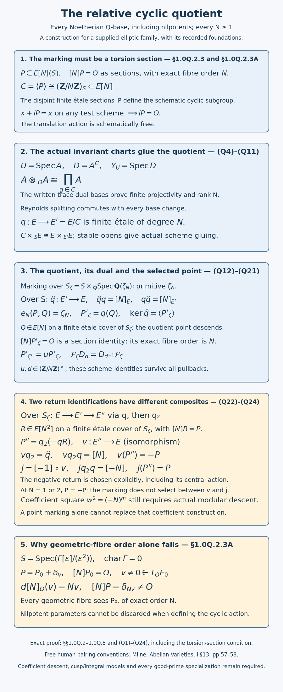
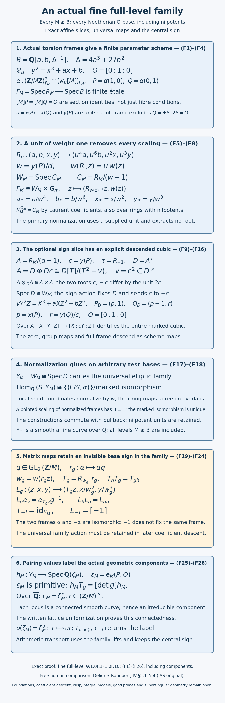

# Modular curves over Q and the Eichler–Shimura congruence

*Written by GPT-6.1 Sol (OpenAI) in Codex, Ultra setting, October 2026. Self-checked by the writing AI. Public domain (CC0).*

A Hecke operator changes an elliptic curve by taking quotients by finite subgroups. Frobenius changes its coefficients by taking powers in a finite field. In characteristic \(p\), the degree-\(p\) Hecke correspondence separates into Frobenius and its transpose. This geometric identity produces the quadratic polynomials that will describe the Galois representations of weight-two forms.

There are two counting issues to keep distinct. An ordinary elliptic curve in characteristic \(p\) has two subgroup schemes of rank \(p\), while the Hecke correspondence still has degree \(p+1\). Also, a space of cusp forms of dimension \(g\) supplies a Tate module of dimension \(2g\), but its Hecke trace is the Frobenius trace, without an extra factor of two. We prove both assertions, including the linear algebra needed to obtain the characteristic polynomial.

## 1. Modular curves and their good models

For \(N\ge1\), let \(Y_0(N)\) classify elliptic curves together with a cyclic subgroup of order \(N\), and let \(Y_1(N)\) classify an elliptic curve together with a point of exact order \(N\). Over an algebraically closed field in which \(N\) is invertible, these descriptions mean isomorphism classes of pairs
\[
(E,C),\qquad (E,P).
\tag{1}
\]
The compactifications \(X_0(N)\) and \(X_1(N)\) add cusps. Over \(\mathbf C\), they are the compact Riemann surfaces attached to \(\Gamma_0(N)\) and \(\Gamma_1(N)\). The analytic construction is actually proved in the earlier *Modular curves and their genus*, §§1–2, and its moduli interpretation in *Complex tori, elliptic curves and the moduli interpretation of modular curves*, Theorem 4.1. The following stronger arithmetic theorem remains a required theorem; its construction is among the proof obligations identified in §7.

**Model theorem.** These curves have smooth projective models over \(\mathbf Z[1/N]\). Their noncuspidal parts have the moduli interpretation (1), and \(Y_1(N)\) is a fine moduli scheme for \(N\ge4\). In particular, \(X_0(N)\), \(X_1(N)\), and their Jacobians have good reduction at every prime \(p\nmid N\).

The distinction between a coarse space and a fine space matters. A point of a coarse curve over a nonclosed field is not a universal elliptic curve with its level structure. In particular, a coarse rational point records a Galois-invariant isomorphism class; twists and descent must still be considered. The fine scheme \(Y_1(N)\) represents the functor of isomorphism classes in families and carries a universal pair.

**Lemma 1.0 (the interior level and tame quotient calculations).** Once a smooth elliptic family is given over a base on which \(N\) is invertible, its full-level, cyclic-level and exact-order-point functors are finite étale over that base. At an interior coarse-moduli point in residue characteristic greater than three, a smooth one-parameter elliptic deformation chart has a smooth invariant chart under its stabilizer.

*Proof.* Multiplication by \(N\) has differential multiplication by \(N\) on the tangent line, at every point by translation, and is therefore étale. Its kernel is proper with finite fibres, hence finite étale. Its rank is \(N^2\) by the multiplication-degree proof in the earlier Tate-module lesson. Locally in the étale topology it is \((\mathbf Z/N)^2\). Choices of a basis, a cyclic direct summand, or an exact-order vector then form finite constant sets on this cover. Transition changes of basis permute the sets, which descend as finite étale schemes. The exact-order condition is checked prime by prime, so this includes composite \(N\).

In characteristic greater than three write the fibre as \(y^2=x^3+ax+b\). An origin-preserving automorphism has the form \((x,y)\mapsto(c^2x,c^3y)\), with \(c^4a=a\) and \(c^6b=b\). This follows by comparing the unique pole spaces of orders two and three at the origin: their bases are \(1,x\) and \(1,x,y\); substituting their possible affine changes into the short cubic eliminates the extra shifts. Since \(a,b\) are not both zero, its group is cyclic of order dividing four or six, and its order is invertible in the residue field.

In a strict complete one-parameter chart \(R[[t]]\), let a cyclic effective stabilizer of order \(e\) fix the origin. Its tangent action is faithful: an element of prime-to-characteristic order with tangent eigenvalue one has invariant parameter obtained by averaging its translates of \(t\); that parameter has unit linear coefficient, so fixing it makes the element the identity. Thus its tangent eigenvalue has order \(e\). Lift that eigenvalue \(\zeta\); the root-lifting proof in Lesson 01 lifts the prime-to-characteristic roots of unity to \(R\). Averaging
\[
 s=\frac1e\sum_{i=0}^{e-1}\zeta^{-i}\sigma^i(t)
\]
gives an eigenparameter, with unit linear coefficient. Formal substitution recursively inverts \(t\mapsto s\), and \(\sigma(s)=\zeta s\). Its invariant ring is exactly \(R[[s^e]]\): an invariant coefficient of \(s^n\) is zero unless \(e\mid n\), since \(1-\zeta^n\) is then a unit. This is a smooth formal chart. An ineffective stabilizer is discarded before applying the calculation. Thus tame coarse quotienting adds no singularity. This calculation proves the interior finite-level and tame-quotient steps; it does not construct the underlying elliptic deformation stack, its compactification, or the wild invariant charts in characteristics two and three. Those stronger steps of the stated model theorem are still required. ∎

The absence of automorphisms in the fine range can be checked on geometric fibers. First its geometric origin-preserving automorphism group is finite. The line bundle \(\mathcal O(3O)\) embeds it as a cubic, by the actual all-characteristic degree-three proof in *Abelian varieties*, Example 9.12. Every origin-preserving automorphism acts on its three-dimensional section space, and the group preserving the cubic and its origin is a closed subgroup of \(\operatorname{PGL}_3\), cut out by the polynomial-preservation equations. Its tangent space consists of vector fields vanishing at the origin: an infinitesimal map is locally the identity plus a derivation, and its overlaps identify those derivations as a global vector field. The elliptic tangent bundle is trivial by translation, while \(H^0(\mathcal O(-O))=0\) since a negative-degree line bundle has no section. Thus the group has zero tangent space, hence dimension zero at the identity and, by translation, everywhere. A zero-dimensional scheme of finite type has finitely many geometric points. Every such automorphism consequently has finite order.

A nonidentity origin-preserving automorphism \(u\) of an elliptic curve has \(\deg(u-1)\le4\); equality four occurs only for \(u=-1\). Indeed, its finite-order characteristic polynomial has roots \(\lambda,\lambda^{-1}\) on the unit circle, so
\[
\deg(u-1)=2-(\lambda+\lambda^{-1})\le4.
\tag{2}
\]
The degree and characteristic-polynomial identity is the one established for endomorphisms in the Tate-module lesson. If equality holds, \(u+1\) is nilpotent in the endomorphism algebra and hence zero: a nonzero endomorphism of an elliptic curve is an isogeny and becomes invertible in that algebra. If \(u\) fixes a point of order \(N\), its kernel contains the \(N\) distinct points generated by that point, so \(\deg(u-1)\ge N\). This is impossible for \(N\ge5\); for \(N=4\), the only remaining candidate \(-1\) does not fix a point of order four. The representability and construction of the scheme remain part of the model theorem.

### 1.0Q. A relative cyclic quotient with a scheme-theoretic torsion marking

This construction has the characteristic-zero scope needed for the cyclic Fricke correspondence. Let \(S\) be a Noetherian \(\mathbf Q\)-scheme, let \(E/S\) be an elliptic scheme with zero \(O\), and let \(P\in E[N](S)\) have exact order \(N\geq1\) on every geometric fibre. In particular \([N]P=O\) is an identity of sections; fibrewise order alone is insufficient on a nonreduced base, as proved in §1.0Q.2.3A. No reducedness, normality, connectedness or field hypothesis is imposed on \(S\). All quotients, group laws and maps below are relative scheme maps, and the constructed objects commute with arbitrary base change.

The quotient and dual have the unambiguous identity \(\widehat q q=[N]\). The twice-quotiented marked object is identified with \((E,-P)\) by the dual identification. Composing that identification with \([-1]\) is the *chosen central normalization* yielding a composite \([-N]\). At \(N=1,2\) this choice is not forced by the point marking. The resulting coefficient-square convention still requires the central automorphism action in the modular descent object; the coefficient descent is still a separate required construction.

#### 1.0Q.1. The precise previously written foundations

The following are the proof providers actually inspected for this construction, not unnamed quotient or moduli theorems.

1. The finite nonnegative projective complex computing coherent cohomology after every base change is the actual proof of *Base change and the Grothendieck complex*, Lemma 3.1 and Theorem 3.2. Its finite coherent-cohomology and affine Čech prerequisites retain their earlier-programme scope.
2. Field curve Riemann–Roch, duality, positive-degree vanishing and degree-three very ampleness are proved in *Abelian varieties*, Lemma 9.11 and Example 9.12, and used explicitly below. Their projective duality, regular-local and proper coherent-finiteness foundations are retained. The earlier elliptic Tate-module lesson, Sections 0.C–0.F, proves proper coherent finiteness, formal functions and proper finite-geometric-fibre finiteness over locally Noetherian bases. Theorem 0.F.1 and the family-embedding argument in Section 0.F.4 supply exactly the finiteness and whole-base closed-immersion steps used here. No unrestricted normalization, conductor or quasi-finite factorization theorem is an input to this Noetherian construction. The basic affine sheaf, Proj, derived, curve and étale prerequisites of those local proofs remain explicit.
3. Faithfully flat module, algebra and affine-morphism descent are proved at the beginning of *Quotients and torsors*. Its complete affine and global quotient proofs, Theorem 4.3, Corollary 4.4 and Theorem 5.2, were inspected, but the special finite-constant-group quotient required here is proved directly in §§1.0Q.3–1.0Q.4. Its finite affine orbit-neighbourhood mechanism and Lemma 5.4 were also inspected. We do not import their general quotient assertion as a substitute for the construction.
4. The differential criterion for finite flat étale maps, étale local-ring regularity, smoothness over a perfect field and from flatness and smooth fibres, and étale coordinates have actual proofs in *Étale morphisms and their local structure*, Lemma 1.2 and Theorems 1.3 and 5.1, and *Smooth morphisms*, Theorems 2.1, 3.1 and 4.1. Their commutative-algebra flatness and regularity prerequisites are retained.
5. The field multiplication degree \(n^2\), torsion basis, dual isogeny, and every Weil-pairing property used below are the complete actual proofs in LG-GAL's elliptic Tate-module lesson, Lemmas 1.1–1.4. Its Sections 0.C–0.F prove the Noetherian proper-étale, elliptic multiplication and relative-isogeny assertions; Sections 1.4A.1–1.4A.2 prove the field cyclic quotient, constants and rigidity used by the Weil pairing. Lemma 3.0 supplies the further local lifting argument. Section 1.0Q.6 below extends the field pairing to families without determining maps on a nonreduced base merely from its fibres.

Thus this construction binds to specific written algebraic and coherent foundations. It does not certify their entire transitive closure.

#### 1.0Q.2. Relative projective coordinates and torsion

##### 1.0Q.2.1. The two coherent-complex consequences used here

On an affine base \(\operatorname{Spec}R\), use the finite nonnegative projective complex \(K^\bullet\) of foundation 1. Locally make its terms free. A unit entry of a differential can be reduced by row and column operations to an identity block; the complex equation makes the adjoining row and column zero in the neighbouring differentials. Delete this acyclic two-term block. At a chosen prime repeat until every remaining differential has zero residue matrix. The ranks of its remaining terms then equal the fibre cohomology dimensions. Every deletion is a split chain homotopy equivalence and remains so after arbitrary tensor product.

If a line bundle \(L\), flat over the base, has only \(H^0\) on every geometric fibre, with that dimension equal to \(r\), this cancellation leaves just \(R^r\) in degree zero on a neighbourhood. Consequently \(\pi_*L\) is locally free of rank \(r\), and its formation commutes with every base change. This conclusion does not assume the base is reduced.

For later use, suppose instead that the base is reduced and a line bundle is trivial on every geometric fibre of a genus-one family. Its fibre dimensions are one in degrees zero and one and zero elsewhere. Near a chosen point cancellation leaves \(R\xrightarrow{a}R\) in degrees zero and one. The same fibre dimensions at every point of this neighbourhood force \(a\) to vanish in every residue field. Reducedness gives \(a=0\). Hence its \(H^0\) is an invertible module commuting with base change. Evaluation \(\pi^*\pi_*L\to L\) is an isomorphism: it is an isomorphism on every fibre and a map of invertible modules, so its local coefficient is a unit. Locally trivializing \(\pi_*L\) therefore trivializes \(L\) on the whole family. Reducedness is used here and is not silently imposed on the arbitrary \(S\).

We also need universal constants on a proper flat family \(X/S\) with geometrically connected reduced fibres and a section. The constants map \(R[0]\to K^\bullet\) is split by restriction to that section. This can be represented by chain maps: choose an affine cover with the section contained in its first member locally on the base, evaluate its degree-zero Čech term there, and compose with the projective complex comparison. The constant cocycle has evaluation one. Split off \(R[0]\). The remaining nonnegative complex has zero fibre \(H^0\); cancellation at any base point therefore removes its degree-zero term. Its \(H^0\) is zero after every base change. It follows that

\[
 \pi_*\mathcal O_X=\mathcal O_S
\]

universally. This argument applies to \(E\) and its fibre products. It preserves nilpotent base parameters.

##### 1.0Q.2.2. A local short Weierstrass family, proved over the base

The zero section is an effective Cartier divisor: in a smooth relative curve coordinate its ideal has one generator with nonzero relative derivative. On a geometric elliptic fibre, foundation 2 gives

\[
 h^0(\mathcal O(nO))=n,\qquad H^1(\mathcal O(nO))=0\quad(n>0).
\]

Section 1.0Q.2.1 makes all these section modules locally free with arbitrary base change. The inclusion of constants identifies \(\pi_*\mathcal O(O)\) with \(\mathcal O_S\), since it is an isomorphism on all fibres. For \(n\geq2\), the divisor exact sequence for \((n-1)O\subset nO\), together with \(H^1(\mathcal O((n-1)O))=0\), makes the successive section quotient the invertible module \(\pi_*(\mathcal O(nO)|_O)\). After shrinking the base, choose functions \(x,y\) representing generators of the rank-one pole-order quotients for \(2O,3O\). Their leading pole coefficients are units. The seven functions \(1,x,y,x^2,xy,x^3,y^2\) in the rank-six module for \(6O\) have one relation with unit coefficients of \(x^3,y^2\): their other pole orders are distinct, and reduction on every fibre gives the displayed rank. Gaussian elimination with the unit leading coefficients gives a relation

\[
 y^2+a_1xy+a_3y=x^3+a_2x^2+a_4x+a_6.
\]

Rescale \(x,y\) together to make the two leading coefficients equal, as in the field construction; no extraction of a root of a base unit is needed. Since \(2,3\) are invertible, completing the square and translating \(x\) give

\[
 E:\quad y^2=x^3+ax+b,\qquad 4a^3+27b^2\in\mathcal O_S^\times.       \tag{Q1}
\]

Here is the scheme-embedding check. The three sections of \(\mathcal O(3O)\) generate it on every fibre, hence on \(E\) by Nakayama. They define \(i:E\to\mathbf P^2_S\). This map is proper (closed graph followed by a proper projection), and every fibre map is a closed immersion by the inspected field very-ampleness proof. Its fibres over points of \(\mathbf P^2_S\) are finite, so foundation 2 makes \(i\) finite. On an affine target chart its algebra cokernel is finite. After tensoring with every base residue field it is zero, because the corresponding fibre map is a closed immersion; finite pushforward here is just affine tensor product. Local Nakayama makes the cokernel zero, so \(i\) is a closed immersion. Its image lies in the cubic given by the relation. That cubic is smooth and flat over \(S\), by the Jacobian calculation with the discriminant unit. The ideal of \(E\) in it has zero fibre: tensoring the ideal sequence is left exact because \(E/S\) is flat. Nakayama makes the ideal zero. This proves (Q1) as a family isomorphism, including over nonreduced \(S\).

Here is the relative pointed group-law construction used for the universal short cubic. We actually inspected the complete point-class and secant proofs, *Abelian varieties*, Lemma 9.0a and Theorem 9.0, and its later relative calculation at line 3367. On the square of the universal cubic the three minors of the two coordinate vectors generate the pullback of the projective diagonal ideal, hence its Cartier diagonal ideal. Dividing by a local equation gives three coefficients generating the unit ideal; they glue to the secant-or-tangent line morphism. On the pulled-back cubic this line cuts an effective relative Cartier divisor with fibre degree three, since an integral cubic has no line component. It contains the two universal point graphs as Cartier divisors, including their intersection. More explicitly, in an étale curve parameter their ideals are \(t-p,t-q\). Modulo the second ideal the first becomes \(q-p\), a local equation of the diagonal in the parameter base and a non-zero-divisor. If the line equation is \((t-p)h\) and vanishes modulo \(t-q\), this non-zero-divisor forces \(h\) to vanish there. Thus the equation is divisible by \((t-p)(t-q)\). Away from the intersection the ideals are comaximal and the same divisibility holds. The residual divisor has fibre length one; its local derivative in a curve parameter is a unit. The inspected étale-coordinate criterion makes it étale; it is proper and thus finite, and finite étale rank one is an isomorphism to the parameter base by the unit map and Nakayama. It is therefore the graph of a morphism giving the third point. Reflection through the origin is its restriction, and composing reflection with the third-point map gives addition. These computations construct the operations over

\[
 B=\mathbf Q[a,b,(4a^3+27b^2)^{-1}].                              \tag{Q2}
\]

Group identities hold there by the actual field point-class proof and reducedness of the smooth universal products; thus they hold after arbitrary pullback. They agree with the supplied elliptic group law on \(E/S\), also for nilpotent \(S\). Indeed their difference, formed using the cubic law, is a map \(E^2\to E\) whose geometric images are all the zero section. Locally the cubic has an affine neighbourhood of that section, so this map lands in that neighbourhood. Universal constants for \(E^2\), proved in §1.0Q.2.1, make it factor through \(S\); its value on the zero pair is zero. This proves the equality of group maps without a reducedness inference on \(S\).

A pointed isomorphism between short families has \(x=cx'+r,\ y=dy'+sx'+t\) from the same pole filtration, with \(c,d\) units and \(d^2=c^3\). Put \(u=d/c\); then \(c=u^2,d=u^3\). Comparing the \(x'^2,x'y',y'\) coefficients, with \(2,3\) invertible, gives \(r=s=t=0\). Thus all such changes are \(x=u^2x',y=u^3y'\). This computation is over the base ring and permits nilpotents. It will make the pairing construction coordinate-independent.

##### 1.0Q.2.3. Multiplication, the constant cyclic subgroup, and torsion frames

For every \(n\geq1\), the tangent group law gives \(d[n]=n\,\mathrm{id}\), at every point by translation. Across a square-zero ideal, smoothness first lifts a source point; the inverse differential corrects its prescribed image uniquely. Thus \([n]\) is formally étale and of finite presentation, hence étale by foundation 4. Its graph makes it proper. The actual relative finiteness lemma in the Tate lesson makes it finite étale. On every fibre its rank is \(n^2\), by the complete field Lemma 1.1. Hence

\[
 E[n]\longrightarrow S \text{ is finite étale of rank } n^2.     \tag{Q3}
\]

No connectedness of \(S\) is needed for this fibrewise constant rank.

Because \([N]P=O\) holds as sections, each \(iP\) is a section of \(E[N]\). Sections of a separated étale scheme are open and closed immersions. Distinct \(iP\), \(0\leq i<N\), have disjoint geometric fibres, hence disjoint section images. They give a closed subgroup

\[
 C=\langle P\rangle \simeq(\mathbf Z/N\mathbf Z)_S\hookrightarrow E[N].
\]

This is a schematic embedding, not just a list of field-valued points. The cyclic group indexing is respected on every test scheme because \([N]P=O\) holds as sections. Its translation action on \(E\) is schematically free: equality \(x+c=x\) on any test scheme implies \(c=0\) by the group law and that embedding.

The torsion-frame cover is also explicit. Inside \(E[n]^2\), remove the finitely many open-and-closed equalizers \(aP_0+bQ_0=0\), for all nonzero \((a,b)\in(\mathbf Z/n)^2\). The remaining open-and-closed subscheme \(F_n\) is finite étale; its fibres are the bases of \((\mathbf Z/n)^2\), by the field Lemma 1.2, so it is surjective. On \(F_n\), the universal two sections identify \(E[n]\) with that constant module. The fibrewise bijective map between the two finite étale schemes is an isomorphism: after étale local splitting it is a bijection of their constant finite sets. This splitting may be constructed by taking ordered distinct sections in the appropriate fibre product of a finite étale scheme; the distinctness equalizers are open and closed, and every fibre has the required ordering. Thus no unnamed torsion-basis cover is assumed.

##### 1.0Q.2.3A. Why scheme-theoretic torsion is required

Here is why the omitted identity is essential. Take an elliptic curve \(E_0\)
over a characteristic-zero field \(F\), put
\(R=F[\epsilon]/(\epsilon^2)\), and set \(E=E_0\times_F\operatorname{Spec}R\).
By a finite extension of \(F\), if needed, choose a point \(P_0\) of exact order
\(N\). The field torsion proof in the earlier Tate-module lesson supplies such
points. A nonzero tangent vector \(v\in T_OE_0\) gives an infinitesimal section
\(\delta_v\) reducing to \(O\). This is the definition of a tangent vector as
a morphism from the dual numbers; smoothness makes its tangent space one
dimensional, so a nonzero vector exists.

The differential of multiplication is
\(d[N]_O=N\,\mathrm{id}_{T_OE_0}\). Indeed the differential of addition at
\((O,O)\) is the sum of the two tangent vectors: its restrictions to the two
axes are the identity by the unit law, and the differential is linear. Induct
on \(N\). On dual-number points this gives
\([N]\delta_v=\delta_{Nv}\ne O\), since \(N\) is invertible in \(F\).
Consequently the section
\[
 P=P_0+\delta_v
\]
has exact order \(N\) on every geometric fibre of \(S\), but
\[
 [N]P=[N]P_0+[N]\delta_v=\delta_{Nv}\ne O.
\]
For \(N=1\), take \(P_0=O\); this already disproves the fibrewise implication.
Thus the sequence of translations indexed by \(\mathbf Z/N\mathbf Z\) is not
even a group action under the original fibre-only hypothesis.

Under the corrected hypothesis, the distinct sections
\(iP\), \(0\leq i<N\), lie in the finite étale scheme \(E[N]\). Their
geometric images are disjoint by exact fibre order. A section of a separated
étale map is an open and closed immersion: its image is the inverse image of
the diagonal under the section map, and that diagonal is both open and closed.
The images therefore give a schematic copy of
\((\mathbf Z/N\mathbf Z)_S\). Addition respects the cyclic indexing because
\([N]P=O\) is an actual section identity. This is the subgroup and translation
action used by the invariant-ring proof. No equality over an arbitrary
nonreduced base is inferred merely from its geometric fibres.

#### 1.0Q.3. The affine invariant algebra is an étale torsor

Here is a direct algebraic proof for the constant group \(G=\mathbf Z/N\). Let \(U=\operatorname{Spec}A\) be a \(G\)-stable affine open of \(E\) over an affine base \(\operatorname{Spec}R\). Put \(D=A^G\). Use \(g(a)\) for the ring action, with consistent inverse translation convention.

The graphs of the distinct translations are disjoint closed subschemes of \(U\times_RU\), by schematic freeness and separatedness. Their ideals are pairwise comaximal. The Chinese remainder theorem therefore makes

\[
 A\otimes_RA\longrightarrow\prod_{g\in G}A,\qquad
 a\otimes b\longmapsto(a\,g(b))_g
\]

surjective. It factors through

\[
 \Phi:A\otimes_DA\longrightarrow\prod_g A.                       \tag{Q4}
\]

Choose \(\sum_i x_i\otimes y_i\) mapping to the tuple with value one at the identity and zero elsewhere. Then

\[
 \sum_i x_i g(y_i)=\delta_{g,1},\qquad
 \sum_i g(x_i)y_i=\delta_{g,1}.                                 \tag{Q5}
\]

The second follows by applying \(g\) to the first with \(g^{-1}\). With \(\operatorname{Tr}(a)=\sum_g g(a)\in D\), both identities give

\[
 a=\sum_i x_i\operatorname{Tr}(y_i a)
  =\sum_i y_i\operatorname{Tr}(x_i a).                          \tag{Q6}
\]

The first is a finite dual-basis identity with \(D\)-linear functionals, so \(A\) is finite projective over \(D\): the maps to and from a finite free module given by that identity split the identity on \(A\).

Moreover an inverse to (Q4) is

\[
 (z_g)_g\longmapsto \sum_{i,g} z_g\,g(x_i)\otimes y_i.           \tag{Q7}
\]

Applying \(\Phi\) to (Q7) gives the \(h\)-coordinate \(z_h\), by (Q5). Applying (Q7) to \(\Phi(a\otimes b)\) gives

\[
 \sum_i a\,\operatorname{Tr}(bx_i)\otimes y_i=a\otimes b
\]

by the second equality of (Q6). Thus (Q4) is an isomorphism, with its nilpotent structure retained.

The Reynolds map \(e=N^{-1}\sum_g g:A\to D\) is a \(D\)-linear retraction. Hence every fibre of the finite projective \(D\)-module \(A\) is nonzero, and \(D\to A\) is faithfully flat. If its fibre rank is \(r>0\), (Q4) says \(r^2=Nr\), hence \(r=N\). Its base change along itself is the disjoint union of \(N\) identities. Differential base change and faithful flatness give \(\Omega_{A/D}=0\); the actually inspected finite-presentation, flat differential criterion makes \(A/D\) étale. Therefore

\[
 U\to Y_U=\operatorname{Spec}D
 \text{ is finite étale of degree }N,\qquad
 G\times U\simeq U\times_{Y_U}U.                               \tag{Q8}
\]

For completeness \(D\) is of finite type over the Noetherian \(R\). Choose finite \(D\)-module generators \(b_i\) of \(A\), including one, and finite \(R\)-algebra generators of \(A\). Form the \(R\)-subalgebra \(D_0\subset D\) generated by the coefficients expressing those generators and all products \(b_ib_j\) in the \(b_i\). Their \(D_0\)-span is a subalgebra containing all the \(R\)-algebra generators, hence is \(A\). Thus \(A\) is finite over the Noetherian finite-type \(D_0\). Its submodule \(D\) is finite over \(D_0\), so is of finite type and Noetherian. This supplies the finite-presentation assertions above.

The invariants commute with *arbitrary* change of \(R\): \(e\) is an idempotent, \(D=\operatorname{im}e\), and the splitting \(A=\operatorname{im}e\oplus\ker e\) survives every tensor product. The image of the tensor idempotent is exactly the new invariants. This use of \(N^{-1}\) is valid on all \(\mathbf Q\)-bases; it is not an assertion at primes dividing \(N\).

#### 1.0Q.4. Invariant relative affine charts and gluing

We now produce the charts of §1.0Q.3, rather than assume an orbit quotient exists. On an affine base open, §1.0Q.2.2 embeds \(E\) in projective space. Any finite set of points of \(E\) has an affine open neighbourhood: if their homogeneous primes are \(\mathfrak p_i\), choose a positive-degree homogeneous element avoiding all of them by homogeneous prime avoidance. Explicitly discard primes contained in another; choose for each remaining prime a homogeneous \(a_i\notin\mathfrak p_i\) in the irrelevant ideal and homogeneous \(b_{ij}\in\mathfrak p_j\setminus\mathfrak p_i\). The products \(a_i\prod_{j\ne i}b_{ij}\), raised to a common degree and added, avoid all the primes, since only the designated summand survives modulo each prime. The corresponding projective standard open cuts out an affine open of the closed embedded \(E\). This is the full finite-set argument of the inspected programme Lemma 5.4, written here for the needed projective case.

Apply this to the finite orbit of a point, obtaining an affine open \(V\) containing it. Set

\[
 U=\bigcap_{g\in G}g(V).                                       \tag{Q9}
\]

It is stable and still contains the orbit. It is affine: intersections of two affine opens in a separated scheme over an affine base are affine, since they are inverse images of its closed diagonal in the product of those affines. Finite intersection proves the assertion. Alternatively if \(V=E_s\) for a section of an ample power \(L^d\), (Q9) is the nonvanishing open of the norm section \(\bigotimes_g g^*s\) of the canonically translation-linearized bundle \(\bigotimes_g g^*L^d\). Thus this is an invariant relative ample-chart construction, not a fieldwise quotient formula. These \(U\)'s cover \(E\).

Construct \(Y_U=\operatorname{Spec}\Gamma(U,\mathcal O)^G\) by §1.0Q.3. Each of its fibres is precisely one orbit, as the torsor identity (Q8) shows after a geometric base change. If \(W\subset U\) is invariant open, its closed invariant complement has closed image under the finite \(q_U\). Hence

\[
 O_W=Y_U\setminus q_U(U\setminus W),\qquad q_U^{-1}O_W=W.        \tag{Q10}
\]

Restriction of (Q8) and of the finite faithfully flat cover represents the fppf orbit sheaf of \(W\) by this open. Indeed every test point of the target lifts after that cover, and two lifts differ by exactly one group element. For two charts \(U,V\), their intersection therefore has the same represented orbit sheaf as an open of both \(Y_U,Y_V\). The unique identifications satisfy the triple cocycle, so the \(Y_U\)'s glue to a scheme \(E'\) and the maps glue to

\[
 q:E\to E'=E/C.                                                \tag{Q11}
\]

The map is finite étale, surjective and of degree \(N\), and \(C\times_SE\simeq E\times_{E'}E\). It represents the fppf quotient over \(S\). An invariant map into any scheme descends uniquely: first for affine targets use the invariant functions on each chart; for a general target its affine preimages are invariant opens, descend by (Q10), and glue those affine maps. This supplies the scheme-valued universal property used below, not merely an orbit-set property.

All the statements commute with arbitrary \(T\to S\). The torsor relation survives base change; the same lifting calculation identifies \(E'_T\) with the quotient of \(E_T\). Equivalently on affine base-change charts the Reynolds splitting proves the invariant-ring compatibility directly. The schemes over different affine opens of \(S\) identify by the same quotient universal property, so this is a global relative construction even when \(S\) has no global Weierstrass coordinates.

#### 1.0Q.5. The elliptic group quotient and its dual

On the quotient sheaf set \(q(x)+q(y)=q(x+y)\), inversion \(q(x)\mapsto q(-x)\), and zero \(q(O)\). Addition is invariant under the product action \(C^2\) on \(E^2\); the product torsor gives its scheme descent. The unit, inverse, commutativity and associativity identities can be checked after the appropriate finite faithfully flat product covers, so are actual scheme identities. The kernel of \(q\) is \(C\), by its torsor relation.

The quotient is of finite presentation over \(S\) by the affine finite-type argument in §1.0Q.3 and Noetherianity. Its diagonal is closed: its pullback by \(q\times q\) is the closed union of translation graphs, and faithfully flat ideal descent, proved in the opening of *Quotients and torsors*, descends that closed immersion. It is universally closed over \(S\): a closed subset of \(E'_T\) and its inverse image in \(E_T\) have the same image in \(T\), because \(q_T\) is surjective; the latter image is closed by properness of \(E/S\). Hence \(E'/S\) is proper.

Flatness descends explicitly. For an injection of base modules, tensor its pullback to a quotient chart with the faithfully flat \(D\)-algebra \(A\). It becomes injective since \(E/S\) is flat. Faithfulness gives injectivity already after tensoring with \(D\), so \(D\) is flat over the base. On a geometric fibre the étale cover \(E_{\bar s}\to E'_{\bar s}\) descends regularity of local rings, by the actual étale-local-ring proof in foundation 4. Over characteristic zero regular finite-type curves are smooth. The flat, finite-presentation fibre criterion therefore makes \(E'/S\) smooth. Its fibres are geometrically connected, since they are surjective images of the connected elliptic fibres, and have dimension one by the finite map.

Their genus is one. On each smooth fibre, translation trivializes the rank-one differential bundle of this proper one-dimensional group: at a point translate its tangent space back to zero, algebraically by the group maps. Thus its canonical degree is zero. The inspected curve duality formula \(2g-2=\deg\Omega^1\) gives \(g=1\). Together with its zero section this proves \(E'/S\) is an elliptic scheme. In particular §1.0Q.2.2 also supplies its relative projective model; projectivity of the quotient was not presumed in its construction.

The scheme-section identity \([N]P=O\) gives \([N](x+iP)=[N]x\) as scheme maps, so the quotient universal property uniquely produces

\[
 \widehat q:E'\to E,\qquad \widehat q q=[N]_E.                  \tag{Q12}
\]

It is a group homomorphism by faithful descent of that equality. The other identity follows after precomposing with \(q\), a faithfully flat cover:

\[
 q\widehat q=[N]_{E'}.                                         \tag{Q13}
\]

The differential of \(\widehat q\) is an isomorphism, by (Q12), \(dq\) invertible and \(N\) invertible. The square-zero lifting argument in §1.0Q.2.3 makes it étale. Its closed graph makes it proper, and the actual relative finiteness lemma makes it finite étale. It is surjective because (Q12) is. Degrees on fibres multiply; \(N\deg\widehat q=N^2\), so its degree is \(N\). It is the dual isogeny: on every field fibre the actual Lemma 1.3 characterizes the dual by (Q12), and (Q12) itself uniquely characterizes the relative map without a fibrewise equality inference. This map and both identities commute with all base changes by their construction and uniqueness.

As fppf sheaves,

\[
 \ker\widehat q=q(E[N])\simeq E[N]/C.                           \tag{Q14}
\]

For a section of the kernel, lift locally through the cover \(q\); (Q12) says the lift is \(N\)-torsion. Two such lifts differ by \(C\). This proves (Q14) over all test schemes.

#### 1.0Q.6. A relative Weil pairing, with nilpotent bases retained

We construct the pairing over the short universal family (Q2) and then descend through its coordinate changes. This step is necessary: the field pairing alone does not specify a morphism over an arbitrary nonreduced \(S\).

The finite étale algebra of \(T=E_B[n]^2\) is normal and reduced. Here is the algebra needed for that assertion without an unproved normality import. If \(R\) is an integrally closed Noetherian domain and \(A/R\) finite étale, flatness injects \(A\) into \(A_K\), a product of separable fields. The trace pairing is perfect: on every residue field, separable field factors have perfect trace (a primitive-element Vandermonde calculation), and Nakayama applied to the determinant gives invertibility locally over \(R\). If \(z\in A_K\) is integral over \(A\), it is integral over \(R\). For every \(a\in A\), \(\operatorname{Tr}(za)\) lies in \(K\) and is integral over \(R\), hence in \(R\). The perfect trace pairing puts \(z\) in \(A\). Thus \(A\) is integrally closed in its product of fraction fields and is reduced. The field-factor idempotents are integral and extend to \(A\), so it is a product of normal domains. Apply this with the localization of the polynomial domain \(B\). The same assertion applies to every finite étale cover of \(B\) used below.

Let \(U,V\) be the universal torsion sections on \(E_T\), and put

\[
 D_V=(V)-(O),\qquad M=[n]^*\mathcal O(D_V).
\]

Every geometric fibre of \(M\) is trivial by the actually inspected field point-class and dual-multiplication proof in the Tate lesson: its class is \([n]V=0\). The second coherent consequence in §1.0Q.2.1 applies because \(T\) is reduced. Locally on \(T\) choose a trivialization of \(M\), giving a relative rational function \(g_V\) with Cartier divisor \([n]^*D_V\). These divisors restrict correctly to fibres: \([n]\) is finite étale and the point divisors are relative Cartier divisors. Translation by \(U\) preserves the displayed divisor since \([n]\circ t_U=[n]\). Therefore

\[
 e_n(U,V)=g_V(X)/g_V(X+U)                                      \tag{Q15}
\]

is a regular unit on the whole relative curve: the quotient of two rational sections with the same Cartier divisor has unit coefficient in each local divisor trivialization. Universal constants from §1.0Q.2.1 make it a unit on \(T\). A different chosen trivialization of \(M\) differs by a base unit, which cancels in (Q15). Its \(n\)-th power is one by translating \(n\) times, so it defines a morphism \(T\to\mu_n\). It agrees on every field fibre with the actual field formula (G9).

Bilinearity and alternation are identities of functions on finite étale covers of \(B\); their field values are exactly the full field Lemma 1.4. Those covers are reduced by the trace argument, so the identities hold as scheme identities. Perfection can be checked after a torsion-frame and roots-of-unity cover: the alternating pairing has matrix \(\left(\begin{smallmatrix}0&a\\-a&0\end{smallmatrix}\right)\) over \(\mathbf Z/n\), and \(a\) is a unit on every field fibre by that lemma. This is a perfect map between constant finite étale groups, hence an isomorphism. Composite \(n\) and even \(n\) are covered; actual alternation was proved in the field lesson rather than inferred merely from skew symmetry.

Coordinate independence is a universal identity, including for nilpotent bases. The changes \(x=u^2x',y=u^3y'\) are parametrized by the normal reduced ring \(B[u,u^{-1}]\), with the corresponding change of \(a,b\). Its torsion covers are finite étale and reduced. On all field fibres the two pairings agree by the field pairing's invariance under pointed isomorphism, proved by Lemma 1.4's adjoint calculation for degree one. Hence they agree as functions on these universal covers. Pulling this identity to any base ring, including one with nilpotents, proves the overlap identity. The local pairings therefore glue on arbitrary \(E/S\), and their construction is compatible with arbitrary base change:

\[
 e_n:E[n]\times_SE[n]\longrightarrow\mu_{n,S}
 \text{ is perfect, bilinear and alternating}.                 \tag{Q16}
\]

The relative adjoint formula for this cyclic quotient also holds as a universal identity. Parametrize a primitive \(N\)-torsion section by the open-and-closed primitive part \(B_N\) of \(E_B[N]\). It is finite étale over \(B\), hence reduced and normal. Sections 1.0Q.3–1.0Q.5 construct the universal quotient and its dual over \(B_N\). On affine opens choose short coordinates for that quotient by §1.0Q.2.2. The torsion product of source and quotient over these reduced opens is finite étale and reduced. The actual field adjoint proof gives equality of the two pairing functions on every field fibre; reducedness proves the universal identity. Every \((E/S,P)\) is locally the pullback of this marked short family, and the quotient commutes with that pullback. Thus, also on nonreduced \(S\),

\[
 e_n^{E'}(qA,B)=e_n^E(A,\widehat qB),\qquad
 A\in E[n],\ B\in E'[n].                                      \tag{Q17}
\]

In this last passage no equality was inferred just from the fibres of the arbitrary \(S\). It was first proved on an actually reduced universal parameter scheme and then pulled back as an identity. This also proves arithmetic automorphism covariance of (Q16), since the whole construction is over \(\mathbf Q\).

#### 1.0Q.7. The marked quotient point and arithmetic covariance

Pass to \(S_\zeta=S\times_{\mathbf Q}\operatorname{Spec}\mathbf Q(\zeta_N)\) if necessary, choosing a primitive section \(\zeta_N\) of \(\mu_N\). For \(N=1\), this means \(\zeta_1=1\). By (Q16),

\[
 a_P:E[N]\to\mu_N,\qquad Q\mapsto e_N(P,Q)
\]

is surjective with kernel \(C\). To check the exact ranks, use a torsion frame. A vector of order \(N\) in \((\mathbf Z/N)^2\) is primitive: its two coordinates and \(N\) have greatest common divisor one. Bezout extends it to a basis. A perfect alternating form sends it to a surjective character; its kernel has \(N\) elements and contains its own generated subgroup, hence is exactly that subgroup. These are identities of constant groups on the étale cover, so descend as scheme identities.

The fibre \(T_\zeta=a_P^{-1}(\zeta_N)\) is therefore a finite étale \(C\)-torsor, of rank \(N\), and surjective over \(S_\zeta\). Its universal lift \(Q\) need not exist on \(S_\zeta\) itself. On this cover the point \(q(Q)\) is unchanged by replacing \(Q\) with \(Q+iP\); on the double overlap every pair of lifts differs uniquely by such a multiple. Descent of the morphism \(T_\zeta\to E'\), or the scheme-valued sheaf property proved in §1.0Q.4, gives a unique section

\[
 P'_\zeta=q(Q)\in E'(S_\zeta).                                 \tag{Q18}
\]

This proves lift independence over families, not merely at geometric points. The selected lift lies in \(E[N]\), so \([N]q(Q)=q([N]Q)=O\) is a section identity after descent. Its order is exactly \(N\): if \(r q(Q)=0\), then \(rQ\in C\), so \(1=e_N(P,rQ)=\zeta_N^r\). Fibrewise this forces \(N\mid r\), and those exact orders make it a primitive section of the finite étale torsion scheme. Formula (Q14) and the torsion-frame calculation show

\[
 \ker\widehat q=\langle P'_\zeta\rangle.                        \tag{Q19}
\]

Consequently \(\mathcal F_\zeta(E,P)=(E',P'_\zeta)\) is a relative marked Fricke construction, functorial for isomorphisms and base change. It retains every \(N\), without a character restriction.

For \(u\in(\mathbf Z/N)^*\), \(uQ\) pairs with \(P\) to \(\zeta_N^u\). Hence

\[
 P'_{\zeta^u}=uP'_\zeta.                                       \tag{Q20}
\]

A field or base automorphism \(\sigma\) transports all these scheme maps and the pairing, giving \(\sigma\mathcal F_\zeta\sigma^{-1}=\mathcal F_{\sigma\zeta}\). If \(\sigma\zeta=\zeta^u\), this is \(D_u\mathcal F_\zeta\), where \(D_u(E',P')=(E',uP')\). Replacing the input marking by \(dP\) replaces the selected lift by \(d^{-1}Q\), so

\[
 \mathcal F_\zeta D_d=D_{d^{-1}}\mathcal F_\zeta.                \tag{Q21}
\]

If the actual modular coefficient object and its pullbacks have been descended, pullback reverses compositions and gives precisely Lesson 12's \(\sigma w\sigma^{-1}=wD_u^*\). No quotient-model existence or nebentypus projection follows just from this conditional last interpretation.

#### 1.0Q.8. The Fricke square and the central sign

Let \(q_2:E'\to E''=E'/\langle P'_\zeta\rangle\) be the second relative quotient, and \(P''\) its marked point selected by the same \(\zeta_N\). Formula (Q19) identifies its kernel with the kernel of \(\widehat q\). The latter finite étale surjective homomorphism is itself the quotient torsor under that kernel: the difference of two lifts gives the unique kernel element in its fibre relation. Thus the quotient universal property gives a unique isomorphism

\[
 v:E''\xrightarrow{\sim}E,\qquad vq_2=\widehat q,\qquad
 vq_2q=[N].                                                    \tag{Q22}
\]

For an explicit second marking, lift \(P\) locally to \(R\in E[N^2]\) with \([N]R=P\). Such lifts exist on a finite étale cover by (Q3) and the field torsion transition, or its constant-frame calculation. Then \(qR\in E'[N]\). Formula (Q17) gives

\[
 e_N^{E'}(qQ,qR)=e_N^E(Q,[N]R)=e_N^E(Q,P)=\zeta_N^{-1}.
\]

So \(-qR\) is an allowed second lift, and

\[
 P''=q_2(-qR),\qquad vP''=-P.                                 \tag{Q23}
\]

Descent makes these identities global. The twice-quotiented marked object is therefore canonically identified by the **dual identification \(v\)** with \((E,-P)\). Now choose the marked identification

\[
 j=[-1]_E\circ v:(E'',P'')\longrightarrow(E,P).
\]

It has the exactly computed composite

\[
 jq_2q=[-N].                                                   \tag{Q24}
\]

Equations (Q22) and (Q24) distinguish the universal dual statement from its central normalization. At \(N=1\), all points are zero and the quotient is the identity; \(v\) and \(j=-v\) are different automorphisms with the same marking. At \(N=2\), \(P=-P\), so again both identifications preserve the marking. The marking never forces this sign at these levels. Even at other levels the notation records the selected dual-derived identification, not an assertion of uniqueness among all automorphisms of a special elliptic curve.

For the coefficient object in Lesson 12, the specified identification \(j\) makes the double universal isogeny \([-N]\), whose pullback on \(R^1\) is multiplication by \(-N\), and on \(\operatorname{Sym}^{m}R^1\) by \((-N)^m\). The actual Kummer comparison proof is the Tate-module lesson, Section 4, its Kummer-comparison paragraph: finite degree-one cohomology is Picard torsion, its multiplication pullback is multiplication on point classes by the dual identity, and the surjective transition maps kill the degree-one inverse-limit correction. Consequently multiplication by \(-N\) acts by \(-N\) on every geometric degree-one stalk; equality of maps of the étale sheaf is detected by these stalks. This is not a choice of an integral self-duality. Thus the convention gives \(w^2=(-N)^m\) **provided the modular coefficient descent carries this central identification and automorphism action**. On a characteristic-zero low-level invariant object, \([-1]\) acts on the coefficient fibre by \((-1)^m\); an odd \(m\) invariant under that central stabilizer is zero. Likewise \(\chi(-1)=(-1)^k\) is the parity constraint. None of these coefficient assertions permits deleting the stabilizer and declaring a coarse-scheme marking to have forced the sign. This zero-invariant assertion uses that 2 is invertible in the coefficient field and does not assert vanishing for a characteristic-two residual coefficient object.

#### 1.0Q.9. What is now constructed, and what remains

For every supplied elliptic scheme over every Noetherian \(\mathbf Q\)-base with \(P\in E[N](S)\) of exact geometric-fibre order, the relative cyclic quotient, its elliptic structure, base-change compatibility, finite étale quotient and dual, relative Weil pairing, selected quotient point, cyclotomic covariance and dual/central square distinction have now been constructed from the explicit written foundations above. The construction is independent of nebentypus; its diamond covariance is what later permits arbitrary-character coefficient descent. The coefficient application in the higher-weight lesson still needs its separately stated arithmetic and descent proofs.

The next construction supplies the characteristic-zero fine full-level scheme, its universal family and cyclotomic-component actions. Small-level modular coefficient descent, compactification at the cusps, models over \(\mathbf Z[1/n]\), specialization at every good prime, and the supersingular degree-\(p\) correspondence with coefficient trace remain separate construction obligations. In particular \(N^{-1}\), \(2^{-1}\) and \(3^{-1}\) were available here on the \(\mathbf Q\)-base. The construction of integral models and specialization at every good prime remains necessary.

The quotient construction and its marked central return are illustrated below. The maps in the figure are the exact scheme maps just proved; no sampled geometry or numerical test replaces the argument.

#### 1.0Q.10. Primary reading and evidence boundary

The named earlier programme proofs supply the module-descent, coherent-complex, curve, étale and smoothness interfaces used above. Their transitive foundations remain precisely those recorded in §1.0Q.1. In particular the field pairing retains the finite translation-quotient route through *Abelian varieties*, Proposition 6.3, and *Quotients and torsors*, Theorem 5.2, and the pointed-law compatibility route through rigidity Corollary 2.3. These are explicit programme obligations until their complete supporting proofs are bound.

- [Official Stacks finite quotient proof, Tag 07S5](https://stacks.math.columbia.edu/tag/07S5), including its proof and affine/orbit prerequisites, and [Tag 03C8](https://stacks.math.columbia.edu/tag/03C8), were actually read. The special constant-group algebra (Q4)–(Q8) is written here explicitly, so the theorem citation is not its proof provider.
- [Official Stacks Tag 03GW](https://stacks.math.columbia.edu/tag/03GW), [Tag 02LN](https://stacks.math.columbia.edu/tag/02LN), [Tag 02LR](https://stacks.math.columbia.edu/tag/02LR), and [Tag 02LS](https://stacks.math.columbia.edu/tag/02LS) were actually read with their full displayed proofs. Their listed supporting lemmas are not declared recursively certified merely because they are linked.
- [Milne's freely accessible author notes](https://www.jmilne.org/math/CourseNotes/AV.pdf), I §13, printed pp.57–58, actually supply the reciprocal-translation convention. Lemma 13.1 and Proposition 13.2 there refer elsewhere for their proofs; those references are not imported. The actual local Tate-module Lemma 1.4 supplies the complete elliptic proofs, and §1.0Q.6 here supplies the relative passage.
- [Deligne–Rapoport's freely accessible original author-hosted paper](https://publications.ias.edu/sites/default/files/Number22.pdf), I §§2 and 6 and IV §3.20–4.4, discusses the relative pairing and quotient conventions. Its relative pairing and quotient remarks are source assertions with explicit imports; they do not replace §§1.0Q.3–1.0Q.8. In particular IV §3.20 calls its relative pairing identification known, rather than writing the proof needed here.

These freely accessible materials provide conventions and comparisons for the written proof. They do not close an unwritten prerequisite through citation.

[Open Figure 1 at full size](../assets/relative-cyclic-quotient-proof-map.png)

*The bases, finite étale lifts and unit indices are part of the displayed maps. Equations (Q1)–(Q24) and §1.0Q.2.3A prove the identities and the nilpotent counterexample.*

### 1.0F. An affine fine full-level moduli scheme in characteristic zero

This construction supplies an actual scheme and universal elliptic
family for every integer \(M\geq3\). Its test bases are all Noetherian
\(\mathbf Q\)-schemes, including nonreduced bases. A full level structure means
an **isomorphism of group schemes**
\[
 \alpha:(\mathbf Z/M\mathbf Z)^2_S\xrightarrow{\sim}E[M],
 \qquad P=\alpha(1,0),\quad Q=\alpha(0,1).                 \tag{F1}
\]
In particular \([M]P=[M]Q=O\) are identities of sections. Exact orders on
geometric fibres alone would not be a permissible replacement.

The relative scheme constructions in §1.0Q supply the short-coordinate and
torsion inputs. This full-level construction remains in characteristic zero;
integral models, cusp compactifications, supersingular correspondences and
specialization at good primes still require their separate proofs.

#### 1.0F.1. The precise starting constructions

Write
\[
 B=\mathbf Q[a,b,\Delta^{-1}],\qquad \Delta=4a^3+27b^2,
 \qquad \mathscr E_B:\ y^2=x^3+ax+b,
 \quad O=[0:1:0].                                        \tag{F2}
\]
The projective cubic, its relative group law, multiplication maps, and their
scheme identities have been constructed in §§1.0Q.2.1–1.0Q.2.3.
Those sections prove the following inputs, over the base ring rather than by
inferring a nilpotent-base equality from geometric fibres.

* Every elliptic scheme over a Noetherian \(\mathbf Q\)-scheme has short
  coordinates (F2) Zariski locally on its base.
* Every pointed isomorphism between two such short models is
  \((x,y)\mapsto(u^2x,u^3y)\), with \(u\) a base unit; the target coefficients
  are \((u^4a,u^6b)\). This includes nilpotent units.
* Multiplication \([n]\) is finite étale of degree \(n^2\), and
  \(\mathscr E_B[n]\) is its actual scheme-theoretic kernel. Field torsion is
  \((\mathbf Z/n)^2\).
* Section 1.0Q.6 constructs a base-change compatible, perfect alternating relative
  Weil pairing. Its coordinate-invariance identity is proved first over the
  reduced universal parameter ring and then pulled back to arbitrary bases.

The actual section identities in (F1), rather than fibrewise order alone,
are used throughout; §1.0Q.2.3A proves why this matters. The coherent, curve,
finiteness, pairing and étale foundations behind these inputs remain the
explicit prerequisites in §1.0Q.1 and §1.0F.10.

#### 1.0F.2. A finite affine parameter scheme for actual torsion frames

Let \(T_M=\mathscr E_B[M]\times_B\mathscr E_B[M]\), with its universal
sections \(P,Q\). For each nonzero
\((i,j)\in(\mathbf Z/M)^2\), the equalizer
\([i]P+[j]Q=O\) is open and closed in \(T_M\): it is the inverse image of
the open-and-closed zero section of the separated finite étale torsion scheme.
Remove the union of these finitely many equalizers and call the resulting
open-and-closed subscheme \(F_M\). Thus
\[
 F_M=\operatorname{Spec}R_M\longrightarrow\operatorname{Spec}B
 \quad\text{is finite étale and surjective}.                 \tag{F3}
\]
Its geometric fibres consist of the ordered bases of \((\mathbf Z/M)^2\),
so its degree is \(|\operatorname{GL}_2(\mathbf Z/M)|\). On \(F_M\), the
map \((i,j)\mapsto[i]P+[j]Q\) from the constant group to the torsion scheme
is an isomorphism: split both finite étale schemes on an étale cover and check
the bijection of finite constant sets. This proves the scheme identity (F1),
including after every base change.

This is an explicit affine construction from (F2): take the kernel of the
already constructed multiplication map, its square, and the complements of the
displayed finite list of equalizers. It does not use a modular representability
theorem. Both sections avoid \(O\) on every geometric fibre, hence factor
through the affine cubic. Moreover \(F_M\) is closed in the product of two
affine cubics, since it is open and closed in the closed torsion square.
Consequently \(R_M\) is a quotient of
\(B[x_P,y_P,x_Q,y_Q]\); its defining closed component is the one specified by
the multiplication kernels and equalizers above.

Two units will remove the coordinate ambiguity:
\[
 d=x_P-x_Q\in R_M^\times,\qquad c_0=y_P\in R_M^\times.
                                                               \tag{F4}
\]
For the first, in any algebraically closed characteristic-zero fibre equal
\(x\)-coordinates give \(Q=P\) or \(Q=-P\), since their \(y\)-coordinates
have equal squares. Either relation contradicts a torsion basis. For the second,
\(y_P=0\) would give \(P=-P\), hence \(2P=O\), whereas \(P\) has order
\(M\geq3\). These prove **invertibility**, not an equality inferred from
fibres: a nonunit in any local ring belongs to its maximal ideal and therefore
vanishes in the corresponding residue field. This argument permits every
nilpotent base parameter.

The coordinate scaling defines an actual \(\mathbf G_m\)-action
\[
 R_u(a,b,x_P,y_P,x_Q,y_Q)
   =(u^4a,u^6b,u^2x_P,u^3y_P,u^2x_Q,u^3y_Q).                \tag{F5}
\]
It preserves the kernel and frame conditions by its pointed group isomorphism.
In particular \(d\) has weight two and \(c_0\) weight three. The stronger
observation
\[
 w=c_0/d\in R_M^\times,\qquad w(R_u z)=u\,w(z)             \tag{F6}
\]
provides a unit of weight one. It makes global normalization possible without
choosing a square root.

#### 1.0F.3. An affine slice and its explicit sign quotient

Define
\[
 W_M=\operatorname{Spec}C_M,\qquad C_M=R_M/(w-1).
                                                               \tag{F7}
\]
The following are inverse morphisms of schemes:
\[
 W_M\times\mathbf G_m\longrightarrow F_M,\quad(z,u)\mapsto R_u z,
 \qquad F_M\longrightarrow W_M\times\mathbf G_m,\quad
 z\mapsto\bigl(R_{w(z)^{-1}}z,w(z)\bigr).                    \tag{F8}
\]
All coefficients in the second map are regular because \(w\) is a unit;
(F6) proves the two composites are the identities as morphisms. Hence this is
an affine scheme quotient of the scaling ambiguity, with the actual invariant
algebra \(R_M^{\mathbf G_m}=C_M\): in
\(R_M=C_M[u,u^{-1}]\), invariance under \(u\mapsto tu\) forces every
nonzero Laurent weight coefficient to vanish. This coefficient calculation
works over nonreduced rings too.

Here is also another explicit normalized sign quotient. Put
\[
 Z_M=\operatorname{Spec}A_M,\quad A_M=R_M/(d-1),
 \quad \tau=R_{-1}|_{Z_M},\quad D_M=A_M^{\langle\tau\rangle}.
                                                               \tag{F9}
\]
The group \(\mu_2\) over \(\mathbf Q\) is the constant group
\(\{1,-1\}\). On \(Z_M\), put \(c=y_P\); it is a unit and
\(\tau(c)=-c\). The fixed locus of the nonidentity element is empty as a
scheme: its defining ideal contains \(2c\), a unit. Thus the action is
schematically free, even on arbitrary test rings with nilpotents.

There is no assumed finite-quotient existence assertion here. For every
\(h\in A_M\), write
\[
 h=h_++c(h_-/c),\qquad h_\pm=(h\pm\tau h)/2.
\]
Both \(h_+\) and \(h_-/c\) are invariant. Uniqueness follows by applying
\(\tau\) and subtracting; \(2c\) is a unit. Therefore, with
\(v=c^2\in D_M^\times\),
\[
 A_M=D_M\oplus D_Mc
    \simeq D_M[T]/(T^2-v).                                  \tag{F10}
\]
This finite free rank-two algebra is étale, since \(2T\) is a unit. After
tensoring with \(A_M\), its polynomial factors as \((T-c)(T+c)\) with
comaximal factors. The Chinese remainder theorem consequently gives
\[
 A_M\otimes_{D_M}A_M\xrightarrow{\sim}A_M\times A_M,
 \quad a\otimes b\mapsto(ab,a\tau(b)).                       \tag{F11}
\]
Thus \(Z_M\to\operatorname{Spec}D_M\) is faithfully flat finite étale,
and (F11) is precisely its constant-group torsor relation. Every base change
retains (F10)–(F11); the invariant projection \((1+\tau)/2\) also proves
invariants commute with arbitrary scalar extension.

For an explicit finite set of generators, write \(p=x_P\) and
\(r=y_Q/c\) on \(Z_M\). Then
\[
 x_Q=p-1,\quad v=p^3+ap+b\in D_M^\times,
 \quad D_M=\mathbf Q[a,b,p,r,\Delta^{-1},v^{-1}]\ 
 \text{as its image in }A_M.                                \tag{F12}
\]
Indeed \(A_M\) is generated by these invariants and \(c\), with
\(c^2=v\) and \(y_Q=cr\); (F10) then identifies its invariant part with
the displayed image. The inherited torsion and basis equations are imposed by
the ring \(A_M\) in (F9), so (F12) does not drop them.

The quotient also has the scheme-valued universal property. An invariant map
from \(Z_M\) to an affine target descends by the invariant ring. For a general
scheme target, the preimage of an affine open is invariant. Its complement has
closed image under the finite quotient map; the torsor relation identifies its
fibres with the two-element orbits, so its saturated image is an open of
\(\operatorname{Spec}D_M\). On affine subopens of that image descend the
ring maps, then glue by faithful flat uniqueness. The same calculation says
that every quotient test point has a lift on the finite étale cover and that
two lifts differ by a unique element of \(\{1,-1\}\). Hence the affine
scheme represents the fppf orbit sheaf, not merely the set of geometric orbits.

Finally (F8) identifies the two constructions directly. On \(W_M\) set
\(d_W=x_P-x_Q=y_P\), a unit. Under (F8), the equation \(d=1\) becomes
\(u^2d_W=1\), and \(\tau\) sends \(u\) to \(-u\). Thus
\[
 A_M=C_M[u]/(u^2-d_W^{-1}),\quad c=u,
 \qquad D_M\simeq C_M.                                    \tag{F13}
\]
Equivalently, normalizing \(d\) by an étale-local square root leaves exactly
the free sign ambiguity just quotiented. The weight-one unit removes that
ambiguity globally. We henceforth call this affine scheme
\(Y_M=W_M=\operatorname{Spec}D_M\).

#### 1.0F.4. The universal elliptic family, zero, group and entire frame

Restrict (F2) and its universal frame to \(W_M\). This already gives a
projective smooth elliptic scheme \(\mathscr E_M/Y_M\), its zero, group
operations and the actual isomorphism
\(\alpha_M:(\mathbf Z/M)^2_{Y_M}\simeq\mathscr E_M[M]\).
Here is an explicit description over the constant-quotient ring that verifies
effectivity of the proposed sign descent as well.

Using (F12), define the projective cubic
\[
 \mathscr E_D:\quad vY^2Z=X^3+aXZ^2+bZ^3,
 \quad O=[0:1:0],\quad
 P_D=(p,1),\quad Q_D=(p-1,r).                               \tag{F14}
\]
It is an elliptic scheme: the change \(x'=vX,y'=v^2Y\) gives the short
equation with coefficients \(av^2,bv^3\), whose discriminant factor is
\(v^6\Delta\), a unit. Its short universal group law therefore constructs
all the operations in (F14). After the faithfully flat extension (F10),
\[
 [X:Y:Z]\longmapsto[X:cY:Z]                                 \tag{F15}
\]
identifies it with the short family over \(Z_M\), carrying the zero and both
marked points to the original ones. This is a group isomorphism, by the
pointed-short-coordinate calculation of §1.0Q.2.2. The lifted involution on that
family is \((z,x,y)\mapsto(\tau z,x,-y)\); (F15) is invariant because both
\(c\) and \(y\) change sign. Thus it descends the family, zero and group
maps with their entire scheme structure.

The points in (F14) satisfy the actual identities \([M]P_D=[M]Q_D=O\),
since these identities hold after the faithfully flat extension (F15).
The frame map from the constant group is an isomorphism for the same reason;
isomorphism of finite affine schemes is detected after faithful scalar
extension. This proves descent of the full frame, including nilpotent bases.

The direct short model on \(W_M\) is obtained from (F14) by
\[
 x_*=X/v,\qquad y_*=Y/v,
 \quad a_*=a/v^2,\quad b_*=b/v^3,
 \quad P_*=(p/v,1/v),\quad Q_*=((p-1)/v,r/v).               \tag{F16}
\]
On \(Z_M\) this is exactly normalization by \(u=c^{-1}\), and (F13)
identifies its base with \(W_M\). This explicitly identifies the two
universal families; an abstract effectivity theorem for descent of arbitrary
proper schemes is unnecessary.

The parameter \(F_M\) is smooth of dimension two over \(\mathbf Q\),
being finite étale over the smooth affine plane open \(B\). The scaling
derivation satisfies \(\delta(d)=2d\). The differential of \(d\) in the
cotangent bundle of \(F_M\), restricted to \(Z_M\), is consequently
unimodular; the Jacobian criterion in smooth coordinates
makes \(Z_M\) a smooth curve. The finite étale cover (F10) descends
regularity of local rings, and over the perfect field \(\mathbf Q\) this
makes \(Y_M\) a smooth affine curve. Its finite presentation follows also
directly from (F7). No normality or reducedness is imposed on its test bases.

#### 1.0F.5. The representing property over arbitrary Noetherian bases

Let \(\mathcal L_M(S)\) be isomorphism classes of pairs \((E/S,\alpha)\)
as in (F1), with pointed group isomorphisms respecting \(\alpha\). We prove
the natural bijection
\[
 \operatorname{Hom}_{\mathbf Q}(S,Y_M)\xrightarrow{\sim}
 \mathcal L_M(S),\qquad f\mapsto f^*(\mathscr E_M,\alpha_M).
                                                               \tag{F17}
\]
Cover \(S\) by opens with the short coordinates proved in §1.0Q.2.2. The supplied
frame gives a map from each open to \(F_M\). On that open \(w=y(P)/d\)
is a unit by (F4), so rescale the coordinates by \(w^{-1}\). This gives
an actual map to \(W_M\) and an isomorphism from the supplied family to
the pullback of its universal family.

On an overlap, the two original short coordinate systems differ by (F5), say
by a base unit \(t\). Their values of \(w\) differ by \(t\), by (F6).
For example
\[
 \frac{t^4a}{(tw)^4}=\frac a{w^4},\qquad
 \frac{t^2x_P}{(tw)^2}=\frac{x_P}{w^2},\qquad
 \frac{t^3y_P}{(tw)^3}=\frac{y_P}{w^3}.                     \tag{F18}
\]
The same identity holds for both curve coordinate functions and every other
coefficient. Thus the maps to the closed affine slice and the family
isomorphisms agree as scheme maps on every overlap. They glue to \(f\) and
an isomorphism \((E,\alpha)\simeq f^*(\mathscr E_M,\alpha_M)\).
No equality in this gluing argument is inferred just from fibres.

Any pointed marked isomorphism between normalized short models is (F5).
Both normalized values of \(w\) are one, so (F6) forces \(t=1\) in the
base ring itself. Their coefficients and all marked coordinates consequently
agree. In particular every automorphism of a full-level marked family is the
identity, and the global marked identification just constructed is unique.
Conversely a pullback of the universal short family already has \(w=1\),
so the normalization procedure returns the original morphism \(f\).
These prove both inverses in (F17), not just a geometric classification.

All kernels, equalizers, unit identities, ring quotients, polynomial changes,
and universal scheme maps above commute with base change. Pulling (F18)
back gives the same normalized maps and family isomorphisms. Thus (F17) is
natural for every morphism between Noetherian \(\mathbf Q\)-bases, without
flatness, reduction, normality or connectedness assumptions. The explicit
universal family and its identities also pull back along arbitrary
\(\mathbf Q\)-scheme morphisms.

#### 1.0F.6. Every matrix action and its action on the universal family

Use a row frame and a right action. For
\(g=\left(\begin{smallmatrix}A&B\\C&D\end{smallmatrix}\right)
\in\operatorname{GL}_2(\mathbf Z/M)\), set
\[
 (P_g,Q_g)=(AP+CQ,BP+DQ),\qquad \alpha_g=\alpha\circ g.
                                                               \tag{F19}
\]
The raw transformation \(r_g\) of \(F_M\) is a morphism: it uses the
already constructed group operations, and both resulting sections are
nonzero torsion sections. It commutes with (F5), and
\(r_h\circ r_g=r_{gh}\).

The following formula provides the descended morphism on the affine slice
without an unspecified quotient action. On \(W_M\), put
\[
 w_g=\frac{y(P_g)}{x(P_g)-x(Q_g)}\in\mathcal O(W_M)^\times.
\]
Both numerator and denominator are units by the proof of (F4) applied to the
new basis. Define
\[
 T_g=R_{w_g^{-1}}\circ r_g:W_M\longrightarrow W_M.          \tag{F20}
\]
Explicitly its coefficient and marking functions are
\[
 (a,b,P,Q)\longmapsto
 \left(\frac a{w_g^4},\frac b{w_g^6},
  \left(\frac{x(P_g)}{w_g^2},\frac{y(P_g)}{w_g^3}\right),
  \left(\frac{x(Q_g)}{w_g^2},\frac{y(Q_g)}{w_g^3}\right)\right).
                                                               \tag{F21}
\]
These are regular functions on the whole slice. If
\(w_{gh}^{\rm raw}=w(r_{gh}z)\), then
\(w_h(T_gz)=w_g(z)^{-1}w_{gh}^{\rm raw}(z)\). Substitution in (F20)
gives \(T_h\circ T_g=T_{gh}\) as morphisms. In particular \(T_{g^{-1}}\)
is its inverse. This constructs all matrices, for composite and even \(M\)
as well as prime \(M\).

The lift to the universal family, covering \(T_g\), is
\[
 L_g:(z,x,y)\longmapsto
       \left(T_gz,x/w_g(z)^2,y/w_g(z)^3\right).              \tag{F22}
\]
It is a pointed group isomorphism to the target family; its projective
coordinate formula extends it across \(O\). Its precise frame covariance is
\[
 L_g\circ\alpha_z=\alpha_{T_gz}\circ g^{-1}.                \tag{F23}
\]
Indeed it sends \(\alpha_zg\) to the target normalized frame. The same
unit calculation gives \(L_hL_g=L_{gh}\) over \(T_hT_g\).

For the central matrix \(-I\), \(w_g=-1\). Hence
\[
 T_{-I}=\mathrm{id}_{Y_M},\qquad L_{-I}=[-1]_{\mathscr E_M}.
                                                               \tag{F24}
\]
The central subgroup \(\{I,-I\}\) acts trivially on the base, while the universal family
retains the central sign. This does not contradict fineness: \([-1]\) is
an isomorphism from the object with frame \(-\alpha\) to the object with
frame \(\alpha\), and is not an automorphism respecting the same frame for
\(M\geq3\). Formula (F24) is needed before any coefficient descent.

#### 1.0F.7. Weil components and determinant covariance

Restrict the actual relative pairing of §1.0Q.6 to the universal frame. Its value
\(\epsilon_M=e_M(P,Q)\) defines a morphism to \(\mu_M\). It is primitive
on every geometric fibre: if its order were a proper divisor of \(M\), the
alternating pairing matrix in this basis could not be perfect. The primitive
part of the finite étale scheme \(\mu_M\) is open and closed, so the morphism
factors through it as a scheme morphism:
\[
 h_M:Y_M\longrightarrow K_M=\operatorname{Spec}
                  \mathbf Q[t]/\Phi_M(t).                  \tag{F25}
\]
Here \(\Phi_M\) is the cyclotomic polynomial. Monic division in
\(t^M-1=\prod_{d\mid M}\Phi_d(t)\) constructs its integer coefficients;
its roots are exactly the primitive roots, all distinct in characteristic zero.

For clarity, the elementary irreducibility input can be supplied directly.
Let a monic irreducible rational factor \(f\) contain a primitive root
\(\zeta\), and write \(\Phi_M=fg\) with integer monic polynomials by
Gauss's lemma. If \(p\nmid M\) and \(\zeta^p\) were a root of \(g\),
then \(f\mid g(t^p)\). Reduction modulo \(p\) gives
\(\bar f\mid\bar g(t)^p\), so \(\bar f\) and \(\bar g\) have a common
factor. This would give a repeated factor in \(t^M-1\), contrary to its
coprimality with \(Mt^{M-1}\). Thus \(\zeta^p\) is a root of \(f\).
Repeat for primes not dividing \(M\); every integer prime to \(M\) is a
product of such primes. The factor contains all primitive roots and equals
\(\Phi_M\). Hence \(K_M=\operatorname{Spec}\mathbf Q(\zeta_M)\).

Bilinearity and actual alternation of the relative pairing give the identity
over the entire parameter scheme
\[
 e_M(P_g,Q_g)=e_M(P,Q)^{AD-BC}.
\]
Coordinate invariance under the pointed isomorphism (F22) then proves
\[
 h_M\circ T_g=[\det g]\circ h_M,
 \qquad [u](\zeta)=\zeta^u.                                \tag{F26}
\]
Over \(\mathbf Q(\zeta_M)\), or any larger field containing all roots,
\(Y_M\) decomposes after scalar extension into the open-and-closed loci
\(Y_{M,\zeta}\) defined by \(e_M(P,Q)=\zeta\), for primitive \(\zeta\).
Each represents precisely that fixed-pairing functor, by (F17).
Formula (F26) sends \(Y_{M,\zeta}\) to
\(Y_{M,\zeta^{\det g}}\). The determinant-one subgroup preserves each.

#### 1.0F.8. These loci are the geometric components

This additional characteristic-zero assertion can be proved without importing
the modular representability claim of an analytic reference. The earlier
LG-MF lesson *Complex tori, elliptic curves and the moduli interpretation of
modular curves*, Theorems 2.1–2.3 and 3.1, actually constructs the Weierstrass
parametrization of \(\mathbf C/(\mathbf Z+\tau\mathbf Z)\) and proves
that every complex elliptic cubic arises in this way. Its Theorem 1.1 and the
existence calculation in Theorem 4.1 compute the effect of changing an oriented
integral lattice basis. The elementary
surjectivity \(\operatorname{SL}_2(\mathbf Z)\to
\operatorname{SL}_2(\mathbf Z/M)\) is proved in the earlier congruence
subgroups lesson, Lemma 1.1. Those complete proofs were read for this step.

The convergent Weierstrass series, evaluated at \(1/M,\tau/M\), and then
normalized by the unit (F6), give a holomorphic map
\(\mathfrak H\to Y_M(\mathbf C)\). Normal convergence locally in \(\tau\)
follows from a uniform lattice bound on compact subsets of \(\mathfrak H\);
none of these torsion evaluations is at a lattice point. The pairing value of
this standard frame is a fixed primitive root \(\eta\): the map to the finite
discrete root set is continuous and \(\mathfrak H\) is connected. No
unverified analytic sign convention for \(\eta\) is needed.

Fix \(r\in(\mathbf Z/M)^\times\) and a matrix \(g_r\) of determinant
\(r\). Apply its raw frame change and normalization; this gives a continuous
map \(\mathfrak H\to Y_{M,\eta^r}(\mathbf C)\). It is surjective.
Indeed uniformize any marked complex elliptic curve. Its frame is the standard
lattice frame times a matrix \(g\), necessarily of determinant \(r\) by
the pairing identity. Write \(g=h g_r\) with \(h\in\operatorname{SL}_2
(\mathbf Z/M)\). Lift \(h\) to an integral determinant-one change of the
oriented lattice basis. The lattice calculation in the earlier Theorem 1.1
absorbs \(h\) into a new parameter \(\tau\), leaving exactly the chosen
frame \(g_r\). The representing property (F17) identifies its normalized
point with the given point of our constructed scheme.

The continuous image of connected \(\mathfrak H\) is connected. A nontrivial
algebraic open-and-closed decomposition of \(Y_{M,\eta^r,\mathbf C}\)
would give such a decomposition of its analytic points; both pieces have
complex points because they are nonempty schemes of finite type over an
algebraically closed field. Therefore this algebraic curve is connected.
It is smooth; distinct irreducible components of a smooth curve cannot meet,
since its regular local rings are domains. Thus it is irreducible.
A decomposition over \(\overline{\mathbf Q}\) would remain a decomposition
after extending to \(\mathbf C\), proving geometric connectedness and
irreducibility over \(\mathbf Q(\zeta_M)\). These prove that the primitive
pairing loci are exactly the \(\varphi(M)\) geometric components, not merely
unproved labels for unions of components. In particular (F25) has geometrically
connected fibres and is surjective.

#### 1.0F.9. Arithmetic transport of the components

All parameter equations, normalization maps, group laws, matrix maps and the
relative pairing were constructed over \(\mathbf Q\). A field automorphism
\(\sigma\) therefore transports their actual scheme maps and universal
families. If \(\sigma\zeta_M=\zeta_M^u\), then it sends the geometric
component with value \(\zeta_M^r\) to the component with value
\(\zeta_M^{ur}\). Thus the arithmetic component action is the cyclotomic
action, while the matrix component action is its determinant (F26).

A fixed component carries the determinant-one matrix action; general matrices
give the stated isomorphisms between components. If a semilinear arithmetic
action on the component with value \(\zeta_M\) is wanted, compose its
transport by \(\sigma\) with \(T_{\operatorname{diag}(u^{-1},1)}\).
This explicitly brings the value back to \(\zeta_M\); it does not pretend
that arbitrary determinants preserve that component. The lifts (F22), with
the covariance (F23) and central sign (F24), accompany every such transport.

#### 1.0F.10. Reading, retained foundations, and the exact completion boundary

The construction uses the following written earlier programme proofs, with
their exact foundational interfaces still retained:

* *Base change and the Grothendieck complex*, Lemma 3.1 and Theorem 3.2,
  supply the finite projective coherent complex used in the relative short
  coordinates and universal constants of §1.0Q.
* *Abelian varieties*, Lemma 9.0a, Theorem 9.0, Lemma 9.11 and Example 9.12,
  give the written cubic group law, point-class argument, curve duality and
  degree-three embedding. The earlier Tate-module lesson, Theorem 0.F.1
  and Section 0.F.4, supplies Noetherian finite-fibre finiteness and whole-base
  closed immersions; its Theorem 0.C.10 supplies proper coherent finiteness.
* *Quotients and torsors*, its opening module and affine-morphism descent,
  gives the faithful descent interface. The special constant quotient here is
  proved explicitly in (F10)–(F13), rather than imported from its general
  quotient theorem.
* *Étale morphisms and their local structure*, Lemma 1.2, Theorem 1.3 and
  Theorem 5.1, and *Smooth morphisms*, Theorems 2.1, 3.1 and 4.1, supply the
  written differential, local regularity and smooth coordinate criteria.
* The current LG-GAL Tate-module lesson, its complete multiplication, torsion,
  dual and Weil-pairing Lemmas 1.1–1.4, and the relative construction in
  §1.0Q supply the precise elliptic and pairing inputs.   The central convention is proved locally in §1.0Q.8; no later lesson is a
  proof provider for this construction.
* The LG-MF uniformization and reduction proofs named in §1.0F.8, together with
  the valence lesson's complete Theorem 3.1, supply the additional component
  argument. Only the already written analytic constructions are used.

The free original [Deligne–Rapoport paper, IV §5.1–5.4](https://publications.ias.edu/sites/default/files/Number22.pdf)
was actually inspected on PDF pages 83–84 (zero-based). It describes the
analytic frame quotient and its determinant components; its recollection of
uniformization and reduction is not substituted for the complete earlier
proofs used in §1.0F.8. The official [Stacks finite quotient proof, Tag 07S5](https://stacks.math.columbia.edu/tag/07S5)
was read for comparison. Its general theorem does not replace our algebra.
The Noetherian finiteness and family-embedding interface is now the written
local proof in the earlier Tate-module lesson, Sections 0.C–0.F. Those proofs
apply on nonreduced bases and keep the full coherent and infinitesimal data.

Retained transitive foundations are the affine sheaf and Čech calculation,
the coherent-complex base-change construction; finite flat/projective module
algebra; projective Cohen–Macaulay duality and regular-local/DVR algebra;
and the algebraic standard
smooth and formally étale criteria; and, for §1.0F.8 alone, elementary complex
analysis, the earlier valence/Eisenstein identities, and the elementary
finite-type algebraically closed field point theorem. Gauss's lemma and
elementary integer arithmetic enter the displayed cyclotomic proof. These
specific inputs retain their existing programme scope; recursive closure of
every supporting theorem is not claimed by this construction.

The new result is (F17), an affine fine full-level moduli scheme with an actual
universal elliptic family over arbitrary Noetherian \(\mathbf Q\)-bases,
all \(\operatorname{GL}_2(\mathbf Z/M)\) maps and universal lifts, the
central sign, and the cyclotomic geometric components with determinant and
arithmetic transport. The construction works for every \(M\geq3\).
It does not yet construct low-level coefficient invariants, descent from this
fine cover to the particular higher-weight modular coefficient object, cusps,
models over integer rings, specialization at any good prime, or the
supersingular degree-\(p\) correspondence and its coefficient trace. Those
remain separately required constructions with no level or prime deleted.

The following figure records the exact normalized parameter schemes,
universal family maps and component transport. The full argument above,
including the unique marked isomorphism, accompanies the figure.

The earlier Tate-module lesson now contains the needed Noetherian finite-fibre
proof and specialized field quotient, constants and rigidity arguments. Their
basic sheaf, curve, algebra and étale prerequisites remain explicit. This
affine moduli construction does not certify their entire recursive closure.

[Open Figure 2 at full size](../assets/fine-full-level-moduli-proof-map.png)

*Equations (F1)–(F26) and §§1.0F.8–1.0F.10 prove the six panels, including geometric connectivity, arithmetic transport and the precise foundational scope. The base map for −I is identity, while its universal family lift is [−1]; the frame and family action must both be retained in later coefficient descent.*

At the cusp \(\infty\) of \(X_0(N)\), the Tate curve with parameter \(q\) and subgroup \(\mu_N\) gives the local expansion. At a general cusp of width \(w\), the analytic coordinate is \(q_c=e^{2\pi iz/w}\). The formal Tate-curve description supplies the corresponding algebraic coordinate, with roots of \(q\) and roots of unity as needed by the level structure. This is the geometric meaning of a \(q\)-expansion, rather than a new Galois representation at a cusp.

Write
\[
X=X_0(N),\qquad J=J_0(N)=\operatorname{Pic}^0(X),\qquad
g=\dim S_2(\Gamma_0(N)).
\tag{3}
\]
The cusp \(\infty\) is rational, so \(x\mapsto[x-\infty]\) defines the Abel–Jacobi map. The equality of the analytic genus with the dimension of holomorphic differentials is proved in *Dimension formulas for congruence subgroups*, Appendix A.7. The construction and dimension of the algebraic Jacobian are proved in *The Picard functor and the Picard scheme of a curve*, §§4–7, especially Theorems 6.2 and 7.2. Lemma 1.2 below identifies the analytic and algebraic genera. Thus both dimensions are \(g\).

**Lemma 1.1 (weight two and differentials).** The map \(f\mapsto f(z)\,dz\) identifies \(S_2(\Gamma_0(N))\) with the holomorphic differentials on \(X(\mathbf C)\).

*Proof.* The weight-two transformation law and \(d(\gamma z)=(cz+d)^{-2}dz\) make this differential invariant. At a cusp,
\[
f(z)\,dz=\frac{w}{2\pi i}\,f(q_c)\frac{dq_c}{q_c}.
\tag{4}
\]
It is holomorphic exactly when the constant term of the cusp expansion vanishes. There is no additional pole at an elliptic point. In a local coordinate \(u\) where its stabilizer acts by \(u\mapsto\zeta u\) of order \(e\), invariance of \(a(u)\,du\) forces \(a(u)=u^{e-1}b(u^e)\); putting \(t=u^e\) gives \(a(u)\,du=b(t)\,dt/e\). Thus it descends holomorphically. Conversely, pulling a holomorphic differential back to the upper half-plane gives a weight-two form, and (4) makes it cuspidal. These constructions are inverse. ∎

The decomposition needed in degree one is
\[
H^1(X(\mathbf C),\mathbf C)
\simeq S_2(\Gamma_0(N))\oplus\overline{S_2(\Gamma_0(N))}.
\tag{5}
\]
The bar denotes the antiholomorphic summand. It supplies the second copy of the Hecke spectrum; it does not double the eventual Frobenius trace.

**Lemma 1.2 (the curve realization and comparison).** For a smooth projective connected complex algebraic curve, analytification identifies algebraic and analytic line bundles and meromorphic functions, and identifies finite étale covers with finite analytic unramified covers. Consequently finite-coefficient degree-one étale cohomology equals degree-one cohomology of the analytic surface, naturally for finite correspondences. For the modular curve the decomposition (5) is Hecke equivariant. Passing to the coefficient limit gives Betti–étale comparison in degree one.

*Proof.* Here are the particular algebraization arguments needed, so that a general comparison theorem is not an unproved premise. The analytic Riemann–Roch and meromorphic-section proofs for arbitrary compact curves and arbitrary line bundles are written in *Dimension formulas for congruence subgroups*, Appendix A.1–A.7. Algebraic curve Riemann–Roch and canonical degree are proved in *Abelian varieties*, Lemma 9.11. The two genera agree: choose a separating rational function on the algebraic curve. Local parameters give the ramification orders of its derivative, hence the algebraic canonical degree is \(-2d+\sum(e_x-1)\). The same local maps, analytically \(u\mapsto u^{e_x}\), give the same number by the polygon proof in the earlier analytic Appendix A.7. The identities \(\deg K=2g-2\) on both sides prove equality of genera.

For an effective divisor \(D\), algebraic sections of \(\mathcal O(D)\) inject into analytic sections. If \(\deg D>2g-2\), the two Riemann–Roch formulas give the same dimension, so that injection is an isomorphism. Every meromorphic function has a finite pole divisor and therefore belongs to one such space after enlarging the divisor. Thus every analytic meromorphic function is rational. Every analytic line bundle has a nonzero meromorphic section by the earlier Appendix A.6, and is \(\mathcal O(D)\) for its finite divisor. All points of a complex algebraic curve are algebraic closed points. Its analytic line bundle consequently algebraizes. Meromorphic sections of the Hom bundle show that morphisms also algebraize: an analytic holomorphic morphism is a rational section with the prescribed nonnegative local orders, hence an algebraic morphism. This proves precisely the curve line-bundle comparison required here.

Let \(Z\to X^{\mathrm{an}}\) be a finite unramified analytic covering of degree \(d\), first with connected \(Z\). It is a compact Riemann surface. Analytic Riemann–Roch, after adding a sufficiently large pole divisor away from a regular fibre, permits arbitrary prescribed values at that fibre: apply its negative-degree dual correction to the evaluation exact sequence. Choose a meromorphic function \(t\) with pairwise distinct values on the \(d\) points. Symmetric functions of its values on the sheets are meromorphic functions on \(X^{\mathrm{an}}\). Near a pole, bounded pole orders on the finitely many sheets bound their elementary symmetric functions, so they extend meromorphically there. They are rational by the preceding paragraph. The monic polynomial
\[
 \prod_{z\mapsto x}(T-t(z))
\]
therefore has coefficients in \(\mathbf C(X)\). The sheets are distinguished generically. Analytic continuation on connected \(Z\) is transitive on them: lift paths between any two points of a fibre and project the paths. A factor of this polynomial over \(\mathbf C(X)\) would give a continuation-invariant proper collection of sheets. Hence it is irreducible and defines an extension of degree \(d\).

The normalization needed here is finite by the following algebra argument. On a smooth affine chart let \(A\) be its normal Noetherian coordinate domain, \(K\) its fraction field, and \(L/K\) this finite extension. Characteristic zero makes it separable. Choose a \(K\)-basis \(e_i\) integral over \(A\), by clearing denominators in their monic equations. The trace pairing is nondegenerate: a primitive element has distinct conjugates, and the Vandermonde matrix of their powers is invertible. Such an element exists by avoiding the finitely many linear equalities between distinct embeddings in the infinite field \(K\). For an integral \(b\in L\), every \(\operatorname{Tr}(be_i)\) is integral and lies in \(K\), hence in \(A\). Consequently the integral closure is contained in the free finite trace-dual lattice of \(\sum A e_i\). Its submodule is finite by Noetherianity. Integral closure commutes with localization: multiplying a monic equation over a localization by a suitable power of its denominator makes a multiple of the element integral before localization. These affine normalizations therefore glue. Their closed local rings are DVRs by the actual proof in *Discrete valuation rings, normal rings and Serre's criterion*, Lemma 1.1 and Theorem 1.2. This supplies both finiteness and the local description, rather than an unlocated normalization premise; freely accessible comparison materials are Stacks Tags 032L and 00PD.

Normalize the algebraic curve in \(L\) by this construction. The analytification of the resulting curve is \(Z\). Indeed, on a small disk every sheet is a disk over the same parameter; the integral closure of its convergent local ring in those local meromorphic sheets is the product of the disk rings, since each disk ring is a DVR. An element satisfying a monic equation with holomorphic coefficients has no pole, which also verifies this description directly. The generic identification given by \(t\) extends uniquely across its poles, by those discrete valuation rings. The algebraic map has ramification index one at every point, hence is étale. Conversely analytification of an étale map is a local biholomorphism by the local inverse theorem. An analytic map between two such covers algebraizes: its pullback on meromorphic functions is a map of the two function-field extensions, and the local valuation condition extends it on the normal curves. Disconnected covers are the disjoint union of this construction. Cover actions and equivariant maps are included by full faithfulness. This proves the finite-cover assertion.

Degree-one cohomology with a finite constant abelian group classifies torsors with that group. Algebraic and analytic transition cocycles correspond under the just-proved cover equivalence; their group laws and connecting maps are preserved. Thus the degree-one comparison is canonical and additive. Kummer is exact in both topologies, and the line-bundle comparison identifies its degree-two class with the winding number of a transition function. In the algebraic theory the actual proof in *Poincaré duality for curves*, §2, identifies \(H^2(X,\mu_n)\) with \(\mathbf Z/n\) by divisor degree; on the surface its oriented fundamental class does the same. A positive local parameter has winding one, so these generators and their traces agree. Cup products are formed from the same transition maps and therefore correspond. Pullback is natural; the trace of a finite map is the sum over its sheets, extended at a ramification point with its local length. Thus traces and correspondences correspond too.

For modular curves the period proof is actually written in *Group cohomology of \(\Gamma\) and the Eichler–Shimura isomorphism*, §§3–5, Theorem 5.3, including the weight-two dimension calculation. Its parabolic cocycles are exactly the period functionals on the compact surface: cusp loops are killed, and an elliptic loop has finite order and is killed with characteristic-zero constant coefficients. The handle presentation there identifies this space with \(H^1(X^{\mathrm{an}},\mathbf C)\). The integral double-coset cocycle and its period equivariance are proved in *Modular symbols and the algebraicity of Hecke eigenvalues*, §1, equations (1.3) and (1.8). This proves (5) with its Hecke action.

Finally the compact surface's handle cell complex is a finite free integral complex. Reducing it modulo \(\ell^r\), taking the inverse limit, and tensoring with \(\mathbf Q_\ell\) gives its rational cohomology tensored with \(\mathbf Q_\ell\); its first integral cohomology is free. The finite comparison maps commute with reduction. Finiteness makes these towers Mittag–Leffler, so the inverse-limit comparison has no extra \(\varprojlim^1\) term. This is degree-one Betti–étale comparison, rather than an application of a finite-coefficient theorem directly to \(\mathbf Q_\ell\). ∎

**Lemma 1.3 (Tate modules, pairings and good specialization).** Put \(J=\operatorname{Pic}^0(X)\). There are natural identifications
\[
 H^1_{\mathrm{\acute et}}(X,\mathbf Q_\ell(1))=V_\ell J,
 \qquad H^1_{\mathrm{\acute et}}(X,\mathbf Q_\ell)
       \simeq(V_\ell J)^\vee.
\]
The rational Tate module has a nondegenerate alternating pairing into \(\mathbf Q_\ell(1)\). A symmetric curve correspondence is self-adjoint. If \(J\) extends to an abelian scheme at \(p\ne\ell\), specialization identifies its generic and special Tate modules, and arithmetic Frobenius is the special-fibre Frobenius endomorphism.

*Proof.* On a projective geometrically connected curve, every global unit over the algebraic closure is constant, and constants have \(\ell^r\)-th roots. The Kummer exact sequence therefore identifies \(H^1(X,\mu_{\ell^r})\) with \(\operatorname{Pic}(X)[\ell^r]=J[\ell^r]\). The exact sequence and its maps are written in *Cohomology of curves*, §6, equations (6.1)–(6.4); its former stated Picard input is supplied by the actual Picard construction just bound above and the multiplication/torsion proofs in *Abelian varieties*, Theorems 6.2 and 7.2. Under reduction of coefficients the Kummer transition is multiplication by \(\ell\) on torsion. Taking the inverse limit gives the first identification.

Curve cup duality is proved for every invertible finite coefficient ring in *Poincaré duality for curves*, §§8–11, particularly Theorem 10.1, Corollary 10.2 and Theorem 11.1. Its §12 constructs the perfect cup pairing, without needing its separately stated comparison with a particular Weil-pairing convention. On the rational coefficient limit, graded commutativity gives alternation, since two is invertible even when \(\ell=2\). Twisting its trace once gives a perfect alternating form on \(V_\ell J\) into \(\mathbf Q_\ell(1)\). That form identifies \(V_\ell J(-1)\) with its dual and proves the second displayed identification. The projection formula for finite trace proves that pushforward is adjoint to pullback; the explicit trace and its compatibility with cup are in the same earlier lesson, §§2 and 7. Thus transposing a correspondence takes its adjoint.

For good specialization one can work directly on torsion. Multiplication by \(\ell^r\) on a smooth group has invertible differential, so its kernel on an abelian scheme is finite étale. Over a strictly henselian trait every finite étale scheme is a disjoint union of sections: lift each special point by the henselian root-lifting property, use the étale diagonal for uniqueness, and observe that their union has all the fibres and is the whole finite scheme. This argument is written in *Néron models*, Lemma 7.1. It identifies the torsion points compatibly for every \(r\), and inertia acts trivially. On a point of the special fibre, the \(p\)-power Frobenius endomorphism raises its coordinates to the \(p\)-th powers, exactly the action of arithmetic residue Frobenius. Taking the limit proves the claim. The cyclotomic character is unramified at \(p\ne\ell\) and has arithmetic Frobenius value \(p\), by Lesson 01, Lemma 0D.1, Proposition 0F.2 and Proposition 3.1. Galois equivariance of cup consequently gives multiplier \(p\) on the Tate-module pairing. ∎

**Lemma 1.4 (algebraically closed field extension in the degrees used here).** Let \(K\subset K'\) be algebraically closed fields, let \(X/K\) be a smooth projective connected curve, and let \(n\) be invertible in \(K\). Pullback gives an isomorphism
\[
 H^1_{\mathrm{\acute et}}(X,\mu_n)
 \xrightarrow{\ \sim\ }
 H^1_{\mathrm{\acute et}}(X_{K'},\mu_n).
\]
It preserves the degree-normalized trace in degree two, cup products, and finite curve correspondences. After compatible coefficient choices and passage to the limit it gives the degree-one \(\mathbf Q_\ell\) comparison needed to extend a geometric curve from \(\overline{\mathbf Q}\) to \(\mathbf C\).

*Proof.* Choose \(x\in X(K)\). The actual Picard construction in *The Picard functor and the Picard scheme of a curve*, Theorem 2.1, §§4–6 and Theorem 7.2, represents degree-zero line bundles normalized along \(x\), on every test scheme. Put \(J=\operatorname{Pic}^0_{X/K}\). Its base change represents that same functor for \(X_{K'}\): for any \(K'\)-scheme \(T\), a map \(T\to J_{K'}\) is precisely a \(K\)-map \(T\to J\), and
\[
 X_{K'}\times_{K'}T=X\times_KT.
\]
The bundle, its normalization along the section and its fibre degree in these two descriptions are identical. The functorial identifications commute with pullback, and therefore identify the representing schemes and their group laws. This proves the needed Jacobian base change directly from the written all-test-scheme Picard construction.

Global units on either projective connected curve are constants and have \(n\)-th roots in its algebraically closed field. The Kummer proof of Lemma 1.3 consequently gives the natural diagram
\[
 \begin{array}{ccc}
 H^1_{\mathrm{\acute et}}(X,\mu_n)&\simeq&J[n](K)\\
 \downarrow&&\downarrow\\
 H^1_{\mathrm{\acute et}}(X_{K'},\mu_n)&\simeq&J_{K'}[n](K').
 \end{array}
\]
The scheme \(J[n]\) is finite étale by the multiplication proof used in Lemma 1.3. A finite étale algebra over an algebraically closed field is a product of copies of that field: its finite separable residue extensions are the field itself, and étaleness makes the local factors reduced. Tensoring this product with \(K'\) changes none of its component labels or group-law maps. Thus the right vertical arrow is a bijection and a group isomorphism, which proves the first assertion.

In degree two, *Poincaré duality for curves*, §2, identifies \(H^2(X,\mu_n)\) with \(\mathbf Z/n\) by divisor degree, and identifies the class of the point \(x\) with one. Its pullback is the point \(x_{K'}\), again of degree one. Naturality of the Kummer divisor class therefore makes pullback the identity under the two trace identifications. Pullback of cochains preserves cup products, so it also preserves their perfect degree-one pairing, whose proof was bound in Lemma 1.3.

For a finite generically étale map of smooth projective curves, pullback commutes with the field extension. Pushforward is its adjoint for this perfect cup pairing, by the finite trace projection formula proved in *Poincaré duality for curves*, §§2 and 7, as used in Lemma 1.3. An adjoint is unique: equality of its pairing against every vector determines the vector by perfection. The preserved pairings therefore make this pushforward commute with field extension.

Here is the additional argument for inseparable maps. A finite curve map in characteristic \(p\) factors into an iterated relative Frobenius \(h\), of degree \(d=p^r\), followed by a generically étale map. To check the factorization, a function field \(L\) of a smooth curve over the perfect field \(K\) has a separating parameter \(t\). Comparing the degrees over \(K(t^p)\) before and after the Frobenius field isomorphism gives \([L:L^p]=p\). Hence \(1,t,\ldots,t^{p-1}\) is a basis over \(L^p\), and differentiation shows \(\ker(d:L\to\Omega_{L/K})=L^p\). If the differential of a curve map vanishes, its pulled-back function field lies in \(L^p\), so its rational map factors through relative Frobenius. The rational factor extends at every point by the valuation rings of the smooth projective curves, as in Lemma 1.2. Each such factor removes a factor \(p\) from the finite degree, so this process terminates. The remaining map has nonzero differential; the differential exact sequence makes its relative differentials zero, and the minimal-polynomial derivative criterion makes its function-field extension separable.

The finite radicial map \(h\) is an integral universal homeomorphism. Its pullback induces an equivalence of étale topoi and therefore an isomorphism on these cohomology groups, by the actual strict-local proof in *Pushforward, pullback and finite morphisms*, Lemma 6.1 and Theorem 6.2. Define its degree-normalized pushforward by
\[
 h_*=d\,(h^*)^{-1}.
\]
This is the usual divisor normalization: the pullback of any point has length \(d\), so \(h^*\) multiplies the degree-two divisor class by \(d\), whereas the point's pushforward has degree one. The length assertion follows because a finite map of smooth curves is flat (a finite torsion-free module over a DVR is free), and a radicial fibre has one geometric point and total length its rank \(d\). Cup naturality then gives
\[
 \operatorname{tr}_X(h^*a\cup b)
 =d\,\operatorname{tr}_Y(a\cup(h^*)^{-1}b)
 =\operatorname{tr}_Y(a\cup h_*b).
\]
Thus this pushforward is also the required adjoint. Its formula commutes with algebraically closed field extension: pullback does and the finite flat degree \(d\) is preserved. Compose the radicial and generically étale pushforwards to obtain the adjoint, trace normalization and base-change compatibility for every finite curve map. Apply this to both projections of a finite correspondence; disconnected parameter curves are treated component by component. The correspondence action is consequently preserved.

Choose compatible primitive \(\ell^r\)-th roots in \(K\), also viewed in \(K'\), to identify constant coefficients with the corresponding twists. The finite comparison diagrams commute with coefficient reduction because Kummer does. Their inverse limits are isomorphic term by term; tensoring with \(\mathbf Q_\ell\) gives the rational degree-one identification. For \(K=\overline{\mathbf Q}\subset\mathbf C=K'\), combine this isomorphism with Lemma 1.2. This supplies the arithmetic application of the complex curve comparison, including the Hecke action and pairing used below. ∎

## 2. The Hecke correspondence over \(\mathbf Q\)

Fix a prime \(p\nmid N\). The correspondence has a parameter curve whose noncuspidal points are triples \((E,C,D)\), where \(D\subset E[p]\) is cyclic of order \(p\). Its two maps are
\[
\pi_1(E,C,D)=(E,C),\qquad
\pi_2(E,C,D)=\bigl(E/D,(C+D)/D\bigr).
\tag{6}
\]
They and their compactifications are defined over \(\mathbf Q\). Since \(p\nmid N\), the quotient map is injective on \(C\). In characteristic zero, \(E[p]\simeq(\mathbf Z/p)^2\), whose lines number
\[
\frac{p^2-1}{p-1}=p+1.
\tag{7}
\]
Thus both projections have generic degree \(p+1\).

On divisor classes and the Jacobian, our convention is
\[
T_p=(\pi_2)_*(\pi_1)^*.
\tag{8}
\]
Pullback includes the lengths of the fibers; pushforward then sends each divisor to its image. Replacing an isogeny by its dual exchanges the two projections: the composite is multiplication by \(p\), and multiplication by \(p\) preserves the cyclic subgroup \(C\). Consequently this correspondence on \(X_0(N)\) equals its transpose. The induced Hecke action on differentials is the classical action, with
\[
(T_pf)(z)=p\,f(pz)+\frac1p\sum_{j=0}^{p-1}
f\!\left(\frac{z+j}{p}\right).
\tag{9}
\]
For \(f=\sum_{n\ge1}b_nq^n\), the finite sum kills terms whose index is not divisible by \(p\), so the coefficient of \(q^n\) is
\[
b_{pn}+p\,b_{n/p},
\qquad b_{n/p}=0\ \text{if }p\nmid n.
\tag{10}
\]
In particular, a normalized eigenform \(f=q+\cdots\) has \(T_p\)-eigenvalue \(b_p\).

**Lemma 2.1 (normalization and the actual Hecke prerequisites).** The differential action of (8) is (9). The good-prime operators commute, are self-adjoint for the Petersson inner product, and have algebraic integer eigenvalues. They admit a common eigenbasis.

*Proof.* Present a complex elliptic curve by \(\mathbf C/(\mathbf Z+\mathbf Z z)\). Its order-\(p\) kernels are generated by \(1/p\), and by \((z+j)/p\), \(0\le j<p\). Quotient by the first has parameter \(pz\); quotient by the others has parameters \((z+j)/p\). On differentials of the parameter curve, the sum of pullbacks of \(f(w)\,dw\) is therefore
\[
 \left(pf(pz)+\frac1p\sum_jf((z+j)/p)\right)dz.
\]
This is exactly the transpose correspondence on differentials. Since the cyclic-level correspondence equals its transpose, it is also (8). This argument checks the factor at weight two directly; the invariant-differential version for general weight is actually proved in the earlier *Complex tori, elliptic curves and the moduli interpretation of modular curves*, Theorem 5.1.

The complete commutation and adjoint proofs, including unfolding the two finite-index fundamental domains, are in *Hecke operators for \(\Gamma_0(N)\) and \(\Gamma_1(N)\)*, Theorem 3.1, Lemma 4.1 and Theorem 4.2. Its last proof diagonalizes the whole commuting normal family, even an infinitely indexed family, by successively splitting finite-dimensional invariant eigenspaces. In trivial character the adjoint is \(T_p\), so all eigenvalues are real.

For algebraicity there is an integral cohomological proof before any arithmetic coefficient bound: *Modular symbols and the algebraicity of Hecke eigenvalues*, §1 and §2.2. Its formula (1.3) acts by integral coset transitions on cocycles and (1.8) identifies that action with periods. The finite-generator cocycle equations give a full integral lattice in rational parabolic cohomology. Reflection \(z\mapsto-\bar z\) commutes with Hecke and exchanges the two summands of (5); its positive rational eigenspace is isomorphic to the cusp-form space. The intersection with the integral lattice is a full Hecke-stable lattice. This construction also applies directly to \(\Gamma_0(N)\): alternatively take the diamond-invariant rational subspace of the \(\Gamma_1(N)\) construction and intersect its full lattice. The invariant subspace is rational because the finitely many diamond equations have integer matrices. Reflection still exchanges its two analytic summands. Each \(T_p\) is an integer matrix on the resulting positive lattice, so its monic characteristic polynomial on \(S_2(\Gamma_0(N))\) is integral. Every eigenvalue is an algebraic integer. No arithmetic Sturm theorem or future newform construction is used. ∎

Choose the common eigenbasis \(f_1,\ldots,f_g\). Write
\[
T_pf_j=a_p(f_j)f_j.
\tag{11}
\]
Here \(a_p(f_j)\) means the eigenvalue. If a basis vector is an oldform without first Fourier coefficient one, it does not mean its literal \(p\)th coefficient. Oldform multiplicities are included in this basis and in every product below.

By (5), the eigenvalue \(a\) of \(T_p\) of multiplicity \(m_a\) on \(S_2\) has multiplicity \(2m_a\) on the rational cohomology after extension to a splitting field. The eigenvalues are real, so the conjugate summand has the same spectrum. Comparison transfers this statement to the étale cohomology and, by duality, to \(V_\ell J\).

## 3. Ordinary \(p\)-torsion: points and fiber lengths

Let \(k=\overline{\mathbf F}_p\). An elliptic curve is ordinary when its geometric \(p\)-torsion has \(p\) points.

**Lemma 3.0 (the ordinary torsion structure).** An ordinary elliptic curve has
\[
E[p]\simeq \mu_p\times(\mathbf Z/p)_k.
\tag{12}
\]
The connected factor is \(\ker(F_E:E\to E^{(p)})\).

*Proof.* Relative Frobenius is radicial of degree \(p\), and its Verschiebung has degree \(p\), with \(VF=[p]\). These assertions, including the coordinate proof of Frobenius degree and the construction of Verschiebung, are actually proved in *Abelian varieties*, Theorems 8.2–8.4. Frobenius is a bijection on geometric points. Consequently the \(p\) geometric points of \(E[p]\) map to \(p\) distinct points of \(\ker V\). Its coordinate algebra has dimension \(p\), so these exhaust it and it is reduced, hence the constant group \(\mathbf Z/p\).

For an elliptic curve, \(E\simeq\operatorname{Pic}^0(E)\) by \(x\mapsto\mathcal O(x-0)\). This is an isomorphism of schemes, not just a bijection on points: the degree-one Abel fibre in *The Picard functor and the Picard scheme of a curve*, Proposition 7.1, is the projectivization of a one-dimensional section space, and its universal evaluation identifies the degree-one Picard scheme with \(E\). Translation identifies degree one with degree zero. The Cartier-dual-kernel theorem and Frobenius-duality proof in *Abelian varieties*, Theorem 6.34 and Proposition 6.42, therefore identify \(\ker F\) with \((\ker V)^D=\mu_p\). The equality \((\mathbf Z/p)^D=\mu_p\) follows on every algebra by sending a character to the image \(z\) of its generator, with the sole relation \(z^p=1\).

The reduced \(p\)-torsion points give a constant subgroup \(H\simeq\mathbf Z/p\) of \(E[p]\). It intersects the connected \(\ker F\) only in the identity scheme: each component of \(H\) is reduced and the only component meeting the connected kernel is its identity. Addition \(\ker F\times H\to E[p]\) is an isomorphism. Indeed the translates of the connected kernel by those \(p\) points are disjoint closed length-\(p\) subschemes. Their lengths total \(p^2\), the degree of \([p]\), so the induced closed immersion exhausts the coordinate algebra on each Artinian component. This proves (12). ∎

A subgroup here means a closed finite subgroup **scheme**, and its order means its rank. The scheme \(\mu_p\) has rank \(p\) but only one geometric point.

**Proposition 3.1.** The group scheme in (12) has exactly two subgroup schemes of rank \(p\): \(\mu_p\times0\), which is connected, and \(1\times(\mathbf Z/p)_k\), which is étale.

*Proof.* Let \(H\) have rank \(p\). Its group of geometric points injects into \((\mathbf Z/p)(k)\), so it has either one or \(p\) points. If it has one, \(H\) is connected. Its map to the constant group is trivial, since a connected scheme cannot map to different open-and-closed components and the identity maps to zero. Hence \(H\subset\mu_p\), and equality follows from their equal ranks.

If it has \(p\) points, its finite coordinate algebra has dimension \(p\) and at least \(p\) reduced geometric points, so it is reduced and étale. Its projection to \(\mathbf Z/p\) is an isomorphism; \(H\) is therefore the graph of a homomorphism \((\mathbf Z/p)_k\to\mu_p\). Such a homomorphism is trivial, because each of its \(p\) reduced points maps to the only \(k\)-point of \(\mu_p\). This gives the second subgroup and exhausts all possibilities. ∎

This calculation also determines the missing multiplicity. Let \(\mathcal S\) be the functor parameterizing finite locally free rank-\(p\) subgroups of the fixed group in (12). The next proof constructs its representing scheme; its existence does not have to be borrowed from the full modular-curve construction.

**Proposition 3.2.** As a \(k\)-scheme,
\[
\mathcal S\simeq\operatorname{Spec}k\ \amalg\ \mu_p.
\tag{13}
\]
The point representing the connected subgroup has length one; the point representing the étale subgroup has length \(p\).

*Proof.* Proposition 3.1 gives the two points. Compute their infinitesimal neighborhoods over any local Artinian \(k\)-algebra \(R\) with residue field \(k\).

A finite flat subgroup \(H_R\) reducing to \(\mu_p\) is topologically connected, since a nilpotent thickening has the same underlying topological space as its special fiber. Its projection to the constant group is trivial. Thus \(H_R\subset\mu_{p,R}\), and the inclusion is an equality. Indeed, the induced surjection of coordinate algebras is a map between free \(R\)-modules of the same rank, and is an isomorphism after reduction; its determinant is a unit. This subgroup has no nontrivial deformation.

A subgroup reducing to \((\mathbf Z/p)_k\) is étale over \(R\): its relative differentials vanish after reduction, hence vanish by Nakayama’s lemma, and it is finite flat. Its projection to \((\mathbf Z/p)_R\) is an isomorphism, again by reduction and the determinant argument. Such a subgroup is exactly the graph of a homomorphism
\[
(\mathbf Z/p)_R\longrightarrow\mu_{p,R}.
\]
The homomorphism is determined by the image \(z\) of the generator, and the only condition is \(z^p=1\). Write \(z=1+u\). In characteristic \(p\), this condition is \(u^p=0\). The local deformation ring is \(k[u]/(u^p)\).

These arguments actually work over an arbitrary local \(k\)-algebra \(R\), after extending its residue field algebraically. The inverse images in \(H_R\) of the components of \((\mathbf Z/p)_R\) are direct summands of its finite free coordinate module. In the connected special-fibre case, all summands except the zero component vanish modulo the maximal ideal and hence vanish by Nakayama. In the étale special-fibre case, relative differentials vanish by Nakayama and the projection is a determinant-unit isomorphism. Thus every local family belongs to exactly one of the two displayed functors. Their choice is locally constant on any base, since the ranks of those direct summands are locally constant. The descriptions glue on arbitrary bases: one branch has the unique subgroup \(\mu_p\), and the other is the graph of a uniquely specified element of \(\mu_p(R)\). This constructs the representing scheme \(\operatorname{Spec}k\amalg\mu_p\) on all test schemes. Its two rings are \(k\) and \(k[u]/(u^p)\), proving (13) and both lengths. ∎

There are thus two geometric subgroups, counted with total parameter length \(1+p\). The characteristic-zero \(p+1\) lines do not become \(p+1\) distinct subgroup schemes in the special fiber. The \(p\) nonconnected choices merge into the length-\(p\) infinitesimal neighborhood of the single étale subgroup.

This corrects an erroneous count in the freely accessible original of Deligne’s Bourbaki text, Proposition 3.15 proof, printed p.157: its characteristic-\(p\) count of one subgroup applies to the supersingular case, but not the ordinary case. Proposition 4.3 of the same work distinguishes the two ordinary branches correctly. The free original Deligne–Rapoport text, V.1, proof of Theorem 1.6 and Lemma 1.12, gives precisely the fiber (13). The proofs above independently construct the ordinary fibre.

## 4. Reduction of the correspondence and the congruence relation

**Lemma 4.0 (the integral modular polynomial and Kronecker congruence).** For every prime \(p\), there is a monic integral modular polynomial, of degree \(p+1\) in its target variable, and
\[
 \Phi_p(X,Y)\equiv (X-Y^p)(X^p-Y)\pmod p.
\]

*Proof.* The actual earlier proof of the \(j\)-coordinate and function field is *The valence formula and the ring of modular forms of level one*, Theorem 3.1. Its Theorem 4.1 proves the discriminant product, and *Modular forms, lattice functions and Eisenstein series*, Theorem 4.2, proves the integral Fourier series of \(E_4\). Hence
\(j=q^{-1}+744+\cdots\in\mathbf Z((q))\). Form the polynomial
\[
 P(X,z)=(X-j(pz))\prod_{b=0}^{p-1}
              \left(X-j((z+b)/p)\right).
\]
Its roots are the target invariants of all degree-\(p\) quotients. Changing the lattice basis permutes the kernels, so every coefficient is an invariant meromorphic function on \(X(1)\), holomorphic away from its cusp. It is thus a polynomial in \(j(z)\), by the proved coordinate theorem. This defines \(\Phi_p(X,Y)\) over \(\mathbf C\), monic of degree \(p+1\) in \(X\).

For completeness this is the symmetric modular equation, rather than a polynomial with an unnoticed repeated correspondence. A generic complex elliptic curve has endomorphism ring \(\mathbf Z\): a nonscalar lattice endomorphism of \(\mathbf Z+\mathbf Zz\) forces a nonzero quadratic equation over \(\mathbf Q\) for \(z\). If two distinct order-\(p\) kernels gave isomorphic quotients, composing one quotient isogeny, that isomorphism and the dual of the other would give a degree-\(p^2\) endomorphism. On such a generic curve it is \(\pm[p]\); canceling the isogeny then shows the two kernels agree. The target roots are therefore generically distinct. Reduction of integral matrices onto \(\operatorname{SL}_2(\mathbf F_p)\), proved in the earlier congruence-subgroup lesson, acts transitively on their kernel lines. Analytic continuation consequently makes \(\Phi_p\) irreducible over \(\mathbf C(Y)\). Duality preserves its zero set after exchanging \(X,Y\), so irreducibility gives equality up to a constant. In the expansion at infinity, its constant-in-\(X\) term has leading term \(q^{-(p+1)}\), with coefficient one; every other coefficient has smaller pole order, because it omits at least one target root. Hence the leading \(Y\)-coefficient is also one and the degree in \(Y\) is \(p+1\). Exchanging variables preserves the two monic normalizations, so the constant is one. This proves symmetry.

To prove integrality, expand with \(r=q^{1/p}\) and a primitive root \(\zeta_p\). Each root has Laurent coefficients in \(\mathbf Z[\zeta_p]\). The Laurent expansions of the symmetric coefficients are invariant under \(r\mapsto\zeta_pr\), so only integral powers of \(q\) occur. They are also invariant under every automorphism of \(\mathbf Q(\zeta_p)\), which permutes the \(p\) translated roots. Their coefficients are rational algebraic integers, hence integers; the latter elementary assertion is proved by the rational-root denominator argument for a monic polynomial. A polynomial in \(j\) with integral Laurent expansion has integral polynomial coefficients: subtract its leading Laurent coefficient times the matching power of \(j\), reducing its pole order, and continue to the constant. Thus \(\Phi_p\in\mathbf Z[X,Y]\). The dual-isogeny bijection makes its zero correspondence symmetric. No assumption that two distinct isogenies always have distinct pairs of invariants has been made.

Reduce the product in \(\mathbf Z[\zeta_p]((r))\) modulo \(1-\zeta_p\); its residue field is \(\mathbf F_p\). The first target series becomes \(j(q^p)=j(q)^p\). The \(p\) remaining series all become \(j(r)\), and their product becomes
\((X-j(r))^p=X^p-j(q)\). Therefore
\[
 \Phi_p(X,j(q))=(X-j(q)^p)(X^p-j(q))
       \quad\hbox{in }\mathbf F_p((q))[X].
\]
Substitution \(Y\mapsto j(q)\) is injective on \(\mathbf F_p[Y]\): a nonzero polynomial of degree \(d\) has nonzero leading Laurent coefficient at \(q^{-d}\). This proves the polynomial congruence, including \(p=2,3\). ∎

The following stronger reduction theorem remains a required geometric theorem. For \(p\nmid N\), the special fiber of the compactified degree-\(p\) correspondence is reduced, with two components whose normalizations are copies of \(X_0(N)_{\mathbf F_p}\). They meet at the supersingular points. On the ordinary locus, the two components describe the Frobenius isogeny and its dual. In particular, for \(N=1\), \(X_0(p)_{\mathbf F_p}\) consists of two copies of \(X(1)_{\mathbf F_p}=\mathbf P^1_{\mathbf F_p}\), glued at the supersingular points. This describes the Deligne–Rapoport model; resolving its total-space singularities can add exceptional components to a regular model. The polynomial lemma proves the plane-image congruence independently, but its normalization cannot supply this compact moduli theorem: normalization and reduction need not commute. The remaining construction and supersingular deformation obligations are recorded in §7.

Put \(\mathcal F:X_{\mathbf F_p}\to X_{\mathbf F_p}\) for the \(p\)-power Frobenius morphism. It has degree \(p\). The special-fiber correspondence cycle is
\[
\Gamma_{\mathcal F}+\Gamma_{\mathcal F}^{\,t}.
\tag{14}
\]
Here a graph \(\Gamma_h\) has first projection the identity and second projection \(h\); the superscript \(t\) exchanges projections.

The ordinary moduli explanation is explicit. Quotient by the connected subgroup is
\[
(E,C)\longmapsto(E^{(p)},C^{(p)}),
\tag{15}
\]
the Frobenius branch. For the étale subgroup, the quotient is the Verschiebung isogeny from \(E\) to \(E^{(1/p)}\); its dual is Frobenius. The prime-to-\(p\) level subgroup on the quotient is \(C^{(1/p)}\), since the composite is \([p]\) and this multiplication preserves \(C\). This is the transposed branch.

On a geometric ordinary point \(x\), (14) gives the divisor
\[
[\mathcal F(x)]+p[\mathcal F^{-1}(x)].
\tag{16}
\]
The second coefficient is a fiber length, not a count of \(p\) distinct étale subgroups. The Frobenius morphism is purely inseparable of degree \(p\), so its pullback of a point has length \(p\). This agrees with Proposition 3.2. The reduction theorem supplies the two components with multiplicity one; equality on their dense ordinary loci gives (14) as a cycle. Their isolated supersingular intersections do not contribute another one-dimensional component.

Let \(F=\mathcal F_*\) be the induced Frobenius endomorphism of \(J_{\mathbf F_p}\), and let \(V=\mathcal F^*\) on divisor classes. Pushforward followed by pullback, and the reverse composite for this purely inseparable map, give multiplication by \(p\). Thus (14) induces the **Eichler–Shimura congruence relation**
\[
T_p=F+V,\qquad FV=VF=[p].
\tag{17}
\]
The extension of the moduli correspondence over the cusps and supersingular points is part of the stated geometric theorem. The ordinary calculation explains its two terms and their multiplicities.

Choose \(\ell\ne p\). Good reduction identifies the Tate module of \(J\) with that of its special fiber. On \(V_\ell J\), the endomorphism \(F\) is the action of **arithmetic** Frobenius \(\mathrm{Fr}_p\). Hence
\[
T_p=F+pF^{-1},\qquad F^2-T_pF+p=0.
\tag{18}
\]
On
\[
W_\ell=H^1_{\mathrm{\acute et}}(X_{\overline{\mathbf Q}},\mathbf Q_\ell)
\simeq(V_\ell J)^\vee,
\tag{19}
\]
geometric Frobenius \(\Phi_p=\mathrm{Fr}_p^{-1}\) has the transpose of the arithmetic Frobenius matrix on \(V_\ell J\). Their characteristic polynomials therefore agree. Cup product gives a nondegenerate alternating pairing on \(W_\ell\) valued in \(\mathbf Q_\ell(-1)\). Geometric Frobenius acts on that target by \(p\), so its operator, again denoted \(F\), satisfies
\[
\langle Fx,Fy\rangle=p\langle x,y\rangle.
\tag{20}
\]
Equation (18) holds on this cohomology with that geometric operator. Equivalently \(V=pF^{-1}\) is the adjoint of \(F\), and \(T_p=F+V\) is self-adjoint for this alternating pairing.

These conventions agree with the preceding lessons: \(\Phi_p\) has local norm \(p^{-1}\), and geometric local reciprocity sends a uniformizer to \(\Phi_p\). The global weight-two Euler polynomial uses arithmetic Frobenius on the covariant Tate module.

## 5. The characteristic polynomial and the trace

Equation (18) is an annihilating polynomial. By itself it does not specify the multiplicities of its two roots. For example, over a field containing distinct roots \(\alpha,\beta\) with \(\alpha\beta=p\), the operators
\[
F=\alpha I_2,\qquad V=\beta I_2,\qquad
T=(\alpha+\beta)I_2
\tag{21}
\]
obey \(T=F+V\) and \(FV=p\), but the characteristic polynomial of \(F\) is \((X-\alpha)^2\). The missing information in this example is the nondegenerate pairing with multiplier \(p\). We now use that information and the Hecke multiplicities to prove the desired result.

**Theorem 5.1.** For \(p\nmid N\ell\), arithmetic Frobenius on \(V_\ell J_0(N)\) has characteristic polynomial
\[
\det(X-\mathrm{Fr}_p\mid V_\ell J_0(N))
=\prod_{j=1}^g\bigl(X^2-a_p(f_j)X+p\bigr).
\tag{22}
\]
The basis is any good-prime Hecke eigenbasis of \(S_2(\Gamma_0(N))\), with its full multiplicities. In particular,
\[
\operatorname{tr}(\mathrm{Fr}_p\mid V_\ell J_0(N))
=\operatorname{tr}(T_p\mid S_2(\Gamma_0(N))),
\qquad
\det(\mathrm{Fr}_p\mid V_\ell J_0(N))=p^g.
\tag{23}
\]

*Proof.* Work first on \(W_\ell\) with geometric Frobenius. Extend coefficients to an algebraic closure of \(\mathbf Q_\ell\), using an embedding of the algebraic Hecke eigenvalues. Characteristic polynomials can be computed after this extension. The comparison and Hecke decomposition in §2 show that \(T_p\) is semisimple and that its eigenspace \(U_a\) has dimension \(2m_a\), where \(m_a\) is the multiplicity of \(a\) on \(S_2\).

Distinct \(T_p\)-eigenspaces are orthogonal. Indeed, self-adjointness gives
\[
a\langle x,y\rangle
=\langle T_px,y\rangle
=\langle x,T_py\rangle
=b\langle x,y\rangle
\]
for \(x\in U_a\), \(y\in U_b\). If \(a\ne b\), the pairing vanishes. Its restriction to each \(U_a\) is therefore nondegenerate: a vector in its radical would pair trivially with all eigenspaces and hence with the whole space.

Since \(F\) commutes with \(T_p=F+pF^{-1}\), it preserves \(U_a\). On that space,
\[
F^2-aF+p=0.
\tag{24}
\]
Let \(\alpha,\beta\) be the roots, so \(\alpha+\beta=a\) and \(\alpha\beta=p\).

If \(\alpha\ne\beta\), the annihilating polynomial is separable, and \(U_a=U_\alpha\oplus U_\beta\) is the eigenspace decomposition for \(F\). For \(x\in U_\lambda\), \(y\in U_\mu\), (20) implies
\[
(\lambda\mu-p)\langle x,y\rangle=0.
\tag{25}
\]
Neither \(\alpha^2\) nor \(\beta^2\) equals \(p\), because such an equality would make the roots equal. Consequently each of \(U_\alpha,U_\beta\) is isotropic, and nondegeneracy on \(U_a\) makes the cross-pairing perfect. They have equal dimension, necessarily \(m_a\). The characteristic polynomial on \(U_a\) is
\[
(X-\alpha)^{m_a}(X-\beta)^{m_a}
=(X^2-aX+p)^{m_a}.
\]

If \(\alpha=\beta\), (24) says \((F-\alpha)^2=0\). All \(2m_a\) characteristic roots are \(\alpha\), even if the matrix has nontrivial Jordan blocks. Its characteristic polynomial is again
\[
(X-\alpha)^{2m_a}=(X^2-aX+p)^{m_a}.
\]
Thus no unproved Frobenius semisimplicity assertion is needed for this step.

Multiplying over \(a\) proves the polynomial on \(W_\ell\). Equation (19) identifies its geometric Frobenius matrix with the transpose of arithmetic Frobenius on \(V_\ell J\), proving (22). Each quadratic contributes trace \(a\) and determinant \(p\); this gives (23). ∎

The trace can also be checked directly. The adjoint \(V\) of \(F\) has the same trace as \(F\), since its matrix is conjugate to \(F^t\). Taking traces in (17) gives
\[
\operatorname{tr}(T_p\mid W_\ell)=2\operatorname{tr}(F\mid W_\ell).
\tag{26}
\]
But (5) gives \(\operatorname{tr}(T_p\mid W_\ell)=2\operatorname{tr}(T_p\mid S_2)\). Cancelling the two proves precisely (23). Taking the trace on \(S_2\oplus\overline{S_2}\) without this division would give an incorrect factor of two.

Equivalently, the good-prime Euler polynomial is
\[
\det(1-\mathrm{Fr}_p\,t\mid V_\ell J)
=\prod_{j=1}^g(1-a_p(f_j)t+pt^2).
\tag{27}
\]
The coefficients on the left are independent of \(\ell\): the right uses the classical algebraic Hecke eigenvalues, with their multiplicities. The identity concerns the entire Jacobian. Extracting the two-dimensional representation for one newform requires a Hecke quotient, which is the subject of the next lesson.

## 6. The genus-one example \(X_0(11)\)

A model of \(X_0(11)\), with the cusp \(\infty\) as the elliptic-curve origin, is
\[
y^2+y=x^3-x^2-10x-20.
\tag{28}
\]
Here is an explicit proof of the modular identification, using the actually proved earlier analytic inputs. The functions are constructed independently from the freely accessible calculation in Weston, *The modular curves \(X_0(11)\) and \(X_1(11)\)*, §4, pp.8–11; all their modularity and pole conditions are supplied below.

**Proposition 6.1 (the level-eleven model and form).** The compact analytic modular curve is the nonsingular cubic (28), with \(\infty\) as its origin. For its arithmetic model in §1 this identification descends to \(\mathbf Q\), once that model's rational Tate cusp has been constructed. The form in (32) spans \(S_2(\Gamma_0(11))\).

*Proof.* The complete eta multiplier computation and both cusp expansions are actually written in *Hecke operators for \(\Gamma_0(N)\) and \(\Gamma_1(N)\)*, §6. That proof starts from \(H=\eta^2\), \(H^{12}=\Delta\), and the character values \(\mu(T)=e^{2\pi i/12}\), \(\mu(S)=-i\). It gives coset-transition generators for all of \(\Gamma_0(11)\) and checks \(\mu(\gamma)\mu(\operatorname{diag}(11,1)\gamma\operatorname{diag}(11^{-1},1))=1\) on each generator. It also proves that
\[
 h=\eta(z)^2\eta(11z)^2
\]
has order exactly one at both cusps and no zero in the half-plane. Its valence argument proves the cusp space is exactly one-dimensional, without importing an unproved dimension assertion. The earlier genus proof gives index twelve, two cusps and no elliptic points, hence genus one by *Modular curves and their genus*, Theorem 3.3 and §4.

Use the Eisenstein series
\[
 A(z)=\frac{11E_2(11z)-E_2(z)}{10}
 =1+\frac{12}{5}\sum_{n\ge1}\sigma_1(n)q^n
       -\frac{132}{5}\sum_{n\ge1}\sigma_1(n)q^{11n}.
\]
Its weight-two modularity and all cusp conditions are proved in the earlier Hecke lesson, §7, proof of (7.3), from the explicitly proved \(E_2\) transformation law. Put
\[
 u=A/h+8/5,\qquad v=\frac{q\,du/dq}{h}.
\]
The derivative of a weight-zero function transforms with weight two, so both functions are modular functions. They have no poles in the half-plane, because \(h\) is nonzero there.

Let \(wz=-1/(11z)\). Conjugation by \(w\) preserves \(\Gamma_0(11)\) and exchanges its two cusps. The eta transformation already proved gives \(h(wz)=-11z^2h(z)\). Substitution in the proved \(E_2\) law gives \(A(wz)=-11z^2A(z)\): the two nonmodular linear terms cancel. Hence \(u\circ w=u\). Differentiating this identity gives \(u'(wz)=11z^2u'(z)\), and therefore \(v\circ w=-v\). This verifies the other cusp without a theta transformation premise.

Define
\[
 \begin{split}
 x_0&=(u^2-v-10u)/2,\\
 y_0&=(-uv+u^3-10u^2-22u)/2.
 \end{split}
\]
The product for \(h\) and the displayed series for \(A\) give
\[
 \begin{split}
 u&=q^{-1}+6+17q+46q^2+116q^3+252q^4+533q^5+
                 1034q^6+1961q^7+O(q^8),\\
 v&=-q^{-2}-2q^{-1}+12+116q+597q^2+2298q^3+
                 7616q^4+22396q^5+O(q^6),\\
 x_0&=q^{-2}+2q^{-1}-1+5q+8q^2+q^3+7q^4-11q^5+O(q^6),\\
 y_0&=q^{-3}+8q^{-2}+17q^{-1}+13+42q+66q^2+
                 24q^3+72q^4+O(q^5).
 \end{split}
\]
For reproducibility, coefficients of the product are computed by
\(c_r^{(n)}=c_r^{(n-1)}-2c_{r-n}^{(n-1)}+c_{r-2n}^{(n-1)}\), with negative indices zero; division by \(h/q\), whose constant is one, is the recursion
\(d_r=a_r-\sum_{i=1}^r c_i d_{r-i}\). These two recursions, followed by differentiation, give every displayed coefficient by finite rational arithmetic.

At the other cusp replace \(v\) by \(-v\). The negative terms cancel and give
\[
 x_0\circ w=11+121q+O(q^2),\qquad
 y_0\circ w=121+1331q+O(q^2).
\]
Thus \(x_0,y_0\) have their only poles at \(\infty\), of orders two and three. The function
\[
 R=y_0^2-x_0^3-10x_0y_0+11x_0^2-11y_0
\]
has no pole elsewhere and a possible pole of order at most six at \(\infty\). Substitution of the displayed expansions gives coefficient zero at every exponent \(-6,-5,\ldots,0\). To see that the finite truncations suffice, the constant of \(x_0^3\) uses \(x_0\) only through \(q^4\), and that of \(y_0^2\) uses \(y_0\) only through \(q^3\); all other terms require fewer coefficients. Hence \(R\) is globally holomorphic and has constant term zero. The compact-curve maximum principle makes it the constant zero. We have proved
\[
 y_0^2-10x_0y_0-11y_0=x_0^3-11x_0^2.
\]

The pole divisor of \(x_0\) has degree two, so its map to the sphere has degree two by the local-power and fibre-degree proof in the earlier analytic Appendix A.7. Moreover \(y_0\notin\mathbf C(x_0)\): a rational function of \(x_0\) with no pole above a finite value of \(x_0\) is a polynomial, whereas every polynomial has even pole order at \(\infty\). The sole pole of \(y_0\) has order three. Thus \(\mathbf C(X_0(11))=\mathbf C(x_0,y_0)\), a quadratic extension of \(\mathbf C(x_0)\). Set
\[
 x=x_0+5,\qquad y=y_0-5x_0-6.
\]
Direct substitution gives (28). Its discriminant computed in (29) is nonzero, so its projective cubic is nonsingular. Equality of the function fields makes the resulting map an isomorphism: the discrete valuation local rings of smooth projective curves extend a birational map and its inverse at every point. The only pole point maps to the cubic's origin.

For descent, Lemma 1.2 makes these meromorphic functions rational on the algebraic complex curve. Their Laurent expansions in the rational Tate parameter at \(\infty\) have rational coefficients. In a finite-dimensional rational section space \(H^0(X,\mathcal O(m\infty))\), expansion in that parameter is an injective rational linear map. A finite set of coefficients is already injective, since descending kernels in a finite-dimensional space stabilize; its matrix has rational entries. Solving for a section from these rational coefficients therefore gives rational coordinates in a rational basis. Thus \(x,y\) descend to \(\mathbf Q\), and so does the isomorphism. This last descent uses the rational arithmetic cusp from the still-required general model theorem; its exact unresolved construction is retained in §7. ∎

For (28), the standard Weierstrass formulas give
\[
b_2=-4,\quad b_4=-20,\quad b_6=-79,\quad b_8=-21,
\qquad c_4=496,\quad\Delta=-11^5.
\tag{29}
\]
The discriminant is a unit at every \(p\ne11\), so this is a smooth genus-one curve there. Its rational origin identifies it with its Jacobian. Hence \(g=1\), and the unique normalized weight-two eigenform at level 11 has
\[
\#X_0(11)(\mathbf F_p)=p+1-a_p,\qquad p\ne11.
\tag{30}
\]
This is the elliptic-curve Frobenius formula proved earlier, together with (22).

Here are complete small-prime counts. The entry in the third column lists the number of \(y\)-solutions as \(x\) runs through the field in increasing residue order. Add one for the origin at infinity.

| \(p\) | Values of \(x^3-x^2-10x-20\) modulo \(p\) | Number of \(y\)-solutions for each \(x\) | Total points | \(a_p\) |
|---:|---|---|---:|---:|
| 2 | \(0,0\) | \(2,2\) | 5 | \(-2\) |
| 3 | \(1,0,0\) | \(0,2,2\) | 5 | \(-1\) |
| 5 | \(0,0,4,3,3\) | \(2,2,0,0,0\) | 5 | \(1\) |

For verification, \(y^2+y\) takes the values \(0,0\) at \(p=2\), \(0,2,0\) at \(p=3\), and \(0,2,1,2,0\) at \(p=5\). Thus the three Frobenius polynomials are
\[
X^2+2X+2,\qquad X^2+X+3,\qquad X^2-X+5.
\tag{31}
\]
They all have constant term \(p\), and their traces agree with \(a_2=-2\), \(a_3=-1\), \(a_5=1\).

One may check these coefficients on the classical form
\[
f(z)=\eta(z)^2\eta(11z)^2
=q\prod_{n\ge1}(1-q^n)^2(1-q^{11n})^2
=q-2q^2-q^3+2q^4+q^5+2q^6-2q^7+\cdots.
\tag{32}
\]
Its membership in the one-dimensional cusp-form space is proved by the actual earlier eta calculation bound in Proposition 6.1. The displayed coefficients can be computed by finite multiplication: through degree seven only the factors \(n\le6\) in the first product contribute, and the second product contributes its constant term. Thus (32) checks the point counts, whose modular-curve identification was established by the functions above.

The earlier curve \(y^2+y=x^3-x^2\) is not the model (28). Their \(j\)-invariants are respectively \(-4096/11\) and \(-496^3/11^5\), so they are not isomorphic over \(\overline{\mathbf Q}\). Identifying a modular curve requires the modular construction, even when two elliptic curves happen to have the same initial good-prime traces.

## 7. Written proof bindings and remaining construction obligations

The proofs are ordered before their uses. Sections 1.0Q.1–1.0Q.10 construct the characteristic-zero relative quotient and its chosen central return; §§1.0F.1–1.0F.10 construct an actual affine fine full-level scheme, universal elliptic family and cyclotomic component actions, relative to the precise retained foundations. Lemma 1.0 proves the finite-level étale and tame interior calculations; Lemmas 1.2–1.3 give the particular curve comparison, Tate realization, cup pairing and good specialization; Lemma 2.1 binds the actual integral Hecke and adjoint proofs; Lemma 3.0 proves ordinary torsion, and Propositions 3.1–3.2 construct its subgroup scheme on all test bases. Lemma 4.0 proves the integral modular-polynomial congruence independently of a reduction-model citation. Theorem 5.1 retains its complete multiplicity argument. Proposition 6.1 gives explicit generators and the cubic relation for level eleven, together with the actual earlier proof of eta modularity. All exercise solutions remain written below, including the two complete graded tests of normalized frames, nilpotent torsion and central return maps.

There are still two substantial arithmetic construction obligations. The characteristic-zero fine full-level interior and universal family are constructed above. The general model theorem still needs the integral elliptic moduli stack and fine full-level schemes, the compactification and coarse curves, including the wild invariant charts in characteristics two and three. The coherent, curve, finiteness, field-pairing and analytic transitive foundations of the characteristic-zero construction also remain explicit. The formal Tate parameter and rationality of the chosen arithmetic cusp also belong to that construction. The free original Deligne–Rapoport text supplies material in III.2, IV.2–IV.3, VI.6 Proposition 6.7 and VII.1–VII.2. Reading that material is not a replacement for writing or binding those proofs. The relative Picard construction over the resulting smooth proper integral curve model is also needed to turn its field Jacobians into an abelian scheme over \(\mathbf Z[1/N]\). The actual earlier field Picard construction in *The Picard functor and the Picard scheme of a curve*, §§4–7, proves the field statement; it alone does not prove this relative extension.

The other obligation is the full compactified degree-\(p\) correspondence and its supersingular deformation calculation. The ordinary parameter fibre is fully proved here. The free original Deligne–Rapoport V.1.6–V.1.18 and VI.6.9–VI.6.10 describe the remaining construction, finite flatness, reducedness and coarse specialization. A proof must supply the supersingular fibre calculation, the Cohen–Macaulay argument excluding embedded components, the two global closed branch maps, and their coarse descent, before the cycle (14) has been established at arbitrary level. The ordinary argument alone does not prove those assertions. Accordingly the full congruence theorem (17)–(18) and Theorem 5.1 remain dependent on these unclosed core geometric theorems. Their original generality is retained; this lesson is not yet certified to satisfy the requirement that every used result have an actual earlier or local proof.

For point level the dual isogeny retains the changed generator, rather than merely its cyclic span. The good-prime formula therefore has the diamond term
\[
T_p=\mathrm{Fr}_p+p\langle p\rangle\mathrm{Fr}_p^{-1}.
\tag{33}
\]
The normalization of the point diamond and its classical term are actually checked in the earlier *Hecke operators for \(\Gamma_0(N)\) and \(\Gamma_1(N)\)*, Lemma 2.1 and Theorem 2.3, and in *Complex tori, elliptic curves and the moduli interpretation of modular curves*, §5. The two special branches transport the point through Frobenius and dual Frobenius; their double dual changes it by multiplication by \(p\), giving the displayed diamond in the same convention. This argument still has the global special-fibre construction dependency just specified. The diamond acts trivially on the \(\Gamma_0(N)\) space with trivial character, giving (18). For a nontrivial character, dropping it changes the determinant.

Lemma 1.4 supplies the algebraically closed field-extension step in the degree-one arithmetic comparison, including its trace, cup pairing and finite correspondences. Its Jacobian base-change argument uses the actual all-test-scheme representation and rigidification in the earlier Picard construction. The earlier Picard, duality and analytic Riemann–Roch proofs have their own prerequisite proofs, which remain required.

The sources listed below are freely accessible mathematical materials. Actual earlier programme proofs are bound by their written titles and numbered locators above. In particular none of the analytic comparison or algebraic-geometry bindings here asserts that an uninspected transitive prerequisite has been certified. The full analytic Abel–Jacobi torus uniformization is not used as a substitute for Lemma 1.3's Kummer and cup argument.

## 8. Graded exercises with complete solutions

**Exercise 8.1 (easy).** Use (28) to compute \(\#X_0(11)(\mathbf F_p)\) at \(p=2,3,5\), and recover the Hecke eigenvalues. Explain why counting points on \(y^2+y=x^3-x^2\) would not, by itself, identify that curve with \(X_0(11)\).

*Solution.* At 2 the right-hand side is zero for both \(x\), and each has both \(y\), giving four affine points. At 3 the right-hand sides are \(1,0,0\); \(y^2+y\) never equals 1 and equals zero twice, again giving four. At 5 the right-hand sides are \(0,0,4,3,3\); the values of \(y^2+y\) are \(0,2,1,2,0\), so only the first two \(x\) contribute, twice each. Adding the single point at infinity gives five points in all three cases. Thus \(a_p=p+1-5\) gives \(-2,-1,1\). Equations (22) and (30) identify these with the Hecke eigenvalues on the one-dimensional space. The other curve has a different \(j\)-invariant and is not isomorphic to (28); equality of these few point counts cannot replace a modular-curve identification.

**Exercise 8.2 (medium).** Prove (22) from \(T_p=F+V\) and \(FV=p\), explicitly specifying the pairing and Hecke multiplicity hypotheses. Give a counterexample if only the two operator equations are retained.

*Solution.* Use the semisimple \(T_p\)-action on \(W_\ell\), with eigenvalue \(a\) of multiplicity \(2m_a\), where \(m_a\) is its multiplicity on \(S_2\). The cup-product pairing is nondegenerate, \(T_p\) is self-adjoint, and \(F\) has multiplier \(p\). Distinct \(T_p\)-eigenspaces are orthogonal, so each block \(U_a\) is nondegenerate. On it \(F^2-aF+p=0\). If the roots \(\alpha,\beta\) differ, \(F\) is diagonalizable and its two eigenspaces pair perfectly, since their individual self-pairings vanish by \(\alpha^2,\beta^2\ne p\). Each therefore has dimension \(m_a\). If the roots coincide, all \(2m_a\) roots are \(\alpha\). In both cases the block polynomial is \((X^2-aX+p)^{m_a}\). Multiply the blocks and use duality to transfer geometric Frobenius on cohomology to arithmetic Frobenius on the Tate module. For the counterexample, (21) obeys both operator equations but has polynomial \((X-\alpha)^2\), with unequal root multiplicities. Its scalar \(F\) could have multiplier \(p\) for a nonzero pairing only if \(\alpha^2=p\), contradicting the distinct-root choice.

**Exercise 8.3 (medium).** Count the rank-\(p\) subgroup schemes of an ordinary elliptic curve over \(\overline{\mathbf F}_p\), identify the connected one, and recover the length \(p+1\) of the parameter fiber.

*Solution.* Use \(E[p]=\mu_p\times(\mathbf Z/p)\). A subgroup with one geometric point is connected, projects trivially to the constant factor, and is \(\mu_p\) by equal ranks. A subgroup with \(p\) points is étale and projects isomorphically to the constant factor. Its graph homomorphism to \(\mu_p\) is trivial over the field, so it is the single étale subgroup. The connected subgroup is \(\ker F_E\). Thus there are two geometric subgroup schemes. For the fiber length, the connected subgroup has no infinitesimal deformation. A deformation of the étale subgroup over a local Artinian algebra is a graph determined by \(1+u\in\mu_p(R)\), with \(u^p=0\). Its local ring is \(k[u]/(u^p)\), of length \(p\). Together with the reduced connected point this gives length \(1+p\), as claimed. The two counts measure different properties.

**Exercise 8.4 (hard).** Explain Kronecker’s congruence for the degree-\(p\) correspondence through ordinary moduli. Retain fiber multiplicities, explain the role of supersingular points, and deduce the correct trace identity.

*Solution.* On an ordinary pair \((E,C)\), quotient by \(\ker F_E\) gives \((E^{(p)},C^{(p)})\). The other subgroup is the kernel of the Verschiebung isogeny from \(E\) to \(E^{(1/p)}\); its dual is Frobenius. Since \(p\) is invertible on the level subgroup, multiplication by \(p\) preserves it. These two branches are \(\Gamma_{\mathcal F}\) and its transpose. The first projection has degrees one and \(p\), respectively, so their divisor action at a geometric point is \([\mathcal F(x)]+p[\mathcal F^{-1}(x)]\), not a sum over \(p+1\) distinct special-fiber subgroups.

The stated reduction theorem says these are the two reduced components of the compactified correspondence. They meet at supersingular points, but those intersections are zero-dimensional and do not add a component to the correspondence cycle. The cycle identity therefore induces \(T_p=F+V\) on the Jacobian, with \(FV=p\). For \(N=1\), on \(j\)-invariants the two relations are \(j'=j^p\) and \(j=(j')^p\), explaining the modular-polynomial congruence
\[
\Phi_p(j,j')\equiv(j^p-j')(j-(j')^p)\pmod p.
\tag{34}
\]
Lemma 4.0 proves the monic modular polynomial, its integral coefficients and this congruence. Its reduction records the two branches, but normalizing this reduced plane curve separates their intersections. More precisely, over an algebraically closed field \(k\) of characteristic \(p\), put
\[
A=k[X,Y]/((X^p-Y)(X-Y^p)).
\]
Its normalization is \(k[t]\times k[u]\), through \((X,Y)=(t,t^p)\) and \((X,Y)=(u^p,u)\). To verify this, the two distinct prime factors make \(A\) reduced and inject it into the product of its component rings. That product is finite as an \(A\)-module, hence integral over \(A\), and is integrally closed in the product of the component fraction fields. Any element integral over \(A\) satisfies the same monic equation over this larger ring, so belongs to it. This proves the normalization assertion. An intersection \((a,a^p)\), with \(a^{p^2}=a\), has one preimage on each normalized branch. In particular, normalization after reduction cannot be identified with the reduced moduli correspondence above, which retains its supersingular intersections.

Finally \(F\) and \(V\) are adjoints, so their traces on cohomology agree. Thus \(\operatorname{tr}(T_p\mid W_\ell)=2\operatorname{tr}(F\mid W_\ell)\). Hodge decomposition gives \(\operatorname{tr}(T_p\mid W_\ell)=2\operatorname{tr}(T_p\mid S_2)\). Dividing by two and translating Frobenius by (19) proves \(\operatorname{tr}(\mathrm{Fr}_p\mid V_\ell J)=\operatorname{tr}(T_p\mid S_2)\).

**Exercise 8.5 (hard, 14 points).** Work over any Noetherian \(\mathbf Q\)-algebra \(R\), including rings with nilpotents, with a full level-\(M\) frame \((P,Q)\), \(M\ge3\), in a short model. Prove that \(d=x(P)-x(Q)\) and \(y(P)\) are units (3 points). Show that \(w=y(P)/d\) gives a unique normalization and that it glues under every unit coordinate change (5 points). Then compute the raw frame change by \(-I\) and prove that its normalized base action is identity while its family lift is \([-1]\) (4 points). Explain why this does not contradict uniqueness of automorphisms fixing the same frame (2 points).

*Solution.* In an algebraically closed residue field, equality of the two x-coordinates implies \(Q=P\) or \(Q=-P\), contradicting a basis of \((\mathbf Z/M)^2\). If \(y(P)=0\), the inverse point is \(P\), so \(2P=O\), contradicting exact order \(M\ge3\). A nonunit in \(R\) belongs to a maximal ideal, and a zero residue there remains zero after algebraic closure. Thus both displayed elements are units in \(R\) itself, with no reducedness assumption.

Under \(R_u\), the denominator has weight two and the numerator weight three, so \(w(R_u z)=uw(z)\). Consequently \(R_{w(z)^{-1}}z\) has weight-one coordinate one. If \(R_tz\) has that coordinate one, then \(tw(z)=1\), forcing \(t=w(z)^{-1}\); this is uniqueness over the ring. Its parameters and family coordinates are
\[
 a_*=a/w^4,\quad b_*=b/w^6,\quad
 x_*=x/w^2,\quad y_*=y/w^3.
\]
Replacing the chart by \(R_u\) multiplies the four numerators by \(u^4,u^6,u^2,u^3\), and the corresponding denominators by the same powers. The normalized functions therefore agree as actual ring elements on overlaps and define the unique classifying map and marked family isomorphism. This includes nilpotent units: for example \(u=1+\varepsilon t\), \(\varepsilon^2=0\), obeys the same identities; its inverse is \(1-\varepsilon t\), and no square-root extraction is needed.

For \(-I\), the raw frame becomes \((-P,-Q)\). Its d is unchanged, while its \(y(P)\) becomes \(-y(P)\), hence \(w\) changes to \(-w\). On the normalized slice \(w=1\), the next normalization is \(R_{-1}\); coefficients and the normalized marked points return exactly to their starting values. Thus \(T_{-I}=\operatorname{id}\). The induced map of the whole curve is nevertheless \((x,y)\mapsto(x,-y)=[-1]\), so \(L_{-I}=[-1]\). It sends the original frame to its negative, as
\[
 L_{-I}\alpha_z=\alpha_z(-I)^{-1}=-\alpha_z.
\]
This is an isomorphism between the two differently marked objects. It does not fix the same frame: \(-P=P\) would imply \(2P=O\), already excluded. The unique marked automorphism statement therefore remains valid. The ineffective base action cannot justify discarding the family sign in a later coefficient construction.

**Exercise 8.6 (hard, 10 points).** Let \(E_0/F\) be an elliptic curve over a characteristic-zero field, with a point \(P_0\) of exact order \(N\ge1\). On \(S=\operatorname{Spec}(F[\varepsilon]/\varepsilon^2)\), add a nonzero tangent point \(\delta_v\) at the origin to \(P_0\). Show that every geometric fibre sees exact order \(N\), but the resulting section need not belong to \(E[N](S)\) (4 points). Explain the failure in the proposed cyclic action (2 points). Finally, for the actual scheme-torsion quotient, compare the two return isomorphisms \(v:E''\to E\) and \(j=[-1]v\), including \(N=1,2\) (4 points).

*Solution.* Square-zero points at the origin are identified with the tangent space by sending a local function f vanishing there to \(\varepsilon v(f)\). The tangent group law is addition: the differential of the group product restricts to identity on each summand, so \(d\mu(v_1,v_2)=v_1+v_2\). Iterating gives \(d[N]_O(v)=Nv\). Since \([N]P_0=O\), for \(P=P_0+\delta_v\) one has
\[
 [N]P=\delta_{Nv}\ne O.
\]
The last inequality uses \(v\ne0\) and the characteristic-zero unit N. Every geometric point of S kills \(\varepsilon\), so its fibre sees \(P_0\), with exact order N. In particular \(N=1\) gives a nonidentity infinitesimal section whose only geometric value is O. Fibrewise order cannot imply the required section identity.

For the proposed action of \(\mathbf Z/N\), the translations by 0 and by N would need to agree. Translation by NP is not identity, as its value at O is the nonzero section just computed. The action therefore does not descend from the integer indexing; imposing \(P\in E[N](S)\) repairs exactly this defect.

For an actual torsion marking, the double quotient of §1.0Q.8 has
\[
 vq_2q=[N],\qquad v(P'')=-P.
\]
Composing with the actual elliptic involution gives
\[
 j=[-1]v,\qquad jq_2q=[-N],\qquad j(P'')=P.
\]
These are the two specified identifications; the negative composite results from the explicit choice of j. At N equal to one or two the marking satisfies \(P=-P\), so it does not distinguish those identifications. Their maps of the elliptic family still differ by \([-1]\) in characteristic zero. The central action in the modular coefficient object must consequently be supplied before deducing its square convention; the point marking alone is insufficient.

## References and next reading

- P. Deligne and M. Rapoport, *Les schémas de modules de courbes elliptiques* (1973), especially V.1.6–V.1.18, VI.6.7–VI.6.10 and VII.1–VII.2; [free original at IAS](https://publications.ias.edu/sites/default/files/Number22.pdf).
- P. Deligne, *Formes modulaires et représentations \(\ell\)-adiques*, Bourbaki exposé 355, February 1969, published 1971, §§2–4; [free original Bourbaki text](https://www.numdam.org/item/SB_1968-1969__11__139_0/). The ordinary-count correction above concerns printed p.157 of this original.
- T. Weston, *The modular curves \(X_0(11)\) and \(X_1(11)\)*, Arizona Winter School notes (2001), §4; [school’s copy](https://swc-math.github.io/aws/2001/01Weston1.pdf).
- The Stacks project authors, normalization and curve local rings: [Tag 032L](https://stacks.math.columbia.edu/tag/032L) and [Tag 00PD](https://stacks.math.columbia.edu/tag/00PD). The particular normalization proof used here is written in Lemma 1.2.

Continue with *Galois representations of weight-two newforms*. A Hecke quotient of the Jacobian will isolate one eigenform and its coefficient field from the complete polynomial (22).
