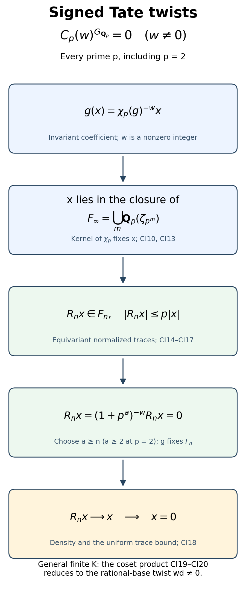
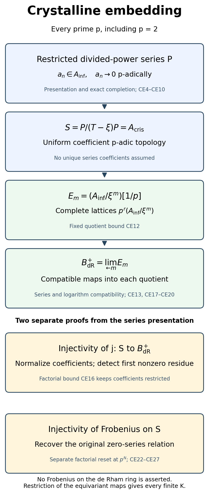
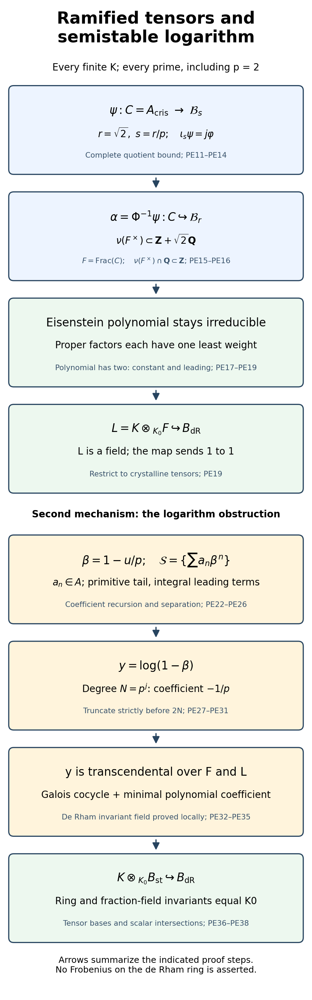
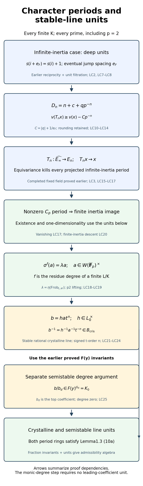

# p-adic Hodge theory and the Fontaine–Mazur conjecture

*Written by GPT-6.1 Sol (OpenAI) in Codex, Ultra setting, October 2026. Self-checked by the writing AI. Public domain (CC0).*

At a prime different from the coefficient characteristic, finite inertia and a nilpotent monodromy operator describe the local representation. At the coefficient prime, a second kind of information appears: a filtration recording Hodge–Tate weights. Period rings make this information accessible from the Galois action.

Throughout, \(p\) is the coefficient prime. We use the **positive convention**: \(\mathbf Q_p(1)\), with action \(\chi_p\), has Hodge–Tate weight \(+1\). Thus the covariant Tate module of an elliptic curve has weights \(0,1\), and the representations attached to weight-\(k\) newforms have weights \(0,k-1\). The convention is explained in [Berger's free author manuscript, §II.1.2](https://perso.ens-lyon.fr/laurent.berger/articles/article05.pdf). The decreasing de Rham filtration has jumps at the **negatives** of these weights.

The course uses arithmetic Frobenius at good primes away from \(p\); local reciprocity sends a uniformizer to geometric Frobenius, and the Weil–Deligne relation is \(r(w)Nr(w)^{-1}=|w|N\). The Frobenius \(\varphi\) on a crystalline period module is a different operator: for \(\mathbf Q_p(1)\) it acts by \(p^{-1}\). It corresponds to the geometric normalization. We will calculate it rather than identifying it with arithmetic Frobenius.

We retain the full higher-weight, weight-one, comparison and modularity assertions. Their proof status matters: the preceding higher-weight construction still has unresolved arithmetic-model and comparison inputs, and no earlier lesson supplies the general \(p\)-adic comparison theorems. Below we prove the full completed-algebraic-closure invariant theorem, construct the tilt, Witt vectors, \(\theta\), and the de Rham discrete valuation ring; prove the admissibility algebra; construct unramified period matrices; and calculate the Tate logarithm from divided powers. The deep estimates and comparisons still needed to make every assertion unconditional are identified before use and collected in §6. A freely accessible theorem statement does not close any of those obligations.

## 1. Weights and the period rings

The elementary field and module prerequisites are actual earlier proofs: *Profinite groups and ℓ-adic representations*, §§0A–0F, proves lattice freeness, finite and infinite Galois theory, primitive elements, finite-extension valuations, Hensel lifting, finite fields and the unramified Frobenius quotient. We use these specific proofs, including the arithmetic normalization on the residue field. The additional wild/tame structure of the monodromy lesson is not needed for the coefficient-prime logarithms below.

Write \(C_p=\widehat{\overline{\mathbf Q}_p}\). The semilinear representation \(C_p(h)\) is the one-dimensional \(C_p\)-space on which
\[
g(ae_h)=g(a)\chi_p(g)^h e_h.
\tag{1}
\]
A representation \(V\) of \(G_K\), for a finite extension \(K/\mathbf Q_p\), is **Hodge–Tate** if there is a semilinear equivariant isomorphism
\[
C_p\otimes_{\mathbf Q_p}V
\simeq\bigoplus_{h\in\mathbf Z}C_p(h)^{m_h},
\qquad \sum_hm_h=\dim_{\mathbf Q_p}V.
\tag{2}
\]
Its weights are the integers \(h\), with multiplicities \(m_h\).

**Tate's invariant theorem.** For every finite \(L/\mathbf Q_p\),
\[
C_p^{G_L}=L,\qquad C_p(h)^{G_L}=0\quad(h\ne0).
\tag{3}
\]
### 1.0A. Complete proof of the invariant theorem

**Theorem 1.0A (completed algebraic closure invariants and signed twists).** For every finite \(K/\mathbf Q_p\),
\[
 C_p^{G_K}=K,\qquad C_p(w)^{G_K}=0\quad(0\ne w\in\mathbf Z).
 \tag{CI1}
\]
The convention is that \(g(ae_w)=g(a)\chi_p(g)^w e_w\), so an invariant vector has coefficient satisfying \(g(a)=\chi_p(g)^{-w}a\). Both signs of \(w\), and \(p=2\), are included. No crystalline or semistable embedding, period invariant theorem, general Hodge comparison, or Tate--Sen character-classification theorem is assumed. This proof uses the elementary field prerequisites stated below.

#### 1.0A.1. The actual foundations and the two estimates

Fix \(\overline{\mathbf Q}_p\subset C_p=\widehat{\overline{\mathbf Q}_p}\), and write \(v(p)=1\), \(|x|=p^{-v(x)}\), \(v(0)=+\infty\). The actual earlier lesson *Profinite groups and ℓ-adic representations* supplies the used field foundations: Lemmas 0B.1--0B.2 and Proposition 0C.1 give embeddings, finite and infinite Galois theory and extension of embeddings; Proposition 0E.1 gives uniqueness and completeness of the extended valuation and \([F:\mathbf Q_p]=ef\), with value group \(e^{-1}\mathbf Z\) on a finite extension. Its proof includes the needed finite-basis, integral-closure and primitive-element arguments. These are written proofs, not a dependency title. Algebraic closures and the stated choice principle remain the set-theoretic foundations of that lesson. No elliptic or étale-cohomological theorem is needed here.

Every \(g\in G_{\mathbf Q_p}\) preserves the valuation on the algebraic closure, by that uniqueness on finite extensions; it therefore extends uniquely as an isometry of \(C_p\). Polynomial coefficients, roots, derivatives, finite products and valuations below are ordinary field operations. The completion embeds the algebraic closure isometrically and densely. Its field structure also needs no theorem about invariants: Cauchy sequences are bounded, so the ultrametric product estimate extends addition and multiplication continuously. For a nonzero limit, approximants eventually have the same nonzero absolute value; the identity \( |a_i^{-1}-a_j^{-1}|=|a_i-a_j|/(|a_i||a_j|)\) makes their inverses Cauchy and supplies an inverse in the completion. Thus \(C_p\) is a field. A finite \(K/\mathbf Q_p\) is complete, hence its image in \(C_p\) is closed: a sequence in \(K\) converging in \(C_p\) is Cauchy in \(K\), whose complete limit must equal the given limit.

We will prove both estimates actually needed for (CI1):

1. For every algebraic intermediate field \(B\subset\overline{\mathbf Q}_p\) containing \(\mathbf Q_p\) and every algebraic \(a\), there is \(b\in B\) with
   \(v(a-b)\ge\min_{g\in G_B}v(ga-a)-p/(p-1)^2\).
   The constant is independent of \(B\) and the degree of \(a\).
2. On the closure of \(F_\infty=\bigcup_{m\ge1}\mathbf Q_p(\zeta_{p^m})\), normalized trace projections \(R_m\) are Galois equivariant, have uniformly bounded norms, and converge pointwise to the identity.

The first follows from a derivative polynomial and a convergent sum of losses. The second follows from the explicit integral power basis of the cyclotomic fields. Its construction is only over \(\mathbf Q_p\); a finite coset product in Section 1.0A.7 then gives the full general-\(K\) twist assertion. Thus no unproved ramified base-change trace estimate is hidden in that assertion.

#### 1.0A.2. A derivative-polynomial root estimate

Let \(f(T)\) be monic of degree \(d\) in a subfield of \(\overline{\mathbf Q}_p\), and suppose every root has valuation at least \(u\). Write \(f(T)=\sum_{j=0}^d c_jT^j\). The elementary-symmetric root formula gives
\[
 v(c_j)\ge(d-j)u.
 \tag{CI2}
\]
Indeed each summand in the coefficient is a product of \(d-j\) roots. This proves the bound directly; no Newton-polygon theorem is invoked.

For an integer \(1\le q<d\), the divided derivative
\[
 D_qf(T)=f^{(q)}(T)/q!
       =\sum_{j=q}^d\binom jq c_jT^{j-q}
 \tag{CI3}
\]
has degree \(d-q\), leading coefficient \(\binom dq\), and constant coefficient \(c_q\). If the constant is zero, it has a root zero, which satisfies every lower valuation bound. Otherwise the product of its \(d-q\) roots has valuation
\(v(c_q)-v(\binom dq)\). At least one root consequently has valuation at least the average, giving
\[
 \text{some root }z\text{ of }D_qf:
 \qquad v(z)\ge u-\frac{v(\binom dq)}{d-q}.
 \tag{CI4}
\]

The following two choices make the loss explicit. If \(d\) is not a power of \(p\), write \(d=p^r m\), \(p\nmid m\), \(m>1\), and choose \(q=p^r\). Then \(v(\binom dq)=0\). If \(d=p^s\), \(s\ge1\), choose \(q=p^{s-1}\). Then \(v(\binom dq)=1\) and the loss is
\(1/(p^{s-1}(p-1))\). To verify the binomial valuations, use the identity
\[
 \binom dq=\frac dq\prod_{i=1}^{q-1}\frac{d-i}{i}.
 \tag{CI5}
\]
For \(i<q\), \(v_p(i)<v_p(d)\), so \(v_p(d-i)=v_p(i)\). The product in (CI5) has valuation zero. Its first factor is respectively a \(p\)-adic unit or \(p\). The formula includes \(q=1\), with an empty product, and includes \(p=2\).

#### 1.0A.3. Uniform approximation to the base field

For \(a\) algebraic over an intermediate \(B\), set
\[
 \delta_B(a)=\min_{g\in G_B}v(ga-a).
\]
The minimum is over a finite orbit; its conjugates are exactly the roots of the minimal polynomial, by the earlier embedding-extension proof. If \(a\in B\), put \(\delta_B(a)=+\infty\) and choose \(a\) itself as its approximation.

For \(h\ge0\), put
\[
 c_h=\sum_{j=0}^{h-1}\frac1{p^j(p-1)},\qquad c_0=0.
 \qquad c_h< C:=\frac p{(p-1)^2}.
 \tag{CI6}
\]
The final bound is the geometric-series sum. We prove by induction on \(d=[B(a):B]\) the stronger finite-degree assertion
\[
 \exists b\in B:
 \qquad v(a-b)\ge\delta_B(a)-c_{\lfloor\log_p d\rfloor}.
 \tag{CI7}
\]
The case \(d=1\) is exact equality \(a=b\). For \(d>1\), let \(Q\in B[T]\) be the monic minimal polynomial of \(a\), and apply Section 1.0A.2 to \(f(T)=Q(a+T)\). All its roots are conjugate differences of valuation at least \(\delta_B(a)\). Choose \(q\) as in Section 1.0A.2. Some root \(z\) of its divided derivative has
\(v(z)\ge\delta_B(a)-\lambda\), where \(\lambda=0\) in the non-power case and \(\lambda=1/(p^{s-1}(p-1))\) in the power case. Put \(a'=a+z\). It is a root of \(D_qQ\in B[T]\), of degree \(d-q<d\), so \([B(a'):B]\le d-q\).

For every \(g\in G_B\), the isometry and the ultrametric inequality give
\[
 \begin{aligned}
 v(ga'-a')
 &=v\bigl(g(a'-a)+(ga-a)+(a-a')\bigr)\\
 &\ge\min\{v(a'-a),\delta_B(a)\}
 \ge\delta_B(a)-\lambda.
 \end{aligned}
 \tag{CI8}
\]
If \(a'\in B\), it already gives the needed approximation. Otherwise induction gives \(b\in B\) with
\(v(a'-b)\ge\delta_B(a)-\lambda-c_{\lfloor\log_p(d-q)\rfloor}\).
Combining this with \(v(a-a')\ge\delta_B(a)-\lambda\) gives the same lower bound for \(v(a-b)\).

If \(d\) is not a power of \(p\), its loss is zero and \(\lfloor\log_p(d-q)\rfloor\le\lfloor\log_p d\rfloor\), proving (CI7). If \(d=p^s\), then \(d-q=(p-1)p^{s-1}\), so \(\lfloor\log_p(d-q)\rfloor=s-1\), and
\(\lambda+c_{s-1}=c_s\). This proves (CI7) in every case. It does not assume that the derivative polynomial is irreducible; induction is on the minimal degree of its selected root.

Consequently
\[
 \exists b\in B:
 \qquad v(a-b)\ge\delta_B(a)-C,
 \qquad C=\frac p{(p-1)^2}.
 \tag{CI9}
\]
No completeness, discrete valuation, ramification filtration, trace bound or perfect residue hypothesis on \(B\) entered this argument. It therefore applies to infinite algebraic intermediate fields as well as finite ones.

#### 1.0A.4. The untwisted invariants, including algebraic intermediate fields

Let \(B\) be any such algebraic intermediate field, and let \(\widehat B\) denote its closure in \(C_p\). Every element of \(\widehat B\) is fixed by \(G_B\): approximate it by elements of \(B\), and use continuity of each isometry.

Conversely suppose \(x\in C_p^{G_B}\). Choose algebraic \(a_j\) with \(v(x-a_j)\to+\infty\). For every \(g\in G_B\),
\[
 v(ga_j-a_j)
 =v\bigl(g(a_j-x)-(a_j-x)\bigr)
 \ge v(a_j-x).
\]
Thus \(\delta_B(a_j)\ge v(a_j-x)\). By (CI9), choose \(b_j\in B\) with
\[
 v(x-b_j)\ge v(x-a_j)-C\longrightarrow+\infty.
\]
Therefore \(x\in\widehat B\). We have proved
\[
 C_p^{G_B}=\widehat B.
 \tag{CI10}
\]
In particular, the completeness and closedness of a finite \(K/\mathbf Q_p\) give \(C_p^{G_K}=K\). For \(B=F_\infty\), the same actual argument gives
\(C_p^{\ker\chi_p}=\widehat{F_\infty}\), once the cyclotomic fields and character in Section 1.0A.5 have been constructed.

#### 1.0A.5. Cyclotomic integral bases and normalized traces

Choose compatible primitive roots \(\zeta_m\) of order \(p^m\), \(m\ge1\), with \(\zeta_{m+1}^p=\zeta_m\). Put
\[
 F_m=\mathbf Q_p(\zeta_m),\quad
 e_m=p^{m-1}(p-1),\quad \pi_m=\zeta_m-1.
\]
The polynomial
\(\Phi_{p^m}(X)=\sum_{j=0}^{p-1}X^{jp^{m-1}}\) has precisely the primitive roots as its roots. Indeed its product with \(X^{p^{m-1}}-1\) is \(X^{p^m}-1\), and all roots are simple in characteristic zero. Modulo \(p\), the binomial theorem gives
\(\Phi_{p^m}(1+T)=T^{e_m}\); its constant coefficient is exactly \(p\).

We verify its local degree and integral basis, rather than infer local irreducibility from a global cyclotomic theorem. In the residue field of any finite extension containing \(\zeta_m\), its image is one: in characteristic \(p\), the only root of \(X^{p^m}-1=(X-1)^{p^m}\) is one. Thus \(v(\pi_m)>0\). In the equation \(\Phi_{p^m}(1+\pi_m)=0\), every intermediate term has valuation greater than one. The constant and leading terms must tie for minimum, so
\[
 v(\pi_m)=1/e_m.
 \tag{CI11}
\]
The value-group and degree formula of the actual earlier Proposition 0E.1 now imply \([F_m:\mathbf Q_p]\ge e_m\), while the displayed polynomial gives the opposite inequality. Thus the degree is exactly \(e_m\), the ramification index is \(e_m\), and the residue field is \(\mathbf F_p\).

Every element of \(F_m\) has a unique power-basis expression \(\sum_{j=0}^{e_m-1}a_j\pi_m^j\), \(a_j\in\mathbf Q_p\). Its nonzero terms have pairwise different valuations modulo \(\mathbf Z\), so the smallest valuation occurs once and is the valuation of the sum. It is integral exactly when each term has nonnegative valuation. Since \(0\le j/e_m<1\), this is equivalent to \(a_j\in\mathbf Z_p\) for every \(j\). Hence
\[
 \mathcal O_{F_m}=\mathbf Z_p[\pi_m]=\mathbf Z_p[\zeta_m],
 \quad 1,\zeta_m,\ldots,\zeta_m^{e_m-1}
 \text{ is an integral basis}.
 \tag{CI12}
\]
The two bases differ by the integer binomial triangular matrix with diagonal entries one.

All primitive roots are powers of \(\zeta_m\) in \(F_m\). It is a Galois splitting field, and its exponent map is an injection into \((\mathbf Z/p^m\mathbf Z)^\times\). Both have order \(e_m\), so the map is onto. Compatible tuples of these exponent automorphisms define automorphisms of \(F_\infty\); the earlier extension-of-embeddings proof lifts them to \(\overline{\mathbf Q}_p\). This proves locally, with no restriction of a merely global surjectivity assertion,
\[
 \chi_p:G_{\mathbf Q_p}\twoheadrightarrow\mathbf Z_p^\times,
 \quad\ker\chi_p=G_{F_\infty}.
 \tag{CI13}
\]
An element fixes \(F_n\) precisely when its exponent is one modulo \(p^n\).

For \(m\ge n\ge1\), define
\[
 R_n^m=p^{-(m-n)}\operatorname{Tr}_{F_m/F_n}.
\]
The degree is \(e_m/e_n=p^{m-n}\). The trace is the sum of the automorphisms: this follows by diagonalizing multiplication over the separable embeddings, as in the Vandermonde trace proof in the earlier Proposition 0E.1. The automorphisms fixing \(F_n\) have exponents \(1+p^n k\), \(0\le k<p^{m-n}\). Summing the resulting geometric progression gives, for every integer \(j\),
\[
 R_n^m(\zeta_m^j)=
 \begin{cases}
  \zeta_n^{j/p^{m-n}}&p^{m-n}\mid j,\\
  0&p^{m-n}\nmid j.
 \end{cases}
 \tag{CI14}
\]
For the second case, the ratio \(\zeta_m^{jp^n}\) is a nonidentity root whose \(p^{m-n}\)-th power is one, so its geometric sum is zero. The formula also covers \(m=n\).

On the integral basis (CI12), formula (CI14) selects precisely the exponents divisible by \(p^{m-n}\), sending them into the integral basis of \(F_n\). It proves
\[
 R_n^m(\mathcal O_{F_m})\subset\mathcal O_{F_n}.
 \tag{CI15}
\]
The maps are \(F_n\)-linear, since the trace automorphisms fix \(F_n\). They commute with \(G_{\mathbf Q_p}\), since all the fields are Galois over the base and conjugation permutes the finite trace summands. They are compatible when the ambient level increases: for \(x\in F_m\) and \(m'\ge m\), each automorphism of \(F_m/F_n\) has \([F_{m'}:F_m]\) lifts in the trace sum, which cancels the extra normalization factor. Thus they define a single \(R_n:F_\infty\to F_n\), restricting to the identity on \(F_n\).

Here is the uniform analytic estimate, including the fractional valuation issue. For \(0\ne x\in F_\infty\), put \(a=\lfloor e_n v(x)\rfloor\). The element \(\pi_n^{-a}x\) is integral at an ambient level containing \(x\). By (CI15) and \(F_n\)-linearity,
\[
 v(R_nx)\ge \frac{\lfloor e_n v(x)\rfloor}{e_n}
 >v(x)-\frac1{e_n},
 \qquad |R_nx|\le p^{1/e_n}|x|\le p|x|.
 \tag{CI16}
\]
If the trace is zero its valuation is infinite, so the same bound holds. This bound is independent of the ambient level and uniform in \(n\).

#### 1.0A.6. Trace projections on the completion and the rational-base twists

Since each finite \(F_n\) is complete, the uniform bound in (CI16) extends \(R_n\) uniquely to an \(F_n\)-linear continuous map
\[
 R_n:\widehat{F_\infty}\longrightarrow F_n,
 \qquad |R_nx|\le p|x|.
 \tag{CI17}
\]
Explicitly, for a Cauchy sequence \(x_j\in F_\infty\), the images are Cauchy in \(F_n\) by that bound; their limit is independent of the chosen approximants. Equivariance passes to the limit because every Galois element is an isometry. These maps still restrict to the identity on \(F_n\).

Moreover \(R_nx\to x\) for every \(x\in\widehat{F_\infty}\). Given \(\varepsilon>0\), choose \(y\in F_r\) with \(|x-y|<\varepsilon/p\). For \(n\ge r\), \(R_ny=y\), and
\[
 |R_nx-x|\le\max\{|R_n(x-y)|,|x-y|\}
 \le p|x-y|<\varepsilon.
 \tag{CI18}
\]
No exchange of distinct period-ring completions is involved.

Let \(0\ne w\in\mathbf Z\), and suppose \(x e_w\in C_p(w)^{G_{\mathbf Q_p}}\). Its coefficient satisfies \(g(x)=\chi_p(g)^{-w}x\). The subgroup \(\ker\chi_p\) fixes it, so (CI10) and (CI13) give \(x\in\widehat{F_\infty}\). Equivariance and \(\mathbf Q_p\)-linearity give
\(g(R_nx)=\chi_p(g)^{-w}R_nx\).

For each \(n\), choose an integer \(a\ge n\), with \(a\ge1\) for odd \(p\) and \(a\ge2\) for \(p=2\). By (CI13), there is \(g\) with \(\chi_p(g)=1+p^a\); it fixes \(F_n\). The rational number \((1+p^a)^{-w}\) is not one for any nonzero signed \(w\). Hence
\[
 R_nx=(1+p^a)^{-w}R_nx\quad\Longrightarrow\quad R_nx=0.
\]
By (CI18), \(x=0\). This proves every signed rational-base twist assertion, including \(p=2\), using only the explicit trace estimate.

*Mechanism of the vanishing proof.* Here \(w\) is any nonzero signed integer. The normalized trace kills nonselected cyclotomic basis powers, which makes its norm uniformly bounded. At a finite level the character can remain nontrivial on a Galois element fixing that entire level; this forces each projected coefficient to vanish. The limit recovers the original coefficient.

#### 1.0A.7. The full finite-base twist assertion

Now let \(K/\mathbf Q_p\) be arbitrary finite, and suppose \(x e_w\in C_p(w)^{G_K}\) with \(x\ne0\), \(w\ne0\). Choose a finite Galois \(L/\mathbf Q_p\) containing \(K\); its existence is the finite normal-closure construction in the earlier Galois proof. Put \(H=G_L\), a normal subgroup of \(G=G_{\mathbf Q_p}\), and \(d=[L:\mathbf Q_p]\). Then \(h(x)=\chi_p(h)^{-w}x\) for \(h\in H\).

For each coset \(rH\), define
\[
 z_{rH}=\chi_p(r)^w r(x),
 \qquad y=\prod_{rH\in G/H}z_{rH}.
 \tag{CI19}
\]
This is well-defined independently of the representative: replacing \(r\) by \(rh\) multiplies its character factor by \(\chi_p(h)^w\) and its value by \(\chi_p(h)^{-w}\). All factors are nonzero in the field \(C_p\), so \(y\ne0\). This is a finite coset product; it is not asserted to be the ordinary field norm of a possibly transcendental \(x\).

For \(g\in G\), write \(gr=r'h\), \(h\in H\). Since \(\chi_p\) is a character, \(\chi_p(h)=\chi_p(g)\chi_p(r)/\chi_p(r')\). Its values lie in \(\mathbf Q_p\) and are fixed by every Galois element. Thus
\[
 g(z_{rH})
 =\chi_p(r)^w\chi_p(h)^{-w}r'(x)
 =\chi_p(g)^{-w}z_{r'H}.
\]
The multiplication permutes all \(d\) cosets, so
\[
 g(y)=\chi_p(g)^{-wd}y.
 \tag{CI20}
\]
It is a nonzero invariant coefficient for the rational-base twist \(wd\), which is still a nonzero signed integer. Section 1.0A.6 excludes it. Therefore the assumed \(x\) was zero. Together with Section 1.0A.4 this proves (CI1) at its complete finite-base and signed-twist scope.

#### 1.0A.8. Free human reading and the exact boundary of this result

The derivative argument was actually read in Giorgio Navone's freely deposited 2022 thesis, [*Hodge-Tate decomposition for p-adic abelian varieties with good reduction*](https://spectrum.library.concordia.ca/id/eprint/990739/1/Navone_MSc_F2022.pdf), §1.3, printed pp.11--13 (PDF pp.16--18). We reconstruct the root coefficient bound by elementary symmetric products, prove both binomial valuations, induct on the selected root's minimal degree, and apply the estimate directly to every algebraic intermediate field. The thesis's displayed final constant omits the factor \(p\) obtained by its own geometric sum; (CI6)--(CI9) use the actual sum \(p/(p-1)^2\). The first derivative case also requires \(m>1\), so \(q<d\). No Newton-polygon theorem or insufficiently justified passage from finite to infinite base fields is imported.

The explicit trace route was actually read in Pierre Colmez's free author notes [*Fontaine's rings and p-adic L-functions*](https://webusers.imj-prg.fr/~pierre.colmez/tsinghua.pdf), §7.5.3, printed pp.127--129 (PDF pp.134--136), including the power-basis trace formula and bounded extension. The proof of its vanishing assertion was read in §7.5.5, printed pp.131--132 (PDF pp.138--139). Here the local cyclotomic integral basis and trace formula are proved directly, and the vanishing argument uses the projections themselves. General \(K\) is handled by the explicit coset product, so neither a logarithm on arbitrary \(C_p^\times\) nor an unproved character trace estimate is used. References or omitted Ax estimates in those notes are replaced by Section 1.0A.2--Section 1.0A.4, not taken as proofs.

Section 1.0A proves equation (3) using the explicitly written elementary field foundations. It does not prove the stronger classification of arbitrary continuous \(\mathbf Q_p^\times\)-valued characters having \(C_p\)-periods, which is needed for crystalline line-unit regularity. It proves no \(A_{\mathrm{cris}}\)-to-\(B_{\mathrm{dR}}\) structural map or series compatibility, no de Rham cyclotomic-logarithm identity across those completions, and no general comparison or modularity theorem. The precise remaining obligations are recorded in §6.

By (3), nonzero equivariant \(C_p\)-linear maps between \(C_p(h)\) and \(C_p(j)\) exist only when \(h=j\): their coefficient would be a fixed vector in \(C_p(j-h)\). Applying \(\operatorname{Hom}_{C_p[G_K]}(C_p(h),-)\) to (2) shows that \(m_h\) is uniquely determined. Thus (2) defines the weights and their multiplicities.

We begin with constructions whose algebra can be given in full. Form
\[
R=\varprojlim_{x\mapsto x^p}\mathcal O_{C_p}/p,\qquad A_{\inf}=W(R).
\tag{4}
\]
**Lemma 1.0 (completion and the tilt).** The field \(C_p\) is algebraically closed. The ring \(R\) in (4) is a perfect, complete valuation domain of characteristic \(p\), with algebraically closed fraction field and value group \(\mathbf Q\). Every \(x=(x_n)\in R\) has a unique lift to an exact root system \((x^{(n)})\) in \(\mathcal O_{C_p}\), with \((x^{(n+1)})^p=x^{(n)}\). Its valuation is \(v_R(x)=v_p(x^{(0)})\), and its residue field is \(\overline{\mathbf F}_p\).

*Proof.* First let \(f\) be a monic polynomial with coefficients in \(C_p\). After replacing its variable by a sufficiently large scalar multiple, its coefficients are integral. Approximate them by integral algebraic coefficients to obtain monic \(f_n\) with coefficient errors of valuation tending to infinity. Each \(f_n\) splits over \(\overline{\mathbf Q}_p\), and all its roots are integral: a root of negative valuation would make the leading term uniquely smallest in valuation. Given a root \(a_n\) of \(f_n\), factor \(f_{n+1}(a_n)=\prod_j(a_n-b_j)\). The coefficient approximation makes the valuation of this product tend to infinity; one factor has at least that valuation divided by \(\deg f\). Choose that \(b_j\) as \(a_{n+1}\). The resulting sequence is Cauchy, and its limit is a root of \(f\). Repeating after division by a linear factor proves algebraic closedness. In particular every integral element has an integral \(p\)-th root.

The inverse of Frobenius on \(R\) is the shift \((x_0,x_1,\ldots)\mapsto(x_1,x_2,\ldots)\). Choose arbitrary integral lifts \(\widehat x_n\). The binomial theorem gives
\[
a\equiv b\pmod p\quad\Longrightarrow\quad
a^{p^j}\equiv b^{p^j}\pmod {p^{j+1}}.
\]
Indeed one application of the \(p\)-th power raises the congruence exponent by at least one; induction proves the formula. Therefore
\[
x^{(n)}=\lim_{j\to\infty}\widehat x_{n+j}^{p^j}
\]
exists, is independent of the lifts, and reduces to \(x_n\). It has the asserted power compatibility. Conversely an exact root system is recovered by this formula, proving uniqueness. Multiplication of exact systems is coordinatewise, while addition satisfies
\[
(x+y)^{(n)}=\lim_{j\to\infty}
 (x^{(n+j)}+y^{(n+j)})^{p^j}.
\]
If \(x^{(0)}=0\), every coordinate is zero. If \(v_R(x)\ge v_R(y)\) and \(y\ne0\), the quotients \(x^{(n)}/y^{(n)}\) are integral and power compatible. They define \(z\in R\) with \(x=yz\). Thus \(R\) is a valuation domain; the displayed addition formula gives its ultrametric inequality. The kernel of the projection \(R\to\mathcal O_{C_p}/p\), \(x\mapsto x_n\), is exactly \(\{v_R(x)\ge p^n\}\). The valuation topology is consequently the inverse-limit topology of discrete coordinates. A coordinatewise limit of a Cauchy sequence remains power compatible, which proves completeness.

Reduction of an integral element of \(C_p\) is already the reduction of an algebraic approximant. Hence its residue field is \(\overline{\mathbf F}_p\). Each residue element has a canonical lift into \(\mathcal O_{C_p}/p\): choose an algebraic representative and lift it to a root of \(T^{p^r}-T\), whose derivative is a unit. Modulo \(p\), these roots are closed under addition and multiplication. Uniqueness with a prescribed residue follows because a difference \(d\) of two such roots satisfies \(d^{p^r}=d\) in characteristic \(p\); a nonzero difference of positive valuation less than one cannot satisfy that equation. The elementary Newton iteration \(a\mapsto a-f(a)/f'(a)\) doubles the error valuation when \(f'(a)\) is a unit, so this lifting uses a proved convergence argument. These lifts and their compatible inverse Frobenius images define \(\overline{\mathbf F}_p\subset R\); their reductions exhaust the residue field. A nonzero limit in \(C_p\) has the valuation of a sufficiently close algebraic approximant, so its valuation is rational. Compatible roots of \(p^{a/b}\) realize every nonnegative rational value in \(R\), proving the value-group assertion.

To prove algebraic closedness of \(\operatorname{Frac}(R)\), scale a monic polynomial to make all its coefficients integral. It suffices to solve a monic \(f\in R[T]\) of degree \(d\ge2\). Project its coefficients to coordinate \(n\), lift to \(\mathcal O_{C_p}\), and factor the lifted polynomial there, with roots \(\rho_{i,n}\), \(1\le i\le d\). Its evaluation at \(\rho_{i,n+1}^p\) is divisible by \(p\), since modulo \(p\) Frobenius carries the polynomial of coordinate \(n+1\) to that of coordinate \(n\). Factoring that evaluation shows that for some \(j\),
\(v_p(\rho_{i,n+1}^p-\rho_{j,n})\ge1/d\). If a difference has valuation at least \(r/d\), \(1\le r<d\), its \(p\)-th-power difference has valuation at least \((r+1)/d\), by the binomial theorem. After \(d-1\) steps we get
\[
\rho_{i,n+1}^{p^d}\equiv\rho_{j,n}^{p^{d-1}}\pmod p.
\]
The nonempty finite sets \(U_m=\{\rho_{i,m+d-1}^{p^{d-1}}\bmod p:1\le i\le d\}\) consequently form an inverse system under the \(p\)-th-power maps; their elements are roots of the coordinate-\(m\) polynomial. There is a compatible sequence: in a finite first set choose an element with arbitrarily long lifts, then do the same at each following level. The resulting element of \(R\) is a root of \(f\), as every coordinate of \(f(x)\) vanishes. Scaling back proves the fraction-field assertion. ∎

**Lemma 1.1 (the Witt algebra used here).** For a perfect \(\mathbf F_p\)-algebra \(A\), the set \(A^{\mathbf N}\) has a functorial ring structure \(W(A)\). It is complete and separated for powers of \(p\), multiplication by \(p\) is injective, and every element has a unique expansion \(\sum_{n\ge0}p^n[a_n]\), where \([a]=(a,0,\ldots)\) is multiplicative. Its Frobenius is \([a]\mapsto[a^p]\).

*Proof.* Introduce the ghost polynomials
\[
w_n(X)=X_0^{p^n}+pX_1^{p^{n-1}}+\cdots+p^nX_n.
\]
Define the addition and multiplication coordinates recursively by requiring their ghosts to be \(w_n(X)+w_n(Y)\) and \(w_n(X)w_n(Y)\). The coordinate of index \(n\) is the difference between this prescribed ghost and the terms already found, divided by \(p^n\). We check that this division produces an integer polynomial. In the polynomial ring over \(\mathbf Z\), let \(F\) raise every variable to its \(p\)-th power. The prescribed ghost \(g_n\) satisfies \(g_n\equiv F(g_{n-1})\pmod {p^n}\). Also \(F(z)\equiv z^p\pmod p\) for every integer polynomial \(z\). If \(a\equiv b\pmod {p^r}\), the binomial theorem gives \(a^p\equiv b^p\pmod {p^{r+1}}\) for \(r\ge1\). Apply this \(n-1-i\) times to \(F(z_i)\) and \(z_i^p\); after multiplication by \(p^i\), their contributions differ by a multiple of \(p^n\). The recursion is integral by induction.

Over an integer polynomial ring the ghost map is injective, since its triangular coefficients are \(1,p,p^2,\ldots\), all nonzero divisors. All ring identities can therefore be checked on ghosts there. They are integer polynomial identities, so they specialize to every \(A\). The same recursion gives \([ab]=[a][b]\), and, in characteristic \(p\),
\[
p(a_0,a_1,\ldots)=(0,a_0^p,a_1^p,\ldots).
\]
To justify this identity, work before specialization in \(\mathbf Z[X_0,X_1,\ldots]\). Let \(Y\) be the Witt coordinates of \(pX\), so \(w_n(Y)=p w_n(X)\), and set \(C=(0,X_0^p,X_1^p,\ldots)\). Direct substitution gives
\[
 w_n(C)=p w_n(X)-p^{n+1}X_n.
\]
We prove \(Y_n-C_n\in p\mathbf Z[X_0,X_1,\ldots]\) inductively. The assertion for index zero is \(Y_0=pX_0\). For \(i<n\), the induction hypothesis and the binomial congruence in the preceding paragraph make \(Y_i^{p^{n-i}}-C_i^{p^{n-i}}\) divisible by \(p^{n-i+1}\); multiplying by \(p^i\) makes that contribution divisible by \(p^{n+1}\). Comparing the index-\(n\) ghosts thus makes \(p^n(Y_n-C_n)\) divisible by \(p^{n+1}\). The integer polynomial ring has no \(p\)-torsion, so \(Y_n-C_n\) is divisible by \(p\). Specialization to characteristic \(p\) proves the displayed identity without using injectivity of characteristic-\(p\) ghosts. Perfectness now identifies \(p^rW(A)\) with the vectors whose first \(r\) coordinates are zero and proves injectivity of multiplication by \(p\). Completeness is precisely completeness of sequences of coordinates. Remove the first coordinate as \([a_0]\), divide the remainder by \(p\), and repeat; this gives the unique expansion. Coordinatewise Frobenius is a ring automorphism by functoriality and perfectness. The integer map into \(W(\mathbf F_p)\) extends to \(\mathbf Z_p\) by completeness. It is injective since multiplication by \(p\) is injective, and surjective by lifting its residue and dividing the successive remainders by \(p\). Thus \(W(\mathbf F_p)=\mathbf Z_p\); its inclusion in \(W(R)\) supplies \(\mathbf Q_p\) after inverting \(p\). ∎

**Lemma 1.2 (\(\theta\), its kernel, and the de Rham valuation ring).** There is a surjective equivariant ring homomorphism
\[
\theta\left(\sum_{n\ge0}p^n[a_n]\right)
   =\sum_{n\ge0}p^n a_n^{(0)}.
\tag{4a}
\]
Choose \(\widetilde p\in R\) with \(\widetilde p^{(0)}=p\). Then \(\ker\theta=(\xi)\), where \(\xi=[\widetilde p]-p\). The \(\xi\)-adic completion of \(W(R)[1/p]\) is a complete discrete valuation ring \(B_{\mathrm{dR}}^+\) with residue field \(C_p\). It contains the original ring and a canonical equivariant copy of \(\overline{\mathbf Q}_p\).

*Proof.* In Witt coordinates \((r_0,r_1,\ldots)\), formula (4a) is \(\sum_i p^i r_i^{(i)}\). Modulo \(p^N\), this equals
\[
\sum_{i=0}^{N-1}p^i(r_i^{(N)})^{p^{N-i}}.
\]
It is the ghost polynomial of index \(N\), with its last term omitted because that term is divisible by \(p^N\). This ghost expression only depends on each \(r_i^{(N)}\) modulo \(p\): replacing a lift by a congruent lift changes its \(p^{N-i}\)-th power by a multiple of \(p^{N-i+1}\). Projection \(R\to\mathcal O_{C_p}/p\) at coordinate \(N\) is a ring map; functoriality of the Witt operations and the ghost addition identity prove additivity of \(\theta\) modulo \(p^N\). This holds for every \(N\). Multiplicativity then follows from additivity, convergent digit expansions, and \(\theta([a][b])=(ab)^{(0)}=a^{(0)}b^{(0)}\). Compatible roots of any integral \(z\) give \(\theta([\widetilde z])=z\), proving surjectivity. The construction is equivariant at every stage.

If \(a\in\ker\theta\), its first digit \(a_0\) has valuation at least one, since \(a_0^{(0)}\in p\mathcal O_{C_p}\). As \(v_R(\widetilde p)=1\), write \(a_0=\widetilde p b_0\). Then \(a-\xi[b_0]\) is divisible by \(p\); its quotient again belongs to \(\ker\theta\), because \(\mathcal O_{C_p}\) has no \(p\)-torsion. Repetition gives \(a=\xi\sum p^i[b_i]\). Thus the kernel is principal. The Witt ring is a domain: the product of two nonzero elements, after removing their first nonzero powers of \(p\), has a nonzero product of first digits in the domain \(R\).

The same absence of \(p\)-torsion proves by induction
\[
W(R)\cap\xi^jW(R)[1/p]=\xi^jW(R).
\]
An element in every \(\xi^jW(R)\) has first digit divisible by every \(\widetilde p^j\), hence zero. It is divisible by \(p\), and its quotient has the same property by the intersection identity. Repetition and \(p\)-adic separatedness make it zero. Consequently \(W(R)[1/p]\) embeds into its \(\xi\)-adic completion.

In each quotient modulo \(\xi^j\), an element with nonzero residue is a unit: lift a residue inverse and use the finite geometric series to correct the product. An element with zero residue is uniquely divisible by \(\xi\) modulo \(\xi^{j-1}\), because \(\xi\) is not a zero divisor. Compatible quotients show that the completed ring has maximal ideal generated by \(\xi\), with \(\xi\) still a nonzero divisor. Its powers have zero intersection and its residue is \(C_p\). Every nonzero element is a power of \(\xi\) times a unit, proving the discrete valuation assertion.

Finally any algebraic \(a\in C_p\) has a separable minimal polynomial over \(\mathbf Q_p\). Lift its residue root by Newton iteration in the complete \(\xi\)-adic ring; its derivative has nonzero residue and is a unit. The iteration doubles the \(\xi\)-adic error, and its root with prescribed residue is unique. For addition and multiplication, place the finitely many algebraic elements in a common finite extension \(F/\mathbf Q_p\). The primitive-element proof at the start of lesson 1, Proposition 0E.1, gives \(F=\mathbf Q_p[\beta]\). Lift \(\beta\) by the Newton procedure just described. Evaluation at that lift defines a homomorphism \(\mathbf Q_p[T]/(f_\beta)\to B_{\mathrm{dR}}^+\): the minimal polynomial vanishes there, and the map from this field is injective because it sends one to one. Every element of \(F\) is a polynomial in \(\beta\). Its polynomial value is a root of its own minimal polynomial with the prescribed residue, so uniqueness identifies it with its individual Newton lift. This proves compatibility with addition, multiplication and field inclusions. Applying any Galois element preserves the minimal polynomial and changes the prescribed residue accordingly, so uniqueness proves equivariance. They give the asserted canonical algebraic constants. ∎

Choose \(\epsilon=(1,\zeta_p,\zeta_{p^2},\ldots)\) as an exact root system. The logarithm in the following display converges for the maximal-ideal topology:
\[
t=\log([\epsilon]),\quad g(t)=\chi_p(g)t,\quad
B_{\mathrm{dR}}=B_{\mathrm{dR}}^+[1/t],\quad
\operatorname{Fil}^iB_{\mathrm{dR}}=t^iB_{\mathrm{dR}}^+.
\tag{5}
\]
Here is the remaining distinction between a proved construction and a period-ring structural theorem.

**Lemma 1.2A (the uniformizer and divided-power logarithms).** The element \(t=\log[\epsilon]\) is a uniformizer of \(B_{\mathrm{dR}}^+\). Set
\[
A_0=W(R)[\xi^n/n!:n\ge1],\qquad
A_{\mathrm{cris}}=\varprojlim_r A_0/p^rA_0.
\tag{5a}
\]
In this abstract completion, the logarithm of \([x]\) exists after inverting \(p\) whenever \(x\in1+\mathfrak m_R\). It is additive on products, equivariant, and satisfies \(\varphi(\log[x])=p\log[x]\). These identities include \(g(t)=\chi_p(g)t\) once the natural map from this completion to \(B_{\mathrm{dR}}^+\) has been established. Theorem 1.2B constructs that natural map and proves its injectivity; they are not inferred from the definition (5a).

*Proof.* Put \(\epsilon_1=\epsilon^{1/p}\). The element
\[
\omega=1+[\epsilon_1]+\cdots+[\epsilon_1]^{p-1}
\]
is killed by \(\theta\), since its residue is \(\sum_{i=0}^{p-1}\zeta_p^i=0\). Modulo \(p\) it is \((\epsilon_1-1)^{p-1}\). To compute its valuation, observe that \(\Phi_{p^n}(1+T)\) has degree \(p^{n-1}(p-1)\), constant coefficient \(p\), and all intermediate coefficients divisible by \(p\): its reduction is that power of \(T\). A primitive \(p^n\)-th root reduces to one, so \(v_p(\zeta_{p^n}-1)>0\). In its polynomial equation the intermediate terms have valuation greater than one; the constant and leading terms must therefore have equal valuation. This gives
\(v_p(\zeta_{p^n}-1)=1/(p^{n-1}(p-1))\). Taking the exact-system limit gives \(v_R(\epsilon_1-1)=1/(p-1)\). For \(p=2\), subtraction in the tilt is addition; the exact-system formula uses \(\zeta_{2^{n+1}}+1=(\zeta_{2^{n+1}}-1)+2\). For \(n\ge1\), the first summand has valuation less than one, so the same valuation calculation applies. Thus the argument includes \(p=2\). Thus \(\omega\bmod p\) has valuation one. Write \(\omega=\xi c\) by Lemma 1.2; its first digit forces the first digit of \(c\) to be a unit. Hence \(c\) is a Witt unit, and \(\omega\) generates \(\ker\theta\). Since
\[
[\epsilon]-1=\omega([\epsilon_1]-1),\qquad
\theta([\epsilon_1]-1)=\zeta_p-1\ne0,
\]
the element \([\epsilon]-1\) is a uniformizer in \(B_{\mathrm{dR}}^+\). Its logarithm is itself plus terms of maximal-ideal order at least two, so \(t\) is a uniformizer.

The divided powers of \(p\) and \(\xi\) lie in \(A_0\). For sums this follows from
\((a+b)^n/n!=\sum_{i+j=n}(a^i/i!)(b^j/j!)\); for divided powers of a divided power it follows from the integer
\((mn)!/(m!(n!)^m)\), which counts partitions of \(mn\) labelled objects into \(m\) unordered blocks of size \(n\). Thus every element of \((p,\xi)A_0\) has divided powers in \(A_0\). If \(z=[x]-1\) with \(x\in1+\mathfrak m_R\), then \(\theta(z)=x^{(0)}-1\) has positive valuation. For some integer \(M\), \(\theta(z^M)\in p\mathcal O_{C_p}\), so surjectivity of \(\theta\) gives \(z^M\in(p,\xi)W(R)\). Writing \(n=Mq+r\), \(0\le r<M\), gives
\[
\frac{z^n}{n}=\frac{q!}{n}\,z^r\frac{(z^M)^q}{q!}.
\tag{5b}
\]
The last factor is integral in \(A_0\). Also
\(v_p(q!)=\sum_{j\ge1}\lfloor q/p^j\rfloor\), which grows linearly with \(q\), whereas \(v_p(n)\le\log_p n\). Hence the terms in (5b) eventually lie in \(A_0\) and tend to zero \(p\)-adically. The logarithm converges in \(A_{\mathrm{cris}}[1/p]\).

The identities for logarithms follow from the formal power-series identity
\(\log((1+Z)(1+W))=\log(1+Z)+\log(1+W)\), whose derivatives and value at \((0,0)\) determine it over \(\mathbf Q\). They can be evaluated here: the bound (5b) makes all terms beyond a sufficiently large total degree arbitrarily divisible by \(p\). The corresponding two-variable bound follows by choosing powers of both variables lying in \((p,\xi)\), and using the divided powers of their sum; factorial growth dominates the denominators. Consequently the finite-degree identities pass to the completed limit.

Witt Frobenius preserves \(A_0\):
\[
\varphi(\xi)=(\xi+p)^p-p
   =\xi^p+pw
   =p\bigl((p-1)!\xi^p/p!+w\bigr),\qquad w\in W(R),
\]
and \(p^n/n!\in\mathbf Z_p\). It extends continuously to the completion. Applying it to the convergent logarithm and using \([x^p]=[x]^p\) proves \(\varphi(\log[x])=p\log[x]\). Its injectivity on the completion has not been proved by this argument.

For completeness, exponentiation by \(a\in\mathbf Z_p\) in the logarithm identity is justified here, rather than by the discrete valuation topology, in which \(p\) is a unit. We have \([\widetilde p]^p=(\xi+p)^p\in pA_0\). Therefore a Teichmüller digit whose tilt valuation is at least \(pr\) lies in \(p^rA_0\). If two tilt elements are sufficiently close, their first \(r\) Witt difference coordinates all have sufficiently large valuation: apply functoriality to their equality modulo a sufficiently small ideal of \(R\). The Teichmüller digits are the inverse \(p^i\)-th powers of those coordinates. Each of these first digits then lies in \(p^rA_0\), and the remaining digits already carry \(p^r\). This proves continuity \(W(R)\to A_{\mathrm{cris}}\) for the product valuation topology on coordinates. The logarithm of \([\epsilon^a]\), which has residue one, has the uniformly small tails \((n-1)!w^n\xi^n/n!\) with \(w\in W(R)\). Approximate \(a\) by integers to obtain \(\log[\epsilon^a]=a\log[\epsilon]\). Taking \(a=\chi_p(g)\) gives the Galois identity in the abstract completion. Theorem 1.2B below constructs the structural map and proves compatibility with this logarithm. ∎

### 1.2B. The completed crystalline embedding

**Theorem 1.2B (the completed crystalline embedding and Frobenius).** For every prime \(p\), including \(2\), this proof constructs an injective equivariant ring homomorphism
\[
 j:A_{\mathrm{cris}}\longrightarrow B_{\mathrm{dR}}^+
 \tag{CE1}
\]
from the actual completed divided-power ring in Lesson14. It proves that restricted divided-power series have their prescribed de Rham images, compares the logarithms in the two completions, and proves injectivity of the completed crystalline Frobenius. All constructions commute with restriction to \(G_K\) for every finite \(K/\mathbf Q_p\). No ramified tensor-product injectivity, semistable transcendence, crystalline invariant-field theorem, or geometric comparison theorem is inferred from these results.

#### 1.2B.1. Actual inputs and the two topologies

Use the actual constructions of Lesson14, Lemmas 1.0--1.2:
\[
 R=\varprojlim_{x\mapsto x^p}\mathcal O_{C_p}/p,
 \quad A=W(R),\quad u=[\widetilde p],\quad \xi=u-p,
 \quad \theta:A\twoheadrightarrow\mathcal O_{C_p},\quad \ker\theta=\xi A.
\]
Here \(R\) is a perfect complete valuation domain, \(v_R(\widetilde p)=1\); \(A\) is a \(p\)-torsion-free domain, complete and separated for powers of \(p\); \(A/pA=R\). Witt Frobenius \(\varphi\) is an automorphism of \(A\), fixes \(\mathbf Z_p\), and sends \(u\) to \(u^p\). The earlier proofs establish that
\[
 B_{\mathrm{dR}}^+=\varprojlim_{m\ge1} A[1/p]/\xi^m A[1/p]
 \tag{CE2}
\]
is a discrete valuation ring, that \(A[1/p]\) embeds into it, and that its residue is \(C_p\). This proof does not assume the crystalline embedding that we will prove.

Put
\[
 S_0=A[\xi^n/n!:n\ge1]\subset A[1/p],
 \qquad S=\varprojlim_r S_0/p^rS_0=A_{\mathrm{cris}}.
 \tag{CE3}
\]
The discrete valuation topology of (CE2) treats \(p\) as a unit. A sequence approaching zero for powers of \(p\) need not approach zero in that topology. We therefore construct a complete coefficient topology on each quotient in (CE2), prove a uniform bound there, and only then extend the map from (CE3). For a divided-power series the resulting value will also equal its \(\xi\)-adic sum; that agreement will be proved, rather than inferred from the names of the completions.

The set-theoretic algebraic-closure and choice foundations remain those explicitly retained by the earlier field lesson. We use choice below only to choose a set section of the already proved surjection \(\theta\). No \(C_p\)-invariant theorem is needed here.

#### 1.2B.2. The divided-power presentation, with exact completion

For an indeterminate \(T\), set \(T^{[n]}=T^n/n!\) and
\[
 P_0=\bigoplus_{n\ge0} A T^{[n]}\subset A[1/p][T],
 \qquad P=\left\{\sum_{n\ge0}a_n T^{[n]}:a_n\in A,
                       \ a_n\longrightarrow0\ p\text{-adically}\right\}.
 \tag{CE4}
\]
Multiplication is
\(T^{[i]}T^{[j]}=\binom{i+j}{i}T^{[i+j]}\). Consequently the coefficient of index \(n\) of a product is \(\sum_{i=0}^n\binom ni a_i b_{n-i}\). It tends to zero: for any fixed \(r\), outside the sum of two finite initial ranges at least one factor belongs to \(p^rA\). Thus \(P\) is a ring. Its topology is uniform \(p\)-adic smallness of all its coefficients. Since \(A\) is complete, taking coefficient limits proves that \(P\) is the \(p\)-adic completion of \(P_0\): a coherent system of polynomials modulo \(p^r\) has unique limiting coefficients, only finitely many of which can be nonzero modulo each \(p^r\). Conversely truncation of such a restricted series gives the coherent polynomials. This also proves separatedness and completeness directly.

Evaluation at \(\xi\) maps \(P_0\) onto \(S_0\). Indeed products of divided powers are integral multiples of divided powers, so \(S_0\) is their \(A\)-module span. We claim
\[
 0\longrightarrow P_0\xrightarrow{\,T-\xi\,}P_0
       \xrightarrow{\,\mathrm{ev}_\xi\,}S_0\longrightarrow0
 \tag{CE5}
\]
is exact, and the first map is an isometry for the \(p\)-adic coefficient order.

First, multiplication by \(\xi\) on \(A\) preserves \(p\)-adic order. If \(\xi b\in pA\), reduction modulo \(p\) gives \(\widetilde p\,\bar b=0\) in the domain \(R\); hence \(b\in pA\). Iteration gives
\[
 \xi b\in p^rA\quad\Longleftrightarrow\quad b\in p^rA.
 \tag{CE6}
\]
The same argument holds for \(u\), for any power of either element, and for divisibility by any nonzero integer: its prime-to-\(p\) factor is a unit in \(\mathbf Z_p\). It also shows that if \(b\in A[1/p]\) and \(\xi b\in A\), then \(b\in A\).

If a polynomial in \(P_0\) evaluates to zero, ordinary polynomial division in \(A[1/p][T]\) writes it as \((T-\xi)\sum b_n T^{[n]}\), with only finitely many \(b_n\in A[1/p]\). Comparing coefficients gives
\[
 a_n=n b_{n-1}-\xi b_n,\qquad b_{-1}=0.
 \tag{CE7}
\]
The constant equation and (CE6) make \(b_0\) integral; induction makes every \(b_n\) integral. This proves the kernel assertion of (CE5). Multiplication by \(T-\xi\) is injective in the polynomial domain. Moreover, if every \(a_n\in p^rA\), the same induction in (CE7), using (CE6), gives every \(b_n\in p^rA\). The converse is immediate. This proves the claimed isometry. The quotient topology on \(S_0\) is its \(p\)-adic topology, since \(\mathrm{ev}_\xi(p^rP_0)=p^rS_0\).

Here is the full completion argument, with no Noetherian exactness theorem. A coherent element of \(S\) can be lifted successively to polynomials \(f_r\in P_0\) with \(f_{r+1}-f_r\in p^rP_0\): lift the next representative, and subtract a kernel element so that its difference from the previous lift represents the given element of \(p^rS_0\). Thus \(f_r\) converges in \(P\) and proves surjectivity \(P\to S\). If \(f\in P\) maps to zero, choose a polynomial approximation \(f_r\equiv f\pmod {p^rP}\). Its evaluation lies in \(p^rS_0\), so choose \(q_r\in p^rP_0\) with the same evaluation. By (CE5), \(f_r-q_r=(T-\xi)g_r\) for a polynomial \(g_r\). The isometry just proved makes the \(g_r\) a Cauchy sequence; its limit satisfies \(f=(T-\xi)g\). Consequently
\[
 S=P/(T-\xi)P.
 \tag{CE8}
\]
The same coefficient induction in the completed ring shows that \((T-\xi)P\) is \(p\)-saturated. Thus \(S\) has no \(p\)-torsion. Also, the natural reduction maps give \(S/p^rS=S_0/p^rS_0\): a coherent system whose first \(r\) components vanish has all later representatives divisible by \(p^r\), and division, with compatibility, gives an element of \(S\). In particular the kernels of reduction are exactly \(p^rS\); this is the topology used throughout.

We will also need the generator \(u=\xi+p\). Translation \(T\mapsto T+p\) is an automorphism of \(P_0\). Its formula
\[
 (T+p)^{[n]}=\sum_{j=0}^n\frac{p^{n-j}}{(n-j)!}T^{[j]}
 \tag{CE9}
\]
has integral coefficients, since \(v_p(k!)\le k\). The inverse translation has the same property. Both preserve uniform coefficient smallness and therefore extend to inverse continuous automorphisms of \(P\). Formula (CE9) proves also that \(S_0=A[u^n/n!:n\ge1]\). Translating (CE8) gives
\[
 \sum_{n\ge0}a_n\frac{u^n}{n!}=0\text{ in }S
 \quad\Longleftrightarrow\quad
 \exists d_n\in A, d_n\to0:
       a_n=n d_{n-1}-u d_n,\quad d_{-1}=0.
 \tag{CE10}
\]
Every element of \(S\) has a restricted series in either generator, by the surjectivity just proved. There is no assertion that the coefficients in these series are unique.

#### 1.2B.3. Complete coefficient topologies on de Rham quotients

For \(m\ge1\), put
\[
 D_m=A/\xi^m A,\qquad E_m=D_m[1/p]
          =A[1/p]/\xi^m A[1/p].
 \tag{CE11}
\]
Multiplication by \(\xi^m\) satisfies (CE6). Hence \(\xi^m A\) is closed for the \(p\)-adic topology: if \(\xi^m b_r\) converges, the \(b_r\) are Cauchy by (CE6), and their limit supplies the quotient. Also \(D_m\) has no \(p\)-torsion. For if \(p^r a=\xi^m b\), (CE6) gives \(b=p^r c\), and cancellation gives \(a=\xi^m c\).

We verify both separatedness and completeness of \(D_m\). If \(a\) belongs to \(p^rA+\xi^m A\) for every \(r\), choose \(b_r\) with \(a-\xi^m b_r\in p^rA\). Their differences are Cauchy by (CE6), so \(a=\xi^m\lim b_r\). This proves \(\bigcap_r p^rD_m=0\). For a coherent Cauchy system of classes, successively alter its representatives by elements of \(\xi^m A\) so that their successive differences belong to \(p^rA\). Their limit in \(A\) supplies the limiting class in \(D_m\). Thus it is complete.

Give \(E_m\) the coefficient topology whose lattices are \(p^rD_m\), \(r\in\mathbf Z\). Equivalently its nonzero elements have the integer order
\(\operatorname{ord}_m(x)=\max\{r:x\in p^rD_m\}\) and norm \(p^{-\operatorname{ord}_m(x)}\). This is a complete nonarchimedean \(\mathbf Q_p\)-algebra topology. Addition is ultrametric and multiplication is submultiplicative, since \(D_m\) is a ring. Completeness follows because a Cauchy sequence is eventually bounded in a single lattice \(p^{-r}D_m\), which is complete. We do not assert multiplicativity of this quotient norm; \(E_m\) has nilpotents for \(m>1\).

For clarity, this topology retains the valuation topology of \(R\), rather than imposing a discrete coefficient topology there. The product valuation topology on the Witt coordinates makes \(p^N A\) converge uniformly to zero, because its first \(N\) coordinates vanish. Conversely \(p^N A+\xi^m A\) is open for that product topology. To see this, for \(N\ge1\) require that the first \(N\) Teichmüller digits have tilt valuation at least \(N+m\). This is an open coordinate condition: conversion to these finitely many digits uses the Witt polynomials and inverse Frobenius, all continuous in the valuation topology. Such a digit is divisible by \(\widetilde p^{N+m}\). Its lift is divisible by
\(u^{N+m}=(\xi+p)^{N+m}\), which belongs to \(p^N A+\xi^m A\): every binomial term either contains \(\xi^m\), or contains at least \(p^N\). The remaining digits belong to \(p^N A\). This proves openness. Every product-coordinate neighborhood contains some \(p^N A\), so its image in \(D_m\) contains \(p^N D_m\). These two observations prove that the \(p\)-adic topology on \(D_m\) is exactly its quotient topology from the product valuation topology on \(A\).

The inverse-limit coefficient topology on the ring (CE2) is the one we use for extending completed series. Its reduction \(E_1=C_p\) has the usual valuation topology, since \(D_1=\mathcal O_{C_p}\) and integer powers of \(p\) are a neighborhood basis. The transition maps \(E_{m+1}\to E_m\) preserve lattices and are continuous. This topology is Hausdorff and complete. It is distinct from the \(\xi\)-adic topology, which has the same underlying ring but regards its residue field as discrete. Each Galois element preserves \(\xi A\), hence its powers and every lattice in (CE11); its induced maps on the \(E_m\) are continuous. This suffices for the equivariance of the construction below; no continuous extension of Frobenius to \(B_{\mathrm{dR}}^+\) is asserted.

#### 1.2B.4. Extending the map, with the actual quotient bound

On \(S_0\), use its literal inclusion in \(A[1/p]\) and then (CE11). Modulo \(\xi^m\), a divided power of degree at least \(m\) is zero; every remaining degree has denominator valuation at most \(v_p((m-1)!)\). Since \(S_0\) is the \(A\)-span of those divided powers, this proves the bound
\[
 \mathrm{im}(p^rS_0\longrightarrow E_m)
       \subset p^{\,r-v_p((m-1)!)}D_m.
 \tag{CE12}
\]
It holds for every integer \(r\ge0\), uniformly over all polynomial degrees. The completeness of \(E_m\) therefore extends this map uniquely to \(j_m:S\to E_m\). A Cauchy sequence representing an element of \(S\) has a Cauchy image by (CE12), and equivalent sequences have the same limit. Addition and multiplication commute with the limits because they are continuous on bounded lattices. Thus \(j_m\) is a ring homomorphism. The extensions are compatible with the transition maps, so they define (CE1). The maps on the dense \(S_0\) are equivariant; continuity of each individual Galois action on the lattices gives equivariance of their extensions.

The map has the exact series compatibility
\[
 j\left(\sum_{n\ge0}a_n\frac{\xi^n}{n!}\right)
       =\sum_{n\ge0}a_n\frac{\xi^n}{n!}
       \quad(a_n\in A,\ a_n\to0\ p\text{-adically}).
 \tag{CE13}
\]
On the left the series converges in \(S\), because its terms belong to \(p^rS\) once \(a_n\in p^rA\). In each \(E_m\), continuity of \(j_m\) makes its value the finite sum with \(n<m\). The right side also exists for the \(\xi\)-adic topology, since its terms have order at least \(n\), and has exactly those same finite sums modulo \(\xi^m\). Equality of all components in (CE2) proves (CE13). This is an explicit comparison of limits in two different topologies.

Also \(\theta(j(S))\subset\mathcal O_{C_p}\): in degree one only the coefficient \(a_0\) survives in (CE13). Surjectivity onto that residue follows from the original \(A\to\mathcal O_{C_p}\). The map \(j\) extends after inverting \(p\).

#### 1.2B.5. A normalization estimate that proves injectivity

Choose a set section \(s:\mathcal O_{C_p}\to A\) of \(\theta\), with \(s(0)=0\), such that
\[
 y\in p^r\mathcal O_{C_p}\ \Longrightarrow\ s(y)\in p^rA
       \qquad(r\ge0).
 \tag{CE14}
\]
Such a section exists. For \(y\ne0\), put \(r=\lfloor v_p(y)\rfloor\), choose any lift of \(p^{-r}y\) by the proved surjection \(\theta\), and multiply that lift by \(p^r\). The zero case is already fixed. The section need not be additive or continuous; neither property is used.

Take a restricted series \(\sum a_n\xi^n/n!\) for \(x\in S\), and put \(b_{-1}=0\). Recursively set
\[
 c_n=a_n+n b_{n-1},\qquad
 a'_n=s(\theta(c_n)),\qquad
 \xi b_n=c_n-a'_n.
 \tag{CE15}
\]
The last equation has a unique solution in \(A\), since its right side is in \(\ker\theta=\xi A\) and \(\xi\) is a nonzero divisor. Write \(\nu_p(a)=\max\{r:a\in p^rA\}\), with \(\nu_p(0)=+\infty\). Formula (CE14) and (CE6) imply
\[
 \nu_p(b_n),\ \nu_p(a'_n)
       \ge \nu_p(c_n)
       \ge\min\{\nu_p(a_n),v_p(n)+\nu_p(b_{n-1})\}.
\]
Iteration gives the useful factorial estimate
\[
 \nu_p(b_n)\ge
       \min_{0\le i\le n}
       \left(\nu_p(a_i)+v_p(n!/i!)\right).
 \tag{CE16}
\]
Its right side tends to infinity. For any fixed \(r\), all \(a_i\in p^rA\) beyond some finite index; for each of the remaining finitely many \(i\), the product \(n!/i!\) has valuation tending to infinity. Hence \(b_n\to0\). The preceding bound also gives \(a'_n\to0\).

The recursion gives \(a_n=a'_n+\xi b_n-nb_{n-1}\). In \(S\), both restricted sums involving \(b_n\) converge, and shifting the index cancels them:
\[
 \sum_{n\ge0} \xi b_n\frac{\xi^n}{n!}
       =\sum_{n\ge1}n b_{n-1}\frac{\xi^n}{n!}.
\]
Thus \(x=\sum a'_n\xi^n/n!\). Each nonzero \(a'_n\) has nonzero residue under \(\theta\), by the defining section. If some coefficient is nonzero, let \(n_0\) be its least index. By (CE13), the image of this series has exact \(\xi\)-adic order \(n_0\): its leading coefficient is \(\theta(a'_{n_0})/n_0!\ne0\), and all later terms have larger order. It cannot be zero in \(B_{\mathrm{dR}}^+\). Therefore \(j(x)=0\) implies that every \(a'_n\) is zero, hence that \(x=0\). This proves injectivity of (CE1).

In particular \(S\) is a domain and \(S_0\to S\) is injective. The proof includes the needed preservation of restrictedness during coefficient normalization; omitting (CE16) would leave a completion gap. Its factorial argument works unchanged at \(p=2\).

The induced filtration is also explicit. For \(r\ge1\), an element of \(S\) has image in \(\xi^rB_{\mathrm{dR}}^+\) exactly when its normalized coefficients of indices less than \(r\) are all zero. Thus it can be written as a restricted sum of divided powers of degrees at least \(r\). Conversely every such sum has image in that ideal by (CE13). This submodule is closed for the \(p\)-adic topology, since it is the kernel of the continuous map \(j_r:S\to E_r\), with Hausdorff target. For \(r=1\) it is precisely the kernel of \(\theta\) on \(S\).

The map preserves the actual completed divided powers on that kernel. For a finite sum of positive divided powers, the divided power of a summand \(a\xi^n/n!\), \(n\ge1\), is integral because its multiplier of \(\xi^{nr}/(nr)!\) is
\((nr)!/(r!(n!)^r)\in\mathbf Z\): it counts partitions of \(nr\) labelled objects into \(r\) unordered blocks of size \(n\). The sum formula for divided powers then proves integrality for the entire finite sum. For an element \(b\) in the completed kernel, truncate its positive-degree restricted representation to \(b_N\). The identity
\((b_N^r-b_M^r)/r!=(b_N-b_M)\sum_{i=0}^{r-1}b_N^{r-1-i}b_M^i/r!\)
shows that these divided powers are Cauchy in \(S\), losing at most the fixed integer \(v_p(r!)\) in their \(p\)-adic order. Their limit is \(b^r/r!\) in \(S[1/p]\), belongs to \(S\), and still has zero residue. Finally \(j(b^r/r!)=j(b)^r/r!\), by applying the ring homomorphism and cancelling the nonzero scalar \(r!\) in \(B_{\mathrm{dR}}^+\). This proves divided-power compatibility at every degree, including when \(p\) divides \(r!\).

#### 1.2B.6. Logarithm compatibility and the Tate periods

Let \(x\in1+\mathfrak m_R\), put \(z=[x]-1\in A\), and use the abstract logarithm of Lemma 1.2A. That lemma proves \(\sum_{n\ge1}(-1)^{n+1}z^n/n\) converges in \(S[1/p]\), with a fixed bound on its negative powers of \(p\), and proves its product, Galois, Frobenius and \(\mathbf Z_p\)-exponent identities there. We now prove that its image is the logarithm for the complete coefficient topology just constructed.

The residue of \(x\) is one, so \(\theta(z)\in\mathfrak m_{C_p}\). Choose \(M\ge1\) with \(M v_p(\theta(z))\ge1\). Surjectivity of \(\theta\) gives \(z^M\in(p,\xi)A\). In \(D_m\), the ideal \((p,\xi)^q\) lies in \(p^{q-m+1}D_m\) for \(q\ge m-1\): expand its products, and terms with \(\xi\)-degree at least \(m\) vanish, while all other terms contain at least \(q-m+1\) factors \(p\). Consequently
\[
 \operatorname{ord}_m(z^n/n)
       \ge \lfloor n/M\rfloor-m+1-v_p(n)
       \longrightarrow+\infty.
 \tag{CE17}
\]
This proves convergence of the ordinary logarithm series in every \(E_m\). Continuity of \(j_m\), also on each fixed lattice after inverting \(p\), gives
\[
 j(\log[x])=\lim_N\sum_{n=1}^N(-1)^{n+1}\frac{z^n}{n}
 \quad\text{in the inverse-limit coefficient topology.}
 \tag{CE18}
\]
If \(\theta(z)=0\), then \(z=\xi w\) with \(w\in A\); (CE13) applied to the restricted coefficients \((-1)^{n+1}(n-1)!w^n\) shows that (CE18) is exactly the \(\xi\)-adic logarithm. Its residue for general \(x\) is the usual convergent logarithm of \(x^{(0)}\) in \(C_p\), since (CE17) at \(m=1\) gives precisely that coefficient convergence. No convergence is being deduced merely because a ring homomorphism exists.

In particular \([\epsilon]-1\in\xi A\), so the abstract crystalline logarithm maps to the actual uniformizer \(t=\log_{\mathrm{dR}}[\epsilon]\) of Lemma 1.2A. The already proved identities in \(S\) therefore give the de Rham identity \(g(t)=\chi_p(g)t\). Also \(\varphi(t)=pt\) holds in \(S\), as that lemma proves; this is not an extension of Frobenius to the de Rham ring.

Here is the exact compatibility used by the Tate example. For \(a\in\mathbf Z_p^\times\), put \(M=p-1\), including \(M=1\) at \(p=2\), and choose its exact root system \(\widetilde a\). We have
\([\widetilde a]^M-a^M\in\xi A\), and \(a^M-1\in p\mathbf Z_p\). Both logarithms in
\[
 \log[\widetilde a^M]
       =\log_p(a^M)+\log([\widetilde a]^M/a^M)
 \tag{CE19}
\]
converge in \(S\): the first is the ordinary \(p\)-adic scalar series, and the second has \(\xi\)-divisible argument difference and the restricted divided-power coefficients just used. The abstract product identity in Lemma 1.2A proves (CE19). The constant series maps to the same scalar in \(B_{\mathrm{dR}}^+\), by (CE12) and the complete coefficient topology; the second maps to its \(\xi\)-adic sum by (CE13). Dividing by \(M\), the power identity for the \(\xi\)-adic logarithm gives
\[
 j\left(M^{-1}\log[\widetilde a^M]\right)
       =\log_p(a)+\log_{\mathrm{dR}}([\widetilde a]/a).
 \tag{CE20}
\]
This proves the crystalline unit-period comparison (26a)--(26c) required there. For \(q=p^m a\), the already defined de Rham element \(\log_{\mathrm{dR}}([\widetilde p]/p)\) combines with (CE20) to give the proposed value \(\log_p(q)+\log_{\mathrm{dR}}([\widetilde q]/q)\) and residue \(\log_p(q)\). It proves this evaluation as a homomorphism from the abstract polynomial semistable algebra; it does not prove that the homomorphism is injective or that this logarithmic element is transcendental.

#### 1.2B.7. Frobenius on the completion: the full kernel calculation

Use the generator \(u=[\widetilde p]\) from (CE9)--(CE10). On \(S_0\), Witt Frobenius preserves divided powers because
\[
 \varphi(u^j/j!)=u^{pj}/j!
       =\frac{(pj)!}{j!}\frac{u^{pj}}{(pj)!}\in S_0.
 \tag{CE21}
\]
It fixes \(p\), hence extends continuously to \(\varphi:S\to S\). Its existence needs no injectivity assertion about the completion.

Suppose \(a=\sum_{j\ge0}a_j u^j/j!\in S\), with \(a_j\to0\), and \(\varphi(a)=0\). Its Frobenius series has coefficient \(A_k=0\) for \(p\nmid k\), and
\(A_{pj}=((pj)!/j!)\varphi(a_j)\). These coefficients tend to zero, since the displayed multiplier is an integer and \(\varphi\) preserves \(p\)-adic order on \(A\). By (CE10) there are \(g_k\in A\), tending to zero, such that
\[
 k g_{k-1}-u g_k=A_k,\qquad g_{-1}=0.
 \tag{CE22}
\]
We will extract an integral relation for the original series and prove that its coefficients also tend to zero.

For \(k=pj+r\), \(0\le r<p\), coefficient induction in (CE22), using the integer-divisibility form of (CE6) for \(u\), proves
\[
 g_{pj+r}\in \frac{(pj+r)!}{j!}A.
 \tag{CE23}
\]
At \(k=0\) the multiplier is one. If \(p\nmid k\), multiplying the previous divisibility by \(k\) gives \(k!/j!\), and division by \(u\) preserves it. If \(k=p(j+1)\), the previous multiplier is \((k-1)!/j!\); multiplying by \(k\) gives \(k!/j!\), an integer multiple of \(k!/(j+1)!\). The nonzero \(A_k\) is also divisible by \(k!/(j+1)!\). Again (CE6) gives (CE23). This verifies each transition, including \(p=2\).

Set
\[
 c_j=\frac{j!\,g_{pj+p-1}}{(pj+p-1)!}\in A,
       \qquad d_j=\varphi^{-1}(c_j)\in A.
 \tag{CE24}
\]
The equations of (CE22) between \(pj\) and \(pj+p-1\) give
\(c_j u^{p-1}=j!g_{pj}/(pj)!\). Multiplying by \(u\), and using the equation at \(pj\), gives
\[
 -c_0u^p=\varphi(a_0),\qquad
       j c_{j-1}-c_j u^p=\varphi(a_j)\quad(j\ge1).
\]
Here \(j c_{j-1}=j!g_{pj-1}/(pj-1)!\), so the factorial factors cancel exactly. Since \(\varphi^{-1}(u^p)=u\), applying inverse Witt Frobenius gives
\[
 a_0=-u d_0,\qquad a_j=j d_{j-1}-u d_j\quad(j\ge1).
 \tag{CE25}
\]
Although (CE24) divides by large factorial factors, we do not infer that \(d_j\to0\) from \(g_k\to0\). The needed bound follows instead from (CE25). For \(m\ge0\) and \(l\ge1\), iteration gives the exact identity
\[
 u^l d_{m+l}
 =\frac{(m+l)!}{m!}d_m
       -\sum_{i=1}^l\frac{(m+l)!}{(m+i)!}\,a_{m+i}u^{i-1}.
 \tag{CE26}
\]
All multipliers are integers. Fix \(r\ge1\). Choose \(N\ge r\) large enough that \(a_i\in p^rA\) for every \(i\ge p^N\), and put \(m=p^N-1\). For every \(l\ge1\), the first factorial ratio in (CE26) contains the factor \(m+1=p^N\), and every summand in the second term contains an \(a_{m+i}\in p^rA\). Thus \(u^l d_{m+l}\in p^rA\). By (CE6) for \(u^l\),
\[
 d_{m+l}\in p^rA\quad\text{for every }l\ge1.
 \tag{CE27}
\]
This proves \(d_j\to0\), with its full uniform tail estimate. Formula (CE25) now satisfies exactly the zero-series criterion (CE10), so \(a=0\). Therefore completed Frobenius is injective.

Localization gives injective Frobenius on \(B_{\mathrm{cris}}^+=S[1/p]\), since it fixes \(p\). Because \(t\ne0\) by the proved embedding and \(\varphi(t)=pt\), it also extends injectively to \(B_{\mathrm{cris}}=S[1/p,1/t]\). The embedding likewise extends to \(B_{\mathrm{cris}}\to B_{\mathrm{dR}}\). These arguments use no hypothesis \(p>2\) and no hypothesis that \(K\) is unramified: they work in the same absolute rings for each \(G_K\).

*The two completion mechanisms.* The map construction is justified one finite de Rham quotient at a time by (CE12). Injectivity comes from (CE16), which keeps normalized coefficients restricted. Frobenius injectivity uses the separate factorial reset at \(p^N\) in (CE26)--(CE27). The diagram represents these proved algebraic steps; it makes no assertion about a Frobenius map on \(B_{\mathrm{dR}}^+\).

#### 1.2B.8. Actual human material and the retained boundaries

The coefficient-normalization route was actually read in Jean-Marc Fontaine's freely digitized original article, [*Le corps des périodes p-adiques*](https://www.numdam.org/item/AST_1994__223__59_0.pdf), §4.1.1--4.1.2, printed p.83 (PDF p.26). The article states that one may choose the restricted coefficients to have nonzero residues when nonzero. Here (CE14)--(CE16) supply the full recursive choice and its missing convergence estimate. We prove the complete quotient bounds and map construction rather than import a continuity assertion. The ramified \(K\)-tensor claim in its §4.1.3 is not used: Brinon--Conrad explicitly warn that this argument is incomplete when the ramification index is greater than one. Theorem 1.2C proves the ramified tensor assertion by the separate irrational-value-group argument below.

The completed divided-power presentation and the actual Frobenius coefficient proof were read in Sebastian Melzer's freely posted human thesis, [*The ring of crystalline periods*](https://esaga.uni-due.de/f/jan.kohlhaase/Melzer_Masterarbeit.pdf), §2.1, pp.13--20, especially Proposition 2.16 and Theorem 2.20. We write the presentation, strict coefficient divisibility and completion exactness explicitly in (CE4)--(CE10); we do not rely on its external completion lemma. Its Frobenius recursion is reconstructed in (CE21)--(CE27), including the integral factorial divisions and the independent convergence proof for the recovered relation. No Gauss-norm, annulus, or crystalline invariant-field results from the unread later chapters are assumed.

Brinon--Conrad's freely posted notes, [§9.1 and Exercise 9.4.1](https://math.stanford.edu/~conrad/papers/notes.pdf), were actually read to verify the exact omissions and algebraic interfaces. Their §9.1 omits both the embedding proof and Frobenius injectivity; Exercise 4.5.3 poses the coefficient topology as an exercise. The locally written proofs above fill the used portions. Their assertion-only structural statements supply no proof.

This proof closes the assigned completed crystalline embedding, its restricted-series and logarithm compatibility, and Frobenius injectivity relative to the already written tilt/Witt/\(\theta\)/de Rham constructions. It does not prove \(K\otimes_{K_0}B_{\mathrm{cris}}\to B_{\mathrm{dR}}\) injective, the semistable logarithm transcendental, the crystalline or semistable invariant fields, their character regularity, or any general geometric, monodromy or modularity comparison. Theorem 1.2C supplies the tensor embeddings and invariant fields separately. Theorem 1.3B proves character regularity. The general comparisons remain obligations in §6.

Define \(B_{\mathrm{cris}}^+=A_{\mathrm{cris}}[1/p]\) and \(B_{\mathrm{cris}}=B_{\mathrm{cris}}^+[1/t]\). Theorem 1.2B proves their injective equivariant inclusions into \(B_{\mathrm{dR}}\). Adjoining a logarithmic period \(Y\) gives
\[
B_{\mathrm{st}}=B_{\mathrm{cris}}[Y],\qquad
\varphi(Y)=pY,\qquad N=-\frac{d}{dY},\qquad N\varphi=p\varphi N.
\tag{6}
\]
One chooses a branch of the logarithm to embed \(B_{\mathrm{st}}\) into \(B_{\mathrm{dR}}\); we take \(\log_p(p)=0\). This choice affects the displayed filtration, not the property of being semistable. The inclusions are
\[
B_{\mathrm{cris}}\subset B_{\mathrm{st}}\subset B_{\mathrm{dR}},
\qquad B_{\mathrm{st}}^{N=0}=B_{\mathrm{cris}}.
\tag{7}
\]
The last equality follows directly from (6): in characteristic zero a polynomial with zero derivative is constant. The abstract polynomial ring and its operators require no transcendence theorem. Theorem 1.2C below proves that the de Rham element \(\log([\widetilde p]/p)\) is transcendental over \(\operatorname{Frac}(B_{\mathrm{cris}})\) and establishes the asserted embedding. On monomials \(bY^m\), both sides of \(N\varphi=p\varphi N\) equal \(-mp^m\varphi(b)Y^{m-1}\). Thus that operator relation is already proved in the abstract ring, with precisely the sign convention in (6).

### 1.2C. Ramified tensors and the semistable logarithm

**Theorem 1.2C (ramified tensors and the semistable logarithm).** For every prime \(p\), including \(2\), and every finite \(K/\mathbf Q_p\), the natural maps
\[
 K\otimes_{K_0}B_{\mathrm{cris}}\longrightarrow B_{\mathrm{dR}},
 \qquad K\otimes_{K_0}B_{\mathrm{cris}}[Y]\longrightarrow B_{\mathrm{dR}}
 \tag{PE1}
\]
are injective. In the second map,
\[
 Y\longmapsto y:=\log_{\mathrm{dR}}([\widetilde p]/p).
 \tag{PE2}
\]
Here \(K_0\) is the maximal unramified subfield of \(K\), and the logarithm is a maximal-ideal series in \(B_{\mathrm{dR}}^+\). We prove its transcendence over \(\operatorname{Frac}(B_{\mathrm{cris}})\), rather than impose it in the definition of the polynomial ring. The proof also gives the de Rham, crystalline, semistable and fraction-field invariants stated in Section 1.2C.8 below. Theorem 1.3B proves crystalline line-unit regularity separately; geometric comparison theorems remain obligations.

#### 1.2C.1. Exact written inputs

Use the actually written constructions in Lesson14, Lemmas 1.0--1.2A, and the completed crystalline proof in Theorem 1.2B, Sections 1.2B.1--1.2B.7. Put
\[
 R=\varprojlim_{x\mapsto x^p}\mathcal O_{C_p}/p,
 \quad A=W(R),\quad u=[\widetilde p],\quad \xi=u-p,
 \quad C=A_{\mathrm{cris}},\quad B=C[1/p,1/t],\quad F=\operatorname{Frac}(B).
 \tag{PE3}
\]
In particular these are actual proved interfaces:

* \(R\) is a perfect valuation domain with value group \(\mathbf Q\), \(v_R(\widetilde p)=1\), and a canonical residue-constant subfield \(\overline{\mathbf F}_p\). Every element of \(A\) has unique Teichmüller digits \(\sum_{i\ge0}p^i[x_i]\). Multiplication of Teichmüller elements is multiplicative, \(A/pA=R\), and \(A\) is a \(p\)-torsion-free complete domain. Witt Frobenius is an automorphism, with \(\varphi([x])=[x^p]\).
* \(\theta:A\twoheadrightarrow\mathcal O_{C_p}\) has kernel \(\xi A\). The ring \(B_{\mathrm{dR}}^+\) is a complete discrete valuation ring with residue \(C_p\), and \(A[1/p]\) embeds into it. Its fraction field is \(B_{\mathrm{dR}}\). The canonical algebraic constants are the unique Newton lifts of their prescribed residues; the primitive-element argument in Lemma 1.2 proves compatibility with field operations and Galois action.
* In Section 1.2B.3, \(D_m=A/\xi^m A\) is \(p\)-torsion-free, separated and complete, and \(E_m=D_m[1/p]\) has the complete coefficient topology with lattices \(p^hD_m\), \(h\in\mathbf Z\). Its order is denoted by \(\operatorname{ord}_m\). The underlying inverse limit of the \(E_m\) is \(B_{\mathrm{dR}}^+\). This coefficient topology differs from its discrete valuation topology.
* Section 1.2B.4--Section 1.2B.5 prove the injective map \(j:C\to B_{\mathrm{dR}}^+\), and its exact restricted-series identity
  \[
  j\left(\sum_{n\ge0}a_n\xi^n/n!\right)
      =\sum_{n\ge0}a_n\xi^n/n!,\qquad a_n\in A,\quad a_n\to0\ p\text{-adically}.
  \tag{PE4}
  \]
  The right side is also its maximal-ideal sum. Section 1.2B.6 proves logarithm compatibility across the two completions. Section 1.2B.7 proves that completed Frobenius on \(C\) and \(B\) is injective. It does not extend Frobenius to the de Rham ring.
* \(t\in C\) has nonzero image, is a uniformizer of \(B_{\mathrm{dR}}^+\), and satisfies \(g(t)=\chi_p(g)t\), \(\varphi(t)=pt\). These identities, including \(\log[\epsilon^a]=a t\) for \(a\in\mathbf Z_p\), are established with the coefficient-convergence argument in Section 1.2B.6 and Lemma 1.2A.

The completed-algebraic-closure proof Theorem 1.0A, Sections 1.0A.1--1.0A.7, proves
\[
 C_p^{G_K}=K,\qquad C_p(n)^{G_K}=0\quad(0\ne n\in\mathbf Z)
 \tag{PE5}
\]
for all finite \(K/\mathbf Q_p\), with both signs of \(n\) and \(p=2\). We will use (PE5) only for the de Rham invariant field; it is not a substitute for the tensor, topology or logarithm estimates below.

For finite local fields we use the actual proofs in the earlier lesson *Profinite groups and ℓ-adic representations*: Lemma 0D.1, Proposition 0E.1, Lemma 0F.1 and Proposition 0F.2. They prove simple-root lifting, unique extended valuations, completeness, \([L:H]=ef\), finite fields and unramified lifting. Section 0G.3 supplies the written maximal-unramified-field and uniformizer construction. Algebraic closures and the explicitly retained choice foundations of those lessons remain premises. A merely stated period theorem supplies no proof here.

#### 1.2C.2. Irrational Gauss valuations, proved from Witt digits

For an irrational real number \(q>0\) and
\(x=\sum_{i\ge i_0}p^i[x_i]\in A[1/p]\), with only finitely many negative indices, define
\[
 w_q(x)=\min_i\{i+qv_R(x_i)\},\qquad w_q(0)=+\infty.
 \tag{PE6}
\]
Zero digits have infinite valuation. For nonzero \(x\), the minimum exists: as \(i\to+\infty\), the displayed quantity is at least \(i\). Its index is unique. Equality at two distinct indices would make \(q\) times a nonzero rational number an integer, contrary to irrationality. Moreover, after removing that index, a second minimum exists unless all remaining digits vanish; hence there is a strictly positive gap to all other terms.

We prove the two valuation identities
\[
 w_q(x+x')\ge\min\{w_q(x),w_q(x')\},\qquad
 w_q(xx')=w_q(x)+w_q(x').
 \tag{PE7}
\]
This requires a carry argument, since Witt addition is not coordinatewise. At a fixed index \(i\), consider finitely many Teichmüller inputs \(p^i[a_j]\). Choose a nonzero \(d\) among their digits of least valuation. The valuation-domain property gives \(a_j=d b_j\), \(b_j\in R\). Their sum is \(p^i[d]z\), \(z\in A\). The Teichmüller expansion of this product has all its digits, including every carry at higher indices, divisible by \(d\); explicitly \([d]\sum p^k[z_k]=\sum p^k[d z_k]\). Thus their digit valuations are at least \(v_R(d)\). Negation has the same bound, by multiplying by \(-1\in A\).

If each input monomial has weight at least \(c\), process their indices in increasing order. At index \(i\), every digit to be combined has valuation at least \((c-i)/q\), including the carries already obtained. The preceding factorization shows that the new carries, at indices \(j>i\), have weight at least \(i+qv_R(d)\ge c\). The output digit has the same bound. Induction proves that a sum of monomials of weight at least \(c\) has every digit of weight at least \(c\). This proves the first inequality for finite sums. Infinite Teichmüller expansions cause no problem: all indices are bounded below, and the tail from index \(N\) is in \(p^NA\), so its weight is at least \(N\). Each finite initial set of output digits stabilizes under \(p\)-adic truncation. The same carry bound therefore holds in the limit. In particular \(w_q(-x)=w_q(x)\).

Expand a product into the monomials \(p^{i+j}[x_i x'_j]\). At each fixed total index there are only finitely many pairs, and the expansion converges \(p\)-adically. The sum bound gives \(w_q(xx')\ge w_q(x)+w_q(x')\). There is exactly one pair consisting of the minimizing indices of the two factors. Its monomial has weight equal to that lower bound. Every other pair has weight at least that bound plus a fixed positive gap, the minimum of the two individual positive gaps. Their sum therefore has strictly larger weight. A uniquely smaller summand cannot cancel: if its sum with a larger one had larger weight, applying the already proved sum inequality to their difference would contradict its own weight. This proves equality in (PE7). Also \(w_q(p)=1\).

Let \(\mathcal B_q\) be the metric completion of \(A[1/p]\) for \(|x|_q=p^{-w_q(x)}\). Cauchy sequences are bounded, so the product inequality extends multiplication continuously. The norm of a nonzero limit equals that of any sufficiently close approximant: the ultrametric inequality gives equality of the two norms once their difference has smaller norm. Applying this also to products proves multiplicativity of the completed norm. Thus \(\mathcal B_q\) is a complete valued domain. We do not assert that it is a field. Its fraction field has the induced valuation, and
\[
 w_q\bigl(\operatorname{Frac}(\mathcal B_q)^\times\bigr)
                  \subset\mathbf Z+q\mathbf Q.
 \tag{PE8}
\]
Indeed the value of each nonzero completed element is already that of an approximant, hence that of a unique Teichmüller monomial; fractions give differences of such values.

The digit formula proves \(w_s(\varphi x)=w_{ps}(x)\). Since Witt Frobenius is bijective on \(A[1/p]\), it extends to inverse isometric ring isomorphisms
\[
 \Phi:\mathcal B_{ps}\xrightarrow{\ \sim\ }\mathcal B_s.
 \tag{PE9}
\]
This is a map between these two completions, not a Frobenius on \(B_{\mathrm{dR}}\).

#### 1.2C.3. Anchoring the Gauss completion to the proved crystalline map

Set
\[
 r=\sqrt2,\qquad s=r/p.
 \tag{PE10}
\]
Both are irrational. For every prime \(p\), \(1/p<s<1\) and \(ps=r>1\), including \(p=2\).

First construct a continuous ring map \(\iota_s:\mathcal B_s\to B_{\mathrm{dR}}^+\) for the inverse-limit coefficient topology. It need not be injective. For a Teichmüller digit \(x_i\ne0\), put \(d_i=\lfloor v_R(x_i)\rfloor\). The valuation-domain property writes \([x_i]=u^{d_i}[z_i]\), \(z_i\in R\). Modulo \(\xi^m\), the binomial expansion of \(u^{d_i}=(p+\xi)^{d_i}\) shows
\[
 u^{d_i}\in p^{d_i-m+1}D_m\subset E_m.
\]
For \(d_i<m-1\) the exponent is negative, and the assertion follows already from integrality; otherwise each surviving binomial term has at least \(d_i-m+1\) factors \(p\). Consequently
\[
 \begin{aligned}
 \operatorname{ord}_m\bigl(p^i[x_i]\bigr)
 &\ge i+d_i-m+1\\
 &>i+v_R(x_i)-m\\
 &\ge i+s v_R(x_i)-m.
 \end{aligned}
 \tag{PE11}
\]
The images of the digit tails converge in the complete coefficient topology of \(E_m\), because their orders are at least \(i-m\). Summing gives
\[
 \|x\|_{E_m}\le p^m |x|_s\qquad(x\in A[1/p]).
 \tag{PE12}
\]
Here the map on \(A[1/p]\) is its original de Rham quotient map; its digit sums agree with it because the digit tails are in \(p^NA\). Estimate (PE12) extends this map to the complete \(\mathcal B_s\). Multiplication and addition pass to limits on bounded sets in \(E_m\). The extensions commute with \(E_{m+1}\to E_m\) by density, giving \(\iota_s\). This constructs a de Rham map one complete quotient at a time; it does not infer de Rham convergence from abstract \(p\)-adic convergence.

Let \(C_0=A[\xi^n/n!:n\ge1]\), whose \(p\)-adic completion is \(C\). On \(C_0\), Witt Frobenius followed by its literal map into \(\mathcal B_s\) satisfies
\[
 w_s(\varphi\xi)=w_s(u^p-p)=\min\{ps,1\}=1,
 \qquad
 w_s\bigl(\varphi(\xi^n/n!)\bigr)=n-v_p(n!)\ge0.
 \tag{PE13}
\]
The two terms in the first equality have different weights. The final inequality holds at \(p=2\) as well: counting multiples of \(p^j\) in a factorial gives \(v_p(n!)=\sum_{j\ge1}\lfloor n/p^j\rfloor\le n\). Since \(w_s(a)\ge0\) for \(a\in A\), every element of \(p^h C_0\) maps to valuation at least \(h\). Thus it extends to a continuous ring map
\[
 \psi:C\longrightarrow\mathcal B_s.
 \tag{PE14}
\]
The maps \(\iota_s\psi\) and \(j\varphi\) agree on \(C_0\), and both are continuous in each \(E_m\). For the latter, completed Frobenius preserves \(p^hC\), and (CE12) bounds \(j_m\). Density therefore gives \(\iota_s\psi=j\varphi\) on \(C\). The proved injectivity of \(j\) and completed \(\varphi\) makes \(\psi\) injective. By (PE9),
\[
 \alpha:=\Phi^{-1}\psi:C\hookrightarrow\mathcal B_r
 \tag{PE15}
\]
is injective and agrees with the literal inclusion of \(C_0\) into \(\mathcal B_r\). In particular it extends to \(F=\operatorname{Frac}(C)\); localizing the domain \(C\) by \(p,t\) does not change its fraction field. Pull back the valuation of \(\operatorname{Frac}(\mathcal B_r)\) to \(F\), and call it \(\nu\). Then
\[
 \nu(p)=1,\qquad \nu(F^\times)\subset\Gamma:=\mathbf Z+\sqrt2\mathbf Q,
 \qquad\Gamma\cap\mathbf Q=\mathbf Z.
 \tag{PE16}
\]
The last equality follows from irrationality: \(a+\sqrt2 b\in\mathbf Q\), \(a\in\mathbf Z\), \(b\in\mathbf Q\), forces \(b=0\). No assertion about invertible elements or Galois characters in the Gauss completion was used.

#### 1.2C.4. The unramified constants and Eisenstein irreducibility over \(F\)

Let \(k\) be the finite residue field of \(K\), of degree \(f\) over \(\mathbf F_p\), and regard it as its residue-constant subfield of \(R\). We verify the coefficient field identification. Choose an \(\mathbf F_p\)-basis \(b_1,\ldots,b_f\) of \(k\). The elements \([b_j]\) form a \(\mathbf Z_p\)-basis of \(W(k)\): successively express the reduction of an element modulo \(p\), subtract the integer lifts of that expression and divide by \(p\). Iteration and completeness supply the \(\mathbf Z_p\)-coefficients. A relation between the lifts, after removing the common smallest power of \(p\) from its coefficients and reducing modulo \(p\), would contradict the residue basis. This proves both spanning and independence.

Every nonzero element of \(W(k)\) is \(p^h\) times a unit: its first nonzero digit lies in \(k^\times\), so factoring its Teichmüller lift leaves an element of \(1+pW(k)\), inverted by a geometric series. Hence \(W(k)[1/p]\) is a field of degree \(f\) over \(\mathbf Q_p\), with value group \(\mathbf Z\) and residue \(k\). The map \(\theta\) on it is injective and isometric: all its nonzero digits have tilt valuation zero, and the first nonzero \(p\)-power is the unique smallest-valuation summand in its convergent \(C_p\) image. Its image is an unramified degree-\(f\) extension.

The actual unramified-lifting proof in Proposition 0F.2, applied to the prescribed residue field \(k\), identifies this image with \(K_0\subset K\). Section 0G.3 obtains that same subfield inside \(K\) by Hensel lifting a residue generator. Its degree is \(f\) and \([K:K_0]=e\), where \(e\) is the ramification index. These statements also show it is maximal: an unramified subfield has residue field contained in \(k\), and the uniqueness argument of 0F.2 embeds it in this field.

The image of \(W(k)[1/p]\subset A[1/p]\) in \(B_{\mathrm{dR}}^+\) agrees with the canonical algebraic constants of Lemma 1.2. Indeed every such element is algebraic, its minimal polynomial vanishes in that image, and its residue is its \(\theta\)-image in \(K_0\); the unique-root Newton argument gives the equality. This proves compatibility of the two coefficient embeddings, without interchanging \(p\)-adic limits and maximal-ideal limits. Its Gauss valuation \(\nu\) is the usual \(p\)-valuation on \(K_0\), since every nonzero digit from \(k\) has valuation zero.

Take a uniformizer \(\pi\) of \(K\); then \(v_p(\pi)=1/e\). The powers \(1,\pi,\ldots,\pi^{e-1}\) are linearly independent over \(K_0\): their nonzero scalar multiples have distinct valuation classes modulo \(\mathbf Z\), so a least term in any purported relation could not cancel. Since \([K:K_0]=e\), they form a basis. Thus \(K=K_0(\pi)\). Uniqueness of extended valuations makes every conjugate of \(\pi\) have valuation \(1/e\). In the monic degree-\(e\) minimal polynomial
\[
 E(T)=T^e+c_{e-1}T^{e-1}+\cdots+c_0\in K_0[T],
 \qquad v_p(c_i)\ge1\ (i<e),\quad v_p(c_0)=1,
 \tag{PE17}
\]
the coefficient of \(T^i\) is an elementary symmetric product of \(e-i\) roots, so its valuation is at least \((e-i)/e\). It is an integer-valued element of \(K_0\), proving the first bound; the constant is a single product and has valuation exactly one. This also directly reconstructs the Eisenstein part of the written 0G.3 proof.

We now prove that (PE17) is irreducible over \(F\), with no extension-of-valuation theorem for \(F\). If \(e=1\), this is immediate. Otherwise suppose \(E=P Q\) for monic nonconstant polynomials of degrees \(d,e-d<e\) over \(F\). For a nonzero polynomial put
\[
 \lambda\left(\sum a_iT^i\right)=\min_i\{\nu(a_i)+i/e\}.
 \tag{PE18}
\]
In either factor the minimizing index is unique. If two distinct indices tied, their valuation difference would be rational and hence an integer by (PE16); consequently their index difference would be a nonzero multiple of \(e\), impossible within a degree less than \(e\). In the product of the factors, exactly the pair of minimizing indices has least total weight. Every other pair has strictly larger weight; the coefficient at their sum index therefore has precisely the least weight, and every other coefficient has strictly larger weight. This follows directly from the ultrametric inequality and noncancellation of a uniquely smaller term.

But in \(E\), the weights at indices \(0\) and \(e\) are both one. Every nonzero intermediate coefficient has weight at least \(1+i/e>1\). It has two minimizing indices, contradicting the product calculation. Thus \(E\) stays irreducible over \(F\), and
\[
 K\otimes_{K_0}F\simeq F[T]/E(T)
 \quad\text{is a field.}
 \tag{PE19}
\]
The natural homomorphism from this field to \(B_{\mathrm{dR}}\), multiplying the canonical \(K\)-constants by elements of \(F\), sends one to one; its kernel, being an ideal in a field, is zero. Finally \(K\otimes_{K_0}B\) embeds into \(K\otimes_{K_0}F\): the finite \(K_0\)-basis of \(K\) identifies this inclusion with a direct sum of copies of \(B\hookrightarrow F\). This proves the first map of (PE1). The same restriction proves injectivity for \(B_{\mathrm{cris}}^+\). These maps are equivariant for \(G_K\): it fixes \(K\) and \(K_0\) pointwise and acts on \(B\) and \(F\) through the constructed equivariant maps. The argument covers arbitrary ramification and \(p=2\).

#### 1.2C.5. Bounded \(\beta\)-series and their primitive coefficients

Put
\[
 \beta=1-u/p=-\xi/p,\qquad
 \mathcal S=\left\{\sum_{n\ge0}a_n\beta^n\text{ in }B_{\mathrm{dR}}^+:a_n\in A\right\}.
 \tag{PE20}
\]
The series is maximal-ideal convergent because \(\beta\) is a uniformizer and \(A\subset B_{\mathrm{dR}}^+\). No \(p\)-adic decay of the coefficients is imposed. This definition is an image of bounded formal coefficient series; representations need not be unique. Addition, negation and multiplication stay in \(\mathcal S\): in a product the coefficient of degree \(n\) is the finite sum \(\sum_{i=0}^n a_i b_{n-i}\in A\), and the finite-degree identities pass to the maximal-ideal limit. It is a domain as a subring of \(B_{\mathrm{dR}}^+\).

By (PE4), \(j(C)\subset\mathcal S\), since
\[
 \sum a_n\xi^n/n!
       =\sum \left((-1)^n p^n a_n/n!\right)\beta^n,
       \qquad p^n/n!\in\mathbf Z_p.
 \tag{PE21}
\]
Therefore \(F\subset\operatorname{Frac}(\mathcal S)\), even though \(B\) itself also inverts \(t\).

Write \(\operatorname{Fil}^i B_{\mathrm{dR}}^+=\beta^i B_{\mathrm{dR}}^+\) for \(i\ge0\). We prove
\[
 \mathcal S\cap\operatorname{Fil}^i B_{\mathrm{dR}}^+=\beta^i\mathcal S,
 \qquad
 \theta_i(\beta^i\mathcal S)=\mathcal O_{C_p},
 \tag{PE22}
\]
where \(\theta_i(x)=\theta(\beta^{-i}x)\) is the leading coefficient at degree \(i\). If \(a=\sum a_n\beta^n\) has zero residue, \(a_0=\xi b=-p\beta b\) for \(b\in A\). Moving it into the next coefficient writes \(a=\beta((a_1-pb)+a_2\beta+\cdots)\), with all coefficients integral. Iterating this finite operation proves the first equality. The second follows because the constant coefficient is in \(A\), and \(\theta:A\to\mathcal O_{C_p}\) is onto.

Since \(p\) is a unit of maximal-ideal order zero in \(B_{\mathrm{dR}}^+\), it also follows that
\[
 p^h\mathcal S\cap\operatorname{Fil}^i B_{\mathrm{dR}}^+
       =p^h\beta^i\mathcal S\qquad(h,i\ge0).
 \tag{PE23}
\]
In particular \(\mathcal S\) is \(p\)-adically separated, without a completeness assertion: if \(a\ne0\) has exact \(\beta\)-order \(i\), its nonzero leading coefficient would belong to \(p^h\mathcal O_{C_p}\) for all \(h\) were \(a\in\bigcap_h p^h\mathcal S\). That intersection of coefficient ideals is zero by the valuation on \(C_p\), a contradiction.

Here is the full primitive coefficient argument. Choose a set section
\(\sigma:\mathcal O_{C_p}/p\mathcal O_{C_p}\to A\) of the surjection induced by \(\theta\), with \(\sigma(0)=0\). For \(a=\sum a_n\beta^n\in\mathcal S\), put \(b_{-1}=0\). Recursively set
\[
 \begin{aligned}
 c_n&=a_n-pb_{n-1},\\
 r_n&=\sigma\bigl(\theta(c_n)\bmod p\mathcal O_{C_p}\bigr),\\
 \theta(q_n)&=(\theta(c_n)-\theta(r_n))/p,\qquad q_n\in A,\\
 \xi b_n&=c_n-r_n-pq_n,\qquad b_n\in A.
 \end{aligned}
 \tag{PE24}
\]
The quotient defining \(\theta(q_n)\) is integral; surjectivity chooses \(q_n\), and the kernel theorem supplies \(b_n\). Thus
\(a_n=r_n+pq_n+\xi b_n+pb_{n-1}\). Summing these equalities, the last two sums cancel because \(\xi=-p\beta\). Their tails have arbitrarily large \(\beta\)-order; no decay of \(b_n\) is needed. We obtain
\[
 a=\sum r_n\beta^n+p\sum q_n\beta^n.
 \tag{PE25}
\]
If \(a\notin p\mathcal S\), not every \(r_n\) can be zero. Let \(i\) be their first nonzero index. Then
\[
 a=p\sum_{n<i}q_n\beta^n+\sum_{n\ge i}a'_n\beta^n,
 \qquad a'_n=r_n+pq_n,\qquad\theta(a'_i)\notin p\mathcal O_{C_p}.
 \tag{PE26}
\]
The last assertion is exactly the nonzero residue class selected by \(\sigma\). This proves the needed primitive form with its signs and convergence; it is not an assumption about choosing coefficients.

#### 1.2C.6. The exceptional logarithm coefficient proves \(y\notin F\)

The logarithm (PE2) is the maximal-ideal series
\[
 y=\log(1-\beta)=-\sum_{n\ge1}\beta^n/n.
 \tag{PE27}
\]
For every \(a\in\mathcal S\setminus p\mathcal S\) and integer \(h\ge0\), we prove
\[
 p^h a y\notin\mathcal S.
 \tag{PE28}
\]
Suppose the contrary and choose its primitive index \(i\) from (PE26). Choose \(j>h\) sufficiently large that \(N=p^j>i\). Since \(j-1\ge h\), the hypothesis gives \(p^{j-1}ay\in\mathcal S\). Among \(1\le n<2N\), the only multiple of \(p^j\) is \(n=N\). Hence every coefficient \(p^{j-1}/n\), except the one at \(N\), lies in \(\mathbf Z_p\); the exceptional coefficient is \(1/p\). This statement includes \(p=2\), since degree \(2N\) is excluded. Thus for a finite \(s_j\in\mathcal S\),
\[
 p^{j-1}y\equiv s_j-\beta^N/p
          \pmod{\operatorname{Fil}^{2N}B_{\mathrm{dR}}^+}.
 \tag{PE29}
\]
Multiply by \(a\), which has nonnegative maximal-ideal order. Subtracting the integral \(a s_j\) gives
\(a\beta^N/p\in\mathcal S+\operatorname{Fil}^{2N}B_{\mathrm{dR}}^+\).

In (PE26), the prefix divisible by \(p\) contributes an element of \(\mathcal S\) after multiplying by \(\beta^N/p\). The remaining leading term is
\(a'_i\beta^{N+i}/p\); all its later terms lie in \(\operatorname{Fil}^{N+i+1}\). As \(N>i\), \(2N\ge N+i+1\), so
\[
 a'_i\beta^{N+i}/p
       \in\mathcal S+\operatorname{Fil}^{N+i+1}B_{\mathrm{dR}}^+.
 \tag{PE30}
\]
The representing element of \(\mathcal S\) on the right has order at least \(N+i\), because both the left side and the error do. By (PE22), its leading coefficient at that degree is in \(\mathcal O_{C_p}\). But the coefficient of the left side is \(\theta(a'_i)/p\notin\mathcal O_{C_p}\), by (PE26). This contradiction proves (PE28).

If \(y\in\operatorname{Frac}(\mathcal S)\), write \(a y=b\), with \(0\ne a\in\mathcal S\), \(b\in\mathcal S\). Separatedness from (PE23) gives a greatest integer \(h\ge0\) such that \(a\in p^h\mathcal S\). Write \(a=p^h a_0\), with \(a_0\notin p\mathcal S\). The resulting equality \(p^h a_0 y=b\) contradicts (PE28). Consequently
\[
 y\notin\operatorname{Frac}(\mathcal S),\qquad y\notin F.
 \tag{PE31}
\]
This is an integral leading-coefficient obstruction, not a claim of \(p\)-adic convergence of (PE27).

#### 1.2C.7. De Rham invariants, the logarithm cocycle, and transcendence

First deduce the de Rham invariant field from the actually proved (PE5). The \(t\)-adic graded piece of degree \(n\in\mathbf Z\) of \(B_{\mathrm{dR}}\) is \(C_p(n)\): dividing a representative by \(t^n\) and reducing gives its coefficient in \(C_p\), and \(g(t^n)=\chi_p(g)^n t^n\). If a nonzero invariant has exact order \(n\), its nonzero leading class is fixed in this graded piece. Equation (PE5) forces \(n=0\). Its residue then belongs to \(C_p^{G_K}=K\). Subtract the canonical algebraic constant with that residue. The remainder is invariant and has positive order, so it must be zero by the same argument. The algebraic copy of \(K\) is fixed by \(G_K\). Hence
\[
 B_{\mathrm{dR}}^{G_K}=K\qquad\text{for every finite }K/\mathbf Q_p.
 \tag{PE32}
\]
The proof uses both positive and negative twists; no invariant field is assumed in this step.

The chosen exact system \(\widetilde p=(p,p^{1/p},\ldots)\) supplies compatible ratios
\(g(p^{1/p^m})/p^{1/p^m}\in\mu_{p^m}\). Fixing the root system \(\epsilon\) identifies them with compatible exponents, hence with a unique \(c_p(g)\in\mathbf Z_p\). This gives
\[
 g(u)=u[\epsilon^{c_p(g)}],\qquad
 g(y)=y+c_p(g)t.
 \tag{PE33}
\]
For the second identity both factors \(u/p\) and \([\epsilon^{c_p(g)}]\) have residue one. In the complete maximal-ideal ring their logarithms satisfy the product identity: the formal rational power-series identity holds at each finite total degree and passes to the maximal-ideal limit. The logarithm of the second factor equals \(c_p(g)t\) by the actual \(\mathbf Z_p\)-exponent and completion compatibility proof cited in Section 1.2C.1. This explicitly supplies the needed character/topology argument; discrete valuation continuity in the exponent is not presumed.

The field \(F\subset B_{\mathrm{dR}}\) is stable under \(G_{\mathbf Q_p}\). Indeed \(g(\xi)\) is another generator of \(\ker\theta\), so it equals a unit of \(A\) times \(\xi\); this preserves \(C_0\), its completed \(C\), and its fraction field. The unit assertion follows because both generators divide each other in the domain \(A\). The Galois action and its completion commute with \(j\), as proved in Section 1.2B.4.

Suppose \(y\) were algebraic over \(F\), and let its monic minimal polynomial be
\(P(T)=T^d+a T^{d-1}+\cdots\in F[T]\). For each \(g\in G_{\mathbf Q_p}\), the monic polynomial
\(gP(T+c_p(g)t)\) has degree \(d\) and vanishes at \(y\), by (PE33). It therefore equals \(P\): division by the monic minimal polynomial leaves a smaller-degree vanishing remainder, which is zero. Comparing the coefficient of degree \(d-1\) gives
\[
 a=g(a)+d c_p(g)t.
 \tag{PE34}
\]
Thus \(a+d y\) is \(G_{\mathbf Q_p}\)-invariant. By (PE32) it belongs to \(\mathbf Q_p\subset F\); since \(d\ne0\) in this characteristic-zero field, this forces \(y\in F\), contrary to (PE31). We have proved
\[
 y\text{ is transcendental over }F.
 \tag{PE35}
\]

By (PE19), the field \(L=K\otimes_{K_0}F\), with its proved embedding into \(B_{\mathrm{dR}}\), is finite over \(F\). The element \(y\) is also transcendental over \(L\). If it were algebraic there, then \(L(y)\) would be finite over \(L\), hence finite over \(F\) by taking products of finite bases, contradicting (PE35). Evaluation at \(y\) therefore embeds \(L[Y]\) into \(B_{\mathrm{dR}}\): a nonzero polynomial over a field cannot vanish at a transcendental element. The finite \(K_0\)-basis of \(K\) identifies
\[
 K\otimes_{K_0} B[Y]\simeq (K\otimes_{K_0}B)[Y]\subset L[Y].
 \tag{PE36}
\]
This proves the second map of (PE1) and the full semistable embedding, including arbitrary finite ramified \(K\) and \(p=2\). Its Galois action is precisely (PE33). The already written abstract operators \(N=-d/dY\), \(\varphi(Y)=pY\) and their relation remain those of the polynomial ring; this proves no Frobenius on \(B_{\mathrm{dR}}\).

#### 1.2C.8. Ring and fraction-field invariants; the remaining boundary

The proved tensor embedding also determines the scalar intersection
\[
 K\cap F=K_0\quad\text{inside }B_{\mathrm{dR}}.
 \tag{PE37}
\]
For completeness choose a \(K_0\)-basis \(1,k_2,\ldots,k_e\) of \(K\). If \(a\in K\cap F\), its two tensor representatives \(a\otimes1\) and \(1\otimes a\) have the same image in \(B_{\mathrm{dR}}\), so are equal by (PE19). Comparing their coefficients in this basis forces the \(k_i\)-coefficients for \(i>1\) to be zero and \(a\in K_0\). The reverse inclusion was proved in Section 1.2C.4.

Likewise \(K\otimes_{K_0}F(Y)\) is the field \(L(Y)\). One can check this without a base-change theorem: localizing the polynomial domain \(L[Y]\) at nonzero polynomials from \(F[Y]\) gives a domain of finite dimension \([L:F]\) over \(F(Y)\), with the same finite basis. A nonzero element of a finite-dimensional domain over a field acts injectively by multiplication, hence surjectively, and thus is invertible. This localization is a field, so it equals \(L(Y)\). Evaluation at the transcendental \(y\) is injective on it. The same tensor-basis comparison therefore gives \(K\cap F(y)=K_0\).

Since all these rings embed equivariantly into \(B_{\mathrm{dR}}\), (PE32) and the two scalar intersections prove
\[
 \begin{aligned}
 F^{G_K}=B_{\mathrm{cris}}^{G_K}&=K_0,\\
 F(y)^{G_K}=B_{\mathrm{st}}^{G_K}&=K_0,\qquad
 \operatorname{Frac}(B_{\mathrm{st}})=F(y).
 \end{aligned}
 \tag{PE38}
\]
For example an invariant in \(F\) belongs to \(K\) by (PE32) and hence to \(K_0\) by (PE37); conversely \(K_0\) is contained in \(B\) and fixed by \(G_K\). The argument for \(F(y)\) is identical, using its proved intersection. Thus the invariant conclusions apply to the actual fraction fields as well as the rings.

The structural results of Theorem 1.2C alone do not prove that a nonzero element of \(B_{\mathrm{cris}}\) or \(B_{\mathrm{st}}\) spanning a Galois-stable \(\mathbf Q_p\)-line is a unit. That assertion requires the further character/line-unit argument of Theorem 1.3B, beyond the signed integral-twist theorem (PE5). We have not imported a classification of arbitrary continuous characters with \(C_p\)-periods, a Gauss-completion unit criterion, or a descent theorem for such a line. General Hodge--Tate/de Rham/crystalline/semistable geometric comparisons, weakly-admissible equivalence, local monodromy, Kisin--Emerton and the Fontaine--Mazur conjecture also remain outside this proof. The remaining mathematical obligations are stated in §6.

*The two mechanisms and their precise interfaces.* The upper chain constructs the valuation on the actual completed crystalline field by anchoring a Gauss completion to the already proved map \(j\varphi\). It never asserts that \(\iota_s\) is injective. The lower chain distinguishes maximal-ideal summation from coefficient topology: (PE29) isolates the degree \(p^j\) obstruction in the bounded series ring, and only then does the cocycle turn nonmembership into transcendence. All constants, directions and domains in the diagram refer to the proved equations. The displayed figure summarizes these two mechanisms and their proof locators.

#### 1.2C.9. Actual free human material and proof provenance

The Gauss-norm route was actually read in Sebastian Melzer's freely available institutional thesis, [*The ring of crystalline periods*](https://esaga.uni-due.de/f/jan.kohlhaase/Melzer_Masterarbeit.pdf), PDF pp.27--29 and 47--50: §3.1 gives the Witt-digit norm argument, and §4.1 supplies a ramified norm construction and its tensor conclusion. Here Section 1.2C.2 writes the carry and multiplicativity proofs, and Section 1.2C.3 supplies the explicit complete-quotient continuity bound. Section 1.2C.4 uses a simpler irrational-value-group Eisenstein proof and does not rely on the thesis's ramified norm assertion. Its following line-unit proof on p.50 uses a stronger character theorem that is not adopted here. The source material used for this argument is confined to the cited sections; the complete proof of Theorem 1.2C is given above.

The logarithm obstruction and minimal-polynomial cocycle argument were actually read in Jean-Marc Fontaine's freely digitized original article, [*Le corps des périodes p-adiques*](https://www.numdam.org/item/AST_1994__223__59_0.pdf), §4.3.1--§4.3.3, printed pp.87--89, PDF pp.30--32. Section 1.2C.5 supplies a local separatedness proof and the entire primitive coefficient recursion; Section 1.2C.6 gives the precise excluded degree \(2p^j\), the leading coefficient contradiction and the \(p=2\) check. Section 1.2C.7 proves the invariant field used by the cocycle argument from the actual written theorem (PE5), rather than cite a Tate assertion in that source as proof. Its earlier ramified tensor argument is not used. We have not read all 44 pages, and this source does not stand in for any local estimate written above.

The earlier crystalline and \(C_p\) proofs supply the explicitly written premises. This proves both embeddings and all the displayed invariant corollaries. The line-unit criterion and the general comparison theorems require the further arguments stated in §6.

For a finite \(K/\mathbf Q_p\), write \(K_0\) for its maximal unramified subfield. The invariant-ring and admissibility facts we use are
\[
B_{\mathrm{dR}}^{G_K}=K,\qquad
B_{\mathrm{cris}}^{G_K}=B_{\mathrm{st}}^{G_K}=K_0.
\tag{8}
\]
Define
\[
\begin{aligned}
D_{\mathrm{dR}}(V)&=(B_{\mathrm{dR}}\otimes_{\mathbf Q_p}V)^{G_K},\\
D_{\mathrm{cris}}(V)&=(B_{\mathrm{cris}}\otimes_{\mathbf Q_p}V)^{G_K},\\
D_{\mathrm{st}}(V)&=(B_{\mathrm{st}}\otimes_{\mathbf Q_p}V)^{G_K}.
\end{aligned}
\tag{9}
\]
Their dimensions over \(K,K_0,K_0\), respectively, are at most \(\dim V\). Equality defines **de Rham**, **crystalline**, and **semistable**, respectively. These dimension criteria are equivalent to the corresponding comparison map being an isomorphism: Lemma 1.3 proves the general algebra, and Theorem 1.3B proves regularity for each relevant period ring. For instance, in the crystalline case,
\[
B_{\mathrm{cris}}\otimes_{K_0}D_{\mathrm{cris}}(V)
\longrightarrow B_{\mathrm{cris}}\otimes_{\mathbf Q_p}V.
\tag{10}
\]
**Lemma 1.3 (the admissibility algebra).** Let \(F\) be a field, \(B\) an \(F\)-algebra domain with a group \(G\) acting by \(F\)-algebra automorphisms, and \(E=B^G\) a field. Suppose
\[
\operatorname{Frac}(B)^G=E,
\qquad 0\ne b\in B,\ Fb\text{ stable under }G
   \Longrightarrow b\in B^\times.
\tag{10a}
\]
For every finite-dimensional \(F\)-representation \(V\), its invariant vectors are independent over \(B\) whenever they are independent over \(E\). The comparison map is injective, its invariant dimension is at most \(\dim_F V\), and equality makes that map an isomorphism. Admissible representations are closed under subquotients, tensors and duals, and their invariant functor is exact and commutes with these operations.

*Proof.* Work first over \(C=\operatorname{Frac}(B)\). A dependence among invariant vectors of minimal length can be normalized as \(x_r=\sum_{i<r}c_ix_i\), where the preceding vectors are independent. Apply \(g\) and subtract. Independence gives \(g(c_i)=c_i\), hence \(c_i\in C^G=E\), contradicting independence over \(E\). This proves comparison injectivity and the dimension bound. In the equality case its square matrix \(M\), in an invariant \(E\)-basis and an \(F\)-basis of \(V\), has nonzero determinant. Invariance gives
\[
g(\det M)=\det(\rho_V(g))^{-1}\det M.
\]
Condition (10a) makes this determinant a unit of \(B\), so the comparison matrix is invertible over \(B\), not merely over \(C\).

If \(0\to V'\to V\to V''\to0\) has admissible middle term, invariants are left exact. Consequently
\[
\dim_F V=\dim_E D(V)
 \le \dim_E D(V')+\dim_E D(V'')
 \le \dim_F V'+\dim_F V''=\dim_F V.
\]
All inequalities are equalities; both outer representations are admissible and the sequence of invariants is exact. Tensoring invariant comparison bases gives an invariant basis for the tensor product. Taking their dual basis gives an invariant basis for the dual: its vectors belong to \(B\otimes_F V^\vee\) because the comparison matrix is invertible over \(B\). Coefficients of every invariant vector in either basis lie in \(B^G=E\), proving the claimed identifications and perfect duality. Exterior and symmetric powers are quotients of tensor powers and are treated in exactly this way. Faithfulness follows because a linear map that vanishes after extension to the nonzero \(F\)-algebra \(B\) already vanishes over \(F\). ∎

This proof reconstructs the algebra of [Brinon–Conrad, Theorem 5.2.1](https://math.stanford.edu/~conrad/papers/notes.pdf). For the field \(B_{\mathrm{dR}}\), (10a) is automatic once its invariants are known. For \(B_{\mathrm{cris}}\) and \(B_{\mathrm{st}}\), Theorem 1.3B proves (10a); the unit condition requires its argument in addition to the invariant rings (8). Theorem 1.2C supplies injectivity of \(K\otimes_{K_0}B_{\mathrm{cris}}\to B_{\mathrm{dR}}\) and the semistable embedding, as well as both fraction-field invariant equalities in (10a). Theorem 1.3B proves the arbitrary-character theorem and the stable-line unit criterion.

**Corollary 1.3A (de Rham invariants).** The de Rham equality in (8) follows from the proved theorem (3) and the Galois identity for \(t\) established by Lemma 1.2A and Theorem 1.2B. Indeed, the associated graded of \(B_{\mathrm{dR}}\) is \(\bigoplus_{i\in\mathbf Z}C_p(i)\). A nonzero invariant \(b\) with exact \(t\)-adic order \(i\) has a nonzero invariant leading coefficient in \(C_p(i)\); (3) forces \(i=0\). Its residue lies in \(K\). Subtract the canonical algebraic constant with that residue. A nonzero remainder would be invariant of positive order, which is impossible by the same argument. Thus \(B_{\mathrm{dR}}^{G_K}=K\). This proves the de Rham invariant-field equality for every finite base field and every prime, using the invariant theorem and logarithm compatibility proved above. The two other equalities in (8), including their fraction-field versions, are proved by Theorem 1.2C, equation (PE38).

### 1.3B. Continuous-character periods and stable-line units

**Theorem 1.3B (continuous-character periods and stable-line units).** For every prime \(p\), including \(2\), and every finite \(K/\mathbf Q_p\), we have
\[
 \{x\in C_p:g(x)=\eta(g)x\ \text{for all }g\in G_K\}\ne0
 \quad\Longleftrightarrow\quad \eta(I_K)\text{ is finite}
 \tag{LC1}
\]
for every continuous \(\eta:G_K\to\mathbf Q_p^\times\). The nonzero period space has dimension one over \(K\). This theorem also proves the line-unit condition of Lesson14, Lemma1.3, for the actual crystalline and semistable rings. No restriction on the ramification of \(K\), on the image of \(\eta\) away from inertia, or on the sign of a Tate exponent is imposed. The assertion is the degree-zero character theorem needed here; no degree-one cohomology theorem is claimed.

#### 1.3B.1. Inputs from earlier proofs

The earlier lesson *Profinite groups and adic representations*, Lemmas0B.1--0B.2, Proposition0C.1, Proposition0E.1 and Proposition0F.2, supplies finite and infinite Galois theory, the complete uniquely extended valuations, the degree formula and the residue-field description of inertia. Its finite-local-field proofs, not a period assertion, are used. Normalize \(v(p)=1\), and write \(e_F=v_F(p)\) when \(v_F(F^\times)=\mathbf Z\).

Three further earlier programme inputs are actually written:

* *Representations of Weil groups*, Theorems0.7 and0.9, construct local reciprocity and its completion from the preceding norm/cochain and explicit division-field calculations. In particular the reciprocity image of units in any abelian Galois quotient is inertia. The proof and its finite norm-kernel/cofinality argument were read; this is not an assumed class-field-theory slogan.
* *Conductors of Weil-group representations*, Lemmas1.1 and1.3--1.6, prove integral generation, the trace dual, different transitivity, Hilbert's different formula and the upper quotient theorem. Its Lemma2.4 proves, by the explicit Lubin--Tate motion calculation and the preceding abelian cofinality, that
  \[
   \operatorname{rec}_F(\mathcal O_F^\times)=G^0,
   \qquad \operatorname{rec}_F(1+\mathfrak p_F^{\lceil u\rceil})=G^u
           \quad(u>0)
   \tag{LC2}
  \]
  in every finite abelian quotient \(G\). Either reciprocity convention gives the same subgroups. Its actual proof includes the containment in an unramified/division-field compositum; abelian upper-jump integrality is therefore already proved there, without being presumed in that containment.
* Lesson14, Section1.0A.2--Section1.0A.4, proves the uniform approximation argument and
  \[
   C_p^{G_E}=\widehat E
     \quad\text{for every algebraic intermediate }E\subset\overline{\mathbf Q}_p,
   \qquad C_p^{G_K}=K.
   \tag{LC3}
  \]
  The same section's remaining proof gives all nonzero signed integral-twist vanishing. Its cyclotomic trace bound alone is not asserted to control another character's tower.

For the final ring deductions use the actual constructions in Lesson14, Lemmas1.0--1.2A, and Theorems 1.2B–1.2C. The crystalline proof in Section 1.2B.1--Section 1.2B.7 constructs the injective completed map, its logarithm compatibility and Frobenius. The ramified/semistable proof in Section 1.2C.2--Section 1.2C.8 proves, with its actual Gauss and logarithm calculations,
\[
 \begin{gathered}
 B:=B_{\mathrm{cris}}\subset B_{\mathrm{dR}},\quad
 F:=\operatorname{Frac}(B),\quad
 K\otimes_{K_0}F\hookrightarrow B_{\mathrm{dR}},\\
 B_{\mathrm{st}}=B[y],\quad y\text{ transcendental over }F,
 \quad g(y)=y+c_p(g)t,\quad g(t)=\chi_p(g)t,\\
 B_{\mathrm{dR}}^{G_K}=K,\quad
 F^{G_K}=B^{G_K}=K_0,\quad
 F(y)^{G_K}=B_{\mathrm{st}}^{G_K}=K_0.
 \end{gathered}
 \tag{LC4}
\]
They also identify the copy of \(K_0\) with \(W(k_K)[1/p]\). 

The proof below uses the displayed earlier results. The remaining comparison and global theorem obligations are stated in §6.

#### 1.3B.2. Deep units and additive images

Let \(F/\mathbf Q_p\) be finite. If \(z\in F\) has \(v(z)>1/(p-1)\), the series
\[
 \exp(z)=\sum_{m\ge0}z^m/m!,\qquad
 \log(1+z)=\sum_{m\ge1}(-1)^{m+1}z^m/m
 \tag{LC5}
\]
converge. Indeed
\(v_p(m!)=\sum_{r\ge1}\lfloor m/p^r\rfloor\le(m-1)/(p-1)\): the equality counts the factors divisible by each \(p^r\), and the inequality follows by writing \(m\) in base \(p\), or by summing those floors and observing that a positive integer has digit sum at least one. Also \(v_p(m)\le(m-1)/(p-1)\), since \(p^r\le m\) gives \(r\le(p^r-1)/(p-1)\le(m-1)/(p-1)\). Thus every term beyond the linear term has strictly larger valuation than \(z\), and their valuations tend to infinity. The maps preserve the valuation of the linear term.

For any integer \(a>e_F/(p-1)\), they give inverse group isomorphisms
\[
 \exp:\mathfrak p_F^a\xrightarrow{\ \sim\ }1+\mathfrak p_F^a,
 \qquad \log\circ\exp=1.
 \tag{LC6}
\]
Here are the convergence details behind evaluating the formal identities. On the ball \(v(z)\ge a/e_F\), the valuation of a degree-\(m\) exponential term is at least \(m a/e_F-(m-1)/(p-1)\), tending uniformly to infinity; logarithm has the same sufficient bound. In either composition, a term of total degree \(N=k_1+\cdots+k_m\), with all \(k_i\ge1\), has denominator \(m\prod_i k_i!\) or \(m!\prod_i k_i\). The preceding inequalities bound its denominator valuation by \((N-1)/(p-1)\). Thus all terms of total degree \(N\) have valuation at least \(N a/e_F-(N-1)/(p-1)\), uniformly tending to infinity, and there are finitely many terms at each degree. Products have the same sufficient bound. We may therefore regroup by total degree and pass the rational formal identities \(\exp(z+w)=\exp(z)\exp(w)\), \(\log\exp(z)=z\) and \(\exp\log(1+z)=1+z\) to these evaluations. The formal identities themselves follow by differentiation and their constant terms. This proves (LC6), including continuity. At \(p=2\) choose \(a>e_F\); no exponential at the boundary is used.

Suppose now \(E_\infty/F\) is a totally ramified Galois \(\mathbf Z_p\)-extension. Identify its Galois group \(\Gamma\) additively with \(\mathbf Z_p\), and write \(E_n=E_\infty^{p^n\Gamma}\), so \([E_n:F]=p^n\). The reciprocity map to \(\Gamma\) restricts to a continuous surjection
\(r:\mathcal O_F^\times\twoheadrightarrow\Gamma\). To justify surjectivity at the infinite level, every finite quotient is surjective on units by (LC2); the image of the compact unit group is closed, so density in the inverse limit implies surjectivity.

Put \(\rho=r\circ\exp:\mathfrak p_F^a\to\mathbf Z_p\). It is additive and continuous. Every image \(\rho(\mathfrak p_F^i)\), \(i\ge a\), is a nonzero closed subgroup of \(\mathbf Z_p\): its index in \(\Gamma\) is finite since \(\mathfrak p_F^i\) corresponds to a finite-index unit subgroup. A nonzero closed subgroup is \(p^s\mathbf Z_p\): choose a nonzero element of smallest \(p\)-valuation \(s\), whose integer multiples are dense in \(p^s\mathbf Z_p\); every other element is divisible by \(p^s\). Consequently
\[
 \rho(\mathfrak p_F^i)=p^{s(i)}\mathbf Z_p,
 \quad s(i+1)\ge s(i),\qquad s(i+e_F)=s(i)+1.
 \tag{LC7}
\]
For the last equality use the equality of ideals
\(\mathfrak p_F^{i+e_F}=p\mathfrak p_F^i\), and additivity
\(\rho(pz)=p\rho(z)\). Thus in every block of \(e_F\) consecutive steps there is exactly one increase, of size one. In particular every sufficiently deep subgroup \(p^j\Gamma\) occurs, and the integer endpoints \(b_j\) at which it drops to \(p^{j+1}\Gamma\) satisfy
\[
 \Gamma^u=p^j\Gamma\quad(b_{j-1}<u\le b_j),
 \qquad b_{j+1}=b_j+e_F\quad(j\ge j_0).
 \tag{LC8}
\]
To pass (LC2) to the tower, fix a unit subgroup, which is compact. Its images in all finite quotients are the required upper groups; the finite intersection property lifts a compatible tuple to that subgroup. Upper quotient compatibility then gives the stated inverse-limit upper group. For deep \(u\), (LC6)--(LC7) identify it with \(p^{s(\lceil u\rceil)}\Gamma\). The transition \(s(i+e_F)=s(i)+1\) proves (LC8) with its endpoint convention. No ramification theorem for an arbitrary character is being substituted for this calculation.

#### 1.3B.3. Different growth and the trace bound, including rounding

Write \(\mathfrak D_{M/L}\) for the trace-dual different of a finite separable extension. Its valuation \(v(\mathfrak D_{M/L})\) is in the normalization \(v(p)=1\). Set
\(D_n=v(\mathfrak D_{E_n/F})\).

Hilbert's formula and the definition of the Herbrand function in the earlier conductor lesson give
\[
 D_n=\frac1{e_F}\int_{-1}^{\infty}
          \left(1-\frac1{|\operatorname{Gal}(E_n/F)^u|}\right)du.
 \tag{LC9}
\]
For completeness, its lower-group sum is
\(d_{E_n/F}=\int_{-1}^{\infty}(|G_t|-1)dt\): on \((i-1,i]\) the group is \(G_i\). In a totally ramified degree-\(p^n\) extension, \(e_{E_n}=e_Fp^n\), and the change of variable \(u=\varphi(t)\) has \(dt/du=p^n/|G^u|\) away from the finitely many corners. Dividing the lower sum by \(e_Fp^n\) gives (LC9). The upper quotient theorem supplies
\(G^u=\Gamma^u p^n\Gamma/p^n\Gamma\).

Increase \(j_0\) so that \(b_j-b_{j-1}=e_F\) for every \(j\ge j_0\), with all those endpoints defined, and put \(b=b_{j_0-1}\). For \(-1\le u\le b\), write \(\Gamma^u=p^{j(u)}\Gamma\); these groups are open, by the unit calculation, and \(j(u)\le j_0-1\). There are only finitely many such steps, since (LC2) makes them constant between integer endpoints. Define the finite real constants
\[
 A=b+1,\qquad Q=\int_{-1}^b p^{j(u)}du.
\]
For \(n\ge j_0\), (LC8)--(LC9) give the exact calculation
\[
 \begin{aligned}
 D_n&=\frac{A-p^{-n}Q}{e_F}
           +\sum_{j=j_0}^{n-1}(1-p^{j-n})\\
    &=n+c+q p^{-n},\\
 c&=A/e_F-j_0-1/(p-1),\qquad
 q=p^{j_0}/(p-1)-Q/e_F.
 \end{aligned}
 \tag{LC10}
\]
An empty sum is permitted at \(n=j_0\). Different transitivity, proved by the earlier trace-dual basis calculation, now yields, for \(m\ge n\ge j_0\),
\[
 v(\mathfrak D_{E_m/E_n})
       =(m-n)+q(p^{-m}-p^{-n})
       \ge(m-n)-|q|p^{-n}.
 \tag{LC11}
\]
The absolute value on \(q\) is the ordinary real absolute value.

We prove the trace-ideal formula needed to use this estimate. Let \(M/L\) be finite, let \(e=e(M/L)\), \(d=v_M(\mathfrak D_{M/L})\), and let \(h,i\) be arbitrary integers. Since a fractional ideal \(I=\mathfrak p_M^h\) is stable under multiplication by \(\mathcal O_M\), the defining trace dual gives
\[
 \begin{aligned}
 \operatorname{Tr}_{M/L}(I)\subset\mathfrak p_L^i
 &\Longleftrightarrow
     \operatorname{Tr}_{M/L}(\pi_L^{-i}I\mathcal O_M)
                      \subset\mathcal O_L\\
 &\Longleftrightarrow \pi_L^{-i}I\subset\mathfrak D_{M/L}^{-1}\\
 &\Longleftrightarrow h-ie\ge-d.
 \end{aligned}
\]
The trace image is a nonzero fractional ideal of \(L\): it is an \(\mathcal O_L\)-submodule generated by the traces of a finite lattice basis, and it is nonzero by nondegeneracy of the field trace. Its largest integral containment exponent is therefore
\[
 \operatorname{Tr}_{M/L}(\mathfrak p_M^h)
                 =\mathfrak p_L^{\lfloor(h+d)/e\rfloor}.
 \tag{LC12}
\]
For \(x\ne0\), take \(h=v_M(x)\). The floor gives, in the absolute normalization,
\[
 v(\operatorname{Tr}_{M/L}x)
       \ge v(x)+v(\mathfrak D_{M/L})-1/e_L.
 \tag{LC13}
\]
The statement includes a zero trace, with infinite valuation. The term \(-1/e_L\) is retained: the trace-ideal theorem does not imply the stronger pointwise inequality without rounding.

For \(m\ge n\ge j_0\), let
\[
 T_n^m=p^{-(m-n)}\operatorname{Tr}_{E_m/E_n}.
\]
Then (LC11)--(LC13), with \(e_{E_n}=e_Fp^n\), prove
\[
 v(T_n^m x)\ge v(x)-C p^{-n},\qquad
 C=|q|+1/e_F.
 \tag{LC14}
\]
This is uniform in the ambient level \(m\) and in \(x\). In particular
\(|T_n^m x|\le p^C|x|\). It proves the full normalized trace estimate for every totally ramified \(\mathbf Z_p\)-extension of every finite \(F/\mathbf Q_p\), including \(p=2\).

#### 1.3B.4. Completion and arbitrary-character vanishing

Trace transitivity and \([E_m:E_n]=p^{m-n}\) make \(T_n^m\) independent of the ambient level used for \(x\in E_\infty\). Indeed, increasing the ambient level multiplies the ordinary trace by the added degree and the normalization divides by that same degree. Thus we have an \(E_n\)-linear projector \(T_n:E_\infty\to E_n\), equal to the identity on \(E_n\). Each \(E_m/F\) is Galois; conjugation permutes the trace summands, proving \(G_F\)-equivariance. For the finitely many \(n<j_0\), factor \(T_n=T_n^{j_0}T_{j_0}\). The finite trace is a sum of isometries, so \(|T_n^{j_0}z|\le p^{j_0-n}|z|\). Hence the whole family, including those initial levels, has the common bound \(|T_nx|\le p^{C+j_0}|x|\).

Finite \(E_n\) is complete. Estimate (LC14) extends the projector uniquely to
\[
 T_n:\widehat{E_\infty}\to E_n,\qquad |T_n x|\le p^C|x|.
 \tag{LC15}
\]
The finer bound in (LC15) is for \(n\ge j_0\); all initial projectors extend with the common bound just proved. The extension is defined by the limit of images of algebraic approximants; the bound makes them Cauchy, independent of approximants. Linearity and equivariance pass to these limits. Moreover
\[
 T_n x\longrightarrow x\quad(n\to\infty).
 \tag{LC16}
\]
To prove this, approximate \(x\) by \(z\in E_r\). For \(n\ge\max(r,j_0)\), \(T_nz=z\), and the ultrametric inequality gives
\(|T_nx-x|\le\max(p^C,1)|x-z|\). Density makes the last expression arbitrarily small. Neither a Tate--Sen descent theorem nor invertibility of an operator on a trace complement is needed.

Let \(\eta:G_K\to\mathbf Q_p^\times\) be continuous. Its image is compact, so its valuation image is a compact subgroup of discrete \(\mathbf Z\), hence zero: \(\eta(G_K)\subset\mathbf Z_p^\times\). The logarithm in (LC6), over \(\mathbf Q_p\), identifies \(1+p\mathbf Z_p\) with \(p\mathbf Z_p\) for odd \(p\), and \(1+4\mathbf Z_2\) with \(4\mathbf Z_2\) for \(p=2\). Therefore every infinite closed subgroup of \(\mathbf Z_p^\times\) has an open subgroup isomorphic to \(\mathbf Z_p\), by the closed-subgroup argument in Section 1.3B.2.

Suppose \(\eta(I_K)\) is infinite and \(0\ne x\in C_p\) satisfies \(g(x)=\eta(g)x\). Put
\[
 E_\infty=\overline{\mathbf Q}_p^{\ker\eta},\qquad
 \Gamma=\eta(G_K).
\]
The image of inertia is closed, as the image of a compact group. Its infinitude makes it open in \(\Gamma\). Choose an open subgroup \(\Gamma'\subset\eta(I_K)\), small enough to lie in the deep unit subgroup just described, and put \(F=E_\infty^{\Gamma'}\). Then \(F/K\) is finite Galois and
\(\operatorname{Gal}(E_\infty/F)=\Gamma'\simeq\mathbf Z_p\).

This extension is totally ramified. For \(\gamma\in\Gamma'\), choose \(i\in I_K\) with \(\eta(i)=\gamma\). Its image belongs to \(\Gamma'\), so \(i\) fixes \(F\) and lies in \(I_F=I_K\cap G_F\). Thus inertia surjects onto every finite quotient of \(\Gamma'\), proving total ramification by the earlier residue-field correspondence.

Since \(\ker\eta\) fixes \(x\), (LC3) gives \(x\in\widehat{E_\infty}\). Apply (LC15)--(LC16) to this tower. For each \(n\), choose a nonidentity element of \(p^n\Gamma'\) and lift it to \(g\in G_F\). It fixes \(E_n\) and has \(\eta(g)\ne1\). By equivariance and \(\mathbf Q_p\)-linearity,
\[
 T_nx=g(T_nx)=T_n(gx)=\eta(g)T_nx,
 \qquad T_nx=0.
 \tag{LC17}
\]
The pointwise limit then forces \(x=0\), a contradiction. This proves the necessary direction of (LC1) for an arbitrary continuous character, rather than just a cyclotomic power.

#### 1.3B.5. Unramified character units over any finite base

Let
\(J=W(\overline{\mathbf F}_p)[1/p]\subset B_{\mathrm{cris}}\), using the actual residue-constant inclusion into the tilt and Witt functor in Lesson14. It is a field: each nonzero Witt element has a first nonzero digit, so is \(p^h[a_0](1+pz)\), with \(a_0\ne0\); the geometric series inverts \(1+pz\), and the Teichmüller inverse inverts \([a_0]\). Inverting \(p\) then inverts every nonzero element. Its elements are limits of finite unramified constants in their \(p\)-adic topology, and inertia fixes every Witt digit, hence every element. The map \(\theta\) on \(J\) is injective: the first nonzero digit has strictly smallest absolute valuation in its convergent image, so that image cannot be zero.

Let \(L/\mathbf Q_p\) be any finite field, with residue degree \(f\), and let \(\eta\) be an unramified continuous \(\mathbf Q_p^\times\)-valued character of \(G_L\). Write \(\sigma\) for Witt Frobenius and
\(\lambda=\eta(\operatorname{Frob}_{L,\mathrm{ar}})\in\mathbf Z_p^\times\).
We construct \(a\in W(\overline{\mathbf F}_p)^\times\) with
\[
 \sigma^f(a)=\lambda a.
 \tag{LC18}
\]
Modulo \(p\), choose \(a_1\ne0\) satisfying
\(a_1^{p^f-1}=\bar\lambda\), and lift it to a Witt unit. Suppose a unit \(a_n\) solves (LC18) modulo \(p^n\), so
\(\sigma^f(a_n)/(\lambda a_n)=1+p^n e_n\).
Choose a residue solution
\(\bar z_n^{p^f}-\bar z_n=-\bar e_n\), possible because the residue field is algebraically closed, and lift it to \(z_n\). Set
\(a_{n+1}=a_n(1+p^nz_n)\). Modulo \(p^{n+1}\) its ratio becomes
\(1+p^n(e_n+\sigma^f(z_n)-z_n)=1\).
This uses only \(2n\ge n+1\), valid for \(n\ge1\) also at \(p=2\). Completeness gives a limiting unit \(a\) satisfying (LC18) exactly; its inverse exists by the unit argument just given.

Arithmetic Frobenius of \(G_L/I_L\) acts as \(\sigma^f\) on the residue-constant Witt subring. This follows first on each finite unramified constant by the proved residue/Frobenius lifting, and then on Witt digits. The action is \(p\)-adically continuous on a fixed Witt element: modulo each \(p^r\) its finitely many digits belong to one finite residue field, whose stabilizer is open. Integer powers of arithmetic Frobenius are dense in \(G_L/I_L\simeq\widehat{\mathbf Z}\). Thus (LC18), continuity of \(\eta\), and this digit continuity give
\[
 g(a)=\eta(g)a\quad(g\in G_L).
 \tag{LC19}
\]
Its nonzero residue-image \(\theta(a)\in C_p\) is a period for the same character. This proves the unramified construction for every finite \(L\), including ramified \(L/\mathbf Q_p\) and \(p=2\). It does not restrict the character's Frobenius value to finite order.

Suppose now \(\eta(I_K)\) is finite. Choose \(r\) large enough that
\(\eta(I_K)\cap(1+p^r\mathbf Z_p)=\{1\}\), and let \(L\) be the fixed field of the open normal subgroup
\(\eta^{-1}(1+p^r\mathbf Z_p)\). Then \(L/K\) is finite Galois and \(\eta|_{I_L}=1\), by \(I_L=I_K\cap G_L\). Put \(z=\theta(a)\ne0\), with \(a\) from (LC19) over \(L\).

For representatives \(s\) of \(G_K/G_L\) and \(c\in L\), define
\[
 P(cz)=\sum_s\eta(s)^{-1}s(cz).
 \tag{LC20}
\]
Changing a representative to \(sh\), \(h\in G_L\), leaves its term unchanged, since \(h(c)=c\) and \(h(z)=\eta(h)z\). Multiplication by \(g\in G_K\) permutes the cosets and gives \(g(P(cz))=\eta(g)P(cz)\).

Some \(c\) makes this sum nonzero. Indeed the distinct automorphisms \(s:L\to L\) are linearly independent even with coefficients in the containing field \(C_p\): a nonzero relation of minimal length, evaluated at \(bc\) and minus \(s_1(b)\) times its evaluation at \(c\), loses one term and retains another whenever \(s_1(b)\ne s_2(b)\). Length one is excluded by evaluation at one. The coefficients \(\eta(s)^{-1}s(z)\) in (LC20) are all nonzero, so the sum cannot vanish for every \(c\). This proves the sufficient direction of (LC1). Finally the ratio of any two nonzero periods is fixed by \(G_K\), hence belongs to \(K\) by (LC3). The period space is consequently one-dimensional over \(K\).

#### 1.3B.6. From a crystalline line to a unit of the actual ring

In this section, F denotes the crystalline fraction field defined in Section 1.3B.1.

Let \(0\ne b\in B_{\mathrm{cris}}\) and suppose \(\mathbf Q_pb\) is stable under \(G_K\). Write its character as \(g(b)=\delta(g)b\); initially \(\delta\) can be merely abstract. Let \(n\in\mathbf Z\) be the exact \(t\)-adic order of its image in \(B_{\mathrm{dR}}\). The nonzero residue
\(\alpha=\theta(t^{-n}b)\in C_p\) satisfies
\[
 g(\alpha)=\eta(g)\alpha,
 \qquad \eta(g)=\delta(g)\chi_p(g)^{-n}.
 \tag{LC21}
\]
This also proves continuity: \(g\mapsto g(\alpha)/\alpha\) is continuous in \(C_p\), by approximation of \(\alpha\) with algebraic elements and the isometric Galois action. Its values lie in \(\mathbf Q_p^\times\), whose induced topology is its usual valuation topology. Thus \(\eta\), and then \(\delta\), is continuous. We have not assumed continuity from an unspecified topology on a period ring.

By (LC1), \(\eta(I_K)\) is finite. Choose finite Galois \(L/K\) such that \(\eta|_{G_L}\) is unramified, and construct the unit \(a\in W(\overline{\mathbf F}_p)^\times\) in (LC19). Then
\[
 h:=t^{-n}b/a\in F^{G_L}=L_0,
 \qquad b=h a t^n.
 \tag{LC22}
\]
The equality uses the actual fraction-field invariant result in (LC4), at the finite field \(L\). Every displayed factor is a unit of \(B_{\mathrm{cris}}\): \(h\ne0\) belongs to \(L_0=W(k_L)[1/p]\), \(a\) is a Witt unit with its Witt inverse, and \(t\) was inverted in the actual ring. In particular the inverse is explicitly
\[
 b^{-1}=h^{-1}a^{-1}t^{-n}\in B_{\mathrm{cris}}.
 \tag{LC23}
\]
This is the field-to-ring step; mere invertibility in \(F\), or a Gauss-completion norm criterion, is not used.

Moreover \(ha\in J^\times\), so inertia of \(K\) fixes it. Thus (LC21)--(LC22) prove the sharper statement
\[
 \delta=\chi_p^n\eta_0\quad\text{with }\eta_0\text{ unramified},
 \qquad b\in t^nJ^\times.
 \tag{LC24}
\]
Conversely every unramified \(\eta_0\) has its unit period in \(J\) by Section 1.3B.5, and multiplying by \(t^n\) realizes \(\chi_p^n\eta_0\) in \(B_{\mathrm{cris}}\) for every signed integer \(n\). This proves the precise crystalline character classification needed here at the full finite-base scope.

#### 1.3B.7. Semistable lines and period-ring regularity

Let \(0\ne b\in B_{\mathrm{st}}=B[y]\) span a stable \(\mathbf Q_p\)-line. Write
\(b=\sum_{i=0}^d b_i y^i\), \(b_d\ne0\), and \(g(b)=\delta(g)b\).
Since \(g(y)=y+c_p(g)t\), the coefficient of \(y^d\) gives
\(g(b_d)=\delta(g)b_d\). Consequently the monic polynomial
\[
 b/b_d\in F[y]\subset F(y)
\]
is \(G_K\)-invariant. By (LC4) it belongs to \(K_0\). Transcendence of \(y\) over \(F\) excludes positive polynomial degree, so \(d=0\). Therefore
\[
 b\in B_{\mathrm{cris}},\qquad b\in B_{\mathrm{cris}}^\times
                                      \subset B_{\mathrm{st}}^\times.
 \tag{LC25}
\]
This degree argument needs the fraction-field invariants and the actual semistable embedding; it needs neither the unit assertion for the leading coefficient nor a separate semistable character estimate. In particular every stable rational line in the semistable ring is already in the crystalline subring.

Combining (LC4), (LC23) and (LC25) establishes the full hypotheses (10a) of Lemma1.3 for \(B_{\mathrm{cris}}\) and \(B_{\mathrm{st}}\), with \(F\) there equal to \(\mathbf Q_p\) and fixed field \(K_0\). For \(B_{\mathrm{dR}}\), its field property and the invariant field \(K\) in (LC4) give those hypotheses directly. Thus the admissibility algebra, tensor/dual/subquotient closure and exactness in the actually written Lemma1.3 now have their period-ring regularity input at every finite \(K/\mathbf Q_p\), including \(p=2\).

*The character and ring mechanisms.* The trace bound is over the character's own totally ramified tower after a finite base change; it is not the cyclotomic trace applied to an unrelated field. In (LC23) the inverse lies in the original completed crystalline ring after its prescribed localizations. The monic-polynomial argument removes the logarithmic degree before transferring this unit result to the semistable ring. The diagram is a dependency map of the written equations; the two mechanisms are displayed separately.

#### 1.3B.8. Free human material and retained boundaries

The trace route and its use for arbitrary continuous characters were actually read in Brinon--Conrad's free author draft, [*CMI Summer School Notes on p-adic Hodge Theory*](https://math.stanford.edu/~conrad/papers/notes.pdf), §§13.1,14.1 and the degree-zero portion of Theorem14.3.4 (printed pp.198--205,234--243,253--254). Its §§9.1--9.2 were read for the line-unit interfaces. Here the unit/upper-filtration theorem is taken from the actual earlier programme proof, and Section 1.3B.2--Section 1.3B.4 writes the full different, rounded trace and completion argument. The full Tate--Sen cohomology formalism in that draft is not a proof premise.

The argument proves the degree-zero character theorem and period-ring regularity from the explicitly written earlier results. General geometric comparisons, local monodromy, weakly-admissible equivalence and the global modularity theorems still require the further proofs specified in §6.

The full implication chain is
\[
\text{crystalline}\Longrightarrow\text{semistable}
\Longrightarrow\text{de Rham}\Longrightarrow\text{Hodge–Tate}.
\tag{11}
\]
For a de Rham \(V\), the multiplicity of weight \(h\) is
\[
\dim_K\operatorname{gr}^{-h}D_{\mathrm{dR}}(V).
\tag{12}
\]
The closure assertions for de Rham, crystalline and semistable representations follow from Lemma 1.3 and the ring regularity proved in Theorem 1.3B. The Hodge–Tate closure assertion has its own elementary algebraic proof: regard a semilinear \(C_p\)-space as a module for the operators consisting of scalar multiplication and Galois action. Each \(C_p(h)\) is simple, since it is one-dimensional over \(C_p\). A finite direct sum of simple modules is semisimple. Indeed, given a submodule \(W\), choose a maximal direct sum \(C\) of ambient simple summands disjoint from \(W\). If \(W+C\) were proper, some generating simple summand would not lie in it and would meet it in zero, contradicting maximality. Hence \(W\) is a quotient of the ambient sum by \(C\); images of its simple generators are simple or zero, and choosing them successively proves that \(W\) is a sum of simple modules. The quotient is treated similarly. All these simple constituents are among the original \(C_p(h)\); tensors and duals follow from their displayed character formulas. Uniqueness of the weights still uses (3).

**Lemma 1.4 (the filtration comparison).** Theorem 1.0A, the Galois action on \(t\), and Theorems 1.2B–1.2C and1.3B supply the invariant and regularity inputs; (11) and (12) follow from the constructed rings. In particular, they require no additional geometric comparison theorem for an already de Rham representation.

*Proof.* An invariant comparison basis over \(B_{\mathrm{cris}}\) remains a basis over \(B_{\mathrm{st}}\), and an invariant basis over \(B_{\mathrm{st}}\) remains a basis over \(B_{\mathrm{dR}}\). Coefficients of invariant vectors in the extended basis lie in its invariant field. This proves the first two implications.

Now let \(D=D_{\mathrm{dR}}(V)\) have dimension \(d=\dim V\), with the filtration induced by \(B_{\mathrm{dR}}\otimes V\). It is exhaustive and separated: every one of a finite basis of \(D\) has a finite lower bound on its coefficient orders, and a descending chain of subspaces of the finite-dimensional \(D\) stabilizes, with stable term contained in the zero intersection of all powers of \(t\). Choose a \(K\)-basis adapted to this filtration, with \(d_{i,j}\) representing a basis of \(\operatorname{gr}^iD\). Reduce
\[
r_{i,j}=\theta(t^{-i}d_{i,j})\in C_p\otimes V.
\tag{12a}
\]
These vectors satisfy \(g(r_{i,j})=\chi_p(g)^{-i}r_{i,j}\). For each fixed \(i\) they are independent over \(K\): a dependence would say that the corresponding combination of \(d_{i,j}\) lies in \(\operatorname{Fil}^{i+1}D\). They are independent over \(C_p\) as well. Indeed take a dependence of minimal length, normalize one coefficient to one, apply \(g\) and subtract; all character factors are the same, so every remaining coefficient is fixed and belongs to \(C_p^{G_K}=K\), a contradiction.

The map from the direct sum of the simple semilinear modules \(C_p(-i)\), one for each \(r_{i,j}\), to \(C_p\otimes V\) is injective. To see this, its kernel is a submodule of a finite semisimple sum, so is a sum of simple constituents by the elementary module argument above. A nonzero constituent is some \(C_p(-i)\). Its projections to the summands with different index vanish, because their equivariant Hom spaces vanish by (3); it therefore lies in the index-\(i\) block. Injectivity on that block was just proved. Hence the kernel is zero. There are \(d\) such vectors, so they form a \(C_p\)-basis and give the Hodge–Tate decomposition with weight \(-i\) occurring \(\dim_K\operatorname{gr}^iD\) times. This proves (12) and the final implication of (11).

It also proves strictness of the filtered period comparison. The vectors \(t^{-i}d_{i,j}\) lie in \(B_{\mathrm{dR}}^+\otimes V\) and reduce to the basis (12a). Their determinant has nonzero residue, so they form a basis over this discrete valuation ring. Thus the period comparison carries the tensor-product filtration on \(B_{\mathrm{dR}}\otimes_KD\) exactly to the coefficient filtration on \(B_{\mathrm{dR}}\otimes V\). Tensor and dual bases show that the usual sum filtration on tensors and annihilator filtration on duals are compatible. ∎

Being de Rham and being Hodge–Tate are invariant under restriction to a finite extension; the finite descent proof is given in Lemma 2.2A. Being crystalline can fail to descend through a ramified extension, as Theorem 3.1 will show. A representation is **potentially semistable** if it becomes semistable over some finite extension.

**The \(p\)-adic monodromy theorem (full assertion, proof unclosed).** A de Rham representation of \(G_K\) is potentially semistable. The actual free account [Berger, §IV.5.3](https://perso.ens-lyon.fr/laurent.berger/articles/article05.pdf) reduces this to quasi-unipotence of the associated differential equation over the Robba ring. That reduction requires overconvergence of \((\varphi,\Gamma)\)-modules, construction of \(N_{\mathrm{dR}}(V)\), its comparison with semistable periods, and quasi-unipotence for differential equations with Frobenius structure. None of those general results is proved here or in an inspected earlier lesson. The assertion keeps its full finite-extension scope; the Tate calculation in §4 proves one concrete example, not this theorem. This is a theorem at the coefficient prime, distinct from the prime-to-coefficient monodromy theorem proved earlier in the course.

## 2. Determinants and finite-image representations

Taking exterior powers of (2) gives an immediate but useful check.

**Proposition 2.1 (determinant weights).** If \(V\) has weights \(h_1,\ldots,h_d\), then \(\det V\) is Hodge–Tate of weight \(\sum_i h_i\). Tensoring by \(\mathbf Q_p(n)\) adds \(n\) to every weight, and dualizing negates every weight.

**Proof.** In the top exterior power of (2), choose one basis vector from each summand. The action on their wedge is the product of their cyclotomic factors:
\[
\bigwedge^d(C_p\otimes V)\simeq C_p(h_1+\cdots+h_d).
\tag{13}
\]
Exterior powers commute with scalar extension. Similarly \(C_p(h)\otimes_{C_p}C_p(n)=C_p(h+n)\), and the dual of \(C_p(h)\) is \(C_p(-h)\). These identities prove all three assertions. ∎

We will prove finite Galois descent explicitly, so that the finite-image assertions do not conceal a descent theorem.

**Lemma 2.2 (semilinear descent).** Let \(L/K\) be finite Galois with group \(H\), and let \(W\) be a finite-dimensional \(L\)-space with semilinear \(H\)-action. Then
\[
L\otimes_KW^H\xrightarrow{\ \sim\ }W,\qquad
\dim_KW^H=\dim_LW.
\tag{14}
\]

**Proof.** Distinct automorphisms of \(L\) are linearly independent as functions \(L\to L\). To see this, take a nonzero relation of minimal length \(\sum_j a_j\sigma_j(x)=0\) for every \(x\). A relation of length one is impossible by evaluating at \(1\). For length at least two, choose \(b\) with \(\sigma_1(b)\ne\sigma_2(b)\); subtract \(\sigma_1(b)\) times the original relation from the relation evaluated at \(bx\). The first term vanishes and the second does not, contradicting minimality.

Let \(S\) be the \(L\)-span of \(W^H\). It is \(H\)-stable. For every \(a\in L,w\in W\), the sum
\[
P(aw)=\sum_{g\in H}g(a)g(w)
\tag{15}
\]
is invariant and lies in \(S\). If \(W/S\ne0\), choose \(0\ne\bar w\in W/S\) and an \(L\)-linear functional \(f\) with \(f(\bar w)\ne0\). Projecting (15) to the quotient and applying \(f\) gives
\[
\sum_{g\in H}f(g\bar w)g(a)=0\quad\text{for every }a\in L.
\tag{16}
\]
Independence of the automorphisms contradicts the nonzero coefficient of the identity. Hence invariants span \(W\) over \(L\). Choose an \(L\)-basis \(w_1,\ldots,w_d\) among them. If \(w=\sum_i a_iw_i\) is invariant, uniqueness of its coefficients gives \(g(a_i)=a_i\), so all \(a_i\) lie in \(K\). The same basis is therefore a \(K\)-basis of \(W^H\), proving (14). ∎

**Lemma 2.2A (finite-extension descent).** Using the proved invariant equalities (3) and (8), being Hodge–Tate or de Rham is equivalent over \(K\) and over any finite extension \(L/K\), with the same weights and with \(D_{\mathrm{dR},L}=L\otimes_KD_{\mathrm{dR},K}\).

*Proof.* Pass to a Galois closure, since restriction of either displayed comparison isomorphism remains an isomorphism. Suppose first that \(V|_{G_L}\) is de Rham. Its invariant module \(D_L\) carries a semilinear action of \(H=\operatorname{Gal}(L/K)\), because \(G_L\) is normal and \(B_{\mathrm{dR}}^{G_L}=L\). It has dimension \(\dim V\). Lemma 2.2 gives \(D_L=L\otimes_KD_L^H\), with \(D_L^H=D_K\). A descended invariant basis is still a period basis, proving de Rham admissibility over \(K\). The filtration is stable under \(H\). Apply the same lemma to each filtered subspace; its descended dimension is unchanged, so every graded dimension is unchanged.

For the Hodge–Tate assertion put \(D_{h,L}=(C_p(-h)\otimes V)^{G_L}\). Under a decomposition (2), (3) gives \(\dim_LD_{h,L}=m_h\). Each \(D_{h,L}\) is stable under \(H\), including its twisted action. Semilinear descent supplies \(m_h\) invariant vectors over \(K\). Their images after tensoring with \(C_p(h)\) give the same summands of (2), now with \(G_K\)-action. The direct sum remains a comparison isomorphism because it is one after extension to \(L\), so the weights and multiplicities are unchanged. ∎

**Theorem 2.3 (finite image).** A finite-image \(\mathbf Q_p\)-representation of \(G_K\) is Hodge–Tate with all weights zero. It is also de Rham with its entire de Rham module in filtration degree zero. The explicit fixed bases in its proof exist by finite descent alone. Identifying *all* invariant coefficients and uniqueness of weights uses (3) and (8).

**Proof.** Choose a finite Galois \(L/K\) whose subgroup \(G_L\) acts trivially on \(V\). Equation (3) gives
\[
(C_p\otimes V)^{G_K}
=(L\otimes V)^{\operatorname{Gal}(L/K)}.
\tag{17}
\]
Apply Lemma 2.2 to \(L\otimes V\). Its invariant \(K\)-basis becomes a \(C_p\)-basis of \(C_p\otimes V\), and each basis vector is fixed by \(G_K\). This is (2) with \(m_0=\dim V\). There are no other weights, by the uniqueness following (3).

Replace \(C_p\) by \(B_{\mathrm{dR}}\) and use (8). The same argument gives
\[
D_{\mathrm{dR}}(V)=(L\otimes V)^{\operatorname{Gal}(L/K)},
\qquad \dim_KD_{\mathrm{dR}}(V)=\dim V.
\tag{18}
\]
Algebraic constants \(L\subset B_{\mathrm{dR}}^+\) meet \(\operatorname{Fil}^1B_{\mathrm{dR}}\) only in zero: the residue map restricts to their embedding in \(C_p\). Thus \(\operatorname{Fil}^0D=D\) and \(\operatorname{Fil}^1D=0\). ∎

**Corollary 2.4 (the modular determinant).** For a newform \(f\) of weight \(k\ge2\), the stated Hodge–Tate weights \(0,k-1\) imply that \(\det\rho_{f,\lambda}\) has weight \(k-1\). This agrees with
\[
\det\rho_{f,\lambda}=\varepsilon_G\chi_p^{\,k-1}.
\tag{19}
\]

**Proof.** Proposition 2.1 gives the sum \(k-1\). The finite character \(\varepsilon_G\) has weight zero by Theorem 2.3, and \(\chi_p^{k-1}\) has weight \(k-1\) by (1). Their product has the same weight. Equation (19) is the higher-weight lesson's determinant conclusion; its full arithmetic-model and primitive-pairing dependencies remain unclosed there. This calculation proves the stated consistency when that construction exists; it does not establish (19), existence of \(\rho_{f,\lambda}\), or a global character identity by itself. ∎

For coefficients in a finite extension \(E/\mathbf Q_p\), first restrict to \(G_K\) for a finite \(K\) containing the images of every embedding of \(E\). The factorization
\(C_p\otimes_{\mathbf Q_p}E=\prod_{\sigma:E\hookrightarrow C_p}C_p\)
follows by writing \(E=\mathbf Q_p[\alpha]\) and factoring its separable minimal polynomial into distinct linear factors over the algebraically closed \(C_p\) of Lemma 1.0; evaluation at the roots and the elementary Chinese remainder identity give the product. Its factors are stable over the chosen \(K\), and the calculations apply in each factor. Lemma 2.2A proves that weights are unchanged under this finite extension, with the same foundational dependence on (3). For the modular representations in (33), the two asserted weights are \(0,k-1\) in every factor. Restriction of scalars repeats them \([E: \mathbf Q_p]\) times; the \(E\)-linear determinant still has weight \(k-1\) in each factor.

## 3. Crystalline examples and the role of inertia

**Theorem 3.1 (finite-image crystalline criterion).** For a finite-image representation \(V\) of \(G_{\mathbf Q_p}\),
\[
\dim_{\mathbf Q_p}D_{\mathrm{cris}}(V)
=\dim_{\mathbf Q_p}V^{I_p}.
\tag{20}
\]
Consequently it is crystalline if and only if it is unramified.

**Proof.** Let \(L/\mathbf Q_p\) be finite Galois killing the action, \(H=\operatorname{Gal}(L/\mathbf Q_p)\), and \(J\subset H\) its inertia subgroup. By (8),
\[
D_{\mathrm{cris}}(V)=(L_0\otimes_{\mathbf Q_p}V)^H.
\tag{21}
\]
The group \(J\) fixes \(L_0\) pointwise, so taking \(J\)-invariants gives \(L_0\otimes V^J\). The quotient \(H/J\) is \(\operatorname{Gal}(L_0/\mathbf Q_p)\); apply Lemma 2.2 to its semilinear action. This proves (20). Finally \(V^J=V^{I_p}\), and the dimension criterion (9) makes crystallinity equivalent to trivial inertia. ∎

For finite unramified \(V\), (21) is particularly concrete: \(L=L_0\), and the invariant basis supplied by descent exhibits all the crystalline periods. The general infinite-image assertion can be proved by constructing its periods, without importing the completed inertial restriction theorem.

**Proposition 3.2 (all unramified period matrices).** Every continuous unramified \(\mathbf Q_p\)-representation of \(G_{\mathbf Q_p}\) has a fixed basis after extension to \(W(\overline{\mathbf F}_p)[1/p]\subset B_{\mathrm{cris}}\). Consequently it is crystalline by the structural embedding and invariant fields proved in Theorems 1.2B–1.2C. In that basis the crystalline Frobenius has the characteristic polynomial of the inverse of arithmetic Frobenius on \(V\), so every slope is zero.

*Proof.* We first justify an integral lattice. A compact subgroup of \(\operatorname{GL}_d(\mathbf Q_p)\) and its inverses have bounded matrix entries. If \(\Lambda_0\) is a lattice, the \(\mathbf Z_p\)-span of its translates lies between \(\Lambda_0\) and \(p^{-m}\Lambda_0\) for some \(m\). It is finitely generated, free of rank \(d\), and stable. This supplies a basis in which the arithmetic Frobenius generator has matrix \(A\in\operatorname{GL}_d(\mathbf Z_p)\).

Write \(\sigma\) for Witt Frobenius on \(W(\overline{\mathbf F}_p)\). We construct a unit matrix \(X\) satisfying
\[
A\sigma(X)=X.
\tag{21a}
\]
Let \(r\) be the order of \(\overline A\in\operatorname{GL}_d(\mathbf F_p)\). On \(\mathbf F_{p^r}^d\), the operator \(\overline A\sigma\) is a semilinear action of the cyclic group of order \(r\): its \(r\)-th power is the identity since \(\sigma\) fixes the entries of \(\overline A\). Lemma 2.2 supplies a basis fixed by this action. Its columns form an invertible solution \(X_1\) of (21a) modulo \(p\).

Inductively suppose that a unit matrix \(X_n\) solves (21a) modulo \(p^n\). In \(W(\overline{\mathbf F}_p)\) write
\[
X_n^{-1}A\sigma(X_n)=1+p^nE_n.
\]
Replace \(X_n\) by \(X_n(1+p^nY_n)\). Modulo \(p^{n+1}\) the left side becomes \(1+p^n(E_n-Y_n+\sigma(Y_n))\). Each equation \(y^p-y=-e\) has a solution in \(\overline{\mathbf F}_p\), so choose the entries of \(Y_n\) accordingly. This constructs \(X_{n+1}\equiv X_n\pmod {p^n}\). Completeness gives an invertible limiting \(X\) satisfying (21a). Each finite approximation uses a finite residue field; thus the usual unramified Galois action on its Witt digits is continuous, and agrees with \(\sigma\) at arithmetic Frobenius.

The residue-field inclusion \(\overline{\mathbf F}_p\subset R\) of Lemma 1.0 gives \(W(\overline{\mathbf F}_p)\subset W(R)\subset A_{\mathrm{cris}}\). Its inertia action is trivial. The columns of \(X\), regarded as vectors in \(B_{\mathrm{cris}}\otimes V\), are invariant under arithmetic Frobenius by (21a). They are invariant under the whole unramified group, since its integer Frobenius powers are dense and the action on these digits is continuous. They form a period basis because \(X\) is a unit matrix. Given \(B_{\mathrm{cris}}^{G_{\mathbf Q_p}}=\mathbf Q_p\), all invariant vectors are exactly the rational combinations of these columns, proving the dimension criterion.

Period Frobenius acts by \(X^{-1}\sigma(X)=X^{-1}A^{-1}X\) on this basis. Its characteristic polynomial is that of \(A^{-1}\), establishing the normalization. Every eigenvalue of \(A\) and of \(A^{-1}\) is integral, since each satisfies a monic polynomial over \(\mathbf Z_p\). Their valuations are therefore both nonnegative, so the eigenvalues are units and the slopes are zero. ∎

The successive-approximation mechanism appears in the scalar calculation [Brinon–Conrad, Lemma 9.3.3](https://math.stanford.edu/~conrad/papers/notes.pdf); the matrix construction and its initial finite descent are written above. It proves the infinite-image assertion with its actual ring dependencies, rather than treating the notes' reference to completed descent as a proof.

A crystalline representation can be ramified. For \(V=\mathbf Q_p(n)\), with basis \(e_n\), equations (5)–(8) give
\[
D_{\mathrm{cris}}(V)=\mathbf Q_p(t^{-n}e_n),\qquad
\varphi(t^{-n}e_n)=p^{-n}t^{-n}e_n.
\tag{22}
\]
Indeed \(t^{-n}e_n\) is invariant; if \(be_n\) is invariant, then \(bt^n\) is invariant and hence belongs to \(\mathbf Q_p\). Its filtration is
\[
\operatorname{Fil}^iD_{\mathrm{dR}}(\mathbf Q_p(n))
=\begin{cases}
D_{\mathrm{dR}}(\mathbf Q_p(n))&i\le -n,\\
0&i>-n.
\end{cases}
\tag{23}
\]
Thus the Hodge–Tate weight is \(n\), the filtration jump is \(-n\), and the crystalline Frobenius eigenvalue is \(p^{-n}\). These are three consistent quantities. In particular \(\mathbf Q_p(1)\) is crystalline despite its nontrivial cyclotomic inertia.

**Elliptic comparison statements (full assertions, proofs unclosed).** For an elliptic curve \(E/K\), \(V_pE\) is de Rham, with weights \(0,1\). It is crystalline exactly when \(E\) has good reduction, and semistable exactly when \(E\) has semistable reduction. The free author account [Berger, §§II.3.2, II.5.1](https://perso.ens-lyon.fr/laurent.berger/articles/article05.pdf) states the geometric comparison theorems and the reduction converses. It does not give those proofs. The good-reduction direction requires a comparison between the \(p\)-adic Tate module and crystalline cohomology or the Dieudonné module of the integral \(p\)-divisible group. Its converse requires recovering a good integral model from the crystalline representation; the semistable converse similarly requires recovering the toric part. None is supplied by the prime-to-\(p\) finite-étale specialization proof of the Tate-module lesson, since multiplication by \(p\) is not étale on its special fibre. We retain both equivalences as obligations, not as consequences of that earlier specialization.

At a good ordinary prime the two Frobenius slopes on the covariant period module are \(-1,0\); at a good supersingular prime both slopes are \(-1/2\). This assertion also needs the crystalline/Dieudonné comparison and the height-two slope classification, neither yet proved here. The signs are consistent with (22). The unramified calculation of Proposition 3.2 has slopes zero and does not prove these elliptic slope assertions.

## 4. A Tate curve, with its periods calculated

Let \(q\in\mathbf Q_p^\times\) satisfy \(v_p(q)>0\), and let \(E_q\) be the split Tate curve. Lemma 3.0 of the earlier local elliptic-curve lesson actually proves, by the convergent series and their inverse series, the equivariant group isomorphism \(E_q(\overline{\mathbf Q}_p)=\overline{\mathbf Q}_p^\times/q^{\mathbf Z}\). We need its coefficient-prime torsion, so we give that passage explicitly. A class \([z]\) is killed by \(p^n\) exactly when \(z^{p^n}=q^b\) for an integer \(b\). Sending it to \(b\bmod p^n\) is well defined, since replacing \(z\) by \(zq^a\) adds \(ap^n\) to \(b\). The kernel is \(\mu_{p^n}\), and compatible roots \(q_n\) with \(q_n^{p^n}=q\) give a compatible preimage of \(1\). Together with compatible primitive \(\zeta_{p^n}\), they give a basis at every level. Multiplication by \(p\) carries these bases to the previous level, so the inverse limit, including its surjectivity, gives
\[
0\longrightarrow\mathbf Q_p(1)\longrightarrow V_pE_q
\longrightarrow\mathbf Q_p\longrightarrow0.
\tag{24}
\]
Choose compatible \(p\)-power roots of \(q\). With suitable basis vectors \(e,f\), the action is
\[
g(e)=\chi_p(g)e,\qquad g(f)=f+c_q(g)e.
\tag{25}
\]
More explicitly \(g(q_n)/q_n=\zeta_{p^n}^{c_q(g)}\); compatibility defines \(c_q(g)\in\mathbf Z_p\) and
\(c_q(gg')=c_q(g)+\chi_p(g)c_q(g')\). This proves (25) directly also at \(\ell=p\), without using the earlier prime-to-\(p\) assertion that unit roots are unramified.

**Lemma 4.0 (the Tate logarithmic period).** In the abstract semistable period algebra of (6), there is an explicitly constructed \(u=\log[\widetilde q]\) with
\[
g(u)=u+c_q(g)t,\quad
\varphi(u)=pu,\quad
N(u)=-v_p(q),\quad
\theta(u)=\log_p(q).
\tag{26}
\]
The last expression uses the polynomial evaluation into \(B_{\mathrm{dR}}\). Theorem 1.2B proves its divided-power-series compatibility; Theorem 1.2C proves injectivity of the semistable evaluation. The other identities already hold in the abstract completed algebra. In particular the logarithmic identities themselves no longer form an independent unexplained input.

*Proof.* Put \(m=v_p(q)\in\mathbf Z_{>0}\) and \(a=q/p^m\in\mathbf Z_p^\times\). Choose a root system \(\widetilde p\), put \(\widetilde a=\widetilde q/\widetilde p^m\in R^\times\), and take \(M=p-1\) (so \(M=1\) if \(p=2\)). The residue of \(\widetilde a\) belongs to \(\mathbf F_p^\times\), hence \(\widetilde a^M\in1+\mathfrak m_R\). Lemma 1.2A defines
\[
u_a=\frac1M\log[\widetilde a^M]\in A_{\mathrm{cris}}[1/p].
\tag{26a}
\]
It satisfies \(\varphi(u_a)=pu_a\). Let \(c_p\) be the cocycle from the chosen roots of \(p\). Define the action on the formal variable by \(g(Y)=Y+c_p(g)t\). The cocycle identity and \(g(t)=\chi_p(g)t\) verify the group law for this action. It commutes with \(\varphi(Y)=pY\) and with \(N=-d/dY\), by substitution. From the exact root systems,
\[
g(\widetilde a)/\widetilde a
 =\epsilon^{c_q(g)-mc_p(g)}.
\]
The logarithm product identity and its \(\mathbf Z_p\)-exponent identity in Lemma 1.2A therefore give
\[
g(u_a)=u_a+(c_q(g)-mc_p(g))t.
\]
Set \(u=mY+u_a\). Then \(g(u)=u+c_q(g)t\), \(\varphi(u)=pu\), and \(N(u)=-m\), proving the first three identities of (26).

The logarithm branch on \(\mathbf Q_p^\times\) is itself elementary. On \(1+p\mathbf Z_p\), the usual series \(\sum_{n\ge1}(-1)^{n+1}(b-1)^n/n\) converges because \(v_p((b-1)^n/n)\to\infty\), including \(p=2\). Its formal product identity passes to this convergent limit. Extend to units by \(\log_p(a)=M^{-1}\log_p(a^M)\), killing the finite root-of-unity factor, and then to every \(p^r a\) by assigning \(\log_p(p)=0\). Multiplying by further powers of \(M\) or by a positive integer changes neither value nor its additive property.

For the claimed de Rham image, take
\[
Y\longmapsto\log_{\mathrm{dR}}([\widetilde p]/p).
\tag{26b}
\]
The ratio has residue one, so this particular logarithm is a well-defined \(\xi\)-adic sum even before its transcendence is known. To compare (26a) with that topology, write
\[
[\widetilde a]^M-1=(a^M-1)+\xi w,
\qquad a^M-1\in p\mathbf Z_p,\quad w\in W(R).
\]
Both terms admit divided powers. The convergent logarithm product identity gives, in the completed divided-power algebra,
\[
\log[\widetilde a^M]
 =\log_p(a^M)
  +\log\bigl([\widetilde a]^M/a^M\bigr).
\]
The second logarithm has argument \(1+\xi w/a^M\), with integral denominator \(a^M\), and its divided-power series is
\(\sum(-1)^{n+1}(n-1)!(w/a^M)^n\xi^n/n!\). Its prescribed de Rham image is exactly the same \(\xi\)-adic series. Consequently, using the structural map and series compatibility proved in Theorem 1.2B,
\[
u_a=\log_p(a)+\log_{\mathrm{dR}}([\widetilde a]/a),
\qquad
u=\log_p(q)+\log_{\mathrm{dR}}([\widetilde q]/q).
\tag{26c}
\]
Its residue is \(\log_p(q)\), proving the last identity of (26). This comparison uses the structural map and complete-quotient series compatibility proved in Theorem 1.2B. ∎

The calculation reconstructs the actual free material [Berger, §§II.4.2–II.4.4](https://perso.ens-lyon.fr/laurent.berger/articles/article05.pdf) and [Brinon–Conrad, Lemmas 9.2.2 and 9.2.7](https://math.stanford.edu/~conrad/papers/notes.pdf). We use \(\varphi(Y)=pY\), not \(Y^p\), and the ordinary logarithm power \(n\), not \(n-1\). These details are essential to (26)–(29).

Theorems 1.2B–1.2C and Corollary 1.3A prove the period embeddings and invariant rings (8) used in the following explicit basis, monodromy and filtration calculation.

Set
\[
x=t^{-1}e,\qquad y=f-ut^{-1}e.
\tag{27}
\]
Equation (25) and the first identity of (26) show that both vectors are invariant: the two \(c_q(g)e\) terms in \(g(y)\) cancel. The matrix from \(e,f\) to \(x,y\) has invertible determinant \(t^{-1}\). Thus they form a \(B_{\mathrm{st}}\)-basis after extension of scalars. Any invariant vector expressed in this basis has invariant scalar coefficients; by (8) these lie in \(\mathbf Q_p\). We have proved
\[
D_{\mathrm{st}}(V_pE_q)=\mathbf Q_px\oplus\mathbf Q_py,
\qquad
\varphi(x)=p^{-1}x,\quad\varphi(y)=y,
\qquad N(x)=0,\quad N(y)=v_p(q)x.
\tag{28}
\]
In particular the representation is semistable and \(N\ne0\). On \(y\), the relation \(N\varphi=p\varphi N\) reads
\[
v_p(q)x=p\varphi(v_p(q)x);
\tag{29}
\]
on \(x\), both sides vanish.

By (7) and invariance,
\[
D_{\mathrm{cris}}(V)
=D_{\mathrm{st}}(V)^{N=0}.
\tag{30}
\]
For (28), the right side is \(\mathbf Q_px\), of dimension one. The crystalline criterion requires dimension two. Therefore **the Tate curve is semistable and not crystalline**.

Its filtration is also visible. Write \(A=\log_p(q)\). A vector \(ax+by\) has coefficients \(b\) on \(f\) and \(t^{-1}(a-bu)\) on \(e\). Both belong to \(B_{\mathrm{dR}}^+\) exactly when \(a=bA\); this uses \(\theta(u)=A\) and that \(t\) generates the maximal ideal. All vectors lie in \(\operatorname{Fil}^{-1}\), and membership in \(\operatorname{Fil}^1\) forces first \(b=0\), then \(a=0\). Hence
\[
\operatorname{Fil}^iD_{\mathrm{dR}}(V_pE_q)
=\begin{cases}
D_{\mathrm{dR}}(V_pE_q)&i\le-1,\\
\mathbf Q_p(y+Ax)&i=0,\\
0&i\ge1.
\end{cases}
\tag{31}
\]
The associated graded has dimensions one in degrees \(-1,0\); the proved filtration algebra in Lemma 1.4 gives weights \(1,0\), whose period foundations are proved above. There is also a direct check needing no general filtration lemma. Put \(b=\theta((u-A)/t)\in C_p\). The quotient is integral because \(\theta(u-A)=0\), and (26) gives \(\chi_p(g)g(b)=b+c_q(g)\). Thus \(f-be\) is fixed in \(C_p\otimes V_pE_q\), whereas \(e\) transforms by \(\chi_p\). The vectors \(e,f-be\) form a basis and exhibit \(C_p(1)\oplus C_p(0)\) directly. For the especially simple choice \(q=p\), \(u=Y\), \(A=0\), and \(N(y)=x\); the filtration line is \(\mathbf Q_py\).

## 5. Geometry and modularity

We call a continuous \(E\)-representation of \(G_{\mathbf Q}\), with \(E/\mathbf Q_p\) finite, **geometric in the Fontaine–Mazur sense** if it is unramified at all but finitely many primes and de Rham at \(p\). The full \(p\)-adic monodromy assertion makes the last condition equivalent to potential semistability; this equivalence retains the general monodromy proof obligation in §1. We separately say **arises from geometry** for a subquotient, with coefficient extension allowed, of
\[
H^i_{\mathrm{\acute et}}(X_{\overline{\mathbf Q}},\mathbf Q_p)(j),
\qquad X/\mathbf Q\text{ smooth projective}.
\tag{32}
\]
In [Taylor’s freely accessible original account, §1](https://www.numdam.org/item/AFST_2004_6_13_1_73_0.pdf), the word “geometric” is used for the conclusion (32); our terminology distinguishes the local conditions from their conjectural geometric realization.

Smooth proper base change and \(p\)-adic comparison imply that (32) satisfies the two local conditions. They also imply crystallinity at a prime \(p\) where a smooth proper model exists. These are deep inputs, not consequences of the definition of “geometric.”

**Fontaine–Mazur conjecture (stated).** Every irreducible representation satisfying those two local conditions arises from geometry in the sense of (32). See [Taylor, Conjecture 1.1, printed p.80](https://www.numdam.org/item/AFST_2004_6_13_1_73_0.pdf). Irreducibility belongs in this formulation. In particular, one expects purity of a single weight for such an irreducible representation; merely being locally de Rham does not itself prove purity or a compatible system.

For a weight-\(k\) newform with \(k\ge2\), the geometric construction and comparison give
\[
\operatorname{HT}(\rho_{f,\lambda}|_{G_{\mathbf Q_p}})=\{0,k-1\},
\qquad
\rho_{f,\lambda}|_{G_{\mathbf Q_p}}\text{ crystalline if }p\nmid N.
\tag{33}
\]
The scope in (33) is **every** \(p\nmid N\), including \(p<k\). Here is the precise conditional deduction. Suppose that the newform representation is a projector summand, with the required dual and twist, of a smooth projective Kuga–Sato variety having a smooth proper model at \(p\). Smooth proper crystalline comparison would make that full cohomology crystalline; Lemma 1.3 then makes its projector summand crystalline. Geometric Hodge comparison, followed by Lemma 1.4 and the two nonzero Hodge pieces of the newform summand, would give weights \(0,k-1\). The missing arithmetic model, projector and higher-dimensional geometric comparisons are still obligations in the higher-weight construction and here. This paragraph supplies the deduction, not those missing proofs.

The actual free [Scholl author manuscript, Theorem 1.2.4(ii), Remark 1.2.5 and §4.2.3](https://www.dpmms.cam.ac.uk/~ajs1005/preprints/mf.pdf) explicitly assumes \(p\ge k\) for the crystalline statement available there, since the variety has dimension \(k-1\). Its §4.2.1 asserts the good integral models using an external modular-model theorem. The general smooth proper comparison is stated in [Berger’s free author manuscript, §II.5.1](https://perso.ens-lyon.fr/laurent.berger/articles/article05.pdf). Neither statement is being relabelled as a local proof or used to shrink (33) to \(p\ge k\).

In weight one, once the preceding lesson’s asserted finite-image representation has actually been constructed over a number field, its \(p\)-adic realization is de Rham with weights \(0,0\) by Theorem 2.3. The existence theorem is not proved again here, and no still-unclosed part of that construction is discharged by this local calculation. It is crystalline at \(p\) exactly when its local inertia is trivial. Thus the weight-one case is geometric but does not satisfy a hypothesis of **distinct** weights.

Here are two precise modularity statements. They illustrate how much more is required than the phrase “odd and geometric.” They are historical theorem versions, not assertions that their hypotheses are the weakest now possible. In each, a stable lattice defines the semisimplified residual representation \(\bar\rho\), and \(\bar\chi_p\) denotes the mod-\(p\) cyclotomic character. Absolute irreducibility in their hypotheses makes the global residual representation irreducible. Its **local restriction** is taken with its extension data; semisimplifying that local restriction would lose the meaning of the stars in (34)–(35).

**Lemma 5.0 (the elementary normalization).** Under either theorem's residual absolute-irreducibility hypothesis, the characteristic-zero representation is irreducible. For \(p>2\), residual oddness implies characteristic-zero oddness. Distinct integral Hodge–Tate weights can be normalized by a Tate twist to \(0,k-1\) for an integer \(k\ge2\).

*Proof.* The compact-image lattice argument in Proposition 3.2 works for any profinite Galois group and, with its valuation-ring basis, for finite coefficient fields. If an invariant coefficient-field line existed, intersect it with the lattice and choose a generator with at least one unit coordinate. Its reduction gives a nonzero stable line in the residual two-dimensional space: the intersection is saturated, since a vector in the line divisible by the uniformizer in the ambient lattice has its quotient in that same line. This contradicts residual absolute irreducibility, already implied by irreducibility on the subgroup \(G_{\mathbf Q(\zeta_p)}\). At complex conjugation the determinant has square one. Its reduction is \(-1\), and for \(p>2\) the two values \(+1,-1\) have distinct reductions; the determinant is therefore \(-1\). Finally, if the weights are \(a<b\), twisting by \(\mathbf Q_p(-a)\) gives \(0,b-a\) by Proposition 2.1. Put \(k=b-a+1\). ∎

This normalization alone proves no modularity lifting theorem.

**Kisin's printed 2009 theorem (stated).** Let \(p>2\) and let
\(\rho:G_{\mathbf Q,S}\to\operatorname{GL}_2(\mathcal O_E)\), where \(S\) is finite and contains \(p,\infty\). Suppose:

1. \(\rho|_{G_{\mathbf Q_p}}\) is potentially semistable with distinct Hodge–Tate weights.
2. It becomes semistable over an **abelian** extension of \(\mathbf Q_p\).
3. \(\bar\rho\) is odd, and \(\bar\rho|_{G_{\mathbf Q(\zeta_p)}}\) is absolutely irreducible.
4. Its local reduction is not, for any character \(\eta\), of the form
   \[
   \eta\otimes\begin{pmatrix}\bar\chi_p&*\\0&1\end{pmatrix}.
   \tag{34}
   \]

Then \(\rho\), up to twist, comes from a holomorphic cuspidal eigenform of weight at least two. This is the [openly deposited printed Kisin 2009 article, introduction, main theorem, pp.641–642](https://dash.harvard.edu/entities/publication/73120378-dc24-6bd4-e053-0100007fdf3b). The discussion immediately after it explains how removal of condition 2 depends on compatibility for the \(p\)-adic local Langlands correspondence; deleting that condition from the printed theorem without identifying the further input would misstate its scope. The proof remains unclosed here. The actually read introductory proof outline on printed p.643 reduces modularity lifting to equality of local deformation-ring and automorphic multiplicities, and obtains the required local inequality through the \(p\)-adic local Langlands correspondence. A complete proof still requires those deformation rings, the multiplicity comparison, patching, residual modularity, and the stated local/classical compatibility. The local period computations above do not provide those global or deformation inputs.

**Emerton's theorem (stated, March 2011 version).** Let \(p>2\) and \(V\) be a continuous, irreducible, odd, two-dimensional \(E\)-representation of \(G_{\mathbf Q}\), unramified at all but finitely many primes. Suppose that \(\bar V|_{G_{\mathbf Q(\zeta_p)}}\) is absolutely irreducible and that \(\bar V|_{G_{\mathbf Q_p}}\) is neither of the forms
\[
\eta\otimes\begin{pmatrix}1&*\\0&1\end{pmatrix},
\qquad
\eta\otimes\begin{pmatrix}1&*\\0&\bar\chi_p\end{pmatrix}
\tag{35}
\]
for any residue-field-valued \(\eta\); the star may be zero. If \(V|_{G_{\mathbf Q_p}}\) is de Rham with distinct Hodge–Tate weights, then \(V\) is a twist of the representation attached to a classical cuspidal eigenform of weight at least two. See [Emerton's March 2011 author draft, Theorem 1.2.4(2), p.4](https://math.uchicago.edu/~emerton/pdffiles/lg.pdf). Unlike its earlier Corollary 1.2.2, this theorem does not assume promodularity: Theorem 1.2.3 supplies it under the stated residual hypotheses. The exclusion in (35) has the displayed **ordering** of characters; it should not silently be replaced by (34).

Its exact logical deduction is as follows, with its still-unproved interfaces identified. Theorem 1.2.3 would give promodularity from precisely \(p>2\), residual irreducibility on \(G_{\mathbf Q(\zeta_p)}\), oddness, and the two exclusions (35). The first exclusion also prevents a local direct sum of two characters with identical reductions: their reduction would have both diagonal characters equal and would have the first excluded form, for any stable lattice. Thus the additional local condition of Corollary 1.2.2(2) is met. That corollary would then give the classical cuspidal conclusion. This proves the logical passage between these statements, without treating either intermediate theorem as proved here.

The actual proof on p.94, Theorem 7.1.1, uses the local-global embedding into completed modular-curve cohomology (Theorem 1.2.1), nonzero locally algebraic vectors for a de Rham local representation (Theorem 3.3.21), and identification of those completed-cohomology vectors with classical forms. The promodularity argument on p.96 uses residual modularity and a deformation-ring/Hecke-algebra comparison. These are the missing proof interfaces for this exact conclusion. Replacing them by the words “odd and geometric” would not establish it.

These theorems combine local \(p\)-adic representation theory, deformation theory, residual modularity, and global automorphic methods. The final lesson states the residual modularity theorem used in this circle of arguments.

## 6. Proved inputs and remaining proof obligations

The full assertions have been retained. The following distinctions prevent a citation from concealing a missing proof.

1. **Character and period regularity.** Section 1.0A proves all of (3), including every finite base field, both signs of the twist and the prime two. It supplies the uniform approximation and normalized trace estimates locally, so weight uniqueness is now proved. Theorem 1.3B proves the stronger classification of arbitrary continuous characters with completed-algebraic-closure periods and crystalline line-unit regularity at this full finite-base and prime scope. Corollary 1.3A proves the de Rham invariant field using the logarithm compatibility established here. Theorem 1.2C proves the crystalline and semistable ring and fraction-field invariant fields. Theorem 1.3B proves the stable-line unit criterion, completing the regularity needed by Lemmas 1.3–1.4.
2. **Crystalline and semistable structural maps.** Lemmas 1.1–1.2 construct the Witt algebra, \(\theta\), its principal kernel and the de Rham discrete valuation ring completely. Lemma 1.2A constructs the completed divided-power logarithms and their formal Galois and Frobenius identities. Theorem 1.2B proves the injective map \(A_{\mathrm{cris}}\to B_{\mathrm{dR}}^+\) with its divided-power-series and logarithm compatibility, and proves injectivity of Frobenius on the completed ring at every prime. Theorem 1.2C proves injectivity after \(K\otimes_{K_0}(-)\), and transcendence of (26b) over \(\operatorname{Frac}(B_{\mathrm{cris}})\), for every finite base field and every prime. It also proves the crystalline/semistable ring and fraction-field invariants. Theorem 1.3B proves the stable-line unit criterion in regularity (10a). The fact that \(B_{\mathrm{st}}^{N=0}=B_{\mathrm{cris}}\) and its operator relation are polynomial calculations already given here; the embeddings are supplied by Theorem 1.2C.
3. **Admissibility, filtrations and descent.** Theorem 1.3B supplies (10a), so Lemma 1.3 proves the admissibility algebra for the actual period rings. The proved foundations in items 1–2 supply every premise of Lemma 1.4: strict filtered comparison, (11) and (12) follow. Lemma 2.2 proves finite Galois descent, and the invariant fields now proved give finite-extension descent in Lemma 2.2A. Proposition 3.2 constructs crystalline period matrices for **all** continuous unramified representations, including infinite image; Theorems 1.2B–1.2C supply their structural maps and invariants. The same invariant-field proof supplies the finite-image criterion (20).
4. **The Tate example.** The earlier local elliptic-curve lesson’s Lemma 3.0 supplies its actual all-characteristic uniformization proof. The argument before (24) proves the coefficient-prime torsion passage directly; Lemma 4.0 proves the logarithmic identities and residue formula with precisely the structural-series map specified in item 2. The basis, \(N\), Frobenius, filtration and direct Hodge–Tate splitting in (27)–(31) are then explicit calculations. The completed-ring and logarithm inputs are proved above. Theorems 1.2B–1.2C supply the semistable embedding and invariant fields required by this basis calculation. The example supplies no general local monodromy theorem.
5. **General geometric and local comparison.** We still owe full de Rham and Hodge–Tate comparison for smooth proper varieties, crystalline comparison for smooth proper integral models at every coefficient prime, semistable comparison, both elliptic reduction converses, and the height-two ordinary/supersingular slope classification. The full local monodromy theorem also requires the Robba-ring constructions, overconvergence and Frobenius differential-equation quasi-unipotence identified in §1. Berger’s free author manuscript states or reduces these results; it does not provide a complete proof of them. No earlier \(p\)-adic-Hodge programme lesson has been inspected that supplies them.
6. **Global geometry and modularity.** Formula (33) retains every weight \(k\ge2\), nebentypus, level and prime \(p\nmid N\). Its general integral modular models, Kuga–Sato projector, arithmetic comparison and newform pairing inputs remain unclosed in the higher-weight construction. The finite-image weight-one existence theorem is an earlier construction obligation, whereas its local consequences for any representation actually given follow from §2. The printed Kisin 2009 and March 2011 Emerton conclusions retain every hypothesis in §5. Their proofs require the deformation and completed-cohomology interfaces traced there, not supplied by our determinant normalization or the Tate example.

Fontaine–Mazur itself is explicitly a conjecture. Its general geometric realization and expected purity are not being claimed as theorems proved by this lesson. The remaining theorem obligations in items 5–6 mean that this edition is **not yet a complete proof of every result it uses**. A successful formula render or a freely accessible reference cannot change that status.

## 7. Exercises, with complete solutions

**Exercise 7.1 (easy).** For \(G_K\), with \(K/\mathbf Q_p\) finite, compute the weights, de Rham filtration, and crystalline Frobenius of \(\mathbf Q_p(n)\), for positive, zero, and negative \(n\). Use the proved invariant theorem (3) and precisely the structural hypotheses for (8) identified above.

**Solution.** Equation (1) gives \(C_p\otimes\mathbf Q_p(n)=C_p(n)\), so its weight is \(n\); its uniqueness uses the invariant theorem (3), including when \(n<0\). Put \(f_n=t^{-n}e_n\). The cyclotomic factors cancel, so \(f_n\) is invariant. For any period-ring element multiplying this basis, invariance is exactly invariance of that element. Thus the invariant fields in (8), with the stated structural-map hypotheses, give
\[
D_{\mathrm{dR}}(\mathbf Q_p(n))=K f_n,\qquad
D_{\mathrm{cris}}(\mathbf Q_p(n))=K_0 f_n.
\]
The nonzero algebraic constants have \(t\)-adic order zero, while \(f_n\) has order \(-n\). Therefore
\[
\operatorname{Fil}^iD_{\mathrm{dR}}(\mathbf Q_p(n))
=\begin{cases}K f_n&i\le-n,\\0&i>-n.\end{cases}
\]
Let \(\sigma\) be the Frobenius on the maximal unramified field \(K_0\). The identity \(\varphi(t)=pt\) gives the semilinear formula
\[
\varphi(a f_n)=p^{-n}\sigma(a)f_n\qquad(a\in K_0).
\]
Its Frobenius matrix in this basis is the scalar \(p^{-n}\); for \(K=\mathbf Q_p\) this is the usual linear eigenvalue. For \(n=0\) the weight, filtration jump and matrix scalar are \(0,0,1\); for \(n=-1\) they are \(-1,1,p\). The invariant-field and ramified tensor-map premises used in this calculation are proved in Theorem 1.2C; the general geometric comparisons remain separate obligations. ∎

**Exercise 7.2 (medium).** Show that a finite-image local representation has all weights zero. Explain why this does not make it crystalline automatically.

**Solution.** Choose finite Galois \(L/K\) killing its action. The invariant theorem identifies the \(C_p\)-invariants with \((L\otimes V)^{\operatorname{Gal}(L/K)}\). Lemma 2.2 supplies \(\dim V\) fixed vectors forming an \(L\)-basis, hence a \(C_p\)-basis. This decomposes \(C_p\otimes V\) into \(\dim V\) copies of \(C_p(0)\), proving the assertion without a choice of eigencharacters. For \(K=\mathbf Q_p\), Theorem 3.1 gives \(\dim D_{\mathrm{cris}}(V)=\dim V^{I_p}\). A nontrivial finite ramified character has no inertia invariants, so its crystalline module is zero even though its sole Hodge–Tate weight is zero. All such finite-image representations are de Rham by (18). ∎

**Exercise 7.3 (medium).** For the Tate curve \(E_p/\mathbf Q_p\), calculate \(D_{\mathrm{cris}}\) and prove it is not crystalline.

**Solution.** Take \(u=Y\) and the basis (27). Equation (28) gives a two-dimensional semistable module with \(N(x)=0,N(y)=x\). For \(ax+by\), the image under \(N\) is \(bx\), so its kernel is exactly \(\mathbf Q_px\). Since \(B_{\mathrm{st}}^{N=0}=B_{\mathrm{cris}}\), invariants in that kernel are precisely the crystalline module, by (30). Its dimension is one, whereas \(V_pE_p\) has dimension two. This violates the crystalline dimension criterion. Its weights remain \(0,1\), as the filtration in (31) shows. ∎

**Exercise 7.4 (hard).** Explain why an irreducible even two-dimensional Artin representation is geometric, yet cannot be the representation of a holomorphic cuspidal eigenform. Give an explicit example and identify its geometric realization.

**Solution.** An Artin representation has finite image. A finite extension ramifies at finitely many primes: choose an integral primitive element, and exclude the finitely many prime divisors of its nonzero polynomial discriminant. At every remaining prime its residue polynomial has distinct roots; those roots lift uniquely in an unramified extension by the unit-derivative Newton iteration. Thus its splitting field is unramified there. Theorem 2.3 shows that every local restriction at \(p\) is de Rham with weights \(0,0\), with exactly the period-foundation dependencies of that theorem. Thus any \(p\)-adic realization over a finite coefficient field is geometric.

Finite image also has a literal geometric realization: a finite Galois extension \(L/\mathbf Q\) gives the regular permutation representation in \(H^0_{\mathrm{\acute et}}(\operatorname{Spec}L_{\overline{\mathbf Q}},E)\). It contains every irreducible representation of its Galois group after a suitable coefficient extension. To verify this, for an irreducible \(W\) choose \(0\ne w\in W\); the map from the group algebra sending \(\sum a_g g\) to \(\sum a_g g(w)\) is surjective by irreducibility. Its kernel has a stable complement: average any linear projection onto the kernel over the finite group and divide by its order, which is invertible in the characteristic-zero coefficient field. The complementary representation is \(W\). This proves the assertion for the regular representation. The variety is smooth, zero-dimensional, and projective: a finite separable field is the zero locus of its separable homogenized minimal polynomial in \(\mathbf P^1\); the leading coefficient excludes the point at infinity, and the nonzero derivative proves smoothness. Its étale \(H^0\) consists of functions on its geometric points, giving precisely that permutation action.

For a concrete rational example, take \(P(X)=X^3-4X+1\). It has no rational root, since neither \(1\) nor \(-1\) is a root; the rational-root test proves irreducibility. Its discriminant is \(256-27=229\), a nonsquare. Its splitting group is therefore the transitive subgroup \(S_3\), rather than \(A_3\). A cubic with positive discriminant has three distinct real roots: nonreal roots would form one conjugate pair, making the discriminant negative. Hence its splitting field is totally real, and complex conjugation acts trivially. The two-dimensional summand of the three-root permutation representation,
\[
\{(a,b,c)\in\mathbf Q_p^3:a+b+c=0\},
\tag{36}
\]
is absolutely irreducible. Indeed a three-cycle has two distinct primitive cube-root eigenlines after scalar extension, and a transposition interchanges them. Neither line is \(S_3\)-stable. Complex conjugation has determinant \(+1\), so the representation is even. If \(F=\mathbf Q[X]/(P)\), the permutation representation is \(H^0_{\mathrm{\acute et}}(\operatorname{Spec}F_{\overline{\mathbf Q}},\mathbf Q_p)\); its constants split off by the projection \((a,b,c)\mapsto(a+b+c)/3\). Its complementary summand is (36), realizing this example in geometry for every \(p\).

A holomorphic cuspidal newform of weight \(k\ge2\) has distinct weights \(0,k-1\), so cannot give this finite-image representation. A weight-one cusp form gives an **odd** representation by Deligne–Serre, so cannot give it either. More generally the determinant formula gives \(\det\rho_f(c)=\varepsilon(-1)(-1)^{k-1}=-1\), because \(\varepsilon(-1)=(-1)^k\). Twists do not change this parity: a one-dimensional character takes \(c\) to \(\pm1\), whose square is one in the determinant of a two-dimensional twist. This example therefore fits Fontaine–Mazur through \(H^0\), while lying outside the holomorphic cuspidal correspondence. ∎

## References

All references below point to freely accessible primary material. They document the constructions and the exact retained theorem versions; they do not discharge the obligations of §6.

- **Navone, freely deposited thesis:** G. Navone, [*Hodge-Tate decomposition for p-adic abelian varieties with good reduction*](https://spectrum.library.concordia.ca/id/eprint/990739/1/Navone_MSc_F2022.pdf), 2022; §1.3, printed pp.11–13. The approximation proof is reconstructed with the corrected geometric-sum constant in Section 1.0A.
- **Colmez, free author notes:** P. Colmez, [*Fontaine’s rings and p-adic L-functions*](https://webusers.imj-prg.fr/~pierre.colmez/tsinghua.pdf); §§7.5.3 and 7.5.5, printed pp.127–129 and 131–132. Section 1.0A supplies its own complete local trace, completion and signed-twist proofs.
- **Fontaine, free original article:** J.-M. Fontaine, [*Le corps des périodes p-adiques*](https://www.numdam.org/item/AST_1994__223__59_0.pdf), 1994, §§4.1.1–4.1.2 and4.3.1–4.3.3, printed pp.83 and87–89. Theorem 1.2B writes the coefficient normalization and its convergence estimate locally.
- **Melzer, free institutional thesis:** S. Melzer, [*The ring of crystalline periods*](https://esaga.uni-due.de/f/jan.kohlhaase/Melzer_Masterarbeit.pdf), 2022, §§2.1,3.1 and4.1, pp.13–20,27–29 and47–50. Theorem 1.2B supplies full completion, recovered-coefficient and tail proofs.
- **Berger, free author manuscript:** L. Berger, [*An introduction to the theory of p-adic representations*](https://perso.ens-lyon.fr/laurent.berger/articles/article05.pdf), also [author preprint math/0210184](https://arxiv.org/abs/math/0210184); §§II.1–II.5 and IV.5.3.
- **Brinon–Conrad, free author notes:** O. Brinon and B. Conrad, [*CMI Summer School Notes on p-adic Hodge Theory*](https://math.stanford.edu/~conrad/papers/notes.pdf), preliminary version of June 24, 2009; §§4.2–4.4, Theorem 5.2.1, §§9.1–9.3, Theorems 2.2.7 and 14.3.4. Several structural proofs are expressly omitted in this version.
- **Taylor, free original article:** R. Taylor, [*Galois representations*](https://www.numdam.org/item/AFST_2004_6_13_1_73_0.pdf), 2004; §1, Conjecture 1.1, printed p.80.
- **Scholl, free author manuscript:** A. J. Scholl, [*Motives for modular forms*](https://www.dpmms.cam.ac.uk/~ajs1005/preprints/mf.pdf); Theorem 1.2.4, Remark 1.2.5, §§4.1–4.2.
- **Kisin, openly deposited printed 2009 article:** M. Kisin, [*The Fontaine–Mazur conjecture for GL₂*](https://dash.harvard.edu/entities/publication/73120378-dc24-6bd4-e053-0100007fdf3b), Harvard institutional repository; printed pp.641–690, main theorem pp.641–642. The [free author preprint](https://people.math.harvard.edu/~kisin/dvifiles/fmc.dvi) is separately available; the printed hypotheses in §5 were checked against the printed edition.
- **Emerton, free author draft:** M. Emerton, [*Local-global compatibility in the p-adic Langlands programme for GL₂/Q*](https://math.uchicago.edu/~emerton/pdffiles/lg.pdf), March 23, 2011; Theorems 1.2.3–1.2.4, Remark 1.2.5, §§7.1 and 7.3.
