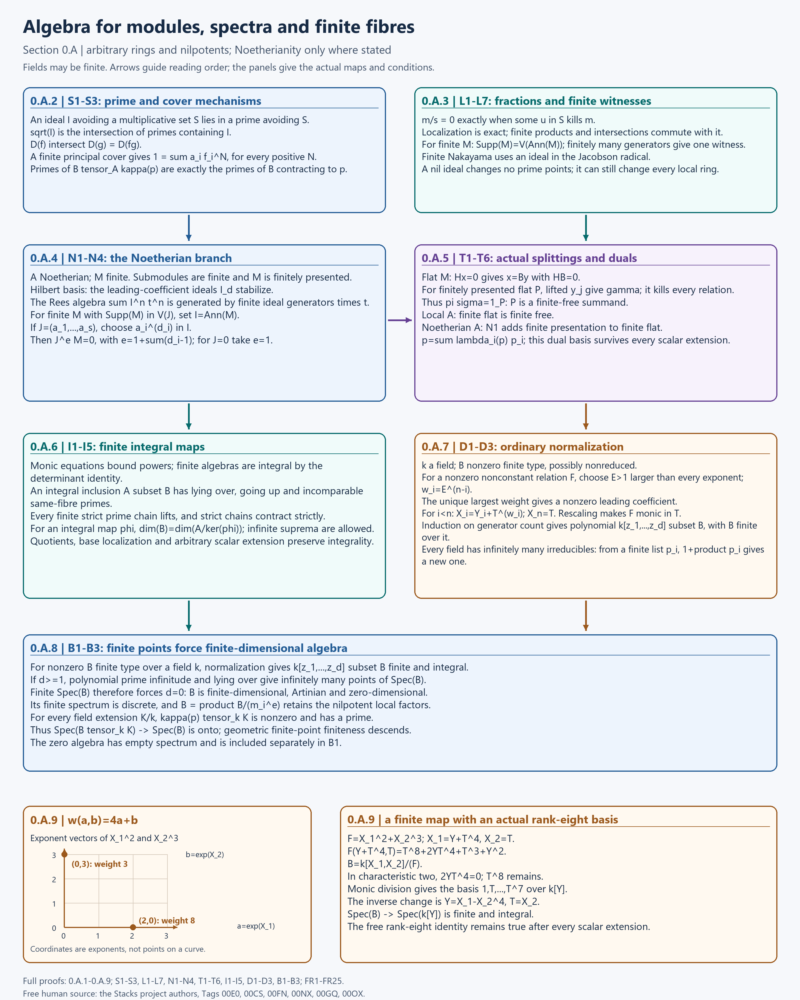
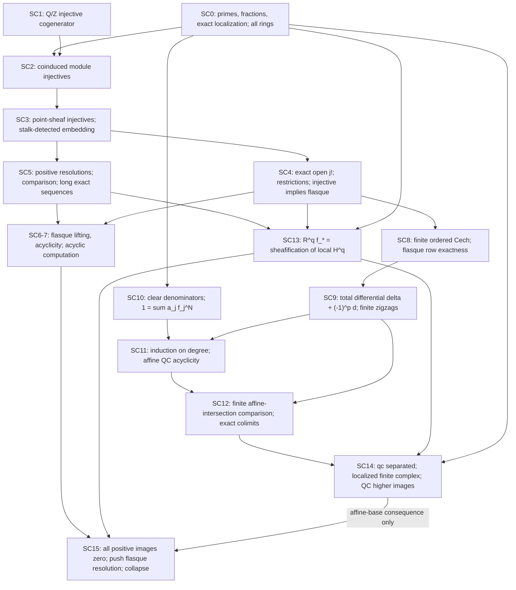
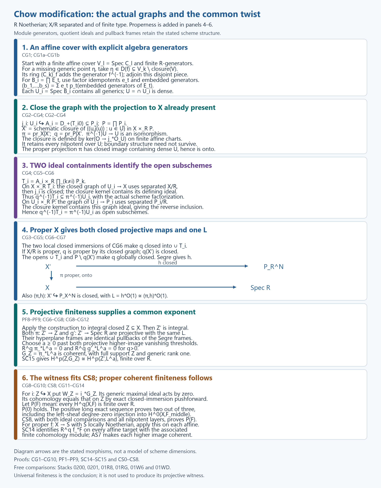
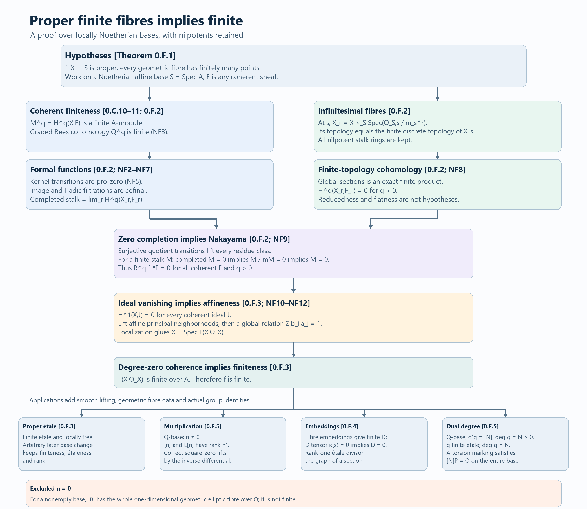
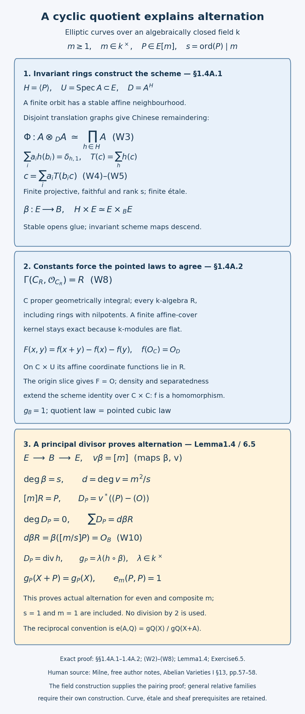

# The ℓ-adic Tate module of an elliptic curve

*Written by GPT-6.1 Sol (OpenAI) in Codex, Ultra setting, October 2026. Public domain (CC0).*

Point counts on an elliptic curve become traces of a two-dimensional representation. The determinant comes from a pairing; the trace comes from the kernel of a geometric endomorphism. The positivity of its degree then bounds the point count. This chapter develops those three connections, so that the passage from geometry to a Galois representation has a concrete meaning.

We assume [Frobenius elements and determination by traces](frobenius-elements-and-determination-by-traces.md). Sections 0.A–0.F below supply the module, spectrum, affine-sheaf, ordinary cohomology, proper coherence, formal-functions and finite-fibre proofs. DC1–DC7 and GR1–GR6 prove the divisor calculations and genus-one numerical Riemann–Roch; WC1–WC7, RC1–RC6, RW1–RW6 and GS1–GS7 construct the pointed cubic, relative secant law and inversion under their stated hypotheses. MP1–MP6 prove multiplication and its full kernel rank. Section 1.4A supplies the finite translation quotients and pointed curve rigidity. Section 1 gives the elliptic arguments needed here, including algebraic construction of the dual isogeny and every property of the pairing used below. These proofs apply in positive characteristic. Freely accessible author notes and the Stacks Project, listed below, are source material for comparison; none takes the place of a proof. The Tate module is covariant, and Frobenius is arithmetic. In particular its cyclotomic determinant at a good prime is \(p\), not \(p^{-1}\).

## 0.A. Algebra for modules, spectra and finite fibres

### 0.A.1. Scope and elementary background

All rings are commutative with identity, ring maps preserve identity, and modules are unital. A finite module means a finitely generated module; a finite algebra means an algebra finite as a module. Fields may be finite. The zero algebra is allowed, its spectrum is empty, and its dimension is conventionally \(-\infty\). Every other dimension assertion concerns the supremum of lengths of **finite** strict prime chains, allowing an infinite supremum. No bound on the Krull dimension of a Noetherian base occurs below.

The background is elementary ring and module arithmetic, ideals and quotients, kernels and images, polynomial arithmetic, finite-dimensional linear algebra, elementary topology, and Zorn's lemma. A vector-space basis, when needed for an infinite vector space, follows from Zorn: chain unions of independent sets are independent, and a maximal independent set spans because otherwise one further vector could be adjoined. No homological, sheaf, or geometric finiteness theorem is an algebraic premise here.

We shall use the determinant identity over an arbitrary commutative ring, including rings with zero divisors. Define the determinant by its finite permutation sum and the adjugate by signed minors. Laplace expansion gives the diagonal entries of \(\operatorname{adj}(C)C\) as \(\det C\); an off-diagonal entry is the determinant with two equal columns and is zero, since terms pair with their negatives under the column interchange. The same row calculation gives \(C\operatorname{adj}(C)=\det(C)I\). Thus a matrix with unit determinant is invertible. These arguments also work in characteristic two: a paired pair of terms has sum zero.

The proofs below use elementary ring and module calculations. Freely accessible comparisons by the Stacks project authors are linked beside the relevant results; each result needed here is proved locally. The later affine-sheaf, coherence and finite-fibre arguments refer back to these local statements.

### 0.A.2. Primes and the topology of spectra

#### S1. Prime existence, separation, and radicals

Every proper ideal \(I\) is contained in a maximal ideal: a chain of proper ideals containing \(I\) has a proper ideal as its union, since the union does not contain one; apply Zorn. For a maximal ideal \(\mathfrak m\), every nonzero class \(a\) in \(A/\mathfrak m\) is invertible, since \((\mathfrak m,a)=A\). The quotient is a field, so \(\mathfrak m\) is prime. In particular a nonzero ring has a prime, and the zero ring has none. An element is a unit precisely when it belongs to no maximal ideal: a nonunit generates a proper ideal, and a unit cannot belong to a proper ideal.

More generally, if a multiplicative set \(S\) is disjoint from \(I\), choose by Zorn an ideal \(P\) maximal among those containing \(I\) and avoiding \(S\). It is prime. Indeed, if \(xy\in P\) and neither \(x\) nor \(y\) lies in \(P\), both larger ideals \(P+(x)\), \(P+(y)\) meet \(S\). Write their elements of \(S\) as \(a+rx\), \(b+ty\), with \(a,b\in P\). Their product belongs to \(P\) and to \(S\), a contradiction. Chain unions used by this application of Zorn still avoid \(S\).

If \(f\notin\sqrt I\), use \(S=\{1,f,f^2,\ldots\}\) in the preceding argument. The resulting prime contains \(I\) but not \(f\). Conversely every prime containing \(I\) contains every \(f\) with a power in \(I\). Consequently
\[
 \sqrt I=\bigcap_{\mathfrak p\supset I}\mathfrak p.
 \tag{FR1}
\]
Here the empty intersection is \(A\). This also proves that the radical is an ideal. In particular the nilradical is the intersection of all primes.

Given a prime \(\mathfrak p\supset I\), there is a prime minimal among the primes containing \(I\) and contained in \(\mathfrak p\). Apply Zorn with the order reversed. The intersection of a descending chain of such primes is prime: if \(ab\) belongs to every member while \(a,b\) both fail to belong to the intersection, choose one member missing \(a\) and one missing \(b\); the smaller of the two misses both and contradicts primeness. The intersection still lies between \(I\) and \(\mathfrak p\). Thus every prime contains a minimal prime. This completes the prime mechanisms also compared in [Stacks 00E0](https://stacks.math.columbia.edu/tag/00E0).

#### S2. Principal opens, finite covers, and products

Put \(V(I)=\{\mathfrak p:I\subset\mathfrak p\}\), and \(D(f)=\operatorname{Spec}A\setminus V(f)\). Directly from primeness,
\[
 V(I)\cup V(J)=V(IJ)=V(I\cap J),\qquad
 \bigcap_\alpha V(I_\alpha)=V\left(\sum_\alpha I_\alpha\right),\qquad
 D(f)\cap D(g)=D(fg).
 \tag{FR2}
\]
For example, if a prime contains \(IJ\) and contains neither ideal, a product of elements outside that prime gives a contradiction. A point outside \(V(I)\) has a neighbourhood \(D(f)\) with \(f\in I\) outside its prime. Thus the \(D(f)\) form a basis. Formula (FR1) says \(V(I)\subset V(J)\) exactly when \(J\subset\sqrt I\), so closed sets correspond uniquely to radical ideals with the order reversed.

A family \(D(f_\alpha)\) covers the spectrum precisely when the ideal generated by the \(f_\alpha\) is \(A\): otherwise S1 supplies a maximal ideal containing that ideal. In a cover there is therefore a finite expression \(1=\sum_{i=1}^n a_i f_i\), and the corresponding finite subfamily still covers. Refining an arbitrary open cover by the principal basis proves quasi-compactness. The same argument shows that any positive powers \(f_i^{e_i}\) of a finite covering family generate the unit ideal, since no prime contains all of them. Compare the complete finite-cover proof in [Stacks 00E8](https://stacks.math.columbia.edu/tag/00E8).

For \(A=\prod_{i=1}^r A_i\), let \(e_i\) be the coordinate idempotents. In a prime, each \(e_i\) becomes zero or one in the domain quotient, exactly one becomes one since they sum to one and distinct ones multiply to zero. That prime is therefore the inverse image of a prime of the corresponding factor. Conversely such inverse images are prime. The subsets \(D(e_i)=V(1-e_i)\) are disjoint open and closed pieces; within a piece the principal opens are those of \(A_i\). Hence \(\operatorname{Spec}(\prod_i A_i)\) is the finite disjoint union of their spectra. The empty product is the zero ring and gives the empty union.

#### S3. Quotients, localization, and residue fibres

For \(A\to A/I\), inverse image is a bijection from primes of \(A/I\) to primes containing \(I\): the inverse sends \(\mathfrak p\) to \(\mathfrak p/I\), whose quotient is the domain \(A/\mathfrak p\). The image of \(D(f+I)\) is \(D(f)\cap V(I)\). Thus this is a homeomorphism onto \(V(I)\). For any ring map \(\phi:A\to B\), contraction is continuous, since the inverse image of \(D(f)\) is \(D(\phi(f))\). These proofs are also displayed in [Stacks 00E2](https://stacks.math.columbia.edu/tag/00E2) and [00E5](https://stacks.math.columbia.edu/tag/00E5).

Use the fractions constructed in L1 for a multiplicative subset \(S\subset A\). A prime \(\mathfrak p\) avoiding \(S\) extends to the prime \(S^{-1}\mathfrak p\), since the quotient is the nonzero domain \(S^{-1}(A/\mathfrak p)\). Its contraction is \(\mathfrak p\): if \(a/1\in S^{-1}\mathfrak p\), a fraction witness gives \(sa\in\mathfrak p\) for some \(s\in S\), whence \(a\in\mathfrak p\). Conversely a prime of \(S^{-1}A\) contracts to a prime avoiding \(S\), and is generated by that contraction because every denominator is a unit. A principal open \(D(a/s)\) maps to \(D(a)\) intersected with the set of primes avoiding \(S\). This proves a homeomorphism onto that subspace. In particular \(\operatorname{Spec}A_f\cong D(f)\); every principal open is quasi-compact by S2, and finite intersections of them are principal. Compare [Stacks 00E3](https://stacks.math.columbia.edu/tag/00E3).

The ring \(A_{\mathfrak p}\) is local: \(a/s\) is outside \(\mathfrak pA_{\mathfrak p}\) exactly when \(a\notin\mathfrak p\), in which case its inverse is \(s/a\). Its residue field is \(\kappa(\mathfrak p)=A_{\mathfrak p}/\mathfrak pA_{\mathfrak p}\), equivalently the fraction field of \(A/\mathfrak p\). For an \(A\)-algebra \(B\), L2's tensor and quotient calculations give
\[
 B\otimes_A\kappa(\mathfrak p)
 \cong (A\setminus\mathfrak p)^{-1}B\big/\mathfrak p(A\setminus\mathfrak p)^{-1}B.
 \tag{FR3}
\]
Successive quotient and localization prime correspondences identify its spectrum, with the induced topology, with the primes of \(B\) contracting to \(\mathfrak p\). Indeed those primes must contain \(\mathfrak pB\) and avoid the images of \(A\setminus\mathfrak p\), and these two conditions force contraction exactly \(\mathfrak p\). A nonzero fibre ring has a prime by S1; a zero fibre ring has none. This writes the mechanism described in [Stacks 00E6](https://stacks.math.columbia.edu/tag/00E6).

### 0.A.3. Localization, tensors, finite presentations, and support

#### L1. Fractions with their witnesses

For an \(A\)-module \(M\), set
\[
 (m,s)\sim(n,t)\quad\Longleftrightarrow\quad
 u(tm-sn)=0\text{ for some }u\in S.
 \tag{FR4}
\]
Reflexivity and symmetry are immediate. For transitivity suppose \(u(tm-sn)=0\), \(v(rn-tp)=0\). The identity
\(t(rm-sp)=r(tm-sn)+s(rn-tp)\) shows that \(uvt\) witnesses \((m,s)\sim(p,r)\). Denote the equivalence class by \(m/s\). Define
\[
 \frac m s+\frac n t=\frac{tm+sn}{st},\qquad
 \frac a s\frac m t=\frac{am}{st}.
 \tag{FR5}
\]
These operations respect the relation: replacing \(m/s\) by \(m'/s'\) in the addition changes the cross-multiplied numerator by \(t^2(s'm-sm')\), and multiplication by \(a/t\) changes it by \(at(s'm-sm')\); the old witness kills both. Replacing the other input is identical, and multiplying finitely many witnesses handles successive replacements. The ring construction is the case \(M=A\), with multiplication \((a/s)(b/t)=ab/(st)\); distributivity, associativity, and the module axioms follow by putting each finite calculation over a common denominator and using the corresponding identity in \(A\) or \(M\). The elements \(1/1\) and \(0/1\) are the identity and zero.

The essential witnesses are
\[
 m/s=0\iff um=0\text{ for some }u\in S,\qquad
 S^{-1}A=0\iff 0\in S.
 \tag{FR6}
\]
An \(A\)-linear map \(h:M\to N\), where every \(s\in S\) acts invertibly on \(N\), extends uniquely by \(m/s\mapsto s^{-1}h(m)\). A witness in (FR4) proves well-definedness, (FR5) proves linearity, and \(s(m/s)=m/1\) proves uniqueness. This supplies both the ring and module universal properties. Applying it twice shows that further localization at a multiplicative set \(T\) equals localization at \(ST\), with \((m/s)/t\mapsto m/(st)\). For a free comparison of the ring and module fraction constructions, see [the Stacks project authors, Localization](https://stacks.math.columbia.edu/tag/00CM).

#### L2. Exactness and the tensor construction

Localization is exact. For \(L\xrightarrow u M\xrightarrow v N\) exact at \(M\), if \(m/s\) maps to zero, (FR6) gives \(t\in S\) with \(v(tm)=0\). Choose \(l\) with \(u(l)=tm\); then \(l/(ts)\) maps to \(m/s\). Composites are still zero. Injection and surjection at endpoints follow respectively from the same zero witness and from lifting a numerator. Thus localization preserves kernels, images, cokernels, and quotients. This is the entire needed argument in [Stacks 00CS](https://stacks.math.columbia.edu/tag/00CS).

For finitely many modules, localization commutes with their product: use a common denominator for a tuple, and a product of zero witnesses for injectivity. For finitely many submodules \(N_i\subset M\), an element belonging to every localized \(N_i\) has a witness \(s_i\in S\) with \(s_i m\in N_i\); their product sends \(m\) into every \(N_i\). Therefore localization commutes with finite intersections. It also commutes with sums of submodules and ideal products, since each element of a sum or product is a finite sum and its finitely many denominators can be cleared. No statement about infinite intersections is used. Every submodule of \(S^{-1}M\) is the localization of its inverse image in \(M\): a fraction in that submodule has its numerator there after multiplication by its denominator, and conversely denominators act as units. Compare [Stacks 00CU](https://stacks.math.columbia.edu/tag/00CU).

Construct \(M\otimes_A N\) as the free \(A\)-module on symbols \((m,n)\), modulo additivity in each variable and the balancing relations \((am,n)=(m,an)=a(m,n)\). Its defining quotient gives exactly the universal property for balanced bilinear maps. All its elements are finite sums of pure tensors. This construction shows
\[
 (M/U)\otimes_A N\cong
 (M\otimes_A N)/\operatorname{im}(U\otimes_A N),
 \tag{FR7}
\]
because both quotients classify bilinear maps vanishing on \(U\times N\). It proves tensor right exactness, including surjectivity, by writing a surjection as a quotient. This is a direct quotient proof rather than importing the Hom argument in [Stacks 00DF](https://stacks.math.columbia.edu/tag/00DF).

The same universal property gives associativity, symmetry, \(A\otimes_A M\cong M\), and tensor commutation with direct sums: the maps on pure tensors have their evident inverse, and a finite sum uses only finitely many direct-sum components. Scalar extension over \(A\to C\) gives \(C\otimes_A M\) a \(C\)-module structure, and gives \(C\otimes_A B\) an algebra structure by multiplying pure tensors. The relations make these definitions well-defined.

There are explicit inverse maps
\[
 S^{-1}A\otimes_A M\longleftrightarrow S^{-1}M,\qquad
 (a/s)\otimes m\longmapsto am/s,\quad m/s\longmapsto(1/s)\otimes m.
 \tag{FR8}
\]
For the latter map a witness \(u(tm-sn)=0\) makes the difference of the proposed tensors \((1/(stu))\otimes u(tm-sn)=0\). Balancing proves the two composites are identities. Associativity then gives
\(S^{-1}(M\otimes_A N)\cong S^{-1}M\otimes_{S^{-1}A}S^{-1}N\), with \((m/s)\otimes(n/t)\mapsto(m\otimes n)/(st)\). This proves, rather than presupposes, the comparisons in [Stacks 00DK](https://stacks.math.columbia.edu/tag/00DK) and [00DL](https://stacks.math.columbia.edu/tag/00DL). Taking a quotient scalar algebra in (FR7) gives \((A/I)\otimes_A B\cong B/IB\), completing (FR3).

#### L3. Finite relations, Hom, and presentation kernels

If \(P\) has a presentation \(A^r\xrightarrow H A^n\to P\to0\) with finite \(r,n\), a map \(P\to M\) is exactly an \(n\)-tuple in \(M^n\) killed by the finite relation matrix. Hence \(\operatorname{Hom}_A(P,M)\) is that kernel. L2 preserves the kernel and finite products, and the localized presentation has the same localized matrix. We obtain the canonical isomorphism
\[
 S^{-1}\operatorname{Hom}_A(P,M)
 \cong\operatorname{Hom}_{S^{-1}A}(S^{-1}P,S^{-1}M).
 \tag{FR9}
\]
It sends \(h/s\) to \([p/t\mapsto h(p)/(st)]\). An \(A\)-linear map between modules on which \(S\) acts invertibly is automatically \(S^{-1}A\)-linear, by applying its linearity to \(s\) and its inverse. This proves the related equality of the two Hom descriptions. Finite presentation is essential to this proof's finite relation/product step. Compare the complete proof in [Stacks 0583](https://stacks.math.columbia.edu/tag/0583).

For a finitely presented \(P\), the kernel of **any** surjection \(F=A^m\to P\), with finite \(m\), is finite. Choose a defining surjection \(A^n\to P\) with finite kernel \(K_0\). The pullback
\(E=\{(f,g)\in F\oplus A^n: f,g\text{ have the same image in }P\}\)
projects surjectively onto each free module. Each projection splits by choosing lifts of its basis vectors. Their kernels are respectively \(K_0\) and \(K=\ker(F\to P)\), so
\(E\cong K_0\oplus F\cong K\oplus A^n\).
The first decomposition makes \(E\) finite; the projection to \(K\) then makes \(K\) finite. This is an elementary proof of the particular presentation-kernel consequence needed from [Stacks 0519](https://stacks.math.columbia.edu/tag/0519), with the free basis lifting of [07JX](https://stacks.math.columbia.edu/tag/07JX) written explicitly. No arbitrary-ring finite-submodule assertion is being assumed.

#### L4. Local detection and finite-cover gluing

If \(0\ne m\in M\), its proper annihilator lies in a maximal ideal \(\mathfrak m\) by S1. No element outside \(\mathfrak m\) kills \(m\), so \(m/1\ne0\) in \(M_{\mathfrak m}\). Thus elements and modules vanish if they vanish at all maximal localizations. Applying this to the kernel, cokernel, or middle homology, with L2, detects injection, surjection, isomorphism, and exactness locally. This writes the proof in [Stacks 00HN](https://stacks.math.columbia.edu/tag/00HN).

If \(M\) is finite and \(M_{\mathfrak p}=0\), take finitely many generators and multiply their killing witnesses in \(A\setminus\mathfrak p\). One element \(s\notin\mathfrak p\) kills \(M\), so \(M_s=0\). More generally \(S^{-1}M=0\) for finite \(M\) has a single killing witness in \(S\). Similarly a finite set of elements mapping to zero in a localization has a common witness.

For a finite principal cover \(D(f_i)\), suppose each \(M_{f_i}\) is finite. Choose the numerators of finite local generating sets and let \(M'\) be their span in \(M\). Then \((M/M')_{f_i}=0\); every prime is in one cover member, so L4 detects \(M/M'=0\). Thus \(M\) is finite. If each \(M_{f_i}\) is finitely presented, first choose a finite free surjection onto \(M\). Its kernel is finite on each \(D(f_i)\) by L3, and the same finite-generation gluing makes that kernel finite. Thus \(M\) is finitely presented. The identical local detection argument glues exactness. These are precisely the module portions of [Stacks 00EO](https://stacks.math.columbia.edu/tag/00EO); no general faithful-flat descent theorem is used.

#### L5. Finite Nakayama over arbitrary rings

The Jacobson radical \(J(A)\) is the intersection of the maximal ideals. If \(j\in J(A)\), every \(1-aj\), \(a\in A\), is a unit: otherwise a maximal ideal containing it and \(j\) would contain one. Conversely, if \(j\notin\mathfrak m\), its nonzero class in the field \(A/\mathfrak m\) has an inverse represented by \(a\), and \(1-aj\in\mathfrak m\) is a nonunit. This gives the full unit test used below.

Let \(M\) be generated by \(x_1,\ldots,x_n\) and satisfy \(IM=M\). Write \(x_i=\sum_j c_{ij}x_j\) with \(c_{ij}\in I\). Multiplying \((I_n-C)x=0\) by its adjugate gives
\[
 dM=0,\qquad d=\det(I_n-C)\in1+I.
 \tag{FR10}
\]
If \(I\subset J(A)\), then \(d\) is a unit by the preceding test and \(M=0\). Applying this to the finite quotient \(M/N\) proves that \(M=N+IM\) implies \(M=N\) under that same Jacobson hypothesis. In particular lifts of a basis of \(M/\mathfrak mM\) generate a finite module over a local ring, and surjectivity modulo \(\mathfrak m\) detects surjectivity onto a finite target. If \(I\) is nilpotent, \(IM=M\) instead gives \(M=I^eM=0\) without a finiteness hypothesis. These arguments reconstruct the required parts of [Stacks 00DV](https://stacks.math.columbia.edu/tag/00DV) using the determinant identity proved in Section 0.A.1.

#### L6. Annihilators and support

For finite \(M\), localization of its annihilator is the annihilator of its localization. One inclusion is immediate. For the other, if \(a/s\) kills \(S^{-1}M\), each of finitely many generators \(m_i\) has a witness \(t_i\in S\) with \(t_i a m_i=0\). Put \(t=\prod_i t_i\). Then \(ta\in\operatorname{Ann}_A(M)\), and \(a/s=(ta)/(ts)\) belongs to its localization. Finiteness of \(M\) cannot be omitted from this common-witness argument.

For \(\operatorname{Supp}M=\{\mathfrak p:M_{\mathfrak p}\ne0\}\), the same witnesses give
\[
 \operatorname{Supp}M=V(\operatorname{Ann}_A M)\quad(M\text{ finite}).
 \tag{FR11}
\]
Indeed an annihilator outside \(\mathfrak p\) kills \(M_{\mathfrak p}\); conversely if that localization is zero, L4 gives an annihilator outside \(\mathfrak p\). L2 proves that support in a short exact sequence is the union of the submodule and quotient supports. For finite \(M\), localization and L5 show
\(\operatorname{Supp}(M/IM)=\operatorname{Supp}M\cap V(I)\): inside \(V(I)\), a nonzero finite local module cannot equal its multiple by an ideal in the maximal ideal. This proves the relevant [Stacks 00L2](https://stacks.math.columbia.edu/tag/00L2) and [00L3](https://stacks.math.columbia.edu/tag/00L3) assertions locally.

For finite \(M,N\), one further has \(\operatorname{Supp}(M\otimes_A N)=\operatorname{Supp}M\cap\operatorname{Supp}N\). Inclusion in the intersection follows by localization. At a point of the intersection, both residue vector spaces are nonzero by L5. Their tensor product is nonzero: choose nonzero vectors, extend each to a basis, and take the two coordinate functionals to see their pure tensor maps to one. This tensor product is the residue module of \(M\otimes N\) by associativity, so its localization is nonzero.

For any ring map \(A\to C\) and finite \(M\), support of \(M\otimes_A C\) is the inverse image of support of \(M\). At a prime \(\mathfrak q\subset C\), put \(\mathfrak p=\mathfrak q\cap A\). The injection \(A/\mathfrak p\to C/\mathfrak q\) extends to the field map \(\kappa(\mathfrak p)\to\kappa(\mathfrak q)\), since denominators outside \(\mathfrak p\) have nonzero images. The residue module of \(M\otimes_A C\) is
\((M\otimes_A\kappa(\mathfrak p))\otimes_{\kappa(\mathfrak p)}\kappa(\mathfrak q)\).
A basis of the first vector space shows this is nonzero exactly when that space is nonzero. By L5 these are exactly the nonzero finite local modules on the two sides. This supplies the support scalar-extension statement compared in the complete proof of [Stacks 0BUR](https://stacks.math.columbia.edu/tag/0BUR), without any flatness hypothesis on \(A\to C\).

If desired for a flat scalar extension \(A\to C\), the annihilator of an element commutes with extension: tensor the exact sequence \(0\to\operatorname{Ann}(m)\to A\to M\), where \(a\mapsto am\). For a finite module take the intersection of the finitely many generator annihilators; flatness preserves that finite intersection by tensoring the kernel of \(A\to\bigoplus_i A/\operatorname{Ann}(m_i)\). This proves the precise finite version compared in [Stacks 07T8](https://stacks.math.columbia.edu/tag/07T8), without asserting an infinite-intersection formula.

#### L7. Nil ideals and infinitesimal fibre topology

Every prime contains a nil ideal \(J\), by (FR1), so S3 gives
\[
 \operatorname{Spec}(C/J)\cong\operatorname{Spec}C
 \quad\text{for every nil ideal }J\subset C.
 \tag{FR12}
\]
This is a homeomorphism, with all principal opens matched, and needs no Noetherian or reducedness hypothesis. Once the affine-chart description of a closed scheme thickening is supplied, these homeomorphisms agree on overlapping opens and give the scheme version. For a scheme over \(A/\mathfrak m^r\), the ideal \(\mathfrak m\mathcal O\) has \(r\)-th power zero; the underlying space is that of its ordinary fibre. The local rings and their nilpotent layers have not been replaced by their reductions. Higher cohomology on that space is a separate sheaf-theoretic matter.

### 0.A.4. Noetherian algebra and closed-support induction

#### N1. Finite submodules and presentations

A ring satisfies the ascending chain condition on ideals if and only if every ideal is finite. Under the chain condition, an ideal not generated by a finite set would let us choose successive elements outside the previously generated ideal, giving a strict ascending chain. Conversely the union of an ascending chain is an ideal; finitely many generators all belong to one chain member, after which the chain is constant.

Suppose \(A\) is Noetherian. A submodule \(U\subset A^n\) is finite by induction on \(n\). For \(n=1\) it is an ideal. In higher rank, project onto the last coordinate: the image is a finite ideal, and the kernel is a submodule of \(A^{n-1}\), finite by induction. Lifts of image generators together with kernel generators generate \(U\). If \(M\) is finite and \(A^n\to M\) is surjective, the inverse image of any submodule is finite by this result; its image is finite. In particular the kernel of \(A^n\to M\) is finite, so \(M\) is finitely presented. This is an independent coordinate proof of the required conclusions compared in [Stacks 00FP](https://stacks.math.columbia.edu/tag/00FP), with no finite-length or homological theorem as a premise.

#### N2. Hilbert basis and permanence

Let \(J\subset A[X]\) with \(A\) Noetherian. For \(d\ge0\), let \(I_d\) be the ideal of coefficients of \(X^d\) in members of \(J\) of degree at most \(d\). It is an ideal, including coefficient zero, and \(I_d\subset I_{d+1}\) by multiplication by \(X\). The chain stabilizes at \(d_0\). For each \(d\le d_0\), choose finitely many polynomials \(q_{d,j}\in J\) whose degree-\(d\) coefficients generate \(I_d\). They generate \(J\). In fact, for a polynomial \(q\in J\) of degree \(e\), subtract a suitable linear combination of \(q_{e,j}\) if \(e\le d_0\), and of \(X^{e-d_0}q_{d_0,j}\) otherwise; it has the same leading coefficient, so the remainder has smaller degree. Induction on that degree finishes. Thus \(A[X]\) is Noetherian, and iteration treats any finite number of variables. This leading-coefficient argument proves the Hilbert basis theorem; compare [the Stacks project authors, 00FN](https://stacks.math.columbia.edu/tag/00FN).

Ideals of a quotient \(A/I\) are images of ideals containing \(I\), hence finite. By L2, every ideal of \(S^{-1}A\) is the localization of its contraction, hence has a finite generating set. Therefore quotients, localizations, and finite-type algebras over a Noetherian ring are Noetherian. A field is Noetherian because its only ideals are zero and itself, so every finite-type algebra over any field is Noetherian. A finite-type \(A\)-algebra is also finitely presented as an algebra: its kernel in a polynomial ring with finitely many variables is a finite ideal.

#### N3. Finite components and induction on a closed support

The closed-set/radical-ideal dictionary of S2 shows that a descending chain of closed subsets of \(\operatorname{Spec}A\) stabilizes when \(A\) is Noetherian. More generally a space with a finite cover by Noetherian open subspaces is Noetherian: intersect a descending closed chain with each member, wait until each of those finitely many chains has stabilized, and use the cover. This applies to a scheme with a finite cover by spectra of Noetherian rings, once its affine charts are available. Compare [Stacks 00FQ](https://stacks.math.columbia.edu/tag/00FQ).

In a Noetherian space every nonempty family of closed subsets has an inclusion-minimal member. Otherwise successive strictly smaller choices produce a nonstabilizing descending chain. Consequently a property of closed subsets holds for all of them if it holds for any closed subset whenever it holds for all its proper closed subsets: a minimal counterexample gives a contradiction. This is the form of support induction used here; it requires no integer measuring the dimension of the base.

Every closed subset is a finite union of irreducible closed subsets. If not, choose an inclusion-minimal counterexample; it is reducible and is the union of two proper closed subsets, each of which has a finite such decomposition, a contradiction. Remove redundant members of a finite decomposition. The remaining members are exactly its maximal irreducible closed subsets: an irreducible subset covered by finitely many closed sets lies in one of them, by repeated use of the definition of irreducibility. This gives finitely many components, reconstructing the mechanism of [Stacks 0052](https://stacks.math.columbia.edu/tag/0052).

For spectra, \(\overline{\{\mathfrak p\}}=V(\mathfrak p)\): every closed set containing \(\mathfrak p\) is \(V(I)\) for \(I\subset\mathfrak p\) and contains that set. Such a closure is irreducible, since if covered by two closed sets the point lies in one and so does its closure. Conversely a nonempty irreducible \(V(I)\), with \(I\) radical, has \(I\) prime. Otherwise choose \(a,b\notin I\) with \(ab\in I\); then \(V(I)=V(I,a)\cup V(I,b)\), and both pieces are proper by (FR1). Components therefore correspond to minimal primes. They have unique generic points: equality of \(V(\mathfrak p)\) and \(V(\mathfrak q)\) implies equality of their radical ideals. In the Noetherian case there are finitely many minimal primes, and an irreducible component has a nonempty open part disjoint from the other components, since it cannot be contained in their finite union. This writes the necessary geometry also compared in [Stacks 00ES](https://stacks.math.columbia.edu/tag/00ES) and [00FR](https://stacks.math.columbia.edu/tag/00FR).

#### N4. Powers of support ideals and the Rees prerequisites

If a finite ideal \(J=(a_1,\ldots,a_s)\) satisfies \(J\subset\sqrt I\), choose \(d_i\ge1\) with \(a_i^{d_i}\in I\). Every monomial of degree
\[
 e=1+\sum_{i=1}^s(d_i-1)
 \tag{FR13}
\]
in the \(a_i\) contains one of those powers, so \(J^e\subset I\). For \(J=0\) take \(e=1\). Over a Noetherian ring every ideal is finite, so its nilradical is nilpotent, and if a finite module has support in \(V(J)\), (FR11) and (FR1) give \(J\subset\sqrt{\operatorname{Ann}M}\) and thus \(J^eM=0\). This is the complete power argument compared in [Stacks 00IM](https://stacks.math.columbia.edu/tag/00IM).

For the algebraic premises of the separate coherent Artin–Rees argument, let \(A\) be Noetherian, \(I=(a_1,\ldots,a_s)\), and \(M\) finite. The Rees algebra
\(\mathcal R=\bigoplus_{n\ge0}I^nt^n\subset A[t]\)
is generated over \(A\) by \(a_it\), so is a quotient of \(A[Z_1,\ldots,Z_s]\) and Noetherian by N2. The Rees module \(\bigoplus I^nMt^n\) is finite over \(\mathcal R\), generated by finite generators of \(M\) in degree zero. Every submodule is therefore finite by N1. For a graded submodule, replace finite generators by their finitely many homogeneous components; these components still belong to the submodule and generate it, and their degrees have a finite maximum. This supplies the finite homogeneous generation and degree bound required for the already separate coherent Artin–Rees/map-extension proof. The associated-sheaf and map-extension steps are not assertions of this algebra block.

### 0.A.5. Flat modules, projective splittings, and dual bases

#### T1. The elementary tensor consequences of flatness

Call \(M\) flat when tensoring with \(M\) preserves exact sequences. By (FR7), it suffices that injections stay injective. Free modules are flat: tensoring with a free module is a direct sum of copies of the input, and exactness is checked component by component, each element having finite support. Direct sums and direct summands of flat modules are flat by the same observation. Localizations are flat by (FR8) and L2.

If \(M\) is flat over \(A\) and \(A\to C\) is any ring map, \(C\otimes_A M\) is flat over \(C\): for a \(C\)-module \(N\),
\(N\otimes_C(C\otimes_A M)\cong N\otimes_A M\), and an exact sequence of \(C\)-modules is still exact over \(A\). If \(C\) is flat over \(A\) and \(N\) flat over \(C\), associativity makes \(N\) flat over \(A\). Finally flatness is detected at prime localizations: localize the tensor sequence using (FR8), use flatness over \(A_{\mathfrak p}\), and use L4 to detect its exactness. These conclusions are obtained from the definitions and L2, with no Tor or direct-limit theorem.

#### T2. Simultaneous finite relation factorization

Let \(H:A^n\to A^r\) be a matrix, with finite \(r,n\), and let \(x=(x_i)\in M^n\) satisfy \(Hx=0\), with \(M\) flat. Tensoring the kernel/image sequences for \(H\) shows that \(x\) is in the image of \(\ker H\otimes_A M\). Write a preimage as a finite sum \(\sum_j b_j\otimes y_j\), with column vectors \(b_j\in\ker H\). For the matrix \(B\) of those columns this says
\[
 x_i=\sum_j b_{ij}y_j,\qquad HB=0.
 \tag{FR14}
\]
Neither \(\ker H\) nor \(M\) has been assumed finitely presented. For \(r=1\) this is the forward equational-flatness mechanism in the fully read [Stacks 00HK](https://stacks.math.columbia.edu/tag/00HK); the finite-matrix version here follows directly from exactness in the same way. Only this direction is required.

#### T3. Finite flat over every local ring is finite free

Let \((A,\mathfrak m)\) be any local ring and \(M\) finite flat. Choose lifts \(x_1,\ldots,x_n\) of a residue-field basis of \(M/\mathfrak mM\). They generate by L5. For any relation row \(a=(a_i)\) with \(\sum a_ix_i=0\), T2 gives \(x=By\) and \(aB=0\). Since the \(x_i\) generate, write \(y=Cx\), so \(x=BCx\). Reduction modulo \(\mathfrak m\), where the \(x_i\) are a basis, gives \(BC\equiv I_n\). Its determinant is outside \(\mathfrak m\), hence is a unit by S1; Section 0.A.1 makes \(BC\) invertible. But \(aBC=0\), so \(a=0\). Thus the generators are a basis. If \(n=0\), L5 gives \(M=0\), the rank-zero free module. This fresh matrix proof uses the finite relation mechanism of T2; it does not assume a finite relation kernel. A free comparison is [the Stacks project authors, 00NZ](https://stacks.math.columbia.edu/tag/00NZ).

#### T4. Finite presentation gives a global splitting

Let \(P\) be finitely presented and flat over an arbitrary ring \(A\). Take \(\pi:A^n\to P\) with kernel generated by finitely many relation vectors \(h^1,\ldots,h^r\), and put \(x_i=\pi(e_i)\). Put these vectors as the rows of \(H\); then \(Hx=0\). By T2 choose \(B,y\) with (FR14). Lift each \(y_j\) to \(z_j\in A^n\). Define \(\gamma:A^n\to A^n\) by \(\gamma(e_i)=\sum_j b_{ij}z_j\). For every relation generator,
\[
 \gamma(h^a)=\sum_j\left(\sum_i h_i^a b_{ij}\right)z_j=0,
 \qquad \pi\gamma(e_i)=x_i.
 \tag{FR15}
\]
Thus \(\gamma\) descends to \(\sigma:P\to A^n\) and \(\pi\sigma=1_P\). This proves a finite-free summand splitting using only finitely many relation rows.

A free module lifts any map across a surjection by choosing preimages of its basis images. A summand \(P\) of a free module inherits lifting by composing with the projection from the free module, lifting, and restricting to its summand. Hence it is projective, in the lifting definition. Conversely a finite projective module splits a finite free surjection onto it. A summand of \(A^n\) is finitely presented: if its projection is \(E\), the complementary module is generated by \((1-E)e_i\), and is the kernel of the surjection onto the summand. It is flat by T1. We have therefore proved all three equivalences needed here: finitely presented flat, finite projective, and a summand of a finite free module. For a free comparison of these projective-module characterizations, see [the Stacks project authors, 00NX](https://stacks.math.columbia.edu/tag/00NX).

Combined with N1, a finite flat module over a Noetherian ring is finitely presented, hence finite projective. Finite presentation is a hypothesis of the global arbitrary-ring assertion; the arbitrary-local-ring assertion T3 did not need it.

#### T5. Actual open free bases

If \(P\) is finitely presented flat, T1 and T3 make \(P_{\mathfrak p}\) finite free for every prime. Represent a basis by fractions of global elements and absorb their denominators into basis scalings. This gives \(u:A^r\to P\) which is an isomorphism at \(\mathfrak p\). Its finite cokernel vanishes there, so L4 supplies \(f\notin\mathfrak p\) on which \(u_f\) is surjective. Its kernel is finite by the presentation-kernel argument L3 over \(A_f\), and vanishes at \(\mathfrak p\). A common witness kills it on a further principal neighbourhood. A witness in \(A_f\) has the form \(g/f^d\), with \(g\notin\mathfrak p\), so on \(D(fg)\) the map is an isomorphism. These opens cover the spectrum and S2 makes a finite subcover possible. Thus \(P\) is finite locally free, with genuinely constructed open bases, including rank zero. This reconstructs the needed open-neighbourhood portion of [Stacks 00NX](https://stacks.math.columbia.edu/tag/00NX) without importing its external kernel/flatness lemmas.

Conversely a module free of finite rank on a principal open cover has a finite subcover by S2, is finitely presented by L4, and is flat by T1 and local detection. Thus it has the splitting in T4. Ranks agree on overlaps by reduction to a residue field, and are constant on each such basis open.

#### T6. Dual bases and arbitrary scalar extension

Given the splitting \(\pi\sigma=1_P\), set \(p_i=\pi(e_i)\) and \(\lambda_i=e_i^*\sigma\). The coordinate expansion of \(\sigma(p)\) gives
\[
 p=\sum_i\lambda_i(p)p_i.
 \tag{FR16}
\]
Conversely a finite identity of this form defines \(\pi\) and \(\sigma\) and splits \(A^n\to P\); T4's lifting argument proves finite projectivity. For any \(A\)-module \(Q\), evaluation
\[
 P^\vee\otimes_A Q\longrightarrow\operatorname{Hom}_A(P,Q),
 \quad \lambda\otimes q\longmapsto[p\mapsto\lambda(p)q]
 \tag{FR17}
\]
has inverse \(u\mapsto\sum_i\lambda_i\otimes u(p_i)\). Evaluating the inverse at \(p\) returns \(u(p)\) by (FR16); on \(\lambda\otimes q\) the other composite is the identity since \(\lambda=\sum_i\lambda(p_i)\lambda_i\).

For every ring map \(A\to A'\), tensoring the split maps preserves their identity. The elements \(p_i\otimes1\) and the extended \(\lambda_i\) form a dual basis. Consequently
\[
 P^\vee\otimes_A A'\cong(P\otimes_A A')^\vee,
 \quad \lambda\otimes a'\longmapsto[p\otimes b'\mapsto a'b'\lambda(p)].
 \tag{FR18}
\]
The inverse sends \(\mu\) to \(\sum_i\lambda_i\otimes\mu(p_i\otimes1)\); both composites follow from the same dual-basis identity. Empty sums handle \(P=0\). No flatness of \(A'\), Noetherianity, or Hom base-change theorem is assumed. T4 supplies the finite-free splitting used in these dual-basis calculations.

### 0.A.6. Finite and integral maps, prime lifting, and dimension

#### I1. The determinant and finite-algebra calculus

An element \(b\) in an \(A\)-algebra is integral if it satisfies a monic polynomial over \(A\). If a finite \(A\)-submodule \(M\) contains one and is stable under multiplication by \(b\), choose generators \(m_i\) and express \(bm_i=\sum_j c_{ij}m_j\) with \(c_{ij}\in A\). Apply the adjugate identity to \((bI-C)m=0\), in the target algebra. The monic polynomial \(\det(TI-C)\) evaluated at \(b\) kills every \(m_i\), hence kills one and is zero. No freeness or injectivity of \(A\to M\) is needed. Thus every finite algebra is integral. This writes the endomorphism argument behind [Stacks 052I](https://stacks.math.columbia.edu/tag/052I) and [00GK](https://stacks.math.columbia.edu/tag/00GK).

If \(b_i\) satisfy monic equations of degrees \(d_i\), then their generated algebra is spanned as an \(A\)-module by \(\prod_i b_i^{e_i}\), \(0\le e_i<d_i\): repeatedly reduce a power at least \(d_i\) with its monic equation, decreasing the exponent. It is finite, and all its elements are integral by the determinant argument. Thus integral elements are closed under sums, products, and multiplication by scalars, and integral plus finite type is equivalent to finite. Conversely a finite algebra is finite type, using its module generators as algebra generators. These bounded-power proofs replace every dependency needed from [Stacks 00GM](https://stacks.math.columbia.edu/tag/00GM), [02JJ](https://stacks.math.columbia.edu/tag/02JJ), and [00GO](https://stacks.math.columbia.edu/tag/00GO).

Finite maps compose: products of a finite set of module generators in each of two successive extensions span the composite. For integrality, an element integral over an integral intermediate algebra has a monic equation with finitely many coefficients. Those coefficients generate a finite algebra over the initial ring; adjoining the element gives a finite algebra over that finite algebra, hence over the initial ring. The determinant argument proves the element integral over the initial ring. This reconstructs [Stacks 00GN](https://stacks.math.columbia.edu/tag/00GN) with its finite-composition premise proved here.

#### I2. Quotients, localization, and scalar extension

Monic equations descend to any compatible quotient. Under localization at a multiplicative set in the base, \(b/s\) is integral: if \(b\) satisfies a monic degree-\(d\) equation, replace its coefficients \(a_i\) by \(a_i/s^{d-i}\). Finite module generating sets localize as well.

For \(A\to A'\), each \(1\otimes b\) in \(A'\otimes_A B\) has the scalar-extended monic equation. Any tensor is a finite sum of \(a'\otimes b\); the finitely many \(b\) involved generate a finite integral algebra by I1, whose scalar extension is finite, spanned by the same generators. Its image contains that tensor, so I1 makes the tensor integral over \(A'\). If \(B\) was finite, its finite module generators span the entire scalar extension. This supplies both assertions of [Stacks 02JK](https://stacks.math.columbia.edu/tag/02JK), including the finite-case proof omitted on that free page. For noninjective maps, replace the base by its image \(A/\ker(A\to B)\); the image inclusion is still integral because the original monic equations descend. No localization at arbitrary target elements is asserted to preserve integrality over an unchanged base.

#### I3. Domain and field criteria; maximal contractions

For an integral inclusion of domains \(A\subset B\), if \(A\) is a field then \(B\) is a field. For \(0\ne b\in B\), choose a monic equation of least degree; its constant coefficient is nonzero, since otherwise cancellation of \(b\) in the domain gives a smaller monic equation. Solving that equation for \(b^{-1}\), using the invertible constant coefficient in \(A\), gives an inverse in \(B\).

If \(B\) is a field, every \(0\ne a\in A\) has \(a^{-1}\in B\) integral over \(A\). Multiplying its monic equation of degree \(d\) by \(a^{d-1}\) expresses \(a^{-1}\) as an \(A\)-linear combination of \(1,a,\ldots,a^{d-1}\). Hence \(A\) is a field. For a field inclusion integrality is algebraicity; finite as a module is finite-dimensional, so a finite field extension is algebraic as well. This provides direct proofs of the criteria compared in [Stacks 00GR](https://stacks.math.columbia.edu/tag/00GR) and [00GS](https://stacks.math.columbia.edu/tag/00GS), rather than importing their spectrum or dimension arguments.

For any integral map \(A\to B\) and prime \(\mathfrak q\subset B\) with contraction \(\mathfrak p\), the induced inclusion \(A/\mathfrak p\subset B/\mathfrak q\) is integral. The field criteria therefore show
\[
 \mathfrak q\text{ maximal}\iff\mathfrak p\text{ maximal}.
 \tag{FR19}
\]

#### I4. Lying over, going up, and incomparability

Suppose first that \(A\subset B\) is an integral inclusion. For a prime \(\mathfrak p\subset A\), L2 makes \(A_{\mathfrak p}\to B_{\mathfrak p}\) injective, and I2 makes it integral. Its fibre ring is nonzero. Otherwise \(1\in\mathfrak pB_{\mathfrak p}\), so write \(1=\sum_{i=1}^r a_i b_i\) with \(a_i\in\mathfrak pA_{\mathfrak p}\). The finitely many \(b_i\) generate a finite \(A_{\mathfrak p}\)-subalgebra \(C\) by I1. Multiplying that equation by any element of \(C\) gives \(C=\mathfrak pC\). L5 forces \(C=0\), contradicting the injection of the nonzero ring \(A_{\mathfrak p}\) and its identity into \(C\). Thus the fibre has a prime by S1, and (FR3) pulls it back to a prime over \(\mathfrak p\). This is the full finite-coefficients/Nakayama proof read in [Stacks 00GQ](https://stacks.math.columbia.edu/tag/00GQ).

For a general integral map \(A\to B\) with kernel \(K\), the image inclusion \(A/K\subset B\) satisfies the preceding result. Therefore its spectrum image is exactly \(V(K)\), not an unrestricted surjection onto \(\operatorname{Spec}A\).

If \(\mathfrak q\) contracts to \(\mathfrak p\) and \(\mathfrak p\subset\mathfrak p'\), apply lying over to the integral inclusion \(A/\mathfrak p\subset B/\mathfrak q\). A prime over \(\mathfrak p'/\mathfrak p\) pulls back to \(\mathfrak q'\supset\mathfrak q\) over \(\mathfrak p'\). This is going up, including for a noninjective original map, and writes the quotient mechanism of [Stacks 00GU](https://stacks.math.columbia.edu/tag/00GU).

For incomparability, all primes over a fixed \(\mathfrak p\) correspond by S3 to primes of \(B\otimes_A\kappa(\mathfrak p)\). That algebra is integral over its field base by I2. Each prime quotient is an integral domain algebra over that field, hence a field by I3. All its primes are consequently maximal. Two distinct comparable primes over \(\mathfrak p\) would give distinct comparable maximal primes of the fibre, which is impossible. This writes the complete field-fibre mechanism compared in [Stacks 00GT](https://stacks.math.columbia.edu/tag/00GT).

#### I5. Integral dimension equality for all finite chains

For an integral inclusion \(A\subset B\), every finite strict chain \(\mathfrak p_0\subsetneq\cdots\subsetneq\mathfrak p_n\) in \(A\) lifts to one in \(B\): choose a prime over \(\mathfrak p_0\) by lying over and then apply going up successively. Distinct contractions make each lifted inclusion strict. Conversely every strict chain in \(B\) contracts to a strict chain in \(A\), since equal consecutive contractions would contradict incomparability. The available finite chain lengths therefore have the same supremum:
\[
 \dim B=\dim A\quad(A\subset B\text{ integral}),\qquad
 \dim B=\dim(A/\ker\phi)\quad(\phi:A\to B\text{ integral}).
 \tag{FR20}
\]
This includes infinite suprema and the zero ring with the convention in Section 0.A.1; the second formula applies the first to the image inclusion. A noninjective map does not in general give \(\dim B=\dim A\). Free comparisons are the Stacks project authors' [finite-chain lifting proof](https://stacks.math.columbia.edu/tag/00OH), [contraction statement](https://stacks.math.columbia.edu/tag/00OJ), and [dimension equality](https://stacks.math.columbia.edu/tag/00OK). The two mechanisms and all required elementary dependencies are written here; going down is unused.

### 0.A.7. Ordinary normalization over every field

#### D1. An explicit monic change of variables

Let \(0\ne F\in k[X_1,\ldots,X_n]\) be nonconstant. Choose an integer \(E>1\) strictly larger than every exponent in its finitely many nonzero monomials, and assign weights \(w_i=E^{n-i}\), so \(w_n=1\). Distinct exponent tuples occurring in \(F\) have distinct weighted degrees \(\sum_i\nu_iw_i\): successive reduction modulo \(E\), and division by \(E\), recover all digits \(\nu_n,\nu_{n-1},\ldots\). In
\[
 F(Y_1+T^{w_1},\ldots,Y_{n-1}+T^{w_{n-1}},T),
 \tag{FR21}
\]
the monomial with the unique largest weighted degree contributes its original nonzero coefficient to the largest power of \(T\). In each monomial, choosing any \(Y_i\) instead of its \(T^{w_i}\) lowers that power, so no other term contributes to it. That coefficient lies in \(k^\times\); divide by it to make (FR21) monic in \(T\). Its degree is positive because \(F\) is nonconstant. This explicit digit argument supplies the weight separation compared in [the Stacks project authors, 051M](https://stacks.math.columbia.edu/tag/051M) and [051N](https://stacks.math.columbia.edu/tag/051N), without assuming an infinite field or making a generic linear choice.

#### D2. Induction on the number of algebra generators

Every nonzero finite-type \(k\)-algebra \(B\) has a polynomial subalgebra \(k[z_1,\ldots,z_d]\subset B\) over which it is finite. We prove this by induction on the number \(n\) of chosen algebra generators, not on dimension. For \(n=0\), a nonzero quotient of \(k\) is \(k\). Present \(B=k[X_1,\ldots,X_n]/I\), with \(I\) proper. If \(I=0\), use its polynomial variables. Otherwise choose \(0\ne F\in I\); it cannot be a nonzero constant. For D1's weights, put \(y_i=b_i-b_n^{w_i}\) for \(i<n\), where \(b_i\) are the images of \(X_i\). The monic equation (FR21), now zero in \(B\), makes \(b_n\) integral over \(C=k[y_1,\ldots,y_{n-1}]\subset B\). Also \(B=C[b_n]\), so its bounded powers span it over \(C\).

The nonzero algebra \(C\) has at most \(n-1\) generators. Induction produces a polynomial inclusion \(k[z_1,\ldots,z_d]\subset C\) with \(C\) finite over it. The composite inclusion into \(B\) is still injective, and finite by I1. This finishes the proof. A relation of degree one and the case \(n=1\) cause no exception; the latter yields \(C=k\). None of the rings \(B,C\) was assumed a domain or reduced. This is the ordinary normalization construction in [the Stacks project authors, 00OX](https://stacks.math.columbia.edu/tag/00OX) and the ordinary inductive part of [00OY](https://stacks.math.columbia.edu/tag/00OY), reconstructed here. Its injectivity is supplied by using actual subalgebras at each step. The general identification of \(d\) with dimension is not imported or needed below.

#### D3. The only polynomial-spectrum facts required

Over every field \(k\), there are infinitely many monic irreducible polynomials in \(k[t]\). A nonconstant polynomial has an irreducible divisor, by choosing a divisor of least positive degree. Polynomial division lowers degree; the Euclidean algorithm and back-substitution show that \(k[t]/(p)\) is a field for irreducible \(p\): any polynomial not divisible by \(p\) has greatest common divisor one with it, giving a Bezout inverse. If there were finitely many monic irreducibles \(p_i\), the list would be nonempty since \(t\) is irreducible. The nonconstant polynomial \(1+\prod_i p_i\) has an irreducible divisor outside the list, because its remainder modulo each listed divisor is one. This is a contradiction.

For \(d\ge1\), the ideals \((p(t_1),t_2,\ldots,t_d)\) in \(k[t_1,\ldots,t_d]\) give infinitely many distinct maximal ideals. Also \((0)\subsetneq(t_1)\) is a strict prime chain: a polynomial ring over a field is a domain by its leading-term product, and its quotient by \((t_1)\) is another such domain. These two facts, together with I4, are all the polynomial-dimension information used in B1. No full polynomial-ring dimension formula, transcendence-degree formula, height theorem, or strengthened ideal-chain normalization is a premise. The calculation supplies polynomial primes even when the coefficient field has finitely many elements.

### 0.A.8. Finite-point field algebras and ordinary fibres

#### B1. Finite points, finite dimension, and Artinianity

For a finite-type \(k\)-algebra \(B\), the following are equivalent:

1. \(\operatorname{Spec}B\) has finitely many points.
2. \(B\) is finite-dimensional over \(k\).
3. \(B\) is Artinian, meaning its descending ideal chains stabilize.
4. \(B=0\), or \(\dim B=0\).

The zero algebra satisfies all four. For \(B\ne0\), D2 gives an injective finite map
\[
 k[z_1,\ldots,z_d]\subset B.
 \tag{FR22}
\]
It is integral by I1, so I4 makes contraction on spectra surjective. If (1) holds, D3 excludes \(d\ge1\), hence \(d=0\) and \(B\) is finite over \(k\), giving (2).

If (2) holds, every strict descending ideal chain strictly decreases vector-space dimension, so (3) holds; this is the direct argument also in [Stacks 00J6](https://stacks.math.columbia.edu/tag/00J6). In an Artinian domain \(D\), for \(0\ne a\) the ideals \((a^n)\) stabilize, giving \(a^n=a^{n+1}b\); cancellation gives \(ab=1\). Thus an Artinian domain is a field. A quotient of an Artinian ring is Artinian by inverse image of ideals, so every prime of \(B\) is maximal and (3) gives (4). If (4) holds and \(d\ge1\), D3's two-prime chain lifts by I4 to a strict chain in \(B\), a contradiction. Thus again \(d=0\), giving (2). This proof neither assumes nor proves general arbitrary-Artinian finite length or Noetherianity.

It remains to prove (2) implies (1), together with the local and topological conclusions. First recall the elementary Chinese remainder argument. For comaximal ideals \(I,J\), choose \(i+j=1\) with \(i\in I,j\in J\). An element \(x\in I\cap J\) equals \(xi+xj\in IJ\), so \(I\cap J=IJ\). Given residue representatives \(a,b\), the element \(aj+bi\) has the prescribed residues modulo \(I,J\). For finitely many pairwise comaximal ideals, their product excluding one remains comaximal with that one: multiplying equations \(i_j+j_j=1\) shows that this product contains an element congruent to one modulo the omitted ideal. Induction yields
\[
 B/\bigcap_i I_i\cong\prod_i B/I_i,
 \qquad\bigcap_i I_i=\prod_i I_i.
 \tag{FR23}
\]
This is a full finite CRT proof, compared with [Stacks 00DT](https://stacks.math.columbia.edu/tag/00DT).

In a finite-dimensional algebra every prime quotient is a field by I3, so all primes are maximal. Distinct maximal ideals are comaximal. For any \(r\) of them, (FR23) surjects \(B\) onto a product of \(r\) nonzero field quotients. Each quotient is a nonzero \(k\)-vector space, so \(r\le\dim_k B\). There are therefore finitely many maximal ideals and thus finitely many primes, giving (1). Each point is closed by S3, and in a finite set of closed points the complement of any singleton is closed; every singleton is open. The spectrum is finite discrete. This argument keeps the actual algebra and its nilpotents.

#### B2. The local Artinian factors, with nilpotents retained

For nonzero \(B\) as in B1, list its finitely many maximal ideals \(\mathfrak m_i\). Its nilradical is \(J=\bigcap_i\mathfrak m_i\) by S1. The algebra is Noetherian by N2 (also by ascending vector-space dimension), so N4 gives \(J^e=0\). Powers of distinct maximal ideals remain comaximal: if \(a+b=1\) with \(a\in\mathfrak m_i,b\in\mathfrak m_j\), expand \((a+b)^{2e-1}\); each term lies in \(\mathfrak m_i^e\) or \(\mathfrak m_j^e\). Also (FR23) gives \(J=\prod_i\mathfrak m_i\), hence \(\prod_i\mathfrak m_i^e=J^e=0\). Applying (FR23) again proves
\[
 B\cong\prod_i B/\mathfrak m_i^e.
 \tag{FR24}
\]
Each factor has just one prime: a prime containing \(\mathfrak m_i^e\) contains \(\mathfrak m_i\), since an element of the latter has its \(e\)-th power in the former. Thus each factor is local by S1, its maximal ideal is nilpotent, and it is an Artinian finite-dimensional quotient of \(B\).

The factor indexed by \(i\) is \(B_{\mathfrak m_i}\). Under (FR24), its coordinate idempotent is outside \(\mathfrak m_i\), so localizing makes it one and kills all other factors. Every element outside \(\mathfrak m_i\) becomes a unit in the retained local factor, so the localization universal property gives the inverse identification. All local rings of \(\operatorname{Spec}B\) are therefore Artinian. This gives the local factors by their actual quotient rings and identifies them with the localizations of the original algebra.

If \(A\to B\) is a finite map and \(\mathfrak p\subset A\), its residue fibre in (FR3) is spanned over \(\kappa(\mathfrak p)\) by the images of finitely many \(A\)-module generators of \(B\). It is therefore a finite-dimensional algebra, including the possibility of zero, and B1–B2 make its spectrum finite discrete with Artinian local rings. This finite-map consequence has no geometric properness premise.

#### B3. Descent from a geometric fibre without a faithful-flatness import

Let \(K/k\) be any field extension. For every prime \(\mathfrak p\subset B\), the ring \(\kappa(\mathfrak p)\otimes_k K\) is nonzero. Indeed choose a \(k\)-basis of \(\kappa(\mathfrak p)\) containing one by the Zorn argument of Section 0.A.1. Tensoring its direct-sum basis representation with \(K\) gives a direct sum of copies of \(K\), and \(1\otimes1\) is a nonzero coordinate vector. S1 supplies a prime of that nonzero ring. Its inverse image under
\[
 B\otimes_k K\longrightarrow\kappa(\mathfrak p)\otimes_k K
 \tag{FR25}
\]
contracts to exactly \(\mathfrak p\) in \(B\): elements of \(\mathfrak p\) map to zero, and every element of \(B\setminus\mathfrak p\) maps to a unit, since it is already a nonzero element of the field \(\kappa(\mathfrak p)\). Thus \(\operatorname{Spec}(B\otimes_k K)\to\operatorname{Spec}B\) is surjective by this direct argument, with no general faithful-flat spectrum or descent theorem.

If \(B\) is finite type over \(k\) and that scalar-extended spectrum is finite, the ordinary spectrum is finite and B1 applies. This includes an algebraic closure or any larger field. For a finite-type fibre scheme, use its finite affine cover by finite-type residue-field algebras; quasi-compactness supplying the finite cover is an explicitly separate scheme premise. Each extended affine chart is an open subset of the geometric fibre, so finiteness of the latter applies to every chart. The ordinary fibre is a finite set whose affine local rings are the Artinian rings of B2.

To see that its whole space is discrete, if \(y\) specializes \(x\), every open containing \(y\) contains \(x\). Choose an affine chart containing \(y\); both points lie in it. Its primes are all maximal, so they cannot form a nontrivial specialization and \(x=y\). Thus every point is closed. There are finitely many, so every singleton has closed complement and is open. Combining this with L7 gives the same finite discrete underlying space on the nilpotent infinitesimal fibres. No reduction of their rings or sheaf layers has occurred.

### 0.A.9. A monic change of variables that works in every characteristic

Take \(F(X_1,X_2)=X_1^2+X_2^3\) over a field \(k\), and put \(B=k[X_1,X_2]/(F)\). The choice \(E=4\) in D1 gives the weights \((4,1)\): the exponent vectors \((2,0)\) and \((0,3)\) have weights \(8\) and \(3\), respectively. Put \(X_1=Y+T^4\) and \(X_2=T\). Direct multiplication gives

\[
F(Y+T^4,T)=T^8+2YT^4+T^3+Y^2.
\]

The leading coefficient is one over every field. In characteristic two the middle term vanishes, while the leading term remains. The substitution is a polynomial-ring isomorphism: its inverse is \(Y=X_1-X_2^4\), \(T=X_2\), and substituting in either direction returns both variables. It therefore identifies

\[
k[X_1,X_2]/(X_1^2+X_2^3)
\cong k[Y,T]/(T^8+2YT^4+T^3+Y^2).
\]

Division by this monic polynomial in \(T\), over \(k[Y]\), reduces every class to a unique linear combination of \(1,T,\ldots,T^7\). Existence follows by successively subtracting the highest coefficient times a suitable power of the monic polynomial. For uniqueness, the product of a nonzero polynomial with that monic polynomial has degree at least eight and has the same nonzero leading coefficient as the first factor, so it cannot be a nonzero remainder of degree below eight. Thus \(k[Y]\) actually injects into the quotient and the latter is free of rank eight over it. The map to the affine \(Y\)-line is finite and integral by I1; its eight basis elements remain a basis after any scalar extension by tensoring this explicit free-module identity.

*Figure.* The arrows guide the reading order; the panels state the actual algebra maps and their hypotheses. The finite-presentation condition in the arbitrary-ring projective splitting and the Noetherian condition in its finite-module corollary are distinct. The support calculation explicitly sets \(I=\operatorname{Ann}(M)\) before choosing powers of the generators of \(J\). The grid coordinates are the monomial exponents \((a,b)\), with the scalar weight \(w(a,b)=4a+b\): \((2,0)\) has weight \(8\), and \((0,3)\) has weight \(3\). The monic example's actual finite map is \(\operatorname{Spec}B\to\operatorname{Spec}k[Y]\), with the rank-eight basis proved above. Exact proofs are in Sections 0.A.1–0.A.9, blocks S1–S3, L1–L7, N1–N4, T1–T6, I1–I5, D1–D3 and B1–B3, and formulas FR1–FR25. Free human sources: the Stacks project authors' [prime argument](https://stacks.math.columbia.edu/tag/00E0), [exact localization](https://stacks.math.columbia.edu/tag/00CS), [Hilbert basis proof](https://stacks.math.columbia.edu/tag/00FN), [projective modules](https://stacks.math.columbia.edu/tag/00NX), [lying over](https://stacks.math.columbia.edu/tag/00GQ) and [ordinary normalization](https://stacks.math.columbia.edu/tag/00OX).

[View the full-size proof map](../assets/algebra-spectrum-proof-map.png).

## 0.B. Affine modules and quasi-coherent sheaves

This section develops the module and ideal-sheaf constructions used in Sections 0.C and 0.F and in cyclic curve quotients. Rings are commutative with identity; the zero ring and empty scheme are allowed. The construction retains nilpotents throughout. No Noetherian assumption is made before AS7, except where a statement expressly imposes it. “Finite module” means finitely generated module, and never merely a module with finite-dimensional geometric fibres.

We construct associated sheaves on principal opens, recover their modules, and prove the gluing, annihilator, direct-image and extension statements used below. The elementary algebra is developed first in Section 0.A. The two annihilator arguments use different finite generating sets, and the localization argument uses two finite covering requirements.

### 0.B.1. Elementary sheaf and localization tools

We use the elementary algebra developed in Section 0.A and recall its exact consequences here. The distinguished opens \(D(a)\) form a basis of \(\operatorname{Spec}A\), with \(D(a)\cap D(b)=D(ab)\). Each is quasi-compact. A family \(D(a_i)\) covers the spectrum precisely when its elements generate the unit ideal; a finite subfamily then does so. For each positive integer \(N\), a finite covering family \(a_i\) also satisfies \((a_1^N,\ldots,a_r^N)=A\). This follows because a proper ideal lies in a prime, and a prime containing the powers contains the original elements.

Localization uses the fraction relation \(m/u=n/v\) if some \(w\) in the multiplicative set kills \(vm-un\). In particular \(m/1=0\) precisely when some denominator kills \(m\). It is exact: if \(m/u\) maps to zero under a localized map \(M\to P\), multiply \(m\) by a denominator to put it in the original kernel and lift there. The fraction construction also commutes with finite products: finitely many denominators have a common product. Prime correspondence identifies \(D(a)\) with \(\operatorname{Spec}A_a\). Nothing here cancels a possibly zero-divisor denominator in the original ring.

**Lemma AS1 (the sheaf operations used here).** Module-sheaf kernels are computed on sections; cokernels are the sheafifications of sectionwise cokernels. Their stalks are the corresponding module kernels and cokernels. Exactness and isomorphisms can be tested on stalks. Arbitrary direct sums are sheafifications of sectionwise direct sums, and have direct-sum stalks. Over a quasi-compact open, a section of such a direct sum uses only finitely many indices.

**Proof.** Sheafification may be constructed as locally representable families of presheaf germs. Such families glue coordinatewise; the map from a presheaf sends a section to its germs. A germ of a locally representable family is represented by a section of the presheaf. Equality of two such germs is already equality of their original presheaf germs. Thus sheafification has the same stalks. Addition and scalar multiplication on germs respect local representability, giving the module sheafification. A map into a sheaf extends uniquely by applying it to local representatives and gluing: different representatives have equal germs, so their images agree locally and hence on their common domain.

The sectionwise kernel is a sheaf because compatible sections glue in the source and their images vanish locally in the target. Its universal property is sectionwise. The preceding sheafification property gives the cokernel universal property. A source germ is in the germ kernel exactly when its image vanishes on a smaller neighbourhood, so the kernel stalk is the module kernel. For a cokernel germ, every target germ has a representative on a neighbourhood. Such a germ is zero in the presheaf-cokernel stalk exactly when, on a smaller neighbourhood, its representative is the image of a source section. This is exactly membership in the image of the source stalk. It proves the cokernel-stalk assertion directly, without importing an abstract exactness theorem for filtered colimits.

Sections whose germs vanish everywhere vanish on a cover and are zero. A map with bijective stalks is an isomorphism: target sections have local lifts; source uniqueness makes the lifts agree on overlaps, and they glue. Morphisms add sectionwise and finite direct sums glue coordinatewise, giving the additive category and its finite biproducts. Applying these facts to kernels, cokernels and the module image–coimage isomorphism gives the abelian module-sheaf category and the stalk exactness criterion. The image–coimage assertion for ordinary modules follows directly by sending the class of an element to its image, with the usual kernel quotient.

For direct sums, every germ is locally represented by a finite tuple of sections. Equality of two such germs is checked after shrinking for the finitely many relevant coordinates, so its stalk is the direct sum of stalks. A section over a quasi-compact open has a finite cover by neighbourhoods on which it is represented with finite support. The union of the finitely many finite index sets is finite. All other coordinates have zero germs and hence vanish; the remaining coordinates glue in their finite direct sum. This proves the last assertion. \(\square\)

Sheafification, gluing and extension from a basis will be used only through the explicit germ and tuple constructions above and in AS3.

### 0.B.2. The principal-open construction

**Lemma AS2 (finite standard-cover gluing).** If \(D(a_1),\ldots,D(a_r)\) cover \(\operatorname{Spec}A\), then for every \(A\)-module \(M\),

\[
0\longrightarrow M\longrightarrow\prod_i M_{a_i}
\xrightarrow{\delta}\prod_{i,j}M_{a_ia_j},
\qquad \delta((t_i))_{ij}=t_j-t_i
\tag{AS1}
\]

is exact at its first two nonzero terms.

**Proof.** If \(m\) vanishes in each \(M_{a_i}\), choose one \(N>0\) such that \(a_i^Nm=0\) for all \(i\). Write \(1=\sum_i c_i a_i^N\). Then \(m=\sum_i c_i a_i^Nm=0\).

For compatible \(t_i\in M_{a_i}\), choose \(e_i\geq0\) and \(b_i\in M\) representing \(a_i^{e_i}t_i\). For each pair \(i,j\), the difference \(b_i/1-a_i^{e_i}t_j\) in \(M_{a_j}\) becomes zero upon inverting \(a_i\), by compatibility. Some power of \(a_i\) kills this difference. Choose a single \(N>0\), at least every \(e_i\) plus every needed killing exponent, and replace \(b_i\) by \(a_i^{N-e_i}b_i\). Now \(b_i/1=a_i^Nt_j\) in every \(M_{a_j}\). With \(1=\sum_i c_i a_i^N\), the element \(\sum_i c_i b_i\) restricts to \(t_j\) for every \(j\). The first paragraph gives uniqueness. \(\square\)

**Theorem AS3 (associated sheaf).** For \(X=\operatorname{Spec}A\) and every \(A\)-module \(M\), there is a canonical module sheaf \(\widetilde M\) satisfying

\[
\widetilde M(D(a))=M_a,
\quad \widetilde M_{\mathfrak p}=M_{\mathfrak p},
\quad \Gamma(X,\widetilde M)=M.
\tag{AS2}
\]

The ring case \(M=A\) constructs \(\mathcal O_X\). Restricted to \(D(a)=\operatorname{Spec}A_a\), this construction is the associated sheaf of \(M_a\).

**Proof.** If \(D(b)\subset D(a)\), the radical criterion gives \(b^q=ac\) for some \(q>0\). Thus \(a\) becomes a unit in \(A_b\), with inverse \(c/b^q\). The localization universal property gives canonical maps \(A_a\to A_b\) and \(M_a\to M_b\). They compose by uniqueness. Different names for the same distinguished open give inverse identifications; when the open is empty, its defining element is nilpotent and the localized module and ring are zero.

On a finite distinguished cover of \(D(a)\), AS2 over \(A_a\) proves the sheaf condition for \(M_a\). For an infinite distinguished cover, choose a finite subcover. Its glued section agrees with the datum on every remaining member, because the intersections with the finite subcover cover that member and the uniqueness part of AS2 applies there. We have therefore constructed a sheaf on the distinguished basis.

For clarity, its value on any open \(W\) is the set of compatible tuples \(s_B\in M_B\) indexed by all distinguished \(B\subset W\); compatibility means that \(s_B\) restricts to \(s_C\) whenever \(C\subset B\). For an arbitrary open cover of \(W\), cover each such \(B\) by distinguished opens inside the covering pieces, and glue their prescribed components using the basis sheaf condition. Uniqueness on those covers makes the resulting components compatible. This proves the full sheaf condition and uniquely extends the basis construction. Ring operations and module actions are componentwise and are preserved by gluing.

The distinguished neighbourhoods of \(\mathfrak p\) are those with denominators outside \(\mathfrak p\). A fraction in \(M_{\mathfrak p}\) is represented on its denominator's open. An equality of such fractions has a multiplier outside \(\mathfrak p\) and is an equality on a smaller distinguished neighbourhood. These two observations prove the stalk identification. The local ring \(A_{\mathfrak p}\) has maximal ideal \(\mathfrak p A_{\mathfrak p}\), so the ring construction is a locally ringed space. The global section assertion follows by taking \(a=1\). Finally, a distinguished open \(D(c/a^q)\) upstairs in \(\operatorname{Spec}A_a\) corresponds to \(D(ac)\) downstairs, and both section modules are \(M_{ac}\). This proves restriction compatibility. \(\square\)

### 0.B.3. Recovering the module from a quasi-coherent sheaf

**Proposition AS4 (maps and free presentations).** The associated-sheaf functor is exact and fully faithful, preserves sums and tensor products, and for every module sheaf \(\mathcal G\) has the adjunction

\[
\operatorname{Hom}_{\mathcal O_X}(\widetilde M,\mathcal G)
=\operatorname{Hom}_A(M,\Gamma(X,\mathcal G)).
\tag{AS3}
\]

An associated sheaf is quasi-coherent in the local free-presentation definition. Conversely every quasi-coherent sheaf has a cover by affine opens on which it is an associated sheaf, without assuming the global affine equivalence.

**Proof.** Exactness follows from exact localization, AS3's stalk formula and AS1. Given a module map \(u:M\to\Gamma(X,\mathcal G)\), its sheaf map on \(D(a)\) must send \(m/a^q\) to \(a^{-q}u(m)|_{D(a)}\). The invertible action of \(a\) makes this well defined, and the formulas respect restriction. Conversely a sheaf map is forced by this formula and its global map. Taking \(\mathcal G=\widetilde N\) proves full faithfulness.

The sum comparison is a stalk isomorphism because localization and direct sums commute. The tensor comparison is given on fractions by \((m/a^q)\otimes(n/a^r)\mapsto(m\otimes n)/a^{q+r}\). On a stalk its inverse sends \((m\otimes n)/s\) to \((m/s)\otimes(n/1)\); fraction and balancing relations make the inverse well defined. The tensor-sheaf stalk itself is the tensor product of stalks: any expression or relation uses finitely many germs and equalities, which can be represented on one common neighbourhood. Thus the comparison is a sheaf isomorphism. A free presentation of \(M\) sheafifies to a free-sheaf presentation.

For the converse local statement, choose an affine open \(V\) contained in an open carrying a presentation \(\mathcal O^{(J)}\to\mathcal O^{(I)}\to\mathcal F\to0\). By AS1, each image of a basis vector \(e_j\), as a section on the quasi-compact \(V\), uses finitely many coordinates, although this finite set may depend on \(j\). The images form a column-finite matrix over \(\mathcal O(V)\), hence a module map \(\mathcal O(V)^{(J)}\to\mathcal O(V)^{(I)}\). Its module cokernel has, by the exactness and sum assertions already proved, the given sheaf cokernel on \(V\). This yields the desired associated module there. \(\square\)

**Theorem AS5 (affine equivalence and denominator clearing).** For an arbitrary quasi-coherent \(\mathcal F\) on \(X=\operatorname{Spec}A\), restriction is an isomorphism

\[
\Gamma(X,\mathcal F)_a\xrightarrow{\sim}\Gamma(D(a),\mathcal F).
\tag{AS4}
\]

The canonical map \(\widetilde{\Gamma(X,\mathcal F)}\to\mathcal F\) is an isomorphism. Thus \(\widetilde{(-)}\) and \(\Gamma(X,-)\) give mutually inverse exact equivalences between \(A\)-modules and quasi-coherent sheaves on \(X\).

**Proof.** Refine AS4's associated-module neighbourhoods to distinguished opens \(D(b_i)\) and take a finite subcover. Write \(\mathcal F|_{D(b_i)}=\widetilde{M_i}\). This is legitimate before the equivalence is proved. If a global section vanishes on \(D(a)\), its component in each \(M_i\) is killed by some power of \(a\). A common power kills every component, hence the section. The same assertion applied to the numerator of a fraction proves injectivity of (AS4).

A section \(t\) on \(D(a)\) is, on \(D(ab_i)\), a fraction in \((M_i)_a\). One common exponent \(N\) makes \(a^Nt\) extend to sections \(t_i\) on all \(D(b_i)\). Their differences on \(D(b_ib_j)\) vanish after inverting \(a\). This overlap is distinguished inside \(D(b_i)\), where the section module is a localization of \(M_i\), so a power of \(a\) kills each difference. Choose one \(K\) for the finitely many pairs. Then \(a^Kt_i\) agree and glue on \(X\), with restriction \(a^{N+K}t\). Dividing by this power proves surjectivity.

The adjunction AS4 supplies the canonical map associated to the identity of \(\Gamma(X,\mathcal F)\). On every distinguished open this is exactly (AS4), so it is an isomorphism. AS3 proves the other composite is the identity. Full faithfulness and exactness were already established; kernels and cokernels correspond to their module counterparts by these facts. In particular global sections are exact on short exact sequences of quasi-coherent sheaves on an affine scheme. \(\square\)

### 0.B.4. Kernels, quotients, ideals and ambient extensions

**Lemma AS6 (operations and gluing).** On every scheme, kernels, images, cokernels, arbitrary sums and tensor products of quasi-coherent sheaves are quasi-coherent, with the ambient module-sheaf kernels and cokernels. Ambient extensions of quasi-coherent sheaves are quasi-coherent. Quasi-coherent submodules agreeing on overlaps glue as submodules. Sums, finite intersections, products and powers of quasi-coherent ideal sheaves are quasi-coherent.

**Proof.** On each affine chart, AS5 identifies a map with a module map and its ambient kernel, image and cokernel with the associated module of that operation. AS4 handles sums and tensors. These are local assertions and therefore prove the first claims globally.

We supply the extra affine lifting argument needed for ambient extensions. Let \(0\to\widetilde K\to\mathcal B\to\mathcal C\to0\) be exact on \(\operatorname{Spec}A\), with arbitrary \(\mathcal B,\mathcal C\). A section \(c\in\mathcal C(X)\) lifts locally; choose a finite distinguished cover \(D(a_i)\) and lifts \(b_i\). Their differences \(c_{ij}=b_j-b_i\in K_{a_i a_j}\) satisfy \(c_{ik}-c_{ij}=c_{jk}\).

For each fixed \(i\), clear the \(a_i\)-denominators in all \(c_{ij}\), obtaining \(t_{ij}\in K_{a_j}\) restricting to \(a_i^{N_i}c_{ij}\), and put \(t_{ii}=0\). On \(D(a_j a_k)\), the discrepancy \(t_{ik}-t_{ij}-a_i^{N_i}c_{jk}\) vanishes after inverting \(a_i\). Increase \(N_i\), multiplying all its \(t_{ij}\) by the same power, until every such discrepancy vanishes. This is possible for the finitely many pairs \(j,k\). Increase all the \(N_i\) to a common \(N>0\). Choose \(1=\sum_i d_i a_i^N\), and put \(v_j=\sum_i d_i t_{ij}\in K_{a_j}\). Then \(v_k-v_j=c_{jk}\), so \(b_j-v_j\) agree, glue, and lift \(c\).

In an ambient extension with ends \(\widetilde K,\widetilde M\), this lifting and sectionwise left exactness give \(0\to K\to\Gamma(X,\mathcal B)\to M\to0\). Sheafification is exact. The canonical map from that sheafified sequence to the original has isomorphic ends, and is an isomorphism in the middle on stalks, by the elementary short-exact-sequence diagram argument. Thus \(\mathcal B\) is quasi-coherent. Apply this on each affine chart to prove ambient extension closure globally.

For submodule gluing, define sections to be those sections of the fixed ambient sheaf which locally belong to each prescribed submodule. Membership is local, so they form a subsheaf; its restrictions are the given submodules and quasi-coherence is checked on the charts. More generally sheaves with specified transition isomorphisms satisfying the cocycle condition glue by taking compatible tuples on the intersections. Coordinatewise gluing proves the sheaf axiom and gives the specified restrictions.

An ideal sum is an image of a sum; the intersection of two ideals is the kernel of \(\mathcal O\to\mathcal O/\mathcal I\oplus\mathcal O/\mathcal J\). An ideal product is the image of \(\mathcal I\otimes\mathcal J\to\mathcal O\); iterate for powers. Their affine modules are the ordinary ideal sums, intersections, products and powers. There is no infinite-intersection assertion. \(\square\)

**Proposition AS7 (Noetherian coherence).** On a locally Noetherian scheme, coherent sheaves are precisely the finite-type quasi-coherent sheaves, equivalently the finitely presented sheaves. Every quasi-coherent ideal is coherent. Quasi-coherent submodules, kernels and quotients of coherent sheaves are coherent, as are extensions, tensor products and sheaf Hom of coherent sheaves.

**Proof.** Over a Noetherian ring, every finite module is Noetherian: it is a quotient of a finite direct sum of copies of the ring, and an extension of Noetherian modules is Noetherian by lifting generators of submodules of the quotient. Every submodule is therefore finite. This is the finite-module argument used with Section 0.A's Noetherian algebra.

A finite-type associated sheaf on an affine chart comes from a finite module. Indeed, choose a finite distinguished cover with local generators, collect their finitely many numerators in the global module, and let \(N\) be their span. Each localization of the quotient \(M/N\) vanishes. For each element of that quotient, finitely many annihilating powers of the cover elements generate the unit ideal, so the element vanishes. Conversely a finite generating set sheafifies to local generators. A finite free surjection to a finite module has finite kernel, so the module has a finite presentation.

Using the coherence definition, a finite quasi-coherent sheaf is coherent: any map from a finite free sheaf, on any open, has on each affine subchart a kernel which is a submodule of a finite free module over a Noetherian ring, hence finite. Coherence is local. Conversely a coherent sheaf has local finite generators and a finite-type relation kernel, hence a local finite presentation and is finite-type quasi-coherent. A finitely presented sheaf is quasi-coherent and finite type, proving all three equivalences.

The closure claims for submodules and kernels now follow from Noetherian module finiteness on affine charts; quotients, sums and tensors are finite by generators. For extensions use AS6 to obtain quasi-coherence and lift finite quotient generators, adjoining submodule generators. For sheaf Hom, a local finite presentation of \(\mathcal F\) gives

\[
\mathcal H\!om(\mathcal F,\mathcal G)
=\ker(\mathcal G^r\longrightarrow\mathcal G^s).
\tag{AS5}
\]

A map out of the presented sheaf is exactly a tuple satisfying its relations, so this equality is an equality of sheaves. The kernel is coherent. An ideal is a quasi-coherent submodule of \(\mathcal O_X\), proving the remaining assertion. \(\square\)

### 0.B.5. The two finite annihilator constructions

**Lemma AS8 (annihilator of a finite-type sheaf).** If \(\mathcal F\) is quasi-coherent of finite type, the sheaf ideal \(\operatorname{Ann}(\mathcal F)\) is quasi-coherent. On \(U=\operatorname{Spec}A\), with \(\mathcal F|_U=\widetilde M\), it is the associated ideal of \(\operatorname{Ann}_A M\), and its stalk at \(x\) is \(\operatorname{Ann}_{\mathcal O_{X,x}}\mathcal F_x\). It is coherent if \(X\) is locally Noetherian.

**Proof.** On any open \(V\), define the ideal to consist of the functions whose multiplication on every local section of \(\mathcal F|_V\) is zero. This definition is local and hence a sheaf. On an affine chart it equals \(I=\operatorname{Ann}_A M\), since the associated module is generated as a sheaf by the elements of \(M\). If \(m_1,\ldots,m_r\) generate \(M\), an element \(a/f^q\) annihilates \(M_f\) precisely when each \(a m_i\) is killed by some power of \(f\). A common power \(f^N\) works for the finitely many generators; then \(f^Na\in I\). Thus \(\operatorname{Ann}_{A_f}M_f=I_f\), proving quasi-coherence and gluing. With denominators in \(A\setminus\mathfrak p\), their finite product proves the stalk assertion in the same way. Noetherianity makes \(I\) finite and AS7 proves coherence. \(\square\)

**Lemma AS9 (sections killed by a finite-type ideal).** If \(\mathcal J\subset\mathcal O_X\) is quasi-coherent of finite type and \(\mathcal F\) is quasi-coherent, the subsheaf \(\mathcal F[\mathcal J]\) of sections killed by \(\mathcal J\) is quasi-coherent. On an affine chart, it is associated to \(M[J]=\{m\in M:Jm=0\}\), and

\[
(\mathcal F[\mathcal J])_x=\{m\in\mathcal F_x:\mathcal J_xm=0\}.
\tag{AS6}
\]

If \(X\) is locally Noetherian and \(\mathcal F\) coherent, this subsheaf is coherent.

**Proof.** Choose generators \(g_1,\ldots,g_r\) of \(J\subset A\) on an affine chart. Then \(M[J]=\ker(M\to M^r)\), the map being \(m\mapsto(g_1m,\ldots,g_rm)\). Exact localization and finite products identify its localization with \(M_f[J_f]\). For a stalk, an element \(m/u\) killed by the localized ideal has \(g_i m/u=0\) for each \(i\); finitely many denominators outside the prime have a common product killing all these numerators. It is therefore a fraction of an element of \(M[J]\). This proves (AS6). The associated kernels glue because the condition of being killed by the ideal is intrinsic. AS7 gives coherence. \(\square\)

The two lemmas impose different finiteness conditions: AS8 requires finite generation of the sheaf being annihilated, while AS9 requires finite generation of the ideal doing the annihilating. Arbitrary modules and ideals cannot silently be substituted. For example, \(M=\bigoplus_{n\geq1}k[t]/(t^n)\) has annihilator zero, but \(M_t=0\); localization of its annihilator is zero whereas the annihilator of its localization is all of \(k[t,t^{-1}]\).

For a finite module \(M\), its support is \(V(\operatorname{Ann}M)\). If \(M_{\mathfrak p}=0\), finitely many module generators give one multiplier outside \(\mathfrak p\) killing all of \(M\); this multiplier is in its annihilator. The converse is immediate by inverting an annihilator outside the prime. Consequently finite-type quasi-coherent support is closed. On a Noetherian quasi-compact scheme, if a coherent ideal \(\mathcal J\) has vanishing locus containing the support of a coherent \(\mathcal F\), some power \(\mathcal J^N\mathcal F\) is zero. On a chart each of the finitely many ideal generators has a power in \(\operatorname{Ann}M\); a power larger than the sum of their power bounds forces every ideal monomial to contain one of these powers. A finite affine cover gives a uniform \(N\). This annihilates by an ideal power while retaining the intervening layers; it does not replace the sheaf by its reduction.

### 0.B.6. Localization on a qcqs scheme

A scheme is quasi-separated here if intersections of affine opens are quasi-compact. A quasi-compact, quasi-separated scheme is abbreviated qcqs. Finite affine covers and finite affine covers of their pairwise intersections are the only covering hypotheses in the next proof. The intersections need not themselves be affine.

**Theorem AS10 (global section localization).** Let \(X\) be qcqs, \(s\in R=\Gamma(X,\mathcal O_X)\), and \(\mathcal F\) quasi-coherent. Let \(X_s\subset X\) be the open where the germ of \(s\) is a unit. Then

\[
\Gamma(X,\mathcal F)_s\xrightarrow{\sim}\Gamma(X_s,\mathcal F).
\tag{AS7}
\]

No finite generation of \(\mathcal F\), reducedness or Noetherianity is required.

**Proof.** Choose a finite affine cover \(U_i\) of \(X\) and, for each pair, a finite affine cover \(W_{ijk}\) of \(U_i\cap U_j\). The ordinary sheaf axiom gives an equalizer of \(R\)-modules,

\[
0\to\Gamma(X,\mathcal F)\to\prod_i\mathcal F(U_i)
\xrightarrow{\delta}\prod_{i,j,k}\mathcal F(W_{ijk}),
\quad \delta((u_i))_{ijk}=u_i|_{W_{ijk}}-u_j|_{W_{ijk}}.
\tag{AS8}
\]

Vanishing of these differences means agreement on the affine cover of each overlap and hence agreement on that overlap, so this really is the sheaf equalizer. Localizing it at \(s\) preserves its kernel and both finite products. AS5, applied on each affine chart and each affine overlap chart, identifies a localized section module with the sections on its intersection with \(X_s\). Thus the localized equalizer is the sheaf equalizer for \(U_i\cap X_s\) and their overlap covers \(W_{ijk}\cap X_s\); its kernel is \(\Gamma(X_s,\mathcal F)\).

In elements, a global section vanishing on \(X_s\) is killed by a power on each of the finitely many charts, hence by their maximum globally. For surjectivity, clear the denominators of a section on all \(U_i\cap X_s\) using one exponent \(a\). The resulting extensions \(u_i\in\mathcal F(U_i)\) differ on each overlap chart by a section killed by some power of \(s\). One exponent \(b\) works for all the finitely many overlap charts. Now \(s^bu_i\) agree on the full overlaps and glue globally. Their global section divided by \(s^{a+b}\) is the original one. This also identifies the canonical map and its inverse. \(\square\)

AS10 is degree-zero sheaf localization. It proves no higher Čech comparison, affine cohomology vanishing or higher-direct-image localization statement.

### 0.B.7. Quasi-coherent direct image and schematic closure

**Theorem AS11 (qcqs direct image).** If \(f:X\to Y\) is quasi-compact and quasi-separated, \(f_*\mathcal F\) is quasi-coherent for every quasi-coherent \(\mathcal F\). In particular this holds for every quasi-compact separated morphism.

**Proof.** Over \(V=\operatorname{Spec}A\subset Y\), put \(Z=f^{-1}V\). It is qcqs by the hypotheses. Its sections \(M=\Gamma(Z,\mathcal F)\) are \(A\)-modules through the structure map. For \(a\in A\), the inverse image of \(D(a)\) is the unit locus of \(f^\sharp(a)\) in \(Z\). AS10 gives

\[
(f_*\mathcal F)(D(a))=\Gamma(Z_{f^\sharp(a)},\mathcal F)=M_a.
\tag{AS9}
\]

The identification is induced by restriction and division, hence respects the \(A\)-action and every further restriction. On the distinguished basis it identifies \((f_*\mathcal F)|_V\) with \(\widetilde M\). AS3's basis-extension uniqueness proves the sheaf identification, and the affine local test proves quasi-coherence on \(Y\).

For the separated special case, two affine opens \(U_i,U_j\subset Z\) have intersection equal to the inverse image of the closed diagonal under \(U_i\times_VU_j\to Z\times_VZ\). The product is the affine spectrum of the tensor product of their coordinate rings over \(A\), by the tensor-product universal property and the affine-map construction given in AS12: maps out of a tensor product are precisely two ring maps agreeing on the base, and therefore precisely two scheme maps agreeing over the affine base. A closed subscheme of an affine is affine, as follows: its locally generated ideal presents its quotient sheaf, AS5 identifies this quotient with \(\widetilde{A/I}\), and its closed-image topology and quotient stalks identify its source with \(\operatorname{Spec}(A/I)\). Thus the intersections are affine, in particular quasi-compact. This makes \(Z\) quasi-separated and verifies the claimed special case. \(\square\)

Direct image here is the sheaf \(V\mapsto\mathcal F(f^{-1}V)\); its sheaf axiom is the ordinary gluing axiom on inverse-image covers. AS11 is not an assertion that qcqs direct image is exact or preserves coherence. For \(j:D(t)\hookrightarrow\operatorname{Spec}k[t]\), its structure sheaf pushes to \(\widetilde{k[t,t^{-1}]}\), which is quasi-coherent and not finitely generated over \(k[t]\).

**Proposition AS12 (quasi-compact schematic kernel and closure).** Let \(f:X\to Y\) be quasi-compact; no quasi-separatedness is needed. Then \(\mathcal K=\ker(\mathcal O_Y\to f_*\mathcal O_X)\) is a quasi-coherent ideal, and its closed subscheme is the smallest closed subscheme through which \(f\) factors. It commutes with restriction to every open of \(Y\). If \(f\) is an immersion, it identifies \(X\) with an open subscheme of this closure, schematically dense there. In the locally Noetherian target case the ideal is coherent.

**Proof.** On \(V=\operatorname{Spec}A\subset Y\), cover \(f^{-1}V\) by finitely many affine \(U_i=\operatorname{Spec}B_i\). A function is zero on the inverse image precisely when it is zero on all these charts, so

\[
K=\mathcal K(V)=\ker\left(A\to\prod_i B_i\right).
\tag{AS10}
\]

Above \(D(a)\), these charts become \(\operatorname{Spec}(B_i)_a\). Exact localization and the finite product therefore give \(\mathcal K(D(a))=K_a\). This constructs the quasi-coherent ideal. The argument tests vanishing, so requires no equalizer over overlaps and no quasi-separatedness. The sheaf kernel is intrinsically compatible with any open restriction, and the restricted morphism remains quasi-compact. Thus its ideal and closed subscheme restrict as stated.

We give the ideal-to-subscheme gluing used here. For any quasi-coherent ideal \(\mathcal I\subset\mathcal O_Y\), on an affine chart \(V\) use \(\operatorname{Spec}(A/I)\) supported on \(V(I)\), whose principal section rings are \(A_a/I_a\). On intersections these quotient sheaves and their point sets agree, because ideals localize and AS6 gives ideal gluing. Hence they glue to a closed subscheme with pushed-forward structure sheaf \(\mathcal O_Y/\mathcal I\). Its stalk off \(V(I)\) is zero because an ideal element becomes a unit. Its stalk on \(V(I)\) is the quotient local ring. The map from a scheme into an affine scheme is determined by its ring map to global functions: its point is the inverse image of the source-stalk maximal ideal, and on \(D(a)\) its sheaf map is the forced localization map. Conversely, a ring map to global functions constructs this morphism. At each point take the inverse image of the source-stalk maximal ideal; the inverse image of a distinguished open is the open unit locus of the corresponding source function, proving continuity. On that unit locus the function is invertible, so localization gives the required map on every principal-open section ring. These maps respect restriction, glue by AS3, and are local on stalks by the defining inverse-image maximal ideal. This proves both existence and uniqueness of the affine-map construction. It follows that a map factors through this quotient subscheme exactly when it kills \(\mathcal I\), and its factorization is unique.

Applied to \(\mathcal K\), this criterion gives the factorization of \(f\). Any other closed subscheme through which it factors has ideal contained in \(\mathcal K\), and therefore contains the subscheme of \(\mathcal K\). If \(f\) is a closed immersion into an open \(W\subset Y\), the restricted kernel is exactly its defining ideal on \(W\). The closure intersected with \(W\) is consequently \(X\) as a scheme. Factoring the structure map by its kernel gives an injection \(\mathcal O_{\overline X}\hookrightarrow j_*\mathcal O_X\) on the closure; it is an injection on every open. This proves schematic density without a reducedness assumption. AS7 proves the last assertion. \(\square\)

The quotient argument also proves the closed-support module interface. For \(i:Z(\mathcal I)\hookrightarrow Y\), an \(A/I\)-module on an affine chart pushes forward as its underlying \(A\)-module. This is exact and fully faithful and has essential image the modules killed by \(I\). The principal-open comparisons give globally an exact fully faithful functor on quasi-coherent sheaves with essential image \(\mathcal I\mathcal F=0\). Its inverse uses the unique \(A/I\)-action, or \(\mathcal F\otimes\mathcal O_Z\); explicitly \(m\otimes\bar a\mapsto am\) is the inverse of \(m\mapsto m\otimes1\). Maps agree on overlaps and glue. In the locally Noetherian case, finite modules give the same statement for coherent sheaves. Support inside \(|Z|\) alone does not imply annihilation by its ideal: \(k[t]/(t^2)\) is supported at the origin while multiplication by \(t\) is nonzero.

### 0.B.8. Extending a finite module or coherent submodule from an open

**Proposition AS13 (finite-type and finitely presented extension).** Let \(X\) be qcqs and \(U\subset X\) a quasi-compact open. A finite-type quasi-coherent submodule \(\mathcal G\subset\mathcal F|_U\), with \(\mathcal F\) quasi-coherent on \(X\), extends to a finite-type quasi-coherent submodule of \(\mathcal F\). A finitely presented sheaf on \(U\), together with a map to \(\mathcal F|_U\), extends to a finitely presented sheaf and a map on \(X\). In particular, on a Noetherian scheme every coherent sheaf on any open extends coherently, as does every coherent submodule of a quasi-coherent sheaf.

**Proof.** The inclusion \(j:U\hookrightarrow X\) is quasi-compact: for each affine \(V\subset X\), its intersection with \(U\) is quasi-compact since both opens have finite affine covers and \(X\) is quasi-separated. It is separated; the diagonal of an open immersion is an isomorphism. AS11 therefore applies.

First take \(X=\operatorname{Spec}A\). Set \(\mathcal H=\ker(\mathcal F\to j_*(\mathcal F|_U/\mathcal G))\). By AS6 and AS11 it is a quasi-coherent submodule restricting to \(\mathcal G\). Write \(\mathcal H=\widetilde N\) by AS5. Cover \(U\) by finitely many distinguished opens \(D(a_i)\) of \(X\). The finite-generation argument in AS7's second paragraph works over any ring, and makes \(N_{a_i}\) finite. Choose numerators of finite generating sets and let \(N_0\subset N\) be their finite span. It satisfies \((N_0)_{a_i}=N_{a_i}\). Thus \(\widetilde{N_0}\subset\mathcal F\) restricts to \(\mathcal G\).

For general \(X\), add affine opens \(V_1,\ldots,V_m\) to \(U\) to cover \(X\). An already constructed submodule on \(U_i=U\cup V_1\cup\cdots\cup V_i\) has finite-type restriction to the quasi-compact overlap \(U_i\cap V_{i+1}\). The affine construction on \(V_{i+1}\) extends it there as a submodule of the fixed \(\mathcal F\). AS6 glues along their equality in the ambient sheaf. Induction proves the first assertion.

For a finitely presented \(\mathcal G\) and a map \(\varphi:\mathcal G\to\mathcal F|_U\), still in the affine case, form the quasi-coherent kernel \(\mathcal H=\ker(\mathcal F\oplus j_*\mathcal G\to j_*(\mathcal F|_U))\), where \((a,b)\mapsto a|_U-\varphi(b)\). It restricts to the graph of \(\varphi\), hence to \(\mathcal G\). The first assertion supplies a finite-type submodule \(\mathcal H_0\subset\mathcal H\) with the same restriction. It has a finite free surjection \(\mathcal O_X^r\to\mathcal H_0\). Its quasi-coherent kernel \(\mathcal L\) is finite type on \(U\), because \(\mathcal G\) is finitely presented there.

Here is the needed finite-relations fact, over an arbitrary ring. If \(A^r\twoheadrightarrow P\) is any finite free surjection and \(A^n\twoheadrightarrow P\) is one with finite kernel \(L\), choose maps \(a:A^n\to A^r\) and \(b:A^r\to A^n\) lifting the two surjections through each other. For \(v\) in the first kernel, \(bv\in L\) and \(v=a(bv)+(1-ab)v\). Images of generators of \(L\) and of the finitely many columns of \(1-ab\) generate that kernel. Applied locally to a finite presentation of \(\mathcal G\), this proves the assertion about \(\mathcal L|_U\).

Use the first assertion again to obtain a finite-type \(\mathcal L_0\subset\mathcal L\) agreeing with it on \(U\). The quotient \(\mathcal O_X^r/\mathcal L_0\) is finitely presented, since on this affine \(\mathcal L_0\) has finitely many module generators. Its map to \(\mathcal H_0\to\mathcal F\) restricts to \(\varphi\). For general \(X\), add the same finite affine cover one chart at a time, extend the current module and map on each quasi-compact overlap by this affine construction, and glue using its specified identification on the overlap. Finite presentation is local; finite induction completes the extension. For a sheaf alone take the zero map to zero.

A Noetherian scheme has every open quasi-compact and is quasi-separated: each finite affine Noetherian cover has Noetherian topology, so all open covers refine to finite subcovers, including covers of intersections. The finite affine cover and Noetherian module arguments are the ones supplied by Section 0.A. AS7 makes finite-type submodule extensions and finitely presented extensions coherent. No Artin–Rees or properness enters AS13. \(\square\)

AS13 allows the extended map to have a new domain. Extending a map between two prescribed coherent sheaves from a prescribed ideal power of the original domain instead uses Artin–Rees, as proved in Section 0.C.4.4 (CS4). That argument and its Rees-algebra prerequisites are separate from AS13.

### 0.B.9. A nilpotent example and its proof map

**Example AS14 (same points, distinct sheaves and closures).** Let \(k\) be a field and let \(A=k[\epsilon,t]/(\epsilon^2)\), \(X=\operatorname{Spec}A\), \(M=A/(\epsilon)\), and \(J=(\epsilon)\).

**Noetherianity of this ring.** First prove polynomial division over the field \(k\). Given \(d\ne0\) in \(k[t]\) and \(p\in k[t]\), initialize \(q=0\) and \(r=p\). If \(r\ne0\) has degree at least \(\deg d\), subtract the leading coefficient ratio times \(t^{\deg r-\deg d}d\). Add that same scalar monomial to \(q\), preserving \(p=qd+r\). This cancels the leading term of \(r\) and strictly lowers its degree. The nonnegative integer degree can decrease only finitely many times, so the process terminates with \(p=qd+r\), where \(r=0\) or \(\deg r<\deg d\). In a nonzero ideal choose a nonzero \(d\) of minimal degree. Dividing any of its elements by \(d\) leaves a remainder in the ideal, which must be zero by minimality. Thus that ideal is \((d)\); the zero ideal is also principal. Every ideal of \(k[t]\) is therefore finite, so \(k[t]\) is Noetherian.

Every element of \(A\) has a unique form \(a(t)+\epsilon b(t)\). Existence follows by reducing powers of \(\epsilon\) modulo \(\epsilon^2\). For uniqueness, a polynomial of degree at most one in \(\epsilon\) belonging to \((\epsilon^2)\) has both coefficients zero, by coefficient comparison in \(k[t][\epsilon]\). Hence \(A\) is free of rank two over \(k[t]\). The finite-module argument in AS7 now makes it a Noetherian \(k[t]\)-module. Every ideal of \(A\) is a \(k[t]\)-submodule of this module, and thus has finitely many \(k[t]\)-generators. Those same elements generate it as an \(A\)-ideal: their \(A\)-span lies in the ideal and contains its entire \(k[t]\)-span. Consequently \(A\) is Noetherian, as required for the coherence statements below.

The equality \(J=\operatorname{Ann}_A M\) follows by applying a proposed annihilator to \(1\in M\). AS8 gives \(\operatorname{Ann}(\widetilde M)=\widetilde J\) on every open, and AS7 gives the coherent exact sequence \(0\to\widetilde J\to\mathcal O_X\to\widetilde M\to0\). The closed subscheme \(Z=\operatorname{Spec}k[t]\) has all the same points as \(X\), since every prime contains \(\epsilon\), but its structure sheaf is the quotient. The two sheaves \(\widetilde J\) and \(\widetilde M\) are isomorphic as \(A\)-modules, via \(\bar a\mapsto\epsilon a\), and both are nonzero; \(\epsilon\) still acts nontrivially on \(\mathcal O_X\).

For \(j:D(t)\hookrightarrow X\), the multiplication by \(t\) on \(A=k[t]\oplus\epsilon k[t]\) is injective, so \(A\to A_t\) has kernel zero. AS12 makes the schematic closure all of \(X\), with its nonzero nilpotents, and makes \(D(t)\) schematically dense in \(X\). Passing to the reduction would change this conclusion's scheme structure. The following proof map records the exact algebra-to-sheaf maps just proved; it depicts no Euclidean approximation of the Zariski topology.

[View the full-size proof map](../assets/affine-sheaf-proof-map.png).

*The square of ring/module maps commutes by quotient localization. The dotted vertical arrows in the associated-sheaf panel denote application of that functor; its solid arrows are the displayed ring, module or sheaf maps. The lower surjection retains its nonzero nilpotent kernel; \(|Z|=|X|\) does not identify their structure sheaves. The only injectivity label refers to localization of \(A\) at \(t\).*

### 0.B.10. Scope and prerequisites

AS1–AS13 provide the ordinary affine module/sheaf construction, its gluing and recovery, quasi-coherent kernels and quotients, Noetherian coherence, the two finite annihilator operations, degree-zero qcqs localization, qcqs direct images, the finite-cover schematic kernel and finite/coherent extension interfaces. These statements include nonreduced rings; AS10–AS13 allow arbitrary qcqs schemes where their statements say so. The statements apply anew after any base change satisfying their stated hypotheses. They assert no general commutation of direct image, schematic image, annihilator or arbitrary section formation with nonflat base change.

The proper/cohomological results of Sections 0.C and 0.F are not inputs to this section. For cyclic curve quotients, the ideal and affine-module operations above are used together with effective étale descent, which requires its own proof. Zariski gluing alone does not establish effective descent.

The elementary ring/module language, prime existence and localization algebra are provided by Section 0.A. Ordinary set, tensor and quotient constructions and Zorn's lemma underlie that algebra. AS1 proves the required stalk operations directly from germs. Sections 0.B.11–0.B.25 below prove injective embeddings, ordinary positive derived functors, acyclic resolutions, finite Čech comparison and the needed higher-image operations. Proj, twists, Artin–Rees and faithfully flat or étale descent require the later proofs that use them.

For parallel free treatments, see the Stacks project authors, [01HV](https://stacks.math.columbia.edu/tag/01HV), [01IA](https://stacks.math.columbia.edu/tag/01IA), [01IB](https://stacks.math.columbia.edu/tag/01IB), [01P7](https://stacks.math.columbia.edu/tag/01P7), [01LC](https://stacks.math.columbia.edu/tag/01LC), [01XZ](https://stacks.math.columbia.edu/tag/01XZ), [01Y0](https://stacks.math.columbia.edu/tag/01Y0) and [01PO](https://stacks.math.columbia.edu/tag/01PO). Section 0.B.6 proves section localization from the finite sheaf equalizer before Section 0.B.7 uses it for direct image.

### 0.B.11. Ordinary sheaf cohomology

We now prove the ordinary cohomology operations needed for coherent sheaves and proper maps. The algebra in Section 0.A and the ordinary sheaf and affine constructions in Sections 0.B.1–0.B.4 supply the preceding local inputs. SC0 writes the exact fraction and filtered-colimit calculations used below. All resolutions are concentrated in nonnegative degrees. The affine vanishing argument allows arbitrary commutative rings, arbitrary modules and nilpotents; higher-direct-image localization will assume a quasi-compact separated morphism.

### 0.B.12. SC0: the minimal algebra used here

Let \(A\) be a commutative ring with identity; modules are unital. For a multiplicative subset \(S\subset A\), define \(S^{-1}M\) using

\[
(m,s)\sim(n,t)\quad\Longleftrightarrow\quad
u(tm-sn)=0\text{ for some }u\in S. \tag{SC0.1}
\]

Reflexivity and symmetry are immediate. For transitivity, if \(u(tm-sn)=0\) and \(v(rn-tp)=0\), then \(uvt(rm-sp)=uv[r(tm-sn)+s(rn-tp)]=0\), and \(uvt\in S\). The rules \(m/s+n/t=(tm+sn)/(st)\) and \((a/v)(m/s)=am/(vs)\) respect this relation by multiplication of the finitely many annihilators involved. These define a module. The same formulas define a ring when \(M=A\). A map to a ring in which \(S\) consists of units factors uniquely by \(a/s\mapsto a\,s^{-1}\).

An element \(m/s\) is zero exactly when some \(u\in S\) kills \(m\). If \(L\xrightarrow{a}M\xrightarrow{b}N\) is exact and \(b(m)/s=0\), choose \(u\in S\) with \(b(um)=0\); write \(um=a(l)\). Then \(m/s=a(l)/(us)\). Injection and surjection are preserved by the same fraction calculation. Thus localization is exact, preserves kernels, images and quotients, and commutes with cohomology of any ordinary complex. For a finite family of modules, common denominators make the map from the localization of their product to the product of their localizations surjective. If each coordinate of an element in its kernel is killed by an element of \(S\), the product of these finitely many elements kills the entire numerator; thus it is also injective. Successive localizations are identified by \((m/s)/t\mapsto m/(st)\), with inverse obtained by the indicated two fractions. These statements never cancel a zero divisor. This construction is compared with [Stacks, Localization](https://stacks.math.columbia.edu/tag/00CM) and its [exactness proof](https://stacks.math.columbia.edu/tag/00CS).

For completeness, all prime-ideal facts needed by the principal-open constructions follow from Zorn. A chain of proper ideals has a proper union, since a union containing \(1\) already has a member containing \(1\). Hence any proper ideal is contained in a maximal ideal. A maximal ideal \(\mathfrak m\) is prime: if \(a\notin\mathfrak m\), write \(1=m+ra\); if \(ab\in\mathfrak m\), multiplication by \(b\) gives \(b\in\mathfrak m\).

More generally, an ideal disjoint from a multiplicative set is contained in an ideal \(\mathfrak p\) maximal with that property. If \(a,b\notin\mathfrak p\), choose \(p+ra\in S\) and \(p'+r'b\in S\). If \(ab\in\mathfrak p\), their product belongs both to \(S\) and to \(\mathfrak p\), a contradiction. Thus \(\mathfrak p\) is prime. Taking \(S=\{1,f,f^2,\ldots\}\) proves

\[
f\in\sqrt I\quad\Longleftrightarrow\quad
f\in\mathfrak p\text{ for every prime }\mathfrak p\supset I. \tag{SC0.2}
\]

The reverse implication when \(f\notin\sqrt I\) uses the prime just constructed; the forward implication uses primality repeatedly. The empty set of primes over the unit ideal causes no exception. Consequently \(D(f)\cap D(g)=D(fg)\), the \(D(f)\)'s form a basis for the topology defined by complements of \(V(I)\), and \(D(f)\subset\bigcup D(g_i)\) implies \(f^N\in(g_i)\) for some \(N\). Prime ideals of \(S^{-1}A\) correspond to primes of \(A\) disjoint from \(S\): extension and contraction are inverse because \(a/s\in S^{-1}\mathfrak p\) exactly when \(a\in\mathfrak p\). This also identifies \(\operatorname{Spec}(A_f)\) with \(D(f)\), with matching basic opens. These facts agree with the [spectrum lemma](https://stacks.math.columbia.edu/tag/00E0).

A principal cover of \(\operatorname{Spec}A\) gives a unit ideal \((f_i)=A\). The expression of \(1\) as a finite linear combination supplies a finite subcover. Refining arbitrary opens by principal opens therefore proves quasi-compactness of every affine and every principal open, as in the free [Stacks quasi-compactness proof](https://stacks.math.columbia.edu/tag/00E8). If \(f_1,\ldots,f_r\) give a finite cover, then for every positive integer \(N\) their powers also generate the unit ideal: a maximal ideal containing all \(f_i^N\) would contain all \(f_i\). Thus

\[
1=\sum_{i=1}^r a_i f_i^N\qquad\text{for suitable }a_i\in A. \tag{SC0.3}
\]

Directed colimits of modules are described by elements at an index, with equality after passage to some later index. For a small filtered category the same description holds: a finite zigzag witnessing equality has a common target, and parallel arrows can be equalized at a further target. If a colimit element maps to zero, it maps to zero at a sufficiently late stage, where exactness supplies a preimage. If a represented kernel class becomes an image in the colimit, the equality is already true at a later stage. This proves exactness and commutation with kernels, images and cohomology. Finite products commute with filtered colimits by choosing a common target for finitely many entries and finitely many equalities. Direct sums are exact by the same finite-support argument. These calculations are compared with [Stacks, exactness of directed colimits](https://stacks.math.columbia.edu/tag/00DB). They justify every stalk/filtered-colimit interchange below.

For \(A=0\), its spectrum is empty and its only unital module is zero. Empty covers and complexes cause no extra nonzero group. All arguments allow \(0\in S\), in which case the localization is zero.

### 0.B.13. SC1–SC3: enough injectives

An object \(J\) is injective when every map from a subobject to \(J\) extends to the ambient object. This is equivalent to exactness of \(\operatorname{Hom}(-,J)\): its kernel assertion follows directly by factoring through the quotient, and its surjectivity assertion is precisely extension.

**SC1.** The abelian group \(\mathbb Q/\mathbb Z\) is injective and detects every nonzero element of every abelian group.

It is divisible: a rational representative can be divided by any positive integer. To prove that a divisible group \(J\) is injective, extend a given map \(N\to J\), \(N\subset B\), maximally by Zorn to \(K\to J\). Unions of chains carry the compatible maps. If \(b\in B\setminus K\), the subgroup of integers with \(mb\in K\) is \(d\mathbb Z\). If \(d=0\), assign any value, say zero, to \(b\). If \(d>0\), choose \(j\in J\) with \(dj=\phi(db)\). Then

\[
\phi'(k+mb)=\phi(k)+mj \tag{SC1.1}
\]

is well-defined: two expressions differ by a multiple of \(db\), and their proposed values differ by the same multiple of \(dj\). It strictly extends the maximal map, a contradiction. Thus \(K=B\). For a nonzero element \(b\), map its cyclic subgroup to \(\mathbb Q/\mathbb Z\), sending \(b\) to \(1/n\bmod\mathbb Z\) if its finite order is \(n>1\), or to \(1/2\bmod\mathbb Z\) if it has infinite order. Extend this map to the whole group by injectivity. Its value at \(b\) stays nonzero. Compare [Stacks, divisible groups](https://stacks.math.columbia.edu/tag/01D7).

**SC2.** Modules over every commutative ring have enough injectives. Put

\[
J_A=\operatorname{Hom}_{\mathbb Z}(A,\mathbb Q/\mathbb Z),\qquad
(a\lambda)(r)=\lambda(ra).
\]

Evaluation at \(1\) and the inverse \(\chi\mapsto[m\mapsto(r\mapsto\chi(rm))]\) give

\[
\operatorname{Hom}_A(M,J_A)
\simeq\operatorname{Hom}_{\mathbb Z}(M,\mathbb Q/\mathbb Z). \tag{SC2.1}
\]

SC1 makes the right-hand functor exact, hence \(J_A\) injective. Products of injective modules are injective: extend each component of a map separately, using choice, and combine the extensions. Embed \(M\) into the product of copies of \(J_A\) indexed by all \(\chi\in\operatorname{Hom}_{\mathbb Z}(M,\mathbb Q/\mathbb Z)\) using the inverse in (SC2.1). Its projection evaluated at \(1\) is \(\chi(m)\); SC1 proves this embedding injective. Compare the free cogenerator and coinduction arguments in [Stacks, Injective modules](https://stacks.math.columbia.edu/tag/01D8).

**SC3.** Module sheaves on every ringed space have enough injectives. For a point \(x\in X\) and an \(\mathcal O_{X,x}\)-module \(J\), let \(S_xJ\) have sections \(J\) on an open containing \(x\), and zero otherwise, with the evident restrictions. The ring action comes from \(\mathcal O_X(U)\to\mathcal O_{X,x}\). The sheaf axiom follows since any cover of an open containing \(x\) has a member containing \(x\), and compatible values on all such members agree. Germ evaluation gives the adjunction

\[
\operatorname{Hom}_{\mathcal O_X}(F,S_xJ)
\simeq\operatorname{Hom}_{\mathcal O_{X,x}}(F_x,J). \tag{SC3.1}
\]

For the inverse, apply the stalk map to the germ of each section on an open containing \(x\), and use zero on other opens. This constructs a sheaf morphism and proves both inverse identities. Exactness of the stalk functor, from AS1 and SC0, shows that \(S_xJ\) is injective when \(J\) is injective.

Choose embeddings \(F_x\hookrightarrow J_x\) by SC2 and form

\[
F\longrightarrow\prod_{x\in X} S_xJ_x. \tag{SC3.2}
\]

Products of module sheaves are formed on sections and are injective by the componentwise extension property. The kernel of (SC3.2) has zero germ at \(x\), because the \(x\)-projection induces the chosen embedding \(F_x\hookrightarrow J_x\). Thus its kernel is zero by AS1. This proof does **not** commute stalks with arbitrary products, and does not assume points are closed. For the empty space the zero sheaf suffices. Compare [Stacks, enough injectives on ringed spaces](https://stacks.math.columbia.edu/tag/01DI).

### 0.B.14. SC4: open extension by zero and injective flasqueness

For an open immersion \(j:U\hookrightarrow X\) and a module sheaf \(F\) on \(U\), start with the presheaf which is \(F(V)\) when \(V\subset U\) and zero otherwise; restrictions from an open not contained in \(U\) are zero. Sheafify it as an \(\mathcal O_X\)-module using AS1, and call the result \(j_!F\). Its stalk is \(F_x\) inside \(U\) and zero outside \(U\). Sheafification preserves these stalks, so \(j_!\) is exact.

A map \(F\to G|_U\) gives a map from this presheaf to \(G\), zero on the other opens, and hence a unique map from its sheafification. Restricting back to \(U\) is inverse. Therefore

\[
\operatorname{Hom}_X(j_!F,G)=\operatorname{Hom}_U(F,G|_U). \tag{SC4.1}
\]

In particular, \(I|_U\) is injective whenever \(I\) is injective on \(X\), by the exactness of \(j_!\). For \(V\subset U\subset X\), the natural map from extension by zero of \(\mathcal O_V\) to extension by zero of \(\mathcal O_U\) is injective, as its stalks are the identity on \(V\) and maps from zero elsewhere. Maps from these two sheaves to \(I\) are, respectively, \(\Gamma(V,I)\) and \(\Gamma(U,I)\): a map from the structure sheaf is determined by the image of \(1\). Injectivity makes the restriction \(\Gamma(U,I)\to\Gamma(V,I)\) surjective. Thus every injective sheaf is flasque, where flasque means that all restrictions between opens are surjective. Compare [Stacks, injectives are flasque](https://stacks.math.columbia.edu/tag/01EA). The free [extension-by-zero statement](https://stacks.math.columbia.edu/tag/00A7) has an omitted proof; the construction above supplies what is required here.

### 0.B.15. SC5: ordinary positive resolutions, comparison and exact sequences

Starting with \(F\hookrightarrow I^0\), embed its cokernel in \(I^1\), and continue. This produces an exact sequence

\[
0\to F\to I^0\xrightarrow{d^0}I^1\xrightarrow{d^1}I^2\to\cdots, \tag{SC5.1}
\]

with injective terms. The construction uses only SC2 or SC3 and ordinary cokernels.

For a map \(F\to G\) and resolutions \(I,J\), extend \(F\to G\to J^0\) to \(I^0\to J^0\). Inductively, \(d_J f^n\) vanishes on \(\ker d_I^n\): at \(n=0\) this kernel is the embedded \(F\), whose map lands in the embedded \(G\); at \(n>0\) it is \(\operatorname{im}d_I^{n-1}\), and the preceding chain-map identity gives the vanishing. It therefore factors through the subobject \(\operatorname{im}d_I^n\subset I^{n+1}\). Extend that factor to \(I^{n+1}\to J^{n+1}\) by injectivity. This gives a chain map.

Two such maps \(f,g\) extending the same map on \(F\) are homotopic. Set \(h^0=0\). Suppose the homotopy equality holds below degree \(n\). The map

\[
a^n=f^n-g^n-d_J^{n-1}h^n:I^n\to J^n
\]

vanishes on \(\ker d_I^n\): for \(n=0\) this is the assertion on \(F\); for \(n>0\), compose with \(d_I^{n-1}\), use the chain-map equations and the preceding homotopy equality, and the two terms \(d_J^{n-1}h^n d_I^{n-1}\) cancel. It factors through \(\operatorname{im}d_I^n\subset I^{n+1}\), and injectivity of \(J^n\) extends it to \(h^{n+1}:I^{n+1}\to J^n\). Hence

\[
f^n-g^n=d_J^{n-1}h^n+h^{n+1}d_I^n. \tag{SC5.2}
\]

This fixes all indices explicitly; no assertion about unbounded complexes is needed. The same proof works when the source is any exact augmented nonnegative resolution of \(F\), not necessarily one with injective terms. A free comparison for positive resolutions is [Stacks, injective resolutions](https://stacks.math.columbia.edu/tag/013G), and the extension/homotopy mechanism is compared with [its homotopy lemma](https://stacks.math.columbia.edu/tag/013R). The latter webpage's displayed intermediate indices are not copied as identities here.

For an additive left-exact functor \(T\), applied to modules or module sheaves, define

\[
R^qT(F)=H^q(TI^\bullet),\quad q\geq0. \tag{SC5.3}
\]

Applying \(T\) to (SC5.2) preserves the homotopy; consequently the definition is independent of the resolution up to canonical natural isomorphism. The comparison maps for identity maps in both directions have composites homotopic to the identity. Composition is respected by uniqueness up to homotopy. Left exactness gives \(R^0T(F)=T(F)\); an injective object has no positive groups, by its resolution with only a degree-zero term. In particular \(H^q(U,F)\) means \(R^q\Gamma(U,-)(F|_U)\). SC4 means a resolution on \(X\) computes this on every open \(U\), and restricting sections defines its restriction maps.

Here is the exact-sequence construction used below. Given \(0\to A\to B\to C\to0\), choose embeddings \(A\to I_A^0\) and \(C\to I_C^0\). Extend the first map to \(B\to I_A^0\), and combine it with \(B\to C\to I_C^0\). This embeds \(B\) in \(I_A^0\oplus I_C^0\): an element in its kernel first maps to zero in \(C\), and then to zero in \(A\hookrightarrow I_A^0\). The row

\[
0\to I_A^0\to I_A^0\oplus I_C^0\to I_C^0\to0
\]

is split. Its cokernels relative to the original row fit in \(0\to A_1\to B_1\to C_1\to0\). To verify this, a class in the middle maps to zero on the right exactly when its second coordinate is the image of an element of \(C\); lift that element locally to \(B\) and subtract its image. What remains is a first-coordinate class modulo \(A\), and its kernel is exactly \(A\). Surjectivity on the right follows from the coordinate projection. For sheaves this is a stalk calculation and hence exact by AS1. Repeat on these cokernels. One obtains a short exact sequence of resolutions split in every degree, with middle terms \(I_A^n\oplus I_C^n\). Applying \(T\) preserves its split rows.

For a short exact sequence of complexes, the connecting map is explicit: lift a degree-\(n\) cocycle \(c\) in the quotient to \(b\), write \(db=a\) in the subcomplex, and take the class of \(a\). It is a cocycle since \(d^2b=0\). A change of lift alters it by a boundary; a boundary representative of \(c\) also gives a boundary class. Exactness at the middle term follows by subtracting a lifted quotient boundary; exactness at the quotient term follows by correcting \(b\) with a subcomplex element when \(a\) is a boundary; exactness at the next subcomplex term follows by projecting a primitive in the middle. These three verifications repeat in every degree. In sheaves the same local lift calculation on stalks gives the sheaf maps, with compatibility on restrictions. This proves

\[
0\to TA\to TB\to TC\to R^1TA\to R^1TB\to R^1TC\to R^2TA\to\cdots. \tag{SC5.4}
\]

To verify naturality, a map of original short exact sequences extends to a map between these split resolutions. At degree zero choose compatible maps on the two end injectives. In the middle target \(I_A'^0\oplus I_C'^0\), prescribe the second coordinate by the chosen \(C\)-map and projection. Prescribe the first coordinate on \(I_A^0\) and on the embedded \(B\), by the chosen \(A\)-map and the original \(B\)-map respectively. These prescriptions agree on their intersection, which is the embedded \(A\); they therefore define a map on their sum, and injectivity of \(I_A'^0\) extends it to the whole middle term. Pass to the cokernels, and repeat. This constructs a map of the short exact resolution diagrams; the explicit connecting-map calculation commutes with it. Comparison uniqueness on each individual resolution makes the result independent of these choices, including changes of the resolutions. Thus (SC5.4) is canonical and natural. The same lift calculation also proves the ordinary long exact sequence of complexes used later; it needs no injectivity for that latter assertion.

### 0.B.16. SC6: flasque lifting, quotients and acyclicity

Suppose \(0\to F\to G\to H\to0\) is exact and \(F\) is flasque. For \(h\in H(U)\), consider partial lifts \((V,g)\) with \(V\subset U\) open and \(g\in G(V)\) mapping to \(h|_V\). Order these by compatible extension. A chain has a union lift by the sheaf axiom; Zorn gives a maximal one. If \(x\in U\setminus V\), exactness on germs supplies a lift \(t\in G(W)\) on some neighborhood \(W\subset U\) of \(x\). The difference \(g-t\) on \(V\cap W\) is a section of \(F\), since the kernel sheaf is \(F\). Extend this section to \(W\) by flasqueness and add it to \(t\). The adjusted lift agrees with \(g\) on the intersection, so glues over \(V\cup W\), contradicting maximality. Therefore

\[
G(U)\longrightarrow H(U)\text{ is surjective for every open }U. \tag{SC6.1}
\]

If \(G\) is also flasque, then \(H\) is flasque: lift a section on the smaller open to \(G\), extend that lift, and take its image. The assumption that the **kernel** is flasque is essential to this argument.

For a flasque \(F\), take (SC5.1). Its successive cokernels \(F_1,F_2,\ldots\) are flasque, by SC4 and the preceding quotient assertion, starting with \(F\). Each short sequence \(0\to F_n\to I^n\to F_{n+1}\to0\) is exact on sections on every open by (SC6.1). It follows immediately that the section complex has zero positive cohomology. Thus every flasque sheaf is acyclic for sections on every open. The same holds for abelian sheaves, by viewing them as modules over the constant sheaf \(\mathbb Z_X\). Compare the free lifting, quotient and acyclicity statements in [Stacks, Flasque sheaves](https://stacks.math.columbia.edu/tag/09SV); their more general derived-functor citations are unnecessary here.

### 0.B.17. SC7: computation by acyclic resolutions

Let \(T\) be as in SC5. Assume an exact nonnegative resolution \(0\to F\to A^0\to A^1\to\cdots\), whose terms satisfy \(R^qT(A^j)=0\) for all \(q>0\). Write \(Z^0=F\) and \(Z^{j+1}=\operatorname{im}(A^j\to A^{j+1})\). Then

\[
0\to Z^j\to A^j\to Z^{j+1}\to0. \tag{SC7.1}
\]

Left exactness shows \(\ker(TA^j\to TA^{j+1})=TZ^j\). The long exact sequence for (SC7.1) gives

\[
H^n(TA^\bullet)=R^1T(Z^{n-1})\simeq R^nT(F)\quad(n\geq1), \tag{SC7.2}
\]

where the successive isomorphisms are \(R^qT(Z^{j+1})\simeq R^{q+1}T(Z^j)\), \(q\geq1\). Degree zero is \(TF\). The first equality is the cokernel of \(TA^{n-1}\to TZ^n\) from (SC5.4). Thus all asserted equalities have an explicit dimension-shifting proof.

For canonicity, extend the identity of \(F\) to a map \(A^\bullet\to I^\bullet\) by the SC5 construction, whose target has injective terms. The homotopy proof in SC5 applies to these exact augmented source resolutions as well. Applying the natural short-sequence connecting maps identifies the induced comparison on degree \(n\) with (SC7.2), by induction on \(n\). Hence the isomorphism is independent of choices and natural in maps of such resolutions. This proves the needed acyclic-resolution rule locally.

An injective module-sheaf resolution is flasque by SC4. Forgetting the ring action is exact on stalks, and its terms are acyclic as abelian sheaves by SC6. SC7 applied to sections of abelian sheaves shows that sheaf cohomology computed in module sheaves agrees with that of the underlying abelian sheaf. No exactness of a product of arbitrary sheaf surjections is asserted.

### 0.B.18. SC8: finite ordered Čech complexes and flasque exactness

For a finite cover \(X=U_1\cup\cdots\cup U_r\), put \(U_I=\bigcap_{i\in I}U_i\), and use **strictly increasing** indices:

\[
C^p(\mathcal U,F)=\prod_{i_0<\cdots<i_p}F(U_{i_0\ldots i_p}),\qquad
(\delta c)_{i_0\ldots i_{p+1}}
=\sum_{k=0}^{p+1}(-1)^k c_{i_0\ldots\widehat{i_k}\ldots i_{p+1}}|_{U_{i_0\ldots i_{p+1}}}. \tag{SC8.1}
\]

Interpret a tuple with repeated indices as zero and a reordering by its sign. Two deletions in \(\delta^2\) have opposite signs, so cancel. No division by a factorial, and no assumption about \(2\)-torsion, is involved. Degree zero cocycles are exactly compatible sections, so \(H^0(C^\bullet)=\Gamma(X,F)\).

If \(F\) is flasque, the augmented complex \(0\to F(X)\to C^0\to C^1\to\cdots\) is exact. Here is a proof by induction on \(r\). For \(r=1\) it is immediate. Put \(W=U_1\cup\cdots\cup U_{r-1}\). Project the full Čech complex to that of the first \(r-1\) opens on \(W\). This is a degreewise surjective chain map; its kernel \(K\) has

\[
K^0=F(U_r),\qquad K^p=C^{p-1}(\{U_i\cap U_r\}_{i<r},F)\quad(p\geq1). \tag{SC8.2}
\]

The differential out of \(K^0\) is restriction to these intersections, and all following differentials are their ordered Čech differentials: when the last index \(r\) is deleted, the projected-away component is zero. The induction hypothesis says their augmented complex is exact over \(W\cap U_r\). Since \(F(U_r)\to F(W\cap U_r)\) is surjective, \(K\) has zero positive cohomology. The projected complex also has zero positive cohomology. The ordinary complex long exact sequence from SC5 gives the same for the full complex. Its degree-zero assertion is sheaf gluing. Restrictions of flasque sheaves are flasque, so the induction applies to every stated open. This is a finite-cover proof, independent of a general Čech spectral sequence.

### 0.B.19. SC9: two explicit finite double-complex chases

Let \(D^{p,q}\) be abelian groups or modules for \(0\leq p\leq r-1\), \(q\geq0\), with commuting horizontal \(\delta\) and vertical \(d\). The total complex has finite sums in each degree and differential

\[
\operatorname{Tot}^nD=\bigoplus_{p+q=n}D^{p,q},\qquad
\partial=\delta+(-1)^p d\text{ on }D^{p,q}. \tag{SC9.1}
\]

The mixed terms cancel, so \(\partial^2=0\).

First suppose each horizontal row has an exact augmentation \(0\to E^q\to D^{0,q}\to\cdots\), compatible with the vertical differentials. Add the column \(p=-1\) with entries \(E^q\), vertical differential \(-d_E\), and the augmentation as its horizontal differential. Its total complex is the cone of \(E^\bullet\to\operatorname{Tot}D\): in degree \(n\) it has \(\operatorname{Tot}^nD\oplus E^{n+1}\), with differential \((t,e)\mapsto(\partial t+u(e),-d_Ee)\).

This augmented total complex is acyclic. In a total cocycle, choose its lowest nonzero \(q\), equivalently largest \(p\). The component there is horizontally closed, since in the cocycle equation any contribution from \(q-1\) is zero. Horizontal exactness supplies a primitive one column to the left. Subtract its total boundary; the chosen component disappears and the only possible new component is at \((p-1,q+1)\). Continue. There are finitely many columns. At \(p=-1\), horizontal injectivity forces the remaining component to be zero. Every total cocycle is therefore a boundary. The short sequence of the cone with the target and the source shifted by one, together with the explicit complex connecting-map argument in SC5, now gives

\[
H^n(E^\bullet)\simeq H^n(\operatorname{Tot}D). \tag{SC9.2}
\]

Second suppose each vertical column has an exact augmentation \(0\to B^p\to D^{p,0}\to\cdots\). Add the row \(q=-1\) of \(B^p\), with its horizontal differential \(\delta_B\). Rescaling its entry in column \(p\) by \((-1)^p\) identifies this augmented total complex with the cone of \(B^\bullet\to\operatorname{Tot}D\). To see the sign, the vertical differential on that row is \((-1)^p u\); applying it to \((-1)^p b\) gives \(u(b)\), while its horizontal differential corresponds to \(-\delta_B b\) in the next rescaled entry.

Choose the lowest nonzero \(p\) in a total cocycle. Its component is vertically closed. Vertical exactness gives a primitive at \((p,q-1)\), multiplied by \((-1)^p\) to match (SC9.1). Subtract its boundary. The only possible new component is at \((p+1,q-1)\). This terminates, either past the last column or at the injective augmented row. Thus this cone too is acyclic, and

\[
H^n(B^\bullet)\simeq H^n(\operatorname{Tot}D). \tag{SC9.3}
\]

All operations are finite in each fixed total degree. This is a zigzag calculation, with no general convergence theorem.

Apply the first chase to \(D^{p,q}=C^p(\mathcal U,I^q)\) for an injective resolution of \(F\). Its horizontal augmentation is \(E^q=\Gamma(X,I^q)\), exact by SC4 and SC8. It follows that \(H^n(X,F)=H^n(\operatorname{Tot}D)\). If \(H^q(U_I,F)=0\) for every nonempty intersection and \(q>0\), SC4 says that the vertical columns have exact augmentations \(B^p=C^p(\mathcal U,F)\). The products are finite, so their exactness is componentwise. The second chase proves finite acyclic-cover Čech comparison. No affine intersection has yet been declared acyclic; that is the next independent step.

### 0.B.20. SC10: principal-cover exactness by common denominators

Let \(f_1,\ldots,f_r\) generate the unit ideal of \(A\), and let \(M\) be any \(A\)-module. By AS2–AS5 and SC0, the Čech complex of \(\widetilde M\) on \(D(f_i)\) has entries \(M_{\prod_{i\in I}f_i}\). We prove its augmented exactness without using higher cohomology.

Let \(c\in C^p\) be a cocycle, \(p\geq1\). For each \(j\) and tuple \(I\) of length \(p\), clear the additional \(f_j\) denominator in \(c_{j,I}\). Since there are finitely many entries, choose a common positive \(N\) and elements

\[
t_{j,I}\in M_{\prod_{i\in I}f_i},\qquad
t_{j,I}|_{D(f_j)\cap D(\prod_{i\in I}f_i)}=f_j^N c_{j,I}. \tag{SC10.1}
\]

Use alternating reorderings and set repeated-index entries to zero. The cocycle identity on \((j,i_0,\ldots,i_p)\) gives

\[
\sum_{k=0}^p(-1)^k c_{j,i_0\ldots\widehat{i_k}\ldots i_p}=c_{i_0\ldots i_p}. \tag{SC10.2}
\]

Therefore each discrepancy \(\delta t_j-f_j^Nc\) vanishes after localizing at \(f_j\). By (SC0.1), some power of \(f_j\) kills it in the original intersection module. Finiteness of all \(j,I\) gives a common \(K\geq0\). Replace \(t_j\) by \(f_j^K t_j\) and \(N\) by \(N+K\). Now

\[
\delta t_j=f_j^N c\text{ in the original Čech groups}. \tag{SC10.3}
\]

Choose \(1=\sum_j a_j f_j^N\) by SC0.3. Then \(b=\sum_j a_jt_j\in C^{p-1}\) satisfies \(\delta b=c\). This handles every positive degree and all torsion or nilpotents. Degree zero and the augmentation are precisely the principal-open sheaf gluing proved in AS2, with its prime and denominator inputs supplied by SC0. The zero-ring case was settled there. The [Stacks principal-cover proof](https://stacks.math.columbia.edu/tag/01X9) instead contracts after prime localization; (SC10.1)–(SC10.3) give the needed global denominator mechanism directly.

### 0.B.21. SC11: affine quasi-coherent acyclicity, without circularity

For every commutative ring \(A\), every \(A\)-module \(M\) and every \(n>0\),

\[
H^n(\operatorname{Spec}A,\widetilde M)=0. \tag{SC11.1}
\]

Induct on \(n\), simultaneously for all rings and modules. Take a global cocycle \(c\in\Gamma(X,I^n)\) representing a class, where \(X=\operatorname{Spec}A\). Exactness of the resolution as a sheaf means that \(c\) is locally \(db\). Refine those neighborhoods by principal opens and choose a finite principal cover using SC0. On it choose \(b_i\in I^{n-1}(U_i)\) with \(db_i=c|_{U_i}\). This local lifting is the local mechanism of [Stacks, locality of a cohomology class](https://stacks.math.columbia.edu/tag/01E3), and follows here from AS1 and SC5.

Use the injective Čech double complex from SC9. The class of \(c\) maps to the total cocycle having only the component \((p,q)=(0,n)\). Subtract the boundary of the cochain \((b_i)\) at \((0,n-1)\). The resulting total cocycle has zero component at \(p=0\); its first possible component is at \((1,n-1)\).

Suppose its first possible component is \(z\) at \((p,q)\), with \(p\geq1\), \(q=n-p>0\). The total cocycle equation makes \(dz=0\), since every earlier column has been removed. Every principal intersection \(U_I=D(\prod f_i)\) is affine. By the induction hypothesis, its \(H^q(U_I,\widetilde M)\) is zero, since \(q<n\). Restrictions of the resolution are injective by SC4, so choose a cochain \(b\) at \((p,q-1)\) with \(db=(-1)^p z\). Subtract \(\partial b\); the component \(z\) disappears and the only possible new component is at \((p+1,q-1)\).

Continue until \(q=0\), or until the finite Čech columns end. In the latter case the total cocycle has been killed. In the former, the remaining component is at \((n,0)\). Its vertical differential is zero, so its entries lie in \(F(U_I)\subset I^0(U_I)\), by left exactness of sections and \(\ker(I^0\to I^1)=F\). Its horizontal differential is also zero. It is thus an ordinary degree-\(n\) Čech cocycle for \(\widetilde M\). SC10 gives a Čech primitive in \(F\); its vertical differential is zero, so its total boundary kills the remaining component. SC9.2 now says the original cohomology class was zero.

For \(n=1\), no positive lower-degree vanishing is assumed: the first subtraction leaves a degree-one Čech cocycle in \(F\), killed by SC10. This initializes the induction. For every fixed \(n\), only finitely many moves occur. This proves (SC11.1) in all degrees, with no reducedness, Noetherian, dimension or properness assumption. [Stacks, affine vanishing](https://stacks.math.columbia.edu/tag/01XB) gives a free comparison; the displayed induction above proves the claim locally.

### 0.B.22. SC12: finite affine comparison and exact colimits

For a finite cover of a scheme whose nonempty finite intersections are affine, and a quasi-coherent \(F\), SC11 makes every intersection acyclic. Both chases in SC9 apply and give the natural isomorphism

\[
H^n(X,F)\simeq H^n(C^\bullet(\mathcal U,F)). \tag{SC12.1}
\]

It is induced by the augmentations in SC9 and independent of the chosen injective resolution by SC5. A refinement gives restriction maps between the Čech constructions; alternatively the common injective section complex supplies their canonical identification with \(H^n(X,F)\). In particular \(H^n(X,F)=0\) for \(n\geq r\), since the ordered Čech complex of \(r\) opens ends in degree \(r-1\). This is a cover-length bound, not a bound on the dimension of the base. Compare the free [Stacks affine-intersection comparison](https://stacks.math.columbia.edu/tag/01XD).

For the situation needed later, let \(f:X\to\operatorname{Spec}A\) be quasi-compact and separated. Quasi-compactness gives a finite affine cover of \(X\). Two affine opens meet in an affine scheme: their intersection is the inverse image of the closed diagonal of \(f\) in their product over \(\operatorname{Spec}A\). That product is affine, with coordinate ring the tensor product of their coordinate rings, and the closed inverse image is the spectrum of a quotient ring. This is the separated-special-case argument actually written in AS11, paragraph beginning “For the separated special case”, rather than an import of its general qcqs theorem.

The elementary scheme constructions in that paragraph can also be checked directly. For any scheme \(T\), a ring map \(R\to\Gamma(T,\mathcal O_T)\) sends a point \(t\) to the kernel of \(R\to\kappa(t)\). The inverse image of \(D(r)\) is the open unit locus of the image of \(r\): a unit germ has a local inverse, and conversely such an inverse makes the germ a unit. On that locus invert \(r\) to define the structure-sheaf map; AS3 extends these compatible principal-basis maps to a sheaf map. The map on stalks is local, because elements outside the indicated prime become units. Conversely a scheme morphism to \(\operatorname{Spec}R\) gives that ring map by sections. These constructions are inverse: the prime is determined by the residue-field map, and the principal-open sheaf map is forced by localization. Thus maps to \(\operatorname{Spec}(B\otimes_A C)\) are exactly compatible maps to \(\operatorname{Spec}B\) and \(\operatorname{Spec}C\) over \(\operatorname{Spec}A\), by the defining universal property of the tensor-product algebra. This proves the claimed affine product. A closed subscheme of an affine, with its quasi-coherent defining ideal, has ideal \(\widetilde J\) by AS5, quotient \(\widetilde{R/J}\) by AS6, and the points and quotient stalks of \(\operatorname{Spec}(R/J)\), by SC0 and AS5; hence it is that affine scheme. Closed subschemes here use their ordinary ideal-sheaf definition. Closed inverse image restricts this ideal, so the same argument applies to the diagonal inverse image.

Induction gives affineness for every finite intersection. Only these elementary scheme constructions and AS1–AS6 are used; no general quasi-separated-intersection claim is made.

For direct sums and small filtered colimits of quasi-coherent sheaves on such an \(X\), restriction to each affine intersection and its sections commute with these operations by the affine module equivalence of AS5 and the element construction of SC0. A filtered colimit is formed by sheafifying its section presheaf; on affines it is the associated module of the module colimit, since this assertion is checked on the principal-open sections. Direct sums satisfy the analogous assertion. The finite Čech products commute with these operations, and the operations are exact by SC0. Therefore

\[
H^n(X,\operatorname{colim}_\lambda F_\lambda)
\simeq\operatorname{colim}_\lambda H^n(X,F_\lambda),\qquad
H^n(X,\bigoplus_\lambda F_\lambda)
\simeq\bigoplus_\lambda H^n(X,F_\lambda). \tag{SC12.2}
\]

This includes the direct-sum/filtered-colimit calculation used for graded modules in 0.F. It uses a fixed finite affine-intersection cover, and imposes no bound on the cardinality of the modules or the indexing family.

### 0.B.23. SC13: higher direct images are sheafified local cohomology

For a morphism of ringed spaces \(f:X\to Y\), \(f_*\) is left exact: on an open \(V\subset Y\) it is the section functor \(\Gamma(f^{-1}V,-)\), which preserves kernels. Define \(R^qf_*F\) using SC5. A restricted injective resolution computes cohomology on \(f^{-1}V\) by SC4. The degree-\(q\) kernel modulo the presheaf image in \(f_*I^\bullet\), on \(V\), is therefore

\[
P^q(V)=H^q(f^{-1}V,F). \tag{SC13.1}
\]

By AS1, sheaf images and cokernels are obtained by sheafifying these presheaf images and cokernels. Equivalently, at \(y\in Y\), SC0 makes the filtered colimit of these kernels/images equal to the kernel/image of the stalk complex. Hence

\[
R^qf_*F=(P^q)^{\mathrm{sh}},\qquad
(R^qf_*F)_y=\operatorname{colim}_{y\in V}H^q(f^{-1}V,F). \tag{SC13.2}
\]

This is a sheafification assertion. It does not identify sections of that sheaf on an arbitrary open with the displayed presheaf group. Restricting to an open of \(Y\) commutes with (SC13.2), since its neighborhoods are cofinal. A free comparison is [Stacks, higher-image presheaves](https://stacks.math.columbia.edu/tag/01E4); the sheafification/stalk exactness here is supplied by AS1 and SC0.

If \(F\) is flasque, its restriction to every \(f^{-1}V\) is flasque and acyclic by SC6. Thus \(R^qf_*F=0\) for \(q>0\). Also \(f_*F\) is flasque: a restriction between inverse-image opens is surjective. Consequently all direct-image functors considered here have the same usable flasque acyclic objects, even when their injective objects are not asserted to remain injective.

### 0.B.24. SC14: localization and quasi-coherence for qc separated maps

Let \(f:X\to Y\) be quasi-compact and separated, and \(F\) quasi-coherent. For an affine open \(V=\operatorname{Spec}A\subset Y\), set \(Z=f^{-1}V\) and

\[
M^q=H^q(Z,F).
\]

Choose a finite affine cover \(U_1,\ldots,U_r\) of \(Z\), whose intersections are affine by SC12. On each such intersection write \(F|_{U_I}=\widetilde{N_I}\). For \(a\in A\), its inverse image cuts out the distinguished open \(U_{I,a}\) in the affine \(U_I\), using the image of \(a\) in its coordinate ring. AS5 and SC0 give \(\Gamma(U_{I,a},F)=(N_I)_a\), including a possibly empty distinguished open. The restricted cover still has affine intersections. Hence the Čech complexes calculating \(Z\) and \(f^{-1}D(a)\) satisfy

\[
C^\bullet(\{U_{i,a}\},F)=C^\bullet(\{U_i\},F)_a.
\]

Finite products and exactness of localization, proved in SC0, give a canonical, restriction-compatible isomorphism

\[
(M^q)_a\simeq H^q(f^{-1}D(a),F). \tag{SC14.1}
\]

The presheaf in SC13 agrees on the principal-open basis of \(V\) with the principal sections of \(\widetilde{M^q}\). This determines its sheafification, so

\[
(R^qf_*F)|_V\simeq\widetilde{M^q},\qquad
\Gamma(V,R^qf_*F)=H^q(f^{-1}V,F). \tag{SC14.2}
\]

This proves quasi-coherence for all \(q\geq0\). The argument is local on the target and permits arbitrary non-quasi-compact \(Y\). Locally the groups vanish for \(q\geq r\); no globally uniform \(r\) is claimed without a finite cover of the target.

For a prime \(\mathfrak p\subset A\), localize the same finite Čech complex at \(S=A\setminus\mathfrak p\). The base change of \(U_I=\operatorname{Spec}B_I\) is \(\operatorname{Spec}(S^{-1}B_I)\), since \(B_I\otimes_A S^{-1}A\to S^{-1}B_I\), \(b\otimes a/s\mapsto ab/s\), has inverse \(b/s\mapsto b\otimes1/s\); the fraction relation verifies both maps. The pulled-back module is \(S^{-1}N_I\) by the same construction. These affines cover the base-changed source with the same intersections. SC12 and SC0 therefore give

\[
(R^qf_*F)_{\mathfrak p}\simeq (M^q)_{\mathfrak p}
\simeq H^q(X\times_Y\operatorname{Spec}A_{\mathfrak p},F_{A_{\mathfrak p}}). \tag{SC14.3}
\]

This proves only the specified localization base change, not arbitrary nonflat base change. The general qcqs statement in [Stacks, quasi-coherence of higher images](https://stacks.math.columbia.edu/tag/01XJ) also gives a scope comparison. Its Mayer–Vietoris induction and general Leray input are not imported: the stronger separated hypothesis here supplies actual affine intersections and the finite localization calculation. The general qcqs extension remains a separate scope.

### 0.B.25. SC15: the vanishing-higher-image collapse actually required

Let \(\pi:Y\to Z\) be a morphism of ringed spaces and \(H\) a module sheaf on \(Y\). Assume \(R^q\pi_*H=0\) for every \(q>0\), and put \(G=\pi_*H\). Take an injective resolution \(H\to I^\bullet\). SC4 makes its terms flasque. By the vanishing hypothesis and the definition in SC5, \(G\to\pi_*I^\bullet\) is an exact nonnegative resolution. Its terms are flasque on \(Z\) by SC13. SC6 and SC7 compute \(H^n(Z,G)\) by its sections. Those sections are exactly \(\Gamma(Y,I^\bullet)\). Consequently

\[
H^n(Z,\pi_*H)\simeq H^n(Y,H)\qquad(n\geq0). \tag{SC15.1}
\]

More generally, for \(g:Z\to S\), every term \(\pi_*I^j\) is \(g_*\)-acyclic by SC13. SC7 computes \(R^ng_*G\) by \(g_*\pi_*I^\bullet=(g\pi)_*I^\bullet\), which also computes \(R^n(g\pi)_*H\). Thus

\[
R^ng_*(\pi_*H)\simeq R^n(g\pi)_*H\qquad(n\geq0). \tag{SC15.2}
\]

These isomorphisms are natural by SC5 and SC7 and restrict in degree zero to ordinary equality of section/direct-image functors. This proves precisely the collapse used in 0.C, without constructing a general Leray spectral sequence. The free [relative Leray statement](https://stacks.math.columbia.edu/tag/01F6) gives a comparison of the relative conclusion; the pushed flasque resolution above proves the precise vanishing-image case used here.

If \(f:X\to\operatorname{Spec}A\) is qc separated, \(F\) quasi-coherent, and \(R^qf_*F=0\) for every \(q>0\), SC14 makes \(f_*F\) quasi-coherent. SC15.1 and SC11 then give \(H^n(X,F)=0\) for \(n>0\). This is the affine-base consequence used in 0.F. It does not assume the conclusion of proper coherence.

For a closed immersion \(i:T\hookrightarrow X\), ordinary pushforward of module sheaves is exact: at a point of \(T\) its stalk is the stalk on \(T\), since induced neighborhoods are cofinal, and at a point outside \(T\) an open disjoint from \(T\) gives the zero stalk. It preserves flasque sheaves by the restriction definition. Push a flasque resolution forward; it stays exact and flasque, so SC7 proves \(H^n(X,i_*F)=H^n(T,F)\). This also identifies cohomology on a closed support in the applications, without any statement that a set-theoretic support already annihilates a sheaf by a prescribed ideal.

### 0.B.26. Worked mechanism and exercises with full solutions

**SC16. Nilpotents survive the Čech calculation.** Let \(k\) be a field, \(A=k[\epsilon,t]/(\epsilon^2)\), \(X=\operatorname{Spec}A\), and cover it by \(D(t)\) and \(D(1-t)\). This is a cover since \(t+(1-t)=1\). In degree one the section

\[
c=\frac{\epsilon}{t(1-t)}\in A_{t(1-t)}
\]

is the boundary of the degree-zero pair

\[
b_1=-\frac{\epsilon}{t}\in A_t,\qquad
b_2=\frac{\epsilon}{1-t}\in A_{1-t},\qquad
b_2-b_1=c. \tag{SC16.1}
\]

The sign is the ordered differential of SC8. The element \(\epsilon\) is nonzero: collect terms by their power of \(\epsilon\); modulo \((\epsilon^2)\) only powers zero and one remain, and a polynomial in that ideal has neither such coefficient. Thus \(A\), as a \(k[t]\)-module, is \(k[t]\oplus\epsilon k[t]\). Its localization at \(t(1-t)\) retains this second summand. The calculation removes the cocycle by an actual primitive; reducing \(A\) first would instead remove the section itself and prove less. SC11 applies to this ring and every module without needing a Noetherian proof.
### 0.B.27. Reproducible proof diagram source

The following symbolic diagram records logical prerequisites. The mathematical maps, signs, domains and codomains are proved at the indicated SC locators. The affine degree induction moves through the finite total complex as described below.

For the affine induction the component moves are exactly

\[
(0,n)\longrightarrow(1,n-1)\longrightarrow\cdots\longrightarrow(n,0),
\]

where a move subtracts \(\partial b\) with \(db=(-1)^pz\) in column \(p\); the last component is removed by SC10. Each coordinate denotes Čech degree and resolution degree, rather than geometric coordinates. If the last Čech column is reached earlier, the remaining component is already zero. The horizontal-cone chase of SC9 moves in the opposite direction, \((p,q)\mapsto(p-1,q+1)\), because it clears rows rather than columns.

*Figure.* The central grid illustrates the degree-three case with \(r\ge4\) principal charts. Its coordinates \((p,q)\) are Čech and resolution degrees. The first move uses a local primitive \(db_i=c\); later positive-degree moves use vanishing in strictly lower degree and subtract a total boundary with \(db=(-1)^p z\). At resolution degree zero, the remaining Čech cocycle is killed by the exact denominator primitive of SC10. The local higher-image panel restricts \(f:X\to Y\) to an affine open \(V\) and uses \(Z=f^{-1}V\), so its finite affine cover hypothesis is explicit. The collapse panel assumes every positive higher image vanishes. The bottom calculation retains the nonzero nilpotent \(\epsilon\) and the actual sign \(b_2-b_1\), including characteristic two. Full proofs are SC0–SC16, with the two graded full solutions in Exercises 6.16 and 6.17. Free human sources: the Stacks project authors' [injective modules](https://stacks.math.columbia.edu/tag/01D8), [flasque sheaves](https://stacks.math.columbia.edu/tag/09SV), [principal-cover exactness](https://stacks.math.columbia.edu/tag/01X9), [affine acyclicity](https://stacks.math.columbia.edu/tag/01XB), [higher-image presheaves](https://stacks.math.columbia.edu/tag/01E4) and [higher-image quasi-coherence](https://stacks.math.columbia.edu/tag/01XJ).

[View the full-size proof map](../assets/ordinary-sheaf-cohomology-proof-map.png).

## 0.C. Affine Chow modification and proper coherent cohomology

Let \(R\) be Noetherian and write \(S=\operatorname{Spec}R\). Here proper means separated, of finite type and universally closed; H-projective means a closed immersion into a finite relative projective space followed by its projection. The local proofs proceed from the algebra of Section 0.A, the affine sheaves and positive cohomology of Section 0.B, and the projective calculations of Section 0.C.0. The affine modification below supplies the two projective maps. A common hyperplane twist then produces a sheaf of generic rank one on each integral closed support. The coherent-support theorem transfers its cohomological finiteness to arbitrary coherent sheaves. This order retains the scheme structure over the common dense open and every ideal-power layer in the support argument.

The precise local inputs are as follows. The coherent-support theorem is proved in Section 0.C.4 before its application to the projective witness.

| Local proof | Exact statement used here |
| --- | --- |
| Section 0.A, S1–S3 | Prime and radical tests, quotient and localization spectra, finite principal covers, finite products of spectra and residue-fibre points. |
| Section 0.A, L1–L2, L4–L6 and N1–N4 | Localization witnesses and exactness, ordinary tensor products, finite Nakayama, closed support of finite modules, Hilbert basis, finite submodules and Noetherian closed-subset induction. N4 supplies the algebraic support-power and Rees premises; the coherent support constructions have their own proof. |
| Sections 0.B.1–0.B.4, AS1–AS7 | Affine module/sheaf equivalence, stalk tests, compatible-tuple gluing, ideal operations and coherence of finite quasi-coherent sheaves and their kernels. |
| Sections 0.B.5 and 0.B.7, AS8–AS9 and AS12 | Closed finite support, finite-ideal annihilator localization, the schematic kernel and its open restriction, and the exact quotient-ring closed-support equivalence. |
| Section 0.C.0.1–0.C.0.4, PF1–PF4 | Projective charts, quotient immersions and arbitrary scalar change, properness of projective spaces and its stability, and Segre with its actual hyperplane frames. |
| Section 0.C.0.5–0.C.0.9, PF5–PF9 | Laurent-monomial cohomology including \(N=0\), the finite quotient by twists, coherent projective cohomology, relative coherent higher images and the uniform hyperplane exponent over a quasi-compact base. |
| Sections 0.B.15–0.B.17 and 0.B.22–0.B.25, SC5–SC7 and SC12–SC15 | Natural positive long exact sequences, flasque and acyclic resolutions, finite affine-intersection comparison, higher-image localization, the all-positive-image collapse and exact closed-immersion pushforward. |
| Section 0.C.4, CS0–CS8 | A property of coherent sheaves that holds for zero and satisfies two out of three holds universally once there is a rank-one witness, annihilated by the ambient generic maximal ideal, on each integral closed support. Its proof must retain the finite nilpotent filtration, generic lattices and both ideal-intersection sequences. |

All geometric statements below are over a Noetherian affine base. The general modification theorem over a quasi-compact quasi-separated base would require approximation, a finite-presentation embedding and generic-point control beyond this construction. No such theorem is an input here.

### 0.C.0. Projective charts, twists and coherent cohomology

#### 0.C.0.0. Scope and preceding local proofs

Rings are commutative with identity. A finite module means finitely generated. First the scalar ring \(A\) is arbitrary; Noetherianity is imposed only in PF8–PF9. Nilpotents are retained. We allow the zero ring and empty schemes. Integers \(n\) and sheaf-cohomology degrees \(q\) are nonnegative; cohomology means the ordinary positive theory supplied by SC. No finite bound on the Krull dimension of a Noetherian base is assumed.

The field case includes finite fields. Every argument below uses coordinate charts, actual localization witnesses, monomial bases and finite sums; none selects a generic point or hyperplane over an infinite field. A graded algebra with no degree-one generators is just its degree-zero ring and has empty Proj; it may be included by adjoining the redundant generator \(x_0=0\). This empty Proj is different from \(\mathbf P_A^0=\operatorname{Proj}A[X_0]\), whose degree-one generator is an indeterminate.

Section 0.A supplies the prime, localization, tensor, finite-module, Noetherian and projective-module algebra used here. Sections 0.B.1–0.B.10 supply affine sheaves and coherent kernels; Sections 0.B.11–0.B.25 supply positive resolutions, long exact sequences, affine acyclicity, finite Čech comparison and higher-image localization. These are the preceding local proofs. Projective coherent finiteness is proved before proper coherent finiteness.

#### 0.C.0.1. Degree-one Proj, its topology and affine charts

Let \(S=\bigoplus_{d\geq0}S_d\), with \(S_0=A\), be generated by finitely many \(x_0,\ldots,x_n\) of degree one. A homogeneous ideal is the direct sum of its degree parts. Define \(\operatorname{Proj}S\) as homogeneous prime ideals not containing \(S_+=\bigoplus_{d>0}S_d\), with the subspace topology from \(\operatorname{Spec}S\).

For a homogeneous ideal \(J\), put \(V_+(J)=\{\mathfrak p:J\subset\mathfrak p\}\); for homogeneous \(f\) of positive degree put \(D_+(f)=\operatorname{Proj}S\setminus V_+(f)\). Every closed subset is a \(V_+(J)\): a closed subset is the intersection with \(V(I)\) for an ordinary ideal \(I\); a homogeneous prime contains an element exactly when it contains all its homogeneous parts, so replace \(I\) by the homogeneous ideal generated by those parts. Intersections of these closed sets are obtained by ideal sums, and finite unions by ideal products, by primeness.

The sets \(D_+(f)\) form a basis. Indeed, for \(g=\sum g_d\), a homogeneous prime misses \(g\) exactly when it misses some \(g_d\). If the missed component has degree zero, it also misses \(g_0x_i\) for some \(x_i\) it misses. This replaces every ordinary distinguished neighborhood by a positive-degree one. Moreover \(D_+(f)\cap D_+(h)=D_+(fh)\), and the \(U_i=D_+(x_i)\) cover.

Set \(B_i=(S_{x_i})_0\), the degree-zero part of homogeneous localization. Localization is graded: write a numerator as a finite sum of homogeneous components; if its fraction vanishes, a power of the homogeneous denominator kills each component separately. Hence the sum of homogeneous components remains direct. The unit \(x_i\) of degree one gives an actual graded isomorphism
\[
 B_i[t,t^{-1}]\xrightarrow{\sim}S_{x_i},\qquad t\longmapsto x_i.
 \tag{PF1}
\]
Its inverse sends a homogeneous \(u\) of degree \(d\) to \((u x_i^{-d})t^d\), then adds the finitely many components. These maps are inverse because of the direct grading, even when \(x_i\) was a zero divisor or nilpotent before localization.

A homogeneous prime of \(S_{x_i}\) is determined by its degree-zero part \(\mathfrak q\): multiplication by \(x_i^{-d}\) makes membership of any homogeneous degree-\(d\) element equivalent to membership of its normalization in \(\mathfrak q\). Conversely \(\mathfrak q B_i[t,t^{-1}]\) is prime for every prime \(\mathfrak q\subset B_i\), since its quotient is a Laurent polynomial ring over a domain. That Laurent ring is a domain: multiply two nonzero Laurent polynomials by powers of \(t\) to make them polynomials, whose product has nonzero leading coefficient. Ordinary localization prime correspondence therefore gives a bijection \(U_i\cong\operatorname{Spec}B_i\). It is a homeomorphism: \(D_+(f)\cap U_i\), for \(\deg f=d\), corresponds to \(D(f/x_i^d)\); every element of \(B_i\) is such a fraction after using one common denominator.

On \(U_i\cap U_j\) its ring is
\[
 (B_i)_{x_j/x_i}\cong(S_{x_ix_j})_0
 \cong(B_j)_{x_i/x_j}. \tag{PF2}
\]
To verify this, adjoining the inverse of \(x_j/x_i\) to \(B_i\) adjoins the inverse of \(x_j\) to \(S_{x_i}=B_i[x_i,x_i^{-1}]\); then take degree zero. The inverse statement is the same calculation with \(i,j\) exchanged. All further identifications agree on triple intersections because they are the same fractions in a common localization.

Give \(U_i\) the affine sheaf of \(B_i\) from AS3. The localization identifications (PF2) identify these sheaves on overlaps. On any open define sections to be compatible tuples of chart sections; AS6's tuple gluing proves the sheaf axiom. The topology already identifies the overlaps, so each \(U_i\) is an open affine subscheme of the resulting locally ringed space. Its stalks are the local rings of its affine chart. This constructs the scheme \(\operatorname{Proj}S\), with its map to \(\operatorname{Spec}A\) induced by \(A\to B_i\). These maps agree by their identical fractions.

We also record the elementary scheme gluing used below. For schemes \(Y_i\), give open domains \(Y_{ij}\subset Y_i\) and isomorphisms \(\phi_{ij}:Y_{ij}\to Y_{ji}\), with \(Y_{ii}=Y_i\), identity self-maps and inverse pair maps. Require \(\phi_{ij}(Y_{ij}\cap Y_{ik})=Y_{ji}\cap Y_{jk}\) and \(\phi_{jk}\phi_{ij}=\phi_{ik}\) on that domain. Take the quotient of the disjoint union by these identifications. The domain condition and cocycle reduce every identification path to the stated pairwise identification, so each original scheme injects. Its image is open: its inverse image in each other chart is the specified open overlap. A chart open has open images under each overlap isomorphism, so its saturation is open; thus every chart is a homeomorphism onto its image. On an open of the quotient take compatible tuples of ring-sheaf sections. The sheaf axiom follows by chartwise gluing, and the restrictions recover the original sheaves. Stalks therefore recover their local rings, and original affine subcharts cover. This is a scheme, and compatible morphisms glue uniquely, since both the continuous maps and sheaf maps do so on that open cover. Refining overlap domains by affine opens gives the same construction.

Every \(B_i\) is generated over \(A\) by \(x_j/x_i\). A homogeneous numerator of degree \(r\) is an \(A\)-linear combination of degree-\(r\) monomials, whose quotient by \(x_i^r\) is a product of these ratios. Thus the map is finite type and quasi-compact. If \(S=A[X_0,\ldots,X_n]\), the ratios \(X_j/X_i\), \(j\ne i\), are algebraically independent: multiplying a proposed polynomial relation by a common \(X_i\)-power gives a polynomial relation between distinct monomials. Hence
\[
 \mathbf P_A^n=\operatorname{Proj}A[X_0,\ldots,X_n],\qquad
 U_i=\operatorname{Spec}A[X_j/X_i:j\ne i]. \tag{PF3}
\]
For \(n=0\) this is \(\operatorname{Spec}A\). For \(A=0\) every chart is empty. Free chart/topology comparisons are [Stacks 00JP](https://stacks.math.columbia.edu/tag/00JP) and the construction with complete proof blocks 27.8.1–27.8.10 in [Section 27.8](https://stacks.math.columbia.edu/tag/01M3), for the corresponding general construction. Only the degree-one finite-generator case is asserted here.

#### 0.C.0.2. Quotients, twists and arbitrary scalar change

For a homogeneous ideal \(J\subset S\), the chart ring of \(\operatorname{Proj}(S/J)\) is \(B_i/(J_{x_i})_0\). Exact localization gives the quotient, and a degree-zero class has a homogeneous degree-zero lift; alternatively (PF1) identifies the localized ideal with its normalized degree-zero generators. Thus the chart maps are quotient-ring closed immersions, with the same ideals on overlaps. AS1/AS6 glue them to a closed immersion
\[
 \operatorname{Proj}(S/J)\hookrightarrow\operatorname{Proj}S. \tag{PF4}
\]
No finite generation of \(J\), reducedness, or Noetherianity is needed for this assertion. If \(J_0\ne0\), apply PF1 to the degree-zero base \(A/J_0\), and retain its composed map to \(\operatorname{Spec}A\); the same displayed quotient chart rings prove the assertion over \(A\). In particular the degree-preserving surjection \(A[X_0,\ldots,X_n]\to S\), \(X_i\mapsto x_i\), has homogeneous kernel: if a sum of degree parts maps to zero, each part does by the direct grading. Hence every \(S\) of PF1 has a closed immersion \(\operatorname{Proj}S\hookrightarrow\mathbf P_A^n\), preserving all twists by their frames below.

For a graded module \(M\), associate on \(U_i\) the \(B_i\)-module \((M_{x_i})_0\), with the analogous fraction identifications on overlaps. Exact localization and projection onto a direct graded component preserve exact sequences, so AS1–AS6 give an exact associated-sheaf construction. Extend \(S_r\) by zero for \(r<0\), define \(S(d)_r=S_{r+d}\) for \(r\in\mathbb Z\), and put \(\mathcal O(d)=\widetilde{S(d)}\). Its chart module is \((S_{x_i})_d=B_i x_i^d\), including negative integers \(d\). Consequently its actual frames and tensor maps are
\[
 e_i^{(d)}=x_i^d,\qquad
 e_j^{(d)}=(x_j/x_i)^d e_i^{(d)},\qquad
 \mathcal O(d)\otimes\mathcal O(e)\xrightarrow{\sim}\mathcal O(d+e).
 \tag{PF5}
\]
The last map sends \(x_i^d\otimes x_i^e\) to \(x_i^{d+e}\) on every chart. Its inverse is the inverse map between these free rank-one modules, and the transition formula makes it global. Thus every \(\mathcal O(d)\) is invertible, its inverse is \(\mathcal O(-d)\), and twisting any module sheaf is exact by the chart rank-one identifications.

A homogeneous \(f\in S_d\) defines a section of \(\mathcal O(d)\), with coefficient \(f/x_i^d\) in the \(i\)-th frame; these coefficients agree by (PF5). For \(d\geq0\), the degree-\(d\) coordinate monomials generate \(\mathcal O(d)\): on \(U_i\), the monomial \(x_i^d\) is the frame. The same argument identifies the pullback of each twist in (PF4).

For any \(A\to A'\), tensoring the direct grading gives \(S'=S\otimes_A A'\). Localization and (PF1) give
\[
 (S'_{x_i\otimes1})_0\cong B_i\otimes_A A',\qquad
 \operatorname{Proj}S'\cong(\operatorname{Proj}S)\times_A A',
 \qquad \mathcal O(d)_{A'}\cong\mathcal O_{\operatorname{Proj}S'}(d).
 \tag{PF6}
\]
Indeed \(S_{x_i}\otimes A'\cong(B_i\otimes A')[t,t^{-1}]\), and the inverse maps preserve the degree-zero component. These are the affine product and associated-module pullbacks written in SC12/AS4; they agree on (PF2), so glue. Quotients tensor to quotient algebras by ordinary right exactness. None of (PF4)–(PF6) assumes \(A'\) flat or Noetherian. The complete definition and local twist proofs read were [01MN](https://stacks.math.columbia.edu/tag/01MN), [01MS](https://stacks.math.columbia.edu/tag/01MS), [01MT](https://stacks.math.columbia.edu/tag/01MT), and the homogeneous quotient proofs [01N0](https://stacks.math.columbia.edu/tag/01N0), [01N1](https://stacks.math.columbia.edu/tag/01N1); their weighted cases and eventual-surjection generalizations are not imported.

#### 0.C.0.3. Projective space is proper over every scalar ring

Products of these projective spaces can be constructed from the affine chart products \(\operatorname{Spec}(B_i\otimes_A B_j)\). A pair of principal localizations gives the localization at the product of their images in this tensor ring, so (PF2) supplies open overlap maps with their cocycles. PF1's gluing constructs the product scheme. Given two maps from any \(A\)-scheme, their common chart inverse images cover; SC12's written affine product universal property gives compatible maps into these chart products. They glue uniquely. This proves the product universal property used here.

On \(\mathbf P_A^n\times_A\mathbf P_A^n\), use coordinates \(X,Y\). The equations \(X_kY_l-X_lY_k=0\) define a closed subscheme: in the rank-one frames of \(\mathcal O(1,1)\) they are ordinary functions, and their ideals agree under multiplication by transition units. On \(U_i\times U_j\), write \(a_k=X_k/X_i\), \(b_l=Y_l/Y_j\), \(a_i=b_j=1\). If \(i\ne j\), the equations give \(a_jb_i=1\) and \(b_k=a_kb_i\). Their quotient ring is exactly \(A[a_k:k\ne i,a_j^{-1}]\), since all remaining minors then vanish. If \(i=j\), it is \(A[a_k:k\ne i]\), with \(b_k=a_k\). These are exactly the diagonal's corresponding chart rings. The diagonal is therefore closed, and the map is separated, including over nilpotents.

It remains to prove universal closedness without a valuative criterion. After arbitrary affine scalar change \(A\to B\), let \(C=V_+(J)\) be any closed subset of \(\mathbf P_B^n\), and put \(T=B[X_0,\ldots,X_n]/J\). For each \(d\geq0\), \(T_d\) is finite over \(B\), as a quotient of the finite free degree-\(d\) polynomial module.

The inverse image of a base prime \(\mathfrak p\) in \(C\) has the same points as \(\operatorname{Proj}(T\otimes_B\kappa(\mathfrak p))\): quotient charts in (PF4), arbitrary scalar change in (PF6), and the residue-fibre prime correspondence of algebra S3 identify them. Its image misses \(\mathfrak p\) precisely when this Proj is empty. By PF1 and prime existence S1, every \(X_i\) chart ring is then zero. Since its identity is also the identity in the graded localization, that localization is zero. The localization witness for \(1=0\) says that some power \(X_i^{e_i}\), with \(e_i\geq1\) after enlargement if necessary, is zero in the residue algebra. Every monomial of degree \(D=1+\sum_i(e_i-1)\geq1\) has one such factor, so
\[
 T_D\otimes_B\kappa(\mathfrak p)=0. \tag{PF7}
\]
Conversely, vanishing of any positive homogeneous component \(T_D\otimes_B\kappa(\mathfrak p)\) forces \(X_i^D=0\) for every \(i\), so every chart and the fibre Proj are empty. This proves both directions of the empty-fibre criterion. Finite Nakayama over \(B_{\mathfrak p}\) gives \((T_D)_{\mathfrak p}=0\). Finite generators and their localization witnesses give \(b\notin\mathfrak p\) with \((T_D)_b=0\). Degree-one generation makes multiplication \(T_1T_e\) span \(T_{e+1}\), so all \((T_e)_b\) vanish for \(e\geq D\). In particular the powers \(X_i^D\) vanish there and every projective chart is empty. Thus all of \(D(b)\) misses the image of \(C\). Nakayama and the common generator witness apply to finite modules over arbitrary rings; no Noetherian premise is hidden here.

The missing-image locus is open, proving closedness over every ring \(B\). For an arbitrary scheme base change, check the image on each affine base chart; its inverse image is the projective space just constructed, and the closed subset restricts to a \(V_+(J)\) by PF1. Closedness is local on that base topology. Hence the morphism is universally closed. PF1 already gives finite type. This proves properness, with no restriction on the scalar ring.

Closed immersions are proper: their chart rings are quotient algebras of finite type, and every base change is again a quotient closed immersion and hence closed. For a quotient \(A\to A/I\), multiplication identifies \((A/I)\otimes_A(A/I)\) with \(A/I\), so its diagonal is an isomorphism and is closed. Proper maps are stable under base change and composition here directly. For composition, over an affine chart of the final target take finitely many affine charts of the intermediate inverse image and then finitely many affine charts of each source inverse image. Their ring maps have finite generating sets, and the two finite sets together generate each composite algebra. The finitely many source charts cover, proving quasi-compactness and finite type. For base change, choose an affine chart of the new base mapping into an affine chart of the old target. Finitely many affine source charts over that old chart scalar-extend to a finite cover with finitely generated scalar-extended rings. These charts give finite type after the change. For separated \(X\to Y\to Z\), the composite diagonal factors as
\[
 X\longrightarrow X\times_YX\longrightarrow X\times_ZX.
\]
The first arrow is the first closed diagonal. The second is the inverse image of the closed diagonal \(Y\to Y\times_ZY\) under \(X\times_ZX\to Y\times_ZY\), hence is closed by the quotient/base-change calculation of AS/SC12. Base-changing a diagonal gives the changed diagonal, so separatedness is also preserved. Finally, each changed composite sends a closed set first to a closed set and then to a closed set. A product projection is a composite of base-changed factor projections. Therefore closed projective subschemes, every degree-one finitely generated Proj of PF1/PF2, and finite products of projective spaces are proper. The full free separatedness/properness comparisons read were [01MC](https://stacks.math.columbia.edu/tag/01MC) and [01NH](https://stacks.math.columbia.edu/tag/01NH). The valuative branch cited in the latter is not a premise: (PF7) and finite Nakayama give the local proof above.

#### 0.C.0.4. Section morphisms, projective bundles and Segre

Let \(Y\) be an \(A\)-scheme and let \(s_0,\ldots,s_n\) generate an invertible sheaf \(L\). The locus \(Y_i\) where \(s_i\) is a frame is open: in any trivialization it is the unit locus of its coefficient. These loci cover, since generation of a rank-one local module means that some coefficient is a unit. On \(Y_i\), the regular ratios \(s_j/s_i\) define a morphism to the affine chart \(U_i\) of (PF3). On \(Y_i\cap Y_j\) the ratios obey (PF2), so these maps glue. Their inverse images of \(U_i\) are exactly \(Y_i\), and their pulled-back frame \(X_i\) identifies \(\varphi^*\mathcal O(1)\) with \(L\), carrying \(X_j\) to \(s_j\). Conversely pull back the coordinate sections of any morphism to obtain these data. Both composites are identities by the chart ratios and frames. This proves the section-morphism correspondence, rather than importing the broader Proj functor theorem referenced in [01NE](https://stacks.math.columbia.edu/tag/01NE).

For a finite locally free sheaf \(M\) on a scheme \(S\), glue \(\mathbf P^{r-1}\) over open base charts where \(M\) has rank-\(r\) bases. The ranks agree on nonempty overlaps: reduction at any point gives two bases of the same finite-dimensional residue vector space. A basis change \(e'_j=\sum_i a_{ij}e_i\) changes coordinates by \(X'_j=\sum_i a_{ij}X_i\). The inverse matrix gives the inverse section morphism; the coordinate sections still generate because the matrix is invertible. These changes satisfy the triple-overlap identity of basis changes, so PF1's scheme gluing glues the schemes and their tautological rank-one quotient \(p^*M\twoheadrightarrow\mathcal O(1)\). A surjection \(f^*M\twoheadrightarrow L\) to an invertible sheaf gives, in each base basis, exactly the section morphism just proved. Uniqueness makes these maps agree on overlaps. Conversely pull back the tautological quotient. Thus this \(\mathbf P_S(M)\) parametrizes rank-one quotients, with this convention, and commutes with arbitrary base change.

In rank zero take the empty scheme: there is no surjection from the zero module to a nonzero rank-one local module. In rank one the construction is \(S\); a surjection between invertible sheaves is an isomorphism since its local coefficient is a unit. If on an affine base the input is given as a finite projective module, T4 and T5 in Section 0.A supply the finite locally free hypothesis used here; The local proofs identify the resulting module with a finite locally free sheaf. If desired its notation is \(\operatorname{Proj}_S\operatorname{Sym}M\): for a free module, a linear map from its basis into a commutative algebra extends uniquely to a polynomial-algebra map, so that polynomial algebra has precisely the universal property of its symmetric algebra. The above linear coordinate changes are those of that algebra. No general relative-Proj construction is a prerequisite. The complete rank-one-quotient discussion through the first example boundary in [Section 27.21](https://stacks.math.columbia.edu/tag/01OA) gives a further comparison.

For \(\mathbf P_A^a\times_A\mathbf P_A^b\), the sections \(X_kY_l\) generate \(L=\operatorname{pr}_1^*\mathcal O(1)\otimes\operatorname{pr}_2^*\mathcal O(1)\). They therefore give a map \(\sigma\) to \(\mathbf P_A^{(a+1)(b+1)-1}\) with coordinates \(Z_{kl}\). Its inverse image of \(D_+(Z_{ij})\) is \(U_i\times V_j\): in a local ring a product is a unit exactly when both factors are units.

Let \(I\) be the homogeneous ideal of all rank-one minors \(Z_{kl}Z_{uv}-Z_{kv}Z_{ul}\). On the \(Z_{ij}\) chart put \(z_{kl}=Z_{kl}/Z_{ij}\), so \(z_{ij}=1\). The minors containing the pivot \((i,j)\) impose
\[
 z_{kl}=z_{kj}z_{il},\qquad
 \bigl(A[Z_{kl}]/I\bigr)_{(Z_{ij})}
   \cong A[u_k:k\ne i,\ v_l:l\ne j],
 \quad z_{kl}\longmapsto u_kv_l,\quad u_i=v_j=1.
 \tag{PF8}
\]
Here the left denotes the degree-zero target chart quotient. To verify its kernel exactly, the pivot relations express every \(z_{kl}\) as \(z_{kj}z_{il}\); these surviving row/column variables have no relation, since sending them to independent \(u_k,v_l\) defines an inverse. Every other minor vanishes after that substitution. Thus all target quotient charts are exactly the product charts, and \(\sigma\) is an isomorphism onto \(\operatorname{Proj}(A[Z]/I)\). PF2 proves that it is a closed immersion, including over nonreduced rings.

The pullback identification is the actual frame identification
\[
 \sigma^*\mathcal O(1)\xrightarrow{\sim}
 \operatorname{pr}_1^*\mathcal O(1)\otimes\operatorname{pr}_2^*\mathcal O(1),
 \qquad Z_{ij}\longmapsto X_i\otimes Y_j. \tag{PF9}
\]
Its transitions are the product of the two ratio transitions, so it is global. Iteration embeds any finite product, with pulled-back hyperplane bundle the tensor product of the factor hyperplane bundles. Cases \(a=0\) or \(b=0\) follow from the same pivot calculation and the canonical frame of \(\mathcal O_{\mathbf P^0}(1)\). The complete primary Segre proof [01WD](https://stacks.math.columbia.edu/tag/01WD) gives a related argument; (PF8) adds the exact rank-one-minor kernel, not just chart surjectivity.

For a scheme base \(S\), perform this construction on its affine charts. The substitution \(Z_{kl}\mapsto X_kY_l\), the pivot inverses and (PF9) commute with arbitrary scalar change by (PF6), so they agree on affine refinements of base overlaps and glue. Closedness is checked on the target affine charts, where the ideal is still the rank-one-minor ideal. Thus the relative Segre immersion over \(S\) has the same actual pulled-back bundle \(\mathcal O(1,1)\), with no restriction on \(S\).

#### 0.C.0.5. The Laurent-monomial Čech complex

Use the standard cover of \(\mathbf P_A^n\). Each nonempty intersection is affine by (PF2); for a tuple \(I\) it is the locus where its coordinates are all invertible. Its section module for \(\mathcal O(d)\) is the degree-\(d\) part of \(A[X_0,\ldots,X_n,X_i^{-1}:i\in I]\): choose one frame \(X_i^d\), normalize the other inverted coordinates by \(X_i\), and use PF2/PF5.

By SC11–SC12 the ordered finite complex computes cohomology:
\[
 C^p(d)=\bigoplus_{\substack{I\subset\{0,\ldots,n\}\\|I|=p+1}}
 \bigl(A[X_0,\ldots,X_n,X_i^{-1}:i\in I]\bigr)_d,\qquad
 (\delta c)_J=\sum_{r=0}^{p+1}(-1)^r c_{J\setminus\{j_r\}}.
 \tag{PF10}
\]
Every tuple is increasing; restrictions to \(J\) are understood. Two deletions occur with opposite signs, so \(\delta^2=0\). This complex ends in degree \(n\).

Its monomials have weights \(\alpha=(\alpha_0,\ldots,\alpha_n)\in\mathbb Z^{n+1}\) with \(\sum\alpha_i=d\). For \(N(\alpha)=\{i:\alpha_i<0\}\), the weight summand has one copy of \(A X^\alpha\) precisely at tuples \(I\) containing \(N(\alpha)\). This follows from the Laurent polynomial basis: coordinates outside \(I\) may not have negative exponent. The differential preserves each weight. Every cochain uses finitely many weights, so kernels, images and their quotients split as the direct sums of their weight counterparts; no infinite-product exactness is invoked.

Suppose \(N(\alpha)\) is nonempty and proper, and fix \(v\notin N(\alpha)\). Define \(h:C^p_\alpha\to C^{p-1}_\alpha\) by
\[
 (hc)_I=
 \begin{cases}
  (-1)^{s(I,v)}c_{I\cup\{v\}},&v\notin I,\ N(\alpha)\subset I,\\
  0,&v\in I,
 \end{cases}
 \qquad s(I,v)=|\{i\in I:i<v\}|.
 \tag{PF11}
\]
Missing tuples and degrees are zero. In particular the nonexistent degree-\((-1)\) term is zero because the empty tuple cannot contain the nonempty \(N(\alpha)\).

Here is the entire sign check; \([P]\) denotes \(1\) when the condition \(P\) holds, and \(0\) otherwise. For a valid tuple \(I\) containing \(v\), the only nonzero term of \(\delta h\) deletes \(v\) and reinserts it, with sign \((-1)^{2s}=1\); \(h\delta\) is zero. If \(v\notin I\), the term of \(h\delta\) deleting the inserted \(v\) is \(c_I\). For each \(j\in I\), let \(r\) be its position in \(I\), and let \(s=s(I,v)\). Its other contribution in \(h\delta\) has exponent \(s+r+[v<j]\); its contribution in \(\delta h\) has exponent \(r+s-[j<v]\). These differ by an odd integer, since exactly one of \(v<j,j<v\) holds. They cancel. If deletion loses an element of \(N(\alpha)\), both contributions are zero. Therefore \(\delta h+h\delta=1\) in every degree.

If \(N(\alpha)\) is empty, augment the weight complex by \(A X^\alpha\) in degree \(-1\), mapping to the constant tuple in degree zero. The same formula with the empty tuple included, and any \(v\), gives the same contraction. Thus the unaugmented complex has only \(H^0=A X^\alpha\). If \(N(\alpha)\) is the full set, only the full tuple exists, in degree \(n\), so it contributes only \(H^n=A X^\alpha\). This also explains why the case \(n=0\) must be handled separately.

#### 0.C.0.6. Exact twist cohomology, including projective zero-space

For \(n\geq1\), PF5 proves
\[
 H^q(\mathbf P_A^n,\mathcal O(d))=
 \begin{cases}
  \displaystyle\bigoplus_{\alpha_i\geq0,\ \sum\alpha_i=d} A X^\alpha,&q=0,\\
  \displaystyle\bigoplus_{\alpha_i<0,\ \sum\alpha_i=d} A X^\alpha,&q=n,\\
  0,&q\notin\{0,n\}.
 \end{cases} \tag{PF12}
\]
An empty indexing set means zero. The first basis exists only for \(d\geq0\) and is finite. In the second, write \(\beta_i=-\alpha_i-1\geq0\); its sum is \(-d-n-1\), so that basis too is finite and exists only for \(d\leq-n-1\). In particular every group is finite free over any \(A\), and every positive group vanishes when \(d\geq0\).

For \(n=0\), \(\mathbf P_A^0=\operatorname{Spec}A\) has the single frame \(X_0^d\) for every integer, including negative integers. Therefore
\[
 H^0(\mathbf P_A^0,\mathcal O(d))=A X_0^d\quad(d\in\mathbb Z),
 \qquad H^q(\mathbf P_A^0,\mathcal O(d))=0\quad(q>0).
 \tag{PF13}
\]
Negative \(d\) does not make \(H^0\) vanish. The empty-ring case gives zero modules in both formulas. The bases and (PF11) use only identity and sign maps, so all these identifications commute with every \(A\to A'\), with the actual monomial bases extended to \(A'\). This arbitrary cohomology base-change statement is for twists; it is not asserted here for arbitrary coherent sheaves.

For the complete statement and monomial proof, see [Stacks 01XT](https://stacks.math.columbia.edu/tag/01XT). The empty-negative-set contraction and exact insertion signs are proved explicitly in PF5, instead of importing an affine cohomology computation as a combinatorial argument. Formula (PF13) retains its negative-twist branch.

#### 0.C.0.7. Extending a local generator and finite quotients by twists

Let \(X\) be a closed subscheme of \(\mathbf P_A^n\), possibly the whole space, and let \(F\) be quasi-coherent on \(X\). Put \(W_j=X\cap U_j\), \(M_j=\Gamma(W_j,F)\). These charts are affine even when the closed immersion was not presented as a homogeneous quotient: on \(U_j\), its quasi-coherent ideal is \(\widetilde{J_j}\) by AS5, and its closed scheme is \(\operatorname{Spec}(A[X_k/X_j]/J_j)\) by SC12's written quotient construction. Their overlaps are principal opens. Given \(s\in M_i\), its restriction to \(W_i\cap W_j=D(t_{ij})\subset W_j\), where \(t_{ij}=X_i/X_j\), is an element of \((M_j)_{t_{ij}}\). Choose a common \(N\geq0\) at least the finitely many denominator exponents. There are \(a_j\in M_j\) with localized value \(t_{ij}^N s\); choose \(a_i=s\). This first choice clears denominators only; gluing is the next step.

Regard \(a_j\) as the coefficient of a tentative section of \(F(N)\) in the frame \(X_j^N\). On \(W_j\cap W_k\), write \(u=X_k/X_j\), a unit there. The discrepancy
\[
 \Delta_{jk}=a_j-u^N a_k
 \in\Gamma(W_j\cap W_k,F)
 \tag{PF14}
\]
vanishes upon further restriction to \(W_i\). Since \(W_i\) there is \(D(t_{ij})\), a power of \(t_{ij}\) kills this element by the ordinary localization witness in the actual overlap module. Choose one \(K\geq0\) for the finitely many pairs. Replace \(a_j\) by \(a'_j=t_{ij}^K a_j\), and the twist by \(N+K\). The new discrepancy is exactly
\[
 a'_j-u^{N+K}a'_k=t_{ij}^K\Delta_{jk}=0, \tag{PF15}
\]
because \(u\,t_{ik}=t_{ij}\) on this overlap. Compatible-tuple sheaf gluing gives a genuine global section \(\sigma\in\Gamma(X,F(N+K))\). On \(W_i\) it is \(s\otimes X_i^{N+K}\), since \(t_{ii}=1\). Additional multiplication by the global section \(X_i\) allows any larger exponent. Empty charts and empty overlaps have zero section modules, so one may choose exponent zero and coefficient zero there. No equality was inferred merely on a dense open; the overlap discrepancies were annihilated in their actual modules, including nilpotent torsion.

If \(F\) is finite-type quasi-coherent, its chart modules are finite by the affine equivalence and finite-generator gluing (AS7's finite-generator paragraph, or algebra L4). Choose finitely many generators on each of the finitely many charts and perform the preceding construction for each. Each resulting section of \(F(a_\lambda)\), \(a_\lambda\geq0\), defines a map \(\mathcal O_X(-a_\lambda)\to F\): tensor its map \(\mathcal O_X\to F(a_\lambda)\) with \(\mathcal O_X(-a_\lambda)\), then use (PF5). On the chart from which it came its image contains that local generator. Hence
\[
 E=\bigoplus_{\lambda=1}^r\mathcal O_X(-a_\lambda)\twoheadrightarrow F.
 \tag{PF16}
\]
If \(F=0\), take the empty sum; all its generation assertions are immediate, with threshold zero if a nonnegative threshold is wanted. Otherwise the presentation is nonempty. For \(m\geq\max a_\lambda\), every summand of \(E(m)\) is generated by its coordinate monomials from PF2. Their images are actual global sections generating \(F(m)\). This proves high-twist global generation. For \(n=0\) all twists are already trivial and an affine finite module is generated globally, including for negative twists.

This is the bounded chart version of the complete section-extension proof read in [01PW](https://stacks.math.columbia.edu/tag/01PW). The general ample equivalence cited by the complete coherent-generation proof [01YS](https://stacks.math.columbia.edu/tag/01YS) is not an input to (PF16).

#### 0.C.0.8. Coherent cohomology and Serre vanishing without proper coherence

Now assume \(A\) Noetherian. PF1 and algebra N2 make all chart rings Noetherian. AS7 and N1 then say that coherent sheaves have finite chart modules, and that the kernel of the finite surjection (PF16) is coherent. First take \(X=\mathbf P_A^n\). A zero sheaf has all the conclusions immediately; for a nonzero \(F\), its presentation has a nonempty finite list of summands. Write \(K=\ker(E\to F)\). Twisting is exact by PF2, so for every \(d\in\mathbb Z\),
\[
 0\to K(d)\to E(d)\to F(d)\to0,\qquad
 H^q(E(d))\longrightarrow H^q(F(d))
       \longrightarrow H^{q+1}(K(d)).
 \tag{PF17}
\]
The second segment is SC5's written long exact sequence.

SC12 and the \(n+1\) affine charts give \(H^q(G)=0\) for \(q>n\) for every quasi-coherent \(G\). Descend from there in \(q\), simultaneously for all coherent sheaves \(G\), proving (i) finiteness of \(H^q(G(d))\) for every \(d\), and (ii), when \(q>0\), its vanishing for sufficiently large \(d\). The induction hypothesis applies to the coherent kernel \(K\), with its own finite presentation by twists; no finite resolution is being asserted.

For finiteness, PF6 makes the left group in (PF17) finite; finite direct-sum compatibility also follows directly from SC12's finite Čech groups. The right one is finite by induction. Put \(I=\operatorname{im}(H^q(E(d))\to H^q(F(d)))\) and \(J=\operatorname{im}(H^q(F(d))\to H^{q+1}(K(d)))\). Exactness gives \(0\to I\to H^q(F(d))\to J\to0\). The first module is a finite quotient of the left group; the last is a finite submodule of the right group by N1. Lift generators of \(J\) and adjoin generators of \(I\); together they generate the middle module. For \(q>0\), the right group is zero for \(d\gg0\) by induction (or the cover bound); the left one is zero for \(d\geq\max a_\lambda\), by PF6. Exactness gives \(H^q(F(d))=0\). For \(q=0\) only finiteness is asserted.

Thus every coherent \(F\) on projective space has finite cohomology in every degree, zero above \(n\), and
\[
 \exists d_0\quad H^q(\mathbf P_A^n,F(d))=0
       \quad(d\geq d_0,\ q>0).
 \tag{PF18}
\]
The maximum for \(q=1,\ldots,n\) is finite. For \(n=0\) all positive groups are zero from the affine bound; finiteness uses the negative-twist formula (PF13), not an incorrect negative-\(H^0\) assertion.

For a closed immersion \(i:X\hookrightarrow\mathbf P_A^n\), \(i_*F\) is quasi-coherent and coherent: on each chart it is the same finite module over the quotient chart ring, hence finite over the original Noetherian chart ring. Its pushforward is exact by its stalk descriptions, zero outside the closed subset and the original stalk inside. It preserves flasque sheaves. Pushing a flasque resolution forward therefore gives an exact flasque resolution with identical global section complex; SC6–SC7, or the already written SC15 closed-immersion paragraph, prove
\[
 H^q(X,F)\cong H^q(\mathbf P_A^n,i_*F),\qquad
 i_*(F(d))\cong(i_*F)(d).
 \tag{PF19}
\]
The second identity is the chart frame identity (PF5). Applying (PF18) gives the same finiteness, degree bound and positive-twist vanishing for \(X\). PF7 supplies its high-twist generation.

The complete proof of [01YS](https://stacks.math.columbia.edu/tag/01YS) gives another account. Only its finite twist presentation, simultaneous descending induction and positive vanishing mechanisms are needed. Finite graded section tails are not needed by the covered 0.C/0.F/FC interfaces and are not asserted here; in particular its small-truncation polynomial-module identity is not imported for \(n=0\). No global dimension, regularity, Hilbert/Quot theorem, proper-coherence theorem or finite line-bundle resolution enters this proof.

#### 0.C.0.9. The relative hyperplane interface actually used

Let \(Z\) be locally Noetherian and \(j:Y\hookrightarrow\mathbf P_Z^n\) a closed immersion. Put \(\pi:Y\to Z\), \(L=j^*\mathcal O(1)\), and let \(F\) be coherent. Projective space over \(Z\) is obtained by gluing PF1's spaces on affine base charts: the arbitrary scalar identities (PF6), restricted to affine refinements of their overlaps, make these identifications canonical and satisfy the cocycles. PF3 proves \(\pi\) proper, hence in particular quasi-compact and separated. On each Noetherian affine base chart \(V=\operatorname{Spec}A\subset Z\), PF8 supplies finite \(A\)-modules \(H^q(\pi^{-1}V,F)\). The exact localization and quasi-coherent higher-image statement SC14 identifies these modules with the associated sheaf \((R^q\pi_*F)|_V\). AS7 therefore proves that every \(R^q\pi_*F\) is coherent and that it is zero for \(q>n\).

If \(Z\) is quasi-compact, take a finite affine cover. On each member, PF8 applies to \(F\otimes L^d\). The maximum of the finitely many local thresholds, each already covering \(q=1,\ldots,n\), gives
\[
 \exists d_0\quad R^q\pi_*(F\otimes L^d)=0
       \quad(d\geq d_0,\ q>0).
 \tag{PF20}
\]
No single exponent is claimed for a non-quasi-compact locally Noetherian base. In the assigned 0.C interface the relevant Noetherian base has the required finite affine cover. Separately let \(X,Y\) be \(A\)-schemes and let \(f:Y\to X\), \(h:Y\to\mathbf P_A^N\) be exhibited \(A\)-morphisms. For \((f,h):Y\to X\times_A\mathbf P_A^N=\mathbf P_X^N\), the arbitrary-base-change frame identity in PF2 gives
\[
 h^*\mathcal O_{\mathbf P_A^N}(1)
   \cong(f,h)^*\mathcal O_{\mathbf P_X^N}(1). \tag{PF21}
\]
Indeed each frame \(Z_i\) on the product is the pullback of the frame \(Z_i\) on the original projective space, and both further pullbacks are the same section on \(h^{-1}D_+(Z_i)\). Their transition ratios are identical. Together with Segre's actual bundle identity (PF9), this supplies exactly the single hyperplane bundle when the graph construction has two exhibited projective embeddings. The graph-closedness proof itself remains the separate written 0.C geometry; (PF21) needs only the displayed maps. These projective conclusions are independent of the subsequent proper-coherence proof.

PF3–PF4 supply the projective-space properness, product embedding and hyperplane identification used in 0.C. PF8–PF9 replace its earlier projective coherent-finiteness/vanishing interface; 0.F may then use that independent route through proper coherence. PF1–PF2 supply the arbitrary-ring charts used in FC5, and PF4 supplies precisely FC11's morphism from a rank-one evaluation quotient. That quotient alone does not prove a closed immersion: relative fibre embedding arguments remain separate. Arbitrary coherent-cohomology base change also remains FC5's separate flat-family/finite-complex theorem; it is not inferred from PF18.

#### 0.C.0.10. Worked contraction and graded exercises

On \(\mathbf P_A^2\), take the weight \(\alpha=(-2,1,0)\), whose total degree is \(-1\). Its negative set is \(\{0\}\). Its nonzero weight complex is
\[
 A\xrightarrow{a\mapsto(-a,-a)}A^2
       \xrightarrow{(b_{01},b_{02})\mapsto b_{01}-b_{02}}A,
 \tag{PF22}
\]
in degrees \(0,1,2\), with tuples \(0;(01),(02);(012)\). Choosing \(v=1\) in (PF11) gives \(h^1(b_{01},b_{02})=-b_{01}\) and \(h^2(c)=(0,-c)\). Their two composites are respectively the identity in degree zero, and
\((b_{01},b_{01})+(0,b_{02}-b_{01})=(b_{01},b_{02})\) in degree one; in degree two \(\delta h^2(c)=c\). This is an actual contraction over any \(A\), including \(A=k[\epsilon]/(\epsilon^2)\); no field reduction was used.

#### 0.C.0.11. Proof dependencies and scope

The following is the reproducible symbolic diagram source. Arrows express proved dependencies, not additional geometric maps; each node has its written locator.
~~~mermaid
flowchart TD
  A["PF1: degree-one charts and homogeneous topology"]
  B["PF2: quotient immersions, frames O(d), arbitrary scalar charts"]
  C["PF3: finite homogeneous components + Nakayama -> properness"]
  D["PF4: section ratios; Segre minors; pullback O(1,1)"]
  E["PF5-PF6: Laurent weights and signed insertion contraction"]
  F["PF7: clear denominators, annihilate overlaps, quotient by twists"]
  G["PF8: coherent kernels + descending cohomological induction"]
  H["PF9: relative coherent images and hyperplane vanishing"]
  A --> B
  A --> C
  B --> D
  B --> E
  B --> F
  E --> G
  F --> G
  G --> H
  D --> H
  C --> H
  SC["SC5-SC7, SC11-SC14: exact sequences, finite Cech, localization"] --> E
  SC --> G
  SC --> H
  AS["AS1-AS7 and fresh algebra S/L/N"] --> A
  AS --> F
  AS --> G
  T["T4-T5: optional finite-projective input"] --> D
~~~

The exact local dependency map is as follows. The table identifies the preceding local proofs used by each block.

| Written block | Actual inputs | Result supplied |
| --- | --- | --- |
| PF1–PF2, (PF1)–(PF6) | Algebra S1–S3, L1–L2; AS1–AS6; SC12's explicit affine-product/closed-affine paragraph | Degree-one Proj topology and schemes, quotient closed immersion, all integer twist frames and tensors, arbitrary scalar change |
| PF3, (PF7) | PF1–PF2; algebra S1, S3, L4–L5; AS quotient/gluing and SC12 affine products | Explicit closed diagonal; empty-fibre/high-component criterion; universal closedness and projective properness over arbitrary rings |
| PF4, (PF8)–(PF9) | PF1–PF3; AS4, AS6; optional algebra T1–T5 and L3 for a finite projective module supplied instead of a locally free sheaf | Section/quotient morphisms, finite locally free projective bundle, exact Segre minor ideal and actual hyperplane pullback |
| PF5–PF6, (PF10)–(PF13) | PF1–PF2; SC11–SC12, whose written internal prerequisites are SC0–SC10 | Laurent weight splitting, signed contraction, exact twist cohomology and its arbitrary scalar change; separate \(n=0\) formula |
| PF7, (PF14)–(PF16) | PF2; algebra L1–L2, L4; AS4–AS6 and AS7's finite-generator paragraph; SC12 closed-affine construction | Common denominator \(N\), common overlap annihilator \(K\), global twisted extension, finite quotient by negative twists, high-twist generation |
| PF8, (PF17)–(PF19) | PF5–PF7; algebra N1–N2; AS7; SC5–SC7, SC12, SC15's closed-immersion paragraph | Coherent kernels, simultaneous descending-degree finite cohomology and high-twist vanishing, then closed projective subschemes |
| PF9, (PF20)–(PF21) | PF2–PF4, PF8; AS7; SC13–SC14 | Relative coherent higher images and local/global thresholds under the stated base hypotheses; exact graph-map hyperplane identification |

The separate negative-twist formula for \(\mathbf P^0\) is proved in PF6. Coherent finiteness requires the stated Noetherian original base, without a bound on its Krull dimension. Uniform higher-image twist vanishing also requires the stated quasi-compact base. Twist cohomology commutes with arbitrary scalar extension; arbitrary coherent-cohomology base change requires its own proof.

#### 0.C.0.12. Illustration of the projective mechanisms

[Open Figure 0.C.0 at full size](../assets/projective-foundation-proof-map.png)

*Figure 0.C.0. Sections 0.C.0.1–0.C.0.10 prove every mechanism shown. The middle row displays actual cochain degrees and tuple bases for the Laurent weight \(\alpha=(-2,1,0)\) on \(\mathbf P_A^2\). Its arrows are the differentials and homotopies in (PF22): \(\delta^0(a)=(-a,-a)\), \(\delta^1(b_{01},b_{02})=b_{01}-b_{02}\), \(h^1(b_{01},b_{02})=-b_{01}\), and \(h^2(c)=(0,-c)\). These give \(\delta h+h\delta=1\) over every scalar ring. The surrounding panels identify chart rings, the scheme-theoretic Segre ideal and its frame map, the integer bound proving the empty-fibre criterion, and the two exponents needed to glue a twisted generator. Their layout records proof mechanisms. Coherent finiteness uses a Noetherian base and induction in cohomological degree; the uniform relative twist exponent also uses a quasi-compact base. The negative-twist formula for \(\mathbf P^0\) is retained. Free primary comparisons are the Stacks Project [projective charts](https://stacks.math.columbia.edu/tag/01M3), [projective properness](https://stacks.math.columbia.edu/tag/01NH), [Segre](https://stacks.math.columbia.edu/tag/01WD), [twist cohomology](https://stacks.math.columbia.edu/tag/01XT), [section extension](https://stacks.math.columbia.edu/tag/01PW), and [coherent projective finiteness](https://stacks.math.columbia.edu/tag/01YS); the local proofs and their exact scope accompany this illustration.*

### 0.C.1. CG1. An affine cover with explicit generators

Suppose \(X/S\) is separated and of finite type. Start with a defining finite affine cover \(V_\ell=\operatorname{Spec}C_\ell\), where each \(C_\ell\) has an explicit finite list of \(R\)-algebra generators. This cover is part of the finite-type hypothesis over the affine base, rather than a consequence asserted for an arbitrary affine open. Its rings are Noetherian by N2, so N3 makes \(X\) Noetherian. Its finitely many irreducible components have generic points. To see the last assertion from the affine description, meet a component by an affine chart. Its intersection is an irreducible closed subset in that chart, hence is the closure of one prime by S1–S3/N3. The closure of that point in \(X\) is the original component: its intersection with the chart is dense in the component. The point therefore is generic for the component.

Enlarge each of the original \(V_\ell\) as follows. At any stage the current \(V\) is a finite disjoint union of affines, each either an original chart or a principal open in an original chart. It is affine by the finite-product spectrum calculation S2. Every component meeting \(V\) has its generic point in \(V\), and \(\overline V\) is the union of exactly those components. If a component generic point \(\eta\) is missing, it lies outside \(\overline V\): otherwise its maximal irreducible component would be contained in the finite union of the other maximal components, and irreducibility would place it inside one of them. Choose an original chart \(V_k\) containing \(\eta\). The principal-open basis supplies \(f\in C_k\) with
\[
 \eta\in D_{V_k}(f)\subset V_k\cap(X\setminus\overline V).
 \tag{CG1a}
\]
Adjoin this principal open to \(V\). It is disjoint from \(V\), and it adds the missing generic point. Its coordinate ring \((C_k)_f\) is generated over \(R\) by the original generators of \(C_k\) and \(f^{-1}\). Thus each enlargement retains an explicit finite coordinate-generator list. After finitely many steps every component generic point is present. Carry this out once for each original chart. The resulting affine opens \(U_i\) contain those original charts, so they already form a finite cover; their intersection contains every generic point and is dense. We have
\[
 X=\bigcup_{i=1}^m U_i,\qquad U_i=\operatorname{Spec}B_i,
 \qquad U=\bigcap_{i=1}^m U_i\text{ dense in }X. \tag{CG1}
\]

Here is the explicit algebra-generation step for each \(B_i\). Write its finitely many disjoint affine pieces as \(\operatorname{Spec}E_t\), with \(E_t=R[z_{t1},\ldots,z_{t r_t}]\). Thus \(B_i=\prod_{t=1}^s E_t\), with its diagonal \(R\)-action. Let \(e_t\) be the tuple that is one in factor \(t\) and zero elsewhere, and let \(\iota_t(z)\) be the tuple supported in factor \(t\) with value \(z\). The finite list consisting of the \(e_t\) and all \(\iota_t(z_{tj})\) generates \(B_i\) as an \(R\)-algebra. Indeed, for \(b_t=p_t(z_{t1},\ldots,z_{t r_t})\), including polynomial constant terms, we have
\[
 (b_1,\ldots,b_s)=\sum_{t=1}^s
 e_t p_t\bigl(\iota_t(z_{t1}),\ldots,\iota_t(z_{t r_t})\bigr).
 \tag{CG1b}
\]
The idempotent kills every constant contribution in the other factors. This proves the finite \(R\)-algebra generator interface needed in CG4 directly; no affine-source locality theorem or field-cardinality hypothesis is being used. For empty \(X\), the empty modification has every asserted property; below assume \(m\geq1\).

#### 0.C.1.1. CG2. Schematic closure as a local operation

For a quasi-compact immersion \(a:V\to T\) of Noetherian schemes, AS12 constructs the ideal \(\ker(\mathcal O_T\to a_*\mathcal O_V)\) and its quotient closed scheme \(\overline V\). Its finite-chart calculation is important here. Above an affine \(\operatorname{Spec}A\subset T\), choose finitely many affine \(\operatorname{Spec}C_j\) covering \(a^{-1}\operatorname{Spec}A\). The ideal is \(\ker(A\to\prod_j C_j)\). On a principal open, this is the localized kernel because localization is exact and the product is finite. The resulting ideals agree as sheaf kernels and glue. On an ambient open where the immersion is closed, the quotient is its original defining quotient. Thus
\[
 \overline V\cap W=\overline{a^{-1}W}^{\,W},\qquad
 V\hookrightarrow\overline V\text{ open},\qquad
 \mathcal O_{\overline V}\hookrightarrow j_*\mathcal O_V,
 \quad j:V\hookrightarrow\overline V. \tag{CG2}
\]

In particular, if a closed subscheme of \(W\) contains \(a^{-1}W\) as a scheme, its defining ideal is killed on that inverse image and is contained in the restricted kernel. It therefore contains \(\overline V\cap W\) as a closed subscheme. This ideal test is the form of closure used in both directions of CG5 below.

The injection in CG2 makes \(V\) topologically dense in its closure: an open disjoint from \(V\) would have zero structure sheaf, and hence have no points. If \(V\) is integral, its topological closure is irreducible. A nilpotent germ on \(\overline V\) restricts to zero on the reduced \(V\), and CG2 makes that germ zero. Thus \(\overline V\) is also integral. These statements impose no reducedness assumption on a general \(V\). The kernel and open-immersion comparisons are the complete free statements and proofs of [Stacks 01R8](https://stacks.math.columbia.edu/tag/01R8) and [Stacks 01RG](https://stacks.math.columbia.edu/tag/01RG); AS12 supplies their required local construction here.

### 0.C.2. CG3. Projective geometry for the modification

PF1–PF2 identify \(\mathbf P_A^n\)'s affine charts, homogeneous quotient closed immersions and twists over every ring. PF3 proves that \(\mathbf P_A^n\to\operatorname{Spec}A\) is proper and proves the stability of properness under base change and composition, including closed immersions. Its universal-closedness argument uses the finite degree pieces of a homogeneous quotient, their empty-fibre criterion and finite Nakayama; it does not use proper coherent cohomology. PF4 gives, for
\(P=\prod_i\mathbf P_R^{n_i}\), a closed Segre map \(\sigma:P\hookrightarrow\mathbf P_R^N\), with \(N+1=\prod_i(n_i+1)\). On a product chart its target frame pulls back to the tensor product of its coordinate frames. Consequently its hyperplane pullback is the tensor product of the factor hyperplanes. The rank-one-minor quotient in PF4 establishes closedness with the actual quotient rings, also over nilpotents. The full free Segre comparison is [Stacks 01WD](https://stacks.math.columbia.edu/tag/01WD).

If \(t:Y\to Z\) is an \(S\)-map and \(Z/S\) is separated, the map \(y\mapsto(y,t(y))\) is the pullback of the closed diagonal of \(Z/S\) and is therefore a closed immersion into \(Y\times_S Z\). If \(Y/S\) is proper, its projection to \(Z\) is proper by base change; this factorization makes \(t\) proper. In particular, its image is closed. This is the graph factorization checked in the complete proof of [Stacks 01W6](https://stacks.math.columbia.edu/tag/01W6). The needed products and quotient inverse images are the local constructions of AS12 and SC12.

#### 0.C.2.1. CG4. Modification with the map to \(X\) present

**Theorem 0.C.3 (Noetherian affine Chow modification).** For \(R\) Noetherian and \(X\to\operatorname{Spec}R\) separated and of finite type, there is a proper surjective H-projective \(\pi:X'\to X\), an immersion \(h:X'\to\mathbf P_R^N\), and a dense open \(U\subset X\) over which \(\pi\) is an isomorphism with the original scheme structure. If \(X/R\) is proper, \(h\) is closed. If \(X\) is integral, \(X'\) is integral. The proof below constructs the actual chart generators and both graph factorizations.

For the cover CG1, use the explicit finite algebra generator list of each \(B_i\) constructed in (CG1a)–(CG1b). The resulting surjection \(R[t_{i1},\ldots,t_{in_i}]\twoheadrightarrow B_i\) gives the closed affine immersion
\[
 j_i:U_i\hookrightarrow A_i=\mathbf A_R^{n_i}
       =D_+(T_{i0})\subset P_i=\mathbf P_R^{n_i}. \tag{CG3}
\]
Here the affine inclusion into \(P_i\) is the chart identification of PF1. Over \(U\), the maps \(j_i\) assemble to \(j:U\to P=\prod_iP_i\). Because \(P/S\) is separated, its graph is closed in \(U\times_S P\) and is an immersion into \(X\times_S P\). All these schemes are Noetherian: they are finite type over \(R\), using the finite affine product charts of SC12 and PF1–PF3. Their opens are quasi-compact. CG2 therefore constructs
\[
 X'=\overline{\{(u,j(u)):u\in U\}}^{\,\mathrm{sch}}
       \subset X\times_S P,
 \qquad \pi=\operatorname{pr}_X|_{X'},
 \quad q=\operatorname{pr}_P|_{X'}. \tag{CG4}
\]

Restriction to \(U\times_S P\) recovers the closed graph there. Thus \(\pi^{-1}U\to U\) is an isomorphism with the original structure sheaf on \(U\). The composite of the closed immersion in CG4 with \(X\times_S P\to X\) is proper by PF3. Its image is closed and contains the dense \(U\), so \(\pi\) is surjective. Base change of the Segre immersion already makes \((\pi,\sigma q):X'\hookrightarrow\mathbf P_X^N\) a closed immersion.

The remaining geometric claim is that \(q\) is an immersion. For each \(i\), put \(T_i=A_i\times_S\prod_{k\ne i}P_k\), an open of \(P\). We prove
\[
 q^{-1}T_i=\pi^{-1}U_i\quad\text{as open subschemes of }X'. \tag{CG5}
\]

First form \(\Gamma_i\), the image of \((\operatorname{incl},j_i):U_i\to X\times_S A_i\). This is a closed immersion: before exchanging the factors it is the closed graph of \(U_i\to X\) in \(U_i\times_S X\), followed by the base change of the closed affine immersion \(j_i\). The graph is closed because \(X/S\) is separated. On the ambient open \(X\times_S T_i\), the graph from CG4 factors through the closed subscheme \(\Gamma_i\times_S\prod_{k\ne i}P_k\). The ideal test in CG2 places the restricted closure in that same closed subscheme. Its map to \(X\) therefore factors through the open \(U_i\), proving \(q^{-1}T_i\subset\pi^{-1}U_i\) scheme-theoretically.

For the other inclusion, work on the different ambient open \(U_i\times_S P\). The graph of \(j_i:U_i\to P_i\) is closed in \(U_i\times_S P_i\), because \(P_i/S\) is separated. Multiply it by the remaining projective factors. It contains the original graph of \(U\) in this open, so CG2 makes it contain the restricted closure as well. Its \(i\)-th projective coordinate factors through \(j_i(U_i)\subset A_i\). Thus \(\pi^{-1}U_i\to P\) factors through \(T_i\), giving \(\pi^{-1}U_i\subset q^{-1}T_i\). Both factorizations used ideals of closed graphs, rather than only containment of point sets. Since both sides are open subschemes of the fixed \(X'\), these two inclusions prove CG5 with their full induced scheme structures.

The first closed graph also identifies the local projection as
\[
 q^{-1}T_i\hookrightarrow U_i\times_S\prod_{k\ne i}P_k
   \hookrightarrow A_i\times_S\prod_{k\ne i}P_k=T_i, \tag{CG6}
\]
where both arrows are closed immersions. The first is the closed subscheme obtained by factoring the restricted closure through \(\Gamma_i\); its projection identifies \(\Gamma_i\) with \(U_i\). The second is the base change of \(j_i\). Because the \(\pi^{-1}U_i\) cover \(X'\), CG5 says that \(q\) factors through \(V=\bigcup_iT_i\subset P\). The restrictions CG6 make \(X'\to V\) a closed immersion, by the target-local quotient criterion. Hence \(q:X'\to P\), and \(h=\sigma q:X'\to\mathbf P_R^N\), are immersions.

If \(X/S\) is proper, then \(X'/S\) is proper. CG3's proper-source graph factorization makes \(q\) proper, and \(q(X')\) is closed in \(P\). The opens \(V\) and \(P\setminus q(X')\) cover \(P\); on the first \(q\) is the closed immersion just proved, and on the second it is the empty closed immersion. Thus \(q\), and then \(h\), are closed immersions globally.

If \(X\) is integral, the graph of the nonempty integral \(U\) is integral, and CG2 makes \(X'\) integral. For a general \(X\), no reduction was taken. The closure can omit structure carried exclusively by \(X\setminus U\), including boundary nilpotents or embedded structure. Its restriction over \(U\) retains every nilpotent in \(\mathcal O_U\). Surjectivity of \(\pi\) concerns its underlying points and does not assert reconstruction of discarded boundary structure.

This gives the Noetherian affine modification needed here. The complete freely available Chow proof [Stacks 0200](https://stacks.math.columbia.edu/tag/0200) confirms the finite-affine-cover and dense-open target. Its route first closes inside a projective product and glues maps to \(X\); CG4 instead closes inside \(X\times_S P\), and the two ideal containments above verify the local inverse images directly. The H-projective and density conclusions have the free comparison [Stacks 0201](https://stacks.math.columbia.edu/tag/0201). These comparisons introduce no additional approximation theorem.

#### 0.C.2.2. CG5. Both projective maps and the same line bundle

For proper \(X/S\), the preceding construction exhibits
\[
 h:X'\hookrightarrow\mathbf P_R^N,
 \qquad (\pi,h):X'\hookrightarrow\mathbf P_X^N,
 \qquad L=h^*\mathcal O_{\mathbf P_R^N}(1)
       \simeq(\pi,h)^*\mathcal O_{\mathbf P_X^N}(1). \tag{CG7}
\]
The second embedding was obtained from CG4 and base-changed Segre, independently of the later argument that \(h\) is closed. PF2 and PF9 identify the two pullbacks: on \(h^{-1}D_+(Z_\alpha)\), the projective frame \(Z_\alpha\) pulls back to the same frame under both maps, and the transitions are the identical ratios \(h^*(Z_\beta/Z_\alpha)\). Under Segre, this frame is the tensor product of the corresponding factor frames. Thus the identity is of line bundles and their actual frames, not merely an equality of abstract ampleness classes.

### 0.C.3. CG6. Projective cohomology and higher images

Let \(A\) be Noetherian, \(e:Y\hookrightarrow\mathbf P_A^N\) a closed immersion, \(H\) coherent, and \(L=e^*\mathcal O(1)\). On each projective chart the same finite quotient-ring module describes \(H\) on \(Y\) and \(e_*H\) on the ambient chart. It is finite over that ambient Noetherian ring, so AS7 makes \(e_*H\) coherent. Exact closed-immersion pushforward and SC15's flasque argument identify its cohomology with that of \(H\). The PF2 frames identify the pushed twist with \((e_*H)(d)\). Applying PF8 therefore proves
\[
 \begin{gathered}
 H^q(Y,H)\text{ is a finite }A\text{-module for every }q\geq0,
 \qquad H^q(Y,H)=0\ (q>N),\\
 \exists d_0\quad H^q(Y,H\otimes L^d)=0
       \quad(q>0,\ d\geq d_0).
 \end{gathered}\tag{CG8}
\]

The relevant preceding proof is precisely PF7–PF8: PF7 constructs a finite surjection from twists, with coherent kernel by AS7; PF8 descends in cohomological degree using that presentation, the Laurent calculation PF5–PF6 and SC5's long exact sequence. The induction ranges simultaneously over coherent sheaves, so it can apply to that kernel. The finite number \(N+1\) of affine projective charts supplies the starting vanishing. No finite resolution by twists and no bound on \(\dim A\) is involved. For \(N=0\), all positive groups already vanish on the single affine chart, and PF6 retains the rank-one zeroth group even for negative twists.

For \(e:Y\hookrightarrow\mathbf P_Z^N\), with \(Z\) locally Noetherian, put \(\pi:Y\to Z\). On an affine \(V=\operatorname{Spec}A\subset Z\), equation (CG8) in this section supplies the finite module \(H^q(\pi^{-1}V,H)\). The morphism is quasi-compact and separated by PF3. SC14 identifies the restriction of \(R^q\pi_*H\) with the associated sheaf of that module, and AS7 makes it coherent. If \(Z\) is quasi-compact, a finite affine cover permits a maximum of its twist thresholds. On each chart only the finitely many degrees \(1,\ldots,N\) need thresholds. Hence
\[
 R^q\pi_*H\text{ is coherent for all }q\geq0,\qquad
 \exists d_0\quad R^q\pi_*(H\otimes L^d)=0
        \quad(q>0,\ d\geq d_0). \tag{CG9}
\]
The coherence assertion is target-local and needs no global quasi-compactness of \(Z\). The uniform exponent assertion does need its finite cover. This is the exact relative PF9 interface; no arbitrary coherent-cohomology scalar-change assertion is used.

#### 0.C.3.1. CG7. Collapse under vanishing higher images

Let \(\pi:Y\to Z\) be a morphism of ringed spaces, let \(H\) be an \(\mathcal O_Y\)-module, and assume \(R^q\pi_*H=0\) for every \(q>0\). Write \(G=\pi_*H\), with its induced \(\mathcal O_Z\)-module structure. SC15 gives, naturally for every \(p\geq0\) and any further ringed-space morphism \(g:Z\to T\),
\[
 H^p(Z,G)\simeq H^p(Y,H),\qquad
 R^pg_*G\simeq R^p(g\pi)_*H. \tag{CG10}
\]

For the precise consumer proof, choose an injective resolution of \(H\) in \(\mathcal O_Y\)-modules. SC4 makes its terms flasque; their direct images are flasque by SC13. The assumed vanishing makes the pushed complex an exact augmented resolution of \(G\). SC6–SC7 therefore calculate its cohomology from sections, which are exactly the original resolution's sections on \(Y\). For the second assertion, each pushed term is \(g_*\)-acyclic, since it is flasque on every inverse-image open and SC13 sheafifies those zero positive cohomology groups. SC7 then computes \(R^pg_*G\) from this same resolution. Its image under \(g_*\) is the original resolution pushed along \(g\pi\). SC5–SC7 make the identifications natural. No injectivity of the pushed terms is asserted, and no general Leray spectral sequence is a prerequisite.

### 0.C.4. Coherent support, powers and one generic witness

This argument proves a reduction principle on a Noetherian scheme: an exact-sequence property of coherent sheaves can be checked on one suitable generic rank-one witness for each integral closed support. It also constructs the ideal-power maps and finite filtrations needed for that reduction. The existence of such witnesses in a proper-morphism application is a separate geometric and cohomological input.

Throughout, a Noetherian scheme means a scheme with a finite affine cover by spectra of Noetherian rings. All affine computations may be made on that cover, its principal refinements, and its quotient charts on closed subschemes. Ideals and modules are unital; powers have exponent at least zero, with zeroth power the structure sheaf. A product such as \(\mathcal J^n\mathcal E\) means the image of multiplication in \(\mathcal E\). It is a subsheaf of the prescribed \(\mathcal E\); it is not the tensor product \(\mathcal J^n\otimes\mathcal E\).

Section 0.A, S1–S3, L1–L2, L4–L6 and N1–N4, proves the prime and radical tests, exact localization, finite common denominators, finite submodule arguments and Hilbert basis theorem used here. Section 0.B, AS4–AS12, proves affine module equivalence, coherent operations, finite-ideal annihilator localization, quasi-coherent direct image for a quasi-compact open immersion, and the quotient-ring closed-immersion interface. Every additional step used below is proved here.

#### 0.C.4.0. CS0. The topology and ideals used in support induction

The topology of \(X\) is Noetherian by N3: restrict a descending chain of closed subsets to the finite affine cover and take the maximum of the finitely many stabilization indices. Every open in a Noetherian space is quasi-compact. Indeed, if an open cover has no finite subcover, successive choices outside the finite union of the preceding members give a strictly increasing sequence of open unions. Their closed complements contradict the descending chain condition. Applied inside any open subspace, this proves the assertion. In particular every open of \(X\) has a finite affine cover, and intersections of affine opens are quasi-compact. The inclusion \(j:U\hookrightarrow X\) of any open is therefore quasi-compact and separated. AS11 applies to \(j\).

For a closed subset \(W\subset X\), on an affine \(V=\operatorname{Spec}A\) take the unique radical ideal \(J_V\) with \(V(J_V)=W\cap V\), using S1–S2. These ideals are compatible with principal restrictions. To verify the only algebraic issue, if \(a/s\) belongs to the radical of \(S^{-1}I\), then some \(t\in S\) satisfies \(ta^m\in I\). Consequently \((ta)^m=t^{m-1}(ta^m)\in I\), and \(a/s=(ta)/(ts)\) belongs to \(S^{-1}\sqrt I\). The converse is immediate. Thus radical ideals localize, and the associated ideals agree on arbitrary overlaps by the principal basis. AS6 glues them to a coherent ideal \(\mathcal J_W\); AS12 glues their quotient spectra to the reduced closed subscheme on \(W\).

If \(W\ne\varnothing\) is irreducible, this reduced closed subscheme is integral. Every nonempty affine open in it is irreducible, and its coordinate ring is reduced. By S1 and N3 its zero radical ideal is prime, so that ring is a domain. An affine generic point is generic in the whole irreducible space: every nonempty open intersects that affine open and contains its generic point. Generic points from different affine opens therefore agree, since their common affine neighbourhood has a unique generic prime. Denote the resulting point by \(\eta\). The stalk there is the fraction field \(K\) of any nonempty affine coordinate domain. An integral closed subscheme with underlying set \(W\) must have precisely \(\mathcal J_W\) as its ideal, since it is reduced; hence this integral structure is unique.

#### 0.C.4.1. CS1. Closed support, uniform powers, and coherent ascending chains

For a coherent \(\mathcal E\), its affine modules are finite by AS7. L6 identifies the support on an affine chart with the vanishing set of its annihilator. AS8 identifies these annihilators under localization, so \(\operatorname{Supp}\mathcal E\) is globally closed. Exact localization shows that support in a short exact sequence is the union of the supports of its two ends. A sheaf with empty support is zero, because every germ is zero and a section whose germs all vanish is locally, hence globally, zero.

Let \(\mathcal J\) be a coherent ideal and assume \(\operatorname{Supp}\mathcal E\subset V(\mathcal J)\). On \(\operatorname{Spec}A\), write \(\mathcal E=\widetilde M\) and \(J=(a_1,\ldots,a_s)\). The support inclusion and the radical criterion give \(a_i^{d_i}\in\operatorname{Ann}M\) for some positive \(d_i\). In every monomial of degree \(1+\sum_i(d_i-1)\), some exponent is at least its \(d_i\). Thus that entire ideal power annihilates \(M\). If \(J=0\), exponent one works. Take the maximum over a finite affine cover; larger powers still annihilate. Conversely, if a power annihilates, an ideal generator invertible at a point outside \(V(J)\) forces the localized module to vanish. We have proved

\[
 \operatorname{Supp}\mathcal E\subset V(\mathcal J)
 \quad\Longleftrightarrow\quad
 \mathcal J^e\mathcal E=0\text{ for some }e\geq1.
 \tag{CSFR1}
\]

For an ascending sequence of quasi-coherent submodules of \(\mathcal E\), take its union on an affine chart. This union is a submodule of a finite module and hence is finite by N1. Its finite generators lie in one sequence member, so the affine sequence stabilizes. The maximum of the finitely many chart indices stabilizes the original sheaf sequence. In particular the coherent sheaves \(\mathcal E[\mathcal J^a]\), defined as sections killed by \(\mathcal J^a\), eventually stabilize. AS9 justifies the sheaf construction and its stalkwise meaning; the powers are coherent by AS6–AS7. These are the local mechanisms behind the free comparisons [Stacks 01Y8](https://stacks.math.columbia.edu/tag/01Y8) and [01Y9](https://stacks.math.columbia.edu/tag/01Y9).

#### 0.C.4.2. CS2. Artin–Rees with an index that can be increased

Let \(A\) be Noetherian, \(J\subset A\) an ideal, \(M\) a finite module, and \(N\subset M\) a submodule. Define

\[
 R=\bigoplus_{q\geq0}J^qt^q,\qquad
 P=\bigoplus_{q\geq0}J^qMt^q,\qquad
 B=\bigoplus_{q\geq0}(J^qM\cap N)t^q.
 \tag{CSFR2}
\]

Here \(t\) records the degree. If \(J=(a_1,\ldots,a_s)\), the substitution \(T_i\mapsto a_it\) maps \(A[T_1,\ldots,T_s]\) onto \(R\). N2 makes \(R\) Noetherian. A finite set generating \(M\) in degree zero generates \(P\) over \(R\): the degree-\(q\) coefficients of \(R\) are exactly \(J^q\). Further, \(B\) is an \(R\)-submodule, since multiplying an element of \(J^qM\cap N\) by an element of \(J^p\) lands both in \(J^{p+q}M\) and in \(N\). N1 gives finitely many generators of \(B\). Replace each with its finitely many homogeneous components. They remain in \(B\), generate the old generators, and generate no elements outside \(B\). Thus \(B\) has homogeneous generators \(b_\ell t^{d_\ell}\).

Choose \(c\) at least every \(d_\ell\); if \(B=0\), choose \(c=0\). For \(q\geq c\), taking the degree-\(q\) part of any expression in these generators gives

\[
 J^qM\cap N=\sum_\ell J^{q-d_\ell}b_\ell.
 \tag{CSFR3}
\]

Each summand factors as \(J^{q-c}J^{c-d_\ell}b_\ell\). The latter factor lies in \(J^cM\cap N\), proving the inclusion in \(J^{q-c}(J^cM\cap N)\). For the reverse inclusion, multiplication of \(J^cM\cap N\) by \(J^{q-c}\) remains in \(N\) and lands in \(J^qM\). Therefore

\[
 J^qM\cap N=J^{q-c}(J^cM\cap N)\qquad(q\geq c).
 \tag{CSFR4}
\]

Any larger \(c'\geq c\) also works. Indeed, the already proved formula at \(q=c'\) gives \(J^{c'}M\cap N=J^{c'-c}(J^cM\cap N)\). Multiply by \(J^{q-c'}\) and use the formula at \(q\) to obtain the formula with \(c'\). This verifies the index enlargement independently of a choice of generators.

For coherent \(\mathcal N\subset\mathcal M\) and a coherent ideal \(\mathcal J\) on \(X\), use this calculation on a finite affine cover. AS5–AS7 and L2 identify all products and intersections with the associated module operations; in particular localization preserves the intersection, as the kernel of \(M\to M/J^qM\oplus M/N\). Take the maximum of the local indices, enlarge each to that maximum by the preceding calculation, and test the equality on the cover. This proves the sheaf equality for every \(q\geq c\). The finite affine argument requires no dimension bound. The complete free algebraic and sheaf comparisons are [Stacks 00IN](https://stacks.math.columbia.edu/tag/00IN) and [01YA](https://stacks.math.columbia.edu/tag/01YA).

#### 0.C.4.3. CS3. Extending a section through an ideal preimage

Fix \(U=X\setminus V(\mathcal J)\), and first let \(\mathcal F\) be coherent. We prove that every \(s\in\Gamma(U,\mathcal F)\) comes from a map \(\mathcal J^b\to\mathcal F\) for some \(b\), where on \(U\) the map sends \(1\) to \(s\).

By CS1, choose \(a\geq1\) at which \(\mathcal T=\mathcal F[\mathcal J^a]\) has stabilized. Then \(\mathcal T\) contains every subsheaf killed by any power of \(\mathcal J\), and \(\mathcal J^a\mathcal T=0\). Apply CS2 to \(\mathcal T\subset\mathcal F\), with index \(c\). It gives

\[
 \mathcal J^{a+c}\mathcal F\cap\mathcal T
 =\mathcal J^a(\mathcal J^c\mathcal F\cap\mathcal T)=0.
 \tag{CSFR5}
\]

Put \(\mathcal F^{\mathrm{clean}}=\mathcal J^{a+c}\mathcal F\). It agrees with \(\mathcal F\) on \(U\), and any subsheaf of it killed by a power of \(\mathcal J\) is zero by (CSFR5). The restriction map
\(\mathcal F^{\mathrm{clean}}\to j_*(\mathcal F^{\mathrm{clean}}|_U)\) is injective: its kernel is quasi-coherent by AS6 and AS11, coherent as a submodule of \(\mathcal F^{\mathrm{clean}}\), and supported in \(V(\mathcal J)\). CS1 kills that kernel by a power, so (CSFR5) makes it zero.

Regard \(\mathcal F^{\mathrm{clean}}\) as this subsheaf of \(j_*(\mathcal F^{\mathrm{clean}}|_U)\). The section \(s\), using the equality on \(U\), defines multiplication by \(s\), a sheaf map \(h:\mathcal O_X\to j_*(\mathcal F^{\mathrm{clean}}|_U)\). Form the ideal

\[
 \mathcal L=\ker\left(
 \mathcal O_X\xrightarrow{h}
 j_*(\mathcal F^{\mathrm{clean}}|_U)/\mathcal F^{\mathrm{clean}}
 \right).
 \tag{CSFR6}
\]

The quotient is quasi-coherent, so \(\mathcal L\) is a coherent ideal by AS6–AS7. Its restriction to \(U\) is \(\mathcal O_U\), since the quotient restricts to zero. Hence \(\mathcal O_X/\mathcal L\) is coherent and supported in \(V(\mathcal J)\). CS1 gives a \(b\geq1\) with \(\mathcal J^b\subset\mathcal L\). By the definition of the kernel, \(h|_{\mathcal L}\) factors uniquely through the injected \(\mathcal F^{\mathrm{clean}}\). Restrict this factorization to \(\mathcal J^b\), then include into \(\mathcal F\). It is the desired map. The uniqueness of the factorization ensures that this construction is a global sheaf map; local choices of representatives do not require a separate gluing assertion.

This section construction derives all its steps from CS1–CS2 and AS11. The torsion removal in [Stacks 01YB](https://stacks.math.columbia.edu/tag/01YB) provides a free comparison; the ideal preimage (CSFR6) explicitly supplies the actual map after torsion removal.

#### 0.C.4.4. CS4. Prescribed-source map extension and eventual uniqueness

Let \(\mathcal E,\mathcal F\) be coherent and let
\(\psi:\mathcal E|_U\to\mathcal F|_U\). AS7 identifies this map with a section of the coherent sheaf \(\mathcal H=\mathcal H\!om(\mathcal E,\mathcal F)\) on \(U\): a finite presentation of \(\mathcal E\) expresses \(\mathcal H\) as the kernel of a finite relation map, and restriction preserves that description. CS3 gives \(\alpha:\mathcal J^b\to\mathcal H\) extending that section. Evaluation, defined locally by \(a\otimes e\mapsto\alpha(a)(e)\), gives a well-defined map
\(v:\mathcal A=\mathcal J^b\otimes\mathcal E\to\mathcal F\); additivity and \(\mathcal O\)-balancing are precisely the tensor relations.

The multiplication map \(\mu:\mathcal A\twoheadrightarrow\mathcal J^b\mathcal E\) need not be injective. Its coherent kernel \(\mathcal K\) is killed by \(\mathcal J^b\). Here is a direct proof, including the step left implicit in the official comparison. On an affine chart put \(I=J^b\), and write an element of the kernel as \(k=\sum_i a_i\otimes e_i\), where \(a_i\in I\) and \(\sum_i a_ie_i=0\). For any \(r\in I\), the tensor relations give

\[
 rk=\sum_i ra_i\otimes e_i
 =\sum_i r\otimes a_ie_i
 =r\otimes\left(\sum_i a_ie_i\right)=0.
 \tag{CSFR7}
\]

Thus \(I\mathcal K=0\), with no flatness assumption. Apply CS2 to \(\mathcal K\subset\mathcal A\), using index \(d\). With \(m=b+d\),

\[
 \mathcal J^m\mathcal A\cap\mathcal K
 =\mathcal J^{m-d}(\mathcal J^d\mathcal A\cap\mathcal K)
 \subset\mathcal J^b\mathcal K=0.
 \tag{CSFR8}
\]

Multiplication therefore restricts to an isomorphism
\(\mathcal J^m\mathcal A\xrightarrow{\sim}\mathcal J^{m+b}\mathcal E\). Surjectivity here is checked on affine modules: multiplying the surjection \(I\otimes E\to IE\) by \(J^m\) has image exactly \(J^mIE=J^{m+b}E\). Transfer \(v|_{\mathcal J^m\mathcal A}\) through this isomorphism. With \(n=m+b\), it gives

\[
 \overline\psi:\mathcal J^n\mathcal E\longrightarrow\mathcal F,
 \qquad \overline\psi|_U=\psi.
 \tag{CSFR9}
\]

The equality on \(U\) follows because \(\mathcal J|_U=\mathcal O_U\), multiplication there is the identification with \(\mathcal E|_U\), and \(\alpha(1)|_U=\psi\). This is an extension from a power of the original prescribed source. AS13's graph construction alone extends a map from a possibly new source; it cannot establish (CSFR9). Nor can the map from \(\mathcal J^b\otimes\mathcal E\) simply be called a map from \(\mathcal J^b\mathcal E\). Equations (CSFR7)–(CSFR8) resolve that exact tensor-to-product issue.

For uniqueness, suppose maps defined on \(\mathcal J^{n_1}\mathcal E\) and \(\mathcal J^{n_2}\mathcal E\) have the same restriction to \(U\). Restrict both to \(\mathcal J^N\mathcal E\), where \(N=\max(n_1,n_2)\). The coherent image \(\mathcal Q\) of their difference is supported in \(V(\mathcal J)\). Choose \(l\) with \(\mathcal J^l\mathcal Q=0\) by CS1. Linearity makes their difference zero on \(\mathcal J^{N+l}\mathcal E\). Thus extensions agree after a further power. This proves both directions of the restriction isomorphism

\[
 \underset{n}{\operatorname{colim}}\,
 \operatorname{Hom}_X(\mathcal J^n\mathcal E,\mathcal F)
 \xrightarrow{\sim}
 \operatorname{Hom}_U(\mathcal E|_U,\mathcal F|_U),
 \tag{CSFR10}
\]

where the transition maps are restriction to higher powers. If \(U=X\), exponent zero extends the original map. If \(U=\varnothing\), CS1 applied to \(\mathcal E\) gives a power with zero source, and the same uniqueness argument applies. The empty scheme and zero sheaves are included. The stronger arbitrary quasi-coherent target formulation of [Stacks 01YB](https://stacks.math.columbia.edu/tag/01YB) is not asserted here; coherence suffices for this route.

#### 0.C.4.5. CS5. Passing to an actual quotient ring, then clearing a generic basis

Let \(i:Z\hookrightarrow X\) be an integral closed subscheme with ideal \(\mathcal J_Z\), generic point \(\eta\), and function field \(K\). Suppose \(\mathcal F\) is coherent and its stalk at \(\eta\) is killed by the maximal ideal \(\mathfrak m_{X,\eta}\). Define \(\mathcal B=\mathcal F[\mathcal J_Z]\). We verify the finite-ideal localization needed here. On a chart, if \(J=(g_1,\ldots,g_s)\), then
\(M[J]=\ker(M\to M^s)\), with map \(m\mapsto(g_1m,\ldots,g_sm)\). Exact localization and finite products identify its localization with the kernel of the localized map. Explicitly, if \(m/u\) is killed by all \(g_i\), multiply their finitely many zero witnesses to get one \(t\) with \(tm\in M[J]\), and write \(m/u=(tm)/(tu)\). This proves the stalk formula used in AS9. The finite hypothesis is on the ideal; it is not an assertion about annihilation by an arbitrary infinite ideal.

At \(\eta\), the quotient \(\mathcal O_{X,\eta}/(\mathcal J_Z)_\eta\) is \(K\), a field, so \((\mathcal J_Z)_\eta=\mathfrak m_{X,\eta}\). Hence \(\mathcal B_\eta=\mathcal F_\eta\). The coherent quotient \(\mathcal F/\mathcal B\) has closed support missing \(\eta\), so the inclusion is an isomorphism on a neighbourhood of \(\eta\).

Since \(\mathcal J_Z\mathcal B=0\), \(\mathcal B\) is the pushforward of a coherent sheaf \(\mathcal G\) on \(Z\). This means an actual quotient-ring construction: on \(\operatorname{Spec}A\subset X\), the module \(M[J]\) has the unique \(A/J\)-action \((a+J)m=am\). It is finite over \(A/J\) using the same generators as over \(A\). Its associated sheaf on \(\operatorname{Spec}(A/J)\) pushes to the associated \(A\)-module, since on a principal open both are \(M[J]_a\). These identifications glue. Restriction of scalars is exact and fully faithful; hence \(i_*\) is exact on these coherent sheaves. This is exactly the proved AS12 quotient interface, and requires annihilation, rather than mere set-theoretic support.

Choose a nonempty affine \(V=\operatorname{Spec}B\subset Z\), where \(B\) is a domain and \(\mathcal G|_V=\widetilde M\) for a finite module \(M\). Put \(r=\dim_K(M\otimes_BK)\). It is finite because generators of \(M\) span the localized vector space. Choose a basis expressed as fractions \(m_i/s_i\). Replacing each basis vector by its product with its nonzero \(s_i\) gives a basis represented by \(m_i\in M\). The resulting map \(B^r\to M\) is an isomorphism after passage to \(K\). Its kernel and cokernel are finite by N1. For their finitely many generators, multiply the nonzero localization witnesses; obtain \(f\ne0\) killing both. Thus on \(D(f)\subset V\) the map is an isomorphism. This proves the required generic neighbourhood directly, including \(r=0\), when the finite module itself vanishes after shrinking.

Let \(U\subset Z\) be this neighbourhood, and let \(\mathcal Q\) be the coherent reduced ideal of \(Z\setminus U\) supplied by CS0. Apply CS4 on \(Z\) to the basis map \(\mathcal O_Z^r|_U\to\mathcal G|_U\). It gives
\((\mathcal Q^n)^{\oplus r}\to\mathcal G\). Put \(\mathcal I=\mathcal Q^n\), which has generic stalk \(K\) and so is a nonzero coherent ideal. If the complement is empty, take \(\mathcal I=\mathcal O_Z\). The equality of the source with this direct sum follows from multiplication in a finite free module, not from an assumed tensor injection.

This map is injective globally. On every nonempty affine chart of \(Z\), \(\mathcal I^{\oplus r}\) is a submodule of \(B^r\) with \(B\) a domain. An element of the kernel is zero after passage to \(K\), since the generic map is the chosen basis isomorphism. Some nonzero \(b\in B\) therefore kills that element by L1. The coordinates are in a domain, so every coordinate is zero. Thus the kernel is zero on every chart. This explicitly proves the generic-to-global injection omitted from the free comparison [Stacks 01YE](https://stacks.math.columbia.edu/tag/01YE).

Exact pushforward and the inclusion \(\mathcal B\subset\mathcal F\) now give

\[
 i_*(\mathcal I^{\oplus r})\hookrightarrow\mathcal F,
 \quad\text{an isomorphism near }\eta.
 \tag{CSFR11}
\]

For \(r=0\), use \(\mathcal I=\mathcal O_Z\) and the zero source; the argument still proves the asserted neighbourhood isomorphism. If \(\operatorname{Supp}\mathcal F\subset|Z|\), the cokernel in (CSFR11) has support in a proper closed subset of \(|Z|\). Without that support hypothesis, only its vanishing near \(\eta\) is asserted.

#### 0.C.4.6. CS6. Reducible supports and every nilpotent layer

Suppose \(\operatorname{Supp}\mathcal F=W_1\cup W_2\), with both \(W_i\) closed. Use \(\mathcal J=\mathcal J_{W_1}\). On the Noetherian open \(X\setminus W_2\), the restricted \(\mathcal F\) is supported in \(V(\mathcal J)\). CS1 there gives a uniform \(e\geq1\) with \(\mathcal J^e\mathcal F=0\) on this open. Consequently the submodule \(\mathcal A=\mathcal J^e\mathcal F\) has support in \(W_2\). The quotient \(\mathcal D=\mathcal F/\mathcal A\) has support in \(W_1\): outside \(W_1\), \(\mathcal J\) is the unit ideal and the quotient is zero. We have the coherent exact sequence

\[
 0\longrightarrow\mathcal J^e\mathcal F
 \longrightarrow\mathcal F
 \longrightarrow\mathcal F/\mathcal J^e\mathcal F
 \longrightarrow0.
 \tag{CSFR12}
\]

Both ends have proper closed supports when \(W_1,W_2\) are a proper reducible decomposition. The complete free comparison is [Stacks 01YD](https://stacks.math.columbia.edu/tag/01YD).

If the support is an irreducible \(W\), let \(\mathcal J=\mathcal J_W\). CS1 gives \(\mathcal J^e\mathcal F=0\). Keep the entire finite filtration

\[
 0=\mathcal J^e\mathcal F\subset\mathcal J^{e-1}\mathcal F
 \subset\cdots\subset\mathcal J\mathcal F\subset\mathcal F.
 \tag{CSFR13}
\]

Each layer \(\mathcal J^q\mathcal F/\mathcal J^{q+1}\mathcal F\) is killed by \(\mathcal J\) and hence is, by the quotient-ring construction of CS5, an exact pushforward from the reduced integral \(Z\) on \(W\). Individual layers may vanish or have smaller support; neither case removes another layer. This retains multiplicities and nilpotent structure in \(\mathcal F\).

#### 0.C.4.7. CS7. A finite filtration by nonzero integral-support ideals

We prove that each coherent \(\mathcal F\) has a finite filtration whose nonzero successive factors are \(i_*\mathcal I\), with \(i:Z\hookrightarrow X\) integral closed, \(\mathcal I\subset\mathcal O_Z\) a nonzero coherent ideal, and \(|Z|\subset\operatorname{Supp}\mathcal F\).

The elementary assembly rule is the following. In \(0\to\mathcal A\to\mathcal B\to\mathcal D\to0\), first use a filtration of \(\mathcal A\), then the inverse images in \(\mathcal B\) of a filtration of \(\mathcal D\). Kernels, inverse images and quotients are coherent by AS6–AS7. The first factors are those of \(\mathcal A\); the remaining factors are those of \(\mathcal D\), by the quotient map. Thus two finite filtrations give one finite filtration. The same rule refines any finite filtration whose layers are themselves filtered.

If the assertion fails, choose an inclusion-minimal closed support \(W\) of a counterexample using N3. Empty support gives the zero sheaf and its empty filtration, so \(W\ne\varnothing\). If \(W\) is reducible, (CSFR12) splits the counterexample into two sheaves on proper closed subsets. Minimality supplies their finite filtrations, and the assembly rule gives a contradiction. Hence \(W\) is irreducible.

Use (CSFR13). For a layer \(\mathcal L\), if its support is proper in \(W\), minimality filters it. Otherwise it is killed by \(\mathcal J_W\), so CS5 gives an injection \(i_*(\mathcal I^{\oplus r})\to\mathcal L\) with a coherent cokernel \(\mathcal C\) supported properly in \(W\). Here \(r>0\), since a finite sheaf with support \(W\) has nonzero generic stalk. Minimality filters \(\mathcal C\). Filter \(\mathcal I^{\oplus r}\) by its first coordinate, then its first two coordinates, and so forth; its \(r\) factors are \(\mathcal I\). Exact pushforward gives the corresponding filtration of the image. Assemble it with the filtration of \(\mathcal C\). This filters every layer, and hence filters \(\mathcal F\), contradicting its choice.

All integral supports introduced in this construction lie in the original support, since submodules and quotients have support there. A nonzero ideal on an integral scheme has full support: its generic localization is nonzero, hence is the field \(K\), and its coherent closed support contains the closure of the generic point. To justify the nonzero localization, on a chart where the ideal is nonzero choose a nonzero element; a domain embeds in its fraction field. Conversely an ideal with zero generic stalk is zero on every affine chart by the same domain fraction witness used in CS5. The finite filtration conclusion compares with the complete free proof [Stacks 01YF](https://stacks.math.columbia.edu/tag/01YF). Finiteness here comes from finite layers, finite generic ranks and closed-set minimality, with no numerical bound on dimension or on the length of a stalk.

#### 0.C.4.8. CS8. One witness controls all sheaves on an integral support

Let \(\mathsf P\) be a property of coherent sheaves on \(X\), invariant under isomorphism, true for zero, and satisfying two out of three in every short exact sequence. Suppose for each integral closed \(i:Z\hookrightarrow X\), with generic point \(\eta\), there is a coherent \(\mathcal G_Z\) such that

\[
 \operatorname{Supp}\mathcal G_Z=|Z|,\qquad
 \mathfrak m_{X,\eta}(\mathcal G_Z)_\eta=0,\qquad
 \dim_{\kappa(\eta)}(\mathcal G_Z)_\eta=1,
 \qquad\mathsf P(\mathcal G_Z).
 \tag{CSFR14}
\]

Then \(\mathsf P\) holds for every coherent sheaf on \(X\).

Choose a minimal closed support \(W\) of a counterexample if one exists. It is nonempty. If reducible, CS6 and two out of three contradict minimality; therefore \(W\) is irreducible. Let \(Z\) be its reduced integral subscheme. Apply CS5 to \(\mathcal G_Z\). The rank is exactly one, so it gives a nonzero coherent ideal \(\mathcal I_0\subset\mathcal O_Z\) and

\[
 0\longrightarrow i_*\mathcal I_0
 \longrightarrow\mathcal G_Z
 \longrightarrow\mathcal C_0\longrightarrow0,
 \qquad\operatorname{Supp}\mathcal C_0\subsetneq W.
 \tag{CSFR15}
\]

Minimality gives \(\mathsf P(\mathcal C_0)\); hence \(\mathsf P(i_*\mathcal I_0)\). For any other nonzero coherent ideal \(\mathcal I\subset\mathcal O_Z\), put \(\mathcal K=\mathcal I\cap\mathcal I_0\). AS6–AS7 gives coherence of this intersection. Localization at \(\eta\) commutes with the finite intersection by L2; both nonzero ideals have generic stalk \(K\), so \(\mathcal K_\eta=K\) as well. In particular \(\mathcal K\ne0\). Exact quotient-ring pushforward gives both required sequences:

\[
 0\longrightarrow i_*\mathcal K
 \longrightarrow i_*\mathcal I_0
 \longrightarrow i_*(\mathcal I_0/\mathcal K)
 \longrightarrow0,
 \tag{CSFR16}
\]

\[
 0\longrightarrow i_*\mathcal K
 \longrightarrow i_*\mathcal I
 \longrightarrow i_*(\mathcal I/\mathcal K)
 \longrightarrow0.
 \tag{CSFR17}
\]

Each quotient is coherent, supported in \(W\), and has zero generic stalk, so its closed support is proper in \(W\). Minimality gives \(\mathsf P\) for both quotients. Sequence (CSFR16) gives \(\mathsf P(i_*\mathcal K)\), then (CSFR17) gives \(\mathsf P(i_*\mathcal I)\). The order uses two distinct quotients; one cannot replace either sequence by a guessed map from \(\mathcal I\) to \(\mathcal I_0\).

Finally CS7 filters the original counterexample. A factor with proper support in \(W\) has \(\mathsf P\) by minimality. A factor with support \(W\) is an ideal on the unique reduced integral structure \(Z\), and has \(\mathsf P\) by the preceding paragraph. Successively applying two out of three to the filtration gives \(\mathsf P\) for the counterexample itself. This contradiction proves the assertion. If \(X\) is empty, the only sheaf is zero and the explicit zero assumption covers that case. The complete free comparisons are [Stacks 01YH](https://stacks.math.columbia.edu/tag/01YH) and [01YI](https://stacks.math.columbia.edu/tag/01YI); here the minimal counterexample ranges over closed supports of all coherent sheaves, and CS7 supplies the filtration locally.

#### 0.C.4.9. A proof map for the support reduction

[Open Figure 0.C.4 at full size](../assets/coherent-support-proof-map.png).

**Figure 0.C.4.** The boxes display the actual module and sheaf constructions of CS0–CS8. The assumptions at the top govern every panel. In the tensor panels, \(\mathcal A=\mathcal J^b\otimes\mathcal E\), \(\mu\) is multiplication, and \(m=b+d\) uses the Artin–Rees index \(d\). The square commutes: the lower map is transported from \(v|_{\mathcal J^m\mathcal A}\) through the proved isomorphism \(\mathcal J^m\mathcal A\simeq\mathcal J^{m+b}\mathcal E\). The symbol \(\mathcal K\) in the witness panel means \(\mathcal I\cap\mathcal I_0\), and its two quotient sequences are (CSFR16) and (CSFR17). Every nilpotent-power layer in (CSFR13) is retained. The witness assumptions are precisely (CSFR14); its existence for proper morphisms is constructed in Section 0.C.5. The last panel is Exercise 6.20, whose full solution checks both distinctions. These are proof mechanisms, with no geometric scale implied. The full local proofs are in Sections 0.C.4.0–0.C.4.8; free human-source comparisons are the Stacks Project's [Artin–Rees calculation](https://stacks.math.columbia.edu/tag/00IN), [prescribed-source extension](https://stacks.math.columbia.edu/tag/01YB), [generic lattice](https://stacks.math.columbia.edu/tag/01YE), [finite support filtration](https://stacks.math.columbia.edu/tag/01YF) and [one-witness reduction](https://stacks.math.columbia.edu/tag/01YI).

### 0.C.5. CG8. A generic rank-one witness on each integral support

Let \(f:X\to S\) be proper and let \(i:Z\hookrightarrow X\) be a nonempty integral closed subscheme. Its structure map \(g:Z\to S\) is proper. Apply Theorem 0.C.3 in Section 0.C.2.1 to \(Z\), obtaining an integral \(Z'\), a proper surjective \(\pi:Z'\to Z\) that is an isomorphism over a dense open, and \(h:Z'\hookrightarrow\mathbf P_R^N\). Section 0.C.2.2 gives closed embeddings for both \(\pi\) and \(g'=g\pi\), and gives the same line bundle \(L\) for them. The sheaf \(\mathcal O_{Z'}\) is coherent by AS7. Since \(Z\) is Noetherian and quasi-compact, the projective higher-image equation (CG9) in Section 0.C.3 gives one threshold for \(\pi\); the projective cohomology and higher-image equations (CG8)–(CG9) give another for \(g'\). Choose an integer \(a\geq0\) at least both. Then
\[
 R^q\pi_*L^a=0,
 \qquad R^qg'_*L^a=0\quad(q>0),
 \qquad G_Z=\pi_*L^a\text{ coherent on }Z. \tag{CG11}
\]

On the dense isomorphism open, \(G_Z\) restricts to the invertible sheaf \(L^a\) transported through \(\pi\). Thus its generic stalk is a one-dimensional vector space over \(\kappa(\eta_Z)\). Its support is closed by L6/AS8, and contains \(\eta_Z\), so it is all of \(Z\). The pushed sheaf \(W_Z=i_*G_Z\) is coherent by the quotient-ring description AS12 and AS7 and has support exactly \(|Z|\). At \(\eta_Z\), the ring map \(\mathcal O_{X,\eta_Z}\to\mathcal O_{Z,\eta_Z}=\kappa(\eta_Z)\) is its residue-field quotient. Consequently the ambient maximal ideal annihilates \((W_Z)_{\eta_Z}\); this is the annihilation required by the support theorem, rather than a claim inferred only from set-theoretic support.

Use the higher-image collapse equation (CG10) of Section 0.C.3.1 for \(\pi\), then use the exact closed-immersion cohomology of SC15. For every \(p\geq0\),
\[
 H^p(X,W_Z)\simeq H^p(Z,G_Z)\simeq H^p(Z',L^a),
 \qquad R^pg_*G_Z\simeq R^pg'_*L^a. \tag{CG12}
\]
The cohomology modules on the right are finite over \(R\) by the projective cohomology equation (CG8) and vanish in positive degrees by the chosen threshold. The higher images on the right are coherent, and vanish for \(p>0\), by the projective higher-image equation (CG9). Every finiteness assertion used to obtain this witness belongs to an exhibited projective morphism. Proper coherent finiteness is a later consequence, so its use has not been hidden in the construction of \(W_Z\).

#### 0.C.5.1. CG9. Applying the local support theorem

The support theorem CS8 gives the following exact statement. Let \(X\) be Noetherian and let \(\mathcal P\) be an isomorphism-invariant property of coherent \(\mathcal O_X\)-modules. Assume \(\mathcal P(0)\), and assume two out of three in every short exact sequence. For each nonempty integral closed subscheme \(i:Z\hookrightarrow X\), suppose a coherent \(W_Z\) has support \(|Z|\), satisfies \(\mathcal P\), and has a one-dimensional generic stalk over \(\kappa(\eta_Z)\) annihilated by the maximal ideal of \(\mathcal O_{X,\eta_Z}\). Then \(\mathcal P\) holds for every coherent sheaf on \(X\).

CS8 proves this statement in the fresh coherent-support reconstruction, with the exact witness hypotheses (CSFR14) and the two distinct ideal-intersection sequences (CSFR16)–(CSFR17). CS1–CS7 prove the support-power lemma, coherent Artin–Rees, prescribed-source extension through a section ideal preimage and an annihilated tensor kernel, generic injective ideal lattices, and the finite filtration with every nilpotent layer. Algebra N4 and AS13 are used only in their actually proved scopes, not as substitutes for that theorem.

### 0.C.6. CG10. Proper finite cohomology and coherent higher images

**Theorem 0.C.10 (proper coherent cohomology).** If \(R\) is Noetherian, \(f:X\to\operatorname{Spec}R\) is proper and \(F\) is coherent, then \(H^q(X,F)\) is a finite \(R\)-module for every \(q\geq0\).

Apply the proved CS8 support theorem as recalled in Section 0.C.5.1. For \(f:X\to\operatorname{Spec}R\) proper, with \(R\) Noetherian, define \(\mathcal P(F)\) to mean that all \(H^q(X,F)\), \(q\geq0\), are finite \(R\)-modules. It holds for zero. For \(0\to F_1\to F_2\to F_3\to0\), SC5's natural long exact sequence proves two out of three. When the middle sheaf is unknown, its degree-\(q\) group lies between the known groups of \(F_1,F_3\); when the right sheaf is unknown, it lies between those of \(F_2\) in degree \(q\) and \(F_1\) in degree \(q+1\); when the left sheaf is unknown and \(q>0\), it lies between those of \(F_3\) in degree \(q-1\) and \(F_2\) in degree \(q\). In each case exactness expresses it as an extension of an image of the first known group by an image into the second known group. Images of finite groups are finite, and submodules of finite groups are finite by N1; lifting quotient generators proves finiteness of the extension. In the remaining left-sheaf degree-zero case, \(H^0(X,F_1)\) embeds in the known finite \(H^0(X,F_2)\), so N1 again applies.

For every integral closed support, Section 0.C.5 constructs exactly the witness demanded in Section 0.C.5.1, with \(\mathcal P\). The support theorem CS8 therefore gives
\[
 H^q(X,F)\text{ finite over }R
       \qquad(F\text{ coherent},\ q\geq0). \tag{CG13}
\]

**Corollary 0.C.11 (coherent higher direct images).** If \(S\) is locally Noetherian, \(f:X\to S\) is proper and \(F\) is coherent, every \(R^qf_*F\), \(q\geq0\), is coherent.

Now let \(f:X\to S\) be proper with \(S\) locally Noetherian. For an affine open \(V=\operatorname{Spec}R\subset S\), \(f^{-1}V\) is a Noetherian proper \(R\)-scheme. Apply CG13 to \(F|_{f^{-1}V}\). Properness implies quasi-compactness and separatedness, so SC14 supplies the actual target-local identification
\[
 (R^qf_*F)|_V\simeq
 \widetilde{H^q(f^{-1}V,F|_{f^{-1}V})}\quad(q\geq0). \tag{CG14}
\]
The module is finite, hence its associated sheaf is coherent by AS7. This proves coherence of every \(R^qf_*F\). The proof is local on \(S\) and needs no finite cover of all of \(S\). Its only base-change operation is the exact localization calculation of SC14. The Noetherian support induction used in Section 0.C.5.1 and the finite projective-chart calculation used in Section 0.C.3 have different roles; neither requires a finite global bound on the Krull dimension of the base.

### 0.C.7. A proof map for the modification and witness

[Open Figure 0.C at full size](../assets/chow-coherence-proof-map.png).

**Figure 0.C.** The assumptions are \(R\) Noetherian and \(X/R\) separated and of finite type; properness of \(X/R\) is added in the final three panels. The explicit generator construction is (CG1a)–(CG1b). Both ideal tests in CG4 give the open-scheme identity (CG5), then the chartwise closed immersions (CG6). For proper \(X\), the closed-image argument makes \(h\) globally closed. The two pullbacks in (CG7) have identical actual hyperplane frames. Apply the construction to integral closed \(Z\); the common exponent in (CG11), collapse (CG12), and CS8's complete support reduction give (CG13)–(CG14). The diagram arrows are the stated morphisms. The boxes describe proof mechanisms rather than dimensions or geometric scale. Proofs accompany every map and inference in Sections 0.C.0–0.C.6. Free human-source comparisons are the Stacks Project's [Noetherian Chow modification](https://stacks.math.columbia.edu/tag/0200), [projective graph](https://stacks.math.columbia.edu/tag/0201), [schematic closure](https://stacks.math.columbia.edu/tag/01R8), [closure restriction](https://stacks.math.columbia.edu/tag/01RG), [proper-source graph factorization](https://stacks.math.columbia.edu/tag/01W6) and [Segre embedding](https://stacks.math.columbia.edu/tag/01WD).

## 0.D. Finite cohomology complexes and base change

This section develops the elementary complex argument needed after proper coherent finiteness and before relative embedding arguments. A module is **finite** if it has finitely many generators. Complexes are cochain complexes: the differential increases degree. Flatness means that tensoring preserves injections; tensor products are right exact by their generators-and-relations construction.

The tensor and localization arguments are in 0.A.3 (L1–L4), Noetherian submodule finiteness is in 0.A.4 (N1–N2), and finite projectivity and actual open free bases are in 0.A.5 (T1–T5). The affine module/sheaf equivalence and exactness are in 0.B.1–0.B.4 (AS1–AS7). Affine quasi-coherent cohomology vanishing and finite affine Čech comparison are proved in 0.B.21–0.B.22 (SC11–SC12). Proper coherent finiteness is the conclusion of 0.C.6 (Theorem 0.C.10). No theorem about unbounded derived categories is needed below.

### 0.D.1. Three tensor lemmas

Let \(0\to U\xrightarrow{\iota}V\xrightarrow{\pi}W\to0\) be an exact sequence of modules over a commutative ring \(A\).

**(a)** If \(W\) is flat, then \(U\otimes_A M\to V\otimes_A M\) is injective for every \(A\)-module \(M\).

Choose a free presentation \(0\to L\to F\to M\to0\). Such a presentation exists: use one free basis element for each element of \(M\), map it to that element, and take the kernel. Suppose \(u\in U\otimes_A M\) maps to zero, and lift it to \(\widetilde u\in U\otimes_A F\). Right exactness for \(L\to F\to M\) gives \(v\in V\otimes_A L\) mapping to \(\iota(\widetilde u)\). Its image in \(W\otimes_A L\) maps to zero in \(W\otimes_A F\), and hence is zero by flatness of \(W\). Right exactness for \(U\to V\to W\) now lifts \(v\) to \(w\in U\otimes_A L\). In \(U\otimes_A F\), the images of \(w\) and \(\widetilde u\) agree because they agree after mapping into \(V\otimes_A F\). The latter map is injective: tensoring with a free module is taking a direct sum of copies of the original injection. Thus \(u=0\).

**(b)** If \(V\) and \(W\) are flat, then \(U\) is flat. For an injection \(M'\to M\), place the sequences from (a) for \(M'\) and \(M\) above one another. An element of \(U\otimes_A M'\) mapping to zero maps to zero in \(V\otimes_A M\), hence in \(V\otimes_A M'\) by flatness of \(V\), and hence was zero by (a).

**(c)** Conversely, suppose \(V\) is flat and \(U\otimes_A T\to V\otimes_A T\) is injective for every \(A\)-module \(T\). Then \(W\) is flat. Let \(M'\to M\) be an injection and set \(N=M/M'\). Lift an element \(w'\in W\otimes_A M'\) that maps to zero to \(v'\in V\otimes_A M'\). Its image in \(V\otimes_A M\) is the image of some \(u\in U\otimes_A M\). The image of \(u\) in \(U\otimes_A N\) is zero: its image in \(V\otimes_A N\) is zero, and the assumed injection for \(T=N\) applies. Thus \(u\) comes from \(u'\in U\otimes_A M'\). The element \(v'-\iota(u')\) maps to zero in \(V\otimes_A M\); flatness of \(V\) makes it zero already in \(V\otimes_A M'\). Its image in \(W\otimes_A M'\) is \(w'\), so \(w'=0\).

These are element arguments for ordinary modules, valid without Noetherianity.

### 0.D.2. Acyclic flat complexes and mapping cones

Write \(Z^i(D)=\ker(d_D^i)\) and \(H^i(D)=Z^i(D)/\operatorname{im}(d_D^{i-1})\). A complex is **acyclic** if every \(H^i\) is zero. It is **bounded above** if \(D^i=0\) for all sufficiently large \(i\).

If \(D\) is bounded above, acyclic, and termwise flat, then all its cycles are flat and \(D\otimes_A M\) is acyclic for every module \(M\). Indeed, choose \(b\) with \(D^i=0\) for \(i>b\). At the top, \(Z^b(D)=D^b\) is flat. Descend using the exact sequences

\[0\longrightarrow Z^i(D)\longrightarrow D^i\longrightarrow Z^{i+1}(D)\longrightarrow0.\tag{FC1}\]

0.D.1(b) makes each next cycle flat, and 0.D.1(a) keeps each sequence exact after tensoring. Its right-hand map factors through \(D^{i+1}\otimes_A M\) with injective inclusion of \(Z^{i+1}(D)\otimes_A M\). Its kernel is therefore \(Z^i(D)\otimes_A M\), which is the image of the previous differential. For any fixed degree only finitely many descending steps from \(b\) are used; no lower bound on \(D\) is required.

For a chain map \(f:K\to C\), define

\[\operatorname{Cone}(f)^i=C^i\oplus K^{i+1},\qquad d(c,k)=(d_Cc+f(k),-d_Kk).\tag{FC2}\]

The chain-map identity gives \(d^2=0\): the first component is \(d_Cf(k)-f(d_Kk)=0\), and the second is \(d_K^2k=0\). The inclusion of \(C\) and projection to \(K[1]\), whose differential is \(-d_K\), give a degreewise split exact sequence of complexes. The induced cohomology sequence is

\[\cdots\longrightarrow H^i(K)\xrightarrow{f}H^i(C)\longrightarrow H^i(\operatorname{Cone}(f))\longrightarrow H^{i+1}(K)\xrightarrow{f}H^{i+1}(C)\longrightarrow\cdots.\tag{FC3}\]

Here is the class calculation behind exactness. A cone cycle \((c,k)\) has \(d_Kk=0\) and \(d_Cc=-f(k)\); its projection is \([k]\). If \([k]=0\), subtract a cone boundary with second component \(k\) to obtain a cycle \((c',0)\) from \(C\). A cycle \((c,0)\) is a cone boundary exactly when \(c=d_Ca+f(l)\) for a cycle \(l\in K^i\), which is exactly the kernel of the preceding map from \(H^i(C)\). Finally \([k]\) has such a cone lift precisely when \(f(k)\) is a boundary in \(C\). The same calculations one degree lower prove exactness at \(H^i(K)\). All the displayed maps are independent of representatives because boundaries have the displayed form.

Thus \(f\) induces isomorphisms on cohomology, meaning it is a **quasi-isomorphism**, if and only if its cone is acyclic. If \(K\) and \(C\) are bounded above and flat term by term, a quasi-isomorphism stays a quasi-isomorphism after tensoring with any \(M\): its cone is bounded above and flat, the bounded-above acyclicity argument just proved applies, and the tensor of (FC2) is the cone of \(f\otimes1\).

### 0.D.3. A finite free approximation built one degree at a time

Let \(A\) be Noetherian. Let \(C\) be a complex zero outside degrees \(0,\ldots,n\), with each \(H^i(C)\) finite. For this step the terms of \(C\) need not be flat or finite. There is a chain map

\[f:K\longrightarrow C,\qquad K^i=0\ (i>n),\quad K^i\text{ finite free for every }i,\tag{FC4}\]

that is a quasi-isomorphism. \(K\) may extend indefinitely in negative degrees.

Start with \(K=0\). Suppose terms in degrees at least \(q\) have been chosen, all lower terms are zero, and \(H^i(\operatorname{Cone}(f))=0\) for \(i\ge q\). This holds initially for \(q=n+1\). The cohomology of the current cone is finite: in (FC3), each cohomology module of the finite partial complex \(K\) is finite by Noetherian submodule finiteness, each \(H^i(C)\) is finite by assumption, and the middle module is an extension of a quotient of one finite module by a submodule of another. Such an extension is finite by lifting a finite list of generators of its quotient and adjoining generators of its submodule.

Choose finitely many cone cycles \((c_j,k_j)\) representing generators of \(H^{q-1}(\operatorname{Cone}(f))\). Attach a free module \(K^{q-1}\) with basis \(e_j\), and put

\[d_K(e_j)=-k_j,\qquad f(e_j)=c_j.\tag{FC5}\]

The cycle identities are \(d_Kk_j=0\) and \(d_Cc_j=-f(k_j)\), so these assignments satisfy \(d_K^2=0\) and \(d_Cf=f d_K\). In the new cone, \((0,e_j)\) has differential \((c_j,k_j)\). Cone cycles in degree \(q-1\) have not changed, and their boundaries now include the chosen generators. Thus the new cone has zero cohomology in degree \(q-1\), while all higher cohomology remains zero. Continue downward.

For a fixed degree \(i\), the modules and differentials in cone degrees \(i-1,i,i+1\) eventually stop changing, and the cohomology in degree \(i\) has already been killed at that stage. The resulting cone is therefore acyclic in every degree. This proves (FC4) directly, including its signs and finite-generation assertion.

### 0.D.4. Cutting off the negative tail using flatness

Assume now that the terms of \(C\) in 0.D.3 are flat. By 0.D.2, (FC4) stays a quasi-isomorphism after tensoring with every \(M\). In particular,

\[H^i(K\otimes_A M)=0\quad(i<0).\tag{FC6}\]

Set \(Q=\operatorname{coker}(K^{-2}\to K^{-1})\). The vanishing of \(H^{-1}(K)\) gives an injection \(Q\to K^0\). For every \(M\), right exactness identifies \(Q\otimes_A M\) with the cokernel of \(K^{-2}\otimes_A M\to K^{-1}\otimes_A M\), and (FC6) says that its map into \(K^0\otimes_A M\) is injective. Consequently 0.D.1(c) applied to

\[0\longrightarrow Q\longrightarrow K^0\longrightarrow P\longrightarrow0,\qquad P=\operatorname{coker}(K^{-1}\to K^0),\tag{FC7}\]

makes \(P\) flat. It is finitely presented because the two modules in its presentation are finite free. The finite-presentation flatness theorem in 0.A.5 (T4) makes it finite projective.

Define the finite complex \(E\) by

\[E^0=P,\quad E^i=K^i\ (1\le i\le n),\quad E^i=0\ (i\notin[0,n]).\tag{FC8}\]

The differential \(P\to K^1\) is induced by \(d_K^0\). The map \(K^0\to C^0\) factors through \(P\) because \(C^{-1}=0\) and \(f d_K^{-1}=d_C f^{-1}=0\). Thus there is an actual chain map \(g:E\to C\). The quotient chain map \(K\to E\) induces isomorphisms on cohomology: in degrees above zero the boundaries and cycles agree, in degree zero the quotient removes exactly the boundaries from \(K^{-1}\), and below zero both cohomologies vanish. Hence \(g\) is a quasi-isomorphism. Its cone is a bounded complex of flat modules, so 0.D.2 proves

\[H^i(E\otimes_A M)\xrightarrow{\ \sim\ }H^i(C\otimes_A M)\quad\text{for every }M.\tag{FC9}\]

We have proved the finite-complex theorem entirely with ordinary tensors: a bounded flat complex with finite cohomology over a Noetherian ring has a finite projective replacement in the same nonnegative range that computes all its tensor specializations. The descending construction bounds degrees by \(n\), not by the Krull dimension of \(A\).

### 0.D.5. Applying the complex theorem to a proper family

Let \(S=\operatorname{Spec}A\) for a Noetherian ring \(A\), let \(f:X\to S\) be proper, and let \(\mathcal F\) be coherent and flat over \(S\). Then there is a finite complex \(E\) of finite projective \(A\)-modules, supported in nonnegative degrees, with natural identifications

\[H^q(X_{A'},\mathcal F_{A'})\cong H^q(E\otimes_A A')\quad\text{for every ring map }A\to A'.\tag{FC10}\]

The ring \(A'\) may be non-Noetherian or nonreduced.

Choose a finite affine cover \(U_1,\ldots,U_m\) of \(X\). Properness includes finite type and separatedness; finite type over a Noetherian affine base makes \(X\) Noetherian and quasi-compact. Finite intersections are affine. For two charts, \(U\cap V\) is the pullback of the closed diagonal of \(X/S\) to \(U\times_S V\); the product is affine by the affine tensor-product construction in 0.B.22 (SC12), and a closed subscheme of an affine scheme is affine by the quotient/sheaf calculation in 0.B.4 (AS6) and 0.B.22 (SC12). Repeat for further intersections.

Use the alternating Čech complex

\[C^p=\bigoplus_{i_0<\cdots<i_p}\Gamma(U_{i_0}\cap\cdots\cap U_{i_p},\mathcal F),\qquad 0\le p\le m-1.\tag{FC11}\]

The differential is the alternating sum of restrictions: its component at \(i_0<\cdots<i_{p+1}\) is \(\sum_{j=0}^{p+1}(-1)^j c_{i_0\ldots\widehat{i_j}\ldots i_{p+1}}\) restricted to that intersection. In the square of the differential, deleting two distinct indices occurs twice with opposite signs, so \(d^2=0\). Affine acyclicity in 0.B.21 (SC11) and finite affine Čech comparison in 0.B.22 (SC12) identify \(H^q(C)\) with \(H^q(X,\mathcal F)\). Proper coherent finiteness in 0.C.6 (Theorem 0.C.10) makes these finite \(A\)-modules.

Each summand of (FC11) is flat over \(A\). To check this, write an intersection as \(U=\operatorname{Spec}B\) and put \(N=\Gamma(U,\mathcal F)\). The affine equivalence in 0.B.3 (AS5) identifies \(\mathcal F|_U\) with \(\widetilde N\). Every stalk is flat over \(A\): flatness over \(A_{f(x)}\) followed by the exact localization \(A\to A_{f(x)}\) preserves an injection after tensoring. For an injection \(M'\to M\) of \(A\)-modules, the induced map of sheaves \(\mathcal F|_U\otimes_A M'\to\mathcal F|_U\otimes_A M\) is injective on stalks. These sheaves are associated to \(N\otimes_A M'\) and \(N\otimes_A M\) by the affine tensor calculation in 0.B.4 (AS6). Exactness of affine global sections in 0.B.4 (AS6) therefore proves \(N\otimes_A M'\to N\otimes_A M\) injective. A finite direct sum of flat modules is flat because its tensor map is the direct sum of the component injections. Thus \(C\) is bounded and flat.

Under \(A\to A'\), a chart \(U=\operatorname{Spec}B\) becomes \(\operatorname{Spec}(B\otimes_A A')\). Its pulled-back sheaf corresponds to

\[N\otimes_B(B\otimes_A A')\cong N\otimes_A A',\qquad n\otimes(b\otimes a')\longmapsto bn\otimes a'.\tag{FC12}\]

The inverse sends \(n\otimes a'\) to \(n\otimes(1\otimes a')\); the tensor relations verify both maps and their compositions. Intersections commute with this pullback because open inverse images commute with intersections. The resulting differential is the tensor of the old restriction differential. Consequently the pulled-back alternating complex is exactly \(C\otimes_A A'\). The base-changed family is separated and quasi-compact, and the arbitrary-ring affine acyclicity and Čech comparison of 0.B.21–0.B.22 apply, without requiring \(A'\) Noetherian. 0.D.4 now supplies \(E\) and (FC10).

Fixing the actual chain map \(g:E\to C\), all maps in (FC10) commute with \(A'\)-algebra maps \(A'\to A''\): tensoring \(g\) commutes with those maps, and the affine Čech comparison is natural in restrictions and coefficients. In degree zero, this is the ordinary map that sends a global section to its pulled-back section. No choice of bases is part of that natural map.

Free source comparisons are supplied by the Stacks project authors' [proper flat cohomology argument](https://stacks.math.columbia.edu/tag/07VJ), [finite free approximation](https://stacks.math.columbia.edu/tag/064U), [flat truncation](https://stacks.math.columbia.edu/tag/0653), [finite projective replacement](https://stacks.math.columbia.edu/tag/0656), and [affine-cover](https://stacks.math.columbia.edu/tag/01XL) [base-change calculations](https://stacks.math.columbia.edu/tag/01XM). 0.D.1–0.D.4 write out the module calculations used here; the citations do not replace those proofs.

### 0.D.6. Removing unit entries near one base point

Let \(E\) be a finite complex of finite projective modules in degrees \(0,\ldots,n\), and let \(\mathfrak p\in\operatorname{Spec}A\). The actual open-basis theorem in 0.A.5 (T5) lets us replace \(A\) by \(A_a\) for some \(a\notin\mathfrak p\) so that all terms have finite free bases. If a matrix for \(d^i\) has an entry not in \(\mathfrak p\), further localize at that entry. Row and column operations give

\[E^i=Ae\oplus R,\qquad E^{i+1}=Av\oplus T,\qquad d^i(e)=v,\quad d^i(R)\subset T.\tag{FC13}\]

Indeed move the unit entry to the first position, rescale its row or column to make it \(1\), then subtract multiples of that row and column to zero the remaining entries in their first column and first row. The relation \(d^i d^{i-1}=0\) forces the \(e\)-component of \(d^{i-1}\) to be zero, and \(d^{i+1}d^i=0\) forces \(d^{i+1}(v)=0\). Therefore the whole complex splits as a remaining complex and the two-term summand \(Ae\xrightarrow{1}Av\) in degrees \(i,i+1\).

This summand is contractible: the degree \(-1\) map sending \(v\) to \(e\) and all other components to zero satisfies \(dh+hd=1\) on it. Its tensor with any module is still contractible. Removing it preserves cohomology after every base change. Repeating terminates because the sum of all free ranks decreases by two each time. On a sufficiently small principal neighborhood of \(\mathfrak p\) we obtain a free complex \(P\) all of whose differential entries lie in \(\mathfrak p\) at that point. Its residue-field differentials are zero, so

\[\operatorname{rank}P^i=\dim_{\kappa(\mathfrak p)}H^i(E\otimes_A\kappa(\mathfrak p)).\tag{FC14}\]

This argument respects nilpotents: a matrix entry is removed only after it becomes an actual unit, and entries remaining in \(\mathfrak p\) need not be zero in \(A\).

### 0.D.7. Vanishing of higher fibre cohomology

In 0.D.5, suppose \(H^q(X_{\kappa(\mathfrak p)},\mathcal F_{\kappa(\mathfrak p)})=0\) for all \(q>0\), and its \(H^0\) has dimension \(r\). Equations (FC10) and (FC14) make every positive term of the remaining complex zero and make its degree-zero term free of rank \(r\). Thus, on a principal neighborhood of \(\mathfrak p\), \(E\) is homotopy equivalent to \(A^r\) in degree zero. It follows that

\[\Gamma(X,\mathcal F)\cong A^r,\quad H^q(X,\mathcal F)=0\ (q>0),\quad\Gamma(X,\mathcal F)\otimes_A A'\xrightarrow{\sim}\Gamma(X_{A'},\mathcal F_{A'})\tag{FC15}\]

for every algebra over this localized base. On smaller affine opens the same identification is obtained by localization. These identifications show that \(f_*\mathcal F\) is locally free of rank \(r\) there and its formation commutes with arbitrary base change, including nonreduced base change.

Vanishing over a geometric residue field implies the vanishing used above. Indeed (FC10) over \(\kappa(\mathfrak p)\) and its algebraic closure computes both by the same finite vector-space complex. Tensor with a field extension is exact: choosing vector-space bases shows that injections remain injections and that a nonzero vector remains nonzero. Exactness then commutes with kernels, images and their quotient, so the extension of each cohomology group is the geometric-fibre cohomology group.

### 0.D.8. Actual marked sections can replace higher vanishing in degree zero

There is a second useful conclusion even when \(H^1\) of the fibre is nonzero. Suppose in 0.D.5 that \(r\) actual sections \(u_1,\ldots,u_r\in\Gamma(X,\mathcal F)\) restrict to a basis of \(H^0(X_{\kappa(\mathfrak p)},\mathcal F_{\kappa(\mathfrak p)})\). Then, on a neighborhood of \(\mathfrak p\), they give a free basis of \(f_*\mathcal F\), and this basis remains a basis after every base change.

To prove this, use the minimal free complex \(P\) from 0.D.6. The quasi-isomorphism to the Čech complex identifies each \(u_j\) with a unique degree-zero cycle \(v_j\in P^0\), since \(P^{-1}=0\). Its reduction is the corresponding fibre section by the degree-zero naturality in 0.D.5. Equation (FC14) gives \(\operatorname{rank}P^0=r\). The columns \(v_j\) form an \(r\times r\) matrix whose determinant does not lie in \(\mathfrak p\). Localize at the determinant to make this matrix invertible. For \(r=0\) the module \(P^0\) is zero and the assertion is immediate, with empty basis. For \(r>0\), \(v_1,\ldots,v_r\) are an actual basis of \(P^0\). They are cycles, so \(d^0(v_j)=0\) for every \(j\) forces \(d^0=0\) over the entire localized ring. Thus

\[H^0(P\otimes_A A')=P^0\otimes_A A'\cong(A')^r\quad\text{with basis }v_1\otimes1,\ldots,v_r\otimes1.\tag{FC16}\]

This argument proves equality over nilpotent thickenings because the actual cycles kill the whole matrix \(d^0\). It does not infer equality of matrices from their residue-field values.

### 0.D.9. A nilpotent example that detects the missing hypothesis

Let \(k\) be a field, \(A=k[\epsilon]/(\epsilon^2)\), and consider the flat finite free complex in degrees \(0,1\)

\[D=\bigl[A\xrightarrow{\epsilon}A\bigr].\tag{FC17}\]

Every element of \(A\) has a unique form \(a+b\epsilon\), and \(\epsilon(a+b\epsilon)=a\epsilon\). Therefore

\[H^0(D)=(\epsilon)\cong k,\qquad H^1(D)=A/(\epsilon)\cong k.\tag{FC18}\]

Every prime of \(A\) contains \(\epsilon\) and corresponds to the only prime of \(k\), so the base has one point. After any algebraically closed field extension of its residue field, the differential is zero, and both fibre cohomology dimensions equal \(1\). Nevertheless \((\epsilon)\) is not free of rank one over \(A\): it is nonzero and is annihilated by the nonzero element \(\epsilon\), whereas the generator of \(A\) is not. It is not flat either. Tensor the injection \((\epsilon)\hookrightarrow A\) with \(k=A/(\epsilon)\): its source is \(k\), but its map into \(k\) is zero because \(\epsilon\) maps to zero in the quotient.

The natural base-change map in degree zero is

\[H^0(D)\otimes_A k\cong k\longrightarrow H^0(D\otimes_A k)\cong k,\qquad [\epsilon]\otimes1\longmapsto0.\tag{FC19}\]

No cycle in \(D^0\) can reduce to the fibre basis \(1\): every cycle belongs to \((\epsilon)\). Thus the marked-section hypothesis in 0.D.8 fails exactly where it is needed. This is an algebraic complex example; no claim is made that this particular complex comes from a proper geometric family.

### 0.D.10. Constants in a proper flat family with geometrically integral fibres

Suppose \(f:X\to S\) is proper and flat with \(S\) Noetherian, and every geometric fibre is nonempty and integral. Then the unit map is an isomorphism

\[\mathcal O_S\xrightarrow{\ \sim\ }f_*\mathcal O_X,\tag{FC20}\]

and remains an isomorphism after arbitrary base change.

First let \(Y\) be a nonempty proper integral scheme over an algebraically closed field \(K\). Proper coherent finiteness in 0.C.6 (Theorem 0.C.10) makes \(\Gamma(Y,\mathcal O_Y)\) finite-dimensional over \(K\). Restriction to the generic point is injective: on each nonempty affine chart its coordinate ring is a domain and injects into its fraction field, and the chart's generic point is the generic point of \(Y\). A global section with zero generic germ is therefore zero on every such chart. Hence global sections form a domain. A nonzero element acts injectively on this finite-dimensional vector space, so acts surjectively and has a multiplicative inverse. Thus this domain is a field finite-dimensional over \(K\). Every element is algebraic because its powers are linearly dependent. An annihilating polynomial splits into linear factors over \(K\), and the domain property implies that one factor vanishes; the element lies in \(K\). We have proved \(\Gamma(Y,\mathcal O_Y)=K\) and identified its basis as the actual unit \(1\).

For an affine neighborhood \(\operatorname{Spec}A\subset S\), 0.D.5 applies to \(\mathcal O_X\): the source is Noetherian, the sheaf is coherent, and flatness of \(f\) gives its relative flatness. At a base prime \(\mathfrak p\), extend the residue field to an algebraic closure. The exact field-extension calculation in 0.D.7 shows that the unit already spans \(H^0\) over \(\kappa(\mathfrak p)\): the cokernel of its scalar map becomes zero over the extension, while the map is injective because the fibre is nonempty and its unit is nonzero. 0.D.8 with this single actual marked section proves (FC20) near \(\mathfrak p\) and after every base change there. The unit maps agree on overlaps, so these local isomorphisms glue. Any base change is checked on affine charts of the new base, which lie over suitable affine neighborhoods of \(S\); (FC16) applies without a Noetherian assumption on the new base.

No higher-cohomology vanishing is asserted in 0.D.10. In particular, positive fibre \(H^1\) does not interfere with the marked unit argument.

### 0.D.11. Fibre generation gives a relative evaluation map

Suppose in 0.D.5 that \(\mathcal F=\mathcal L\) is invertible, and at a point of the base its fibre cohomology is zero in all positive degrees, has \(H^0\) dimension \(r\), and its fibre sections generate \(\mathcal L\) everywhere on that fibre. 0.D.7 gives a neighborhood with \(M=f_*\mathcal L\) locally free and commuting with base change. Shrink further so that \(\mathcal L\) is generated on all fibres over the neighborhood. Here is why such a shrink exists.

The evaluation morphism \(f^*M\to\mathcal L\) has coherent cokernel \(Q\), by the Noetherian coherent-module argument in 0.B.4 (AS7). Its restriction to the chosen fibre is zero: right exact tensoring identifies the fibre cokernel with the cokernel of the fibre evaluation map, and formation of \(M\) commutes with the residue-field base change. At a point \(x\) of that fibre, \(Q_x/\mathfrak p Q_x=0\). The ideal \(\mathfrak p\mathcal O_{X,x}\) is contained in the maximal ideal of the local ring \(\mathcal O_{X,x}\), so finite-module Nakayama in 0.A.3 (L5) gives \(Q_x=0\). Thus the closed support of \(Q\) misses the chosen fibre by 0.C.4.1. Properness makes its image closed; removing that image from the base gives the desired neighborhood. On it evaluation is surjective, and the quotient

\[f^*M\twoheadrightarrow\mathcal L\tag{FC21}\]

defines the usual morphism to the projective bundle of rank-one quotients of \(M\) by the chart construction in 0.C.0.4. A claim that this morphism is a closed immersion requires a separate fibre-embedding proof. 0.D.11 establishes precisely the finite locally free section module, its arbitrary base change, the surjective evaluation, and the resulting quotient morphism.

### 0.D.12. The two proof mechanisms

The first path is \(C^{0\ldots n}\) bounded flat with finite cohomology \(\to\) finite-free downward cone attachment \(K\) \(\to\) the universal tensor injection \(Q\otimes M\hookrightarrow K^0\otimes M\) \(\to\) finite projective cutoff \(E\). The arrow \(E\otimes A'\to C\otimes A'\) is an actual tensor quasi-isomorphism. The second path removes only unit differential entries; the resulting fibre ranks branch either to positive-term vanishing (0.D.7) or to actual marked cycles and an invertible degree-zero matrix (0.D.8). Alongside it, (FC17) has the nonzero nilpotent differential \(\epsilon\) despite a zero fibre differential. These complexes and maps retain their degrees and hypotheses; field reduction is distinguished from equality over \(A\).

The top row records the finite affine cover, downward cone attachment and projective cutoff proved in Sections 0.D.1–0.D.5. The theorem band displays the actual chain map and its tensor comparison for arbitrary new base rings. FC6 removes unit matrix entries with an explicit contracting map. The two branches require either all positive fibre cohomology to vanish (FC7), or actual sections that reduce to a fibre basis (FC8); the latter works with positive fibre cohomology. The dual-number complex in FC9 has a nonzero nilpotent differential and a zero degree-zero base-change map despite constant fibre dimensions. The last panel records the marked unit for proper geometrically integral fibres (FC10) and evaluation surjectivity (FC11). It does not claim a closed immersion. Full proofs and precise hypotheses are in Sections 0.D.1–0.D.11. Panel labels FC1–FC11 denote these sections; equation labels FC1–FC21 are retained in the proofs. The map labels FC-E1 and FC-E2 denote Exercises 6.14 and 6.15, whose full graded solutions follow below. Free human sources: the Stacks project authors, [07VJ](https://stacks.math.columbia.edu/tag/07VJ), [064U](https://stacks.math.columbia.edu/tag/064U), [0653](https://stacks.math.columbia.edu/tag/0653), [0656](https://stacks.math.columbia.edu/tag/0656), [01XL](https://stacks.math.columbia.edu/tag/01XL) and [01XM](https://stacks.math.columbia.edu/tag/01XM).

[View the full-size proof map](../assets/coherent-complex-proof-map.png).

## 0.F. Proper finite-fibre morphisms

### 0.F.1. Statements and prerequisites

A finite geometric fibre can contain nilpotents. Its underlying space may have one point while its coordinate algebra has length greater than one. The following finiteness argument keeps the full scheme structure: proper coherent cohomology and formal functions first remove positive cohomology, and ideal-sheaf vanishing then supplies affine coordinates.

Theorem 0.C.10 and Corollary 0.C.11 in Section 0.C.6 prove proper finite coherent cohomology and coherent higher direct images. Their local proofs use the projective foundation PF1–PF9 in Section 0.C.0, the affine modification of Theorem 0.C.3 and CG4, the two closed projective embeddings and actual hyperplane frames (CG7), the projective witness (CG11)–(CG12), and the full CS0–CS8 support argument. These results precede the finite-fibre theorem below.

The local affine vanishing, finite affine Čech comparison, localization and higher-direct-image proofs are SC11–SC15 in Sections 0.B.21–0.B.25. The formal-functions argument is written here in Section 0.F.2, equations (NF1)–(NF7), with its subsequent completion consequence. For multiplication kernels, MP4–MP6 prove finite local freeness and the differential-based finite étale conclusion, using the formal-lifting and Jacobian arguments in SF1–SF3. HS1–HS5 below prove the finite étale/Henselian algebra and section interfaces, including non-Noetherian Henselian local bases.

For the proper finite-fibre, formal-functions and embedding arguments, the base need not contain a field. Rings are commutative. A proper morphism is separated, of finite type, and universally closed. Finiteness means that on every affine target open its inverse image is affine with a finite coordinate module. For a proper morphism to a locally Noetherian base, the source over each Noetherian affine base open is Noetherian.

**Theorem 0.F.1 (proper finite fibres).** Let \(f:X\to S\) be proper, with \(S\) locally Noetherian. Suppose every geometric fibre has finitely many points. Then \(f\) is finite. In particular a proper locally quasi-finite morphism to a locally Noetherian scheme is finite. No reducedness, flatness, normality, or bound on the total dimension of \(S\) is assumed.

**Corollary 0.F.2 (proper étale morphisms).** A proper étale morphism to a locally Noetherian scheme is finite étale and finite locally free. Its rank can be determined on geometric fibres. A finite morphism, a finite locally free morphism of a specified rank, and an étale morphism remain so after arbitrary base change, including a change to a non-Noetherian or nonreduced base.

**Proposition 0.F.3 (elliptic multiplication).** Let \(S\) be a Noetherian \(\mathbf Q\)-scheme and \(E/S\) an elliptic scheme. For every integer \(n\ne0\), multiplication \([n]:E\to E\) is finite étale, surjective, and finite locally free of rank \(n^2\). Its kernel \(E[n]\to S\) has the same rank. These statements and the defining kernel square commute with arbitrary base change. For \(n=0\), multiplication is the zero map and no finiteness assertion is made.

**Proposition 0.F.4 (relative isogenies).** Let \(E,F/S\) be elliptic schemes over a Noetherian \(\mathbf Q\)-scheme. A homomorphism \(u:E\to F\) whose map on every geometric fibre is nonzero is finite étale and surjective. Its fibre degrees form a locally constant function on \(S\). In particular, for the already constructed cyclic quotient \(q:E\to E'\) of degree \(N\), the map \(\widehat q:E'\to E\) characterized by \(\widehat q q=[N]\) is finite étale and surjective of degree \(N\).

**Proof.** QS7 proves finite local freeness and locally constant fibre degree over every Noetherian base. QS8 constructs the relative dual from full divisor classes and proves the étale conclusions when the degree is invertible; in characteristic zero every positive degree is invertible. This supplies the stated cyclic-quotient case as well.

### 0.F.2. Formal functions and infinitesimal fibres

We supply the complete powered-cohomology argument before its finite-fibre application. Let \(A\) be Noetherian, let \(I\subset A\), let \(f:X\to\operatorname{Spec}A\) be proper and let \(F\) be coherent. For \(r\geq1\), set

\[M^q=H^q(X,F),\qquad X_r=X\times_{\operatorname{Spec}A}\operatorname{Spec}(A/I^r),\qquad F_r=F/I^rF.\tag{NF1}\]

The notation on the right describes the sheaf on the closed thickening: on an affine chart, the quotient module is killed by the ideal defining that thickening, and its quotient-ring associated sheaf glues by AS3–AS6. Its closed pushforward is the sheaf quotient on the original scheme. SC15's exact closed-immersion cohomology identifies their groups. We prove the natural completion comparison

\[\widehat{M^q}^{\,I}\xrightarrow{\sim}\varprojlim_r H^q(X_r,F_r)\qquad(q\geq0).\tag{NF2}\]

The proof retains every ideal-power layer. In particular, individual kernel groups are allowed to be nonzero; it is their sufficiently distant transition maps that will vanish. Equations (FFR1)–(FFR9) below give the construction and exact bounds, followed by the stalk and finite-fibre applications (NF7)–(NF9).

#### 0.F.2.1. A coherent product sheaf on the Rees base change

Let \(A\) be Noetherian, let \(I\subset A\), let \(f:X\to\operatorname{Spec}A\) be proper, and let \(F\) be coherent. Write \(I^nF\) for the image ideal product in \(F\). It is not defined to be \(I^n\otimes_A F\). Let

\[T=A[It]=\bigoplus_{n\geq0}I^nt^n\subset A[t],\qquad M_{q,n}=H^q(X,I^nF),\qquad E_q=\bigoplus_{n\geq0}M_{q,n}.\tag{FFR1}\]

If \(a_1,\ldots,a_s\) generate \(I\), the polynomial algebra \(A[Y_1,\ldots,Y_s]\) surjects onto \(T\) by \(Y_i\mapsto a_it\). Thus \(T\) is Noetherian by N2. Formal polynomial coefficients, not cancellation of any \(a_i\), give the displayed direct grading. Nilpotents in \(A\) and in the ideal are retained.

Construct \(X_T=X\times_{\operatorname{Spec}A}\operatorname{Spec}T\) using the affine tensor-product charts of SC12. It is proper over \(T\), by the proper base-change proof PF3. Begin with a defining finite affine cover of the finite-type morphism f. Its rings are finitely generated over the original Noetherian base ring, hence Noetherian by N2. On one of these affine charts \(U=\operatorname{Spec}C\subset X\), write \(F|_U=\widetilde M\). On the changed chart \(U_T=\operatorname{Spec}(C\otimes_A T)\), give the module

\[Q_U=\bigoplus_{n\geq0}I^nM.\tag{FFR2}\]

Here the summands are separately labelled by their degree. An element \(at^r\in T_r\) acts on a degree-\(n\) element by multiplication by \(a\), placing its value in degree \(n+r\). The coefficients from \(C\) act within each degree. These actions commute and give a \(C\otimes_A T\)-module. Finitely many \(C\)-module generators of \(M\), placed in degree zero, generate \(Q_U\): a member of \(I^nM\) is a finite sum of products of an element of \(I^n\) with a linear combination of those generators. Consequently \(Q_U\) is finite over the Noetherian chart ring \(C\otimes_A T\), and its associated sheaf is coherent by AS7.

For a principal open \(D(c)\subset U\), exact localization gives \((I^nM)_c=I^n(M_c)\), and localization commutes with direct sums by its fraction construction. The modules (FFR2) therefore have precisely the principal-overlap identifications induced by \(F\). AS3 and AS6 glue them to a coherent sheaf \(G\) on \(X_T\). This is a defined sheaf of image products; no nonflat cohomology-base-change theorem is being assumed.

Use this finite affine cover of \(X\). Its intersections are affine because \(X/A\) is separated, by the written affine-product and diagonal calculation SC12. The same cover changes to affine charts of \(X_T\). Its alternating Čech complex for \(G\) is, term by term, the direct sum over \(n\) of the Čech complexes for \(I^nF\). Each Čech term has only finitely many chart intersections. Finite products commute with direct sums. The differential preserves degree, and a tuple in a direct sum has finite support, so kernels and images are the direct sums of the degreewise kernels and images. SC11–SC12's affine acyclicity and Čech comparison hence give

\[H^q(X_T,G)\cong E_q\quad\text{as }T\text{-modules}.\tag{FFR3}\]

Theorem 0.C.10 applies to the actual proper \(T\)-scheme \(X_T\) and its coherent \(G\). Thus \(E_q\) is a finite \(T\)-module for every \(q\geq0\). This is the powered-cohomology finiteness required below, proved from proper coherence after an exhibited change of base. The argument needs no flatness of \(T/A\), no reduction and no dimension bound.

#### 0.F.2.2. Generation and transition kernels use different finite lists

For \(n\geq m\), denote by \(\tau_{n,m}:M_{q,n}\to M_{q,m}\) the map from the inclusion \(I^nF\subset I^mF\). Multiplication gives \(I^r\otimes_A M_{q,n}\to M_{q,n+r}\). Both maps arise from sheaf maps by SC5's natural cohomology functor, so inclusions commute with multiplication, in either index. Composition of transitions is the transition, and composition of products is multiplication of coefficients. Fix \(q\) for the next two finite-list arguments.

A finite generating list of \(E_q\) may be made homogeneous: replace each of its elements by its finitely many degree components. Choose generators \(x_j\) of degrees \(d_j\), and choose \(c\geq1\) at least all \(d_j\). Since \(I^{n-d_j}=I^{n-c}I^{c-d_j}\), with product meaning finite sums of products, every homogeneous multiple of \(x_j\) in degree \(n\geq c\) is an \(I^{n-c}\)-multiple of an element in degree \(c\). Thus

\[M_{q,n}=\operatorname{image}\bigl(I^{n-c}\otimes_A M_{q,c}\longrightarrow M_{q,n}\bigr)\quad(n\geq c).\tag{FFR4}\]

Let \(K_{q,n}=\ker\tau_{n,0}\). These kernels form a graded submodule \(K_q=\bigoplus_nK_{q,n}\subset E_q\), because \(\tau_{n+r,0}(a x)=a\tau_{n,0}(x)\). It is finite by N1 over the Noetherian ring \(T\). Choose homogeneous generators \(y_j\in K_{q,e_j}\), and enlarge \(c\) to bound their degrees also. An \(a y_j\) in degree \(n\), with \(a\in I^{n-e_j}\), maps to zero in degree \(n-e_j\): that map is multiplication by \(a\) after the zero image of \(y_j\) in degree zero. It therefore maps to zero in degree \(n-c\). All generators have this property, so \(K_{q,n}\subset\ker\tau_{n,n-c}\). The reverse inclusion follows by composing with \(\tau_{n-c,0}\). Hence

\[K_{q,n}=\ker\tau_{n,n-c}\quad(n\geq c),\qquad K_{q,n+c}\longrightarrow K_{q,n}\text{ is zero}.\tag{FFR5}\]

The finite lists for \(E_q\) and \(K_q\) have distinct roles: the former bounds generation, while the latter kills the transition errors. Neither assertion follows by taking the reduced scheme or by replacing an image product with a tensor.

Put \(M=M_{q,0}\) and \(U_n=\operatorname{image}(\tau_{n,0})\). The image of the multiplication map \(I^n\otimes_A M\to M_{q,n}\to M\) is \(I^nM\), so \(I^nM\subset U_n\). Equation (FFR4) puts the image of \(M_{q,n}\to M\) inside \(I^{n-c}M\). Consequently

\[I^nM\subset U_n\subset I^{n-c}M\quad(n\geq c).\tag{FFR6}\]

All exponents are nonnegative in their stated ranges. Empty generating lists cause no difficulty: choose \(c=1\).

For the notation used by the finite-fibre argument and its exercises, the finite graded module just constructed is

\[Q^q=E_q=\bigoplus_{r\geq0}H^q(X,I^rF)\quad\text{finite over }T.\tag{NF3}\]

Each summand has its separately labelled degree, and its action is the one in (FFR2). In the degree-zero cohomology module, write

\[J_r^q=\operatorname{image}(M_{q,r}\to M^q),\qquad K_r^q=\ker(M_{q,r}\to M^q).\tag{NF4}\]

Thus the former is the image filtration of (FFR6), and the latter is the kernel system of (FFR5). The two finite homogeneous lists provide constants for precisely these two purposes:

\[I^rM^q\subset J_r^q\subset I^{r-c_J}M^q\quad(r\geq c_J),\qquad K_t^q\longrightarrow K_r^q\text{ is zero for }t\geq r+c_K.\tag{NF5}\]

One may enlarge both constants to the single exponent chosen in the proof. Their distinct origins remain important: generation of the whole graded module and generation of its kernel submodule are separate Noetherian assertions.

#### 0.F.2.3. The actual image systems and their completion

Fix \(q\geq0\), and choose one \(c\geq1\) valid in Section 0.F.2.2 for both \(q\) and \(q+1\). The coherent short exact sequence \(0\to I^nF\to F\to F/I^nF\to0\), and SC5's natural long exact sequence, give the short exact sequence

\[0\longrightarrow M/U_n\longrightarrow B_n:=H^q(X,F/I^nF)\longrightarrow K_{q+1,n}\longrightarrow0.\tag{FFR7}\]

Under the closed-thickening identification in (NF1), the same exact sequence is

\[0\longrightarrow M^q/J_r^q\longrightarrow H^q(X_r,F_r)\longrightarrow K_r^{q+1}\longrightarrow0.\tag{NF6}\]

The first arrow identifies \(M/U_n\) with the image in \(B_n\), and naturality makes these sequences compatible with every transition. For \(r\geq n+c\), equation (FFR5) makes the error map \(K_{q+1,r}\to K_{q+1,n}\) zero. Thus the image of \(B_r\to B_n\) is contained in \(M/U_n\). It contains that entire image: for a class in \(M/U_n\), choose its representative in \(M\), take its image in \(B_r\), and then project to \(B_n\). Therefore the image stabilizes exactly at \(M/U_n\).

A compatible family in \(\varprojlim_n B_n\) belongs to \(M/U_n\) in each coordinate, by considering its coordinate in any \(r\geq n+c\). Conversely the inclusions of those image modules preserve compatible families. Hence \(\varprojlim B_n=\varprojlim M/U_n\), as modules and for their coordinate limit topologies. This argument proves the needed limit equality directly; it does not assume that inverse limits preserve arbitrary short exact sequences.

Equation (FFR6) compares the \(U\)-filtration with the ideal-adic filtration by a fixed shift. The quotient maps \(M/I^nM\to M/U_n\) induce a map of limits. In the other direction, the quotient maps \(M/U_{n+c}\to M/I^nM\) induce a map from the shifted compatible family. The composites are the usual transition maps at a shifted index, which act as the identity on a compatible family. Both maps are continuous, since each output coordinate depends on a single input coordinate. This proves

\[\widehat{H^q(X,F)}^{\,I}=\varprojlim_n H^q(X,F)/I^nH^q(X,F)\xrightarrow{\sim}\varprojlim_n H^q(X,F/I^nF).\tag{FFR8}\]

The arrow is the actual natural completion map, and the proof identifies the limit topologies. It applies to every ideal of every Noetherian ring in the stated proper/coherent scope. No separatedness or completeness of the original module is asserted beyond these conclusions.

#### 0.F.2.4. Detecting zero completion over a local ring

Let \((A,\mathfrak m)\) be local, let \(M\) be finite, and suppose \(\varprojlim M/\mathfrak m^nM=0\). The transition maps between these quotients are surjective. Starting with any class in \(M/\mathfrak mM\), lift it successively to the next quotient, obtaining a compatible family. The zero limit therefore implies \(M/\mathfrak mM=0\). Finite Nakayama L5 gives \(M=0\). Thus

\[M\text{ finite over }A,\quad\widehat M^{\,\mathfrak m}=0\quad\Longrightarrow\quad M=0.\tag{FFR9}\]

#### 0.F.2.5. The stalk localization and finite discrete thickenings

Let the base now be locally Noetherian and let the proper morphism be defined over that base. Take a point \(s\), choose an affine neighbourhood \(V=\operatorname{Spec}B\), and put \(A=B_{\mathfrak p}=\mathcal O_{S,s}\). Choose a finite affine cover of the inverse image of the neighbourhood. All its intersections are affine by SC12. On an intersection, changing the base to the local ring changes the section module to its localization at \(B\setminus\mathfrak p\): the affine tensor chart and the associated module give exactly this fraction construction. Localization is exact by L2 and commutes with the finitely many products in each Čech term. It therefore commutes with kernels, images and the cohomology of this finite-cover complex. SC12 comparison and SC14's associated higher-image module identify

\[(R^qf_*F)_s\cong H^q(X\times_S\operatorname{Spec}A,F|_{X_A}).\]

The localized scheme is proper over the Noetherian local ring by PF3, and its localized sheaf is coherent by AS7. Its displayed cohomology module is finite by Theorem 0.C.10. Apply (FFR8), or equivalently the proved (NF2), with the maximal ideal to obtain

\[\widehat{(R^qf_*F)_s}^{\,\mathfrak m_s}\cong\varprojlim_r H^q\bigl(X\times_S\operatorname{Spec}(A/\mathfrak m_s^r),F_r\bigr).\tag{NF7}\]

Suppose now that every fibre has finitely many points. Its affine charts are finite-type algebras over the residue field. Algebra B1 in Section 0.A.8 proves that such an algebra with finitely many prime points is Artinian, so every prime is maximal. Hence every point of the fibre is closed: its intersection with any affine chart is either a maximal point or empty, both closed. A finite space with all points closed is discrete, because the complement of a singleton is a finite union of closed points.

Every ideal-power thickening of this fibre has the same underlying space. On its affine chart a prime contains the power of the maximal ideal exactly when it contains that ideal; prime correspondence S3 gives the claimed point identification. This statement retains the full quotient rings and the sheaf modules. It is not a replacement by their reductions. On a finite discrete space, the sheaf axiom on the singleton cover identifies global sections with the finite product of the singleton section groups. Exactness of sheaves is stalkwise exactness by AS1, so this product functor is exact. An injective resolution therefore has zero positive cohomology after global sections. Consequently

\[H^q\bigl(X\times_S\operatorname{Spec}(A/\mathfrak m_s^r),F_r\bigr)=0\qquad(q>0,\ r\geq1).\tag{NF8}\]

For positive degree, (NF7) makes the completion of the finite local stalk module zero. The elementary successive-lift and Nakayama argument (FFR9) makes that stalk zero. Since this holds at every point, AS1's stalk detection gives

\[R^qf_*F=0\qquad(q>0).\tag{NF9}\]

This proves the higher-image vanishing used by the affineness argument below. Geometrically finite fibres give ordinary finite fibres by the actual field-extension descent B3 in Section 0.A.8. No finite-level coherent-cohomology base-change isomorphism was asserted; the local-ring change above was proved directly by exact localization of its Čech terms.

The freely accessible proof comparisons for the powered module, uniform kernel bounds and formal completion are the Stacks project authors' [02O8](https://stacks.math.columbia.edu/tag/02O8), [02OA](https://stacks.math.columbia.edu/tag/02OA), [02OB](https://stacks.math.columbia.edu/tag/02OB) and [02OC](https://stacks.math.columbia.edu/tag/02OC). Their [02OG](https://stacks.math.columbia.edu/tag/02OG) is the finite-fibre comparison. Each argument used here has been supplied locally, including the localization and zero-completion steps.

The assumptions are \(A\) Noetherian, \(I\subset A\), \(f:X\to\operatorname{Spec}A\) proper, \(F\) coherent and \(q\geq0\). The first square is the actual scheme base change along the Rees algebra. The sheaf on its upper-left scheme is constructed from the image products in (FFR2); the figure does not identify it with a pulled-back sheaf or assume nonflat cohomology base change. For the kernel square, the generator has degree \(e\leq c\) and \(n\geq c\). Its horizontal arrows are the two actual multiplication maps; its vertical arrows are induced by the displayed inclusions of ideal powers. The zero lower-left element therefore has a zero image in the lower-right module. Since \(n-e\geq n-c\), a further transition gives the bound (FFR5). For the limit panel, one exponent is chosen for both cohomological degrees, and the error map vanishes when \(r\geq n+c\); the image is exactly the quotient of the degree-zero group described in (FFR7). Every inequality and every module in the diagram has its full proof in (FFR1)–(FFR9). The final panel is the eight-point full solution of Exercise 6.22, valid over every field. All diagrams are schematic; no geometric dimensions or scales are being asserted. Free human sources are the Stacks project authors' [02O8](https://stacks.math.columbia.edu/tag/02O8), [02OA](https://stacks.math.columbia.edu/tag/02OA), [02OB](https://stacks.math.columbia.edu/tag/02OB) and [02OC](https://stacks.math.columbia.edu/tag/02OC). The reproducible Python source accompanies the native image. Figure LG-GAL-03-FIG-11. The full proofs are in Section 0.F.2. Equation labels FFR1–FFR9 are retained; the eight-point Exercise 6.22 and its full solution follow below.

### 0.F.3. From vanishing to affineness and finiteness

Work over a Noetherian affine target open \(S=\operatorname{Spec}A\). The source \(X\) is Noetherian, quasi-compact and separated. For every quasi-coherent ideal \(J\subset\mathcal O_X\), Noetherianity makes \(J\) coherent. Equation (NF9), the quasi-coherent higher images of SC14, the affine acyclicity of SC11 and the localized vanishing-higher-image collapse of SC15 give

\[
 H^1(X,J)=0.
 \tag{NF10}
\]

We write out the affineness deduction. Let \(x\) be a closed point of \(X\), choose an affine neighbourhood \(U\), and put \(Z=X\setminus U\). Let \(I,I'\) be the reduced closed-subscheme ideals of \(Z\) and \(Z\cup\{x\}\), respectively. Their quotient is the skyscraper sheaf \(\kappa(x)\). The sequence

\[
 0\to I'\to I\to\kappa(x)\to0
\]

and (NF10) lift its section \(1\) to a global function \(a\in\Gamma(X,I)\). Its invertibility locus \(X_a\) contains \(x\), is contained in \(U\), and is the distinguished affine open of \(U\) cut out by \(a|_U\). Such opens cover all closed points. A nonempty closed subset of a Noetherian space has a closed point, so their union is all of \(X\). Quasi-compactness chooses finitely many of them, say \(X_{a_1},\ldots,X_{a_t}\).

They generate the unit ideal **as a sheaf**, but we must still obtain a global relation. The surjection

\[
 \mathcal O_X^t\xrightarrow{(a_1,\ldots,a_t)}\mathcal O_X
\]

has coherent kernel \(K\). Intersect \(K\) with the first \(j\) summands to get \(K_j\). Projection to the \(j\)-th summand identifies \(K_j/K_{j-1}\) with an ideal of \(\mathcal O_X\). All these ideals have zero \(H^1\) by (NF10). Their long exact sequences inductively give \(H^1(X,K)=0\). The section sequence therefore lifts \(1\) to a tuple \(b_1,\ldots,b_t\) of global functions, and

\[
 \sum_j b_j a_j=1\quad\text{in }R=\Gamma(X,\mathcal O_X).
 \tag{NF11}
\]

Localization of sections identifies \(\Gamma(X_{a_j},\mathcal O)=R_{a_j}\). It follows that the canonical map \(X\to\operatorname{Spec}R\) is an isomorphism on \(X_{a_j}\to D(a_j)\); these maps agree on their overlaps. Equation (NF11) makes the \(D(a_j)\) cover the spectrum, so they glue to an isomorphism

\[
 X\simeq\operatorname{Spec}R.
 \tag{NF12}
\]

Finally proper coherent finiteness, applied to \(\mathcal O_X\) in degree zero, makes \(R\) a finite \(A\)-module. This proves Theorem 0.F.1. The proof also explains why checking only \(H^1(X,\mathcal O_X)\) would have been insufficient: the two lifts used different ideal sheaves and the relation kernel.

If \(f\) is already known to be étale, its fibres are zero-dimensional and discrete; properness makes them quasi-compact and hence finite. Theorem 0.F.1 proves finiteness and leaves its assumed étaleness intact. A finite flat module over a Noetherian ring is locally free: locally choose a minimal generating list, whose residue classes form a basis; the kernel of the resulting free surjection has zero residue quotient by flatness and is finite, so Nakayama kills it. This proves Corollary 0.F.2's finite-locally-free assertion.

For any ring map \(A\to A'\), a finite \(A\)-module algebra \(B\) gives the finite \(A'\)-module algebra \(B\otimes_AA'\). A local free basis remains a free basis after scalar extension. Formal étale lifting and finite presentation are preserved by base change, as in the actual earlier étale proofs. These observations establish the stated arbitrary-base-change scope after finiteness has been proved; the new base need not itself be Noetherian.

### 0.F.4. Proper curves and embeddings in families

We first prove the local valuation algebra and construct a finite map from a regular integral proper curve before projectivity. We then prove the geometric point-and-tangent criterion and the passage from fibrewise coordinate embeddings to a closed immersion over the whole Noetherian parameter scheme. Each assertion is used with its stated hypotheses.

#### 0.F.4.1. Local intersections and valuation rings

The local inputs are N1–N2, L5 and S1 in this lesson. The Stacks project authors' free [Artin–Rees lemma](https://stacks.math.columbia.edu/tag/00IN), [Krull intersection](https://stacks.math.columbia.edu/tag/00IP) and [one-dimensional regular local rings](https://stacks.math.columbia.edu/tag/00PD) are comparison sources; every implication used here is proved below.

##### 0.F.4.1.1. A submodule's intersection with every ideal-power layer

Let \(R\) be Noetherian, let \(I\subset R\) be an ideal, let \(M\) be a finite module and let \(N\subset M\). There is an integer \(c\geq1\) such that

\[I^nM\cap N=I^{n-c}(I^cM\cap N)\qquad(n\geq c).\tag{DFR1}\]

Here an ideal product means the image of multiplication, and the intersection is taken inside the original module. Choose finite generators of the ideal, supplied by N1. The algebra \(T=R[It]\subset R[t]\) is a quotient of a polynomial algebra over \(R\), sending each variable to its chosen generator times \(t\). It is Noetherian by N2. Formal polynomial coefficients give its direct grading, including when the original ring has nilpotents. The graded module

\[P=\bigoplus_{n\geq0}I^nM,\qquad L=\bigoplus_{n\geq0}(I^nM\cap N)\subset P\tag{DFR2}\]

has the coefficient multiplication action of \(T\). Finite generators of \(M\), placed in degree zero, generate \(P\). The intersections are stable under this action because \(N\) is a submodule. Thus \(L\) is finite by N1 over the Noetherian ring \(T\). Decompose a finite generating list into its finitely many homogeneous components; these are still in \(L\), generate a submodule containing the original list and hence generate all of \(L\). Bound their degrees by \(c\geq1\).

For a generator of degree \(e\leq c\), its degree-\(n\) multiples have coefficients in \(I^{n-e}=I^{n-c}I^{c-e}\). The product on the right consists of finite sums of products. The intermediate multiple of degree \(c\) lies in \(I^cM\cap N\). This proves containment of the left side of (DFR1) in the right. Multiplying a member of that intersection by \(I^{n-c}\) keeps it in \(N\) and places it in \(I^nM\), proving the reverse containment. For the zero submodule choose \(c=1\). The argument assumes neither a free basis of \(M\) nor an identification of an ideal-product image with a tensor product.

##### 0.F.4.1.2. Krull intersection for a finite module over a local ring

Suppose that \((R,\mathfrak m)\) is Noetherian local, that \(I\) is proper and that \(M\) is finite. Put \(N=\bigcap_{n\geq0}I^nM\), which is a finite submodule by N1. For this \(N\), every intersection in (DFR1) is \(N\) itself. Substituting \(n=c+1\) gives \(N=IN\). Since a proper ideal of a local ring lies in its maximal ideal, it follows that \(N\subset\mathfrak mN\subset N\). Finite Nakayama L5 therefore gives

\[\bigcap_{n\geq0}I^nM=0.\tag{DFR3}\]

This proof does not require the module to be reduced, flat or torsion-free. In particular the map from \(M\) to its ideal-adic completion is injective: its kernel consists precisely of elements whose residue class is zero in every quotient. This is a separate assertion from formal functions and from the zero-completion detection argument (FFR9).

##### 0.F.4.1.3. Dimension one and one tangent generator give an actual DVR

Assume that \(R\) is Noetherian local with residue field \(\kappa\), and that

\[\dim R=1,\qquad \dim_\kappa\mathfrak m/\mathfrak m^2=1.\tag{DFR4}\]

Choose \(\pi\in\mathfrak m\) with nonzero class in the displayed one-dimensional space. The quotient \(\mathfrak m/R\pi\) is finite by N1. Its reduction modulo the maximal ideal is zero, so finite Nakayama gives \(\mathfrak m=(\pi)\). The element \(\pi\) is not nilpotent. Otherwise every prime would contain it by S1, and hence contain the entire maximal ideal. A local ring would then have only its maximal prime, contradicting dimension one.

For \(0\ne a\in R\), (DFR3) with \(I=\mathfrak m\) gives a greatest integer \(n\geq0\) with \(a\in\mathfrak m^n\). Since \(\mathfrak m^n=(\pi^n)\), write \(a=u\pi^n\). If \(u\) were a nonunit, it would be in the maximal ideal and would put \(a\) in the next power. Thus \(u\) is a unit. In particular the product of two nonzero elements is a unit times a power of the nonnilpotent element \(\pi\), and is nonzero. This proves that \(R\) is a domain rather than assuming the general theorem that every regular local ring is a domain.

The integer \(n\) is unique by its maximal-power definition. After the domain assertion, cancellation of \(\pi^n\) makes \(u\) unique also. For a nonzero ideal choose an element with the smallest such integer. Its unit factor shows that \(\pi^n\) is in the ideal; every other element is a multiple of that power. Consequently

\[0\ne a=u\pi^{v(a)},\qquad v(ab)=v(a)+v(b),\qquad
  \{\text{nonzero ideals of }R\}=\{(\pi^n):n\geq0\}.\tag{DFR5}\]

The zero ideal is kept separately. The maximal ideal is nonzero, so this domain is not a field. These conclusions give the discrete valuation ring directly, with no normalization or dimension-theory equivalence imported from the comparison source.

Let \(K\) be its field of fractions. Define \(v(a/b)=v(a)-v(b)\) for nonzero numerator and denominator. Equality of fractions gives equality of their cross-products, so multiplicativity in (DFR5) makes this well defined. Extend by \(v(0)=+\infty\). Expressing nonzero fractions as a unit times an integer power of \(\pi\) gives

\[R=\{z\in K:v(z)\geq0\},\qquad
  v(z+w)\geq\min(v(z),v(w)).\tag{DFR6}\]

For the inequality, factor out the smaller power; the remaining sum belongs to \(R\). If the two valuations are unequal, this sum is a unit plus an element of the maximal ideal, so is a unit and the inequality is equality. A unit plus a maximal-ideal element is a unit because its image in the residue field is nonzero. In particular exactly one of a nonzero fraction and its inverse has negative valuation, unless their valuations are both zero; at least one belongs to \(R\).

##### 0.F.4.1.4. Integral fractions have no pole

Suppose that \(z\in K\) satisfies a monic equation

\[z^d+a_{d-1}z^{d-1}+\cdots+a_0=0,\qquad a_i\in R.\tag{DFR7}\]

For nonzero \(z\) of negative valuation, the leading term has strictly smaller valuation than every nonzero lower term: its exponent is larger and each coefficient has nonnegative valuation. Divide the equation by the leading term. The result is one plus a sum of members of the maximal ideal, which is a unit and cannot be zero. This contradiction gives \(v(z)\geq0\), hence \(z\in R\) by (DFR6). The zero fraction already belongs to the ring. Thus the DVR is integrally closed by an explicit valuation argument.

#### 0.F.4.2. Point ideals, principal parts and a finite map

The theorem here is for a nonempty regular integral proper curve over an arbitrary field. Regularity means that each local ring has dimension equal to its residue-field embedding dimension. The curve has dimension one. Geometric integrality, a rational closed point, a perfect field and separability of the resulting function-field extension are not assumptions.

The local intersection and DVR proofs are DFR1–DFR7 in Section 0.F.4.1. All other inputs used here are the actual Lesson 3 proofs of N1–N3, S1–S3, B1, L5, AS1–AS7, SC5 and SC15, proper base change/graphs PF3, proper coherent finiteness Theorem 0.C.10, proper finite fibres Theorem 0.F.1, and the explicit finite-cover coordinates of Theorem 0.F.7. The Stacks project authors' freely accessible [0B8Y](https://stacks.math.columbia.edu/tag/0B8Y) compares the local point ideal, and the principal-parts portion of [0A27](https://stacks.math.columbia.edu/tag/0A27) supplies free comparison material for the section construction. We give the construction on the proper curve itself. The comparison source's compactification and projective premises are not used to construct the function.

##### 0.F.4.2.1. The generic point and a finite-residue closed point

Let \(C/k\) have the stated hypotheses. Proper finite type gives a finite affine cover by finite-type \(k\)-algebras. Their rings are Noetherian by N2, and N3 makes the scheme Noetherian. Since the scheme is integral, every nonempty affine chart is a domain. Its zero prime has closure all of the chart and hence all of \(C\), since a nonempty open of an irreducible space is dense. This constructs the unique generic point \(\eta\) and the field \(K(C)=\mathcal O_{C,\eta}\). Chart inclusions identify their fraction fields with that field: the stalk at the zero prime in a domain is exactly its fraction field by the localization construction S3.

Every other point is closed. Otherwise its closure, followed by the closure of a distinct specialization, would give two strict inclusions of irreducible closed subsets below \(C\), contradicting dimension one. Closures of points are irreducible by N3. There is a point \(x\ne\eta\), since a one-point integral scheme has dimension zero. Choose any such closed point. On an affine chart its prime is maximal, so its residue field is a finite-type field algebra over \(k\). B1, applied to this algebra with its singleton spectrum, makes that field finite-dimensional. Put

\[\ell=[\kappa(x):k]\geq1,\qquad R=\mathcal O_{C,x}.\tag{PCF1}\]

The local dimension at \(x\) is one. Indeed any affine neighbourhood contains the generic point, and its chain from the zero prime to the nonzero prime of \(x\) has length one; longer chains would give a longer chain in \(C\). Regularity therefore gives \(\dim_{\kappa(x)}\mathfrak m_x/\mathfrak m_x^2=1\). DFR1–DFR6 supply a DVR \(R\), a uniformizer \(\pi\) and its valuation. No general regular-local-domain theorem is needed at this step.

##### 0.F.4.2.2. Spreading the principal point ideal

The reduced closed point has a coherent ideal sheaf \(\mathcal I\). On a chart containing \(x\) it is the corresponding maximal ideal; on the complement of the point it is the entire structure sheaf. These descriptions glue by AS3–AS6. The chart ideals are finite by N1, so AS7 supplies coherence. At the point its stalk is \(\mathfrak m_x=(\pi)\).

To obtain an actual frame on a neighbourhood, take an affine chart \(V=\operatorname{Spec}B\) containing \(x\). Represent \(\pi\) by a fraction with denominator outside its maximal ideal, and let \(a\) be its numerator. Thus \(a\in B\) lies in the point ideal and generates that ideal after localization at the point. The cokernel of \(B\xrightarrow{a}\mathcal I(V)\) is a finite module and becomes zero there. Choose finite generators of this cokernel. For each generator its vanishing germ supplies a denominator outside the point ideal that kills it. Their product defines a principal open neighbourhood on which the cokernel is zero. The map is injective on this neighbourhood because \(B\) is a domain and \(a\ne0\). Consequently \(\mathcal I\) is free of rank one there with frame \(a\). It already has frame one off the point.

For \(n\geq0\), define a subsheaf of the constant fraction sheaf by the local frames

\[\mathcal L_n=\mathcal I^{-n}=\mathcal O_C(n[x]),\qquad
  (\mathcal L_n)_x=\pi^{-n}R,\qquad
  \mathcal L_n|_{C\setminus\{x\}}=\mathcal O_C.\tag{PCF2}\]

Here the notation is defined by the exhibited point ideal. On a framed chart it means \(a^{-n}\mathcal O\), and a change of frame multiplies by the corresponding invertible function. Those transition maps glue an invertible coherent sheaf and its inclusions into the fraction sheaf. In particular \(\mathcal L_0=\mathcal O_C\), the inclusions \(\mathcal L_{n-1}\subset\mathcal L_n\) are actual inclusions of fractions, and global sections embed into \(K(C)\). Injectivity follows chartwise from the domain embedding, not from comparison of reduced geometric fibres.

##### 0.F.4.2.3. All principal-parts layers, including their residual degree

Let \(Q_n=\mathcal L_n/\mathcal O_C\), for \(n\geq1\). The point-ideal product \(\mathcal I^nQ_n\) is zero. Thus AS3–AS6 regard the quotient as a sheaf on the actual closed scheme \(Z_n=V(\mathcal I^n)\), with closed pushforward \(Q_n\). Prime correspondence S3 shows that \(Z_n\) has exactly the point \(x\): containing a power of the point ideal is equivalent for a prime to containing that ideal. Its quotient rings retain all their nilpotents.

On a one-point space global sections are the stalk and form an exact functor, by AS1's stalk criterion. Therefore positive cohomology is zero, and SC15's proved exact closed-pushforward comparison gives

\[H^0(C,Q_n)=\pi^{-n}R/R,\qquad H^q(C,Q_n)=0\ (q>0).\tag{PCF3}\]

The module in degree zero has the full chain with terms \(\pi^{-j}R/R\), for \(0\leq j\leq n\). Its successive quotients are

\[\pi^{-j}R/\pi^{-(j-1)}R\cong R/(\pi)=\kappa(x)
  \quad(1\leq j\leq n),\qquad
  \dim_k H^0(C,Q_n)=n\ell.\tag{PCF4}\]

The quotient map sends the class of \(b\) to that of \(b\pi^{-j}\). It is onto, and its kernel is \((\pi)\), by multiplication by the nonzero fraction \(\pi^j\). Dimension additivity for the finite filtration proves the last equality. In particular the quotient has length \(n\) over the local ring, while its vector-space dimension over the original field is \(n\ell\). These are distinct quantities when the chosen point is not rational. No coefficient field inside the DVR and no reduced-point replacement are assumed.

##### 0.F.4.2.4. A global section with a genuine pole

Theorem 0.C.10 makes the cohomology groups of \(\mathcal O_C\) and of each \(\mathcal L_n\) finite-dimensional. Set \(g=\dim_k H^1(C,\mathcal O_C)\). The coherent exact sequence

\[0\longrightarrow\mathcal O_C\longrightarrow\mathcal L_n
  \longrightarrow Q_n\longrightarrow0\tag{PCF5}\]

and the natural long exact sequence SC5 show that the image in \(H^0(C,Q_n)\) has dimension at least \(n\ell-g\): its cokernel embeds into the \(g\)-dimensional group. Hence

\[\dim_k H^0(C,\mathcal L_n)\geq
  \dim_k H^0(C,\mathcal O_C)+n\ell-g.\tag{PCF6}\]

Choose \(n\geq1\) with \(n\ell>g\), and choose \(u\in H^0(C,\mathcal L_n)\) outside the included global structure-sheaf sections. It is a nonzero member of \(K(C)\), regular off \(x\). If its germ at \(x\) also belonged to \(R\), the local structure-sheaf representatives, agreeing in the fraction field, would glue to a global regular section. Thus it has a genuine pole, with

\[v_x(u)=-m,\qquad 1\leq m\leq n.\tag{PCF7}\]

The function is transcendental over \(k\). A polynomial relation over \(k\) could be divided by its nonzero leading coefficient to give a monic relation with coefficients in \(R\). DFR7 would then put \(u\) in \(R\), contradicting the pole. This argument permits the finite constant-field extension in \(H^0(C,\mathcal O_C)\); it does not assume that group equals \(k\).

##### 0.F.4.2.5. The two actual target charts and the pole fibre

On \(U=C\setminus\{x\}\), define the map to the chart \(D_+(Z_0)\subset\mathbf P^1_k\) with affine coordinate \(z=Z_1/Z_0\) by \(z\mapsto u\). At \(x\), the inverse fraction \(u^{-1}\) is in the maximal ideal of \(R\). A structure-sheaf representative extends it to an open neighbourhood \(V\) of \(x\). On this neighbourhood define the map to \(D_+(Z_1)\) by \(Z_0/Z_1\mapsto u^{-1}\). On the intersection the product of these regular fractions is one in the domain charts, so the two maps glue by the actual projective coordinate relation of PF1. They produce

\[t:C\longrightarrow\mathbf P^1_k,\qquad
  t|_U=[1:u],\qquad t|_V=[u^{-1}:1].\tag{PCF8}\]

The point \(x\) maps to infinity, and \(\eta\) maps to the target generic point: the chart map \(k[z]\to K(C)\) is injective by transcendence. In the stalk at \(x\), write \(u=b\pi^{-m}\) with \(b\) a unit. The inverse image of the infinity ideal is generated by \(u^{-1}=b^{-1}\pi^m\); off \(x\) that inverse image is empty. Therefore the entire scheme fibre at infinity is \(V(\mathcal I^m)\), with its actual local quotient \(R/(\pi^m)\).

The germs show that \(u\) belongs to \(H^0(C,\mathcal L_m)\): choose its local representatives in that subsheaf and glue their equal fractions. The sections one and \(u\) generate \(\mathcal L_m\). Off the point, one is a frame. At the point, \(u\) is a frame by its unit coefficient in \(\pi^{-m}R\), and the finite-cokernel denominator argument of Section 2 extends that assertion to a neighbourhood. The pulled-back hyperplane frames \(Z_0\) and \(Z_1\) are sent to these two sections. Their transition ratio is exactly \(u\). Thus the frame comparison proves, together with the full pole-fibre computation,

\[t^*\mathcal O_{\mathbf P^1}(1)\cong\mathcal L_m,\qquad
  t^{-1}(\infty)=V(\mathcal I^m),\qquad
  \dim_k\Gamma(t^{-1}(\infty),\mathcal O)=m\ell.\tag{PCF9}\]

The last dimension is proved from the chain of powers of the uniformizer just as in (PCF4), now in \(R/(\pi^m)\). This computation counts the full fibre algebra.

##### 0.F.4.2.6. Finite geometric fibres, including the generic fibre

The map is proper. Its graph is closed since the projective target is separated by PF3. Projection from \(C\times_k\mathbf P^1_k\) to the target is a proper base change of \(C/k\), so composition with the closed graph is proper. The target is Noetherian.

Every nongeneric point of \(\mathbf P^1_k\) is closed. On either affine chart a nonzero prime of \(k[z]\) is generated by an irreducible polynomial: polynomial division makes every ideal principal, and the generator of a prime is irreducible. Its quotient is a field since a polynomial not divisible by that irreducible polynomial generates the unit ideal with it; a linear combination gives its inverse. Thus those primes are maximal. The two charts account for every point.

For a closed target point, the inverse image is a closed subset that excludes \(\eta\). It is finite. To justify the finiteness directly, N3 gives it finitely many irreducible components. Each such component has a generic point, obtained from a prime on a nonempty affine chart and then taking closure in the whole scheme. That generic point is a nongeneric point of \(C\), and was shown in Section 1 to be closed. Each component is therefore a singleton.

The generic target fibre also has finitely many points. No closed point of \(C\) can map to that generic point: its residue field is finite over \(k\) by B1, while the generic residue field \(k(z)\) would have to inject into it. A transcendental element cannot inject into a finite-dimensional field extension, since multiplication by each element has an annihilating polynomial, by linear dependence of its powers. The only possible point is \(\eta\), and (PCF8) shows it does lie over the target generic point. The ordinary fibre thus has precisely one point. Affine localization and quotient prime correspondence S3 identify the fibre points with these original points: on a target chart the fibre ring is the localization at the complement of the target prime, followed by the quotient by that prime.

Finally, each ordinary fibre is finite type over its residue field and has a finite affine cover. Each chart algebra has finitely many prime points, so B1 makes it finite-dimensional over that residue field. After any field extension its tensor algebra remains finite-dimensional, and B1 again gives finitely many points. The changed finite cover proves finiteness of every geometric fibre. This includes the generic geometric fibre, arbitrary inseparable extensions, nilpotent fibres and every characteristic. Theorem 0.F.1 now makes \(t\) finite and makes the inverse image \(U=t^{-1}D_+(Z_0)\) affine.

##### 0.F.4.2.7. The finite rank and the projective conclusion

In fact the map is finite locally free. A closed local ring of the target is a DVR: the same polynomial ideal calculation makes its maximal ideal principal and its prime chain of length one, so DFR1–DFR6 apply. The generic local ring is the field \(k(z)\). On a nonempty affine target chart the inverse image is affine, with a finite algebra that is a domain because it is an open subscheme of the integral curve. Dominance gives an injective map from the target coordinate domain. The finite module is therefore torsion-free, including after localization at any target point.

Here is the required finite torsion-free module argument over a DVR \((A,(p))\). Lift a basis of \(M/pM\) to a finite list in the finite module \(M\). L5 makes that list generate. If it had a nonzero relation, divide all its coefficients by their common smallest uniformizer power. Torsion-freeness permits this division in the relation: multiplication by that power kills only zero. Some resulting coefficient is a unit. Reduction modulo \(p\) would then give a nonzero relation in the chosen residue basis, a contradiction. The lifts are therefore a free basis. The finitely many basis germs have representatives after inverting denominators outside the point ideal; they then define a map from a finite free module. Finite presentation spreads the basis to an open neighbourhood: the map's kernel and cokernel are finite by N1, and finitely many denominators kill their vanishing germs, as in Section 2.

The generic algebra is the function field \(K(C)\). Indeed the generic fibre has a single point and is an integral finite-type scheme over \(k(z)\); an affine chart covering that point covers the whole scheme. Its finite-dimensional domain is a field by B1, and its embedding into \(K(C)\) has fraction field \(K(C)\). Its dimension is \([K(C):k(u)]\), which is finite. Every local free rank equals this generic dimension by tensoring its basis with the fraction field of the target. At infinity that same rank is the dimension of the scheme fibre in (PCF9). Consequently

\[t\text{ is finite locally free of rank }[K(C):k(u)]=m\ell.\tag{PCF10}\]

The theorem does not assert separability. A finite locally free map remains so after arbitrary scalar extension by the actual finite-basis tensor calculation already proved in Section 0.F. Its ramification and nilpotent fibre rings remain the actual rings.

Apply the finite-cover coordinates of Theorem 0.F.7, with the Noetherian base field and the finite cover \(t:C\to\mathbf P^1_k\). They give an explicit closed immersion of \(C\) in a projective space, whose hyperplane bundle is a power of (PCF9). This proves projectivity of the regular proper integral curve. The argument constructing the function used proper coherent finiteness and the displayed point-ideal exact sequence before this projective conclusion.

#### 0.F.4.3. The degree formula on full fibres

**Corollary PCF11.** Let \(C,D\) be nonempty regular integral proper curves over a field \(k\). Let \(h:C\to D\) be a \(k\)-morphism whose image has more than one point. Then \(h\) is finite locally free, with constant rank

\[d=[K(C):K(D)]<\infty.\tag{PCF11}\]

**Proof.** The graph is closed because the target is separated, and the projection from the product is a proper base change of the source. PF3 therefore makes the morphism proper. A continuous map sends the closure of a generic point into the closure of its image. The source generic point cannot map to a closed point of the target, because that would put the whole image in that singleton. Hence it maps to the target generic point, giving an injective map of function fields. The closed image of this proper map contains that generic point, so it is the whole target.

A source closed point cannot map to the target generic point. Its residue field is finite over the base field by B1 and the point calculation in PCF1. The target function field contains a transcendental element over the base field by the actual pole construction PCF5–PCF8. This prevents an injection from the target function field into the source closed residue field. Thus the generic fibre has just the source generic point. Every closed fibre is a proper closed subset excluding that point; the Noetherian irreducible-component and closed-point proof in Section 0.F.4.2.6 makes it a finite set. Each affine fibre algebra is finite-dimensional by B1, and that finite dimension persists after scalar extension. Every geometric fibre therefore has finitely many points, and Theorem 0.F.1 makes the map finite.

On an affine target open, the inverse image is affine and nonempty, with a coordinate domain finite over the target coordinate domain. Dominance makes the latter ring map injective. Thus the finite module is torsion-free. Each closed target local ring is a DVR by DFR1–DFR6 and regular dimension one, while its generic local ring is its function field. The finite torsion-free basis proof in Section 7 of the point-function construction makes every localized module free. Finite presentation and finitely many denominators spread each actual basis to a neighbourhood. Tensoring each local basis with the generic field identifies its rank with the dimension of the generic fibre algebra. That algebra is the source function field by the one-point integral fibre argument of Section 7. This proves (PCF11). No separability assumption is used. \(\square\)

**Proposition PCF12 (the entire closed fibre).** For a closed point \(y\in D\), choose a uniformizer \(p\) in its local DVR. For each point \(x\) over it choose a uniformizer \(\pi_x\) of the source local DVR, and define \(e_x\geq1\) as the valuation of the image of \(p\). Then

\[\Gamma(C_y,\mathcal O_{C_y})\cong
  \prod_{x\mapsto y}\mathcal O_{C,x}/(\pi_x^{e_x}),\qquad
  d=\sum_{x\mapsto y}e_x[\kappa(x):\kappa(y)].\tag{PCF12}\]

The quotient ideals are independent of the chosen source uniformizers. The isomorphism is that of the actual fibre algebra over the target residue field; it does not choose coefficient fields in its local factors.

**Proof.** Choose an affine target chart containing the point. Its inverse image is affine with a finite algebra. Tensor with the target residue field to obtain the full fibre algebra; its vector-space dimension is the free rank in (PCF11). Prime correspondence identifies its points with exactly the source points over the chosen target point. It is Artinian, and its actual decomposition into local factors is B2 in Section 0.A.8, whose nilradical powers and finite Chinese-remainder proof retain every nilpotent layer.

At a source point, localizing that fibre quotient gives the source local ring modulo the extended target maximal ideal, by the localization and quotient rules S3. The ideal is generated by the image of the target uniformizer. That image is nonzero by dominance and has positive valuation because the point lies over the target closed point. DFR5 writes it as a unit times the indicated positive power of the source uniformizer. This gives the quotient ring in (PCF12).

Each local factor has a filtration by source uniformizer powers with exactly the indicated number of nonzero successive quotients. Each quotient is the source residue field, by the same explicit multiplication calculation as PCF4. That residue field is finite over the target residue field since it is a quotient of the finite-dimensional fibre algebra. Adding dimensions in the finite filtration and in the finite product gives the formula. It applies to every field characteristic and to ramified and inseparable fibres. \(\square\)

The pullback of the point divisor is therefore the sum of the source points with these actual valuation multiplicities. Multiplying (PCF12) by the finite degree of the target closed residue field over \(k\) gives that the degree over \(k\) of this pulled-back divisor is \(d\) times the degree of the target point. Both statements follow from the local defining ideals and their full lengths; point counting alone does not give them.

#### 0.F.4.4. Closed immersions and relative coordinates

The local inputs are S1, S3, L2, L5, N1–N2, B1, AS1, AS3, AS6, PF1, PF3, PF4 and the actual proof of Theorem 0.F.1. The Stacks project authors' [04XV](https://stacks.math.columbia.edu/tag/04XV) and [04DG](https://stacks.math.columbia.edu/tag/04DG) provide free comparisons. The following proofs use the full fibre algebras, including their nilpotents.

##### EF1. Algebraically closed field extensions and faithful scalar extension

Every field \(F\) has an algebraic extension which is algebraically closed. Here is the construction needed in the fibre arguments. For each monic nonconstant polynomial \(f\in F[T]\), introduce a variable \(X_f\), and form

\[

 A_F=F[X_f:f\in F[T]\text{ monic and nonconstant}],

 \qquad J_F=(f(X_f):f\in F[T]\text{ monic and nonconstant}).

\]

The ideal is proper. A purported expression for one in this ideal would involve only finitely many polynomials and variables. A nonconstant polynomial over a field has an irreducible factor: factor a reducible polynomial into polynomials of smaller positive degrees and induct on the degree. Polynomial division is obtained by repeatedly subtracting the leading monomial times the divisor to lower the degree. Its Euclidean algorithm terminates because successive nonzero remainders have smaller degrees, and back-substitution expresses the greatest common divisor as a linear combination. For an irreducible polynomial and a nonzero residue class, that greatest common divisor is one. The linear combination gives an inverse to the residue class, so the quotient is a field. Adjoin roots of the finitely many relevant polynomials one at a time in such fields. Evaluation at those roots, and at zero for the other variables in the purported expression, sends every relevant relation to zero but sends one to one. This is a contradiction.

S1 supplies a maximal ideal containing \(J_F\). The quotient field \(F_1\) contains \(F\), because a proper ideal cannot meet its nonzero constants, and contains a root of every polynomial over \(F\). It is algebraic over \(F\): finitely many of its generating roots lie in a finite-dimensional field extension. Indeed, their monic equations bound the powers needed to span their generated algebra; that algebra is a domain, and multiplication by a nonzero element is an injective endomorphism of a finite-dimensional vector space and hence surjective. Its inverse therefore lies in the same algebra.

Repeat this construction, starting with \(F_0=F\), and take the union \(F_\infty=\bigcup_{n\geq0}F_n\). A polynomial over the union has its finitely many coefficients in some \(F_n\), so it has a root in \(F_{n+1}\). Repeated division by linear factors then splits every polynomial over the union. Each finite tower is algebraic over \(F\): the finitely many coefficients of an algebraic equation lie in a finite extension of \(F\), and adjoining its root gives another finite extension, spanned by products of the two finite spanning sets. Thus \(F_\infty/F\) is algebraic and \(F_\infty\) is algebraically closed. This construction uses the same maximal-ideal choice principle as S1.

If \(F\subset K\) is any field extension and \(V\) is an \(F\)-vector space, then

\[

 V\otimes_F K=0\quad\Longrightarrow\quad V=0.

\]

To prove it, extend any chosen nonzero vector to a basis by the maximal-linearly-independent-set argument: unions of chains are independent, and a maximal independent set spans because otherwise another vector could be added. Tensoring the basis identifies the tensor product with the direct sum of copies of \(K\), by sending each finite coordinate list to the corresponding finite linear combination. A basis vector remains nonzero. In particular, if \(F\subset E_1,E_2\), the ring \(E_1\otimes_F E_2\) is nonzero; take a basis of \(E_1\) containing one to see that \(1\otimes1\) is nonzero.

##### EF2. Embedding an algebraic closure into a larger algebraically closed field

Let \(F\subset K\), with \(K\) algebraically closed, and choose an algebraic closure \(\overline F/F\) by EF1. There is an \(F\)-embedding \(\overline F\hookrightarrow K\). Order embeddings of intermediate subfields by extension. A chain has its compatible union embedding, so the maximality argument gives a maximal pair \((E,\iota)\). If \(E\ne\overline F\), choose \(\alpha\in\overline F\setminus E\). Its irreducible polynomial over \(E\), with coefficients embedded by \(\iota\), has a root in \(K\). Evaluation at that root extends the embedding from \(E\) to the field \(E[T]/(m_\alpha)\simeq E(\alpha)\): the map is unital, so its kernel in that field is zero. This contradicts maximality and proves the assertion. Separability is not needed.

##### CIE1. Proper maps with empty or one reduced geometric fibre

Let \(f:X\to Y\) be proper, with \(Y\) locally Noetherian. Suppose that for every point \(y\in Y\), after extending its residue field to an algebraic closure \(K\), the full scheme fibre is either empty or \(\operatorname{Spec}K\). Then \(f\) is a closed immersion.

Every such geometric fibre is finite, so the proved Theorem 0.F.1 makes \(f\) finite. On an affine chart \(V=\operatorname{Spec}B\) of \(Y\), write \(f^{-1}V=\operatorname{Spec}C\), with \(C\) finite over \(B\), and put

\[

 Q=\operatorname{coker}(B\longrightarrow C).

\]

This is a finite \(B\)-module. For a prime \(\mathfrak p\subset B\) and an algebraic closure \(K\) of \(\kappa(\mathfrak p)\), S3 and the affine fibre product identify the fibre algebra with \(C\otimes_B K\). The hypothesis says that this is zero or \(K\) as a unital \(K\)-algebra. In both cases its unit map from \(K\) is surjective. Right-exact tensor product, proved in L2, gives

\[

 Q\otimes_B K=0,

 \qquad

 (Q_{\mathfrak p}/\mathfrak pQ_{\mathfrak p})

       \otimes_{\kappa(\mathfrak p)}K=0.

\]

EF1 gives \(Q_{\mathfrak p}/\mathfrak pQ_{\mathfrak p}=0\), and finite Nakayama, L5, gives \(Q_{\mathfrak p}=0\). Hence \(Q=0\): if a nonzero element existed, its annihilator would be a proper ideal contained in a maximal ideal by S1, and that element would remain nonzero upon localization there. Thus \(B\to C\) is surjective on every affine chart. S3 and AS3/AS6 identify its source with the closed subscheme defined by the kernel, with its quotient structure sheaf. These kernel sheaves agree on overlaps because they are the kernels of the same sheaf map \(\mathcal O_Y\to f_*\mathcal O_X\). The local closed immersions therefore glue. Neither the target nor the source has been replaced by its reduction.

##### CIE2. Separating geometric points and tangent vectors

Let \(k\) be a field, let \(f:X\to Y\) be a proper morphism of \(k\)-schemes, and let \(Y\) be locally Noetherian. Assume that for every algebraically closed extension \(K/k\), the map on \(K\)-valued points is injective and, for every \(x\in X(K)\), the tangent map

\[

 T_xX_K\longrightarrow T_{f(x)}Y_K

\]

is injective. Here a tangent vector means a morphism from \(\operatorname{Spec}K[\delta]/(\delta^2)\) with the prescribed special point, over \(K\). Then \(f\) is a closed immersion.

Fix a geometric target point with algebraically closed field \(K\), and write \(Z\) for its full fibre. We first prove that \(Z\) has at most one point; injectivity just on its \(K\)-valued points alone would not establish this without a residue-field argument. If \(z_1,z_2\) were distinct points, EF1 says that \(\kappa(z_1)\otimes_K\kappa(z_2)\) is nonzero. Choose a prime by S1, take its fraction residue field, and then an algebraic closure \(L\) by EF1. Both residue fields embed in \(L\), because their unital maps to a field have zero kernels. This produces two different \(L\)-valued points of \(X\), whose original underlying points in \(Z\) are distinct, mapping to the same \(L\)-valued point of \(Y\). They are different as points of \(X(L)\): if their maps to \(X\) agreed, the common map to \(\operatorname{Spec}K\) and the universal property of the fibre product would make their maps to \(Z\) agree. This contradicts the hypothesis, applied to the algebraically closed extension \(L/k\).

Suppose the fibre is nonempty. Its finite-type structure over \(K\) follows from properness and base change. An affine neighbourhood of its sole point is the entire fibre. Thus \(Z=\operatorname{Spec}R\), where \(R\) is a finite-type \(K\)-algebra with just one prime. B1 makes \(R\) finite-dimensional over \(K\); it is a local Artin ring. Its residue field is a finite extension of the algebraically closed field \(K\), and therefore equals \(K\): the minimal polynomial of each algebraic element splits into linear factors, so irreducibility forces its degree to be one.

Let \(\mathfrak m\) be the maximal ideal of \(R\). Its tangent space is precisely

\[

 T_zZ=\operatorname{Hom}_K(\mathfrak m/\mathfrak m^2,K).

\]

Indeed a map to the dual numbers reducing to the residue map has the unique form \(a\mapsto a(z)+\delta D(a)\). Multiplicativity is exactly the Leibniz rule for \(D\). A derivation over \(K\) kills \(K\) and \(\mathfrak m^2\). Conversely, the vector-space decomposition \(R=K\oplus\mathfrak m\) extends each linear functional on \(\mathfrak m/\mathfrak m^2\) to a derivation: multiply two decomposed elements and discard the product of their maximal-ideal parts. This proves the displayed identification.

The fibre-product definition says that its tangent vectors are exactly the tangent vectors at \(z\) of \(X_K\) whose images in \(Y_K\) are the zero tangent vector at the chosen target point. Tangent injectivity therefore makes \(T_zZ=0\). The finite-dimensional vector space \(\mathfrak m/\mathfrak m^2\) is zero, since a nonzero basis vector would have a nonzero coordinate functional. Apply L5 to the finite \(R\)-module \(\mathfrak m\): the equality \(\mathfrak m=\mathfrak m^2\) implies \(\mathfrak m=0\). Consequently the actual ring \(R\), with all its original nilpotents taken into account, is \(K\). CIE1 now proves the closed immersion.

In particular, finitely many generating sections of an invertible sheaf on a proper \(k\)-scheme give a map to projective space by PF4. PF3 makes that map proper by its closed graph. If its geometric points and tangent vectors satisfy the stated separation conditions for all algebraically closed extensions, the map is a closed immersion. The separation conditions themselves must be proved for the particular system of sections before using this implication.

##### CIE3. A fibrewise coordinate embedding over the whole base

Let \(S\) be Noetherian, let \(X\to S\) be proper, and let

\[

 i:X\longrightarrow\mathbf P^r_S

\]

be an \(S\)-morphism. Suppose that for each point \(s\in S\), the map \(i_{\overline s}\) over an algebraic closure of \(\kappa(s)\) is a closed immersion. Then \(i\) is a closed immersion, including over a nonreduced base.

PF1 and N2 make the target locally Noetherian, and PF3 makes \(i\) proper. Let \(\operatorname{Spec}K\to\mathbf P^r_S\) be a geometric target point, with \(K\) algebraically closed, and let its image in \(S\) be \(s\). Its field map embeds \(\kappa(s)\) in \(K\). By EF2 it extends to an embedding of the chosen \(\overline{\kappa(s)}\) in \(K\). The assumed closed immersion on that base fibre remains a closed immersion after this field extension: on affine charts it is a quotient map, and right-exact tensor product identifies its extension with the quotient by the extended ideal. This is the actual quotient-ring argument of S3, L2 and AS3/AS6; it does not require flatness.

Pull that closed immersion back once more along the chosen target \(K\)-point. Its fibre is a quotient of \(K\); a field has only the ideals zero and the whole field, so this full fibre is \(\operatorname{Spec}K\) or empty. Associativity of affine tensor products identifies it with the original geometric fibre of \(i\). CIE1 applies. In particular the argument neither removes base nilpotents nor infers equality of two maps from equality on geometric fibres.

##### CIE4. A finite locally free algebra of rank one

For any commutative ring \(A\), let \(B\) be a unital \(A\)-algebra whose underlying module is finite locally free of rank one. The unit map \(A\to B\) is an isomorphism, without a reducedness or Noetherian hypothesis on \(A\).

Localize at any prime and choose a module basis \(e\), writing \(1_B=ae\). Modulo its maximal ideal the algebra is a one-dimensional vector space. Its unit is nonzero: otherwise multiplication by the unit would be zero, whereas multiplication by a unit must be the identity on that nonzero vector space. Thus the residue of \(a\) is nonzero, and \(a\) is a unit in the local ring. The unit of \(B\) is itself a module basis, and \(A_{\mathfrak p}\to B_{\mathfrak p}\) is an isomorphism. Exact localization and the nonzero-element annihilator argument in CIE1 show that the kernel and cokernel of \(A\to B\) vanish. This is a ring isomorphism because the map was a unital algebra map.

A residual divisor which has already been proved finite locally free of rank one over its parameter scheme is therefore isomorphic to that parameter scheme; composing the inverse with its inclusion in the product exhibits it as the graph of a morphism. GS1–GS2 below establish the rank-one hypothesis for the complete degree-one zero scheme; GS5 applies it to the secant residual graph.

GR6 below proves the geometric point and tangent separation required by CIE2 for the actual degree-three section system. The secant construction uses CIE4 after proving that its residual divisor is finite locally free of rank one. Regularity and the stated genus-one cohomology results have separate local proofs in SF1–SF6, DC1–DC7 and GR1–GR5; the fibrewise embedding criterion itself does not imply them.

**Figure LG-GAL-03-FIG-12.** The upper chain starts with a regular integral proper curve of dimension one, proves the local DVR structure (DFR1–DFR7), builds the invertible point ideal and its full principal-parts layers (PCF1–PCF7), and constructs a finite locally free map of degree \(m[\kappa(x):k]\) to the projective line (PCF8–PCF10). Its infinity fibre is the entire ring \(\mathcal O_{C,x}/(\pi^m)\); the residue degree and nilpotent layers contribute to the degree. The explicit coordinates in 0.F.4A then prove projectivity. For general finite curve maps, (PCF12) gives the sum of local multiplicities times relative residue degrees. The lower chain concerns a map satisfying its own embedding hypotheses. EF1–EF2 supply the field comparisons. CIE1 proves that properness and full geometric fibres \(\varnothing\) or \(\operatorname{Spec}K\) force closed immersion through the finite module \(Q=\operatorname{coker}(B\to C)\). CIE2 proves how geometric point and tangent separation imply that fibre condition. CIE3 proves the relative assertion over the whole Noetherian base, including nilpotents; CIE4 supplies the stated rank-one algebra conclusion. These are schematic proof implications with exact hypotheses, rather than a drawing of a particular curve. Human free comparison sources: the Stacks project authors, [00IN](https://stacks.math.columbia.edu/tag/00IN), [00IP](https://stacks.math.columbia.edu/tag/00IP), [00PD](https://stacks.math.columbia.edu/tag/00PD), [0B8Y](https://stacks.math.columbia.edu/tag/0B8Y), [0A27](https://stacks.math.columbia.edu/tag/0A27), [04XV](https://stacks.math.columbia.edu/tag/04XV) and [04DG](https://stacks.math.columbia.edu/tag/04DG).

#### 0.F.4.5. Smooth charts and the regular curve hypothesis

This section supplies the regularity premise of the preceding curve proofs. Its algebra works over arbitrary scalar rings; its curve conclusion is stated with the geometric dimension and connectedness hypotheses that an elliptic curve actually supplies. We prove the infinitesimal, coordinate and local-ring steps rather than invoking a smooth-to-regular theorem.

The local inputs are polynomial and tensor algebra L2, finite Nakayama L5, projective summands T4, Noetherian algebra N1–N3, prime correspondence S1–S3, finite-type fields B1, the proper graph argument in Section 0.C.2, and the actual DFR, PCF and EF proofs above. Free comparisons are the Stacks project authors' [smoothness definition, 00T1](https://stacks.math.columbia.edu/tag/00T1), [square-zero section, 00TL](https://stacks.math.columbia.edu/tag/00TL), [split relation map, 031I](https://stacks.math.columbia.edu/tag/031I), [standard smooth coordinates, 00T7](https://stacks.math.columbia.edu/tag/00T7) and [finite-presentation equivalence, 00TN](https://stacks.math.columbia.edu/tag/00TN). Their dimension and complete-intersection theorems are not premises of the proof below.

##### SF1. Relation gradients and every square-zero lifting problem

Let \(A\) be a commutative ring, let \(P=A[x_1,\ldots,x_n]\), and take a finite presentation \(B=P/I\); thus \(I\) has finitely many ideal generators. The relative differential module is constructed as follows. On the free \(B\)-module with basis \(dx_i\), impose the gradient relations of the elements of \(I\). Differentiating a polynomial monomial gives its exponent times the monomial with that exponent lowered; extending linearly proves the sum and product rules. Consequently a derivation from \(B\) to any \(B\)-module is determined by the images of its coordinates, subject exactly to these relations. This proves the differential universal property and the presentation

\[
 M=I/I^2,\qquad
 \alpha:M\longrightarrow B^n,\qquad
 [f]\longmapsto(\partial_1f,\ldots,\partial_nf)\bmod I,
 \qquad \Omega_{B/A}=\operatorname{coker}\alpha.\tag{SFR1}
\]

The map is well defined: differentiating a product of two elements of \(I\) gives zero modulo \(I\). The product rule also proves \(B\)-linearity. Gradients of a finite generating list of \(I\) generate the same relation module, since differentiating its polynomial multiples produces no additional term modulo \(I\).

The smoothness convention for a finitely presented algebra is that \(\alpha\) is injective and its cokernel is finite projective, equivalently that \(\alpha\) is a split injection. T4 proves this equivalence: a finite projective quotient lifts its identity across the quotient map, while the complement of a split injection into \(B^n\) is a finite free summand. We now prove that the condition is independent of presentation by proving its equivalence with the following intrinsic property:

\[
 \text{every }A\text{-map }B\longrightarrow T/J
 \text{ lifts to }T\text{ whenever }J^2=0.\tag{SFR2}
\]

Suppose first that (SFR2) holds. Apply it to the identity of \(B\) and the quotient \(P/I^2\to P/I=B\). A lift is an \(A\)-algebra section \(\sigma\). Write

\[
 \sigma(\bar x_i)=x_i+\delta_i\bmod I^2,\qquad \delta_i\in M.
\]

Expansion of each monomial, retaining terms with at most one \(\delta_i\), proves the square-zero Taylor identity. For every \(f\in I\), it gives

\[
 0=[f]+\sum_i(\partial_i f\bmod I)\delta_i\quad\text{in }M.
 \tag{SFR3}
\]

Let \(\beta:B^n\to M\) send the \(i\)-th basis vector to \(\delta_i\). Equation (SFR3) says \(\beta\alpha=-1_M\); hence \(-\beta\) is a left inverse. The relation map is a split injection.

Conversely assume the relation map is injective with finite projective cokernel. Split the quotient \(q:B^n\to\Omega_{B/A}\) by \(u\), using T4. There is a unique map \(\ell:B^n\to M\) such that

\[
 \alpha\ell(v)=v-uq(v),\qquad \ell\alpha=1_M.
\]

Choose representatives in \(I\) of \(\delta_i=-\ell(e_i)\). Substitution \(x_i\mapsto x_i+\delta_i\) defines an \(A\)-map \(P\to P/I^2\). The Taylor identity sends each \(f\in I\) to \([f]-\ell\alpha([f])=0\). It therefore factors through a section \(\sigma:B\to P/I^2\).

For an arbitrary problem (SFR2), lift the finitely many coordinate images to \(T\). Polynomial substitution gives \(P\to T\), sending \(I\) into \(J\) and \(I^2\) to zero. Compose its factorization through \(P/I^2\) with \(\sigma\). This is the required lift of \(B\to T/J\). The argument applies to every finite presentation, so the smoothness condition above is presentation independent. It uses no flatness theorem about \(B\) over \(A\).

The same argument gives the scalar and localization facts we will use. Polynomial algebras lift by choosing coordinate images. An element that is a unit modulo a square-zero ideal is a unit: if \(ab=1-e\), with \(e\in J\), then \(a\,b(1+e)=1\). A lift of a map from \(B_g\) thus extends uniquely across its inverted element. The algebra \(B_g=B[z]/(zg-1)\) is finitely presented and smooth. For \(A\to A'\), a map \(B\otimes_A A'\to T/J\) restricts to a map from \(B\); lift that map as an \(A\)-map and combine it with the prescribed \(A'\)-map into \(T\). The tensor universal property supplies an \(A'\)-lift. Its finite presentation consists of the same generators and relations with extended coefficients. Smoothness is therefore preserved by arbitrary scalar extension, including nonflat extension.

##### SF2. An actual invertible Jacobian chart around each prime

Assume SF1's smoothness condition, and fix \(\mathfrak q\in\operatorname{Spec}B\), with inverse image \(\mathfrak p\subset P\). The finite module \(M\) is a direct summand of \(B^n\). Choose \(f_1,\ldots,f_r\) from a finite generating list of \(I\) whose classes are a basis of \(M\otimes_B\kappa(\mathfrak q)\). Nakayama gives a surjection \(B_{\mathfrak q}^r\to M_{\mathfrak q}\). It splits because the target is projective. Its kernel is a direct summand of that finite free module and is therefore finite. Reduction of the split sequence shows that its kernel modulo the maximal ideal is zero. Nakayama makes the kernel zero. Thus the chosen relation classes are an actual basis of \(M_{\mathfrak q}\).

They generate \(I_{\mathfrak p}\) modulo its square. For the finite \(P_{\mathfrak p}\)-module \(I_{\mathfrak p}/(f_1,\ldots,f_r)_{\mathfrak p}\), this says that multiplication by \(I_{\mathfrak p}\) spans the module. Since that ideal lies in the maximal ideal, Nakayama makes the module zero. The original quotient \(I/(f_1,\ldots,f_r)\) is finite. Each of its finite generators has zero localization at \(\mathfrak p\) and is killed by an element outside \(\mathfrak p\). Their product \(h\notin\mathfrak p\) gives

\[
 I_h=(f_1,\ldots,f_r)_h.\tag{SFR4}
\]

Because the relation map is split, its reduction to \(\kappa(\mathfrak q)\) remains injective. The \(n\)-by-\(r\) matrix of the gradients of the chosen \(f_i\) therefore has independent columns. Successive elimination over the field gives \(r\) pivot rows. This implies that some \(r\)-row minor in the original matrix is nonzero: if every such minor were zero, multilinearity of determinants would keep every such minor zero under row additions, row rescalings and permutations, contrary to the pivot minor. Permute the coordinates so that these are the first \(r\) rows. With equation rows and coordinate columns set

\[
 J_{ij}=\frac{\partial f_i}{\partial x_j}\ (1\leq i,j\leq r),
 \qquad \Delta=\det J\notin\mathfrak p.
 \tag{SFR5}
\]

The gradient map uses the transpose of this matrix. Its determinant is the same. Equations (SFR4)–(SFR5) give the actual affine neighbourhood

\[
 B_{\bar h\bar\Delta}
   =A[x_1,\ldots,x_n]_{h\Delta}/(f_1,\ldots,f_r).
 \tag{SFR6}
\]

Here \(0\leq r\leq n\). For \(r=0\), the generating list is empty and \(\Delta=1\); the same Nakayama argument gives \(I_h=0\). This covers the rank-zero relation case without an implicit equation.

##### SF3. Coordinate corrections, free differentials and uniqueness

Conversely take a chart as in (SFR6), with \(\Delta\) a unit. Its relation module is generated by the classes of the \(f_i\). The composite from \(B^r\) through the relation module to the first \(r\) differential coordinates is the invertible matrix \(J^{\mathsf t}\). Thus \(B^r\to I/I^2\) is injective as well as surjective, and the relation-gradient map is split. Eliminating its first \(r\) coordinates proves

\[
 I/I^2\simeq B^r,\qquad
 \Omega_{B/A}\simeq\bigoplus_{j=r+1}^{n}B\,dx_j.
 \tag{SFR7}
\]

Localization causes no additional differential generator: differentiating \(gg^{-1}=1\) forces \(d(g^{-1})=-g^{-2}dg\), and this identity also verifies the differential universal property on the localization. In (SFR7), the ideal and relation module can accordingly be computed in the localized polynomial ring.

There is also a direct lifting algorithm. In a square-zero test \(T\to T/J_0\), choose coordinate lifts \(x^0\). The vector \(E=(f_i(x^0))\) belongs to \(J_0^r\). The determinant of \(J(x^0)\) is a unit, since it is a unit modulo \(J_0\). Correct only the first \(r\) coordinates by

\[
 \delta_{\mathrm{dep}}=-J(x^0)^{-1}E,\qquad
 \delta_{r+1}=\cdots=\delta_n=0.
 \tag{SFR8}
\]

The square-zero Taylor identity makes every corrected equation zero. All inverted elements remain units, since their residues were units. This proves existence with any prescribed lifts of the free coordinates. Any two lifts having those same free coordinates differ by a vector in \(J_0^r\); subtracting their equations gives the invertible Jacobian times that vector equal to zero, so the vector is zero. If \(r=n\), no free coordinate remains and the lift is unique. This is the formal étale lifting property, without a claim here about the separate flatness or finite étale local-freeness theorems.

##### SF4. Formal series supply a prime chain, without a completion theorem

Let \(K\) be algebraically closed, and consider a \(K\)-rational point \(a\) of a chart (SFR6). Write \(z_i=x_i-a_i\), put \(d=n-r\), and let \((R,\mathfrak m)\) be the point's local ring. In the polynomial local ring the classes of the \(z_i\) form a basis of its maximal ideal modulo its square: modulo the square, a polynomial has its constant and linear terms, and a denominator with nonzero constant has an inverse with its uniquely determined constant and linear terms. The quotient's relation ideal contributes exactly the linear parts of the \(f_i\). Their first \(r\) columns form an invertible matrix. Therefore

\[
 \dim_K\mathfrak m/\mathfrak m^2=d,
 \qquad [z_{r+1}],\ldots,[z_n]\text{ form a basis}.
 \tag{SFR9}
\]

For the dimension lower bound we construct a map rather than assert an isomorphism with a completion. Define \(Q=K[[T_1,\ldots,T_d]]\) as coefficient families indexed by the nonnegative exponent vectors, with coefficientwise addition and the finite convolution sum for each product coefficient. Let \(\mathfrak t=(T_1,\ldots,T_d)\). Send the free coordinates to the \(T_j\), and solve for the dependent coordinates with zero constant terms. Start their vector at zero. If the equations have been solved through degree \(N\), let \(E_{N+1}\) be their homogeneous error of degree \(N+1\), and add the dependent homogeneous vector

\[
 H_{N+1}=-J(a)^{-1}E_{N+1}.\tag{SFR10}
\]

This starts at \(N=0\), since \(f_i(a)=0\). The derivative matrix at \(a+z\) differs from \(J(a)\) by entries in \(\mathfrak t\). A product with \(H_{N+1}\) then has degree at least \(N+2\). Terms involving two corrections have degree at least \(2N+2\geq N+2\). Polynomial expansion consequently gives

\[
 f(a+z+H_{N+1})
   \equiv f(a+z)+J(a)H_{N+1}\pmod{\mathfrak t^{N+2}}.
\]

Equation (SFR10) removes the error. Each step changes only higher coefficients, so the resulting series satisfy every equation: each coefficient becomes zero at a finite step. A series with nonzero constant is invertible by the geometric-series expansion after factoring out its constant; in any fixed degree only finitely many terms of that expansion contribute. Thus every polynomial denominator outside the point ideal maps to a unit. We have constructed a local homomorphism

\[
 \phi:R\longrightarrow Q,\qquad
 \phi(z_{r+j})=T_j,
 \qquad \phi\bmod\mathfrak t=R\twoheadrightarrow K.
 \tag{SFR11}
\]

The series ring is a domain. The lowest-degree nonzero homogeneous terms of two series multiply to a nonzero polynomial; a polynomial ring over a field is a domain, as is seen by the leading monomial in lexicographic order among the finitely many monomials. The ideals \((T_1,\ldots,T_j)\) are prime because their quotients are series rings in the remaining variables. Their kernels really are those generated ideals: partition the monomials having a positive exponent among the first \(j\) coordinates by the first such coordinate and factor its variable; this yields a sum of \(j\) series multiples.

Contracting these prime ideals along \(\phi\) gives

\[
 \phi^{-1}(0)\subsetneq\phi^{-1}((T_1))\subsetneq\cdots
 \subsetneq\phi^{-1}((T_1,\ldots,T_d))=\mathfrak m.
 \tag{SFR12}
\]

Each inclusion is strict because \(z_{r+j}\) maps to \(T_j\), which belongs to the latter ideal and not the preceding one. The last equality is the residue statement in (SFR11). Hence \(\dim R\geq d\). No injectivity of \(\phi\), formal-completion isomorphism, regular-sequence dimension formula or dimension invariance under scalar extension was assumed.

##### SF5. A connected proper smooth geometric curve is regular and integral

Let \(X/K\) be nonempty, connected, proper and of dimension one, with \(K\) algebraically closed and with smooth affine charts in SF1's sense. Finite type and N2–N3 make it Noetherian. Every maximal point of a finite-type affine chart has residue field \(K\): its residue is a finite-type field, B1 makes it finite over \(K\), and algebraic closedness makes that finite field extension equal to \(K\).

Such a rational point is closed in the whole scheme. Indeed its map \(\operatorname{Spec}K\to X\) has closed graph because \(X\) is separated. The projection from \(\operatorname{Spec}K\times_K X\) to \(X\) is a base change of the proper identity of \(\operatorname{Spec}K\); the graph factorization of Section 0.C.2 makes the point map proper, and its image closed. More generally every nonempty closed subset of \(X\) contains a globally closed rational point: intersect it with an affine chart, choose a maximal ideal of its nonzero quotient ring by S1, and apply the same argument.

At a closed point use SF2's chart and SF4. Its local dimension is at most one, because prime chains in a local chart are chains in \(X\). Thus \(d\leq1\). If \(d=0\), (SFR9) and finite Nakayama make the local maximal ideal zero. On the affine chart its maximal ideal is finite; a product of denominators killing its generators makes that ideal zero on a neighbourhood. The localized chart is then its residue field \(K\), since the denominator has nonzero residue. This makes the point an open singleton. It is also closed, so connectedness would make \(X\) that singleton, contradicting dimension one. Therefore

\[
 d=1,\qquad \dim\mathcal O_{X,x}=1,
 \qquad \dim_K\mathfrak m_x/\mathfrak m_x^2=1.
 \tag{SFR13}
\]

DFR1–DFR7 now prove that every closed-point local ring is a DVR and a domain, with no imported smooth-to-regular or regular-local-domain theorem.

Two distinct irreducible components cannot meet. If they did, their closed intersection would contain a globally closed point. Their nonempty parts in an affine neighbourhood are distinct components of that neighbourhood: containment of one part in the other would, on taking their global closures, give containment of the original components. They therefore give distinct minimal primes contained in the point's maximal ideal. They remain distinct after localization by S3, contrary to the local DVR having a unique minimal prime. There are finitely many components by N3; if they are disjoint, each is also open, since its complement is the finite union of the others. Connectedness therefore gives one component.

The scheme is reduced. A nonzero nilpotent \(b\) in an affine chart ring has a proper annihilator contained in a maximal ideal. Its localization there remains nonzero: a denominator killing it would belong to its annihilator and hence to that maximal ideal. The point is globally closed, and its local DVR has no such nilpotent, a contradiction. An irreducible reduced affine ring is a domain directly: for nonzero \(a,b\), the opens \(D(a),D(b)\) are nonempty by the nilradical/prime witness of S2; irreducibility forces them to intersect, so \(D(ab)\ne\varnothing\) and \(ab\ne0\). Thus \(X\) is integral.

Its generic stalk is its function field, and every other point is closed by the one-dimensional closure argument in PCF1. A field is regular of dimension zero, and the closed-point rings have (SFR13). Hence the entire curve is regular. PCF1–PCF10 and Theorem 0.F.7 then construct a finite map to projective one-space and a closed projective embedding. This projectivity conclusion follows after the nonprojective principal-parts construction; Riemann–Roch and duality were not used.

##### SF6. The ordinary curve rings over an imperfect field

Let \(C/k\) be proper, smooth, nonempty and of dimension one. Assume that after extension to an algebraic closure \(K/k\), the geometric curve \(C_K\) is connected and of dimension one. These are explicit geometric curve hypotheses, as in an elliptic curve; we do not infer the geometric dimension from an unstated field-extension theorem. SF1 gives smooth charts on \(C_K\), and SF5 makes it regular, integral and projective.

The map \(C_K\to C\) is surjective on points. For any \(x\in C\), its residue tensor ring \(\kappa(x)\otimes_k K\) is nonzero by EF1. A prime furnished by S1 is a point over \(x\), using the actual affine residue-fibre correspondence. The continuous surjection from the irreducible scheme \(C_K\) makes \(C\) irreducible: a decomposition of \(C\) into two proper closed subsets would pull back to such a decomposition of \(C_K\).

For any nonempty affine chart \(\operatorname{Spec}B\subset C\), its base change is a nonempty affine open of the integral \(C_K\); its ring \(B\otimes_k K\) is a domain. The map \(B\to B\otimes_k K\) is injective: choose a \(k\)-basis of \(K\) containing one, as in EF1, and identify this tensor product as a direct sum of copies of \(B\). Thus \(B\) is a domain, and \(C\) is integral.

Fix a closed point \(x\). Its residue field \(\kappa\) is finite over \(k\) by B1. The nonzero finite-dimensional \(K\)-algebra \(\kappa\otimes_k K\) has a maximal ideal; its residue is a finite field extension of \(K\), hence \(K\). This supplies a closed geometric point \(x'\) above \(x\). Put

\[
 (R,\mathfrak m)=\mathcal O_{C,x},\qquad
 (R',\mathfrak n)=\mathcal O_{C_K,x'},\qquad R'/\mathfrak n=K.
 \tag{SFR14}
\]

The ring \(R'\) is a DVR by SF5. The local map \(R\to R'\) is injective: both chart rings are domains, the scalar-extension chart map is injective, and localizing at the two point ideals preserves that injection.

This particular local map is flat by an explicit tensor argument. For an \(R\)-module \(N\), associativity identifies

\[
 N\otimes_R(R\otimes_k K)=N\otimes_k K.
\]

Tensoring over \(k\) with \(K\) is exact, since a basis identifies it with a direct sum of copies of the input. The ring \(R'\) is a further localization of \(R\otimes_k K\): the coordinate denominators outside \(x\) already avoid \(x'\), and the remaining denominators are those outside \(x'\). Exact localization L2 proves that \(-\otimes_R R'\) is exact. Apply this to \(0\to\mathfrak m\to R\), obtaining the actual image ideal

\[
 \mathfrak m\otimes_R R'\simeq\mathfrak mR'.\tag{SFR15}
\]

The ideal is nonzero. The closed point of the integral one-dimensional curve is not its generic point, so the chain from the zero prime to its nonzero maximal prime gives \(\dim R=1\) and \(\mathfrak m\ne0\); injectivity into \(R'\) then gives nonzero image. A nonzero ideal in the DVR \(R'\) is principal and is a free rank-one \(R'\)-module by DFR5. It need not be \(\mathfrak n\). Tensoring (SFR15) with \(R'/\mathfrak n=K\) now gives

\[
 (\mathfrak m/\mathfrak m^2)\otimes_{\kappa} K
  \simeq \mathfrak mR'/\mathfrak n\mathfrak mR'
  \simeq K.\tag{SFR16}
\]

For the first identification, \(\mathfrak m\) acts trivially on \(K\), so tensoring factors through \(\mathfrak m/\mathfrak m^2\); the induced field map \(\kappa\to K\) is injective. This cotangent space is finite by N1, and a vector-space basis remains a basis after field extension. Its dimension over \(\kappa\) is therefore one. The ring \(R\) is Noetherian by N2 and has dimension one as just proved. DFR1–DFR7 make \(R\) a DVR. The generic stalk is a field, so \(C\) is regular everywhere. PCF1–PCF10 and Theorem 0.F.7 also make \(C\) projective over \(k\).

This descent proves precisely the ordinary and geometric regular integral curve hypotheses needed by the elliptic-curve arguments. It assumes no separability of a closed-point residue field, no reducedness of its geometric fibre, and no equality of \(\mathfrak mR'\) with \(\mathfrak n\). Exercise 6.26 computes the difference explicitly. Genus-one duality, Riemann–Roch, degree-three separation, the product-divisor identity, and the separate relative finite étale local-freeness theorem remain separate obligations; none is a conclusion of SF1–SF6.

#### 0.F.4.6. Divisors, degree and the Euler-characteristic identity

Throughout DC1–DC5, let \(C/k\) be a nonempty regular integral proper scheme of dimension one over a field. These hypotheses are supplied by SF5–SF6 for the smooth geometrically connected curves considered there. We use the actual local proofs N1–N3, AS1–AS7, SC5, SC12, SC15, Theorem 0.C.10, DFR1–DFR7 and PCF1–PCF12. A *line bundle* means an invertible sheaf of modules. The degree below is first defined by valuations and residue fields; its expression using cohomology is subsequently proved.

##### DC1. Finite supports and valuation divisors

PCF1 constructs the unique generic point \(\eta\), the fraction field \(K(C)\), and the DVR \(R_x=\mathcal O_{C,x}\) at every other point \(x\). All these other points are closed and have finite residue fields over \(k\). Write \(v_x\) for the valuation normalized by \(v_x(\pi_x)=1\), where \(\pi_x\) is a uniformizer. DFR6 gives \(v_x(ab)=v_x(a)+v_x(b)\) and identifies \(R_x\) with the fractions of nonnegative valuation.

A proper closed subset of \(C\) consists of finitely many closed points. Indeed N3 expresses it as a finite union of irreducible closed subsets. Each such subset has a generic point: on a nonempty affine open its reduced defining ideal is prime, and its corresponding point has that subset as its closure by the prime correspondence S3. This point differs from \(\eta\), so PCF1 makes it closed. The irreducible subset is therefore a singleton.

For \(f\in K(C)^\times\), choose a nonempty affine chart \(\operatorname{Spec}B\) and write \(f=a/b\) with \(a,b\in B\setminus\{0\}\). On the nonempty open \(D(ab)\), both \(f\) and its inverse are regular. Thus \(v_x(f)=0\) there. The complement is a proper closed subset and is finite by the preceding paragraph. In particular the following sum has finite support:

\[
 \operatorname{div}_C(f)=\sum_{x\text{ closed}}v_x(f)[x].\tag{DCR1}
\]

A divisor is a finite sum \(D=\sum_x n_x[x]\) with \(n_x\in\mathbf Z\); it is effective if every coefficient is nonnegative. Define

\[
 \operatorname{Div}(C)=\bigoplus_{x\text{ closed}}\mathbf Z[x],
 \qquad \deg_kD=\sum_x n_x[\kappa(x):k].\tag{DCR2}
\]

The valuation identities show that \(f\mapsto\operatorname{div}_C(f)\) is a homomorphism from the multiplicative group \(K(C)^\times\) to this additive group. Its image is the subgroup of principal divisors.

##### DC2. Principal divisors have degree zero

First suppose that \(f\) is algebraic over \(k\). Both \(f\) and \(f^{-1}\) satisfy monic polynomials over \(k\): the finite-dimensional domain \(k[f]\) is a field, since multiplication by a nonzero element is an injective, hence surjective, linear map. Each local ring \(R_x\) contains \(k\). The integrally closed property proved in DFR7 therefore places both fractions in \(R_x\). Their valuations are nonnegative and sum to zero, so they are both zero at every \(x\).

Now suppose that \(f\) is transcendental over \(k\). At any closed point either \(f\) or \(f^{-1}\) has nonnegative valuation. A regular germ extends to a neighbourhood by the definition of a stalk. These neighbourhoods, together with a nonempty generic neighbourhood, give the morphism

\[
 t_f:C\longrightarrow\mathbf P^1_k,
 \qquad [1:f]\text{ where }f\text{ is regular},
 \quad [f^{-1}:1]\text{ where }f^{-1}\text{ is regular}.
 \tag{DCR3}
\]

On overlaps these formulas agree: the chart rings inject into \(K(C)\), and the displayed rational identities hold there. On an overlap using both charts, \(f\) is a unit, which is exactly the projective chart transition. Thus this is a morphism, rather than a partially defined rational map.

The projective line is a regular integral proper curve. PF1–PF3 prove its charts and properness. For completeness, division with remainder in \(k[z]\) shows that every nonzero ideal is generated by one polynomial of least positive or zero degree: the remainder of another member must be zero by minimality. Every nonzero prime is generated by an irreducible polynomial and is maximal, since division modulo that polynomial gives a field. The localization at such a prime is a DVR: repeatedly remove that irreducible factor from a nonzero polynomial, leaving a unit. The other chart has the same description, including the infinity point. These charts give dimension one and regular local rings; their common dense open has ring \(k[z,z^{-1}]\), proving integrality of their union.

At the generic point the coordinate map \(k[z]\to K(C)\), \(z\mapsto f\), is injective by transcendence. Thus \(t_f\) has the generic point of \(\mathbf P^1_k\) in its image. It is nonconstant: a closed point of \(C\) cannot map to that generic point, since an injection of \(k(z)\) into its finite extension \(\kappa(x)/k\) would make a transcendental element algebraic. PCF11 now proves that \(t_f\) is finite locally free of some positive rank \(d\).

Use the full-fibre formula PCF12 at the two rational points \(0\) and \(\infty\). Their local parameters are \(z\) and \(z^{-1}\). The local multiplicities of their inverse images are exactly \(v_x(f)\) and \(-v_x(f)\), respectively. Hence

\[
 \sum_{v_x(f)>0}v_x(f)[\kappa(x):k]
   =d
   =\sum_{v_x(f)<0}(-v_x(f))[\kappa(x):k],
 \qquad \deg_k\operatorname{div}_C(f)=0.\tag{DCR4}
\]

In the algebraic case all terms were already zero. This proves the final equality for every nonzero rational function. The proof uses lengths of the actual fibre rings from PCF12 and makes no separability assumption.

##### DC3. Divisors and line bundles, including the sign convention

For a closed point \(x\), PCF2 proves that its ideal sheaf \(\mathcal I_x\) is invertible. For a divisor \(D=\sum_xn_x[x]\), form

\[
 \mathcal O_C(D)=\bigotimes_x\mathcal I_x^{-n_x},
 \qquad \mathcal O_C(D)_x=\pi_x^{-n_x}R_x
       \subset K(C).\tag{DCR5}
\]

There are finitely many factors. These are actual subsheaves of the sheaf of rational functions: on a chart with frames for the factors, multiply the corresponding nonzero fractions. The resulting map is injective because each chart ring is a domain. The transition functions agree under multiplication. At a point outside the support all factors have stalk \(R_x\), and at a supported point the other point ideals have stalk \(R_x\). This proves the stalk formula. It also proves the canonical multiplication isomorphisms

\[
 \mathcal O_C(D)\otimes\mathcal O_C(E)\simeq\mathcal O_C(D+E),
 \qquad \mathcal O_C(D)^{-1}\simeq\mathcal O_C(-D).\tag{DCR6}
\]

The global-section description is

\[
 H^0(C,\mathcal O_C(D))=
 \{0\}\cup\{f\in K(C)^\times:
                  v_x(f)+n_x\geq0\text{ for every closed }x\}.
 \tag{DCR7}
\]

One inclusion follows from the stalks. Conversely, a fraction with the stated inequalities belongs to every stalk of \(\mathcal O_C(D)\), including the generic stalk. Each membership supplies a section on a neighbourhood. The sections agree as fractions on their overlaps and therefore glue. This proves the reverse inclusion without an unproved global intersection theorem.

Every line bundle \(L\) is of this form. Choose a \(K(C)\)-linear isomorphism \(\lambda:L_\eta\to K(C)\). Local frames give an injection of \(L\) into the rational-function sheaf: the injection on each domain chart is its frame multiplied by a nonzero rational function, and the generic identifications make them agree. A generic frame with \(\lambda\)-value one and its inverse dual frame both extend to a sufficiently small nonempty neighbourhood of \(\eta\). Shrink once more so their pairing is one; equality of germs at \(\eta\) supplies this shrinking. Thus \(\lambda(L)\) equals \(\mathcal O_C\) on that neighbourhood. Its complement consists of finitely many closed points by DC1.

At any closed point write \(\lambda(L_x)=a_xR_x\), with \(a_x\in K(C)^\times\), and put \(n_x=-v_x(a_x)\). Changing a local frame multiplies \(a_x\) by a unit, so this integer is well defined. It is zero on the generic neighbourhood just chosen. Consequently \(D_\lambda=\sum_xn_x[x]\) is a divisor. The DVR description gives \(\lambda(L_x)=\pi_x^{-n_x}R_x\) at every closed point, and the generic stalks agree as well. Equality of these subsheaves follows from the stalk criterion AS1. Hence \(L\simeq\mathcal O_C(D_\lambda)\).

If the generic identification is changed to \(f\lambda\), then the integers become \(n_x-v_x(f)\). More generally a bundle isomorphism has generic map equal to multiplication by some \(f\in K(C)^\times\). At every closed point it is an isomorphism precisely when the two free fractional ideals agree. We have proved the exact sign convention

\[
 \mathcal O_C(D)\simeq\mathcal O_C(E)
 \quad\Longleftrightarrow\quad
 E=D-\operatorname{div}_C(f)\text{ for some }f\in K(C)^\times.
 \tag{DCR8}
\]

For the reverse implication multiplication by \(f\) is the displayed isomorphism, as can be checked on every stalk. In particular \(\mathcal O_C(\operatorname{div}_C(f))=f^{-1}\mathcal O_C\). Thus the group of line-bundle isomorphism classes under tensor product is \(\operatorname{Div}(C)\) modulo principal divisors, by the construction, the kernel calculation (DCR8), and (DCR6).

##### DC4. Well-defined bundle degree and its section test

Define \(\deg_kL=\deg_kD\) when \(L\simeq\mathcal O_C(D)\). DC2 and (DCR8) prove independence of the chosen divisor. Multiplication of the point ideals gives

\[
 \deg_k(L\otimes M)=\deg_kL+\deg_kM,
 \qquad \deg_kL^{-1}=-\deg_kL,
 \qquad \deg_k\mathcal O_C=0.\tag{DCR9}
\]

A nonzero section of \(L=\mathcal O_C(D)\) is a fraction \(f\) as in (DCR7). Its zero divisor is \(D+\operatorname{div}_C(f)\), which is effective and has degree \(\deg_kL\). Each closed-point degree is a positive integer. Therefore

\[
 \deg_kL<0\Longrightarrow H^0(C,L)=0,
 \qquad
 \deg_kL=0\text{ and }H^0(C,L)\ne0
       \Longrightarrow L\simeq\mathcal O_C.\tag{DCR10}
\]

In the second case the effective zero divisor has degree zero and thus has every coefficient zero. Equivalently the section is a local frame at every point. It trivializes the bundle. The same argument proves that a nonzero map between line bundles \(M\to L\) forces \(\deg_kL\geq\deg_kM\), with equality forcing an isomorphism: in local frames the map is a global section of \(L\otimes M^{-1}\), and (DCR10) applies to that bundle.

##### DC5. A two-affine complex and Euler characteristic

Fix the finite morphism \(t:C\to\mathbf P^1_k\) actually constructed in PCF8–PCF10. Let \(U,V\) be the inverse images of its two standard affine charts and \(W=U\cap V\) the inverse image of their common chart. Finiteness means that all three opens are affine. For every quasi-coherent sheaf \(F\), SC12 gives the two-term complex

\[
 C^0(F)=\Gamma(U,F)\oplus\Gamma(V,F),
 \qquad C^1(F)=\Gamma(W,F),
 \qquad d(a,b)=b|_W-a|_W,\tag{DCR11}
\]

whose kernel is \(H^0(C,F)\) and whose cokernel is \(H^1(C,F)\). It has no positive terms after degree one, so \(H^q(C,F)=0\) for \(q\geq2\). If \(F\) is coherent, Theorem 0.C.10 makes the two cohomology groups finite-dimensional over \(k\). Define

\[
 h^i_k(F)=\dim_kH^i(C,F),
 \qquad \chi_k(F)=h^0_k(F)-h^1_k(F).\tag{DCR12}
\]

For a line bundle \(L\) and a closed point \(x\), tensor its point-ideal sequence by \(L\). Tensoring is exact because in a local frame it is tensoring with a free module of rank one. We obtain

\[
 0\longrightarrow L(-x)\longrightarrow L
      \longrightarrow i_{x*}(L_x/\mathfrak m_xL_x)
      \longrightarrow0.\tag{DCR13}
\]

The quotient on the right is a one-dimensional \(\kappa(x)\)-space, hence has \(k\)-dimension \([\kappa(x):k]\). Its higher cohomology is zero: the closed-point space has one point and exact global sections, and SC15 proves the closed-pushforward comparison. The cohomology long exact sequence SC5, together with the degree-two vanishing just proved, is a finite exact sequence ending in \(H^1(C,L)\to0\). Its alternating sum of dimensions is zero; this follows directly by writing each term's dimension as the dimension of its incoming image plus that of its outgoing image. Thus

\[
 \chi_k(L)-\chi_k(L(-x))=[\kappa(x):k].\tag{DCR14}
\]

Starting with \(\mathcal O_C\), add or subtract the finitely many point copies in a divisor \(D\). Apply (DCR14) at each step, with the intervening bundle in place of \(L\). A negative coefficient uses the same equality in the reverse direction. This proves

\[
 \boxed{\ \chi_k(\mathcal O_C(D))=\deg_kD+\chi_k(\mathcal O_C),
 \qquad h^0_k(L)-h^1_k(L)=\deg_kL+\chi_k(\mathcal O_C).\ }
 \tag{DCR15}
\]

This is the Euler-characteristic form of Riemann–Roch for line bundles on the stated regular integral proper curve. It is an equality proved from valuations and point layers. SD1–SD7 below identify \(H^1(C,L)\) with the dual of sections of the canonical differential bundle under the stated smooth geometric hypotheses. The free [Stacks degree convention](https://stacks.math.columbia.edu/tag/0AYR) defines degree by the cohomological difference; (DCR15) proves that this difference equals our valuation definition under the present hypotheses.

##### DC6. Field extension, constants and geometric genus

Let \(k'/k\) be any field extension and \(C'=C\times_k k'\). For a quasi-coherent \(F\), write \(F'\) for its pullback. Base-changing the fixed finite map in DC5 gives the affine cover \(U',V',W'\) of \(C'\). On an affine chart \(\operatorname{Spec}B\), the pullback of \(\widetilde M\) is the sheaf for \(M\otimes_k k'\) on \(\operatorname{Spec}(B\otimes_k k')\), by the affine pullback construction AS5. Consequently all three section modules in (DCR11) are their old modules tensored over \(k\) with \(k'\). The restrictions agree with scalar extension: on principal opens this is the localization/tensor identification L2, and restrictions on other opens glue from those identifications. Hence the entire two-term complex is its old complex tensored with \(k'\).

Tensoring vector spaces over a field is exact: choose a basis of \(k'\) over \(k\), so tensoring any vector-space sequence becomes a direct sum of copies of that sequence, as in EF1. In particular it preserves the kernel, image and cokernel of the differential. Applying SC12 also to the new affine cover proves the natural identifications

\[
 H^i(C',F')\simeq H^i(C,F)\otimes_k k'
      \quad(i=0,1),\qquad
 H^q(C',F')=0\quad(q\geq2).\tag{DCR16}
\]

For coherent \(F\), a finite \(k\)-basis becomes a \(k'\)-basis after scalar extension, so its cohomology dimensions and Euler characteristic are unchanged. If \(C'\) is also a regular integral curve, applying (DCR15) on both curves proves \(\deg_{k'}L'=\deg_kL\). The proof did not require separability of the extension or of any closed-point residue field, and does not replace a geometric fibre by its reduced subscheme.

Suppose now that \(K\) is an algebraic closure of \(k\) and that \(C_K\) is integral, as SF5 proves under SF6's geometric hypotheses. The finite-dimensional algebra \(H^0(C,\mathcal O_C)\) embeds into \(K(C)\) and is a domain. Multiplication by a nonzero member is an injective endomorphism of this finite-dimensional vector space, so it is surjective and has an inverse member. Thus this algebra is a finite field extension of \(k\). The same argument on the proper integral curve \(C_K\) gives a finite field extension of \(K\), which must equal \(K\): the minimal polynomial of any element has a root in the algebraically closed field, and an irreducible polynomial with a root has degree one. Formula (DCR16) therefore gives

\[
 H^0(C,\mathcal O_C)=k,
 \qquad g:=h^1_k(\mathcal O_C)=h^1_K(\mathcal O_{C_K}),
 \qquad h^0_k(L)-h^1_k(L)=\deg_kL+1-g.\tag{DCR17}
\]

For the first equality, (DCR16) says that the dimension of the original algebra is one; its injective unit map from \(k\) is consequently surjective. The assumption of geometric integrality matters. Over a general regular integral proper \(k\)-curve the valid formula remains (DCR15), with \(\chi_k(\mathcal O_C)\) in its constant term. Free comparison: the Stacks project authors' [field-extension statement for degree](https://stacks.math.columbia.edu/tag/0AYQ), Lemma 33.44.2. The required cohomology comparison has been proved here by the actual two-affine complex.

##### DC7. Pullback degree under a finite curve map

Let \(u:C\to B\) be a nonconstant morphism of nonempty regular integral proper curves of dimension one over the same field \(k\). PCF11 proves that it is finite locally free of rank \(d=[K(C):K(B)]\). For a closed point \(y\) of \(B\) and a closed point \(x\) above it, the local injection sends a target uniformizer \(\pi_y\) to a nonzero element of the source DVR. Write \(e_x=v_x(u^*\pi_y)\geq1\). Pulling back the local frame of its point ideal then gives the divisor and bundle identities

\[
 u^*[y]=\sum_{x\mapsto y}e_x[x],
 \qquad u^*\mathcal O_B([y])\simeq\mathcal O_C(u^*[y]).\tag{DCR18}
\]

There are finitely many points above \(y\) because the map is finite. Off that fibre the point ideal is the unit ideal. At each point in it, its image is \(\pi_x^{e_x}R_x\), up to a unit. These stalk calculations prove (DCR18) for the invertible ideals and their inverses. Tensoring extends it to any signed divisor \(D\) on \(B\).

PCF12 retains the whole fibre algebra and gives \(\sum_{x\mapsto y}e_x[\kappa(x):\kappa(y)]=d\). Multiplying by \([\kappa(y):k]\), using the multiplication of dimensions in the tower of finite field extensions (a product of two field bases is a basis), proves

\[
 \deg_k(u^*[y])=d[\kappa(y):k],
 \qquad \deg_k(u^*L)=d\deg_kL
       \quad(L\text{ a line bundle on }B).\tag{DCR19}
\]

The second equality follows by writing \(L=\mathcal O_B(D)\) using DC3 and adding the signed point contributions. In particular it applies to inseparable finite curve maps. GR1–GR6 below prove genus-one positive-degree vanishing, the perfect cohomology pairing and the degree-three section embedding. MP1–MP6 below prove the full elliptic product-divisor identity and multiplication degree over the stated families. SD1–SD7 below prove canonical duality and full Riemann–Roch for smooth proper geometrically integral curves of arbitrary genus over any field.

#### 0.F.4.7. Genus-one vanishing, the perfect pairing and section embeddings

We first work over an algebraically closed field \(K\). Let \(C/K\) be a nonempty regular integral proper curve of dimension one with \(h^1(\mathcal O_C)=1\). DC6 gives \(H^0(C,\mathcal O_C)=K\), and DC5 gives \(h^0(L)-h^1(L)=\deg L\) for every line bundle. GR1–GR3 use just those proved results, the full finite-map degree formula PCF12, and the rank-one algebra argument CIE4. GR4–GR6 state and prove the field descent and embedding assertions for a smooth proper curve over an arbitrary field with the indicated geometric genus-one hypotheses.

##### GR1. Positive-degree vanishing from the degree-one case

Let \(\deg L=1\). The Euler identity gives \(h^0(L)=1+h^1(L)\geq1\). A nonzero section has an effective zero divisor of degree one by DC4. Since every closed-point residue field is \(K\), this divisor is a single point \([P]\). DC3 therefore identifies \(L\) with \(\mathcal O_C(P)\).

If \(h^0(\mathcal O_C(P))\geq2\), choose a section \(f\) linearly independent of the constant section one. By (DCR7) it is a rational function with no possible pole except at \(P\), and its pole order there is at most one. It cannot be regular everywhere, since every global regular function is in \(K\). Its pole order at \(P\) is therefore exactly one. It is transcendental over \(K\): every algebraic element of a field extension of an algebraically closed field belongs to that field, by the degree-one minimal-polynomial argument in DC6. DC2 constructs the actual morphism \(t_f:C\to\mathbf P^1_K\), and PCF11–PCF12 make it finite locally free of rank one, computed from its entire infinity fibre.

CIE4 identifies a unital algebra of that rank with its base ring on each affine target chart. The chart isomorphisms are the unit maps themselves and agree on overlaps, so \(t_f\) is an isomorphism. But \(H^1(\mathbf P^1_K,\mathcal O)=0\): its two-chart complex is the quotient of \(K[z,z^{-1}]\) by \(K[z]+K[z^{-1}]\), and every Laurent monomial belongs to that sum. This contradicts the genus-one hypothesis. We have proved

\[
 \deg L=1\Longrightarrow h^0(L)=1,
                 \qquad H^1(C,L)=0.\tag{GCR1}
\]

For degree \(d>1\), choose any closed point \(P\); it is rational over \(K\). The degree of \(L(-P)\) is \(d-1\). Induct on \(d\) using the exact point sequence (DCR13). The quotient has zero higher cohomology, so its long exact sequence makes \(H^1(C,L)\) a quotient of \(H^1(C,L(-P))=0\). The Euler identity then gives \(h^0(L)=d\). For negative degree DC4 gives \(h^0(L)=0\), and the Euler identity gives \(h^1(L)=-\deg L\). At degree zero a nonzero section trivializes \(L\), again by DC4. Thus

\[
 (h^0(L),h^1(L))=
 \begin{cases}
  (d,0),&d=\deg L>0,\\
  (0,-d),&d<0,\\
  (1,1),&L\simeq\mathcal O_C,\\
  (0,0),&d=0\text{ and }L\not\simeq\mathcal O_C.
 \end{cases}\tag{GCR2}
\]

The Stacks project authors' free [characterization of the projective line](https://stacks.math.columbia.edu/tag/0C6U) provides a comparison for degree-one curve arguments. Here the specific isomorphism used in the contradiction follows from PCF12 and CIE4; no canonical-duality theorem is assumed.

##### GR2. The pairing and its connecting-map formula

Put \(T=H^1(C,\mathcal O_C)\), a one-dimensional \(K\)-space. Use the fixed two-affine cover \(U,V,W\) of DC5. For a cocycle \(a\in\Gamma(W,L)\) and a global section \(s\in H^0(C,L^{-1})\), multiplication in local frames gives \(as\in\Gamma(W,\mathcal O_C)\). If \(a\) changes by \(b_V|_W-b_U|_W\), its product changes by the coboundary of \((b_Us,b_Vs)\). Thus multiplication defines the bilinear map

\[
 B_L:H^1(C,L)\times H^0(C,L^{-1})\longrightarrow T,
 \qquad ([a],s)\longmapsto[as].\tag{GCR3}
\]

The definition agrees with multiplication on sheaves through SC12's natural comparison. It also commutes with field extension, since all the chart modules, restrictions and products in this definition commute with the tensor construction in DC6.

We will use an explicit connecting-map calculation. For an exact sequence \(0\to F\to G\to Q\to0\) of quasi-coherent sheaves, a global \(q\in H^0(C,Q)\) has lifts \(b_U\in\Gamma(U,G)\), \(b_V\in\Gamma(V,G)\). These lifts exist by the affine module equivalence and exactness AS5. Their difference on \(W\) belongs to \(F\), and the connecting homomorphism is

\[
 \delta(q)=[b_V|_W-b_U|_W]\in H^1(C,F).\tag{GCR4}
\]

Changing the two lifts changes this class by a coboundary. The usual exactness can also be read directly from this formula: its class is zero precisely when adjusting the lifts by sections of \(F\) makes them glue to a section of \(G\). This agrees with SC5's connecting map through the natural complex comparison. Multiplying both lifts by a global section proves the corresponding naturality, with this same sign convention.

##### GR3. Perfectness by principal-part and evaluation lines

We claim that the adjoint of (GCR3) is an isomorphism:

\[
 H^1(C,L)\xrightarrow{\ \sim\ }
   \operatorname{Hom}_K(H^0(C,L^{-1}),T).\tag{GCR5}
\]

For positive degree both spaces are zero by (GCR2), since the inverse bundle has negative degree. For degree zero and a nontrivial bundle both are again zero. For the trivial bundle, a choice of its frame identifies the pairing with \(T\times K\to T\), ordinary scalar multiplication, so the adjoint is an isomorphism. The conclusion is independent of that choice of frame.

For degree \(-1\), GR1 identifies the inverse bundle with \(\mathcal O_C(P)\) for a point \(P\). Its global sections are generated by one. The exact sequence

\[
 0\to\mathcal O_C(-P)\to\mathcal O_C\to K_P\to0
\]

has the identity evaluation \(K\to K\) on global sections. Since the last sheaf has no higher cohomology, its long exact sequence proves that the inclusion induces an isomorphism \(H^1(\mathcal O_C(-P))\to T\). This is exactly multiplication by the generating section of \(\mathcal O_C(P)\) in (GCR3), proving (GCR5) at degree \(-1\).

For the induction step let \(\deg L=-d\), with \(d\geq2\), and put \(M=L^{-1}\). Fix a point \(P\). Set \(Q=L(P)/L\) and \(J=\mathcal O_C(P)/\mathcal O_C\). They are sheaves supported at \(P\), with one-dimensional spaces of global sections. The first point sequence and (GCR2) give

\[
 0\to H^0(C,Q)\xrightarrow{\delta_L}H^1(C,L)
       \xrightarrow{\alpha}H^1(C,L(P))\to0,\tag{GCR6}
\]

because both \(L\) and \(L(P)\) have negative degree and zero global sections. The evaluation sequence for \(M\) gives

\[
 0\to H^0(C,M(-P))\to H^0(C,M)
       \xrightarrow{\operatorname{ev}_P}M_P/\mathfrak m_PM_P\to0,
 \tag{GCR7}
\]

because \(M(-P)\) has positive degree and zero \(H^1\). Finally \(H^0(\mathcal O_C)\to H^0(\mathcal O_C(P))\) is an isomorphism between one-dimensional spaces, and \(H^1(\mathcal O_C(P))=0\). Its point sequence therefore identifies the principal-part line with \(T\):

\[
 \delta_0:H^0(C,J)\xrightarrow{\ \sim\ }T.\tag{GCR8}
\]

Choose a local frame \(e\) of \(L\) and a parameter \(\pi\) at \(P\). The three lines in question have representatives \(e/\pi\) in \(Q_P\), \(e^{-1}\) in \(M_P/\mathfrak m_PM_P\), and \(1/\pi\) in \(J_P\). Multiplication induces the perfect line pairing

\[
 Q_P\times(M_P/\mathfrak m_PM_P)\longrightarrow J_P,
 \qquad (a[e/\pi],b[e^{-1}])\longmapsto ab[1/\pi].\tag{GCR9}
\]

It is well defined: changing the first representative by a section of \(L\), or the second by a multiple of \(\pi\), changes the product by a regular function. Each quotient is a residue-field line, and the local residue field is \(K\). These identifications also give their spaces of global sections, by the one-point calculation of PCF3 and SC15.

For \(q\in H^0(C,Q)\) and \(s\in H^0(C,M)\), multiplication by \(s\) maps the inclusion \(L\subset L(P)\) to \(\mathcal O_C\subset\mathcal O_C(P)\). Multiplying the two lifts in (GCR4) proves

\[
 B_L(\delta_Lq,s)=\delta_0(q\,\operatorname{ev}_P(s)).\tag{GCR10}
\]

In particular this vanishes for \(s\in H^0(C,M(-P))\). For such a section, multiplication is also a map \(L(P)\to\mathcal O_C\), and the same cochain formula gives

\[
 B_L(v,s)=B_{L(P)}(\alpha(v),s).
 \tag{GCR11}
\]

Here the section on the right belongs to the inverse bundle \(L(P)^{-1}=M(-P)\), so it is the pairing of the induction hypothesis. Suppose that \(v\in H^1(C,L)\) pairs to zero with every section of \(M\). Restrict to the subspace \(H^0(C,M(-P))\). Formula (GCR11) and induction force \(\alpha(v)=0\). By (GCR6), \(v=\delta_Lq\) for some \(q\). Formula (GCR10), the surjective evaluation in (GCR7), the perfect line pairing (GCR9), and the isomorphism (GCR8) then force \(q=0\). Thus the adjoint in (GCR5) is injective. Its source has dimension \(d\), and its target also has dimension \(d\), by (GCR2) and \(\dim T=1\). It is consequently an isomorphism, completing the induction.

This proves a canonical pairing with values in the cohomology line \(T\). Choosing any nonzero linear map \(T\to K\) gives a perfect \(K\)-valued pairing. SD1–SD7 below identify this line-valued construction with canonical differentials and prove duality for smooth proper geometrically integral curves of any genus.

##### GR4. The numerical formula and pairing over an arbitrary field

Let \(k\) be any field and \(C/k\) a nonempty smooth proper scheme such that, for an algebraic closure \(K/k\), the curve \(C_K\) is connected of dimension one and has \(h^1(\mathcal O_{C_K})=1\). SF5–SF6 prove that both \(C_K\) and \(C\) are regular integral curves. DC6 proves \(H^0(C,\mathcal O_C)=k\), \(h^1_k(\mathcal O_C)=1\), preservation of bundle degree, and the scalar-extension comparison for both cohomology groups.

Applying GR1 on \(C_K\) and comparing finite-dimensional spaces by (DCR16) proves, for every positive-degree bundle on \(C\),

\[
 H^1(C,L)=0,\qquad h^0_k(L)=\deg_kL>0.\tag{GCR12}
\]

For negative degree DC4 and (DCR17) give the negative case of (GCR2) over \(k\). At degree zero DC4 gives zero global sections unless the bundle is trivial, and (DCR17) then gives zero \(H^1\) as well; the trivial case has dimensions \((1,1)\). Thus the entire numerical formula (GCR2) holds with dimensions over \(k\). In particular a degree-zero bundle that becomes trivial over \(K\) was already trivial: its global-section dimension is one by (DCR16), and DC4 trivializes it.

Define (GCR3) over \(k\) by the same two-affine multiplication, with \(T_k=H^1(C,\mathcal O_C)\). Its adjoint becomes the isomorphism (GCR5) after tensoring with \(K\). The target comparison is also an isomorphism: for finite-dimensional vector spaces, a basis identifies the space of linear maps with a finite matrix space, and scalar extension extends precisely those matrix entries. Exact and faithful field tensor, proved in EF1, shows that the original kernel and cokernel vanish. Hence

\[
 H^1(C,L)\simeq
  \operatorname{Hom}_k(H^0(C,L^{-1}),T_k),
 \qquad \dim_kT_k=1.\tag{GCR13}
\]

This descent argument does not assume that closed-point residues over \(k\) are separable or that \(C\) has a rational point.

##### GR5. Every algebraically closed extension used in separation

To apply CIE2 we must check the embedding hypotheses over every algebraically closed extension \(\Omega/k\), not just one algebraic closure. We now prove the needed geometric stability. EF2 embeds the chosen \(K\) in \(\Omega\) over \(k\), so it is enough to extend the curve \(C_K\) from \(K\) to \(\Omega\).

Fix its finite locally free map to \(\mathbf P^1_K\) from PCF. The two affine source charts after extension have rings finite over \(\Omega[z]\) and \(\Omega[z^{-1}]\), respectively. Their elements are integral over these polynomial rings by the determinant argument I1. In a strict chain of source primes the contractions are strict by incomparability I4. Polynomial rings in one variable over a field have prime chains of length at most one, as proved by division in DC2. Thus these source charts have dimension at most one. Every specialization chain in the whole scheme lies in any affine neighbourhood of its most special member, because an open containing a specialization contains all its generalizations. Therefore \(\dim C_\Omega\leq1\).

The smooth charts of \(C_K\) with one free coordinate cover the entire curve. SF2–SF5 construct them around every closed point, with \(n-r=1\). If their union had a nonempty closed complement, that complement would contain a point closed in the whole curve, by the finite-type closed-point detection used in SF5, a contradiction. After extending to \(\Omega\), these charts retain the same invertible Jacobian minor and one free coordinate. At every closed point of \(C_\Omega\), its residue field is \(\Omega\) by B1, and SF4's formal-series prime chain proves local dimension at least one.

The scheme \(C_\Omega\) is nonempty: a nonzero affine chart ring remains nonzero after field tensor by EF1, and a nonzero ring has a maximal ideal by I2. A closed \(\Omega\)-point exists by B1 and proper closed-point detection. Consequently the lower and upper bounds give \(\dim C_\Omega=1\). Properness and smoothness persist under this field extension by PF3 and SF1. Also (DCR16) gives \(H^0(C_\Omega,\mathcal O)=\Omega\). The scheme is connected: a partition into two nonempty disjoint open-and-closed subsets would glue the functions zero and one into a nontrivial idempotent in that field, which is impossible. SF5 therefore proves that \(C_\Omega\) is regular and integral. Finally (DCR16) gives \(h^1(\mathcal O_{C_\Omega})=1\).

We have proved that GR1–GR3 apply over every such \(\Omega\). Degrees and global-section bases extend as in DC6. This supplies the quantifier required by CIE2 without importing an unproved geometric-dimension or connectedness theorem.

##### GR6. Sections of degree at least three give a closed immersion

Under GR4's hypotheses let \(\deg_kL=d\geq3\). Formula (GCR12) gives a \(k\)-basis \(s_0,\ldots,s_{d-1}\) of \(H^0(C,L)\). First extend to an algebraic closure. At any closed point \(P\), the exact sequence (DCR13) and the positive degree \(d-1\) of \(L(-P)\) make evaluation onto the one-dimensional fibre. Thus the sections generate \(L\) at every closed point: the finite cokernel of the evaluation map has zero residue fibre there, so Nakayama L5 makes its stalk zero. A nonzero coherent cokernel would have a closed point in its support by the same finite-type proper detection, so it is zero everywhere. The evaluation map is also surjective over \(k\): after extending to \(K\) its cokernel is zero; on any affine source chart that cokernel tensored with \(K\) is zero, and faithful field tensor makes the original module zero.

PF4 now constructs the actual map and bundle identification

\[
 \phi_L:C\longrightarrow\mathbf P^{d-1}_k,
 \qquad \phi_L=[s_0:\cdots:s_{d-1}],
 \qquad \phi_L^*\mathcal O(1)\simeq L.\tag{GCR14}
\]

By GR5, over every algebraically closed extension \(\Omega/k\) the extended basis is a full basis of sections on a regular integral genus-one curve, with the same degree. Take two distinct closed points \(P,Q\) there. The sheaf map onto the two fibres has kernel \(L(-P-Q)\): at \(P\) the ideal of \(Q\) is the unit ideal, at \(Q\) the ideal of \(P\) is the unit ideal, and elsewhere both are unit ideals; the assertion follows on all stalks. Its degree is \(d-2\geq1\). By GR1 its \(H^1\) vanishes, so evaluation of global sections onto the two fibres is surjective. Some section is zero at \(P\) and nonzero at \(Q\). If their projective images were equal, every linear combination of the basis coordinates would vanish at both or neither. This contradiction proves point separation.

For tangent separation at \(P\), use

\[
 0\to L(-2P)\to L\to L_P/\mathfrak m_P^2L_P\to0.\tag{GCR15}
\]

The quotient is the sheaf on the full double point, with stalk the displayed module and zero stalk elsewhere. Its sections are that module by PCF3 and SC15. Since \(\deg L(-2P)=d-2\geq1\), GR1 and the exact sequence make the map of global sections to these jets surjective. Choose a basis section \(s_j\) whose value at \(P\) is nonzero, and use it as a local frame. For a uniformizer \(\pi\) of the local DVR choose a global section \(s\) with jet \(\pi s_j\) modulo \(\mathfrak m_P^2L_P\). Its ratio \(s/s_j\) has value zero and nonzero class \([\pi]\) in \(\mathfrak m_P/\mathfrak m_P^2\).

On the target chart with coordinate \(s_j\ne0\), that ratio is the pullback of a linear combination of affine coordinate functions, since \(s\) is a linear combination of the chosen basis. The induced cotangent map therefore has a nonzero image in the one-dimensional source cotangent space and is surjective. Taking vector-space duals gives an injective tangent map, using the explicit derivation/tangent identification of CIE2. This argument retains the double-point ring, rather than using just its support.

The original map \(\phi_L\) is proper: its graph is closed because the projective target is separated, and the projection from \(C\) times that target is proper by base change, as proved in CG3. The point and tangent separation just proved holds over every algebraically closed extension. CIE2 applies to this proper map and proves that (GCR14) is a closed immersion over \(k\).

In particular, if \(O\in C(k)\), then \(L=\mathcal O_C(3[O])\) has degree three, three independent global sections and a closed immersion into \(\mathbf P^2_k\). WC1–WC7 below prove the actual pointed plane cubic, its full infinity local ring, the finite degree-two map and inversion, and the divisor-class group on field-valued points. RC1–RC6 below supply relative section ideals, positive-degree section modules and embeddings over the stated flat genus-one families. Regular addition through the residual secant construction and the product-divisor argument still require their own proofs. SD1–SD7 below supply canonical duality and full Riemann–Roch in the stated smooth proper curve scope; other fifteen-lesson prerequisites retain their stated generality.

#### 0.F.4.8. The pointed Weierstrass cubic and its degree-two map

Let \(C/k\) satisfy GR4's hypotheses, and fix a rational point \(O\in C(k)\). In particular \(C\) is a smooth proper geometrically integral genus-one curve. WC1–WC7 use the actual preceding DVR, divisor, cohomology and section-embedding proofs; they work in every characteristic and do not assume that \(k\) is perfect. Free comparisons are Andrew V. Sutherland's [MIT 18.782 Lecture 23](https://math.mit.edu/classes/18.782/2023sp/LectureNotes23.pdf), Section 23.2's forward construction, and the Stacks project authors' displayed [general Weierstrass equation](https://stacks.math.columbia.edu/tag/072S). Their cited or sketched prerequisites do not replace the local proofs below.

##### WC1. Functions of pole orders two and three

Write \(L_n=H^0(C,\mathcal O_C(n[O]))\), regarding these as spaces of rational functions by DC3. GR4 proves

\[
 L_0=L_1=k,\qquad \dim_k L_n=n\quad(n\geq1),
 \qquad L_n\subset L_{n+1}.\tag{WCR1}
\]

Choose \(x\in L_2\setminus L_1\), then \(y\in L_3\setminus L_2\). Their only poles are at \(O\), with orders exactly two and three: a smaller order would put them in the excluded smaller space, by (DCR7). Thus \(1,x,y\) is a basis of \(L_3\). At the DVR of \(O\), fix a uniformizer \(\pi\). A finite collection of nonzero rational functions of distinct pole orders is linearly independent over \(k\). To see this, take a nonzero linear combination and its unique summand of largest pole order \(m\). Multiplication by \(\pi^m\) makes that summand a unit and every other summand an element of the maximal ideal. A nonzero coefficient in \(k\) is a unit with nonzero residue, since \(\kappa(O)=k\). The sum has nonzero residue and cannot be zero.

The seven functions

\[
 1,\ x,\ y,\ x^2,\ xy,\ x^3,\ y^2
 \quad\text{have pole orders}\quad 0,2,3,4,5,6,6.\tag{WCR2}
\]

They belong to the six-dimensional space \(L_6\). Deleting either of the last two leaves six functions of distinct pole orders and hence a basis. There is consequently a unique relation up to a nonzero scalar, and both last coefficients are nonzero. Divide by the coefficient of \(y^2\) and arrange its terms as

\[
 y^2+c_1xy+c_3y=b x^3+c_2x^2+c_4x+c_6,
 \qquad b\in k^\times.\tag{WCR3}
\]

This establishes every coefficient over the original field, using the proved genus-one formula rather than an assumed canonical-divisor theorem.

##### WC2. Normalization without extracting roots

Set \(x'=bx\) and \(y'=by\). Multiplying (WCR3) by \(b^2\) gives

\[
 (y')^2+c_1x'y'+bc_3y'
   =(x')^3+c_2(x')^2+bc_4x'+b^2c_6.\tag{WCR4}
\]

Both replacements preserve their pole orders and the basis of \(L_3\). Relabel them \(x,y\), and put

\[
 a_1=c_1,\quad a_2=c_2,\quad a_3=bc_3,
 \quad a_4=bc_4,\quad a_6=b^2c_6.
\]

We obtain the general Weierstrass relation

\[
 q(x,y)=0,\qquad
 q(X,Y)=Y^2+a_1XY+a_3Y-X^3-a_2X^2-a_4X-a_6.
 \tag{WCR5}
\]

Only multiplication by units has been used. In particular this normalization does not require square or cube roots, or division by two or three. We keep this general equation throughout.

##### WC3. The entire affine coordinate ring

Apply GR6 to \(\mathcal O_C(3[O])\), choosing homogeneous coordinates in the order

\[
 \phi:C\hookrightarrow\mathbf P^2_k,\qquad [X:Y:Z]=[x:y:1].
 \tag{WCR6}
\]

This permutes GR6's basis coordinates, an invertible projective change. The section denoted one has zero divisor \(3[O]\): in the local frame \(\pi^{-3}\) its coefficient is \(\pi^3\), and off \(O\) it is a frame. Consequently \(\phi^{-1}D_+(Z)=C\setminus\{O\}\). At \(O\) the coefficients of the three sections in that frame have valuations one, zero and three, respectively. Therefore \(\phi(O)=[0:1:0]\).

Since \(\phi\) is a closed immersion, its restriction to the affine chart \(D_+(Z)\) is an affine closed immersion, by the quotient-ring construction AS6. Hence \(C\setminus\{O\}\) is affine and its coordinate map from \(k[X,Y]\) is surjective, with \(X\mapsto x\), \(Y\mapsto y\). We now determine its kernel exactly.

Division by the monic polynomial \(q\) in the variable \(Y\), over the coefficient ring \(k[X]\), reduces every polynomial uniquely to \(A(X)+B(X)Y\). Existence follows by successively subtracting its leading \(Y\)-term times \(q\). For uniqueness, a nonzero multiple of this monic degree-two polynomial has \(Y\)-degree at least two: its leading coefficient is the nonzero leading coefficient of the multiplying polynomial. It cannot be a nonzero remainder of degree at most one. Thus

\[
 k[X,Y]/(q)=k[X]\oplus k[X]Y
       \quad\text{as a }k[X]\text{-module}.\tag{WCR7}
\]

Upon evaluating such a remainder in \(K(C)\), its nonzero monomial terms have pole orders \(2i\) for \(x^i\) and \(2j+3\) for \(x^jy\). The first orders are even and the second odd, and all orders within each list are distinct. WC1's valuation argument proves that no nonzero remainder evaluates to zero. Since \(q\) does evaluate to zero, this proves

\[
 \Gamma(C\setminus\{O\},\mathcal O_C)
       \simeq k[X,Y]/(q),
 \qquad K(C)=k(x,y).\tag{WCR8}
\]

The fraction field assertion is PCF1's generic-chart description applied to this nonempty affine open. In particular the displayed affine quotient is a domain; its injectivity was proved by pole orders, rather than assumed from a drawn cubic.

##### WC4. The full projective cubic, including its infinity local ring

Homogenize (WCR5) to

\[
 F(X,Y,Z)=Y^2Z+a_1XYZ+a_3YZ^2
       -X^3-a_2X^2Z-a_4XZ^2-a_6Z^3,
 \qquad D=V_+(F)\subset\mathbf P^2_k.\tag{WCR9}
\]

Every term has ordinary homogeneous degree three. The pullback of \(F\) is a section of \(\mathcal O_C(9[O])\) which is zero on the generic chart by (WCR5). This bundle injects into the rational-function sheaf by DC3, so that section is zero everywhere. The quotient criterion AS6 therefore factors \(\phi\) through \(D\), and \(C\to D\) is a closed immersion. On the chart \(Z\ne0\) it is the isomorphism (WCR8).

The only point of \(D\) with \(Z=0\) is \(O_\infty=[0:1:0]\). Indeed any homogeneous prime there contains \(X^3\) by (WCR9), hence contains \(X\). It cannot contain \(Y\) as well, since a projective point does not contain the irrelevant ideal. Thus it is the single point of the chart \(Y\ne0\) with \(X=Z=0\). WC3 shows that this point is already the image of \(O\). The closed immersion \(C\to D\) is therefore a homeomorphism on the underlying spaces. In particular the local ring of \(D\) at \(O_\infty\) has dimension one: its prime chains are the specialization chains ending at that point, the same chains as on \(C\), by localization S3.

On the \(Y\ne0\) chart put \(u=X/Y\), \(v=Z/Y\). Its equation is

\[
 G(u,v)=v+a_1uv+a_3v^2-u^3-a_2u^2v-a_4uv^2-a_6v^3=0.
 \tag{WCR10}
\]

Let \(R=(k[u,v]/(G))_{(u,v)}\). It is Noetherian by N2 and has residue field \(k\). The only linear part of its defining equation is \(v\). More explicitly, in the polynomial maximal ideal modulo its square, a multiple \(hG\) has linear part \(h(0,0)v\); localizing at a denominator with nonzero constant rescales this same relation. There is no linear relation involving \(u\). Therefore

\[
 \dim R=1,\qquad \mathfrak m_R/\mathfrak m_R^2=k[\bar u],
 \qquad \dim_k\mathfrak m_R/\mathfrak m_R^2=1.\tag{WCR11}
\]

DFR1–DFR6 prove that this actual local ring is a DVR. The surjection \(R\to\mathcal O_{C,O}\) coming from the closed immersion has zero kernel. If its proper kernel were nonzero, DFR6 would make it a positive power of the maximal-ideal generator. The quotient would then have just its maximal prime and dimension zero, contradicting the dimension one of \(\mathcal O_{C,O}\). Thus the map is an isomorphism. At all other points the closed immersion was already an isomorphism on the \(Z\ne0\) chart. Its sheaf map is consequently an isomorphism on every stalk by AS1, and its underlying map is a homeomorphism. We have proved the scheme isomorphism

\[
 C\simeq V_+(F)\subset\mathbf P^2_k.\tag{WCR12}
\]

This verifies the full cubic scheme at infinity; equality on its affine open or on its points alone would not supply the local-ring argument just given. The cubic is smooth because it has been identified with the original smooth curve. Its geometric versions inherit the same identification by the actual quotient-ring base change.

##### WC5. The triple hyperplane section and recovered pole orders

In the infinity ring, (WCR10) can be rearranged as

\[
 vH=u^3,\qquad
 H=1+a_1u+a_3v-a_2u^2-a_4uv-a_6v^2.\tag{WCR13}
\]

The element \(H\) is a unit, since its residue is one. The class of \(u\) generates the cotangent line, so Nakayama L5 applied to \(\mathfrak m_R/(u)\) gives \(\mathfrak m_R=(u)\). Thus \(u\) is a uniformizer and \(v\) has valuation three. In the function field \(x=u/v\) and \(y=1/v\). This recovers

\[
 v_O(x)=-2,\qquad v_O(y)=-3,
 \qquad (v)=(u^3)\text{ in }R.\tag{WCR14}
\]

The intersection with the line \(Z=0\) has no point on the \(X\ne0\) chart, since there the relation \(-X^3=0\) is impossible. On the \(Y\ne0\) chart its full coordinate ring is

\[
 k[u,v]/(G,v)=k[u]/(u^3),
 \qquad D\cap V_+(Z)=\operatorname{Spec}(k[u]/(u^3)).\tag{WCR15}
\]

It has basis \(1,u,u^2\), one support point and length three. This agrees with the Cartier divisor \(3[O]\) of the section one. The nilpotent layers describe the tangency of the hyperplane section; they are retained even though the curve's local ring itself is a domain.

##### WC6. The finite degree-two map and its involution in every characteristic

The rational function \(x\) has just one pole, of order two at the rational point \(O\). DC2 and PCF11–PCF12 give its actual morphism

\[
 t_x:C\longrightarrow\mathbf P^1_k,
 \qquad \deg t_x=2,
 \qquad t_x^{-1}(\infty)=\operatorname{Spec}(\mathcal O_{C,O}/(u^2)).
 \tag{WCR16}
\]

The finite locally free rank is the full infinity-fibre length. The function \(x\) is transcendental over \(k\): DC2 proved that an algebraic rational function has zero valuation at every closed point, whereas its valuation here is \(-2\). Localizing (WCR7) over the field \(k(x)\) gives a domain of dimension two as a vector space, with basis \(1,y\). It is a field, by the finite-dimensional-domain argument of DC2, and equals \(K(C)\) by (WCR8). Hence the minimal polynomial of \(y\) over \(k(x)\) is exactly the quadratic (WCR5).

The projective linear map

\[
 \iota[X:Y:Z]=[X:-Y-a_1X-a_3Z:Z]\tag{WCR17}
\]

is an automorphism of the cubic fixing \(O\). Its matrix has determinant \(-1\), a unit in every field, and its square is the identity. Substitution preserves \(F\): in the affine equation set \(B=a_1X+a_3\); then

\[
 (-Y-B)^2+B(-Y-B)=Y^2+BY,
\]

and the right side of (WCR5) is unchanged. The homogeneous substitution gives the same polynomial identity with \(B=a_1X+a_3Z\) in its corresponding homogeneous terms. Thus it defines an actual scheme automorphism, including at infinity.

This involution is nontrivial and the degree-two map is generically separable. If the characteristic is different from two, equality \(y=-y-a_1x-a_3\) would put \(y\) in \(k(x)\), contradicting the degree two just proved. In characteristic two, smoothness forces \((a_1,a_3)\ne(0,0)\). For if both vanished, extend to an algebraic closure, choose \(\beta\) with \(\beta^2+a_4=0\), and choose \(\gamma\) with

\[
 \gamma^2=\beta^3+a_2\beta^2+a_4\beta+a_6.
\]

At \((\beta,\gamma)\) the affine polynomial is zero and both its partial derivatives are zero: its \(Y\)-derivative is zero and its \(X\)-derivative is \(-(X^2+a_4)\). Translating these coordinates to the origin gives a relation with no linear part, so the local cotangent space has dimension two by the same polynomial-ideal calculation as in WC4. The local dimension is one, since this is the geometrically regular curve of GR5. This contradicts its regularity. Consequently \(a_1x+a_3\ne0\) in \(k(x)\), and the two elements \(y\) and \(-y-a_1x-a_3\) are distinct also in characteristic two. They are both roots and split the minimal quadratic in \(K(C)\). Distinct roots prove separability by its definition. They describe the generic two-point fibre; individual special fibres may have multiplicity two.

##### WC7. Divisor classes and the group on field-valued points

Let \(k'/k\) be any field extension. Its algebraic closure is an algebraically closed extension of \(k\). GR5 and SF6 therefore give all of GR4's hypotheses for \(C_{k'}/k'\), and \(O\) remains rational. Write \(\operatorname{Pic}^0(C_{k'})\) for the group of isomorphism classes of degree-zero line bundles, with operation tensor product, as proved in DC3–DC4. This notation denotes this group of bundle classes, without assuming a representing Picard scheme. Define

\[
 \theta_{k'}:C(k')\longrightarrow\operatorname{Pic}^0(C_{k'}),
 \qquad P\longmapsto[\mathcal O_{C_{k'}}(P-O)].\tag{WCR18}
\]

This is a bijection. Given a degree-zero bundle \(M\), the bundle \(M(O)\) has degree one and exactly one independent global section by GR4. Its nonzero section has an effective divisor of degree one. Every closed-point degree is positive, so that divisor consists of one point with coefficient one and residue field \(k'\). Call it \(P\). DC3 gives \(M(O)\simeq\mathcal O(P)\), hence \(M\simeq\mathcal O(P-O)\), proving surjectivity. For injectivity, an isomorphism \(\mathcal O(P)\simeq\mathcal O(Q)\) sends its canonical section one to a nonzero scalar multiple of the canonical section one, because the target global-section space has dimension one. The zero divisor of a section is preserved by a bundle isomorphism: in each local frame the multiplier is a unit. Those canonical zero divisors are \([P]\) and \([Q]\), so \(P=Q\).

Transport tensor product through this bijection. This defines an abelian group on \(C(k')\), with identity \(O\), and

\[
 P+Q=R\quad\Longleftrightarrow\quad
       [P]+[Q]-[O]-[R]\text{ is principal}.\tag{WCR19}
\]

Associativity, commutativity, identity and inverses follow from the divisor-class group proved in DC3; uniqueness of \(R\) is the bijection just proved. The construction commutes with further field extension. Point ideals pull back to the corresponding rational point ideals by their affine quotient and invertible-frame descriptions. Degrees and sections extend by DC6. In particular the zero scheme of the degree-one section remains the same rational point after extension, since its quotient \(k'\) tensors to the new field. The unique point representing each extended bundle class is thus the extended point, so (WCR19) is preserved.

We can identify the inverse with the actual automorphism \(\iota\). For \(P\ne O\) rational over \(k'\), write \(P=(a,b)\) in the affine chart. The full fibre of \(t_x\) at \(a\) has algebra

\[
 k'[Y]/\big((Y-b)(Y-b')\big),
 \qquad b'=-b-a_1a-a_3.\tag{WCR20}
\]

This is (WCR7) tensored over \(k'[X]\) with \(X=a\); the root \(b\) and the quadratic's sum of roots give the displayed factorization. If \(b\ne b'\), each local factor has length one: their two ideals are comaximal, and the map to the two residue fields is an isomorphism by division or the elementary Chinese remainder identity. If \(b=b'\), the ring is \(k'[Y]/((Y-b)^2)\), with one point of length two. Thus the full divisor, in both cases, is

\[
 \operatorname{div}(x-a)=[P]+[\iota P]-2[O].\tag{WCR21}
\]

The poles have order two, and the zeros have the just-computed local fibre multiplicities by PCF12. It follows from (WCR18) that \(\iota P\) is the inverse of \(P\) in the constructed group; \(\iota O=O\) handles the remaining point. This proves inversion by an explicit projective automorphism. RC1–RC6 below prove the relative section ideals, sums of section divisors, positive-degree section modules and degree-three embeddings needed for the parameter construction. GS1–GS7 below prove the full residual secant graph, regular addition and group identities over general Noetherian families, and relative inversion across nilpotents. MP1–MP6 below prove the full product-divisor identity, multiplication degrees and the finite étale case when the integer is invertible on the base. SD1–SD7 below supply canonical curve duality; the other fifteen-lesson prerequisites remain in scope.

#### 0.F.4.9. Sections, full divisors and embeddings in a genus-one family

Let \(S\) be Noetherian and let \(f:E\to S\) be proper, flat and smooth in the explicit chart sense of SF1–SF3. Assume every geometric fibre is nonempty, connected, of dimension one, and has \(h^1(\mathcal O)=1\). Suppose an origin section \(O:S\to E\) is given. Flatness is a stated hypothesis here; this section does not use an unproved general smooth-implies-flat theorem. RC6 verifies it directly for the product families needed to construct addition on a curve over a field.

The inputs are I1–I4, finite Nakayama L5, affine sheaf and tensor calculus AS5–AS6, the proper graph calculation CG3, proper finite-fibre finiteness NF1, Krull intersection DFR3, smooth coordinates SF1–SF6, the divisor and genus-one proofs DC1–DC7 and GR1–GR6, and the actual finite-complex/base-change proof FC1–FC15. Free comparisons are the Stacks project authors' [divisors on a smooth curve family, 0B9D](https://stacks.math.columbia.edu/tag/0B9D) and [addition of full relative divisors, 0B9E](https://stacks.math.columbia.edu/tag/0B9E). The statements used below have their local proofs here, including the case of a nonreduced base.

##### RC1. The section ideal has an actual one-coordinate generator

First the ordinary fibre \(E_s/\kappa(s)\) has the curve hypotheses used in SF6 and GR4. Here is the dimension point. For any field \(k\), algebraic closure \(K\), and \(k\)-algebra \(B\), the map \(B\to B\otimes_kK\) is injective by EF1. Each element of the target uses finitely many algebraic coefficients of \(K\). They lie in a finite field extension \(k'/k\), and \(B\otimes_kk'\) is a finite free \(B\)-module. I1 makes its elements integral. Therefore the whole inclusion is integral. I4 lifts every finite prime chain by lying over and going up, and incomparability makes the contractions of every strict chain strict. Consequently

\[
 \dim B=\dim(B\otimes_kK).\tag{RCR1}
\]

Apply this to affine charts of \(E_s\). Their geometric charts are open in a smooth, connected, proper one-dimensional curve, which is regular and integral by SF5. Prime chains in each such open have length at most one. Conversely that geometric curve has a strict chain of length one in an affine chart; its contraction is strict by incomparability. This proves that the ordinary fibre has dimension one. SF6 makes it regular and integral. DC6 compares its cohomology with the geometric fibre by faithful field tensor, so its genus is one as well. This argument also applies after an algebraically closed extension of a residue field.

Let \(P:S\to E\) be any section. It is a closed immersion: its graph is the pullback of the closed diagonal of the separated morphism \(E\to S\), as in CG3. Denote its ideal by \(\mathcal I_P\). Fix \(s\in S\), choose an affine base neighbourhood \(\operatorname{Spec}A\), and shrink it so that the section lies in one standard smooth chart around \(P(s)\). SF2–SF3 give

\[
 R=A[X_1,\ldots,X_n]_{h\Delta}/(F_1,\ldots,F_r),
 \qquad \Delta=\det(\partial_jF_i)_{1\leq i,j\leq r}\in R^\times,
 \qquad \Omega_{R/A}\simeq R^{n-r}.\tag{RCR2}
\]

There is precisely one free coordinate here. To check this, reduce at \(P(s)\). Its rational point on the ordinary residue-field curve has a DVR local ring, with cotangent space of dimension one. For a local \(k\)-algebra with residue field \(k\) and augmentation \(\epsilon\), the map \(db\mapsto b-\epsilon(b)\bmod\mathfrak m^2\) identifies \(\Omega\otimes k\) with \(\mathfrak m/\mathfrak m^2\): the product rule follows by expanding \(b=\epsilon(b)+b_0\), and every linear functional on the latter space defines the derivation \(b\mapsto\ell(b_0)\). These inverse universal constructions prove the identification. Polynomial gradient presentations commute with the residue-field tensor by SF1. Thus (RCR2) has \(n-r=1\). Relabel the free coordinate as \(X_n\).

The section gives an \(A\)-algebra retraction \(\epsilon:R\to A\). Write \(a_j=\epsilon(X_j)\). Its inverted denominators have unit values in \(A\). The kernel of the retraction is generated by \(X_j-a_j\): this is polynomial substitution, and the difference of two inverses belongs to the same ideal because \(g^{-1}-g(a)^{-1}=-(g-g(a))g^{-1}g(a)^{-1}\). Expanding monomials, or changing the variables one at a time, gives polynomials \(H_{ij}\) satisfying

\[
 F_i(X)-F_i(a)=\sum_{j=1}^nH_{ij}(X)(X_j-a_j),
 \qquad H_{ij}(a)=\partial_jF_i(a).\tag{RCR3}
\]

The left side is zero in \(R\). The determinant of the first \(r\) columns of \(H\) has the unit value \(\Delta(a)\) along the section. Localize the chart at that determinant; it still contains the section. Inverting this matrix expresses every dependent difference \(X_j-a_j\), for \(j\leq r\), as a multiple of \(t=X_n-a_n\). Thus the actual kernel ideal is \((t)\), and \(R/(t)=A\). This conclusion concerns the ideal itself, rather than just its conormal quotient. When \(r=0\) it is the same substitution calculation with one coordinate and no dependent equations.

##### RC2. The generator is regular, and every base change retains it

We need a local flatness calculation before calling the section Cartier. Let \((A,\mathfrak a)\to(R,\mathfrak m)\) be a local map of Noetherian local rings with \(R\) flat over \(A\). Suppose multiplication by \(\bar t\) is injective in \(R/\mathfrak aR\). Exact flat tensor of the base ideal-power sequences gives

\[
 \mathfrak a^jR/\mathfrak a^{j+1}R
 \simeq (\mathfrak a^j/\mathfrak a^{j+1})
             \otimes_{A/\mathfrak a}(R/\mathfrak aR),\qquad j\geq0.
 \tag{RCR4}
\]

Indeed flatness identifies \(\mathfrak a^j\otimes_AR\) with its multiplication image in \(R\), and identifies the quotient by the next such image with the tensor of the base quotient. The latter is annihilated by \(\mathfrak a\), giving the displayed factorization. Each base quotient is a finite vector space; choosing a basis makes the right side a finite direct sum of copies of \(R/\mathfrak aR\). Multiplication by \(t\) is therefore injective on every layer. If \(tx=0\), its first residue forces \(x\in\mathfrak aR\), and induction forces \(x\in\mathfrak a^jR\) for every \(j\). DFR3 applies to the proper ideal \(\mathfrak aR\) of the local Noetherian ring \(R\). It gives

\[
 tx=0\ \Longrightarrow\ x\in\bigcap_{j\geq0}(\mathfrak aR)^j=0.
 \tag{RCR5}
\]

Apply this at each point of the section in RC1, with \(A=\mathcal O_{S,s}\) and \(R=\mathcal O_{E,P(s)}\). Flatness is the family hypothesis. Tensoring the retraction sequence with the residue field is exact, because its quotient is the free base module \(A\), by 0.D.1(a). Hence the ideal generated by \(\bar t\) is exactly the maximal ideal of the fibre DVR. It is a uniformizer there, so multiplication by it is injective. Formula (RCR5) proves that \(t\) is a nonzero divisor in the full local ring. Away from the section its ideal is the unit ideal. Thus \(\mathcal I_P\) is invertible and its local multiplication map is injective: \(P\) is an effective Cartier divisor.

The exact sequence

\[
 0\longrightarrow\mathcal I_P\longrightarrow\mathcal O_E
       \longrightarrow P_*\mathcal O_S\longrightarrow0\tag{RCR6}
\]

has quotient flat over \(S\). At a point of the section its quotient stalk is the corresponding base local ring; elsewhere it is zero. By 0.D.1(a), (RCR6) stays exact after tensor with any base module, in particular any base algebra. For an arbitrary \(T\to S\), with no Noetherian hypothesis on \(T\), the pulled-back invertible ideal therefore injects into \(\mathcal O_{E_T}\) and its quotient is the structure sheaf of the pulled-back section. This proves

\[
 (\mathcal I_P)_T=\mathcal I_{P_T},\qquad
 \mathcal O_E(mP)_T\simeq\mathcal O_{E_T}(mP_T)
                 \quad(m\in\mathbb Z),\tag{RCR7}
\]

where \(\mathcal O_E(mP)=\mathcal I_P^{-m}\). Tensoring a local basis proves invertibility after this change of ring, and the retained injection proves regularity of its defining generator. No base nilpotent has been removed. The line bundles here are flat over \(S\), since a local basis identifies them with the flat structure sheaf.

##### RC3. A sum of sections is a full finite locally free divisor

Take sections \(P_1,\ldots,P_d\), where \(d\geq1\), allowing coincidences. Put \(J_0=\mathcal O_E\), \(J_j=\prod_{i=1}^j\mathcal I_{P_i}\), and \(D_j=V(J_j)\). A product of regular local generators is regular, because successive injective multiplication maps have injective composite. Thus \(J_j\) is an invertible ideal. Tensor (RCR6) for \(P_j\) with the invertible sheaf \(J_{j-1}\), and use its multiplication image. This gives the exact sequence

\[
 0\longrightarrow (P_j)_*(P_j^*J_{j-1})
 \longrightarrow\mathcal O_{D_j}
 \longrightarrow\mathcal O_{D_{j-1}}\longrightarrow0,
 \qquad \mathcal O_{D_0}=0.\tag{RCR8}
\]

The left term is \(J_{j-1}/J_j\). Its identification follows locally from a basis of \(J_{j-1}\), and these identifications glue by the same basis-change units. Its nonzero stalks are invertible modules over base local rings, so they are flat over \(S\). Extensions of two flat modules are flat: for an injection \(M'\to M\), tensor the extension with both modules. The rows have injective left maps by 0.D.1(a). An element in the kernel of the middle vertical map maps to zero on the right, hence comes from the left; flatness on the left then kills it. Induction in (RCR8) proves that \(\mathcal O_{D_j}\) is flat over \(S\).

Each \(D_j\) is proper over \(S\), being closed in \(E\). RC2 commutes its defining section ideals with every scalar change. On a geometric fibre, group equal section points together. At a point occurring \(m\) times the local quotient is the full DVR quotient \(R_x/(\pi^m)\); all other section ideals are units there. Its \(m\) successive layers have residue field equal to the geometric base field, by DFR5 and PCF3. Therefore the geometric fibre is a finite scheme of total length \(j\), including its nilpotents. NF1 proves \(D_j\to S\) finite.

On an affine base a finite map is affine, and AS5–AS6 make its pushforward exact. Pushing (RCR8) down yields an extension of a line bundle on \(S\) by the preceding finite section module. Locally a surjection onto a free module splits by lifting its basis. Starting from rank zero, induction gives

\[
 f_*\mathcal O_{D_j}\text{ locally free of rank }j.
 \tag{RCR9}
\]

In particular \(D_j\to S\) is finite locally free, with the rank just proved. For any invertible sheaf \(L\) on \(E\), tensor (RCR8) by \(L\). The new left term is the line \(P_j^*(L\otimes J_{j-1})\) supported on the section. The same exact pushforward and local splitting prove

\[
 f_*(L|_{D_j})\text{ locally free of rank }j.\tag{RCR10}
\]

These assertions commute with arbitrary \(T\to S\). Products of the pulled-back regular section ideals give the pulled-back product ideal. Flatness of \(\mathcal O_{D_j}\) and 0.D.1(a) preserve its ideal sequence as well. Finally, on an affine base write the finite divisor as \(\operatorname{Spec}B\) and its restricted line as the associated finite \(B\)-module \(M\). AS6 identifies its new sections with \(M\otimes_AA'\). This is exactly the pullback of its locally free pushforward. The locally split filtration (RCR8) also survives that tensor. Thus the rank and the whole coincident-point divisor survive nonreduced, and even non-Noetherian, base change.

##### RC4. Positive-degree section modules and arbitrary base change

Let \(L\) be an invertible sheaf on \(E\) whose degree on every geometric fibre is a fixed positive integer \(n\). On those regular integral genus-one curves, GR1 and DC5 give \(h^0(L)=n\) and \(H^q(L)=0\) for all \(q>0\). Here vanishing for \(q\geq2\) is the proved two-affine calculation in DC5. The ordinary fibre has the same cohomology dimensions: exact faithful field tensor in DC6 compares it with its algebraic closure, so zero groups descend and vector-space dimension is unchanged. In particular its Euler identity also verifies that its degree is \(n\).

The line bundle \(L\) is coherent and flat over \(S\), since the total family is Noetherian and flat. On an affine base, 0.D.5 constructs the actual nonnegative finite projective complex computing all scalar extensions of its cohomology. Near each base point, 0.D.6 removes only actual unit entries of its matrices. The ordinary fibre dimensions just proved make every positive remaining term zero and the degree-zero term free of rank \(n\). Formula FC15 therefore proves

\[
 W_L=f_*L\text{ locally free of rank }n,\qquad R^qf_*L=0\ (q>0),
 \qquad g^*W_L\xrightarrow{\sim} (f_T)_*L_T
                  \quad\text{for every }g:T\to S.\tag{RCR11}
\]

For the higher direct images, SC14 identifies their restrictions with the sheafified cohomology on affine base opens, which is zero by the same complex. On any affine \(A'\)-chart above one of the chosen base neighbourhoods, FC10–FC15 give sections \(A'^n\) and zero higher cohomology. This proves the stated arbitrary base-change assertion even when \(T\) is non-Noetherian. The maps are the actual pullback of sections by FC12 and its natural comparison, so they agree on overlaps; the local bases themselves are not claimed to agree.

In particular RC2 identifies \(\mathcal O_E(nO)\) on every fibre with the divisor line of the origin point, of degree \(n\). Thus

\[
 W_n=f_*\mathcal O_E(nO)\text{ has rank }n\quad(n\geq1),
 \qquad (W_n)_T\simeq (f_T)_*\mathcal O_{E_T}(nO_T).
 \tag{RCR12}
\]

This statement does not assert positive-degree vanishing for \(\mathcal O_E\); its fibre has nonzero first cohomology.

##### RC5. The actual relative degree-three embedding

Now take \(n\geq3\) in RC4. The natural evaluation map \(f^*W_L\to L\) is surjective. Its cokernel is a finite sheaf on the Noetherian scheme \(E\). On a geometric base fibre, (RCR11) identifies it with the cokernel of the complete section evaluation on that curve. GR6 proves that these sections generate everywhere. Faithful field tensor makes the cokernel zero on the ordinary fibre as well. At a point \(x\) over \(s\), its finite stalk \(Q_x\) therefore satisfies \(Q_x/\mathfrak m_sQ_x=0\). The extended base maximal ideal lies in the maximal ideal of \(\mathcal O_{E,x}\), so L5 makes \(Q_x=0\).

Choose a local basis \(e_1,\ldots,e_n\) of \(W_L\). PF4 applies to the generating sections and produces an \(S\)-map

\[
 i_L:E\longrightarrow\mathbf P_S(W_L),\qquad
 i_L^*\mathcal O_{\mathbf P_S(W_L)}(1)\simeq L.\tag{RCR13}
\]

Here \(\mathbf P_S(W_L)\) denotes the projective bundle of one-dimensional quotients of \(W_L\). To make this notation concrete, glue the local spaces \(\mathbf P^{n-1}\) as follows. If \(e'_j=\sum_ie_iG_{ij}\), the new column of section values is \(G^{\mathsf t}\) times the old column. This invertible matrix gives a projective automorphism, by PF4's homogeneous coordinates and affine ratios, with inverse \((G^{-1})^{\mathsf t}\). Composition agrees with successive basis changes. These automorphisms glue the local projective spaces, their quotient lines, and the displayed local maps. Thus the map is defined over the full base, with no assumed global trivialization of \(W_L\).

On each such base neighbourhood it is a map into \(\mathbf P^{n-1}_S\). The source is proper over \(S\); its projective target is separated by PF3, so CG3 makes this map proper. On every geometric base fibre it is the complete degree-\(n\) section map. GR6 proves that map is a closed immersion, with its full double-point tangent calculation. CIE3 now proves that (RCR13) is a closed immersion over the whole Noetherian base, including its nilpotents. Closed immersion is checked on the displayed target charts, so the local conclusions glue.

For \(L=\mathcal O_E(3O)\) this gives a relative closed immersion into a projective bundle locally equal to \(\mathbf P^2_S\). Under any \(T\to S\), (RCR11) identifies the section modules, RC2 identifies the line bundle, and evaluation pulls back to evaluation. The projective coordinate maps therefore pull back to the same maps. A closed immersion stays one after this change: on an affine chart it is a quotient-ring map, and right-exact tensor retains that quotient. This is also the arbitrary-base version of the bundle and map in (RCR13).

##### RC6. Local section flags and the parameter families actually used

The canonical section \(1\) of \(\mathcal O_E(O)\) has zero divisor the section \(O\). In a Cartier chart it is the element \(t\) in the frame \(t^{-1}\), so it stays nonzero on the integral fibre and has one simple zero. Since \(W_1\) has rank one, the map \(\mathcal O_S\to W_1\) sending one to this section is an isomorphism: in a local line basis its coefficient has nonzero residue at every base point and is a unit. The Cartier inclusions \(\mathcal O_E(O)\subset\mathcal O_E(2O)\subset\mathcal O_E(3O)\) induce injections of section modules. Their fibres are injections too by (RCR12) and the corresponding field section inclusions. Over a sufficiently small base neighbourhood one can therefore choose

\[
 W_1=A\,1,\qquad W_2=A\,1\oplus A\,x,
 \qquad W_3=A\,1\oplus A\,x\oplus A\,y.\tag{RCR14}
\]

Here is the basis extension argument over the ring itself. A column with nonzero residue has an entry which is a unit after shrinking, and elementary row operations make it the first basis column. For the two columns in rank three, their independent residue classes have a two-by-two minor with unit value near the chosen point; elimination makes them the first two basis columns. Extend by the remaining basis vector. This uses unit minors, not removal of base nilpotents. On each field fibre these \(x,y\) have poles of precisely orders two and three by WC1. The section coordinate embedding of RC5 is consequently locally \([x:y:1]\). RW1–RW6 below prove its whole relative cubic and finite degree-two map over \(A\), with the nilpotent kernel step supplied explicitly.

For the next secant construction, let \(C/k\) be the smooth proper geometrically connected genus-one curve of WC1–WC7 and let \(T\) be a Noetherian \(k\)-scheme. The projection \(C\times_kT\to T\) satisfies all the present hypotheses. Properness and smoothness follow from the actual base-change arguments CG3 and SF1. To verify flatness directly, on affine charts its ring is \(B\otimes_kA\). A \(k\)-basis of \(B\) identifies this as a direct sum of copies of \(A\); hence tensor over \(A\) preserves injections. Further localization is exact by L2, proving flatness on stalks. GR5 and DC6 give the required geometric dimension, connectedness and genus after every residue-field extension. The original rational origin supplies its section. In particular \(T=C\times_kC\) is Noetherian by finite-type polynomial/quotient algebra N2–N3, and its two projection maps supply the two sections used in RC3. All RC conclusions therefore apply to these actual parameter families.

We have proved Cartier section ideals, full finite locally free sums of sections, positive-degree section modules with arbitrary base change, and the relative degree-three embedding. RW1–RW6 below prove the relative cubic-ring identification and finite degree-two map. GS1–GS7 below prove the residual secant scheme, regular addition and all group identities for these Noetherian families. MP1–MP6 below supply the product-divisor and multiplication arguments. SD1–SD7 below supply the separate canonical-duality argument for smooth proper curves. 

#### 0.F.4.10. The full relative Weierstrass cubic

Keep RC's hypotheses: a proper flat smooth genus-one family \(E\to S\) over a Noetherian base, with origin \(O\). This section identifies the whole cubic scheme locally on \(S\), including base nilpotents. Its inputs are RC1–RC6, the field proofs WC1–WC7, the tensor injection lemma 0.D.1(a), finite Nakayama L5, Noetherian submodule finiteness N1–N3, affine sheaf calculus AS5–AS6, proper graphs CG3, and proper finite-fibre finiteness NF1. The Stacks project authors' free [Weierstrass cover section, 072S](https://stacks.math.columbia.edu/tag/072S) gives a comparison for the equation. Its moduli-cover proof is explicitly a rough sketch; none of its omitted assertions supplies a proof here.

##### RW1. Six section monomials are bases over the actual ring

Work on a sufficiently small affine base \(S=\operatorname{Spec}A\). RC6 gives bases \(1,x_0\) of \(W_2\) and \(1,x_0,y_0\) of \(W_3\), where \(W_m=f_*\mathcal O_E(mO)\). The effective Cartier ideal gives injective inclusions between these divisor lines. Multiplication and the canonical inclusions therefore place all monomials below in \(W_6\). This remains valid with nilpotents: in a local Cartier frame the line is \(t^{-m}R\subset R[t^{-1}]\), and \(R\to R[t^{-1}]\) is injective because \(t\) is regular by RC2.

The module \(W_6\) is locally free of rank six by RC4. On every field fibre, RC6's basis flag makes the poles of \(x_0,y_0\) precisely two and three. The six distinct pole orders \(0,2,3,4,5,6\) prove independence of each list

\[
 1,x_0,y_0,x_0^2,x_0y_0,x_0^3,
 \qquad 1,x_0,y_0,x_0^2,x_0y_0,y_0^2.\tag{RWR1}
\]

For completeness, a relation over that field with a largest pole has just one term of that order; multiplying by the corresponding uniformizer power leaves its nonzero leading residue, contradicting zero. GR1 gives dimension six, so both lists are fibre bases. After choosing a local basis of \(W_6\), their six-column determinants have nonzero residue at every prime of \(A\). Such a determinant is a unit: a nonunit is contained in a maximal ideal by S1. The adjugate identity inverts their matrices over \(A\) itself. Both lists in (RWR1) are thus actual \(A\)-bases.

Expressing \(y_0^2\) in the first basis and moving its two linear-in-\(y_0\) terms to the left gives

\[
 y_0^2+c_1x_0y_0+c_3y_0
       =b x_0^3+c_2x_0^2+c_4x_0+c_6,
 \qquad c_i\in A,\quad b\in A^\times.\tag{RWR2}
\]

The unit assertion follows from the second basis: replacing the last column of the first basis by \(y_0^2\) multiplies its determinant by its \(x_0^3\)-coefficient \(b\). Both determinants are units. This proves a relation over the full ring, rather than lifting coefficients from its residue fields.

##### RW2. Unit normalization and the homogeneous equation

Set \(x=bx_0\), \(y=by_0\) and multiply (RWR2) by \(b^2\). Then

\[
 y^2+a_1xy+a_3y=x^3+a_2x^2+a_4x+a_6,
 \quad (a_1,a_2,a_3,a_4,a_6)
       =(c_1,c_2,bc_3,bc_4,b^2c_6).\tag{RWR3}
\]

Only a unit is multiplied or inverted; no root of \(b\), division by two, or division by three is needed. The rescaled section flags are still bases. RC5 supplies their closed immersion \(i:E\to\mathbf P^2_A\), with coordinates \([X:Y:Z]=[x:y:1]\) and pullback of \(\mathcal O(1)\) equal to \(\mathcal O_E(3O)\).

The homogeneous polynomial

\[
 F=Y^2Z+a_1XYZ+a_3YZ^2-X^3-a_2X^2Z-a_4XZ^2-a_6Z^3
\tag{RWR4}
\]

pulls back to zero. Indeed the affine relation (RWR3) is an equality of sections of \(\mathcal O_E(6O)\). Every term of its homogeneous pullback is the same corresponding section included into \(\mathcal O_E(9O)\) by the canonical section of \(\mathcal O_E(3O)\). Cartier frames verify this multiplication identity even over a nonreduced ring. Thus the closed immersion factors as a closed immersion

\[
 j:E\longrightarrow D=V(F)\subset\mathbf P^2_A.\tag{RWR5}
\]

On an affine projective chart this is the quotient-factorization statement: the kernel defining \(E\) contains the restricted equation \(F\). On every geometric base fibre, RC's complete section bases and WC1–WC4 identify this factorization with an isomorphism onto the entire field cubic. The next lemma explains exactly how that full-fibre fact can be used over \(A\).

##### RW3. Flat source and full fibre isomorphisms kill the ideal

Let \(A\) be Noetherian, let \(Y\) be a locally Noetherian \(A\)-scheme, and let \(X\hookrightarrow Y\) be a closed immersion with \(X\) flat over \(A\). Suppose its base change over an algebraic closure of every residue field of \(A\) is an isomorphism. Then the original closed immersion is an isomorphism.

On an affine chart \(\operatorname{Spec}R\subset Y\), write its inverse image as \(\operatorname{Spec}B\), with \(B=R/J\). The ideal \(J\) is finite over the Noetherian ring \(R\). The affine module \(B\) is flat over \(A\). To verify this from the stalk condition, tensor any injection of \(A\)-modules with \(B\); all stalks of its associated kernel sheaf vanish by stalk flatness and exact localization. AS5–AS6 detect the zero kernel on this affine scheme. This is the same actual affine flatness calculation used in FC11.

At a base prime \(s\), 0.D.1(a) preserves the left injection in

\[
 0\longrightarrow J\otimes_A\kappa(s)
  \longrightarrow R\otimes_A\kappa(s)
  \longrightarrow B\otimes_A\kappa(s)\longrightarrow0.
 \tag{RWR6}
\]

After a faithful field extension the last map is an isomorphism by the full-fibre hypothesis. Faithful vector-space tensor EF1 therefore gives \(J\otimes_A\kappa(s)=0\). At a target point \(p\) over \(s\), localization identifies its kernel fibre with \(J_p/\mathfrak m_sJ_p\). In the local ring \(R_p\), the ideal \(\mathfrak m_sR_p\) lies in the maximal ideal. Finite Nakayama makes \(J_p=0\). Every point of the chart lies over a base prime, so every localization of \(J\) is zero. The annihilator/prime argument S3 makes \(J=0\). All charts are therefore unchanged quotient rings, proving the lemma with their nilpotents retained.

In (RWR5), the target is locally Noetherian by PF1 and N2, and the source is flat by RC's hypothesis. The full geometric-fibre isomorphisms were proved in WC4. The lemma gives

\[
 E=V(F)\text{ as }A\text{-schemes in the chosen coordinates}.
 \tag{RWR7}
\]

No equality of underlying point sets, or of reduced schemes, was substituted for (RWR6).

##### RW4. Both entire coordinate rings and the triple origin section

The \(Z\ne0\) chart has the whole algebra

\[
 A[X,Y]/q,
 \quad q=Y^2+a_1XY+a_3Y-X^3-a_2X^2-a_4X-a_6,
 \quad A[X,Y]/q=A[X]\oplus A[X]Y.\tag{RWR8}
\]

The last equality is a module decomposition: successive division by the monic degree-two polynomial in \(Y\) gives its unique remainder of degree below two. Uniqueness holds over any coefficient ring because the leading coefficient is one, even when lower coefficients are nilpotent. Thus it also proves the exact affine kernel for the coordinates of \(E\).

On \(Y\ne0\), put \(u=X/Y\) and \(v=Z/Y\). The whole coordinate ring is

\[
 A[u,v]/G,
 \quad G=v+a_1uv+a_3v^2-u^3-a_2u^2v-a_4uv^2-a_6v^3.
 \tag{RWR9}
\]

Multiplying by minus one makes this polynomial monic of degree three in \(u\). The same division argument makes this algebra free over \(A[v]\) with basis \(1,u,u^2\). Both displayed charts are therefore flat over \(A\): their polynomial coefficient ring is free over \(A\), and their finite free module decompositions preserve tensor injections. They cover \(D\). Indeed on \(Z=0\), the homogeneous equation forces \(X^3=0\); at every prime \(X\) is zero, and the projective point must have \(Y\ne0\). This is an open-cover argument that retains the nilpotent \(X\).

The origin section is exactly \([0:1:0]\) over \(A\). The coordinates \(X,Z\) vanish along \(O\) because their section inclusions into \(\mathcal O_E(3O)\) contain respectively one and three powers of its Cartier ideal. The \(Y\)-section has nonzero top pole coefficient in every fibre, so its restriction to the origin line is a unit in any local line frame, by the unit-residue argument of RC6. Consequently on the second chart its section ideal is \((u,v)\). Write

\[
 vH=u^3,\qquad H=1+a_1u+a_3v-a_2u^2-a_4uv-a_6v^2.
 \tag{RWR10}
\]

The element \(H\) restricts to one along the section. Near it, \(H\) is a unit, and the section ideal is \((u)\). RC2's Cartier assertion makes \(u\) regular there. The full infinity hyperplane intersection is

\[
 D\cap V(Z)=\operatorname{Spec}(A[u]/(u^3)).\tag{RWR11}
\]

All of it lies on the \(Y\)-chart, and setting \(v=0\) in (RWR9) gives exactly the displayed quotient. It is finite free of rank three over \(A\), including both the base nilpotents and the two origin-parameter nilpotent layers. Locally \((v)=(u^3)\) by (RWR10); elsewhere both this hyperplane divisor and \(3O\) have unit ideal. Thus it is the full Cartier divisor \(3O\). In the complement of the origin in this local chart the actual rational coordinate identities are \(x=H/u^2\) and \(y=H/u^3\), recovering the relative pole orders with unit leading coefficients.

##### RW5. The relative degree-two map is finite locally free

The two sections \(1,x\) of \(\mathcal O_E(2O)\) generate it. Off the origin, one is a local frame. At the origin, the top coefficient of \(x\) is nonzero in every fibre and hence is a unit in the origin line; finite Nakayama proves generation in the total local ring, as in RC5. PF4 defines

\[
 t_x:E\longrightarrow\mathbf P^1_A,\qquad [x:1],
 \qquad t_x^*\mathcal O(1)\simeq\mathcal O_E(2O).
 \tag{RWR12}
\]

Its graph proves it proper by CG3. Each full geometric target fibre is finite of length two: extend the base residue field to the target's algebraically closed field using EF2, and apply the field map WC6 and its finite locally free degree-two calculation. NF1, on the locally Noetherian target, makes \(t_x\) finite.

Here is the needed relative module argument for its rank, independent of a general unproved fibre-flatness criterion. Let \((A,\mathfrak a)\to(R,\mathfrak m)\) be a local map with \(R\) Noetherian. Let \(M\) be a finite \(R\)-module flat over \(A\), and assume \(M/\mathfrak aM\) is free of rank \(r\) over \(R/\mathfrak aR\). Lift a basis to define \(R^r\to M\). Its finite cokernel has zero quotient by \(\mathfrak a\), so L5 makes the map surjective. Its kernel \(N\) is finite by N1. Since its quotient \(M\) is flat over \(A\), 0.D.1(a) preserves injection of \(N\) after tensor with \(A/\mathfrak a\). The residue map is the chosen basis isomorphism, so \(N/\mathfrak aN=0\), and L5 makes \(N=0\). We have proved

\[
 M\text{ finite over }R,\ M\text{ flat over }A,
 \quad M/\mathfrak aM\simeq(R/\mathfrak aR)^r
 \ \Longrightarrow\ M\simeq R^r.\tag{RWR13}
\]

Apply this at a point of \(\mathbf P^1_A\), with \(A\) localized at its image base prime, and \(R\) the target local ring. Finiteness of \(t_x\) supplies the finite module \((t_x)_*\mathcal O_E\). On an affine target chart its sections are the ring of an affine open of the original flat family; the affine flatness argument in RW3 makes that module flat over \(A\). Further localization preserves this flatness by L2. Its ordinary residue-base fibre is locally free of rank two on the fibre projective line, by WC6 and the actual finite affine tensor comparison AS6. Formula (RWR13) therefore makes its localization free of rank two. This holds at every target point, proving that \(t_x\) is finite locally free of rank two over the full base.

In particular the target's finite \(x\)-chart has exactly the free quadratic algebra (RWR8). Its infinity fibre is the full divisor \(2O\), since the canonical section one of \(\mathcal O_E(2O)\) has exactly that Cartier zero ideal. The divisor is entirely on the \(Y\)-chart, where its ideal is the square of the origin ideal \((u,v)\). The linear term of \(G\) there is \(v\), so its entire algebra is

\[
 A[u,v]/(G,(u,v)^2)=A[u]/(u^2).\tag{RWR14}
\]

Indeed modulo \((u,v)^2\), all other terms of \(G\) vanish; the resulting relation is exactly \(v=0\). Base change of the two defining sections preserves (RWR12) by RC4. Finite affine module tensor preserves the degree-two algebra and its local free bases under any \(T\to S\). Thus the finite locally free map also has arbitrary base change, without requiring the new base Noetherian.

##### RW6. The explicit relative involution and the remaining boundary

For the complete cubic over \(A\), define

\[
 \iota[X:Y:Z]=[X:-Y-a_1X-a_3Z:Z].\tag{RWR15}
\]

Its matrix has unit determinant minus one and its square is the identity. Put \(B=a_1X+a_3Z\). The three terms of (RWR4) containing \(Y\) are \(ZY(Y+B)\), and substitution \(Y\mapsto-Y-B\) leaves their product unchanged. All other terms are unchanged. This polynomial calculation proves preservation of the entire cubic ideal over \(A\), including its nilpotents. It fixes the origin as a section, so its pullback preserves that section ideal and the associated divisor lines. In their Cartier fractional frames it fixes \(1\) and \(x\): off the origin it fixes the actual ratio \(X/Z\), and regularity of the origin parameter makes each line inject into its localization. Hence the same equality holds for the whole sections. Their coordinate maps give the actual scheme identity

\[
 t_x\circ\iota=t_x.\tag{RWR16}
\]

All constructions in this section commute with base change: the retained section bases and relation do so by RC4; homogeneous quotient tensor retains the cubic; the two coordinate decompositions and the finite locally free map retain their bases; and (RWR14) is a matrix with the pulled-back coefficients. On every field fibre WC6 proves generic separability of the degree-two map in every characteristic, and WC7 identifies this involution with inverse in the field-valued divisor-class group. That statement does not assert étaleness of its ramified fibres.

The whole relative cubic and degree-two map are now proved under RC's family hypotheses. GS1–GS7 below supply the full residual secant graph, regular addition, all scheme group identities and the identification of this explicit involution with inverse over the full Noetherian base. MP1–MP6 below prove the product-divisor identity, full multiplication ranks and the finite étale case. Finite étale/Henselian splitting interfaces and the other fifteen-lesson prerequisites remain required. UW1–UW8 below construct that universal family and prove its exact discriminant condition over every coefficient ring.

#### 0.F.4.11. Residual graphs, addition and the inverse over a full base

Retain the hypotheses of RC: \(f:E\to S\) is proper, flat and smooth over a Noetherian scheme, its geometric fibres are connected genus-one curves, and \(O\) is an origin section. All schemes and ideals below retain their nilpotents. The inputs are the ordinary tensor lemmas 0.D.1, the finite complexes FC9–FC14, finite flat module bases T4–T5, proper finite-fibre finiteness NF1, Krull intersection DFR3, the field divisor and genus-one proofs DC and GR, and the full relative Cartier and cubic constructions RC and RW. For comparison, the Stacks project authors' freely accessible [fibre-regular quotient criterion, 046Z](https://stacks.math.columbia.edu/tag/046Z), records the regular-element principle. GS1 proves the Noetherian version used here by module layers; the cited lemma's pointer to another proof is not an input in its place.

##### GS1. A fibre-regular element has a flat full quotient

Let \((A,\mathfrak a)\to(R,\mathfrak m)\) be a local homomorphism of Noetherian local rings, with \(R\) flat over \(A\). Suppose \(c\in R\) has nonzerodivisor image in \(R/\mathfrak aR\). For every finite \(A\)-module \(M\), set \(N=M\otimes_AR\). This is a finite \(R\)-module, even though \(R\) need not be finite over \(A\). Exact tensor with \(R\) identifies the successive layers:

\[
 \mathfrak a^jN/\mathfrak a^{j+1}N
 \simeq (\mathfrak a^jM/\mathfrak a^{j+1}M)
                 \otimes_{A/\mathfrak a}(R/\mathfrak aR).
 \tag{GSR1}
\]

Indeed tensor the inclusions and quotient sequences for \(\mathfrak a^{j+1}M\subset\mathfrak a^jM\subset M\). Their images in \(N\) are precisely the indicated powers acting on \(N\). The left coefficient in the right side is a finite-dimensional residue-field vector space. Choosing its basis identifies that layer with a finite direct sum of copies of \(R/\mathfrak aR\). Multiplication by \(c\) is therefore injective on every layer. If \(cx=0\) in \(N\), the degree-zero layer first puts \(x\) in \(\mathfrak aN\); repeating puts it in every power. DFR3 applies to the proper ideal \(\mathfrak aR\subset\mathfrak m\) and the finite \(R\)-module \(N\), and gives

\[
 x\in\bigcap_{j\geq0}(\mathfrak aR)^jN=0.
 \tag{GSR2}
\]

The same injection holds for an arbitrary \(A\)-module \(M\). An element of \(M\otimes_AR\) uses finitely many elements of \(M\), which generate a finite submodule \(M_0\). Flatness of \(R\) keeps \(M_0\otimes_AR\to M\otimes_AR\) injective. If multiplication by \(c\) kills the given element, it kills its representative in this finite submodule, and the preceding argument kills that representative.

Taking \(M=A\) proves that \(c\) is regular in \(R\). Applying 0.D.1(c) to the resulting exact sequence, with the just-proved injection after every module tensor, proves

\[
 0\longrightarrow R\xrightarrow{c}R\longrightarrow R/cR\longrightarrow0,
 \qquad R/cR\text{ is flat over }A.
 \tag{GSR3}
\]

In particular its ideal sequence remains injective after every base change by 0.D.1(a). This argument proves regularity and quotient flatness separately; it does not infer either from equality of geometric point sets.

##### GS2. A degree-one line bundle gives an actual section graph

Let \(L\) be an invertible sheaf on \(E\) of degree one on every fibre. RC4 supplies the line bundle \(V=f_*L\), its arbitrary base-change isomorphism, and evaluation \(f^*V\to L\). In local frames of these two lines, evaluation is multiplication by an element \(c\). On the ordinary fibre it is the unique nonzero global section of the degree-one bundle, by GR4. DC3–DC4 identify its zero divisor as effective of degree one. The equality

\[
 \sum_P\operatorname{ord}_P(c)[\kappa(P):\kappa(s)]=1
 \tag{GSR4}
\]

forces one rational point with multiplicity one: every nonzero summand is a positive integer. SF6 makes its local ring a DVR, so the fibre zero scheme is exactly that reduced point, with quotient \(\kappa(s)\). Away from it \(c\) is a unit. Thus \(c\) is regular in every fibre local ring.

Apply GS1 to \(\mathcal O_{S,s}\to\mathcal O_{E,x}\). Evaluation is injective; its zero scheme \(Z\) is an effective Cartier divisor and \(\mathcal O_Z\) is flat over \(S\). Changes of the two frames multiply \(c\) by a unit, so these are statements about the whole globally defined ideal. The map \(Z\to S\) is proper, since \(Z\) is closed in the proper family, and every full geometric fibre is \(\operatorname{Spec}\overline{\kappa(s)}\). NF1 makes it finite.

On an affine base \(\operatorname{Spec}A\), write \(Z=\operatorname{Spec}B\). Its stalkwise flatness implies that \(B\) is flat over \(A\): tensor an injection of \(A\)-modules, use flatness at all stalks on \(Z\), and apply the exact affine sheaf/global-section equivalence AS5–AS6, exactly as in 0.D.5. Finiteness and Noetherianity make \(B\) finitely presented. T4–T5 make it finite locally free. The finite affine tensor calculation identifies its fibres with those just computed, so its rank is one. CIE4 proves that the unit map \(A\to B\) is a ring isomorphism, including all base nilpotents. These isomorphisms are the structural maps and glue. Consequently

\[
 Z\xrightarrow{\sim}S,
 \qquad P:S\longrightarrow Z\longrightarrow E,
 \qquad L\simeq\mathcal O_E(P)\otimes f^*V.
 \tag{GSR5}
\]

For the last identity, the injective evaluation has image \(L\otimes\mathcal I_P\). It identifies that image with \(f^*V\); tensor with \(\mathcal I_P^{-1}=\mathcal O_E(P)\). In particular \(Z\) is the full graph of \(P\), rather than merely a fibrewise assignment of points.

Everything just constructed commutes with arbitrary base change of this family and this line bundle. RC4 identifies the pulled-back evaluation with evaluation of pulled-back sections. The flat quotient in GS1 keeps its ideal sequence injective after tensor, so the pulled-back zero scheme is the full pulled-back graph. Finite affine tensor retains its unit isomorphism. This assertion allows a non-Noetherian new base; it concerns the pullback of the present construction, and does not assert a classification of all new line bundles on such a base.

##### GS3. Relative degree-zero classes distinguish full sections

Let \(T\to S\) be Noetherian and put \(\pi:E_T\to T\). All RC hypotheses hold for this pulled-back family. For any section \(P\), RC2 gives its Cartier line \(\mathcal O(P)\). Its canonical section one has one simple zero on every fibre. RC4 therefore makes the canonical map

\[
 \mathcal O_T\longrightarrow\pi_*\mathcal O(P),\qquad 1\longmapsto1,
 \tag{GSR6}
\]

an isomorphism: in each line basis the coefficient is a unit because its residue is nonzero at every base point.

Suppose \(\mathcal O(P)\simeq\mathcal O(Q)\otimes\pi^*M\) for a base line \(M\). Pushing gives \(\mathcal O_T\simeq M\). The limited projection formula here needs no new theorem: trivialize \(M\) on base opens, where pushforward of the tensor is pushforward of \(\mathcal O(Q)\); the change of frame multiplies both identifications by the same base unit, so they glue. Choose the resulting trivialization of \(M\). The bundle isomorphism then sends canonical one to a base unit times canonical one, by (GSR6) and the induced isomorphism of its rank-one section modules. Units do not alter zero ideals in local line frames. Thus the full Cartier graphs of \(P,Q\) are equal, and \(P=Q\): the structural map is the inverse of either graph section on its image.

Write \(\operatorname{Pic}(E_T)\) for isomorphism classes of invertible sheaves with tensor product, and \(\operatorname{Pic}^0_{mathrm{fib}}(E_T)\) for the subgroup whose ordinary fibre degrees are zero. DC proves that degrees add and negate under tensor and duals; hence this is a subgroup. Pulled-back base lines lie in it because their fibre lines are trivial. Pullback of base line classes is injective, since \(O_T^*\pi^*M=M\). Define the quotient group and a map of sets

\[
 \mathcal P(T)=\operatorname{Pic}^0_{\mathrm{fib}}(E_T)\big/\pi^*\operatorname{Pic}(T),
 \qquad
 \theta_T:E(T)\longrightarrow\mathcal P(T),
 \quad P\longmapsto[\mathcal O(P-O_T)].
 \tag{GSR7}
\]

The map is bijective. Given a degree-zero line \(M\), apply GS2 to \(M(O_T)\). Its full zero graph is a section \(P\), and (GSR5) gives \(M\simeq\mathcal O(P-O_T)\otimes\pi^*V\), proving surjectivity. If two displayed classes are equal, tensor their line isomorphism with \(\mathcal O(O_T)\) and apply the full-graph uniqueness proved above, proving injectivity. These bijections are natural for Noetherian base changes: the Cartier ideals, evaluation and graph in GS2 all pull back, as do the line isomorphisms and base lines. No scheme representing a Picard functor has been assumed or used.

##### GS4. Constructing addition and proving every group identity

The schemes \(E^2=E\times_SE\) and \(E^3\) are Noetherian by finite-type algebra N2–N3. On the family \(E_{E^2}\to E^2\), let \(P,Q\) be the two tautological sections and \(O\) the pulled-back origin. The line \(\mathcal O(P+Q-O)\) has fibre degree one. Its GS2 graph supplies an actual morphism \(m:E^2\to E\) over \(S\). On \(E_E\to E\), apply GS2 to \(\mathcal O(2O-P)\); its graph supplies an actual morphism \(\psi:E\to E\). Naturality of GS2 and its line identity show for every Noetherian \(T\to S\) and \(P,Q\in E(T)\) that

\[
 \theta_T(m(P,Q))=\theta_T(P)+\theta_T(Q),
 \qquad \theta_T(\psi(P))=-\theta_T(P).
 \tag{GSR8}
\]

Here \(E(T)\) means sections of \(E_T/T\), equivalently \(S\)-maps \(T\to E\). The identities of classes follow by tensoring the exact line isomorphisms (GSR5) with \(\mathcal O(-O)\); the extra \(\pi^*V\) factors disappear in the quotient. The origin has class zero.

Apply (GSR8) and injectivity of \(\theta_{E^3}\) to the two actual sections \(m(m(P,Q),R)\) and \(m(P,m(Q,R))\). Their classes are the same associative sum of three line classes, so the sections and hence the morphisms \(E^3\to E\) are equal. The same calculation on \(E^2\) proves commutativity; on \(E\) it proves both origin identities, both inverse identities, and \(\psi^2=1\). Thus

\[
 m\circ(m\times1)=m\circ(1\times m),\quad
 m(P,Q)=m(Q,P),\quad m(P,O)=P,\quad
 m(P,\psi(P))=O,\quad\psi^2=1.
 \tag{GSR9}
\]

Each equality is an equality of morphisms on the indicated full parameter scheme, obtained from full-graph uniqueness on that scheme. In particular this proves a commutative group scheme over a nonreduced Noetherian base. It did not replace a nilpotent parameter scheme by its field-valued points. Arbitrary later base change retains all these actual morphisms and their equalities, by GS2 and tensor of their chart maps.

##### GS5. Secants, tangent multiplicities and the residual graph

Again let \(T=E^2\), with its tautological \(P,Q\), and put \(D=P+Q\). RC3 makes this full Cartier divisor finite locally free of rank two, also on the diagonal where \(P=Q\). Put \(L=\mathcal O(3O)\) and \(N=L(-D)\), a degree-one line. GS2 produces its residual graph \(R\), hence an actual morphism \(\rho:E^2\to E\), and a line \(V=\pi_*N\). The divisor sequence and RC4's \(H^1(N)=0\) give, on base affine opens and therefore as sheaves,

\[
 0\longrightarrow V\longrightarrow W=\pi_*L
       \longrightarrow Q_D=\pi_*(L|_D)\longrightarrow0.
 \tag{GSR10}
\]

The ranks are one, three and two respectively, by RC4 and RC3. Locally choose a basis of the free quotient \(Q_D\), lift its two vectors to \(W\), and adjoin a basis of \(V\). This proves the sequence splits locally and that the included line is an actual summand. With such a basis, the equation that its generator vanishes is one projective coordinate equation in \(\mathbf P_T(W)\); it defines the relative hyperplane \(\mathbf P_T(W/V)\). Equivalently, if a generator is \(\sum_i c_i e_i\), its equation is \(\sum_i c_iX_i=0\). The split inclusion makes the coefficient column unimodular, so this is a full relative projective line. Changing the generator by a base unit does not change its ideal; the projective-bundle transitions of RC5 glue these equations.

In local line frames, evaluation of that generator as a section of \(N\) has zero ideal \(\mathcal I_R\), by GS2. Inclusion \(N=L\otimes\mathcal I_D\to L\) multiplies it by a generator of \(\mathcal I_D\). Consequently the pullback of the entire hyperplane ideal under the RC5 cubic embedding is

\[
 \mathcal I_D\mathcal I_R=\mathcal I_P\mathcal I_Q\mathcal I_R.
 \tag{GSR11}
\]

Its intersection with the whole cubic is precisely \(P+Q+R\), finite locally free of rank three by RC3. This is a scheme intersection calculation, without an assumed Bézout theorem. If \(P=Q\), the first two ideals give \(\mathcal I_P^2\), not \(\mathcal I_P\). On a field fibre the smooth parameter \(t\) identifies the full double point with \(k[t]/(t^2)\). A line section vanishes on it exactly when its constant and linear coefficients vanish; its derivative along the tangent is therefore zero. The rank-one kernel in (GSR10) proves that the tangent line is unique. Over a full base the same condition is vanishing modulo the squared Cartier ideal, so the doubled structure remains present.

Finally (GSR5) for \(N\) gives \(\mathcal O(3O-P-Q)\simeq\mathcal O(R)\otimes\pi^*V\). Hence \(\theta_T(R)=-\theta_T(P)-\theta_T(Q)\). Injectivity of \(\theta_T\) and (GSR8) yield the full morphism identity

\[
                         m=\psi\circ\rho:E^2\longrightarrow E.
 \tag{GSR12}
\]

The hyperplane, divisor intersection and graph all commute with arbitrary base change. For (GSR10), a locally split sequence remains exact after every tensor, and RC3–RC4 identify all three pushed-forward bundles with their pulled-back versions. Formula (GSR11) pulls back as a product of Cartier ideals by RC2 and GS2. Coincident and nilpotent sections are included in these statements.

##### GS6. Comparing the inverse with the explicit involution on fields

Over a field \(k\), the quotient in (GSR7) is the degree-zero Picard group itself: every invertible vector space on \(\operatorname{Spec}k\) has a basis, so its Picard group is zero. Thus \(\theta_k\) is exactly the bijection (WCR18). WC7 proves from the full quadratic fibres that the RW6 involution \(\iota\) acts as its inverse. Equation (GSR8) proves the same for \(\psi\), after every field extension. They therefore agree on all geometric points.

This gives an equality of field-scheme maps as follows. The equalizer is the pullback of the closed diagonal of the separated curve, hence is a closed subscheme. For any point \(x\) of the curve, extend its residue field to an algebraically closed field. The resulting geometric point is a rational point after a field extension of \(k\), so belongs to the equalizer. The equalizer contains every underlying point. Its ideal is contained in every prime on an affine chart, hence in the nilradical. SF6 makes the curve reduced, so that ideal is zero. This proves \(\iota=\psi\) as actual morphisms over \(k\), and therefore after arbitrary base change of that field curve. General relative nilpotent bases require the additional argument below; field-point equality alone cannot settle them.

##### GS7. Invariant differentials and pointed rigidity across base nilpotents

First use the group identities already proved, without the explicit involution. Let \(\Omega=\Omega_{E/S}\) and \(\omega=O^*\Omega\). The one-coordinate calculation at the origin in RC1 and SF3 makes \(\omega\) invertible. The translation calculation below also proves that \(\Omega\) is invertible everywhere. On the family \(E\times_SE\to E\) with first coordinate as base, translation

\[
 \tau(P,Q)=(P,m(P,Q)),\qquad
 \tau^{-1}(P,Q)=(P,m(\psi(P),Q))
 \tag{GSR13}
\]

is an actual automorphism by (GSR9). The relative differentials of this family are the second pullback of \(\Omega\): in the SF1–SF3 polynomial presentation, generators and differential relations are tensored with the new base, giving that identification. Pullback on differentials by an automorphism is an isomorphism, since pullback by its inverse supplies the inverse map on generators. Restrict this isomorphism to the origin section \(P\mapsto(P,O)\). Its image under \(\tau\) is the diagonal \(P\mapsto(P,P)\), by the identity law. The restricted source is \(\Omega\); the restricted target is \(f^*\omega\). We have proved the line isomorphism

\[
                         \Omega_{E/S}\simeq f^*\omega.
 \tag{GSR14}
\]

We will need a vanishing statement with arbitrary coefficient modules. On \(S=\operatorname{Spec}A\), let \(M\) be any \(A\)-module and let \(\mathcal I_O=\mathcal O_E(-O)\). It is an invertible, base-flat coherent sheaf. DC4 and GR4 give zero degree-zero cohomology on each fibre, since its degree is minus one. Use the actual affine Čech complex \(C\) for this sheaf from 0.D.5 and its finite nonnegative projective replacement from 0.D.4. FC9 computes cohomology after tensor with every module, not only with algebras. Near each base prime, the unit elimination FC14 makes the remaining degree-zero free rank equal to this zero fibre dimension. That degree-zero term is therefore zero on a principal neighborhood; positive terms may remain. The contractible pairs stay contractible after tensor with every \(M\), so the tensor complex has zero degree-zero cohomology there.

On an affine intersection with sheaf module \(N\), AS6 identifies \(\mathcal I_O\otimes_A M\) with the sheaf of \(N\otimes_A M\); restriction and localization commute with this tensor. Thus its degree-zero Čech kernel is exactly that of \(C\otimes_A M\). Degree-zero Čech comparison is just the sheaf gluing condition, valid without finiteness of \(M\). Localizing the finite Čech complex at a base element commutes with its kernel by L2, and gives the Čech complex on that base neighborhood with the localized module. The preceding local computations therefore kill every restriction of a global section, so sheaf gluing kills the section itself. This proves

\[
          H^0(E,\mathcal I_O\otimes_A M)=0
                    \quad\text{for every }A\text{-module }M.
 \tag{GSR15}
\]

Next, if a Noetherian affine base \(A\) is reduced, then the total space \(E\) is reduced. Here is a proof of the needed algebra. A Noetherian spectrum has only finitely many irreducible components: otherwise choose a minimal closed subset not expressible as a finite union of irreducible closed subsets, using descending chains of closed subsets. Such a subset is reducible, hence the union of two proper closed subsets; each is a finite union by minimality, a contradiction. The generic primes \(\mathfrak p_1,\ldots,\mathfrak p_r\) of these components are the minimal primes. For completeness, \(V(J)\) is irreducible exactly when \(\sqrt J\) is prime: the implication follows from \(V(ab)=V(a)\cup V(b)\), and a prime's generic point proves the converse. Every prime contains at least one of the finite component primes.

The intersection of all primes is the nilradical. One inclusion is immediate for nilpotent elements. If \(a\) is not nilpotent, \(A_a\ne0\); a maximal ideal exists by taking a maximal proper ideal (the union of a chain of proper ideals stays proper), and its contraction is a prime avoiding \(a\). This proves the other inclusion. Thus the intersection of the minimal primes is zero for reduced \(A\), and

\[
 A\hookrightarrow
      \prod_{i=1}^r\operatorname{Frac}(A/\mathfrak p_i).
 \tag{GSR16}
\]

For any affine open \(U=\operatorname{Spec}B\) of \(E\), the stalk-to-module argument of 0.D.5 makes \(B\) flat over \(A\). Tensoring (GSR16) with \(B\) is injective. Tensor commutes with this finite product, since a finite product is a finite direct sum as a module. Each factor \(B\otimes_A\operatorname{Frac}(A/\mathfrak p_i)\) is the ring of an affine open in the corresponding ordinary fibre, and is reduced by RC1 and SF6; the empty open gives the zero reduced ring. A subring of a finite product of reduced rings is reduced, since a nilpotent maps to zero in each factor and the inclusion is injective. Hence \(B\), and thus \(E\), is reduced.

Now let \(I\subset A\) satisfy \(I^2=0\), and let \(\gamma\) be an \(A\)-automorphism of \(E\) fixing \(O\) whose reduction modulo \(I\) is the identity. The nilpotent closed subscheme \(E_{A/I}\) has the same underlying topological space as \(E\), so \(\gamma\) preserves each open. On its structure sheaf put \(D=\gamma^\#-1\). Its values lie in \(I\mathcal O_E\), and it is an \(A\)-derivation:

\[
 D(ab)=aD(b)+bD(a)+D(a)D(b)=aD(b)+bD(a).
 \tag{GSR17}
\]

Flatness identifies \(I\mathcal O_E\) with \(\mathcal O_E\otimes_A I\), by tensoring the injection \(I\to A\) on affine opens. The defining generators and relations of relative differentials identify such derivations with sheaf maps \(\Omega\to\mathcal O_E\otimes_A I\): send \(da\) to \(D(a)\), and the derivation identity is precisely the relation required for this map. By (GSR14), they are global sections of \(f^*\omega^{-1}\otimes_A I\). The origin-fixing condition says their restriction to \(O\) is zero.

The sequence \(0\to\mathcal I_O\to\mathcal O_E\to O_*\mathcal O_S\to0\) has base-flat quotient: its stalk is a localization of \(A\) on the origin and zero off it. Therefore 0.D.1(a) keeps its left injection and identifies the kernel after any coefficient-module tensor. On the affine base, let \(W=\Gamma(S,\omega^{-1})\); AS5–AS6 identify \(f^*\omega^{-1}\otimes_A I\) with \(\mathcal O_E\otimes_A(W\otimes_A I)\). The origin-zero sections lie in

\[
 H^0(E,\mathcal I_O\otimes_A(W\otimes_A I))=0
 \tag{GSR18}
\]

by (GSR15). Hence \(D=0\), all structure-sheaf maps of \(\gamma\) are the identity, and \(\gamma=1\). This proves pointed rigidity across a square-zero base ideal with its full module coefficients.

Finally work on a local cubic base open of RW, with \(A\) Noetherian, and let \(J\) be its nilradical. It is finitely generated, and each generator is nilpotent. If their vanishing exponents are \(n_1,\ldots,n_t\), every monomial of degree \(1+\sum_i(n_i-1)\) contains a generator to its vanishing exponent. Thus \(J^N=0\) for some finite \(N\). The pointed automorphism \(\gamma=\psi^{-1}\circ\iota\) is defined over \(A\), since GS4 and RW6 proved both automorphisms and their origin identities. Over \(A/J\), the total space is reduced by (GSR16). On every geometric fibre GS6 says \(\gamma\) is the identity. The equalizer is closed and contains every point: any point has a geometric lift over an algebraically closed extension of its residue field, where that fibre identity applies. Reducedness kills its ideal exactly as in GS6. Thus \(\gamma\) is the identity modulo \(J\).

Induct on \(n\geq1\). In \(A/J^{n+1}\), the base ideal \(J^n/J^{n+1}\) is square-zero, because \(2n\geq n+1\). If \(\gamma\) is already the identity modulo \(J^n\), the square-zero argument proves it is the identity modulo \(J^{n+1}\). Each quotient family still has all RC hypotheses, so (GSR14)–(GSR18) apply at every step. At \(J^N=0\) this proves

\[
                  \iota=\psi,\qquad m=\iota\circ\rho.
 \tag{GSR19}
\]

The local involutions therefore agree on overlaps with the globally constructed inverse. These are equalities over the entire Noetherian base, and remain equalities after every later base change. In characteristic two the term \(-a_1X-a_3Z\) in RW6 can retain nonzero nilpotent coefficients; the proof neither divides by two nor removes them.

We have now proved the residual graph, the regular secant/tangent addition law, every scheme group identity, and the identification of the explicit involution with inverse under RC's hypotheses. Formula (GSR14) supplies invariant differentials; it does not by itself identify a canonical Serre-duality pairing. MP1–MP6 below prove the product-divisor identity and full multiplication degrees, including the differential and finite étale case. SD1–SD7 below prove canonical curve duality, and HS1–HS5 and UR1–UR6 prove the finite étale/Henselian and valuation comparisons. UW1–UW8 below supply the integral universal-family/discriminant construction. Modular parameter spaces and their arithmetic,and the remaining fifteen-lesson proofs,remain to be completed.

#### 0.F.4.12. The full product-divisor identity and multiplication maps

Retain RC's proper, flat, smooth genus-one family \(f:E\to S\) over a Noetherian base, with origin \(O\), and the actual group law of GS4. Inverse is \(\psi\), identified with the local explicit involution by GS7. The local inputs are the full section ideals and base change RC2–RC4, relative class uniqueness GS3, invariant differentials GS7, the nonconstant finite curve theorem PCF11 and degree formula DC7, proper finite-fibre finiteness NF1, and the finite-module basis lemma (RWR13). Free field-level comparisons are Sutherland's [MIT 18.783 Lecture 6, §6.1](https://math.mit.edu/classes/18.783/2023/LectureNotes6.pdf); the Stacks project authors' [étale base change, 00U2(3)](https://stacks.math.columbia.edu/tag/00U2), is a comparison for the last construction. The proofs below retain full schemes over base nilpotents and every characteristic.

##### MP1. Constants and a rigidified origin line

For every Noetherian pulled-back family \(\pi:E_T\to T\), GS3 identifies \(\pi_*\mathcal O(O_T)\) with \(\mathcal O_T\) by canonical one. In the origin Cartier sequence

\[
 0\longrightarrow\mathcal O_{E_T}\longrightarrow\mathcal O_{E_T}(O_T)
   \longrightarrow (O_T)_*O_T^*\mathcal O_{E_T}(O_T)\longrightarrow0,
 \tag{MPR1}
\]

the canonical section maps to zero in the quotient: in a Cartier frame it is the origin parameter, zero modulo the origin ideal. Pushforward is left exact by the sheaf section kernel calculation. The map from its middle pushforward to the last pushforward is therefore zero, since canonical one generates that middle line. Consequently the unit map is an isomorphism

\[
                 \mathcal O_T\xrightarrow{\sim}\pi_*\mathcal O_{E_T}.
 \tag{MPR2}
\]

This also holds after arbitrary further base change. RC4 gives the pulled-back degree-one section line and its canonical basis, and RC2 gives the pulled-back origin ideal and Cartier sequence; the same left-exact argument applies without Noetherianity of the new base. In particular a unit-valued function on the total space is a base unit, and its restriction to the origin determines it.

Let \(L=\mathcal O_E(O)\), \(B=O^*L\), and define the degree-one line with its specified trivialization at the origin

\[
        L_0=L\otimes f^*B^{-1},\qquad O^*L_0=B\otimes B^{-1}\simeq\mathcal O_S.
 \tag{MPR3}
\]

The last isomorphism is evaluation of a line with its dual in local frames; it is independent of the frame. We will call it the rigidification. Pullbacks of this line retain that trivialization. There is no assumption that \(B\) itself is trivial.

##### MP2. The product-divisor identity over the entire base

On \(E^2\), let \(p_1,p_2\) be the projections, let \(m(P,Q)=P+Q\), and let \(d(P,Q)=P-Q=m(P,\psi(Q))\). Put \(g=f\circ p_1=f\circ p_2\). Regard \(p_1:E^2\to E\) as a genus-one family with tautological first point \(P\) and origin section \(j(P)=(P,O)\). Translation by \(P\) is an automorphism of this family, by GS4; the map \(Q\mapsto P-Q\) is an automorphism whose square is the identity. They pull the full origin graph back to the graphs of \(\psi(P)\) and \(P\), respectively. This is an ideal identity: pull back the origin ideal by the family automorphism and its inverse, using their actual section identities. Hence, as Cartier lines,

\[
 m^*L\simeq\mathcal O(\Gamma_\psi),\qquad
 d^*L\simeq\mathcal O(\Delta),
 \tag{MPR4}
\]

where \(\Gamma_\psi\) is the graph \(Q=\psi(P)\), and \(\Delta\) is \(Q=P\). No inverse image here is replaced by its reduced points.

Consider the line

\[
 \mathcal M=m^*L_0\otimes d^*L_0\otimes p_1^*L_0^{-2}\otimes p_2^*L_0^{-2}.
 \tag{MPR5}
\]

It has degree zero on every fibre of \(p_1\). In GS3's relative quotient class group its class is \(\theta(\psi(P))+\theta(P)=0\). To see every factor, (MPR4) gives the two section classes, \(p_2^*L_0^{-2}\) subtracts twice the relative origin, and \(p_1^*L_0^{-2}\), together with the rigidifying base lines, is pulled back from the parameter base \(E\). By GS3 the zero class gives \(\mathcal M\simeq p_1^*V\) for some line \(V\) on \(E\).

Restrict to \(j\). Both \(m\circ j\) and \(d\circ j\) are the identity, whereas \(p_2\circ j=O\circ f\). The rigidification therefore supplies a trivialization of \(j^*\mathcal M\). It identifies \(V\) with the trivial line. Normalize the resulting isomorphism \(\mathcal M\simeq\mathcal O_{E^2}\) so its restriction to \(j\) is this specified trivialization: multiply by the inverse of its restriction coefficient, a unit on the first base \(E\). The normalization is unique. An automorphism of an invertible sheaf is multiplication by a unit-valued function, as seen in local frames; (MPR2) for \(p_1\) says that such a function is a base function determined by restriction to \(j\). We have thus proved the rigidified product identity

\[
       m^*L_0\otimes d^*L_0
              \simeq p_1^*L_0^{\otimes2}\otimes p_2^*L_0^{\otimes2}.
 \tag{MPR6}
\]

Its unrigidified form, retaining the base-line factor, is

\[
 \mathcal O(\Gamma_\psi+\Delta)
   \simeq p_1^*\mathcal O(2O)\otimes p_2^*\mathcal O(2O)\otimes g^*B^{-2}.
 \tag{MPR7}
\]

Indeed the two lines on the left of (MPR6) contain \(g^*B^{-2}\), and the right contains \(g^*B^{-4}\); move these factors to obtain (MPR7). Each displayed graph and pulled-back origin divisor is Cartier by RC2, including where these divisors meet or coincide. This proves the product-divisor identity as a line identity with its full Cartier ideals. The normalized isomorphism commutes with Noetherian base change by uniqueness, and its actual pullback supplies the same identity after arbitrary later base change, using (MPR2) there as well.

##### MP3. The quadratic pullback formula for every integer

Define \([0]=O\circ f\), \([1]=1_E\), and recursively \([n+1]=m\circ([n],1_E)\) for \(n\geq1\). For negative integers put \([-n]=\psi\circ[n]\). These are scheme morphisms. GS4's identities prove their addition and composition laws: repeatedly regroup the finite list of summands by associativity and use the actual inverse identity to cancel opposite pairs. Thus \([a+b]=m\circ([a],[b])\), \([ab]=[a]\circ[b]\), and \([n]\) fixes \(O\), all as scheme identities and under any later base change.

Write \(F_n=[n]^*L_0\). Pull (MPR6) back by \(([n],1_E):E\to E^2\). Its sum and difference composites are \([n+1]\) and \([n-1]\), so

\[
                    F_{n+1}\otimes F_{n-1}\simeq F_n^{\otimes2}\otimes L_0^{\otimes2}.
 \tag{MPR8}
\]

The rigidification gives \(F_0\simeq\mathcal O_E\), and \(F_1=L_0\). Starting with these two values, (MPR8) and tensor inverses give induction: if the preceding exponents are \(n^2\) and \((n-1)^2\), the next is

\[
             2n^2+2-(n-1)^2=(n+1)^2.
 \tag{MPR9}
\]

The inverse automorphism preserves the full origin ideal, so \(\psi^*L\simeq L\). It is over \(S\), hence also preserves the rigidifying base line, giving \(\psi^*L_0\simeq L_0\). This handles all negative integers. We have proved, including \(n=0\),

\[
                         [n]^*L_0\simeq L_0^{\otimes n^2}.
 \tag{MPR10}
\]

The exponents are integers, not their residues in a field. The proof uses tensor powers and scheme addition and is valid when the characteristic divides \(n\).

##### MP4. Multiplication is finite locally free of rank \(n^2\)

Fix a nonzero integer \(n\). On any ordinary field fibre \(C/k\), the origin line has degree one and its rigidification does not change that degree. Formula (MPR10) gives \(\deg([n]^*L_0)=n^2>0\). The image of \([n]\) cannot be a singleton: the map fixes the rational origin, so that singleton would be the origin; on a reduced curve a map with that image factors through the rational point. In an affine target chart, each element of its point ideal pulls back into every source prime and is zero in the reduced coordinate ring, which proves the factorization. A point-factorized pullback line is trivial on the curve and has degree zero, a contradiction.

PCF11 now makes this nonconstant curve morphism finite locally free of rank \(e\). DC7 gives \(\deg([n]^*L_0)=e\deg L_0=e\), so \(e=n^2\). This field proof holds after every field extension, including algebraically closed extensions in positive characteristic.

For the relative \([n]:E\to E\), its graph and CG3 prove properness. Each geometric target fibre is a full finite fibre of the field multiplication map just proved: extend the base residue field to the algebraically closed target field by EF2, and use the actual group/base-change identities. NF1 on the Noetherian target makes \([n]\) finite.

We still need rank over the whole base. On an affine target chart the finite pushforward algebra is the section ring of an affine open in the original \(S\)-flat source. AS5–AS6's stalk-to-module tensor argument makes it flat over the affine base ring, as in RW5. At a target point, localize the base to \((A,\mathfrak a)\), the target to its Noetherian local ring \(R\), and call the finite module \(M\). Its quotient \(M/\mathfrak aM\) is free of rank \(n^2\) over \(R/\mathfrak aR\), by the field map and finite affine base-change calculation. The actual finite-module basis argument (RWR13) proves \(M\simeq R^{n^2}\): lift that basis, kill the finite cokernel by Nakayama, preserve the finite kernel injection after residue tensor using flatness of the quotient over \(A\), and kill that kernel by Nakayama. Hence

\[
            [n]:E\longrightarrow E\text{ is finite locally free of rank }n^2.
 \tag{MPR11}
\]

The finite affine algebra and each local free basis tensor to any new base. Pull back this map along the origin to obtain the whole kernel scheme

\[
             E[n]=E\times_{E,[n],O}S\longrightarrow S,
             \qquad\operatorname{rank}E[n]=n^2.
 \tag{MPR12}
\]

It is a group scheme: the addition and inverse maps preserve the fibre because \([n]\) is a group morphism by MP3's actual summand identities. All assertions retain arbitrary base change. They concern the full kernel algebra; they do not equate its rank with its number of geometric points in characteristics dividing \(n\). For \(n=0\), the multiplication map is the origin-valued map and its kernel is the whole curve, so (MPR11)–(MPR12) were explicitly restricted to nonzero integers.

##### MP5. The differential of multiplication on the whole family

At the origin of \(E^2\), relative tangent modules are the direct sum of the two origin tangent lines. This follows directly by tensoring the polynomial differential presentations SF1, or by sending each differential generator from each factor to its own summand. The restrictions \(m(P,O)=P\) and \(m(O,Q)=Q\) make the differential of addition on each summand the identity. Its differential is therefore addition of the two tangent vectors. Induction through the actual summand definitions gives differential \(n\) times the identity at the origin; differentiating \(m(P,\psi(P))=O\) gives minus the identity for inverse. Equivalently on origin cotangent lines,

\[
                         O^*d[n]:\omega\longrightarrow\omega
                                  \text{ is multiplication by }n.
 \tag{MPR13}
\]

The invariant line identification (GSR14) propagates this to every point. For the universal point \(P\), the scheme group identity \([n]\circ\tau_P=\tau_{[n]P}\circ[n]\) follows by applying \([n]\) to each summand. Differentiate and restrict the varying coordinate to the origin. Translation's differential is precisely the isomorphism used to identify \(\Omega_{E/S}\) with \(f^*\omega\). The resulting square identifies the entire cotangent map

\[
      [n]^*\Omega_{E/S}\longrightarrow\Omega_{E/S}
      \quad\text{with } n:f^*\omega\longrightarrow f^*\omega.
 \tag{MPR14}
\]

All maps here are relative to \(S\); integer multiplication is its actual ring coefficient, so a nonzero nilpotent or a zero residue coefficient is retained. If \(n\) is a unit on \(S\), this differential is an isomorphism everywhere.

##### MP6. The finite étale case by a complete infinitesimal correction

Assume \(n\) is a unit on \(S\). We prove formal étaleness of \([n]\) rather than inferring it from a count of points. Consider any square-zero ideal \(I\) in a test algebra \(C\), a map \(h_0:\operatorname{Spec}(C/I)\to E\), and a target map \(q:\operatorname{Spec}C\to E\) with \([n]\circ h_0=q\bmod I\). The target fixes a map to \(S\). On a cover by source smooth charts, SF1 lifts \(h_0\) to an \(S\)-map \(h\), since those charts lift every square-zero problem. Nilpotent thickenings have the same topological space, so the chosen charts and target charts are valid on the corresponding test opens.

The difference between \(q^\#\) and \(([n]\circ h)^\#\) is an \(S\)-derivation with values in \(I\), with module structure from their common reduction. Expansion of a product verifies this: the product of two differences is zero. The SF1 differential presentation identifies it with a map \(q_0^*\Omega_{E/S}\to I\). The difference between two possible lifts of \(h_0\) is similarly an \(S\)-derivation from its coordinate algebra into \(I\). Conversely adding any such derivation to a lift gives another algebra map, since its product rule and \(I^2=0\) verify multiplicativity. Thus the source adjustments are exactly maps \(h_0^*\Omega_{E/S}\to I\).

Composition with \([n]\) sends a source adjustment to its composition with the cotangent map. Formula (MPR14) makes that map an isomorphism. There is therefore a unique adjustment canceling the target discrepancy, producing a lift satisfying \([n]\circ h=q\). Any two lifts solving the problem differ by an adjustment whose image is zero under the same isomorphism, so agree. On overlaps uniqueness identifies these lifts, and sheaf gluing gives one lift on the whole test scheme. This proves existence and uniqueness for every square-zero lifting problem.

Here is the passage to actual étale charts, with no extra étale criterion imported. The finite map of MP4 is finitely presented on each affine target: over its Noetherian coordinate ring a finite algebra has finitely many algebra generators and a finitely generated relation ideal by N2–N3. Let \(R\to H\) be this affine presentation. The unique lifting property just proved implies SF1's split relation-gradient condition, by its written argument applied to \(P/J^2\to P/J=H\). Its relative differential module is zero: otherwise the universal derivation gives two distinct sections \(H\to H\oplus\Omega_{H/R}\) of the square-zero extension, namely \(a\mapsto(a,0)\) and \(a\mapsto(a,da)\). Uniqueness forces all \(da\) to be zero, and those generators span the module. Thus the split relation-gradient map is an isomorphism onto the full coordinate free module. The standard-chart construction SF2–SF3 gives locally a presentation with as many relations as coordinates and a unit Jacobian determinant. These are étale charts; this is the zero-free-coordinate case of the smooth chart construction. We have proved

\[
             n\in\mathcal O_S^\times\quad\Longrightarrow\quad
             [n]\text{ and }E[n]/S\text{ are finite étale of rank }n^2.
 \tag{MPR15}
\]

For the kernel, pull back the finite free algebra and these actual charts along the origin. A unit Jacobian stays a unit after any tensor, and the Taylor correction with no free coordinates retains unique lifting over the new ring. This also proves arbitrary base change of the asserted finite étale maps.

For completeness, on an algebraically closed fibre each kernel point has full length one. Its smooth local parameter \(t\) has cotangent generator \(dt\). Pullback of a target origin parameter has nonzero linear coefficient by (MPR14), so in the source DVR it is a uniformizer times a unit. The full local fibre quotient is the residue field. PCF12 and rank \(n^2\) therefore give exactly \(n^2\) distinct geometric kernel points in the unit case. If the characteristic divides \(n\), (MPR14) instead vanishes on that field fibre; the rank statement (MPR12) still holds, while this length-one argument does not. HS1–HS5 and TT1–TT3 below supply the finite étale/Henselian interfaces and compatible torsion bases. SD1–SD7 below prove canonical duality for smooth proper curves. QS1–QS8 below construct full subgroup quotients and relative isogenies over Noetherian bases. NT1–NT8 below prove geometric characteristic-prime torsion,full dual kernels and formal heights. UW1–UW8 below prove the integral coefficient-family construction and its discriminant criterion. The remaining fifteen-lesson mathematics stays in scope.

### 0.F.4.13. Finite étale algebras, Henselian lifting and compatible torsion

We now supply the algebra needed to pass from a full finite étale kernel to separable points, sections and compatible bases. Rings and algebras in this subsection are commutative, and maps preserve one. A finite algebra means finite as a module. A finitely presented algebra is **formally étale** when every map into a quotient by a square-zero ideal has exactly one lift. The argument includes local rings that are not Noetherian.

##### HS1. The lifting criterion, with products and scalar extension

For a presentation \(H=A[x_1,\ldots,x_n]/I\), SF1 constructs the relation-gradient map \(I/I^2\to H^n\) and its differential cokernel \(\Omega_{H/A}\). Existence of every square-zero lift is equivalent to that map being a split injection, by the section of \(A[x]/I^2\to H\) constructed there. If lifts are also unique, apply uniqueness to the two sections of the square-zero algebra \(H\oplus\Omega_{H/A}\): one is \(h\mapsto(h,0)\), the other \(h\mapsto(h,dh)\). They coincide, so \(\Omega_{H/A}=0\). Thus the gradient map is an isomorphism. SF2 then gives, around every prime, an actual presentation with \(n\) equations in \(n\) coordinates and invertible Jacobian. Conversely SF3's Taylor correction proves unique lifting on each such chart; uniqueness makes the lifts agree on overlaps. This proves the formal criterion for the finite-presentation étale charts used here.

Arbitrary scalar extension preserves this criterion. Indeed a map \(H\otimes_A A'\to T/J\) restricts to an \(A\)-map from \(H\), whose unique lift combines with the given \(A'\)-map into \(T\). Their commuting images give the unique tensor-product lift. Localization preserves it because an element invertible modulo a square-zero ideal is invertible before reduction: from \(ab=1-e\), \(e^2=0\), obtain \(a\,b(1+e)=1\).

A residue idempotent lifts uniquely across a square-zero ideal. For a representative \(u\) put \(p=u^2-u\in J\). Then

\[
 v=u+(1-2u)p,\qquad
 v^2-v=p-(2u-1)^2p=0,
 \tag{HSR1}
\]

since \((2u-1)^2=1+4p\) and \(p^2=0\). For uniqueness, two commuting idempotents with the same residue have \(e(1-f)\) and \(f(1-e)\) idempotent in \(J\). An idempotent in a square-zero ideal is zero, so \(e=f\). Orthogonal residue idempotents consequently lift to orthogonal idempotents whose sum is one. A map from a finite product into \(T/J\) first specifies those idempotents, and then specifies a map from each factor into its summand. This proves that products of formally étale algebras are formally étale. It also proves the property for an idempotent factor: extend a map from that factor to the product by putting the other factors on zero summands, and restrict its unique lift. Finite presentation of a factor follows by adding the single relation \(1-e=0\).

For later use, the monic algebra

\[
 C=A[t]/(f),\qquad f'(t)\in C^\times,
 \tag{HSR2}
\]

is finite free, with basis \(1,t,\ldots,t^{d-1}\), where \(d=\deg f\). Monic division proves both spanning and independence over every ring. If \(a\) represents a proposed image of \(t\) modulo \(J\), correct it to \(a-f'(a)^{-1}f(a)\). The square-zero Taylor identity gives a root, and subtracting the equations of two roots with the same residue gives uniqueness. This proves formal étaleness directly.

##### HS2. The finite algebra over a field

Let \(H\) be a finite formally étale algebra over a field \(k\). Then

\[
 H\simeq\prod_i k_i,
 \qquad k_i/k\text{ finite separable}.
 \tag{HSR3}
\]

Here is a proof that includes imperfect fields. Choose an algebraic closure \(K\) of \(k\), and let \(D=H\otimes_k K\). The scalar extension is finite and formally étale by HS1. We recall the elementary decomposition of any finite-dimensional commutative field algebra. It has only finitely many maximal ideals: the Chinese remainder surjection onto the product of any distinct maximal-field quotients bounds their number by the vector-space dimension. Write their intersection as \(J\). The descending powers of \(J\) stabilize because their dimensions do. If \(J^r=JJ^r\), the determinant proof of Nakayama, with the ideal \(J\) in the Jacobson radical, gives \(J^r=0\). Distinct maximal ideals have comaximal powers: if \(a+b=1\) with \(a\) and \(b\) in the two ideals, expand \((a+b)^{2r-1}\). Every summand belongs to one of their \(r\)-th powers. Their intersection is therefore their product, and that product is \(J^r=0\). The Chinese remainder map decomposes the algebra into local Artinian factors.

Apply this to \(D\). A local factor \((D_i,\mathfrak n)\) has residue \(K\), since a finite field extension of an algebraically closed field is the field itself. The map

\[
 D_i\longrightarrow\mathfrak n/\mathfrak n^2,
 \qquad b\longmapsto b-\bar b\pmod{\mathfrak n^2}
 \tag{HSR4}
\]

is a \(K\)-derivation, with action through the residue. Its restriction to \(\mathfrak n\) surjects onto \(\mathfrak n/\mathfrak n^2\). HS1 gives \(\Omega_{D_i/K}=0\); hence (HSR4) is zero. Finite Nakayama gives \(\mathfrak n=0\). We have proved \(D=K^N\).

Scalar extension by a field is injective and exact: choose a basis containing one and identify tensor with a direct sum of copies of the original vector space. Consequently \(H\) has no nonzero nilpotent. Its Artinian decomposition over \(k\), proved above, therefore has field factors \(k_i\). For \(a\in k_i\), the injection \(k[a]\subset k_i\) remains injective after tensor with \(K\). If the minimal polynomial of \(a\) had a repeated root, \(K[t]/(f_a)\) would have a nonzero nilpotent: decompose it into the quotients by the powers of its distinct linear factors. Such a nilpotent cannot inject into the reduced algebra \(k_i\otimes_k K\subset D\). Thus every \(a\) is separable, proving (HSR3).

Each finite separable extension is monogenic. For infinite \(k\), use the distinct embeddings proved in lesson 1, Lemma 0B.1: two distinct embeddings of \(k(\alpha,\beta)\) can agree on \(\alpha+c\beta\) for at most one \(c\), unless they already agree on both generators. Avoid the finitely many exceptional scalars. The resulting element has the full number of distinct images and hence generates; induct on a generating list. For finite \(k\), the extension field is finite. Its multiplicative group is cyclic by the following short proof. In a finite abelian subgroup of a field's units, choose for each prime an element with maximal prime-power part of its order; suitable powers isolate those parts, and their product has order equal to the least common multiple \(M\) of all element orders. Every group element is a root of \(X^M-1\), so its size is at most \(M\). The selected element already gives \(M\) distinct elements; equality proves cyclicity. A generator of the extension field's units generates the whole field as an algebra. These order assertions follow by dividing orders and using coprimality: a product of commuting elements of relatively prime orders has their product order. The polynomial root bound follows from successive division by \(X-a\). This proves the finite-field case as well.

Conversely, a primitive presentation of a finite separable field extension has coprime \(f,f'\), so \(f'(t)\) is a unit. HS1 and products prove that every algebra in (HSR3) is formally étale. In particular a finite étale \(k\)-scheme has precisely its degree many geometric points, all defined over finite separable extensions, and its points over a separable closure are already all its geometric points.

##### HS3. Henselian factor lifting and idempotents without a flatness assumption

We use the following precise convention. A local ring \((A,\mathfrak m,k)\) is **Henselian** if every coprime factorization of the residue of a monic polynomial into monic factors lifts to a factorization into monic factors of the same degrees. The finite-algebra criterion below proves the needed consequences of this convention. A **strictly Henselian** local ring is Henselian and has separably closed residue field.

Every \(\mathfrak m\)-adically complete and separated local ring satisfies the convention. Lift the two monic factors first with the prescribed degrees. If their product agrees with \(f\) modulo \(\mathfrak m^n\), seek corrections \(\delta g,\delta h\), of smaller respective degrees, with coefficients in \(\mathfrak m^n\). Their linear equation is

\[
 h\,\delta g+g\,\delta h=f-gh
 \pmod{\mathfrak m^{n+1}}.
 \tag{HSR5}
\]

Over \(k\), the linear map on polynomials of those degree bounds is an isomorphism. Its kernel is zero: coprimality makes \(g\) divide \(\delta g\), which has smaller degree, and then \(\delta h=0\). Domain and target have the same dimension. Its square matrix over \(A\) thus has determinant outside \(\mathfrak m\), so its adjugate supplies an inverse over \(A\). Use that inverse on the actual error coefficients. The nonlinear correction \(\delta g\delta h\) belongs to \(\mathfrak m^{2n}\subset\mathfrak m^{n+1}\), so the improved factors agree at the next level. Their coefficients form Cauchy sequences; completeness and separation give factors whose product is exactly \(f\). No finite generation of \(\mathfrak m\) was used.

Let \(D\) now be any finite \(A\)-algebra. Its maximal ideals all contract to \(\mathfrak m\), so \(\mathfrak mD\) lies in its Jacobson radical. For completeness, every element of a finite algebra is integral: write its multiplication on a module generating list and multiply the resulting relation matrix by its adjugate. Its monic determinant annihilates the generators and hence one. If an integral extension has a field as an upper maximal quotient, the lower domain quotient is a field: the inverse of a nonzero lower element is integral in the upper field, and its monic equation, multiplied by the appropriate power of that element, expresses the inverse in the lower domain. This proves the contraction assertion.

Every idempotent of \(D/\mathfrak mD\) has exactly one idempotent lift to \(D\). Choose a lift \(u\), and lift a vector-space basis of \(D/\mathfrak mD\) to a generating list of \(D\); finite Nakayama makes it generate. In that list multiplication by \(u\) is a matrix \(M\) over \(A\). Its reduced matrix is the projection given by the residue idempotent. Thus its determinant polynomial is monic with

\[
 \chi(T)=\det(TI-M),\qquad
 \bar\chi(T)=T^r(T-1)^s,
 \qquad\chi(u)=0\text{ in }D.
 \tag{HSR6}
\]

The last equality is the adjugate determinant trick just described; no freeness of \(D\) is assumed. Henselian lifting gives \(\chi=gh\) with residues \(T^r\) and \((T-1)^s\). In the finite free algebra \(C=A[T]/(\chi)\), the ideal generated by \(g,h\) is the whole algebra. Indeed its finite module quotient is zero modulo \(\mathfrak m\), because the residue polynomials are coprime, and Nakayama kills that quotient. The Chinese remainder map therefore gives

\[
 C\simeq A[T]/(g)\times A[T]/(h).
 \tag{HSR7}
\]

The element \((0,1)\) is idempotent. Its image under \(C\to D\), \(T\mapsto u\), has the desired residue: on residue components where \(u=0\) it is zero, and where \(u=1\) it is one. If one degree is zero the corresponding factor is the zero algebra and the same conclusion holds. Uniqueness uses commutativity: if \(e,f\) have the same residue, \(e(1-f)\) is an idempotent in \(\mathfrak mD\). An idempotent in the Jacobson radical is zero, since \(1-e(1-f)\) is a unit. Similarly \(f(1-e)=0\), so \(e=f\).

Conversely, suppose every finite \(A\)-algebra has this idempotent lifting property. Given \(f\) and its two coprime monic residue factors, put \(C=A[T]/(f)\) and lift the idempotent of its residue Chinese remainder decomposition. This writes \(C=C_g\times C_h\) into finite projective \(A\)-modules. A finite projective module over a local ring is free: lift a residue basis to a surjection from a finite free module, split it, and apply Nakayama to the finite kernel. Its ranks here are the two factor degrees. The powers of the image of \(T\), up to those degrees, are bases of the respective factors: they give surjections by Nakayama between free modules of the same rank, and their matrices have unit determinant after reduction.

Write the unique relation for the next power in each factor as a monic polynomial \(g\) or \(h\). Division shows \(A[T]/(g)\simeq C_g\) and \(A[T]/(h)\simeq C_h\), with the prescribed residues. Since \(f\) vanishes in both factors, monic division makes it divisible by both \(g\) and \(h\). The image of \(h\) in \(A[T]/(g)\) is a unit, since its residue is a unit and this is a finite algebra. If \(f=hq\), its vanishing modulo \(g\) therefore gives \(q=0\) modulo \(g\). Thus \(f\) is divisible by \(gh\), and the equal monic degrees give \(f=gh\). This proves the converse criterion.

The criterion also shows that every finite local \(A\)-algebra \((B,\mathfrak n)\) is Henselian. If \(D\) is finite over \(B\), it is finite over \(A\). In the finite-dimensional local algebra \(B/\mathfrak mB\), the ideal \(\mathfrak n/\mathfrak mB\) is nilpotent by the Artinian argument in HS2. Therefore \(\mathfrak nD/\mathfrak mD\) is nilpotent. Idempotents lift uniquely across any nilpotent ideal by successive square-zero quotients, using HS1. Lift first from \(D/\mathfrak nD\) to \(D/\mathfrak mD\), and then by the criterion for \(A\) to \(D\). Uniqueness at both steps proves the criterion for \(B\).

##### HS4. Finite étale over a Henselian local ring means finite free

Let \(H\) be finite, finitely presented and formally étale over Henselian \(A\). HS2 decomposes its residue into separable fields. HS3 uniquely lifts the corresponding orthogonal idempotents; their lifts are orthogonal and sum to one by uniqueness. Thus it suffices to treat the case \(H/\mathfrak mH=k'\), a field of degree \(d\). HS1 retains finite presentation and formal étaleness for this factor.

Choose a primitive residue element \(\bar x\) and lift it to \(x\in H\). Nakayama says \(1,x,\ldots,x^{d-1}\) generate the \(A\)-module \(H\). The determinant trick applied to multiplication by \(x\) gives a monic polynomial \(f\) of degree \(d\) killing \(x\). Its residue is the characteristic polynomial of multiplication by \(\bar x\) on the power basis, which is its separable minimal polynomial. Put \(C=A[T]/(f)\). The element \(f'(T)\) is a unit in \(C\): its residue is a unit, and Nakayama kills the finite quotient \(C/(f'(T))\). HS1 makes \(C\) formally étale and free of rank \(d\). We have a surjection

\[
 C\twoheadrightarrow H=C/J,
 \qquad J\subset\mathfrak mC,
 \tag{HSR8}
\]

since its reduction is an isomorphism.

The ideal \(J\) is finitely generated even when \(A\) is not Noetherian. To check this, write \(H=A[y_1,\ldots,y_n]/(r_1,\ldots,r_b)\). Express each image \(y_i\) as \(P_i(x)\), and express \(x\) as \(Q(y)\). Adjoin a coordinate \(T\) with \(T-Q(y)=0\); also impose \(y_i-P_i(T)=0\), relations already true in \(H\). Eliminating the \(y_i\) gives the presentation with finitely many relations \(r_j(P(T))\) and \(T-Q(P(T))\). Its two substitutions are inverse, by the relations just listed. Thus the kernel of \(A[T]\to H\), and hence \(J\) in \(C\), is finitely generated.

Formal étaleness of \(H\) lifts its identity across \(C/J^2\twoheadrightarrow C/J=H\), whose kernel is square-zero. Let the section be \(s\). The natural \(A\)-map \(C\to C/J^2\) and the map through \(C\to H\xrightarrow{s}C/J^2\) have the same reduction to \(H\). Formal uniqueness for \(C\) makes them equal. The second kills \(J\), so the first does too: \(J=J^2\). Since \(J\subset\mathfrak mC\subset\operatorname{Jac}(C)\) and \(J\) is finite as a \(C\)-module, the determinant Nakayama argument gives \(J=0\). We have proved

\[
 H\simeq\prod_i A[T_i]/(f_i),
 \quad\bar f_i\text{ irreducible separable},
 \quad f_i'(T_i)\text{ a unit},
 \quad\operatorname{rank}_A H=\dim_k(H/\mathfrak mH).
 \tag{HSR9}
\]

This establishes the full finite free algebra, rather than inferring it from the cardinality of a fibre.

##### HS5. Residue equivalence and strict splitting, including maps

Reduction gives an equivalence between finite étale \(A\)-algebras and finite separable \(k\)-algebras. For essential surjectivity, present each finite separable field by a monic minimal polynomial and lift its coefficients. Its derivative is a unit in the lifted monic algebra by the finite Nakayama argument in HS4. Products supply all residue algebras by HS1.

For full faithfulness, first consider a source local factor \(C=A[T]/(f)\) and a target finite local factor \(B\). A residue map is exactly a root \(a_0\) of \(\bar f\) in \(B/\mathfrak n\). That root is simple because \(\bar f\) is separable. The target \(B\) is Henselian by HS3. Its factor-lifting property, applied to \((T-a_0)\) and the complementary residue factor, gives a degree-one monic factor \(T-a\) of \(f\), hence a root \(a\in B\) with that residue. It is unique: if \(a,b\) are two such roots, the polynomial difference formula gives

\[
 0=f(a)-f(b)=(a-b)\bigl(f'(b)+(a-b)q\bigr),
 \tag{HSR10}
\]

for some \(q\in B\). The expression in parentheses has nonzero residue and is a unit, so \(a=b\). This root is exactly the unique lift of the residue homomorphism. For a product source and a local target, a homomorphism selects one factor by its images of the source idempotents. A local ring's only idempotents are zero and one, and the residue selects the same factor. Apply the preceding argument on that factor. Decompose a general target into local factors and apply it to each. This proves full faithfulness, including every map and composition.

If \(k\) is separably closed, every residue field \(k_i\) in (HSR3) is \(k\). HS4 then makes every local factor of a finite étale \(A\)-algebra free of rank one, and its unit basis makes \(A\to H_i\) an isomorphism. Thus

\[
 H\simeq A^N,
 \qquad\operatorname{Hom}_{A\text{-alg}}(H,A)
   \xrightarrow{\ \sim\ }
   \operatorname{Hom}_{k\text{-alg}}(H/\mathfrak mH,k).
 \tag{HSR11}
\]

Contravariantly, a finite étale scheme over a strictly Henselian local base is the disjoint union of copies of that base, and every residue point lifts to a unique full section. This applies to the entire group scheme \(E[n]\) of MP6 when \(n\) is invertible. Reduction preserves its addition, inverse and identity, so its sections form exactly the residue torsion group; no nilpotent point-count replacement has been made.

##### TT1. Full torsion transition maps over a separable closure

Let \(E/K\) be an elliptic curve and \(\ell\ne\operatorname{char}K\) a prime. MP4–MP6 prove that \(E[\ell^r]\) is finite étale of rank \(\ell^{2r}\). HS2 proves that all its geometric points are defined over \(K^{\mathrm{sep}}\), so

\[
 G_r=E[\ell^r](K^{\mathrm{sep}}),
 \quad |G_r|=\ell^{2r}.
 \tag{TTR1}
\]

The scheme \(E[\ell^{r+1}]\) is the pullback of \([\ell]:E\to E\) along \(E[\ell^r]\hookrightarrow E\): its functorial equation is exactly \(\ell^r(\ell Q)=O\). The transition \([\ell]\) is therefore finite étale of rank \(\ell^2\), with kernel \(E[\ell]\). Every fibre over a \(K^{\mathrm{sep}}\)-point is a nonempty finite étale scheme of that rank. HS2 over the separably closed field makes it a disjoint union of rational points. Thus

\[
 0\longrightarrow G_1\longrightarrow G_{r+1}
   \xrightarrow{[\ell]}G_r\longrightarrow0
 \tag{TTR2}
\]

is exact, and its surjectivity came from the full fibre algebra.

##### TT2. Compatible bases without importing finite-abelian classification

The group \(G_1\), killed by \(\ell\), is a vector space over \(\mathbf F_\ell\); its size \(\ell^2\) makes its dimension two. Choose a basis \(P_1,Q_1\). Lift inductively by (TTR2) to \(P_{r+1},Q_{r+1}\) with \(\ell P_{r+1}=P_r\) and \(\ell Q_{r+1}=Q_r\). Suppose \(P_r,Q_r\) are a basis over \(\mathbf Z/\ell^r\mathbf Z\). In a relation \(aP_{r+1}+bQ_{r+1}=0\), multiply by \(\ell\). The inductive basis makes \(a,b\) multiples of \(\ell^r\); write \(a=\ell^r u,b=\ell^r v\). Then

\[
 0=u\ell^rP_{r+1}+v\ell^rQ_{r+1}
    =uP_1+vQ_1,
 \tag{TTR3}
\]

so \(u,v\) vanish modulo \(\ell\). The map from \((\mathbf Z/\ell^{r+1}\mathbf Z)^2\) to \(G_{r+1}\) is injective. Both groups have \(\ell^{2r+2}\) elements, so it is surjective. This proves compatible bases at every level. For a general positive integer \(m\) prime to the characteristic, write it as a product of coprime prime powers \(m_i\). Bezout gives coefficients \(a_i\) with \(\sum_i a_i(m/m_i)=1\) modulo \(m\). The resulting endomorphisms of a group killed by \(m\) split it as the sum of its \(m_i\)-torsion; coprimality makes the intersections zero. Apply the prime-power bases to obtain \(E[m](K^{\mathrm{sep}})\simeq(\mathbf Z/m\mathbf Z)^2\).

##### TT3. The inverse limit, its exact quotients and continuity

Define \(\mathbf Z_\ell=\varprojlim_r\mathbf Z/\ell^r\mathbf Z\), with ordinary reduction maps, and \(T_\ell E=\varprojlim_r G_r\), with (TTR2). In the compatible bases, (TTR2) is reduction of the two coefficients. Consequently

\[
 T_\ell E\simeq\mathbf Z_\ell^2,
 \qquad T_\ell E/\ell^rT_\ell E\simeq G_r,
 \tag{TTR4}
\]

and these are topological isomorphisms for the inverse-limit topologies. To check the quotient explicitly, a coefficient sequence whose level \(r\) is zero has all higher coefficients divisible by \(\ell^r\). Dividing its coefficient modulo \(\ell^{s+r}\) by \(\ell^r\) gives a well-defined class modulo \(\ell^s\), compatible in \(s\). Hence the kernel is exactly \(\ell^r\mathbf Z_\ell\) on each coordinate. Surjectivity follows by choosing compatible residue digits. Cylinder sets form a basis of both topologies, proving the asserted continuity in both directions. Thus \(V_\ell E=T_\ell E\otimes_{\mathbf Z_\ell}\mathbf Q_\ell\) has dimension two.

Finally each point of the finite scheme \(E[\ell^r]\) is defined over a finite separable extension by HS2. Take the compositum of the normal closures of the finitely many such extensions. It is finite Galois by lesson 1, Lemmas 0B.1–0B.2, and all level-\(r\) points are rational over it. The \(G_K\)-action on \(G_r\) factors through that finite Galois quotient. It is therefore continuous for the Krull topology supplied by lesson 1, Proposition 0C.1. The actions commute with multiplication by \(\ell\), so they induce \(\mathbf Z_\ell\)-linear automorphisms of the inverse limit. In the basis (TTR4), the preimage of each congruence neighbourhood in \(\operatorname{GL}_2(\mathbf Z_\ell)\) is a union of cosets of the open kernel of a finite level action. This proves continuity of

\[
 \rho_{E,\ell}:G_K\longrightarrow\operatorname{GL}(T_\ell E)
             \simeq\operatorname{GL}_2(\mathbf Z_\ell).
 \tag{TTR5}
\]

The Henselian splitting above concerns finite étale algebras and their full sections. UR1–UR5 below construct the separate unramified valuation extensions, inertia kernel and equivariant torsion reduction needed for good reduction. This valuation comparison is proved explicitly, rather than inferred from (HSR11) alone. SD1–SD7 below supply canonical curve duality. QS1–QS8 below supply the subgroup-quotient and relative-isogeny proofs over Noetherian bases. The converse universal elliptic family and the remaining modular and \(p\)-adic arguments retain their stated scopes.

Free primary comparisons are the Stacks Project's [Henselian characterizations, Tag 04GG](https://stacks.math.columbia.edu/tag/04GG), [finite étale residue equivalence, Tag 04GK](https://stacks.math.columbia.edu/tag/04GK), and [étale algebras over a field, Tag 00U3](https://stacks.math.columbia.edu/tag/00U3). HS1–HS5 give the proofs used here; the references do not replace them. The finite-module determinant and Nakayama arguments are also proved in lesson 1, §0A, while SF1–SF3 and MP4–MP6 are written earlier in this lesson.

### 0.F.4.14. Unramified valuation extensions and reduction of torsion

Let \(A\) be a Henselian discrete valuation ring, with uniformizer \(\pi\), fraction field \(K\), and residue field \(k\). Henselian has the coprime monic factor-lifting meaning of HS3. The residue field may be imperfect, and completeness is not assumed. Fix a separable closure \(K^{\mathrm{sep}}\). We prove the valuation comparison needed in Section 3; splitting a finite étale algebra alone would not identify an inertia subgroup. The elementary module, integral-element and finite/infinite Galois arguments are proved in lesson 1, §§0A–0C. HS1–HS5, MP4–MP6 and the proper finite-fibre theorem are actual earlier proofs in this lesson.

##### UR1. Finite normalization and the unique extending valuation

Let \(L/K\) be finite separable of degree \(d\), and let \(S\) be the elements of \(L\) integral over \(A\). We first prove finiteness; it is not an assumption. Scale a \(K\)-basis \(b_1,\ldots,b_d\) of \(L\) by sufficiently large powers of \(\pi\) so that every \(b_i\) is integral. Indeed, scaling an algebraic element in its monic equation multiplies its coefficient of degree \(d-j\) by the \(j\)-th power of the scaling factor, making all coefficients integral.

The trace pairing on \(L\) is nondegenerate. The primitive-element proof in HS2 applies, since a discretely valued field is infinite. For a primitive element with distinct conjugates \(\alpha_1,\ldots,\alpha_d\), the matrix of the pairing on its power basis is \(V^{\mathsf t}V\), where \(V_{ij}=\alpha_i^{j-1}\). Its determinant is the square of the nonzero Vandermonde determinant. The trace here equals the sum of the conjugates: after adjoining all conjugates, evaluation identifies the separable monic algebra with the product of \(d\) fields, where the multiplication matrix is diagonal. Consequently the trace matrix on the chosen basis is invertible over \(K\).

If \(x\in S\), the conjugates of \(xb_i\) are integral over \(A\). Their sum is integral and belongs to \(K\), hence belongs to \(A\), since a DVR is integrally closed by DFR7. The determinant argument of lesson 1, §0A, proves closure of integral elements under sums and products. Thus

\[
 S\subset\{x\in L:\operatorname{Tr}_{L/K}(xb_i)\in A\text{ for every }i\}.
 \tag{URR1}
\]

In coordinates this latter module is the inverse trace matrix applied to \(A^d\), so is a free lattice. A submodule of a finite free DVR module is finitely generated and free by lesson 1, Lemma 0A.1. Hence \(S\) is finite free of rank \(d\): it contains the chosen basis and spans \(L\). It is a Noetherian normal domain. Normality follows by transitivity of integrality, and Noetherianity follows because every ideal is a submodule of its finite \(A\)-module.

Every maximal ideal of \(S\) contracts to the maximal ideal of \(A\). For completeness, for an integral inclusion of domains with the larger one a field, the smaller one is a field: an integral equation for the inverse of a nonzero smaller-ring element, multiplied by the appropriate power of that element, expresses its inverse in the smaller ring. Apply this to the maximal-field quotient. The finite-dimensional algebra \(S/\pi S\) has the Artinian product decomposition proved in HS2. More than one local factor would give a nontrivial residue idempotent, which HS3 lifts to \(S\), contradicting that \(S\) is a domain. Thus \(S\) has one maximal ideal \(\mathfrak n\).

Every nonzero prime of \(S\) is maximal. Choose a nonzero element \(x\) in that prime. Its characteristic polynomial over \(K\) has coefficients in \(A\): they are symmetric sums of its integral conjugates and belong to \(K\). Its constant coefficient is nonzero, since multiplication by \(x\) on \(L\) is invertible. The equation expresses that constant coefficient as an \(x\)-multiple in \(S\). The prime therefore meets \(A\) nontrivially and contains \(\pi\). Its quotient is a finite-dimensional domain over \(k\), hence a field by the injective/surjective multiplication argument. This proves the assertion.

Here is the full DVR argument for this normal one-dimensional Noetherian local domain. Choose \(0\ne a\in\mathfrak n\). Its radical is \(\mathfrak n\). Finite generators of \(\mathfrak n\) each have a power in \((a)\); expanding monomials shows that \(\mathfrak n^r\subset(a)\) for some \(r\). Choose the smallest such \(r\) and \(y\in\mathfrak n^{r-1}\setminus(a)\). Then \(z=y/a\notin S\), but \(z\mathfrak n\subset S\). If \(z\mathfrak n\subset\mathfrak n\), the determinant trick on the finite nonzero ideal \(\mathfrak n\) gives a monic equation for \(z\): the determinant annihilates a nonzero ideal in a domain, so is zero. Normality contradicts \(z\notin S\). Therefore some \(b\in\mathfrak n\) has \(zb\) a unit. For any \(c\in\mathfrak n\),

\[
 c/b=(zc)/(zb)\in S,
 \qquad\text{and hence}\qquad \mathfrak n=bS.
 \tag{URR2}
\]

The intersection of the powers of \(b\) is zero. Otherwise a nonzero \(a_0\) in every power gives an ascending chain of principal ideals \((a_0/b^j)\). When two consecutive ideals become equal, cancellation in the domain makes \(b\) a unit, a contradiction. Thus each nonzero element of \(S\) is uniquely a unit times a nonnegative power of \(b\). The minimum exponent in a nonzero ideal shows that every ideal is a power of \((b)\). These assertions prove directly that \(S\) is a DVR.

Any valuation ring \(W\) of \(L\) extending \(A\) contains \(S\). To check the assertion about integral elements without importing a valuation theorem, a monic equation for an element of negative valuation has a unique term of least valuation, its leading term, so cannot be zero. The center of \(W\) on \(S\) contains \(\pi\), so is \(\mathfrak n\). Units of \(S\) remain units and \(b\) remains a nonunit. Writing every nonzero fraction as a unit times an integer power of \(b\) now proves \(W=S\). Existence and uniqueness of the extending valuation are both established.

Write \(\pi=ub^e\), with \(u\in S^\times\), and \(f=[S/\mathfrak n:k]\). The free \(A\)-module \(S\) has \(\dim_k S/\pi S=d\). The filtration by the powers of \(b\) has exactly \(e\) successive layers, each isomorphic to \(S/\mathfrak n\). Therefore

\[
 [L:K]=e\,[S/\mathfrak n:k]=ef.
 \tag{URR3}
\]

The ring \(S\) is Henselian by HS3, since it is a finite local \(A\)-algebra. All assertions here concern finite separable extensions; no normalization or degree assertion for a purely inseparable field extension is used.

##### UR2. Unramified fields, finite étale algebras and all their maps

Call a finite separable extension \(L/K\) *unramified* if its DVR from UR1 has \(e=1\) and finite separable residue field over \(k\). We prove that taking fractions and taking residues give equivalences

\[
 \{\text{finite étale }A\text{-algebras}\}
 \simeq\{\text{finite products of unramified }K\text{-fields}\}
 \simeq\{\text{finite separable }k\text{-algebras}\}.
 \tag{URR4}
\]

HS4–HS5 decompose a finite étale \(A\)-algebra into factors \(C=A[t]/(g)\), where \(g\) is monic and its reduction is irreducible and separable. Such a \(g\) is irreducible over \(K\). Indeed a monic factor over \(K\) has coefficients integral over \(A\), as symmetric sums of subsets of the integral roots, and thus has coefficients in \(A\). Reducing a factorization would contradict irreducibility of \(\bar g\); the degrees of monic factors do not drop on reduction. Thus \(C\) is a domain with fraction field of degree \(\deg g\). Every maximal ideal lies over \(\pi\), and \(C/\pi C\) is a field, so \(C\) is local with maximal ideal \(\pi C\). Its power-basis description gives \(\bigcap_j\pi^j C=0\). Every nonzero element is consequently a power of \(\pi\) times a unit. It is a DVR, with \(e=1\), separable residue field, and fraction field separable over \(K\): a monic polynomial whose reduction has a Bézout identity with its derivative has an invertible derivative in \(C\), by finite Nakayama, so has no repeated roots over \(K\). This DVR is the full integral closure, since an element integral over \(A\) is integral over \(C\), which is normal.

Conversely let \(L/K\) be unramified with integral ring \(S\) and residue \(k'\). By (URR3), \(d=[L:K]=[k':k]\). Choose a primitive residue element \(\bar x\) and lift its monic minimal polynomial to \(g\in A[t]\). The ring \(S\) is Henselian. Over its residue field, the factor \(t-\bar x\) of \(\bar g\) is coprime to the other factor; lifting it gives \(x\in S\) with \(g(x)=0\). The map \(A[t]/(g)\to S\) is an isomorphism on residues. Its finite \(A\)-module cokernel vanishes by Nakayama. Both source and target are free of rank \(d\), and the reduction of their matrix is invertible, so its determinant is a unit and the map is an isomorphism. The source is finite étale by HS1, proving the converse.

A \(K\)-embedding of unramified fields sends integral elements to integral elements and restricts to an \(A\)-map of their integral rings. Every such \(A\)-map extends uniquely to their fraction fields. HS5 identifies exactly these maps with residue-field embeddings, including composition. Products and their idempotents give the same assertion for every algebra in (URR4). Essential surjectivity on residues is the lifted monic construction of HS5. Thus (URR4) includes all morphisms, rather than only a correspondence of degrees or objects.

##### UR3. Composita, normal closures and Galois residue groups

The compositum of two embedded unramified fields in \(K^{\mathrm{sep}}\) is unramified. Let their integral rings be \(S_1,S_2\). The tensor product \(S_1\otimes_A S_2\) is finite étale: an algebra map to a square-zero quotient lifts uniquely on each factor by HS1, and the two lifts combine because the test algebra is commutative. Finite presentation and finiteness are immediate from finite presentations and free bases. HS4 and UR2 split this tensor algebra into unramified DVR factors. The multiplication map into \(K^{\mathrm{sep}}\) selects one factor. Its kernel in that factor contracts to zero in \(A\), so is zero by UR1's prime-ideal argument. The fraction field of its image is exactly the compositum. This proves the claim with the whole tensor algebra retained.

Conjugating an unramified field preserves its integral ring, ramification index and residue separability. Its finite normal closure, the compositum of finitely many conjugates, is therefore unramified. If \(k'/k\) is finite Galois, its lift in UR2 has exactly \([k':k]\) automorphisms, since all residue automorphisms lift uniquely by HS5. Its field degree is the same, so it is Galois by lesson 1, Lemma 0B.1. Conversely an unramified Galois field has the same number of residue automorphisms as its degree, so its residue extension is Galois. We have proved the compatible isomorphism

\[
 \operatorname{Gal}(L/K)\xrightarrow{\ \sim\ }
 \operatorname{Gal}(k_L/k)
 \quad\text{for finite unramified Galois }L/K.
 \tag{URR5}
\]

Inclusions correspond under UR2, so these isomorphisms commute with restriction. The union \(K^{\mathrm{nr}}\) of all embedded finite unramified extensions is directed under compositum and is Galois over \(K\), because the finite normal closures remain in the union.

##### UR4. The strict Henselian ring and the actual inertia kernel

For every finite separable \(L\subset K^{\mathrm{sep}}\), let \(S_L\) be its integral DVR. Inclusions of fields give inclusions of these rings, and \(S_M\cap L=S_L\), directly by integrality. The union \(\mathcal O^{\mathrm{sep}}=\bigcup_L S_L\) is a valuation ring of \(K^{\mathrm{sep}}\): a nonzero element and its inverse lie in a common finite field, whose DVR contains at least one of them. Its residue field \(\Omega\) is algebraic over \(k\), since each residue representative occurs in a finite \(S_L\). Integral elements and the valuation ring are preserved by every \(K\)-automorphism.

Put

\[
 A^{\mathrm{nr}}=\bigcup_{L/K\,\mathrm{unramified}}S_L
       \subset\mathcal O^{\mathrm{sep}}.
 \tag{URR6}
\]

In these rings the uniformizer is always \(\pi\). Its valuation and unit test are compatible in larger unramified rings. Every element of \(A^{\mathrm{nr}}\) is therefore a power of \(\pi\) times a unit, and the minimum exponent in any nonzero ideal makes that ideal principal. Hence \(A^{\mathrm{nr}}\) is a DVR with fraction field \(K^{\mathrm{nr}}\). Its residue \(k_0\subset\Omega\) is a separable algebraic extension of \(k\).

In fact \(k_0\) is exactly the subfield of elements of \(\Omega\) separable over \(k\). For such an element \(\beta\), choose a finite \(S_M\) containing a residue representative. Lift its monic separable minimal polynomial to \(g\in A[t]\). Henselianity of \(S_M\) lifts the simple root \(\beta\) to a root \(x\). The domain \(A[t]/(g)\) embeds into \(S_M\) by this root, since its fraction algebra is a field. UR2 makes that field unramified. Its residue contains \(\beta\), proving the claimed equality.

The field \(k_0\) is separably closed. To see this, the coefficients of an irreducible separable polynomial over \(k_0\) lie in the residue field \(k_L\) of some finite unramified stage. Over the Henselian DVR \(S_L\), UR2 lifts the finite separable field extension defined by that polynomial to an unramified field \(M/K_L\). Embed it into \(K^{\mathrm{sep}}\) over the given \(K_L\), using lesson 1, Lemma 0B.1. The integral closure over \(S_L\) equals that over \(A\), by transitivity of integrality and finiteness of \(S_L/A\). Its uniformizer is still \(\pi\); its residue is separable over \(k_L\), hence over \(k\). The latter transitivity follows by extending embeddings along a separable tower and multiplying their counts, as in the same lemma. Thus \(M/K\) is unramified, and its residue gives a root in \(k_0\). Every irreducible separable polynomial has such a root and therefore degree one. This proves separable closedness. We henceforth use \(k^{\mathrm{sep}}=k_0\) as the chosen residue separable closure.

The DVR \(A^{\mathrm{nr}}\) is Henselian. A monic polynomial over it and a coprime monic factorization of its residue polynomial involve finitely many coefficients. Move to a common finite unramified stage containing the polynomial coefficients and lifts of the residue-factor coefficients. Coprimality is preserved under further residue extension by the Bézout identity. HS3 gives the required factorization over that finite Henselian stage. This establishes Henselianity without asserting completeness. Together with its separably closed residue, it makes \(A^{\mathrm{nr}}\) strictly Henselian.

Taking inverse limits of (URR5), the explicit infinite Galois proof of lesson 1, Proposition 0C.1, gives

\[
 \operatorname{Gal}(K^{\mathrm{nr}}/K)
       \simeq\operatorname{Gal}(k^{\mathrm{sep}}/k).
 \tag{URR7}
\]

This is an isomorphism of topological groups: fixing a finite unramified Galois stage corresponds exactly to fixing its finite residue Galois stage. Restriction from \(G_K\) is surjective by the extension-of-embeddings argument and that proposition.

We also identify the kernel with inertia defined by the action on the entire residue field \(\Omega\), including imperfect residue fields. In characteristic zero every algebraic residue element is separable. In characteristic \(p>0\), write the irreducible polynomial of any \(\gamma\in\Omega\) as \(h(t^{p^r})\), with \(h'\ne0\), by repeatedly removing common \(p\)-powers of the exponents. Irreducibility of the original polynomial implies irreducibility of \(h\). Thus \(\gamma^{p^r}\) is separable over \(k\), so lies in \(k^{\mathrm{sep}}\). An automorphism fixing that field fixes \(\gamma\), because taking a \(p^r\)-th power is injective in a field. Consequently

\[
 I_K=\ker\bigl(G_K\to\operatorname{Aut}_k(\Omega)\bigr)
     =\operatorname{Gal}(K^{\mathrm{sep}}/K^{\mathrm{nr}}),
 \qquad
 G_K/I_K\simeq G_k.
 \tag{URR8}
\]

For \(k=\mathbb F_q\), lesson 1, §0F.1 and Proposition 0C.1, identify the last group with \(\widehat{\mathbf Z}\), whose arithmetic Frobenius acts on \(\overline{\mathbb F}_q\) by \(a\mapsto a^q\). The argument does not identify \(\Omega\) with an algebraic closure when \(k\) is imperfect, and does not need such an identification.

##### UR5. Equivariant reduction of the full prime-to-residue torsion

Let \(\mathcal E/A\) be a smooth proper elliptic group curve with origin and geometrically integral genus-one fibres. Let \(m\) be an integer invertible in \(A\). The Noetherian-base proofs MP4–MP6 make \(\mathcal E[m]\) finite étale of rank \(m^2\). Base change to \(A^{\mathrm{nr}}\) preserves its finite algebra and its étale charts by HS1 and MP6. HS5 now gives its full coordinate algebra as a product of \(m^2\) copies of \(A^{\mathrm{nr}}\). Its sections, its \(K^{\mathrm{sep}}\)-points and its \(k^{\mathrm{sep}}\)-points are the same set of projections from this product. Thus reduction gives

\[
 E[m](K^{\mathrm{sep}})\xrightarrow{\ \sim\ }
 \widetilde E[m](k^{\mathrm{sep}}),
 \quad\text{and every generic point is defined over }K^{\mathrm{nr}}.
 \tag{URR9}
\]

This construction is natural for maps of finite étale schemes, by HS5's bijection on all algebra maps. In particular addition, inverse and the origin, which are defined over \(A\), make (URR9) a group isomorphism. The action of \(G_K\) preserves \(A^{\mathrm{nr}}\) and induces its residue action on \(k^{\mathrm{sep}}\), so reduction is equivariant for the quotient (URR8). These facts prove the action statements, rather than merely equality of the two cardinalities.

Take \(m=\ell^r\), with \(\ell\) invertible in \(A\). Naturality also applies to multiplication by \(\ell\) between the finite kernels. The reductions commute with every transition, and therefore give an isomorphism of inverse limits

\[
 T_\ell E\simeq T_\ell\widetilde E,
 \qquad \rho_{E,\ell}(I_K)=\{1\}.
 \tag{URR10}
\]

It is a topological isomorphism because each finite-level map is a bijection and the cylinder neighbourhoods define both inverse-limit topologies, as in TT3. For residue \(\mathbb F_q\), arithmetic Frobenius acts on the reduced geometric points by their \(q\)-power coordinates; this is exactly the endomorphism \(\widetilde\phi_q\) of the curve in Section 3. Thus its action on the reduced Tate module is the arithmetic Frobenius action of the generic representation. These conclusions prove the good-reduction implication. They do not assert a converse, a semistable comparison, or a classification of nonreduced torsion.

##### UR6. Proper étale finiteness over a locally Noetherian target

For clarity we supply the finite-geometric-fibre step of Corollary 0.F.2. An étale finite-type scheme over an algebraically closed field \(F\) has finitely many points if it is quasi-compact. Work first on an affine finite-type chart \(B/F\). Its closed points have residue \(F\) by B1's field-generation proof. At such a point, the unit square Jacobian criterion of HS1 and the zero-free-coordinate case of SF4 give \(\mathfrak m/\mathfrak m^2=0\) in its Noetherian local ring. Finite Nakayama makes \(\mathfrak m=0\), so that local ring is the field \(F\).

Every prime of \(B\) is contained in a maximal ideal. Localizing at that maximal ideal retains every prime contained in it, whereas the local ring just shown to be a field has only one prime. Therefore all primes of \(B\) are maximal. Each is also open. Indeed choose finite generators of its maximal ideal. Their images vanish in the local field, so a product \(h\) of denominators outside that ideal annihilates all the generators. Then \(B_h\) has zero extended maximal ideal and is its own quotient \(F\); its spectrum is the singleton in question. An affine chart is quasi-compact, so its cover by these open singletons has a finite subcover. A finite affine cover of the quasi-compact étale scheme finishes the proof.

Now let \(f:X\to Y\) be proper and étale, with \(Y\) locally Noetherian. Each geometric fibre is quasi-compact, of finite type and étale over an algebraically closed field, so has finitely many points by the argument above. Theorem 0.F.1, whose proper-coherence and formal-functions proof is earlier in this lesson, makes \(f\) finite. Thus it is finite étale.

We also prove its finite local freeness directly. Let \((R,\mathfrak m)\) be any target local ring and \(H\) its finite étale algebra. Put \(d=\dim_{R/\mathfrak m}H/\mathfrak mH\), and choose \(d\) lifts of a residue basis. Nakayama gives a surjection \(u:R^d\to H\). For each \(j\geq1\), the local ring \(R/\mathfrak m^j\) is Henselian: in every finite algebra over it, the extended maximal ideal is nilpotent, so HS1's successive square-zero corrections lift idempotents uniquely; HS3's criterion applies. The scalar extension \(H/\mathfrak m^jH\) is finite étale by HS1 and is free by HS4, necessarily of rank \(d\). The map \(u\) modulo \(\mathfrak m^j\) is an isomorphism: in free bases its matrix has invertible residue determinant. Hence every relation in \(\ker u\) belongs to \(\mathfrak m^jR^d\) for every \(j\). Formula (DFR3), proved by Artin–Rees and Nakayama in Section 0.F.4.1.2, makes that intersection zero. Thus

\[
 H\simeq R^d,\qquad d=\dim_{R/\mathfrak m}H/\mathfrak mH.
 \tag{URR11}
\]

Because the module is finite presented over a Noetherian ring, the finite lists defining this isomorphism and its inverse extend from a localization to a neighbourhood: clear denominators in their matrix equations and in a finite list of relations. This gives finite local freeness on the target. Rank equals the full geometric fibre dimension, since scalar extension of a residue basis preserves its dimension. We have proved Corollary 0.F.2 with its stated Noetherian target hypothesis, without importing a flatness, proper quasi-finite factorization or étale descent theorem.

The free primary comparisons for UR1–UR4 are the Stacks Project's [finite separable normalization, Tag 032L](https://stacks.math.columbia.edu/tag/032L) and [extensions of discrete valuation rings, Section 15.113](https://stacks.math.columbia.edu/tag/0EXQ). The proofs above include the trace lattice, normal local DVR argument, residue equivalence, directed valuation ring and actual inertia kernel used here. Citations supply comparisons, not substitutes for these proofs.

### 0.F.4.15. Canonical curve duality and the full Riemann–Roch theorem

Throughout, \(C/k\) is a nonempty smooth proper geometrically integral curve over an arbitrary field. Put \(F=k(C)\), \(\omega_C=\Omega_{C/k}^1\), and \(g=\dim_kH^1(C,\mathcal O_C)\). SF1–SF6 prove the regular integral curve and differential-line assertions. DC1–DC6 prove divisors, degrees, the two-affine cohomology complex, field extension and

\[
 h^0(L)-h^1(L)=\deg L+1-g.
 \tag{SDR1}
\]

We now identify the missing dual space with canonical differentials. The proofs retain arbitrary characteristic and imperfect base fields. They do not assert the same differential description for a merely regular curve that is not smooth over its ground field.

##### SD1. A separable finite projection and its complete local branches

There is a rational function \(t\in F\) such that \(F/k(t)\) is finite separable. Choose a nonempty smooth chart of relative dimension one in SF2. Its one free coordinate, denoted \(t\), makes the chart étale over the affine coordinate line by HS1: the remaining relations have a unit square Jacobian. The coordinate is transcendental over \(k\). If it were algebraic, base change to the field \(k[t]\) would make the chart étale of finite type over a field. UR6's geometric-fibre proof shows such an affine algebra is finite-dimensional: after algebraic closure all its local rings are fields, its points are open and finite, and its coordinate algebra is their finite product. Faithful scalar extension of a vector-space basis then gives finite dimension before extension. This would make the chart zero-dimensional, contrary to SF4–SF6. Localizing the chart over \(k(t)\) likewise gives a finite étale field algebra. Its fraction field is \(F\), so HS2 proves finite separability and \(dt\) is a basis of \(\Omega_{F/k}^1\).

The rational function extends to a morphism \(f:C\to\mathbf P^1_k\). At each closed-point DVR, either \(t\) or \(t^{-1}\) is regular; these chart maps agree and include the generic map. After any algebraically closed field extension the function is still nonconstant, since its nonzero differential remains nonzero. Each geometric fibre is finite by the finite zero-support argument DC1, including the fibre of its poles. Properness follows from the closed graph and proper projection, and Theorem 0.F.1 makes \(f\) finite. On a target DVR its finite coordinate module is torsion-free: it is a submodule of the function field of the integral source. Lemma 0A.1 of lesson 1 makes it free. Thus \(f\) is finite locally free. Theorem 0.F.7 also gives the source a projective embedding; projectivity has not been assumed to manufacture this function.

For the local calculation first take \(k\) algebraically closed, and fix a target point with local parameter \(z\). Its completed local ring is \(k[[z]]\): successive subtraction of its residue coefficients gives this expansion, and DFR3 proves uniqueness before completion. The completion of the finite coordinate ring is the product of the completed source DVRs over that point. Indeed, modulo \(z^n\) it is a finite-dimensional algebra, whose Artinian product decomposition is HS2. The factors localize at precisely the finitely many source maximal ideals. In a source DVR, \(z\) is a unit times a positive uniformizer power, so these quotients have the same inverse limit as its uniformizer quotients. Taking the finite product and the inverse limit gives the assertion. Completion of the original finite free target module is its coefficientwise tensor with \(k[[z]]\); no general completion-flatness theorem is needed here.

In one branch choose a uniformizer \(u\). Its completed ring and fraction field are \(k[[u]]\) and \(k((u))\). The completed algebraic differential line is \(k[[u]]\,du\): at the rational smooth point the class of \(du\) generates the cotangent line, hence the free differential line by Nakayama. This statement concerns the completed differential module of the algebraic local ring, rather than all abstract Kähler differentials of a power-series ring. Write

\[
 z=g(u)=c_eu^e+c_{e+1}u^{e+1}+\cdots,
 \qquad e\geq1,\quad c_e\ne0.
 \tag{SDR2}
\]

The elements \(1,u,\ldots,u^{e-1}\) are a basis over \(R=k[[z]]\). To span, reduce an arbitrary series modulo \(z\), using \((z)=(u^e)\), subtract its unique polynomial of degree less than \(e\), divide the remainder by \(z\), and repeat. The successive coefficients converge as series in \(z\). For independence, the nonzero summands \(a_i(z)u^i\) have orders \(e\operatorname{ord}_z(a_i)+i\), whose minimum occurs for one index, so cannot cancel. Multiplication by \(u\) therefore has a monic characteristic polynomial \(P(U,z)\) of degree \(e\), and

\[
 k[[u]]=R[U]/(P),\qquad P(U,0)=U^e.
 \tag{SDR3}
\]

The presentation follows from this basis and Cayley–Hamilton. Its constant coefficient is \(-z/c_e\) modulo \(z^2\): in reducing \(u^e\), the constant basis coefficient is \(z/c_e\) modulo \(z^2\), and the companion determinant gives the claimed sign. Hence \(P_z(u,z)\) is a unit. Differentiating the formal identity \(P(u,g(u))=0\), with coefficientwise formal derivatives, gives

\[
 P_U(u,z)=-P_z(u,z)g'(u).
 \tag{SDR4}
\]

The generic extension remains separable on every branch. The generic étale open of \(f\) is obtained by inverting a nonzero target function, and it remains étale on the completed fraction fields by HS1. Thus \(P_U(u,z)\ne0\) and \(g'(u)\ne0\). The leading exponent \(e\) may be divisible by the characteristic; no tameness assumption is being made.

##### SD2. The monic trace dual and the residue identity in wild characteristic

For any monic polynomial \(P\) of degree \(e\) over a ring \(R\), let \(B=R[u]=R[U]/(P)\), and let \(\lambda:B\to R\) take the coefficient of \(u^{e-1}\) in the unique reduced polynomial. The pairing \((a,b)\mapsto\lambda(ab)\) is perfect. In the power basis its matrix has zero entries for \(i+j<e-1\) and entries one for \(i+j=e-1\); reversing its columns makes it triangular with diagonal one. Therefore

\[
 \operatorname{Hom}_R(B,R)=B\lambda.
 \tag{SDR5}
\]

When the fraction polynomial is separable, Lagrange interpolation at its distinct roots \(\alpha_i\) gives

\[
 \lambda(a)=\sum_i\frac{a(\alpha_i)}{P'(\alpha_i)}
            =\operatorname{Tr}\bigl(a/P'(u)\bigr).
 \tag{SDR6}
\]

Indeed the coefficient of \(U^{e-1}\) in \(P(U)/(U-\alpha_i)\) is one; compare that coefficient in the interpolation formula for the reduced polynomial \(a\). Formula (SDR5) consequently identifies the trace-dual lattice with \(P'(u)^{-1}B\). In (SDR4), \(P_z\) is a unit, so regular source differentials identify with this lattice times \(dz\). Explicitly

\[
 \operatorname{Tr}_{k((u))/k((z))}\bigl(h(u)/g'(u)\bigr)
             =\lambda\bigl(-h(u)P_z(u,z)\bigr).
 \tag{SDR7}
\]

This follows by (SDR4) and (SDR6), first for integral \(h\), then after multiplying by a power of \(z\) for every Laurent series \(h\). In particular a regular \(h\,du\) has regular differential trace on the target. The entire trace-dual lattice, not just its fraction-field rank, has been identified.

Define the residue of a formal differential \(h(u)\,du\) as the coefficient of \(u^{-1}\) in \(h\). We prove the two invariances needed below, including in positive characteristic. For an invertible parameter change \(v=a_1u+a_2u^2+\cdots\), \(a_1\ne0\), the residue of \(v^n\,dv\) is zero for \(n\ne-1\) and one for \(n=-1\). For nonnegative \(n\) it is regular. For each fixed negative \(n\), its \(u^{-1}\) coefficient is a Laurent polynomial with integer coefficients in \(a_1,a_1^{-1}\) and finitely many higher coefficients. In characteristic zero the derivative of \(v^{n+1}/(n+1)\) proves the assertion when \(n\ne-1\). Also \(dv/v=du/u+d(a_1+a_2u+\cdots)/(a_1+a_2u+\cdots)\) has residue one. The integer Laurent polynomial identity therefore holds in the universal torsion-free ring and can be reduced to every field. Linearity proves parameter independence for all Laurent differentials. This argument never divides by \(n+1\) in positive characteristic.

For the finite branch (SDR2) we also have

\[
 \operatorname{res}_z\!\left(
       \operatorname{Tr}\bigl(h/g'\bigr)\,dz\right)
       =\operatorname{res}_u(h\,du).
 \tag{SDR8}
\]

Here are the coefficient details that permit wild ramification. Replace the coefficients of \(g\) by indeterminates in the torsion-free ring \(D=\mathbf Z[c_e,c_e^{-1},c_{e+1},\ldots]\). The successive reduction algorithm in SD1 constructs the basis, its multiplication matrix and \(P\) over \(D[[z]]\). To compute any fixed coefficient it uses only addition, multiplication and inversion of the leading unit \(c_e\); it uses finitely many coefficients and never inverts the integer \(e\). For a fixed Laurent monomial \(h=u^n\), the \(z^{-1}\) coefficient of the right side of (SDR7) is consequently an integer Laurent polynomial in finitely many of these indeterminates. For negative \(n\), this follows by multiplying by a sufficiently large power of \(z\); negative powers of the unit series \(g(u)/u^e\) have coefficients in the same ring. For nonnegative \(n\), (SDR7) is regular and its residue is zero.

Over the fraction field of \(D\), which has characteristic zero, adjoin an \(e\)-th root of \(c_e\) and take the formal \(e\)-th root of the unit series \(g(u)/u^e\). This gives an invertible parameter \(v\) with \(z=v^e\). Residues are unchanged by the parameter calculation above. In the basis \(1,v,\ldots,v^{e-1}\), multiplication by \(v^j\) has trace zero unless \(e\mid j\), when its trace is \(e z^{j/e}\). Applying this to \(v^n\,dv\), whose expression in \(dz\) is \(v^{n-e+1}dz/e\), gives residue one precisely for \(n=-1\) and zero otherwise. This proves the desired universal integer Laurent polynomial identity. Specializing it to an arbitrary field proves (SDR8), even if \(e=0\) in that field; the final formula is (SDR7), which contains no division by \(e\). A Laurent series has only finitely many negative terms, and its regular tail contributes no residue, so the monomial proof suffices.

##### SD3. Global residues and a normalized trace on canonical cohomology

Still over an algebraically closed field, define \(\operatorname{res}_x\eta\) for a rational differential using its completed local expansion. SD2 proves independence of the uniformizer, and a regular differential has residue zero. A rational differential has only finitely many poles, by DC3 applied to the differential line.

The differential trace through the separable finite projection in SD1 is, generically, \(a\,dt\mapsto\operatorname{Tr}_{F/k(t)}(a)\,dt\). Its completed local traces are the sum of the branch traces: complete a finite free multiplication matrix, and use the product decomposition of SD1. Formula (SDR7) proves that regular differentials map to regular differentials. Formula (SDR8) proves

\[
 \operatorname{res}_y(\operatorname{Tr}_f\eta)
       =\sum_{x\mapsto y}\operatorname{res}_x\eta.
 \tag{SDR9}
\]

To detect a potential pole before completion, expand its rational target coefficient at the DVR; a nonzero negative-order term remains such in the completed Laurent series by DFR3. Thus the local regularity statement really holds on the algebraic target. The same lattice calculation also identifies \(\omega_C\) with the finite-map module \(\mathcal H\!om(f_*\mathcal O_C,\omega_{\mathbf P^1})\), regarded on \(C\) with action \((b\phi)(c)=\phi(bc)\). The completed lattices agree by (SDR4)–(SDR6); equality descends to the algebraic DVR. One direct justification for the latter step is to diagonalize the matrix of an inclusion of finite DVR lattices by repeatedly selecting an entry of least valuation and eliminating its row and column. Its quotient is a finite sum of free modules and \(R/(\pi^r)\); completion detects each nonzero summand. This proves the needed detection without importing faithful flatness of completion.

On \(\mathbf P^1\), a rational differential has total residue zero. Partial fractions over the algebraically closed field write its coefficient as a polynomial plus a sum of \(a_{ij}(t-b_i)^{-j}\). The coefficient at each finite pole is \(a_{i1}\); putting \(s=t^{-1}\), \(dt=-s^{-2}ds\), shows that the infinity residue is \(-\sum_i a_{i1}\). Higher pole terms and polynomial terms contribute no \(t^{-1}\) coefficient. Using (SDR9) at every target point proves

\[
 \sum_{x\in C}\operatorname{res}_x\eta=0
       \quad\text{for every rational differential }\eta.
 \tag{SDR10}
\]

We record the cohomological trace and its sign. On the ordered cover \(U_0=\operatorname{Spec}k[t]\), \(U_\infty=\operatorname{Spec}k[t^{-1}]\), use DC5's differential \(d(a,b)=b-a\). The canonical line has frames \(dt\) and \(ds=-t^{-2}dt\), so is \(\mathcal O(-2\infty)\). Its first cohomology is the one-dimensional quotient with representative \(t^{-1}dt\), and set

\[
 \operatorname{tr}_{\mathbf P^1}([h(t)dt])
       =-[t^{-1}]h(t).
 \tag{SDR11}
\]

The minus sign makes it agree with the sum of the principal-part residues: a Čech representative \(\eta\) lifts in the rational differential sheaf to \((0,\eta)\), whose principal parts are supported in the infinity chart, and their sum is the infinity residue. More generally the same Laurent calculation gives perfect pairings \(H^1(\mathcal O(a))\times H^0(\mathcal O(-a-2))\to k\): for \(a\leq-2\), the first basis is \(t^{a+1},\ldots,t^{-1}\), the second differential basis is \(dt,t\,dt,\ldots,t^{-a-2}dt\), and coefficient extraction gives an antidiagonal matrix with entries \(-1\). For \(a\geq-1\) both spaces vanish.

The trace on \(H^1(C,\omega_C)\) obtained by differential trace through \(f\) and (SDR11) is the sum of the local principal-part residues. Indeed the inverse-image two-affine cover computes cohomology by DC5; a representative on its overlap is regular away from the fibres of zero and infinity. The rational lift \((0,\eta)\), (SDR9) and the preceding sign computation give the asserted equality. It follows that this cohomological trace is independent of the separable projection and its coordinate. SD4 constructs the principal-parts resolution explicitly, so this trace is defined on ordinary sheaf cohomology, not on a replacement group.

##### SD4. Principal parts, bounded functionals and the one-dimensional estimate

Continue over an algebraically closed field. For a divisor \(D\), let \(\mathcal R\) be the sheaf with value \(F\) on a nonempty open and identity restrictions. Its restriction maps are surjective, so it is flasque. There is an exact sequence

\[
 0\longrightarrow\mathcal O_C(D)\longrightarrow\mathcal R
    \longrightarrow\bigoplus_x i_{x*}
           \bigl(F/\mathcal O_C(D)_x\bigr)\longrightarrow0.
 \tag{SDR12}
\]

To verify the quotient description, lift a germ to a rational function and shrink its neighbourhood to remove its other poles and the other points of \(D\). Its quotient section is then supported at that one point. Stalks give the claimed map and show it is an isomorphism by AS1. Sections are finite families: these are locally finite families, and every open of the Noetherian curve is quasi-compact, so a finite neighbourhood cover bounds the total support. This direct-sum point sheaf is flasque, since each finite family extends by zero. SC5 and the flasque acyclicity proof SC11 identify the cokernel of global sections with ordinary \(H^1\).

Let \(\mathbb R\) be the ring of families \((r_x)\), \(r_x\in F\), with \(r_x\) integral at all but finitely many points. Put \(\mathbb R(D)=\{r:v_x(r_x)+D_x\geq0\text{ for all }x\}\), and embed \(F\) diagonally. The family-to-principal-parts map is onto: any finite family of local cosets has rational representatives and is extended by zero. Its kernel is \(\mathbb R(D)\). Thus (SDR12) proves

\[
 H^1(C,\mathcal O_C(D))
      =\mathbb R/(\mathbb R(D)+F).
 \tag{SDR13}
\]

Let \(J(D)\) be the space of \(k\)-linear functionals on \(\mathbb R\) killing \(\mathbb R(D)+F\), and put \(J=\bigcup_DJ(D)\). The union is directed by taking coefficientwise minima of two bounding divisors. It is an \(F\)-vector space with \((f\alpha)(r)=\alpha(fr)\). In fact

\[
 \alpha\in J(D)\quad\Longrightarrow\quad
 f\alpha\in J(D+\operatorname{div}f).
 \tag{SDR14}
\]

The sign is plus: multiplication by \(f\) changes the valuation bound by \(v_x(f)\). Also the diagonal field remains killed. This checks the module structure explicitly.

We prove \(\dim_FJ\leq1\). Suppose \(\alpha,\beta\) are independent and lie in a common \(J(D)\). Fix a point \(P\), and take an arbitrarily large integer \(n\). For \(a,b\in H^0(\mathcal O_C(nP))\), the functional \(a\alpha+b\beta\) lies in \(J(D-nP)\): multiplying a family with the latter bound by \(a\) or \(b\) gives the former bound. Independence makes this map injective. If \(n>\deg D\), the negative-degree section test DC4 and (SDR1) give

\[
 2(n+1-g)\leq2h^0(\mathcal O_C(nP))
   \leq\dim_kJ(D-nP)=n-\deg D-1+g.
 \tag{SDR15}
\]

Choosing \(n>\max\{0,\deg D,3g-\deg D-3\}\) contradicts this inequality. The argument uses the already proved Euler identity, not Serre duality or a prior canonical-degree formula.

##### SD5. Canonical duality for lines and descent to an arbitrary field

For a rational differential \(\eta\), define

\[
 \theta(\eta)(r)=\sum_x\operatorname{res}_x(r_x\eta).
 \tag{SDR16}
\]

The sum is finite. It kills the diagonal field by (SDR10), and kills \(\mathbb R(\operatorname{div}\eta)\), since all those products are regular. It therefore belongs to \(J\), and multiplication makes \(\theta\) an \(F\)-linear map from the one-dimensional rational differential space to \(J\). It is injective: if \(\eta\ne0\), choose a point, a uniformizer \(u\), and write \(\eta=u^m a(u)du\), with \(a(0)\ne0\). The family supported at this point with value \(u^{-m-1}\) has nonzero pairing. Consequently (SDR15) makes \(\theta\) an isomorphism onto \(J\).

Moreover \(\theta(\eta)\in J(D)\) precisely when \(\operatorname{div}\eta\geq D\). One implication follows by regularity of every local product. For the other, if the order \(m\) of \(\eta\) at a point is less than \(D_x\), the single-point family \(u^{-m-1}\) belongs to \(\mathbb R(D)\), since \(-m-1\geq-D_x\), and has nonzero residue pairing. Thus

\[
 H^0(C,\omega_C(-D))
     \xrightarrow{\ \sim\ }H^1(C,\mathcal O_C(D))^*.
 \tag{SDR17}
\]

This is the cup-product/evaluation pairing followed by the trace in SD3. Under (SDR12), multiply each principal part by a global dual differential; its residue sum is (SDR16). Changing representatives by local regular terms or a diagonal rational function changes the sum by zero. DC3 identifies every line with \(\mathcal O_C(D)\), proving perfectness for every line, independently of the chosen rational frame.

Return now to the original arbitrary \(k\). Use SD1's projection defined over \(k\) to construct \(\operatorname{Tr}_f:\omega_C\to f^!\omega_{\mathbf P^1}\) by the generic trace pairing, and its evaluation at one as a regular differential trace. Its regularity and its lattice isomorphism can be checked after algebraic closure using SD2–SD3. On each target affine, both lattices are finite submodules of the same rational differential module; their sum and its two quotients are finite. Tensor with an algebraic closure is exact and faithful by the vector-space basis argument DC6. The equality after that extension therefore proves equality before it. This uses the actual geometric scheme, and assumes no separability of closed-point residue fields.

The two-affine complexes and the multiplication matrices of the finite free algebra commute with field extension. Formula (SDR11) therefore gives a \(k\)-linear trace \(\operatorname{tr}_C:H^1(C,\omega_C)\to k\), whose scalar extension is the canonical residue trace just constructed. Independence of the auxiliary projection descends by faithfulness. Cup product and evaluation likewise commute with the explicit complexes and differential presentations. A finite-dimensional linear map that becomes an isomorphism after a field extension is already an isomorphism: its kernel and cokernel tensor to zero, and a basis detects any nonzero space. Hence

\[
 H^1(C,L)\times H^0(C,L^{-1}\otimes\omega_C)
       \longrightarrow k,
 \qquad (c,s)\longmapsto\operatorname{tr}_C(c\smile s)
 \tag{SDR18}
\]

is perfect over every \(k\). Applying the same result to \(L^{-1}\otimes\omega_C\) also proves the corresponding perfect pairing of \(H^0(C,L)\) with \(H^1(C,L^{-1}\otimes\omega_C)\). All these pairings and the canonical trace commute with any field extension. No formula using the residue-field trace at an inseparable closed point was assumed.

##### SD6. Vector bundles and naturality, including the connecting-map sign

The same duality holds for every finite-rank vector bundle \(V\). A nonzero rational section spans a rational line; intersect that line with \(V\) to obtain its saturated line subbundle \(L\). Locally at a DVR, divide its coordinates by their common smallest uniformizer power, so at least one coordinate is a unit. The quotient is then free. These local saturated lines agree inside the rational bundle, and are coherent: outside the finite zeros and poles of a rational frame they are an ordinary summand; at the finitely many remaining points the DVR calculation supplies a finite frame. Thus \(W=V/L\) is a vector bundle of smaller rank. The sequence and its differential-twisted dual are locally split and exact.

The pairings are natural for bundle maps because evaluation and multiplication commute with those maps on each affine chart. Their connecting maps are adjoint with a minus sign. To verify it, lift a global section \(w\) of \(W\) locally to \(v_i\) in \(V\), and a global dual section \(s\) of \(L^{-1}\omega_C\) locally to \(q_i\) in \(V^*\omega_C\). The differences \(v_j-v_i\) and \(q_j-q_i\) represent their boundaries. On an overlap,

\[
 q_j(v_j)-q_i(v_i)
   =q_j(v_j-v_i)+(q_j-q_i)(v_i).
 \tag{SDR19}
\]

The left side is a Čech coboundary; taking canonical trace gives \(\langle\delta w,s\rangle=-\langle w,\delta s\rangle\). This establishes the sign rather than appealing to an unspecified derived convention.

Induct on the rank using the two cohomology long exact sequences, with degree two zero by DC5. Dualize the sequence for \(0\to W^*\omega_C\to V^*\omega_C\to L^*\omega_C\to0\), reverse its order, and put the minus sign at the connecting arrow as in (SDR19). It becomes a commuting diagram with the sequence for \(0\to L\to V\to W\to0\). All terms for \(L,W\) are isomorphic to their dual partners by induction. Exactness makes the two remaining maps isomorphisms: to check a kernel, move it to the neighbouring term and use that neighbouring isomorphism, then correct by the preceding term; to lift a target, lift its image in the next term and subtract it, leaving an element from the preceding term. These are the usual two exact-sequence chases, applied to each middle term. We have proved

\[
 H^i(C,V)\xrightarrow{\ \sim\ }
 H^{1-i}(C,V^*\otimes\omega_C)^*
       \qquad(i=0,1).
 \tag{SDR20}
\]

The pairings are the canonical evaluation/cup/trace pairings already defined, so they are independent of the chosen saturated line. Their field-extension compatibility follows as in SD5. This is curve duality for locally free sheaves; no higher-dimensional duality or assertion about singular curves is being inferred.

##### SD7. Full Riemann–Roch, canonical degree and section bounds

Combining (SDR1) and (SDR18) proves the full formula for every line \(L\):

\[
 \boxed{\ h^0(C,L)-h^0(C,\omega_C\otimes L^{-1})
          =\deg L+1-g.\ }
 \tag{SDR21}
\]

Equivalently, for any divisor \(D\) and any canonical divisor \(K_C\) obtained from a nonzero rational differential by DC3, it is \(h^0(D)-h^0(K_C-D)=\deg D+1-g\). Such a rational differential exists because \(dt\) is a generic basis in SD1, and DC3 identifies \(\omega_C\) with \(\mathcal O_C(K_C)\).

Taking \(L=\mathcal O_C\) and \(L=\omega_C\) in the perfect pairings gives \(h^0(\omega_C)=g\) and \(h^1(\omega_C)=h^0(\mathcal O_C)=1\), where the last equality is DC6. Applying (SDR1) to the canonical line yields

\[
 \deg\omega_C=2g-2.
 \tag{SDR22}
\]

If \(\deg L>2g-2\), then \(\omega_CL^{-1}\) has negative degree, so DC4 gives no nonzero sections. Duality and (SDR21) therefore give \(H^1(C,L)=0\) and \(h^0(C,L)=\deg L+1-g\). If \(\deg L\geq2g+1\), after algebraic closure the same calculation applies to \(L(-Z)\) for every length-two subscheme \(Z\). On a smooth curve such a subscheme is an effective Cartier divisor: its ideals in the DVRs are uniformizer powers, and their sum of lengths is two. The exact sequence makes sections onto the length-two quotient. It also gives generation at points. Thus the point and tangent separation criterion CIE3–CIE4 proves that the complete section map is a closed immersion. DC6 compares its section bases before and after extension, and CIE4's full-fibre criterion gives the closed immersion over \(k\). This proves the asserted section bound without invoking a separate very-ampleness theorem.

For genus one, \(h^0(\omega_C)=1\) and \(\deg\omega_C=0\). A nonzero global differential has an effective zero divisor of degree zero by DC3–DC4, so has no zeros and trivializes \(\omega_C\). Under that trivialization the pairing GR2–GR4 becomes exactly (SDR18): its line \(H^1(\mathcal O_C)\) maps to \(H^1(\omega_C)\), followed by the canonical trace. This identifies the pairing with canonical differentials. General isogeny/quotient descent, the converse universal-family/discriminant construction, and higher-dimensional and singular duality are separate results.

Free primary comparisons are Ravi Vakil's [algebraic curve duality lecture notes](https://math.stanford.edu/~vakil/725/bagsrr.pdf) and John Tate's freely archived [Residues of differentials on curves](https://www.numdam.org/item/10.24033/asens.1162.pdf). SD1–SD7 supply the local and global proofs used here, including the characteristic-free residue calculation and the correct valuation-bound sign. No citation replaces a proof.

### 0.F.4.16. Faithfully flat descent and the scheme-valued quotient

A quotient must descend functions, morphisms and equations, not merely identify geometric points. This section supplies the descent calculations used in W2. The ring results hold over arbitrary commutative rings. The geometric descent arguments below concern finite faithfully flat covers; their closedness makes the required descent of opens particularly explicit. QS1–QS8 below construct that separate relative quotient,including nonreduced subgroup schemes,over Noetherian bases.

The inputs already proved here are ordinary tensors and localization in Section 0.A, flatness and finite projective modules in T1–T5, affine modules and sheaves in AS1–AS7, and the square-zero lifting of idempotents in HS1. For freely accessible comparison, see the Stacks project authors' [effective module descent](https://stacks.math.columbia.edu/tag/023N) and [descent of affine objects](https://stacks.math.columbia.edu/tag/0245). The formulas and scheme arguments needed here are proved below.

##### FD1. Exact descent of functions and every module

A ring map \(R\to B\) is **faithfully flat** if \(B\) is flat over \(R\) and \(B\otimes_R L=0\) implies \(L=0\) for every \(R\)-module \(L\). Flatness identifies the kernel, image and cokernel of a map after tensoring with the corresponding scalar extensions. Consequently faithful flatness detects injectivity, surjectivity, isomorphisms and equality of module maps. It also detects exactness of complexes, since it identifies their scalar-extended cohomology with the cohomology after scalar extension.

For every \(R\)-module \(M\) consider the augmented complex

\[
 0\longrightarrow M\longrightarrow B\otimes_R M
 \longrightarrow B^{\otimes_R2}\otimes_R M
 \longrightarrow B^{\otimes_R3}\otimes_R M\longrightarrow\cdots.
 \tag{FDR1}
\]

In degree \(q\geq0\), the differential inserts a unit in each of the \(q+2\) possible positions, with sign \((-1)^i\) in position \(i\), numbered from zero. The augmentation sends \(m\) to \(1\otimes m\). Two successive insertions in distinct positions occur in opposite orders with opposite signs, so the differential squares to zero.

Tensor this complex with one additional, distinguished copy of \(B\). Write its elements with that copy before a vertical bar. Define the homotopy from degree \(q\) to degree \(q-1\) by

\[
 h(c\mid b_0\otimes\cdots\otimes b_q\otimes m)
   =cb_0\mid b_1\otimes\cdots\otimes b_q\otimes m.
 \tag{FDR2}
\]

For \(q=0\) the target is the distinguished \(B\otimes_R M\) in augmented degree \(-1\). In \(hd\), the term inserting the first unit is the original element. Every other term cancels the corresponding term of \(dh\): removing the first tensor factor decreases the insertion index by one. In degree \(-1\), \(h\) applied to the augmentation is the identity. Thus \(hd+dh=1\) in every augmented degree. The scalar-extended complex is exact, and faithful flatness proves exactness of (FDR1). In particular

\[
 M\simeq\{v\in B\otimes_R M:
     1\otimes v=v\text{ with a unit inserted after its first }B\text{ factor}\}.
 \tag{FDR3}
\]

More explicitly, for \(v=\sum b_i\otimes m_i\) the condition is
\(\sum1\otimes b_i\otimes m_i=\sum b_i\otimes1\otimes m_i\).
For \(M=R\), this identifies \(R\) with the equalizer of \(B\rightrightarrows B\otimes_R B\).

Faithful flatness survives every ring base change \(R\to R'\). Indeed the tensor functor for \(B'=R'\otimes_R B\) on an \(R'\)-module \(L\) is the original functor \(B\otimes_R L\). It preserves injections and detects zero modules. Also \(\operatorname{Spec}B\to\operatorname{Spec}R\) is surjective: for every prime \(\mathfrak p\), the nonzero ring \(B\otimes_R\kappa(\mathfrak p)\) has a prime ideal, which gives a prime above \(\mathfrak p\). This uses the prime-existence argument of Section 0.A.

##### FD2. A descent datum gives its own explicit inverse

Let \(N\) be a \(B\)-module. A descent datum is an isomorphism

\[
 \varphi:N\otimes_R B\longrightarrow B\otimes_R N,
 \qquad \varphi_{12}\varphi_{01}=\varphi_{02}
 \quad\text{over }B\otimes_R B\otimes_R B.
 \tag{FDR4}
\]

The subscripts indicate the two tensor positions between which the factor \(N\) moves. On the source the first \(B\) acts on \(N\); on the target the second \(B\) acts on \(N\). Put

\[
 \rho(n)=\varphi(n\otimes1),\qquad
 \epsilon(b\otimes n)=bn.
 \tag{FDR5}
\]

Linearity and the cocycle give, respectively,

\[
 \rho(bn)=(b\otimes1)\rho(n),\qquad
 (1\otimes\rho)\rho(n)=\sum_i b_i\otimes1\otimes n_i
 \quad\text{if }\rho(n)=\sum_i b_i\otimes n_i.
 \tag{FDR6}
\]

We must also verify the diagonal normalization. Pulling \(\varphi\) back along multiplication \(B\otimes_R B\to B\) gives a \(B\)-linear automorphism \(p=\epsilon\rho\) of \(N\). Pulling the cocycle back along multiplication of all three factors gives \(p^2=p\). An invertible idempotent is the identity, so

\[
 \epsilon\rho=1_N.
 \tag{FDR7}
\]

Define the actual descended module by

\[
 M=\{n\in N:\rho(n)=1\otimes n\},\qquad
 u:B\otimes_R M\longrightarrow N,\quad b\otimes m\longmapsto bm.
 \tag{FDR8}
\]

Flatness identifies \(B\otimes_R M\) with the kernel of
\(1\otimes(\rho-\eta)\), where \(\eta(n)=1\otimes n\). The second identity in (FDR6) says exactly that \(\rho(n)\) belongs to this kernel. Thus \(\rho\) factors through a map \(v:N\to B\otimes_R M\). Equation (FDR7) gives \(uv=1\). For \(m\in M\), the first identity in (FDR6) gives \(v(bm)=b\otimes m\), hence \(vu=1\) as well. This proves effectivity, including injectivity, without choosing a basis or a section of the ring map.

It also proves compatibility with the given datum. Namely
\(\varphi(bm\otimes c)=b\otimes cm\), the canonical transition on \(B\otimes_R M\). A map between two data carries invariant elements to invariant elements; conversely scalar extension of a map of their invariant modules commutes with this canonical transition. For a module already extended from \(R\), FD1 identifies its invariant module with the original module. These observations prove full faithfulness and uniqueness, as well as effectivity.

For any \(R'\), the isomorphism \(N\simeq B\otimes_R M\) remains an isomorphism after tensoring. It becomes the canonical datum on \(B'\otimes_{R'}(R'\otimes_R M)\). Applying FD1 over \(R'\) shows that its invariant module is exactly \(R'\otimes_R M\). Arbitrary base change of the effective datum is therefore justified by an actual isomorphism, even when tensoring an arbitrary unrelated kernel would not preserve that kernel.

##### FD3. Algebras, stable ideals and equations

Suppose \(N=A\) is a \(B\)-algebra and its transition \(\varphi\) is an algebra isomorphism. Since \(\rho\) is multiplicative, the invariant module \(C\) contains the identity, is closed under products, and contains the image of \(R\). The map in (FDR8) is consequently an algebra isomorphism

\[
 B\otimes_R C\simeq A.
 \tag{FDR9}
\]

The descended multiplication is the existing multiplication on this subring; its associativity and identity are therefore immediate. Algebra homomorphisms descend by FD2 and preservation of products. Equivalently, products or equations can be checked after faithful scalar extension.

An ideal \(J\subset B\) is **stable for descent** if its two extended ideals in \(B\otimes_R B\) agree. Since \(B\) is flat over \(R\), these extensions are also the two tensor submodules. The canonical transition of \(B\) restricts to a datum on \(J\), and the cocycle restricts too. FD2 identifies its invariants with

\[
 I=\{r\in R:r\text{ maps into }J\},
 \qquad B\otimes_R I\simeq J,
 \qquad B\otimes_R(R/I)\simeq B/J.
 \tag{FDR10}
\]

Here FD1 identifies the invariant elements of \(B\) with \(R\), so \(I\) is an actual ideal and the displayed map is its inclusion after flat scalar extension. The same proof works for a stable ideal in any algebra with descent datum, using its descended algebra \(C\) in place of \(R\). Under a later arbitrary base change an ideal means the image of its tensor product in the new algebra. The tensor product itself need not inject; no preservation of ideal inclusions under nonflat maps is asserted.

##### FD4. Descent of finite presentation and finite local freeness

Let \(M\) be an \(R\)-module and \(N=B\otimes_R M\). If \(N\) has finitely many generators, express those generators as finite sums of tensors and collect the finitely many elements of \(M\) that occur. Their span \(M_0\) becomes all of \(N\). Thus \(B\otimes_R(M/M_0)=0\), and faithfulness gives \(M=M_0\).

If \(N\) is finitely presented, first obtain a finite free surjection \(R^r\to M\), with kernel \(K\). Flatness identifies its scalar-extended kernel with \(B\otimes_R K\). This kernel is finite: the finite-presentation kernel argument in L3, also written explicitly in AS13 by lifting two finite free surjections through each other, applies over every ring. The preceding generator argument makes \(K\) finite. Hence \(M\) is finitely presented.

If \(N\) is flat over \(B\), take any injection \(U\to V\) of \(R\)-modules. Its scalar extension to \(B\) is injective, and tensoring that extension with \(N\) over \(B\) is still injective. By tensor associativity this is the scalar extension of \(M\otimes_R U\to M\otimes_R V\). Faithfulness detects injectivity, so \(M\) is flat. The reverse implications for finite generation, finite presentation and flatness follow directly from tensoring generators, relations and injections.

Finally T4–T5 identify finitely presented flat modules with finite projective modules and finite locally free modules. Thus finite local freeness descends. At a prime \(\mathfrak p\) of \(R\), choose a prime \(\mathfrak q\) of \(B\) above it, using FD1. The residue identity

\[
 (M\otimes_R\kappa(\mathfrak p))\otimes_{\kappa(\mathfrak p)}\kappa(\mathfrak q)
    \simeq N\otimes_B\kappa(\mathfrak q)
 \tag{FDR11}
\]

shows that their finite ranks agree. This proves the rank assertion on the full base, not just at a selected geometric point.

##### FD5. Invariant morphisms descend under a finite cover

Let \(q:T\to Y\) be finite faithfully flat. On an affine open \(\operatorname{Spec}R\subset Y\), its inverse image is \(\operatorname{Spec}B\), with \(B\) finite and faithfully flat over \(R\). To prove closedness, write any closed subset of this inverse image as \(\operatorname{Spec}(B/J)\). Put \(C=B/J\), a finite \(R\)-module. A prime \(\mathfrak p\) belongs to its image exactly when \(C\otimes_R\kappa(\mathfrak p)\ne0\), since this fibre ring has a prime exactly when it is nonzero. Nakayama in the local ring \(R_{\mathfrak p}\) makes that condition equivalent to \(C_{\mathfrak p}\ne0\). The support of this finite module is closed by L4–L6. Thus the image is closed. The argument applies over every scalar-extended base ring; finiteness is preserved because its module generators still generate. FD1 supplies surjectivity after every base change as well.

Let \(f:T\to Z\) be a map of schemes with

\[
 f\operatorname{pr}_1=f\operatorname{pr}_2
       \quad\text{on }T\times_Y T.
 \tag{FDR12}
\]

For an affine open \(V\subset Z\), put \(W=f^{-1}V\). This open is saturated for \(q\). To verify that statement at points, two points above the same point of \(Y\) acquire a common lift in \(T\times_Y T\): their residue-field tensor product over the residue field of the base is a nonzero ring and has a prime. Equality (FDR12) then puts both points in \(W\), or both outside it. Closedness gives an actual descended open

\[
 O_V=Y\setminus q(T\setminus W),\qquad q^{-1}O_V=W.
 \tag{FDR13}
\]

The \(O_V\) cover \(Y\), since the affine \(V\) cover \(Z\). Cover each \(O_V\) by affines \(\operatorname{Spec}R\). On its affine inverse image \(\operatorname{Spec}B\), the coordinate homomorphism for \(f\) has equal pullbacks to \(B\otimes_R B\). FD1 descends each coordinate into \(R\); injectivity of \(R\to B\) ensures preservation of sums, products and the identity. This gives a map \(\operatorname{Spec}R\to V\).

For completeness, equality of maps is detected by \(q\). Their underlying point maps are equal if their composites with the surjective \(q\) agree. On an affine target open they therefore have the same inverse-image open. On each affine source open in that inverse image, FD1 detects equality of the coordinate functions after its finite cover. This proves equality of the maps themselves. It makes the descended maps above agree on every overlap; they glue uniquely to \(Y\to Z\). No separatedness of \(Z\) is needed. The proof applies after any base change, by FD1 and finiteness of the extended cover.

##### FD6. Affine morphisms, closed immersions and finite morphisms

Let \(q:T\to Y\) again be finite faithfully flat, and let \(X\to Y\) be any scheme morphism. Suppose \(X_T\to T\) is affine. Work first over \(Y=\operatorname{Spec}R\), so \(T=\operatorname{Spec}B\) and \(X_T=\operatorname{Spec}A\). The canonical two identifications of its pullback over \(T\times_Y T\) give an algebra descent datum. FD3 constructs \(C\), with (FDR9). Set \(X_0=\operatorname{Spec}C\).

The induced map \(X_T\to X_0\) has equal composites on \(X_T\times_X X_T\). FD5, applied to the finite faithfully flat cover \(X_T\to X\), descends it to \(a:X\to X_0\). Conversely the isomorphism \((X_0)_T\simeq X_T\), followed by the map to \(X\), satisfies the cocycle and descends to \(b:X_0\to X\). Their composites become identity maps after their finite covers, so FD5 detects \(ab=1\) and \(ba=1\). Therefore \(X\to Y\) is affine. For a general base the same argument on its affine opens proves the affine property and agrees on overlaps by uniqueness.

If \(X_T\to T\) is a closed immersion, its algebra map \(B\to A\) is surjective. Under (FDR9) this is the scalar extension of \(R\to C\). Its cokernel vanishes faithfully, so \(R\to C\) is surjective and \(X\to Y\) is a closed immersion. If instead \(X_T\to T\) is finite, FD4 makes \(C\) a finite \(R\)-module, proving finiteness. If it is finite locally free, FD4 gives the same property and the same rank for \(C\). These assertions hold without a Noetherian hypothesis on \(Y\).

##### FD7. Split finite covers and the W2 quotient

We also give the formal étale check used in W2. Suppose \(D\to A\) is finite locally free and faithful, of finite presentation as an algebra, and

\[
 A\otimes_D A\simeq\prod_{j=1}^{s}A
       \quad\text{as algebras over the first }A.
 \tag{FDR14}
\]

An algebra \(\prod A\) is formally étale over \(A\): its maps are exactly orthogonal idempotent decompositions of the target identity, and HS1 lifts each idempotent uniquely across a square-zero ideal. The lifts remain orthogonal since their products are idempotents lifting zero; their sum lifts the identity and is the identity. Thus the whole decomposition lifts uniquely.

Let \(R\) be a \(D\)-algebra, \(I\subset R\) a square-zero ideal, and \(A\to R/I\) a map. The finite faithfully flat extension \(R\to R_A=A\otimes_D R\) carries it to a map from the split algebra (FDR14) to \(R_A/IR_A\); flatness identifies this quotient with \(A\otimes_D(R/I)\). The split calculation supplies a unique lift. Its two pullbacks to \(R_A\otimes_R R_A\) agree: both lift the same map from the algebra now split over \(A\otimes_D A\), so uniqueness applies there as well. FD1 descends the resulting coordinate map \(A\to R_A\) to \(A\to R\). Its reduction is the prescribed map by faithful detection; two lifts are equal after the cover and hence equal. Thus \(A/D\) is formally étale and, by its finite presentation and HS1's definition, étale.

In W2, formulas (W3)–(W6) already construct (FDR14), finite projectivity, faithfulness and the rank \(s\). The finite-presentation paragraph there verifies the remaining hypothesis. FD7 supplies its étale assertion. FD5 supplies both its scheme-valued invariant-map universal property and the descent of addition, inversion and all group identities under \(E\to B\) and its product covers. After the quotient charts have been glued, that cover is finite faithfully flat. Finally the inverse image of the diagonal of \(B\) under \(E\times E\to B\times B\) is the closed union of translation graphs by (W2). FD6 descends this closed immersion, proving separatedness. These steps concern the actual constant cyclic prime-to-characteristic field quotient constructed in W2. QS1–QS8 below supply that construction over Noetherian bases.

### 0.F.4.17. Full subgroup quotients and relative dual isogenies

Let \(S\) be Noetherian, let \(E/S\) be an elliptic scheme in RC's sense, with the group law constructed in GS, and let \(H\hookrightarrow E\) be a finite locally free closed subgroup scheme. Its rank \(n\) is positive and locally constant; work on each rank component when writing \([n]\). We construct an elliptic scheme \(E/H\), not just a quotient of geometric points. Neither invertibility of \(n\) nor reducedness of \(H\) is assumed.

The local inputs are the determinant and polynomial identities in Section 0.A, T1–T5, the affine sheaf calculus AS, Noetherian proper finite-fibre finiteness NF1, the full RC/RW/GS/MP family constructions, canonical curve duality SD1–SD7, and descent FD1–FD7. Freely accessible comparisons are the Stacks project authors' [invariant norms](https://stacks.math.columbia.edu/tag/03BH), [finite flat affine equivalence relations](https://stacks.math.columbia.edu/tag/03BM), [common bases](https://stacks.math.columbia.edu/tag/03C1), [invariant affine neighbourhoods](https://stacks.math.columbia.edu/tag/03JE) and [the flat smooth-fibre criterion](https://stacks.math.columbia.edu/tag/00TF). All assertions needed here, including the finite local freeness and smoothness steps, have the following proofs.

##### QS1. Invariant affine neighbourhoods for a finite scheme action

Locally on \(S=\operatorname{Spec}R\), RC5 embeds \(E\) as a closed subscheme of a projective space. Every finite set of its points lies in an affine open. Here is the homogeneous avoidance argument, valid over finite residue fields as well. Write their homogeneous primes as \(\mathfrak p_i\), none containing the irrelevant ideal. Discard a prime contained in another. For each remaining prime choose a positive-degree homogeneous \(a_i\notin\mathfrak p_i\), and for \(j\ne i\) choose homogeneous \(b_{ij}\in\mathfrak p_j\setminus\mathfrak p_i\). Such homogeneous choices exist because the ideals are homogeneous. Put \(c_i=a_i\prod_{j\ne i}b_{ij}\), and raise these positive-degree products to one common degree. Their sum avoids every \(\mathfrak p_i\): modulo that prime its designated summand alone survives, and a power of a nonzero element of the quotient domain remains nonzero. The resulting projective standard open intersects \(E\) in an affine open.

For a point \(x\in E\), its orbit, the image of the finite scheme \(H_{\kappa(x)}\), is a finite set. Choose such an affine \(V\) containing it. The two projections of the relation

\[
 H\times_SE\rightrightarrows E,
 \qquad s(h,x)=x,\quad t(h,x)=x+h
 \tag{QSR1}
\]

are finite locally free: the second becomes the first under the automorphism \((h,x)\mapsto(-h,x+h)\). Finite maps are closed by FD5's finite-module support proof. The open
\(W=E\setminus s(t^{-1}(E\setminus V))\) consists exactly of the points whose whole orbit lies in \(V\). It contains the chosen orbit, is contained in \(V\), and is stable. These assertions follow from the identity, inverse and composition maps of the group action; membership is unchanged along the relation.

Choose \(f\in\Gamma(V,\mathcal O_V)\) with the orbit contained in \(D(f)\subset W\). To justify this choice, the ideal cutting out \(V\setminus W\) is contained in none of the finitely many orbit primes. After discarding contained primes, choose an ideal element avoiding each designated prime and multiply it by elements in the other primes but outside that prime. The sum of these products lies in the ideal and avoids every orbit prime, by the same single-surviving-summand argument.

On \(W\), take the norm of \(t^*f\) along \(s\), that is, the determinant of its multiplication on the rank-\(n\) algebra. This is a regular function \(g\); local matrix determinants agree under a change of basis. Its nonvanishing means that \(f\) is nonzero at every point of the orbit. Indeed over a residue field a multiplication determinant is invertible exactly when the element is a unit in the finite algebra; its maximal ideals test that condition, including when the algebra has nilpotents. In particular \(D_W(g)\subset D_V(f)\). On \(D_V(f)\) write \(g=a/f^r\). Thus

\[
 U=D_W(g)=D_V(fa)
 \tag{QSR2}
\]

is affine, contains the orbit, and is stable. Stability is also a full scheme identity for the norm: after pullback to \(H\times W\), translation by the tautological \(h\) identifies the two orbit algebras and conjugates their multiplication by \(f\). Determinants are equal under this conjugation. Consequently the two pullbacks of \(g\) agree, not merely their values at field points. Such invariant affine opens \(U\) cover \(E\).

##### QS2. Norm coefficients make the invariant ring finite and Noetherian

Write \(U=\operatorname{Spec}A\) over \(\operatorname{Spec}R\), \(H=\operatorname{Spec}C\), and let \(\rho:A\to A\otimes_R C\) be its coaction. Put \(B=A\otimes_R C\), and write \(s(a)=a\otimes1\), \(t(a)=\rho(a)\). The invariant ring is \(D=\{a:s(a)=t(a)\}\). The map

\[
 A\otimes_D A\longrightarrow B,
 \qquad a\otimes b\longmapsto s(a)t(b)
 \tag{QSR3}
\]

is surjective. In fact the relation embeds as a closed subscheme of \(U\times_SU\): it is the inverse image of the closed \(H\subset E\) under \((x,y)\mapsto y-x\). Its inverse sends \((x,y)\) to \((y-x,x)\); invariance of \(U\) ensures the whole relation stays in that open. Hence \(A\otimes_R A\to B\) is surjective and factors through (QSR3).

For \(a\in A\), form the characteristic polynomial of multiplication by \(t(a)\) on the finite locally free \(A\)-algebra \(B\), with scalars acting through \(s\). Translation of the tautological orbit conjugates that multiplication, so every coefficient is invariant. Polynomial coefficients and determinants commute with every base change, as their matrix formulas show. Thus

\[
 P_a(T)=\det(T-t(a))\in D[T],\qquad
 P_a(T)\text{ monic of degree }n,\qquad P_a(a)=0.
 \tag{QSR4}
\]

Cayley–Hamilton gives the last equality first on \(t(a)\), then on \(a\) by the identity section of the action. Cayley–Hamilton itself is the adjugate polynomial identity in Section 0.A; no trace divided by \(n\) occurs. Thus \(A\) is integral over \(D\). Since finitely many \(R\)-algebra generators of \(A\) also generate it over \(D\), their monic relations make the bounded monomials a finite \(D\)-module generating set.

We need Noetherianity of \(D\), not an unproved assertion about subrings. Choose finite \(D\)-module generators \(v_i\) of \(A\), including one. Collect the finitely many coefficients expressing their products and the \(R\)-algebra generators of \(A\) in the \(v_i\). Let \(D_0\) be the \(R\)-algebra generated by these coefficients. Its span of the \(v_i\) is a subalgebra containing the original algebra generators, so is all of \(A\). The ring \(D_0\) is Noetherian by N2; hence its submodule \(D\subset A\) is finite by N1. Therefore \(D\) is a finite-type Noetherian \(R\)-algebra. This proves all finite-presentation assertions used below.

##### QS3. One common basis without inverting the degree

We prove the basis step rather than assume that surjectivity of (QSR3) proves flatness. Localize \(D\) at any prime, calling the resulting local ring again \(D\), with maximal ideal \(\mathfrak m\) and residue field \(k\). Make the further extension

\[
 D\longrightarrow D'=D[z]_{\mathfrak mD[z]},
 \qquad D'/\mathfrak mD'=k(z).
 \tag{QSR5}
\]

It is flat by the polynomial and localization tensor formulas. It is faithful: a nonzero module contains a nonzero cyclic submodule \(D/I\), with \(I\subset\mathfrak m\); flat tensor embeds its extension, and \(D'/ID'\ne0\) since \(ID'\subset\mathfrak mD'\). Invariants commute with this flat extension because they are the kernel of \(t-s\). We may therefore work over the local ring \(D'\) with infinite residue field, writing \(A,B,D\) again for these extensions.

The finite \(D\)-algebra \(A\) is semilocal. Every maximal ideal lies over \(\mathfrak m\): a field integral over a domain forces that domain to be a field, since the monic equation for an inverse gives its inverse in the domain. There are finitely many such ideals because \(A/\mathfrak mA\) is finite-dimensional over \(k\); Chinese remaindering into any collection of distinct nonzero residue fields bounds their number by that dimension.

The \(A\)-module \(B\), with scalars through \(s\), is finite projective of constant rank \(n\). Surjectivity of (QSR3) gives finitely many \(y_j\in A\) whose \(t(y_j)\) generate it. At each of the finitely many maximal ideals \(\mathfrak q\) of \(A\), their residue columns span an \(n\)-dimensional space over \(K=\kappa(\mathfrak q)\), a finite extension of the infinite \(k\). The determinant of \(n\) proposed \(k\)-linear combinations is a nonzero polynomial in their coefficient variables over \(K\). Express its coefficients in a \(k\)-basis of \(K\) and choose one nonzero component polynomial. The product of the chosen component polynomials for the finitely many \(\mathfrak q\) is nonzero over \(k\). The elementary infinite-field polynomial argument in W2 therefore provides coefficients for which every determinant is nonzero. Lift those coefficients to \(D\) and form \(x_1,\ldots,x_n\in A\). They satisfy

\[
 B=\bigoplus_{i=1}^{n}s(A)t(x_i).
 \tag{QSR6}
\]

Indeed the map \(A^n\to B\) is an isomorphism on every residue space. Its finite cokernel is zero by local Nakayama and localization detection. Since \(B\) is projective, the surjection splits; its kernel is then finite and its residue spaces are zero, so the kernel is zero by the same argument. This proves (QSR6) without previously presuming that \(B\) is globally free over the semilocal ring.

##### QS4. Coassociativity descends the basis and proves the torsor identity

Expand \(t(a)=\rho(a)\) in (QSR6) as \(\sum_i s(c_i)\rho(x_i)\). In \(A\otimes_R C\otimes_R C\), coassociativity gives

\[
\begin{aligned}
 (1\otimes\Delta)\rho(a)&=(\rho\otimes1)\rho(a),\\
 \sum_i(c_i\otimes1\otimes1)f_i
   &=\sum_i(\rho(c_i)\otimes1)f_i,\qquad
 f_i=(\rho\otimes1)\rho(x_i).
\end{aligned}
 \tag{QSR7}
\]

The \(f_i\) form a basis over the first \(A\otimes_R C\): they are the scalar extension of the basis (QSR6) along \(\rho:A\to A\otimes_R C\). Comparing coefficients therefore gives \(\rho(c_i)=c_i\otimes1\), or \(c_i\in D\). Applying the identity section gives \(a=\sum_i c_ix_i\). Conversely any relation among the \(x_i\) over \(D\) would, after applying \(t\), be a relation among the basis \(t(x_i)\) over \(A\); its coefficients vanish, since \(s\) has the identity-section left inverse. We have proved

\[
 A=\bigoplus_{i=1}^{n}Dx_i,
 \qquad A\otimes_D A\simeq B
 \tag{QSR8}
\]

over each local extension (QSR5). That extension is faithfully flat, so FD1 detects the isomorphism locally over the original \(D\); localization detects it globally. FD4 descends flatness of the finite module \(A\) locally from these free extensions. Flatness is local by T1. Since \(D\) is Noetherian and \(A\) finite, it is finitely presented; T4–T5 make it finite locally free. Its rank is \(n\), by extension to the residue fields in (QSR5). Positive rank makes it faithful: at every localization it is a nonzero finite free module, and localization detects whether a module is zero. Thus on the full affine chart

\[
 q_U:U\longrightarrow\operatorname{Spec}D
 \text{ is finite faithfully flat of rank }n,
 \qquad H\times_SU\simeq U\times_{\operatorname{Spec}D}U.
 \tag{QSR9}
\]

This keeps the entire subgroup algebra, including its nilpotents. No field-point cardinality has supplied the rank.

##### QS5. The global proper flat group quotient and all base changes

For an invariant open \(W\subset U\), its complement has closed image under \(q_U\). The torsor identity makes every geometric fibre one orbit, so the open complement of that image has inverse image precisely \(W\). Its restricted finite faithfully flat cover and relation have the scheme-valued quotient property by FD5. Hence the quotients of intersections of the invariant affine charts identify uniquely as opens. The identifications satisfy the triple cocycle by uniqueness, so they glue to a scheme \(E'\) over \(S\), with

\[
 q:E\longrightarrow E',\qquad
 H\times_SE\simeq E\times_{E'}E,
 \qquad\ker q=H.
 \tag{QSR10}
\]

The map is finite faithfully flat of rank \(n\). FD5 descends invariant maps into any scheme. In particular it descends \(q(x+y)\) under the product cover, inversion and the origin. All group identities are detected by those finite faithfully flat product covers. This constructs a commutative group scheme and a homomorphism \(q\). Taking the torsor identity over the origin identifies the kernel scheme with \(H\).

The closed relation is the inverse image of the diagonal of \(E'\) under \(E^2\to(E')^2\). FD6 descends that closed immersion, making \(E'/S\) separated. It is of finite type by QS2, and quasi-compact locally on \(S\) since it is the surjective image of the proper \(E\). For every \(T\to S\), a closed subset of \(E'_T\) and its closed inverse image in \(E_T\) have the same image in \(T\). Properness of \(E\) makes that image closed, so \(E'/S\) is universally closed and thus proper.

Flatness also has a module proof. On a quotient chart \(R\to D\to A\), the composite \(R\to A\) is flat since \(E/S\) is flat. For an injection of \(R\)-modules, tensor first with \(D\), then with the faithfully flat \(A\) over \(D\). The result is injective by flatness of \(A/R\); faithful detection makes it injective already after \(D\). Thus \(D/R\) is flat.

After any \(T\to S\), even a nonflat, non-Noetherian change, (QSR10) and the finite locally free cover remain actual scheme identities. FD1 applied to this extended cover gives its invariant ring. On affine base charts this says

\[
 (A\otimes_R R')^{H_{R'}}=D\otimes_R R'.
 \tag{QSR11}
\]

The equality follows from the now-proved faithfully flat torsor, not an assumed commutation of an arbitrary kernel with nonflat tensor. FD5 gives the quotient universal property after that change. Every target test point lifts after the finite cover, and two lifts differ by a unique section of \(H\), by (QSR10); this also proves representation of the fppf quotient sheaf.

##### QS6. Normal fibre rings, actual smooth charts and genus one

Fix an algebraically closed residue extension \(k\). The nonempty geometric fibre \(E'_k\) is integral: on a nonempty quotient affine, (QSR11) embeds its ring \(D_k\) into the domain \(A_k\) of an open of the integral \(E_k\), and the surjective image of the irreducible \(E_k\) is irreducible. Its dimension is one, by the finite integral map and the prime-chain dimension calculation already used in PCF11.

These invariant rings are normal. The ring \(A_k\) is normal, since its curve local rings are DVRs by SF5–SF6 and DFR; membership in all local rings detects membership in an affine ring by localization. If \(v\in\operatorname{Frac}(D_k)\) is integral over \(D_k\), it is integral over \(A_k\), hence belongs to \(A_k\). Its invariant numerator and denominator give equal coactions after inverting that denominator. This inversion is injective on the relation algebra, which is locally free over the domain \(A_k\); the denominator is invariant, so both inverted elements are the same. The coactions already agree before inversion. Thus \(v\in D_k\). The explicit normal one-dimensional Noetherian local-ring argument in UR1 makes every closed local ring of \(E'_k\) a DVR.

Here is the passage from these regular curve rings to smoothness, followed by the passage to the full base. At a closed point over an algebraically closed field, present the curve ring as \(k[X_1,\ldots,X_r]/I\). Shift its residue coordinates to zero. Its tangent dimension is one; hence the linear parts of \(I\) have dimension \(r-1\). Choose \(r-1\) relations with an invertible gradient minor. Their standard chart has one free coordinate and a local ring of dimension one with one tangent generator, by SF3–SF4. DFR3–DFR4 make that ring a DVR. Its surjection onto the given DVR has zero kernel: any nonzero ideal of a DVR contains a power of its parameter, whose quotient has dimension zero, whereas the target has dimension one. Thus these relations generate \(I\) locally and give an actual smooth chart. These charts cover the fibre: otherwise their closed complement has a closed point by B1's finite-type closed-point detection.

Over an arbitrary residue field \(k_0\), choose a finite polynomial presentation for a fibre affine. After faithful field extension to its algebraic closure, the relation-gradient sequence

\[
 0\longrightarrow I/I^2\xrightarrow{\,df\,}
       D^{,r}\longrightarrow\Omega_{D/k_0}\longrightarrow0
 \tag{QSR12}
\]

is split exact by those charts and SF1–SF3. Flat field extension preserves the relation module and this sequence. FD1 detects injectivity; FD4 descends finite presentation and flatness of the differential module, which is then projective by T4. Thus (QSR12) splits over \(D\). SF1–SF2 now give the fibre's smooth charts over \(k_0\), without assuming that its closed residue extensions are separable beforehand.

We prove the Noetherian flat smooth-fibre criterion needed for \(E'/S\). Around a base point, take \(R\) local with maximal ideal \(\mathfrak m\), and a presentation \(D=P/I\), with \(P\) a localized finite polynomial algebra over \(R\). Both \(P/R\) and \(D/R\) are flat. The tensor injection argument 0.D.1(a) gives

\[
 0\longrightarrow I/\mathfrak m I\longrightarrow
 P/\mathfrak mP\longrightarrow D/\mathfrak mD\longrightarrow0.
 \tag{QSR13}
\]

At a selected point of the smooth fibre, SF2 chooses generators of the localized fibre ideal with an invertible Jacobian minor in this presentation. Lift those generators to \(f_1,\ldots,f_c\in I\), clearing the denominators by elements outside the point. The finite module \(I/(f_1,\ldots,f_c)\), localized at that point of \(P\), has zero quotient by \(\mathfrak m\), by (QSR13). Nakayama makes it zero; localization witnesses give a neighbourhood where the ideal is exactly generated by these relations. The lifted Jacobian minor is a unit after a further shrinking. This gives the actual standard smooth chart over \(R\) by SF3. No nilpotent base layer has been discarded. The same proof applies with no free coordinate for smooth zero-dimensional fibres.

We have proved that \(E'/S\) is smooth. Its geometric fibres are connected by surjectivity from \(E\), and are proper integral smooth curves of dimension one. The group law trivializes their differential line: the automorphism \((x,y)\mapsto(x,x+y)\), over the first factor, identifies relative cotangent lines; restricting along \((x,O)\) identifies the cotangent line at \(x\) with the fixed line at the origin, algebraically as \(x\) varies. Consequently

\[
 \Omega^1_{E'_k/k}\simeq\mathcal O_{E'_k}\otimes_k T^*_{O}E'_k,
 \qquad 2g(E'_k)-2=\deg\Omega^1_{E'_k/k}=0.
 \tag{QSR14}
\]

The degree equality is SD7, so the genus is one. Together with \(q(O)\), properness, flatness and smoothness this proves that \(E'/S\) is an elliptic scheme. RC5 then supplies its projective cubic locally on the base; projectivity of this quotient was not an input to its construction.

##### QS7. Every relative isogeny is finite locally free

Let \(u:E\to F\) be a homomorphism of elliptic schemes over Noetherian \(S\), nonzero on each geometric fibre. It is proper by the graph and proper projection argument PF3. Each geometric fibre map is nonconstant, so PCF11 makes it finite, surjective and finite flat. Its point fibres are finite, and NF1 therefore makes \(u\) finite on the whole base.

We verify flatness on the whole target. Let \(R=\mathcal O_{S,s}\), \(A=\mathcal O_{F,y}\), and \(M=(u_*\mathcal O_E)_y\). This is a finite module over the Noetherian local \(A\). It is flat over \(R\): localizing it at each source prime gives a source local ring, flat over \(R\) by flatness of \(E/S\); local detection on this finite source algebra detects injectivity of every tensor test. Modulo the maximal ideal \(\mathfrak m\) of \(R\), the module is the localized algebra of the finite flat fibre map, hence free of its fibre degree \(d_s\) over \(A/\mathfrak mA\).

Lift a fibre basis to \(A^{d_s}\to M\). Its finite cokernel vanishes modulo \(\mathfrak m\), hence vanishes by Nakayama. Its finite kernel retains injection after tensor with \(R/\mathfrak m\), because its quotient \(M\) is \(R\)-flat and 0.D.1(a) applies. The residue map is an isomorphism, so this kernel also has zero residue and vanishes by Nakayama. Thus

\[
 u\text{ is finite locally free and surjective},\qquad
 \operatorname{rank}_y u=d_s.
 \tag{QSR15}
\]

Actual local bases spread from this calculation using finite kernel and cokernel witnesses. The rank function on \(F\) is locally constant by T5; composing it with the origin section shows that \(s\mapsto d_s\) is locally constant on \(S\). All target points in one fibre have that rank, by the fibre calculation. Its kernel \(H_u\) is finite locally free by pullback along the origin. The difference map constructs the scheme isomorphism \(H_u\times E\simeq E\times_F E\), inverse to \((h,x)\mapsto(x,x+h)\). FD5 proves the quotient property, so \(F\simeq E/H_u\).

##### QS8. Relative duals from full divisor classes and the étale cases

Work on a rank component with degree \(n\). For \(q:E\to E'\) as above, pullback of a section graph is Cartier, since \(q\) is flat, and its fibre degree is \(n\) by the full length formula DC7. On the parameter scheme \(E'\), pull back the diagonal and subtract the pullback of its origin divisor. This degree-zero line on \(E_{E'}\) gives, by GS2–GS3, an actual section, hence a morphism \(\widehat q:E'\to E\), characterized by

\[
 \theta_T(\widehat q(Q))
    =q_T^*[\mathcal O_{E'_T}(Q-O')]
 \tag{QSR16}
\]

for Noetherian parameter bases. Here \(\theta\) is the bijection of full relative degree-zero line classes in (GSR7), modulo base lines. Pullback is additive on those classes. Apply the characterization on \(T=(E')^2\) and use GS4 to prove that \(\widehat q\) is a group homomorphism; apply it to the origin to prove it is pointed.

We prove its multiplication identity on the full scheme. The kernel \(H=q^{-1}(O')\) is a finite locally free Cartier divisor of degree \(n\). GS3 applied to \(\mathcal O(H-nO)\) supplies a section \(R_H\) and a base line, giving

\[
 \mathcal O(H)\equiv\mathcal O(R_H+(n-1)O)
       \pmod{\text{pulled-back base lines}}.
 \tag{QSR17}
\]

For the tautological section \(P\) over \(T=E\), the full inverse image \(q^{-1}(q(P))\) is the translate \(P+H\), by (QSR10). Translating (QSR17) sends \(R_H\) to \(R_H+P\) and each origin to \(P\), and preserves base lines. Taking the degree-zero difference and using the group identity (GSR8) gives

\[
 [\mathcal O((P+H)-H)]
  =\theta_T(R_H+P)-\theta_T(R_H)+(n-1)\theta_T(P)
  =\theta_T([n]P).
 \tag{QSR18}
\]

Thus GS3's injectivity proves \(\widehat q q=[n]\) as a morphism on the full parameter scheme, not from equality at geometric points. Then
\(q\widehat q q=[n]q\); FD5 cancels the finite faithfully flat \(q\) and gives

\[
 \widehat q q=[n]_E,\qquad q\widehat q=[n]_{E'}.
 \tag{QSR19}
\]

Since \([n]\) is nonconstant on every geometric fibre by MP4, so is \(\widehat q\). QS7 makes it finite locally free and surjective. On geometric curves the tower formula for function-field degrees, with MP4's multiplication degree \(n^2\), gives its degree \(n\). Uniqueness follows by cancelling \(q\) in the first identity. Hence its dual is \(q\), and (QSR19) restricts to the kernel to give the scheme inclusion

\[
 \deg\widehat q=n,
 \qquad\widehat{\widehat q}=q,
 \qquad H\subset E[n].
 \tag{QSR20}
\]

For every relative isogeny QS7 identifies its target with its kernel quotient, so this constructs its dual as well. The full morphisms and identities just constructed survive any later base change. GS2's degree-one line and evaluation construction also survives that change, so it produces the pulled-back dual; it is not necessary to assume a Picard classification for all non-Noetherian test schemes.

Finally \(q\) is étale exactly when \(H/S\) is étale. One direction pulls \(q\) back along its origin. Conversely its pullback along itself is \(H\times E\to E\), étale if \(H/S\) is. The formal-lifting descent proof of FD7 applies verbatim with this already formally étale base-changed algebra in place of the split product: lift after the finite faithfully flat algebra extension, use uniqueness on its tensor square to obtain compatible coordinates, and use FD1 to descend the lift. Finite presentation gives actual étale charts by SF1–SF3.

If \(n\) is a unit on \(S\), MP6 makes \(E[n]\) finite étale. Its closed subscheme \(H\) is finite flat, and each geometric fibre is a quotient of a product of fields, hence a reduced finite set of points. The zero-free-coordinate version of the lifting argument (QSR13), using HS2 for the fibre algebras, makes \(H/S\) étale. The same reasoning applies to the degree-\(n\) dual kernel. Thus

\[
 H/S\text{ étale}\ \Longleftrightarrow\ q\text{ étale},\qquad
 n\in\mathcal O_S^\times\ \Longrightarrow\ q,\widehat q\text{ finite étale}.
 \tag{QSR21}
\]

In particular QS7–QS8 prove Proposition 0.F.4 in its stated characteristic-zero scope and the finite locally free assertions in all characteristics. They construct quotients of every finite locally free elliptic subgroup under the stated Noetherian hypotheses, including nonreduced kernels. NT1–NT8 below prove the full geometric torsion types and dual kernels. UW1–UW8 below prove that universal construction. The remaining modular,arithmetic and \(p\)-adic results are separate obligations.

### 0.F.4.18. Frobenius, kernel duality and nonreduced geometric torsion

Let \(E/k\) be an elliptic curve over a field of characteristic \(p>0\), with the group law already proved in GS. The multiplication degrees MP4, full quotients and relative duals QS1–QS8, and divisor classes GS2–GS4 are the inputs. We first construct maps over \(k\); the split group-scheme descriptions below are over an algebraic closure \(\bar k\). In particular \(p=2\) and \(p=3\) are included. Free comparisons are Brinon and Conrad's [CMI notes, Exercise 12.5.3](https://math.stanford.edu/~conrad/papers/notes.pdf), for the dual Hopf algebra, and Sutherland's [MIT Lecture 13, opening discussion](https://math.mit.edu/classes/18.783/2023/LectureNotes13.pdf), for Frobenius and the ordinary/supersingular distinction. We prove the required scheme assertions here.

##### NT1. Relative Frobenius has full degree \(p\)

Write \(E^{(p)}=E\times_{\operatorname{Spec}k,F_k}\operatorname{Spec}k\), where \(F_k(c)=c^p\). On an affine chart with ring \(R\), the relative Frobenius is the ring map

\[
 F:E\longrightarrow E^{(p)},\qquad
 F^*:R\otimes_{k,F_k}k\longrightarrow R,
 \quad r\otimes a\longmapsto ar^p.
 \tag{NTR1}
\]

The tensor relations verify this formula; restriction by localization verifies gluing. Naturality with respect to multiplication, origin and inverse makes it a group map. The twist is elliptic because properness, smooth charts, the origin and genus-one fibre cohomology are preserved by the field base change already proved in RC, SF and DC6. Its geometric coordinate formula raises coordinates to their \(p\)-th powers, with the coefficients raised in the target equation. It is nonconstant and has a unique inverse image of each geometric point: over an algebraically closed extension, every coordinate has a unique \(p\)-th root. QS7 therefore makes \(F\) a finite locally free surjection.

Here is its rank computation without counting those points. Work over \(\bar k\), write \(L=\bar k(E)\), and choose the separating rational parameter \(x\) supplied in SD1, so \(L/\bar k(x)\) is finite separable of degree \(d\). The \(p\)-th-power isomorphism sends this extension to \(L^p/\bar k(x^p)\) with the same degree. The basis \(1,x,\ldots,x^{p-1}\) of \(\bar k(x)/\bar k(x^p)\) follows by separating exponents modulo \(p\) in rational polynomials, or the irreducibility of \(T^p-x^p\) over \(\bar k(x^p)\). Consequently

\[
 [L:\bar k(x^p)]=pd,
 \qquad[L^p:\bar k(x^p)]=d,
 \qquad[L:L^p]=p.
 \tag{NTR2}
\]

The geometric image of (NTR1) is \(L^p\), so its degree and its finite locally free rank are \(p\). Field extension preserves an actual finite module basis and detects its rank, giving the same rank over \(k\). Its kernel \(H=\ker F\) has rank \(p\) and one geometric support point. At that point the smooth curve local ring is a DVR, by SF6. Its length-\(p\) quotient is its quotient by the \(p\)-th power of a uniformizer. Successively lifting the residue coefficients gives

\[
 \mathcal O(H_{\bar k})\simeq\bar k[t]/(t^p)
 \quad\text{as an algebra, before specifying its group law.}
 \tag{NTR3}
\]

More explicitly every ideal of a DVR is a power of its uniformizer: take an element of least valuation, divide by its unit, and use that it divides every other ideal element. Its quotient by \(t^m\) has successive one-dimensional residue quotients and length \(m\). Thus length \(p\) forces (NTR3). Equality of this algebra with the full kernel, rather than only its completed ring, follows from these successive finite quotients.

QS8 constructs the dual \(V=\widehat F:E^{(p)}\to E\), called Verschiebung. It has degree \(p\), and the identities are actual scheme maps over \(k\):

\[
 VF=[p]_E,\qquad FV=[p]_{E^{(p)}}.
 \tag{NTR4}
\]

##### NT2. A finite dual represents characters on full test algebras

For any finite commutative group scheme \(H=\operatorname{Spec}A\) over a field, its coordinate algebra has comultiplication \(\Delta\), counit \(\varepsilon\), and antipode. Define \(A^\vee=\operatorname{Hom}_k(A,k)\). Dualizing \(\Delta\) gives the convolution product, dualizing \(\varepsilon\) gives its unit, and dualizing multiplication and the unit of \(A\) gives comultiplication and counit on \(A^\vee\). The finite-dimensional identification \((A\otimes A)^\vee=A^\vee\otimes A^\vee\) makes these actual maps. Each associative, group or inverse identity is the dual of the corresponding identity for \(A\). Commutativity of \(H\) makes convolution commutative; commutativity of \(A\) makes the dual group commutative. Hence

\[
 H^D=\operatorname{Spec}A^\vee
 \quad\text{is a finite commutative group of rank }\dim_k A.
 \tag{NTR5}
\]

For a \(k\)-algebra \(C\), an algebra map \(A^\vee\to C\) corresponds under finite linear duality to an element \(u\in A\otimes_k C\). Its multiplication and unit conditions are exactly

\[
 (\Delta\otimes1)u=u\otimes u,
 \qquad(\varepsilon\otimes1)u=1.
 \tag{NTR6}
\]

The antipode makes \(u\) invertible. Thus it is exactly a scheme character \(H_C\to\mathbf G_{m,C}\), obtained by sending the invertible coordinate of \(\mathbf G_m\) to \(u\). Conversely each character gives that algebra map. This proves representation on all algebras, including nilpotent ones. Double linear duality respects the same structure maps, so \((H^D)^D=H\). For the constant cyclic group \((\mathbf Z/m\mathbf Z)_k\), a character is determined by the image \(z\) of \(1\), with \(z^m=1\); conversely such a unit defines the character. Therefore

\[
 ((\mathbf Z/m\mathbf Z)_k)^D=\mu_m,
 \qquad\mu_m^D=(\mathbf Z/m\mathbf Z)_k.
 \tag{NTR7}
\]

##### NT3. The kernel of a dual isogeny is the dual of the full kernel

Let \(q:E\to E'\) be an isogeny of degree \(m\), with full kernel \(H\). QS7 identifies its relation scheme with \(H\times E\), and QS8 constructs \(\widehat q\) by pullback of degree-zero line classes. We prove

\[
 \ker\widehat q\simeq H^D.
 \tag{NTR8}
\]

It suffices first to use Noetherian parameter schemes \(T/k\), as required by GS2–GS3; both finite schemes in (NTR8) themselves are such parameter schemes. Let \(Q\in(\ker\widehat q)(T)\). Its degree-zero line class on \(E'_T\) is represented by \(\mathcal O(Q-O')\), rigidified along \(O'\) by tensoring with the inverse of its restriction there. Formula (QSR16) says its pullback to \(E_T\) is a base line class. The rigidification gives a trivialization of that pullback, unique once its value at the origin is fixed. Indeed MP1's base-change statement \((\pi_T)_*\mathcal O_{E_T}=\mathcal O_T\) says every automorphism of a trivial line on \(E_T\) is a base unit.

Transport its descent isomorphism through this trivialization. On the relation scheme it is multiplication by a unit on \(H_T\times_T E_T\). That unit comes from \(H_T\), again by MP1 applied after the finite base change \(H_T\to T\). The descent cocycle on three related points says that this unit at \(h_1+h_2\) is its product at \(h_1\) and \(h_2\). The diagonal says its identity value is one. It is thus precisely a character (NTR6). Changing the normalized trivialization by a base unit does not change the character.

Conversely a character supplies that cocycle on the trivial line of \(E_T\). On any affine open of \(E'_T\), its inverse image is affine because \(q_T\) is finite. FD1–FD4 descend the rank-one module on that inverse image to a rank-one locally free module on the open. Full faithfulness makes these modules and their identifications agree on overlaps, so they glue to a line on \(E'_T\). Its pullback is trivial. On every field fibre, DC7 therefore gives \(m\deg L=0\), hence \(\deg L=0\). GS3 gives its unique point class \(Q\); (QSR16) and GS3's injectivity put \(Q\) in \(\ker\widehat q\). FD1's two inverse module constructions show that descending and pulling back with this cocycle recover the same line and character. They also show that tensor of lines corresponds to multiplication of characters.

These constructions are natural in Noetherian \(T\). Apply them to the universal points on \(H^D\) and \(\ker\widehat q\) to get inverse group-scheme maps. Applying naturality to those parameter schemes proves their compositions are identities on the full schemes. This proves (NTR8), without a pre-assumed Weil pairing or an argument only on geometric points. The constructed isomorphism then survives every field extension and every further base change.

##### NT4. A connected rank-\(p\) curve kernel is \(\alpha_p\) or \(\mu_p\)

Now let \(k\) be algebraically closed and let a connected group \(H\) have the algebra (NTR3). Its counit is evaluation at \(t=0\). Let \(\delta:A\to k\) be the derivation at that point with \(\delta(t)=1\). In the dual Hopf algebra it is primitive:

\[
 \Delta_{A^\vee}(\delta)=\delta\otimes1+1\otimes\delta.
 \tag{NTR9}
\]

The counit identities on \(A\) give \(\Delta(t)=t\otimes1+1\otimes t\) plus terms having positive degree in both variables. In the iterated comultiplication, total-degree-one terms are the sum of the individual variables and all other terms have larger total degree. Evaluating its \(i\)-fold convolution by \(\delta\) therefore yields

\[
 \delta^i(t^j)=0\ (j>i),\qquad
 \delta^i(t^i)=i!\quad(0\leq i<p).
 \tag{NTR10}
\]

Here \(\delta^0=\varepsilon\). The triangular matrix has nonzero diagonal, so \(1,\delta,\ldots,\delta^{p-1}\) are a basis of \(A^\vee\). Primitive elements of \(A^\vee\) are exactly derivations \(A\to k\), by dualizing their primitive equation; they are a one-dimensional space because a derivation is determined by its value at \(t\). In characteristic \(p\), (NTR9) and the binomial formula make \(\delta^p\) primitive as well. Thus for some \(c\in k\),

\[
 \delta^p=c\delta,\qquad
 A^\vee\simeq k[z]/(z^p-cz),\quad\Delta z=z\otimes1+1\otimes z.
 \tag{NTR11}
\]

If \(c=0\), this is the additive group \(\alpha_p\). The same triangular calculation for its additive coordinate gives its dual as \(k[z]/z^p\) with primitive coordinate, so \(\alpha_p^D=\alpha_p\). Double duality gives \(H\simeq\alpha_p\). If \(c\ne0\), choose \(\lambda\in k^\times\) with \(\lambda^{p-1}c=1\) and replace \(\delta\) by \(\lambda\delta\). Its relation is \(z^p=z\), whose roots are the \(p\) distinct elements of \(\mathbf F_p\), with their additive group law. Thus \(H^D\simeq(\mathbf Z/p\mathbf Z)_k\), and (NTR7) gives \(H\simeq\mu_p\). We have proved the complete dichotomy for (NTR3), rather than invoking a classification of all finite group schemes.

##### NT5. Ordinary and supersingular are full kernel alternatives

Apply NT4 to \(\ker F\) and NT3 to \(V\). If \(\ker F\simeq\mu_p\), then \(\ker V\simeq\mathbf Z/p\mathbf Z\), so \(V\) is étale by QS8. Call this case **ordinary**. If \(\ker F\simeq\alpha_p\), then \(\ker V\simeq\alpha_p\); every geometric fibre of \(V\) is one length-\(p\) point, since translation identifies it with its kernel. Call this case **supersingular**. These alternatives exhaust all curves in every characteristic \(p>0\).

For clarity the latter map is purely inseparable. At the generic point a finite field extension with only one geometric point has separable degree one. To check this elementary assertion, repeatedly divide an irreducible polynomial's exponents by \(p\) until the resulting polynomial has nonzero derivative. Its distinct roots count its separable part. If there is only one root, that last polynomial has degree one, so a sufficiently high \(p\)-power of the original element lies in the base field. Apply this to a finite generating list. The extension is purely inseparable. Conversely a purely inseparable extension has unique roots over any algebraic closure. This argument also explains universal injectivity of the finite maps with connected geometric kernel used here.

The identity \([p]=VF\) gives a full finite faithfully flat sequence

\[
 0\longrightarrow\ker F\longrightarrow E[p]
     \xrightarrow{F}\ker V\longrightarrow0:
 \quad E[p]=E\times_{E^{(p)}}\ker V.
 \tag{NTR12}
\]

The last equality is the scheme inverse image of the origin under \(VF\); the asserted surjection and torsor are base changes of \(F\). In the ordinary case it has \(p\) components, each a translate of \(\mu_p\) and of full length \(p\). Its reduced subscheme consists of their \(p\) rational points. It is a subgroup: the tensor product of two such reduced finite algebras is a product of copies of \(k\), so every nilpotent vanishes after restricting multiplication to it; inverse and origin restrict too. It maps isomorphically to the reduced \(\ker V\). Multiplication from the origin component times this reduced subgroup is an isomorphism on each translated component, hence

\[
 E[p]\simeq\mu_p\times(\mathbf Z/p\mathbf Z)_k,
 \quad\#E[p](k)=p.
 \tag{NTR13}
\]

The decomposition into connected and reduced factors is canonical; a chosen identification of the cyclic factor is not.

In the supersingular case \([p]\) is purely inseparable of degree \(p^2\), and its kernel is one point of full length \(p^2\). The DVR argument in NT1 gives

\[
 \mathcal O(E[p])\simeq k[t]/(t^{p^2}),\qquad
 0\longrightarrow\alpha_p\longrightarrow E[p]
    \longrightarrow\alpha_p\longrightarrow0.
 \tag{NTR14}
\]

This extension does not split. Its tangent space is one-dimensional, since the maximal ideal in the displayed algebra is generated by \(t\). The product \(\alpha_p\times\alpha_p\) has algebra \(k[x,y]/(x^p,y^p)\) and a two-dimensional tangent space. A splitting of this commutative group extension would identify it with that product: multiply the kernel inclusion and the section, with inverse obtained by subtracting the section of the quotient. The tangent dimensions exclude this. Thus neither the sole geometric point nor a product of two additive kernels describes the full supersingular torsion.

##### NT6. Every \(p\)-power level and the formal height

Iterate Frobenius to get \(F_r:E\to E^{(p^r)}\), of degree \(p^r\), and let \(V_r=\widehat F_r\). Uniqueness in QS8 proves that the dual of a composition is the reverse composition of the duals: that reverse composition satisfies its required multiplication identity, since homomorphisms commute with integer multiplication. Hence

\[
 V_rF_r=[p^r],\qquad
 \ker V_r=(\ker F_r)^D,
 \qquad\deg F_r=\deg V_r=p^r.
 \tag{NTR15}
\]

Over an algebraically closed field its Frobenius automorphism twists actual finite algebra maps and their bases; therefore it preserves the ordinary or supersingular alternative. In the ordinary case every factor of \(V_r\) is étale, so its kernel is a constant group of order \(p^r\). It is a subgroup of \(E^{(p^r)}[p^r]\), and its elements killed by \(p\) form a group of at most \(p\) elements by NT5 on that twist. A nonzero finite group of \(p\)-power order has an element of order \(p\), by successively multiplying any nonzero element by \(p\), so the number is exactly \(p\).

Such a commutative group \(G\) is cyclic: the kernel-image count for \([p]:G\to G\) gives \(|G/pG|=|G[p]|=p\). Choose \(g\) generating this quotient. Then \(G=\langle g\rangle+pG\); iteration gives \(G=\langle g\rangle+p^rG=\langle g\rangle\). This applies to \(\ker V_r\). Equations (NTR7) and (NTR15) now give \(\ker F_r\simeq\mu_{p^r}\). Base changing the \(F_r\)-torsor to \(\ker V_r\) and using the same reduced-subgroup argument as in NT5 proves

\[
 E[p^r]\simeq\mu_{p^r}\times(\mathbf Z/p^r\mathbf Z)_k
 \quad\text{in the ordinary case.}
 \tag{NTR16}
\]

There are \(p^r\) support points, each of length \(p^r\). In the supersingular case both composites in (NTR15) are purely inseparable, and \([p^r]\) has degree \(p^{2r}\) by MP4. Its single kernel point has the full algebra

\[
 \mathcal O(E[p^r])\simeq k[t]/(t^{p^{2r}}),
 \quad\ker F_r\text{ has algebra }k[t]/(t^{p^r}).
 \tag{NTR17}
\]

These last displayed identifications specify the algebras, not an additive group law. At the ordinary origin the algebra is likewise \(k[t]/(t^{p^r})\), since it is the origin component of (NTR16).

One can state the same length information in the formal parameter. The completion of the smooth origin DVR is \(k[[t]]\): successive residue lifting determines each coefficient uniquely, gives the map from series to the completion, and its inverse by reduction modulo every \(t^m\). The group operation induces a formal power series law \(\mathcal F(X,Y)\), since its two-variable maps preserve the origin ideal; its first terms are \(X+Y\) by MP5. Write \([p](t)\) for the induced multiplication series. The length of its zero quotient is its least nonzero exponent, by the DVR calculation. NT5 therefore proves

\[
 [p](t)=a t^{p^h}+\text{higher powers},\quad a\ne0,
 \qquad h=1\text{ ordinary},\quad h=2\text{ supersingular}.
 \tag{NTR18}
\]

This integer \(h\) is the formal height here. Composing a series of order \(e\) with itself multiplies its least exponent by \(e\): its leading coefficient becomes a nonzero product of powers of \(a\). Induction gives order \(p^{hr}\) for \([p^r](t)\), agreeing with the full local lengths just proved. No zero series or undefined infinite height occurs for these elliptic curves, because MP4 proves finite multiplication of degree \(p^2\).

##### NT7. Rank-\(p\) subgroups and isogeny invariance

A rank-\(p\) subgroup \(K\subset E[p]\) over this algebraically closed field is either connected or reduced. Indeed translation by each rational support point identifies every local component with the origin component; thus its length is the number of components times their common positive length. Primality of \(p\) forces one component of length \(p\), or \(p\) length-one components. In the ordinary case a connected subgroup has to be the entire origin component \(\mu_p\): their equal lengths make its surjection of local algebras an isomorphism. A reduced subgroup must be the entire reduced \(\mathbf Z/p\mathbf Z\), by its number of points. In the supersingular case every subgroup is supported at the origin. The ideals in its ambient smooth DVR show that the sole length-\(p\) closed subscheme is the quotient by \(t^p\); hence its only rank-\(p\) subgroup is \(\ker F\simeq\alpha_p\). In particular

\[
 \#\{K\subset E[p]:\operatorname{rank}K=p\}
   =2\text{ ordinary},\quad=1\text{ supersingular}.
 \tag{NTR19}
\]

An isogeny cannot change the alternative. If \(q:E_1\to E_2\) has degree \(d\), write \(d=p^a b\) with \(p\nmid b\). Suppose \(E_1\) is supersingular and \(E_2\) ordinary. NT6 gives a point \(P\in E_2[p^r]\) of order \(p^r\) for \(r>a\). Then \(\widehat q(P)\in E_1[p^r](k)=0\), so \(q\widehat q(P)=[d]P=0\), contrary to its order. If the alternatives were reversed, apply this argument to the dual isogeny. This proves isogeny invariance without importing multiplicativity of separable degrees.

##### NT8. Geometric characteristic-\(p\) Tate modules and the scope

Let \(G_r=E[p^r](k)\) over an algebraically closed field of characteristic \(p\). In the ordinary case these groups are cyclic of order \(p^r\) by NT6. Multiplication by \(p\) maps \(G_{r+1}\) onto \(G_r\): a preimage under the finite surjection \([p]:E\to E\) exists as a rational point over an algebraically closed field, and is killed by \(p^{r+1}\). Choose a generator \(P_1\) and successively lift it with \(pP_{r+1}=P_r\). Each lift has order \(p^{r+1}\), since its image has order \(p^r\). These bases identify the transitions with ordinary coefficient reduction. In the supersingular case all these point groups are zero. Thus

\[
 \varprojlim_r E[p^r](k)
   \simeq\mathbf Z_p\text{ ordinary},\qquad
   =0\text{ supersingular}.
 \tag{NTR20}
\]

As in TT3, finite coefficient cylinders give the inverse-limit topology and make the ordinary identification a topological module isomorphism. Nevertheless both schemes \(E[p^r]\) have rank \(p^{2r}\). Their geometric point limit has discarded exactly the connected nilpotent information. This proves why the rank-two Tate construction of TT, with its invertible prime, cannot be transferred to the characteristic prime by point counting.

Over the original field, (NTR1), (NTR4), (NTR8) and the finite ranks are defined and proved there. Statements (NTR13)–(NTR20) are geometric assertions after algebraic closure; they do not assert those split models over an imperfect original field or a nilpotent family base. UW1–UW8 below prove the integral universal-family/discriminant construction. Relative Hasse strata, deformation multiplicities, and the arithmetic and \(p\)-adic arguments require their stated additional hypotheses.

### 0.F.4.19. The integral universal Weierstrass family and discriminant

RW constructed a Weierstrass equation from a given Noetherian elliptic family. We now prove the converse, including the exact smoothness condition, over every characteristic and over rings with nilpotents. The coefficient family is an actual family of full schemes. A free comparison is the Stacks project authors' [Introducing Algebraic Stacks, §6](https://stacks.math.columbia.edu/download/stacks-introduction.pdf). Its coefficient-family sketch is not a substitute for the constructions and proofs here. The local inputs are monic division N3, projective properness and its Čech cohomology PF, the smooth charts SF1–SF3, and the full Cartier, section and group-law constructions RC–GS.

##### UW1. Arbitrary coefficients give a flat cubic and a full origin

Let \(A\) be any commutative ring and choose \(a_1,a_2,a_3,a_4,a_6\in A\). Put

\[
 f=y^2+a_1xy+a_3y-x^3-a_2x^2-a_4x-a_6,
 \quad W=V(F)\subset\mathbf P^2_A,
 \tag{UWR1}
\]

where \(F\) is its degree-three homogenization (RWR4). The point \(O=(0:1:0)\) is a section. The opens \(Z\ne0\) and \(Y\ne0\) cover \(W\): a prime in their complement would have \(Y=Z=0\), and the equation \(-X^3=0\) would force \(X=0\), which is impossible in projective space. On the first open \(f\) is monic in \(y\), giving a free \(A[x]\)-module with basis \(1,y\). On the second, with \(u=X/Y,v=Z/Y\), its equation is

\[
 g=v+a_1uv+a_3v^2-u^3-a_2u^2v-a_4uv^2-a_6v^3=0.
 \tag{UWR2}
\]

It is monic up to the unit \(-1\) in \(u\), giving a free \(A[v]\)-module with basis \(1,u,u^2\). Both rings are free as \(A\)-modules and therefore flat by T1. Their localizations and stalks remain flat, proving flatness of the whole family. All these statements survive any ring base change, since the same monic division gives the displayed bases.

Set

\[
 h=1+a_1u+a_3v-a_2u^2-a_4uv-a_6v^2,
 \qquad vh=u^3.
 \tag{UWR3}
\]

The open \(D(h)\) contains the entire origin section. Multiplication by \(v\) is injective in the second chart because it is free over \(A[v]\); localization preserves that injection. As \(h\) is a unit there, \(u^3=vh\) is regular, and so is \(u\). The origin ideal \((u,v)\) is consequently the regular principal ideal \((u)\), with quotient \(A\). Thus \(O\) is a full effective Cartier section, including over a nonreduced ring. The zero scheme of the hyperplane section \(Z\) on this chart has ideal \((v)=(u^3)\), and off this section \(Z\) is a unit. Hence

\[
 \mathcal O_W(1)\simeq\mathcal O_W(3O).
 \tag{UWR4}
\]

The calculation proves the multiplicity three on the full scheme and after any base change.

##### UW2. The integral discriminant identities

Define the following polynomials with integer coefficients:

\[
 \begin{aligned}
 b_2&=a_1^2+4a_2,& b_4&=a_1a_3+2a_4,\\
 b_6&=a_3^2+4a_6,&
 b_8&=a_1^2a_6+4a_2a_6-a_1a_3a_4+a_2a_3^2-a_4^2,\\
 c_4&=b_2^2-24b_4,&
 c_6&=-b_2^3+36b_2b_4-216b_6,\\
 \Delta&=-b_2^2b_8-8b_4^3-27b_6^2+9b_2b_4b_6.
 \end{aligned}
 \tag{UWR5}
\]

Multiplying the definitions gives \(b_2b_6-b_4^2=4b_8\). Expanding the cube and square in the next formula and substituting this last identity gives

\[
 c_4^3-c_6^2=1728\Delta.
 \tag{UWR6}
\]

For example the left expansion is
\(432b_2^2b_4^2-13824b_4^3-432b_2^3b_6+15552b_2b_4b_6-46656b_6^2\).
Its first and third terms combine to \(-1728b_2^2b_8\), giving (UWR6). This is a polynomial identity; the definition of \(\Delta\) does not divide by \(1728\).

We will also use a proved cubic identity. If
\(q(x)=B_0x^3+B_1x^2+B_2x+B_3=B_0\prod_i(x-r_i)\), then

\[
 B_0^4\prod_{i<j}(r_i-r_j)^2
 =B_1^2B_2^2-4B_0B_2^3-4B_1^3B_3
    -27B_0^2B_3^2+18B_0B_1B_2B_3.
 \tag{UWR7}
\]

Here is an explicit algebraic verification: put \(e_1=r_1+r_2+r_3\), \(e_2=r_1r_2+r_1r_3+r_2r_3\), \(e_3=r_1r_2r_3\). Expanding the three squared differences gives \(e_1^2e_2^2-4e_2^3-4e_1^3e_3-27e_3^2+18e_1e_2e_3\); substitute \((B_1,B_2,B_3)=B_0(-e_1,e_2,-e_3)\). All expansions are over the integers. Over any algebraically closed field with \(B_0\ne0\), their common value is zero exactly when two roots coincide. A root of a polynomial is repeated exactly when it also annihilates its derivative: factor out its highest power of \(x-r\) and differentiate. Thus this criterion includes characteristic three.

##### UW3. The precise geometric smoothness test, including characteristic two

At infinity (UWR2) has \(g_v(O)=1\), so the origin is always smooth by SF3. All other geometric points are in the affine chart. There the derivatives are

\[
 f_y=2y+a_1x+a_3,
 \qquad f_x=a_1y-3x^2-2a_2x-a_4.
 \tag{UWR8}
\]

If either is nonzero at a point, its principal open has a standard smooth chart with one free coordinate by SF3. If both vanish, the defining equation has no linear relation in the point's cotangent presentation, so that space has dimension two. The chart is a one-dimensional curve: it is finite over the polynomial \(k[x]\) by monic division, and its integral finite projection has dimension one by the prime-chain and lying-over proofs I3–I4. A smooth relative-dimension-one chart has cotangent dimension one, so such a point is not smooth. This proves the gradient test being used.

In characteristic other than two complete the square, setting \(z=2y+a_1x+a_3\). Then

\[
 z^2=q(x)=4x^3+b_2x^2+2b_4x+b_6.
 \tag{UWR9}
\]

This is an invertible affine coordinate change. Its singular points are exactly \(z=0\), \(q(x)=q'(x)=0\). Substitute \((B_0,B_1,B_2,B_3)=(4,b_2,2b_4,b_6)\) in (UWR7). Using \(b_2b_6-b_4^2=4b_8\) reduces its value to \(16\Delta\). Since sixteen is a unit in these fields, the fibre is smooth exactly when \(\Delta\ne0\), also in characteristic three.

In characteristic two the formula becomes

\[
 \Delta=a_1^6a_6+a_1^5a_3a_4+a_1^4a_2a_3^2
              +a_1^4a_4^2+a_1^3a_3^3+a_3^4.
 \tag{UWR10}
\]

If \(a_1\ne0\), the two gradient equations have the unique solution

\[
 x=a_3/a_1,
 \qquad y=(x^2+a_4)/a_1,
 \qquad a_1^6f(x,y)=\Delta.
 \tag{UWR11}
\]

The last identity follows by substitution: the linear-in-\(y\) terms cancel, and the remaining six terms are precisely (UWR10). Thus this point is on the cubic exactly when \(\Delta=0\). If \(a_1=0\) and \(a_3\ne0\), the derivative \(f_y=a_3\) never vanishes and \(\Delta=a_3^4\ne0\). If both are zero, choose over the algebraic closure a root \(x\) of \(x^2+a_4\) and then a root \(y\) of the cubic's remaining square equation. That point lies on the cubic with both derivatives zero, and \(\Delta=0\). These three cases prove the exact characteristic-two test without dividing by two.

##### UW4. Unit discriminant gives an elliptic family over the full ring

We prove the ring-level equivalence

\[
 W\longrightarrow\operatorname{Spec}A\text{ is smooth}
                  \quad\Longleftrightarrow\quad\Delta\in A^\times.
 \tag{UWR12}
\]

If \(\Delta\) is a unit, every geometric residue fibre passes UW3's test. On the affine chart the opens \(D(f_x),D(f_y)\) cover: otherwise a prime containing both derivatives gives, after extension of its residue field to an algebraic closure, a forbidden singular point. Existence of a prime over every proper ideal, proved in S1–S2, justifies this detection. They give actual one-free-coordinate smooth presentations over \(A\), not only smooth reduced fibres. On the second chart, points outside \(Z\ne0\) have \(u=v=0\) in their residue fields and \(g_v=1\). The additional open \(D(g_v)\) therefore completes a standard smooth chart cover of \(W\). Conversely smoothness preserves these smooth geometric fibres; UW3 makes \(\Delta\) nonzero in every residue field. An element outside every prime is a unit by S1, proving the other implication. This applies to arbitrary rings.

The cubic is proper. For example first form it over \(A_0=\mathbf Z[a_1,a_2,a_3,a_4,a_6]\), where PF3 gives projective properness and its closed-immersion stability; pullback gives the same proper morphism for every \(A\). It is flat by UW1. We verify its entire genus-one cohomology as well. Monicity in \(X\) makes multiplication by \(F\) regular in \(A[X,Y,Z]\), even with zero divisors in \(A\). Its homogeneous localization gives the exact Cartier sequence

\[
 0\longrightarrow\mathcal O_{\mathbf P^2_A}(-3)
   \xrightarrow{F}\mathcal O_{\mathbf P^2_A}
   \longrightarrow\mathcal O_W\longrightarrow0.
 \tag{UWR13}
\]

The PF Čech calculation gives \(H^0(\mathcal O)=A\), higher \(H^i(\mathcal O)=0\), and for \(\mathcal O(-3)\) only \(H^2=A\), generated by \(1/(XYZ)\). To see these particular calculations directly, decompose the three-coordinate Čech complex into Laurent monomials. Degree zero has just the all-nonnegative monomial one in its surviving degree-zero summand; degree minus three has just the all-negative exponent triple \((-1,-1,-1)\) in degree two. Each other summand contracts by adjoining or deleting a fixed variable outside its negative-exponent set, with the Čech sign. The written PF contraction verifies that deletion and adjoining compose to the identity. Thus there is no degree-one survivor in either complex. The long exact sequence of (UWR13) gives

\[
 H^0(W,\mathcal O_W)=A,
 \qquad H^1(W,\mathcal O_W)=A,
 \qquad H^i(W,\mathcal O_W)=0\ (i\ge2).
 \tag{UWR14}
\]

The same complexes and generator commute with every ring base change. Applied on affine base opens, they give the corresponding pushforward lines and their base-change identifications.

On a geometric fibre with unit discriminant, (UWR14) makes the smooth proper curve connected: two disjoint nonempty open and closed parts would give a nontrivial idempotent in its field of global functions. It is integral as well. Its local rings are regular curve domains by SF6, so different irreducible components cannot meet; the finitely many components would otherwise give a disconnected decomposition. Its genus is one by its displayed first cohomology. The origin is the Cartier section proved in UW1. Over the Noetherian universal open \(U=\operatorname{Spec}A_0[1/\Delta]\), the hypotheses RC and GS are now fulfilled, so GS4 constructs the full group law with origin \(O\). Pull this actual group law and its identities back along any ring map \(A_0[1/\Delta]\to A\). Thus every unit-discriminant coefficient cubic is an elliptic group family over \(A\); initial Noetherianity of \(A\) is unnecessary.

##### UW5. Every existing family has these local coefficient models

For a given Noetherian elliptic family \(E/S\), RW1–RW4 construct, on a sufficiently small affine open, full section coordinates \(1,x,y\) and the entire cubic (RWR4), retaining its nilpotents. Its smooth geometric fibres imply by UW3 that its discriminant is a unit. Hence it is a pullback of the just-constructed family over \(U\), as a pointed scheme. Its group law agrees with that pullback: GS4 defines addition from its full relative degree-zero line classes, and pointed isomorphisms preserve origin divisors, tensor product and those classes; GS3's injectivity therefore identifies addition. This verifies the converse for full families rather than only their field-valued fibres.

We also prove the precise form of all local pointed coordinate changes. The section flags have bases \(1\) in degree one, \(1,x\) in degree two, and \(1,x,y\) in degree three. RC's degree-one flag quotients are full invertible modules, so an isomorphism between two such choices has

\[
 x=\alpha x'+r,\qquad y=\gamma y'+\beta x'+t,
 \quad\alpha,\gamma\in A^\times.
 \tag{UWR15}
\]

The sections \(1,x,y,x^2,xy\) are a basis in degree five: their distinct fibre pole orders \(0,2,3,4,5\) and RC4's rank five make their coefficient determinant a unit, by RW1's full-ring argument. In degree six RW1 gives a basis after adjoining either \(x^3\) or \(y^2\). Thus the quotients by degree five are lines, and monicity of the two relations says that the leading classes of \(y^2\) and \(x^3\), and of their primed versions, agree and are generators. Comparing those full line classes gives \(\gamma^2=\alpha^3\) over \(A\) itself. Put \(\lambda=\gamma/\alpha\), so \(\lambda^2=\alpha\), \(\lambda^3=\gamma\), and put \(s=\beta/\alpha\). Thus every such change is uniquely of the form

\[
 x=\lambda^2x'+r,\qquad
 y=\lambda^3y'+s\lambda^2x'+t,
 \quad\lambda\in A^\times, r,s,t\in A.
 \tag{UWR16}
\]

No extraction of a square or cube root was required. The same reasoning applies to a pointed isomorphism between two local models, since it preserves their actual Cartier origin and section flags.

##### UW6. All coefficient transformations and discriminant weights

Substitute (UWR16) into \(f\) and divide only by the unit \(\lambda^6\). Collecting the coefficients of \(x'y',x'^2,y',x',1\) gives

\[
 \begin{aligned}
 \lambda a_1'&=a_1+2s,\\
 \lambda^2a_2'&=a_2-sa_1+3r-s^2,\\
 \lambda^3a_3'&=a_3+ra_1+2t,\\
 \lambda^4a_4'&=a_4-sa_3+2ra_2-(t+rs)a_1+3r^2-2st,\\
 \lambda^6a_6'&=a_6+ra_4+r^2a_2+r^3-ta_3-rta_1-t^2.
 \end{aligned}
 \tag{UWR17}
\]

These five coefficient comparisons prove equality of the whole cubic equations; the linear-in-\(y'\) coefficients and the cubic leading coefficients are included. The homogeneous coordinate matrix is invertible with determinant \(\lambda^5\). Hence these substitutions and their inverses are pointed scheme isomorphisms over any ring when the coefficients satisfy (UWR17).

Expanding the definitions in (UWR5) using (UWR17) gives

\[
 \begin{aligned}
 \lambda^2b_2'&=b_2+12r,\\
 \lambda^4b_4'&=b_4+rb_2+6r^2,\\
 \lambda^6b_6'&=b_6+2rb_4+r^2b_2+4r^3,\\
 \lambda^4c_4'&=c_4,\qquad \lambda^6c_6'=c_6.
 \end{aligned}
 \tag{UWR18}
\]

The last two follow by inserting the first three into \(c_4,c_6\) and canceling the powers of \(r\). The corresponding discriminant identity is

\[
 \lambda^{12}\Delta'=\Delta.
 \tag{UWR19}
\]

Here is a characteristic-independent proof that avoids canceling \(1728\) after specialization. Work first in the torsion-free Laurent polynomial ring \(B=\mathbf Z[a_i,r,s,t,\lambda,\lambda^{-1}]\), which injects into its rationalization. There (UWR9) and (UWR16) give \(q(\lambda^2x'+r)=\lambda^6q'(x')\). Each of the three root differences is therefore multiplied by \(\lambda^2\). The leading coefficient of both cubics is four. Formula (UWR7) scales its value by \(\lambda^{12}\); because that value is \(16\Delta\), this proves (UWR19) in the rationalization. Both sides already belong to \(B\), and the injection proves their equality in \(B\). Applying any ring map out of \(B\) proves the identity in every characteristic and with all nilpotents. This proves a universal polynomial identity; it does not divide by sixteen in the final ring.

##### UW7. The full invariant differential and globally glued invariants

On the first chart define the relative differential by the two compatible local expressions

\[
 \omega=\frac{dx}{2y+a_1x+a_3}
           =-\frac{dy}{a_1y-3x^2-2a_2x-a_4}.
 \tag{UWR20}
\]

Use the first on \(D(f_y)\), the second on \(D(f_x)\). Differentiating \(f=0\) over \(A\) proves agreement on the overlap. Each expression is a basis of the rank-one differential module in its smooth chart. On \(D(g_v)\) around the origin it is

\[
 \omega=-du/g_v.
 \tag{UWR21}
\]

To check extension, \(x=u/v,y=1/v\) gives \(f_x=g_u/v^2\), while (UWR2) gives
\(vg_v+ug_u=-v(2+a_1u+a_3v)\).
On the overlap where \(f_y\) is a unit this identity turns \(dx/f_y\) into \(-du/g_v\); where \(f_x\) is a unit the relation \(g_udu+g_vdv=0\) does the same for \(-dy/f_x\). These are equalities on the actual localized rings. Thus \(\omega\) is a nowhere-zero relative differential, with origin value \(-du\). On the Noetherian universal family, GS7 and MP1 identify it with the invariant differential determined by that origin value; pulling back proves invariance for every coefficient base ring.

Under (UWR16), relative differentiation kills base coefficients. The numerator scales by \(\lambda^2\), and its denominator by \(\lambda^3\), by the first and third equations of (UWR17). Hence

\[
 \omega'=\lambda\omega,
 \quad j=\frac{c_4^3}{\Delta},
 \quad\Delta\,\omega^{\otimes12}\text{ is independent of these coordinates.}
 \tag{UWR22}
\]

The differential identity on the complement of the origin holds on the whole scheme: in the second chart \(v\) is regular by UW1, so restriction of this free differential line to its localization at \(v\) is injective. Equations (UWR18)–(UWR19) then prove that \(j\) glues as a regular base function, and \(\Delta\omega^{\otimes12}\) glues as a nowhere-zero section of the twelfth power of the origin differential line. Likewise \(c_4\omega^{\otimes4}\) and \(c_6\omega^{\otimes6}\) glue as sections of its fourth and sixth powers. This gluing retains ring coefficients, rather than comparing only residues.

##### UW8. What this universal family represents

The full construction has coefficient scheme and family

\[
 U=\operatorname{Spec}\mathbf Z[a_1,a_2,a_3,a_4,a_6,1/\Delta],
 \qquad\mathcal W_U=V(F)\subset\mathbf P^2_U.
 \tag{UWR23}
\]

A ring map from its displayed ring to \(A\) is exactly a choice of five coefficients with unit discriminant: the image of \(1/\Delta\) must be the unique inverse of that polynomial value. Its family pullback is the entire cubic, origin and group law constructed above. Conversely every such coefficient cubic is that pullback. All ring maps between coefficient bases preserve this construction, its monic modules, cohomology lines, smooth charts, Cartier section and scheme identities. Over an arbitrary scheme, compatible choices on affine opens glue these same schemes and operations by ordinary sheaf gluing.

RW and UW5 prove that every Noetherian elliptic family admits these local models, and (UWR16)–(UWR17) describe all pointed changes between them. They form the change-of-coordinates group represented by \(\mathbf Z[\lambda,\lambda^{-1},r,s,t]\): composition and inverse of the displayed affine substitutions are again of that form, with unique parameters by UW5. Coefficient transformations give its action on \(U\), and (UWR19) keeps that action inside the unit-discriminant open. Thus the coefficient family and its full coordinate identifications are available for subsequent moduli arguments. \(U\) represents chosen coefficients; it has not been asserted to be a fine parameter scheme for elliptic curves without those choices. Fine level structures, stabilizers, modular compactification, relative Hasse strata and deformation multiplicities, the remaining arithmetic and \(p\)-adic mathematics are separate mathematical assertions with their own hypotheses.

### 0.F.4A. Finite covers have explicit projective coordinates

The construction below completes the projectivity step for a curve already equipped with a finite map to the projective line. It also works for finite covers of higher-dimensional projective space. The coordinates come from the finite pushforward module; its coherent high-twist generation was proved in Section 0.C.0.7 (PF7).

#### Finite maps are proper

For any surjection of rings \(C\twoheadrightarrow D=C/K\), the prime correspondence S3 identifies \(\operatorname{Spec}D\) with the closed subspace \(V(K)\subset\operatorname{Spec}C\). On each principal open \(D(c)\), exact localization L2 identifies its structure ring with \(D_c=C_c/K_c\). The associated-sheaf construction AS3 and ideal gluing AS6 therefore identify its structure sheaf with the quotient by the associated ideal. This proves the affine quotient-ring closed-immersion assertion used below. Tensoring the surjection under any scalar change again gives a quotient, by right exactness L2, so this calculation survives arbitrary base change.

We first supply the properness assertion used here. On an affine target a finite morphism has the form \(\operatorname{Spec}B\to\operatorname{Spec}A\), where \(B\) is finite as an \(A\)-module. A module generating list also generates \(B\) as an algebra. Multiplication \(B\otimes_A B\to B\) is surjective, so the affine diagonal is a closed immersion by the quotient-ring calculation above. Every element of \(B\) is integral over \(A\), by the multiplication determinant argument I1 in Section 0.A.6.

For an ideal \(J\subset B\), write \(J\cap A\) for its inverse image under the structural map; no inclusion of the original rings is assumed. The injection \(A/(J\cap A)\hookrightarrow B/J\) is integral: reduce the monic equations modulo \(J\). Lying over, proved in I4, gives the exact image

\[\operatorname{image}\bigl(\operatorname{Spec}(B/J)\to\operatorname{Spec}A\bigr)=V(J\cap A).\tag{FP1}\]

Thus the affine map is closed. For every algebra \(A'\), the tensor algebra \(B\otimes_A A'\) is finite over \(A'\): tensor the finite module generating surjection. The same argument applies to that algebra and all its ideal quotients. After an arbitrary scheme base change, check this on affine opens of the new target. Hence a finite morphism is universally closed, separated and of finite type, and therefore proper. No Noetherianity or flatness was needed in this paragraph. Composition and base change of proper morphisms were proved by their affine covers and diagonals in PF3.

#### The coordinate construction

**Theorem 0.F.7 (a finite cover of projective space).** Let \(R\) be Noetherian, let \(n\geq0\), and let \(t:X\to\mathbf P_R^n\) be finite. Put \(L=t^*\mathcal O(1)\). Some integer \(d\geq1\) and finitely many global sections of \(L^{\otimes d}\) give a closed immersion

\[\Phi:X\hookrightarrow\mathbf P_R^N,\qquad \Phi^*\mathcal O(1)\cong L^{\otimes d}.\tag{FP2}\]

The chosen immersion and its frame identification remain so after every \(R\to R'\), including nonflat or non-Noetherian changes of base. The theorem allows nilpotents in both rings and schemes. If \(X\) is empty, take its unique closed immersion into \(\mathbf P_R^0\); below we treat the nonempty case.

Write \(U_i=D_+(X_i)=\operatorname{Spec}A_i\), where \(A_i=R[X_j/X_i:j\ne i]\). Finiteness gives \(t^{-1}U_i=\operatorname{Spec}B_i\), with \(B_i\) a finite \(A_i\)-algebra. The sheaf \(F=t_*\mathcal O_X\) restricts to \(\widetilde{B_i}\): on a distinguished open of \(U_i\), inverse image is the corresponding distinguished open of \(\operatorname{Spec}B_i\), and sections are its localization. Thus AS5 glues these associated module descriptions. The rings \(A_i\) are Noetherian by N2, and AS7 makes \(F\) coherent.

PF7 supplies \(d\geq1\) and a finite generating list \(h_1,\ldots,h_r\) of global sections of \(F(d)\). This means a surjection \(\mathcal O_{\mathbf P_R^n}^{\oplus r}\twoheadrightarrow F(d)\), not a free basis or a rank assertion. Each \(h_a\) is a global section \(s_a\) of \(L^{\otimes d}\). Here is the identification directly: over \(U_i\), the frame \(X_i^d\) identifies \(F(d)\) with the module \(B_i\); upstairs its pullback identifies \(L^{\otimes d}\) with \(\mathcal O_{t^{-1}U_i}\). On overlaps both changes of frame multiply by the same invertible ratio \((X_j/X_i)^d\). Their section descriptions therefore glue, without invoking a general projection-formula theorem.

Let \(b_{ai}\in B_i\) be the function represented by \(s_a/t^*X_i^d\). Exact affine sections, AS5, turns the generating surjection into

\[B_i=\sum_{a=1}^r A_i b_{ai}.\tag{FP3}\]

Adjoin to the sections \(s_a\) all the sections

\[e_{ij}=t^*(X_i^{d-1}X_j)\quad(0\leq i,j\leq n),\qquad e_i=e_{ii}=t^*X_i^d.\tag{FP4}\]

At every point of \(X\), at least one \(t^*X_i\) is a frame, so the corresponding \(e_i\) is a frame of \(L^{\otimes d}\). Hence this finite list generates the invertible sheaf. PF4's section-and-frame construction defines \(\Phi\) with coordinates \(Z_{ij},H_a\) and \(N+1=(n+1)^2+r\). Repeated sections, which can occur when \(d=1\), are harmless: these are coordinates in a generating list, with no independence assertion.

The inverse image of \(D_+(Z_{ii})\) is precisely \(t^{-1}U_i\). Indeed the pulled-back section \(Z_{ii}\) is \(e_i\), and a coefficient is a unit exactly when its positive power is a unit. In this target affine chart distinguish the coordinates \(u_j=Z_{ij}/Z_{ii}\), for \(j\ne i\), and \(v_a=H_a/Z_{ii}\); write \(w_\ell\) for the remaining coordinate ratios. Its chart-ring map is

\[R[u_j,v_a,w_\ell]\longrightarrow B_i,\qquad u_j\longmapsto t^*(X_j/X_i),\quad v_a\longmapsto b_{ai}.\tag{FP5}\]

This map is surjective as a ring map. An arbitrary element of \(B_i\) is an \(A_i\)-linear combination of the \(b_{ai}\), by (FP3). Every coefficient in \(A_i\) is a polynomial over \(R\) in the displayed ratios \(X_j/X_i\). Thus it is already in the image of \(R[u_j,v_a]\). Any relations or zero divisors in the image of \(A_i\) cause no difficulty; we have used generation, not an injective map from \(A_i\) or a module basis. The quotient-ring calculation above identifies the source with the affine closed subscheme defined by the full kernel of (FP5).

The map \(X\to\operatorname{Spec}R\) is proper, because \(t\) is finite and \(\mathbf P_R^n\) is proper by PF3. The target \(\mathbf P_R^N\) is separated, so the graph factorization in Section 0.C.2 makes \(\Phi\) proper. Consequently its image is closed. The opens \(D_+(Z_{ii})\) together with \(\mathbf P_R^N\setminus\Phi(X)\) cover the entire target: each source point lies over one of the former opens. On each former open (FP5) is a closed immersion; on the latter open the inverse image is empty, the closed subscheme with unit ideal. On overlaps the defining ideals agree, because they are kernels of the same map \(\mathcal O\to\Phi_*\mathcal O_X\). Their quotient sheaves and source identifications glue. This proves a closed immersion into the whole target, rather than only into the union of selected charts.

PF4 identifies the pulled-back frame \(Z_{ii}\) with \(t^*X_i^d\); their overlap ratios identify \(\Phi^*\mathcal O(1)\) with \(L^{\otimes d}\). After any base change, each chart quotient remains a quotient: tensoring the surjection onto \(B_i\) is right exact, and the pulled-back ideal is its image ideal. The same generating sections and frame ratios pull back. Thus the particular closed immersion and the bundle identification survive every \(R\to R'\). We make no inference about arbitrary coherent cohomology base change here.

For \(n=0\), there is no coordinate \(u_j\), \(A_0=R\), and \(e_0=1\) in the chosen frame. Equation (FP3) alone makes the chart-ring map surjective. The entire argument, including the closed image away from this chart, still applies. There is no positive-dimensional-base or field hypothesis, nor a Krull-dimension bound.

**Corollary 0.F.8 (the curve-projectivity step).** A proper curve over a field that has been equipped with a finite morphism to \(\mathbf P_k^1\) is projective over \(k\). Apply Theorem 0.F.7 with \(R=k\) and \(n=1\). Thus the nonconstant-function and DVR-extension argument in Section 0.F.4, followed by Theorem 0.F.1, has an explicit closed-embedding conclusion. This corollary supplies that conclusion; constructing the initial function still uses the divisor and principal-parts proofs named in Section 0.F.4.

The freely accessible comparison for finite projective morphisms is the Stacks project authors' [Lemma 29.45.16, Tag 0B3I](https://stacks.math.columbia.edu/tag/0B3I). Their [projective-morphism definitions and composition arguments](https://stacks.math.columbia.edu/tag/01W7) also give a scope comparison. The present proof obtains the stated projective-space embedding over a Noetherian affine base from the local PF7 generation theorem and the surjective maps (FP5); neither citation substitutes for these calculations.

*Figure LG-GAL-03-FIG-10.* The hypotheses are those of Theorem 0.F.7: the original base is Noetherian and the cover is finite; no reducedness or flatness is assumed. The sections in (FP3) are module generators, with no basis assertion. In the middle square, the right-hand projection is defined on the displayed target chart alone: it sends its coordinate variables to the ratios on the lower affine chart. Equation (FP5) gives the surjective ring map defining the upper closed immersion, so the square commutes with the original finite map. The proof then uses properness and the complement of the closed image to cover the whole projective target. The exact coordinate count is \(N+1=(n+1)^2+r\), including repeated sections; when \(n=0\), there are no variables \(u_j\). The constructed quotient maps and frame identification survive every subsequent change of base. The last panel is Exercise 6.21: \(R=k[\epsilon]/(\epsilon^2)\), \(B=R[z]/(z^2-\epsilon)\), and the entire image is \(V_+(V^2-\epsilon U^2)\). Its second projective chart is empty by the explicit unit calculation, its geometric fibre has one point and length two, and its total algebra has dimension four over the field. All diagrams are schematic. Full proofs are in Section 0.F.4A, (FP1)–(FP5), and the graded full solution of Exercise 6.21. Free human comparisons are the Stacks project authors' [Tag 0B3I](https://stacks.math.columbia.edu/tag/0B3I) and [Tag 01W7](https://stacks.math.columbia.edu/tag/01W7).

### 0.F.5. Elliptic multiplication and relative isogenies

Let \(E/S\) be an elliptic scheme over a Noetherian \(\mathbf Q\)-scheme. At the origin, the differential of addition is the sum map on the two tangent spaces: its restrictions to the coordinate axes are the identity by the unit law. Induction, and then inversion for negative integers, give

\[
 d[n]_O=n\,\operatorname{id}_{\operatorname{Lie}(E/S)}.
 \tag{NF13}
\]

Translations transport this differential identity to every point.

Here is the étale argument over nilpotent test rings. Across a square-zero ideal \(J\subset A'\), start with \(x\in E(A'/J)\) and \(y\in E(A')\) satisfying \([n]x=y\bmod J\). Smoothness lifts \(x\) locally to \(\widetilde x\in E(A')\). The error \(y-[n]\widetilde x\) is a point of the infinitesimal kernel, canonically a vector in \(\operatorname{Lie}(E/S)\otimes J\). On that kernel addition is vector addition and multiplication by \(n\) is multiplication by the scalar \(n\), by (NF13). Since \(n\) is a unit, add its unique inverse image to \(\widetilde x\). This gives a lift with prescribed image \(y\). Two such lifts differ by an infinitesimal vector killed by \(n\), hence coincide. Thus \([n]\) is formally étale locally; its finite presentation makes it étale by the earlier algebraic criterion.

The graph of \([n]\) is closed since the target \(E/S\) is separated. Projection from \(E\times_SE\) to the target is proper because it is a base change of \(E\to S\). Hence \([n]\) is proper, and Corollary 0.F.2 makes it finite étale.

The rank is \(n^2\) on every geometric fibre. Here is the field degree calculation. Put \(L=\mathcal O_E(O)\). Use the pointed Weierstrass cubic and finite degree-two map proved in WC1–WC6. The function \(x\) has a double pole at \(O\); its generic degree-two fibre consists of a point and its inverse. Over a characteristic-zero geometric field this map is generically separable, so \(x(P)-x(Q)\) has simple generic zeros on the diagonal \(\Delta\) and the inverse diagonal \(\Delta^-\), and double poles along \(E\times\{O\}\) and \(\{O\}\times E\). Thus its divisor is \(\Delta+\Delta^- -2(E\times\{O\})-2(\{O\}\times E)\). Divisors on the smooth product are determined in codimension one, so the intersections of those curves add no further term. Since the inverse images of \(O\) under addition and difference are \(\Delta^-\) and \(\Delta\), respectively, this proves the line-bundle identity

\[
 s^*L\otimes d^*L\simeq p_1^*L^{\otimes2}\otimes p_2^*L^{\otimes2},
 \quad s(P,Q)=P+Q,\quad d(P,Q)=P-Q.
\]

Pulling this **bundle identity**, not a possibly undefined rational-function substitution, back along \(P\mapsto([a]P,[b]P)\) gives

\[
 d_{a+b}+d_{a-b}=2d_a+2d_b,
 \qquad d_m=\deg([m]^*L),\quad d_0=0,\quad d_1=1.
\]

The recurrence with \(b=1\) gives \(d_m=m^2\); inversion preserves \(L\). For the finite field morphism, the pullback of the point divisor has degree equal to its fibre length and hence to its finite flat rank. The finite curve maps in that field calculation are supplied by the preceding proper-curve argument. This proves the rank assertion on every fibre of \(S\), without assuming \(S\) connected. Its positive rank makes \([n]\) surjective. Pulling back by the zero section gives Proposition 0.F.3 for \(E[n]\).

For Proposition 0.F.4, a nonzero geometric-fibre homomorphism of elliptic curves in characteristic zero is nonconstant. The finite extension of function fields of a nonconstant curve map is separable, so its differential is nonzero at the generic point. Translation invariance of a homomorphism transports its differential to the origin and every point, so this differential is nowhere zero. The relative map of invertible Lie bundles therefore has invertible fibre coefficient everywhere and is an isomorphism, also if \(S\) has nilpotents. The same lifting argument as above, with that inverse linear map in place of \(n^{-1}\), makes \(u\) étale. Its graph makes it proper; Corollary 0.F.2 makes it finite étale. Every nonconstant proper curve map has surjective image: its closed image contains the generic point of the integral target. Thus all geometric fibres of \(u\) are surjective and \(u\) is surjective.

Its finite locally free rank on \(F\), pulled back to \(S\) by the origin of \(F\), is locally constant. Connectedness of each elliptic geometric fibre makes that rank constant on the fibre and equal to this origin value. These are the stated locally constant fibre degrees; they may differ on different components of \(S\).

For the particular dual map in the cyclic quotient construction, an even shorter check is available. Since \(q\) is already finite étale of degree \(N\), the identity \(\widehat q q=[N]\) gives an invertible relative differential for \(\widehat q\). Corollary 0.F.2 and the preceding lifting/graph arguments make it finite étale. Surjectivity follows from that of \([N]\). On geometric fibres finite degrees multiply, giving

\[
 N\,\deg(\widehat q_{\bar s})=N^2,
 \qquad\deg(\widehat q_{\bar s})=N.
 \tag{NF14}
\]

The statement assumes that the cyclic quotient, its elliptic group law and the factorization defining the dual have already been constructed. A torsion marking must satisfy the section identity \([N]P=O\) over the parameter scheme. Torsion of its geometric reductions alone does not supply that identity.

All group morphisms here are constructed by the group law or an already existing factorization identity. Their identities remain identities after any base change. Kernels are fibre products with the zero section and commute with base change. Once a map is finite étale of a specified rank, the algebraic base-change calculation above proves that property after every base change. No comparison of maps on the reduced fibres of an arbitrary nilpotent base is used to infer a scheme identity.

### 0.F.6. Worked nilpotent examples

**Example 0.F.5 (one point, rank two).** Let \(R=\mathbf Q[\epsilon]/(\epsilon^2)\), \(A=R[z]/(z^2-\epsilon)\), and \(X=\operatorname{Spec}A\).

Division by the monic polynomial gives the basis \(1,z\) of \(A\) over \(R\), so the map is finite and flat of rank two; a finite map is proper. Over an algebraic closure of the residue field its fibre is

\[
 \operatorname{Spec}\bigl(\overline{\mathbf Q}[z]/(z^2)\bigr),
\]

with one point and length two. Its relative differentials are

\[
 \Omega_{A/R}=A\,dz/(2z\,dz)\simeq(A/(z))\,dz\ne0.
\]

Thus it is not étale. Its nilpotent thickenings have the same one-point topological space. Every positive sheaf cohomology group on that space is zero, even though \(z\) and \(\epsilon\) are nonzero nilpotents in the relevant rings. This is the finite-topology mechanism of (NF8); reducedness and tangent-space vanishing were never assumptions of Theorem 0.F.1. The rank two also shows why counting geometric points alone would give a wrong module degree.

**Example 0.F.6 (torsion on the entire base).** Let \(E/R\) be the constant elliptic curve \(y^2=x^3-x\), with origin \(O\), over the same dual-number ring.

For this cubic, \(4(-1)^3+27(0)^2=-4\) is a unit, so it is smooth. Proposition 0.F.3 makes \(E[2]\) finite étale of rank four. The four sections

\[
 O,\quad(0,0),\quad(1,0),\quad(-1,0)
\]

are killed by two: inversion is \((x,y)\mapsto(x,-y)\). They have distinct geometric images. A section of a separated étale scheme is open and closed, so their four disjoint section images give a rank-four open-and-closed subscheme of \(E[2]\). The remaining finite étale complement has rank zero everywhere and is empty. Therefore

\[
 E[2]\simeq\coprod_{j=1}^{4}\operatorname{Spec}R.
\]

There are no infinitesimal deformations of a given torsion section inside this finite étale kernel. Nevertheless, a nonzero tangent vector \(v\in T_OE_{\mathbf Q}\) gives an infinitesimal section \(\delta_v\in E(R)\) reducing to \(O\). For any one of the four sections \(P_0\), the section \(P=P_0+\delta_v\) has a 2-torsion reduction, whereas

\[
 [2]P=\delta_{2v}\ne O.
\]

The last inequality uses characteristic zero and the identification of dual-number points with tangent vectors. This explains both the retained nilpotents and the need for a scheme-theoretic torsion marking.

If \(S\) is nonempty, the map \([0]:E\to E\) has the whole one-dimensional curve \(E_{\bar s}\) as its fibre over \(O_{\bar s}\). It is therefore not finite. This explains the \(n\ne0\) hypothesis; in characteristic zero every such integer is a unit, including negative integers.

[Open Figure NF at full size](../assets/proper-finite-fibre-proof-map.png)

*Figure NF.* The left branch gives formal functions from finite graded Rees cohomology and a pro-zero error system. The right branch gives vanishing on every infinitesimal fibre because its topology is finite and discrete. Their combination and Nakayama kill positive direct images. The two ideal-sheaf lifts then make the whole source affine, and proper degree-zero coherent finiteness makes its algebra finite over the base. The final applications use actual morphisms and section identities, including over nonreduced bases.

### 0.F.7. Scope and prerequisites

The proper finite-fibre theorem is stated over locally Noetherian schemes in every characteristic. The relative elliptic propositions here are stated over Noetherian \(\mathbf Q\)-schemes. After a morphism has been proved finite, finite locally free or étale, those properties and the kernel fibre-product construction survive arbitrary base change. This last assertion does not extend the initial finiteness theorem to every non-Noetherian base.

Sections 0.A and 0.B provide affine correspondence and quasi-coherent ideal/kernel gluing, ordinary injective/flasque resolutions, finite Čech comparison and higher-image localization, together with Hilbert basis, exact localization, ordinary Noether normalization, lying over, finite Artinian field algebras and finite Nakayama. Section 0.C.0 supplies the actual degree-one Proj, twists, projective-space properness, section morphisms and coherent high-twist generation proved in PF1–PF9. Theorem 0.F.7 supplies the finite-cover closed embedding used in the curve-projectivity step. The curve applications additionally use divisor degree, DVR extension, the principal-parts resolution and projective duality. The elliptic lifting arguments use smooth lifting, tangent and Lie-bundle identifications and the algebraic formal-étale criterion. The Noetherian Chow proof used by proper coherence is already written; its general qcqs-base approximation forms have a wider scope and additional prerequisites. General quasi-finite theorems over arbitrary bases also require their normalization, conductor, finite-piece and approximation arguments; those are not inputs to the present Noetherian proof.

For freely accessible primary comparisons, see the Stacks Project's [formal-functions theorem, Tag 02OC](https://stacks.math.columbia.edu/tag/02OC), [proper finite-fibre lemma, Tag 02OG](https://stacks.math.columbia.edu/tag/02OG), and [ideal-sheaf affineness criterion, Tag 01XF](https://stacks.math.columbia.edu/tag/01XF). The proofs of the particular implications used here are the arguments above and the specified earlier programme results.

## 1. Algebraic geometry before the representation

An elliptic curve over \(K\) is a smooth projective geometrically integral curve of genus one with a specified \(K\)-point \(O\). Genus here means \(\dim_K H^1(E,\mathcal O_E)\). In the arguments about geometric points we extend scalars to \(\bar K\); descent of the constructions will be stated separately.

### 1.1. The group law and divisor classes

The earlier curve theorem cited in the introduction gives \(\Omega_E^1\simeq\mathcal O_E\) and
\[
h^0(E,L)=\deg L,\qquad H^1(E,L)=0\quad(\deg L>0).
\]
Indeed duality identifies the latter group with the sections of \(L^{-1}\), which has negative degree, and Riemann–Roch then gives the former. The same calculation after removing a length-two subscheme shows that \(3O\) separates points and tangent vectors. Thus its three sections embed the curve as a smooth plane cubic. Choosing functions with exact pole orders two and three gives
\[
y^2+a_1xy+a_3y=x^3+a_2x^2+a_4x+a_6,
\qquad O=[0:1:0].
\tag{G1}
\]
For completeness, the seven functions \(1,x,y,x^2,xy,x^3,y^2\) lie in the six-dimensional space \(H^0(6O)\); their relation has nonzero \(x^3\) and \(y^2\) coefficients, since all smaller pole orders are distinct. Rescaling gives (G1). The line at infinity cuts out \(3O\). This construction never divides by two or three.

The chord construction of the earlier Theorem 9.0 has the following algebraic explanation. The line through \(P,Q\), with the tangent used when \(P=Q\), meets the cubic in a third point \(R\), counted with multiplicity. Define \(P+Q\) as the third point of the line through \(R,O\). The quotient of these two line equations has divisor
\[
(P)+(Q)-(P+Q)-(O).
\tag{G2}
\]
These operations are morphisms, including at tangents. In the universal family over \(E^2\), the three coefficients of a secant generate the ideal of the diagonal. That diagonal is Cartier; dividing by its local equation gives the tangent on the diagonal and a regular map to the dual projective plane. Remove the two graph divisors from the line's intersection divisor. In an étale curve parameter their equations are \(t-u,t-v\), and divisibility by each implies divisibility by their product, also on the diagonal. The residual divisor has fibre length one. Its local equation consequently has unit derivative in the curve parameter, so it is étale of degree one over \(E^2\), hence the graph of a morphism. Reflection through \(O\) is constructed in the same way. This is the family argument in the earlier theorem; it applies in characteristics two and three as well.

The map
\[
j:E(\bar K)\longrightarrow\operatorname{Pic}^0(E_{\bar K}),
\qquad P\longmapsto[(P)-(O)]
\tag{G3}
\]
is bijective. A degree-zero divisor class, after adding \(O\), has degree one, hence has a unique effective representative by the displayed dimension formula. This gives surjectivity and uniqueness. Equivalently, two distinct points cannot be linearly equivalent: their quotient function would give a degree-one map to \(\mathbf P^1\), whereas a smooth genus-one curve has a nonzero regular differential and \(\mathbf P^1\) has none. Equation (G2) says that \(j\) carries addition to addition of classes. Associativity, commutativity, identity and inverse follow by injectivity. Equality on geometric points proves equality of the resulting morphisms, because their sources \(E,E^2,E^3\) are geometrically reduced and their target is separated. This proves the group identities as scheme identities, so they persist under every base change.

In particular, over \(\bar K\) a divisor \(\sum n_P(P)\) is principal exactly when
\[
\sum n_P=0\quad\text{and}\quad\sum n_PP=O.
\tag{G4}
\]

### 1.2. Degree and multiplication in every characteristic

A nonzero group homomorphism \(u:E\to E'\) is nonconstant: a constant homomorphism has value \(O\). A nonconstant map of smooth projective integral curves has finite fibres and is finite and surjective. Its graph makes it proper, and a nonconstant integral curve map has finite geometric fibres. Theorem 0.F.1 therefore makes it finite over the Noetherian target. Its closed image contains the generic point and is the entire integral target, proving surjectivity. This uses the local Noetherian finite-fibre proof, with no normalization or conductor theorem. At a target DVR the finite module is torsion-free, hence free. Consequently the map is finite flat, and
\[
\deg u=[K(E):u^*K(E')]
=\operatorname{length}u^{-1}(O).
\tag{G5}
\]
Translation identifies every geometric fibre with the schematic kernel. The degree is positive, degrees multiply under composition by the tower formula, and the zero homomorphism has degree zero. Pulling back the degree-one bundle \(\mathcal O_{E'}(O)\) has degree \(\deg u\); this includes nonreduced fibres and inseparable maps.

**Lemma 1.1 (multiplication degree).** For every integer \(m\ne0\), \([m]\) is an isogeny of degree \(m^2\), in every characteristic.

**Proof.** Put \(L=\mathcal O_E(O)\). On \(E\times E\), the rational function \(x(P)-x(Q)\) from (G1) has divisor
\[
\Delta+\Delta^- -2(E\times\{O\})-2(\{O\}\times E),
\]
where \(\Delta\) is \(P=Q\) and \(\Delta^-\) is \(P=-Q\). Its poles have order two in each variable. Generically its zeros are precisely the two points with a given \(x\)-coordinate, and each has order one. Inversion is \((x,y)\mapsto(x,-y-a_1x-a_3)\); it is nontrivial even in characteristic two. If both \(a_1,a_3\) vanished there, the affine equation would have a singular geometric point, since its \(y\)-derivative would vanish identically. Thus the generic quadratic \(x\)-map is separable, justifying the two multiplicities in all characteristics. Divisors are determined in codimension one, so their possible intersections cause no extra term.

In line bundles this identity is
\[
s^*L\otimes d^*L\simeq p_1^*L^{\otimes2}\otimes p_2^*L^{\otimes2},
\quad s(P,Q)=P+Q, d(P,Q)=P-Q.
\tag{G6}
\]
Unlike substituting into the rational function, pulling back this bundle identity is valid even for a map contained in a diagonal. Pull it back along \(P\mapsto([a]P,[b]P)\) and take degrees. With \(d_m=\deg([m]^*L)\), including \(d_0=0\), it gives
\[
d_{a+b}+d_{a-b}=2d_a+2d_b.
\]
Now \(d_1=1\), inversion preserves \(L\), and the recurrence with \(b=1\) gives \(d_m=m^2\) by induction for all integers. Its positivity for \(m\ne0\) excludes a constant map. Formula (G5) identifies this bundle degree with the isogeny degree. \(\square\)

### 1.3. Separability and torsion

For a group homomorphism, translation identifies its differential at every geometric point with its differential at \(O\). A finite map between smooth curves is separable exactly when this differential is nonzero: at function fields a finite extension has vanishing relative differentials exactly when it is separable, and a nonzero differential on curves detects that condition. A separable isogeny is therefore unramified everywhere. Its finite flatness makes it étale. Its geometric kernel is then reduced, so (G5) gives
\[
\#\ker u(\bar K)=\deg u\quad(u\text{ separable}).
\tag{G7}
\]
These equivalences are also the dimension-one case of the earlier *Abelian varieties*, Theorem 6.8. For multiplication the tangent group law gives \(d[m]=m\,\mathrm{id}\), by induction and inversion.

**Lemma 1.2 (prime-to-characteristic torsion).** If \(m>0\) is invertible in \(K\), then
\[
E[m](\bar K)\simeq(\mathbb Z/m\mathbb Z)^2.
\]
If \(\ell\ne\operatorname{char}K\), multiplication by \(\ell\) maps \(E[\ell^{a+1}]\) onto \(E[\ell^a]\).

**Proof.** Lemma 1.1 and the differential calculation make \([m]\) finite étale of degree \(m^2\). Thus its kernel has exactly \(m^2\) geometric points, all separable over \(K\). For \(m=\ell^a\), TT2’s compatible-basis construction, without a classification theorem, writes the group as \(\bigoplus_{i=1}^r\mathbb Z/\ell^{b_i}\), with \(1\le b_i\le a\). Its subgroup killed by \(\ell\) is \(E[\ell]\), of size \(\ell^2\), so \(r=2\). Its total size gives \(b_1+b_2=2a\); therefore both exponents are \(a\). The primary decomposition gives the general statement for \(m\). Finally, surjectivity of \([\ell]\) gives a point \(Q\) with \(\ell Q=P\) for any \(P\in E[\ell^a]\); it satisfies \(\ell^{a+1}Q=O\). \(\square\)

### 1.4. Dual isogenies, including inseparable ones

**Lemma 1.3 (the dual).** An isogeny \(u:E\to E'\), of degree \(d\), has a unique dual \(\widehat u:E'\to E\), defined over the same field, such that
\[
\widehat u u=[d],\qquad u\widehat u=[d].
\tag{G8}
\]
On degree-zero divisor classes it is pullback under (G3), and \(\widehat{[m]}=[m]\).

**Proof.** Apply QS7–QS8 over the original field. QS7 proves finite local freeness of the isogeny. QS8 constructs its dual from pullback of the full relative degree-zero line classes, and proves both composition identities (G8), uniqueness and its degree. On the full parameter curve the identity is obtained by translating the entire kernel Cartier divisor, using its degree and GS3's injectivity. This retains inseparable fibre multiplicities. The construction is over the original field and needs no choice or descent of geometric kernel points.

Under (G3), its defining degree-zero class is pullback, exactly as asserted. For \(u=[m]\), Lemma 1.1 and MP4 give \(d=m^2\). The morphism \([m]\) satisfies \([m][m]=[m^2]\), so uniqueness gives \(\widehat{[m]}=[m]\). \(\square\)

### 1.4A. Cyclic translation quotients and curve rigidity

The following local proofs supply the precise quotient and pointed-law
compatibility needed for the Weil pairing. They use the local curve, étale and smoothness proofs and FD1–FD7's
explicit descent calculations, with the retained coherent-finiteness,
duality, valuation and commutative-algebra foundations.
No general translation-quotient or rigidity theorem replaces these proofs.

#### 1.4A.1. A finite free translation quotient, constructed from functions

Let \(k\) be algebraically closed, let \(E/k\) be an elliptic curve with its
already constructed group law, and let \(H=\langle P\rangle\) have order
\(s\) prime to \(\operatorname{char}k\). Allow \(s=1\).

**Lemma W2.** There is a smooth proper integral group curve \(B\), a point
\(O_B\), and a finite étale surjective homomorphism

\[
 \beta:E\longrightarrow B,
 \qquad \deg\beta=s,
 \qquad H\times E\simeq E\times_B E,
 \quad(h,x)\longmapsto(x,x+h).
 \tag{W2}
\]

Its kernel is the constant subgroup \(H\). The quotient has the universal
property for invariant morphisms into schemes, and all its torsor identities
remain identities after arbitrary base change.

**Proof: invariant neighbourhoods.** A finite orbit lies in an affine open
\(V\subset E\). Indeed use the projective cubic model of \(E\) and choose a
linear form avoiding its finitely many orbit points. The product of their
nonzero linear evaluation forms is a nonzero polynomial in the coefficients
of the proposed form. A nonzero polynomial cannot vanish on every tuple over
an infinite field: the one-variable root bound and induction on the number
of variables prove this. The complement of the chosen
hyperplane in the closed projective cubic is affine. For the generic orbit
any such nonempty affine chart works. Put \(U=\bigcap_{h\in H}t_h(V)\).
It still contains the orbit and is invariant. Intersections of affine opens
in a separated scheme are affine: each intersection is the inverse image of
the closed diagonal in the product of the two affine opens. Induction handles
the finite intersection. Such invariant affines cover \(E\).

Write \(U=\operatorname{Spec}A\) and \(D=A^H\). Fix the ring action so that
\(h(a)(x)=a(x+h)\); only consistency of this convention is needed here.
The graphs of distinct translations are disjoint closed subschemes of
\(U\times_kU\). Their disjointness is schematic: subtracting two point
coordinates would give equality of two distinct constant sections of \(H\).
The graph ideals are therefore pairwise comaximal. Chinese remaindering gives
a surjection, factoring through \(D\),

\[
 \Phi:A\otimes_D A\longrightarrow\prod_{h\in H}A,
 \qquad a\otimes b\longmapsto(a\cdot h(b))_h.
 \tag{W3}
\]

Choose finitely many \(a_i,b_i\in A\) lifting the tuple which is one at the
identity and zero elsewhere. Thus

\[
 \sum_i a_i h(b_i)=\delta_{h,1},
 \qquad \sum_i h(a_i)b_i=\delta_{h,1}.
 \tag{W4}
\]

The second identity is obtained by applying \(h\) to the first identity for
\(h^{-1}\). Let \(T(c)=\sum_{h\in H}h(c)\in D\). Summing (W4) after
multiplication by \(h(c)\) gives the two exact identities

\[
 c=\sum_i a_iT(b_i c)=\sum_i b_iT(a_i c).
 \tag{W5}
\]

The first is a finite dual-basis formula: the maps
\(A\to D^r\), \(c\mapsto(T(b_i c))_i\), and
\(D^r\to A\), \((d_i)\mapsto\sum_i a_i d_i\), have composite identity.
Thus \(A\) is finite projective over \(D\). Moreover the inverse of (W3) is

\[
 (z_h)_h\longmapsto\sum_{i,h}z_hh(a_i)\otimes b_i.
 \tag{W6}
\]

Applying \(\Phi\) gives \(z_g\) in the \(g\)-coordinate by (W4).
In the reverse composite, the sum over \(h\) is \(T(a_i b)\) for an input
\(a\otimes b\); its membership in \(D\) permits moving it across the tensor
sign. The second identity in (W5) then gives \(a\otimes b\). This proves the
entire scheme relation, rather than just its geometric point set.

The averaging operator \(s^{-1}T:A\to D\) splits the inclusion. Hence
\(A\otimes_D N\) contains \(N\) as a summand for every \(D\)-module \(N\).
Finite projectivity and this observation prove faithful flatness. At any
prime of \(D\) let \(r>0\) be the fibre rank of \(A\). From (W3), dimensions
over its residue field give \(r^2=sr\), so \(r=s\). After base change along
itself, the cover is the disjoint union of \(s\) identity maps. The split-algebra lifting and coordinate descent in FD7 make it finite
étale; the finite-presentation details needed there follow in the next
paragraph.

Here are the finite-presentation details. Choose finitely many \(D\)-module
generators of \(A\), including one. Adjoin to \(k\) the finitely many invariant
coefficients expressing their products and a finite set of \(k\)-algebra
generators of \(A\) in those module generators; call the resulting subalgebra
\(D_0\subset D\). The \(D_0\)-span of the chosen module generators is a
subalgebra containing all the algebra generators, hence equals \(A\).
Therefore \(A\) is finite over the Noetherian finite-type algebra \(D_0\).
Its submodule \(D\) is finite over \(D_0\), so \(D\) is finite type and
Noetherian. All the finite algebras in question are thus of finite presentation.

**Proof: gluing and group operations.** If \(W\subset U\) is an invariant
open, its complement has closed image under the finite cover \(q_U\).
Define

\[
 V_W=\operatorname{Spec}D\setminus q_U(U\setminus W).
 \tag{W7}
\]

Its inverse image is exactly \(W\), because (W3) identifies every geometric
fibre with one orbit. The restriction \(W\to V_W\) is a faithfully flat
finite étale cover with the restricted torsor relation. Every test point of
\(V_W\) lifts after pulling back this cover, and two lifts differ by exactly
one section of the constant group \(H\). This is the scheme-valued quotient
of \(W\). For two invariant affine charts the two quotients of their overlap
therefore identify uniquely as opens; uniqueness gives the triple cocycle.
Gluing gives \(\beta:E\to B\) and (W2).

For precision, invariant maps into arbitrary schemes descend as well.
The inverse image of an affine target chart is invariant. Formula (W7)
descends that open to the quotient. On affine opens of this descended open,
the equalizer
\(D=\{a\in A:a\otimes1=1\otimes a\}\), proved in FD1, descends the target coordinate functions. The resulting affine maps
agree after the cover and hence agree before it; they glue uniquely. FD5 supplies the open and coordinate gluing and uniqueness used here.
This proves the universal property.

The map \((x,y)\mapsto\beta(x+y)\) is invariant under \(H\times H\).
The product of the two torsor relations descends it to \(B\times B\to B\).
Inversion descends similarly, and the zero is \(\beta(O)\). Each group
identity is checked after the appropriate product faithfully flat cover;
equality of maps is detected by faithful flatness. Thus these are actual
commutative group-scheme operations, \(\beta\) is a homomorphism, and its
kernel is \(H\) by the torsor relation over the identity.

**Proof: geometry.** The curve \(B\) is integral: locally its ring \(D\) is a
subring of the integral ring \(A\), and globally it is the surjective image of
the irreducible curve \(E\). Its dimension is one, since a finite integral
extension preserves dimension. It is separated. Indeed the pullback of its
diagonal along \(E\times E\to B\times B\) is the disjoint closed union of
translation graphs. FD6 proves descent of closed immersions along this finite faithfully flat
cover by constructing the descended affine algebra and testing its defining
surjection after faithful scalar extension. Applying this to the diagonal proves the assertion.

For every \(k\)-scheme \(T\), a closed subset of \(B_T\) and its closed inverse
image in \(E_T\) have the same image in \(T\), because \(\beta_T\) is
surjective. Properness of \(E\) makes that image closed. Thus \(B/k\) is
universally closed, separated and finite type, hence proper.

Smoothness can be checked explicitly at its closed points. Take an affine
quotient chart \(D\subset A\), a closed point \(\mathfrak q\) of \(D\), and a
point \(\mathfrak p\) of \(A\) over it. The local map
\(D_{\mathfrak q}\to A_{\mathfrak p}\) is faithfully flat and essentially étale.
The finite étale closed fibre, localized at \(\mathfrak p\), is \(k\), so
\(\mathfrak p A_{\mathfrak p}=\mathfrak q A_{\mathfrak p}\).
Flatness identifies the two cotangent spaces after taking this residue field.
The right local ring is a smooth curve ring, so its cotangent space has
dimension one. Hence the left local ring has dimension and embedding
dimension one and is regular. Over the perfect field \(k\), the earlier
finite-type Jacobian criterion makes \(B\) smooth at these points; the generic
point is smooth as well (or the nonsmooth closed locus would contain a closed
point). This completes the construction of the smooth proper group curve.

All statements made as ring or scheme identities in this proof, including
(W3) and (W6), survive arbitrary base change. Averaging is an idempotent whose
image is exactly the invariants; its direct-sum decomposition survives every
tensor product over the ground field. Thus the construction also commutes
with extension of the ground field. This paragraph asserts preservation of
the constructed field quotient, not production of an arbitrary family by
checking its fibres. \(\square\)

#### 1.4A.2. Curve rigidity, with its constants calculation included

**Lemma W3.** For a proper geometrically integral curve \(C/k\),
\(\Gamma(C,\mathcal O_C)=k\), and for every \(k\)-algebra \(R\), including
one with nilpotents,

\[
 \Gamma(C_R,\mathcal O_{C_R})=R.
 \tag{W8}
\]

**Proof.** Over \(\bar k\), a regular function gives a map to \(\mathbf A^1\).
Its composite to \(\mathbf P^1\) has closed image by properness: its graph is
closed and projection from \(C\times\mathbf P^1\) is proper. That image avoids
infinity, so is a finite closed subset of \(\mathbf P^1\). Connectedness forces
one point. Thus the function is constant. Choose a finite affine cover of
the separated curve. Its pairwise intersections are affine, and global
sections are the kernel of the difference map from the product of the chart
coordinate rings to the product of the intersection coordinate rings.
Tensoring this finite kernel diagram with any \(k\)-algebra is exact, since
every \(k\)-module is flat. It proves base change for global sections directly.
First take \(R=\bar k\) to deduce \(\Gamma(C,\mathcal O_C)=k\), then take the
given arbitrary \(R\). No proper cohomology finiteness theorem or nonnegative
coherent complex is needed for this particular constants assertion. \(\square\)

**Lemma W4 (the required rigidity).** Let \(C,D\) be smooth proper
geometrically integral commutative group curves over \(k\). Every morphism
\(f:C\to D\) with \(f(O_C)=O_D\) is a homomorphism. Consequently two group
laws on the same such curve with the same origin agree.

**Proof.** Form
\(F(x,y)=f(x+y)-f(x)-f(y)\). It is zero on both origin slices. Choose an
affine neighbourhood \(V\) of \(O_D\). The closed complement of
\(F^{-1}(V)\) in \(C\times C\) has closed image under the proper projection
to the second \(C\); that image misses \(O_C\). Removing it gives a nonempty
open \(U\) with \(F(C\times U)\subset V\). On each affine subopen
\(\operatorname{Spec}R\subset U\), (W8) makes the map to \(V\) factor through
\(\operatorname{Spec}R\). Evaluating at \(x=O_C\) makes the factor constantly
\(O_D\). Hence \(F=O_D\) on \(C\times U\).

The product \(C\times C\) is geometrically integral, so this is a dense open.
The target is separated; its closed equalizer with the zero map contains that
dense open. Its defining ideal vanishes: locally a regular function on an
integral scheme vanishing on a dense open is zero. Thus \(F=O_D\) everywhere,
as an equality of scheme maps. The equality can equivalently be checked after
the algebraic closure and descended faithfully flatly. Apply this result to
the identity morphism between the two proposed group structures; being a
homomorphism says exactly that their addition maps agree. Inverses then agree
by the group identity. All obtained identities remain true after arbitrary
base change. \(\square\)

For (W2), \(\beta^*\Omega_B^1=\Omega_E^1\) since \(\beta\) is étale.
For any line bundle \(L\) on \(B\),
\(\deg\beta^*L=s\deg L\): represent \(L\) by a divisor and pull back its
points, each of which has \(s\) reduced points in its fibre. The known
\(\deg\Omega_E^1=0\) and the earlier formula
\(\deg\Omega_B^1=2g_B-2\) imply \(g_B=1\).
Thus the earlier curve Riemann–Roch and pointed-cubic proof applies to
\((B,O_B)\). Lemma W4 identifies the resulting cubic law with the quotient
law. This proves precisely the compatibility needed below, without
using its general abelian-variety rigidity theorem as an unstated premise.

[Open Figure 1.4A at full size](../assets/field-cyclic-quotient-proof-map.png)

*Figure 1.4A. The invariant-ring torsor and constants calculation have their complete proofs in Sections 1.4A.1–1.4A.2. The final panel records the principal-divisor argument in Lemma 1.4 and Exercise 6.5, including even and composite invertible levels. The maps and degrees are exact; the diagram records proof implications. Human source for the pairing convention: [Milne, freely accessible author notes, I §13, pp.57–58](https://www.jmilne.org/math/CourseNotes/AV.pdf).*

### 1.5. Constructing and proving the pairing

Fix \(m>0\) prime to \(\operatorname{char}K\), and first work over \(\bar K\). For \(Q\in E[m]\), choose a degree-zero divisor \(D_Q\) in its class (G3). By Lemma 1.3 the class of \([m]^*D_Q\) is \([m]Q=O\), so there is a rational function \(g_Q\) with
\[
\operatorname{div}g_Q=[m]^*D_Q.
\]
For \(P\in E[m]\), translation by \(P\) preserves this divisor. The quotient \(g_Q(X)/g_Q(X+P)\) has no zeros or poles and is therefore constant. Define
\[
e_m(P,Q)=\frac{g_Q(X)}{g_Q(X+P)}.
\tag{G9}
\]
The displayed choice is the reciprocal-translation convention in the freely accessible [Milne notes, I §13, pp.57–58](https://www.jmilne.org/math/CourseNotes/AV.pdf). Reversing all pairing values would give the same determinant statements.

**Lemma 1.4 (pairing properties).** Formula (G9) is independent of all choices and gives a perfect, bilinear, alternating and Galois-equivariant pairing
\(E[m]\times E[m]\to\mu_m\). For \(u:E\to E'\),
\[
e_m^{E'}(uP,Q)=e_m^E(P,\widehat uQ).
\tag{1}
\]
For \(r,n\) prime to the characteristic and \(P,Q\in E[rn]\),
\[
e_{rn}(P,Q)^r=e_n(rP,rQ).
\tag{G10}
\]

**Proof.** A constant multiplier of \(g_Q\) cancels in (G9). Replacing \(D_Q\) by \(D_Q+\operatorname{div}h\) replaces \(g_Q\), up to a scalar, by \(g_Q(h\circ[m])\). Its extra factor is invariant under translation by \(P\), so it cancels too. The value is consequently independent of the representative. Translating repeatedly proves additivity in \(P\); translating \(m\) times proves its value has \(m\)-th power one. Since \(D_{Q+Q'}\) can be represented by \(D_Q+D_{Q'}\), the function \(g_Qg_{Q'}\) proves additivity in \(Q\). These arguments include the zero point.

For nondegeneracy, suppose \(e_m(P,Q)=1\) for every \(P\in E[m]\). Then \(g_Q\) is invariant under all deck translations of \([m]\). They are \(m^2\) distinct automorphisms, and \([m]\) has degree \(m^2\). Put \(F=\bar K(E)\) and \(F_0=[m]^*F\). Every invariant element \(g\) has these same \(m^2\) automorphisms fixing \(F_0(g)\). A finite extension has at most its degree many embeddings: in a tower of simple generators each next image is a root of its minimal polynomial, so the root bounds multiply to the tower degree. Hence \([F:F_0(g)]\ge m^2=[F:F_0]\), forcing \(g\in F_0\). Applied to \(g_Q\), this gives \(g_Q=h\circ[m]\). Now
\([m]^*D_Q=[m]^*\operatorname{div}h\). Pullback of divisors is injective, since every target point has a nonempty fibre and positive multiplicities. Hence \(D_Q\) is principal and \(Q=O\). This gives an injection of the second factor into \(\operatorname{Hom}(E[m],\mu_m)\). Both groups have size \(m^2\), by Lemma 1.2, so the injection is an isomorphism: the pairing is perfect.

We prove actual alternation, including even \(m\), rather than infer it from skew symmetry. Take \(P\) of order \(s\mid m\), and quotient by its cyclic subgroup:
\[
\beta:E\longrightarrow B=E/\langle P\rangle.
\]
Lemma W2 in Section 1.4A.1 constructs the smooth proper group curve \(B\), its group law and the finite flat map \(\beta\) of degree \(s\). The map is étale: its base change along itself is the projection \(\langle P\rangle\times E\to E\), whose relative differentials vanish, since \(\langle P\rangle\) is a constant finite group. Faithful flatness therefore makes \(\Omega_{E/B}=0\); the finite flat differential criterion gives étaleness. It has genus one: \(\beta^*\Omega_B^1\simeq\Omega_E^1\), so \(s\deg\Omega_B^1=0\); the earlier curve duality formula \(\deg\Omega_B^1=2g_B-2\) gives \(g_B=1\). Its quotient group law agrees with the pointed cubic law: Lemma W4 in Section 1.4A.2 makes the identity map between these two pointed abelian varieties a homomorphism. Multiplication factors as \([m]=v\beta\), where \(v:B\to E\) is separable of degree \(m^2/s\); separability follows either from the tower of function fields or from the nonzero differential of the composite. Choose \(R\) with \(mR=P\). The two fibres of \(v\) over \(P,O\) are respectively \(\beta R+\ker v\) and \(\ker v\). Thus the point sum of
\(D=v^*((P)-(O))\), on \(B\), is
\[
\frac{m^2}{s}\beta R
=\beta\left(\frac ms P\right)=O.
\]
It also has degree zero. Formula (G4) on the elliptic curve \(B\) makes it principal, say \(D=\operatorname{div}h\). Therefore
\(\operatorname{div}g_P=\beta^*D=\operatorname{div}(h\circ\beta)\). Up to a scalar \(g_P=h\circ\beta\), which is invariant under translation by \(P\). Formula (G9) gives \(e_m(P,P)=1\). Bilinearity applied to \(P+Q\) now gives \(e_m(P,Q)e_m(Q,P)=1\), and perfection holds in both variables. This cyclic-quotient proof uses no reciprocity theorem as an unstated input.

For (1), represent \(Q\) by \(D\) on \(E'\). Pullback represents \(\widehat uQ\), and \(g_Q\circ u\) has divisor
\(u^*[m]^*D=[m]^*u^*D\). Translating \(X\) by \(P\) in this function is translating \(uX\) by \(uP\). Substitution into (G9) proves (1), without any separability assumption on \(u\).

For compatibility, if \(P\in E[rn]\) and \(Q\in E[n]\), use \(g_Q\circ[r]\) at level \(rn\), where \(g_Q\) is chosen at level \(n\). Its divisor is \([rn]^*D_Q\). Formula (G9) gives
\(e_{rn}(P,Q)=e_n(rP,Q)\). Replace \(Q\) by \(rQ\) and use bilinearity to obtain (G10). In particular
\[
e_{\ell^{a+1}}(P,Q)^\ell
=e_{\ell^a}(\ell P,\ell Q),
\]
which is exactly the inverse-limit compatibility required later. Finally a field automorphism sends a function and its divisor to their conjugates and respects translation. Applying it to (G9) gives \(e_m(\sigma P,\sigma Q)=\sigma(e_m(P,Q))\). The torsion points lie in the separable closure by Lemma 1.2, so this is the asserted Galois action over an arbitrary field. \(\square\)

### 1.6. Frobenius and rational points

**Lemma 1.5 (Frobenius morphism degree).** On an elliptic curve over \(\mathbb F_q\), the coordinate map \(\varphi:(x,y)\mapsto(x^q,y^q)\) is a purely inseparable isogeny of degree \(q\). The map \(1-\varphi\) is separable and
\[
\deg(1-\varphi)=\#E(\mathbb F_q).
\tag{G11}
\]

**Proof.** Frobenius respects every polynomial group-law identity over \(\mathbb F_q\), hence is a homomorphism. Put \(F=\overline{\mathbb F}_q(E)\). Smoothness provides a separating parameter \(t\), so \(F\) is a finite separable extension of \(\overline{\mathbb F}_q(t)\), of some degree \(h\). Frobenius carries a basis to a basis and gives
\([F^q:\overline{\mathbb F}_q(t^q)]=h\), whereas
\([\overline{\mathbb F}_q(t):\overline{\mathbb F}_q(t^q)]=q\). The tower formula yields \([F:F^q]=q\). Because the constants are perfect, the image of \(\varphi^*\) is \(F^q\). Its extension is purely inseparable: every \(z\in F\) has \(z^q\in F^q\). Thus the degree is \(q\), and its geometric fibres have one point. The separating parameter used here is supplied by the smooth curve's étale-coordinate chart; the earlier Kähler-differential and smoothness lessons prove that coordinate criterion.

The differential of \(\varphi\) is zero, so the differential of \(1-\varphi\) is the identity. It is consequently a nonzero separable isogeny. Its geometric kernel is exactly the points whose coordinates are fixed by the \(q\)-power map, namely \(E(\mathbb F_q)\). Formula (G7) proves (G11). \(\square\)

The smooth proper model and finite étale lifting needed for good reduction will be proved in Section 3 before their arithmetic application. The preceding arguments already supply every elliptic-curve input for the two determinant theorems.

## 2. A representation from all ℓ-power torsion

Assume \(\ell\ne\operatorname{char}K\). Define
\[
 T_\ell E=\varprojlim_a E[\ell^a](\bar K),
 \qquad V_\ell E=T_\ell E\otimes_{\mathbb Z_\ell}\mathbb Q_\ell,
\]
with transition map multiplication by \(\ell\). Choosing a basis at level \(\ell\), lift it successively to bases at every higher level. A lift is a basis because its reduction is a basis and each torsion group is free of rank two over \(\mathbb Z/\ell^a\mathbb Z\). Thus
\[
 T_\ell E\simeq\mathbb Z_\ell^2,
 \qquad V_\ell E\simeq\mathbb Q_\ell^2.
\]
Galois acts on every torsion group and respects the transition maps. The resulting homomorphism
\[
 \rho_{E,\ell}:G_K\longrightarrow\operatorname{GL}(T_\ell E)
\]
is continuous: prescribing the matrix modulo \(\ell^a\) prescribes its action on a finite set of algebraic points and hence is an open condition.

The compatible Weil pairings give a perfect alternating pairing
\[
 T_\ell E\times T_\ell E\longrightarrow\mathbb Z_\ell(1).
 \tag{2}
\]
Here \(\mathbb Z_\ell(1)=\varprojlim_a\mu_{\ell^a}\), with the Galois action of the cyclotomic character.

**Theorem 2.1 (cyclotomic determinant).** For an elliptic curve over any field \(K\), with \(\ell\ne\operatorname{char}K\),
\[
 \det\rho_{E,\ell}=\chi_\ell|_{G_K}.
\]

**Proof.** A perfect alternating pairing on a rank-two module identifies its exterior square with the target of the pairing. Thus (2) identifies \(\bigwedge^2T_\ell E\) with \(\mathbb Z_\ell(1)\). On the exterior square a matrix acts by its determinant; on the target Galois acts by \(\chi_\ell\). Equivariance gives their equality. Equivalently, in a basis \(P,Q\) modulo \(\ell^a\), bilinearity and alternation give \(e_{\ell^a}(gP,gQ)=e_{\ell^a}(P,Q)^{\det g}\), whereas Galois equivariance gives exponent \(\chi_\ell(g)\). Perfection makes the pairing value primitive, so the exponents agree modulo \(\ell^a\) for every \(a\). \(\square\)

The same argument applied to an endomorphism gives a second interpretation of determinant.

**Theorem 2.2 (degree as determinant).** For every endomorphism \(\alpha\) of an elliptic curve and every \(\ell\) different from the field characteristic,
\[
 \det(\alpha\mid T_\ell E)=\deg\alpha
 \quad\text{in }\mathbb Z_\ell.
 \tag{3}
\]

**Proof.** The zero endomorphism satisfies (3). Otherwise it is an isogeny. Substitute \(Q=\alpha Q'\) into (1). The dual-isogeny identity gives
\[
 e_{\ell^a}(\alpha P,\alpha Q')
 =e_{\ell^a}(P,\widehat\alpha\alpha Q')
 =e_{\ell^a}(P,Q')^{\deg\alpha}.
\]
In a torsion basis the left side is also \(e_{\ell^a}(P,Q')^{\det\alpha}\). Its primitive order gives \(\det\alpha\equiv\deg\alpha\pmod{\ell^a}\) for every \(a\). Taking the inverse limit proves equality, including for an inseparable isogeny. \(\square\)

The action of \(\operatorname{End}(E)\) on \(T_\ell E\) is faithful. Indeed an endomorphism with zero action kills every \(E[\ell^a]\), since the projections from the inverse limit are surjective. A nonzero endomorphism is an isogeny and has a finite geometric kernel, which cannot contain these groups of unbounded size. Consequently a polynomial identity on the Tate module is also an identity of elliptic-curve endomorphisms.

## 3. Good reduction makes Frobenius visible

Let \(K_v\) be a complete discretely valued field with residue field \(\mathbb F_q\) of characteristic \(p\), and let \(E/K_v\) have good reduction \(\widetilde E\). Assume \(\ell\ne p\).

Good reduction means that \(E\) extends to a smooth proper group curve \(\mathcal E\) over the valuation ring \(R\), with geometrically integral genus-one fibres and its origin section. We need the following relative and local arguments.

**Relative finiteness lemma.** A proper étale morphism with Noetherian target is finite étale.

**Proof.** UR6 proves that the geometric fibres of an étale finite-type morphism are discrete and, when quasi-compact, finite. Properness gives quasi-compactness. Theorem 0.F.1 therefore makes the morphism finite; it remains étale. UR6 also proves finite local freeness by finite étale reduction modulo every power of the target maximal ideal and the explicit Krull-intersection argument (DFR3). This uses exactly the Noetherian target hypothesis. \(\square\)

**Lemma 3.0 (étale multiplication and lifting).** If \(m\) is a unit of \(R\), then \([m]:\mathcal E\to\mathcal E\) and its kernel are finite étale, of degree and rank \(m^2\), respectively. Over the henselian unramified valuation ring with residue field \(\overline{\mathbb F}_q\), that kernel is a disjoint union of \(m^2\) sections. Its generic and special points correspond bijectively.

**Proof.** MP4–MP6 prove over the Noetherian base \(R\) that multiplication and its full kernel are finite locally free of rank \(m^2\), and finite étale when \(m\) is a unit. Their proof uses the actual infinitesimal correction and unit Jacobian, rather than a point count. The kernel is the pullback along the origin, including its full coordinate algebra.

The complete DVR \(R\) is Henselian by lesson 1, Lemma 0D.2. UR1–UR4 construct its unramified field tower, the strictly Henselian DVR \(R^{\mathrm{nr}}\), its residue \(\overline{\mathbb F}_q\), and the inertia kernel. Apply HS5 to the kernel algebra after scalar extension to this ring, as in UR5. It is the product of \(m^2\) copies of \(R^{\mathrm{nr}}\); projections give all sections, all geometric generic points and all geometric special points. Thus the correspondence is a bijection of full torsion groups, natural for the group operations and the residue Galois action. HS2 shows that an étale generic algebra has separable residue fields, so passing from a separable closure to an algebraic closure adds no geometric points. \(\square\)

**Theorem 3.1 (unramified torsion).** Reduction identifies the prime-to-\(p\) torsion groups equivariantly:
\[
 E[\ell^a](\overline{K_v})\simeq
 \widetilde E[\ell^a](\overline{\mathbb F}_q).
\]
Inertia acts trivially on \(T_\ell E\), and arithmetic Frobenius acts through the endomorphism \(\varphi:(x,y)\mapsto(x^q,y^q)\) of \(\widetilde E\).

**Proof.** Apply Lemma 3.0 with \(m=\ell^a\). The exact valuation comparison (URR8) identifies inertia as the group fixing \(K_v^{\mathrm{nr}}\). The full section comparison (URR9) identifies all generic torsion points with special torsion points, and every generic point is defined over that unramified field. Reduction is a group isomorphism and is equivariant because group maps and automorphisms preserve the integral sections and their residues. Arithmetic Frobenius on \(\overline{\mathbb F}_q\) raises coordinates to the \(q\)-th power, giving \(\varphi\). Naturality for multiplication by \(\ell\) gives the compatible inverse-limit comparison (URR10), so inertia acts trivially on the Tate module. \(\square\)

To compute the trace we work entirely on the special fibre. Lemma 1.5 proves that its \(q\)-power Frobenius has degree \(q\), and that \(1-\varphi\) is separable with the rational points as its kernel. Thus
\[
 \#\widetilde E(\mathbb F_q)=\deg(1-\varphi).
 \tag{4}
\]

**Theorem 3.2 (Frobenius polynomial).** Put \(a_q=q+1-\#\widetilde E(\mathbb F_q)\). Then
\[
 \det(X-\varphi\mid V_\ell\widetilde E)=X^2-a_qX+q.
 \tag{5}
\]
For \(E/\mathbb Q\) and a prime \(p\ne\ell\) of good reduction, this is the arithmetic-Frobenius polynomial of \(\rho_{E,\ell}\). It is independent of \(\ell\).

**Proof.** Write \(t=\operatorname{tr}(\varphi\mid V_\ell\widetilde E)\). Formula (3) gives \(\det\varphi=q\). Since the space has dimension two,
\[
 \det(1-\varphi)=1-t+q.
\]
Equations (3) and (4) give \(\#\widetilde E(\mathbb F_q)=1-t+q\), so \(t=a_q\). This proves (5). Theorem 3.1 identifies this operator with arithmetic Frobenius on the original Tate module. Both coefficients of (5) are integer point-counting data, so no choice of \(\ell\ne p\) affects them. \(\square\)

This establishes more than the determinant assertion alone. In particular, it identifies the trace as an integer without needing to show separately that an endomorphism has an integral trace.

## 4. Positivity gives the Hasse bound

**Theorem 4.1 (Hasse).** Every elliptic curve over \(\mathbb F_q\) satisfies
\[
 |q+1-\#E(\mathbb F_q)|\le2\sqrt q.
\]

**Proof.** Let \(a=q+1-\#E(\mathbb F_q)\). For integers \(m,n\), the endomorphism \([m]+[n]\varphi\) has nonnegative degree. By Theorem 2.2 and the trace and determinant in (5),
\[
 0\le\deg([m]+[n]\varphi)
 =\det(m+n\varphi)=m^2+amn+qn^2.
 \tag{6}
\]
If \(a^2>4q\), the real polynomial \(z^2+az+q\) is negative on a nonempty open interval around \(-a/2\). That interval contains a rational number \(m/n\), with \(n\ne0\). Multiplying its negative value by \(n^2\) contradicts (6). Hence \(a^2\le4q\). \(\square\)

The two roots \(\alpha,\beta\) of (5) have complex absolute value \(\sqrt q\). If the discriminant is negative, they are complex conjugates with product \(q\). If it is zero, both are \(\pm\sqrt q\). The bound excludes a positive discriminant. This observation will control convergence of the elliptic-curve Euler product.

The cohomological normalization deserves care. There are natural identifications
\[
 H^1_{\mathrm{et}}(E_{\bar K},\mathbb Q_\ell)
 \simeq(V_\ell E)^\vee\simeq V_\ell E(-1).
\]
Here is a proof of the first identification as well as the normalization. Over \(\bar K\), adjoining an \(m\)-th root of a unit is étale when \(m\) is prime to the characteristic: its polynomial derivative is a unit at the root. Hence the Kummer sequence
\[
1\longrightarrow\mu_m\longrightarrow\mathbf G_m
\xrightarrow{\,m\,}\mathbf G_m\longrightarrow1
\]
is exact on the étale site. Its degree-one calculation says
\(H^1_{\mathrm{et}}(E_{\bar K},\mu_m)\simeq\operatorname{Pic}(E_{\bar K})[m]\), since every nonzero constant has an \(m\)-th root. One may see this directly: a \(\mu_m\)-torsor supplies transition functions of a line bundle with a trivialized \(m\)-th power. Conversely, choose an étale cover on which the trivialization has an \(m\)-th root; the line-bundle transitions then become \(\mu_m\)-valued. Changes of frames give exactly the coboundaries, and divisibility of the constants removes the trivialization ambiguity. A torsion line bundle has degree zero, so (G3) identifies this Picard torsion with \(E[m]\). These constructions are natural under Galois and multiplication in \(m\).

Taking the inverse limit for \(m=\ell^a\) therefore gives \(H^1_{\mathrm{et}}(E_{\bar K},\mathbb Z_\ell(1))\simeq T_\ell E\). In the continuous-cohomology convention the only possible degree-one correction is \(\varprojlim{}^1 H^0(E_{\bar K},\mu_{\ell^a})\). This correction vanishes explicitly: for a system with surjective maps \(u_a:A_{a+1}\to A_a\), the map \((b_a)\mapsto(b_a-u_ab_{a+1})\) on \(\prod A_a\) is onto, by choosing \(b_1\) and then successively lifting \(b_a-c_a\) for any prescribed \((c_a)\); its cokernel is the defining \(\varprojlim{}^1\). Here \(A_a=\mu_{\ell^a}\) and \(u_a\) is the surjective power map. Tensoring with \(\mathbb Q_\ell\) and untwisting gives \(H^1_{\mathrm{et}}(E_{\bar K},\mathbb Q_\ell)\simeq V_\ell E(-1)\). Lemma 1.4 identifies this last module with \((V_\ell E)^\vee\), via its perfect pairing. Arithmetic Frobenius on the dual has the inverses of the eigenvalues in (5). Geometric Frobenius on the dual has the original eigenvalues. This proves the degree-one cohomological interpretation while retaining our covariant arithmetic convention.

## 5. Two point-counting examples

For a nonsingular projective Weierstrass cubic there is one point at infinity. Count the affine points one \(x\)-coordinate at a time.

**Example 5.1.** Let \(E:y^2+y=x^3-x^2\). Its integral discriminant is \(-11\). To specify and check the arithmetic convention, for (G1) put
\[
b_2=a_1^2+4a_2,\quad b_4=a_1a_3+2a_4,\quad b_6=a_3^2+4a_6,
\]
\[
b_8=a_1^2a_6+4a_2a_6-a_1a_3a_4+a_2a_3^2-a_4^2,
\quad\Delta=-b_2^2b_8-8b_4^3-27b_6^2+9b_2b_4b_6.
\]
Here \((b_2,b_4,b_6,b_8)=(-4,0,1,-1)\), so \(\Delta=16-27=-11\). We check smoothness directly. The point at infinity is smooth because the homogeneous equation's \(Z\)-derivative there is one. For the affine equation \(f=y^2+y-x^3+x^2\), its \(y\)-derivative is one in characteristic two. In odd characteristic a singular point must have \(y=-1/2\) and \(x(2-3x)=0\). In characteristic three this forces \(x=0\), where \(f=-1/4\ne0\). In every other odd characteristic the possibilities are \(x=0\), again impossible, and \(x=2/3\), where \(f=-11/108\). Thus the equation is nonsingular at exactly the primes other than \(11\). In increasing order \(x=0,1,\dots,p-1\), the numbers of \(y\)-solutions are:

| \(p\) | Numbers of solutions for successive \(x\) | \(\#E(\mathbb F_p)\) | \(a_p\) |
|---|---|---|---|
| 2 | 2, 2 | 5 | −2 |
| 3 | 2, 2, 0 | 5 | −1 |
| 5 | 2, 2, 0, 0, 0 | 5 | 1 |
| 7 | 2, 2, 0, 0, 2, 2, 1 | 10 | −2 |
| 13 | 2, 2, 2, 0, 0, 0, 0, 0, 2, 0, 1, 0, 0 | 10 | 4 |

For odd \(p\), these entries are obtained by setting \(u=2y+1\): one solves \(u^2=1+4x^3-4x^2\). A zero right side gives one solution, a nonzero square gives two, and a nonsquare gives none. At \(p=2\), the left side \(y^2+y\) is zero for both elements and so is \(x^3-x^2\).

The good-prime traces just computed coincide with the corresponding coefficients of \(f=\eta(z)^2\eta(11z)^2\). Indeed
\[
 f=q\prod_{n\ge1}(1-q^n)^2(1-q^{11n})^2.
\]
Multiplying only factors with exponent at most \(12\) gives
\[
 f=q-2q^2-q^3+2q^4+q^5+2q^6-2q^7
 -2q^9-2q^{10}+q^{11}-2q^{12}+4q^{13}+O(q^{14}).
\]
Thus the prime coefficients through \(13\) agree with the counts. The absence of a \(q^8\) term means its coefficient is zero. Identification with a modular form is treated in *Galois representations of weight-two newforms*; this calculation itself only multiplies a finite product.

At \(11\) the cubic is singular, so Theorem 3.2 does not apply. Its projective point count is \(11\), computed from the affine counts \(2,2,0,0,0,2,0,1,1,0,2\) and the point at infinity. Its singular point is \((8,5)\); putting \(u=x-8,v=y-5\) gives \(v^2=u^2+u^3\). The two tangent lines \(v=u\) and \(v=-u\) are distinct and defined over \(\mathbb F_{11}\). It is therefore a split node. Under the multiplicative local-factor convention, which assigns coefficient \(+1\) to a split node and \(-1\) to a nonsplit node, its bad-prime coefficient is \(1\) and its factor has degree one. The general comparison of this convention with the Galois local factor belongs to the bad-reduction lesson. Counting this singular cubic must not be presented as good reduction.

**Example 5.2.** Let \(E':y^2=x^3-x\). The displayed discriminant formula gives \((b_2,b_4,b_6,b_8)=(0,-2,0,-1)\), hence \(\Delta=64\). The point at infinity is smooth as before. At an odd prime an affine singular point would have \(y=0\), hence \(x=0,1,-1\), but the \(x\)-derivative \(1-3x^2\) is respectively \(1,-2,-2\), all nonzero. In characteristic two, \((1,0)\) is singular. This verifies the good and bad primes directly. At odd primes,
\[
 \#E'(\mathbb F_p)=p+1+\sum_{x\in\mathbb F_p}
 \left(\frac{x^3-x}{p}\right),
\]
where the Legendre symbol is zero at zero. The square map on \(\mathbb F_p^\times\) has kernel \(\{1,-1\}\), so the nonzero squares form an index-two subgroup; this proves multiplicativity of the symbol. If \(p\equiv3\pmod4\), a square root of \(-1\) would have order four, contradicting Lagrange's theorem in the group of order \(p-1\). Thus \(\left(\frac{-1}{p}\right)=-1\). The substitution \(x\mapsto-x\) negates the symbol, since \((-x)^3-(-x)=-(x^3-x)\). The sum is therefore zero, and \(a_p=0\) for every such prime, not just the small examples. In particular \(\#E'(\mathbb F_p)=p+1\) at \(p=3,7,11,19,23\).

At \(5\) the successive affine counts are \(1,1,2,2,1\), giving \(\#E'=8\) and \(a_5=-2\). At \(13\) they are \(1,1,0,0,0,2,0,0,2,0,0,0,1\), giving \(\#E'=8\) and \(a_{13}=6\). Each satisfies the Hasse bound. The curve has bad reduction at \(2\), which is excluded from these statements.

## 6. Exercises and complete solutions

**Exercise 6.1 (easy).** Count the points of \(y^2+y=x^3-x^2\) at every prime at most \(13\), distinguishing the bad prime.

**Solution.** Use the six lists in Example 5.1. Their affine totals at \(2,3,5,7,11,13\) are \(4,4,4,9,10,9\); adding the unique point at infinity gives \(5,5,5,10,11,10\). The good-prime traces are respectively \(-2,-1,1,-2,4\) with \(11\) omitted. The partial-derivative calculation in that example verifies the bad prime indicated by \(\Delta=-11\). Its singular cubic has \(11\) projective points and a split node, so the multiplicative convention assigns coefficient \(1\) and a degree-one factor rather than the degree-two good factor.

**Exercise 6.2 (medium).** Derive \(\deg\alpha=\det(\alpha\mid T_\ell E)\) from the Weil pairing, allowing an inseparable endomorphism.

**Solution.** A nonzero endomorphism is an isogeny and has a dual. Equation (1) applied to \(\alpha P,\alpha Q\) gives exponent \(\deg\alpha\); the rank-two determinant identity gives exponent \(\det\alpha\). Since a torsion basis has primitive Weil-pairing value, the two exponents agree modulo every \(\ell^a\). The inverse limit gives equality in \(\mathbb Z_\ell\). The dual-isogeny identity applies to inseparable isogenies as well, so no separability condition has entered. The zero map has zero degree and zero determinant.

**Exercise 6.3 (medium).** Prove the Hasse bound from nonnegativity of degree, and justify the passage from integer pairs to a real discriminant inequality.

**Solution.** Equation (6) holds for all integer pairs. A negative value of \(z^2+az+q\) would persist on an open interval, and rational density supplies an integer pair \((m,n)\), \(n\ne0\), making (6) negative. Thus the polynomial is nonnegative on the real line. Its minimum at \(-a/2\) is \(q-a^2/4\), so \(a^2\le4q\).

**Exercise 6.4 (hard).** Prove \(a_p=0\) for \(y^2=x^3-x\) when \(p\equiv3\pmod4\), and explain the supersingular conclusion.

**Solution.** The character sum in Example 5.2 changes sign under the bijection \(x\mapsto-x\), so it equals its negative as an integer and is zero. With \(a_p=0\), Theorem 3.2 and Cayley–Hamilton give \(\varphi^2+[p]=0\) on the Tate module. Faithfulness, proved after Theorem 2.2, gives the same identity in \(\operatorname{End}(E')\). Thus \([p]=-\varphi^2\) is purely inseparable: Lemma 1.5 proves this for \(\varphi\), and multiplication by \(-1\) is an automorphism. Its geometric kernel has only one point. This is exactly the definition of a supersingular elliptic curve, \(E'[p](\overline{\mathbb F}_p)=\{O\}\). The argument includes \(p=3\).

**Exercise 6.5 (hard, 25 points).** Let \(m>0\) be prime to the characteristic,
and keep the reciprocal-translation convention

\[
 e_m(A,Q)=g_Q(X)/g_Q(X+A),
 \qquad \operatorname{div}g_Q=[m]^*((Q)-(O)).
 \tag{W9}
\]

(a) Construct the quotient by \(P\in E[m]\) of order \(s\) and factor
\([m]=v\beta\) (6 points). (b) Prove that
\(v^*((P)-(O))\) is principal, and deduce actual alternation also for even
\(m\) (8 points). (c) Derive the adjoint and change-of-level formulas
(6 points). (d) For a full torsion frame, prove determinant covariance and
identify which argument is valid over a nonreduced base (5 points).

**Solution (a).** First, (W9) is defined: the earlier identity
\(\widehat{[m]}=[m]\) makes the pulled-back divisor principal since \(mQ=O\).
Translation by \(A\in E[m]\) preserves that divisor, so the ratio has zero
divisor. It is a regular unit on the smooth proper curve and is constant by
Lemma W3. Lemma W2 constructs the quotient. Since \(s\mid m\), the
identity \([m](X+h)=[m]X\) descends \([m]\) uniquely to \(v:B\to E\).
It sends origin to origin and is a homomorphism either by descent of that
identity or by Lemma W4. It is nonconstant since its composite is nonconstant.
The actual earlier projective-curve finiteness proof and DVR flatness make
\(v\) finite flat. The tower degree formula and the earlier multiplication
degree give \(\deg v=m^2/s\). At function fields the extension for \([m]\)
is separable; its intermediate extension for \(v\) is therefore separable.
A separable group homomorphism between smooth curves is étale: its nonzero
differential at the origin stays nonzero everywhere by translation. Thus its
kernel has exactly \(m^2/s\) points and every fibre is its translate.

**Solution (b).** Choose \(R\) with \([m]R=P\), using the established
surjectivity of \([m]\). Write \(d=m^2/s\). The two reduced fibres of \(v\)
are \(\beta R+\ker v\) and \(\ker v\), so the degree-zero divisor
\(D=v^*((P)-(O))\) has point sum

\[
 \sum_{T\in\ker v}(\beta R+T)-\sum_{T\in\ker v}T
 =d\beta R=\beta([d]R)
 =\beta([m/s]P)=O_B.
 \tag{W10}
\]

The integer \(m/s\) is defined because \(s\mid m\); the last point belongs
to \(H\). The actual earlier point-class criterion on the genus-one curve
\(B\) makes \(D\) principal, say \(D=\operatorname{div}h\). Then
\(\operatorname{div}g_P=\operatorname{div}(h\circ\beta)\), so their quotient
is a scalar. Invariance of \(\beta\) under \(P\) gives
\(g_P(X+P)=g_P(X)\), and (W9) yields \(e_m(P,P)=1\).
No factor of two was divided out. The argument covers \(s=1\), \(m=1\),
composite \(m\), and even \(m\) whenever \(m\) is invertible in the field.
Bilinearity then gives \(e_m(A,Q)e_m(Q,A)=1\) by expanding
\(e_m(A+Q,A+Q)=1\).

For completeness, bilinearity and perfection do not need another quotient.
Adding representing divisors multiplies the functions \(g\), proving
additivity in the second variable. Ratios under two successive translations
multiply, proving additivity in the first. Replacing a divisor by its sum
with \(\operatorname{div}u\) multiplies \(g\) by \(u\circ[m]\), which cancels
in (W9); scalar multiples cancel too. Translation \(m\) times proves that
the ratio lies in \(\mu_m\). If the character defined by \(Q\) is trivial,
then \(g_Q\) is invariant under all \(m^2\) deck translations of \([m]\).
Put \(F=k(E)\), \(F_0=[m]^*k(E)\). Those translations fix
\(F_0(g_Q)\), so the elementary bound on the number of field embeddings
gives \([F:F_0(g_Q)]\ge m^2=[F:F_0]\); hence \(g_Q\in F_0\).
The bound follows by adjoining finitely many algebraic generators: each
next image must be a root of its minimal polynomial, and the degree bounds
multiply along the tower. Thus \(g_Q=u\circ[m]\). Pullback of divisors is
injective, since each point has a nonempty fibre with positive multiplicities.
Consequently \((Q)-(O)=\operatorname{div}u\), so \(Q=O\). This injects
\(E[m]\) into its character group, both of order \(m^2\) by the written
torsion proof. It is an isomorphism, proving perfection. The established
alternation gives perfection in both variables.

**Solution (c).** For an isogeny \(u:E\to E'\), including an inseparable one,
the earlier dual proof identifies pullback of a degree-zero divisor for
\(Q\in E'[m]\) with the point \(\widehat uQ\). The function
\(g_Q\circ u\) has divisor \([m]^*u^*((Q)-(O'))\).
Substitution in (W9) therefore gives

\[
 e_m^{E'}(uA,Q)=e_m^E(A,\widehat uQ).
 \tag{W11}
\]

If \(A\in E[rn]\) and \(Q\in E[n]\), the level-\(n\) function for \(Q\),
composed with \([r]\), is a permissible level-\(rn\) function. Consequently
\(e_{rn}(A,Q)=e_n(rA,Q)\). For \(A,Q\in E[rn]\), substitute \(rQ\),
which belongs to \(E[n]\), and use bilinearity:

\[
 e_{rn}(A,Q)^r=e_{rn}(A,rQ)=e_n(rA,rQ).
 \tag{W12}
\]

Conjugating rational functions, their divisors and their translations proves
Galois equivariance with this same convention. A pointed isomorphism has
degree one and inverse dual, so (W11) proves coordinate invariance.

**Solution (d).** If \((A,Q)\) is a basis of \(E[m]\), perfection implies
that \(\epsilon=e_m(A,Q)\) is primitive. Indeed if \(\epsilon^d=1\) for
\(0<d<m\), then \(dA\ne0\) pairs trivially with both basis vectors and
hence with the entire group, contradicting perfection. For a row frame
changed by \(g=\left(\begin{smallmatrix}a&b\\c&d\end{smallmatrix}\right)\),
the new vectors are \(aA+cQ\) and \(bA+dQ\); expansion gives

\[
 e_m(aA+cQ,bA+dQ)=\epsilon^{ad-bc}.
 \tag{W13}
\]

This is the precise determinant sign for the stated row-frame convention.
In particular simultaneous negation leaves the pairing unchanged. It does
not make the central automorphism \([-1]\) trivial on the universal curve
or on its degree-one coefficient object.

Over an arbitrary nonreduced base, (W13) is valid for the *already constructed*
relative bilinear alternating pairing because it is an identity of its group
scheme morphisms. Field values alone would not define that relative pairing
or prove equality of its functions. The relative family construction is supplied separately in the modular-curve lesson. It is not a premise of the field quotient and rigidity proofs here.

These exercises use Section 0.C and its CG and CSFR equation tags. Each has a ten-point marking guide; partial credit follows the indicated mathematical steps.

**Exercise 6.6 (medium; 10 points: the two closed graphs).** In the construction of Theorem 0.C.3, show why the closedness of the graph \(U_i\to X\times_RP_i\) cannot be assumed globally. Prove both containments in (CG5), identifying the separated target used in each one. Then explain how their equality gives an immersion into \(P\).

**Marking guide.** Award 2 points for explaining why global closedness of the graph cannot be assumed; 3 points for the containment over the projective affine chart and its separated target; 3 points for the reverse containment over the source open and its separated target; and 2 points for deriving the immersion and its proper closed-immersion consequence.

**Full solution.** There is no closedness assertion for the open inclusion \(U_i\hookrightarrow X\), so its graph with \(j_i\) in the whole \(X\times_RP_i\) cannot serve as the required closed subscheme. Use the two ambient opens of CG4 instead.

On \(X\times_RT_i\), first take the closed graph of \(U_i\to X\) in \(U_i\times_RX\). Its closedness uses the separatedness of \(X/R\). After exchanging the factors, follow it by the base change of the closed affine immersion \(j_i:U_i\to A_i\), and take the product with the other projective factors. The original graph over \(U\) factors through this closed subscheme. Its defining ideal is therefore contained in the restricted schematic-closure kernel of CG2. The restricted closure factors through it and thus through \(U_i\) on the source side. This proves \(q^{-1}T_i\subset\pi^{-1}U_i\) as open subschemes.

On \(U_i\times_RP\), use the graph of \(j_i:U_i\to P_i\), whose closedness uses the separatedness of \(P_i/R\). Multiply by the other factors. Again its ideal is contained in the closure kernel. Its \(i\)-th coordinate lies in \(j_i(U_i)\subset A_i\), so the restricted closure maps to \(T_i\). This proves \(\pi^{-1}U_i\subset q^{-1}T_i\) scheme-theoretically, giving (CG5).

The resulting factorization (CG6) is a closed immersion into \(U_i\times_R\prod_{k\ne i}P_k\), followed by the base change of the closed \(j_i\). Hence \(q\) is closed over every \(T_i\), and these opens cover its image. It is a closed immersion into their union followed by that union's open immersion into \(P\). When \(X/R\) is proper, CG3 makes \(q\) proper, so \(q(X')\) is closed. The target opens \(\bigcup_iT_i\) and \(P\setminus q(X')\) cover \(P\); the map is closed on the first and the empty closed immersion on the second. Thus it is globally closed.

**Exercise 6.7 (hard; 10 points: all nilpotent layers).** Let \(R\) be Noetherian, let \(X/R\) be proper, and let \(F\) be coherent with irreducible closed support \(W\). Let \(Z\) be the reduced integral scheme on \(W\), with ideal \(J\), and suppose \(J^3F=0\). Use CS5–CS8 and the witness of CG8 to prove finite cohomology while retaining all three layers. Identify the separate finiteness mechanisms in the projective and support arguments.

**Marking guide.** Award 2 points for the complete three-layer filtration; 3 points for actual quotient-ring descent and generic ideal lattices with smaller-support cokernels; 3 points for the witness and both ideal-intersection sequences; and 2 points for identifying the two finiteness mechanisms without a dimension hypothesis.

**Full solution.** Keep the entire filtration
\[
 0=J^3F\subset J^2F\subset JF\subset F.
\]
Its three factors are \(J^2F\), \(JF/J^2F\), and \(F/JF\). Multiplication by \(J\) kills each factor. CS5 therefore makes each an exact pushforward of a coherent sheaf on the actual quotient ring \(\mathcal O_Z=\mathcal O_X/J\); set-theoretic support alone would not supply that action. A factor with zero generic stalk has proper closed support. For any other factor, CS5 clears a generic basis and extends it from a power of its complement ideal using CS4. The domain fraction argument gives an injection \(i_*(I^{\oplus r})\) into the factor, with proper-support cokernel. The rank \(r\) is finite.

Take \(\mathsf P(G)\) to mean finiteness of every \(H^q(X,G)\). The long exact sequence and Noetherian finite submodules give two out of three, including the left-sheaf degree-zero case. CG8 supplies its coherent witness \(W_Z\), with full support, ambient generic maximal-ideal annihilation and rank one. CS8 first obtains \(\mathsf P(i_*I_0)\) from the witness lattice and its proper-support quotient. For any nonzero ideal \(I\), put \(K=I\cap I_0\). The two exact sequences (CSFR16)–(CSFR17), with their distinct proper-support quotients, give successively \(\mathsf P(i_*K)\) and \(\mathsf P(i_*I)\). Closed-support induction and the finite filtration CS7 then give \(\mathsf P\) for every factor above. The two short exact sequences assembling the three-layer filtration give \(\mathsf P(F)\). Discarding \(J^2F\) or \(JF/J^2F\) would omit sheaves that this argument explicitly controls.

PF8's cohomological bound comes from the finite standard projective cover: its Čech complex has length \(N+1\). CS7–CS8 instead use the descending-chain condition on closed supports, finite ideal powers and finite generic ranks. Neither mechanism assumes a numerical bound on \(\dim R\) or on the dimension of \(Z\).

**Exercise 6.8 (graded: nilpotents, completion and global coordinates).** Work through the following parts.

(a) **Easy.** Let \(R=\mathbf Q[\epsilon]/(\epsilon^2)\) and \(B=R[t]/(t^3-\epsilon)\). Find its rank over \(R\), its geometric-fibre point count and length, and its module of relative differentials. Decide whether \(\operatorname{Spec}B\to\operatorname{Spec}R\) is étale.

(b) **Easy.** If a nilpotent closed immersion identifies \(Y_0\) with a finite discrete underlying space, prove that \(Y\) has the same topology and that \(H^q(Y,G)=0\) for every abelian sheaf \(G\) and every \(q>0\). Explain why this does not replace \(Y\) by its reduction.

(c) **Medium.** Consider inverse systems in short exact sequences \(0\to L_r\to H_r\to K_r\to0\), with compatible transition maps. Suppose that for each \(r\), the transition \(K_t\to K_r\) is zero for all sufficiently large \(t\). Prove directly that \(\varprojlim L_r\to\varprojlim H_r\) is an isomorphism. Give a system with every \(K_r\ne0\) but zero inverse limit.

(d) **Medium.** Let \((A,\mathfrak m)\) be local and \(M\) a finite \(A\)-module. Prove that \(\varprojlim M/\mathfrak m^rM=0\) implies \(M=0\), without a completion-flatness theorem. Show why finiteness matters using \(A=\mathbf Q[t]_{(t)}\) and \(M=\mathbf Q(t)\).

(e) **Hard.** Let \(X\) be Noetherian and quasi-compact. Suppose \(H^1(X,J)=0\) for every coherent ideal \(J\subset\mathcal O_X\). Assume global functions \(a_1,\ldots,a_s\) give an affine cover \(X=\bigcup X_{a_i}\). Prove that there are global \(b_i\) with \(\sum b_i a_i=1\), and conclude that \(X=\operatorname{Spec}\Gamma(X,\mathcal O_X)\). Identify the two different uses of ideal vanishing in the full affineness argument of Section 0.F.3.

**Solution.**

(a) Division by the monic polynomial gives the free \(R\)-basis \(1,t,t^2\), so the rank is three and the map is finite flat. The geometric fibre is
\[
\operatorname{Spec}\bigl(\overline{\mathbf Q}[t]/(t^3)\bigr).
\]
It has one point and length three. The differential relation is \(3t^2\,dt=0\), and three is a unit, so
\[
\Omega_{B/R}\simeq(B/(t^2))\,dt\ne0.
\]
The map is not étale. Also \(t^6=\epsilon^2=0\), while \(t^3=\epsilon\ne0\): the total algebra has nilpotents that are retained in its free-module calculation. One geometric point therefore does not determine the module rank.

(b) Every prime ideal contains every nilpotent ideal, so a nilpotent closed immersion induces a homeomorphism of underlying spaces. A sheaf on a finite discrete space is determined by its groups on the singleton opens. Its global sections are their finite product. A short exact sequence is exact on those singleton groups, hence exact after that finite product. The global-section functor is exact, and all its positive derived functors vanish. This is a statement about the underlying topology and abelian sheaves. The stalk rings and the module actions on \(G\) remain their original nonreduced ones.

(c) Take a compatible family \((h_r)\) in \(\varprojlim H_r\), and let \(k_r\) be its image in \(K_r\). For a sufficiently large \(t\), compatibility gives \(k_r\) as the transition image of \(k_t\), which is zero. Thus every \(k_r=0\). Exactness supplies a unique \(l_r\in L_r\) mapping to \(h_r\), and uniqueness makes the \(l_r\) compatible. This gives surjectivity of the inverse-limit map; its injectivity follows from the coordinatewise injections. For an example, take \(K_r=\mathbf Q\) for every \(r\), with identity maps for \(t=r\) and zero maps for \(t>r\). These maps satisfy the composition law. Every compatible coordinate is the image of its next coordinate under zero, so the inverse limit is zero although none of the groups is zero. This is the pro-zero mechanism in (NF5), rather than a claim of termwise vanishing.

(d) Every transition \(M/\mathfrak m^{r+1}M\to M/\mathfrak m^rM\) is surjective. Starting with any class in \(M/\mathfrak mM\), choose a lift at each successive stage. This produces a compatible family. If the inverse limit is zero, its first coordinate is zero, so \(M/\mathfrak mM=0\). Finite-module Nakayama gives \(M=0\).

For the proposed counterexample, multiplication by \(t\) is invertible on \(M=\mathbf Q(t)\), so \(t^rM=M\) for every \(r\). Every quotient is zero, while \(M\ne0\). This module is not finite over \(A\). Indeed, any finite list of rational functions has a common lower bound on its \(t\)-adic valuations. Coefficients from \(A\) have nonnegative valuation, so their generated module has that same lower bound. The functions \(t^{-n}\) have arbitrarily negative valuation and cannot all be generated. Proper coherent finiteness supplies precisely the finite-module hypothesis needed for (NF9).

(e) Because the \(X_{a_i}\) cover, the sheaf map \(\mathcal O_X^s\to\mathcal O_X\) defined by \((a_1,\ldots,a_s)\) is surjective. Its coherent kernel \(K\) has a filtration
\[
0=K_0\subset K_1\subset\cdots\subset K_s=K,\qquad
K_j=K\cap\mathcal O_X^j.
\]
Projection onto the \(j\)-th coordinate identifies \(K_j/K_{j-1}\) with a coherent ideal of \(\mathcal O_X\): its kernel is exactly \(K_{j-1}\), and its image is an ideal because projection is \(\mathcal O_X\)-linear. The assumed vanishing and the successive long exact sequences give \(H^1(X,K)=0\). Taking sections of \(0\to K\to\mathcal O_X^s\to\mathcal O_X\to0\) therefore lifts the unit to a tuple \((b_i)\). This proves the actual global relation.

Put \(C=\Gamma(X,\mathcal O_X)\). The section-localization lemma on a quasi-compact quasi-separated scheme gives \(\Gamma(X_{a_i},\mathcal O_X)=C_{a_i}\); a Noetherian scheme is quasi-separated. The canonical map to \(\operatorname{Spec}C\) is therefore an isomorphism on each affine \(X_{a_i}\to D(a_i)\). The relation makes the \(D(a_i)\) cover the target. The local isomorphisms agree on overlaps, so the canonical map is an isomorphism globally.

In the full argument, vanishing for the complement-and-point ideal first lifts a residue class to a global function with an affine principal neighborhood. Vanishing for the ideals in the relation-kernel filtration then supplies the global unit relation. Vanishing for the structure sheaf alone supplies neither of these two deductions.

**Exercise 6.9 (graded: elliptic lifting and scheme identities).**

(a) **Easy.** Over \(R=\mathbf Q[\epsilon]/(\epsilon^2)\), compare the two sections of \(\mathbf A^1_R\) given by \(x=0\) and \(x=\epsilon\). Show that their geometric fibre maps agree, whereas their scheme maps and graph ideals differ.

(b) **Medium.** For the constant elliptic curve \(E/R:y^2=x^3-x\), prove that \(E[2]\) is the disjoint union of four copies of \(\operatorname{Spec}R\). Then construct a section whose reduction is 2-torsion but which is not itself 2-torsion.

(c) **Hard.** Let \(u:E\to F\) be a homomorphism of elliptic schemes over a Noetherian \(\mathbf Q\)-scheme. Assume its relative Lie-bundle map is an isomorphism. Prove directly that a square-zero lifting problem for \(u\) has a unique local solution, and deduce that \(u\) is finite étale. For multiplication, explain both the case of negative integers and the exclusion of \(n=0\). Finally, if an already constructed quotient \(q:E\to E'\) has finite étale degree \(N>0\) and \(\widehat q q=[N]\), compute the degree of the dual on every geometric fibre.

**Solution.**

(a) The sections correspond to the two \(R\)-algebra maps \(R[x]\to R\) sending \(x\) to \(0\) and \(\epsilon\), respectively. Their kernels are \((x)\) and \((x-\epsilon)\). These ideals differ: modulo \((x)\), the element \(x-\epsilon\) is \(-\epsilon\ne0\). After passage to any geometric residue field, \(\epsilon\) becomes zero, so both maps send \(x\) to zero. Thus equality on every geometric fibre does not imply equality of morphisms over a nonreduced base. The finite-cokernel Nakayama argument in Section 0.F.4 proves a closed-immersion property; it does not infer equality of these two maps.

(b) The cubic is smooth since \(4(-1)^3=-4\) is a unit. Proposition 0.F.3 gives a finite étale 2-torsion kernel of rank four. Its four sections \(O,(0,0),(1,0),(-1,0)\) are killed by two, because inversion is \((x,y)\mapsto(x,-y)\). They have distinct geometric images. A section of a separated étale map is both open and closed: it is a base change of the open-and-closed diagonal. Their disjoint images give a rank-four open-and-closed subscheme of the rank-four kernel. Its finite locally free complement has rank zero, hence is empty. Therefore \(E[2]=\coprod_{j=1}^4\operatorname{Spec}R\).

Choose a nonzero tangent vector \(v\in T_OE_{\mathbf Q}\). Smooth dual-number points identify the infinitesimal kernel of reduction \(E(R)\to E(\mathbf Q)\) with \(T_OE_{\mathbf Q}\otimes(\epsilon)\); write \(\delta_v\) for the corresponding point. For any one of the four torsion sections \(P_0\), put \(P=P_0+\delta_v\). Its reduction is \(P_0\), but the differential of multiplication by two gives \([2]P=\delta_{2v}\ne O\). Thus the section identity \([2]P=O\) is a real additional condition over the entire base.

(c) Let \(J\subset A'\) satisfy \(J^2=0\), and suppose \(x\in E(A'/J)\) and \(y\in F(A')\) have \(u(x)=y\bmod J\). Smoothness gives a local lift \(\widetilde x\in E(A')\). The difference \(y-u(\widetilde x)\) lies in the infinitesimal kernel of reduction on \(F\), which is its relative Lie bundle tensored with \(J\). On these infinitesimal kernels, the group law is addition and \(u\) is its differential. Apply the inverse Lie-bundle map to that error and add the resulting infinitesimal point to \(\widetilde x\). Its image is exactly \(y\). Two lifts with the prescribed image differ by an infinitesimal vector mapped to zero by an isomorphism, so they coincide.

This is formal étaleness locally. The finite-presentation criterion makes \(u\) étale. Its graph is closed because \(F/S\) is separated, and the product projection is a proper base change of \(E/S\). Hence \(u\) is proper. Corollary 0.F.2 makes it finite étale.

For \([n]\), the Lie map is multiplication by \(n\). Every nonzero integer is a unit on a \(\mathbf Q\)-scheme. For negative \(n\), compose positive multiplication with inversion, whose differential is \(-1\); the rank remains \(n^2\). If \(n=0\) and the base is nonempty, its fibre over a geometric origin is the whole one-dimensional elliptic curve, so it is not finite.

The factorization \(\widehat q q=[N]\) gives an invertible Lie map for \(\widehat q\), since both the differential of \(q\) and multiplication by \(N\) are invertible. The preceding argument makes \(\widehat q\) finite étale. Surjectivity of \([N]\) makes it surjective. On a geometric fibre, degrees of finite maps multiply:
\[
N\,\deg(\widehat q_{\bar s})=N^2.
\]
Thus \(\deg(\widehat q_{\bar s})=N\) for every geometric base point, independently of nilpotents on the parameter scheme.

### 6.10. Two different finiteness bounds (medium, 10 points)

Let A be a commutative ring with identity, S a multiplicative subset, M an A-module and J an ideal of A. For the counterexample let k be a field, take A=k[t], and let q range over the nonnegative integers. Prove directly, using fractions, both \((\operatorname{Ann}_A M)_S=\operatorname{Ann}_{A_S}M_S\) for finite \(M\) and \((M[J])_S=M_S[J_S]\) for finite \(J\). Show why the first fails for \(M=\bigoplus_{n\geq1}k[t]/(t^n)\) and \(S=\{t^q\}\). Which finiteness hypothesis controls which bound?

**Parts and marking.** (a) Prove the first equality, including both inclusions and the common multiplier, for 4 points. (b) Prove the second equality, identifying the finite set that supplies its multiplier, for 3 points. (c) Verify the counterexample and distinguish the two hypotheses, for 3 points.

**Solution.** The forward inclusions follow by localizing zero products. **(a)** For the first reverse inclusion, if \(a/u\) kills \(M_S\), choose a finite generating set \(m_i\) of \(M\). For each \(i\), a multiplier \(v_i\in S\) kills \(a m_i\). Their product \(v\) kills them all, so \(va\in\operatorname{Ann}_A M\) and \(a/u=(va)/(vu)\) belongs to its localization. **(b)** For the second, if \(m/u\) is killed by \(J_S\), choose finite generators \(g_i\) of \(J\) and multiply their finitely many killing denominators; the resulting \(v m\) belongs to \(M[J]\). **(c)** In the example, a polynomial annihilating all summands is divisible by every \(t^n\) and hence is zero. Each summand localizes to zero, and localization commutes with direct sums by finite support of an individual element, so \(M_S=0\). Its annihilator is the entire nonzero Laurent ring. The first bound needs finitely many module generators; the second needs finitely many ideal generators. No Noetherian hypothesis is required for either positive assertion.

**Marking detail.** (a) 1 point for the forward inclusion, 2 for a common multiplier from the module generators, and 1 for the fraction representing membership. (b) 1 point for the forward inclusion and 2 for the finite ideal-generator multiplier and reverse inclusion. (c) 1 point for the original annihilator, 1 for the localized module and its annihilator, and 1 for the correct distinction of hypotheses.

### 6.11. The two finite covers (hard, 15 points)

In AS10, give the element proof of surjectivity and explain why a finite chart cover and a finite cover of every overlap are separate requirements. Exhibit failure of surjectivity for the map \(\coprod_{n\geq1}\mathbb A^1_k\to\mathbb A^1_k\). For the dual-number example AS14, prove that \(j_*\mathcal O_{D(t)}\) is quasi-coherent but not coherent, although its schematic kernel is coherent.

For the disjoint union use the map that is the identity on each affine-line component, its structure sheaf, and the coordinate t as the function being inverted.

**Parts and marking.** (a) Give the two-exponent proof and identify the two finite covering requirements, for 6 points. (b) Prove the disjoint-union counterexample, for 4 points. (c) Compute the dual-number pushforward and establish the coherence comparison, for 5 points.

**Solution. (a)** Let \(t\in\Gamma(X_s,\mathcal F)\). On each affine \(U_i\), write its restriction as \(u_i/s^{a_i}\). Set \(a=\max a_i\) and multiply the numerators by the corresponding powers. On each affine \(W_{ijk}\) the two resulting numerators differ by an element zero after inverting \(s\), so choose an annihilating exponent \(b_{ijk}\). There are finitely many such opens, so \(b=\max b_{ijk}\) works. Then \(s^bu_i\) agree on a cover of each overlap, hence on the entire overlap, and glue to \(u\in\Gamma(X,\mathcal F)\). The fraction \(u/s^{a+b}\) maps to \(t\). A finite chart cover bounds the \(a_i\); finite overlap covers bound the additional \(b_{ijk}\). Neither bound follows from the other, and no assumption that overlaps are affine is hidden.

**(b)** On the infinite disjoint union, global sections are \(\prod_n k[t]\), and sections after inverting \(t\) are \(\prod_n k[t,t^{-1}]\). The tuple \((t^{-n})_{n\geq1}\) has no preimage in \((\prod_n k[t])_t\): one common fraction denominator \(t^r\) would require the \(n\)-th polynomial numerator \(t^{r-n}\), impossible for \(n>r\). This source is not quasi-compact. The example verifies directly why arbitrary products cannot replace finite products in AS10.

**(c)** For AS14, on each \(D(a)\subset X\), the pushforward sections are \(A_{at}=(A_t)_a\); thus \(j_*\mathcal O_{D(t)}=\widetilde{A_t}\). If finitely many Laurent elements generated \(A_t\) over \(A\), reducing modulo \(\epsilon\) would make finitely many Laurent polynomials generate \(k[t,t^{-1}]\) over \(k[t]\). Their negative exponents have a common bound, contradicted by a sufficiently negative power of \(t\). Hence this pushforward is not coherent on the Noetherian \(X\). Its schematic kernel is zero and therefore coherent. This illustrates why AS12's coherent ideal kernel is weaker than coherence of the direct image.

**Marking detail.** (a) 2 points for the chart denominators and their maximum, 2 for the finite overlap killing exponents, and 2 for gluing and distinguishing the two bounds. (b) 1 point for the two section products, 2 for the unbounded-denominator obstruction, and 1 for identifying the failed quasi-compactness hypothesis. (c) 2 points for the principal-open identification with the associated localized module, 2 for the negative-exponent obstruction after reducing modulo the nilpotent ideal, and 1 for the coherent zero schematic kernel.

**Exercise 6.12 (medium, 10 points): finite fields, spectra and nilpotents.** Let \(k\) be a finite field with \(q\) elements. (a) Show that exactly \(q\) \(k\)-algebra maps \(k[t]\to k\) exist, and identify their prime kernels (3 points). (b) Prove that \(\operatorname{Spec}k[t]\) nevertheless has infinitely many points, using the polynomial construction of D3 (3 points). (c) For \(r\ge2\), compute the spectrum, vector-space dimension and a strict descending ideal chain of \(B=k[\epsilon]/(\epsilon^r)\). Explain why reducing the algebra first loses information (4 points).

**Full solution.** (a) A \(k\)-algebra map is uniquely determined by the image \(a\in k\) of \(t\), and substitution into polynomials gives a map for every \(a\). Its kernel is \((t-a)\): division by the monic linear polynomial gives \(f(t)=(t-a)g(t)+f(a)\). The quotient is the field \(k\), so this kernel is prime, and different \(a\) give different kernels. Award one point for determination by the image, one for existence of all \(q\) maps, and one for the exact prime kernels.

(b) Suppose the monic irreducibles were a finite list \(p_1,\ldots,p_s\), which is nonempty since \(t\) is irreducible. The nonconstant polynomial \(1+\prod_i p_i\) has an irreducible divisor: choose a divisor of least positive degree and rescale its leading coefficient to one. This divisor is absent from the list, since the polynomial is congruent to one modulo each listed divisor. Thus there are infinitely many monic irreducibles. Polynomial Euclidean division gives a Bézout inverse for every nonzero residue class modulo an irreducible, so each \((p_i)\) is a distinct maximal ideal of \(k[t]\). Award one point for the new polynomial, one for the divisor argument, and one for infinitely many distinct prime points. Counting maps into \(k\) alone does not count the whole spectrum.

(c) Every prime contains \(\epsilon\), because \(\epsilon^r=0\); the quotient by \((\epsilon)\) is \(k\). Thus \(\operatorname{Spec}B\) has one point. Polynomial coefficient collection gives the basis \(1,\epsilon,\ldots,\epsilon^{r-1}\), so \(\dim_k B=r\). The chain

\[
B\supsetneq(\epsilon)\supsetneq(\epsilon^2)\supsetneq\cdots\supsetneq(\epsilon^{r-1})\supsetneq0
\]

is strict, because the displayed basis shows that each indicated power is absent from the next ideal. Every descending ideal chain stabilizes by finite vector-space dimension, so \(B\) is Artinian. Reducing replaces this \(r\)-dimensional local algebra by \(k\), of dimension one, while keeping the same one-point topology by L7. Award one point each for the spectrum, basis/dimension, strict chain/Artinianity, and the exact lost algebraic information.

**Exercise 6.13 (hard, 15 points): construct a splitting and its dual.** Let \(A\) be an arbitrary commutative ring and \(P\) a finitely presented flat \(A\)-module. Fix a finite free surjection \(\pi:A^n\to P\), write \(x_i=\pi(e_i)\), and choose finite relation generators \(h^1,\ldots,h^r\) of its kernel. Let \(H\) be the matrix whose rows are the coordinate vectors of the \(h^a\). (a) Use flatness to find a finite matrix \(B=(b_{ij})\) and elements \(y_j\in P\) with \(x_i=\sum_j b_{ij}y_j\) and \(HB=0\) (3 points). (b) Lift the \(y_j\) to \(z_j\in A^n\), and prove that \(\gamma(e_i)=\sum_j b_{ij}z_j\) induces a splitting \(\sigma:P\to A^n\) with \(\pi\sigma=1\) (6 points). (c) Write the resulting dual basis and prove the canonical dual map remains an isomorphism after every scalar extension \(A\to A'\), including nonflat and nonreduced \(A'\) (6 points).

**Full solution.** (a) The vector \(x\in P^n\) satisfies \(Hx=0\). Exactness of tensoring the kernel/image sequences of \(H:A^n\to A^r\) makes \(x\) the image of an element of \(\ker(H)\otimes_A P\). Write that element as a finite sum \(\sum_j b_j\otimes y_j\) and use the kernel vectors \(b_j\) as the columns of \(B\). Then \(x=By\) and \(HB=0\), as in T2. Award one point for the kernel-tensor argument, one for the finite expression, and one for both matrix identities. No finiteness of \(\ker H\) is assumed.

(b) Each \(y_j\) has a lift because \(\pi\) is surjective. The prescribed images of the basis define an \(A\)-linear endomorphism \(\gamma\). For every relation generator,

\[
\gamma(h^a)=\sum_j\left(\sum_i h_i^a b_{ij}\right)z_j=0.
\]

It therefore kills the entire kernel and descends to \(\sigma:P\to A^n\). For each generator \(x_i\), one has \(\pi\sigma(x_i)=\pi\gamma(e_i)=\sum_j b_{ij}y_j=x_i\), so \(\pi\sigma=1_P\). This makes \(P\) a summand of a finite free module and hence projective by the explicit lifting argument of T4. Award one point for basis-defined linearity, two for killing all relations, one for descent, one for the identity on generators, and one for the projective summand consequence. No Noetherian hypothesis is needed.

(c) Set \(p_i=\pi(e_i)\) and \(\lambda_i=e_i^*\sigma\). Expansion of \(\sigma(p)\) in its coordinates gives \(p=\sum_i\lambda_i(p)p_i\). Tensoring the two split maps keeps their identity over every \(A'\). The map

\[
P^\vee\otimes_A A'\longrightarrow(P\otimes_A A')^\vee,\qquad
\lambda\otimes a'\longmapsto[p\otimes b'\mapsto a'b'\lambda(p)]
\]

has inverse \(\mu\mapsto\sum_i\lambda_i\otimes\mu(p_i\otimes1)\). One composite returns \(\mu\) by the extended identity \(p\otimes b'=\sum_i(p_i\otimes1)b'\lambda_i(p)\). The other returns \(\lambda\otimes a'\) because \(\lambda=\sum_i\lambda(p_i)\lambda_i\). Award two points for the dual-basis identity, one for the explicit forward map, one for the inverse, and two for the two composite calculations. The argument uses an actual splitting, whose identity survives arbitrary tensoring, so no flatness of \(A'\) or reduction of its nilpotents is required. Empty sums handle \(P=0\).

**Exercise 6.14 (medium, 10 points).** Let \(A=k[\epsilon]/(\epsilon^2)\) and \(D\) be (FC17). (a) Compute its two cohomology modules and both fibre dimensions (4 points). (b) Compute the natural degree-zero base-change map to \(k\) (3 points). (c) Explain which hypothesis of 0.D.8 prevents this example from contradicting that lemma (3 points).

**Full solution.** (a) Multiplication by \(\epsilon\) sends \(a+b\epsilon\) to \(a\epsilon\), so its kernel and image are \((\epsilon)\); the cokernel is \(k\). The unique residue-field differential is zero, so both fibre cohomologies are one-dimensional. Award one point each for kernel, image/cokernel, the unique point, and the two fibre dimensions. (b) \((\epsilon)\otimes_A k\) is \(k\) because \(\epsilon\) annihilates \((\epsilon)\); the map sends the generator \(\epsilon\) into \(A/(\epsilon)\), where it is zero. Award one point for the source, one for the explicit map, and one for recognizing it is not an isomorphism. (c) Every degree-zero cycle is a multiple of \(\epsilon\) and reduces to zero, so no actual global cycle reduces to the fibre basis \(1\). Award one point for identifying actual marked sections, one for the zero reductions, and one for the failure to span. Merely citing a base-change theorem earns no computation credit.

**Exercise 6.15 (hard, 15 points).** Let \(P\) be a finite free complex in nonnegative degrees near \(\mathfrak p\), whose differentials reduce to zero modulo \(\mathfrak p\). Assume \(P^0\) has rank \(r\) and cycles \(v_1,\ldots,v_r\) reduce to a basis. (a) Give the localization that makes the cycles a basis and prove \(d^0=0\) there (6 points). (b) Prove degree-zero cohomology and its basis commute with every algebra base change, allowing nilpotents (5 points). (c) Explain why the equality \(\dim H^0(P\otimes\kappa(\mathfrak p))=r\) alone does not suffice (4 points).

**Full solution.** (a) In a chosen basis of \(P^0\), place the cycles in the columns of a matrix \(V\). Its residue determinant is nonzero, so localize at \(\det V\notin\mathfrak p\). The adjugate formula \(V\operatorname{adj}(V)=\det(V)I\) provides an inverse. Since \(d^0 V=0\), multiply by \(V^{-1}\) to obtain \(d^0=0\). Award two points for the matrix and determinant, two for the actual inverse after localization, and two for the cycle identity implying the zero differential. For \(r=0\) use \(P^0=0\). (b) Nonnegative degrees give no degree-zero boundaries. Since the actual differential is zero, \(H^0(P\otimes A')=P^0\otimes A'\), and the tensor of the invertible matrix remains invertible with its tensor inverse. Award two points for the kernel/boundary description, two for the preserved basis, and one for the nilpotent-base argument using equality over the ring. (c) Over the dual numbers the complex (FC17) has fibre \(H^0\) dimension one but nonzero differential \(\epsilon\) over \(A\); its actual cycles all reduce to zero. Award two points for this example and two for the precise absence of cycle lifts. No higher \(H^1\) vanishing is needed in (a) or (b).

**Exercise 6.16 (medium, 10 points): affine acyclicity and flasqueness.** For a field \(k\), show that \(\mathcal O_{\operatorname{Spec}k[t]}\) is acyclic but not flasque, and identify the proof step that would be invalid if one claimed all affine quasi-coherent sheaves were flasque. Award 3 points for acyclicity, 4 for nonflasqueness and 3 for identifying the proof step.

**Full solution.** SC11 gives all its positive cohomology groups zero. Its restriction map to \(D(t)\) is \(k[t]\to k[t,t^{-1}]\), which does not contain \(1/t\): equality \(p(t)=1/t\) would imply \(tp(t)=1\) in the polynomial ring, contradicted by evaluating at \(t=0\). Flasqueness therefore fails. SC8 applies to the injective resolution terms, which are flasque by SC4; it is not applied to \(\mathcal O_X\) at that stage. Principal-cover Čech exactness for \(\mathcal O_X\) instead follows from SC10. The induction SC11 then transfers that exactness to ordinary cohomology. Replacing that induction by a flasqueness assertion would misuse a surjectivity of restriction that the example disproves.
**Marking.** For acyclicity, award one point for the quasi-coherent affine setup, one for applying the already proved SC11 and one for all positive degrees. For nonflasqueness, award one point for the restriction map, one for the missing Laurent section, one for the polynomial contradiction and one for the failed surjectivity. For the proof step, award one point each for using flasqueness only on injective resolution terms, the separate principal-cover proof SC10, and the degree induction SC11. A bare external citation supplies none of the requested argument.

**Exercise 6.17 (hard, 15 points): localization and a vanishing-image collapse.** Let \(f:X\to\operatorname{Spec}A\) be qc separated, \(F\) quasi-coherent and \(R^qf_*F=0\) for \(q>0\). Prove \(H^n(f^{-1}D(a),F)=0\) for all \(a\in A\), \(n>0\). Explain why \(a\) may be a zero divisor and why the proof does not establish arbitrary nonflat base change. Award 5 points for the restricted higher-image setup, 5 for the collapse and affine vanishing, and 5 for the scalar-operation distinction.

**Full solution.** Restriction of higher direct images to \(D(a)\) is the higher direct image for the restricted morphism, by SC13. Thus its positive images vanish. By SC14 its ordinary image is the associated module of \(H^0(f^{-1}D(a),F)\) on the affine \(D(a)=\operatorname{Spec}A_a\). SC15.1 identifies cohomology upstairs with cohomology of that quasi-coherent image downstairs, and SC11 annihilates every positive degree. Alternatively SC14.1 identifies the upstairs group with \(H^n(X,F)_a\), and SC15.1 plus SC11 makes \(H^n(X,F)=0\). Localization is exact by multiplying a numerator by an element annihilating its image, SC0.1; no cancellation or regularity of \(a\) occurs. General tensoring with a nonflat \(A\)-algebra need not preserve the kernels and images of the finite Čech differential, so the localization calculation cannot be asserted for that operation.
**Marking.** For the setup, award two points for restriction of higher images by SC13, two for their positive vanishing on the restricted morphism and one for the quasi-coherent ordinary image by SC14. For the conclusion, award two points for the precise SC15 collapse, two for SC11 on the affine target and one for every positive degree. For the scalar distinction, award two points for the actual annihilator witness proving localization exact, one for the absence of a non-zero-divisor hypothesis and two for explaining that arbitrary nonflat tensoring need not preserve the cohomology kernels/images. The alternative localization proof earns the same conclusion points when each local input is identified.

**Exercise 6.18 (medium, 12 points).** Let \(A=k[\epsilon]/(\epsilon^2)\). (a) Compute every cohomology group of \(\mathcal O_{\mathbf P_A^1}(-2)\), identifying its monomial generator (4 points). (b) Compute the cohomology base-change map to \(k\), and explain what happens to its \(\epsilon\)-multiple (4 points). (c) Compare \(\mathbf P_A^0\) with twist \(-2\), and explain why the same negative-\(H^0\) rule cannot be used (4 points).

**Full solution.** (a) A nonnegative exponent pair cannot sum to \(-2\), so \(H^0=0\). The only strictly negative pair with that sum is \((-1,-1)\), so \(H^1=A(X_0X_1)^{-1}\); the cover complex ends in degree one, so all higher groups are zero. Award 1 point for the negative-set criterion, 1 for \(H^0\), 1 for the actual \(H^1\) basis, 1 for the higher bound. (b) In degree one the canonical map is \(A(X_0X_1)^{-1}\otimes_A k\to k(X_0X_1)^{-1}\), sending the displayed generator to itself. It is an isomorphism; \(\epsilon(X_0X_1)^{-1}\) is nonzero before tensoring and becomes zero afterward because its coefficient maps to zero. All other groups are zero on both sides. Award 1 point each for the source/target, explicit generator map, isomorphism, and nilpotent coefficient calculation. (c) Here there is only one chart and \(\mathcal O(-2)\) has frame \(X_0^{-2}\). Thus \(H^0=A X_0^{-2}\), with zero positive cohomology. The full negative set contributes in degree \(n=0\), which is also degree zero; it must not be discarded as though \(n\geq1\). Award 1 point each for the chart, negative frame, groups, and exact reason for the exception.

**Exercise 6.19 (hard, 18 points).** For the Segre map \(\mathbf P_A^1\times_A\mathbf P_A^1\to\mathbf P_A^3\): (a) calculate the target chart quotient at \(Z_{00}\), its inverse, and the determinant ideal (6 points); (b) prove the hyperplane pullback using actual frames (4 points); (c) for \(A=k[\epsilon]/(\epsilon^2)\), show that the chart point \(z_{10}=a,z_{01}=b,z_{11}=ab+\epsilon\) need not lie on Segre although its residue does (4 points); (d) state the exact induction that proves finite coherent cohomology without a finite twist resolution (4 points).

**Full solution.** (a) Normalize \(Z_{00}=1\). The determinant relation is \(z_{11}-z_{10}z_{01}=0\), so its quotient is \(A[a,b]\), by \(z_{10}\mapsto a,z_{01}\mapsto b,z_{11}\mapsto ab\). The inverse sends \(a\) to the class of \(z_{10}\) and \(b\) to that of \(z_{01}\). This is the whole kernel: eliminating \(z_{11}\) leaves freely independent \(a,b\). The other three charts have the identical pivot calculation. Award 2 points for the quotient, 2 for both maps/whole kernel, 2 for chartwise closed immersion. (b) On this chart the target frame \(Z_{00}\) pulls back to \(X_0\otimes Y_0\). On a different product chart the transition ratio is \((X_i/X_0)(Y_j/Y_0)\), exactly the product-bundle transition. Hence \(\sigma^*\mathcal O(1)\cong\mathcal O(1,1)\), including nilpotents. Award 2 points for the actual frame map and 2 for transitions. (c) The determinant value is \(\epsilon\ne0\) in \(A\), so the displayed \(A\)-valued point does not factor through the quotient. Modulo \(\epsilon\) it vanishes, so the residue point does. This explains why the defining ideal is retained rather than merely a field-valued rank condition. Award 2 points for the determinant calculation and 2 for the factorization/residue distinction. (d) Descend simultaneously for all coherent sheaves in cohomological degree from \(q>n\). For \(0\to K(d)\to E(d)\to F(d)\to0\), use the segment \(H^q(E(d))\to H^q(F(d))\to H^{q+1}(K(d))\). Explicit twist cohomology treats the left term; induction treats the coherent kernel on the right; Noetherian submodules give finiteness, and large twists kill both outer terms when \(q>0\). A new kernel is allowed at each stage; no termination of a resolution or base-dimension bound is assumed. Award 1 point each for the cover bound/simultaneous induction, exact segment, finite-module argument, and vanishing/no-resolution distinction.

**Exercise 6.20 (medium, 12 points).** Let \(k\) be a field, \(A=k[x]\), \(J=(x)\), and \(E=A/(x)\). For 6 points, prove that \(J\otimes_AE\to JE\) is not injective, identify its kernel and an annihilating power, and find a power of the tensor module on which multiplication is an isomorphism onto the corresponding product module. For the remaining 6 points, let \(B=k[x,\epsilon]/(\epsilon^2)\), \(F=B\), and \(L=(\epsilon)\). Describe all layers of the \(L\)-power filtration, and explain why replacing \(F\) by \(F/LF\) would lose a nonzero layer.

**Full solution.** Multiplication by \(x\) identifies \(A\) with the ideal \(J\): surjectivity follows from the ideal definition, and injectivity from the coefficient description of the polynomial domain. Hence \(J\otimes_AE\cong E\), via \(x\otimes\bar a\mapsto\bar a\). But \(JE=0\), since \(x\) acts as zero on \(E\). The whole tensor module \(E\ne0\) is the kernel. It is annihilated by \(J\), exactly as (CSFR7) predicts; no equality between tensor and product is available at exponent zero. Its multiple \(J(J\otimes E)\) is zero, and multiplication restricts to the isomorphism \(0\to J^2E=0\). Thus passing to a further power resolves the difference in this example.

The ring \(B\) is Noetherian by N2, as a quotient of a polynomial ring over \(k\). Coefficient comparison modulo \(\epsilon^2\) writes its elements uniquely as \(a(x)+\epsilon b(x)\). Therefore \(L^2F=0\), while \(LF=\epsilon k[x]\ne0\). The filtration is \(0\subset LF\subset F\). Its first factor is isomorphic to \(k[x]\) via \(b(x)\mapsto\epsilon b(x)\), with \(\epsilon\) acting as zero, and its second factor \(F/LF\) is another copy of \(k[x]\), with the same action. Both are pushforwards from \(\operatorname{Spec}k[x]\). They have generic rank one on that reduced integral support, but \(F\) itself has the nonzero action \(\epsilon\cdot1=\epsilon\). Retaining only \(F/LF\) removes the first copy and this action. The two factors already constitute the finite integral-support ideal filtration; the ideal in each case is the whole \(k[x]\).

**Marking.** Award 2 points for the tensor identification and nonzero kernel, 2 for its annihilator, and 2 for the actual further-power multiplication isomorphism. Award 2 points for the coefficient description and both nonzero layers, 2 for their quotient-ring actions and pushforward identifications, and 2 for explaining the lost layer and nilpotent action.

**Exercise 6.21 (medium, 12 points): the whole projective image over dual numbers.** Let \(k\) be a field, \(R=k[\epsilon]/(\epsilon^2)\), and \(B=R[z]/(z^2-\epsilon)\). (a) Give an \(R\)-module basis of \(B\) and show that \(\epsilon\) and \(z\) are nonzero (4 points). (b) Prove that \(\operatorname{Spec}B\) is the entire projective closed subscheme \(V_+(V^2-\epsilon U^2)\subset\mathbf P_R^1\), with coordinate map \([1:z]\); check both standard charts (4 points). (c) Compute the geometric fibre, its point count and length, and the dimension of \(B\) over \(k\). Explain what is lost by replacing the fibre or total scheme by its reduction (4 points).

**Full solution.** (a) Monic division by \(z^2-\epsilon\) reduces each polynomial uniquely to \(a+bz\), with \(a,b\in R\). For uniqueness, a nonzero multiple of a monic polynomial has degree at least two: its leading coefficient is the nonzero leading coefficient of its multiplier, even over a ring with zero divisors. Thus \(1,z\) is an \(R\)-basis. The coefficient of \(1\) in \(\epsilon\) is the nonzero element \(\epsilon\in R\), while the coefficient of \(z\) in \(z\) is \(1\ne0\), so both are nonzero. Award 2 points for reduction and uniqueness, 1 for \(\epsilon\ne0\), and 1 for \(z\ne0\).

(b) On \(D_+(U)\), put \(v=V/U\). The chart quotient is \(R[v]/(v^2-\epsilon)\), which is \(B\) under \(v\mapsto z\), with inverse \(z\mapsto v\). On \(D_+(V)\), put \(u=U/V\). Its quotient is \(R[u]/(1-\epsilon u^2)\), the zero ring, because \((1-\epsilon u^2)(1+\epsilon u^2)=1\). Thus the second chart is empty, the first chart is the whole closed subscheme, and the displayed map identifies it with \(\operatorname{Spec}B\). This checks the full homogeneous ideal over \(R\), including the target chart at infinity. Award 2 points for the first quotient and both maps, 1 for the explicit inverse of \(1-\epsilon u^2\), and 1 for the whole-target conclusion.

(c) After extension of the residue field to an algebraic closure \(\bar k\), the fibre is \(\operatorname{Spec}\bar k[z]/(z^2)\). It has one prime ideal \((z)\), because \(z\) is nilpotent, and its vector-space basis \(1,z\) gives length two. The total algebra has \(k\)-basis \(1,\epsilon,z,\epsilon z\) by the \(R\)-basis in (a); equivalently it is \(k[z]/(z^4)\), with \(\epsilon=z^2\). Its \(k\)-dimension is four. Reduction keeps only \(k\) or \(\bar k\): it loses the fibre's nonzero \(z\), and the total scheme's nonzero \(z,z^2,z^3\), including the relation carrying the base nilpotent. Award 2 points for the fibre, its one point and length two, 1 for the full dimension four, and 1 for the precise lost nilpotent structure. Point counting alone earns no length or scheme-image credit.

**Exercise 6.22 (medium, 8 points): the first powered piece is an image, not a tensor.** Let \(k\) be a field, \(A=k[\epsilon]/(\epsilon^2)\), \(I=(\epsilon)\), \(X=\operatorname{Spec}A\), and \(F=\widetilde{A/I}\). (a) Compute \(IF\) and \(I\otimes_A(A/I)\), giving the actual multiplication map between their module descriptions (4 points). (b) Compute the powered-cohomology graded module \(E_0\), all its transition kernels, the filtration \(U_n\), and both sides of formal functions. State precisely why the tensor construction would put a spurious degree-one summand into the sheaf used to prove graded finiteness (4 points).

**Full solution.** (a) The ideal acts as zero on \(A/I\), so the image product is zero. Tensor the quotient presentation \(I\to A\to A/I\to0\) with \(I\). Right exactness L2 gives \(I\otimes_A(A/I)\cong I/I^2=I\cong k\); the first image is the product \(I^2\), which is zero. Multiplication sends its nonzero generator \(\epsilon\otimes1\) to \(\epsilon\cdot1=0\) in \(A/I\). Award 1 point for the zero image product, 2 for the quotient calculation and nonzero tensor, and 1 for the explicit zero multiplication map.

(b) By affine acyclicity SC11, every positive cohomology group is zero. Degree zero gives \(M_{0,0}=A/I\cong k\), while \(M_{0,n}=0\) for \(n\geq1\), because \(I^nF=0\). Thus \(E_0\) is \(k\) concentrated in degree zero; every positive-degree element of the Rees algebra acts as zero. Every transition kernel is zero, including the degree-zero identity kernel, and \(U_n=0\) for all \(n\geq1\). All quotients \(F/I^nF\) equal \(F\), with identity transitions. Consequently the limit on the right is \(k\), and the completion on the left is the same \(k\), since the ideal already annihilates it. The sheaf built from \(\bigoplus I^n\otimes_A(A/I)\) would contain the extra nonzero copy of \(k\) in degree one. The actual image-product sheaf does not contain it. Award 1 point for the graded pieces and higher groups, 1 for kernels and filtration, 1 for the two naturally identified limits, and 1 for the explicit spurious degree-one piece. Merely saying that the base is nonreduced earns no product/tensor distinction credit.

**Exercise 6.23 (medium, 12 points): distinguish a uniformizer from a nilpotent tangent generator.** Let \(k\) be a field, let \(A=k[t]_{(t)}\) and let \(B=k[\epsilon]/(\epsilon^2)\). (a) Prove that \(A\) satisfies (DFR4), and identify its uniformizer (4 points). (b) Describe every nonzero ideal of \(A\), its quotient dimension over \(k\), and the valuation of a nonzero fraction of polynomials (4 points). (c) Calculate the spectrum and tangent space of \(B\); explain exactly why a one-dimensional tangent space does not make it a DVR. Does Krull intersection fail for \(B\) (4 points)?

**Full solution.** (a) Polynomial division by a nonzero polynomial is obtained by successively cancelling its highest term; each cancellation lowers the degree, so it terminates with a smaller-degree remainder. Choosing a nonzero element of minimum degree in any nonzero ideal of \(k[t]\) then proves that ideal principal. Its nonzero prime ideals are generated by irreducible polynomials. Their quotients are fields by an explicit inverse calculation: the ideal generated by an irreducible polynomial and a polynomial not divisible by it has a generator dividing both, which must be constant. Expressing one as a polynomial linear combination supplies the inverse in the quotient. Products of nonzero polynomials are nonzero because their leading coefficients multiply in a field. The only primes contained in \((t)\) are \((0)\) and \((t)\). Prime correspondence S3 makes these the two primes of \(A\), with a strict chain of length one. N2 makes the polynomial ring Noetherian. Every ideal in its localization is generated by its contraction: if \(x/s\) belongs to the localized ideal, so does \(x/1\), by multiplying by the unit \(s\); conversely contracted elements belong to it. Finite generators of the contraction therefore give finite generators after localization. Thus the localized ring is Noetherian. It is local with maximal ideal generated by \(t\). The class of \(t\) modulo its square is nonzero: otherwise cancellation in the polynomial domain would make \(t\) a unit in that local ring. Thus its tangent quotient has dimension one over its residue field \(k\). Award 1 point each for the prime calculation, dimension, local Noetherian property and tangent generator.

(b) Sections 1–3 give the nonzero ideals \((t^n)\), with \(n\geq0\). For positive \(n\), any denominator with nonzero constant term is a unit modulo \(t^n\): write it as a nonzero constant times \(1+h\) with \(h\in(t)\), and use the finite inverse \(1-h+\cdots+(-h)^{n-1}\). Consequently \(A/(t^n)\cong k[t]/(t^n)\), with basis \(1,t,\ldots,t^{n-1}\) and dimension \(n\). For \(n=0\) the quotient is zero with dimension zero. If \(f,g\) are nonzero polynomials, factor out their maximal powers of \(t\); the remaining polynomials have nonzero constant terms and are local units. The valuation of \(f/g\) is therefore the exponent for \(f\) minus that for \(g\). Award 1 point for the complete ideal list, 1 for the denominator calculation, 1 for all quotient dimensions and 1 for the fraction valuation.

(c) Every prime of \(B\) contains \(\epsilon\); its quotient by that ideal is the field \(k\). Its spectrum has just one point and dimension zero. The maximal ideal is the nonzero one-dimensional vector space \(k\epsilon\), its square is zero and its tangent quotient has dimension one. The dimension-one hypothesis in (DFR4) fails. In the proof that hypothesis was needed to show the maximal-ideal generator is not nilpotent; here the generator is a nonzero zero divisor. Its square is zero, so the intersection of all maximal-ideal powers is zero. Krull intersection holds, as its Noetherian local hypotheses predict, and does not assert that the ring is a domain. Award 1 point each for the prime/dimension calculation, tangent space, exact failed hypothesis and intersection conclusion.

**Exercise 6.24 (hard, 18 points): residual degree and two different nonreduced fibres.** Let \(q(z)\in k[z]\) be monic irreducible of degree \(e\geq1\), let \(C=\mathbf P^1_k\), and let \(x\) be the closed point defined by \(q\) on its finite chart. Put \(u=1/q(z)\). (a) Construct its morphism to a second projective line on both source charts and compute its finite locally free rank using (PCF10) (5 points). (b) Determine the entire fibres over zero and infinity, with their vector-space dimensions over \(k\); retain the scheme structures (5 points). (c) In characteristic \(p>0\), take \(k=\mathbf F_p(a)\), where \(a\) is an indeterminate, and \(q(z)=z^p-a\). Prove irreducibility and compute both geometric fibres over an algebraic closure. Explain why their point counts do not determine the degree (8 points).

**Full solution.** (a) On the finite chart the target map is \([q(z):1]\). At source infinity use \(w=1/z\). Writing

\[Q(w)=w^e q(1/w)=1+a_{e-1}w+\cdots+a_0w^e\]

gives the map \([Q(w):w^e]\), with \(u=w^e/Q(w)\) where the first coordinate is nonzero. These coordinate pairs agree on the overlap by multiplication by the unit \(w^e\). They have no common zero. To check the whole second chart as a ring calculation, \(Q(w)\) has constant term one, so it is a unit modulo \(w^e\) by the finite geometric-series inverse. Thus the two coordinate functions generate the unit ideal in \(k[w]\). The chart construction PF4 gives the morphism. The residue field at \(x\) is \(k[z]/(q)\) of dimension \(e\). The local uniformizer is \(q\), and \(u\) has pole order one there. It is regular elsewhere, including infinity, by the displayed expression. Equation (PCF10) makes the map finite locally free of rank \(e\). Award 1 point for each coordinate pair, 1 for actual overlap/unit-ideal verification, 1 for residue degree and pole order, and 1 for the resulting rank.

(b) Target infinity is defined by the first homogeneous coordinate. On the finite source chart its fibre is \(\operatorname{Spec}(k[z]/(q))\). The second chart adds no further point: on any overlap it gives the same quotient by localization, while at source infinity the function \(Q\) is a unit. This fibre is the reduced degree-\(e\) closed point over \(k\), and its coordinate dimension over \(k\) is \(e\). Target zero is defined by the second homogeneous coordinate. It has empty fibre in the finite source chart, where that coordinate is one. In the source chart at infinity the ideal is \((w^e)\), and \(Q\) is invertible modulo it. Its entire fibre is

\[\operatorname{Spec}(k[w]/(w^e)),\]

supported at source infinity, with basis \(1,w,\ldots,w^{e-1}\) and dimension \(e\). This is reduced only for \(e=1\). Both fibres therefore have the full dimension predicted by the finite rank, while their residue fields and nilpotents differ. Award 2 points for the infinity fibre and dimension, 2 for the zero fibre and its full algebra, and 1 for the complete chart check and reducedness distinction.

(c) The element \(a\) is not a \(p\)-th power in \(\mathbf F_p(a)\). For a nonzero rational function of \(a\), the exponent of \(a\) in its numerator minus that in its denominator is an integer. Cross-products make this exponent independent of the fraction representation, and multiplication adds it. A \(p\)-th power has exponent divisible by \(p\), while \(a\) has exponent one.

To prove irreducibility without importing a purely inseparable degree theorem, choose a monic irreducible factor \(h\) of \(z^p-a\) and a root \(\alpha\) in its quotient field. Over that field the original polynomial is \((z-\alpha)^p\). Polynomial division makes the one-variable ring a principal ideal domain; a monic divisor of a power of a linear polynomial is a power of that linear polynomial, by dividing off the linear factor repeatedly. Thus \(h=(z-\alpha)^d\) there, with \(1\leq d\leq p\). If \(d<p\), its next-to-leading coefficient is \(-d\alpha\). Since \(d\) is a nonzero scalar in characteristic \(p\) and that coefficient lies in \(k\), the root would be in \(k\), contradicting the non-power assertion. Hence \(d=p\), and the original polynomial is irreducible.

Over an algebraic closure the infinity fibre becomes

\[\operatorname{Spec}(\bar k[z]/((z-\alpha)^p)),\qquad \alpha^p=a.\]

It has one point and length \(p\), with the nilpotent coordinate \(z-\alpha\). The zero fibre becomes \(\operatorname{Spec}(\bar k[w]/(w^p))\), likewise one point and length \(p\). The total finite locally free degree is \(p\). Replacing either fibre by its reduction retains just one point and discards \(p-1\) dimensions of its actual coordinate algebra. Award 2 points for the rational-function exponent argument, 3 for the explicit irreducibility proof, 2 for both geometric fibre rings and lengths, and 1 for the degree/point-count conclusion.

**Exercise 6.25 (hard, 16 points): full fibres and the embedding hypotheses**

Use EF1–EF2 and CIE1–CIE4, together with the proved finiteness and affine quotient arguments. Give the actual rings of the fibres in each example.

**(a) Nilpotent base, 4 points.** Put \(A=k[\varepsilon]/(\varepsilon^2)\). Show that \(\operatorname{Spec}(A/(\varepsilon))\to\operatorname{Spec}A\) has every geometric fibre a reduced point and is a closed immersion, but is not an isomorphism. Exhibit two distinct \(A\)-morphisms from \(\operatorname{Spec}A\) to \(\mathbf A^1_A\) which agree on all geometric fibres.

**Solution.** The unique prime of \(A\) is \((\varepsilon)\): every prime contains the nilpotent element and the quotient by it is the field \(k\). Every unital map from \(A\) to an algebraically closed field \(K\) sends \(\varepsilon\) to zero. The actual fibre algebra is

\[
 (A/(\varepsilon))\otimes_A K=K.
\]

The unit map \(A\to A/(\varepsilon)\) is surjective, so its spectrum is the closed immersion given by the ideal \((\varepsilon)\). Its nonzero kernel prevents it from being an isomorphism; the element \(\varepsilon\) is nonzero because every residue class of the polynomial quotient has a unique representative of degree at most one. On the other hand the two homomorphisms

\[
 A[z]\longrightarrow A,\qquad z\longmapsto0,
 \qquad
 A[z]\longrightarrow A,\qquad z\longmapsto\varepsilon
\]

are different and define different \(A\)-morphisms. After every geometric residue-field extension they both send \(z\) to zero, so the fibre morphisms agree. Fibrewise agreement of maps therefore does not identify the maps on a nonreduced base. Award 1 point for the fibre ring, 1 for the closed immersion and failure of isomorphism, and 2 for the two maps and their comparison.

**(b) Empty fibres allowed, 4 points.** For \(A=k[t]\), let \(C=A/(t)\times A/(t-1)\), with the diagonal unit map from \(A\). Prove that the resulting finite morphism is a closed immersion, find its defining ideal, and compute all its geometric fibre rings.

**Solution.** The classes of \(1-t\) and \(t\) have respective images \((1,0)\) and \((0,1)\). Constants times these polynomials show directly that \(A\to C\) is surjective. A polynomial in its kernel has zero values at both zero and one. Divide it by \(t\); its remaining factor has value zero at one and is divisible by \(t-1\). Conversely every multiple of \(t(t-1)\) is in the kernel. Thus

\[
 C\simeq k[t]/(t(t-1)).
\]

For any target geometric point whose image of \(t\) in its algebraically closed field \(K\) is \(a\), the actual fibre ring is \(K/(a(a-1))\). It is \(K\) if \(a=0\) or \(a=1\), and the zero ring otherwise. This includes geometric points over the generic target point, where the image of \(t\) is transcendental and its product with \(t-1\) is nonzero. The morphism is finite because the source algebra is a quotient of \(A\), and is a closed immersion by the proved quotient-ring criterion, in agreement with CIE1. Award 1 point for surjectivity, 1 for the exact kernel, and 2 for all fibres including the generic fibre.

**(c) Point separation without tangent separation, 4 points.** In characteristic \(p>0\), consider \(f:\mathbf A^1_k\to\mathbf A^1_k\), defined by \(t\mapsto s^p\). Prove that it is proper and injective on points over every algebraically closed extension, but is not a closed immersion. Calculate the tangent map and the full geometric fibre algebra.

**Solution.** Grouping monomials in \(s\) according to their exponents modulo \(p\) proves that \(k[s]\) is free over \(k[t]\) with basis

\[
 1,s,\ldots,s^{p-1}.
\]

Spanning follows by writing an exponent as \(jp+r\), and uniqueness follows because the sets of exponents for distinct \(r\) are disjoint. The map is finite, hence proper by the affine finite-proper proof in 0.F.4A. In an algebraically closed field \(K\), each \(a\) has a root \(b\) of \(T^p-a\). The binomial coefficients between the two endpoints are divisible by the prime \(p\), since their factorial denominators involve no factor \(p\). Thus \((s-b)^p=s^p-b^p\). Roots are unique: if \(b^p=c^p\), their difference has \(p\)-th power zero in a field and hence is zero. The actual fibre is

\[
 K[s]/(s^p-a)=K[s]/((s-b)^p),
\]

a local algebra with basis the first \(p\) powers of \(s-b\), dimension \(p\), and a nonzero nilpotent element. For a dual-number tangent vector, \((b+\delta v)^p=b^p\). Therefore the tangent map is zero from a one-dimensional tangent space and is not injective. Finally the algebra map is not surjective, since no polynomial in \(s^p\) equals \(s\). The affine quotient criterion rules out a closed immersion. Award 1 point for finite properness, 1 for all-field point injectivity, 1 for the full length-\(p\) fibre, and 1 for the tangent and algebra obstruction.

**(d) Separation without properness, 4 points.** Show that the open immersion \(D(t)\hookrightarrow\mathbf A^1_k\) is injective on geometric points with isomorphisms on tangent spaces, but is not proper or a closed immersion.

**Solution.** Over every algebraically closed extension \(K\), the source points are the nonzero values \(a\in K\); their images remain distinct. At such a point the localization of \(K[t,t^{-1}]\) at \((t-a)\) equals the localization of \(K[t]\) there, because \(t\) is already a unit. The equality of local rings identifies their maximal ideals modulo squares and therefore their tangent spaces, as calculated in CIE2. Its image \(D(t)\) contains the generic prime \((0)\), whose closure is the whole spectrum, but omits \((t)\); it is not closed. The whole source is a closed subset of itself, so failure of its image to be closed rules out universal closedness and hence properness. It also rules out a closed immersion. Explicitly its fibre over a geometric value \(a\) is \(K\) for \(a\ne0\) and the zero ring for \(a=0\). Award 1 point for point injectivity, 1 for the tangent-space identification, and 2 for the nonclosed image and its consequences.

**Exercise 6.26 (hard, 20 points): smooth coordinates and an inseparable closed point**

Use SF1–SF6 and the proved local valuation and finite-algebra arguments. The irreducibility calculation for \(z^p-a\) is the full solution of Exercise 6.24(c).

**(a) Characteristic two, 8 points.** Over an algebraically closed field \(K\) of characteristic two, take the origin of the affine curve

\[
 B=K[x,y]/(y^2+y-x^3),\qquad R=B_{(x,y)}.
\]

Find its invertible Jacobian coordinate, construct the formal series image of \(y\) when \(x\) maps to \(T\), and prove that \(R\) is a DVR with uniformizer \(x\). Justify the local dimension; do not assume that a free differential module alone implies regularity.

**Full solution.** For \(f=y^2+y-x^3\), its \(y\)-derivative is one. Take \(y\) as the dependent coordinate and \(x\) as the free coordinate. SF3 gives a smooth chart, and SF4 computes the cotangent space with basis \([x]\). In the one-variable series ring define

\[
 Y(T)=\sum_{j\geq0}T^{3\cdot2^j}=T^3+T^6+T^{12}+T^{24}+\cdots.
\]

There are finitely many contributing terms in each bounded degree. Squaring in characteristic two doubles every exponent, as can be checked on each finite truncation; hence

\[
 Y(T)^2+Y(T)=T^3.
\]

Sending \(x\) to \(T\) and \(y\) to \(Y(T)\) respects the equation and makes every denominator outside \((x,y)\) a unit. It defines \(R\to K[[T]]\). A different solution with zero constant differs by \(D\in(T)\) satisfying \(D^2+D=0\). Since \(1+D\) is a unit, \(D(1+D)=0\) gives \(D=0\). The construction and uniqueness use no division by two.

Here is the dimension upper bound. Division by the monic polynomial in \(y\) makes \(B\) free over \(K[x]\) with basis \(1,y\): repeated substitution of \(y^2=x^3-y\) proves spanning, and a polynomial of degree at most one in \(y\) cannot be a nonzero multiple of the monic degree-two relation. Thus every residue fibre over a prime of \(K[x]\), including its generic prime, is a finite-dimensional algebra over the prime's residue field. B1 makes it zero-dimensional. A strict chain of primes of \(B\) cannot have two consecutive primes with the same contraction: after localization at that contraction and quotient by it, S3 gives two distinct comparable primes in this zero-dimensional fibre, a contradiction. The only possible chain lengths in \(K[x]\) are at most one, because the Euclidean division argument of EF1 makes every nonzero prime generated by an irreducible polynomial and its quotient a field. Consequently \(\dim B\leq1\) and \(\dim R\leq1\).

The formal-series map sends \(x\) to the nonzero element \(T\), and its residue map at \(T=0\) has kernel the maximal ideal of \(R\). Its prime kernel is strictly smaller than that maximal ideal, witnessed by \(x\). Hence \(\dim R\geq1\). Together with the one-dimensional cotangent space this gives the DFR hypotheses. DFR1–DFR7 make \(R\) a DVR; Nakayama with the basis \([x]\) gives maximal ideal \((x)\), so \(x\) is its uniformizer. Award 1 point for the Jacobian coordinate, 2 for the series and uniqueness, 3 for the finite-algebra prime-chain upper bound, and 2 for the lower bound and DVR conclusion.

**(b) A lifting obstruction, 5 points.** For any field \(k\), let \(D=k[\varepsilon]/(\varepsilon^2)\). Show directly that \(D\) is not formally smooth over \(k\), and compare its Krull and cotangent dimensions.

**Full solution.** Set \(T=k[t]/(t^3)\) and \(J=(t^2)\subset T\). Then \(J^2=0\), and the map

\[
 D\longrightarrow T/J=k[t]/(t^2),\qquad \varepsilon\longmapsto t
\]

is well defined. Any lift would send \(\varepsilon\) to \(t+ct^2\), for a scalar \(c\in k\). Its square in \(T\) is

\[
 (t+ct^2)^2=t^2\ne0,
\]

in every characteristic. This violates the defining relation, so no lift exists. All primes contain \(\varepsilon\), and the quotient is \(k\); the local ring therefore has dimension zero. Its maximal ideal \(\mathfrak m=(\varepsilon)\) is nonzero and satisfies \(\mathfrak m^2=0\), giving \(\dim_k\mathfrak m/\mathfrak m^2=1\). It is not regular. This is why the dimension hypothesis in DFR and the relation-gradient injectivity in SF1 cannot be replaced by the existence of one tangent generator. Award 3 points for the exact square-zero test and impossible lift, and 2 for the two dimensions and conclusion.

**(c) Two different cotangent comparisons, 7 points.** Let \(k=\mathbf F_p(a)\), let \(q=z^p-a\), and let \(K\) be an algebraic closure with \(\alpha^p=a\). Put

\[
 R=k[z]_{(q)},\qquad R'=K[z]_{(z-\alpha)},\qquad w=z-\alpha.
\]

Compute the extended maximal ideal, its module fibre as in (SFR16), the ordinary map between maximal ideals modulo squares, and the full fibre ring \(R'/\mathfrak m_RR'\). Explain why regularity descent in SF6 does not require that last ring to be reduced.

**Full solution.** Exercise 6.24(c) proves that \(q\) is irreducible, so the first localization is at a maximal prime. For a nonzero ideal in either polynomial ring choose a nonzero member of smallest degree. Division of any other member by it has remainder in the ideal of smaller degree, hence zero. This proves that the ideal is principal. Localizing gives the same statement for every localized ideal by S3. Repeatedly divide a nonzero polynomial by the chosen irreducible factor until the remaining factor is outside the maximal ideal and therefore becomes a unit. Every nonzero localized ideal is thus a power of that maximal-ideal generator. These nonfield local domains are DVRs. Their maximal ideals are \((q)\) and \((w)\). In characteristic \(p\),

\[
 q=(z-\alpha)^p=w^p,\qquad
 \mathfrak m_RR'=(w^p),\qquad \mathfrak n=(w).
\]

The field extension followed by localization is flat by SF6's explicit tensor proof, and the extended ideal is a free rank-one \(R'\)-module: multiplication by the nonzero \(w^p\) identifies \(R'\) with it. Its module fibre is

\[
 \mathfrak m_RR'/\mathfrak n\mathfrak m_RR'
   =(w^p)/(w^{p+1})\simeq K,
 \qquad [w^p]\longleftrightarrow1.
\]

The scalar-extended cotangent space \((\mathfrak m_R/\mathfrak m_R^2)\otimes_{k[z]/(q)}K\) is this space by (SFR15)–(SFR16), with \([q]\otimes1\) mapping to \([w^p]\). It has dimension one. In contrast the ordinary cotangent map to \(\mathfrak n/\mathfrak n^2=(w)/(w^2)\) sends \([q]\) to zero, since \(p\geq2\). These are different target quotients; one cannot replace the first by the second.

Finally

\[
 R'/\mathfrak m_RR'=K[w]_{(w)}/(w^p)\simeq K[w]/(w^p).
\]

For the last isomorphism, each polynomial denominator outside \((w)\) has nonzero constant and is invertible modulo \(w^p\) by a finite geometric-series expansion. This ring has basis \(1,w,\ldots,w^{p-1}\), dimension \(p\), one point and a nonzero nilpotent. SF6 uses the rank-one module fibre \((w^p)/(w^{p+1})\), not a reducedness claim about the whole ring \(R'/(w^p)\). Award 2 points for the two DVR ideals and their extension, 2 for the flat module fibre and correct scalar cotangent comparison, 1 for the zero ordinary cotangent map, and 2 for the full length-\(p\) ring and descent explanation.

**Exercise 6.27 (closed-point degree and a two-chart cohomology calculation, 16 points).** Let \(C=\mathbf P^1_k\), use coordinate \(z\) on the finite chart, and let \(x\) be the closed point defined by a monic irreducible polynomial \(q(z)\) of degree \(e\geq1\). The infinity point is \(\infty\).

**(a) The divisor and the isomorphism, 6 points.** Compute \(\operatorname{div}_C(q)\) and \(\deg_k[x]\). Exhibit an isomorphism \(\mathcal O_C([x])\to\mathcal O_C(e[\infty])\), with its direction and rational multiplier specified. Determine a basis of \(H^0(C,\mathcal O_C([x]))\).

**Full solution.** Division in \(k[z]\) proves that the local ring at \(x\) has uniformizer \(q\), as in DC2. Its valuation on \(q\) is one. At every other finite closed point \(q\) is a unit. With \(w=z^{-1}\), monicity gives

\[
 q(z)=w^{-e}(1+c_{e-1}w+\cdots+c_0w^e).
\]

The parenthesized polynomial is a unit at infinity, so the valuation there is \(-e\). Hence

\[
 \operatorname{div}_C(q)=[x]-e[\infty],
 \qquad \deg_k[x]=[k[z]/(q):k]=e.
\]

The residue-field basis is the classes of \(1,z,\ldots,z^{e-1}\), by division and uniqueness of the remainder. By (DCR8), multiplication by \(q\) gives

\[
 \mathcal O_C([x])\xrightarrow{\ \cdot q\ }
       \mathcal O_C(e[\infty]).
\]

At \(x\) it sends \(q^{-1}R_x\) to \(R_x\); at infinity it sends \(R_\infty\) to \(w^{-e}R_\infty\); elsewhere it is multiplication by a unit. Thus the direction is checked on actual stalks. Global sections of the target are the polynomials of degree at most \(e\): being regular on the finite chart means belonging to \(k[z]\), and the infinity bound restricts the degree. Dividing that basis by \(q\) yields the source basis

\[
 1/q, z/q, \ldots, z^e/q.
\]

Award 2 points for the local valuations and divisor, 1 for the residue-field degree, 2 for the correctly directed multiplier and stalk check, and 1 for the complete basis.

**(b) Positive and negative twists, 6 points.** Compute both cohomology groups of \(\mathcal O_C([x])\) and \(\mathcal O_C(-[x])\) by the two standard affine charts, with a basis for any nonzero \(H^1\). Check (DCR15) in both cases.

**Full solution.** For any integer \(n\), identify \(\mathcal O_C(n[\infty])\) with its subsheaf of rational functions. On the finite chart, infinity chart and intersection, respectively, its section modules are

\[
 k[z],\qquad z^n k[z^{-1}],\qquad k[z,z^{-1}].
\]

Indeed the infinity-chart frame is \(w^{-n}=z^n\), and it becomes a unit on the intersection. SC12 or (DCR11) therefore gives

\[
 H^0= k[z]\cap z^n k[z^{-1}],
 \qquad
 H^1=\frac{k[z,z^{-1}]}{k[z]+z^n k[z^{-1}]}.
\]

These calculations use the monomial basis of the Laurent polynomial ring, whose members have unique finite expansions. For \(n=e\), the intersection has basis \(1,z,\ldots,z^e\). The first summand in the denominator contains every exponent at least zero, and the second every exponent at most \(e\); together they contain all integers. Thus \(h^0=e+1\), \(h^1=0\).

Multiplication by \(q^{-1}\) gives \(\mathcal O_C(-[x])\simeq\mathcal O_C(-e[\infty])\), since \(-[x]-\operatorname{div}(q^{-1})=-e[\infty]\). For \(n=-e\), the sets of exponents in the two modules are at least zero and at most \(-e\); their intersection is zero. The only exponents not in their sum are \(-1,\ldots,-(e-1)\). Their classes give a basis

\[
 [z^{-1}],\ldots,[z^{-(e-1)}]
 \quad\text{of }H^1(C,\mathcal O_C(-e[\infty])).
\]

For \(e=1\) this is the empty basis and the group is zero. Transport it by the inverse of multiplication by \(q^{-1}\), namely multiplication by \(q\), if classes in the original bundle's Čech complex are desired. Thus the negative bundle has \(h^0=0\), \(h^1=e-1\). The same calculation at \(n=0\) gives \(\chi_k(\mathcal O_C)=1\). We have

\[
 \chi_k(\mathcal O_C([x]))=e+1,
 \qquad \chi_k(\mathcal O_C(-[x]))=1-e,
\]

as required by their degrees \(e\) and \(-e\). Award 2 points for the exact chart modules and complex, 1 for the positive computation, 2 for the negative computation and complete basis including \(e=1\), and 1 for both Euler identities.

**(c) An inseparable point, 4 points.** Take \(k=\mathbf F_p(a)\) and \(q=z^p-a\). Explain what (a)–(b) become after extension to an algebraic closure \(K\), and why counting the geometric support gives the wrong degree.

**Full solution.** Exercise 6.24(c) proves that \(q\) is irreducible over this field, so \(e=p\). Parts (a)–(b) give \(\deg_k[x]=p\), positive cohomology dimensions \((p+1,0)\), and negative dimensions \((0,p-1)\). Choose \(\alpha\in K\) with \(\alpha^p=a\). In characteristic \(p\), the binomial identity gives

\[
 q=(z-\alpha)^p,
 \qquad K[z]/(q)=K[z]/((z-\alpha)^p).
\]

The actual base-changed point scheme has the basis \(1,(z-\alpha),\ldots,(z-\alpha)^{p-1}\), one support point, and length \(p\). Its ideal defines the effective divisor \(p[\alpha]\) on \(\mathbf P^1_K\). Its degree is \(p\), since its local multiplicity is \(p\) and its residue-field degree over \(K\) is one. The polynomial has divisor \(p[\alpha]-p[\infty]\), so the same chart computations have exactly the same dimensions over \(K\), in agreement with (DCR16). Counting its single support point as degree one discards the nilpotent layers. Award 1 point for the original degree and dimensions, 2 for the full ring and multiplicity, and 1 for the preserved dimensions and explanation.

**Exercise 6.28 (genus-one cohomology, connecting lines and double-point separation, 18 points).** Let \(C/K\) be a regular integral proper genus-one curve over an algebraically closed field, and let \(P,Q\) be distinct points. Put \(T=H^1(C,\mathcal O_C)\).

**(a) Low degrees, 5 points.** Compute both cohomology dimensions of \(\mathcal O_C(P)\), \(\mathcal O_C(-P)\), \(\mathcal O_C(2P)\), and \(\mathcal O_C(P-Q)\). Include the possibility of a trivial degree-zero bundle, and decide whether that possibility actually occurs for the distinct points specified here.

**Full solution.** Formula (GCR2) gives dimensions \((1,0)\), \((0,1)\), and \((2,0)\), respectively, for the first three bundles. The fourth has degree zero, so its dimensions would be \((1,1)\) if it were trivial and \((0,0)\) otherwise. If it were trivial, (DCR8) would give a rational function with divisor \([P]-[Q]\), after replacing the multiplier by its inverse if needed. It would have just one pole of order one at \(Q\). The same finite rank-one map argument as in GR1 would identify \(C\) with \(\mathbf P^1_K\), contradicting its genus. Thus this degree-zero bundle is nontrivial and has dimensions \((0,0)\). Award 2 points for the three nonzero-degree calculations, 1 for the correct two degree-zero cases, and 2 for the rational-function contradiction deciding the case.

**(b) The connecting-line pairing, 7 points.** For \(L=\mathcal O_C(-2P)\), write the two exact sequences (GCR6)–(GCR7), including every vector-space dimension. Let \(\pi\) be a uniformizer at \(P\) and use a local frame \(e\) of \(L\). Compute the product of the class \([e/\pi]\) with the value of a global section of \(L^{-1}\), and show that the cohomology pairing is perfect.

**Full solution.** Here \(L(P)=\mathcal O_C(-P)\) and \(L^{-1}=\mathcal O_C(2P)\). Negative-degree global sections vanish and positive-degree \(H^1\) vanishes. The sequences are

\[
 0\to K\xrightarrow{\delta_L}H^1(C,\mathcal O_C(-2P))
     \to H^1(C,\mathcal O_C(-P))\to0,
 \qquad (\text{dimensions }1,2,1),
\]

and

\[
 0\to H^0(C,\mathcal O_C(P))
     \to H^0(C,\mathcal O_C(2P))
     \xrightarrow{\operatorname{ev}_P}(L^{-1})_P/
                         \mathfrak m_P(L^{-1})_P\to0,
 \qquad (\text{dimensions }1,2,1).
\]

The first \(K\) is the principal-part line of \(L(P)/L\), generated locally by \([e/\pi]\). If \(s\) has residue value \(b[e^{-1}]\) in the last line of the second sequence, the quotient product is \(b[1/\pi]\) in \(\mathcal O_C(P)/\mathcal O_C\). Therefore

\[
 B_L(\delta_L[e/\pi],s)=\delta_0(b[1/\pi]).
\]

The connecting map \(\delta_0\) is an isomorphism onto \(T\), because the inclusion \(H^0(\mathcal O_C)\to H^0(\mathcal O_C(P))\) is an isomorphism and \(H^1(\mathcal O_C(P))=0\). The first line consequently pairs nontrivially with the evaluation quotient. It annihilates \(H^0(\mathcal O_C(P))\). On the quotient \(H^1(\mathcal O_C(-P))\), the pairing with that subspace is the degree-minus-one perfect pairing proved in GR3. If a vector in the middle cohomology space annihilates all sections, its image in that quotient is zero; the nontrivial connecting-line pairing then makes the vector itself zero. The two spaces have dimension two and \(T\) has dimension one, so the adjoint is an isomorphism. Award 2 points for both exact sequences and dimensions, 2 for the local product and connecting formula, 1 for the isomorphism \(\delta_0\), and 2 for the complete annihilator argument.

**(c) Why degree three separates first jets, 6 points.** Fix a point \(O\), put \(A=\mathcal O_C(3O)\), and compute the kernels and ranks of evaluation at one point, at \(P,Q\), and at the double point \(2P\). Explain how the last two evaluations prove point and tangent separation. Specify what is still needed to conclude a closed immersion.

**Full solution.** The bundle has degree three and \(h^0(A)=3\). At one point the kernel is \(H^0(A(-P))\), of dimension two by its degree two, so evaluation has rank one. At the two distinct points its kernel is \(H^0(A(-P-Q))\), of dimension one by its degree one; \(H^1(A(-P-Q))=0\), so it maps onto the two independent fibre lines and has rank two. At the double point the kernel is \(H^0(A(-2P))\), again dimension one, and its vanishing \(H^1\) makes the jet map onto the length-two quotient \(A_P/\mathfrak m_P^2A_P\). The quotient has dimension two over \(K\), since in a frame its basis is the classes of one and a local uniformizer.

Surjective evaluation at \(P,Q\) gives a section vanishing at one and nonvanishing at the other, so their projective coordinates differ. For jets, choose a basis section nonvanishing at \(P\) and prescribe another section's jet to be that frame times a uniformizer. Their ratio has nonzero cotangent class. Since that ratio is a pullback of a linear combination of projective-chart coordinates, the cotangent map is surjective and its dual tangent map injective.

To use CIE2, these separation properties must hold over every algebraically closed extension, and the map must be proper. GR5 proves the first requirement for the base-changed curve and section basis; CG3 proves properness from the closed graph. GR6 then gives the closed immersion. Neither the two ranks over one field alone nor a picture of three sections would establish these last requirements. Award 2 points for all kernels and ranks, 2 for the point/tangent arguments, and 2 for the all-extension and properness requirements with their actual proof providers.

**Exercise 6.29 (Weierstrass normalization, the full infinity section and degree-two fibres, 22 points).** Use WC1–WC7 for a pointed curve \((C,O)/k\) satisfying GR4.

**(a) Normalization over the original field, 5 points.** Suppose functions \(x_0,y_0\) have pole orders two and three and satisfy

\[
 y_0^2+c_1x_0y_0+c_3y_0=b x_0^3+c_2x_0^2+c_4x_0+c_6,
 \qquad b\ne0.
\]

Give a coordinate change over \(k\) making the cubic coefficient one. List all five resulting coefficients, and explain why this works even if \(b\) has no square or cube root in \(k\).

**Full solution.** Set \(x=bx_0\), \(y=by_0\), and multiply the equation by \(b^2\). The leading cubic term becomes \(b^3x_0^3=x^3\), the square becomes \(y^2\), and the remaining equation is

\[
 y^2+c_1xy+(bc_3)y=x^3+c_2x^2+(bc_4)x+b^2c_6.
\]

Thus \((a_1,a_2,a_3,a_4,a_6)=(c_1,c_2,bc_3,bc_4,b^2c_6)\). The homogeneous change has diagonal matrix \(\operatorname{diag}(b,b,1)\), whose determinant is \(b^2\ne0\); it is a projective automorphism over \(k\). Multiplication by \(b\) preserves the pole orders. No root extraction or division by an integer occurs. Award 2 points for the change and leading terms, 2 for all five coefficients, and 1 for its invertibility and field/characteristic explanation.

**(b) Infinity is a length-three hyperplane section, 6 points.** In the \(Y\ne0\) chart set \(u=X/Y\), \(v=Z/Y\). Prove that \(u\) is a uniformizer at \(O\), compute the valuations of \(v,x,y\), and compute the entire scheme intersection with \(Z=0\). Explain why the local ring argument is stronger than identification of the point at infinity alone.

**Full solution.** The chart equation has linear part \(v\), so its cotangent space is generated by the nonzero class of \(u\). WC4 proves its local dimension is one using the already constructed closed immersion, then DFR gives its DVR structure. Nakayama makes the maximal ideal equal to \((u)\), so \(u\) is a uniformizer. Its equation is \(vH=u^3\), with

\[
 H=1+a_1u+a_3v-a_2u^2-a_4uv-a_6v^2.
\]

This is a unit at the origin. Hence \(v_O(v)=3\), \(v_O(x)=v_O(u/v)=-2\), and \(v_O(y)=v_O(1/v)=-3\). Setting \(v=0\) in the actual chart ring gives \(k[u]/(u^3)\), with basis \(1,u,u^2\). The other chart with \(X\ne0\) has no point of the intersection, so this is its entire scheme. Its support is one rational point, but its length is three.

The closed immersion from \(C\) onto the cubic's underlying space gives a surjection between their local rings at infinity. WC4 proves that the source ring is a DVR and the target has dimension one. A nonzero proper ideal in a DVR would have a dimension-zero quotient, so the kernel is zero. This excludes an additional infinitesimal structure of the cubic at infinity. Merely counting its single point would not check that surjection. Award 2 points for the cotangent/dimension/DVR and uniformizer argument, 1 for all valuations, 2 for the full ring and length, and 1 for the local-ring identification.

**(c) Separate and coincident quadratic roots, 6 points.** Let \(P=(a,b)\in C(k)\setminus\{O\}\), and put \(b'=-b-a_1a-a_3\). Compute the full fibre of \(x\) at \(a\), its divisor when \(b=b'\), and the inverse of \(P\) in the group of WC7. Prove that the coincident-root calculation still has degree two.

**Full solution.** The affine algebra is free of rank two over \(k[X]\), with basis \(1,Y\). Tensoring with \(X=a\) gives

\[
 A_a=k[Y]/((Y-b)(Y-b')).
\]

If \(b\ne b'\), the two linear factors generate comaximal ideals: their difference is the nonzero unit \(b'-b\). The map to \(k\times k\) by evaluation is injective modulo their product and surjective, for example by the two linear interpolation polynomials. It has two length-one local factors, at \(P\) and \(\iota P\). If \(b=b'\), put \(\varepsilon=Y-b\); then \(A_a=k[\varepsilon]/(\varepsilon^2)\), with basis \(1,\varepsilon\), a nonzero nilpotent and length two. The zero divisor of \(x-a\) is \(2[P]\) in this case, and its full divisor is \(2[P]-2[O]\). In the distinct case it is \([P]+[\iota P]-2[O]\). Both have zero degree, with a zero part of degree two as required by PCF12. The class relation in either case says that \(\iota P=(a,b')\) is the inverse of \(P\). If the roots coincide, this gives \(2P=O\) in WC7's field-point group. Award 2 points for the fibre algebra and separate factors, 2 for the full repeated-root ring and divisor, and 2 for the inverse and retained degree.

**(d) Why the characteristic-two involution remains nontrivial, 5 points.** Prove that a geometrically smooth curve in the general Weierstrass form cannot have \(a_1=a_3=0\) in characteristic two. Deduce that its quadratic function-field extension has distinct roots.

**Full solution.** Over an algebraic closure choose \(\beta^2+a_4=0\), then choose \(\gamma\) satisfying \(\gamma^2=\beta^3+a_2\beta^2+a_4\beta+a_6\). This gives an affine point of the equation. When \(a_1=a_3=0\) in characteristic two, the \(Y\)-derivative is zero and the \(X\)-derivative is \(-(X^2+a_4)\), also zero at that point. After translating to the origin the defining relation has no linear part, so the cotangent space has basis the two coordinate classes. The local ring has dimension one because WC4 identified the cubic with the given curve, and GR5 gives its geometric regularity. Cotangent dimension two contradicts regularity. Therefore at least one of \(a_1,a_3\) is nonzero. Since \(x\) is transcendental, \(a_1x+a_3\ne0\) in \(k(x)\). The two roots \(y\) and \(-y-a_1x-a_3\) of its minimal quadratic differ by that nonzero element in characteristic two. Thus the polynomial has distinct roots and the degree-two field extension is separable. Award 2 points for the exact geometric point and derivatives, 2 for the dimension/cotangent contradiction, and 1 for the two distinct roots.

**Exercise 6.30 (28 points). Relative sections and the full nonreduced base.**

(a) Prove the flat local regularity implication (RCR5). Then show that the fibre implication alone fails for \(A=k[\epsilon]/(\epsilon^2)\) and \(R=(A[t]/(\epsilon t))_{(\epsilon,t)}\): \(\bar t\) is a uniformizer of the residue fibre but \(t\) is a zero divisor. Identify an injection of \(A\)-modules whose tensor with \(R\) is not injective. **6 points.**

(b) Let \(k\) have characteristic two, \(A=k[\epsilon]/(\epsilon^2)\), and \(X=\operatorname{Spec}(A[x,y]/(y^2+y-x^3))_{1+y}\). Consider the sections \(O=(0,0)\) and \(P=(\epsilon,0)\). Compute their Cartier ideals and the entire coordinate algebra of \(D=O+P\). Prove its rank over \(A\), compute its geometric fibre, and explain why replacing it by the constant double-point algebra would lose information over \(A\). **7 points.**

(c) Under RC's family hypotheses, prove that \(f_*\mathcal O_E(nO)\) has rank \(n\) for \(n>0\) and that its sections commute with any ring map on an affine base neighbourhood. Explain the role of every flatness and vanishing hypothesis, and why the same positive-vanishing argument does not apply at \(n=0\). **5 points.**

(d) For a fibrewise degree-three line bundle \(L\), prove surjectivity of \(f^*f_*L\to L\), construct its projective map under a change of section basis, and identify the proved criterion which makes it a closed immersion over a base with nilpotents. Explain why the target need only be locally \(\mathbf P^2\). **6 points.**

(e) For three sections \(P,Q,R\), which may all coincide, write the filtration of \(\mathcal O_{P+Q+R}\) by three section lines. Prove finite locally free rank three, describe the full fibre if the points coincide, and verify arbitrary base change of this rank statement. **4 points.**

*Solution.*

(a) Flat tensor identifies the successive base-ideal layers of \(R\) with

\[
 \mathfrak a^jR/\mathfrak a^{j+1}R
 \simeq(\mathfrak a^j/\mathfrak a^{j+1})
               \otimes_{A/\mathfrak a}(R/\mathfrak aR).
\]

They are direct sums of the fibre module, after choosing a vector-space basis of the finite base quotient. Thus injectivity of multiplication by \(\bar t\) implies injectivity on each layer. If \(tx=0\), successive layers give \(x\in\mathfrak a^jR\) for every \(j\). The ideal \(\mathfrak aR\) is proper in the local ring, so DFR3 gives \(x=0\).

In the stated example the fibre ring is \(k[t]_{(t)}\), and \(t\) is its uniformizer. The element \(\epsilon\) is nonzero in \(R\): evaluation at \(t=0\) defines a map \(R\to A\), since every inverted element has unit constant value in \(A\), and sends \(\epsilon\) to the nonzero element \(\epsilon\). Yet \(t\epsilon=0\). To exhibit the failed flatness, tensor the injection \((\epsilon)\hookrightarrow A\). As an \(A\)-module, \((\epsilon)\simeq A/(\epsilon)\), so

\[
 (\epsilon)\otimes_AR\simeq R/\epsilon R,
 \qquad \epsilon\otimes t\longmapsto\epsilon t=0\text{ in }R.
\]

The source class of \(t\) is nonzero in \(R/\epsilon R=k[t]_{(t)}\). Thus that tensor map is not injective and \(R\) is not flat. This example tests the flat local lemma; it does not satisfy the smooth family hypotheses.

*Marking:* 2 points for the exact graded layers, 2 for the induction and Krull intersection, 1 for the nonzero annihilator, and 1 for the explicit tensor injection failure.

(b) The equation is \(y(1+y)=x^3\), and \(1+y\) is a unit on \(X\). Therefore \(y\) is a multiple of \(x\), so the actual origin ideal is \((x,y)=(x)\). At the second section, \(\epsilon^3=0\) and

\[
 x^3-\epsilon^3=(x-\epsilon)(x^2+\epsilon x+\epsilon^2),
 \qquad y(1+y)=(x-\epsilon)(x^2+\epsilon x).
\]

Consequently \((x-\epsilon,y)=(x-\epsilon)\). The original algebra before localization is free of rank two over \(A[x]\), by division by the monic polynomial \(y^2+y-x^3\). It is therefore flat over \(A\); localization remains flat by L2. Both fibre parameters \(x\) and \(x-\epsilon\) reduce to \(x\). At their section point \(y=0\), the displayed unit relation makes the fibre maximal ideal generated by \(x\). The fibre algebra before localization is finite and integral over \(k[x]\), by I1; incomparability I4 bounds its prime chains, and hence those in its localizations, by dimension one. Freeness over \(k[x]\) and exact localization make multiplication by \(x\) injective on the nonzero fibre local ring; hence \(x\) is not nilpotent. If that local ring had dimension zero, every prime would be its maximal ideal, so S1 would make \(x\) nilpotent. Its dimension is therefore one. The maximal ideal is \((x)\), and its cotangent quotient is nonzero by finite Nakayama, since the maximal ideal is nonzero. Thus its cotangent dimension is also one, and DFR4–DFR5 make \(x\) a fibre uniformizer. RC2 proves the regularity of both generators over \(A\). In the divided-difference calculation, (RCR3)'s dependent-coordinate matrix here is the unit \(1+y\).

The sum divisor is defined by their product \(x(x-\epsilon)\). In its quotient \(x^2=\epsilon x\), hence \(x^3=\epsilon^2x=0\). The equation and the unit \(1+y\) force \(y=0\). Conversely the substitution \(y=0\) respects the equation in that quotient. It follows that the whole divisor algebra is

\[
 B=A[x]/(x^2-\epsilon x)=A\oplus A x.\]

The basis is justified by monic division in \(x\); no relation of degree less than two is in the monic principal ideal. Its geometric fibre is \(K[x]/(x^2)\), where \(K\) is an algebraic closure of \(k\), so its length is two and its nilpotent tangent layer survives.

The relation over \(A\) retains \(x^2=\epsilon x\), with \(\epsilon x\ne0\) by the displayed free basis. In the constant double-point algebra \(A[z]/(z^2)\), every element reducing to a nonzero scalar multiple of \(z\) has square zero: it has form \(\epsilon a+bz\) with \(b\) a unit, and characteristic two and \(\epsilon^2=z^2=0\) kill its square. An \(A\)-algebra isomorphism would send \(x\) to such an element, while its defining relation would require \(0=\epsilon(\epsilon a+bz)=\epsilon b z\), which is nonzero in the free constant algebra. Thus even as \(A\)-algebras the two are not isomorphic. Identical geometric double-point fibres do not identify their full families.

*Marking:* 2 points for the two actual ideals and regularity, 2 for the full quotient calculation, 1 for the free rank, 1 for the geometric double point, and 1 for retaining the nonzero \(\epsilon x\) relation and the nonisomorphism argument.

(c) RC2 supplies the invertible origin ideal and its arbitrary base change. Thus \(\mathcal O_E(nO)\) has degree \(n\) on the regular integral genus-one fibres and is flat over the base, since it is locally the flat structure module. GR1 gives \(h^0=n\) and \(H^1=0\); DC5 gives zero cohomology in every higher degree. DC6 descends these assertions to the ordinary residue fields. The proper coherent flat complex FC10 applies, and the actual unit elimination FC13–FC14 leaves just a free rank-\(n\) module in degree zero near a base point. Tensoring this complex with any \(A'\) computes the actual cohomology of the new family. Hence

\[
 \Gamma(E,\mathcal O_E(nO))\otimes_AA'
  \xrightarrow{\sim}\Gamma(E_{A'},\mathcal O_{E_{A'}}(nO_{A'}))
\]

on that neighbourhood, and the section sheaf is locally free of rank \(n\). Properness gives finite cohomology for the complex; flatness of the family and the line supplies its flat terms; fibre vanishing removes every positive remaining term. At \(n=0\), \(h^1(\mathcal O)=1\), so FC14 retains a positive rank-one term and this vanishing argument cannot remove it.

*Marking:* 1 point for the Cartier line and degree, 1 for all positive fibre vanishings, 2 for the finite-complex and arbitrary-tensor calculation with its hypotheses, and 1 for the degree-zero limitation.

(d) RC4 gives a locally free rank-three module of sections. Its geometric evaluation cokernel is zero by GR6 and the base-change identification. Faithful field tensor makes its ordinary-fibre cokernel zero. At a point over that fibre the original cokernel is a finite module whose quotient by the extended base maximal ideal is zero. L5 therefore kills the module, including base nilpotents, proving evaluation surjective.

PF4 constructs the map locally from a basis of sections. Under \(e'_j=\sum_ie_iG_{ij}\), its coordinate column transforms by \(G^{\mathsf t}\); the inverse matrix supplies the inverse projective coordinate map. These transitions glue the projective bundle and its quotient line, with pullback equal to \(L\). The source map is proper by CG3 and separatedness of the projective target. Its full geometric-fibre maps are closed immersions by GR6. CIE3, whose proof uses full target fibres and finite quotient modules, then makes the original map a closed immersion over the full Noetherian base. An arbitrary new base preserves the quotient maps on affine charts. Rank three supplies local bases; it does not give a global trivialization of the section bundle, so the target is the projective bundle locally equal to \(\mathbf P^2\).

*Marking:* 2 points for the evaluation cokernel and Nakayama, 2 for the actual coordinate transitions and bundle line, 1 for properness plus CIE3, and 1 for the global bundle versus local plane distinction.

(e) With \(J_1=\mathcal I_P\), \(J_2=\mathcal I_P\mathcal I_Q\), and \(J_3=J_2\mathcal I_R\), the three successive factors in (RCR8) are

\[
 P_*\mathcal O_S,\qquad Q_*(Q^*\mathcal I_P),\qquad
 R_*(R^*(\mathcal I_P\mathcal I_Q)).
\]

Each is a section line. The closed divisor is proper with finite full geometric fibres, so NF1 makes it finite. Exact affine pushforward and local lifting of free bases split the successive extensions; the ranks are one, two and three. If all three sections coincide on a geometric fibre, its entire local algebra is the DVR quotient by \((\pi^3)\), with three residue-field layers, rather than just its reduced point. The invertible section ideals and their regular product commute with arbitrary base change by RC2–RC3. On finite affine charts the section module becomes its ordinary base tensor, and a free rank-three module stays free of rank three. This proves the full rank assertion over the new base as well.

*Marking:* 1 point for the three correctly twisted section factors, 1 for finite exact pushforward and rank, 1 for the full triple-point quotient, and 1 for arbitrary base tensor.

**Exercise 6.31 (26 points). The full cubic and finite map over a nilpotent base.**

(a) Starting with RC6's local section flags, prove that both monomial lists in (RWR1) are bases over the base ring, that the coefficient \(b\) in (RWR2) is a unit, and that \(x=bx_0\), \(y=by_0\) give the five coefficients in (RWR3). **5 points.**

(b) Compute the entire \(Y\ne0\) cubic chart, prove its free rank over \(A[v]\), and compute the full infinity hyperplane section. Explain why \(X^3=0\) on that section allows the two-chart cover but does not allow deletion of \(X\) from its coordinate ring. **6 points.**

(c) Prove RW3's closed-immersion lemma. Test the need for its source-flatness hypothesis on \(A=k[\epsilon]/(\epsilon^2)\) and the closed immersion \(\operatorname{Spec}(A/(\epsilon))\to\operatorname{Spec}A\). Compute the tensor map which fails to retain the kernel injection. **5 points.**

(d) Prove the finite-module basis criterion (RWR13), and apply it to the finite relative map \(t_x\) over a target local ring. Distinguish the two uses of finiteness from the use of flatness, and justify that its infinity fibre has rank two, including its nilpotents. **6 points.**

(e) Verify the complete polynomial identity for (RWR14) and the scheme identity \(t_x\iota=t_x\), with no reduced-base argument. Over \(A=k[\epsilon]/(\epsilon^2)\) in characteristic two, compute the affine action when \(a_1=\epsilon\) and \(a_3=1\); explain why this action need not be the identity. **4 points.**

*Solution.*

(a) On each field fibre the listed six monomials have distinct pole orders \(0,2,3,4,5,6\). A nonzero relation has a unique term of largest pole order and hence a nonzero leading residue after multiplication by the corresponding uniformizer power. Both lists are independent and, by the proved rank-six genus-one formula, are bases. RC4 identifies the fibres of \(W_6\) with these section spaces. After choosing a local ring basis, both monomial matrices have determinant outside every maximal ideal and therefore a unit determinant. Their adjugates give actual inverse matrices over \(A\). Replacing the last \(x_0^3\)-column by \(y_0^2\) multiplies the determinant by its coefficient \(b\), so \(b\) is a unit.

Multiplication of (RWR2) by \(b^2\) gives

\[
 y^2+c_1xy+(bc_3)y=x^3+c_2x^2+(bc_4)x+b^2c_6.
\]

Thus the coefficients are \(a_1=c_1\), \(a_2=c_2\), \(a_3=bc_3\), \(a_4=bc_4\), \(a_6=b^2c_6\). The normalization uses only the unit \(b\), so it works over rings in characteristics two and three and over rings with nilpotents.

*Marking:* 2 points for field independence and actual determinant bases, 1 for the unit coefficient, and 2 for the exact normalization and its ring validity.

(b) Setting \(Y=1\) in (RWR4) gives the ring

\[
 R=A[u,v]/(v+a_1uv+a_3v^2-u^3-a_2u^2v-a_4uv^2-a_6v^3).
\]

Its defining polynomial, multiplied by minus one, is monic of degree three in \(u\). Polynomial division therefore gives the unique remainder \(c_0(v)+c_1(v)u+c_2(v)u^2\). A nonzero multiple of a monic polynomial cannot have degree below three: the leading coefficient of a product is the leading coefficient of its other factor. Hence \(R\) is free over \(A[v]\) with basis \(1,u,u^2\), even when some coefficients are nilpotent. On \(Z=0\), every prime contains \(X\) because it contains \(X^3\); a projective point with \(Z=X=0\) must have \(Y\ne0\). Thus the entire closed section is on this chart, where its algebra is

\[
 R/(v)=A[u]/(u^3)=A\oplus Au\oplus Au^2.
\]

This is its full finite free rank-three structure, with nonzero \(u\) and \(u^2\). The relation \(vH=u^3\) has \(H\) equal to one along the origin, so near it the section ideal is \((u)\), its generator is regular by RC2, and the hyperplane ideal is \((u^3)\). This verifies the full Cartier divisor \(3O\). The prime-containment argument describes an open cover, while the quotient algebra retains the multiplicity layers; replacing it by \(A\) would lose two of its three free basis elements.

*Marking:* 2 points for the whole chart and monic division, 1 for the open cover, 2 for the full quotient and Cartier multiplicity, and 1 for retaining the two nilpotent parameter layers.

(c) On an affine target chart the closed immersion is \(R\to B=R/J\), with \(J\) finite over \(R\). Source flatness makes \(B\) flat over \(A\), by the affine stalk-to-module argument AS5–AS6. Therefore 0.D.1(a) makes \(J\otimes_A\kappa(s)\to R\otimes_A\kappa(s)\) injective. The full-fibre isomorphism, after faithful field extension, makes this kernel module zero. At a point of the target above \(s\), its finite local kernel module has zero quotient by the extended base maximal ideal. L5 makes it zero. All kernel stalks vanish, so S3 gives \(J=0\) on each chart and the original immersion is an isomorphism.

For the proposed example the full geometric fibre is indeed an isomorphism, but \(J=(\epsilon)\ne0\). Since \((\epsilon)\simeq A/(\epsilon)\) as a module, tensor with \(k=A/(\epsilon)\) gives

\[
 (\epsilon)\otimes_Ak\simeq k,
 \qquad (\epsilon)\otimes_Ak\longrightarrow A\otimes_Ak=k,
 \qquad \epsilon\otimes1\longmapsto0.
\]

The lost kernel injection is exactly the step that flatness had supplied. The quotient source \(k\) is not flat over \(A\); this same failed tensor injection of \((\epsilon)\hookrightarrow A\) proves it. Thus equality of the geometric fibre alone leaves the original nilpotent kernel intact.

*Marking:* 2 points for the exact tensor kernel and faithful field comparison, 1 for finite local Nakayama and all charts, and 2 for the complete counterexample and the failed injection.

(d) Lift a residue basis of \(M/\mathfrak aM\) to define \(R^r\to M\). Its finite cokernel has zero residue quotient, so local Nakayama makes the map onto. Its kernel \(N\) is finite because \(R\) is Noetherian. Flatness of \(M\) over \(A\) is now used separately: it keeps the kernel injection exact after tensor with \(A/\mathfrak a\). The residue map is an isomorphism by its chosen basis, so \(N/\mathfrak aN=0\). A second finite Nakayama application gives \(N=0\), proving \(M\simeq R^r\).

For \(t_x\), properness and its full geometric degree-two fibres first imply finiteness by NF1. This supplies the finite algebra module on every affine target chart. That module is flat over the original base because it is the coordinate ring of an affine open in the given flat family, and localization preserves this property. The field map WC6 gives a locally free rank-two module on the residue-base projective line. At each target local ring (RWR13) consequently makes the original module free of rank two. This proves finite local freeness over the whole base, rather than just constant field-fibre length.

The infinity fibre is obtained by setting the second coordinate of \([x:1]\) to zero. The canonical section one of \(\mathcal O_E(2O)\) vanishes along the Cartier divisor \(2O\). RC3 proves that this whole divisor is finite locally free of rank two; in a local origin frame its ideal is the square of the regular parameter ideal. On the full \(Y\)-chart its ideal is \((u,v)^2\); modulo that ideal the equation \(G\) is exactly \(v\). Therefore even over \(A\) the entire fibre algebra is \(A[u]/(u^2)\), and its geometric base change is \(K[u]/(u^2)\). Its rank, base nilpotents and nonzero parameter layer are all retained. The finite free target-module basis also proves its rank-two base tensor directly.

*Marking:* 2 points for the lifted basis and finite cokernel, 1 for the finite kernel with flat tensor and the second Nakayama, 2 for the actual finite-map application and its base-flat module, and 1 for the full infinity divisor.

(e) Put \(B=a_1X+a_3Z\). The terms containing \(Y\) equal \(ZY(Y+B)\). Under \(Y'=-Y-B\), one has \(Y'+B=-Y\), so their product is still \(ZY(Y+B)\). The remaining terms of the cubic are independent of \(Y\). This proves preservation of its whole defining ideal. The coordinate matrix squares to the identity and has unit determinant minus one, so it is a scheme automorphism over \(A\). It fixes the origin section and its divisor lines. It fixes \(1\) and \(x=X/Z\) on the complement of the origin; the regular Cartier parameter makes those lines inject into that localization, so these are equal whole sections. Their coordinate map gives \(t_x\iota=t_x\) on the entire scheme.

In characteristic two with the stated coefficients, its affine action is

\[
 (x,y)\longmapsto(x,y+\epsilon x+1).
\]

After reduction modulo \(\epsilon\), this still sends \(y\) to \(y+1\), and these are distinct in a nonzero affine quadratic algebra of (RWR8). Characteristic two makes the minus sign equal the plus sign; it does not remove the linear term one. No nilpotent or reduced-point comparison is needed for the polynomial or section identities.

*Marking:* 2 points for the whole polynomial and invertible involution, 1 for the full section/map equality, and 1 for the correct nonidentity action in characteristic two.

**Exercise 6.32 (38 points): residual graphs and addition across nilpotent bases.** Work under the full family hypotheses of RC and GS, allowing a Noetherian nonreduced base. Use the already proved local providers; do not replace a full zero scheme or a parameter-scheme identity by its geometric points.

(a) **6 points.** Let \((A,\mathfrak a)\to(R,\mathfrak m)\) be a flat local homomorphism of Noetherian local rings. Assume \(c\) is regular in \(R/\mathfrak aR\). Prove that multiplication by \(c\) is injective on \(M\otimes_AR\) for every \(A\)-module \(M\), and that \(R/cR\) is flat over \(A\). Explain where finiteness is needed and why \(R\) need not be finite over \(A\).

(b) **6 points.** For a fibre-degree-one line bundle \(L\), prove that the entire zero scheme of evaluation \(f^*f_*L\to L\) is the graph of a section \(P\), and obtain its line isomorphism. Prove rank one before using the rank-one algebra unit argument. Include arbitrary pullback of this construction.

(c) **6 points.** Prove that \(\mathcal O(P)\simeq\mathcal O(Q)\otimes f^*M\), with \(M\) a base line, forces equality of the full sections. Deduce and justify the bijection between sections and fibre-degree-zero line classes modulo pulled-back base lines.

(d) **7 points.** Construct \(m\) and \(\psi\) from degree-one lines on the tautological parameter families. Prove associativity as equality of morphisms on \(E^3\), and prove the other group identities on their full parameter schemes. State what arbitrary later base change retains.

(e) **5 points.** On the family over \(E^2\), let \(D=P+Q\). Prove that the complete cubic section space has a locally split rank-one kernel upon restriction to \(D\). Prove that its hyperplane intersection is the full divisor \(P+Q+R\). Treat \(P=Q\) with its squared ideal, and prove the secant formula with \(\psi\).

(f) **8 points.** Prove that the explicit RW6 involution is \(\psi\) over the whole Noetherian base. Supply the invariant differential isomorphism and negative-line vanishing with arbitrary module coefficients. Prove reducedness over a reduced base, pointed rigidity across a square-zero base ideal, and the nilradical induction. Identify exactly where field-point equality is sufficient and where it is not.

**Solution and marking guide.** The total is \(6+6+6+7+5+8=38\) points. Each scheme conclusion below includes its full structure sheaf.

(a) For a finite \(A\)-module \(M\), put \(N=M\otimes_AR\). It is finite over \(R\), using a finite generating list of \(M\). Exact tensor with the flat module \(R\) gives

\[
 \mathfrak a^jN/\mathfrak a^{j+1}N
  \simeq (\mathfrak a^jM/\mathfrak a^{j+1}M)
                       \otimes_{A/\mathfrak a}(R/\mathfrak aR).
\]

The left coefficient on the right is a finite-dimensional vector space, so the layer is a finite direct sum of fibre rings. Regularity of the fibre image of \(c\) makes multiplication injective on each layer. If \(cx=0\), successive layers put \(x\) in every \((\mathfrak aR)^jN\); DFR3 kills their intersection because \(\mathfrak aR\subset\mathfrak m\) and \(N\) is finite. For arbitrary \(M\), a tensor element comes from a finite submodule \(M_0\subset M\). Flatness of \(R\) retains the inclusion of its tensor, so both a vanishing product and the finite argument lift to \(M_0\). This proves the injection for all \(M\).

For \(M=A\), \(c\) is a nonzerodivisor in \(R\). The exact sequence \(0\to R\xrightarrow{c}R\to R/cR\to0\) has flat middle term and injective left map after every module tensor. The element proof 0.D.1(c) gives quotient flatness. The two finite objects used were \(M\) and then \(N\) over \(R\); no assertion of finiteness of \(R\) over \(A\) occurred. Award **2** for the correct layers, **1** for Krull intersection with its finite module, **1** for the arbitrary-module reduction, and **2** for regularity and the full tensor flatness argument.

(b) RC4 makes \(V=f_*L\) a line and identifies evaluation on each ordinary fibre with the nonzero degree-one section. Its effective zero divisor satisfies \(\sum_Pm_P[\kappa(P):\kappa(s)]=1\). Thus it is one rational point of multiplicity one; in its DVR the section is a uniformizer times a unit, and it is a unit away from that point. Apply (a) at every family stalk. Its zero ideal is invertible and its quotient is base-flat. The resulting zero scheme \(Z\) is proper with full one-point geometric fibres, so NF1 makes it finite.

For \(Z=\operatorname{Spec}B\) over an affine \(\operatorname{Spec}A\), affine tensor exactness turns stalkwise flatness into flatness of \(B\) as an \(A\)-module. It is finite and finitely presented over Noetherian \(A\); T4–T5 therefore give finite local free bases. Its fibre is the algebra \(\kappa(s)\), so its rank is one. In a local basis \(e\) write \(1_B=ae\). Its residue coefficient is nonzero, since a zero unit could not act as identity on the one-dimensional nonzero fibre algebra. Hence \(a\) is a unit and the structural map \(A\to B\) is an isomorphism. These unit maps glue and the inverse followed by inclusion is the section \(P\).

Evaluation identifies \(f^*V\) with \(L\otimes\mathcal I_P\). Tensoring its invertible ideal inverse gives \(L\simeq\mathcal O(P)\otimes f^*V\). RC4 pulls back the whole evaluation; its base-flat quotient keeps the ideal injection after every tensor, so the entire graph and this line identity pull back to any new base. Award **1** for the full fibre zero calculation, **1** for Cartier regularity and quotient flatness, **1** for finiteness, **2** for establishing rank one and then the unit isomorphism, and **1** for the line identity and arbitrary pullback.

(c) Canonical one in \(\mathcal O(P)\) has one simple fibre zero and spans each fibre section space. RC4 makes \(\mathcal O_S\to f_*\mathcal O(P)\) an isomorphism by its unit coefficient in each local line frame. Trivializing a base line \(M\) on opens proves \(f_*(\mathcal O(Q)\otimes f^*M)\simeq f_*\mathcal O(Q)\otimes M\); the frame changes glue because both multiply by the same base unit. Push the assumed isomorphism to obtain \(M\simeq\mathcal O_S\). Under such a trivialization it sends canonical one to a base unit times canonical one. The two local zero ideals are therefore the same. Their full graphs coincide and their maps coincide, since projection inverts either graph section.

The tensor group of lines of fibre degree zero contains the pulled-back base-line subgroup: degree is additive and each base fibre line is trivial. The origin's pullback shows that subgroup is embedded. The map \(P\mapsto[\mathcal O(P-O)]\) into its quotient is surjective because any degree-zero line \(N\) gives a degree-one line \(N(O)\); part (b) expresses it as \(\mathcal O(P)\otimes f^*V\). It is injective by the full-graph uniqueness just proved after tensoring with \(\mathcal O(O)\). The Cartier ideals and evaluation graph pull back, so the bijection is natural for Noetherian changes of the parameter base. Award **2** for the canonical pushforward basis, **2** for killing the base twist and identifying full zero graphs, and **2** for both directions and naturality of the quotient-class bijection. No Picard representing scheme is required.

(d) On \(E_{E^2}/E^2\), apply (b) to \(\mathcal O(P+Q-O)\) to get \(m:E^2\to E\). On \(E_E/E\), apply it to \(\mathcal O(2O-P)\) to get \(\psi:E\to E\). They are morphisms because the zero schemes are actual graphs. Their line isomorphisms modulo base lines give

\[
 \theta(m(P,Q))=\theta(P)+\theta(Q),\qquad
 \theta(\psi(P))=-\theta(P),\qquad\theta(O)=0.
\]

The full parameter scheme \(E^3\) is Noetherian. Its two sections obtained by the two parenthesizations have the same class, namely the sum of its three tautological classes. Injectivity of \(\theta_{E^3}\) identifies those full sections, hence the morphisms \(m\circ(m\times1)\) and \(m\circ(1\times m)\). On \(E^2\) the swapped sections have equal classes, proving commutativity. On \(E\), the origin, inverse and double-inverse class computations prove \(m(P,O)=P\), \(m(P,\psi(P))=O\) and \(\psi^2=1\). Thus the inverse is itself an automorphism. All graph constructions and all resulting morphism equalities retain their tensor pullbacks after arbitrary further base change. This last assertion does not require a new classification of all lines on a non-Noetherian base. Award **2** for the two graph morphisms, **4** for full-scheme associativity and the other laws with injectivity on their respective parameter schemes, and **1** for the exact base-change scope. Field-valued associativity alone earns none of the scheme-identity credit.

(e) Let \(L=\mathcal O(3O)\) and \(N=L(-P-Q)\). RC3 gives \(Q_D=\pi_*(L|_D)\) rank two; RC4 gives \(V=\pi_*N\) rank one, \(W=\pi_*L\) rank three and \(H^1(N)=0\). The divisor sequence therefore gives \(0\to V\to W\to Q_D\to0\). Lift a local basis of the quotient and adjoin a basis of the kernel. This produces the split basis over the actual ring, so the vanishing of the included generator defines a relative hyperplane in the quotient convention \(\mathbf P(W)\).

Evaluation in \(N\) has zero graph \(R\). Inclusion into \(L\) multiplies by a generator of \(\mathcal I_D\), so the cubic pullback of the hyperplane ideal is \(\mathcal I_D\mathcal I_R=\mathcal I_P\mathcal I_Q\mathcal I_R\). RC3 makes this full intersection finite locally free of rank three. On the diagonal the ideal is \(\mathcal I_P^2\mathcal I_R\). On a smooth field fibre, vanishing modulo \((t^2)\) kills both the constant and linear coefficients of the line restriction, proving tangency; the rank-one kernel proves uniqueness. The same squared Cartier ideal retains the full double section over the base.

The degree-one line identity is \(\mathcal O(3O-P-Q)\simeq\mathcal O(R)\otimes\pi^*V\). Modulo base lines it gives \(\theta(R)=-\theta(P)-\theta(Q)\), so \(\theta(\psi(R))=\theta(m(P,Q))\). Injectivity over \(E^2\) proves \(m=\psi\circ\rho\). Award **2** for the exact split sequence and hyperplane, **1** for the whole intersection ideal, **1** for doubled tangency, and **1** for the full secant identity.

(f) Translation on \(E\times_SE/E\) by the first tautological point is the automorphism \((P,Q)\mapsto(P,m(P,Q))\), with inverse translation by \(\psi(P)\). Pull its relative differential isomorphism back along \((P,O)\). Translation carries this section to \((P,P)\), so the restricted differential map is \(\Omega_{E/S}\simeq f^*(O^*\Omega_{E/S})=f^*\omega\). The origin calculation makes \(\omega\) a line, hence makes the whole differential sheaf a line.

For every \(A\)-module \(M\), \(H^0(E,\mathcal I_O\otimes_A M)=0\). To verify the coefficient scope, use the bounded flat Čech complex and the nonnegative finite projective replacement FC9. Fibre degree minus one has zero \(H^0\). FC14's actual unit eliminations therefore remove the entire degree-zero term locally on the base. Their contractible pairs remain contractible after every module tensor. The tensor of the Čech complex is the complex of the sheaf with coefficient module \(M\), by AS6 on affine intersections; its degree-zero kernel is the sheaf gluing kernel. Exact localization permits the base-local computations, so all global sections vanish. Positive cohomology is not asserted to vanish. These two arguments earn **2** points.

For reduced Noetherian \(A\), its finitely many minimal primes give an injection \(A\to\prod_iK_i\), where \(K_i=\operatorname{Frac}(A/\mathfrak p_i)\). Finiteness follows by splitting a hypothetical minimal bad closed subset of the Noetherian spectrum; intersection of those primes is the nilradical, zero here. On any affine chart \(B\) of \(E\), base flatness keeps \(B\to\prod_i(B\otimes_AK_i)\) injective. The factors are affine opens of reduced ordinary fibres by SF6. A nilpotent of \(B\) maps to zero in all of them and hence is zero. This proves reducedness of the total space, and earns **2** points.

Let \(I^2=0\) and let a pointed automorphism \(\gamma\) of \(E\) over \(A\) reduce to the identity modulo \(I\). It preserves the topological space and each open. The difference \(D=\gamma^\#-1\) lies in \(\mathcal O_E\otimes_AI\), where flatness identifies that module with the actual ideal. Products of two differences vanish, so \(D(ab)=aD(b)+bD(a)\). The differential line isomorphism identifies \(D\) with a global section of \(f^*\omega^{-1}\otimes_AI\). Because \(\gamma\) fixes the origin, that section restricts to zero there. The origin ideal sequence has base-flat quotient; 0.D.1(a) identifies its coefficient kernel with \(\mathcal I_O\otimes_A(W\otimes_AI)\), where \(W=\Gamma(S,\omega^{-1})\). Its global sections vanish by the preceding coefficient result. Thus \(D=0\) and \(\gamma=1\). This earns **2** points.

Finally the explicit involution and \(\psi\) agree over every field by WC7 and the degree-zero class bijection. Take \(\gamma=\psi^{-1}\circ\iota\) on a local cubic base. The Noetherian nilradical \(J\) is nilpotent, since finitely many nilpotent generators have a common vanishing power by the monomial pigeonhole argument. Over \(A/J\) the total space is reduced. Its closed equalizer with the identity contains every point by the geometric fibre equality. Its ideal lies in every prime, so is zero. Thus \(\gamma=1\) modulo \(J\). Induct through \(A/J^{n+1}\) using the square-zero ideal \(J^n/J^{n+1}\); its square vanishes because \(2n\geq n+1\). Pointed rigidity propagates the identity from \(J^n\) to \(J^{n+1}\). At \(J^N=0\) this gives \(\iota=\psi\) over the whole base. The local conclusions glue with the global inverse and remain true after arbitrary further base change. These steps earn the last **2** points. Geometric-point equality suffices for the reduced total space only; the derivation calculation is what supplies the missing nilpotent structure.

The resulting inverse identity holds over the entire base in every characteristic and retains the explicit involution's nilpotent coefficients. The remaining course obligations are listed at the end of GS7.

**Exercise 6.33 (30 points): the product identity, full multiplication degree and étale torsion.** Work with RC's family and GS4's scheme group law. The Noetherian base may be nonreduced. Let \(L=\mathcal O_E(O)\), \(B=O^*L\) and \(L_0=L\otimes f^*B^{-1}\), with its origin rigidification. Retain whole ideals and fibre algebras throughout.

(a) **4 points.** Prove \(f_*\mathcal O_E=\mathcal O_S\) from the origin Cartier sequence and the degree-one canonical section basis. Include arbitrary later base change and explain why origin restriction determines every global unit.

(b) **6 points.** Prove the rigidified product identity on \(E^2\), identify the full graph divisors pulled back by sum and difference, and compute the exact base-line factor in its unrigidified form. Establish uniqueness after normalization at \(j(P)=(P,O)\).

(c) **5 points.** Construct the integer multiplication morphisms from the scheme group law. Prove \([n]^*L_0\simeq L_0^{\otimes n^2}\) for every integer, including negative and zero integers. Explain why this proof survives when the characteristic divides \(n\).

(d) **5 points.** For nonzero integers prove that \([n]\) is finite locally free of rank \(n^2\) over the entire base. Prove the same rank for its full kernel scheme and its arbitrary base change. Separate the field-degree argument from the full base module argument.

(e) **4 points.** Compute the full relative cotangent map of \([n]\) using the differential of addition at the origin and the invariant line. State exactly what invertibility of \(n\) gives.

(f) **6 points.** When \(n\) is a unit on the base, solve every square-zero lifting problem for \([n]\) by differential correction, then obtain actual finite étale charts and the full geometric kernel lengths. Identify which conclusion remains true when the characteristic divides \(n\).

**Solution and marking guide.** The total is \(4+6+5+5+4+6=30\) points. We use MP1–MP6's local inputs and spell out the arguments required for the full structures.

(a) In \(0\to\mathcal O_E\to\mathcal O_E(O)\to O_*B\to0\), the canonical section of the middle line is the origin parameter in a Cartier frame; its restriction to the quotient is zero. GS3 proves that its pushforward is a basis of the degree-one section line \(f_*\mathcal O_E(O)\). The pushforward map to \(B\) is therefore zero. Left exactness identifies the kernel with \(f_*\mathcal O_E\), giving the structural unit isomorphism with \(\mathcal O_S\). RC2 and RC4 pull back the entire origin sequence and canonical basis, so the same proof applies to every later base. A line automorphism is a unit function in local frames; all such total-space functions come from base functions, and restriction along the origin recovers that function. Award **2** for the actual sequence and zero map, **1** for the structural isomorphism and arbitrary base change, and **1** for unit detection.

(b) In the family \(p_1:E^2\to E\), translation by the first tautological point pulls the full origin ideal back to the graph of its inverse. Difference is an automorphism in the second variable, whose square is the identity, and pulls the origin ideal back to the diagonal. Hence \(m^*L\simeq\mathcal O(\Gamma_\psi)\) and \(d^*L\simeq\mathcal O(\Delta)\), as full Cartier lines. The line

\[
 \mathcal M=m^*L_0\otimes d^*L_0\otimes p_1^*L_0^{-2}\otimes p_2^*L_0^{-2}
\]

has degree zero on the relative fibres and class \(\theta(\psi(P))+\theta(P)=0\). The pulled-back first-factor line and rigidifying lines are base lines in this quotient. GS3 therefore expresses \(\mathcal M\) as \(p_1^*V\). On \(j(P)=(P,O)\), sum and difference both equal the identity, while the second projection equals the origin. Thus \(j^*\mathcal M\) is trivial by the rigidification, and \(V\) is trivial. Normalize the isomorphism by its restriction coefficient at \(j\). Part (a) for this family says a unit on the product is determined by that coefficient, proving uniqueness.

This yields \(m^*L_0\otimes d^*L_0\simeq p_1^*L_0^2\otimes p_2^*L_0^2\). The left includes two rigidifying factors \(g^*B^{-1}\), while the right includes four. Moving them gives

\[
 \mathcal O(\Gamma_\psi+\Delta)
  \simeq p_1^*\mathcal O(2O)\otimes p_2^*\mathcal O(2O)\otimes g^*B^{-2}.
\]

The exponent is minus two. For example restriction to \(j\) of the product of the four unrigidified factors gives exactly \(f^*B^{-2}\), which detects a mistaken omission or sign. Award **2** for the two whole graph ideals, **2** for relative class cancellation and trivialization, **1** for normalization uniqueness, and **1** for the correct base factor.

(c) Use repeated actual addition to define positive multiplication, the origin-valued morphism for zero, and inverse composed with positive multiplication for negative integers. Regrouping sums by the scheme group identities proves addition and composition of the integer maps; these are morphism identities over the full base. Put \(F_n=[n]^*L_0\). Pull the product identity back along \(([n],1_E)\). It gives \(F_{n+1}\otimes F_{n-1}\simeq F_n^2\otimes L_0^2\). The initial values are \(F_0\simeq\mathcal O_E\) and \(F_1=L_0\). Tensor-inverse induction gives the next exponent \(2n^2+2-(n-1)^2=(n+1)^2\). The inverse fixes the full origin ideal and the base line, so \(\psi^*L_0\simeq L_0\); this gives the negative integers as well. All powers are integer tensor powers, so no division or passage from \(n\) to its residue occurs. Award **1** for the morphisms and scheme identities, **2** for the pulled recurrence and exponent induction, **1** for the zero and negative cases, and **1** for the characteristic-independent justification.

(d) On any field fibre, \(\deg L_0=1\), so the pullback formula gives degree \(n^2>0\). A singleton image would be the rational origin because the map fixes it; reducedness kills the pullback of its whole point ideal and forces the map to factor through that point. Its line pullback would then be trivial and have degree zero. Thus the image has more than one point. PCF11 makes the curve map finite locally free of some rank \(e\); DC7 makes its pullback degree equal to \(e\), hence \(e=n^2\).

Relatively, the graph gives properness. Every geometric target fibre is the full finite fibre of this field map, after the EF2 field extension identification; NF1 proves finiteness. At a target local ring \(R\) over the local base \((A,\mathfrak a)\), its finite algebra module \(M\) is \(A\)-flat by the original source-family flatness and affine tensor exactness. Its residue-base quotient is free of rank \(n^2\) over \(R/\mathfrak aR\). Lift this basis. Finite Nakayama kills the cokernel. The kernel is finite, and flatness of the quotient \(M\) keeps its injection after tensor with \(A/\mathfrak a\). The chosen residue basis kills that tensor kernel; Nakayama kills the whole kernel. Thus \(M\) is free of rank \(n^2\) over \(R\).

Pull the resulting finite free map back along the origin to get the complete group scheme \(E[n]\), finite locally free of rank \(n^2\). Its algebra and bases tensor to any later base. Award **2** for the field nonconstant/degree argument, **1** for relative properness and full-fibre finiteness, **1** for the entire module basis lift with its kernel injection, and **1** for full kernel rank and arbitrary base change. A count of geometric points does not establish the latter.

(e) The origin tangent space of the product is the direct sum of its two tangent lines. The two origin identities for addition make its differential the identity on each summand, hence addition of the two vectors. Iteration gives multiplication by \(n\) at the origin. Differentiating the inverse identity gives minus the identity for inverse, handling negative integers. The actual group identity \([n]\circ\tau_P=\tau_{[n]P}\circ[n]\), differentiated in the second variable at the origin, transports this map through the translation isomorphisms defining the invariant differential line. Thus the whole map \([n]^*\Omega_{E/S}\to\Omega_{E/S}\) is \(n:f^*\omega\to f^*\omega\). It is an isomorphism when \(n\) is a unit; a nilpotent coefficient or a zero field coefficient remains its actual value otherwise. Award **2** for the sum differential and integer induction, **1** for full translation propagation, and **1** for the precise unit condition.

(f) Take an arbitrary square-zero test ideal \(I\subset C\), a reduced source map \(h_0\) and a prescribed full target map \(q\) with matching multiplication reduction. On smooth source charts SF1 gives an \(S\)-lift \(h\). The difference of \(q\) and \([n]\circ h\) is an \(S\)-derivation into \(I\), by expansion and \(I^2=0\). Its module is the dual of the pulled-back target differential line. Source adjustments are precisely derivations from the reduced source coordinates into \(I\): adding them to a lift is multiplicative by the same product calculation. Composition with \([n]\) is the map induced by its cotangent map, which part (e) proves invertible. There is therefore exactly one source adjustment correcting the discrepancy. Two corrected lifts differ by a derivation killed by that isomorphism and so coincide; uniqueness glues across the chosen chart cover. This solves every square-zero problem, including non-Noetherian test algebras.

The already finite map has finitely presented affine algebras over Noetherian target rings. Existence of lifts gives the split gradient condition by the explicit SF1 argument. Uniqueness makes the relative differential module zero: in the square-zero extension \(H\oplus\Omega_{H/R}\), the zero section and universal-derivation section must agree, killing every generator \(da\). Thus the relation-gradient map is an isomorphism. SF2–SF3 produce local presentations with equal numbers of relations and coordinates and a unit Jacobian determinant, proving actual étaleness. Pulling those charts and the finite free algebra along the origin proves finite étaleness of \(E[n]/S\), retained under arbitrary base change.

On an algebraically closed fibre, the cotangent isomorphism gives the pulled-back origin parameter a nonzero linear term at each kernel point. It generates the source DVR maximal ideal, so the entire local kernel algebra is the residue field and has length one. PCF12 and the full rank give \(n^2\) distinct points. When the characteristic divides \(n\), the cotangent map is zero and this length-one conclusion is not obtained; the full scheme rank \(n^2\) from part (d) remains valid. Award **3** for existence, correction, uniqueness and gluing, **2** for finite presentation, zero differential and actual étale charts, and **1** for the correct full fibre lengths and characteristic boundary.

### Exercise 6.34 — Henselian algebras and compatible torsion bases (44 points)

Let \((A,\mathfrak m,k)\) be a Henselian local ring in HS3's factor-lifting sense. Let \(H\) be a finite, finitely presented, formally étale \(A\)-algebra. Separately let \(E/K\) be an elliptic curve and let \(\ell\ne\operatorname{char}K\) be prime.

(a) **(7 points)** Let \(D\) be any finite commutative \(A\)-algebra, with no flatness assumption. Prove that every idempotent of \(D/\mathfrak mD\) lifts uniquely to \(D\). Explain precisely how a multiplication matrix can be used when its chosen generators need not be a basis of \(D\).

(b) **(9 points)** Suppose \(H/\mathfrak mH=k'\) is a separable field of degree \(d\). Starting with a primitive residue element, prove that \(H\) is a monic algebra free of rank \(d\). Include the finite generation of the relevant kernel over a non-Noetherian base and the square-zero uniqueness argument that kills it.

(c) **(7 points)** Prove that reduction gives a bijection on homomorphisms between finite étale \(A\)-algebras. Deduce the full algebra splitting and the section bijection over a strictly Henselian local ring. Distinguish these conclusions from a count of geometric points.

(d) **(8 points)** Prove that \([\ell]:E[\ell^{r+1}]\to E[\ell^r]\) is finite étale of rank \(\ell^2\), and prove that it is onto on separable-closure points. Construct compatible bases at every level without citing classification of finite abelian groups.

(e) **(7 points)** Prove \(T_\ell E\simeq\mathbf Z_\ell^2\), including surjectivity and the exact kernel of its projection to level \(r\). Verify the inverse-limit topologies rather than merely constructing an abstract module isomorphism.

(f) **(6 points)** Prove continuity of the Galois representation on \(T_\ell E\). Identify the extra valuation comparison needed before asserting good-reduction unramifiedness from strict Henselian splitting.

**Full solution and marking guide.** The total is \(7+9+7+8+7+6=44\) points.

(a) Lift a residue basis of \(D/\mathfrak mD\) to a finite generating list; its cokernel is zero by Nakayama. For a representative \(u\) of the residue idempotent, express multiplication by \(u\) on that list with a matrix \(M\). The relation \((uI-M)g=0\) and its adjugate give \(\chi(u)g=0\), where \(\chi(T)=\det(TI-M)\). Since the list generates one, \(\chi(u)=0\). This is a relation on generators, so it does not require their independence. Reduction of the list is a basis, and multiplication by the residue idempotent is a projection; therefore \(\bar\chi=T^r(T-1)^s\). These arguments earn **3 points**.

Lift those two monic coprime factors by the Henselian property. In \(C=A[T]/(\chi)\), the finite quotient by their generated ideal has zero residue, so Nakayama makes the ideal the whole algebra. The Chinese remainder decomposition has idempotent \((0,1)\), whose image in \(D\) lifts the given residue. This earns **2 points**. Every maximal ideal of \(D\) contracts to \(\mathfrak m\), by integrality of finite algebras, so \(\mathfrak mD\subset\operatorname{Jac}(D)\). For two lifts \(e,f\), the commuting products \(e(1-f),f(1-e)\) are idempotent in that radical, hence zero. Thus \(e=f\), earning **2 points**. A proof that assumes \(D\) free has not answered the question.

(b) Choose a primitive element \(\bar x\in k'\) and lift it to \(x\in H\). Nakayama makes its first \(d\) powers generate \(H\). The determinant relation for multiplication by \(x\) is a monic \(f\) of degree \(d\); reduction is the minimal polynomial of \(\bar x\). The map \(C=A[T]/(f)\to H\) is therefore onto and has residue isomorphism. The derivative \(f'(T)\) is invertible in \(C\), since the finite quotient by it has zero residue. Monic division and square-zero Newton correction show that \(C\) is free of rank \(d\) and formally étale. These steps earn **3 points**.

Write \(H=A[y]/(r_1,\ldots,r_b)\). Express \(y_i=P_i(x)\) and \(x=Q(y)\). Adjoining \(T=Q(y)\) and the already valid relations \(y_i=P_i(T)\), then eliminating the \(y_i\), presents \(H\) with the finitely many polynomials \(r_j(P(T))\) and \(T-Q(P(T))\). The substitution maps are inverse. Hence the kernel \(J\) of \(C\to H\) is finitely generated and lies in \(\mathfrak mC\). This earns **2 points**, without a Noetherian hypothesis.

The identity of \(H=C/J\) lifts to a section \(s:H\to C/J^2\) by its formal étaleness. The natural map \(C\to C/J^2\) and the map \(C\to H\xrightarrow{s}C/J^2\) have the same reduction. Formal uniqueness for \(C\) makes them equal, so \(J=J^2\). Finite Nakayama over \(C\), with \(J\subset\mathfrak mC\subset\operatorname{Jac}(C)\), gives \(J=0\). This earns **3 points**. It proves the full algebra isomorphism \(H=C\), and hence freeness of rank \(d\), earning the final **1 point**. Counting \(d\) residue points cannot replace this kernel argument.

(c) Split the residue algebras into separable fields and uniquely lift their orthogonal idempotents by part (a). Each local source factor has the monic presentation of part (b). A residue homomorphism to a local target factor is a simple residue root of that monic polynomial. A finite local algebra over \(A\) is Henselian: for any algebra finite over it, lift idempotents first across the nilpotent radical of its residue over \(A\), then by part (a); HS3's converse idempotent criterion gives the factor-lifting property. Thus the residue root lifts. This earns **3 points**.

If \(a,b\) are two lifts, polynomial subtraction gives \(0=(a-b)(f'(b)+(a-b)q)\). The second factor has nonzero residue and is a unit, so \(a=b\). For a product source mapping to a local target, the images of its idempotents select one source factor. For a general target, apply the local argument in every target factor. This proves bijectivity on every homomorphism set and earns **2 points**.

If \(k\) is separably closed, each residue field is \(k\). Part (b) makes each lifted local factor free of rank one, with its unit as basis, so the actual algebra is \(A^N\). Reduction identifies its full \(A\)-sections with its residue points, and also identifies every map between such algebras. This earns **2 points**. The conclusion is a full scheme splitting over \(A\), including its nilpotent structure; a geometric cardinality alone would give none of these section or map assertions.

(d) The defining equation of \(E[\ell^{r+1}]\) says exactly that \([\ell]Q\) belongs to \(E[\ell^r]\). Thus the transition map is the pullback of \([\ell]:E\to E\). MP4–MP6 make that map finite étale of rank \(\ell^2\), with schematic kernel \(E[\ell]\). HS2 over \(K^{\mathrm{sep}}\) makes every fibre a union of \(\ell^2\) rational points, giving the exact sequence (TTR2). These arguments earn **3 points**.

The first group \(G_1\) is a two-dimensional \(\mathbf F_\ell\)-space by its size \(\ell^2\). Choose \(P_1,Q_1\), and lift them successively by the onto transition maps. In a relation \(aP_{r+1}+bQ_{r+1}=0\), multiplying by \(\ell\) and using the level-\(r\) basis makes \(a,b\) multiples of \(\ell^r\). Write them as \(\ell^r u,\ell^r v\); the relation becomes \(uP_1+vQ_1=0\). Hence \(u,v\) vanish modulo \(\ell\), so the proposed level-\(r+1\) basis map is injective. Its source and target have the same size \(\ell^{2r+2}\), so it is onto. This compatible induction earns **5 points**. Arbitrarily choosing an unrelated basis at each level does not prove compatibility.

(e) In those bases the transition is reduction of the two coefficients, so taking inverse limits gives \(T_\ell E=\mathbf Z_\ell^2\), earning **2 points**. Any coefficient modulo \(\ell^r\) can be extended by successively choosing digits, so projection is onto, earning **1 point**. If its level \(r\) vanishes, divide its coefficient modulo \(\ell^{s+r}\) by \(\ell^r\) to get a well-defined class modulo \(\ell^s\). These classes form a compatible sequence. This proves the exact kernel \(\ell^r\mathbf Z_\ell^2\), hence the quotient by \(\ell^rT_\ell E\), earning **2 points**. Finite-level cylinder sets form the neighbourhood bases on both inverse limits, and the coefficient maps carry them to one another. The isomorphism and its inverse are continuous, earning **2 points**.

(f) HS2 puts the coordinates of every level point in a finite separable extension. The compositum of the normal closures of these finitely many extensions is finite Galois, and the action on that finite level factors through its Galois group. Its kernel is open in the Krull topology. This earns **2 points**. Galois commutes with \([\ell]\), so the level actions induce a linear automorphism of the inverse limit. The preimage of every congruence neighbourhood in \(\operatorname{GL}_2(\mathbf Z_\ell)\) is a union of cosets of a finite-level open kernel. This proves continuity and earns **2 points**. To conclude unramifiedness, one must separately identify finite étale algebras of the Henselian valuation ring with its unramified fraction-field extensions and show that inertia acts trivially on their points. Strict splitting alone is an algebra/section assertion and does not construct that valuation-field identification. This distinction earns **2 points**.

### Exercise 6.35 — From Henselian algebra to inertia (39 points)

Let \(A\) be a Henselian DVR with uniformizer \(\pi\), fraction field \(K\) and possibly imperfect residue field \(k\). All extensions below are inside a fixed \(K^{\mathrm{sep}}\). You may use the written proofs of lesson 1, §§0A–0C, and HS1–HS5 and MP4–MP6 of this lesson.

1. **Finite normalization (9 points).** For finite separable \(L/K\), prove that its integral closure \(S\) is finite free over \(A\), has one maximal ideal, and is a DVR. Derive \([L:K]=ef\) using the full quotient \(S/\pi S\).
2. **Unramified algebra (8 points).** Prove that finite unramified fields correspond to local factors of finite étale \(A\)-algebras, and that every residue-field embedding lifts uniquely. Explain why a monic polynomial with irreducible separable reduction defines a DVR with uniformizer \(\pi\).
3. **Composita and residue action (8 points).** Prove that a compositum and a normal closure of unramified fields are unramified. Construct the residue isomorphism for finite unramified Galois extensions, including compatibility with restriction.
4. **Strict ring and inertia (8 points).** Construct \(A^{\mathrm{nr}}\), prove it is a strictly Henselian DVR, and identify the kernel of the action on the whole residue field of \(\mathcal O^{\mathrm{sep}}\), including imperfect \(k\).
5. **Good reduction (6 points).** For a smooth proper elliptic group curve \(\mathcal E/A\) and a prime \(\ell\) invertible in \(A\), prove the equivariant reduction isomorphisms on torsion and Tate modules. Identify arithmetic Frobenius when \(k=\mathbb F_q\).

**Full solution and marking.**

**(1) [9 points].** Scale a basis of \(L/K\) to integral elements. The trace matrix is nonsingular: on a separable primitive power basis it is the square pairing \(V^{\mathsf t}V\) of the distinct-conjugate Vandermonde matrix. For an integral \(x\), each trace \(\operatorname{Tr}(xb_i)\) is integral and lies in \(K\), hence in \(A\). Thus \(S\) is contained in the inverse trace matrix applied to \(A^d\). The DVR submodule proof makes it finite free; it spans \(L\), so has rank \(d\). **[3]**

All maximal ideals of a finite integral algebra lie over \((\pi)\). More than one Artinian residue factor would give a nontrivial idempotent in \(S/\pi S\); HS3 would lift it to the domain \(S\). Thus \(S\) is local. It is Noetherian and normal by finite-module finiteness and transitivity of integrality. A nonzero prime contains the nonzero constant term of the characteristic polynomial of any nonzero element in it. That term lies in \(A\), so the prime lies over \((\pi)\) and is maximal. **[2]**

For \(0\ne a\in\mathfrak n\), choose the least \(r\) with \(\mathfrak n^r\subset(a)\), and \(y\in\mathfrak n^{r-1}\setminus(a)\). Put \(z=y/a\). If \(z\mathfrak n\subset\mathfrak n\), the determinant trick makes \(z\) integral, contrary to normality. Otherwise \(zb\) is a unit for some \(b\in\mathfrak n\), and \(c/b=(zc)/(zb)\in S\) for every \(c\in\mathfrak n\). Thus \(\mathfrak n=(b)\). Noetherian stabilization of \((a_0/b^j)\) proves \(\bigcap_j(b^j)=0\). Extracting the largest possible power of \(b\) gives the DVR valuation. **[3]**

Write \(\pi=ub^e\). The \(e\) layers of \(S/\pi S\) each have residue dimension \(f\), whereas freeness gives total dimension \(d\). Therefore \(d=ef\). **[1]** Merely counting closed points earns no credit for this last step.

**(2) [8 points].** HS4–HS5 present each local finite étale factor as \(C=A[t]/(g)\) with monic irreducible separable reduction. A monic factor over \(K\) has integral coefficients, hence coefficients in \(A\), and would reduce to a nontrivial factor; therefore \(g\) is irreducible over \(K\). The derivative is a unit by its residue Bézout identity and Nakayama. All maximal ideals of \(C\) lie over \((\pi)\), and its residue is a field, so its maximal ideal is \(\pi C\). Its free power basis gives zero intersection of the powers of \(\pi\). Every nonzero element is a power of \(\pi\) times a unit, proving the DVR assertion and \(e=1\). **[3]**

Conversely the normalization of an unramified field is a Henselian DVR of rank \(f\) by (1) and HS3. Lift a residue primitive minimal polynomial \(g\). A simple-root Hensel lift in that DVR gives \(A[t]/(g)\to S\). The residue map is an isomorphism. Nakayama makes the map surjective, and equality of free ranks, or its unit determinant, makes it an isomorphism. **[3]** Field embeddings restrict to integral rings; ring maps extend to fractions; HS5 gives precisely their bijection with residue embeddings. This also proves composition compatibility and unique lifting. **[2]**

**(3) [8 points].** The tensor product of two integral étale rings is finite étale: lift both factor maps uniquely across a square-zero ideal and combine them. Decompose it into local factors by HS4. Multiplication into \(K^{\mathrm{sep}}\) selects one factor and has zero kernel there, since a nonzero prime of that DVR meets \(A\). Its fraction field is the compositum, so (2) proves it unramified. **[3]** Conjugates have the same valuation data; composing the finitely many conjugates gives an unramified normal closure. **[1]**

HS5 and (2) identify all automorphisms with residue automorphisms. The field and residue degrees agree by \(e=1\). A finite Galois residue extension therefore lifts to a field with as many automorphisms as its degree, which is Galois. Conversely an unramified Galois field has that many residue automorphisms and its residue is Galois. **[3]** Restriction commutes with reduction because both are restrictions of the same ring map; hence the isomorphisms form compatible inverse systems. **[1]**

**(4) [8 points].** The union of all integral DVRs is a valuation ring of \(K^{\mathrm{sep}}\); integrality proves compatibility on intersections. The union over unramified fields has a common uniformizer \(\pi\). Extracting powers and taking the least exponent in each nonzero ideal proves it is a DVR with fraction field \(K^{\mathrm{nr}}\). **[2]** Its residue is exactly the separable part of the full algebraic residue field: a separable residue element lifts by its monic polynomial and Henselianity in a finite stage to a root defining an unramified field. To show this part separably closed, descend a separable polynomial to a finite residue stage, lift its finite separable field to an unramified extension of that stage by (2), and embed the extension into \(K^{\mathrm{sep}}\). Ramification indices and residue separability in this tower show it remains unramified over \(A\); its residue supplies a root. **[2]**

A polynomial and a coprime monic residue factorization involve finitely many coefficients and lifts. Put them in a common finite unramified Henselian stage and lift the factorization there. Thus the union ring is Henselian, and its separably closed residue makes it strictly Henselian. **[1]**

Taking the compatible inverse systems from (3) gives \(\operatorname{Gal}(K^{\mathrm{nr}}/K)\simeq G_k\). Restriction from \(G_K\) is onto by extension of embeddings. In characteristic \(p\), each algebraic residue element has a \(p^r\)-th power separable over \(k\), by stripping powers from its irreducible polynomial. Fixing the separable part thus fixes every element, since Frobenius is injective. In characteristic zero there is no inseparable part. Hence the full residue-action kernel is exactly \(\operatorname{Gal}(K^{\mathrm{sep}}/K^{\mathrm{nr}})\), and is inertia. **[3]** Assuming the full residue field is an algebraic closure of an imperfect \(k\) is not a substitute for this argument.

**(5) [6 points].** MP4–MP6 give a finite étale kernel of rank \(\ell^{2r}\). Over the strict ring from (4), HS5 splits its complete algebra into that many copies of the base. Projections give all sections and both sets of geometric points; generic points are defined over \(K^{\mathrm{nr}}\). **[2]** All group operations and multiplication transitions commute with this reduction, because HS5 includes every algebra map. The \(G_K\)-action preserves the ring and reduces through \(G_k\), so the resulting group bijections are equivariant and inertia acts trivially. **[2]** Taking inverse limits gives the topological Tate-module isomorphism using cylinder neighbourhoods. Over \(\mathbb F_q\), arithmetic Frobenius raises residue coordinates to the \(q\)-th power, giving \(\widetilde\phi_q\). **[2]** No good-reduction converse or assertion about \(p\)-power torsion follows.

### Exercise 6.36 — Canonical duality without an imported theorem (50 points)

Let \(C/k\) be a smooth proper geometrically integral curve, let \(g=h^1(\mathcal O_C)\), and let \(\omega_C=\Omega_{C/k}^1\). You may use the earlier algebra, smooth-chart, divisor and Euler-characteristic proofs in this lesson. You may not use Serre duality, the canonical-degree formula, or a general Riemann–Roch theorem as an input.

1. **Projection and complete branch (7 points).** Construct a finite separable map to \(\mathbf P^1\). Over an algebraically closed base, for a complete branch \(z=g(u)\) of order \(e\), prove that \(1,u,\ldots,u^{e-1}\) is a basis over \(k[[z]]\) and that the monic relation \(P(U,z)\) has \(P_z(u,z)\) a unit.
2. **Trace and wild residues (10 points).** For a monic separable relation, prove that the leading-coefficient functional \(\lambda\) is a perfect dual generator and equals \(a\mapsto\operatorname{Tr}(a/P'(u))\). Deduce (SDR7) and prove the residue identity even when the characteristic divides \(e\).
3. **Principal parts and canonical trace (8 points).** Construct the flasque principal-parts resolution and identify ordinary \(H^1(\mathcal O_C(D))\) with its family quotient. Prove the global residue theorem from the projection. Explain the minus sign in (SDR11) for the Čech convention \(d(a,b)=b-a\).
4. **Bounded functionals (9 points).** Prove the divisor shift (SDR14), the estimate \(\dim_FJ\leq1\), and the exact condition \(\theta(\eta)\in J(D)\) iff \(\operatorname{div}\eta\geq D\). Conclude duality for every line over an algebraically closed field.
5. **Descent and bundles (8 points).** Descend the canonical trace and perfect pairing to arbitrary \(k\). Extend the result to vector bundles, including the sign for the two connecting maps.
6. **Numerical and geometric consequences (8 points).** Prove full Riemann–Roch, \(\deg\omega_C=2g-2\), positive-degree bounds for vanishing and sections, and the section embedding bound \(\deg L\geq2g+1\). Identify the canonical line in genus one.

**Full solution and marking.**

**(1) [7 points].** A smooth one-dimensional chart has one free coordinate \(t\) and an étale map to its coordinate line. If \(t\) were algebraic over \(k\), the chart after factoring through \(k[t]\) would be finite-dimensional by the finite-type étale field calculation and therefore zero-dimensional. Thus \(t\) is transcendental. Its generic chart is a finite étale field algebra, giving \(F/k(t)\) finite separable. Extend \(t\) using \(t\) or \(t^{-1}\) at each DVR; the proper map has finite geometric fibres, so Theorem 0.F.1 makes it finite. Its local target modules are torsion-free, hence free. **[3]**

In a complete branch \((z)=(u^e)\). Reduce a series modulo \(z\), subtract its polynomial of degree less than \(e\), divide by \(z\), and repeat. This gives the claimed spanning expansions. Distinct basis indices give distinct orders modulo \(e\), so a minimum-order summand cannot cancel; this proves independence. **[2]** Cayley–Hamilton gives the monic relation and the basis gives its full quotient presentation. Reduction of \(u^e\) has constant coefficient \(z/c_e\) modulo \(z^2\), so \(P(0,z)=-z/c_e\bmod z^2\). Consequently \(P_z\) is a unit. Differentiating gives \(P_U=-P_zg'\). **[2]**

**(2) [10 points].** The matrix \(\lambda(u^{i+j})\) is zero below the antidiagonal and one on it. Reverse columns to obtain a triangular matrix of determinant one; therefore \(B\lambda=\operatorname{Hom}_R(B,R)\). **[2]** Interpolate a reduced polynomial at the distinct generic roots \(\alpha_i\). Taking its degree-\(e-1\) coefficient gives \(\lambda(a)=\sum_i a(\alpha_i)/P'(\alpha_i)=\operatorname{Tr}(a/P'(u))\). **[2]** Substitute \(P_U=-P_zg'\) to get \(\operatorname{Tr}(h/g')=\lambda(-hP_z)\), including Laurent \(h\) after clearing a power of \(z\). This proves regular differential trace. **[1]**

For a parameter change with unit linear coefficient, a fixed negative Laurent monomial's residue is an integer Laurent polynomial in finitely many change coefficients. In characteristic zero the derivative rule proves zero residue except for the logarithmic term, which has residue one. The identity in the torsion-free universal coefficient ring specializes to every characteristic. **[2]**

For the finite-branch identity, use the universal coefficients of \(g\), inverting only \(c_e\). The basis-reduction algorithm and the expression \(\lambda(-hP_z)\) use no division by \(e\); a fixed residue coefficient depends on finitely many jets and is an integer Laurent polynomial. Over the characteristic-zero fraction field, take an invertible parameter with \(z=v^e\). In the power basis, \(\operatorname{Tr}(v^j)\) is zero unless \(e\mid j\), when it is \(e z^{j/e}\). The expression for \(v^n dv\) gives residue one exactly for \(n=-1\). Specialization of this coefficient identity proves (SDR8) in wild characteristic too. Regular tails have zero residue, so finite negative monomials suffice. **[3]** Dividing by \(e\) after specializing to a field of characteristic dividing \(e\) does not prove this step.

**(3) [8 points].** Embed \(\mathcal O(D)\) into the rational-function sheaf. Its quotient has stalks \(F/\mathcal O(D)_x\), and a representative can be shrunk to remove all its other poles and divisor points. Hence the quotient is the direct sum of the point sheaves. Noetherian quasi-compactness makes sections finite families. The rational sheaf is flasque by identity restrictions; the point sum is flasque by extension by zero. The resulting ordinary cohomology cokernel is \(\mathbb R/(\mathbb R(D)+F)\). **[3]**

Complete the finite free multiplication matrices to get the sum of local field traces. Part (2) identifies their residues with the sum of source residues. On the projective line, partial fractions give a finite-pole residue sum opposite to the infinity residue. Summing the trace-residue identity therefore gives total residue zero on \(C\). **[3]**

With \(d(a,b)=b-a\), an overlap differential \(\eta\) lifts to \((0,\eta)\) in the rational sheaf. Its principal parts occur in the infinity chart. Since \(dt=-s^{-2}ds\), the infinity residue is minus the coefficient of \(t^{-1}dt\). Thus (SDR11) equals the principal-part sum and normalizes the canonical trace with the stated sign. **[2]**

**(4) [9 points].** If a functional kills \(\mathbb R(D)\), then its multiple by \(f\) kills \(\mathbb R(D+\operatorname{div}f)\), because \(v_x(fr_x)+D_x\geq0\) for every family with that latter bound. The diagonal field is still killed. The sign is plus. **[2]**

If two functionals \(\alpha,\beta\) were \(F\)-independent in a common \(J(D)\), multiplication by two sections of \(\mathcal O(nP)\) would inject their direct sum into \(J(D-nP)\). For \(n>\deg D\), the Euler formula and negative-degree section test give

\[
 2(n+1-g)\leq\dim J(D-nP)=n-\deg D-1+g.
\]

This is impossible for \(n>3g-\deg D-3\). Thus \(\dim_FJ\leq1\). **[3]**

The residue map \(\theta\) kills diagonal functions by the global residue theorem and has a divisor bound. A nonzero differential of order \(m\) pairs nontrivially with the family supported at that point with value \(u^{-m-1}\), so \(\theta\) is injective. Its domain has dimension one over \(F\), and therefore it maps onto \(J\). **[2]** If every local order is at least \(D_x\), all products from \(\mathbb R(D)\) are regular. If some order \(m<D_x\), the same family lies in \(\mathbb R(D)\) and detects a nonzero residue. This proves the exact condition and hence \(H^0(\omega(-D))=H^1(\mathcal O(D))^*\). **[2]**

**(5) [8 points].** Choose the separable projection over \(k\), use its generic differential trace and coefficient functional (SDR11), and compare regular lattices after algebraic closure. Equality descends because the finite sum-lattice quotients tensor faithfully. The two-affine cohomology complexes, finite multiplication matrices and differential presentations commute with field extension. The resulting \(k\)-pairing becomes the perfect canonical residue pairing over the closure, so its kernel and cokernel vanish already over \(k\). Independence of the projection descends the same way. **[4]** This argument does not assume that every closed-point residue extension of an imperfect \(k\) is separable.

Saturate a rational line in a vector bundle: at a DVR remove the common coordinate uniformizer power, leaving one unit coordinate. The quotient is locally free. Induct on rank using the exact sequence and its differential-twisted dual. For local lifts, expand

\[
 q_j(v_j)-q_i(v_i)=q_j(v_j-v_i)+(q_j-q_i)(v_i).
\]

The left side is a coboundary, so the connecting maps are adjoint with a minus sign. Dualize and reverse one long exact sequence, insert this sign, and chase the two middle terms using the line and lower-rank isomorphisms. This proves both cohomological perfect pairings; their maps are canonical evaluation maps, so the temporary line choice disappears. **[4]**

**(6) [8 points].** Substitute \(h^1(L)=h^0(\omega L^{-1})\) into the Euler identity to obtain full Riemann–Roch. **[2]** Duality with \(\mathcal O_C\) gives \(h^0(\omega)=g\), and with \(\omega\) gives \(h^1(\omega)=1\). Its Euler identity then gives \(\deg\omega=2g-2\). **[2]** If \(\deg L>2g-2\), the dual line has negative degree and no sections, so \(H^1(L)=0\) and \(h^0(L)=\deg L+1-g\). **[1]**

If \(\deg L\geq2g+1\), over an algebraic closure removing any length-two divisor still leaves degree greater than \(2g-2\). Vanishing and the point-layer exact sequence make restriction onto every such divisor surjective and give point generation. The proved point/tangent criterion gives the complete-section closed immersion; field-extension comparison and the full-fibre criterion give it over \(k\). **[2]** In genus one the unique nonzero global differential has an effective zero divisor of degree zero, hence no zeros. It trivializes the canonical line and identifies the earlier line-valued genus-one pairing with canonical trace duality. **[1]** No claim about singular-curve or higher-dimensional duality follows from this solution.

### Exercise 6.37. Descent of equations and a quotient's universal property (40 points)

Let \(R\to B\) be faithfully flat. In parts (a)–(d) no Noetherian hypothesis is imposed. In (e) use a finite faithfully flat cover \(q:T\to Y\). In (f) use the constant cyclic quotient of W2.

(a) **7 points.** Verify the cancellation in (FDR2) explicitly in degrees zero and one. Deduce the equalizer formula for every \(R\)-module, including modules that are not finitely generated.

(b) **8 points.** Given a descent datum on \(N\), prove that diagonal normalization follows from its cocycle and invertibility. Construct both inverses in (FDR8), and prove that a compatible map of data descends uniquely.

(c) **7 points.** Descend a stable ideal \(J\subset B\) and its quotient algebra. Explain precisely what happens to that ideal after a nonflat base change. Test your answer with \(R=\mathbb Z\), \(B=\mathbb Z[i]\), \(J=2B\) and \(R'=\mathbb F_2\).

(d) **6 points.** Suppose \(B\otimes_R M\) is finite locally free. Prove finite generation, finite presentation and flatness of \(M\), and justify its ranks at all primes. Identify which assertion would be missing if only finite generation and flatness had been established globally.

(e) **7 points.** For a scheme map \(f:T\to Z\) satisfying (FDR12), descend its inverse image of each affine target open. Then descend the coordinate functions and prove uniqueness without assuming that \(Z\) is separated. Use the result and algebra descent to prove descent of closed immersions along \(q\).

(f) **5 points.** In W2 let \(g:E\to Z\) be invariant under every translation by \(H\). Prove that it factors through a unique scheme map \(B\to Z\). Prove the same assertion after arbitrary base change, and explain why it does not itself construct quotients by arbitrary nonreduced subgroup schemes in families.

**Full solution.**

**(a)** Write a degree-zero element after scalar extension as \(c\mid b\otimes m\). Its differential is
\(c\mid1\otimes b\otimes m-c\mid b\otimes1\otimes m\). Applying \(h\) gives
\(c\mid b\otimes m-cb\mid1\otimes m\); applying the augmentation after \(h\) gives \(cb\mid1\otimes m\). Their sum is the original element. In degree one,

\[
\begin{aligned}
 hd(c\mid b_0\otimes b_1\otimes m)
 &=c\mid b_0\otimes b_1\otimes m
   -cb_0\mid1\otimes b_1\otimes m
   +cb_0\mid b_1\otimes1\otimes m,\\
 dh(c\mid b_0\otimes b_1\otimes m)
 &=cb_0\mid1\otimes b_1\otimes m
   -cb_0\mid b_1\otimes1\otimes m.
\end{aligned}
\]

Again the nonidentity terms cancel. In higher degrees exactly the same cancellation pairs the insertions after the first factor. The augmented degree also has \(h( c\mid1\otimes m)=c\mid m\). Flatness commutes with kernels and images, and faithfulness detects vanishing of the resulting homology. Thus (FDR1) is exact and its degree-zero kernel is precisely the image of \(M\). Finite generation was never used. Award 3 points for the displayed cancellations, 2 for the augmented and higher-degree argument, and 2 for faithful detection and the equalizer.

**(b)** Pullback of \(\varphi\) along multiplication gives an invertible endomorphism \(p\) of \(N\). Pullback of the cocycle along multiplication of all three factors gives \(p^2=p\), whence \(p=1\). This is \(\epsilon\rho=1\). Let \(M\) be the invariant module in (FDR8). Because \(B\) is flat, its tensor product identifies \(B\otimes_R M\) with the kernel of \(1\otimes(\rho-\eta)\). The cocycle in (FDR6) puts \(\rho(n)\) in that kernel, giving \(v\). Multiplication gives \(u\); normalization gives \(uv=1\), and invariance plus \(\rho(bm)=(b\otimes1)\rho(m)\) gives \(vu=1\). A compatible map restricts to invariant elements, and its scalar extension is the original map by these isomorphisms. FD1 identifies invariants of an extended module with that module, proving uniqueness. Award 2 points for normalization, 4 for construction and both composites, and 2 for the map assertion.

**(c)** Stability restricts the canonical datum to \(J\). Its invariants inside \(B\) are exactly \(I=J\cap R\), using the embedding of \(R\) supplied by FD1. This is an ideal, and FD2 gives \(B\otimes_R I\simeq J\). Flatness and right exactness give the quotient identity in (FDR10). For the example, \(B\) is free of rank two with basis \(1,i\), hence faithfully flat: tensoring a module gives two copies of it. The two extended ideals are both generated by \(2\), so stability holds. The intersection is \(I=2\mathbb Z\), and its tensor product with \(\mathbb F_2\) is a one-dimensional \(\mathbb F_2\)-space. However its map into \(R'\) is zero. The extended ideal is its image, namely zero, as is the ideal generated by \(2\) in \(B'=\mathbb F_2[i]\). Thus one must distinguish the tensor module from the ideal it generates after nonflat scalar extension. Award 3 points for descent, 1 for the quotient, and 3 for the example and distinction.

**(d)** Choose finitely many generators of the extended module and gather the finitely many original elements in their tensor expressions. Their span has zero extended cokernel, so generates \(M\). For a finite free surjection onto \(M\), its kernel becomes the kernel of a finite free surjection onto the finitely presented extended module. L3's finite-kernel argument and the generator argument descend finite presentation. Tensor an arbitrary injection first with \(B\), then with the flat extended module; associativity and faithful detection prove flatness of \(M\). T4–T5 now give a finite free summand and actual open free bases. Every prime of \(R\) has a prime of \(B\) above it, and (FDR11) preserves finite vector-space dimension over the residue extension. Finite presentation is the extra global assertion needed to invoke T4–T5; a finite-generation and flatness argument alone has not supplied it over an arbitrary ring. Award 1 point each for generation and presentation, 2 for flatness, and 2 for local freeness and ranks.

**(e)** For \(V\subset Z\) affine, equality on the fibre product makes \(f^{-1}V\) saturated: points in one fibre have a common lift after a residue-field extension. The finite map \(q\) is closed, so (FDR13) produces an open whose inverse image is exactly this saturated open. On every affine open of that descended open, the inverse image under the finite cover is affine. The coordinate map has equal pullbacks to its tensor square; FD1 gives a unique map into the base coordinate ring. These maps glue because equality is detected after \(q\): point maps are detected by surjectivity, and coordinate maps by the same equalizer. This uses no closed diagonal of \(Z\). For a morphism that becomes a closed immersion after this cover, FD3 descends its affine algebra. FD6 identifies the corresponding affine scheme with the original morphism using (e)'s descent of maps in both directions. Its algebra map becomes surjective after \(B\), so has zero cokernel already over \(R\); it is a quotient algebra and defines a closed immersion. Award 2 points for the open, 3 for coordinates, gluing and uniqueness, and 2 for the closed-immersion argument.

**(f)** The scheme identity \(H\times E\simeq E\times_B E\) identifies the two projections with \((h,x)\mapsto x\) and \((h,x)\mapsto x+h\). Translation invariance therefore gives (FDR12). The finite étale surjection is faithfully flat, so FD5 gives the unique map from \(B\). After any base change the torsor identity remains an isomorphism and the cover remains finite faithfully flat; the same proof applies to all maps on that extended quotient. This preserves the quotient already constructed for the specified constant cyclic field subgroup. It does not supply invariant affine charts, a representing scheme, or smoothness for a different subgroup in an arbitrary family. Award 2 points for the scheme relation, 2 for descent and base change, and 1 for the precise scope.

### Exercise 6.38. Quotients with nonreduced kernels and relative duals (50 points)

Use QS1–QS8 over a Noetherian base, and keep the full subgroup scheme throughout. No division by its degree is allowed.

(a) **6 points.** Construct an invariant affine neighbourhood of an orbit. Explain why \(D_W(g)\) is affine even though \(W\) need not be affine, and why the norm detects units in a nonreduced finite fibre algebra.

(b) **6 points.** Prove that the characteristic-polynomial coefficients in QS2 are invariant. Derive finite generation of \(A\) over \(D\) and Noetherianity of \(D\), distinguishing these two arguments.

(c) **8 points.** Justify the local extension (QSR5), choose one basis of \(B\) from \(t(A)\), and use coassociativity to descend it to a basis of \(A/D\). Deduce the full torsor identity.

(d) **6 points.** Glue the affine quotients. Prove their scheme-valued universal property, separatedness, properness and flatness; identify the cover used to detect each assertion.

(e) **8 points.** Prove normality of a geometric quotient fibre. Give the actual standard smooth chart over the algebraically closed field, descend it to its residue field, and explain the ideal-lifting argument over the full base. Deduce genus one.

(f) **8 points.** Construct the relative dual from (QSR16). Using a full divisor-class identity for \(H\), prove both equations (QSR19) on the parameter schemes. Deduce its degree, uniqueness and \(H\subset E[n]\) as a scheme inclusion.

(g) **4 points.** Prove arbitrary base change of the quotient, including nonflat changes. Prove the étale criterion and the unit-degree conclusion in (QSR21).

(h) **4 points.** Over a field \(k\) of characteristic \(p>0\), compute the quotients for \(\alpha_p\) translating \(\mathbb A^1_k\), and \(\mu_p\) multiplying \(\mathbb G_{m,k}\). Give the invariant rings, bases and full relation algebras. These are affine examples of the algebra mechanism, not classifications of elliptic torsion.

**Full solution.**

**(a)** Use the projective embedding and the homogeneous single-surviving-summand construction to put the finite orbit in an affine \(V\). Remove the closed image of the points related to \(E\setminus V\); the result \(W\) is stable and lies in \(V\). Finite prime avoidance gives \(D_V(f)\subset W\) containing the orbit. The norm \(g\) on \(W\) is nonzero exactly where every orbit value of \(f\) is nonzero. In particular \(D_W(g)\subset D_V(f)\). In the coordinate ring of this last affine write \(g=a/f^r\); its nonvanishing open is \(D_V(fa)\), an affine. For a finite algebra over a field, a nonzero determinant gives an inverse multiplication matrix and hence an element multiplying to one. Conversely a unit has invertible multiplication. Maximal ideals detect units whether or not the algebra is reduced. Translation of the whole orbit algebra conjugates its multiplication matrix, making the norm invariant on the scheme. Award 2 points for the saturated open, 2 for affineness, and 2 for the unit and invariant-norm arguments.

**(b)** The tautological translation on \(H\times U\) permutes the full orbit through a group-scheme isomorphism; the two pulled-back multiplication matrices are conjugate. Their characteristic polynomials have identical coefficients, so those coefficients lie in \(D\). Cayley–Hamilton followed by the identity section gives the monic equation \(P_a(a)=0\). A finite list of algebra generators is therefore integral, and their bounded monomials span \(A\) over \(D\). This does not yet prove that a subring \(D\) is Noetherian. For that, collect multiplication and generator coefficients of a finite module generating set into \(D_0\). Its span equals \(A\), so \(D\subset A\) is a finite \(D_0\)-submodule by Noetherianity of \(D_0\). Hence \(D\) is finite type and Noetherian. Award 2 points for the coefficients, 2 for finite module generation, and 2 for the distinct Noetherian step.

**(c)** The polynomial-localization extension is flat and local, with residue field \(k(z)\). Tensor a nonzero cyclic submodule \(D/I\) of any nonzero module; its extension is nonzero since \(I\) is contained in the maximal ideal. This proves faithfulness. Flatness commutes with the invariant kernel. The finite algebra \(A\) is semilocal. The images of finitely many \(y_j\) under \(t\) span \(B\); a determinant polynomial at each maximal ideal tests whether \(n\) combinations form a basis. A nonzero coordinate polynomial over the infinite residue field from each test has a product nonvanishing at some common tuple. Lift that tuple. Nakayama kills the cokernel, and the projective splitting makes the kernel finite with zero residue spaces, proving (QSR6). In (QSR7) both sums use the scalar-extended basis \(f_i\), so their coefficients agree and every \(c_i\) is invariant. The identity section gives \(a=\sum c_ix_i\); applying \(t\) proves independence. This gives the basis over \(D\) and the relation algebra isomorphism. Faithful local extension, localization, FD4 and T4–T5 descend the isomorphism and finite local freeness to the original chart, with rank \(n\). Award 2 points for the extension, 2 for the common basis, 2 for the coefficient argument, and 2 for descent and the full relation.

**(d)** Each overlap is a stable open. Remove the closed image of its complement to get its open quotient; the full torsor relation and FD5 give uniqueness, so the open identifications glue and satisfy the cocycle. The finite faithfully flat quotient cover descends maps to arbitrary schemes and the group operations. Its square pulls back the target diagonal to the closed relation; FD6 descends that closed immersion. After every scalar extension, closed subsets and their inverse images under the surjective quotient have the same image on the base, which is closed by properness of the original curve. Finite type and separation then give properness. On a coordinate chain \(R\to D\to A\), tensor an injection with \(D\) and then with \(A\). Flatness of \(A/R\) and faithfulness of \(A/D\) detect injectivity over \(D\), proving flatness over \(R\). Award 2 points for gluing and the universal property, 2 for separation and properness, and 2 for flatness and its precise cover.

**(e)** Arbitrary base change of the proved torsor embeds \(D_k\) as invariants in the normal domain \(A_k\). A fraction of \(D_k\) integral over it belongs to \(A_k\). Its coactions agree after inverting its invariant denominator, and injectivity of that localization on the locally free relation algebra makes them agree already before inversion. Thus the fraction is in \(D_k\), proving normality. Its one-dimensional closed local rings are DVRs by UR1. At a closed point, choose \(r-1\) relations whose linear parts have independent gradients. Their one-free-coordinate standard chart has a DVR local ring by SF3–SF4 and DFR. The surjection onto the original DVR has no nonzero ideal kernel because such a quotient would have dimension zero. Hence these relations give the actual chart. Over the smaller residue field, faithful field extension detects injectivity of the relation-gradient map and FD4 descends projectivity of its differential cokernel; SF1–SF2 give smooth charts there. Finally (QSR13) identifies the fibre ideal, and local Nakayama applied to \(I/(f_1,\ldots,f_c)\) makes the lifted relations generate on the full base, with unit Jacobian minor. The quotient is therefore smooth, including over base nilpotents. Translation trivializes its canonical line, so SD7 gives \(2g-2=0\), whence \(g=1\). Award 2 points for normality, 2 for the field chart, 3 for residue-field descent and the full base, and 1 for genus.

**(f)** The pullback of the universal diagonal-minus-origin line has relative degree zero. GS2–GS3 produce its section \(\widehat q\); additivity of pullback and GS4 on \((E')^2\) prove it is a homomorphism. The full divisor \(H\) has degree \(n\); apply GS3 to \(\mathcal O(H-nO)\) to write its class as \(R_H-O\). Translation by the tautological \(P\) sends the equivalent degree-\(n\) divisor \(R_H+(n-1)O\) to \(R_H+P+(n-1)P\). Subtracting gives \(n\theta(P)\) by the group identity for full classes. The torsor identity identifies this translated divisor with the full inverse image of \(q(P)\). Therefore GS3's injectivity gives \(\widehat q q=[n]\) on \(E\), including its nilpotents. Compose with \(q\) and cancel the finite faithfully flat cover to get \(q\widehat q=[n]\). QS7 gives finite local freeness of the dual; the degree tower on each geometric curve gives degree \(n\) since multiplication has degree \(n^2\). Cancelling \(q\) gives uniqueness. Restricting the first identity to its kernel gives \([n]|_H=0\) as a scheme map. Award 2 points for construction, 3 for the full translation identity, 1 for the second composition, and 2 for degree, uniqueness and the kernel inclusion.

**(g)** Base change preserves the finite locally free cover and its relation isomorphism. FD1 computes invariants after that extended cover, and FD5 proves its scheme-valued quotient property; neither calculation assumes flatness of the base change itself. Pulling an étale quotient back along the origin makes its kernel étale. Conversely an étale kernel makes the quotient's self-pullback étale; square-zero lifts descend by uniqueness and FD1 exactly as in FD7. If the degree is a unit, the kernel is a closed finite flat subscheme of the finite étale multiplication kernel. Its geometric fibres are reduced finite sets; the zero-free-coordinate version of (QSR13) makes it étale, and the same applies to the dual. Award 2 points for arbitrary base change and 2 for the étale assertions.

**(h)** For \(\alpha_p\), put \(C=k[t]/(t^p)\) and \(\rho(x)=x\otimes1+1\otimes t\). An invariant polynomial has zero coefficient of \(t\), namely zero derivative, so its exponents are divisible by \(p\). Conversely \(\rho(x^p)=x^p\otimes1\). Its invariant ring is \(k[x^p]\), with basis \(1,x,\ldots,x^{p-1}\) for \(k[x]\), and

\[
 k[x]\otimes_{k[x^p]}k[x]
  \simeq k[x,y]/(y^p-x^p)
  \simeq k[x,t]/(t^p),\qquad y=x+t.
\]

For \(\mu_p\), put \(C=k[z]/(z^p-1)\) and \(\rho(x)=x\otimes z\) on \(k[x,x^{-1}]\). The elements \(1,z,\ldots,z^{p-1}\) are a \(k\)-basis of \(C\); comparison of their coefficients makes invariance equivalent to exponents divisible by \(p\). The invariant ring is \(k[x^p,x^{-p}]\), with the same length-\(p\) basis, and its relation algebra is

\[
 k[x,x^{-1},y,y^{-1}]/(y^p-x^p)
    \simeq k[x,x^{-1},z]/(z^p-1),\qquad y=xz.
\]

Both relations have rank \(p\) although a geometric kernel has one point. The nilpotent relation ideals are therefore essential. Award 2 points for each complete algebra calculation.

### Exercise 6.39. Full characteristic-prime torsion and dual kernels (48 points)

Use NT1–NT8 and their proved local inputs. The split descriptions in this exercise are over an algebraically closed field \(k\) of characteristic \(p>0\); construction of relative Frobenius and the dual-kernel isomorphism is over the original field.

(a) **6 points.** Define relative Frobenius on an arbitrary field's affine chart. Use a separating parameter to compute its full degree. Explain why its one geometric kernel point has length \(p\), and give its entire coordinate algebra.

(b) **6 points.** Construct the dual Hopf algebra of a finite commutative group scheme. Prove that it represents scheme characters on every test algebra. Compute the dual of the constant cyclic group and explain why a calculation only on field-valued characters is insufficient for \(\alpha_p\).

(c) **8 points.** For an isogeny \(q:E\to E'\), prove \(\ker\widehat q\simeq(\ker q)^D\) using a normalized trivialization of a pulled-back line and effective descent. Identify the actual scheme that makes the transported descent unit a character.

(d) **6 points.** Let the coordinate algebra of a connected rank-\(p\) curve subgroup be \(k[t]/t^p\). Prove the triangular convolution formula and the relation \(\delta^p=c\delta\). Deduce the two possible groups. For \(p=2\), compute this relation directly for \(\Delta t=x+y\) and \(\Delta t=x+y+xy\).

(e) **7 points.** Prove the full ordinary decomposition of \(E[p]\) and the nonsplit supersingular extension. Give the local algebras and tangent dimensions that distinguish \(E[p]\) from \(\alpha_p\times\alpha_p\); include characteristics two and three.

(f) **6 points.** Prove the classification at every level \(p^r\), including the cyclic étale factor in the ordinary case and the full connected length in the supersingular case. Derive the order of the formal multiplication series.

(g) **5 points.** Classify all rank-\(p\) closed subgroup schemes of \(E\), and prove that the ordinary/supersingular alternative is unchanged by an isogeny. Do not assume multiplicativity of separable degrees.

(h) **4 points.** Compute the geometric point inverse limit at the characteristic prime. Explain both its topology and the information it discards. State the field and family scope of the split descriptions precisely.

#### Full solution and point allocation

**(a)** The chart map is \(R\otimes_{k,F_k}k\to R\), \(r\otimes a\mapsto ar^p\). Its tensor relation is valid because multiplying the first factor by \(c\) multiplies the second by \(c^p\). Localization glues these maps and naturality gives a group map. **[2]** Over \(\bar k\), choose \(x\) with \(L=\bar k(E)\) finite separable of degree \(d\) over \(\bar k(x)\). Its \(p\)-power extension has degree \(d\) over \(\bar k(x^p)\); the rational-function extension between those parameter fields has basis \(1,x,\ldots,x^{p-1}\). The tower gives \([L:L^p]=p\), and QS7 supplies finite local freeness. Field base change retains that rank. **[2]** The geometric coordinate map has unique roots, so the kernel is supported at the origin. Its rank is its length, \(p\). The smooth origin DVR has a length-\(p\) quotient only by \((t^p)\), with full algebra \(\bar k[t]/t^p\). Successive residues establish this finite quotient itself, without replacing it by its reduced point. **[2]**

**(b)** Dualize the finite comultiplication and counit to obtain convolution and its unit on \(A^\vee\); dualize multiplication and the unit of \(A\) to obtain the group structure on \(\operatorname{Spec}A^\vee\). Finite tensor duality makes these actual maps, and every identity is dual to an existing Hopf identity. **[2]** Under \(\operatorname{Hom}_k(A^\vee,C)=A\otimes C\), the algebra-map conditions are \(\Delta u=u\otimes u\) and \(\varepsilon(u)=1\). The antipode gives its inverse, so these are exactly scheme characters to \(\mathbf G_m\). Double duality recovers the original group. **[2]** A character of \(\mathbf Z/m\mathbf Z\) is determined by an \(m\)-th root of unity and hence is represented by \(\mu_m\). On a field \(C\), \(\alpha_p(C)\) is zero, but its characters on nilpotent test rings are not: for \(C=k[\epsilon]/\epsilon^2\), the unit \(1+\epsilon t\) in \(C[t]/t^p\) has comultiplication \((1+\epsilon x)(1+\epsilon y)=1+\epsilon(x+y)\), counit one, and is a nontrivial character. It therefore cannot be reconstructed from characters on its field point group. **[2]**

**(c)** Take a Noetherian parameter scheme \(T\) and a point \(Q\in\ker\widehat q(T)\). Rigidify its line \(\mathcal O(Q-O')\) at the origin by its restricted inverse base line. (QSR16) trivializes its pullback class. Restricting to the origin normalizes a trivialization; MP1 says all automorphisms of the trivial line on \(E_T\) are base units. **[2]** The full relation scheme is \(E_T\times_{E'_T}E_T=H_T\times_T E_T\), where \(H=\ker q\). The transported descent isomorphism is a unit there. Apply MP1 after base change to \(H_T\) to see that this unit comes from \(H_T\). Its cocycle and diagonal identities are precisely multiplicativity and identity value one, so it defines a scheme character of \(H_T\). **[2]** Conversely that character is a cocycle on the trivial line over \(E_T\). On each affine target open, FD1–FD4 descend its rank-one module through the finite faithfully flat cover. Full faithfulness glues those modules into a line; its trivial pullback gives fibre degree \(m\deg L=0\), so its degree is zero. GS3 assigns its unique point class, and (QSR16) puts it in \(\ker\widehat q\). **[2]** The two inverse descent constructions recover both line and character. They respect tensor products, and are natural on Noetherian test schemes. Taking the universal points on the two finite Noetherian schemes gives inverse group maps, including their nilpotents. These maps survive later base change. No point-counting argument or pre-assumed perfect pairing is used. **[2]**

**(d)** The counit identities give \(\Delta t=x+y\) plus terms of total degree at least two. The primitive dual element \(\delta\) is the derivation at the origin. Its iterated convolution on \(t^j\) has zero value for \(j>i\), and value \(i!\) for \(j=i<p\), because only the product of the \(i\) linear variables contributes to that coefficient. Thus its first \(p\) powers form a basis. **[2]** The primitive dual space consists of derivations at the origin and has dimension one. The characteristic-\(p\) binomial identity makes \(\delta^p\) primitive, so \(\delta^p=c\delta\), giving the full algebra \(k[z]/(z^p-cz)\). For \(c=0\) it is self-dual \(\alpha_p\); otherwise rescale using \(\lambda^{p-1}c=1\), identify \(z^p-z\) with the constant additive group on \(\mathbf F_p\), and dualize to get \(\mu_p\). **[2]** For \(p=2\), the basis is \(1,t\). With additive comultiplication the coefficient of \(xy\) in \(\Delta t\) is zero, so \(\delta^2(t)=0\) and \(\delta^2=0\). With multiplicative coordinate \(t=z-1\), it is one, so \(\delta^2(t)=1\) and \(\delta^2=\delta\). In each case its value on one is zero. These are the two relations even in characteristic two. **[2]**

**(e)** The scheme inverse image of \(\ker V\) under \(F\) is \(E[p]\), by \(VF=[p]\). Thus its map to \(\ker V\) is the base-changed rank-\(p\) torsor, not just a surjection on point sets. **[2]** In the ordinary case kernel duality gives \(\ker V=\mathbf Z/p\mathbf Z\). Each of its fibres has a rational support point and is a translate of \(\ker F=\mu_p\). The reduced subscheme is a subgroup because multiplication and inverse kill nilpotents when restricted to products of reduced finite \(k\)-algebras. It maps isomorphically to \(\ker V\); multiplying its points by the connected factor gives an isomorphism on every component. Hence \(E[p]=\mu_p\times\mathbf Z/p\mathbf Z\). **[2]** In the other case both kernels are \(\alpha_p\), and the full single kernel point of \([p]\) has algebra \(k[t]/t^{p^2}\), tangent dimension one. **[1]** A splitting would give a product, with algebra \(k[x,y]/(x^p,y^p)\) and tangent dimension two. Their origin cotangent spaces are respectively generated by \(t\), and independently by \(x,y\), modulo the squares of their maximal ideals. Thus no splitting exists. For \(p=2\), these are \(k[t]/t^4\) versus \(k[x,y]/(x^2,y^2)\); for \(p=3\), \(k[t]/t^9\) versus \(k[x,y]/(x^3,y^3)\). Each pair has equal length but different tangent dimension. **[2]**

**(f)** Frobenius twists preserve the two alternatives over this algebraically closed field, so the dual of \(F_r\) is a composite of étale maps in the ordinary case. Its constant kernel has order \(p^r\) and only \(p\) elements killed by \(p\). The finite kernel-image count gives \(|G/pG|=|G[p]|=p\). A lift \(g\) of a generator satisfies \(G=\langle g\rangle+pG\); repeat \(r\) times to get \(G=\langle g\rangle\), since \(p^rG=0\). **[2]** Kernel duality gives \(\ker F_r=\mu_{p^r}\). The full torsor over the cyclic étale kernel splits by the reduced subgroup, as in (e), yielding (NTR16), with \(p^r\) components of length \(p^r\). In the supersingular case both composites are purely inseparable, so the entire rank-\(p^{2r}\) kernel has one support point and algebra \(k[t]/t^{p^{2r}}\). **[2]** The formal parameter ring is \(k[[t]]\) by successive residue lifting. Length of the origin quotient makes the first exponent of \([p](t)\) equal to \(p\) or \(p^2\). Composition multiplies first exponents and retains a nonzero leading coefficient, so the order of \([p^r](t)\) is \(p^{hr}\), with \(h=1\) or \(2\) respectively. The algebra statement alone does not assign an additive law to the supersingular kernel. **[2]**

**(g)** QS8 puts every rank-\(p\) subgroup in \(E[p]\). Translation identifies all its local component lengths, whose product with the number of components is \(p\). Thus it is connected or reduced. In the ordinary case those two possibilities are the whole connected and reduced factors, by their lengths. In the supersingular case the ambient DVR has exactly one length-\(p\) quotient, so its unique subgroup is \(\ker F=\alpha_p\). **[2]** For an isogeny of degree \(d=p^a b\), \(p\nmid b\), assume its source is supersingular and target ordinary. Choose a target torsion point of order \(p^r\) with \(r>a\). Its dual image is zero since the source's geometric torsion is zero. But the composition is \([d]\), which cannot kill this point: \(b\) is invertible modulo \(p^r\), and \(p^a\) does not annihilate an element of that order. This contradiction excludes that pair of alternatives. Apply it to the dual map to exclude the reverse pair. **[3]**

**(h)** In the ordinary case the point groups are cyclic of orders \(p^r\), and multiplication by \(p\) is onto because a preimage under the finite surjection \([p]\) exists over \(k\) and is killed at the next level. Successively lifting a generator gives compatible generators, so the inverse limit is \(\mathbf Z_p\); in the supersingular case it is zero. **[2]** Coefficient cylinders give the topological module identification, as in TT3. Both scheme ranks remain \(p^{2r}\): taking points discarded their connected nilpotent algebras. These are geometric descriptions over an algebraic closure. The relative maps, dual-kernel isomorphism and finite ranks are defined over the original field, while split models over imperfect fields or nilpotent families, relative Hasse strata and deformation multiplicities have not been inferred. **[2]**

### Exercise 6.40. Integral coefficient families, discriminants and full coordinate changes (50 points)

Use UW1–UW8 and the earlier written section, smooth-chart and cohomology proofs. Every coefficient calculation is over the full ring indicated, not only its residue fields.

(a) **6 points.** Prove flatness of the arbitrary-coefficient projective cubic using two monic charts. Prove the origin is a regular Cartier section and that the hyperplane divisor is exactly \(3O\), even over a ring with zero divisors.

(b) **6 points.** Prove both integral invariant identities in UW2 and the cubic root-difference identity. Deduce the discriminant of the completed-square cubic without dividing by \(1728\).

(c) **8 points.** Give the exact singularity test in characteristics two and three. Prove the full-ring equivalence between smoothness and unit discriminant. Over \(A=k[\epsilon]/\epsilon^2\), check smoothness of \(y^2+\epsilon xy+y=x^3\) in characteristic two, and of \(y^2=x^3+(1+\epsilon)x^2+1\) in characteristic three.

(d) **7 points.** Prove properness and compute the entire cohomology of the structure sheaf of the arbitrary-coefficient cubic. Explain why a unit-discriminant fibre is geometrically integral of genus one, and construct the group family over arbitrary coefficient rings.

(e) **6 points.** Starting from the full section flags, derive the general pointed coordinate change. Prove that the units satisfying \(\gamma^2=\alpha^3\) give one unit \(\lambda\) with \(\lambda^2=\alpha\), \(\lambda^3=\gamma\). Explain why this proof retains nilpotents and requires no roots in the coefficient ring.

(f) **7 points.** Derive all five coefficient transformations by polynomial substitution. Prove the invariant and discriminant weight laws over the integers, including the justification for checking an integral identity in a torsion-free rationalization.

(g) **6 points.** Construct the full nowhere-zero relative differential, including its infinity chart. Prove its coordinate-change law and the gluing of \(j\) and the twelfth-power discriminant section. With \(\lambda=1+\epsilon\) in the characteristic-two ring of (c), explain how the differential frame can change while the discriminant value does not.

(h) **4 points.** State precisely what the coefficient scheme represents. Prove the converse local-model statement for Noetherian elliptic families and specify which modular and deformation claims have not thereby been proved.

#### Full solution and point allocation

**(a)** The opens \(Z\ne0\), \(Y\ne0\) cover because the remaining projective point would have \(Y=Z=0\), and the cubic forces \(X=0\). Their rings are free over \(A[x]\) with basis \(1,y\), and over \(A[v]\) with basis \(1,u,u^2\), respectively. These polynomial rings are free over \(A\), so both charts and all their stalks are flat. **[2]** In the second chart write \(g=vh-u^3\), with \(h\) as (UWR3); it is a unit near the entire origin. The coordinate \(v\) is regular because that chart is free over \(A[v]\). Localization retains regularity, so \(u^3=vh\), and hence \(u\), is regular there. The origin ideal \((u,v)\) is \((u)\), with quotient \(A\). **[2]** The hyperplane's local ideal is \((v)=(u^3)\); off the origin the hyperplane coordinate is a unit. Thus its whole zero divisor is \(3O\). All ring bases and equations remain valid after tensor with any coefficient ring, so this assertion also retains the full base-changed origin. **[2]**

**(b)** Multiplying the definitions gives \(b_2b_6-b_4^2=4b_8\). The difference \(c_4^3-c_6^2\) expands to the five terms displayed in UW2; combine its \(432b_2^2(b_4^2-b_2b_6)\) to obtain \(-1728b_2^2b_8\). The remaining terms are \(1728(-8b_4^3-27b_6^2+9b_2b_4b_6)\). This proves \(c_4^3-c_6^2=1728\Delta\) as an integral polynomial identity. **[2]** Expanding \(\prod_{i<j}(r_i-r_j)^2\) in the three elementary symmetric polynomials gives the five-term expression in (UWR7); substitution of \(B_1=-B_0e_1,B_2=B_0e_2,B_3=-B_0e_3\) gives that identity in every characteristic. **[2]** For \(q(x)=4x^3+b_2x^2+2b_4x+b_6\), it yields

\[
 4b_2^2b_4^2-128b_4^3-4b_2^3b_6-432b_6^2+144b_2b_4b_6
       =16\Delta.
\]

The first and third terms combine using \(4b_8=b_2b_6-b_4^2\). This last identity is integral, although the completed-square change of coordinates itself is used only where two is invertible. No definition divides by \(1728\). **[2]**

**(c)** In characteristic different from two, the invertible coordinate \(z=2y+a_1x+a_3\) gives \(z^2=q(x)\). A singular point is exactly a repeated root \(q=q'=0\) with \(z=0\), equivalently \(16\Delta=0\), by the proved root identity. This includes characteristic three. **[2]** In characteristic two, when \(a_1\ne0\), the gradient equations force \(x=a_3/a_1\), \(y=(x^2+a_4)/a_1\), and substitution gives \(a_1^6f(x,y)=\Delta\). When \(a_1=0,a_3\ne0\), the derivative \(f_y\) is a unit field coefficient and \(\Delta=a_3^4\). When both are zero, choose the square roots of \(a_4\) and the remaining right-hand side over an algebraic closure to get a singular point, and \(\Delta=0\). **[2]** At infinity \(g_v=1\). If the discriminant is a unit, no prime of the affine chart contains both derivatives, by applying those field tests to an algebraically closed extension of its residue field. Thus the two affine derivative opens and the infinity derivative open give actual smooth charts over the ring. Conversely smoothness implies all these geometric fibres are smooth; the discriminant is outside every prime and is a unit. **[2]** In the characteristic-two example, \((a_1,a_2,a_3,a_4,a_6)=(\epsilon,0,1,0,0)\); the definitions give \(\Delta=1\) and \(f_y=1+\epsilon x\), with inverse \(1+\epsilon x\). In the characteristic-three example the tuple is \((0,1+\epsilon,0,0,1)\), giving \(b_2=b_8=1+\epsilon\), \(b_6=1\), \(b_4=0\), and \(\Delta=-(1+\epsilon)^3=-1\). Both are smooth full families by the unit criterion; reducing the nilpotent coefficients was not needed. **[2]**

**(d)** Form the projective cubic over the Noetherian integer coefficient ring, where projective properness and closed-immersion properness were proved in PF3, and pull back to \(A\). This gives properness for arbitrary coefficient rings. **[1]** Monicity in \(X\) makes the homogeneous polynomial regular, so its sheaf sequence is \(0\to\mathcal O(-3)\to\mathcal O\to\mathcal O_W\to0\). The three-coordinate Čech monomial calculation gives \(H^0(\mathcal O)=A\) and no higher group, while \(\mathcal O(-3)\) has only \(H^2=A\), with generator \(1/(XYZ)\). All other monomial summands contract as in PF. The long exact sequence gives \(H^0(W,\mathcal O)=H^1(W,\mathcal O)=A\) and no higher groups. The same complexes give arbitrary ring base change. **[3]** A smooth geometric fibre is connected since a disconnected decomposition would give a nontrivial idempotent in its field of global functions. Its regular curve local rings are domains, so distinct irreducible components cannot meet; finitely many disjoint components contradict connectedness. Thus it is geometrically integral, and its first cohomology gives genus one. **[2]** Apply the already written GS group construction to the unit-discriminant universal family over its Noetherian coefficient open. Pull back its actual maps and identities to every coefficient ring. This produces the required group family without imposing Noetherianity on that final ring. **[1]**

**(e)** An origin-preserving isomorphism preserves the Cartier divisor and hence its complete section flags. Its canonical one is fixed. In degrees two and three the basis comparison gives \(x=\alpha x'+r\) and \(y=\gamma y'+\beta x'+t\), with \(\alpha,\gamma\) units because they induce isomorphisms of the full flag quotient lines. **[2]** The five sections of pole orders \(0,2,3,4,5\) are actual degree-five bases by RC4 and RW1's unit-determinant argument. Appending \(x^3\) or \(y^2\) gives a degree-six basis. Modulo degree five, the monic relation equates their generating classes. Comparing the primed and unprimed generators yields \(\gamma^2=\alpha^3\) over the whole ring. **[2]** Put \(\lambda=\gamma/\alpha\). Then \(\lambda^2=\gamma^2/\alpha^2=\alpha\) and \(\lambda^3=\gamma^3/\alpha^3=\gamma\). With \(s=\beta/\alpha\) the result is (UWR16). Its parameters are unique by the two flag coefficients and remaining basis coordinates. This uses only units and equality of full modules, so it works with nilpotents and neither assumes nor extracts roots in \(A\). **[2]**

**(f)** Substitute \(x=\lambda^2x'+r\), \(y=\lambda^3y'+s\lambda^2x'+t\) into \(f\). The coefficients of \(x'y'\) and \(y'\) give the first and third equations of (UWR17). Moving the square, linear and constant terms in \(x'\) to the right gives the other three equations; their respective numerators are

\[
 \begin{aligned}
 &a_2-sa_1+3r-s^2,\\
 &a_4-sa_3+2ra_2-(t+rs)a_1+3r^2-2st,\\
 &a_6+ra_4+r^2a_2+r^3-ta_3-rta_1-t^2.
 \end{aligned}
\]

Division by the unit \(\lambda^6\) normalizes the cubic, and the coordinate matrix has unit determinant \(\lambda^5\); hence this proves a full scheme isomorphism. **[3]** Substituting into \(b_2,b_4,b_6\) gives their three laws (UWR18); inserting those laws in \(c_4,c_6\) cancels all terms in \(r\), giving weights four and six. **[2]** In the integer Laurent coefficient ring inject into its rationalization. There the completed-square cubic changes by \(x=\lambda^2x'+r\), so each root difference gains \(\lambda^2\). The three squared differences give weight twelve, and their common leading coefficient four gives \(\lambda^{12}\Delta'=\Delta\). Both sides are integral Laurent polynomials; their equality in the injective rationalization proves equality before tensoring, and therefore in every final ring. Injectivity applies to that torsion-free universal ring, not to an arbitrary specialized ring where sixteen might vanish. **[2]**

**(g)** On \(D(f_y)\) use \(dx/f_y\), and on \(D(f_x)\) use \(-dy/f_x\); the differentiated equation proves agreement, and each is a chart basis. Near infinity use \(-du/g_v\). The identities \(f_x=g_u/v^2\) and \(vg_v+ug_u=-v(2+a_1u+a_3v)\), in the full cubic ring, prove its agreement with both affine expressions. It is a basis there too, and restricts to \(-du\) at the origin. Thus the differential is globally nowhere zero. **[2]** Relative differentiation of the coordinate change scales \(dx\) by \(\lambda^2\) and its denominator by \(\lambda^3\), so \(\omega'=\lambda\omega\). The identity extends across the origin since \(v\) is regular and its free differential line injects into localization at \(v\). The invariant weights then give \(j'=j\) and \(\Delta'\omega'^{\otimes12}=\Delta\omega^{\otimes12}\), proving actual gluing. Invariance under translation follows from GS7 and MP1 on the universal Noetherian family and its base changes. **[2]** For \(\lambda=1+\epsilon\) in characteristic two, \(\lambda^{12}=1+12\epsilon=1\), while \(\lambda\ne1\). Thus the changed differential frame is \((1+\epsilon)\omega\) even though \(\Delta'=\Delta\). For the coefficient model in (c), the affine frame itself is \((1+\epsilon x)dx\). These full-ring expressions record nilpotent information absent from their residue frames. **[2]**

**(h)** A ring map \(\mathbf Z[a_1,a_2,a_3,a_4,a_6,1/\Delta]\to A\) is precisely five coefficients with unit discriminant; the inverse's image is forced. Pullback gives the entire cubic, origin and group law, and all such cubics arise this way. Thus the scheme represents chosen coefficient data. **[2]** RW gives every Noetherian elliptic family these whole local cubics; the field criterion makes their discriminants units. Pointed isomorphisms preserve the full origin flags, so (e)–(f) describe their local identifications and GS identifies the group laws. Choices of coordinates are still part of the represented data. Fine level structures, stabilizers, compactification, Hasse strata, deformation multiplicities and the remaining arithmetic conclusions require further proofs; they do not follow merely from the coefficient scheme. **[2]**

## Proof dependencies and further study

Sections 0.A–0.F give the local module and affine/sheaf arguments, projective and proper coherent cohomology, formal functions, proper finite-fibre finiteness, valuation rings, principal parts and a finite curve map, full-fibre embedding criteria, and SF1–SF6's smooth-chart and regularity proofs. DC1–DC7 prove the divisor and line-bundle correspondence, valuation and residue-field degree, the Euler-characteristic Riemann–Roch identity, field-extension comparison and finite-map pullback degree. GR1–GR6 prove genus-one numerical Riemann–Roch and positive-degree vanishing, the perfect pairing with values in the cohomology line, and the degree-at-least-three section embedding over any field under the stated geometric hypotheses. WC1–WC7 prove the pointed Weierstrass cubic over the original field, including its full infinity local ring and triple hyperplane section, its separable degree-two map and involution in every characteristic, and its divisor-class group on field-valued points. These are explicit proofs with their stated hypotheses. RC1–RC6 prove the relative Cartier section ideals, full finite locally free sums of sections, positive-degree section modules with arbitrary base change, and the degree-three embedding for the stated flat smooth genus-one families. RW1–RW6 prove the entire relative Weierstrass cubic, its full coordinate rings and origin hyperplane sections, the finite locally free degree-two map and the relative involution. GS1–GS7 prove the fibre-regular flat quotient, full degree-one graph, relative line-class uniqueness, regular addition and scheme group identities, full secant/tangent intersections, invariant differentials and relative inversion across nilpotents. MP1–MP6 prove the rigidified product-divisor identity with its full base-line correction, quadratic multiplication pullback, finite locally free multiplication and full kernel rank, and the differential-based finite étale case. HS1–HS5 and TT1–TT3 prove finite étale residue equivalence, strict Henselian full splitting, compatible torsion bases and inverse-limit continuity. UR1–UR6 prove the unramified valuation comparison, actual inertia kernel, natural good-reduction torsion comparison and proper étale finiteness over Noetherian targets. FD1–FD7 provide effective descent,and QS1–QS8 construct full subgroup quotients,relative duals and finite locally free isogenies over Noetherian bases. NT1–NT8 construct relative Frobenius,prove full dual-kernel character representation and classify all geometric characteristic-prime torsion levels,formal heights and geometric point limits. UW1–UW8 construct the integral universal coefficient family and exact discriminant criterion,full pointed coordinate changes,invariant differential and glued invariant sections. SD1–SD7 prove canonical trace duality for lines and vector bundles, full Riemann–Roch, canonical degree and section bounds for smooth proper geometrically integral curves over arbitrary fields. The arithmetic arguments depend on those prerequisites. The results that need these additional interfaces are still part of the unfinished draft.

The displayed eta-product computation compares finitely many coefficients. Its identification as the modular form attached to the curve and the general bad-reduction local-factor theorem belong to the subsequent lessons; they are not inputs to the determinant or Hasse proofs. General higher-dimensional abelian-variety theory and higher-degree étale cohomology are not needed here.

## Freely accessible primary material

- J. S. Milne, *Abelian Varieties*, author’s course notes, version 2.0 (2008), I §§7–9 and §13, especially printed pp.57–58 for the rational-function pairing construction and its normalization. [Author’s PDF](https://www.jmilne.org/math/CourseNotes/AV.pdf). Its deferred proofs of pairing properties are supplied by Lemma 1.4 above.
- Andrew V. Sutherland, *Elliptic Curves*, MIT 18.783 author’s lecture notes (2023): [Lecture 5, §§5.1 and 5.6](https://math.mit.edu/classes/18.783/2023/LectureNotes5.pdf), [Lecture 6, §6.3](https://math.mit.edu/classes/18.783/2023/LectureNotes6.pdf), and [Lecture 23, §§23.4–23.5](https://math.mit.edu/classes/18.783/2023/LectureNotes23.pdf). These provide free comparisons for isogenies, torsion and pairings. The course requires local proofs of the results it uses; the remaining prerequisite closure is identified above.
- The Stacks Project, [Lemma 10.153.7, Tag 04GK](https://stacks.math.columbia.edu/tag/04GK), for comparison with the finite étale splitting argument in Lemma 3.0.
