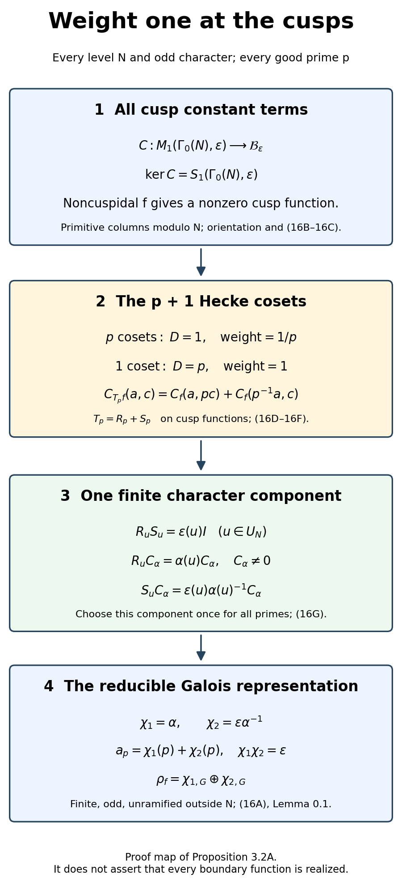
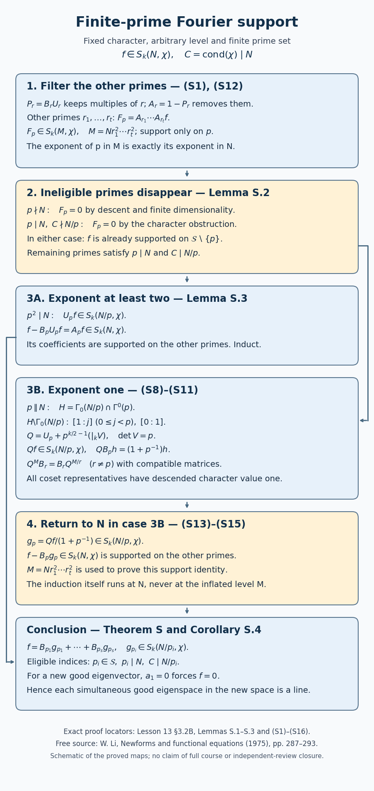
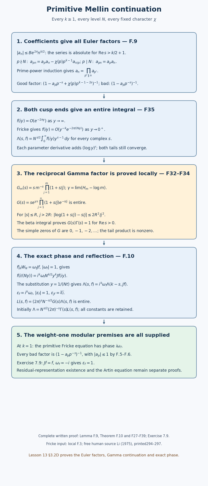

# Weight one: the theorem of Deligne and Serre

*Written by GPT-6.1 Sol (OpenAI) in Codex, Ultra setting, October 2026. Self-checked by the writing AI. Public domain (CC0).*

In weight one the determinant has no cyclotomic power. The representation attached to a holomorphic eigenform is a complex representation with **finite image**. Its good-prime eigenvalues are roots of unity, and its projective image is one of the finite rotation groups. The construction nevertheless passes through higher weight and reduction modulo auxiliary primes.

We keep **arithmetic Frobenius** \(\operatorname{Fr}_p\), acting on residue fields by \(x\mapsto x^p\). A Dirichlet character \(\varepsilon\) determines the finite Galois character \(\varepsilon_G\) characterized by \(\varepsilon_G(\operatorname{Fr}_p)=\varepsilon(p)\) for \(p\nmid N\). Thus \(\varepsilon_G(c)=\varepsilon(-1)\). Local reciprocity still sends a uniformizer to geometric Frobenius, the inverse of arithmetic Frobenius. The Weil–Deligne relation remains \(r(w)Nr(w)^{-1}=|w|N\); finite-image complex representations here have \(N=0\).

The prerequisites are the actual Frobenius-density and uniqueness proof in *Frobenius elements and determination by traces*, the written Fourier-lattice proofs in the modular-forms programme, and the ideal and ray-class arguments identified in §5. The higher-weight representation construction is still a required dependency: its current geometric gaps are retained explicitly in §6. The full statement below is preserved, and the portions actually closed in this edition are distinguished from that remaining proof obligation.

**Lemma 0.1 (the finite Dirichlet Galois character).** A Dirichlet character modulo \(N\) gives the continuous finite character \(\varepsilon_G\) described above; it is unramified outside \(N\), with the stated arithmetic Frobenius and complex-conjugation values.

*Proof.* Define it on \(\zeta_N\mapsto\zeta_N^a\) by \(\varepsilon(a)\). We check that every unit \(a\bmod N\) occurs. The cyclotomic polynomial \(\Phi_N\) has integer coefficients, by induction and monic division of \(X^N-1\) by the factors with proper-divisor indices. Let \(f\) be the irreducible rational polynomial of \(\zeta_N\); monic factors of integer monic polynomials are integral by Gauss's lemma. Its elementary proof is that a product of two primitive integer polynomials remains primitive, as reduction modulo any proposed common prime divisor shows, followed by clearing rational denominators. If for a prime \(r\nmid N\) the root \(\zeta_N^r\) belonged to a different irreducible factor \(g\), then \(f\mid g(X^r)\). Reduction modulo \(r\) would give a common factor of \(\bar f\) and \(\bar g\), because \(\overline{g(X^r)}=\bar g(X)^r\). But both divide \(X^N-1\), square-free modulo \(r\), whose derivative is \(NX^{N-1}\). This is impossible. Thus every such prime power sends a root of \(f\) to a root of \(f\); factoring any positive integer coprime to \(N\) into these primes shows that all primitive roots are conjugate. This proves the cyclotomic Galois group assertion.

For \(p\nmid N\), the polynomial \(X^N-1\) has simple roots in a finite residue-field extension. The unramified-extension construction and Hensel proof in Lesson 01, Lemma 0D.1 and Proposition 0F.2, lift them all in a finite unramified local extension. Arithmetic Frobenius acts there by the \(p\)-th power on these roots, by its residue action and uniqueness of the simple lifts. Complex conjugation inverts roots of unity. These give every claimed value. Restriction to the finite cyclotomic extension makes the character continuous. ∎

## 1. The exact theorem

**Theorem 1.1 (Deligne–Serre).** Let
\[
0\ne f\in M_1(\Gamma_0(N),\varepsilon),\qquad \varepsilon(-1)=-1,
\qquad T_pf=a_pf\quad(p\nmid N).
\tag{1}
\]
There is a continuous representation
\[
\rho_f:G_{\mathbf Q}\longrightarrow\operatorname{GL}_2(\mathbf C),
\tag{2}
\]
where \(\mathbf C\) has the discrete topology, unramified outside \(N\), with
\[
\det(X-\rho_f(\operatorname{Fr}_p))
=X^2-a_pX+\varepsilon(p)\quad(p\nmid N).
\tag{3}
\]
It is irreducible if and only if \(f\) is cuspidal. If \(f\) is a **normalized primitive cusp form of exact level \(N\)**, then
\[
\operatorname{cond}(\rho_f)=N,\qquad L(s,\rho_f)=L(s,f),
\tag{4}
\]
including the factors at primes dividing \(N\).

These are the complete assertions of Deligne–Serre's freely readable original article, Theorems 4.1 and 4.6. The theorem's first part does not require primitivity, normalization, or eigenvector conditions at primes dividing \(N\). In (1), \(a_p\) denotes the eigenvalue. For a normalized cusp eigenform it is also the \(p\)-th Fourier coefficient. Proposition 3.2A below proves the noncuspidal case at every level and character. Proposition 3.2 proves the cusp construction once the required higher-weight residual representations are supplied. Sections 3.2C–3.2D prove all primitive modular functional-equation and bad-factor inputs; Lemma 3.3 deduces the exact conductor and all Euler factors when the representation and its Artin equation are supplied. The remaining residual geometry and prerequisite obligations are specified in §6. The citation identifies the full result and does not substitute for its proof.

Continuity makes the image finite: the compact image of the profinite group \(G_{\mathbf Q}\) in a discrete space is finite. A finite group representation over \(\mathbf C\) is semisimple. Indeed, if \(U\subset V\) is stable, average any projection \(P:V\to U\):
\[
P_G=\frac1{|G|}\sum_{g\in G}gPg^{-1}.
\tag{5}
\]
Its image is \(U\), it acts as the identity on \(U\), and its kernel is a stable complement. This also proves that (3) determines the isomorphism class: apply the characteristic-zero trace uniqueness theorem from lesson 2, or its finite-group character proof, after passing to a common finite quotient.

Primitivity in (4) matters. A form of level \(23\), viewed as an old form of level \(46\), has the same good-prime traces and the same representation. It need not become ramified at \(2\). The conclusion “ramified at every prime dividing \(N\)” follows from the **exact conductor assertion** in (4), not from the general statement (1).

## 2. Determinant, oddness, and the weight-one bound

These deductions concern any representation satisfying (2)–(3); they do not assume that the retained proof obligations in Theorem 1.1 have already been discharged.

**Theorem 2.1 (global determinant).** Under (1),
\[
\det\rho_f=\varepsilon_G.
\tag{6}
\]

**Proof.** Both characters have finite image. Their quotient \(d\) factors through a finite Galois extension. Equation (3) gives \(d(\operatorname{Fr}_p)=1\) at every \(p\nmid N\). Every conjugacy class of the finite quotient occurs as a Frobenius class at a prime outside this finite excluded set, by Chebotarev. Since \(d\) is a character, its value on that entire class is \(1\). Thus \(d=1\). ∎

**Corollary 2.2 (oddness).** If \(c\) is complex conjugation, then
\[
\rho_f(c)\sim
\begin{pmatrix}1&0\\0&-1\end{pmatrix}.
\tag{7}
\]

**Proof.** Since \(c^2=1\), the matrix is annihilated by \((X-1)(X+1)\), which has distinct roots over \(\mathbf C\). It is diagonalizable with eigenvalues in \(\{1,-1\}\). Its determinant is \(\varepsilon(-1)=-1\), so exactly one eigenvalue is \(-1\). ∎

**Corollary 2.3 (Ramanujan in weight one).** For \(p\nmid N\), the roots \(\alpha_p,\beta_p\) of (3) are roots of unity. Consequently
\[
a_p=\alpha_p+\beta_p,\qquad |a_p|\leq2.
\tag{8}
\]
The same bound holds after every complex embedding of the coefficient field.

**Proof.** An element of a finite image has finite order, say \(m\). Its matrix is annihilated by \(X^m-1\), whose roots are distinct roots of unity. The triangle inequality gives (8). A field embedding sends a root of unity to another root of unity, so it gives the same bound for the conjugate trace. ∎

There are only finitely many values of \(a_p\) at good primes, since there are only finitely many matrices in the image. This is a consequence of the finite-image theorem. The analytic estimate used in its construction gives a weaker intermediate statement, proved next.

## 3. Rankin's estimate and the construction

In this section assume \(f\) is cuspidal. The Eisenstein case is handled separately at the end of the outline.

For a set \(X\) of primes, define its upper analytic density by
\[
\overline\delta(X)=\limsup_{s\to1^+}
\frac{\sum_{p\in X}p^{-s}}{\log(1/(s-1))}.
\tag{9}
\]
The denominator agrees with \(\sum_p p^{-s}\) up to a bounded error. To see this, take the logarithm of Euler's product for \(\zeta(s)\); its prime-power terms of exponent at least two stay bounded near \(1\), and \((s-1)\zeta(s)\to1\).

We construct the coefficient field, integral lattice and conjugate cusp packets below from the actual rational Fourier-basis argument in the earlier modular-forms programme. The estimate proved next then gives, for every conjugate cusp packet,
\[
\sum_{p\nmid N}|\sigma(a_p)|^2p^{-s}
\leq\log(1/(s-1))+O_\sigma(1)\quad(s\to1^+).
\tag{10}
\]
Its use for all embeddings, and the integrality, are essential.

**Lemma 3.0 (the weight-one cusp lattice).** The good-prime eigenvalues and character values of a cusp eigenpacket in (1) are algebraic integers in a fixed number field. Every embedding of that field gives another holomorphic cusp eigenpacket. There is a full integral lattice preserved by all Hecke operators and diamonds in \(S_1(\Gamma_1(N))\).

*Proof.* Use the actually written rational Fourier bases of
\(S_5(\Gamma_1(N))\), \(S_7(\Gamma_1(N))\) and \(S_{11}(\Gamma_1(N))\) from *Modular symbols and the algebraicity of Hecke eigenvalues*, §2, equations (2.1)–(2.8), and §3, Theorems 3.1–3.2 and equation (3.5). Their proof uses integral group cohomology and its reflection involution, followed by the perfect Fourier pairing. We use this rational-basis conclusion, rather than its later stronger integral-duality assertion, which has additional arithmetic-model hypotheses. The odd-weight extension to regular principal covers is explicitly part of its §2.1. Its analytic curve and period prerequisites remain part of the earlier programme chain.

Multiplication by the full-level integral series \(E_4,E_6\) defines the linear map
\[
 S_5\oplus S_7\longrightarrow S_{11},\qquad
 (g_5,g_7)\longmapsto E_6g_5-E_4g_7.
\]
It is rational for these Fourier structures: the product coefficients of rational series are rational, and the rational Fourier structure is exactly the set of forms with rational coefficients. Its kernel is
\(\{(fE_4,fE_6):f\in S_1(\Gamma_1(N))\}\).
For the converse, divide the equality by \(E_4E_6\). The two quotients agree where both are defined. They glue holomorphically everywhere because \(E_4,E_6\) have no common zero: \(E_4^3-E_6^2=1728\Delta\), and \(\Delta\) is nowhere zero on \(\mathfrak H\), by the actual discriminant proof in the valence lesson, Theorem 2.1. At every cusp both full-level forms have constant term one in a scaling coordinate. Division preserves cusp vanishing there. Hence the quotient is precisely a weight-one cusp form. The kernel thus gives its full rational Fourier structure and commutes with complex scalar extension.

Its integral-coefficient subgroup \(S_1(\mathbf Z)\) is a full finite free lattice. To see fullness, choose a rational kernel basis and clear its finitely many denominators in the integral Fourier bases of \(S_5,S_7\). Then \(g_5\) has integer coefficients; division by \(E_4\), whose constant term is one and whose coefficients are integers, has integer formal coefficients as well. Conversely an integer-coefficient \(f\) has \(fE_4\in S_5(\mathbf Z)\). This injects the entire subgroup into that finite free lattice, proving finite generation, and the basis just obtained proves fullness.

Diamonds act rationally on this space: they commute with multiplication by the full-level \(E_4,E_6\), and their higher-weight actions are rational in the same actual Fourier-basis proof. There are finitely many diamonds. Define
\[
 L=\bigcap_{u\in(\mathbf Z/N)^\times}[u]^{-1}S_1(\mathbf Z).
\]
A finite intersection of full lattices in one rational vector space is full: clear the finitely many matrix denominators in any one rational basis. Diamond multiplication permutes the intersection, so all diamonds preserve \(L\). For \(f\in L\), the weight-one prime coefficient formula is
\(a_r(T_pf)=a_{pr}(f)+a_{r/p}([p]f)\) at a good prime, and coefficient selection at a bad prime. These are integers. Since every diamond commutes with \(T_p\), apply the same formula to each \([u]f\) to see that all diamond transforms of \(T_pf\) also have integer coefficients. Thus \(T_pL\subset L\), and the all-index Hecke recursions prove stability for every \(T_n\).

The algebra of good operators and diamonds acts faithfully on \(L\), and is a finite free subgroup of \(\operatorname{End}_{\mathbf Z}(L)\). Its eigenvalues are integral by the monic integer characteristic polynomials; its character image over \(\mathbf Q\) is a finite-dimensional rational domain, hence a number field. This applies to the given good eigenpacket even when the original form is not a bad-prime eigenvector. Its simultaneous eigenspace is defined over that number field by rational matrix equations. An embedding extends to an automorphism of \(\mathbf C\), by a transcendence basis and algebraic extension. Acting on the scalar coordinates of the finite rational cusp space produces a holomorphic cusp form with the conjugate eigenvalues and character. No discontinuous automorphism is applied term by term to an analytic limit. This proves every assertion. ∎

The same finite-intersection argument supplies the lattice in each higher cusp weight used below. More explicitly, the actual proof in *Modular symbols and the algebraicity of Hecke eigenvalues*, §3, writes \(S_k(\mathbf Z)=\operatorname{Hom}_{\mathbf Z}(A_k,\mathbf Z)\), where \(A_k=\sum_{n\ge1}\mathbf ZT_n\) is finite free and spans the rational Hecke algebra. Since an integral basis of \(A_k\) is a finite integral combination of the \(T_n\), a form with coefficients in a DVR belongs to \(S_k(\mathbf Z)\otimes\mathcal O\) exactly when all its Fourier coefficients belong to \(\mathcal O\). Intersect the finitely many diamond translates of this lattice to obtain \(L_k\). For a chosen character packet, all those translates are scalar multiples by roots of unity, so its coefficient-integrality criterion is unchanged. Finite intersections commute with localization and flat scalar extension: realize the intersection as the kernel of the map from the direct sum of the lattices to their common rational space, and tensor that exact sequence. This uses only the actually proved Fourier dual lattice, rather than a stronger canonical integral cohomology comparison. Products with the integral full-level \(E_{\ell-1}\) lie in this lattice after localization, and a coefficient congruence modulo its uniformizer is a congruence of lattice vectors. This supplies the local lattice step from the specified earlier Fourier-basis proof. Its recorded analytic dimension foundations still need their exact earlier bindings; it supplies no missing higher-weight Galois representation. ∎

**Lemma 3.0A (Rankin's inequality without normalization).** Every nonzero weight-one cusp form satisfying the good-prime eigenvector conditions in (1) satisfies (10) for its given complex embedding.

*Proof.* Write \(f=\sum_{r\geq1}c_rq^r\), and choose \(m\) with \(c_m\ne0\). Put \(H(z)=y|f(z)|^2\). Its invariance under \(\Gamma_0(N)\) follows from the weight-one transformation and \(|\varepsilon|=1\). For representatives of \(\Gamma_0(N)\backslash\operatorname{SL}_2(\mathbf Z)\), form the nonnegative invariant function
\[
 F(z)=\sum_\gamma H(\gamma z).
\]
Each summand decays exponentially at infinity, up to a factor \(y\): it is \(y|(f|_1\gamma)(z)|^2\), and the cusp expansion of a cusp form has strictly positive exponents in its cusp coordinate. There are finitely many representatives. Thus \(F(z)\le Cye^{-cy}\) on the full modular fundamental region for some \(c>0\).

Use the full-level nonholomorphic Eisenstein series \(E(z,s)\). Its actual theta-integral continuation and residue are proved in *Non-holomorphic Eisenstein series and Maass forms*, §3, Theorem 3.2 and Corollary 3.3. The integrable cusp estimate in *The Rankin–Selberg method*, §2, Lemma 2.1, applies to this \(F\) as well: its proof bounds the entire part of the theta integral by \(C_Ay^{A+3/2}\) on every compact set of parameters, which the exponential bound just proved absorbs. Consequently
\[
 I(s)=\int_{\operatorname{SL}_2(\mathbf Z)\backslash\mathfrak H}
             F(z)E(z,s)\,\frac{dx\,dy}{y^2}
       =O((s-1)^{-1})\qquad(s\downarrow1).
\]
For real \(s>1\), use first a finite partial sum of the defining Eisenstein series. Change variables in each of its finitely many terms. Their transformed domains tile a finite subset of the period strip, and their integrals sum to at most \(I(s)\), since the remaining terms are nonnegative. These subsets exhaust the strip. The integral of a nonnegative continuous function there is the supremum over compact subsets; exhaustion therefore proves that its full strip integral is at most \(I(s)\). Since \(F\ge H\), the same bound holds for \(H\). At fixed \(y>0\), the Fourier series converges uniformly in \(x\). Integrating squared finite Fourier sums, then passing to that uniform limit, gives the orthogonal coefficient sum. Retain any finite number of its nonnegative terms and integrate in \(y\). The Gamma integral gives their finite weighted sum; increasing the number of terms proves
\[
 \frac{\Gamma(s)}{(4\pi)^s}
       D_f(s)\le I(s),\qquad
 D_f(s)=\sum_{r\ge1}|c_r|^2r^{-s}.
\]
In particular \(D_f(s)\) converges for every \(s>1\) and is \(O((s-1)^{-1})\).

Exclude the finitely many primes dividing \(Nm\). The prime coefficient formula proved in *Hecke operators for \(\Gamma_0(N)\) and \(\Gamma_1(N)\)*, Theorem 2.3 and Theorem 3.1, says
\(c_{pr}=a_pc_r-\varepsilon(p)c_{r/p}\).
Induction on prime powers and then on distinct primes, since none divides \(m\), gives
\[
 c_{mn}=c_m b_n,\qquad
 b_n=\prod_{p^r\parallel n}h_r(\alpha_p,\beta_p),\qquad
 h_r(A,B)=\sum_{j=0}^r A^{r-j}B^j,
\]
for \(n\) supported on the remaining primes; here \(\alpha_p+\beta_p=a_p\), \(\alpha_p\beta_p=\varepsilon(p)\). Thus
\(D_0(s)=\sum_n|b_n|^2n^{-s}\le m^s|c_m|^{-2}D_f(s)\).
It has a convergent Euler product with nonnegative local coefficients. The four-root formal identity is proved in *The Rankin–Selberg method*, Lemma 3.1; applying it to \((A,B,C,D)=(\alpha_p,\beta_p,\bar\alpha_p,\bar\beta_p)\) gives
\[
 \sum_{r\ge0}|h_r(\alpha_p,\beta_p)|^2T^r
 =\frac{1-T^2}
 {\prod_{i,j=1}^2(1-\alpha_{p,i}\bar\alpha_{p,j}T)}.
\]
The convergence for every \(s>1\) implies
\(\max(|\alpha_p|,|\beta_p|)\le\sqrt p\).
Indeed \(|\alpha_p\beta_p|=1\). If the larger root has magnitude \(R>1\), the formula \(h_r=(\alpha_p^{r+1}-\beta_p^{r+1})/(\alpha_p-\beta_p)\) has exponential rate \(R^r\); if both magnitudes are one, its rate is at most polynomial. Convergence of \(\sum_r|h_r|^2p^{-rs}\) for all \(s>1\) consequently forces \(R^2\le p\). Therefore every geometric logarithm below converges when \(s>1\).

Multiply the local identities by the factors of \(\zeta_0(2s)\), with the same omitted primes, and take real logarithms. The coefficient of \(p^{-rs}\) in the logarithm of the resulting four-root product is
\(|\alpha_p^r+\beta_p^r|^2/r\ge0\).
For finite prime sets the term with \(r=1\) therefore gives
\[
 \sum_{p\nmid Nm}|a_p|^2p^{-s}
 \le\log\bigl(\zeta_0(2s)D_0(s)\bigr)
 \le\log(1/(s-1))+O(1).
\]
Passing to all primes is valid by monotonicity on the left and by the convergent nonnegative Euler product on the right. The finitely many primes dividing \(m\), but not \(N\), contribute \(O(1)\). This is (10). The same proof applies individually to every actually supplied conjugate cusp form. ∎

**Lemma 3.0B (an Eisenstein congruence).** For every prime \(\ell\ge5\), the normalized full-level series \(E_{\ell-1}\) has \(\ell\)-integral coefficients and is congruent to one modulo \(\ell\).

*Proof.* The Eisenstein construction in the earlier modular-forms lesson, *Modular forms, lattice functions and Eisenstein series*, §4, Proposition 4.1 and Theorem 4.2, gives
\(E_n=1-(2n/B_n)\sum_{r\ge1}\sigma_{n-1}(r)q^r\) for even \(n>2\), with \(B_j\) defined by \(t/(e^t-1)=\sum B_jt^j/j!\). Its coefficient recursion is
\(\sum_{j=0}^{r}\binom{r+1}{j}B_j=0\) for \(r>0\).
Hence \(B_j\) is \(\ell\)-integral for \(0\le j\le\ell-2\), by induction, and \(\ell B_{\ell-1}\) is integral. Multiplying the generating function by \((e^{\ell t}-1)/t\) gives the power-sum identity
\[
 \sum_{a=0}^{\ell-1}a^{\ell-1}
   =\frac1\ell\sum_{j=0}^{\ell-1}
         \binom\ell j B_j\ell^{\ell-j}.
\]
The last term is \(\ell B_{\ell-1}\); all earlier terms are divisible by \(\ell^2\), since their Bernoulli numbers are integral and, for \(1\le j<\ell\), \(\binom\ell j\) is divisible by \(\ell\). The sum on the left is \(-1\) modulo \(\ell\), because every nonzero residue has \((\ell-1)\)-st power one. Thus \(v_\ell(B_{\ell-1})=-1\). The coefficient multiplier \(-2(\ell-1)/B_{\ell-1}\) has valuation one. Every divisor sum is an integer, proving the assertion. ∎

**Lemma 3.0C (lifting an eigenpacket).** Let \(\mathcal O\) be a discrete valuation ring with characteristic-zero fraction field and uniformizer \(\pi\), let \(M\) be finite free, and let a commuting collection of endomorphisms preserve \(M\). A simultaneous eigencharacter occurring in \(M/\pi M\) lifts, after a finite extension of the fraction field and a place above \(\pi\), to a characteristic-zero eigencharacter occurring in \(M\otimes\operatorname{Frac}(\mathcal O)\).

*Proof.* The generated algebra \(T\subset\operatorname{End}_{\mathcal O}(M)\) is a finite torsion-free \(\mathcal O\)-module: submodules of a finite free module over a DVR are finite free, by Lesson 01, Lemma 0A.1. It is commutative. The residual eigencharacter has kernel a maximal ideal \(\mathfrak m\) of \(T\) containing \(\pi\). Multiplication by \(\pi\) remains injective in \(T_{\mathfrak m}\), so \(T_{\mathfrak m}[1/\pi]\ne0\). Choose a prime there and contract it to \(\mathfrak p\subset\mathfrak m\). Since \(T[1/\pi]\) is a finite-dimensional algebra over the fraction field, its prime quotients are finite fields over that field. The resulting character \(T\to E\) is integral over \(\mathcal O\). Here is the needed place construction for an arbitrary DVR. The integral closure \(B\) of \(\mathcal O\) in \(E\) is finite: choose an integral field basis; traces of products of integral elements are integral, so \(B\) is contained in the dual of its basis lattice under the nondegenerate separable trace pairing. Both lattices are finite free by Lemma 0A.1 of Lesson 01. Localize the finite extension \(T/\mathfrak p\subset B\) at \(\mathfrak m/\mathfrak p\). Its maximal ideal cannot generate the whole finite nonzero module \(B\), by the determinant proof of Nakayama given in *Discrete valuation rings and Dedekind domains*, “What one prime sees”, Nakayama’s lemma. A maximal ideal \(\mathfrak q\) above it therefore exists. Its contraction is the given maximal ideal: an integral subring of a field is a field whenever the larger ring is a field, since the monic equation of an inverse expresses that inverse in the subring. The normal one-dimensional local ring \(B_{\mathfrak q}\) is a DVR by the actual DVR characterization proved in that same section. Indeed, \(B[1/\pi]=E\) is a field, so every nonzero prime of \(B\) lies above \(\pi\); the local dimension is one. Its valuation gives the required place and reduction. The character occurs in \(M\otimes E\). For completeness, the finite-algebra decomposition needed to verify occurrence has an elementary matrix proof. Over an algebraically closed splitting field, commuting matrices can be simultaneously triangularized. Find a common eigenvector by restricting successively to eigenspaces of a finite generating set; commutation preserves each restriction. Apply the same argument to the quotient by that line and induct. The finitely many diagonal characters give distinct maximal ideals \(\mathfrak n_i\), whose intersection acts by strictly upper-triangular matrices and thus has its \(\dim M\)-th power zero. Their powers are pairwise comaximal, and their product is that same power of the intersection. The Chinese remainder decomposition follows by writing \(1=x+y\) for two comaximal ideals and expanding its sufficiently large power to prove comaximality of their powers; the standard map to the two quotients is onto by this equality and has their intersection as kernel. Induction gives the decomposition into the local factors. Faithfulness of the action makes every factor act on a nonzero summand. On the desired summand its maximal ideal is nilpotent; the last nonzero term of its powers is killed by that maximal ideal, and any nonzero vector there is an eigenvector. The simultaneous eigenvector equations for the prescribed character have coefficients in \(E\); matrix rank is unchanged by field extension, so their nonzero kernel already exists over \(E\). Reduction of eigenvalues, rather than equality of a chosen residual vector, is the conclusion. ∎

**Lemma 3.0D (two-dimensional finite-field descent).** Let \(k\) be a finite field of odd characteristic, and let a semisimple two-dimensional representation of a finite group be defined over a finite extension of \(k\). If every group element has characteristic polynomial in \(k[X]\), the representation has a two-dimensional model over \(k\).

*Proof.* We give the finite-algebra details used both here and in the next lemma. For a semisimple two-dimensional representation over any finite field \(u\) of odd characteristic, let \(A\) be the \(u\)-span of its image. If the representation is reducible, its stable complement shows that \(A\) is the scalar algebra or the diagonal algebra. If it is irreducible and contains an element with an irreducible quadratic polynomial, its span is a quadratic field \(L\). Either \(A=L\), or an element \(B\notin L\) gives the four-dimensional direct sum \(L+LB\subset A\), so \(A=M_2(u)\). If an element has two distinct eigenvalues in \(u\), its two spectral projectors belong to \(A\); irreducibility supplies both off-diagonal matrix units, so again \(A=M_2(u)\). Finally a nonscalar repeated-root matrix gives, after subtracting its scalar part, \(E_{12}\). Irreducibility supplies a matrix \(B=(b_{ij})\) with \(b_{21}\ne0\); then \(E_{12}B-b_{22}E_{12}=b_{21}E_{11}\), giving the projectors and the remaining units. These cases exhaust the possibilities. In particular extension to an algebraic closure remains semisimple.

If the representation is a sum \(\chi_1\oplus\chi_2\) over the algebraic closure, equal characters have values in \(k\), because their trace is \(2\chi_1\). Otherwise choose \(g\) with eigenvalues \(a\ne b\). They lie in a field \(L/k\) of degree at most two, and
\[
 \chi_1(h)=\frac{\operatorname{tr}(gh)-b\operatorname{tr}(h)}{a-b},\qquad
 \chi_2(h)=\frac{a\operatorname{tr}(h)-\operatorname{tr}(gh)}{a-b}.
\]
The characters are thus defined over \(L\). Its Galois automorphism either fixes both, giving a diagonal \(k\)-model, or exchanges them. In the latter case multiplication by \(\chi_1(h)\) on the two-dimensional \(k\)-space \(L\) has precisely the two required eigenvalues.

In the absolutely irreducible case choose four image matrices \(g_i\) forming a basis of the full matrix algebra over the larger field. The trace-pairing matrix \((\operatorname{tr}(g_ig_j))\) is invertible and has entries in \(k\). Pairing a product \(g_ig_j\) against the basis shows that its expansion coefficients lie in \(k\), since \(\operatorname{tr}(g_ig_jg_t)\in k\). Therefore their \(k\)-span \(A\) is a four-dimensional algebra with scalar extension \(M_2\). It is central simple: an ideal becomes an ideal of \(M_2\), and the center becomes its scalar center, by exact scalar extension of the relevant linear equations. In particular its center is \(k\).

It cannot be a division algebra. If it were, a nonscalar traceless element \(i\) would satisfy \(i^2=a\in k^\times\), with irreducible quadratic polynomial. The identities \(\operatorname{tr}(x)\in k\) and
\(\det(x)=(\operatorname{tr}(x)^2-\operatorname{tr}(x^2))/2\in k\)
hold for every \(x\in A\); the matrix characteristic identity holds after scalar extension and hence in \(A\). The centralizer of \(i\) has dimension two and is \(L=k(i)\). The solutions of \(ji=-ij\) also have dimension two, as is checked after diagonalizing \(i\). A nonzero such \(j\) is invertible under the division assumption, satisfies \(jc=\bar c j\) for \(c\in L\), and has \(j^2=b\in k^\times\). The last assertion follows because \(j^2\in L\) and commutation with \(j\) fixes it under the nontrivial automorphism of \(L/k\).

Norm \(L^\times\to k^\times\) is onto. Indeed the multiplicative group of a finite field is cyclic: its exponent is attained by combining elements of maximal prime-power orders, and its elements are roots of \(X^{\text{exponent}}-1\), so the root count makes the exponent its order. For \(|k|=q\), norm on the cyclic group of order \(q^2-1\) is the power \(q+1\) and has image of order \(q-1\). Choose \(c\) with \(c\bar c=b\). Then
\((j-c)(j+\bar c)=j^2-c\bar c=0\), with both factors nonzero, a contradiction. Thus \(A\) has a nonzero singular element \(x\). The left ideal \(Ax\) has dimension two, as it does after extension to matrices, where \(x\) has rank one. Left multiplication embeds \(A\) into \(\operatorname{End}_k(Ax)\): its kernel is an ideal and cannot be all of \(A\). Equal dimensions make this an isomorphism. Its natural module supplies the desired \(k\)-model, and scalar extension recovers the original representation. ∎

**Lemma 3.0E (the uniform image bound needed here).** Let \(G\subset\operatorname{GL}_2(k)\), for a finite field \(k\) of odd characteristic, act semisimply. Suppose more than \((1-\eta)|G|\) of its elements have characteristic polynomials in a set of at most \(M\) polynomials, where \(0<\eta<1/4\) and \(M\ge1\). Then
\[
 |G|\le\frac{M^4}{1-4\eta}.
\]

*Proof.* The image algebra described in Lemma 3.0D is scalar, diagonal, a quadratic field, or \(M_2(k)\). In each case its trace pairing is nondegenerate. For the scalar algebra this uses \(2\ne0\); for the diagonal and matrix algebras it follows from the matrix units. In the quadratic field it is the field trace pairing: if \(x\ne0\), pairing it with \(x^{-1}\) gives trace two. Choose a basis \(g_1,\ldots,g_d\) from \(G\), with \(d\le4\), and let \(S\) be the specified large subset. At least \((1-d\eta)|G|\) elements \(g\) satisfy \(g_ig\in S\) for all \(i\), by the union bound on the complements of the translates \(g_i^{-1}S\). For those elements each of the \(d\) traces \(\operatorname{tr}(g_ig)\) has at most \(M\) values. Nondegeneracy makes the map sending \(g\) to that trace tuple injective. Hence \((1-d\eta)|G|\le M^d\), which implies the displayed bound. ∎

**Lemma 3.0F (lifting a prime-to-\(\ell\) finite representation).** Let \(G\) be finite of order prime to \(\ell\), and let \(V\) be a representation of dimension two over \(\mathbf F_\ell\). It lifts to a free rank-two \(\mathbf Z_\ell\)-representation of \(G\), and hence to a finite-image complex representation after an embedding of its field of matrix entries into \(\mathbf C\).

*Proof.* Choose a surjection \(\mathbf F_\ell[G]^r\to V\). Average a linear section over \(G\), as in (5), using that \(|G|\) is invertible. It gives a \(G\)-equivariant idempotent \(e\) on the free group module whose image is \(V\). Lift its coefficients to the complete algebra
\(B=\operatorname{End}_{\mathbf Z_\ell[G]}(\mathbf Z_\ell[G]^r)\),
which is finite free over \(\mathbf Z_\ell\). If a lift \(u\) has \(u^2-u\in\ell^tB\), then \(2u-1\) is invertible: its square is \(1+4(u^2-u)\), whose inverse is its convergent geometric series. The replacement
\[
 u'=u-(2u-1)^{-1}(u^2-u)
\]
has \(u'^2-u'\in\ell^{2t}B\), by direct multiplication; all factors here are commuting polynomials or convergent series in \(u\). Iteration converges to an idempotent lifting \(e\). Its image is a direct summand of a finite free DVR module, hence free; reduction shows its rank is two. It is \(G\)-stable and has the desired reduction.

The finitely many resulting matrix entries, together with any prescribed number field already in \(\mathbf Q_\ell\), generate a finitely generated characteristic-zero field. Such a field embeds into \(\mathbf C\), extending the prescribed number-field embedding: choose complex numbers algebraically independent for a finite transcendence basis, then extend across the finite algebraic extension into the algebraically closed field \(\mathbf C\). The independent choices exist because a field generated by finitely many numbers over a number field is countable, whereas \(\mathbf C\) is uncountable. The group relations are polynomial identities, so they survive this embedding. Every eigenvalue has order dividing \(|G|\), because each group matrix is annihilated by \(X^{|G|}-1\). If the residual action is faithful, so is the lift. ∎

**Proposition 3.1 (finite coefficient set outside a small exceptional set).** Suppose \(a_p\in\mathcal O_K\), \(d=[K: \mathbf Q]\), and (10) holds for all embeddings. For every \(\eta>0\) there is a finite set \(Y\subset\mathcal O_K\) such that
\[
\overline\delta\{p\nmid N:a_p\notin Y\}\leq\eta.
\tag{11}
\]

**Proof.** For \(B>0\), let
\[
Y_B=\{a\in\mathcal O_K:|\sigma(a)|\leq B\text{ for every }\sigma\}.
\tag{12}
\]
This set is finite. Every such \(a\) has a monic minimal polynomial of degree \(e\leq d\) with integer coefficients. All its conjugates have magnitude at most \(B\); its coefficient of degree \(e-j\) has magnitude at most \(\binom ej B^j\). There are finitely many choices of these integers, finitely many such polynomials, and finitely many roots.

If \(a_p\notin Y_B\), at least one embedding has \(|\sigma(a_p)|>B\). Summing nonnegative terms gives
\[
B^2\sum_{\substack{p\nmid N\\a_p\notin Y_B}}p^{-s}
\leq\sum_\sigma\sum_{p\nmid N}|\sigma(a_p)|^2p^{-s}
\leq d\log(1/(s-1))+O(1).
\tag{13}
\]
Divide by the logarithm and take the upper limit. Choosing \(B^2\geq d/\eta\) proves (11). ∎

This is [Deligne–Serre, Proposition 5.5] with its elementary finiteness and density deductions supplied. It does **not** show that all \(a_p\) belong to a finite set. Exercise 7.4 gives an integer-valued counterexample to that inference from a prime mean-square asymptotic alone.

**Proposition 3.2 (the construction after the residual input).** Suppose the higher-weight representation construction supplies (14) for the eigenpackets lifted below, at infinitely many auxiliary primes splitting in every fixed finite enlargement of the coefficient field. Then (2)–(3) hold for this cusp eigenpacket, the representation is unramified outside \(N\), and it is irreducible. The implication is proved in the following six steps, using the lattice and conjugate packets of Lemma 3.0. Its residual premise is a required part of the full theorem, not a consequence of the currently conditional higher-weight lesson.

1. **Produce residual representations.** First choose a nonzero \(K\)-rational vector in the same good-prime and diamond eigenspace as the form in (1). Such a vector exists: Lemma 3.0 writes the eigenvector conditions as rational matrix equations over the coefficient field \(K\), and their kernel remains the same kernel after scalar extension to \(\mathbf C\). Only finitely many of these equations are needed, since intersections of subspaces in a finite-dimensional space stabilize. Clear the denominators of its coordinates in the full lattice of that lemma, and exclude the finitely many prime ideals dividing one chosen nonzero coordinate. Write \(f\) for this vector. It now has a defined nonzero reduction at every remaining \(\lambda\), with the same good-prime eigenvalues and integral unit diamond eigenvalues. For \(\ell\ge5\), put \(n=\ell-1\). Lemma 3.0B gives \(E_n\equiv1\pmod\ell\), so \(fE_n\equiv f\pmod\lambda\) in weight \(1+n\). The prime coefficient formula shows that its reduction has the required eigenpacket: its recurrence coefficient is \(\varepsilon(p)p^n\equiv\varepsilon(p)\). The product need not be a characteristic-zero eigenform. Use the higher-weight lattice described at the end of Lemma 3.0. Its coefficient criterion shows that this coefficient congruence is a congruence of vectors in the lattice. Lemma 3.0C then supplies the lifted eigenpacket. Apply the higher-weight representation construction, choose the stable lattice proved in Lesson 01, Theorem 2.1, reduce and semisimplify. Chebotarev makes the characteristic polynomial of every element belong to the residual coefficient field, since it does so for all good Frobenius elements; Lemma 3.0D then gives
   \[
   \overline\rho_\lambda:G_{\mathbf Q}\to\operatorname{GL}_2(k_f),
   \quad
   \det(X-\overline\rho_\lambda(\operatorname{Fr}_p))
   \equiv X^2-a_pX+\varepsilon(p)\pmod\lambda
   \quad(p\nmid N\ell).
   \tag{14}
   \]
   The cyclotomic exponent disappears since \(p^n\equiv1\pmod\ell\).

2. **Choose a split-prime family.** Enlarge \(K\) to a finite Galois number field containing the coefficients and character values. Use primes \(\ell\) splitting completely in \(K\), so \(k_f=\mathbf F_\ell\). These primes have positive density \(1/[K: \mathbf Q]\); they are not generally a density-one set. Infinitely many suffice. Later finite enlargements of \(K\) retain an infinite split-prime family.

3. **Bound the residual image.** Choose \(\eta=1/8\) in Proposition 3.1 and include the finitely many character values. There are at most a fixed \(M\) polynomials \(1-aT+eT^2\) with \(a\in Y\). Chebotarev converts (11) into a proportion statement in \(G_\ell=\operatorname{im}\overline\rho_\lambda\): at least \((1-\eta)|G_\ell|\) elements have characteristic polynomials in this finite set after reduction. Indeed, the complementary conjugacy-invariant set has prime density equal to its proportion in \(G_\ell\), and its primes are contained in the exceptional set of (11). Lemma 3.0E, with \(\eta=1/7\), which also handles equality at the density endpoint, proves
   \[
   |G_\ell|\leq A,\qquad A=3M^4,
   \tag{15}
   \]
   independently of \(\ell\). The trace-pairing proof supplies this bound without any finite-characteristic subgroup classification. This choice of density suffices for the full construction; no restriction has been imposed on the level or eigenpacket in (1).

4. **Recover exact finite polynomials.** Every residual eigenvalue has order at most \(A\). Enlarge \(K\) to contain all roots of unity of orders at most \(A\). Let \(\mathcal P\) be the finite set of degree-two polynomials with two such roots. For each fixed good \(p\), (14) agrees modulo infinitely many auxiliary prime ideals with a member of \(\mathcal P\). One member occurs infinitely often. A nonzero algebraic integer has only finitely many prime ideal divisors, so coefficientwise congruence at infinitely many distinct rational primes implies equality:
   \[
   X^2-a_pX+\varepsilon(p)\in\mathcal P.
   \tag{16}
   \]
   This is where a global finite set of good-prime polynomials finally emerges.

5. **Lift and remove auxiliary ramification.** Choose \(\ell>A\) and exclude the finitely many primes at which two members of \(\mathcal P\) become equal. The finite group \(G_\ell\) has order prime to \(\ell\). Lemma 3.0F gives its characteristic-zero lift. Include the prescribed enlarged number field \(K\) in the field of matrix entries and extend its chosen complex embedding as in that proof. Its finite-order eigenvalues have orders at most \(A\), so they already lie in \(K\). Their polynomial belongs to \(\mathcal P\); its reduction is (14), and the separating reduction identifies it with the exact polynomial (16). This lift is initially unramified outside \(N\ell\). Lifts made using two different auxiliary primes have the same traces outside a finite set, hence are isomorphic by finite Chebotarev in Lesson 02, Theorem 3.0c, followed by its characteristic-zero trace lemma, Lemma 4.1, on their common finite quotient. At each auxiliary prime use the other lift to conclude unramifiedness. The common representation is unramified outside \(N\).

6. **Prove cuspidal irreducibility.** A hypothetical reducible lift is \(\chi_1\oplus\chi_2\), by (5). Its determinant is \(\varepsilon_G\), by the already written proof of Theorem 2.1. Oddness makes the characters distinct. Put \(\chi=\chi_1\chi_2^{-1}\), a nontrivial character of a finite abelian quotient. Chebotarev analytic density in Lesson 02 gives
   \[
   \sum_p\chi(p)p^{-s}=o\bigl(\log(1/(s-1))\bigr).
   \]
   To see the coefficient explicitly, sum the density statement over the finitely many elements of that quotient: their character sum is zero, since multiplication by an element on which \(\chi\ne1\) preserves the sum and multiplies it by a different scalar. Omitting finitely many ramified primes has bounded effect. Consequently
   \[
   \sum_{p\nmid N}|\chi_1(p)+\chi_2(p)|^2p^{-s}
     =2\log(1/(s-1))+o\bigl(\log(1/(s-1))\bigr),
   \]
   contradicting Lemma 3.0A. A bounded cross-prime sum, stronger than this density deduction, is unnecessary. This completes the claimed implication. ∎

### 3.2A. Noncuspidal forms from their cusp constant terms

**Proposition 3.2A.** Suppose \(f\) satisfies (1) and is not cuspidal. There are characters \(\chi_1,\chi_2:(\mathbf Z/N\mathbf Z)^\times\to\mathbf C^\times\) such that, simultaneously for every prime \(p\nmid N\),
\[
\chi_1\chi_2=\varepsilon,\qquad
a_p=\chi_1(p)+\chi_2(p).
\tag{16A}
\]
The representation \(\chi_{1,G}\oplus\chi_{2,G}\) proves the noncuspidal assertion of Theorem 1.1. This includes forms with a cuspidal component and forms that are not eigenvectors for any bad-prime operator. No weight-one Eisenstein series needs to be constructed for this assertion.

*Proof.* We calculate the action on all cusp constant terms. Put \(U_N=(\mathbf Z/N\mathbf Z)^\times\) and
\[
P_N=\{(a,c)\in(\mathbf Z/N\mathbf Z)^2:(a,c)\text{ generates the unit ideal}\}.
\tag{16B}
\]
An odd character cannot exist for \(N=1,2\), since then \(-1=1\) in \(U_N\). Thus (1) already implies \(N\ge3\). The following argument also explains the orientation signs at cusps.

Every pair in \(P_N\) has a relatively prime integral lift. Choose a nonzero lift \(c\). For each prime divisor of \(c\) not dividing \(N\), choose \(t\) so that \(a+Nt\) is not divisible by that prime; the Chinese remainder theorem makes the choices simultaneously. Its elementary form follows from Bezout: if \(rm+sn=1\), then \(A sn+B rm\) has residues \(A\) modulo \(m\) and \(B\) modulo \(n\); iterate over the distinct primes. Bezout itself follows by expressing the last nonzero remainder in the Euclidean algorithm as an integer combination of its two inputs. At a prime dividing both \(c\) and \(N\), the unit-ideal condition already makes \(a\) nonzero modulo that prime. Hence \(\gcd(a+Nt,c)=1\). Bezout extends this first column to a matrix \(\sigma\in\mathrm{SL}_2(\mathbf Z)\).

For such a matrix define \(C_f(a,c)\) to be the constant term of \(f|_1\sigma\) at infinity. It depends only on the first column modulo \(N\). Indeed, if \(\sigma'\) has the same column modulo \(N\), then
\(\sigma^{-1}\sigma'\equiv\left(\begin{smallmatrix}1&t\\0&1\end{smallmatrix}\right)\pmod N\).
Choose an integral lift of \(t\). It follows that \(\sigma'=\gamma\sigma T^t\) for some \(\gamma\in\Gamma(N)\), where \(T=\left(\begin{smallmatrix}1&1\\0&1\end{smallmatrix}\right)\). Left multiplication by \(\gamma\) does not change the slash transform; right multiplication by \(T^t\) translates its Fourier expansion and leaves its constant term unchanged. This proves the assertion. Replacing the column by its negative replaces \(\sigma\) by \(-\sigma\), and weight one gives \(C_f(-a,-c)=-C_f(a,c)\). All rational cusps have primitive integral columns, so
\(C_f=0\) if and only if \(f\) is cuspidal.

The same lifting argument gives a lift in \(\mathrm{SL}_2(\mathbf Z)\) of every matrix in \(\mathrm{SL}_2(\mathbf Z/N\mathbf Z)\): lift its first column primitively, extend by Bezout, and adjust the second column by a multiple of the first. To justify the last step, two second columns of determinant one differ by a multiple of the first over \(\mathbf Z/N\mathbf Z\); apply the inverse of either determinant-one matrix. We will use in particular lifts of the diagonal matrices \(\operatorname{diag}(u^{-1},u)\).

The modular law for \(\Gamma_1(N)\) and the character law for \(\Gamma_0(N)\) give
\[
C_f(a+tc,c)=C_f(a,c),\qquad
C_f(u^{-1}a,uc)=\varepsilon(u)C_f(a,c)
\quad(t\bmod N,\ u\in U_N).
\tag{16C}
\]
Both identities follow by left multiplying a scaling matrix by the corresponding upper unipotent or diagonal lift. Let \(\mathcal B_\varepsilon\) be the finite-dimensional space of functions on \(P_N\) satisfying (16C). The relation at \(u=-1\) incorporates the orientation sign. Thus \(C_f\in\mathcal B_\varepsilon\).

For \(p\nmid N\), choose \(\tau_p\in\Gamma_0(N)\) congruent to \(\operatorname{diag}(p^{-1},p)\pmod N\). Representatives for the integral determinant-\(p\) Hecke correspondence are
\[
\delta_j=\begin{pmatrix}1&j\\0&p\end{pmatrix}\ (0\le j<p),\qquad
\delta_\infty=\tau_p\begin{pmatrix}p&0\\0&1\end{pmatrix}.
\tag{16D}
\]
Here the allowed matrices have \(a\equiv1\), \(c\equiv0\), \(d\equiv p\pmod N\). The representatives are exhaustive modulo left multiplication by \(\Gamma_1(N)\): the kernel of a determinant-\(p\) matrix modulo \(p\) is one of the \(p+1\) lines in \(\mathbf F_p^2\), and these representatives have all those kernels. Such a matrix has rank one modulo \(p\): rank zero would make its determinant divisible by \(p^2\). Its adjugate has image in its kernel, by the two-by-two identity \(\delta\operatorname{adj}(\delta)=pI\). If two allowed matrices have the same kernel, their quotient is therefore integral. The quotient has determinant one; modulo \(N\) it is upper unipotent, so belongs to \(\Gamma_1(N)\). This also proves uniqueness of the cosets.

Use the determinant-normalized slash operator
\(h\Vert_k\delta=(\det\delta)^{k/2}(cz+d)^{-k}h(\delta z)\).
Then
\(T_p h=p^{k/2-1}\sum_\delta h\Vert_k\delta\).
On a character-\(\varepsilon\) form this has Fourier expansion
\(p^{-1}\sum_{j=0}^{p-1}h((z+j)/p)+\varepsilon(p)p^{k-1}h(pz)\),
which is exactly the normalization used in (1). We keep \(k\) in this one calculation to see why weight one matters.

Fix an integral primitive column \((a,c)\) and its scaling matrix \(\sigma\). For each representative in (16D), let \(D\) be the positive gcd of the first column of \(\delta\sigma\). Its determinant is \(p\), so \(D=1\) or \(p\). Extending the primitive column \(v=D^{-1}\delta\sigma e_1\) to \(\sigma_v\in\mathrm{SL}_2(\mathbf Z)\) gives
\[
\delta\sigma=\sigma_v\begin{pmatrix}D&b\\0&p/D\end{pmatrix}.
\]
The second matrix contributes \(D^kp^{-k/2}\) to the constant term of the slash transform. Including the normalization of \(T_p\), its contribution is therefore \(D^k/p\) times \(C_h(v)\).

Exactly one representative has \(D=p\). If \(p\nmid c\), it is the unique \(j\) for which \(a+jc\equiv0\pmod p\); if \(p\mid c\), it is \(\delta_\infty\). For the other \(p\) representatives, the primitive column modulo \(N\) lies in the upper-unipotent orbit of \((a,pc)\). For the exceptional representative it lies in the orbit of \((p^{-1}a,c)\). For \(\delta_j\) these assertions follow by dividing \((a+jc,pc)\) by \(D\); for \(\delta_\infty\) its column modulo \(N\) is \((a,pc)\) before division. Applying (16C), the \(p\) ordinary contributions of weight \(1/p\) and the exceptional contribution of weight \(p^{k-1}\) give
\[
C_{T_p h}(a,c)=C_h(a,pc)+p^{k-1}C_h(p^{-1}a,c).
\tag{16E}
\]
This is a calculation at every cusp, including cusps whose denominators are divisible by \(p\).

On \(\mathcal B_\varepsilon\), define
\[
(R_u C)(a,c)=C(a,uc),\qquad
(S_u C)(a,c)=C(u^{-1}a,c).
\tag{16F}
\]
These substitutions preserve (16C), since \(u\) is a unit. They are commuting actions of the finite group \(U_N\), and
\(R_uS_u=\varepsilon(u)I\).
Each \(R_u\) has finite order, so its minimal polynomial divides \(X^r-1\) for some \(r\) and has distinct complex roots. Diagonalize one such operator, restrict the others to its stable eigenspaces, and continue through the finite group. This gives a simultaneous decomposition
\[
\mathcal B_\varepsilon=\bigoplus_\alpha\mathcal B_\varepsilon[\alpha],\qquad
R_u|_{\mathcal B_\varepsilon[\alpha]}=\alpha(u),\quad
S_u|_{\mathcal B_\varepsilon[\alpha]}=\varepsilon(u)\alpha(u)^{-1},
\tag{16G}
\]
where \(\alpha\) is a character of \(U_N\). Empty summands are simply omitted.

Since \(C_f\ne0\), choose a nonzero component in (16G). Every \(T_p\) preserves each component, by (16E). At weight one its action there is the scalar
\(\alpha(p)+\varepsilon(p)\alpha(p)^{-1}\).
But \(C_{T_p f}=a_pC_f\). The same chosen component therefore gives (16A) for all good primes at once, with \(\chi_1=\alpha\) and \(\chi_2=\varepsilon\alpha^{-1}\). In particular the pair is not selected separately for different primes.

Lemma 0.1 constructs the two continuous finite Galois characters. Their direct sum is unramified outside \(N\), has determinant \(\varepsilon_G\), and has (3) at every good prime. Their parities are opposite, because their product takes \(-1\) to \(-1\); hence they are distinct and the representation is reducible and odd. Any finite semisimple representation with these good-prime traces is isomorphic to this sum, by the actual finite-quotient Frobenius and characteristic-zero trace proofs in Lesson 02. Thus the noncuspidal branch is proved in the full scope of (1). The cuspidal branch still requires Proposition 3.2's residual-representation premise. ∎

[Open Figure 1 at full size](../assets/weight-one-cusp-boundary-proof-map.png)

*Figure 1. The maps and operators proved in Proposition 3.2A. The map from modular forms to cusp functions has kernel exactly the cusp forms. At a good prime, the \(p\) ordinary cosets have weight \(1/p\); the exceptional coset has weight one in weight one. Their sum is (16E). The nonzero component chosen in (16G) gives the same two characters at every good prime. The diagram summarizes this proof, rather than asserting that every boundary function is realized by a modular form. Deligne–Serre's [free original article](https://www.numdam.org/article/ASENS_1974_4_7_4_507_0.pdf), §§1.2–1.6 and 8.1, fixes the modular and Hecke conventions; the complete cusp calculation is above.*

### 3.2B. Finite-prime support and primitive eigenspaces

Before using the primitive functional equation, we prove the Fourier-support statement that makes a primitive good-prime eigenspace a line. The argument keeps the character and original lower levels explicit, including primes outside the level and characters that do not descend.

#### Statement and conventions

Write \(S_k(N,\chi)=S_k(\Gamma_0(N),\chi)\), where \(k\ge1\), \(\chi(-1)=(-1)^k\), and \(C\mid N\) is the conductor of \(\chi\). At every multiple of \(C\), use the pullback of this same primitive character. A character factors through \(N/p\) precisely when \(C\mid N/p\). This condition is essential, even if \(p^2\mid N\).

For a positive-determinant rational matrix, use
\[
 (f|_k A)(z)=\det(A)^{k/2}(cz+d)^{-k}f(Az),
 \qquad A=\begin{pmatrix}a&b\\c&d\end{pmatrix}.
\]
The positive real square root is understood. Put
\[
 B_p f(z)=f(pz),\qquad
 U_p f(z)=\frac1p\sum_{j=0}^{p-1}f((z+j)/p),\qquad
 P_p=B_pU_p,\qquad A_p=1-P_p.
 \tag{S1}
\]
If \(f=\sum_{n\ge1}a_nq^n\), then \(U_pf=\sum_{n\ge1}a_{pn}q^n\). Consequently \(P_p\) keeps exactly the coefficients whose indices are divisible by \(p\), and \(A_p\) keeps exactly the other indices. For different primes these projections commute; \(U_p\) and \(B_p\) commute with the projections at any other prime.

**Theorem S.** Let \(\mathcal S\) be any finite set of primes, without a restriction on its intersection with \(N\). If \(f\in S_k(N,\chi)\) and
\[
 a_n(f)=0\quad\text{whenever no prime in }\mathcal S\text{ divides }n,
 \tag{S2}
\]
then
\[
 f=\sum_{\substack{p\in\mathcal S, p\mid N\\ C\mid N/p}}B_p g_p,
 \qquad g_p\in S_k(N/p,\chi).
 \tag{S3}
\]
The empty sum is zero. Thus a character with conductor \(N\) admits no nonzero cusp form with this finite-prime support. We prove the fixed-character statement; no unproved projection from the full \(\Gamma_1(N)\) space is being used.

The complex coefficient bound in the earlier programme lesson *Dimension formulas for congruence subgroups*, Theorem 6.1 and its character paragraph, makes \(S_k(L,\chi)\) finite dimensional: the map to coefficients through \(\lfloor k[\mathrm{SL}_2(\mathbf Z):\Gamma_0(L)]/12\rfloor\) is injective. For \(p\nmid L\), the operator used below is
\[
 T_p=U_p+\chi(p)p^{k-1}B_p.
 \tag{S4}
\]
We prove its preservation locally in Lemma S.1, including weight one. The earlier Hecke lesson states its general setup for \(k\ge2\); that restriction is not silently being discarded. Only the complex coefficient bound is needed, not its conditional arithmetic reduction analogue. The earlier proof's prerequisites remain required.

#### 1. Elementary level changes

**Lemma S.1.** For any prime \(p\), \(B_p\) maps \(S_k(L,\chi)\) to \(S_k(Lp,\chi)\), and \(U_p\) does so as well. If \(p\mid L\), \(U_p\) already preserves \(S_k(L,\chi)\). Therefore \(A_p\) can always be regarded as a map to \(S_k(Lp^2,\chi)\).

*Proof.* With \(D_p=\operatorname{diag}(p,1)\),
\[
 D_p\begin{pmatrix}a&b\\c&d\end{pmatrix}D_p^{-1}
 =\begin{pmatrix}a&pb\\c/p&d\end{pmatrix}.
\]
For \(c\equiv0\pmod{Lp}\) this is in \(\Gamma_0(L)\), with the same character value. Also \(B_pf=p^{-k/2}f|D_p\).

For \(U_p\), put \(K_j=\left(\begin{smallmatrix}1&j\\0&p\end{smallmatrix}\right)\). Suppose \(\gamma=\left(\begin{smallmatrix}a&b\\c&d\end{smallmatrix}\right)\in\Gamma_0(L)\) and \(p\mid c\); this holds at level \(L\) when \(p\mid L\), or at level \(Lp\) otherwise. The entry \(a\) is a unit modulo \(p\). Choose
\(j'\equiv(b+jd)/a\pmod p\). As \(j\) varies this permutes the residues, since \(d\) is also a unit modulo \(p\). Then
\[
 K_j\gamma K_{j'}^{-1}
 =\begin{pmatrix}
 a+jc&\bigl(b+jd-(a+jc)j'\bigr)/p\\
 pc&d-cj'
 \end{pmatrix}\in\Gamma_0(L).
 \tag{S5}
\]
Its character is \(\chi(d)\). Since \(U_pf=p^{k/2-1}\sum_j f|K_j\), this proves the asserted transformation law.

All these operators preserve cuspidality. To check this directly, for any rational positive-determinant matrix \(R\) and an integral matrix \(\sigma\) carrying infinity to a cusp, choose an integral \(\sigma'\) carrying infinity to \(R\sigma\infty\). Then \(\sigma'^{-1}R\sigma\) is upper triangular with positive ratio of its diagonal entries. A cusp expansion of \(f|\sigma'\) is exponentially decaying as the imaginary part tends to infinity; the upper-triangular substitution preserves positive exponents and decay. Each finite slash sum therefore vanishes at every cusp. Inflation to a higher level preserves the same property.

For completeness, (S4) preserves \(S_k(L,\chi)\) at every weight here. Let \(p\nmid L\), \(\Gamma=\Gamma_0(L)\), and \(\alpha=\operatorname{diag}(1,p)\). The intersection \(\Gamma\cap\alpha^{-1}\Gamma\alpha\) is \(H=\Gamma\cap\Gamma^0(p)\). Reduction modulo \(p\) is onto, by the elementary lifting argument in Lemma S.2 below, so \(H\backslash\Gamma\) has the \(p+1\) representatives \(T^j\) and \(\gamma_\infty=\left(\begin{smallmatrix}ap&b\\L&1\end{smallmatrix}\right)\), where \(ap-Lb=1\). All these representatives have character one. For right multiplication by \(\gamma\in\Gamma\), write \(\gamma_j\gamma=h_0\gamma_{j'}\), with \(h_0\in H\). Then \(\chi(h_0)=\chi(\gamma)\), and \(\alpha h_0\alpha^{-1}\in\Gamma\) has the same bottom-right entry as \(h_0\). Thus \(\sum_j f|\alpha\gamma_j\) transforms with character \(\chi\). Finally
\[
 \alpha\gamma_\infty=
 \begin{pmatrix}a&b\\L&p\end{pmatrix}D_p,
 \qquad
 f|\alpha\gamma_\infty=\chi(p)f|D_p.
\]
Multiplication of this slash sum by \(p^{k/2-1}\) gives exactly (S4). Its cusp preservation follows from the same rational upper-triangular calculation. This proves the good-prime operator formula and preservation for \(k=1\) as well. ∎

#### 2. A form supported on one prime

**Lemma S.2.** Suppose \(F\in S_k(L,\chi)\) has coefficients only at indices divisible by \(p\). If \(p\mid L\) and \(C\mid L/p\), then \(F=B_pG\) with \(G\in S_k(L/p,\chi)\). If \(p\nmid L\), or if \(p\mid L\) but \(C\nmid L/p\), then \(F=0\).

*Proof.* Set \(G(z)=F(z/p)\). Its Fourier expansion makes it periodic with period one. Put \(L_0=L/p\) if \(p\mid L\), and \(L_0=L\) otherwise. For
\[
 H=\Gamma_0(L_0)\cap\Gamma^0(p),\qquad
 \Gamma^0(p)=\{\gamma\in\mathrm{SL}_2(\mathbf Z):p\mid\gamma_{12}\},
\]
conjugation by \(\operatorname{diag}(1,p)\) sends
\(\left(\begin{smallmatrix}a&b\\c&d\end{smallmatrix}\right)\) to
\(\left(\begin{smallmatrix}a&b/p\\pc&d\end{smallmatrix}\right)\in\Gamma_0(L)\).
Thus \(G|\gamma=\chi(d)G\) for \(\gamma\in H\), and \(G|T=G\) for \(T=\left(\begin{smallmatrix}1&1\\0&1\end{smallmatrix}\right)\).

First suppose \(p\mid L\) but the character does not factor through \(L_0\). Reduction of unit groups from modulus \(L\) to \(L_0\) is onto, by the Chinese remainder theorem. Nonfactorization gives a unit \(e\equiv1\pmod{L_0}\) with \(\chi(e)\ne1\). Write \(e=1+u'L_0\pmod L\), and put
\[
 \eta=\begin{pmatrix}1&p\\L_0&L+1\end{pmatrix}\in H.
\]
Its determinant is one and its character is one, so \(G|\eta=G\). Choose \(u\equiv-u'e^{-1}\pmod p\). The matrix
\[
 \delta=T^u\eta T^{u'}=
 \begin{pmatrix}
 1+uL_0&p+u(L+1)+u'(1+uL_0)\\
 L_0&L+1+L_0u'
 \end{pmatrix}
 \tag{S6}
\]
has upper-right entry zero modulo \(p\), so belongs to \(H\). Its bottom-right entry is \(e\pmod L\). Periodicity and \(G|\eta=G\) give \(G|\delta=G\), whereas the character law gives \(G|\delta=\chi(e)G\). Hence \(G=0\).

In the remaining cases the character on \(H\) extends to \(\Gamma_0(L_0)\) as \(\chi(d)\). This full group is generated by \(H\) and \(T\). If \(p\mid L_0\), right multiplication by a suitable power of \(T\) eliminates the upper-right entry modulo \(p\), since the upper-left entry is a unit. If \(p\nmid L_0\), reduction of \(\Gamma_0(L_0)\) onto \(\mathrm{SL}_2(\mathbf F_p)\) is surjective: prescribe a matrix modulo \(p\) and the identity modulo \(L_0\), and lift from \(\mathrm{SL}_2(\mathbf Z/pL_0\mathbf Z)\). Such lifting is elementary. Over \(\mathbf Z/m\mathbf Z\), elementary row additions can make the first entry of a primitive column a unit: choose the addition separately modulo every prime dividing \(m\), then use the Chinese remainder theorem. Eliminate the other entry and then the upper-right entry. The resulting diagonal \(\operatorname{diag}(a,a^{-1})\) is a product of elementary matrices, as multiplication of the usual three-matrix expressions for \(\left(\begin{smallmatrix}0&a\\-a^{-1}&0\end{smallmatrix}\right)\) verifies. Every elementary matrix lifts integrally. The image of \(H\) is the lower-triangular subgroup, and the image of \(T\) generates the upper unipotents; together they generate the finite special linear group. The reduction kernel is already in \(H\). This proves generation in both cases.

The character law and cuspidality therefore extend to \(\Gamma_0(L_0)\); the positive upper-triangular cusp substitution in Lemma S.1 checks the latter directly. If \(p\mid L\), this proves the required descent.

If \(p\nmid L\), both \(G\) and \(B_pG=F\) lie at level \(L\). The coefficient formula (S4) gives, for \(j\ge1\),
\[
 T_p B_p^jG=B_p^{j-1}G+\chi(p)p^{k-1}B_p^{j+1}G.
 \tag{S7}
\]
Since \(\chi(p)\ne0\), induction places every \(B_p^jG\) in the same finite-dimensional space. If \(G\ne0\), their first nonzero indices are \(m,pm,p^2m,\ldots\), where \(m\) is the first nonzero index of \(G\). The least such index in any finite linear relation forces its coefficient to vanish, successively, so these forms are linearly independent. This contradicts finite dimensionality. Hence \(F=0\). ∎

#### 3. The exact trace when a prime occurs once

**Lemma S.3.** If \(p^2\mid L\) and \(C\mid L/p\), then \(U_p\) maps \(S_k(L,\chi)\) into \(S_k(L/p,\chi)\). If \(p\parallel L\) and \(C\mid L/p\), choose \(x,y\in\mathbf Z\) with
\(px-(L/p)y=1\), and put
\[
 V_p^L=\begin{pmatrix}px&y\\L&p\end{pmatrix},\qquad
 Q_p^L=U_p+p^{k/2-1}(|_kV_p^L).
 \tag{S8}
\]
Then \(Q_p^L\) maps \(S_k(L,\chi)\) into \(S_k(L/p,\chi)\), and
\[
 Q_p^L B_p h=(1+p^{-1})h
 \quad(h\in S_k(L/p,\chi)).
 \tag{S9}
\]

*Proof.* For \(g(z)=f(z/p)\), its transformation group is
\(H=\Gamma_0(L/p)\cap\Gamma^0(p)\), with the descended character. Unlike in Lemma S.2, \(g\) need not be periodic with period one. If \(p\mid L/p\), the \(p\) left cosets of \(H\) in \(\Gamma_0(L/p)\) have representatives \(T^j\), \(0\le j<p\). Their trace is \(pU_pf\), proving the first assertion.

If \(p\nmid L/p\), the reduction argument above identifies \(H\) with the inverse image of the lower-triangular subgroup. Its left cosets are distinguished by the projective first row and have representatives \(T^j\) and
\[
 \delta_0=\begin{pmatrix}px&y\\L/p&1\end{pmatrix}.
\]
The first rows modulo \(p\) are \([1:j]\) and \([0:1]\), respectively; \(y\) is a unit modulo \(p\) by the determinant equation. These are all \(p+1\) cosets. Every representative has character value one. Therefore their unweighted trace transforms with the descended character: right multiplication permutes the left cosets, and its compensating left factor has the character of the matrix being applied. Moreover
\(g|\delta_0=p^{k/2}f|V_p^L\), so this trace is exactly \(pQ_p^Lf\). The cusp argument already given makes it a cusp form at level \(L/p\).

For (S9), \(U_pB_ph=h\) by coefficients. Also
\[
 D_pV_p^L=p\delta_0,\qquad
 (B_ph)|V_p^L=p^{-k/2}h|\delta_0=p^{-k/2}h.
\]
Positive scalar matrices act trivially under our slash normalization, and \(\delta_0\) has descended character value one. These equalities give (S9), including its factor \(1+p^{-1}\). ∎

For later use, suppose \(r\ne p\), \(p\parallel L\), and \(r\mid L\). With compatible choices define
\[
 V_p^{L/r}=D_rV_p^LD_r^{-1}
   =\begin{pmatrix}px&ry\\L/r&p\end{pmatrix}.
 \tag{S10}
\]
If the character factors through \(L/(rp)\), this is a permissible matrix for Lemma S.3 at level \(L/r\). Its determinant is \(p\), and direct slash composition, together with \(U_pB_r=B_rU_p\), proves
\[
 Q_p^LB_r=B_rQ_p^{L/r}.
 \tag{S11}
\]
No character factor or unspecified choice of Atkin–Lehner operator is hidden in this equality.

#### 4. Removing all primes in the support

*Proof of Theorem S.* First remove ineligible primes from the support set without changing the form. For \(p\in\mathcal S\) put
\[
 F_p=\prod_{r\in\mathcal S\setminus\{p\}}A_r f,
 \qquad L=N\prod_{r\in\mathcal S\setminus\{p\}}r^2.
 \tag{S12}
\]
Lemma S.1 makes \(F_p\) a cusp form at level \(L\), supported only at multiples of \(p\). If \(p\nmid N\), it still does not divide \(L\), and Lemma S.2 gives \(F_p=0\). If \(C\nmid N/p\), the \(p\)-exponent of \(L\) is unchanged from that of \(N\), so \(C\nmid L/p\); again \(F_p=0\). In either case the Fourier meaning of the product says that \(f\) is already supported on \(\mathcal S\setminus\{p\}\). Repeating removes all such primes. We may now assume that every prime in \(\mathcal S\) divides \(N\) and satisfies \(C\mid N/p\).

Induct on the size of this remaining set. For \(p^2\mid N\), take \(g_p=U_pf\). Lemma S.3 puts it at level \(N/p\). Then \(f-B_pg_p=A_pf\) lies at level \(N\) and is supported on the other primes. Induction applies.

It remains to remove \(p\parallel N\). Enumerate the other support primes as \(r_1,\ldots,r_t\), and put
\(M=N\prod_{i=1}^t r_i^2\). Choose one matrix
\(V=\left(\begin{smallmatrix}px&y\\M&p\end{smallmatrix}\right)\) with \(px-(M/p)y=1\). The same matrix is admissible for the trace lemma at the original level \(N\): its corresponding extra coset matrix is
\(\left(\begin{smallmatrix}px&y\\M/p&1\end{smallmatrix}\right)\in\Gamma_0(N/p)\), has bottom-right entry one and projective first row \([0:1]\) modulo \(p\). Thus the operator \(Q=U_p+p^{k/2-1}(|V)\) lowers \(N\) to \(N/p\) and also lowers \(M\) to \(M/p\).

The Fourier projections give the exact telescoping identity
\[
 \begin{split}
 f&=\sum_{i=1}^t B_{r_i}\Phi_i+B_p\Phi_p,\\
 \Phi_i&=U_{r_i}A_{r_1}\cdots A_{r_{i-1}}f,\qquad
 \Phi_p=U_pA_{r_1}\cdots A_{r_t}f.
 \end{split}
 \tag{S13}
\]
Each \(\Phi_i\) may be regarded as lying at level \(M/r_i\): its level divides \(N\prod_{j<i}r_j^2\), which divides \(M/r_i\). The last summand is supported on \(p\); Lemma S.2 puts \(\Phi_p\) at level \(M/p\). All characters in these level changes are the same descended character.

Use (S10) for each \(r_i\), and set \(\Psi_i=Q_p^{M/r_i}\Phi_i\). Its level is \(M/(r_ip)\). Equations (S9) and (S11), applied to (S13), give
\[
 Qf=\sum_{i=1}^t B_{r_i}\Psi_i+(1+p^{-1})\Phi_p.
 \tag{S14}
\]
Define \(g_p=Qf/(1+p^{-1})\), using the original-level trace; it lies at level \(N/p\). Subtracting \(B_pg_p\) from (S13) yields
\[
 f-B_pg_p=
 \sum_{i=1}^t B_{r_i}
 \left(\Phi_i-\frac{B_p\Psi_i}{1+p^{-1}}\right).
 \tag{S15}
\]
This identity proves that its coefficients are supported on the other primes; no claim that the parenthesized forms already have original lower level is needed. Independently, \(f-B_pg_p\) lies at level \(N\), since both terms do. Induction at that original level supplies its decomposition (S3). When \(t=0\), the sum in (S15) is empty and \(f=B_pg_p\). This proves the theorem for every finite set and every fixed character. ∎

#### 5. The precise consequence for the primitive-form argument

Define the old space at level \(N\) as the span of all \(B_dh\), with \(h\in S_k(L,\chi)\), \(L\mid N\), \(L<N\), \(dL\mid N\), and \(C\mid L\). Define the new space as its orthogonal complement for the positive Petersson inner product.

That inner product exists at weight one as well. For \(u,v\in S_k(N,\chi)\), put
\[
 \langle u,v\rangle=
 \int_{\Gamma_0(N)\backslash\mathfrak H}
       u(z)\overline{v(z)}y^k\,\frac{dx\,dy}{y^2}.
 \tag{S15A}
\]
The transformation law, \(|\chi(d)|=1\), the identity \(\operatorname{Im}(\gamma z)=y/|cz+d|^2\), and the change-of-variables Jacobian \(|cz+d|^{-4}\) make the integrand invariant. In each of the finitely many cusp regions, the slash-translated cusp expansions decay exponentially; their product times \(y^{k-2}\) is integrable for every \(k\ge1\). The complement is compact, so continuity gives convergence there. Thus the integral converges absolutely. If \(u\ne0\), it is nonzero at some point, hence has positive absolute value on a neighborhood of positive area; therefore \(\langle u,u\rangle>0\). This proves that the old space and its orthogonal complement have zero intersection, including at weight one.

**Corollary S.4.** On any simultaneous good-prime eigenspace in this new space, the coefficient functional \(a_1\) is injective. In particular every nonzero such eigenspace has dimension one.

*Proof.* Let \(T_ph=\lambda_ph\) for all \(p\nmid N\), and suppose \(a_1(h)=0\). From (S4),
\[
 a_{pn}(h)=\lambda_p a_n(h)-\chi(p)p^{k-1}a_{n/p}(h),
 \tag{S16}
\]
where the last term is zero when \(p\nmid n\). Induction on \(n\), choosing a prime divisor of any \(n>1\) coprime to \(N\), proves \(a_n(h)=0\) for every \((n,N)=1\). Theorem S with the primes dividing \(N\) places \(h\) in the old space. Its orthogonality gives \(\langle h,h\rangle=0\), hence \(h=0\). This proves injectivity and the dimension bound. The argument also covers \(N=1\), when the support set is empty. ∎

Corollary S.4 supplies the fixed-character uniqueness step. The following §3.2C proves the simultaneous eigenspace decomposition, preservation by every bad operator and its adjoint, the character-twisted Fricke relation and every bad-prime norm. Section 3.2D then proves the full primitive Euler and Mellin equations.

[Open Figure 2 at full size](../assets/weight-one-finite-prime-support-proof-map.png)

*Figure 2.* The two exponent cases are alternatives. Case 3A removes the prime directly; case 3B uses the trace and its exact factor \(1+p^{-1}\), then returns to the original level before induction. The inflated level \(M\) is used only in proving the support identity. Reproducible source: `figure-sources/weight-one-finite-prime-support-proof-map.py`. Exact proof locators: Lemmas S.1–S.3 and (S1)–(S16); free human source: Li, printed pages 287–293, linked in the primary materials below.

### 3.2C. Primitive eigenforms, Fricke and every bad prime

The following finite-cover and matrix arguments include weight one. They use the fixed-character conventions and positive pairing just proved in §3.2B.

Use the slash normalization, fixed character of conductor C, old/new spaces, positive Petersson product, coefficient bound, and Theorem S of §3.2B. Write \(\Gamma =\Gamma _{1}(N)\) and \(\alpha _{p}=\operatorname{diag}(1,p)\), \(\beta _{p}=\operatorname{diag}(p,1)\). A form with character \(\chi \) at \(\Gamma _{0}(N)\) is \(\Gamma \)-modular. On that character space the raw \(\Gamma \)-product is a fixed positive multiple of the raw \(\Gamma _{0}(N)\)-product: a projective \(\Gamma \)-domain consists of \([\overline{\Gamma}_{0}(N):\overline{\Gamma}]\) translates, and the paired density is \(\Gamma _{0}(N)\)-invariant. Thus restrictions have the same adjoints and orthogonality. Projective indices avoid an extra factor two in odd weight.

#### 1. The finite-cover adjoint at weight one

For any rational positive-determinant matrix A put \(A^*=\det(A)A^{-1}\) and
\[
 \mathcal A_A f=\sum_{\Gamma\delta\subset\Gamma A\Gamma} f|_k\delta.
 \tag{F1}
\]
The sum is finite. To see this, multiply A by a positive rational scalar to make it integral with positive integral determinant m; this changes neither its slash action nor the relevant intersection groups. Both \(H=\Gamma \cap A^{-1}\Gamma A\) and \(H'=\Gamma \cap A\Gamma A^{-1}\) contain \(\Gamma (Nm)\): conjugating \(I+NmB\) gives \(I+NA^*BA\) or \(I+NABA^*\), respectively. Reindexing the cosets proves \(\Gamma \)-modularity of the sum. Rational upper-triangular substitution at every cusp, as in Lemma S.1, proves cuspidality.

**Lemma F.1.** For the Petersson product on cusp forms,
\[
 \mathcal A_A^*=\mathcal A_{A^*}.
 \tag{F2}
\]

*Proof.* First all integrals below are absolute, including at \(k=1\). The function \(y^{k/2}|f(z)|\) is \(\Gamma \)-invariant, bounded on the compact remainder, and bounded in each cusp chart because the cusp expansion is exponentially decreasing. Slash transformation identifies its value there with \(y^{k/2}|(f|_k\sigma)(z)|\). Hence it is bounded globally. For any rational R of positive determinant,
\[
 y^{k/2}|(f|_kR)(z)|=(\operatorname{Im}(Rz))^{k/2}|f(Rz)|.
 \tag{F3}
\]
Every rational slash therefore has the same global bound. Products of two such functions times \(y^k\) are bounded. The finite-index domains under consideration have finite hyperbolic area, so the paired integrals are absolute. This argument uses neither a Hilbert completion nor \(k\ge 2\).

Let F be a projective \(\Gamma \)-domain, up to boundary sets of measure zero. Representatives \(\gamma \) for \(H\backslash \Gamma \) give the disjoint left cosets \(\Gamma A\gamma \) and tile an H-domain by \(\gamma F\). For \(w=Az\), the imaginary-part formula and the change-of-variables Jacobian give
\[
 (f|_kA)(z)\overline{g(z)}y^k\,d\mu(z)
 =f(w)\overline{(g|_kA^{-1})(w)}
       (\operatorname{Im}w)^k\,d\mu(w).
 \tag{F4}
\]
Indeed \(\operatorname{Im}(Az)=\det(A)y/|cz+d|^{2}\) and \(d\mu \) is invariant under positive real Möbius maps; the remaining complex slash factors are conjugates in exactly the displayed order.

Unfold the finite sum over \(\gamma F\). The transformation law of g cancels the change of variable \(\gamma \). Apply (F4), which takes the H-domain to an H′-domain, and retile by \(H'\backslash \Gamma \). This proves
\[
 \begin{split}
 \langle\mathcal A_A f,g\rangle_\Gamma
 &=\int_{H\backslash\mathfrak H}(f|_kA)\bar g\,y^k\,d\mu\\
 &=\int_{H'\backslash\mathfrak H}f\,
                  \overline{g|_kA^{-1}}\,y^k\,d\mu\\
 &=\langle f,\mathcal A_{A^{-1}}g\rangle_\Gamma.
 \end{split}
 \tag{F5}
\]
Positive scalar matrices act trivially, so \(A^{-1}\) and A* have identical slash actions and corresponding coset sums. This proves (F2). The subgroup intersections have the same status concerning \(-I\) as \(\Gamma \), so all the relative projective indices used in tiling equal the corresponding group indices. ∎

For \(p\nmid N\) choose integers a,b with \(pa-Nb=1\) and set
\[
 \sigma_p=\begin{pmatrix}a&b\\N&p\end{pmatrix},\qquad
 \gamma_\infty=\begin{pmatrix}pa&b\\N&1\end{pmatrix}\in\Gamma.
 \tag{F6}
\]
The matrix \(\sigma _{p}\) normalizes \(\Gamma \). More generally \(\Gamma _{1}(N)\) is the kernel of the bottom-right-entry homomorphism \(\Gamma _{0}(N)\longrightarrow (\mathbf Z/N\mathbf Z)^\times\), which proves this normality directly. The intersection \(\Gamma \cap \alpha _{p}^{-1}\Gamma \alpha _{p}\) consists of matrices with p dividing the upper-right entry. For \(p\nmid N\) its \(p+1\) cosets have representatives \(T^{j}\), \(0\le j<p\), and \(\gamma_\infty\): reduction onto \(\mathrm{SL}_{2}(\mathbf F_{p})\), proved by the elementary CRT lifting in Lemma S.2, identifies them with first-row projective lines [1:j] and [0:1]. For \(p|N\) the reduction of \(\Gamma \) is the upper unipotent group, its intersection is the identity, and the p representatives are just \(T^{j}\). This also proves the claimed exhaustive coset counts.

Multiplying the sum by \(p^{k/2-1}\) therefore gives precisely \(T_{p}\) from (S4) at good primes, and \(U_{p}\) at bad primes. At a good prime the extra matrix is
\[
 \alpha_p\gamma_\infty=\sigma_p\beta_p.
 \tag{F7}
\]
For f of character \(\chi \), \(f|\sigma _{p}=\chi (p)f\), so this extra term is \(\chi (p)p^{k-1}B_{p}f\) after the normalization. Identity (F7) and normality of \(\Gamma \) give \(\Gamma \beta _{p}\Gamma =\Gamma \sigma _{p}^{-1}\alpha _{p}\Gamma \). Its sum applied to f is the \(\alpha _{p}\)-sum applied to \(f|\sigma _{p}^{-1}\). Lemma F.1, and the positive real normalizing factor, now prove on \(S_{k}(N,\chi )\)
\[
 T_p^*=\chi(p)^{-1}T_p\qquad(p\nmid N).
 \tag{F8}
\]
There is no undefined value \(\chi (p)\) at a bad prime in this formula.

#### 2. Simultaneous primitive eigenlines

For different primes the Fourier operators \(U_{p},U_{r},B_{p},B_{r}\) commute whenever their prime indices differ. This follows by selecting or multiplying indices in their coefficient formulas, including the zero convention for nonintegral indices. Thus all good \(T_{p}\) commute with one another, and every bad \(U_{r}\) commutes with every good \(T_{p}\). Their preservation of the fixed character and cusp space was proved in Lemma S.1.

The good operators preserve the old space: for every old generator B_dh at lower level L, a good prime \(p\nmid N\) divides neither d nor L, and the coefficient formula gives
\[
 T_p^N B_dh=B_dT_p^Lh.
 \tag{F9}
\]
The character value and weight factor are the same at the two levels. By (F8) the adjoints also preserve the old space. Therefore its orthogonal complement is invariant under both \(T_{p}\) and \(T_{p}^*\), and the restricted operators are commuting and normal.

Here is the full finite-dimensional spectral step. A normal operator A has an eigenvector v, since its characteristic polynomial has a root. The fundamental theorem of algebra is actually proved in the earlier programme lesson *The Petersson inner product and Poincaré series*, Lemma0.1, by its bounded-entire-function argument. If \(Av=\lambda v\), normality of \(B=A-\lambda I\) gives \(||Bv||^{2}=||B^*v||^{2}\), hence \(A^*v=\bar\lambda v\). The orthogonal complement of v is invariant under both, and induction gives an orthonormal eigenbasis. For a commuting family which also commutes with all its adjoints, choose a nonscalar member and split into its eigenspaces; every member and adjoint preserves each block. Induction on block dimension completes a simultaneous basis. If every member on a block is scalar, any orthonormal basis works. This proves the assertion for an infinitely indexed family without an infinite limiting process.

**Theorem F.2.** At every \(k\ge 1\) and every level and fixed character, the new space has an orthogonal basis of simultaneous good-prime eigenforms. Each simultaneous eigenspace is one dimensional and has a unique member normalized by \(a_{1}=1\).

*Proof.* Apply the preceding spectral argument to the finite-dimensional new space. Corollary S.4 proves that \(a_{1}\) is injective on each simultaneous eigenspace, so every nonzero block is one dimensional with nonzero \(a_{1}\). Divide by that coefficient. ∎

#### 3. Fricke, conjugation, and bad adjoints

Put
\[
 W_N=\begin{pmatrix}0&-1\\N&0\end{pmatrix},\qquad
 \mathcal W_N f=f|_kW_N,\qquad
 Jf(z)=\overline{f(-\bar z)}.
 \tag{F10}
\]
Direct conjugation gives
\[
 W_N^{-1}\begin{pmatrix}a&b\\c&d\end{pmatrix}W_N
 =\begin{pmatrix}d&-c/N\\-Nb&a\end{pmatrix}.
 \tag{F11}
\]
It normalizes \(\Gamma _{0}(N)\) and \(\Gamma _{1}(N)\). At \(\Gamma _{0}(N)\), \(\chi (a)=\chi (d)^{-1}\). Consequently \(\mathcal W_N\) maps \(S_{k}(N,\chi )\) to \(S_{k}(N,\bar\chi )\). Rational cusp substitution proves its cusp conditions. Formula (F4), applied diagonally, and normalizing the group prove it is unitary between these spaces. Its square is \((-1)^{k}\), since \(W_N^{2}=-NI\).

The map J has the same source and target characters. Indeed reflection \(z\mapsto-\bar z\) changes \(\gamma \) to \(\gamma^{\#}=((a,-b),(-c,d))\); conjugating its transformation law gives the character \(\bar\chi \) and the factor \((cz+d)^{k}\). It conjugates the Fourier coefficients, preserves the cusp conditions by the same reflected expansions, and satisfies \(J^{2}=1\). Reflection preserves the hyperbolic area measure and conjugates the paired density, so J is antiunitary.

For an old generator h at level L and a divisor d with \(dL|N\), put \(e=N/(dL)\). Exact multiplication gives
\[
 D_dW_N=dW_LD_e,\qquad
 \mathcal W_N B_dh=(e/d)^{k/2}B_e(\mathcal W_Lh),
 \qquad JB_dh=B_dJh.
 \tag{F12}
\]
Thus \(\mathcal W_N\) and J take the old space with \(\chi \) onto the old space with \(\bar\chi \). Their inverses and norm properties show they also take the corresponding new spaces onto one another.

Conjugation of a double coset by W_N preserves its exhaustive coset sum because W_N normalizes \(\Gamma \). Moreover \(W_N^{-1}\beta _{p}W_N=\alpha _{p}\). Applying Lemma F.1 to the full \(\Gamma \)-space therefore proves
\[
 T_{p,\bar\chi}\mathcal W_N
       =\mathcal W_N T_{p,\chi}^*\quad(p\nmid N),\qquad
 U_{p,\chi}^*=\mathcal W_N^{-1}U_{p,\bar\chi}\mathcal W_N
       \quad(p\mid N).
 \tag{F13}
\]
These are compositions of operators, with source and target characters displayed. To check the order, the adjoint coset term \(f|\beta _{p}\gamma \) followed by \(|W_N\) equals \((f|W_N)|W_N^{-1}\beta _{p}\gamma W_N\); those conjugated terms are exactly the \(\alpha _{p}\)-coset sum. No character-twisted Atkin–Lehner convention is being assumed.

Every bad \(U_{p}\) preserves the old space. On its generator B_dh there are three exhaustive possibilities. If \(p|d\), \(U_{p}B_dh=B_{d/p}h\). If \(p\nmid d\) and \(p|L\), it is \(B_dU_{p}h\), with \(U_{p}\) preserving level L. If \(p\nmid dL\), it is
\[
 U_pB_dh=B_dT_p^Lh-\chi(p)p^{k-1}B_{dp}h.
 \tag{F14}
\]
Both terms are old: since \(p|N\) but \(p\nmid dL\), one has \(dpL|N\). The lower level in the last term remains L; no assertion that Lp is a proper divisor is needed. In all three cases the original h has \(L<N\). Formula (F13), together with (F12) and the same argument for \(\bar\chi \), proves that \(U_{p}^*\) preserves the old space as well. Thus \(U_{p}\) preserves the new space. Since it commutes with all good \(T_{r}\), it preserves each line of Theorem F.2. On a normalized member f its scalar is \(a_{p}(f)\), by the first coefficient of \(U_{p}f\). This proves every bad-prime eigenvector assertion, without assuming normality of \(U_{p}\) on the whole cusp space.

#### 4. The full primitive Fricke relation

**Theorem F.3.** If f is a normalized member of a primitive good-prime eigenspace at level N with character \(\chi \), then for a scalar \(\omega _f\) of absolute value one,
\[
 f|_kW_N=\omega_f Jf.
 \tag{F15}
\]
It is also an eigenform for every bad \(U_{p}\), with eigenvalue \(a_{p}(f)\).

*Proof.* If \(T_{p}f=\lambda _{p}f\), the adjoint identity (F8) in the pairing linear in its first variable gives
\[
 \lambda_p=\chi(p)\overline{\lambda_p},\qquad
 \overline{\lambda_p}=\chi(p)^{-1}\lambda_p.
 \tag{F16}
\]
By (F13), \(f|W_N\) is a new form with character \(\bar\chi \) and good eigenvalues \(\bar\lambda _{p}\). The coefficient formula (S4) conjugates to the formula with \(\bar\chi \), so Jf is another new form with those same eigenvalues; its first coefficient is one. Theorem F.2 at \(\bar\chi \) identifies their common eigenspace as a line. Therefore \(f|W_N=\omega _fJf\) with a nonzero scalar. Unitarity and antiunitarity give \(||f|W_N||=||Jf||=||f||>0\), hence \(|\omega _f|=1\). The bad eigenvector assertion was proved above. ∎

**Corollary F.4 (existence of a lower primitive good packet).** Every simultaneous good-prime eigenpacket occurring in \(S_{k}(N,\chi )\) occurs in a normalized newform at some level \(L|N\) with \(C|L\), with the same eigenvalues at every prime outside N.

*Proof.* At each level the finite-dimensional positive pairing splits its cusp space as old plus new. Induction on the proper divisors of N, using \(B_dB_e=B_{de}\), expresses \(S_{k}(N,\chi )\) as the span of B_dh where h is normalized new at some \(L|N\) and \(dL|N\). Theorem F.2 supplies the new vectors at each level. Formula (F9) says all these finitely many spanning vectors are eigenvectors for the primes outside N. To isolate the packet of a given nonzero f, for each different packet among the spanning vectors choose a good prime whose eigenvalue differs and apply \((T_{p}-\mu _{p})/(\lambda _{p}-\mu _{p})\). The finite product fixes f and kills each different packet. It follows that some nonzero spanning vector has the same packet. Its underlying h is the required lower primitive form. This proves existence without an unproved uniqueness assertion between different lower levels. ∎

#### 5. The bad-prime bounds when the character descends

**Theorem F.5.** Let f be a normalized newform and \(p|N\) with \(C|N/p\). If \(p^{2}|N\) then \(a_{p}(f)=0\). If \(p\parallel N\) then
\[
 a_p(f)^2=\chi(p)p^{k-2},\qquad |a_p(f)|=p^{k/2-1}.
 \tag{F17}
\]
In particular \(|a_{p}(f)|\le 1\) in both cases at weight one.

*Proof.* If \(p^{2}|N\), Lemma S.3 puts \(U_{p}f\) at level N/p. Thus \(U_{p}f=a_{p}f\) is old at level N, while it is also new. Positivity of the pairing makes it zero; normalization gives \(a_{p}=0\).

For \(p\parallel N\) put \(L=N/p\), choose x,y with \(px-Ly=1\), and use \(V=((px,y),(N,p))\) and \(Q=U_{p}+p^{k/2-1}(|_{k}V)\) from Lemma S.3. We prove \(Qf=0\) by the actual trace adjoint. Put \(g(z)=f(z/p)\). It is modular at \(H=\Gamma _{0}(L)\cap \Gamma ^{0}(p)\) with the descended character. The matrices \(T^{j}\) and \(\delta _{0}=((px,y),(L,1))\) are the complete \(H\backslash \Gamma _{0}(L)\) representatives in that lemma, all of character one, and their slash sum is pQf. For \(h\in S_{k}(L,\chi )\), unfold this finite sum against h. Change variables by \(D_{p}^{-1}\); it takes H to \(\Gamma _{0}(N)\). Since \(g=p^{k/2}f|D_{p}^{-1}\) and \(h|D_{p}=p^{k/2}B_{p}h\), (F4) gives the exact raw-pairing identity
\[
 p\langle Qf,h\rangle_L
   =\langle g,h\rangle_H
   =p^k\langle f,B_ph\rangle_N.
 \tag{F18}
\]
The finite-domain tiling uses the same fixed character on both factors; the chosen representatives have character one. Every \(B_{p}h\) is old, so the right side is zero. As Qf itself lies in \(S_{k}(L,\chi )\), take \(h=Qf\). Positivity proves \(Qf=0\). Consequently \(a_{p}f=-p^{k/2-1}f|V\).

Here V really is unitary on the same fixed-character space, which we verify rather than assume. For \(\gamma =((a,b),(c,d))\in \Gamma _{0}(N)\), direct multiplication shows \(V\gamma V^{-1}\) is integral, its lower-left entry is \(N(a-d)+pc-(N^{2}/p)b\), and its lower-right entry is \(-Lay-cy+Nxb+pxd\). Hence it belongs to \(\Gamma _{0}(N)\) and its lower-right entry is congruent to d modulo C, because \(C|L\) and \(px\equiv 1\) modulo C. The inverse has the same normalizing property: \(V^{2}=p\gamma _{0}\) with \(\gamma _{0}\in \Gamma _{0}(N)\), as computed next, so \(V^{-1}\) differs from V by a scalar and a \(\Gamma _{0}(N)\) matrix. The density calculation (F4) therefore proves \(||f|V||=||f||\). The displayed eigenvector equation gives \(|a_{p}|=p^{k/2-1}\). Finally
\[
 p^{-1}V^2=
 \begin{pmatrix}px^2+Ly&y(x+1)\\N(x+1)&Ly+p\end{pmatrix}
 \in\Gamma_0(N).
 \tag{F19}
\]
Its determinant is one and its bottom-right entry is p modulo C, so \((f|V)|V=\chi (p)f\). Applying \(|V\) twice to the eigenvector equation gives \(a_{p}^{2}=\chi (p)p^{k-2}\). This proves every asserted descending-character case. ∎

#### 6. The ramified-character norm by exact coset cancellation

**Theorem F.6.** Suppose \(p|N\) and C does not divide N/p. On the entire fixed-character cusp space, at every \(k\ge 1\),
\[
 U_p^*U_p=p^{k-1}I.
 \tag{F20}
\]
Consequently every normalized primitive eigenform satisfies \(|a_{p}(f)|=p^{(k-1)/2}\). At weight one this is exactly1. Together with Theorem F.5, this proves \(|a_{p}(f)|\le 1\) at every bad prime, for every level and character.

*Proof.* Put \(L=N/p\) and \(t_{s}=((1,s),(0,1))\) for rational s. The coset representatives for \(\Gamma \beta _{p}\Gamma \) are \(\beta _{p}\gamma _{r}\), where \(\gamma _{r}=((1,0),(Nr,1))\), \(0\le r<p\). Indeed \(\Gamma \cap \beta _{p}^{-1}\Gamma \beta _{p}\) consists precisely of matrices in \(\Gamma \) whose lower-left entry is divisible by Np. If \(\gamma =((a,b),(Nc,d))\) lies in \(\Gamma \), then \(d\equiv 1\) modulo p. The lower-left entry of \(\gamma \gamma _{r}^{-1}\) is \(N(c-dr)\), so exactly one r modulo p puts that product in the intersection. This proves both exhaustiveness and distinctness. Lemma F.1 therefore gives the actual adjoint sum. Composing it after the \(U_{p}\) sum, and removing the positive scalar p from each matrix, gives
\[
 U_p^*U_pf=p^{k-2}\sum_{j,r=0}^{p-1}f|_kM_{j,r},\qquad
 M_{j,r}=t_{j/p}\gamma_r
 =\begin{pmatrix}1+Ljr&j/p\\Nr&1\end{pmatrix}.
 \tag{F21}
\]
The order follows directly from \((\alpha _{p}t_{j})\beta _{p}\gamma _{r}=pM_{j,r}\). Every \(j=0\) term is f, because \(\gamma _{r}\in \Gamma \). We prove that the sum of the \(j\ne 0\) terms vanishes.

Here is the finite character fact needed for both cases. Reduction \((\mathbf Z/N\mathbf Z)^\times\longrightarrow (\mathbf Z/L\mathbf Z)^\times\) is onto: prime-power factors give it when \(p|L\), and the coprime factors p and L give it when \(p\nmid L\). Since C does not divide L, \(\chi \) is nontrivial on its kernel K. Otherwise \(\chi \) would factor through the reduction and hence have conductor dividing L. This last implication also follows directly by factoring the unit group into its prime-power groups: the conductor exponent is the smallest exponent through which the corresponding character factors. For any nontrivial character \(\theta \) of a finite group, \(\sum \theta =0\): translation by an element with \(\theta (u)\ne 1\) multiplies the sum by \(\theta (u)\) and also permutes it. Thus the character sum used below is proved, including its nontriviality.

If \(p^{2}|N\), then \(p|L\). For every \(j\ne 0\) and every r,
\[
 M_{j,r}=\delta_{j,r}t_{j/p},\qquad
 \delta_{j,r}=\begin{pmatrix}
 1+Ljr&-Lj^2r/p\\Nr&1-Ljr
 \end{pmatrix}\in\Gamma_0(N).
 \tag{F22}
\]
The entries are integral because \(p|L\), the determinant is one, and the lower-left entry is Nr. The kernel K consists exactly of the residues \(1+Lr\) modulo N with \(0\le r<p\); its group law is addition of r, since N divides \(L^{2}\). As \(j\ne 0\) permutes the residues r, nontriviality of \(\chi \) on K gives
\[
 \sum_{r=0}^{p-1}f|_kM_{j,r}
 =\left(\sum_{r=0}^{p-1}\chi(1-Ljr)\right)f|_kt_{j/p}=0.
 \tag{F23}
\]
Every argument of \(\chi \) here is a unit modulo N. This proves cancellation for \(p^{2}|N\), including \(p=2\) whenever the hypothesis is possible.

If \(p\parallel N\), then \(p\nmid L\). The Chinese remainder identification makes K a copy of \((\mathbf Z/p\mathbf Z)^\times\). Let \(\psi (u)\) be \(\chi \) evaluated on the unique unit modulo N which is u modulo p and1 modulo L. It is a nontrivial character of \((\mathbf Z/p\mathbf Z)^\times\). Fix \(j\in\{1,\ldots,p-1\}\). For every r with \(1+Ljr\ne 0\) modulo p, choose \(t\in\{1,\ldots,p-1\}\) satisfying \(t\equiv j/(1+Ljr)\) modulo p. Direct multiplication yields
\[
 M_{j,r}=\delta_{j,r}t_{t/p},\qquad
 \delta_{j,r}=\begin{pmatrix}
 1+Ljr&(j-t-Ljrt)/p\\Nr&1-Lrt
 \end{pmatrix}\in\Gamma_0(N).
 \tag{F24}
\]
The congruence defining t proves that the upper-right entry is integral. Its determinant is one. Its bottom-right entry is 1 modulo L and t/j modulo p, so its character is \(\psi (t/j)\). As r ranges over these \(p-1\) nonexceptional residues, t ranges exactly once over \((\mathbf Z/p\mathbf Z)^\times\).

There is one exceptional residue \(r_{j}\) for each j, given by \(1+Ljr_{j}\equiv 0\) modulo p. Put \(M_{j}=M_{j,r_j}\) and choose \(M_{1}\) as a common representative for these exceptional terms. Another exact multiplication gives
\[
 M_jM_1^{-1}=\begin{pmatrix}
 1+Lj(r_j-r_1)&(j-1-Lj(r_j-r_1))/p\\
 N(r_j-r_1)&1-L(r_j-r_1)
 \end{pmatrix}\in\Gamma_0(N).
 \tag{F25}
\]
Indeed \(r_{j}-r_{1}\equiv (j-1)/(Lj)\) modulo p, which proves the upper-right integrality. The determinant is one, and the bottom-right entry is 1 modulo L and1/j modulo p. Hence \(f|M_{j}=\psi (1/j)f|M_{1}\). Combining the ordinary and exceptional terms gives
\[
 \sum_{j=1}^{p-1}\sum_{r=0}^{p-1}f|_kM_{j,r}
 =\sum_{t=1}^{p-1}\left(\sum_{j=1}^{p-1}\psi(t/j)\right)f|_kt_{t/p}
   +\left(\sum_{j=1}^{p-1}\psi(1/j)\right)f|_kM_1=0.
 \tag{F26}
\]
Each inner sum is zero by the proved finite character fact. The hypothesis is impossible at \(p=2\) in this simple-exponent case, since \((\mathbf Z/2\mathbf Z)^\times\) has no nontrivial character; the proof has introduced no exceptional \(p=2\) assumption.

Only the p terms with \(j=0\) remain in (F21). Their normalized sum is \(p^{k-2}pf=p^{k-1}f\), proving (F20) on the full character space. For a primitive eigenform Theorem F.3 gives \(U_{p}f=a_{p}(f)f\). The positive pairing and its actual adjoint give \(||U_{p}f||^{2}=p^{k-1}||f||^{2}\), so \(|a_{p}(f)|^{2}=p^{k-1}\). No external ramified-norm theorem, functional-equation norm estimate or unproved local representation classification has been used. ∎

[Open Figure 3 at full size](../assets/weight-one-primitive-fricke-proof-map.png)

*Figure 3.* The arrows retain the fixed-character and conjugate-character spaces shown in each panel. Old-space preservation is proved before orthogonality gives new-space invariance. The last two panels cover both conductor cases, including all ordinary and exceptional ramified cosets. Exact proof locators: Lemma F.1, Theorems F.2–F.3, Corollary F.4, Theorems F.5–F.6 and (F1)–(F26). Reproducible source: `figure-sources/weight-one-primitive-fricke-proof-map.py`. Free human source for the adjoint and Fricke mechanism: Li, printed pages 294–297, linked below; the ramified norm is proved locally in F.6.

### 3.2D. Euler factors and the complete primitive Mellin equation

Let \(f(z)=\sum_{n\ge1}a_nq^n\) be a normalized primitive member of \(S_k(N,\chi)\), for \(k\ge1\). Put \(f^\vee=Jf\). Theorems F.2–F.3, with their explicitly written cusp and character arguments, give
\[
 T_pf=a_pf\quad(p\nmid N),\qquad U_pf=a_pf\quad(p\mid N),\qquad
 f|_kW_N=\omega_f f^\vee,\quad |\omega_f|=1.
 \tag{F27}
\]

#### 1. Every Euler factor from coefficients

**Lemma F.9.** Initially in the half-plane \(\operatorname{Re}s>k/2+1\),
\[
 L(s,f)=\sum_{n\ge1}a_nn^{-s}
 =\prod_{p\nmid N}(1-a_pp^{-s}+\chi(p)p^{k-1-2s})^{-1}
   \prod_{p\mid N}(1-a_pp^{-s})^{-1}.
 \tag{F28}
\]
At every bad prime at weight one, \(|a_p|\le1\), with the complete three-case values from Theorems F.5–F.6.

*Proof.* The global cusp bound in Lemma F.1 gives \(y^{k/2}|f(z)|\le B\) on the upper half-plane. Fourier extraction on a horizontal segment at \(y=1/n\) gives
\[
 |a_n|=\left|e^{2\pi ny}\int_0^1f(x+iy)e^{-2\pi inx}\,dx\right|
       \le Be^{2\pi}n^{k/2}.
 \tag{F29}
\]
Thus the Dirichlet series is absolutely convergent in the stated half-plane.

The exact coefficient formula for \(T_p\) in Lemma S.1 and (F27) give
\[
 a_{pn}=a_pa_n-\chi(p)p^{k-1}a_{n/p}\quad(p\nmid N),\qquad
 a_{pn}=a_pa_n\quad(p\mid N),
 \tag{F30}
\]
with a nonintegral index interpreted as zero. For \(p\nmid m\), induction on \(r\), starting with \(a_m\) and the zero predecessor, gives \(a_{p^rm}=a_{p^r}a_m\). Indeed the recurrence at each step has exactly the same two coefficients as the one starting from \(a_1=1\), and the bad-prime recurrence has only one term. Removing prime powers successively proves \(a_n=\prod_{p^r\parallel n}a_{p^r}\). At a good prime the power-series recurrence gives
\[
 \sum_{r\ge0}a_{p^r}X^r=(1-a_pX+\chi(p)p^{k-1}X^2)^{-1};
 \qquad
 \sum_{r\ge0}a_{p^r}X^r=(1-a_pX)^{-1}\quad(p\mid N).
 \tag{F31}
\]
Both identities first hold as formal series. At \(X=p^{-s}\) in the initial half-plane their absolute convergence follows from (F29). A finite product equals the sum over integers supported on those primes. Its difference from the full Dirichlet series is bounded by the absolutely summable omitted terms and tends to zero as the finite prime sets exhaust the primes. This proves (F28). The bad-prime norm assertion is precisely the proved exhaustive conductor cases of F.5–F.6, rather than an additional hypothesis. ∎

#### 2. The entire reciprocal Gamma function

We supply the analytic continuation factor used below. For \(\operatorname{Re}s>0\) define \(\Gamma(s)=\int_0^\infty e^{-u}u^{s-1}\,du\), with the real logarithm in the power. Integration by parts on the finite beta integral, with its vanishing endpoint terms, gives
\[
 \int_0^1t^{s-1}(1-t)^m\,dt
       =\frac{m!}{s(s+1)\cdots(s+m)}.
 \tag{F32}
\]
Multiplying by \(m^s\) and substituting \(u=mt\) shows that the right side tends to \(\Gamma(s)\), locally uniformly for \(\operatorname{Re}s>0\). Here are the actual convergence estimates. On \(0\le u\le m\), \((1-u/m)^m\le e^{-u}\), and it converges uniformly to \(e^{-u}\) on every bounded \(u\)-interval. For a compact parameter set \(a\le\operatorname{Re}s\le b\) with \(a>0\), the absolute integrands on \((0,1]\) are bounded by \(u^{a-1}\) and on \([1,\infty)\) by \(u^{b-1}e^{-u}\). Their endpoint tails have uniformly arbitrarily small integrals. Splitting into those tails and a compact middle interval proves the asserted locally uniform limit directly.

The real sequence \(H_m-\log m\), where \(H_m=\sum_{j=1}^m1/j\), is positive and decreasing. Positivity follows by comparison with \(\int_1^{m+1}dx/x\); the decrease follows from
\(\log(1+1/m)=\int_m^{m+1}dx/x>1/(m+1)\).
It therefore has a finite limit \(\gamma\). The reciprocals of the rational expressions in (F32), after multiplication by \(m^s\), are entire functions
\[
 G_m(s)=s\,m^{-s}\prod_{j=1}^m(1+s/j)
       =s e^{s(H_m-\log m)}\prod_{j=1}^m(1+s/j)e^{-s/j}.
 \tag{F33}
\]
They converge locally uniformly on the entire plane to
\[
 G(s)=s e^{\gamma s}\prod_{j=1}^\infty(1+s/j)e^{-s/j}.
 \tag{F34}
\]
To prove this convergence, fix \(|s|\le R\) and take \(j>2R\). The geometric series integrated from zero gives
\(\log(1+s/j)-s/j=\sum_{r\ge2}(-1)^{r+1}(s/j)^r/r\).
Its absolute value is at most \(2R^2/j^2\). Thus the sum of these logarithms converges uniformly on the disk, and its exponential gives a uniformly convergent nonzero tail product. The finitely many omitted factors are entire. The derivative series has the same uniform tail control, since
\((j+s)^{-1}-j^{-1}=-s/(j(j+s))\).
It follows directly that the limit is holomorphic, hence entire, without assuming a global logarithm across its zeros. The only zeros of \(G\) are simple zeros at \(0,-1,-2,\ldots\): each comes from one finite linear factor, while every other finite factor and the exponential tail is nonzero there.

On \(\operatorname{Re}s>0\), both the limit in (F32) and the reciprocal limit (F33) exist, and their products are identically one before passage to the limit. Hence \(G(s)\Gamma(s)=1\) there. This proves the needed entire reciprocal Gamma function, rather than citing it. It also gives the meromorphic continuation of \(\Gamma\) as \(1/G\).

#### 3. The exact completed functional equation

**Theorem F.10.** The functions
\[
 \Lambda(s,f)=N^{s/2}\int_0^\infty f(iy)y^{s-1}\,dy,
 \qquad L(s,f)=(2\pi)^sN^{-s/2}G(s)\Lambda(s,f)
 \tag{F35}
\]
are entire and agree with the completed and ordinary Dirichlet series in the initial half-plane. They satisfy
\[
 \Lambda(s,f)=\varepsilon_f\Lambda(k-s,f^\vee),\qquad
 \varepsilon_f=i^k\omega_f,\quad |\varepsilon_f|=1,
 \qquad \varepsilon_{f^\vee}=\overline{\varepsilon_f}.
 \tag{F36}
\]
At weight one, (F28), the all-bad-prime norm bound and (F36) provide all the primitive modular-form premises used by Lemma 3.3.

*Proof.* Evaluate the slash relation (F27) at \(z=iy\) with its actual determinant factor:
\[
 (f|_kW_N)(iy)=i^{-k}N^{-k/2}y^{-k}f(i/(Ny)),
 \qquad
 f(i/(Ny))=i^k\omega_f N^{k/2}y^k f^\vee(iy).
 \tag{F37}
\]
The cusp expansions of both \(f\) and \(f^\vee\) give \(O(e^{-2\pi y})\) decay for \(y\ge1\). This follows either from their convergent power series in \(q\) with zero constant term on a fixed smaller disk, or from (F29) and the exponentially convergent coefficient sum. By (F37), at zero the bound is \(O(y^{-k}e^{-2\pi/(Ny)})\). Thus the integral in (F35), with every additional factor \((\log y)^r\), converges absolutely for every complex \(s\), uniformly when \(s\) lies in a compact set. To see holomorphy directly, expand \(e^{(s-s_0)\log y}\) in its power series on a parameter disk. The sum of its absolute terms is at most \(e^{R|\log y|}\); the two exponential endpoint bounds still give an integrable majorant after this extra power of \(y\) or \(y^{-1}\). Termwise integration proves a convergent local power series. Hence \(\Lambda\) is entire.

For \(\operatorname{Re}s>k/2+1\), (F29) makes
\(\sum_n|a_n|\int_0^\infty e^{-2\pi ny}y^{\operatorname{Re}s-1}dy\)
finite. Indeed its terms are \(|a_n|(2\pi n)^{-\operatorname{Re}s}\Gamma(\operatorname{Re}s)\). Absolute tail estimates therefore justify summing the Mellin integrals and give
\[
 \Lambda(s,f)=N^{s/2}(2\pi)^{-s}\Gamma(s)\sum_{n\ge1}a_nn^{-s}.
 \tag{F38}
\]
Equations (F34)–(F35) prove that the continued ordinary \(L\)-function is entire and agrees with that series.

In the entire integral substitute \(y=1/(Nt)\) and apply (F37). Absolute convergence at both ends justifies the substitution for every \(s\). Its precise powers are
\[
 \begin{split}
 N^{s/2}\int_0^\infty f(iy)y^{s-1}dy
 &=N^{-s/2}\int_0^\infty f(i/(Nt))t^{-s-1}dt\\
 &=i^k\omega_f N^{(k-s)/2}\int_0^\infty f^\vee(it)t^{k-s-1}dt.
 \end{split}
 \tag{F39}
\]
This proves the reflection constant in (F36), including its phase. Since \(W_N^2=-NI\), applying Fricke twice to (F27) gives
\(f^\vee|_kW_N=(-1)^k\omega_f^{-1}f\).
The normalization \(a_1(f^\vee)=1\) is unchanged. Thus its constant is \(i^k(-1)^k\omega_f^{-1}=\overline{i^k\omega_f}\). This proves the dual relation and its consistency under reflection twice. Finally F.5–F.6 and Lemma F.9 give precisely the bad factors and norm assumptions needed at weight one. The residual-representation existence premise and the full Artin functional equation remain their separately identified earlier proof obligations. ∎

[Open Figure 4 at full size](../assets/weight-one-primitive-mellin-proof-map.png)

*Figure 4.* The initial half-plane, both endpoint bounds, the reciprocal Gamma product and the reflection phase are proved in Lemma F.9 and Theorem F.10, (F27)–(F39). The Fricke input is the local Theorem F.3. Reproducible source: `figure-sources/weight-one-primitive-mellin-proof-map.py`. The map locates the complete written arguments above.

**Lemma 3.3 (functional-equation rigidity of the bad factors).** Suppose \(f\) is a normalized primitive weight-one cusp form with completed Mellin functional equation of level \(N\), and \(\rho\) is an odd finite representation with conductor \(M\) having its good factors. Suppose the primitive bad Euler factor is \((1-a_pp^{-s})^{-1}\), with \(|a_p|\le1\), allowing \(a_p=0\). Then the completed Artin functional equation implies \(M=N\) and equality of every Euler factor.

*Proof.* At a bad prime the eigenvalues \(b_p,c_p\) of \(\rho(\operatorname{Fr}_p)\) on inertia invariants are roots of unity or absent; denote absent eigenvalues by zero. The odd archimedean representation has eigenvalues \(1,-1\), so the product of its two real Gamma factors is the weight-one complex Gamma factor, up to the same constant on both sides; the duplication identity and this normalization are proved in Lesson 09, equation (12G) in Theorem 3.3. Put
\[
 F(s)=(N/M)^{s/2}\frac{L(s,f)}{L(s,\rho)}
     =(N/M)^{s/2}\prod_{p\mid NM}
       \frac{(1-b_pp^{-s})(1-c_pp^{-s})}{1-a_pp^{-s}},
\]
where good coincident factors cancel and zero roots do nothing. Dividing the two meromorphic functional equations gives \(F^\vee(1-s)=uF(s)\), with \(|u|=1\); the dual has the conjugate local parameters. Each zero or pole of a remaining factor \(1-\alpha p^{-s}\) lies on
\(\operatorname{Re}s=\log|\alpha|/\log p\le0\).
It forms an infinite arithmetic progression with imaginary period \(2\pi/\log p\). Cancel identical same-prime factors first. Progressions for distinct primes have at most one intersection: two intersections would make \(\log p/\log q\) rational and hence \(p^r=q^t\) for positive integers, contradicting unique prime factorization. A remaining zero or pole therefore survives at infinitely many points in the half-plane \(\operatorname{Re}s\le0\). Reflection of the dual factors has all its zeros and poles in \(\operatorname{Re}s\ge1\), so the functional equation prohibits any such remaining factor. Every prime factor is one. It follows that \(F(s)=(N/M)^{s/2}\). The reflected equality is then a constant times \((N/M)^{-s/2}=(N/M)^{s/2}\) for every \(s\); logarithmic differentiation gives \(N=M\). This proves all factor and conductor conclusions. ∎

The full Artin/Hecke functional equation needed in this deduction is the actual argument of Lesson 09, Lemma 3.2 and Theorem 3.3, using the local factors and induction compatibility proved in Lesson 06. The primitive weight-one Fricke functional equation and the bound \(|a_p|\le1\) are proved in §§3.2C–3.2D. Lemma 3.3 applies those local modular proofs; the residual construction and the transitive earlier Artin proof bindings remain the distinct obligations described in §6.

## 4. Finite projective images

Write \(D_n\) for the dihedral group of **order \(2n\)**, with \(n\geq2\). Thus \(D_2\) is the Klein four group and \(D_3\simeq S_3\).

**Lemma 4.0 (the finite-group counting facts used below).** The order of a subgroup divides the group order. If \(|G|=p^am\), with \(p\nmid m\), there is a subgroup of order \(p^a\), and every \(p\)-subgroup is contained in a conjugate of one. For a finite complex representation, the squared character norm is the dimension of its equivariant endomorphism algebra; a semisimple representation is irreducible exactly when that norm is one.

*Proof.* Cosets partition a finite group into equal sets of size the subgroup order, proving the first assertion. Let \(G\) act by left translation on its subsets of size \(p^a\). The number of these subsets is not divisible by \(p\): the coefficient of \(X^{p^a}\) in \((1+X)^{p^am}\) is congruent modulo \(p\) to the coefficient in \((1+X^{p^a})^m\), namely \(m\). The stabilizer of any subset acts freely on its points by translation, so its order divides \(p^a\). If every stabilizer had order at most \(p^{a-1}\), every orbit size would be divisible by \(p\), contradicting the subset count. One stabilizer therefore has order \(p^a\). For any \(p\)-subgroup \(H\), its orbits on the \(m\) cosets of this subgroup have powers of \(p\) as sizes; the orbit-stabilizer identity follows by the same coset partition. Since \(p\nmid m\), some orbit is a point. Its stabilizer condition says exactly that \(H\) is contained in a conjugate. This gives the Sylow assertions needed here.

On \(\operatorname{End}(V)\), average the conjugation action as in (5). Its image is \(\operatorname{End}_G(V)\), and its trace, being the rank of an idempotent, is that dimension. The trace of conjugation by \(g\) is \(\chi(g)\chi(g^{-1})=|\chi(g)|^2\), after averaging a Hermitian metric to make the representation unitary. This proves the norm identity. On an irreducible complex module an equivariant endomorphism has an eigenvalue; its kernel after subtracting that eigenvalue is a nonzero stable space and hence the whole space, so the endomorphism is scalar. Conversely a proper invariant summand gives a nonscalar equivariant projection by (5). Thus norm one is precisely irreducibility. ∎

**Theorem 4.1 (finite subgroups of \(\operatorname{PGL}_2(\mathbf C)\)).** Every finite subgroup is isomorphic to a cyclic group, \(D_n\), \(A_4\), \(S_4\), or \(A_5\). The trivial group is included among the cyclic groups.

**Proof.** We first turn the group into a rotation group. The inverse image \(\widetilde G\) of \(G\) under \(\operatorname{SL}_2(\mathbf C)\to\operatorname{PGL}_2(\mathbf C)\) has exactly \(2|G|\) elements: every projective class has exactly two determinant-one representatives. Average a positive definite Hermitian form over \(\widetilde G\). After a change of basis \(\widetilde G\subset\operatorname{SU}_2\).

Conjugation by \(\operatorname{SU}_2\) acts on the three-dimensional real space of traceless Hermitian matrices, preserving the positive quadratic form \(\tfrac12\operatorname{tr}(H^2)\). Its kernel is \(\{\pm I\}\), since a matrix commuting with all Hermitian matrices is scalar. Its image is \(\operatorname{SO}_3\). For completeness, use the Pauli matrices
\[
\sigma_1=\begin{pmatrix}0&1\\1&0\end{pmatrix},\quad
\sigma_2=\begin{pmatrix}0&-i\\i&0\end{pmatrix},\quad
\sigma_3=\begin{pmatrix}1&0\\0&-1\end{pmatrix}.
\tag{17}
\]
They satisfy \(\sigma_j\sigma_k=\delta_{jk}I+i\sum_l\epsilon_{jkl}\sigma_l\). For a unit vector \(u\), conjugation by
\[
\cos(\theta/2)I-i\sin(\theta/2)(u\cdot\sigma)
\tag{18}
\]
gives rotation through \(\theta\) about \(u\), by direct multiplication. Every rotation has an axis and angle. Hence \(G\) is a finite subgroup of \(\operatorname{SO}_3\).

Assume \(h=|G|>1\). Every nonidentity rotation fixes exactly two points of the unit sphere. Let \(P\) be the finite set of points with nontrivial stabilizer. A stabilizer consists of rotations about one axis, hence is a finite subgroup of the circle group and is cyclic. Let its orders on the distinct \(G\)-orbits of \(P\) be \(n_1,\ldots,n_r\), each at least two. Count pairs \((g,x)\) with \(g\ne1\) and \(gx=x\):
\[
2(h-1)=\sum_{x\in P}(|G_x|-1)
=h\sum_{j=1}^r(1-1/n_j).
\tag{19}
\]
Thus \(r\leq3\), since the left-hand quotient is strictly less than \(2\). There cannot be only one orbit: its contribution is less than \(1\), whereas \(2-2/h\geq1\).

If \(r=2\), (19) gives \(1/n_1+1/n_2=2/h\). Each \(n_j\leq h\), so both equal \(h\). There are two globally fixed points, and \(G\) is cyclic about their common axis.

If \(r=3\), order \(n_1\leq n_2\leq n_3\). Equation (19) says \(\sum1/n_j>1\). Consequently \(n_1=2\); if \(n_2\geq4\) the sum is at most \(1\). The complete list is
\[
\begin{array}{c|c}
(n_1,n_2,n_3)&h\\ \hline
(2,2,n)&2n\\
(2,3,3)&12\\
(2,3,4)&24\\
(2,3,5)&60.
\end{array}
\tag{20}
\]
Here is the group identification in every case.

For \((2,2,n)\) with \(n>2\), the unique order-\(n\) pole orbit consists of the two endpoints of one axis: it has size \(2n/n=2\), and antipodes have the same stabilizer. The subgroup fixing both endpoints is the cyclic group \(C_n\), of index two. A rotation exchanging the endpoints is a half-turn about a perpendicular axis; it has order two and conjugates a rotation about the original axis to its inverse. Hence \(G=C_n\rtimes C_2=D_n\). If \(n=2\), the group has order four and every nonidentity element has order two, by the pole stabilizers. It is the Klein four group \(D_2\).

For \((2,3,3)\), one order-three pole orbit has four points. The action on these four points is faithful: a nonidentity rotation cannot fix all four, since it has only two fixed points. Thus \(G\) is an order-twelve subgroup of \(S_4\), necessarily \(A_4\). To justify the last assertion, any index-two subgroup is the kernel of a nontrivial map \(S_4\to C_2\). All transpositions are conjugate and generate \(S_4\); therefore they all map to the nonidentity element, and the map is the sign character.

For \((2,3,4)\), the six order-four poles give three axes, since the antipode of a pole has the same stabilizer and this pole orbit is unique. A quarter-turn about one axis must interchange the other two axis lines: if it fixed either distinct line, it would have a second real invariant line, impossible for a quarter-turn. Its square is a half-turn, so both other lines are perpendicular to the first. Applying this to all three axes shows they are mutually perpendicular. The group embeds into the orientation-preserving signed permutation matrices in an orthonormal basis along these axes. That group has \(3!\cdot4=24\) elements, so the embedding is onto.

These matrices permute the four lines through the body diagonals of a cube. The action is faithful. If an orthogonal matrix fixes all four such lines, its eigenvalue on each is \(1\) or \(-1\). Any two distinct body diagonal lines have nonzero inner product, forcing their signs to agree. They span \(\mathbf R^3\), so the matrix is \(I\) or \(-I\); determinant one excludes \(-I\). The group is therefore \(S_4\).

For \((2,3,5)\), there are fifteen order-two axes, ten order-three axes, and six order-five axes. Thus the nonidentity elements consist of fifteen involutions, twenty elements of order three, and twenty-four of order five. The involutions form one conjugacy class, since their pole orbit is transitive. A rotation of order three or five has centralizer equal to its cyclic axis stabilizer: a commuting rotation must preserve the oriented axis, and reversing it would invert the rotation. Its conjugacy class has size \(60/3=20\) or \(60/5=12\). The full class sizes are
\[
1,\quad15,\quad20,\quad12,\quad12.
\tag{21}
\]
A normal subgroup is a union of these classes containing the identity, and its order divides \(60\). The possible sizes of such unions are
\[
1,13,16,21,25,28,33,36,40,45,48,60.
\tag{22}
\]
Only \(1\) and \(60\) divide \(60\). Thus \(G\) is simple.

A Sylow two-subgroup has order four. There is no element of order four, so it is a Klein four group. The centralizer of an involution has order four, by its class size, and is the unique Sylow two-subgroup containing that involution. Each such subgroup contains three involutions; there are therefore five Sylow two-subgroups. Conjugation acts on this set of five. This action is nontrivial, since a trivial action would make each proper Sylow subgroup normal. Simplicity makes the action faithful. The resulting order-sixty subgroup of \(S_5\) has index two and is \(A_5\), by the transposition argument already given. This proves the list. ∎

All entries occur. Cyclic and dihedral groups are generated by rotations about one axis and, in the dihedral case, a perpendicular half-turn. The rotation groups of a regular tetrahedron, cube, and icosahedron give \(A_4,S_4,A_5\). One can check their orders by counting vertex images and vertex stabilizers: \(4\cdot3=12\), \(8\cdot3=24\), and \(12\cdot5=60\). For the last count, the vertices
\[
(0,\pm1,\pm\phi),\quad(\pm1,\pm\phi,0),\quad
(\pm\phi,0,\pm1),\qquad \phi=(1+\sqrt5)/2,
\tag{23}
\]
form the icosahedron. Cyclic coordinate permutations and even sign changes act transitively on its twelve vertices. For \(v=(0,1,\phi)\), the five vertices \(w\) with \(v\cdot w=\phi\) form a regular pentagon: their pairwise distances, computed from (23), are \(2\) and \(2\phi\), the side and diagonal lengths. The other five nonpolar vertices are their antipodes. Rotation through \(2\pi/5\) about the polar axis therefore preserves all twelve vertices. A rotation fixing \(v\) must permute that pentagon, so its stabilizer has exactly five elements. This verifies the count. The corresponding projective subgroups arise by the \(\operatorname{SU}_2/\{\pm1\}\) correspondence.

**Corollary 4.2.** A finite irreducible two-dimensional complex representation has projective image \(D_n,A_4,S_4\), or \(A_5\).

**Proof.** If the projective image were cyclic, choose a matrix lifting its generator. Every image matrix would be a scalar times a power of that matrix. Finite-order matrices are diagonalizable, so its eigenlines would be stable under the entire image. This contradicts irreducibility. Theorem 4.1 supplies the other possibilities. ∎

The converse assertion for odd irreducible representations with solvable projective image is also part of the mathematical scope: such a representation is modular of weight one. Its proof is not supplied by the rotation classification, and remains a separate required automorphic proof in §6. The \(A_5\) case is outside that solvable assertion.

## 5. The level-23 example

The modular and arithmetic identities needed for the example are proved next.

**Lemma 5.0A (the two binary theta series).** Put
\(Q_0=x^2+xy+6y^2\), \(Q_1=2x^2+xy+3y^2\), and
\(\Theta_Q(z)=\sum_{(x,y)\in\mathbf Z^2}q^{Q(x,y)}\).
Both theta series belong to \(M_1(\Gamma_0(23),\chi_{-23})\), where \(\chi_{-23}(a)=(a/23)\). Their half-difference is a cusp form with leading coefficient one, and
\[
 \dim S_1(\Gamma_0(23),\chi_{-23})=1,\qquad
 \tfrac12(\Theta_{Q_0}-\Theta_{Q_1})=\eta(z)\eta(23z).
\]

*Proof.* The Gram matrices are
\[
 A_0=\begin{pmatrix}2&1\\1&12\end{pmatrix},\qquad
 A_1=\begin{pmatrix}4&1\\1&6\end{pmatrix},\qquad \det A_i=23.
\]
They are positive definite, so the series and all fixed derivatives converge locally normally by a positive Gaussian bound. Let \(L=\mathbf Z^2\) with its indicated Gram form, and put \(L^\vee=A^{-1}\mathbf Z^2\). The discriminant group has order 23. For \(A_0\), the class of \((-1,2)/23\) has quadratic value \(1/23\). For \(A_1\), the class of \((-1,4)/23\) has value \(2/23\); multiplying that generator by 14 changes its value to \(1/23\), since \(2\cdot14^2\equiv1\pmod{23}\). In either case label the cosets by \(r\in\mathbf F_{23}\), with quadratic value \(r^2/23\) and bilinear value \(2rs/23\). Write \(\Theta_r\) for the corresponding coset series, and \(e(t)=\exp(2\pi it)\).

Schwartz Poisson summation and its Gaussian transform are actually proved in *Theta functions and sums of squares*, Theorem 1.1, including the multivariable formula. The lattice change of variables with its covolume is proved in *Theta series of lattices*, §2, equation (2.1). Applying it to a translated positive Gaussian, then extending from the imaginary axis by the holomorphic identity theorem, gives
\[
 \Theta_r(z+1)=e(r^2/23)\Theta_r(z),\qquad
 (\Theta_r|_1 S)(z)=\frac{-i}{\sqrt{23}}
                  \sum_s e(-2rs/23)\Theta_s(z).
\]
For the second formula the rank-two Gaussian contributes \(-iz\), its covolume is \(\sqrt{23}\), and the coset translation contributes the displayed negative Fourier phase. These specify every sign.

Here are the finite Fourier calculations that turn these two formulas into the full level and character assertion. Let \(\chi\) be the quadratic character of \(\mathbf F_{23}^\times\). The sum
\(G(a)=\sum_r e(ar^2/23)\) satisfies \(G(a)=\chi(a)G(1)\) for \(a\ne0\), by counting the two square roots of a nonzero square. Also \(G(1)=\sum_x\chi(x)e(x/23)\). Its conjugate is \(-G(1)\), since \(\chi(-1)=-1\); expanding its absolute square and putting \(x=ty\) shows that its square is \(-23\). The sign is positive imaginary. For an elementary sign check, the quadratic residues are
\(1,2,3,4,6,8,9,12,13,16,18\). Hence
\[
 \operatorname{Im}G(1)=2\sum_{r=1}^{11}
                 \chi(r)\sin(2\pi r/23)>0.
\]
There are four negative terms, each of magnitude at most one. The seven positive terms at \(r=1,2,3,4,6,8,9\) are respectively greater than
\(0.25,0.49,0.68,0.82,0.99,0.76,0.59\); their sum exceeds four. These bounds follow from \(\sin u\ge u-u^3/6\) on \([0,\pi/2]\), reflection about \(\pi/2\), and \(\cos u\ge1-u^2/2\) for the term \(r=6\). The elementary bound \(3<\pi<22/7\) suffices: it follows, for example, from \(\pi=16\arctan(1/5)-4\arctan(1/239)\), checked by the tangent addition formula, and the alternating arctangent series with its first omitted term bound. Thus \(G(1)=i\sqrt{23}\).

On vectors indexed by \(\mathbf F_{23}\), assign to \(\gamma=\left(\begin{smallmatrix}a&b\\c&d\end{smallmatrix}\right)\in\operatorname{SL}_2(\mathbf F_{23})\) the operator
\[
 (R(\gamma)v)_r=
 \begin{cases}
 \chi(a)e(ab r^2/23)v_{ar},&c=0,\\[2pt]
 G(c)^{-1}\displaystyle\sum_s
       e\bigl((ar^2-2rs+ds^2)/(23c)\bigr)v_s,&c\ne0.
 \end{cases}
\]
Fractions in the exponents mean inverses in \(\mathbf F_{23}\), followed by their residue modulo 23. These operators multiply according to the matrices. To verify the nonzero-lower-left case, the coefficient in a composition is a sum
\(\sum_t e((At^2+Bt+C)/23)\).
If \(A\ne0\), completing the square gives
\(G(A)e((C-B^2/(4A))/23)\).
Here \(A=c_3/(c_1c_2)\), where \(c_3\) is the lower-left entry of the product, and
\(G(A)/(G(c_1)G(c_2))=1/G(c_3)\).
Substitution leaves exactly its displayed quadratic kernel. If \(A=0\), the finite geometric sum is 23 when \(B=0\) and zero otherwise; it gives the first-line permutation and phase for \(c_3=0\). If one of \(c_1,c_2\) is zero, its first-line permutation picks a single summand in that same kernel, and substitution of the product entries gives the second line; if both are zero, the first lines multiply directly. This proves the operator law in all cases. Its operators for \(S,T\) are exactly the two theta transformations above. Since Euclidean reduction proves that \(S,T\) generate \(\operatorname{SL}_2(\mathbf Z)\), the theta transformation for every integral matrix is its reduction under \(R\). For \(c\equiv0\pmod{23}\), the zero component consequently transforms by \(\chi(a)=\chi(d)\). This is the asserted weight-one character law.

The same vector formulas prove regularity at every cusp: each slash translate is a finite linear combination of the coset series, all with nonnegative exponents in \(q^{1/23}\). In particular no unproved general theta-modularity theorem is needed. The Gauss sum also identifies the character name: in \(\mathbf Q(\zeta_{23})\), its square is \(-23\) and \(\zeta_{23}\mapsto\zeta_{23}^a\) multiplies it by \(\chi(a)\). Thus it is precisely the character of \(\mathbf Q(\sqrt{-23})\), conventionally denoted \(\chi_{-23}\).

Put \(h=(\Theta_{Q_0}-\Theta_{Q_1})/2\). Its constant term vanishes and its first coefficient is one: \(Q_0\) represents one twice, whereas \(Q_1\) does not. At the other cusp use \(W=\left(\begin{smallmatrix}0&-1\\23&0\end{smallmatrix}\right)\), with the determinant-normalized weight-one slash. Poisson gives
\(\Theta_Q|_1W=-i\Theta_{23Q^\vee}\).
The dual forms are \(6x^2-xy+y^2\) and \(3x^2-xy+2y^2\), each isometric to its original form by exchanging coordinates and changing one sign. Hence \(h|_1W=-ih\), so it vanishes at zero as well.

There are exactly two cusps, of widths one and 23. Indeed left cosets of \(\Gamma_0(23)\) are the projective bottom rows in \(\mathbf P^1(\mathbf F_{23})\); right multiplication by \(T\) has one fixed row and one orbit of length 23. The integral reduction is onto because the upper and lower elementary matrices generate the finite special linear group and lift integrally. This also gives index 24. There are no elliptic stabilizers in the projective subgroup: an elliptic lift has trace zero or \(\pm1\), and its upper-triangular reduction would require \(-1\) or \(-3\) to be a square modulo 23. Neither 22 nor 20 is in the residue list above.

For a meromorphic even-weight form of trivial character on this subgroup, multiply its slash translates over the 24 cosets. The product has full level and weight 24 times its weight. At infinity, a cusp orbit of width \(w\) contributes exactly its cusp order: its \(w\) translates have leading exponents \(v/w\), so their product has exponent \(v\). Interior orders likewise add over the preimages; applying the actually proved full-level valence formula in *The valence formula and the ring of modular forms of level one*, Theorem 1.1, gives total divisor degree \(24k/12\) on this torsion-free projective curve. Apply this to \(h^2\), of weight two and trivial character. Its total degree is four, and its two cusp orders are each at least two. They must both be exactly two, with no interior zero. Therefore \(h\) has simple zeros at the two cusps and no zero on \(\mathfrak H\). Any other cusp form of the same weight and character divided by \(h\) is holomorphic on the compact curve, hence constant by the maximum principle. The cusp space has dimension one.

Finally the actual product formula \(\eta^{24}=\Delta\) is proved in that same earlier lesson, §4, Theorem 4.1, by logarithmic differentiation using \(E_2\). Thus
\[
 \frac{\Delta(z)\Delta(23z)}{h(z)^{24}}
\]
is a weight-zero function on \(X_0(23)\). The numerator has order 24 at each cusp, by the full-level transformation of \(\Delta\) and \(W\); the denominator has the same orders. Neither has an interior zero. This ratio is consequently a holomorphic nowhere-zero function on the compact curve and is constant. Its leading coefficient is one, so the constant is one. The holomorphic ratio \(\eta(z)\eta(23z)/h(z)\) on the connected half-plane has twenty-fourth power one; hence it is constant, and its leading coefficient again makes it one. This proves the eta identity. Preservation of the cusp space by the Hecke operators is proved by the double-coset cusp calculation in the earlier Hecke lesson, §2. Its one dimension therefore makes \(h\) an eigenform for every Hecke operator, including \(U_{23}\). ∎

**Lemma 5.0B (the ideal classes and their theta coefficients).** For \(K=\mathbf Q(\sqrt{-23})\), the class group is cyclic of order three. If \(\psi\) is either nontrivial character of it, then
\[
 \sum_{\mathfrak a\subset\mathcal O_K,\ \mathfrak a\ne0}
             \psi([\mathfrak a])q^{N\mathfrak a}
       =\tfrac12(\Theta_{Q_0}-\Theta_{Q_1}).
\]
In particular its Dirichlet series is \(L_K(s,\psi)\), with all ideal Euler factors included.

*Proof.* The quadratic integer-ring proof in *Algebraic integers and rings of integers*, Theorem 1.4, gives \(\mathcal O_K=\mathbf Z[\omega]\), \(\omega=(1+\sqrt{-23})/2\), with \(\omega^2-\omega+6=0\). Ideal invertibility and unique prime factorization are proved in *Discrete valuation rings and Dedekind domains*, Proposition 3.1 and Theorem 3.2; ideal norms and their principal-ideal identity are proved in *Norms of ideals, the ideal class group, and modules over Dedekind domains*, Proposition 4.1. We use those actual proofs, not a class-group assertion from a bibliography.

Here is the required small-ideal bound directly in this field. A fractional ideal \(I\) is a lattice in \(\mathbf C\), of covolume \(N(I)\sqrt{23}/2\), by taking the determinant of the basis \(1,\omega\) and the additive index. A disk of radius \(R/2\) with area greater than this covolume contains two different points congruent modulo \(I\): periodize its indicator on a fundamental parallelogram; its integral exceeds the parallelogram's area, so the integer-valued periodization exceeds one somewhere. Their difference is a nonzero \(\alpha\in I\) of magnitude less than \(R\). Choose
\(R^2>(2/\pi)\sqrt{23}\,N(I)\), arbitrarily close to that value. Then \((\alpha)I^{-1}\) is integral, represents the inverse class, and has norm less than four. Every class therefore has a representative of norm at most three. This is the imaginary-quadratic case of the actually written bound in *Finiteness of the class number*, Theorem 8.1, with the two-dimensional argument supplied here.

The primes two and three split, with ideals
\[
 P=(2,\omega),\quad\bar P=(2,\omega-1),\qquad
 Q=(3,\omega),\quad\bar Q=(3,\omega-1).
\]
Each has norm two or three, by the quotient map sending \(\omega\) to zero or one. We have \((2)=P\bar P\), \((3)=Q\bar Q\), and \((\omega)=PQ\), by membership and the norm six. Also \(N(\omega-2)=8\), and \(\omega-2\) lies in \(P\), but not \(\bar P\); unique prime factorization gives \((\omega-2)=P^3\). Consequently every possible class of an ideal of norm at most three is among \(1,[P],[P]^{-1}\), and \([P]^3=1\). The ideal \(P\) is nonprincipal: a generator would have norm two, whereas
\[
 N(a+b\omega)=a^2+ab+6b^2
            =(a+b/2)^2+23b^2/4
\]
cannot be two for integers \(a,b\). If \(b\ne0\) it is at least \(23/4\); if \(b=0\) it is a square. Thus these are three distinct classes. The same formula shows that the only units are \(\pm1\).

For an integral ideal \(A\) representing a class \(C\), an element \(0\ne\alpha\in A\) corresponds to the integral ideal \(J=(\alpha)A^{-1}\), of class \(C^{-1}\) and norm \(N\alpha/N(A)\). Conversely every integral ideal in that class has \(JA\) principal, with exactly two generators \(\alpha\), differing by the units \(\pm1\), and they lie in \(A\) because \(J\) is integral. Therefore
\[
 \Theta_A=1+2\sum_{[J]=C^{-1}}q^{NJ}.
\]
For \(A=\mathcal O_K\), its norm form is \(Q_0\). For the basis \(2,\omega\) of \(P\), its norm divided by two is \(Q_1\). Conjugating ideals exchanges the two nontrivial classes and preserves norms, so their two ideal series are equal. Since \(\psi(P)+\psi(P)^{-1}=-1\), weighting the three class series by \(\psi\) yields exactly the asserted half-difference. Unique prime factorization now gives its ideal Euler product. It converges absolutely for \(\operatorname{Re}s>1\): in a quadratic field, at a rational prime there are at most two prime factors, so the number of ideals of norm \(n\) is at most the divisor function of \(n\); its Dirichlet series is bounded by \(\zeta(\operatorname{Re}s)^2\). This also justifies grouping the series by norms. ∎

Let
\[
f(z)=\eta(z)\eta(23z)
=q\prod_{n\geq1}(1-q^n)(1-q^{23n}),\qquad
\varepsilon=\chi_{-23}.
\tag{24}
\]
The modular input is the identity
\[
f=\tfrac12(\Theta_{Q_0}-\Theta_{Q_1}),\quad
Q_0=x^2+xy+6y^2,\quad Q_1=2x^2+xy+3y^2,
\tag{25}
\]
and that this is a normalized Hecke eigenform in
\(S_1(\Gamma_0(23),\chi_{-23})\), both now proved in Lemma 5.0A. Lemma 5.0B proves the first equality below. We will prove the second, including every ramified factor, after identifying the cubic splitting field:
\[
L(s,f)=L_K(s,\psi)=\frac{\zeta_F(s)}{\zeta(s)},
\quad F=\mathbf Q(\alpha),\quad \alpha^3-\alpha-1=0.
\tag{26}
\]
No finite coefficient check is used to infer this global identity.

The form is primitive of exact level \(23\): the character \(\chi_{-23}\) has conductor \(23\), so it cannot come from the only smaller divisor level, \(1\). It therefore meets the hypotheses of the exact-level clause of Theorem 1.1. In this example the representation and its exact conductor are constructed directly below, so the example does not depend on completing the general residual construction.

The polynomial \(g(X)=X^3-X-1\) has no rational root: the only possible integral roots are \(1,-1\), and both give \(-1\). Its discriminant is
\[
-4(-1)^3-27(-1)^2=-23.
\tag{27}
\]
An irreducible cubic has transitive Galois group in \(S_3\). Its Vandermonde product is a square root of the discriminant and transforms by the sign character. Since \(-23\) is not a rational square, the group is not \(A_3\), hence is \(S_3\). Let \(L\) be its splitting field.

The standard representation is the action on
\[
V=\{(x_1,x_2,x_3)\in\mathbf C^3:x_1+x_2+x_3=0\}.
\tag{28}
\]
The permutation representation splits as the constant line plus \(V\). Thus its character is the number of fixed roots minus one:
\[
\begin{array}{c|ccc}
\text{cycle type}&1&(12)&(123)\\ \hline
\operatorname{tr}_V&2&0&-1\\
\det_V&1&-1&1.
\end{array}
\tag{29}
\]
It is irreducible: its character norm is \((2^2+3\cdot0^2+2\cdot(-1)^2)/6=1\), using the finite-group character criterion proved by averaging. Alternatively, in the basis \(e_1-e_3,e_2-e_3\), generators act by
\[
S=\begin{pmatrix}0&1\\1&0\end{pmatrix},\quad
R=\begin{pmatrix}-1&-1\\1&0\end{pmatrix},
\quad S^2=R^3=I,\quad SRS=R^{-1}.
\tag{30}
\]
The two distinct eigenspaces of \(R\) are exchanged by \(S\), so no line is stable under both.

The determinant character cuts out \(K\), by the discriminant calculation, and equals \(\chi_{-23,G}\). Complex conjugation fixes the one real root and swaps the nonreal pair: a real cubic of negative discriminant has one real and two nonreal roots. Thus it acts by a transposition, and this representation is odd.

The polynomial discriminant is the fundamental discriminant \(-23\). The discriminant-index formula
\(\operatorname{disc}(\mathbf Z[\alpha])=[\mathcal O_F: \mathbf Z[\alpha]]^2\operatorname{disc}(F)\)
is proved in *Discriminants and integral bases*, Theorem 2.3, equation (3); its squarefree value forces index one. The splitting field is unramified outside \(23\). One can see the latter directly at any \(p\ne23\): the reduction is square-free, its simple roots lift in a finite unramified extension, and this extension contains the local splitting field.

At \(23\),
\[
g(X)\equiv(X-10)^2(X-3)\pmod{23}.
\tag{31}
\]
The simple root \(3\) lifts over \(\mathbf Q_{23}\), leaving a quadratic factor. The discriminant of that quadratic has valuation one: the cubic discriminant is \(-23\), and the resultant of the simple linear factor with the quadratic is a unit, so it contributes only a unit square. The quadratic splitting extension is ramified of degree two. Therefore the local decomposition and inertia groups in \(S_3\) are both generated by a transposition. This ramification is tame, since \(23\nmid2\). On \(V\), inertia has a one-dimensional invariant space. The conductor exponent and local polynomial are
\[
a_{23}(V)=2-\dim V^{I_{23}}=1,\qquad
P_{23}(T)=1-T.
\tag{32}
\]
Indeed, the quotient of the decomposition group by inertia is trivial; the induced Frobenius action on that invariant line is the identity. The tame conductor formula is the specialization of (4) in Lesson 05, §2, with its tame-group proof in Lemma 1.2. Thus the Artin conductor is exactly \(23\).

The class-field identification used here has an actual earlier proof: *Hilbert and ring class fields, and quadratic prime forms*, §1, Theorem 19.1, constructs the maximal everywhere-unramified abelian field, identifies its degree with the ordinary class number, and identifies the ideal class of every prime with its arithmetic Frobenius. Its proof uses the actually written ray-class construction in *Ray class fields, conductors and ideal reciprocity*, §1, equation (4), Propositions 18.1 and 18.3 and Theorem 18.4, and the number-field existence proof in *Global existence and the idèlic class field correspondence*, §1, Theorem 17.1. The class-field construction uses those earlier prerequisite proofs.

Lemma 5.0B gives \(h(K)=3\). The subgroup \(A_3\) fixes \(K\), so \(L/K\) is cyclic of degree three. At 23 its inertia is the intersection of the already computed \(C_2\) with \(A_3\), which is trivial; away from 23 it was already unramified. There are no real places of \(K\). Therefore it is an everywhere-unramified abelian degree-three extension, and the inspected Theorem 19.1 identifies it with the Hilbert class field. Choose either nontrivial character \(\psi\) under its ideal-Artin identification. Restriction of (28) to \(A_3\) is the sum of the two nontrivial characters, and
\[
V\simeq\operatorname{Ind}_{G_K}^{G_{\mathbf Q}}\psi.
\tag{34}
\]
Indeed in (30), the two eigenspaces of \(R\) are exchanged by \(S\). Giving these two coset slots the corresponding character actions is precisely the induced representation. Choosing the inverse character exchanges the slots and changes no representation or theta series.

Induction of Euler factors can be checked in these two slots. At a split rational prime the two one-dimensional factors are \((1-\psi(P)T)(1-\psi(\bar P)T)\); at an inert prime Frobenius exchanges the slots and has wrap-around \(\psi((p))=1\), giving \(1-T^2\). At 23 the ramified prime of \(K\) is principal, since \((\sqrt{-23})\) has norm 23; its ideal character is one. The inertia-invariant line computed in (32) consequently has factor \(1-T\), exactly its Hecke ideal factor. These calculations are the explicit two-slot case of the actually proved finite-place induction identity in *Artin and Hecke L-functions; conductors and induction*, Proposition 21.1. Together with Lemma 5.0B they prove equality of all Euler factors of \(L(s,f)\), \(L_K(s,\psi)\) and \(L(s,V)\). Finally the action on the three roots is the permutation representation \(\mathbf1\oplus V\). At any rational prime its inertia orbits are the residue-field slots of the cubic field; Frobenius rotates each orbit in its residue degree. The determinant of such a cyclic block is \(1-T^d\). Thus its Euler product is \(\zeta_F(s)\), including ramified factors, and division by the constant-line factor \(\zeta(s)\) proves the second equality of (26).

The reduced-form description agrees with the direct ideal calculation. The actual ideal–form correspondence and reduction proofs in *Quadratic fields: ideal classes and binary quadratic forms*, Theorems 10.1–10.2, give the representatives. Here \(a\le\sqrt{23/3}<3\), \(|b|\le a\le c\), and \(b^2-4ac=-23\). At \(a=1\) the convention at equality gives \((1,1,6)\); at \(a=2\) it gives \((2,1,3),(2,-1,3)\). They are exactly the three classes already proved in Lemma 5.0B.

For a good prime \(p\), the Frobenius permutation on the roots has cycle lengths equal to the degrees of the irreducible factors of \(g\bmod p\). This follows because an irreducible degree-\(d\) factor has its roots in a single Frobenius orbit of length \(d\). Equations (26) and (29), or the quotient of the permutation Euler factor by the trivial factor, now give
\[
a_p=\#\{x\in\mathbf F_p:g(x)=0\}-1,\quad
P_p(T)=
\begin{cases}
(1-T)^2,&g\text{ splits completely},\\
1-T^2,&g\text{ has degrees }1+2,\\
1+T+T^2,&g\text{ is irreducible}.
\end{cases}
\tag{33}
\]
For example \(a_2=a_3=-1\) and \(a_5=0\). The table in Exercise 7.3 checks every prime through \(50\). At \(23\), use (32), not the count of distinct roots of a repeated polynomial.

The representation (28) now supplies \(\rho_f\) directly, with all good traces proved by (26)–(33). Any other semisimple attached representation is isomorphic to it by the actual trace-uniqueness proof in Lesson 02. Its projective image is still \(S_3=D_3\): the standard representation is faithful, and no nonidentity element acts as a scalar, by the eigenvalues of a transposition and a three-cycle.

## 6. Proof scopes and required remaining work

The complete assertions of Theorem 1.1 and the solvable-projective-image converse in §4 remain required mathematics. They have not been weakened, and this edition does not certify the lesson as complete while their proofs are missing.

- **Higher-weight residual representations at arbitrary level and character.** Lemmas 3.0 and 3.0B–3.0D supply the cusp lattice, Eisenstein congruence, eigenpacket lift and finite-field descent. The actual higher-weight lesson proves the period injection, rational coefficient descent, and congruence-to-polynomial deduction under stated premises. It still lacks the full arithmetic modular models and descent, the supersingular compact correspondence, the nondegenerate primitive Fricke pairing for arbitrary nebentypus, and cuspidal irreducibility. Its Theorem 1.1 therefore cannot yet discharge the residual premise of Proposition 3.2. Corollary F.4 supplies the complex lower-level primitive decomposition of a lifted good eigenpacket at every positive weight. It does not supply the outstanding arithmetic models, integral pairing or residual construction.
- **The noncuspidal weight-one classification is proved in Proposition 3.2A.** Its cusp calculation (16E), finite boundary decomposition (16G), and Lemma 0.1 construct the reducible representation for every noncuspidal good eigenpacket in \(M_1\), at every level and odd character. The construction uses no bad-prime eigenvector hypothesis. The prerequisites of Lemma 0.1 and the earlier Frobenius uniqueness proof remain required.
- **Primitive exact conductor and all bad factors.** Sections 3.2B–3.2D prove the fixed-character Fourier-support lemma, primitive eigenline uniqueness, all-prime eigenrelations, the exact Fricke and Mellin equations, every Euler factor and every weight-one bad-prime bound \(|a_p|\le1\), at all levels and characters. Lemma 3.3 therefore deduces the exact conductor and all bad factors from a corresponding odd finite representation and its full Artin equation. The existence of that representation and the transitive earlier Artin proof bindings remain required; the modular inputs have complete local proofs here.
- **Solvable-projective-image converse.** The odd irreducible finite representation with solvable projective image must be shown to come from a weight-one cusp form. The local rotation and induction calculations do not prove this automorphic assertion. Its proof remains required, independently of the direction treated in Theorem 1.1.
- **Transitive earlier proof and source chains.** Lemma 3.0 binds the actual higher-weight rational Fourier-basis proofs, whose group-cohomology, analytic compact-curve and period prerequisites must remain within the inspected earlier programme chain. In particular the written compact-curve Riemann–Roch proof, *Dimension formulas for congruence subgroups*, Appendix A, explicitly retains exact proof bindings for real integration and convergence, weak derivatives and Hilbert completion as outstanding. The local lattice argument inherits that remaining foundation requirement. Lemma 5.0B binds the actual ideal-factorization and norm proofs; §5 binds the actual Hilbert/ray-class and number-field existence arguments with their reciprocity prerequisites.

The new local proofs are substantive. Lemma 3.0A proves Rankin's weighted prime inequality for arbitrary cusp good eigenpackets without primitivity or normalization. Proposition 3.1 gives the finite coefficient set outside an arbitrarily small exception. Lemmas 3.0D–3.0F prove finite-field descent, a uniform image bound and characteristic-zero finite-group lifting. Proposition 3.2 proves the exact-polynomial recovery, removal of auxiliary ramification and cuspidal irreducibility once the genuinely needed residual premise is supplied. Lemma 4.0 and Theorem 4.1 prove the group-theoretic classification used here. Lemmas 5.0A–5.0B and the cubic calculations supply the full concrete theta/eta, ideal-class, finite representation, all-prime Euler factors and conductor calculation, using the stated actual earlier ideal and class-field proof bindings.

The weight-one Mellin consequence of Theorem F.10 can also be read directly as follows. The primitive Fricke relation is now proved in Theorem F.3. Both \(f(iy)\) at infinity and its transformed expansion at zero decay exponentially, up to the indicated weight factor. Thus
\[
 N^{s/2}\int_0^\infty f(iy)y^{s-1}\,dy
   =N^{s/2}(2\pi)^{-s}\Gamma(s)L(s,f)
\]
is entire, by locally uniform domination of the integral and all its parameter derivatives at both ends. The invariant function \(y^{1/2}|f|\) is bounded: its cusp expansions decay on each of the finitely many cusp regions, and continuity bounds it on the compact remainder of a fundamental domain. Fourier coefficient extraction at height \(y=1/n\) consequently gives
\[
 |c_n|=\left|e^{2\pi ny}\int_0^1 f(x+iy)e^{-2\pi inx}\,dx\right|
       \le Ce^{2\pi}\sqrt n.
\]
This bound makes the sum of the absolute values of the termwise Mellin integrals finite for \(\operatorname{Re}s>3/2\), proving the initial identity there. Substitution \(y\mapsto1/(Ny)\) gives the completed reflection at \(1-s\) with the Fricke constant. Multiplication by the entire reciprocal Gamma function proves entireness of \(L(s,f)\). For the form in §5 the actually proved relation \(f|_1W_{23}=-if\) gives
\(f(i/(23y))=\sqrt{23}\,y f(iy)\), so its completed function reflects with constant one. In particular its irreducible Artin L-function is entire by the all-factor identity (26). The corresponding modular primitive L-functions are entire by Theorem F.10. For each weight-one representation constructed with the all-factor identity, this also proves its Artin L-function entire; it supplies no proof of entireness for every irreducible Artin representation.

## 7. Exercises with complete solutions

### Exercise 7.1 — Oddness (easy)

Let \(A=\rho_f(c)\). Prove that \(A\) is conjugate to \(\operatorname{diag}(1,-1)\), and explain why its trace alone would not establish the determinant identity on all of \(G_{\mathbf Q}\).

**Solution.** We have \(A^2=I\). Its minimal polynomial divides \(X^2-1\), so it is diagonalizable. Theorem 2.1 gives \(\det A=\varepsilon(-1)=-1\). Its eigenvalues must therefore be one \(1\) and one \(-1\), which gives the required conjugacy and trace zero. Information at the single element \(c\) cannot determine a character on the entire Galois group. The global identity follows from good-prime determinants and Frobenius classes in every finite quotient, as in the proof of Theorem 2.1. ∎

### Exercise 7.2 — The projective classification (medium)

Recover the list of finite subgroups of \(\operatorname{PGL}_2(\mathbf C)\) from the stabilizer orders of poles. Explain why cyclic projective image is excluded for an irreducible two-dimensional representation.

**Solution.** Lift the finite projective group to its finite double cover in \(\operatorname{SL}_2(\mathbf C)\), average a Hermitian form, and use the explicit \(\operatorname{SU}_2/\{\pm1\}\simeq\operatorname{SO}_3\) calculation (17)–(18). For a nontrivial group of order \(h\), double counting gives (19). There are two or three pole orbits.

Two orbits force both stabilizer orders to equal \(h\), giving a common rotation axis and a cyclic group. With three orbits the reciprocal inequality gives exactly \((2,2,n),(2,3,3),(2,3,4),(2,3,5)\). Formula (19) then gives orders \(2n,12,24,60\).

For the first type, the invariant axis and a reversing half-turn give \(D_n\); the order-four case is \(D_2\). For the second, the faithful action on four poles gives the index-two subgroup \(A_4\subset S_4\). For the third, the three mutually perpendicular order-four axes give all orientation-preserving signed permutation matrices, whose faithful action on four body diagonal lines gives \(S_4\). For the last, the conjugacy class sizes (21) make the group simple, by the complete union-size list (22). Its action on the five Klein-four Sylow two-subgroups embeds it as the index-two subgroup \(A_5\subset S_5\). These identifications, including faithfulness and the Sylow count, are proved in Theorem 4.1; thus the count gives actual groups and not just a list of numerical orders.

If the projective group is cyclic, every matrix in the original image is a scalar times a power of one finite-order generator. Its eigenlines are common invariant lines. Hence the representation is reducible. ∎

### Exercise 7.3 — Coefficients and cubic splitting (medium)

Compute \(a_p\) in (24) for every prime \(p\leq50\), and factor \(X^3-X-1\) modulo those primes. Include the ramified prime separately.

**Solution.** To compute a coefficient through degree \(50\), only factors \(1-q^n\) with \(n\leq49\) and \(1-q^{23n}\) with \(23n\leq49\) can affect the product after its leading \(q\). Starting with \(c_0=1\), multiplication by \(1-q^d\) replaces \(c_j\) by \(c_j-c_{j-d}\), in decreasing order of \(j\). Thus the following finite computation is exact, with \(a_p=c_{p-1}\). Independently one can enumerate \(Q_0,Q_1\) in (25); the coefficient is \((r(Q_0,p)-r(Q_1,p))/2\).

In the table, “irreducible” refers to the displayed cubic itself; coefficients in the factorization column are read modulo the indicated prime.

| \(p\) | \(a_p\) | \(\chi_{-23}(p)\) | Factorization of \(X^3-X-1\) |
|---:|---:|---:|---|
| 2 | −1 | 1 | \(X^3+X+1\), irreducible |
| 3 | −1 | 1 | \(X^3-X-1\), irreducible |
| 5 | 0 | −1 | \((X-2)(X^2+2X-2)\) |
| 7 | 0 | −1 | \((X+2)(X^2-2X+3)\) |
| 11 | 0 | −1 | \((X+5)(X^2-5X+2)\) |
| 13 | −1 | 1 | \(X^3-X-1\), irreducible |
| 17 | 0 | −1 | \((X-5)(X^2+5X+7)\) |
| 19 | 0 | −1 | \((X-6)(X^2+6X-3)\) |
| 23 | 1 | 0 | \((X-3)(X-10)^2\), ramified |
| 29 | −1 | 1 | \(X^3-X-1\), irreducible |
| 31 | −1 | 1 | \(X^3-X-1\), irreducible |
| 37 | 0 | −1 | \((X-13)(X^2+13X-17)\) |
| 41 | −1 | 1 | \(X^3-X-1\), irreducible |
| 43 | 0 | −1 | \((X-10)(X^2+10X+13)\) |
| 47 | −1 | 1 | \(X^3-X-1\), irreducible |

For the irreducible cubic rows, checking \(g(x)\ne0\) for all \(0\leq x<p\) proves irreducibility, since a reducible cubic over a field has a root. In each \(1+2\) row the quadratic discriminant is a nonsquare. They are respectively \(12, -8,17,-3,48,237,48\) modulo \(5,7,11,17,19,37,43\); these reduce to nonsquares \(2,6,6,14,10,15,5\). Multiplication verifies each factorization.

Thus the good-prime cubic rows are three-cycles and have trace \(-1\); the \(1+2\) rows are transpositions and have trace \(0\). There happens to be no completely split prime in this range. The three-cycle polynomial on \(V\) is \(X^2+X+1\), while a transposition has \(X^2-1\). At \(23\), the invariant line has Frobenius eigenvalue \(1\), so \(a_{23}=1\) and the factor is \(1-T\). This agrees with the product coefficient and (32). ∎

### Exercise 7.4 — Repairing the mean-square inference (hard)

Does a prime mean-square asymptotic
\[
\sum_{p\leq x}|b_p|^2\sim x/\log x
\tag{35}
\]
by itself force only finitely many values of \(b_p\)? Give a counterexample with \(b_p\in\mathbf Z\). Then state and prove the valid small-exception conclusion for integral coefficients in a fixed number field, under (10).

**Solution.** Enumerate primes \(p_1<p_2<\cdots\). Set \(b_{p_j}=1\) except at \(j=2^r\), where set \(b_{p_j}=r+1\), for \(r\geq0\). There are infinitely many distinct integer values. For \(M\geq1\),
\[
\sum_{j\leq M}|b_{p_j}|^2
=M+\sum_{2^r\leq M}\bigl((r+1)^2-1\bigr)
=M+O((\log M)^3)\sim M.
\tag{36}
\]
Taking \(M=\pi(x)\) and using the actually written prime number theorem, *The prime number theorem*, Theorem 3.1 with its proofs in §§1–3, gives (35). The exceptional indices have zero natural density; their increasingly large values do not change the mean-square main term.

For the valid conclusion, take \(a_p\in\mathcal O_K\) and impose (10) for **every** embedding. Define \(Y_B\) by (12). The bounded integer coefficients of the minimal polynomials prove \(Y_B\) finite, with no analytic input. For primes with \(a_p\notin Y_B\), at least one embedding contributes more than \(B^2\). Summing over embeddings yields (13), hence exceptional upper analytic density at most \(d/B^2\). Given \(\eta>0\), choose \(B^2\geq d/\eta\); this proves (11).

This statement allows infinitely many exceptional coefficient values. In Deligne–Serre's proof, the uniform residual-image bound and the infinitely many congruences in (15)–(16) supply the additional argument that turns a small-exception statement into a global finite set. Once Theorem 1.1 is constructed, finite image gives the finite set directly. ∎

### Exercise 7.5 — The noncuspidal boundary (medium, twelve points)

Take \(N=3\) and the odd character \(\varepsilon(1)=1\), \(\varepsilon(2)=-1\).

1. **Four points.** Determine \(\mathcal B_\varepsilon\) from (16C), including its dimension. Do not assume that arbitrary boundary data are constant terms of a modular form.
2. **Four points.** Compute \(R_2\), \(S_2\) and every good-prime \(T_p\) on this space. Explain the unordered character pair and the fact that the same pair works for all good primes.
3. **Four points.** Construct the finite Galois representation of any noncuspidal good eigenpacket with these data. Give its characteristic polynomial at the two residue classes of good primes and its value at complex conjugation.

**Solution.** The primitive pairs in \((\mathbf Z/3\mathbf Z)^2\) are all eight nonzero pairs. For \(c=0\), the two possibilities are \((1,0)\) and \((2,0)\), with values \(A\) and \(-A\). For \(c=1\), upper unipotents run through all three values of \(a\), so their common value is \(B\). For \(c=2\) the common value is \(-B\), by the diagonal action at \(u=2\). These choices satisfy all of (16C), so \(\mathcal B_\varepsilon\simeq\mathbf C^2\), with coordinates \((A,B)\). This calculation concerns the full finite function space; it makes no surjectivity assertion about \(f\mapsto C_f\).

On these coordinates,
\[
R_2=\begin{pmatrix}1&0\\0&-1\end{pmatrix},\qquad
S_2=\begin{pmatrix}-1&0\\0&1\end{pmatrix},\qquad
T_p=\begin{cases}2I&p\equiv1\pmod3,\\0&p\equiv2\pmod3.\end{cases}
\tag{36A}
\]
Indeed \(R_2\) preserves \(c=0\) and swaps \(c=1,2\), while \(S_2\) swaps the two primitive values of \(a\) at \(c=0\) and leaves the other unipotent orbits unchanged. Their product is \(-I=\varepsilon(2)I\). The two boundary axes give ordered pairs \((1,\varepsilon)\) and \((\varepsilon,1)\), hence the same unordered pair. Formula (16E) computes every good prime from its residue class; there is no separate choice of characters at different primes.

For a noncuspidal eigenpacket, Proposition 3.2A gives
\(\rho=1\oplus\varepsilon_G\), where Lemma 0.1 defines \(\varepsilon_G\) on \(\mathbf Q(\zeta_3)\). At \(p\equiv1\pmod3\) its polynomial is \((X-1)^2\); at \(p\equiv2\pmod3\) it is \(X^2-1\). Complex conjugation is \(\operatorname{diag}(1,-1)\). The representation is continuous, finite, odd, reducible and unramified outside three. These conclusions are conditional only on the given noncuspidal eigenpacket; this exercise does not construct a modular form with prescribed boundary data. ∎

### Exercise 7.6 — Support and a character obstruction (medium; 12 points)

Let \(\chi\) be the nontrivial character modulo three, pulled back to modulus fifteen. Suppose \(f\in S_1(15,\chi)\) has \(a_n(f)=0\) whenever \((n,30)=1\).

1. Identify all primes that may occur in the sum (S3), with reasons. (3 points)
2. Prove that \(f=B_5h\) with \(h\in S_1(3,\chi)\), without using a dimension formula for that lower-level space. (3 points)
3. With \(V=\left(\begin{smallmatrix}10&3\\15&5\end{smallmatrix}\right)\), compute the lowering operator and show explicitly that
   \[
    h=\frac56U_5f+\frac{\sqrt5}{6}(f|_1V).
    \tag{S17}
   \]
   Check its factor by applying it to \(f=B_5h\). (4 points)
4. Deduce the conclusion if \(f\) lies in the new subspace at level fifteen. (2 points)

**Solution.** The conductor is \(C=3\). The prime two does not divide fifteen. At three, \(C\nmid15/3=5\), so the character does not descend. At five, \(C\mid15/5=3\). Thus five is the sole eligible prime. Theorem S, applied to \(\mathcal S=\{2,3,5\}\), gives exactly \(f=B_5h\) at the asserted lower level, with no use of its dimension.

The matrix has determinant five, and \(5\cdot2-3\cdot3=1\); it is precisely the matrix of Lemma S.3. Its trace operator is
\(Q=U_5+5^{-1/2}(|_1V)\), and its retraction factor is \(1+1/5=6/5\). Therefore \(h=(5/6)Qf\), which is (S17). To check the normalization directly, put
\(\delta_0=\left(\begin{smallmatrix}10&3\\3&1\end{smallmatrix}\right)\in\Gamma_0(3)\). It has determinant one and character one. The identity \(D_5V=5\delta_0\) gives
\((B_5h)|_1V=5^{-1/2}h\); also \(U_5B_5h=h\). The right side of (S17) is consequently \((5/6)h+(1/6)h=h\), as required. Finally \(B_5h\) is an old form at level fifteen. If it is also new, its Petersson norm is zero by orthogonality, so \(f=0\).

### Exercise 7.7 — The old-plane Fricke factors (medium; 12 points)

Let \(h\in S_{k}(5,\chi )\), where the conductor of \(\chi \) divides 5, and put \(h'=h|_{k}W_{5}\). Work at level 35. (1) Compute \(W_{35}\) on h and \(B_{7}h\), including all powers of 7. (4 points) (2) Compute \(U_{7}h\) and \(U_{7}B_{7}h\) in terms of \(T_{7}\) at level 5 and the same old generators. (4 points) (3) Explain why both operators and the Petersson adjoint of \(U_{7}\) preserve the full old space at level 35, and what additional condition makes a good eigenvector a bad eigenvector. (4 points)

**Solution.** For \(d=1\), \(L=5\) one has \(e=7\); for \(d=7\) one has \(e=1\). Formula (F12) gives \(W_{35}h=7^{k/2}B_{7}h'\) and \(W_{35}B_{7}h=7^{-k/2}h'\). The matrix between the ordered old pairs \((h,B_{7}h)\) and \((h',B_{7}h')\) is \(((0,7^{-k/2}),(7^{k/2},0))\). Coefficients give \(U_{7}B_{7}h=h\), and the good formula at level 5 gives \(U_{7}h=T_{7}^{5}h-\chi (7)7^{k-1}B_{7}h\). Even if \(T_{7}h\) is not a multiple of h, it remains a form at lower level 5, so both summands are old at 35. The three-case generator proof and (F13) prove preservation by \(U_{7}\) and its adjoint on the full old space. Formula (F12) proves Fricke preservation between the two character spaces. A vector in a primitive common good eigenspace lies in a one-dimensional new eigenspace by Theorem F.2; invariance and commutation force \(U_{7}\) to act by a scalar. On the normalized member this scalar is its coefficient \(a_{7}\). A good eigenvector in the old space need not be a bad eigenvector, as these two-generator formulas already show. No existence or dimension of \(S_{k}(5,\chi )\) is asserted by this conditional exercise.

### Exercise 7.8 — The exceptional ramified coset (medium; 10 points)

Work at weight one, conditionally on a form f in the indicated fixed-character cusp space. (1) For \(N=12\), \(p=2\) and the nontrivial character of conductor4, compute \(\delta_{1,1}\) in (F22), its character value, and the sum of the two terms with \(j=1\). (4 points) (2) For \(N=15\), \(p=3\) and the nontrivial character of conductor3, compute \(r_{1},r_{2}\) and \(M_{2}M_{1}^{-1}\) in (F25). Explain cancellation of the exceptional terms and the ordinary terms. (4 points) (3) Deduce the norm of \(U_{p}f\) in each case, and the bad eigenvalue norm if f is primitive. (2 points)

**Solution.** At \(N=12\) one has \(L=6\), \(j=r=1\) and \(\delta_{1,1}=((7,-3),(12,-5))\). Its determinant is 1, its lower-left entry is 12, and \(\chi (-5)=\chi (3)=-1\). Thus the \(r=0\) term is \(f|t_{1/2}\), and the \(r=1\) term is \(-f|t_{1/2}\). They cancel. The two \(j=0\) terms give 2f in (F21); its prefactor is \(2^{-1}\) at weight one, so \(U_{2}^*U_{2}f=f\).

At \(N=15\) one has \(L=5\). The exceptional congruences give \(r_{1}=1\) and \(r_{2}=2\). Their matrices are \(M_{1}=((6,1/3),(15,1))\) and \(M_{2}=((21,2/3),(30,1))\), and \(M_{2}M_{1}^{-1}=((11,-3),(15,-4))\). Its determinant is 1 and \(\chi (-4)=\chi (2)=-1\), so the exceptional terms cancel. For \(j=1\) the ordinary terms are \(f|t_{1/3}-f|t_{2/3}\); for \(j=2\) they are \(f|t_{2/3}-f|t_{1/3}\). They also cancel. The three \(j=0\) terms and prefactor \(3^{-1}\) give \(U_{3}^*U_{3}f=f\). In both cases the actual adjoint identity gives \(||U_{p}f||=||f||\). If f is nonzero and primitive, \(U_{p}f=a_{p}f\) gives \(|a_{p}|=1\). The exercise asserts no existence or dimension of either weight-one space.

### Exercise 7.9 — The phase in the weight-one reflection (medium; 8 points)

Suppose conditionally that a normalized weight-one primitive form has \(f^\vee=f\) and \(f|_1W_N=-if\). (1) Compute \(f(i/(Ny))\), retaining the factor \(i\), the determinant normalization and the power of \(N\). (3 points) (2) Compute the completed functional-equation constant. (3 points) (3) Check the phase under applying Fricke twice, and explain why the argument is a conditional normalization check rather than a construction of such a form. (2 points)

**Solution.** Equation (F37) gives \(f(i/(Ny))=i(-i)\sqrt N\,y f(iy)=\sqrt N\,y f(iy)\). The constant is \(\varepsilon_f=i\omega_f=i(-i)=1\), so \(\Lambda(s,f)=\Lambda(1-s,f)\). On the form, the square of the Fricke scalar is \((-i)^2=-1\), exactly the action of \(-NI\) in weight one. On the completed function the reflection constant squares to1, as required. These two squares refer to different operations and retain their explicit factors of \(i\). Existence, cuspidality and the Fricke relation were hypotheses; no dimension or existence assertion is concealed in the calculation.

## Freely readable primary materials

- P. Deligne and J.-P. Serre, *Formes modulaires de poids 1*, Annales scientifiques de l'ÉNS (4) **7** (1974), 507–530. Actually read: Proposition 2.7, Theorems 4.1 and 4.6, Lemma 4.9, Proposition 5.1 and §§6–8, including Lemmas 6.11 and 6.13 and the finite-image construction. The citation locates the full assertions; the local proofs and remaining obligations above determine what is actually established here. [Original article and PDF](https://www.numdam.org/item/ASENS_1974_4_7_4_507_0/).
- A. V. Sutherland, *18.785 Number Theory I*, Fall 2021, Lecture 17, Theorem 17.8 and Lemma 17.9, printed page 3: the actual Poisson and Gaussian proofs, read alongside the written multivariable programme proof used in Lemma 5.0A. [Original free lecture notes](https://ocw.mit.edu/courses/18-785-number-theory-i-fall-2021/mit18_785f21_lec17.pdf).
- J. S. Milne, *Algebraic Number Theory*, version 3.08, Chapter 3, Proposition 3.2 and Theorem 3.7 with its lemmas, and Chapter 4, Propositions 4.1–4.2 and 4.26–4.27 and the proof of Theorem 4.3: actual ideal, norm and lattice arguments read for the independent arithmetic exposition in Lemma 5.0B. [Author's free notes](https://www.jmilne.org/math/CourseNotes/ANT.pdf).

- W. C. W. Li, *Newforms and functional equations*, Mathematische Annalen **212** (1975), 285–315. Actually read: printed pages 285–297; the single-prime descent, conductor obstruction, finite-prime support and trace arguments on pages 287–293 were used to construct the complete local proof in §3.2B. Pages 294–297 were also read for the adjoint, old-space and Fricke mechanisms reconstructed in §3.2C. The result invoked for the ramified-character norm on page 295 is not a proof provider: Theorem F.6 gives its complete local proof. [Freely readable institutional original scan](https://gdz.sub.uni-goettingen.de/download/pdf/PPN235181684_0212/LOG_0047.pdf).

The actual earlier programme proofs are identified by their written titles and theorem locators where used. A bibliography, public URL or source theorem statement never replaces a proof.
