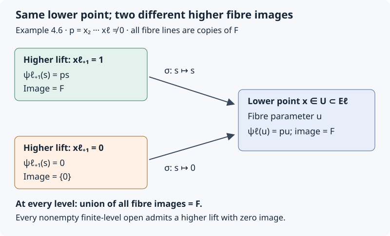
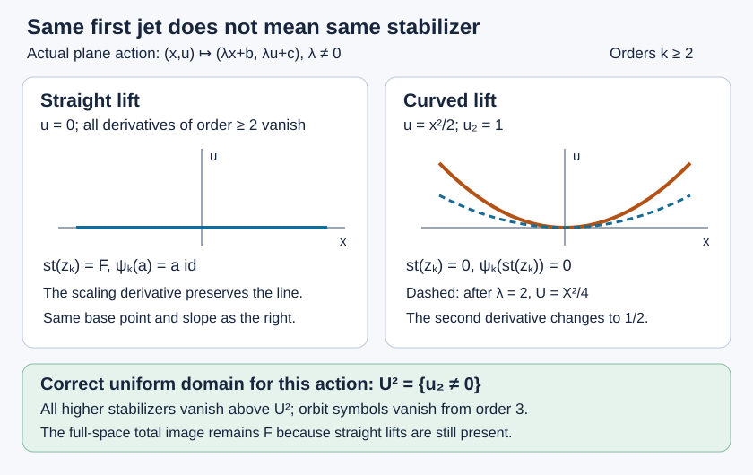
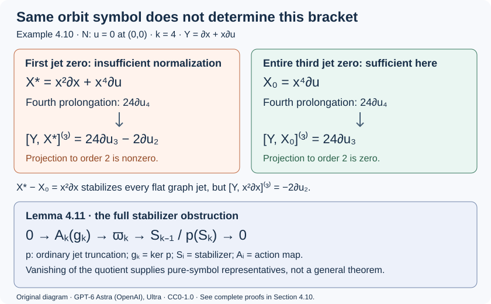
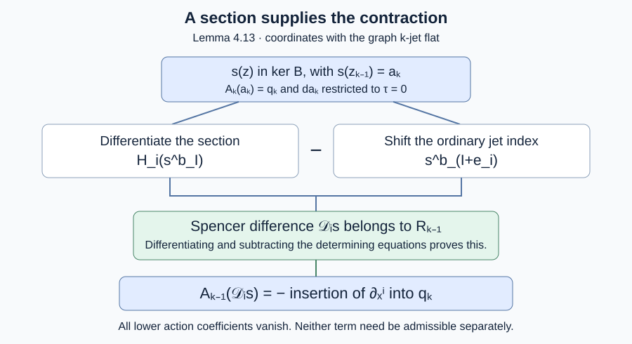
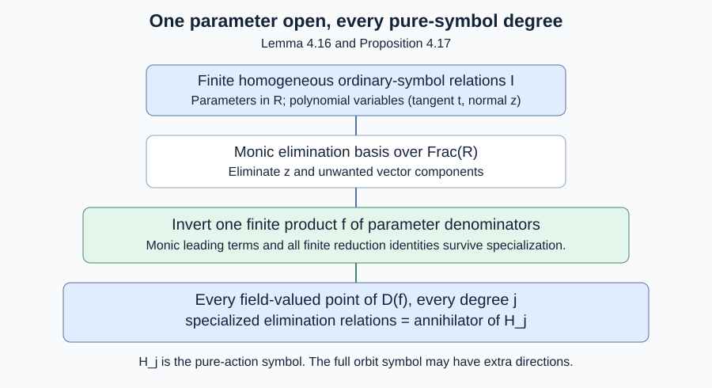

# Prolongation, differential invariants and the projective group

*GPT-6.1 Sol (OpenAI); Sections 4.2–4.10: GPT-6 Astra (OpenAI). Original exposition and diagrams: CC0 1.0.*

A transformation of points also transforms derivatives of graphs. Prolongation records that transformation on a finite-dimensional jet space. It makes differential equations into geometric subsets and their symmetry conditions into tangency equations. Curvature and the Schwarzian derivative arise as coordinates transverse to the resulting orbits.

We use analytic graphs $u:\mathbb K^n\to\mathbb K^m$ and local point diffeomorphisms of $(x,u)$, with $\mathbb K=\mathbb R$ or $\mathbb C$. The regular-submanifold criterion and invariant count from Complete systems and invariants are available. Real oriented plane curves are used for Euclidean curvature. The invariant count is local at regular jets; the finite-generation theorem stated later has additional hypotheses.

## 1. Jets and transformed graphs

Two graphs have the same $k$-jet at $x$ when their derivatives through order $k$ agree there. Write coordinates on $J^k(\mathbb K^n,\mathbb K^m)$ as

$$
(x^i,u^\alpha_J),\qquad |J|\le k,\quad
1\le i\le n,\quad1\le\alpha\le m.
$$

Here $J$ is an unordered multi-index, including the empty index $u^\alpha_\varnothing=u^\alpha$. Mixed derivatives are symmetric, so each multi-index occurs once. The dimension is

$$
N_k=n+m\binom{n+k}{k}.
\tag{1.1}
$$

The binomial coefficient counts all monomials in $n$ variables of degree at most $k$, equivalently all partial derivatives of those orders.

For a function $F$ of jets of order at most $k$, its total derivative is a function of order at most $k+1$:

$$
D_iF=\partial_{x^i}F+
\sum_{\alpha,\,|J|\le k}u^\alpha_{J,i}\partial_{u^\alpha_J}F.
\tag{1.2}
$$

It satisfies $(D_iF)(j^{k+1}u(x))=\partial_i(F(j^ku(x)))$ by the ordinary chain rule. The total derivatives commute on functions of finite jet order, because mixed partial derivatives of every realizing graph commute. Every finite jet is realized by its Taylor polynomial, so this graph calculation proves the identity on jet coordinates.

Let a point transformation be $(x,u)\mapsto(\widetilde x,\widetilde u)=(X(x,u),U(x,u))$. On a graph, put

$$
A^j_i=D_iX^j.
$$

Where $\det A\ne0$, the transformed submanifold is again a graph over $\widetilde x$. Its derivatives are calculated using

$$
\widetilde D_j=(A^{-1})^i_jD_i,\qquad
\widetilde u^\alpha_j=(A^{-1})^i_jD_iU^\alpha.
\tag{1.3}
$$

Repeating (1.3) determines all transformed derivatives through order $k$. At each step, the result depends only on the original derivatives through that order, so it is independent of the realizing graph. This defines the **prolonged transformation** on $J^k$. Transforming a graph in two steps gives the same jet as transforming it by the composite; therefore prolongation preserves the transformation law. Its domain includes the graph-transversality condition $\det A\ne0$.

## 2. The prolongation formula

Let

$$
v=\sum_i\xi^i(x,u)\partial_{x^i}
+\sum_\alpha\phi^\alpha(x,u)\partial_{u^\alpha}.
$$

The generator of its prolonged flow has the form

$$
\operatorname{pr}^{(k)}v=
\sum_i\xi^i\partial_{x^i}
+\sum_{\alpha,\,|J|\le k}\phi^\alpha_J\partial_{u^\alpha_J},
\qquad \phi^\alpha_\varnothing=\phi^\alpha.
\tag{2.1}
$$

**Theorem 2.1 (prolongation).** Set $Q^\alpha=\phi^\alpha-\sum_i\xi^iu^\alpha_i$. Then

$$
\phi^\alpha_{J,i}
=D_i\phi^\alpha_J-\sum_j u^\alpha_{J,j}D_i\xi^j,
\qquad
\phi^\alpha_J=D_JQ^\alpha+\sum_i\xi^iu^\alpha_{J,i}.
\tag{2.2}
$$

In particular, the apparent order-$|J|+1$ derivatives in the second formula cancel.

**Proof.** Write the point flow to first order as $X^j=x^j+t\xi^j+O(t^2)$ and $U^\alpha=u^\alpha+t\phi^\alpha+O(t^2)$. Its total derivative matrix is $A^j_i=\delta^j_i+tD_i\xi^j+O(t^2)$, so (1.3) gives

$$
\widetilde D_i=D_i-t\sum_j(D_i\xi^j)D_j+O(t^2).
$$

If $\widetilde u^\alpha_J=u^\alpha_J+t\phi^\alpha_J+O(t^2)$, differentiate it with $\widetilde D_i$. The coefficient of $t$ is precisely the recurrence in (2.2). Its initial coefficient is $\phi^\alpha$. This proves the recurrence for every order by induction.

At the empty index, the characteristic formula is $Q^\alpha+\xi^iu^\alpha_i=\phi^\alpha$. Suppose it holds for $J$. Substitute it into the recurrence:

$$
\begin{aligned}
\phi^\alpha_{J,i}
&=D_iD_JQ^\alpha+
\sum_j(D_i\xi^j)u^\alpha_{J,j}
+\sum_j\xi^ju^\alpha_{J,j,i}
-\sum_j u^\alpha_{J,j}D_i\xi^j\\
&=D_{J,i}Q^\alpha+\sum_j\xi^ju^\alpha_{J,i,j}.
\end{aligned}
$$

Commutation of total derivatives and symmetry of jet indices complete the induction. Since $Q^\alpha=\phi^\alpha-\xi^iu^\alpha_i$, its highest derivative term is $-\xi^iu^\alpha_{J,i}$, canceling the displayed correction. Alternatively, the recurrence directly proves that $\phi_J$ has order at most $|J|$. $\square$

The compact notation is

$$
\operatorname{pr}v=\operatorname{pr}v_Q+\sum_i\xi^iD_i,
\qquad
\operatorname{pr}v_Q=\sum_{\alpha,J}D_JQ^\alpha\partial_{u^\alpha_J}.
\tag{2.3}
$$

These are identities on the infinite jet space, or on functions of finite order with one extra jet level available. The two terms on the right need not separately be vector fields on $J^k$; their sum has the cancellation just proved. This qualification avoids treating a top-order total derivative as an intrinsic vector field on a finite jet space.

## 3. Equations as jet submanifolds

Let $\Delta=(\Delta_1,\ldots,\Delta_s)$ be a system on $J^k$, with $d\Delta$ of rank $s$ on $E=\{\Delta=0\}$.

**Theorem 3.1 (infinitesimal criterion).** A connected local point group preserves the equation submanifold $E$ under prolongation exactly when

$$
\operatorname{pr}^{(k)}v(\Delta_a)=0\quad\text{on }E
\tag{3.1}
$$

for each equation and each infinitesimal generator.

**Proof.** The rank assumption identifies $T_\zeta E$ with $\ker d\Delta_\zeta$. Condition (3.1) is exactly tangency of the prolonged fields. A tangent field has a restricted flow on $E$; uniqueness of the ambient ODE makes that flow agree with its ambient flow. Products of generator flows give every sufficiently small transformation of the connected group. Conversely, differentiating preservation of $E$ yields tangency and (3.1). $\square$

Preservation of $E$ implies that transformed solution graphs are still solutions, whenever they remain graphs. If “symmetry” means only preservation of actual solutions, necessity of (3.1) additionally requires that every equation jet being tested be locally realized by a solution. A maximal-rank system alone does not guarantee this realization for an arbitrary PDE system. The theorem above concerns the entire jet submanifold and is the precise geometric version proved here.

For singular defining equations, tangency can fail to be sufficient. For example $\Delta=u^2$ has zero derivative on $u=0$, so $v=\partial_u$ satisfies $v\Delta=0$ there, but its translations do not preserve $u=0$. Necessity survives for a preserved zero set. The sketch's statement reversing this implication is corrected accordingly.

**Example 3.2: heat scaling and a boost.** For $\Delta=u_t-u_{xx}$, take $v=x\partial_x+2t\partial_t$. Formula (2.2) gives $\phi_t=-2u_t$ and $\phi_{xx}=-2u_{xx}$, hence $\operatorname{pr}v(\Delta)=-2\Delta$.

For $w=2t\partial_x-xu\partial_u$, the same recurrence gives

$$
\phi_t=-xu_t-2u_x,\qquad
\phi_x=-u-xu_x,\qquad
\phi_{xx}=-2u_x-xu_{xx}.
$$

Thus $\operatorname{pr}w(\Delta)=-x\Delta$. Both are symmetries. Their finite transformations are

$$
(x,t,u)\mapsto(e^\varepsilon x,e^{2\varepsilon}t,u),\qquad
(x,t,u)\mapsto(x+2\varepsilon t,t,e^{-\varepsilon x-\varepsilon^2t}u).
$$

The boost consequently sends a solution $f$ to $e^{-\varepsilon x+\varepsilon^2t}f(x-2\varepsilon t,t)$. The differing signs of the two exponential expressions come from expressing the transformed graph in its new independent variables.

## 4. Counting invariants and differentiating them

A differential invariant of order at most $k$ is a function on $J^k$ constant along prolonged orbits.

**Theorem 4.1 (local count).** If the prolonged orbit distribution has constant rank $r_k$ near a jet, there are $N_k-r_k$ functionally independent local invariants, and every local invariant is a function of these.

**Proof.** The prolonged action is a local transformation group by Section 1. Its orbit distribution is involutive. Frobenius provides coordinates $(s^1,\ldots,s^{r_k},I^1,\ldots,I^{N_k-r_k})$ with orbits given by constant $I$. A function is invariant exactly when it is independent of the $s$ coordinates. The $I$ are independent, and no larger independent family can be constant on a distribution of rank $r_k$. $\square$

An **invariant derivative** is a total derivative combination that carries invariants to invariants. For instance, if $n$ invariants $I^1,\ldots,I^n$ have invertible horizontal derivative matrix $A^a_i=D_iI^a$, define $\nabla_a$ by

$$
\nabla_a=(A^{-1})^i_aD_i.
\tag{4.1}
$$

The horizontal differential of another invariant has the unique expression $d_HF=\sum_a(\nabla_aF)d_HI^a$. Point prolongations preserve horizontal differentiation, as (1.3) shows. Pulling back this equality and using invariance of $F,I^a$ proves invariance of its coefficients $\nabla_aF$. The invertibility condition is essential. In other actions, invariant derivatives can instead come from invariant geometric quantities such as arclength.

### 4.2. The global assertion and its precise scope

**Scope.** The general Lie–Tresse finite-generation theorem is stated here but is not proved in this lesson. The source used here is Boris Kruglikov and Valentin Lychagin, [*Global Lie–Tresse theorem*, arXiv:1111.5480v3](https://arxiv.org/abs/1111.5480v3), revised 13 June 2015, §0.1–0.2, Theorems 1–2 and §3. Its setting is a Lie pseudogroup acting transitively on the point manifold, with algebraic finite-order isotropy actions, and an invariant, formally integrable, irreducible differential equation whose jet fibres are nonsingular algebraic varieties. Algebraicity is a condition on the fibre variables; it does not require the smooth base coordinates themselves to be algebraic.

The finite-generation assertion asks for one finite jet level $\ell$ and a proper invariant fibrewise algebraic exceptional set $S\subset E^\ell$. At every higher order the domain is restricted by the same condition: its projection to $E^\ell$ must avoid $S$. The function class is smooth in the base coordinates, rational in the fibre coordinates through order $\ell$, and polynomial in higher-order jet coordinates. Each function has finite jet order. The asserted generators are finitely many invariants $I_1,\ldots,I_t$ and finitely many invariant derivations $\nabla_1,\ldots,\nabla_s$ of this invariant algebra. Every invariant is to be a finite polynomial in the iterated derivatives $\nabla_{j_1}\cdots\nabla_{j_r}I_i$, with coefficients rational in the $I_i$. Thus generation is differential generation, not ordinary finite generation without derivatives. It also does not authorize denominators in arbitrary higher-order coordinates.

Theorem 4.1 and formula (4.1) do not prove this assertion. In particular, the matrix in (4.1) may fail to have full rank. The general construction must work with horizontal directions modulo those that annihilate every invariant; one cannot silently assume $s=n$ or replace the action by the special case admitting a full invariant frame. The earlier local results of this lesson remain valid on their stated domains, independently of the general theorem.

### 4.3. A complete algebraic input at one jet level

**Proposition 4.2 (finite generators of a fixed-level invariant field).** Let $k$ be a field of characteristic zero, let $X$ be an integral finite-type $k$-variety, and let $F$ be a subfield with $k\subseteq F\subseteq K=k(X)$. Then there are algebraically independent elements $t_1,\ldots,t_d\in F$ over $k$ and an element $w\in F$ such that

$$
F=k(t_1,\ldots,t_d,w),\qquad
[F:k(t_1,\ldots,t_d)]<\infty.
\tag{4.2}
$$

In particular, this applies to the field of rational invariants of an algebraic isotropy action on an integral finite-order equation fibre $X=E^\ell_a$, over $k=\mathbb R$ or $\mathbb C$. In this application $F$ means invariance under the full action, as an identity of rational functions, not merely annihilation by its infinitesimal generators.

**Proof.** A nonempty affine open of $X$ has a finitely generated integral coordinate algebra $A=k[a_1,\ldots,a_m]$. Its fraction field is $K=k(a_1,\ldots,a_m)$, so $K/k$ is finitely generated as a field. NOE-RAT-01, Theorem 1.2 therefore applies to the inclusions $k\hookrightarrow F\hookrightarrow K$ and proves that $F/k$ is finitely generated. Its proof uses Lemma 1.1, which bounds the degrees of algebraic intermediate extensions inside a finitely generated field. This is the step that rules out an infinite algebraic extension; finite transcendence degree alone would not do so.

Choose a finite transcendence basis $t_1,\ldots,t_d$ of $F/k$ and put $B=k(t_1,\ldots,t_d)$. A finite generating list for $F/k$ also generates $F/B$, and each generator is algebraic over $B$. Adjoining these generators successively multiplies finitely many finite degrees, so $[F:B]$ is finite. Since $B$ has characteristic zero, the derivative of a nonconstant irreducible polynomial over $B$ is nonzero and has smaller degree. It is therefore relatively prime to that polynomial. Hence every algebraic generator is separable over $B$.

Apply NT-LOC-04, Proposition 0.1 to the finite separable extension $F/B$. It supplies $w$ with $F=B(w)$, proving (4.2). Only the infinite-base-field branch of that proof is used: $B$ contains the prime field $\mathbb Q$. No valuation or completeness hypothesis is imposed by Proposition 0.1. If $F=B$, take $w=0$; the transcendence basis may also be empty. $\square$

This proposition establishes field generation at each specified integral finite jet level. It does not choose a uniform level $\ell$, identify $d$ with an orbit codimension, prove existence of a geometric quotient, separate individual real orbits, or express all higher-order invariants by invariant differentiation. Those are distinct assertions. No claim about the positive-characteristic branch of NOE-RAT-01, Theorem 1.3 is needed here.

### 4.4. Coefficient invariance for the full group

**Lemma 4.3 (unique invariant polynomial coordinates).** Let $K\subseteq L$ be fields. Let a group $\Gamma$ act on $L$ by automorphisms $g_L:L\to L$ with $g_L(K)=K$, and write $g_K:K\to K$ for the restrictions. Suppose $z_1,\ldots,z_r\in L$ are algebraically independent over $K$ and are fixed by every $g_L$. With

$$
K^\Gamma=\{a\in K:g_K(a)=a\text{ for every }g\in\Gamma\},
$$

the invariant subring satisfies

$$
\bigl(K[z_1,\ldots,z_r]\bigr)^\Gamma
=K^\Gamma[z_1,\ldots,z_r].
\tag{4.3}
$$

**Proof.** The evaluation homomorphism $\operatorname{ev}:K[T_1,\ldots,T_r]\to L$, $T_i\mapsto z_i$, is injective by algebraic independence. Consequently a polynomial $P=\sum_{\alpha\in A}h_\alpha z^\alpha$, for a finite set $A\subset\mathbb N^r$, has unique coefficients in $K$. If $P$ is fixed by $\Gamma$, applying any $g_L$ and subtracting gives

$$
0=g_L(P)-P=\sum_{\alpha\in A}
\bigl(g_K(h_\alpha)-h_\alpha\bigr)z^\alpha.
$$

Injectivity of $\operatorname{ev}$ implies $g_K(h_\alpha)=h_\alpha$ for every $\alpha$. The element $g$ was arbitrary, so every coefficient belongs to $K^\Gamma$. Conversely a polynomial with coefficients in $K^\Gamma$ and fixed variables $z_i$ is fixed, by applying $g_L$ to its finite sum. This proves both inclusions in (4.3), including the constant-polynomial case $r=0$. $\square$

The full-action comparison matters: the two-element group acting by $x\mapsto-x$ on $\mathbb R(x)$ has zero Lie algebra, yet $x$ is not invariant. Thus infinitesimal invariance of coefficients alone does not settle the disconnected-group case in the coefficient argument of the source's §3.2. Lemma 4.3 supplies that step when its hypotheses hold. For partially defined pseudogroup maps the same subtraction must be performed on common domains where the asserted polynomial expansion is unique. Establishing those domains, the fixed coordinates and the required rational-low-order/polynomial-higher-order expansion is still necessary; the lemma does not produce them.

### 4.5. Real orbits and the remaining proof obligations

The source also asserts orbit separation. Its passage from complexified orbits to individual real orbits in §2.1 and §3.1 is false without an additional distinction: real and imaginary parts of rational invariants cannot separate real orbits lying in one complex orbit. NOE-SYM-03, §6 gives a complete counterexample on the equation $u_{ijk}=0$, together with the transformation formulas and Figure 6.1. Its real orbits distinguish the sign of the Hessian determinant, whereas its rational invariant field is constant. Both signs meet every nonempty real Zariski-open domain. Therefore removal of a proper algebraic exceptional set does not repair the individual-real-orbit claim.

That counterexample does not disprove finite differential generation: its constant invariant field is already finitely generated. It also does not replace geometric orbits over an algebraic closure by real-point orbits. The explicit metric argument in NOE-SYM-03 and the local proofs in this lesson are retained with their own hypotheses.

The general Lie–Tresse assertion requires a correctly scoped rational quotient; symbolic stabilization on the pullback of one finite-level open set; stable horizontal rank; invariant derivations on the quotient by their common annihilator; symbol cohomology and affine-orbit arguments; and a unique higher-jet polynomial expansion with order induction and commutator control. Proposition 4.2 establishes fixed-level algebraic field generation, and Lemma 4.3 establishes coefficient invariance under its stated hypotheses. These results do not establish the other assertions or prove the general theorem.

### 4.6. Symbolic stabilization: generators are not a free basis

The general theorem requires one finite order and one open set whose entire higher-jet inverse image has the asserted stabilization. A separate statement at each infinite jet does not give that conclusion. Here is a precise algebraic input, together with the distinction needed when using the cited proof.

In the proof of the stabilization theorem in §2.2 of the cited arXiv v3, the graded module $\mathfrak M$ is shown to be Noetherian over $\mathfrak A$. The next inference asserts a basis with unique $\mathfrak A$-coefficients. **That implication is false:** Noetherianity gives finite generation, not freeness. The subsequent uses of uniqueness and absence of relations therefore require an additional argument. This identifies a gap in that proof route, not a counterexample to the global finite-generation theorem.

**Example 4.4 (a cyclic module with a relation in arbitrarily high degree).** Let $F$ be a field, let $A=F[x]$ with $\deg x=1$, and choose an integer $r\geq2$. The graded $A$-module

$$
M=A/(x^r)
$$

is Noetherian and is generated by $\overline 1$ in degree zero. Indeed, $F$ is Noetherian because its only ideals are zero and $F$; AG-CA-03, Theorem 2.1 and Proposition 1.2 give the polynomial-ring and quotient assertions. The class $\overline 1$ is nonzero and $x^r\overline 1=0$. A free module over the domain $A$ has no nonzero element killed by a nonzero scalar: write a vector in a basis and apply the domain property to each coefficient. Thus $M$ is not free. In particular $0\overline 1=x^r\overline 1$ are distinct coefficient expressions for the same element.

This also shows why generator degrees alone do not bound the first Koszul homology. Define $M(-1)_d=M_{d-1}$. The one-variable Koszul complex, with its displayed graded $A$-linear differential, is

$$
0\longrightarrow M(-1)\xrightarrow{\;x\;}M\longrightarrow0.
$$

Its degree-$r$ element $\overline{x^{r-1}}$ in the left term is nonzero and lies in the kernel, and there is no preceding nonzero term. Hence its first homology has a nonzero degree-$r$ class, although $M$ has a generator of degree zero. The relation degree, not just the module-generator degree, matters. Degree shifts give the same obstruction for a module starting at a positive degree.

**Lemma 4.5 (eventual prolongation for one fixed symbolic system).** Let $F$ have characteristic zero, and let $T$ and $V$ be finite-dimensional $F$-vector spaces. For each integer $j\geq0$, let

$$
g_j\subseteq S^j(T^*)\otimes_F V.
$$

We regard an element of $S^j(T^*)\otimes_F V$ as a symmetric $j$-linear map $T^j\to V$. For $v\in T$ define the $F$-linear insertion map

$$
c_v:S^{j+1}(T^*)\otimes_F V\longrightarrow S^j(T^*)\otimes_F V,
\qquad
(c_vp)(v_1,\ldots,v_j)=p(v,v_1,\ldots,v_j).
$$

Assume $c_v(g_{j+1})\subseteq g_j$ for all $j$ and all $v\in T$. Define the first prolongation by

$$
g_j^{(1)}=
\{p\in S^{j+1}(T^*)\otimes_F V:c_vp\in g_j\text{ for every }v\in T\}.
$$

Then some integer $q\geq0$ satisfies $g_{j+1}=g_j^{(1)}$ for every $j\geq q$. No freeness of the graded dual module is assumed.

**Proof.** Put $A=S_F(T)$ and $P=A\otimes_F V^*$, graded by polynomial degree, with $P_j=S^j_F(T)\otimes_F V^*$. Pair $P_j$ with $S^j(T^*)\otimes_F V$ by

$$
\langle v_1\cdots v_j\otimes\lambda,p\rangle
=\lambda\bigl(p(v_1,\ldots,v_j)\bigr).
$$

The pairing is nondegenerate: in a basis of $T$, a symmetric multilinear map is determined by its values on unordered basis tuples, and a basis of $V^*$ detects every such value. In degree zero it is the usual $V^*$–$V$ pairing. With this convention multiplication $P_j\to P_{j+1}$ by $v$ is adjoint to insertion: $\langle vb,p\rangle=\langle b,c_vp\rangle$.

Let $I_j\subseteq P_j$ be the annihilator of $g_j$, and set $I=\bigoplus_{j\geq0}I_j\subseteq P$. If $b\in I_j$ and $p\in g_{j+1}$, the contraction hypothesis gives

$$
\langle vb,p\rangle=\langle b,c_vp\rangle=0.
$$

Consequently $T I_j\subseteq I_{j+1}$, where $T I_j$ denotes the $F$-linear span of products $vb$. Since $T$ generates the $F$-algebra $A$, this proves that $I$ is a graded $A$-submodule of $P$.

Choose bases of $T$ and $V$. Then $A$ is a polynomial ring in finitely many variables over $F$, and $P$ is a finite free $A$-module. The full proofs in AG-CA-03, Theorem 2.1 and Theorem 1.1 / Proposition 1.2 imply that $I$ is finitely generated. Replace each chosen generator by its finitely many homogeneous components. Those components belong to $I$ because $I$ is graded, and they still generate it: their span contains the old generators and is contained in $I$. Write them as $b_1,\ldots,b_s$, of degrees $d_1,\ldots,d_s$, and put $q=\max_i d_i$, or $q=0$ if $I=0$.

For $j\geq q$ we claim

$$
I_{j+1}=T I_j.
$$

The inclusion from right to left was proved above. For the reverse, express $b\in I_{j+1}$ in the generators and take homogeneous degree $j+1$. This gives

$$
b=\sum_{i=1}^s a_i b_i,\qquad a_i\in A_{j+1-d_i}.
$$

Every nonzero coefficient has positive degree, since $j+1-d_i\geq1$. Each of its monomials has a degree-one factor, so $a_i$ is a finite sum of products $v a'$ with $v\in T$ and $a'\in A_{j-d_i}$. Each $a'b_i$ belongs to $I_j$, proving the claim. This also covers $T=0$: its positive-degree polynomial pieces are zero.

All pairings in a fixed degree are between finite-dimensional vector spaces. Taking the annihilator twice returns the original subspace: extend a basis of the subspace to a basis of the whole space and use the dual coordinate functionals to separate a vector outside it. Therefore, for $p\in S^{j+1}(T^*)\otimes_F V$,

$$
\begin{aligned}
p\in g_{j+1}
&\Longleftrightarrow \langle I_{j+1},p\rangle=0\\
&\Longleftrightarrow \langle T I_j,p\rangle=0\\
&\Longleftrightarrow \langle I_j,c_vp\rangle=0\quad\text{for all }v\in T\\
&\Longleftrightarrow c_vp\in g_j\quad\text{for all }v\in T.
\end{aligned}
$$

This is exactly $g_{j+1}=g_j^{(1)}$. If $V=0$, the same proof reduces to zero spaces. The proof uses finite generation of the **relation submodule** $I$, not a claimed free basis of $P/I$. $\square$

**What remains for the global theorem.** At one fixed infinite jet, once its completed orbit symbols satisfy the contraction hypothesis, Lemma 4.5 supplies eventual equality. It does not give a common $q$ or one finite-level open set for every infinite jet above it. The remaining argument must prove the contraction property uniformly, then control specialization of the finite relation presentation over that same finite-level open set, with no new exceptional higher-jet denominators. The descending chain of closures of total images used earlier in §2.2 is not by itself an argument identifying every individual fibre image. Those fibrewise comparisons must be supplied. The full uniform statement and its downstream horizontal-rank and affine-orbit-bundle uses remain assigned obligations; the lemma does not replace them with a pointwise claim.

The author's [erratum to the 2016 paper](https://serre.mat-stat.uit.no/ansatte/boris/corr/Erratum-SM2016.pdf) corrects an invariant derivation and the revisited example in §§3.5 and 4.5. It does not amend the module argument in §2.2. Those example corrections must accompany any future use of that example; none of its formulas is imported here.

### 4.7. Uniformity: total images do not determine fibre images

There is a second, distinct issue in the §2.2 argument of arXiv v3. In the proof of Proposition `prp4`, the closed sets obtained from the **total** images of the stabilizer bundles eventually coincide. The proof then asserts equality of the stabilizer images at **every** higher jet over one finite-level open set. These are different assertions: taking a union of images over all jets forgets which jet supplies a vector.

The precise constructibility statements and proofs are AG-MO-06, Theorem 3.1 and Theorem 4.2. They give a constructible image and, when that image is dense in an irreducible target, a nonempty open subset contained in it. They do not identify the image at each point of a separate parameter space. The following example has an even stronger property than constructibility: its total images are already the entire target at every level.

**Example 4.6 (constant total images, arbitrarily late fibre-image loss).** Work over $F=\mathbb C$. For $k\geq1$ put

$$
E^k=\mathbb A_F^{k-1},\qquad J^k=F^k,
$$

with coordinates $(x_2,\ldots,x_k)$ and $(v_0,\ldots,v_{k-1})$, respectively. Thus $E^1$ is a point. Let $\pi_{k+1,k}:E^{k+1}\to E^k$ forget $x_{k+1}$, and let $\rho_{k+1,k}:J^{k+1}\to J^k$ forget $v_k$. The former is an affine-line bundle and the latter is a surjective $F$-linear map. Define the algebraic vector subbundle

$$
S^k=\left\{(x,v)\in E^k\times J^k:
v_{i-1}=x_{i+1}v_i\quad(1\leq i\leq k-1)\right\}.
$$

It is a trivial line bundle. Indeed, set $s=v_{k-1}$ and recover its coordinates by

$$
v_i=\left(\prod_{r=i+2}^{k}x_r\right)s
\quad(0\leq i\leq k-1),
$$

where an empty product is $1$. These polynomial formulas and the inverse coordinate $s=v_{k-1}$ give an isomorphism $E^k\times F\to S^k$, linear on every fibre. In particular no singular bundle rank is hidden in the example.

The product map $\pi_{k+1,k}\times\rho_{k+1,k}$ restricts to an algebraic map $\sigma_{k+1,k}:S^{k+1}\to S^k$: all of the first $k-1$ defining equations remain true after truncation. In the line-bundle coordinates it is

$$
\sigma_{k+1,k}(x_2,\ldots,x_{k+1},s)
=(x_2,\ldots,x_k,x_{k+1}s).
$$

Define $\psi_k:S^k\to F$ by the same ambient coordinate projection $\psi_k(x,v)=v_0$ at every level. It is algebraic and fibrewise $F$-linear, and

$$
\psi_{k+1}=\psi_k\circ\sigma_{k+1,k},\qquad
\psi_k(x,s)=\left(\prod_{r=2}^{k}x_r\right)s.
$$

Taking $x_2=\cdots=x_k=1$ shows that $\psi_k(S^k)=F$. Thus all total images, and not merely their closures, are equal. Nevertheless the individual image is

$$
\psi_k(S^k_x)=
\begin{cases}
F,&\prod_{r=2}^{k}x_r\ne0,\\
\{0\},&\prod_{r=2}^{k}x_r=0.
\end{cases}
$$

Fix any integer $\ell\geq1$ and any nonempty Zariski-open $U\subset E^\ell$. There exists $x\in U$ with $x_2\cdots x_\ell\ne0$. To see this without an implicit generic-point argument, choose a nonempty principal open $D(f)\subset U$. The polynomial $f\prod_{r=2}^{\ell}x_r$ is nonzero in the polynomial ring over $F$. A nonzero polynomial over an infinite field cannot vanish at every point: induct on the number of variables, choose values where a nonzero coefficient in the last variable remains nonzero, then avoid the finitely many roots of that resulting one-variable polynomial. This supplies the required point. For $\ell=1$, the same assertion concerns the sole point and the empty product $1$.

Lift this point to $y=(x_2,\ldots,x_\ell,0)\in E^{\ell+1}$. Then

$$
\pi_{\ell+1,\ell}(y)=x\in U,\qquad
\psi_\ell(S^\ell_x)=F,\qquad
\psi_{\ell+1}(S^{\ell+1}_y)=\{0\}.
$$

In particular the vector $1$ in the lower image has no preimage in this higher fibre. Hence **no** such finite-level open set makes all the individual images equal at subsequent levels. Along any one infinite coordinate sequence they do stabilize: either every coordinate is nonzero, or the image becomes zero when its first zero coordinate appears. That first zero can occur beyond any prescribed finite level. Pointwise eventual stabilization therefore does not imply the required uniform assertion. $\square$

*Figure 4.2. Exact fibre maps in Example 4.6. At a lower point with product $p=x_2\cdots x_\ell\ne0$, the lift $x_{\ell+1}=1$ has image $F$, whereas the lift $x_{\ell+1}=0$ has image zero. Both project to the same point of $U$. The diagram concerns the displayed algebraic tower, not an asserted realization by a Lie pseudogroup.*

The example disproves the general inference from stabilized total images to uniform fibre-image equality, even with affine-bundle base projections, constant-rank stabilizer-like subbundles, fixed ambient coordinate projections and compatible truncations. It is **not** a realization of those bundles as stabilizers of the prolonged pseudogroup in the Lie–Tresse theorem. Thus it identifies the missing step in that proof; it is not a counterexample to Proposition `prp4` with all of its geometric hypotheses. Any inference for actual pseudogroup stabilizers needs additional geometric hypotheses that prevent this fibre-image loss.

### 4.8. What a uniform relation presentation would prove

The fixed-system argument in Lemma 4.5 does extend uniformly when one relation module genuinely controls every specialization. The following precise statement separates that useful algebra from the still-required comparison with orbit symbols.

**Lemma 4.7 (one bound for the specializations of a single relation module).** Let $R$ be a commutative Noetherian $\mathbb Q$-algebra, and let $T,V$ be finite free $R$-modules. Set

$$
A=\operatorname{Sym}_R T,\qquad V^\vee=\operatorname{Hom}_R(V,R),\qquad
P=A\otimes_R V^\vee.
$$

Let $I=\bigoplus_{j\geq0}I_j\subseteq P$ be a graded $A$-submodule. For every unital homomorphism $\alpha:R\to K$ into a field, write $T_K=T\otimes_RK$, $V_K=V\otimes_RK$ and define

$$
J_j(\alpha)=\operatorname{im}\bigl(I_j\otimes_RK\longrightarrow P_j\otimes_RK\bigr),
\qquad
h_j(\alpha)=J_j(\alpha)^\perp
\subseteq S^j(T_K^*)\otimes_K V_K.
$$

The map defining $J_j$ is induced by the inclusion $I_j\hookrightarrow P_j$; it is not asserted to be injective after tensoring. The annihilator uses the evaluation pairing of Lemma 4.5. Its coefficient field has characteristic zero because $\alpha$ is unital and $R$ is a $\mathbb Q$-algebra. There is an integer $q\geq0$, independent of $\alpha$ and $K$, such that

$$
h_{j+1}(\alpha)=h_j(\alpha)^{(1)}\qquad(j\geq q).
$$

**Proof.** Bases of $T$ and $V$ identify $A$ with a polynomial ring in finitely many variables over $R$ and $P$ with a finite free $A$-module. AG-CA-03, Theorem 2.1 and Theorem 1.1 / Proposition 1.2 therefore give a finite set of generators of $I$. Taking their homogeneous components, as in Lemma 4.5, gives homogeneous generators $b_1,\ldots,b_s$. Let $q$ be the greatest generator degree, with $q=0$ for $I=0$.

For $j\geq q$ we have $I_{j+1}=T I_j$. Indeed, an element of degree $j+1$ is a sum of $a_i b_i$ with $a_i\in A_{j+1-\deg b_i}$. Each nonzero $a_i$ has positive degree and is a sum of degree-one generators of $A$ multiplied by elements of one lower degree. Thus each $a_i b_i$ lies in $T I_j$. The other inclusion holds because $I$ is a submodule. This proof works over $R$ with zero divisors; it does not divide by a coefficient.

For finite free modules, their chosen bases give the identifications

$$
P_j\otimes_RK
\cong \operatorname{Sym}_K^j(T_K)\otimes_K V_K^*.
$$

These identifications agree with evaluation: a specialized dual basis evaluates on the corresponding specialized basis. In particular multiplication by a specialized vector of $T$ is adjoint to the insertion map used in Lemma 4.5. The equality just proved implies

$$
J_{j+1}(\alpha)=T_KJ_j(\alpha).
$$

For completeness, every vector on the left is a sum of images of $b\otimes c$ with $b\in I_{j+1}$, $c\in K$. Write $b$ as a sum of products $tu$ with $t\in T$, $u\in I_j$, and specialize; its image belongs to the right side. Conversely the right side is spanned by products of images of $t\otimes c$ and $u\otimes d$, and each is the image of $tu\otimes cd$. This proves both inclusions even when tensoring destroys injectivity.

Taking annihilators in the displayed finite-dimensional pairing gives, for $p\in S^{j+1}(T_K^*)\otimes_KV_K$,

$$
\begin{aligned}
p\in h_{j+1}(\alpha)
&\Longleftrightarrow \langle T_KJ_j(\alpha),p\rangle=0\\
&\Longleftrightarrow \langle J_j(\alpha),c_vp\rangle=0
\quad\text{for every }v\in T_K\\
&\Longleftrightarrow c_vp\in h_j(\alpha)
\quad\text{for every }v\in T_K.
\end{aligned}
$$

This is the required prolongation equality, with the same $q$ for every field specialization. Zero-rank $T$ or $V$ causes no exception; if $R$ is the zero ring, there are no unital maps to a field and the quantified assertion is vacuous. $\square$

**Hypothesis for the orbit-symbol application.** To use Lemma 4.7 for Lie–Tresse, one must construct such a relation module over an actual finite-level base and prove that the annihilator of every relevant higher-jet orbit symbol is exactly $J_j(\alpha)$ at every point under consideration. Existence of a relation module at each separate infinite jet does not do this. Neither may one replace the image in the definition of $J_j$ by a kernel after specialization without proof. For example, multiplication by $t$ on $\mathbb Q[t]$ has zero kernel; at the specialization $t=0$ its induced map $\mathbb Q\to\mathbb Q$ is zero and has kernel $\mathbb Q$. Thus specialization of a kernel is not in general the kernel of the specialized map.

There are consequently two precise outstanding requirements: prove the stabilizer-image lifting at every higher jet over one finite-level open set, and prove a single relation presentation with the stated specialization comparison on that domain. The algebra in Lemma 4.7 closes the uniform bound **after** that comparison; it does not supply the comparison itself. The full general theorem and the downstream horizontal-rank, symbol-cohomology and affine-orbit arguments remain to be proved at their original scope.

*Figure 4.2 and Sections 4.7–4.8: GPT-6 Astra (OpenAI). CC0 1.0.*

### 4.9. An actual pseudogroup: stable total images and a necessary domain restriction

Example 4.6 concerned an algebraic tower, without asserting that it was a pseudogroup stabilizer tower. The following computation instead uses actual prolonged transformations of curves. It tests the whole-space image-to-section inference in Kruglikov–Lychagin, [*Global Lie–Tresse theorem*, version 3, Section 2.2, proof of Proposition 4](https://arxiv.org/abs/1111.5480v3). It also proves the proposition's eventual symbol inclusion for this particular action. It is not a counterexample to that proposition or to the general Lie–Tresse theorem.

**Example 4.8 (translations and common scalings).** Work over a field $F$ equal to $\mathbb R$ or $\mathbb C$. On the affine plane $M=\mathbb A^2_F$, with coordinates $(x,u)$, consider the algebraic group

$$
G=F^\times\ltimes F^2,\qquad
g_{\lambda,b,c}(x,u)=(\lambda x+b,\lambda u+c).
$$

The multiplication and inverse, obtained by composing these maps, are

$$
(\lambda,b,c)(\mu,d,e)=(\lambda\mu,\lambda d+b,\lambda e+c),
\qquad
(\lambda,b,c)^{-1}=(\lambda^{-1},-\lambda^{-1}b,-\lambda^{-1}c).
$$

Thus this is an algebraic action by invertible maps. Translations send any point of $M$ to any other point, so it is transitive. Local restrictions, allowing separate parameters on separate connected components, form a pseudogroup: compositions and inverses have the displayed form locally, and maps that agree on overlaps glue. In transformed coordinates $(X,U)$ its first-order defining equations are

$$
X_u=0,\qquad U_x=0,\qquad X_x=U_u\ne0.
$$

These equations give exactly the stated local maps on connected coordinate neighborhoods. Indeed $X$ depends only on $x$, $U$ only on $u$, and differentiating $X_x=U_u$ gives $X_{xx}=U_{ux}=0$ and $U_{uu}=X_{xu}=0$. All second derivatives therefore vanish, and so do all their derivatives. An admissible first jet, with common nonzero derivative $\lambda$ and prescribed image of its base point, consequently has exactly one extension at every higher order: the jet of the corresponding affine map. This proves surjectivity of every prolonged jet projection and formal integrability of these equations; the order-one conditions and all their prolongations are algebraic. No infinite collection of independent transformation parameters has been introduced.

Use the invariant chart of curve jets that are graphs $u=f(x)$. Set $u_j=f^{(j)}(x)$ and

$$
E^k=\mathbb A^2_F\times\mathbb A^k_F
=\{(x,u,u_1,\ldots,u_k)\},\qquad
\pi_{k,k-1}:E^k\longrightarrow E^{k-1}.
$$

The map $\pi_{k,k-1}$ forgets $u_k$ and is an affine-line bundle. There are no differential equations on the graph, so every finite graph jet extends, and each fiber over a base point is an irreducible affine space. The action preserves this chart because $dX/dx=\lambda\ne0$. The transformed graph has $U(X)=\lambda f((X-b)/\lambda)+c$. Repeated differentiation gives, for every $j\ge1$,

$$
u'_j=\lambda^{1-j}u_j.
$$

Differentiating the action at the identity, with infinitesimal parameters $(a,b,c)\in F^3$, gives the vector field and its prolongation

$$
X_{a,b,c}=(ax+b)\partial_x+(au+c)\partial_u,
$$

$$
X_{a,b,c}^{(k)}=(ax+b)\partial_x+(au+c)\partial_u
+\sum_{j=2}^k(1-j)a u_j\partial_{u_j}.
$$

The missing $j=1$ summand is zero, not an omitted constraint: slopes are unchanged by common scaling.

Fix a base point $p=(x_0,u_0)$ and a first jet of slope $m$, with tangent line

$$
\tau=F(\partial_x+m\partial_u)\subset T_pM.
$$

A field fixes $p$ precisely when $b=-ax_0$ and $c=-au_0$. Its derivative at $p$ is $a\,\mathrm{id}_{T_pM}$, which preserves every line and therefore fixes this first jet. For a higher jet $z_k$ above that first jet, its infinitesimal stabilizer and the derivative map are exactly

$$
\operatorname{st}(z_k)
=\{a\in F:(j-1)a u_j=0\text{ for }2\le j\le k\},
\qquad
\psi_{k,z_k}:\operatorname{st}(z_k)\longrightarrow
\operatorname{End}_F(\tau),\quad a\longmapsto a\,\mathrm{id}_\tau.
$$

Here the scalar description of the stabilizer uses the uniquely determined $b,c$ above, and $\psi_{k,z_k}$ is an $F$-linear map. Since $F$ has characteristic zero, for $k\ge2$ this stabilizer is $F$ when $u_2=\cdots=u_k=0$, and is zero otherwise. At order one it is always $F$.

The affine-line graph with this first jet has all higher derivatives zero. Consequently the union of the images of $\psi_{k,z_k}$, as $z_k$ runs through *all* higher extensions of the fixed first jet, is $F\,\mathrm{id}_\tau$ at every order. It is already Zariski closed. Allowing the slope to vary gives the whole endomorphism line bundle over the graph first-jet chart, again at every order. These full-space total images stabilize from the start. In contrast, on the nonempty open set $u_2\ne0$ each individual stabilizer and its image are zero.

There are two distinct failures of the proposed section argument. If the chosen order is one, every first jet has a lift with $u_2=1$; its scalar derivative image drops from $F$ to zero. Thus no nonempty first-order domain makes all its higher lifts preserve that image. If the chosen order is $\ell\ge2$, a rational section of the stabilizer family over a nonempty open set has a rational scalar component $a(z_\ell)$ satisfying $u_2a(z_\ell)=0$. The graph-jet space is irreducible and $u_2$ is a nonzero element of its function field, so $a(z_\ell)=0$. Every rational section is therefore zero wherever defined. No finite collection of such sections can span the full-space total image $F\,\mathrm{id}_\tau$. The same argument applies after fixing $p$ and the slope, since the remaining jet coordinates form an affine space with coordinate $u_2$.

**Rank and scope caution.** This actual stabilizer family jumps in rank along the affine-line jets. It is an algebraic family of vector spaces, not a constant-rank vector bundle over the entire graph-jet space. It is therefore different from the constant-rank tower of Example 4.6. The cited proof takes total images over the whole jet fiber before selecting its section domain. The calculation disproves that literal full-space image-to-section inference. If a preliminary regular-locus restriction is intended instead, its choice and effect on the images must be supplied explicitly. They cannot be deduced from the unchanged full-space total image. The next proposition supplies such a restriction for this action, without claiming to supply it for every pseudogroup.

*Figure 4.3.* At the origin, $u=0$ and $u=x^2/2$ have the same horizontal tangent. Their second derivatives are respectively zero and one. Scaling by $\lambda=2$ fixes the line but sends the parabola to $U=X^2/4$, whose second derivative is $1/2$. The displayed curves and derivative images are the exact objects used in Example 4.8; the figure is not a claim about the general theorem. Diagram and proof: GPT-6 Astra (OpenAI). CC0 1.0.

**Proposition 4.9 (a uniform domain proved directly).** For this action the invariant nonempty Zariski open subset

$$
U^2=\{z_2\in E^2:u_2\ne0\}
$$

has the following properties. Every higher jet above $U^2$ has zero infinitesimal stabilizer. Its orbit tangent spaces $\Delta_k(z_k)\subset T_{z_k}E^k$ have dimension three for $k\ge2$, and projection induces an isomorphism

$$
d\pi_{k,k-1}:\Delta_k(z_k)\xrightarrow{\ \sim\ }
\Delta_{k-1}(z_{k-1}),\qquad k\ge3.
$$

In particular $\varpi_k=\ker(d\pi_{k,k-1}|_{\Delta_k})=0$ for $k\ge3$, and $\varpi_{k+1}\subset\varpi_k^{(1)}$ for every $k\ge2$ along every infinite jet above $U^2$.

*Proof.* The transformation rule $u'_2=\lambda^{-1}u_2$ proves invariance, and a parabola supplies a point of $U^2$. The stabilizer formula proves its vanishing at every higher lift. Subtracting the translation components from the scaling generator gives the following concrete spanning set for the orbit tangent space:

$$
\Delta_k(z_k)=\operatorname{span}_F\{\partial_x,\partial_u,V_k\},
\qquad
V_k=\sum_{j=2}^k(1-j)u_j\partial_{u_j}.
$$

The first two vectors are independent base-coordinate vectors. Above $U^2$ the $\partial_{u_2}$ coefficient of $V_k$ is $-u_2\ne0$, so the third vector is independent of them. Projection carries the three displayed vectors to the corresponding three vectors at order $k-1$. For $k\ge3$ these are bases on both sides, proving the claimed isomorphism and zero kernel. At orders zero and one the orbit tangent spaces are spanned by the two translations; hence $\varpi_1=0$, while $\varpi_2=F V_2$ above $U^2$. For $k=2$ the asserted inclusion has zero left side, and for every $k\ge3$ both sides are zero. This proves all orders on one specified finite-level domain. $\square$

The exclusion is mathematically necessary for a uniform conclusion over the full chart. For any $r\ge2$, the graph $u=x^r/r!$ at the origin has $u_2=\cdots=u_{r-1}=0$ and $u_r=1$. At order $r-1$ its orbit tangent space has rank two, and at order $r$ it acquires the nonzero vertical generator $(1-r)\partial_{u_r}$. Thus $\varpi_{r-1}=0$ and $\varpi_r\ne0$, so $\varpi_r\not\subset\varpi_{r-1}^{(1)}$. Such a failure can occur at an arbitrarily high order on the full space. For $r>2$ these jets lie outside the pullback of $U^2$, exactly as Proposition 4.9 requires. For $r=2$ the failure precedes its order-two starting bound. These examples distinguish a uniform finite-level restriction from a bound chosen separately along each infinite jet.

**Scope.** The general algebraic-pseudogroup application requires a proof of the existence of a suitable common finite-level invariant domain and the required higher-jet stabilizer lifting there, or supply another full-scope route to symbolic stabilization. This example settles neither that existence statement nor the relation-specialization comparison of Section 4.8. The hypotheses for the general application are those described in Sections 4.5–4.8.

### 4.10. Which representative makes the bracket a symbol contraction?

The domain issue of Section 4.9 is not the only input requiring proof. The next step in Kruglikov–Lychagin, [*Global Lie–Tresse theorem*, version 3, Section 2.2, proof of Proposition 4](https://arxiv.org/abs/1111.5480v3), uses a bracket with a tangent-valued infinitesimal transformation to lower the order of an orbit symbol. Its displayed calculation is not justified merely by making the first derivative of the representative vanish. The following example has constant-rank stabilizers and surjective stabilizer projections at every order. Thus its issue is independent of the preceding rank-jumping example.

**Example 4.10 (a lower-order term that the bracket retains).** On the plane over $F=\mathbb R$ or $\mathbb C$, take the local transformations

$$
T_{f,g}(x,u)=(f(x),u+g(x)),\qquad f'(x)\ne0.
$$

Here $f,g$ are smooth in the real case and holomorphic in the complex case; all statements below also concern their finite formal jets. Direct composition gives

$$
T_{f,g}\circ T_{h,t}=T_{f\circ h,\,t+g\circ h},\qquad
T_{f,g}^{-1}=T_{f^{-1},\,-g\circ f^{-1}}.
$$

Restrictions and locally agreeing maps glue, so these maps form a pseudogroup. Their equations in target coordinates are $X_u=0$ and $U_u=1$, with $X_x\ne0$. At each higher order the pure $x$ derivatives of $f$ and $g$ are free; the other derivatives are fixed by these equations. Every admissible jet therefore extends by arbitrary choices of the next two pure derivatives. The equations and these projection maps are algebraic, and the projections are surjective smooth bundles. Translations belong to the pseudogroup and prove transitivity on the plane. This verifies finite differential order and formal integrability directly.

Graph jets are an invariant chart because $f'\ne0$. Write

$$
E^k=\{(x,u,u_1,\ldots,u_k)\},\qquad u_j=h^{(j)}(x)
$$

for a graph $u=h(x)$. The infinitesimal fields are precisely

$$
X=\alpha(x)\partial_x+\beta(x)\partial_u.
$$

Put $\alpha_i=\alpha^{(i)}(x_0)$ and $\beta_i=\beta^{(i)}(x_0)$. The prolonged coefficient in the $u_j$ direction follows by differentiating the transformed graph: it is

$$
\beta_j-\sum_{i=1}^j {j\choose i}\alpha_i u_{j-i+1},\qquad j\ge1.
$$

Indeed the first variation at fixed transformed abscissa is $\beta-\alpha h'$. Differentiating it $j$ times and adding $\alpha_0 u_{j+1}$ for motion of the base abscissa cancels precisely the $i=0$ term. The base-coordinate coefficients are $\alpha_0$ and $\beta_0$.

Consequently the stabilizer of a graph jet is given by

$$
\alpha_0=\beta_0=0,\qquad
\beta_j=\sum_{i=1}^j {j\choose i}\alpha_i u_{j-i+1}
\quad(1\le j\le k).
$$

The $k$ numbers $\alpha_1,\ldots,\alpha_k$ are arbitrary. These equations exhibit a rank-$k$ vector bundle over the whole graph-jet chart. The tangent line is spanned by $\partial_x+u_1\partial_u$; the derivative of $X$ sends this vector to $\alpha_1(\partial_x+u_1\partial_u)$. Its derivative image is therefore the whole scalar endomorphism line at every jet and every order $k\ge1$. A stabilizer at order $k$ lifts to any prescribed next graph jet by choosing $\alpha_{k+1}$ and then the required $\beta_{k+1}$. Both the full stabilizer projection and its derivative image thus lift, not merely at generic jets.

Now fix the flat graph $N=\{u=0\}$ at the origin and an integer $k\ge4$. Consider

$$
X_*=x^2\partial_x+x^k\partial_u,\qquad
X_0=x^k\partial_u,\qquad
Z=X_*-X_0=x^2\partial_x,\qquad
Y=\partial_x+x\partial_u.
$$

These are genuine infinitesimal transformations, not just arbitrary formal fields. The flows of $X_0,Y,Z$ are respectively

$$
(x,u)\mapsto(x,u+t x^k),\qquad
(x,u)\mapsto(x+t,u+t x+t^2/2),\qquad
(x,u)\mapsto\left(\frac{x}{1-tx},u\right).
$$

For $X_*$ the flow is

$$
(x,u)\mapsto\left(\frac{x}{1-tx},\;
u+\frac{x^{k-1}}{k-1}\bigl((1-tx)^{1-k}-1\bigr)\right).
$$

On a neighborhood where $1-tx\ne0$, differentiation in $t$ verifies the displayed generating fields, and parameter $-t$ supplies each inverse. All these maps have the required triangular form. Both $X_*$ and $X_0$ have zero ordinary first jet at the origin. Their prolongations vanish at the flat $(k-1)$-jet, and their common value at its $k$-jet is

$$
q_k=k!\,\partial_{u_k}\ne0.
$$

The difference $Z$ stabilizes every flat graph jet: its base coefficient vanishes at the origin and all its vertical prolonged coefficients vanish there. Also $Y(0)=\partial_x\in T_0N$. Nevertheless, direct differentiation of the vector-field coefficients gives

$$
[Y,X_0]=k x^{k-1}\partial_u,\qquad
[Y,X_*]=2x\partial_x+(k x^{k-1}-x^2)\partial_u.
$$

At the flat $(k-1)$-jet the respective prolonged values are

$$
[Y,X_0]^{(k-1)}=k!\,\partial_{u_{k-1}},\qquad
[Y,X_*]^{(k-1)}=k!\,\partial_{u_{k-1}}-2\partial_{u_2}.
$$

Because $k\ge4$, the second term survives projection to order $k-2$. Thus the second vector is not in the orbit symbol $\varpi_{k-1}$, even though the original $q_k$ is in $\varpi_k$ and the stated first-derivative normalization holds. In particular the bracket value is not determined by the class modulo the order-$k$ stabilizer. The difference of the two bracket values is exactly $[Y,Z]^{(k-1)}=-2\partial_{u_2}$.

This does **not** show that no good representative exists: $X_0$ is one. Nor does it refute symbolic stabilization for this pseudogroup. At a graph jet, varying $\beta_0,\ldots,\beta_k$ supplies every vertical jet direction, and varying $\alpha_0$ supplies the base $x$ direction. The orbit tangent space is all of $T E^k$. Hence $\varpi_k$ is the full vertical symbol, and its prolongation is the next full vertical symbol. What fails is the assertion that the indicated first-order normalization alone licenses the displayed bracket calculation. An additional choice or a different argument is required.

*Figure 4.4.* The case $k=4$ of Example 4.10. Both fields represent $24\partial_{u_4}$ and have zero first jet. Only one of the displayed bracket values lies in $\varpi_3$. The lower panel is the exact sequence of Lemma 4.11, not an identification of its last term with a derivative image. Diagram and proofs: GPT-6 Astra (OpenAI). CC0 1.0.

**Lemma 4.11 (the exact obstruction to a pure transformation-symbol representative).** Let $L_k,L_{k-1}$ be finite-dimensional spaces of admissible infinitesimal transformation jets at a fixed base point, with surjective truncation $p:L_k\to L_{k-1}$. Suppose their action maps at compatible equation jets are

$$
A_k:L_k\to T_{z_k}E^k,\qquad
A_{k-1}:L_{k-1}\to T_{z_{k-1}}E^{k-1},
\qquad d\pi\circ A_k=A_{k-1}\circ p.
$$

Define $S_i=\ker A_i$, $\Delta_i=\operatorname{im}A_i$, $g_k=\ker p$, and $\varpi_k=\ker(d\pi|_{\Delta_k})$. Then there is a natural exact sequence of $F$-vector spaces

$$
0\longrightarrow A_k(g_k)\longrightarrow\varpi_k
\xrightarrow{\,\omega_k\,}S_{k-1}/p(S_k)\longrightarrow0,
\qquad
\omega_k(A_kv)=[p(v)].
$$

*Proof.* Compatibility implies $p(S_k)\subset S_{k-1}$ and $A_k(g_k)\subset\varpi_k$. If $A_kv\in\varpi_k$, then $A_{k-1}p(v)=0$, so the displayed class exists. Two choices for $v$ differ by an element of $S_k$, and hence give the same class. This proves well-definedness and linearity. Every $s\in S_{k-1}$ has a lift $v\in L_k$ because $p$ is onto; compatibility then puts $A_kv$ in $\varpi_k$, proving surjectivity of $\omega_k$. Finally $[p(v)]=0$ means $p(v)=p(w)$ for some $w\in S_k$. Then $v-w\in g_k$ and $A_k(v-w)=A_kv$. Conversely a vector represented in $g_k$ maps to zero. This proves exactness at every term. $\square$

In particular, every orbit symbol has a representative whose entire ordinary $(k-1)$-jet is zero if and only if $p(S_k)=S_{k-1}$. This concerns the full stabilizers, not just their first-derivative images. Equality of images under a linear map does not imply equality of its domain subspaces: in $F^2$, the subspaces $F^2$ and $F(1,0)$ have the same image under $(a,b)\mapsto a$, although their quotient has dimension one. This last observation is linear algebra, not a claimed pseudogroup realization. It explains why replacing full stabilizer lifting by derivative-image lifting requires its own proof.

**Lemma 4.12 (a sufficient normalization, with all its hypotheses).** Let $k\ge2$. Suppose an admissible infinitesimal field $X$ has zero ordinary $(k-1)$-jet at $a$, and its prolonged value at a submanifold $k$-jet $z_k$ is $q_k$. Let $Y$ be another admissible infinitesimal field, with $Y(a)=\xi\in\tau=T_aN$, and assume the admissible fields are closed under Lie brackets. Using symmetric multilinear derivative tensors, define

$$
(\iota_\xi q_k)(v_1,\ldots,v_{k-1})
=q_k(\xi,v_1,\ldots,v_{k-1}),\qquad v_i\in\tau.
$$

Then $[Y,X]$ has zero ordinary $(k-2)$-jet and

$$
[Y,X]^{(k-1)}_{z_{k-1}}=\iota_\xi q_k\in\varpi_{k-1}.
$$

*Proof.* Take coordinates $(x^1,\ldots,x^n,u^1,\ldots,u^r)$ centered at $a$ with $\tau=\{u=0\}$, so a representative submanifold is $u=h(x)$ with $h(0)=0$ and $Dh(0)=0$. All Taylor terms of the coefficients of $X$ below degree $k$ vanish. Write its leading homogeneous term as $X_k=(\alpha_k,\beta_k)$. Restricted to $N$, its normal characteristic is $\beta(x,h(x))-Dh(x)\alpha(x,h(x))$. Its degree-$k$ term is exactly $\beta_k(x,0)$: replacing a normal variable by $h(x)$ increases degree, and the second term has degree at least $k+1$. Its $k$th derivative tensor is therefore the normal restriction of $d^kX_a$ to $\tau^k$, which is $q_k$. All lower prolonged coefficients vanish.

In the coordinate convention $[Y,X]=DX\,Y-DY\,X$, the Taylor terms below degree $k-1$ vanish, and the term of degree $k-1$ is $DX_k\,\xi$. Terms involving $Y-Y(a)$ or $DY\,X$ have degree at least $k$. Restriction to $N$ and passage to its normal characteristic now identify the leading term with the directional derivative of $\beta_k(x,0)$ along $\xi$. In multilinear derivative-tensor notation this is precisely $\iota_\xi q_k$; the factorials cancel between the degree-$k$ and degree-$(k-1)$ Taylor conventions. The zero lower ordinary jet gives zero prolonged value at order $k-2$, and bracket closure supplies an admissible transformation. The stated vector therefore lies in $\varpi_{k-1}$. The argument concerns finite Taylor jets and applies equally to compatible formal infinitesimal jets with their jet bracket. $\square$

Lemmas 4.11–4.12 give a correct sufficient route: full stabilizer lifting at the required orders supplies pure transformation-symbol representatives, and their brackets give the contractions. The earlier inclusion $\varpi_k\subset S^k\tau^*\otimes\nu$ then implies $\varpi_k\subset\varpi_{k-1}^{(1)}$, since the first prolongation consists exactly of symmetric tensors whose contractions belong to $\varpi_{k-1}$. This route has a stronger hypothesis than stability of the first-derivative image. Its hypothesis has **not** been proved for the general action, and it is not asserted necessary for the desired inclusion.

**Scope.** The general theorem requires both a common finite-level invariant domain and a justified contraction argument on that domain. Full stabilizer lifting would suffice for the latter; alternatively one must supply a weaker, fully justified representative or Spencer-operator construction. Neither equality of total images, equality of first-derivative images, nor the constant-rank hypothesis by itself proves the particular bracket formula used in the cited argument. These observations do not prove the general theorem.

### 4.11. Contraction from a section and its Spencer difference

An infinitesimal transformation jet can vary with the submanifold jet at which it is evaluated. Differentiating such a section is different from taking the bracket of two fixed fields. The section variation supplies precisely the term that the calculation in Example 4.10 lacks.

Here is a finite-order construction. Work over the real or complex numbers in a graph chart with ambient coordinates $y=(x^1,\ldots,x^n,u^1,\ldots,u^r)$. A transformation jet has components $s_I^b$, representing the ordinary derivatives $\partial_y^I X^b$ of a vector field. Suppose its admissible jets $R_j\subset J^j(TM)$, at the orders used below, are the solutions of a finite-order homogeneous linear determining system and all its ordinary differential consequences. If its defining order is $q$, take $k\geq\max(2,q+1)$. All bundles and action maps in the statement are restricted to their indicated regular neighborhoods; no common neighborhood at infinitely many orders is assumed.

For an equation jet $z_k\in E^k$ over $a\in M$, put $z_{k-1}=\pi_{k,k-1}z_k$. Let

$$
A_j(z_j):R_j(a)\longrightarrow T_{z_j}E^j
$$

be the infinitesimal prolonged action, with compatible truncations. Define $\Delta_j=\operatorname{im}A_j$ and $\varpi_j=\ker(d\pi_{j,j-1}|_{\Delta_j})$, as in Section 4.10. The first prolongation condition for the equation means that each horizontal vector

$$
\begin{aligned}
H_i(z_k)&=\partial_{x^i}+\sum_{|J|\leq k-1}u^\alpha_{Ji}\partial_{u^\alpha_J},\\
H_i(z_k)&\in T_{z_{k-1}}E^{k-1}.
\end{aligned}
\tag{4.13}
$$

Its projection to the ambient base is $v_i=\partial_{x^i}+u_i^\alpha\partial_{u^\alpha}$. If $s$ is a section of the pullback of $R_k$ to $E^{k-1}$, define the transformation $(k-1)$-jet

$$
\begin{aligned}
(\mathcal D_i s)^b_I
&=H_i(s^b_I)-s^b_{I+e_{x^i}}\\
&\quad-\sum_\alpha u_i^\alpha s^b_{I+e_{u^\alpha}},\\
&\hspace{1em}|I|\leq k-1.
\end{aligned}
\tag{4.14}
$$

The differentiation in the first term is of the coefficient function of the section. The other terms shift its ordinary transformation-jet index. Equation (4.14) is the horizontal Spencer difference. It is linear over constants, and satisfies $\mathcal D_i(fs)=H_i(f)\,p(s)+f\mathcal D_i s$ for a scalar function $f$, where $p$ is truncation to $R_{k-1}$. In particular it is a first-order differential operator on sections, not a linear map on their point values alone.

**Lemma 4.13 (a section supplies the missing contraction term).** Suppose the map

$$
\begin{gathered}
B(z):R_k(a(z))\longrightarrow T_zE^{k-1},\\
B(z)=A_{k-1}(z)\circ p.
\end{gathered}
\tag{4.15}
$$

has constant rank near $z_{k-1}$. Let $a_k\in R_k(a)$ satisfy $B(z_{k-1})a_k=0$ and $A_k(z_k)a_k=q_k\in\varpi_k$. Assume that the first ordinary derivative of $a_k$ vanishes on $\tau=T_aN$. This derivative is intrinsically defined because the value of $a_k$ at $a$ is zero. Then, for every $\xi\in\tau$, there is an admissible transformation $(k-1)$-jet $b_{\xi,k-1}\in R_{k-1}(a)$ such that

$$
\begin{gathered}
A_{k-1}(z_{k-1})b_{\xi,k-1}=\iota_\xi q_k,\\
\iota_\xi q_k\in\varpi_{k-1}.
\end{gathered}
\tag{4.16}
$$

No vanishing of the entire ordinary $(k-1)$-jet of $a_k$ is required.

*Proof.* First, (4.14) takes values in $R_{k-1}$. To check this rather than assume it, write any one of the defining linear equations for $R_{k-1}$ as

$$
\sum_{b,I}c_{bI}(y)t^b_I=0.
\tag{4.17}
$$

These equations include all differentiated determining equations of order at most $k-1$. Since $s$ takes values in $R_k$, its truncated coefficients satisfy (4.17) identically on the neighborhood. Apply $H_i$. The coefficients $c_{bI}$ depend only on the ambient base, so their derivatives are $v_i(c_{bI})$. The same jet $s$ also satisfies the ordinary derivative of (4.17) in direction $v_i$, because its order is at most $k$. Subtracting the latter equality from the differentiated section identity gives

$$
\sum_{b,I}c_{bI}(y)(\mathcal D_i s)^b_I=0.
\tag{4.18}
$$

This proves the assertion for every determining equation. It uses their actual differential consequences, not only the abstract vector spaces $R_k$ and $R_{k-1}$.

Next extend $a_k$ to a local section $s$ of $\ker B$. The constant-rank hypothesis permits this explicitly. Trivialize the source and target bundles, choose a nonzero maximal minor of the matrix of $B$, solve its pivot coordinates in terms of its free coordinates, and extend the free coordinates of $a_k$ as constant functions. Constant rank makes the remaining rows consequences of the pivot rows. If the rank is zero, the matrix is zero and every coordinate is free. The resulting section has $s(z_{k-1})=a_k$ and $B(z)s(z)=0$ throughout the chosen neighborhood. In the algebraic case the same construction is rational on the nonvanishing-minor chart. This is a finite-order chart, not an assertion that one minor works at every higher order.

Choose a representative graph $N$ of $z_k$. The coordinate change $\widetilde u=u-h(x)$ makes its jet flat through order $k$. This is an invertible change of ambient coordinates, with inverse $u=\widetilde u+h(x)$; it carries both the determining equations and their ordinary differential consequences to those for the transported vector fields. The action is conjugated by this coordinate change. Thus admissibility and the displayed action equality can be checked in these coordinates and then transported back. The normal symmetric tensor and its insertion are transported by the same tangent and normal linear maps. This coordinate step does not assert that the coordinate change belongs to the pseudogroup.

In the flattened coordinates all $u_J^\alpha$ through order $k$ vanish at $z_k$. Write $s^{x^j}_0=\alpha^j_0$ and $s^{u^\alpha}_J=\beta^\alpha_J$ for its pure tangential derivative components. The action at a flat graph jet has base components $\alpha^j_0$ and normal jet components $\beta^\alpha_J$. This follows from the prolongation formula of Section 2: every other term contains a graph derivative, and the terms containing an order-$(j+1)$ graph derivative cancel. Since $s$ belongs to $\ker B$, those action coefficients vanish identically on $E^{k-1}$.

Differentiate these zero coefficient functions by $H_i(z_k)$. At the flat jet this horizontal vector has zero component in every graph-derivative coordinate through order $k-1$. Therefore, differentiating the action formulas introduces no term from variation of a graph derivative. It follows that

$$
\begin{gathered}
H_i(\alpha^j_0)=0,\qquad H_i(\beta^\alpha_J)=0,\\
|J|\leq k-1,\quad\text{at }z_k.
\end{gathered}
\tag{4.19}
$$

In these coordinates (4.14) consequently gives

$$
\begin{aligned}
(\mathcal D_i s)^{x^j}_0&=-\alpha^j_{e_i}=0,\\
(\mathcal D_i s)^{u^\alpha}_J&=-\beta^\alpha_{J+e_i}.
\end{aligned}
\tag{4.20}
$$

The first equality uses the assumed vanishing of the derivative on $\tau$. For $|J|\leq k-2$ the second right side is zero, because $a_k$ acts trivially through order $k-1$. For $|J|=k-1$ it is exactly the negative insertion of the degree-$k$ normal derivative tensor representing $q_k$. Ordinary derivative coordinates agree with evaluation on repeated coordinate vectors, so no factorial factor is introduced.

We have proved that $A_{k-1}(\mathcal D_i s)=-\iota_{\partial_{x^i}}q_k$ and that this action projects to zero at order $k-2$. Set $b_{\xi,k-1}=-\sum_i\xi^i\mathcal D_i s$. Equation (4.18) proves that it is admissible; (4.20) proves (4.16). Transporting back gives the result in the original coordinates.

The resulting transformation jet may depend on the chosen extension $s$. Its action value does not: the calculation gives the same $\iota_\xi q_k$ for every such extension. Equivalently, two choices differ by an element of $\ker A_{k-1}$. The same conclusion holds for two normalized representatives of $q_k$. This proves the independence actually needed for the contraction. $\square$

**Corollary 4.14 (first-derivative image lifting suffices for the section construction).** In Lemma 4.13 also suppose $p:R_k(a)\to R_{k-1}(a)$ is onto. Put $S_j=\ker A_j(z_j)$. Since a stabilizing jet fixes $a$ and preserves $\tau$, its first derivative restricted to $\tau$ defines a linear map

$$
\begin{gathered}
\rho_j:S_j\longrightarrow\operatorname{End}(\tau),\\
\rho_j(t)=dt_a|_\tau.
\end{gathered}
\tag{4.21}
$$

Assume $\rho_k(S_k)=\rho_{k-1}(S_{k-1})$ at the compatible jets in question. Then every $q_k\in\varpi_k$ has a representative satisfying Lemma 4.13, and

$$
\begin{gathered}
\iota_\xi\varpi_k\subseteq\varpi_{k-1}\quad(\xi\in\tau),\\
\varpi_k\subseteq\varpi_{k-1}^{(1)}.
\end{gathered}
\tag{4.22}
$$

*Proof.* Choose $a_k$ representing $q_k$. Its truncation belongs to $S_{k-1}$. The image equality supplies $t_k\in S_k$ with $\rho_k(t_k)=\rho_{k-1}(p(a_k))$. Replace $a_k$ by $a_k-t_k$. Its action remains $q_k$ and its derivative on $\tau$ is zero. Lemma 4.13 applies. In the flattened coordinates used there, preservation of $\tau$ follows directly from $\beta_0=\beta_{e_i}=0$ for a stabilizing jet of order at least one; this also verifies that (4.21) is well typed. Finally $q_k$ is a symmetric normal tensor, and the defining condition for the first prolongation is precisely that every insertion lies in $\varpi_{k-1}$. $\square$

This corollary uses equality of first-derivative images. It does not infer surjectivity of the full stabilizer projection, and it does not validate the raw bracket of Example 4.10. Its construction uses a differentiable section of the kernel and its Spencer difference instead.

**Example 4.15 (the section variation in the triangular action).** For the pseudogroup of Example 4.10 and $k\geq4$, work at the flat graph jet. Define a section of the order-$k$ transformation jets over the order-$(k-1)$ graph chart by

$$
\begin{gathered}
\alpha_0=\alpha_1=0,\qquad \alpha_2=2,\\
\alpha_j=0\ (3\leq j\leq k),\\
\beta_0=\beta_1=0,\\
\beta_j=j(j-1)u_{j-1},\\
2\leq j\leq k-1,\\
\beta_k=k!.
\end{gathered}
\tag{4.23}
$$

All normal ordinary derivatives are zero, as required by the triangular determining equations. Equation (4.23) obeys the stabilizer equations through order $k-1$, so it is a section of $\ker B$. At the flat jet its value is the ordinary $k$-jet of $X_*$ from Example 4.10. There $H_x=\partial_x$ on the order-$(k-1)$ chart. Its Spencer difference satisfies

$$
\begin{aligned}
(\mathcal D_xs)^{x}_1&=-2,\\
(\mathcal D_xs)^{u}_{k-1}&=-k!.
\end{aligned}
\tag{4.24}
$$

with all other pure tangential normal coefficients of orders at most $k-1$ zero. Hence its action at order $k-1$ is $-k!\partial_{u_{k-1}}$. The negative Spencer difference represents exactly the desired contraction, although its ordinary first derivative is nonzero. The unwanted order-two term of the raw bracket is absent. Here the section differentiation changes the transformation jet with the graph; it is not the jet of one fixed vector field as the graph varies.

The cancellation also holds away from the flat graph. Retain the lower coefficients in (4.23) and set $\beta_k=k(k-1)u_{k-1}+Q$, for a prescribed constant $Q$. The order-$k$ action is then $Q\partial_{u_k}$. Applying $H_x(u_j)=u_{j+1}$ in (4.14) gives

$$
\begin{aligned}
(\mathcal D_xs)^x_1&=-2,\\
(\mathcal D_xs)^u_j&=-2j u_j\quad(1\leq j<k-1),\\
(\mathcal D_xs)^u_{k-1}&=-2(k-1)u_{k-1}-Q.
\end{aligned}
\tag{4.25}
$$

The prolonged coefficient formula in Example 4.10 subtracts $-2j u_j$ at each positive order. Thus every coefficient below order $k-1$ cancels, and the last one is $-Q$. This is an identity on the entire graph chart. The same computation works for $k=2$, when the middle range is empty.

*Figure 4.5.* The maps and hypotheses of Lemma 4.13. The two terms in the difference need not separately be admissible. Equations (4.18) and (4.20) establish admissibility and the action of their difference. Diagram and Section 4.11: GPT-6.1 Sol (OpenAI). CC0 1.0.

**Scope of the contraction result.** Lemma 4.13 supplies a weaker representative construction than vanishing of the entire lower ordinary jet. On a finite-order regular neighborhood, Corollary 4.14 turns first-derivative image lifting into contraction by this construction. For the general Lie–Tresse theorem one must still prove that the required regularity and image equality hold over the entire higher-jet inverse image of one finite-level invariant open set, or supply another general comparison giving contraction there. The examples in Sections 4.7–4.9 prevent inferring that assertion from stabilized total images. A full application also requires the relation-module specialization comparison and the assertions listed in Section 4.5.

### 4.12. A common parameter domain for pure transformation symbols

The highest ordinary derivatives of a transformation act on submanifold jets through a particularly simple linear map. Its coefficients depend on the tangent plane, rather than on the higher derivatives of the submanifold. This permits a uniform specialization argument for that part of the orbit symbol. We first prove the elimination statement that makes the argument work in every degree.

**Lemma 4.16 (monic elimination after one localization).** Let $R$ be an integral Noetherian ring, let $K$ be its fraction field, and put

$$
\begin{gathered}
S_R=R[t_1,\ldots,t_n,z_1,\ldots,z_r],\\
M_R=S_R^d.
\end{gathered}
$$

Choose a subset $C$ of the coordinate basis of $M_R$, and set $P_R=\bigoplus_{e\in C}R[t_1,\ldots,t_n]e\subset M_R$. Let $I\subset M_R$ be generated by finitely many homogeneous vectors, with the basis vectors in degree zero. There is a nonzero $f\in R$ and a finite homogeneous set $G_C\subset I_f\cap P_{R_f}$ with the following property. For a unital map $\alpha:R_f\to L$ to a field, write $I(\alpha)=\operatorname{im}(I_f\otimes_{R_f}L\to M_L)$. Then

$$
\begin{aligned}
I_f\cap P_{R_f}&=R_f[t]G_C,\\
I(\alpha)\cap P_L&=L[t]G_C(\alpha).
\end{aligned}
\tag{4.26}
$$

Here $I_f=I\otimes_RR_f\subset M_R\otimes_RR_f$, and $G_C(\alpha)$ denotes coefficientwise specialization. In particular, the intersection on the second line is the image of the intersection on the first line. No injectivity of an arbitrary tensor-induced map is assumed.

*Proof.* We give the finite Gröbner-basis argument, including its specialization step. A module monomial is a polynomial monomial times one coordinate basis vector. Order these monomials first by the exponent tuple of the $z$ variables, using a lexicographic monomial order, then by whether the component belongs to $C$ (a component outside $C$ is larger), and then by a monomial order in the $t$ variables and a fixed order within each component class. This is a well-order compatible with multiplication by polynomial monomials. Every monomial outside $P$ is larger than every monomial in $P$. Consequently, a vector whose leading monomial belongs to $P$ belongs entirely to $P$.

Over $K$, start with the given generators of $I_K$, discarding zero generators, and normalize leading coefficients to one. A division step subtracts a scalar monomial multiple of a generator when its leading monomial divides a term in the same component. Each subtraction strictly decreases the current leading monomial. If no subtraction applies, move that leading term to the remainder. Well-ordering proves that this process ends after finitely many steps, with no remainder monomial divisible by an available leading monomial.

For two monic vectors whose leading monomials lie in the same component, form their $S$-vector by multiplying each to their least common polynomial monomial and subtracting. Add a nonzero reduced remainder to the list, again made monic. Each addition strictly enlarges the submodule generated by the leading monomials, since the new leading monomial was not divisible by any previous one. The Hilbert basis theorem and the finite-module results proved in Noetherian and Artinian rings, Theorems 1.1 and 2.1 and Proposition 1.2 imply that the finite free $K[t,z]$-module is Noetherian. Thus only finitely many additions occur. Processing the finite list of remaining pairs then ends. All vectors remain homogeneous, since an $S$-vector and its reductions preserve the common total degree.

For completeness, the resulting monic list $G$ is a Gröbner basis. Represent a nonzero vector $h$ in its span as a sum of scalar monomial multiples of vectors of $G$. Choose such a representation with the smallest possible largest leading module monomial, and then the smallest number of summands attaining that maximum. If the maximal terms cancel, they have the same component. Pairing their cancelling coefficients rewrites their sum using monomial multiples of the corresponding $S$-vectors. The recorded reductions of those $S$-vectors express them using strictly smaller leading monomials. This decreases the chosen maximum or the number of its occurrences, a contradiction. Therefore the leading monomial of $h$ is divisible by one from $G$. This is the Gröbner property and also proves that division of an element of the span has zero remainder.

Only finitely many coefficients were used: those of $G$, the expressions of $G$ in the original generators, the expressions of the original generators in $G$, and the zero-remainder reductions of the finitely many $S$-vectors. Choose $f\ne0$ to clear the denominators of all these coefficients. Thus $G\subset M_{R_f}$ is still monic and generates $I_f$, and all the recorded identities hold over $R_f$. Localization is injective here because $R$ is integral and $M_R$ is free. The zero ideal causes no exception: take $G$ empty and $f=1$.

After any map $\alpha:R_f\to L$, each leading coefficient is still one. Thus no leading monomial of $G$ disappears. The recorded reductions of the $S$-vectors still have leading monomials strictly below the relevant least common monomial; terms can disappear on specialization, but cannot become larger. The cancellation argument above therefore proves that $G(\alpha)$ is a Gröbner basis of the image of $I_f$ in $M_L$.

Let $G_C$ consist of those members of $G$ with leading monomial in $P$. By the chosen elimination order they belong entirely to $P$. Divide an element of $I_f\cap P_{R_f}$ by $G$. Only members of $G_C$ can reduce its leading monomials, and their multipliers involve only $t$. Every subsequent remainder stays in $P$. The remainder is zero, since it is also an element of $I_K$ and no leading monomial of $G$ divides it. This proves the first line of (4.26), without division by a nonunit of $R_f$. In a specialization the same argument applies. Moreover a member outside $G_C$ cannot acquire a leading monomial in $P$, because its original leading coefficient remains one. Thus the same finite list $G_C(\alpha)$ gives precisely the specialized intersection. This proves the second line. Its homogeneous degree pieces also agree, because each generator and every identity used above is homogeneous. $\square$

We apply this result to actual transformation symbols. Fix a base point $a$, let $W=T_aM$, and write $\dim W=n+r$. Let $\mathfrak g_j\subset S^jW^*\otimes W$ be the ordinary symbols of the infinitesimal determining equations. Suppose these equations are a regular prolongation system of finite defining order $q$, as in Section 4.11. Thus contraction preserves the symbolic system and, from order $q$ onward, its higher symbols are the successive algebraic prolongations of $\mathfrak g_q$.

For an ordinary prolongation this description of the higher symbols follows directly from its equations. A variation with all lower transformation derivatives zero enters a differentiated determining equation only through the highest derivative tensor. Differentiating the order-$q$ equations therefore imposes precisely their contractions on that tensor. Iterating gives the successive algebraic prolongations; no assertion that an arbitrary projected equation has this property is being made.

For a tangent plane $\tau\subset W$ put $\nu=W/\tau$. Define the pure-action symbol

$$
\begin{aligned}
\sigma_j(\tau):\mathfrak g_j&\longrightarrow S^j\tau^*\otimes\nu,\\
\sigma_j(p)&=\operatorname{pr}_\nu\circ p|_{\tau^j},\\
H_j(\tau)&=\operatorname{im}\sigma_j(\tau).
\end{aligned}
\tag{4.27}
$$

For $j\ge1$, this is exactly the action of transformation jets whose entire lower ordinary jet vanishes. To check it, flatten a representative graph through order $j$. Its highest normal variation is the normal restriction of the ordinary $j$th derivative tensor, by the Taylor argument in Lemma 4.12. Changing back gives (4.27). In degree zero the same formula simply defines a normal projection; no identification of this degree-zero space with the whole point-orbit tangent space is made.

**Proposition 4.17 (uniform pure-symbol presentation).** Let $B$ be an integral algebraic subvariety of the Grassmannian of allowed tangent planes at $a$, and work on a nonempty affine Grassmannian chart in $B$. There is a nonempty principal open subset $D(f)$ of that chart, a single graded relation submodule $J$ over its coordinate ring, and an integer $b\ge1$ such that at every field-valued point of $D(f)$:

1. The degree-$j$ image of $J$ under specialization is exactly the annihilator of the actual pure-action symbol $H_j(\tau)$, for every $j\ge0$.
2. The equality $H_{j+1}(\tau)=H_j(\tau)^{(1)}$ holds for every $j\ge b$.

The same $f$ and $b$ work in all these degrees. The parameter domain is at first-jet level; no higher submanifold-jet denominator is introduced.

*Proof.* Let $F$ be the real or complex coefficient field and $R$ the coordinate ring of the chosen affine chart of $B$. It is an integral Noetherian $F$-algebra: irreducibility gives the domain property, and the Hilbert basis theorem gives Noetherianity. The Grassmannian chart supplies free modules $T_R,N_R$ with

$$
\begin{gathered}
W_R=W\otimes_FR,\\
W_R=T_R\oplus N_R.
\end{gathered}
\tag{4.28}
$$

The second summand represents the normal quotient. If necessary the nonvanishing chart minor has already been inverted. Set

$$
\begin{aligned}
M_R&=\operatorname{Sym}_R(W_R)\otimes_RW_R^\vee,\\
P_R&=\operatorname{Sym}_R(T_R)\otimes_RN_R^\vee,\\
P_R&\hookrightarrow M_R.
\end{aligned}
\tag{4.29}
$$

The last inclusion uses $T_R\subset W_R$ and the inclusion of the covectors annihilating $T_R$. In the adapted coordinate bases it is precisely the coordinate submodule of Lemma 4.16: no normal polynomial variables and only normal-dual components.

Let $I_j$ be the annihilator of $\mathfrak g_j$ in $S^jW\otimes W^*$. Contraction of the symbolic system makes $I=\bigoplus I_j$ a module over $\operatorname{Sym}_F W$, by the pairing of Lemma 4.5. Algebraic prolongation gives $I_{j+1}=W I_j$ for $j\ge q$: taking annihilators in the defining contraction conditions for $\mathfrak g_j^{(1)}$ gives exactly this equality. Hence bases of the finitely many spaces $I_0,\ldots,I_q$ generate $I$. Base extension to $R$ and the adapted change of coordinates give a finitely generated homogeneous submodule $I_R\subset M_R$.

At every field-valued point of the chart, the degree-$j$ specialization of $I_R$ is the annihilator of the corresponding ordinary symbol. Indeed, before the adapted basis change, the symbol and its annihilator are fixed finite-dimensional $F$-vector spaces. Extending a basis and its dual basis preserves their annihilator equality under every extension field. The adapted change of basis and its inverse are defined throughout the chart and specialize to inverse matrices. This verifies the comparison directly; it does not assume that kernels generally commute with specialization.

The pairing of an element of $P_j$ with (4.27) is its pairing, under (4.29), with the original ordinary symbol. Thus

$$
H_j(\tau)^\perp=(I_R(\tau))_j\cap P_j(\tau).
\tag{4.30}
$$

Apply Lemma 4.16 to $I_R\subset M_R$. On its principal open $D(f)$, put $J=I_{R_f}\cap P_{R_f}$. This is a module over $\operatorname{Sym}_{R_f}T_{R_f}$, since both terms of the intersection are preserved by tangent-variable multiplication. Equation (4.26), degree by degree, proves precisely the specialization comparison in the first assertion. Its generators and all the identities establishing it use only $R_f$, which depends on the tangent-plane parameters.

Finally apply Lemma 4.7 to the relation submodule $J\subset\operatorname{Sym}_{R_f}(T_{R_f})\otimes N_{R_f}^\vee$. The ring is a Noetherian $\mathbb Q$-algebra, and its two modules are finite free. The maximum degree of the finite homogeneous generating set gives one bound for every field specialization. Increasing this bound to at least one yields the second assertion in the actual positive degrees. If the normal rank is zero the symbols are zero and the same conclusion is immediate. Since $f$ is nonzero in the domain $R$, $D(f)$ is nonempty. This proves the proposition. $\square$

*Figure 4.6.* Lemma 4.16 and Proposition 4.17. The ring variables $t$ describe the tangent directions; the eliminated variables describe the complementary ambient directions. The single parameter denominator $f$ is independent of symbol degree. Diagram and Section 4.12: GPT-6.1 Sol (OpenAI). CC0 1.0.

**Example 4.18 (a genuine tangent-plane exceptional set).** For Euclidean plane motions, use the infinitesimal fields $\partial_x,\partial_u,x\partial_u-u\partial_x$ and the tangent line $\tau=F(1,p)$. Their first ordinary symbol is spanned by the rotation matrix, and all ordinary symbols of degree at least two are zero, because all three fields are affine. The normal coordinate of a vector $(v_x,v_u)$ is $v_u-pv_x$. Applying the rotation matrix to $(1,p)$ gives $(-p,1)$, whose normal coordinate is $1+p^2$. Thus

$$
\begin{gathered}
H_1(\tau)=\begin{cases}
S^1\tau^*\otimes\nu,&1+p^2\ne0,\\
0,&1+p^2=0,
\end{cases}\\
H_j(\tau)=0\quad(j\ge2).
\end{gathered}
\tag{4.31}
$$

Here $H_0=\nu$. On $D(1+p^2)$ the annihilator relation module, after choosing its one normal-dual generator, is $(t^2)\subset F[p,(1+p^2)^{-1}][t]$. At the two complex isotropic slopes its degree-one fibre acquires the extra relation $t$. There are no real exceptional slopes in this chart, but these complex field-valued fibres show why the specialization assertion must retain its parameter domain.

**Comparison with the full orbit symbol.** The constructed module controls $H_j$, not automatically $\varpi_j$. At a compatible higher equation jet, Lemma 4.11 gives

$$
0\longrightarrow H_j\longrightarrow\varpi_j
\longrightarrow S_{j-1}/p(S_j)\longrightarrow0
$$

when the transformation-jet truncation is onto. Thus $\varpi_j^\perp\subseteq H_j^\perp$, and the possible additional orbit directions correspond to the full stabilizer-lifting quotient. Proposition 4.17 neither makes that quotient vanish nor proves a uniform formula for it. Nor is vanishing necessary for using the different contraction route of Corollary 4.14. The full Lie–Tresse argument still requires its common invariant domain, the stated regularity and first-derivative-image comparison or another general contraction argument, and a correct relation presentation for the full orbit symbols. This proposition does not prove the quotient, horizontal-rank, invariant-derivation, cohomology or order-induction assertions of the general theorem.

## 5. Euclidean curvature

For a graph $y=f(x)$, write $p=f'$, $q=f''$, $r=f'''$. Its oriented tangent is $(1,p)$ and its speed is $\sqrt{1+p^2}$. In the real graph chart with the orientation of increasing $x$, define

$$
\kappa=\frac{q}{(1+p^2)^{3/2}},\qquad
D_s=\frac1{\sqrt{1+p^2}}D_x.
\tag{5.1}
$$

Translation leaves derivatives unchanged. A rotation preserves speed and the determinant of the tangent and its derivative; for a parametrized curve $\gamma$, their ratio $\det(\gamma',\gamma'')/|\gamma'|^3$ is unchanged. This proves invariance of signed curvature and arclength differentiation under $\operatorname{SE}(2)$. In a graph chart, restrict to nearby transformations for which the new increasing independent coordinate agrees with the chosen orientation. A distant rotation that reverses that coordinate requires a change of graph orientation.

Move the point to the origin and rotate its tangent to the positive horizontal axis. The normalized jet has $x=y=p=0$, and its second derivative is $\kappa$. At third order its third derivative is

$$
D_s\kappa=\frac{r}{(1+p^2)^2}-\frac{3pq^2}{(1+p^2)^3}.
\tag{5.2}
$$

Indeed, (5.2) follows by differentiating (5.1), and at a horizontal normalized tangent it equals the third graph derivative. The point and tangent normalization is unique locally. It follows that all invariants through order two are functions of $\kappa$, and all through order three are functions of $\kappa,D_s\kappa$. The prolonged action has rank three from order one onward, so the count is zero at orders zero and one, one at order two, and two at order three.

For comparison, special affine transformations preserve determinants rather than Euclidean length. Where $\det(\gamma',\gamma'')>0$, set $ds=\det(\gamma',\gamma'')^{1/3}dt$. Then $\det(\gamma_s,\gamma_{ss})=1$. Differentiating gives $\det(\gamma_s,\gamma_{sss})=0$, so $\gamma_{sss}=-\kappa_{\rm aff}\gamma_s$, with $\kappa_{\rm aff}=\det(\gamma_{ss},\gamma_{sss})$. These equations define equiaffine curvature and show its invariance under translations and determinant-one linear maps. They apply only on the stated nondegenerate branch.

## 6. The Schwarzian derivative

Now let the projective group act on the dependent variable alone:

$$
y\longmapsto M(y)=\frac{ay+b}{cy+d},\qquad ad-bc\ne0,
$$

while $x$ is fixed. Work where $y'\ne0$ and $cy+d\ne0$. Define

$$
S(y)=\frac{y'''}{y'}-\frac32\left(\frac{y''}{y'}\right)^2.
\tag{6.1}
$$

**Theorem 6.1.** The Schwarzian is invariant under this action. Locally on its regular jet domain, every differential invariant of order at most three is a function of $x$ and $S(y)$.

**Proof.** Put $L_y=y''/y'$. Differentiation gives $S(y)=D_xL_y-\tfrac12L_y^2$. For a composition $f\circ y$,

$$
L_{f\circ y}=\frac{f''(y)}{f'(y)}y'+L_y.
$$

Differentiate and subtract half the square. The mixed terms cancel because $y''=L_y y'$, yielding the chain rule

$$
S(f\circ y)=S(f)(y)(y')^2+S(y).
\tag{6.2}
$$

For a Möbius function, $M''/M'=-2c/(cy+d)$, whose derivative is $2c^2/(cy+d)^2$; subtraction of half its square gives $S(M)=0$. Equation (6.2) proves invariance.

To prove completeness, take a jet $(x,y_0,p,q,r)$ with $p\ne0$. The Möbius transformation

$$
M(y)=\frac{(y-y_0)/p}{1+\frac{q}{2p^2}(y-y_0)}
\tag{6.3}
$$

normalizes its dependent-variable coordinates to $\widetilde y=0$, $\widetilde p=1$, $\widetilde q=0$. Its third derivative on the graph is

$$
\widetilde r=\frac rp-\frac32\frac{q^2}{p^2}=S(y).
$$

The three normalization conditions determine (6.3) uniquely. They define a local orbit section; after normalizing a reference jet, restrict nearby jets so that their relative normalizers lie near the identity. Thus a locally invariant function depends only on the remaining section coordinates $x,S$. Their differentials are independent, since $\partial S/\partial r=1/p\ne0$. For the real identity component, the sign of $p$ is fixed on each regular component; one may use normalized $\widetilde p=-1$ instead on the negative component. The same conclusion holds locally there. $\square$

There are no new invariants below order three besides $x$: the action has ranks one, two, and three on the dependent jet coordinates through orders zero, one, and two. Since $x$ is fixed, $D_x$ itself is an invariant derivative and produces $D_xS,D_x^2S,\ldots$ at higher orders.

## 7. The projective algebra in any dimension

In homogeneous coordinates $(x,1)$, an infinitesimal matrix

$$
A=\begin{pmatrix}B&b\\c^t&d\end{pmatrix},\qquad \operatorname{tr}B+d=0,
$$

acts in an affine chart with coefficient field

$$
\xi_A(x)=b+(B-dI)x-(c\cdot x)x.
\tag{7.1}
$$

This follows by differentiating the ratio of the first $n$ homogeneous coordinates to the last one for $I+tA$.

**Theorem 7.1.** The projective infinitesimal fields form a Lie algebra of dimension $n(n+2)$, spanned by

$$
P_i=\partial_{x_i},\qquad
L_{ij}=x_j\partial_{x_i},\qquad
Q_i=x_iE,\quad E=\sum_jx_j\partial_{x_j}.
\tag{7.2}
$$

With bracket $XY-YX$, the isomorphism from $\mathfrak{sl}_{n+1}$ is $A\mapsto-\xi_A$.

**Proof.** Formula (7.1) gives exactly the constant, arbitrary linear, and indicated quadratic fields. To see that every linear matrix occurs, for a desired matrix $L$ choose $d=-\operatorname{tr}L/(n+1)$ and $B=L+dI$. The other blocks supply arbitrary constant and quadratic coefficients. These $n+n^2+n$ fields are independent: separate homogeneous degrees, then the coefficients of $(c\cdot x)x$ force $c=0$.

The kernel of (7.1) is also zero on trace-zero matrices. Its polynomial coefficients force $b=c=0$ and $B=dI$; the trace gives $(n+1)d=0$. The infinitesimal fields of a left matrix action reverse the matrix commutator, so $[\xi_A,\xi_C]=-\xi_{[A,C]}$, as follows either by differentiating the composition law or by the coordinate coefficient formula. Negating the fields gives the claimed bracket-preserving isomorphism. Their dimension equals $\dim\mathfrak{sl}_{n+1}=(n+1)^2-1=n(n+2)$. $\square$

For example,

$$
[P_i,L_{kj}]=\delta_{ij}P_k,\quad
[L_{ij},L_{k\ell}]=\delta_{i\ell}L_{kj}-\delta_{kj}L_{i\ell},
\qquad
[P_i,Q_j]=\delta_{ij}E+L_{ij},\quad
[L_{ij},Q_k]=\delta_{ik}Q_j,\quad[Q_i,Q_j]=0.
$$

In the plane the eight fields are $\partial_x,\partial_y,x\partial_x,y\partial_x,x\partial_y,y\partial_y,xE,yE$.

The full isotropy at the affine origin is spanned by the linear and quadratic fields in (7.2), with dimension $n^2+n$. Its linear homogeneous subgroup is $\operatorname{GL}_n$, of dimension $n^2$. These are different groups: the full projective stabilizer also has nonlinear transformations whose quadratic generators vanish to first order at the origin.

Full translation subgroups associated to affine charts are conjugate. To see this precisely, let the hyperplane at infinity be $\ker\ell$ in homogeneous space. Its translations are represented by $I+v\ell$ with $v\in\ker\ell$; multiplication adds $v$ because $(v\ell)(w\ell)=0$. Conjugation by an invertible matrix $C$ gives $I+(Cv)(\ell C^{-1})$, the translation group for $C(\ker\ell)$. The projective group is transitive on hyperplanes. This establishes conjugacy for these translation groups, rather than for every abelian projective subgroup.

The same statement holds for translation subgroups of any fixed dimension $m\le n$. Within an affine chart, such a subgroup translates by a vector subspace $V$ of dimension $m$. Choose a basis of $V$, extend it to a basis of $\mathbb K^n$, and do the same for another $m$-dimensional subspace $W$. The linear map carrying the first basis to the second conjugates the two translation groups. Combining this with the preceding change of affine chart proves the projective conjugacy of all the stated $m$-dimensional translation subgroups. The value of $m$ must agree.

## 8. Exercises

**Exercise 1 (easy).** Prolong $v=x\partial_x+2u\partial_u$ through order two, with $p=u'$ and $q=u''$.

**Exercise 2 (medium).** Find every infinitesimal point symmetry of $u''=0$. Prove that the answer is eight-dimensional and identify it with the projective algebra of the plane.

**Exercise 3 (medium).** Verify (6.2) directly and use it to prove Möbius invariance of (6.1). Explain why $x$ must be included in the list of all invariants.

**Exercise 4 (medium).** Count the local differential invariants of $\operatorname{SE}(2)$ on oriented graph curves through order three. Prove that (5.1) and (5.2) form a complete independent set at order three.

**Exercise 5 (hard).** Prove the multi-index formula (2.2) by induction, including the cancellation of order-$|J|+1$ derivatives and the role of the graph-transversality matrix.

**Exercise 6 (medium).** In ambient coordinates $(x,u)$, consider the linear jet constraint $\partial_x\beta=x\alpha$ for a pair of coefficient functions $(\alpha,\beta)$. Let $A,B,C,D,E$ be arbitrary differentiable functions of $(x,u)$. A section of its ordinary second jets has

$$
\begin{aligned}
\alpha_0&=A,&\alpha_x&=B,&\alpha_u&=C,\\
\beta_0&=D,&\beta_x&=xA,&\beta_u&=E.
\end{aligned}
$$

and its differentiated constraints prescribe $\beta_{xx}=A+xB$ and $\beta_{xu}=xC$. The other second derivatives are free. For a graph slope $p$, put $H=\partial_x+p\partial_u$. Compute the order-one Spencer difference, using the ambient direction $(1,p)$. Prove that it satisfies the original order-one constraint, even when the given section is not the jet of a single pair $(\alpha,\beta)$.

**Exercise 7 (medium).** Put $R=\mathbb Q[a]$ and $I=(az-t,t^2)\subset R[t,z]$. Eliminate $z$ over the fraction field $\mathbb Q(a)$, and find one nonzero parameter denominator that makes the elimination presentation valid under every field specialization. Compare the intersection with $L[t]$ when $a$ specializes to a nonzero scalar and when it specializes to zero. Explain why a generic elimination calculation alone does not determine every fibre.

## 9. Solutions

**Solution 1.** The recurrence gives $\phi_p=D_x(2u)-pD_xx=p$, and $\phi_q=D_xp-qD_xx=0$. Thus $\operatorname{pr}^{(2)}v=x\partial_x+2u\partial_u+p\partial_p$, with no $\partial_q$ term. Equivalently, the finite scaling sends $(x,u,p,q)$ to $(e^t x,e^{2t}u,e^tp,q)$.

**Solution 2.** Let $v=\xi(x,u)\partial_x+\phi(x,u)\partial_u$. Its first prolonged coefficient is $\phi_x+(\phi_u-\xi_x)p-\xi_up^2$. Applying the recurrence once more and setting $q=0$ gives

$$
\phi_{xx}+(2\phi_{xu}-\xi_{xx})p
+(\phi_{uu}-2\xi_{xu})p^2-\xi_{uu}p^3=0.
$$

Every slope $p$ is realized by a straight-line solution, so the four coefficients vanish. From $\xi_{uu}=0$ and $\phi_{xx}=0$, write $\xi=A(x)u+B(x)$ and $\phi=C(u)x+D(u)$. The second coefficient gives $2C'(u)=A''(x)u+B''(x)$, so $A''=a$, $B''=b$ are constants and $C(u)=au^2/4+bu/2+c$. The third coefficient then reads $(a/2)x+D''(u)=2ax+2a_1$, where $A'(x)=ax+a_1$. Hence $a=0$ and $D''=2a_1$. Integrating yields, with eight independent constants,

$$
\xi=a_0+b_1x+c_0u+d_0x^2+e_0xu,\qquad
\phi=f_0+g_0x+h_0u+d_0xu+e_0u^2.
$$

Conversely these coefficients satisfy all four equations, so every such field is a symmetry. Their span is precisely the eight fields of the plane in (7.2). Projective transformations send lines to lines, and on the graph-transverse chart this agrees with the determining calculation. Discrete point symmetries are not additional infinitesimal dimensions.

**Solution 3.** Put $a=f''/f'$ as a function of its argument and $b=y''/y'$. Then $L_{f\circ y}=a(y)y'+b$. Its derivative minus half its square is

$$
\big(a'(y)-\tfrac12a(y)^2\big)(y')^2
+a(y)y''-a(y)y'b+b'-\tfrac12b^2.
$$

The two mixed terms cancel, leaving $S(f)(y)(y')^2+S(y)$. For Möbius $f$, $a=-2c/(cy+d)$ and $a'=2c^2/(cy+d)^2$, so $S(f)=0$. This proves invariance. The group acts only on $y$ and its derivatives; $x$ is fixed and is an independent invariant. On $y'\ne0$, $\partial S/\partial y'''=1/y'$, so $x$ and $S$ are functionally independent. The normalization in (6.3) proves completeness.

**Solution 4.** At order zero the two-dimensional point space has orbit rank two. At order one, point and tangent determine a unique nearby rigid motion, so the three-dimensional jet space has rank three and no invariant. Higher prolongations project onto this action and therefore still have rank three, the full group dimension. Orders two and three have dimensions four and five, giving one and two invariants. Moving the point to zero and its tangent to the horizontal axis leaves exactly the normalized coordinates $q=\kappa$ and $r=D_s\kappa$. They are independent: $\partial\kappa/\partial q=(1+p^2)^{-3/2}\ne0$ and $\partial(D_s\kappa)/\partial r=(1+p^2)^{-2}\ne0$, while $\kappa$ has no $r$ dependence. Every invariant restricts to a function of those two coordinates on the local normalization section, proving completeness.

**Solution 5.** The inverse of $D_iX^j=\delta_i^j+tD_i\xi^j+O(t^2)$ changes differentiation to $\widetilde D_i=D_i-t(D_i\xi^j)D_j+O(t^2)$. Applying this to $u_J^\alpha+t\phi_J^\alpha$ gives the recurrence. For the empty index, $\phi^\alpha=Q^\alpha+\xi^iu_i^\alpha$. Assuming the characteristic expression at $J$, differentiate it, subtract $u_{J,j}^\alpha D_i\xi^j$, and cancel the two terms containing $D_i\xi^j$. Commutation of total derivatives gives the formula at $J,i$. The term $-\xi^iu_{J,i}^\alpha$ from differentiating the characteristic cancels its explicit positive counterpart, so the coefficient has order at most $|J|$. The inverse transversality matrix is what accounts for the subtraction in the recurrence; omitting it would differentiate at the old independent coordinates and would not be a prolongation of transformed graphs.

**Solution 6.** Write the Spencer difference as $c$. Its value components and its $x$ derivative of the second component are

$$
\begin{aligned}
c^\alpha_0&=H(A)-B-pC,\\
c^\beta_0&=H(D)-xA-pE,\\
c^\beta_x&=H(xA)-(A+xB)-pxC.
\end{aligned}
$$

Since $H(x)=1$, the last expression equals $x(H(A)-B-pC)=xc^\alpha_0$. This is exactly the original linear constraint on the order-one jet $c$. No identities such as $\partial_xA=B$ were used. The term $A$ in $\beta_{xx}$ is essential: it arises by differentiating the variable coefficient $x$ of the constraint and cancels the same term from $H(xA)$. Thus checking only the highest derivative terms would miss the required cancellation.

**Solution 7.** Over $\mathbb Q(a)$, use the monic list $z-t/a,t^2$, with $z$ larger than every power of $t$. Their $S$-polynomial is $-t^3/a$, which reduces to zero by $t^2$. Thus the elimination ideal is $(t^2)$. Invert $f=a$. The same two monic polynomials generate $I$ over $R_a[t,z]$, and the same reduction works after every map $R_a\to L$. Equivalently, substituting $z=t/a$ identifies the quotient with $L[t]/(t^2)$, so the kernel of $L[t]$ is exactly $(t^2)$. At $a=0$ the specialized ideal is $(t)$, and its intersection with $L[t]$ is $(t)$. The degree-one relation at that fibre is absent from the generic intersection. Inverting $a$ is what makes the claimed specialization statement correct.

## References

- Michael Kunzinger, [*Lie Transformation Groups*](https://www.mat.univie.ac.at/~mike/teaching/ss15/ltg.pdf), §§3.8–3.12; in particular the prolongation construction, Theorem 3.10.6, the heat-equation example 3.11.1, and the local-solvability qualification in §3.12.
- Joël Merker, [*Four explicit formulas for the prolongations of an infinitesimal Lie symmetry and multivariate Faà di Bruno formulas*](https://arxiv.org/abs/math/0411650), §1, for arbitrary numbers of independent and dependent variables. The recurrence and characteristic proof above supply the full multi-index argument required here.
- Boris Kruglikov and Valentin Lychagin, [*Global Lie–Tresse theorem*](https://arxiv.org/abs/1111.5480v3), version 3, 13 June 2015, §§0.1–0.2 and 3. Section 4 above distinguishes the finite-generation assertion from the false individual-real-orbit separation inference.
- Sophus Lie and Friedrich Engel, *Theorie der Transformationsgruppen*, Volume I, Chapters 26–27, for projective and linear homogeneous transformation groups; Volume II for differential equations and contact transformations.

The local results hold on their stated regular domains. Proposition 4.2 and Lemma 4.3 give algebraic field-generation and coefficient-invariance results. Lemmas 4.5 and 4.7 establish stabilization for a fixed symbolic system and for specializations of a single relation module. Examples 4.4 and 4.6 disprove two algebraic inferences, rather than the general Lie–Tresse theorem. Example 4.8 concerns the whole-space image-to-section inference in an actual pseudogroup; Proposition 4.9 establishes the domain and symbol inclusion for that action. Lemma 4.13 and Corollary 4.14 prove contraction under their stated finite-order regularity and first-derivative-image hypotheses. Proposition 4.17 concerns pure transformation symbols. The uniform stabilizer and full orbit-symbol specialization comparisons are not established here; none of these statements is a proof of the general theorem.

**Mathematical dependencies:** statements, hypotheses and prerequisite references.
