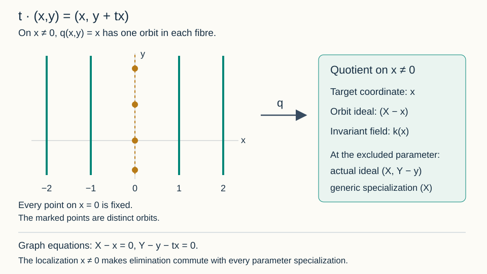
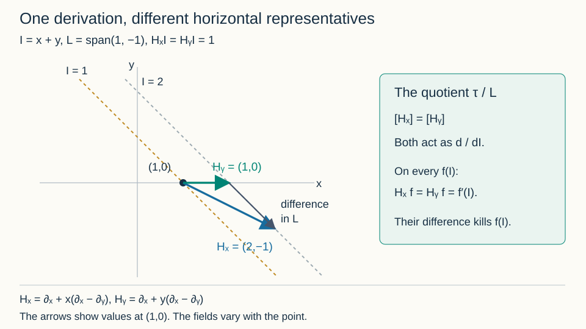
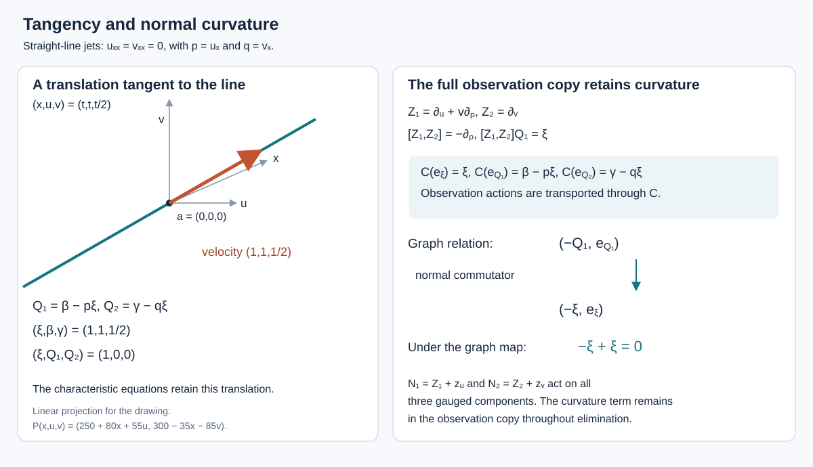
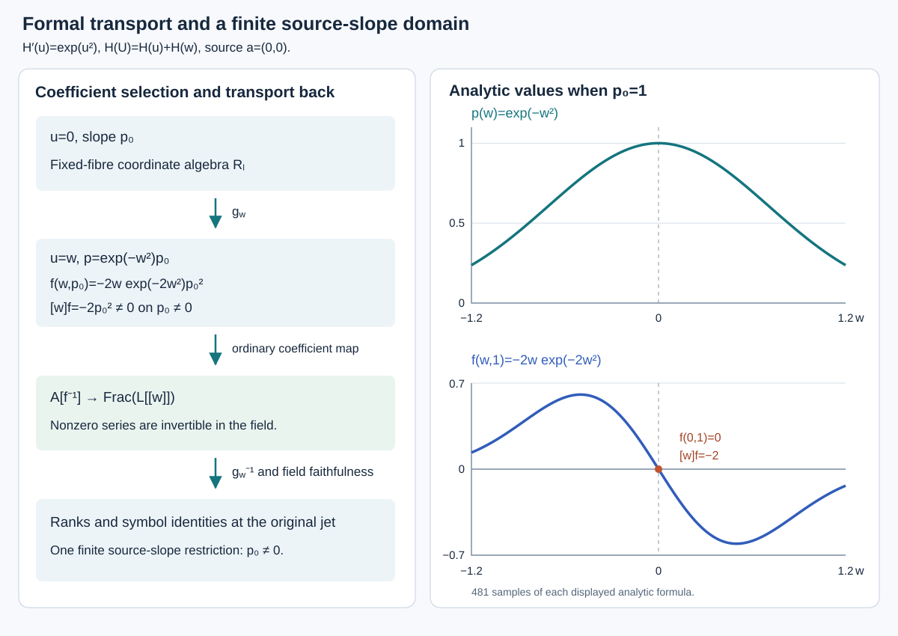
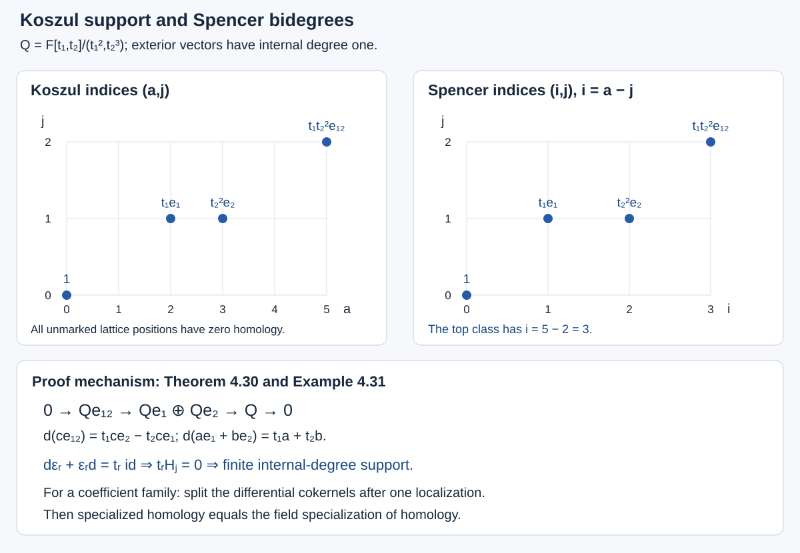

# Prolongation, differential invariants and the projective group

*GPT-6.1 Sol (OpenAI); Sections 4.2–4.10: GPT-6 Astra (OpenAI). Original exposition and diagrams: CC0 1.0.*

A transformation of points also transforms derivatives of graphs. Prolongation records that transformation on a finite-dimensional jet space. It makes differential equations into geometric subsets and their symmetry conditions into tangency equations. Curvature and the Schwarzian derivative arise as coordinates transverse to the resulting orbits.

We use analytic graphs $u:\mathbb K^n\to\mathbb K^m$ and local point diffeomorphisms of $(x,u)$, with $\mathbb K=\mathbb R$ or $\mathbb C$. The regular-submanifold criterion and invariant count from Complete systems and invariants are available. Real oriented plane curves are used for Euclidean curvature. The invariant count is local at regular jets; the finite-generation theorem stated later has additional hypotheses.

## 1. Jets and transformed graphs

Two graphs have the same $k$-jet at $x$ when their derivatives through order $k$ agree there. Write coordinates on $J^k(\mathbb K^n,\mathbb K^m)$ as

$$
(x^i,u^\alpha_J),\qquad |J|\le k,\quad
1\le i\le n,\quad1\le\alpha\le m.
$$

Here $J$ is an unordered multi-index, including the empty index $u^\alpha_\varnothing=u^\alpha$. Mixed derivatives are symmetric, so each multi-index occurs once. The dimension is

$$
N_k=n+m\binom{n+k}{k}.
\tag{1.1}
$$

The binomial coefficient counts all monomials in $n$ variables of degree at most $k$, equivalently all partial derivatives of those orders.

For a function $F$ of jets of order at most $k$, its total derivative is a function of order at most $k+1$:

$$
D_iF=\partial_{x^i}F+
\sum_{\alpha,\,|J|\le k}u^\alpha_{J,i}\partial_{u^\alpha_J}F.
\tag{1.2}
$$

It satisfies $(D_iF)(j^{k+1}u(x))=\partial_i(F(j^ku(x)))$ by the ordinary chain rule. The total derivatives commute on functions of finite jet order, because mixed partial derivatives of every realizing graph commute. Every finite jet is realized by its Taylor polynomial, so this graph calculation proves the identity on jet coordinates.

Let a point transformation be $(x,u)\mapsto(\widetilde x,\widetilde u)=(X(x,u),U(x,u))$. On a graph, put

$$
A^j_i=D_iX^j.
$$

Where $\det A\ne0$, the transformed submanifold is again a graph over $\widetilde x$. Its derivatives are calculated using

$$
\widetilde D_j=(A^{-1})^i_jD_i,\qquad
\widetilde u^\alpha_j=(A^{-1})^i_jD_iU^\alpha.
\tag{1.3}
$$

Repeating (1.3) determines all transformed derivatives through order $k$. At each step, the result depends only on the original derivatives through that order, so it is independent of the realizing graph. This defines the **prolonged transformation** on $J^k$. Transforming a graph in two steps gives the same jet as transforming it by the composite; therefore prolongation preserves the transformation law. Its domain includes the graph-transversality condition $\det A\ne0$.

## 2. The prolongation formula

Let

$$
v=\sum_i\xi^i(x,u)\partial_{x^i}
+\sum_\alpha\phi^\alpha(x,u)\partial_{u^\alpha}.
$$

The generator of its prolonged flow has the form

$$
\operatorname{pr}^{(k)}v=
\sum_i\xi^i\partial_{x^i}
+\sum_{\alpha,\,|J|\le k}\phi^\alpha_J\partial_{u^\alpha_J},
\qquad \phi^\alpha_\varnothing=\phi^\alpha.
\tag{2.1}
$$

**Theorem 2.1 (prolongation).** Set $Q^\alpha=\phi^\alpha-\sum_i\xi^iu^\alpha_i$. Then

$$
\phi^\alpha_{J,i}
=D_i\phi^\alpha_J-\sum_j u^\alpha_{J,j}D_i\xi^j,
\qquad
\phi^\alpha_J=D_JQ^\alpha+\sum_i\xi^iu^\alpha_{J,i}.
\tag{2.2}
$$

In particular, the apparent order-$|J|+1$ derivatives in the second formula cancel.

**Proof.** Write the point flow to first order as $X^j=x^j+t\xi^j+O(t^2)$ and $U^\alpha=u^\alpha+t\phi^\alpha+O(t^2)$. Its total derivative matrix is $A^j_i=\delta^j_i+tD_i\xi^j+O(t^2)$, so (1.3) gives

$$
\widetilde D_i=D_i-t\sum_j(D_i\xi^j)D_j+O(t^2).
$$

If $\widetilde u^\alpha_J=u^\alpha_J+t\phi^\alpha_J+O(t^2)$, differentiate it with $\widetilde D_i$. The coefficient of $t$ is precisely the recurrence in (2.2). Its initial coefficient is $\phi^\alpha$. This proves the recurrence for every order by induction.

At the empty index, the characteristic formula is $Q^\alpha+\xi^iu^\alpha_i=\phi^\alpha$. Suppose it holds for $J$. Substitute it into the recurrence:

$$
\begin{aligned}
\phi^\alpha_{J,i}
&=D_iD_JQ^\alpha+
\sum_j(D_i\xi^j)u^\alpha_{J,j}
+\sum_j\xi^ju^\alpha_{J,j,i}
-\sum_j u^\alpha_{J,j}D_i\xi^j\\
&=D_{J,i}Q^\alpha+\sum_j\xi^ju^\alpha_{J,i,j}.
\end{aligned}
$$

Commutation of total derivatives and symmetry of jet indices complete the induction. Since $Q^\alpha=\phi^\alpha-\xi^iu^\alpha_i$, its highest derivative term is $-\xi^iu^\alpha_{J,i}$, canceling the displayed correction. Alternatively, the recurrence directly proves that $\phi_J$ has order at most $|J|$. $\square$

The compact notation is

$$
\operatorname{pr}v=\operatorname{pr}v_Q+\sum_i\xi^iD_i,
\qquad
\operatorname{pr}v_Q=\sum_{\alpha,J}D_JQ^\alpha\partial_{u^\alpha_J}.
\tag{2.3}
$$

These are identities on the infinite jet space, or on functions of finite order with one extra jet level available. The two terms on the right need not separately be vector fields on $J^k$; their sum has the cancellation just proved. This qualification avoids treating a top-order total derivative as an intrinsic vector field on a finite jet space.

## 3. Equations as jet submanifolds

Let $\Delta=(\Delta_1,\ldots,\Delta_s)$ be a system on $J^k$, with $d\Delta$ of rank $s$ on $E=\{\Delta=0\}$.

**Theorem 3.1 (infinitesimal criterion).** A connected local point group preserves the equation submanifold $E$ under prolongation exactly when

$$
\operatorname{pr}^{(k)}v(\Delta_a)=0\quad\text{on }E
\tag{3.1}
$$

for each equation and each infinitesimal generator.

**Proof.** The rank assumption identifies $T_\zeta E$ with $\ker d\Delta_\zeta$. Condition (3.1) is exactly tangency of the prolonged fields. A tangent field has a restricted flow on $E$; uniqueness of the ambient ODE makes that flow agree with its ambient flow. Products of generator flows give every sufficiently small transformation of the connected group. Conversely, differentiating preservation of $E$ yields tangency and (3.1). $\square$

Preservation of $E$ implies that transformed solution graphs are still solutions, whenever they remain graphs. If “symmetry” means only preservation of actual solutions, necessity of (3.1) additionally requires that every equation jet being tested be locally realized by a solution. A maximal-rank system alone does not guarantee this realization for an arbitrary PDE system. The theorem above concerns the entire jet submanifold and is the precise geometric version proved here.

For singular defining equations, tangency can fail to be sufficient. For example $\Delta=u^2$ has zero derivative on $u=0$, so $v=\partial_u$ satisfies $v\Delta=0$ there, but its translations do not preserve $u=0$. Necessity survives for a preserved zero set. The sketch's statement reversing this implication is corrected accordingly.

**Example 3.2: heat scaling and a boost.** For $\Delta=u_t-u_{xx}$, take $v=x\partial_x+2t\partial_t$. Formula (2.2) gives $\phi_t=-2u_t$ and $\phi_{xx}=-2u_{xx}$, hence $\operatorname{pr}v(\Delta)=-2\Delta$.

For $w=2t\partial_x-xu\partial_u$, the same recurrence gives

$$
\phi_t=-xu_t-2u_x,\qquad
\phi_x=-u-xu_x,\qquad
\phi_{xx}=-2u_x-xu_{xx}.
$$

Thus $\operatorname{pr}w(\Delta)=-x\Delta$. Both are symmetries. Their finite transformations are

$$
(x,t,u)\mapsto(e^\varepsilon x,e^{2\varepsilon}t,u),\qquad
(x,t,u)\mapsto(x+2\varepsilon t,t,e^{-\varepsilon x-\varepsilon^2t}u).
$$

The boost consequently sends a solution $f$ to $e^{-\varepsilon x+\varepsilon^2t}f(x-2\varepsilon t,t)$. The differing signs of the two exponential expressions come from expressing the transformed graph in its new independent variables.

## 4. Counting invariants and differentiating them

A differential invariant of order at most $k$ is a function on $J^k$ constant along prolonged orbits.

**Theorem 4.1 (local infinitesimal count).** If the prolonged infinitesimal distribution has constant rank $r_k$ on a regular analytic jet chart, there are $N_k-r_k$ functionally independent local analytic first integrals, and every analytic function annihilated by that distribution is a function of these. They are invariants for the identity local action.

**Proof.** The prolonged infinitesimal distribution is involutive by the bracket identity of Section 1. Complete systems and invariants, Theorem 2.1 provides coordinates $(s^1,\ldots,s^{r_k},I^1,\ldots,I^{N_k-r_k})$ with its integral plaques given by constant $I$. A function is annihilated exactly when it is independent of the $s$ coordinates. The $I$ are independent, and no larger independent family can be constant on a distribution of rank $r_k$. Its local flows preserve the first integrals; conversely flow invariance differentiates to zero derivative. Full disconnected-group invariance can impose additional conditions, as Example 4.20 illustrates. $\square$

An **invariant derivative** is a total derivative combination that carries invariants to invariants. For instance, if $n$ invariants $I^1,\ldots,I^n$ have invertible horizontal derivative matrix $A^a_i=D_iI^a$, define $\nabla_a$ by

$$
\nabla_a=(A^{-1})^i_aD_i.
\tag{4.1}
$$

The horizontal differential of another invariant has the unique expression $d_HF=\sum_a(\nabla_aF)d_HI^a$. Point prolongations preserve horizontal differentiation, as (1.3) shows. Pulling back this equality and using invariance of $F,I^a$ proves invariance of its coefficients $\nabla_aF$. The invertibility condition is essential. In other actions, invariant derivatives can instead come from invariant geometric quantities such as arclength.

### 4.2. The global assertion and its precise scope

**Scope.** Theorem 4.38 proves finite differential generation for the induced point actions specified in Section 4.16. An action specified only on an equation requires its compatible-action comparison with the characteristic and determining rows. The source used here is Boris Kruglikov and Valentin Lychagin, [*Global Lie–Tresse theorem*, arXiv:1111.5480v3](https://arxiv.org/abs/1111.5480v3), revised 13 June 2015, §0.1–0.2, Theorems 1–2 and §3. Its setting is a Lie pseudogroup acting transitively on the point manifold, with algebraic finite-order isotropy actions, and an invariant, formally integrable, irreducible differential equation whose jet fibres are nonsingular algebraic varieties. Algebraicity is a condition on the fibre variables; it does not require the smooth base coordinates themselves to be algebraic.

The finite-generation assertion asks for one finite jet level $\ell$ and a proper invariant fibrewise algebraic exceptional set $S\subset E^\ell$. At every higher order the domain is restricted by the same condition: its projection to $E^\ell$ must avoid $S$. The function class is smooth in the base coordinates, rational in the fibre coordinates through order $\ell$, and polynomial in higher-order jet coordinates. Each function has finite jet order. The asserted generators are finitely many invariants $I_1,\ldots,I_t$ and finitely many invariant derivations $\nabla_1,\ldots,\nabla_s$ of this invariant algebra. Every invariant is to be a finite polynomial in the iterated derivatives $\nabla_{j_1}\cdots\nabla_{j_r}I_i$, with coefficients rational in the $I_i$. Thus generation is differential generation, not ordinary finite generation without derivatives. It also does not authorize denominators in arbitrary higher-order coordinates.

Theorem 4.1 and formula (4.1) do not prove this assertion. In particular, the matrix in (4.1) may fail to have full rank. The general construction must work with horizontal directions modulo those that annihilate every invariant; one cannot silently assume $s=n$ or replace the action by the special case admitting a full invariant frame. The earlier local results of this lesson remain valid on their stated domains, independently of the general theorem.

### 4.3. A complete algebraic input at one jet level

**Proposition 4.2 (finite generators of a fixed-level invariant field).** Let $k$ be a field of characteristic zero, let $X$ be an integral finite-type $k$-variety, and let $F$ be a subfield with $k\subseteq F\subseteq K=k(X)$. Then there are algebraically independent elements $t_1,\ldots,t_d\in F$ over $k$ and an element $w\in F$ such that

$$
F=k(t_1,\ldots,t_d,w),\qquad
[F:k(t_1,\ldots,t_d)]<\infty.
\tag{4.2}
$$

In particular, this applies to the field of rational invariants of an algebraic isotropy action on an integral finite-order equation fibre $X=E^\ell_a$, over $k=\mathbb R$ or $\mathbb C$. In this application $F$ means invariance under the full action, as an identity of rational functions, not merely annihilation by its infinitesimal generators.

**Proof.** A nonempty affine open of $X$ has a finitely generated integral coordinate algebra $A=k[a_1,\ldots,a_m]$. Its fraction field is $K=k(a_1,\ldots,a_m)$, so $K/k$ is finitely generated as a field. NOE-RAT-01, Theorem 1.2 therefore applies to the inclusions $k\hookrightarrow F\hookrightarrow K$ and proves that $F/k$ is finitely generated. Its proof uses Lemma 1.1, which bounds the degrees of algebraic intermediate extensions inside a finitely generated field. This is the step that rules out an infinite algebraic extension; finite transcendence degree alone would not do so.

Choose a finite transcendence basis $t_1,\ldots,t_d$ of $F/k$ and put $B=k(t_1,\ldots,t_d)$. A finite generating list for $F/k$ also generates $F/B$, and each generator is algebraic over $B$. Adjoining these generators successively multiplies finitely many finite degrees, so $[F:B]$ is finite. Since $B$ has characteristic zero, the derivative of a nonconstant irreducible polynomial over $B$ is nonzero and has smaller degree. It is therefore relatively prime to that polynomial. Hence every algebraic generator is separable over $B$.

Apply NT-LOC-04, Proposition 0.1 to the finite separable extension $F/B$. It supplies $w$ with $F=B(w)$, proving (4.2). Only the infinite-base-field branch of that proof is used: $B$ contains the prime field $\mathbb Q$. No valuation or completeness hypothesis is imposed by Proposition 0.1. If $F=B$, take $w=0$; the transcendence basis may also be empty. $\square$

This proposition establishes field generation at each specified integral finite jet level. It does not choose a uniform level $\ell$, identify $d$ with an orbit codimension, prove existence of a geometric quotient, separate individual real orbits, or express all higher-order invariants by invariant differentiation. Those are distinct assertions. No claim about the positive-characteristic branch of NOE-RAT-01, Theorem 1.3 is needed here.

### 4.4. Coefficient invariance for the full group

**Lemma 4.3 (unique invariant polynomial coordinates).** Let $K\subseteq L$ be fields. Let a group $\Gamma$ act on $L$ by automorphisms $g_L:L\to L$ with $g_L(K)=K$, and write $g_K:K\to K$ for the restrictions. Suppose $z_1,\ldots,z_r\in L$ are algebraically independent over $K$ and are fixed by every $g_L$. With

$$
K^\Gamma=\{a\in K:g_K(a)=a\text{ for every }g\in\Gamma\},
$$

the invariant subring satisfies

$$
\bigl(K[z_1,\ldots,z_r]\bigr)^\Gamma
=K^\Gamma[z_1,\ldots,z_r].
\tag{4.3}
$$

**Proof.** The evaluation homomorphism $\operatorname{ev}:K[T_1,\ldots,T_r]\to L$, $T_i\mapsto z_i$, is injective by algebraic independence. Consequently a polynomial $P=\sum_{\alpha\in A}h_\alpha z^\alpha$, for a finite set $A\subset\mathbb N^r$, has unique coefficients in $K$. If $P$ is fixed by $\Gamma$, applying any $g_L$ and subtracting gives

$$
0=g_L(P)-P=\sum_{\alpha\in A}
\bigl(g_K(h_\alpha)-h_\alpha\bigr)z^\alpha.
$$

Injectivity of $\operatorname{ev}$ implies $g_K(h_\alpha)=h_\alpha$ for every $\alpha$. The element $g$ was arbitrary, so every coefficient belongs to $K^\Gamma$. Conversely a polynomial with coefficients in $K^\Gamma$ and fixed variables $z_i$ is fixed, by applying $g_L$ to its finite sum. This proves both inclusions in (4.3), including the constant-polynomial case $r=0$. $\square$

The full-action comparison matters: the two-element group acting by $x\mapsto-x$ on $\mathbb R(x)$ has zero Lie algebra, yet $x$ is not invariant. Thus infinitesimal invariance of coefficients alone does not settle the disconnected-group case in the coefficient argument of the source's §3.2. Lemma 4.3 supplies that step when its hypotheses hold. For partially defined pseudogroup maps the same subtraction must be performed on common domains where the asserted polynomial expansion is unique. Establishing those domains, the fixed coordinates and the required rational-low-order/polynomial-higher-order expansion is still necessary; the lemma does not produce them.

### 4.5. Real orbits and the remaining proof obligations

The source also asserts orbit separation. Its passage from complexified orbits to individual real orbits in §2.1 and §3.1 is false without an additional distinction: real and imaginary parts of rational invariants cannot separate real orbits lying in one complex orbit. NOE-SYM-03, §6 gives a complete counterexample on the equation $u_{ijk}=0$, together with the transformation formulas and Figure 6.1. Its real orbits distinguish the sign of the Hessian determinant, whereas its rational invariant field is constant. Both signs meet every nonempty real Zariski-open domain. Therefore removal of a proper algebraic exceptional set does not repair the individual-real-orbit claim.

That counterexample does not disprove finite differential generation: its constant invariant field is already finitely generated. It also does not replace geometric orbits over an algebraic closure by real-point orbits. The explicit metric argument in NOE-SYM-03 and the local proofs in this lesson are retained with their own hypotheses.

Theorem 4.19 constructs finite-level rational orbit quotients. Lemma 4.34 and Theorems 4.35–4.36 give transitive invariant extension, full invariant differential spanning and flat geometric descent. Theorems 4.21, 4.24, 4.28, 4.30 and 4.32 supply quotient horizontal derivations, mixed observations, the actual common domain/full-symbol presentation, uniform quotient-symbol cohomology and polynomial equation coordinates. Theorem 4.38 combines these results into finite differential generation, affine geometric quotient projections and finite/formal geometric orbit separation for the precise induced point-action setting of Section 4.16. The compatible action-only comparison is a separate hypothesis-to-action problem outside that point-action theorem.

### 4.6. Symbolic stabilization: generators are not a free basis

The general theorem requires one finite order and one open set whose entire higher-jet inverse image has the asserted stabilization. A separate statement at each infinite jet does not give that conclusion. Here is a precise algebraic input, together with the distinction needed when using the cited proof.

In the proof of the stabilization theorem in §2.2 of the cited arXiv v3, the graded module $\mathfrak M$ is shown to be Noetherian over $\mathfrak A$. The next inference asserts a basis with unique $\mathfrak A$-coefficients. **That implication is false:** Noetherianity gives finite generation, not freeness. The subsequent uses of uniqueness and absence of relations therefore require an additional argument. This identifies a gap in that proof route, not a counterexample to the global finite-generation theorem.

**Example 4.4 (a cyclic module with a relation in arbitrarily high degree).** Let $F$ be a field, let $A=F[x]$ with $\deg x=1$, and choose an integer $r\geq2$. The graded $A$-module

$$
M=A/(x^r)
$$

is Noetherian and is generated by $\overline 1$ in degree zero. Indeed, $F$ is Noetherian because its only ideals are zero and $F$; AG-CA-03, Theorem 2.1 and Proposition 1.2 give the polynomial-ring and quotient assertions. The class $\overline 1$ is nonzero and $x^r\overline 1=0$. A free module over the domain $A$ has no nonzero element killed by a nonzero scalar: write a vector in a basis and apply the domain property to each coefficient. Thus $M$ is not free. In particular $0\overline 1=x^r\overline 1$ are distinct coefficient expressions for the same element.

This also shows why generator degrees alone do not bound the first Koszul homology. Define $M(-1)_d=M_{d-1}$. The one-variable Koszul complex, with its displayed graded $A$-linear differential, is

$$
0\longrightarrow M(-1)\xrightarrow{\;x\;}M\longrightarrow0.
$$

Its degree-$r$ element $\overline{x^{r-1}}$ in the left term is nonzero and lies in the kernel, and there is no preceding nonzero term. Hence its first homology has a nonzero degree-$r$ class, although $M$ has a generator of degree zero. The relation degree, not just the module-generator degree, matters. Degree shifts give the same obstruction for a module starting at a positive degree.

**Lemma 4.5 (eventual prolongation for one fixed symbolic system).** Let $F$ have characteristic zero, and let $T$ and $V$ be finite-dimensional $F$-vector spaces. For each integer $j\geq0$, let

$$
g_j\subseteq S^j(T^*)\otimes_F V.
$$

We regard an element of $S^j(T^*)\otimes_F V$ as a symmetric $j$-linear map $T^j\to V$. For $v\in T$ define the $F$-linear insertion map

$$
c_v:S^{j+1}(T^*)\otimes_F V\longrightarrow S^j(T^*)\otimes_F V,
\qquad
(c_vp)(v_1,\ldots,v_j)=p(v,v_1,\ldots,v_j).
$$

Assume $c_v(g_{j+1})\subseteq g_j$ for all $j$ and all $v\in T$. Define the first prolongation by

$$
g_j^{(1)}=
\{p\in S^{j+1}(T^*)\otimes_F V:c_vp\in g_j\text{ for every }v\in T\}.
$$

Then some integer $q\geq0$ satisfies $g_{j+1}=g_j^{(1)}$ for every $j\geq q$. No freeness of the graded dual module is assumed.

**Proof.** Put $A=S_F(T)$ and $P=A\otimes_F V^*$, graded by polynomial degree, with $P_j=S^j_F(T)\otimes_F V^*$. Pair $P_j$ with $S^j(T^*)\otimes_F V$ by

$$
\langle v_1\cdots v_j\otimes\lambda,p\rangle
=\lambda\bigl(p(v_1,\ldots,v_j)\bigr).
$$

The pairing is nondegenerate: in a basis of $T$, a symmetric multilinear map is determined by its values on unordered basis tuples, and a basis of $V^*$ detects every such value. In degree zero it is the usual $V^*$–$V$ pairing. With this convention multiplication $P_j\to P_{j+1}$ by $v$ is adjoint to insertion: $\langle vb,p\rangle=\langle b,c_vp\rangle$.

Let $I_j\subseteq P_j$ be the annihilator of $g_j$, and set $I=\bigoplus_{j\geq0}I_j\subseteq P$. If $b\in I_j$ and $p\in g_{j+1}$, the contraction hypothesis gives

$$
\langle vb,p\rangle=\langle b,c_vp\rangle=0.
$$

Consequently $T I_j\subseteq I_{j+1}$, where $T I_j$ denotes the $F$-linear span of products $vb$. Since $T$ generates the $F$-algebra $A$, this proves that $I$ is a graded $A$-submodule of $P$.

Choose bases of $T$ and $V$. Then $A$ is a polynomial ring in finitely many variables over $F$, and $P$ is a finite free $A$-module. The full proofs in AG-CA-03, Theorem 2.1 and Theorem 1.1 / Proposition 1.2 imply that $I$ is finitely generated. Replace each chosen generator by its finitely many homogeneous components. Those components belong to $I$ because $I$ is graded, and they still generate it: their span contains the old generators and is contained in $I$. Write them as $b_1,\ldots,b_s$, of degrees $d_1,\ldots,d_s$, and put $q=\max_i d_i$, or $q=0$ if $I=0$.

For $j\geq q$ we claim

$$
I_{j+1}=T I_j.
$$

The inclusion from right to left was proved above. For the reverse, express $b\in I_{j+1}$ in the generators and take homogeneous degree $j+1$. This gives

$$
b=\sum_{i=1}^s a_i b_i,\qquad a_i\in A_{j+1-d_i}.
$$

Every nonzero coefficient has positive degree, since $j+1-d_i\geq1$. Each of its monomials has a degree-one factor, so $a_i$ is a finite sum of products $v a'$ with $v\in T$ and $a'\in A_{j-d_i}$. Each $a'b_i$ belongs to $I_j$, proving the claim. This also covers $T=0$: its positive-degree polynomial pieces are zero.

All pairings in a fixed degree are between finite-dimensional vector spaces. Taking the annihilator twice returns the original subspace: extend a basis of the subspace to a basis of the whole space and use the dual coordinate functionals to separate a vector outside it. Therefore, for $p\in S^{j+1}(T^*)\otimes_F V$,

$$
\begin{aligned}
p\in g_{j+1}
&\Longleftrightarrow \langle I_{j+1},p\rangle=0\\
&\Longleftrightarrow \langle T I_j,p\rangle=0\\
&\Longleftrightarrow \langle I_j,c_vp\rangle=0\quad\text{for all }v\in T\\
&\Longleftrightarrow c_vp\in g_j\quad\text{for all }v\in T.
\end{aligned}
$$

This is exactly $g_{j+1}=g_j^{(1)}$. If $V=0$, the same proof reduces to zero spaces. The proof uses finite generation of the **relation submodule** $I$, not a claimed free basis of $P/I$. $\square$

**What remains for the global theorem.** At one fixed infinite jet, once its completed orbit symbols satisfy the contraction hypothesis, Lemma 4.5 supplies eventual equality. It does not give a common $q$ or one finite-level open set for every infinite jet above it. The remaining argument must prove the contraction property uniformly, then control specialization of the finite relation presentation over that same finite-level open set, with no new exceptional higher-jet denominators. The descending chain of closures of total images used earlier in §2.2 is not by itself an argument identifying every individual fibre image. Those fibrewise comparisons must be supplied. The full uniform statement and its downstream horizontal-rank and affine-orbit-bundle uses remain assigned obligations; the lemma does not replace them with a pointwise claim.

The author's [erratum to the 2016 paper](https://serre.mat-stat.uit.no/ansatte/boris/corr/Erratum-SM2016.pdf) corrects an invariant derivation and the revisited example in §§3.5 and 4.5. It does not amend the module argument in §2.2. Those example corrections must accompany any future use of that example; none of its formulas is imported here.

### 4.7. Uniformity: total images do not determine fibre images

There is a second, distinct issue in the §2.2 argument of arXiv v3. In the proof of Proposition `prp4`, the closed sets obtained from the **total** images of the stabilizer bundles eventually coincide. The proof then asserts equality of the stabilizer images at **every** higher jet over one finite-level open set. These are different assertions: taking a union of images over all jets forgets which jet supplies a vector.

The precise constructibility statements and proofs are AG-MO-06, Theorem 3.1 and Theorem 4.2. They give a constructible image and, when that image is dense in an irreducible target, a nonempty open subset contained in it. They do not identify the image at each point of a separate parameter space. The following example has an even stronger property than constructibility: its total images are already the entire target at every level.

**Example 4.6 (constant total images, arbitrarily late fibre-image loss).** Work over $F=\mathbb C$. For $k\geq1$ put

$$
E^k=\mathbb A_F^{k-1},\qquad J^k=F^k,
$$

with coordinates $(x_2,\ldots,x_k)$ and $(v_0,\ldots,v_{k-1})$, respectively. Thus $E^1$ is a point. Let $\pi_{k+1,k}:E^{k+1}\to E^k$ forget $x_{k+1}$, and let $\rho_{k+1,k}:J^{k+1}\to J^k$ forget $v_k$. The former is an affine-line bundle and the latter is a surjective $F$-linear map. Define the algebraic vector subbundle

$$
S^k=\left\{(x,v)\in E^k\times J^k:
v_{i-1}=x_{i+1}v_i\quad(1\leq i\leq k-1)\right\}.
$$

It is a trivial line bundle. Indeed, set $s=v_{k-1}$ and recover its coordinates by

$$
v_i=\left(\prod_{r=i+2}^{k}x_r\right)s
\quad(0\leq i\leq k-1),
$$

where an empty product is $1$. These polynomial formulas and the inverse coordinate $s=v_{k-1}$ give an isomorphism $E^k\times F\to S^k$, linear on every fibre. In particular no singular bundle rank is hidden in the example.

The product map $\pi_{k+1,k}\times\rho_{k+1,k}$ restricts to an algebraic map $\sigma_{k+1,k}:S^{k+1}\to S^k$: all of the first $k-1$ defining equations remain true after truncation. In the line-bundle coordinates it is

$$
\sigma_{k+1,k}(x_2,\ldots,x_{k+1},s)
=(x_2,\ldots,x_k,x_{k+1}s).
$$

Define $\psi_k:S^k\to F$ by the same ambient coordinate projection $\psi_k(x,v)=v_0$ at every level. It is algebraic and fibrewise $F$-linear, and

$$
\psi_{k+1}=\psi_k\circ\sigma_{k+1,k},\qquad
\psi_k(x,s)=\left(\prod_{r=2}^{k}x_r\right)s.
$$

Taking $x_2=\cdots=x_k=1$ shows that $\psi_k(S^k)=F$. Thus all total images, and not merely their closures, are equal. Nevertheless the individual image is

$$
\psi_k(S^k_x)=
\begin{cases}
F,&\prod_{r=2}^{k}x_r\ne0,\\
\{0\},&\prod_{r=2}^{k}x_r=0.
\end{cases}
$$

Fix any integer $\ell\geq1$ and any nonempty Zariski-open $U\subset E^\ell$. There exists $x\in U$ with $x_2\cdots x_\ell\ne0$. To see this without an implicit generic-point argument, choose a nonempty principal open $D(f)\subset U$. The polynomial $f\prod_{r=2}^{\ell}x_r$ is nonzero in the polynomial ring over $F$. A nonzero polynomial over an infinite field cannot vanish at every point: induct on the number of variables, choose values where a nonzero coefficient in the last variable remains nonzero, then avoid the finitely many roots of that resulting one-variable polynomial. This supplies the required point. For $\ell=1$, the same assertion concerns the sole point and the empty product $1$.

Lift this point to $y=(x_2,\ldots,x_\ell,0)\in E^{\ell+1}$. Then

$$
\pi_{\ell+1,\ell}(y)=x\in U,\qquad
\psi_\ell(S^\ell_x)=F,\qquad
\psi_{\ell+1}(S^{\ell+1}_y)=\{0\}.
$$

In particular the vector $1$ in the lower image has no preimage in this higher fibre. Hence **no** such finite-level open set makes all the individual images equal at subsequent levels. Along any one infinite coordinate sequence they do stabilize: either every coordinate is nonzero, or the image becomes zero when its first zero coordinate appears. That first zero can occur beyond any prescribed finite level. Pointwise eventual stabilization therefore does not imply the required uniform assertion. $\square$

*Figure 4.2. Exact fibre maps in Example 4.6. At a lower point with product $p=x_2\cdots x_\ell\ne0$, the lift $x_{\ell+1}=1$ has image $F$, whereas the lift $x_{\ell+1}=0$ has image zero. Both project to the same point of $U$. The diagram concerns the displayed algebraic tower, not an asserted realization by a Lie pseudogroup.*

The example disproves the general inference from stabilized total images to uniform fibre-image equality, even with affine-bundle base projections, constant-rank stabilizer-like subbundles, fixed ambient coordinate projections and compatible truncations. It is **not** a realization of those bundles as stabilizers of the prolonged pseudogroup in the Lie–Tresse theorem. Thus it identifies the missing step in that proof; it is not a counterexample to Proposition `prp4` with all of its geometric hypotheses. Any inference for actual pseudogroup stabilizers needs additional geometric hypotheses that prevent this fibre-image loss.

### 4.8. What a uniform relation presentation would prove

The fixed-system argument in Lemma 4.5 does extend uniformly when one relation module genuinely controls every specialization. The following precise statement separates that useful algebra from the still-required comparison with orbit symbols.

**Lemma 4.7 (one bound for the specializations of a single relation module).** Let $R$ be a commutative Noetherian $\mathbb Q$-algebra, and let $T,V$ be finite free $R$-modules. Set

$$
A=\operatorname{Sym}_R T,\qquad V^\vee=\operatorname{Hom}_R(V,R),\qquad
P=A\otimes_R V^\vee.
$$

Let $I=\bigoplus_{j\geq0}I_j\subseteq P$ be a graded $A$-submodule. For every unital homomorphism $\alpha:R\to K$ into a field, write $T_K=T\otimes_RK$, $V_K=V\otimes_RK$ and define

$$
J_j(\alpha)=\operatorname{im}\bigl(I_j\otimes_RK\longrightarrow P_j\otimes_RK\bigr),
\qquad
h_j(\alpha)=J_j(\alpha)^\perp
\subseteq S^j(T_K^*)\otimes_K V_K.
$$

The map defining $J_j$ is induced by the inclusion $I_j\hookrightarrow P_j$; it is not asserted to be injective after tensoring. The annihilator uses the evaluation pairing of Lemma 4.5. Its coefficient field has characteristic zero because $\alpha$ is unital and $R$ is a $\mathbb Q$-algebra. There is an integer $q\geq0$, independent of $\alpha$ and $K$, such that

$$
h_{j+1}(\alpha)=h_j(\alpha)^{(1)}\qquad(j\geq q).
$$

**Proof.** Bases of $T$ and $V$ identify $A$ with a polynomial ring in finitely many variables over $R$ and $P$ with a finite free $A$-module. AG-CA-03, Theorem 2.1 and Theorem 1.1 / Proposition 1.2 therefore give a finite set of generators of $I$. Taking their homogeneous components, as in Lemma 4.5, gives homogeneous generators $b_1,\ldots,b_s$. Let $q$ be the greatest generator degree, with $q=0$ for $I=0$.

For $j\geq q$ we have $I_{j+1}=T I_j$. Indeed, an element of degree $j+1$ is a sum of $a_i b_i$ with $a_i\in A_{j+1-\deg b_i}$. Each nonzero $a_i$ has positive degree and is a sum of degree-one generators of $A$ multiplied by elements of one lower degree. Thus each $a_i b_i$ lies in $T I_j$. The other inclusion holds because $I$ is a submodule. This proof works over $R$ with zero divisors; it does not divide by a coefficient.

For finite free modules, their chosen bases give the identifications

$$
P_j\otimes_RK
\cong \operatorname{Sym}_K^j(T_K)\otimes_K V_K^*.
$$

These identifications agree with evaluation: a specialized dual basis evaluates on the corresponding specialized basis. In particular multiplication by a specialized vector of $T$ is adjoint to the insertion map used in Lemma 4.5. The equality just proved implies

$$
J_{j+1}(\alpha)=T_KJ_j(\alpha).
$$

For completeness, every vector on the left is a sum of images of $b\otimes c$ with $b\in I_{j+1}$, $c\in K$. Write $b$ as a sum of products $tu$ with $t\in T$, $u\in I_j$, and specialize; its image belongs to the right side. Conversely the right side is spanned by products of images of $t\otimes c$ and $u\otimes d$, and each is the image of $tu\otimes cd$. This proves both inclusions even when tensoring destroys injectivity.

Taking annihilators in the displayed finite-dimensional pairing gives, for $p\in S^{j+1}(T_K^*)\otimes_KV_K$,

$$
\begin{aligned}
p\in h_{j+1}(\alpha)
&\Longleftrightarrow \langle T_KJ_j(\alpha),p\rangle=0\\
&\Longleftrightarrow \langle J_j(\alpha),c_vp\rangle=0
\quad\text{for every }v\in T_K\\
&\Longleftrightarrow c_vp\in h_j(\alpha)
\quad\text{for every }v\in T_K.
\end{aligned}
$$

This is the required prolongation equality, with the same $q$ for every field specialization. Zero-rank $T$ or $V$ causes no exception; if $R$ is the zero ring, there are no unital maps to a field and the quantified assertion is vacuous. $\square$

**Hypothesis for the orbit-symbol application.** To use Lemma 4.7 for Lie–Tresse, one must construct such a relation module over an actual finite-level base and prove that the annihilator of every relevant higher-jet orbit symbol is exactly $J_j(\alpha)$ at every point under consideration. Existence of a relation module at each separate infinite jet does not do this. Neither may one replace the image in the definition of $J_j$ by a kernel after specialization without proof. For example, multiplication by $t$ on $\mathbb Q[t]$ has zero kernel; at the specialization $t=0$ its induced map $\mathbb Q\to\mathbb Q$ is zero and has kernel $\mathbb Q$. Thus specialization of a kernel is not in general the kernel of the specialized map.

The orbit-symbol application requires both a common finite-level invariant domain and an actual specialization comparison for the full symbol annihilators. Lemma 4.7 supplies the algebraic bound after that comparison. In the point-action setting of Section 4.16, Theorem 4.28 constructs the domain and the full relation presentation, including the required first-derivative stabilizer-image equality. Theorem 4.30 supplies the quotient-symbol cohomology argument. The full general finite-generation theorem additionally requires affine quotient and polynomial induction arguments.

*Figure 4.2 and Sections 4.7–4.8: GPT-6 Astra (OpenAI). CC0 1.0.*

### 4.9. An actual pseudogroup: stable total images and a necessary domain restriction

Example 4.6 concerned an algebraic tower, without asserting that it was a pseudogroup stabilizer tower. The following computation instead uses actual prolonged transformations of curves. It tests the whole-space image-to-section inference in Kruglikov–Lychagin, [*Global Lie–Tresse theorem*, version 3, Section 2.2, proof of Proposition 4](https://arxiv.org/abs/1111.5480v3). It also proves the proposition's eventual symbol inclusion for this particular action. It is not a counterexample to that proposition or to the general Lie–Tresse theorem.

**Example 4.8 (translations and common scalings).** Work over a field $F$ equal to $\mathbb R$ or $\mathbb C$. On the affine plane $M=\mathbb A^2_F$, with coordinates $(x,u)$, consider the algebraic group

$$
G=F^\times\ltimes F^2,\qquad
g_{\lambda,b,c}(x,u)=(\lambda x+b,\lambda u+c).
$$

The multiplication and inverse, obtained by composing these maps, are

$$
(\lambda,b,c)(\mu,d,e)=(\lambda\mu,\lambda d+b,\lambda e+c),
\qquad
(\lambda,b,c)^{-1}=(\lambda^{-1},-\lambda^{-1}b,-\lambda^{-1}c).
$$

Thus this is an algebraic action by invertible maps. Translations send any point of $M$ to any other point, so it is transitive. Local restrictions, allowing separate parameters on separate connected components, form a pseudogroup: compositions and inverses have the displayed form locally, and maps that agree on overlaps glue. In transformed coordinates $(X,U)$ its first-order defining equations are

$$
X_u=0,\qquad U_x=0,\qquad X_x=U_u\ne0.
$$

These equations give exactly the stated local maps on connected coordinate neighborhoods. Indeed $X$ depends only on $x$, $U$ only on $u$, and differentiating $X_x=U_u$ gives $X_{xx}=U_{ux}=0$ and $U_{uu}=X_{xu}=0$. All second derivatives therefore vanish, and so do all their derivatives. An admissible first jet, with common nonzero derivative $\lambda$ and prescribed image of its base point, consequently has exactly one extension at every higher order: the jet of the corresponding affine map. This proves surjectivity of every prolonged jet projection and formal integrability of these equations; the order-one conditions and all their prolongations are algebraic. No infinite collection of independent transformation parameters has been introduced.

Use the invariant chart of curve jets that are graphs $u=f(x)$. Set $u_j=f^{(j)}(x)$ and

$$
E^k=\mathbb A^2_F\times\mathbb A^k_F
=\{(x,u,u_1,\ldots,u_k)\},\qquad
\pi_{k,k-1}:E^k\longrightarrow E^{k-1}.
$$

The map $\pi_{k,k-1}$ forgets $u_k$ and is an affine-line bundle. There are no differential equations on the graph, so every finite graph jet extends, and each fiber over a base point is an irreducible affine space. The action preserves this chart because $dX/dx=\lambda\ne0$. The transformed graph has $U(X)=\lambda f((X-b)/\lambda)+c$. Repeated differentiation gives, for every $j\ge1$,

$$
u'_j=\lambda^{1-j}u_j.
$$

Differentiating the action at the identity, with infinitesimal parameters $(a,b,c)\in F^3$, gives the vector field and its prolongation

$$
X_{a,b,c}=(ax+b)\partial_x+(au+c)\partial_u,
$$

$$
X_{a,b,c}^{(k)}=(ax+b)\partial_x+(au+c)\partial_u
+\sum_{j=2}^k(1-j)a u_j\partial_{u_j}.
$$

The missing $j=1$ summand is zero, not an omitted constraint: slopes are unchanged by common scaling.

Fix a base point $p=(x_0,u_0)$ and a first jet of slope $m$, with tangent line

$$
\tau=F(\partial_x+m\partial_u)\subset T_pM.
$$

A field fixes $p$ precisely when $b=-ax_0$ and $c=-au_0$. Its derivative at $p$ is $a\,\mathrm{id}_{T_pM}$, which preserves every line and therefore fixes this first jet. For a higher jet $z_k$ above that first jet, its infinitesimal stabilizer and the derivative map are exactly

$$
\operatorname{st}(z_k)
=\{a\in F:(j-1)a u_j=0\text{ for }2\le j\le k\},
\qquad
\psi_{k,z_k}:\operatorname{st}(z_k)\longrightarrow
\operatorname{End}_F(\tau),\quad a\longmapsto a\,\mathrm{id}_\tau.
$$

Here the scalar description of the stabilizer uses the uniquely determined $b,c$ above, and $\psi_{k,z_k}$ is an $F$-linear map. Since $F$ has characteristic zero, for $k\ge2$ this stabilizer is $F$ when $u_2=\cdots=u_k=0$, and is zero otherwise. At order one it is always $F$.

The affine-line graph with this first jet has all higher derivatives zero. Consequently the union of the images of $\psi_{k,z_k}$, as $z_k$ runs through *all* higher extensions of the fixed first jet, is $F\,\mathrm{id}_\tau$ at every order. It is already Zariski closed. Allowing the slope to vary gives the whole endomorphism line bundle over the graph first-jet chart, again at every order. These full-space total images stabilize from the start. In contrast, on the nonempty open set $u_2\ne0$ each individual stabilizer and its image are zero.

There are two distinct failures of the proposed section argument. If the chosen order is one, every first jet has a lift with $u_2=1$; its scalar derivative image drops from $F$ to zero. Thus no nonempty first-order domain makes all its higher lifts preserve that image. If the chosen order is $\ell\ge2$, a rational section of the stabilizer family over a nonempty open set has a rational scalar component $a(z_\ell)$ satisfying $u_2a(z_\ell)=0$. The graph-jet space is irreducible and $u_2$ is a nonzero element of its function field, so $a(z_\ell)=0$. Every rational section is therefore zero wherever defined. No finite collection of such sections can span the full-space total image $F\,\mathrm{id}_\tau$. The same argument applies after fixing $p$ and the slope, since the remaining jet coordinates form an affine space with coordinate $u_2$.

**Rank and scope caution.** This actual stabilizer family jumps in rank along the affine-line jets. It is an algebraic family of vector spaces, not a constant-rank vector bundle over the entire graph-jet space. It is therefore different from the constant-rank tower of Example 4.6. The cited proof takes total images over the whole jet fiber before selecting its section domain. The calculation disproves that literal full-space image-to-section inference. If a preliminary regular-locus restriction is intended instead, its choice and effect on the images must be supplied explicitly. They cannot be deduced from the unchanged full-space total image. The next proposition supplies such a restriction for this action, without claiming to supply it for every pseudogroup.

*Figure 4.3.* At the origin, $u=0$ and $u=x^2/2$ have the same horizontal tangent. Their second derivatives are respectively zero and one. Scaling by $\lambda=2$ fixes the line but sends the parabola to $U=X^2/4$, whose second derivative is $1/2$. The displayed curves and derivative images are the exact objects used in Example 4.8; the figure is not a claim about the general theorem. Diagram and proof: GPT-6 Astra (OpenAI). CC0 1.0.

**Proposition 4.9 (a uniform domain proved directly).** For this action the invariant nonempty Zariski open subset

$$
U^2=\{z_2\in E^2:u_2\ne0\}
$$

has the following properties. Every higher jet above $U^2$ has zero infinitesimal stabilizer. Its orbit tangent spaces $\Delta_k(z_k)\subset T_{z_k}E^k$ have dimension three for $k\ge2$, and projection induces an isomorphism

$$
d\pi_{k,k-1}:\Delta_k(z_k)\xrightarrow{\ \sim\ }
\Delta_{k-1}(z_{k-1}),\qquad k\ge3.
$$

In particular $\varpi_k=\ker(d\pi_{k,k-1}|_{\Delta_k})=0$ for $k\ge3$, and $\varpi_{k+1}\subset\varpi_k^{(1)}$ for every $k\ge2$ along every infinite jet above $U^2$.

*Proof.* The transformation rule $u'_2=\lambda^{-1}u_2$ proves invariance, and a parabola supplies a point of $U^2$. The stabilizer formula proves its vanishing at every higher lift. Subtracting the translation components from the scaling generator gives the following concrete spanning set for the orbit tangent space:

$$
\Delta_k(z_k)=\operatorname{span}_F\{\partial_x,\partial_u,V_k\},
\qquad
V_k=\sum_{j=2}^k(1-j)u_j\partial_{u_j}.
$$

The first two vectors are independent base-coordinate vectors. Above $U^2$ the $\partial_{u_2}$ coefficient of $V_k$ is $-u_2\ne0$, so the third vector is independent of them. Projection carries the three displayed vectors to the corresponding three vectors at order $k-1$. For $k\ge3$ these are bases on both sides, proving the claimed isomorphism and zero kernel. At orders zero and one the orbit tangent spaces are spanned by the two translations; hence $\varpi_1=0$, while $\varpi_2=F V_2$ above $U^2$. For $k=2$ the asserted inclusion has zero left side, and for every $k\ge3$ both sides are zero. This proves all orders on one specified finite-level domain. $\square$

The exclusion is mathematically necessary for a uniform conclusion over the full chart. For any $r\ge2$, the graph $u=x^r/r!$ at the origin has $u_2=\cdots=u_{r-1}=0$ and $u_r=1$. At order $r-1$ its orbit tangent space has rank two, and at order $r$ it acquires the nonzero vertical generator $(1-r)\partial_{u_r}$. Thus $\varpi_{r-1}=0$ and $\varpi_r\ne0$, so $\varpi_r\not\subset\varpi_{r-1}^{(1)}$. Such a failure can occur at an arbitrarily high order on the full space. For $r>2$ these jets lie outside the pullback of $U^2$, exactly as Proposition 4.9 requires. For $r=2$ the failure precedes its order-two starting bound. These examples distinguish a uniform finite-level restriction from a bound chosen separately along each infinite jet.

**Scope.** The general algebraic-pseudogroup application requires a proof of the existence of a suitable common finite-level invariant domain and the required higher-jet stabilizer lifting there, or supply another full-scope route to symbolic stabilization. This example settles neither that existence statement nor the relation-specialization comparison of Section 4.8. The hypotheses for the general application are those described in Sections 4.5–4.8.

### 4.10. Which representative makes the bracket a symbol contraction?

The domain issue of Section 4.9 is not the only input requiring proof. The next step in Kruglikov–Lychagin, [*Global Lie–Tresse theorem*, version 3, Section 2.2, proof of Proposition 4](https://arxiv.org/abs/1111.5480v3), uses a bracket with a tangent-valued infinitesimal transformation to lower the order of an orbit symbol. Its displayed calculation is not justified merely by making the first derivative of the representative vanish. The following example has constant-rank stabilizers and surjective stabilizer projections at every order. Thus its issue is independent of the preceding rank-jumping example.

**Example 4.10 (a lower-order term that the bracket retains).** On the plane over $F=\mathbb R$ or $\mathbb C$, take the local transformations

$$
T_{f,g}(x,u)=(f(x),u+g(x)),\qquad f'(x)\ne0.
$$

Here $f,g$ are smooth in the real case and holomorphic in the complex case; all statements below also concern their finite formal jets. Direct composition gives

$$
T_{f,g}\circ T_{h,t}=T_{f\circ h,\,t+g\circ h},\qquad
T_{f,g}^{-1}=T_{f^{-1},\,-g\circ f^{-1}}.
$$

Restrictions and locally agreeing maps glue, so these maps form a pseudogroup. Their equations in target coordinates are $X_u=0$ and $U_u=1$, with $X_x\ne0$. At each higher order the pure $x$ derivatives of $f$ and $g$ are free; the other derivatives are fixed by these equations. Every admissible jet therefore extends by arbitrary choices of the next two pure derivatives. The equations and these projection maps are algebraic, and the projections are surjective smooth bundles. Translations belong to the pseudogroup and prove transitivity on the plane. This verifies finite differential order and formal integrability directly.

Graph jets are an invariant chart because $f'\ne0$. Write

$$
E^k=\{(x,u,u_1,\ldots,u_k)\},\qquad u_j=h^{(j)}(x)
$$

for a graph $u=h(x)$. The infinitesimal fields are precisely

$$
X=\alpha(x)\partial_x+\beta(x)\partial_u.
$$

Put $\alpha_i=\alpha^{(i)}(x_0)$ and $\beta_i=\beta^{(i)}(x_0)$. The prolonged coefficient in the $u_j$ direction follows by differentiating the transformed graph: it is

$$
\beta_j-\sum_{i=1}^j {j\choose i}\alpha_i u_{j-i+1},\qquad j\ge1.
$$

Indeed the first variation at fixed transformed abscissa is $\beta-\alpha h'$. Differentiating it $j$ times and adding $\alpha_0 u_{j+1}$ for motion of the base abscissa cancels precisely the $i=0$ term. The base-coordinate coefficients are $\alpha_0$ and $\beta_0$.

Consequently the stabilizer of a graph jet is given by

$$
\alpha_0=\beta_0=0,\qquad
\beta_j=\sum_{i=1}^j {j\choose i}\alpha_i u_{j-i+1}
\quad(1\le j\le k).
$$

The $k$ numbers $\alpha_1,\ldots,\alpha_k$ are arbitrary. These equations exhibit a rank-$k$ vector bundle over the whole graph-jet chart. The tangent line is spanned by $\partial_x+u_1\partial_u$; the derivative of $X$ sends this vector to $\alpha_1(\partial_x+u_1\partial_u)$. Its derivative image is therefore the whole scalar endomorphism line at every jet and every order $k\ge1$. A stabilizer at order $k$ lifts to any prescribed next graph jet by choosing $\alpha_{k+1}$ and then the required $\beta_{k+1}$. Both the full stabilizer projection and its derivative image thus lift, not merely at generic jets.

Now fix the flat graph $N=\{u=0\}$ at the origin and an integer $k\ge4$. Consider

$$
X_*=x^2\partial_x+x^k\partial_u,\qquad
X_0=x^k\partial_u,\qquad
Z=X_*-X_0=x^2\partial_x,\qquad
Y=\partial_x+x\partial_u.
$$

These are genuine infinitesimal transformations, not just arbitrary formal fields. The flows of $X_0,Y,Z$ are respectively

$$
(x,u)\mapsto(x,u+t x^k),\qquad
(x,u)\mapsto(x+t,u+t x+t^2/2),\qquad
(x,u)\mapsto\left(\frac{x}{1-tx},u\right).
$$

For $X_*$ the flow is

$$
(x,u)\mapsto\left(\frac{x}{1-tx},\;
u+\frac{x^{k-1}}{k-1}\bigl((1-tx)^{1-k}-1\bigr)\right).
$$

On a neighborhood where $1-tx\ne0$, differentiation in $t$ verifies the displayed generating fields, and parameter $-t$ supplies each inverse. All these maps have the required triangular form. Both $X_*$ and $X_0$ have zero ordinary first jet at the origin. Their prolongations vanish at the flat $(k-1)$-jet, and their common value at its $k$-jet is

$$
q_k=k!\,\partial_{u_k}\ne0.
$$

The difference $Z$ stabilizes every flat graph jet: its base coefficient vanishes at the origin and all its vertical prolonged coefficients vanish there. Also $Y(0)=\partial_x\in T_0N$. Nevertheless, direct differentiation of the vector-field coefficients gives

$$
[Y,X_0]=k x^{k-1}\partial_u,\qquad
[Y,X_*]=2x\partial_x+(k x^{k-1}-x^2)\partial_u.
$$

At the flat $(k-1)$-jet the respective prolonged values are

$$
[Y,X_0]^{(k-1)}=k!\,\partial_{u_{k-1}},\qquad
[Y,X_*]^{(k-1)}=k!\,\partial_{u_{k-1}}-2\partial_{u_2}.
$$

Because $k\ge4$, the second term survives projection to order $k-2$. Thus the second vector is not in the orbit symbol $\varpi_{k-1}$, even though the original $q_k$ is in $\varpi_k$ and the stated first-derivative normalization holds. In particular the bracket value is not determined by the class modulo the order-$k$ stabilizer. The difference of the two bracket values is exactly $[Y,Z]^{(k-1)}=-2\partial_{u_2}$.

This does **not** show that no good representative exists: $X_0$ is one. Nor does it refute symbolic stabilization for this pseudogroup. At a graph jet, varying $\beta_0,\ldots,\beta_k$ supplies every vertical jet direction, and varying $\alpha_0$ supplies the base $x$ direction. The orbit tangent space is all of $T E^k$. Hence $\varpi_k$ is the full vertical symbol, and its prolongation is the next full vertical symbol. What fails is the assertion that the indicated first-order normalization alone licenses the displayed bracket calculation. An additional choice or a different argument is required.

*Figure 4.4.* The case $k=4$ of Example 4.10. Both fields represent $24\partial_{u_4}$ and have zero first jet. Only one of the displayed bracket values lies in $\varpi_3$. The lower panel is the exact sequence of Lemma 4.11, not an identification of its last term with a derivative image. Diagram and proofs: GPT-6 Astra (OpenAI). CC0 1.0.

**Lemma 4.11 (the exact obstruction to a pure transformation-symbol representative).** Let $L_k,L_{k-1}$ be finite-dimensional spaces of admissible infinitesimal transformation jets at a fixed base point, with surjective truncation $p:L_k\to L_{k-1}$. Suppose their action maps at compatible equation jets are

$$
A_k:L_k\to T_{z_k}E^k,\qquad
A_{k-1}:L_{k-1}\to T_{z_{k-1}}E^{k-1},
\qquad d\pi\circ A_k=A_{k-1}\circ p.
$$

Define $S_i=\ker A_i$, $\Delta_i=\operatorname{im}A_i$, $g_k=\ker p$, and $\varpi_k=\ker(d\pi|_{\Delta_k})$. Then there is a natural exact sequence of $F$-vector spaces

$$
0\longrightarrow A_k(g_k)\longrightarrow\varpi_k
\xrightarrow{\,\omega_k\,}S_{k-1}/p(S_k)\longrightarrow0,
\qquad
\omega_k(A_kv)=[p(v)].
$$

*Proof.* Compatibility implies $p(S_k)\subset S_{k-1}$ and $A_k(g_k)\subset\varpi_k$. If $A_kv\in\varpi_k$, then $A_{k-1}p(v)=0$, so the displayed class exists. Two choices for $v$ differ by an element of $S_k$, and hence give the same class. This proves well-definedness and linearity. Every $s\in S_{k-1}$ has a lift $v\in L_k$ because $p$ is onto; compatibility then puts $A_kv$ in $\varpi_k$, proving surjectivity of $\omega_k$. Finally $[p(v)]=0$ means $p(v)=p(w)$ for some $w\in S_k$. Then $v-w\in g_k$ and $A_k(v-w)=A_kv$. Conversely a vector represented in $g_k$ maps to zero. This proves exactness at every term. $\square$

In particular, every orbit symbol has a representative whose entire ordinary $(k-1)$-jet is zero if and only if $p(S_k)=S_{k-1}$. This concerns the full stabilizers, not just their first-derivative images. Equality of images under a linear map does not imply equality of its domain subspaces: in $F^2$, the subspaces $F^2$ and $F(1,0)$ have the same image under $(a,b)\mapsto a$, although their quotient has dimension one. This last observation is linear algebra, not a claimed pseudogroup realization. It explains why replacing full stabilizer lifting by derivative-image lifting requires its own proof.

**Lemma 4.12 (a sufficient normalization, with all its hypotheses).** Let $k\ge2$. Suppose an admissible infinitesimal field $X$ has zero ordinary $(k-1)$-jet at $a$, and its prolonged value at a submanifold $k$-jet $z_k$ is $q_k$. Let $Y$ be another admissible infinitesimal field, with $Y(a)=\xi\in\tau=T_aN$, and assume the admissible fields are closed under Lie brackets. Using symmetric multilinear derivative tensors, define

$$
(\iota_\xi q_k)(v_1,\ldots,v_{k-1})
=q_k(\xi,v_1,\ldots,v_{k-1}),\qquad v_i\in\tau.
$$

Then $[Y,X]$ has zero ordinary $(k-2)$-jet and

$$
[Y,X]^{(k-1)}_{z_{k-1}}=\iota_\xi q_k\in\varpi_{k-1}.
$$

*Proof.* Take coordinates $(x^1,\ldots,x^n,u^1,\ldots,u^r)$ centered at $a$ with $\tau=\{u=0\}$, so a representative submanifold is $u=h(x)$ with $h(0)=0$ and $Dh(0)=0$. All Taylor terms of the coefficients of $X$ below degree $k$ vanish. Write its leading homogeneous term as $X_k=(\alpha_k,\beta_k)$. Restricted to $N$, its normal characteristic is $\beta(x,h(x))-Dh(x)\alpha(x,h(x))$. Its degree-$k$ term is exactly $\beta_k(x,0)$: replacing a normal variable by $h(x)$ increases degree, and the second term has degree at least $k+1$. Its $k$th derivative tensor is therefore the normal restriction of $d^kX_a$ to $\tau^k$, which is $q_k$. All lower prolonged coefficients vanish.

In the coordinate convention $[Y,X]=DX\,Y-DY\,X$, the Taylor terms below degree $k-1$ vanish, and the term of degree $k-1$ is $DX_k\,\xi$. Terms involving $Y-Y(a)$ or $DY\,X$ have degree at least $k$. Restriction to $N$ and passage to its normal characteristic now identify the leading term with the directional derivative of $\beta_k(x,0)$ along $\xi$. In multilinear derivative-tensor notation this is precisely $\iota_\xi q_k$; the factorials cancel between the degree-$k$ and degree-$(k-1)$ Taylor conventions. The zero lower ordinary jet gives zero prolonged value at order $k-2$, and bracket closure supplies an admissible transformation. The stated vector therefore lies in $\varpi_{k-1}$. The argument concerns finite Taylor jets and applies equally to compatible formal infinitesimal jets with their jet bracket. $\square$

Lemmas 4.11–4.12 give a correct sufficient route: full stabilizer lifting at the required orders supplies pure transformation-symbol representatives, and their brackets give the contractions. The earlier inclusion $\varpi_k\subset S^k\tau^*\otimes\nu$ then implies $\varpi_k\subset\varpi_{k-1}^{(1)}$, since the first prolongation consists exactly of symmetric tensors whose contractions belong to $\varpi_{k-1}$. This route has a stronger hypothesis than stability of the first-derivative image. Its hypothesis has **not** been proved for the general action, and it is not asserted necessary for the desired inclusion.

**Scope.** The general theorem requires both a common finite-level invariant domain and a justified contraction argument on that domain. Full stabilizer lifting would suffice for the latter; alternatively one must supply a weaker, fully justified representative or Spencer-operator construction. Neither equality of total images, equality of first-derivative images, nor the constant-rank hypothesis by itself proves the particular bracket formula used in the cited argument. These observations do not prove the general theorem.

### 4.11. Contraction from a section and its Spencer difference

An infinitesimal transformation jet can vary with the submanifold jet at which it is evaluated. Differentiating such a section is different from taking the bracket of two fixed fields. The section variation supplies precisely the term that the calculation in Example 4.10 lacks.

Here is a finite-order construction. Work over the real or complex numbers in a graph chart with ambient coordinates $y=(x^1,\ldots,x^n,u^1,\ldots,u^r)$. A transformation jet has components $s_I^b$, representing the ordinary derivatives $\partial_y^I X^b$ of a vector field. Suppose its admissible jets $R_j\subset J^j(TM)$, at the orders used below, are the solutions of a finite-order homogeneous linear determining system and all its ordinary differential consequences. If its defining order is $q$, take $k\geq\max(2,q+1)$. All bundles and action maps in the statement are restricted to their indicated regular neighborhoods; no common neighborhood at infinitely many orders is assumed.

For an equation jet $z_k\in E^k$ over $a\in M$, put $z_{k-1}=\pi_{k,k-1}z_k$. Let

$$
A_j(z_j):R_j(a)\longrightarrow T_{z_j}E^j
$$

be the infinitesimal prolonged action, with compatible truncations. Define $\Delta_j=\operatorname{im}A_j$ and $\varpi_j=\ker(d\pi_{j,j-1}|_{\Delta_j})$, as in Section 4.10. The first prolongation condition for the equation means that each horizontal vector

$$
\begin{aligned}
H_i(z_k)&=\partial_{x^i}+\sum_{|J|\leq k-1}u^\alpha_{Ji}\partial_{u^\alpha_J},\\
H_i(z_k)&\in T_{z_{k-1}}E^{k-1}.
\end{aligned}
\tag{4.13}
$$

Its projection to the ambient base is $v_i=\partial_{x^i}+u_i^\alpha\partial_{u^\alpha}$. If $s$ is a section of the pullback of $R_k$ to $E^{k-1}$, define the transformation $(k-1)$-jet

$$
\begin{aligned}
(\mathcal D_i s)^b_I
&=H_i(s^b_I)-s^b_{I+e_{x^i}}\\
&\quad-\sum_\alpha u_i^\alpha s^b_{I+e_{u^\alpha}},\\
&\hspace{1em}|I|\leq k-1.
\end{aligned}
\tag{4.14}
$$

The differentiation in the first term is of the coefficient function of the section. The other terms shift its ordinary transformation-jet index. Equation (4.14) is the horizontal Spencer difference. It is linear over constants, and satisfies $\mathcal D_i(fs)=H_i(f)\,p(s)+f\mathcal D_i s$ for a scalar function $f$, where $p$ is truncation to $R_{k-1}$. In particular it is a first-order differential operator on sections, not a linear map on their point values alone.

**Lemma 4.13 (a section supplies the missing contraction term).** Suppose the map

$$
\begin{gathered}
B(z):R_k(a(z))\longrightarrow T_zE^{k-1},\\
B(z)=A_{k-1}(z)\circ p.
\end{gathered}
\tag{4.15}
$$

has constant rank near $z_{k-1}$. Let $a_k\in R_k(a)$ satisfy $B(z_{k-1})a_k=0$ and $A_k(z_k)a_k=q_k\in\varpi_k$. Assume that the first ordinary derivative of $a_k$ vanishes on $\tau=T_aN$. This derivative is intrinsically defined because the value of $a_k$ at $a$ is zero. Then, for every $\xi\in\tau$, there is an admissible transformation $(k-1)$-jet $b_{\xi,k-1}\in R_{k-1}(a)$ such that

$$
\begin{gathered}
A_{k-1}(z_{k-1})b_{\xi,k-1}=\iota_\xi q_k,\\
\iota_\xi q_k\in\varpi_{k-1}.
\end{gathered}
\tag{4.16}
$$

No vanishing of the entire ordinary $(k-1)$-jet of $a_k$ is required.

*Proof.* First, (4.14) takes values in $R_{k-1}$. To check this rather than assume it, write any one of the defining linear equations for $R_{k-1}$ as

$$
\sum_{b,I}c_{bI}(y)t^b_I=0.
\tag{4.17}
$$

These equations include all differentiated determining equations of order at most $k-1$. Since $s$ takes values in $R_k$, its truncated coefficients satisfy (4.17) identically on the neighborhood. Apply $H_i$. The coefficients $c_{bI}$ depend only on the ambient base, so their derivatives are $v_i(c_{bI})$. The same jet $s$ also satisfies the ordinary derivative of (4.17) in direction $v_i$, because its order is at most $k$. Subtracting the latter equality from the differentiated section identity gives

$$
\sum_{b,I}c_{bI}(y)(\mathcal D_i s)^b_I=0.
\tag{4.18}
$$

This proves the assertion for every determining equation. It uses their actual differential consequences, not only the abstract vector spaces $R_k$ and $R_{k-1}$.

Next extend $a_k$ to a local section $s$ of $\ker B$. The constant-rank hypothesis permits this explicitly. Trivialize the source and target bundles, choose a nonzero maximal minor of the matrix of $B$, solve its pivot coordinates in terms of its free coordinates, and extend the free coordinates of $a_k$ as constant functions. Constant rank makes the remaining rows consequences of the pivot rows. If the rank is zero, the matrix is zero and every coordinate is free. The resulting section has $s(z_{k-1})=a_k$ and $B(z)s(z)=0$ throughout the chosen neighborhood. In the algebraic case the same construction is rational on the nonvanishing-minor chart. This is a finite-order chart, not an assertion that one minor works at every higher order.

Choose a representative graph $N$ of $z_k$. The coordinate change $\widetilde u=u-h(x)$ makes its jet flat through order $k$. This is an invertible change of ambient coordinates, with inverse $u=\widetilde u+h(x)$; it carries both the determining equations and their ordinary differential consequences to those for the transported vector fields. The action is conjugated by this coordinate change. Thus admissibility and the displayed action equality can be checked in these coordinates and then transported back. The normal symmetric tensor and its insertion are transported by the same tangent and normal linear maps. This coordinate step does not assert that the coordinate change belongs to the pseudogroup.

In the flattened coordinates all $u_J^\alpha$ through order $k$ vanish at $z_k$. Write $s^{x^j}_0=\alpha^j_0$ and $s^{u^\alpha}_J=\beta^\alpha_J$ for its pure tangential derivative components. The action at a flat graph jet has base components $\alpha^j_0$ and normal jet components $\beta^\alpha_J$. This follows from the prolongation formula of Section 2: every other term contains a graph derivative, and the terms containing an order-$(j+1)$ graph derivative cancel. Since $s$ belongs to $\ker B$, those action coefficients vanish identically on $E^{k-1}$.

Differentiate these zero coefficient functions by $H_i(z_k)$. At the flat jet this horizontal vector has zero component in every graph-derivative coordinate through order $k-1$. Therefore, differentiating the action formulas introduces no term from variation of a graph derivative. It follows that

$$
\begin{gathered}
H_i(\alpha^j_0)=0,\qquad H_i(\beta^\alpha_J)=0,\\
|J|\leq k-1,\quad\text{at }z_k.
\end{gathered}
\tag{4.19}
$$

In these coordinates (4.14) consequently gives

$$
\begin{aligned}
(\mathcal D_i s)^{x^j}_0&=-\alpha^j_{e_i}=0,\\
(\mathcal D_i s)^{u^\alpha}_J&=-\beta^\alpha_{J+e_i}.
\end{aligned}
\tag{4.20}
$$

The first equality uses the assumed vanishing of the derivative on $\tau$. For $|J|\leq k-2$ the second right side is zero, because $a_k$ acts trivially through order $k-1$. For $|J|=k-1$ it is exactly the negative insertion of the degree-$k$ normal derivative tensor representing $q_k$. Ordinary derivative coordinates agree with evaluation on repeated coordinate vectors, so no factorial factor is introduced.

We have proved that $A_{k-1}(\mathcal D_i s)=-\iota_{\partial_{x^i}}q_k$ and that this action projects to zero at order $k-2$. Set $b_{\xi,k-1}=-\sum_i\xi^i\mathcal D_i s$. Equation (4.18) proves that it is admissible; (4.20) proves (4.16). Transporting back gives the result in the original coordinates.

The resulting transformation jet may depend on the chosen extension $s$. Its action value does not: the calculation gives the same $\iota_\xi q_k$ for every such extension. Equivalently, two choices differ by an element of $\ker A_{k-1}$. The same conclusion holds for two normalized representatives of $q_k$. This proves the independence actually needed for the contraction. $\square$

**Corollary 4.14 (first-derivative image lifting suffices for the section construction).** In Lemma 4.13 also suppose $p:R_k(a)\to R_{k-1}(a)$ is onto. Put $S_j=\ker A_j(z_j)$. Since a stabilizing jet fixes $a$ and preserves $\tau$, its first derivative restricted to $\tau$ defines a linear map

$$
\begin{gathered}
\rho_j:S_j\longrightarrow\operatorname{End}(\tau),\\
\rho_j(t)=dt_a|_\tau.
\end{gathered}
\tag{4.21}
$$

Assume $\rho_k(S_k)=\rho_{k-1}(S_{k-1})$ at the compatible jets in question. Then every $q_k\in\varpi_k$ has a representative satisfying Lemma 4.13, and

$$
\begin{gathered}
\iota_\xi\varpi_k\subseteq\varpi_{k-1}\quad(\xi\in\tau),\\
\varpi_k\subseteq\varpi_{k-1}^{(1)}.
\end{gathered}
\tag{4.22}
$$

*Proof.* Choose $a_k$ representing $q_k$. Its truncation belongs to $S_{k-1}$. The image equality supplies $t_k\in S_k$ with $\rho_k(t_k)=\rho_{k-1}(p(a_k))$. Replace $a_k$ by $a_k-t_k$. Its action remains $q_k$ and its derivative on $\tau$ is zero. Lemma 4.13 applies. In the flattened coordinates used there, preservation of $\tau$ follows directly from $\beta_0=\beta_{e_i}=0$ for a stabilizing jet of order at least one; this also verifies that (4.21) is well typed. Finally $q_k$ is a symmetric normal tensor, and the defining condition for the first prolongation is precisely that every insertion lies in $\varpi_{k-1}$. $\square$

This corollary uses equality of first-derivative images. It does not infer surjectivity of the full stabilizer projection, and it does not validate the raw bracket of Example 4.10. Its construction uses a differentiable section of the kernel and its Spencer difference instead.

**Example 4.15 (the section variation in the triangular action).** For the pseudogroup of Example 4.10 and $k\geq4$, work at the flat graph jet. Define a section of the order-$k$ transformation jets over the order-$(k-1)$ graph chart by

$$
\begin{gathered}
\alpha_0=\alpha_1=0,\qquad \alpha_2=2,\\
\alpha_j=0\ (3\leq j\leq k),\\
\beta_0=\beta_1=0,\\
\beta_j=j(j-1)u_{j-1},\\
2\leq j\leq k-1,\\
\beta_k=k!.
\end{gathered}
\tag{4.23}
$$

All normal ordinary derivatives are zero, as required by the triangular determining equations. Equation (4.23) obeys the stabilizer equations through order $k-1$, so it is a section of $\ker B$. At the flat jet its value is the ordinary $k$-jet of $X_*$ from Example 4.10. There $H_x=\partial_x$ on the order-$(k-1)$ chart. Its Spencer difference satisfies

$$
\begin{aligned}
(\mathcal D_xs)^{x}_1&=-2,\\
(\mathcal D_xs)^{u}_{k-1}&=-k!.
\end{aligned}
\tag{4.24}
$$

with all other pure tangential normal coefficients of orders at most $k-1$ zero. Hence its action at order $k-1$ is $-k!\partial_{u_{k-1}}$. The negative Spencer difference represents exactly the desired contraction, although its ordinary first derivative is nonzero. The unwanted order-two term of the raw bracket is absent. Here the section differentiation changes the transformation jet with the graph; it is not the jet of one fixed vector field as the graph varies.

The cancellation also holds away from the flat graph. Retain the lower coefficients in (4.23) and set $\beta_k=k(k-1)u_{k-1}+Q$, for a prescribed constant $Q$. The order-$k$ action is then $Q\partial_{u_k}$. Applying $H_x(u_j)=u_{j+1}$ in (4.14) gives

$$
\begin{aligned}
(\mathcal D_xs)^x_1&=-2,\\
(\mathcal D_xs)^u_j&=-2j u_j\quad(1\leq j<k-1),\\
(\mathcal D_xs)^u_{k-1}&=-2(k-1)u_{k-1}-Q.
\end{aligned}
\tag{4.25}
$$

The prolonged coefficient formula in Example 4.10 subtracts $-2j u_j$ at each positive order. Thus every coefficient below order $k-1$ cancels, and the last one is $-Q$. This is an identity on the entire graph chart. The same computation works for $k=2$, when the middle range is empty.

*Figure 4.5.* The maps and hypotheses of Lemma 4.13. The two terms in the difference need not separately be admissible. Equations (4.18) and (4.20) establish admissibility and the action of their difference. Diagram and Section 4.11: GPT-6.1 Sol (OpenAI). CC0 1.0.

**Scope of the contraction result.** Lemma 4.13 gives the Spencer representative construction under its finite-order regularity and tangent-derivative normalization hypotheses. Corollary 4.14 obtains that normalization from adjacent first-derivative stabilizer-image equality. For the point actions specified in Section 4.16, Theorem 4.28 supplies these hypotheses on the entire higher inverse image of one invariant finite-level open. Examples 4.6 and 4.8 distinguish the argument from an inference based only on total images. Theorems 4.30 and 4.38 give the quotient-symbol cohomology and finite-generation consequences in that setting.

### 4.12. A common parameter domain for pure transformation symbols

The highest ordinary derivatives of a transformation act on submanifold jets through a particularly simple linear map. Its coefficients depend on the tangent plane, rather than on the higher derivatives of the submanifold. This permits a uniform specialization argument for that part of the orbit symbol. We first prove the elimination statement that makes the argument work in every degree.

**Lemma 4.16 (monic elimination after one localization).** Let $R$ be an integral Noetherian ring, let $K$ be its fraction field, and put

$$
\begin{gathered}
S_R=R[t_1,\ldots,t_n,z_1,\ldots,z_r],\\
M_R=S_R^d.
\end{gathered}
$$

Choose a subset $C$ of the coordinate basis of $M_R$, and set $P_R=\bigoplus_{e\in C}R[t_1,\ldots,t_n]e\subset M_R$. Let $I\subset M_R$ be generated by finitely many homogeneous vectors, with the basis vectors in degree zero. There is a nonzero $f\in R$ and a finite homogeneous set $G_C\subset I_f\cap P_{R_f}$ with the following property. For a unital map $\alpha:R_f\to L$ to a field, write $I(\alpha)=\operatorname{im}(I_f\otimes_{R_f}L\to M_L)$. Then

$$
\begin{aligned}
I_f\cap P_{R_f}&=R_f[t]G_C,\\
I(\alpha)\cap P_L&=L[t]G_C(\alpha).
\end{aligned}
\tag{4.26}
$$

Here $I_f=I\otimes_RR_f\subset M_R\otimes_RR_f$, and $G_C(\alpha)$ denotes coefficientwise specialization. In particular, the intersection on the second line is the image of the intersection on the first line. No injectivity of an arbitrary tensor-induced map is assumed.

*Proof.* We give the finite Gröbner-basis argument, including its specialization step. A module monomial is a polynomial monomial times one coordinate basis vector. Order these monomials first by the exponent tuple of the $z$ variables, using a lexicographic monomial order, then by whether the component belongs to $C$ (a component outside $C$ is larger), and then by a monomial order in the $t$ variables and a fixed order within each component class. This is a well-order compatible with multiplication by polynomial monomials. Every monomial outside $P$ is larger than every monomial in $P$. Consequently, a vector whose leading monomial belongs to $P$ belongs entirely to $P$.

Over $K$, start with the given generators of $I_K$, discarding zero generators, and normalize leading coefficients to one. A division step subtracts a scalar monomial multiple of a generator when its leading monomial divides a term in the same component. Each subtraction strictly decreases the current leading monomial. If no subtraction applies, move that leading term to the remainder. Well-ordering proves that this process ends after finitely many steps, with no remainder monomial divisible by an available leading monomial.

For two monic vectors whose leading monomials lie in the same component, form their $S$-vector by multiplying each to their least common polynomial monomial and subtracting. Add a nonzero reduced remainder to the list, again made monic. Each addition strictly enlarges the submodule generated by the leading monomials, since the new leading monomial was not divisible by any previous one. The Hilbert basis theorem and the finite-module results proved in Noetherian and Artinian rings, Theorems 1.1 and 2.1 and Proposition 1.2 imply that the finite free $K[t,z]$-module is Noetherian. Thus only finitely many additions occur. Processing the finite list of remaining pairs then ends. All vectors remain homogeneous, since an $S$-vector and its reductions preserve the common total degree.

For completeness, the resulting monic list $G$ is a Gröbner basis. Represent a nonzero vector $h$ in its span as a sum of scalar monomial multiples of vectors of $G$. Choose such a representation with the smallest possible largest leading module monomial, and then the smallest number of summands attaining that maximum. If the maximal terms cancel, they have the same component. Pairing their cancelling coefficients rewrites their sum using monomial multiples of the corresponding $S$-vectors. The recorded reductions of those $S$-vectors express them using strictly smaller leading monomials. This decreases the chosen maximum or the number of its occurrences, a contradiction. Therefore the leading monomial of $h$ is divisible by one from $G$. This is the Gröbner property and also proves that division of an element of the span has zero remainder.

Only finitely many coefficients were used: those of $G$, the expressions of $G$ in the original generators, the expressions of the original generators in $G$, and the zero-remainder reductions of the finitely many $S$-vectors. Choose $f\ne0$ to clear the denominators of all these coefficients. Thus $G\subset M_{R_f}$ is still monic and generates $I_f$, and all the recorded identities hold over $R_f$. Localization is injective here because $R$ is integral and $M_R$ is free. The zero ideal causes no exception: take $G$ empty and $f=1$.

After any map $\alpha:R_f\to L$, each leading coefficient is still one. Thus no leading monomial of $G$ disappears. The recorded reductions of the $S$-vectors still have leading monomials strictly below the relevant least common monomial; terms can disappear on specialization, but cannot become larger. The cancellation argument above therefore proves that $G(\alpha)$ is a Gröbner basis of the image of $I_f$ in $M_L$.

Let $G_C$ consist of those members of $G$ with leading monomial in $P$. By the chosen elimination order they belong entirely to $P$. Divide an element of $I_f\cap P_{R_f}$ by $G$. Only members of $G_C$ can reduce its leading monomials, and their multipliers involve only $t$. Every subsequent remainder stays in $P$. The remainder is zero, since it is also an element of $I_K$ and no leading monomial of $G$ divides it. This proves the first line of (4.26), without division by a nonunit of $R_f$. In a specialization the same argument applies. Moreover a member outside $G_C$ cannot acquire a leading monomial in $P$, because its original leading coefficient remains one. Thus the same finite list $G_C(\alpha)$ gives precisely the specialized intersection. This proves the second line. Its homogeneous degree pieces also agree, because each generator and every identity used above is homogeneous. $\square$

We apply this result to actual transformation symbols. Fix a base point $a$, let $W=T_aM$, and write $\dim W=n+r$. Let $\mathfrak g_j\subset S^jW^*\otimes W$ be the ordinary symbols of the infinitesimal determining equations. Suppose these equations are a regular prolongation system of finite defining order $q$, as in Section 4.11. Thus contraction preserves the symbolic system and, from order $q$ onward, its higher symbols are the successive algebraic prolongations of $\mathfrak g_q$.

For an ordinary prolongation this description of the higher symbols follows directly from its equations. A variation with all lower transformation derivatives zero enters a differentiated determining equation only through the highest derivative tensor. Differentiating the order-$q$ equations therefore imposes precisely their contractions on that tensor. Iterating gives the successive algebraic prolongations; no assertion that an arbitrary projected equation has this property is being made.

For a tangent plane $\tau\subset W$ put $\nu=W/\tau$. Define the pure-action symbol

$$
\begin{aligned}
\sigma_j(\tau):\mathfrak g_j&\longrightarrow S^j\tau^*\otimes\nu,\\
\sigma_j(p)&=\operatorname{pr}_\nu\circ p|_{\tau^j},\\
H_j(\tau)&=\operatorname{im}\sigma_j(\tau).
\end{aligned}
\tag{4.27}
$$

For $j\ge1$, this is exactly the action of transformation jets whose entire lower ordinary jet vanishes. To check it, flatten a representative graph through order $j$. Its highest normal variation is the normal restriction of the ordinary $j$th derivative tensor, by the Taylor argument in Lemma 4.12. Changing back gives (4.27). In degree zero the same formula simply defines a normal projection; no identification of this degree-zero space with the whole point-orbit tangent space is made.

**Proposition 4.17 (uniform pure-symbol presentation).** Let $B$ be an integral algebraic subvariety of the Grassmannian of allowed tangent planes at $a$, and work on a nonempty affine Grassmannian chart in $B$. There is a nonempty principal open subset $D(f)$ of that chart, a single graded relation submodule $J$ over its coordinate ring, and an integer $b\ge1$ such that at every field-valued point of $D(f)$:

1. The degree-$j$ image of $J$ under specialization is exactly the annihilator of the actual pure-action symbol $H_j(\tau)$, for every $j\ge0$.
2. The equality $H_{j+1}(\tau)=H_j(\tau)^{(1)}$ holds for every $j\ge b$.

The same $f$ and $b$ work in all these degrees. The parameter domain is at first-jet level; no higher submanifold-jet denominator is introduced.

*Proof.* Let $F$ be the real or complex coefficient field and $R$ the coordinate ring of the chosen affine chart of $B$. It is an integral Noetherian $F$-algebra: irreducibility gives the domain property, and the Hilbert basis theorem gives Noetherianity. The Grassmannian chart supplies free modules $T_R,N_R$ with

$$
\begin{gathered}
W_R=W\otimes_FR,\\
W_R=T_R\oplus N_R.
\end{gathered}
\tag{4.28}
$$

The second summand represents the normal quotient. If necessary the nonvanishing chart minor has already been inverted. Set

$$
\begin{aligned}
M_R&=\operatorname{Sym}_R(W_R)\otimes_RW_R^\vee,\\
P_R&=\operatorname{Sym}_R(T_R)\otimes_RN_R^\vee,\\
P_R&\hookrightarrow M_R.
\end{aligned}
\tag{4.29}
$$

The last inclusion uses $T_R\subset W_R$ and the inclusion of the covectors annihilating $T_R$. In the adapted coordinate bases it is precisely the coordinate submodule of Lemma 4.16: no normal polynomial variables and only normal-dual components.

Let $I_j$ be the annihilator of $\mathfrak g_j$ in $S^jW\otimes W^*$. Contraction of the symbolic system makes $I=\bigoplus I_j$ a module over $\operatorname{Sym}_F W$, by the pairing of Lemma 4.5. Algebraic prolongation gives $I_{j+1}=W I_j$ for $j\ge q$: taking annihilators in the defining contraction conditions for $\mathfrak g_j^{(1)}$ gives exactly this equality. Hence bases of the finitely many spaces $I_0,\ldots,I_q$ generate $I$. Base extension to $R$ and the adapted change of coordinates give a finitely generated homogeneous submodule $I_R\subset M_R$.

At every field-valued point of the chart, the degree-$j$ specialization of $I_R$ is the annihilator of the corresponding ordinary symbol. Indeed, before the adapted basis change, the symbol and its annihilator are fixed finite-dimensional $F$-vector spaces. Extending a basis and its dual basis preserves their annihilator equality under every extension field. The adapted change of basis and its inverse are defined throughout the chart and specialize to inverse matrices. This verifies the comparison directly; it does not assume that kernels generally commute with specialization.

The pairing of an element of $P_j$ with (4.27) is its pairing, under (4.29), with the original ordinary symbol. Thus

$$
H_j(\tau)^\perp=(I_R(\tau))_j\cap P_j(\tau).
\tag{4.30}
$$

Apply Lemma 4.16 to $I_R\subset M_R$. On its principal open $D(f)$, put $J=I_{R_f}\cap P_{R_f}$. This is a module over $\operatorname{Sym}_{R_f}T_{R_f}$, since both terms of the intersection are preserved by tangent-variable multiplication. Equation (4.26), degree by degree, proves precisely the specialization comparison in the first assertion. Its generators and all the identities establishing it use only $R_f$, which depends on the tangent-plane parameters.

Finally apply Lemma 4.7 to the relation submodule $J\subset\operatorname{Sym}_{R_f}(T_{R_f})\otimes N_{R_f}^\vee$. The ring is a Noetherian $\mathbb Q$-algebra, and its two modules are finite free. The maximum degree of the finite homogeneous generating set gives one bound for every field specialization. Increasing this bound to at least one yields the second assertion in the actual positive degrees. If the normal rank is zero the symbols are zero and the same conclusion is immediate. Since $f$ is nonzero in the domain $R$, $D(f)$ is nonempty. This proves the proposition. $\square$

*Figure 4.6.* Lemma 4.16 and Proposition 4.17. The ring variables $t$ describe the tangent directions; the eliminated variables describe the complementary ambient directions. The single parameter denominator $f$ is independent of symbol degree. Diagram and Section 4.12: GPT-6.1 Sol (OpenAI). CC0 1.0.

**Example 4.18 (a genuine tangent-plane exceptional set).** For Euclidean plane motions, use the infinitesimal fields $\partial_x,\partial_u,x\partial_u-u\partial_x$ and the tangent line $\tau=F(1,p)$. Their first ordinary symbol is spanned by the rotation matrix, and all ordinary symbols of degree at least two are zero, because all three fields are affine. The normal coordinate of a vector $(v_x,v_u)$ is $v_u-pv_x$. Applying the rotation matrix to $(1,p)$ gives $(-p,1)$, whose normal coordinate is $1+p^2$. Thus

$$
\begin{gathered}
H_1(\tau)=\begin{cases}
S^1\tau^*\otimes\nu,&1+p^2\ne0,\\
0,&1+p^2=0,
\end{cases}\\
H_j(\tau)=0\quad(j\ge2).
\end{gathered}
\tag{4.31}
$$

Here $H_0=\nu$. On $D(1+p^2)$ the annihilator relation module, after choosing its one normal-dual generator, is $(t^2)\subset F[p,(1+p^2)^{-1}][t]$. At the two complex isotropic slopes its degree-one fibre acquires the extra relation $t$. There are no real exceptional slopes in this chart, but these complex field-valued fibres show why the specialization assertion must retain its parameter domain.

**Comparison with the full orbit symbol.** The constructed module controls $H_j$, not automatically $\varpi_j$. At a compatible higher equation jet, Lemma 4.11 gives

$$
0\longrightarrow H_j\longrightarrow\varpi_j
\longrightarrow S_{j-1}/p(S_j)\longrightarrow0
$$

when the transformation-jet truncation is onto. Thus $\varpi_j^\perp\subseteq H_j^\perp$, and the possible additional orbit directions correspond to the full stabilizer-lifting quotient. Proposition 4.17 neither makes that quotient vanish nor proves a uniform formula for it. Nor is vanishing necessary for using the different contraction route of Corollary 4.14. The full Lie–Tresse argument still requires its common invariant domain, the stated regularity and first-derivative-image comparison or another general contraction argument, and a correct relation presentation for the full orbit symbols. This proposition does not prove the quotient, horizontal-rank, invariant-derivation, cohomology or order-induction assertions of the general theorem.

### 4.13. A rational orbit quotient at a fixed jet level

The algebraic group acting at a specified finite jet level has a rational orbit quotient. This assertion concerns that level. It does not assert regularity at every higher level above its domain.

Let $k=\mathbb C$, let $G$ be a smooth affine algebraic group, and let $X$ be an integral separated variety with a regular $G$-action. The group may be disconnected. An invariant rational function means an identity for the full action on its domains of definition. An **orbit quotient** below means a surjective morphism of varieties whose fibres on algebraically closed extension fields are the group orbits, together with the asserted identification of rational function fields. No assertion about a quotient of individual real-point orbits is implicit in this definition.

**Theorem 4.19 (a finite-level rational orbit quotient).** There are a nonempty $G$-invariant open subset $U\subset X$, an integral finite-type variety $Y$, and invariant rational functions $c_1,\ldots,c_N$ regular on $U$, giving a surjective morphism

$$
q:U\longrightarrow Y,
$$

such that, for every algebraically closed extension $\Omega\supset k$ and every $x,x'\in U(\Omega)$,

$$
\begin{aligned}
q(x)=q(x')&\Longleftrightarrow x'\in G(\Omega)x,\\
k(X)^G&=k(c_1,\ldots,c_N)\\
&=k(Y).
\end{aligned}
\tag{4.32}
$$

The same construction is defined over $\mathbb R$ for a geometrically integral real variety and a geometrically reduced real affine algebraic group. Its orbit assertion is then about the action after extension to $\mathbb C$, and to algebraically closed extension fields. It need not distinguish different real orbits in one complex orbit.

*Proof.* We first give the algebraic ingredients, including the specialization and field-generation steps.

**Monic elimination with parameters.** Let $R$ be a finite-type integral $k$-algebra, $K=\operatorname{Frac}R$, and $J\subset R[g_1,\ldots,g_s,y_1,\ldots,y_m]$ a finitely generated ideal. There is a nonzero $f\in R$ such that elimination of the $g$ variables commutes with every field map $a:R_f\to L$:

$$
\begin{gathered}
J(a)=\operatorname{im}(J_f\otimes_{R_f}L\to L[g,y]),\\
J(a)\cap L[y]=L[y]B_y(a),\\
J_f\cap R_f[y]=R_f[y]B_y.
\end{gathered}
\tag{4.33}
$$

Here $B_y$ specializes to the reduced Gröbner basis of the eliminated ideal for one fixed monomial order on $y$.

To prove this, order monomials by a block order eliminating $g$ before $y$, and compute a monic Gröbner basis over $K$. The algorithm does not require homogeneous equations: division strictly decreases the monomial, and every added nonzero $S$-polynomial remainder strictly enlarges the leading-monomial ideal in $K[g,y]$. The Hilbert basis theorem, proved in Noetherian and Artinian rings, Theorem 2.1, makes this process finite. The cancellation argument of Lemma 4.16 proves the Gröbner criterion: a representation of a nonzero ideal element with minimum maximum monomial cannot have its maximum cancel, since an $S$-polynomial reduction replaces that cancellation by smaller monomials.

Reduce the finite basis so that every leading coefficient is one and no other monomial is divisible by a leading monomial of the basis. This uses finitely many divisions. Retain the finite identities expressing the resulting basis in the original generators and conversely, and reducing all its $S$-polynomials to zero. Invert the product $f$ of all coefficient denominators in these identities. Monic division and those identities are valid over $R_f$ and survive every map to a field. Every leading monomial survives, and the reduction inequalities survive. Thus the specialized list is a Gröbner basis of the specialized ideal. It stays reduced: deleting a coefficient that becomes zero introduces no forbidden monomial and does not change a leading monomial.

A basis element whose leading monomial has no $g$ has no $g$ anywhere, by the elimination order. Division of a polynomial in $y$ uses only these elements and only $y$ monomial multipliers. This proves (4.33). Finally a reduced monic basis is unique. Its leading monomials are the unique minimal monomial generators of the leading ideal. Subtract two basis elements with the same leading monomial: the difference is in the ideal and consists of standard monomials, so it must be zero. This also proves the asserted uniqueness after specialization. No freeness of an ideal on its generators has been assumed.

**Vanishing and closure.** We use the following point test over an algebraically closed field $\Omega$. A function in a reduced finite-type $\Omega$-algebra is zero if it vanishes at every $\Omega$-point. Here is a proof of the required Nullstellensatz. A field finitely generated as an $\Omega$-algebra is algebraic and finite over $\Omega$: choose an algebraically independent sublist $t_1,\ldots,t_r$ of its generators. After inverting one nonzero polynomial $h(t)$, the other generators satisfy monic equations over $A=\Omega[t_1,\ldots,t_r,h^{-1}]$. The given field is then integral over $A$, since it already contains $h^{-1}$. If a field is integral over a subring, that subring is a field: a monic equation for $a^{-1}$, multiplied by $a^{n-1}$, places $a^{-1}$ in the subring for every nonzero $a$ there. But if $r>0$, some $t_1-b$, $b\in\Omega$, does not divide $h$ and remains a nonunit of $A$. There are infinitely many such linear factors and only finitely many can divide $h$. Thus $r=0$, and algebraic closedness makes the field equal to $\Omega$.

Every maximal ideal of a nonzero finite-type $\Omega$-algebra therefore gives an $\Omega$-point. If $p$ vanishes at every point of the zero set of an ideal $I$, the ideal $(I,zp-1)$ in one extra variable is the unit ideal; otherwise a maximal ideal would give a point with $p\ne0$. Substitute $z=p^{-1}$ in an expression for 1 and clear denominators to obtain $p^r\in I$ for some $r$. For radical $I$ this gives $p\in I$. This proves the point test and identifies the kernel of a coordinate map from a reduced affine variety with the ideal of the closure of its image.

We shall also use the point test for products. A tensor in the product of two reduced finite-type $\Omega$-algebras can be written $\sum_i a_i\otimes b_i$ with the $b_i$ linearly independent over $\Omega$. If it vanishes at all pairs of points, then for each point of the first factor the point test in the second factor gives $\sum_i a_i(x)b_i=0$. Independence gives $a_i(x)=0$ for every $i$ and $x$, and the point test gives $a_i=0$. Thus product functions are determined by pairs of points; in particular the product algebra is reduced, since every nilpotent vanishes at those points. The same argument proves that a reduced finite-type algebra over an algebraically closed field stays reduced after any field extension: write a tensor as a linear combination of elements of the original algebra with linearly independent field coefficients, and evaluate at the original field's points. A nilpotent has zero evaluation, forcing all its original coefficients to vanish. The same statements on affine charts apply to varieties.

**The family of orbit ideals.** Choose a nonempty affine open $V\subset X$ and write $R=k[V]$. Embed $V$ in an affine space with coordinates $y$, and embed the affine group $G$ in an affine space with coordinates $g$. The graph

$$
\Gamma=\{(g,x,y)\in G\times V\times V:y=gx\}
$$

is closed in $G\times V\times V$: it is the restriction of the graph of the morphism $G\times V\to X$, and $X$ is separated. Thus it has a finite ideal $J$ in $R[g,y]$. It is also isomorphic to the open subset $\{(g,x):gx\in V\}$ of $G\times V$. At every field-valued $x$ its fibre is the open subset $\{g:gx\in V\}$ of $G$. In particular it is reduced after extension to an algebraically closed field and is nonempty, because it contains the identity.

Apply (4.33). For every algebraically closed extension $\Omega$ and $x\in V_f(\Omega)$, the list $B_y(x)$ is the reduced basis of the ideal of

$$
\overline{G(\Omega)x\cap V_\Omega}^{\,V_\Omega}.
\tag{4.34}
$$

Indeed the fibre of the graph is exactly the indicated orbit-map domain, and the preceding point test identifies its elimination ideal with the closure ideal. This treats all components of $G$; no component has been discarded by choosing a single group-coordinate denominator.

Let $c_1,\ldots,c_N\in R_f$ be the nonconstant coefficients of $B_y$. Two points in $V_f(\Omega)$ have equal coefficient tuples if and only if the closures (4.34) are equal. Equality in the forward direction follows from equality of the bases; in the reverse direction it follows from uniqueness of the reduced monic basis. If the list has no nonconstant coefficients, its coefficient tuple is the unique point of the zero-dimensional affine space.

**Orbits and their closures.** Every algebraic-group orbit is open in its closure. To see this without a connectedness assumption, its orbit map has constructible image by Chevalley's theorem, AG-MO, Theorem 4.2. A dense constructible subset contains a nonempty relatively open subset of its closure. For completeness in the reducible case, remove the intersections of the finitely many irreducible components; on a component met densely, the irreducible constructibility criterion gives such an open subset away from the other components. Choose a point of that subset in the orbit. Every other point of the orbit is its translate. Translates preserve the orbit closure, and the translates of the chosen relatively open subset cover the orbit. Their union is therefore relatively open.

The intersection of an orbit with $V_\Omega$ is likewise open and dense in its closure there. Two such intersections with the same closure meet: two open dense subsets of any nonempty space have nonempty intersection. Since group orbits are disjoint, they must be the same orbit. Thus the coefficient tuple separates the $G(\Omega)$-orbits meeting $V_f(\Omega)$. Points already in the same orbit give the same tuple. It follows also that each $c_i$ is an invariant rational function for the full group.

**Generation of the invariant field.** Put $F=k(c_1,\ldots,c_N)\subset k(X)^G$ and $K=k(X)$. The reduced orbit basis $B_y$ has its coefficients in $F$. If $h=p(x)/r(x)\in k(X)^G$, choose representatives $p,r\in k[y]$ for its numerator and denominator on $V$, with $p(x),r(x)\ne0$ for $h\ne0$. The zero function needs no argument. Invariance on the graph gives

$$
\begin{gathered}
r(x)p(y)-p(x)r(y)\\
\in J_K\cap K[y].
\end{gathered}
\tag{4.35}
$$

This is an identity of rational functions on the graph, including each group component. Reduce $p(y)$ and $r(y)$ by the monic basis $B_y$. Their normal forms $A(y),C(y)$ have coefficients in $F$, because the input coefficients are in $k$ and monic division uses only coefficients of $B_y$. Neither normal form is zero. Otherwise the corresponding polynomial belongs to the generic orbit ideal, and evaluation at the identity point $y=x$ would give $p(x)=0$ or $r(x)=0$ in $K$. Reducing (4.35) now gives

$$
r(x)A(y)=p(x)C(y).
$$

Choose a monomial whose coefficient $C_\alpha$ is nonzero. Comparing that coefficient yields

$$
h=\frac{p(x)}{r(x)}=\frac{A_\alpha}{C_\alpha}\in F.
\tag{4.36}
$$

This proves $k(X)^G=F$, with no appeal to a quotient theorem or to orbit separation by infinitesimal invariants.

**An invariant open domain and a finite-type target.** For $k=\mathbb C$, set $U_1=\bigcup_{g\in G(k)}gV_f$. This is a nonempty invariant open subset. Define $c_i$ on $gV_f$ by transporting its regular function from $V_f$. On an overlap the two preimages are in the same orbit and their coefficients agree, by the orbit comparison. The functions therefore glue to regular invariant functions on $U_1$. They define a morphism $q_1:U_1\to\mathbb A^N$. Their geometric fibres are single orbits: move any pair of points to $V_f$ and use the coefficient comparison. The same construction holds over every algebraically closed extension. Indeed $U_1$ is quasi-compact, so finitely many of the displayed translates cover it, and this cover remains a cover after extension. Its invariance also persists: the closed complement is stable under $G(k)$, and the point test on the reduced product of that complement with the smooth group makes this an identity for the algebraic action. It therefore holds after every field extension.

Let $\overline Y$ be the closure of the image. It is integral, and its function field is $k(c_1,\ldots,c_N)$. Chevalley's theorem and the dense-constructible criterion give a nonempty open $Y\subset\overline Y$ contained in the image. Set $U=q_1^{-1}(Y)$. This is nonempty, open and invariant, and $q=q_1|_U$ is surjective. Geometric surjectivity follows too: a nonempty finite-type fibre remains nonempty under field extension, and a nonempty finite-type scheme over an algebraically closed field has a point by the point test proved above. These are the required properties.

For real data, perform the finite elimination over $\mathbb R(X)$. Its identities and monic bases remain valid over algebraically closed extension fields. The complex invariant open $U_1$ is stable under conjugation. Its closed complement is consequently defined over $\mathbb R$: on a real affine chart its ideal is stable under conjugation, and the real and imaginary parts of its elements generate the same ideal after extension to $\mathbb C$. The same argument descends the regular coefficient functions and the image closure. Choose the target open contained in the image over $\mathbb R$ by Chevalley's theorem. The normal-form proof (4.35)–(4.36) applies over $\mathbb R$ as written. All orbit comparisons remain geometric comparisons. This proves the real assertion. $\square$

**Application to finite equation jets.** At a fixed $a\in M$ and fixed order $j$, suppose that the algebraic equation fibre $X=E^j_a$ is integral over $\mathbb C$, or geometrically integral over $\mathbb R$, and that the affine algebraic isotropy group $G=G^j_a$ acts regularly on it with the corresponding group hypotheses of the theorem. The theorem constructs its finite-type rational orbit quotient and invariant field, including disconnected isotropy. It imposes no conclusion about a common domain for the actions at all larger orders. In particular it does not establish the regularity or image equality assumed in Corollary 4.14, or the full orbit-symbol comparison in Section 4.12.

**Example 4.20 (disconnected and real actions).** The two-element group acting on the line by $x\mapsto-x$ has orbit ideal $(y^2-x^2)$ at a generic point. Its coefficient gives $x^2$, and (4.36) gives $k(x)^G=k(x^2)$. Its Lie algebra is zero, so infinitesimal invariance alone would give the wrong field. For $\mathbb G_m$ acting on the plane by $(x,y)\mapsto(\lambda x,\lambda^{-1}y)$, the locus $xy\ne0$ has orbit equation $XY=xy$, and its invariant field is $k(xy)$. Finally $\mathbb G_m$ acting on the real punctured line by $x\mapsto\lambda^2x$ has one geometric orbit and constant rational invariant field, but two real-point orbits, distinguished by sign. The theorem's real assertion makes precisely this distinction.

The orbit-basis construction and coefficient rewriting are treated in Evelyne Hubert and Irina A. Kogan, [*Rational invariants of a group action. Construction and rewriting*, author's manuscript](https://iakogan.math.ncsu.edu/papers/rinvHubertKogan.pdf), Proposition 2.7, Theorem 2.14, Lemma 2.15 and Theorem 2.16. Equations (4.33)–(4.36) supply the elimination, specialization, separation and rewriting arguments used here.

*Figure 4.7.* The exact additive action of Exercise 8. The nonzero-$x$ vertical lines are fibres of its orbit quotient. Points marked on the excluded line represent different fixed-point orbits. Diagram: GPT-6.1 Sol (OpenAI). CC0 1.0.

### 4.14. Horizontal rank and derivations modulo the common annihilator

An invariant derivation need not have a group-invariant horizontal vector field as its representative. The relevant vector space is the horizontal space divided by the directions that annihilate every invariant. We construct that quotient and its derivations on one finite-level domain.

First work with an integral algebraic equation-jet tower $X_j$ over a characteristic-zero field $k$, with dominant projections. Write $K_j=k(X_j)$ and $K_\infty=\bigcup_jK_j$. In a graph chart the commuting total derivatives $D_1,\ldots,D_n$ send functions of order $j$ to functions of order at most $j+1$. They send regular functions to regular horizontal differentials on the next jet level. Put

$$
d_h f=\sum_{a=1}^nD_a(f)\,dx^a.
$$

Let $F\subset K_\infty$ be the field of full-group rational differential invariants. The actions at finite levels, including their actions on the horizontal bundle $\tau$, are regular. The horizontal differential is covariant under them. Indeed the inverse graph-transversality matrix in Section 2 transforms the total derivatives, while its inverse transforms the horizontal coframe; their contraction is unchanged. Consequently $d_h(g^*f)=g^*(d_hf)$. All invariance assertions below concern these full actions, including their disconnected components.

**Theorem 4.21 (one domain for horizontal rank).** There are an integer $\ell$, invariants $I_1,\ldots,I_r$ of orders at most $\ell-1$, and a nonempty invariant open $U\subset X_\ell$, with $0\le r\le n$, such that the following holds at every higher jet above $U$. The horizontal differentials of all invariants defined there span exactly

$$
\begin{gathered}
W=\operatorname{span}\{d_hI_1,\ldots,d_hI_r\},\\
\operatorname{rank}W=r.
\end{gathered}
\tag{4.37}
$$

More precisely, at order $j\ge\ell$, use invariants of orders at most $j-1$ regular near the projected jet. Their evaluated horizontal differentials span the pullback of the same rank-$r$ subbundle on $U$. Its annihilator $L\subset\tau$ has rank $n-r$, and $\tau/L$ is canonically dual to $W$. These assertions hold at algebraically closed field-valued points, including nongeneric higher jets above $U$.

*Proof.* Over the field $K_\infty$, the horizontal cotangent space has dimension $n$. The span of $\{d_hJ:J\in F\}$ therefore has a basis selected from that set, say $d_hI_1,\ldots,d_hI_r$. One obtains such a basis by successively adjoining a member outside the preceding span. This can happen at most $n$ times, so only finitely many invariants and finite jet orders are used. Choose $\ell$ large enough for all these horizontal forms and for the functions themselves to have the stated orders.

Take the locus where the $I_i$ are regular on their defining lower levels, their horizontal forms are regular at level $\ell$, and these forms are independent. It is a nonempty open: on an affine bundle chart independence is the nonvanishing of one of finitely many $r$-row minors, and at least one such minor is a nonzero rational function. Denominators and minors all occur at finite level. Use the full regularity and independence locus, rather than a selected minor chart, for $U$. Regularity is preserved by a regular isomorphism and independence by an invertible horizontal transformation. Since the $I_i$ are invariant and $d_h$ is covariant, this full locus is invariant.

For any $J\in F$, maximality of the chosen basis makes every $(r+1)$-row minor of the matrix with rows $d_hI_i,d_hJ$ zero in $K_\infty$. Choose a finite level containing the entries. Dominance injects its rational function field into $K_\infty$, so these minors are already zero rational functions at that finite level. Clear their denominators. On an integral affine chart the resulting numerators are zero elements of its coordinate ring; they therefore vanish at every field-valued point where the original entries are regular. This includes every compatible higher jet over $U$ at which $J$ is regular. The nonzero $r$-minor supplied by the chosen forms then forces $d_hJ$ to lie in their evaluated span. This proves the uniform assertion for every $J$ and every higher order; no intersection of infinitely many open subsets is taken.

On a minor chart, let $A_{ib}=D_{a_b}I_i$ be an invertible $r$-column submatrix. For each unselected column $c$, the vector

$$
\begin{gathered}
Z_c=D_c\\
-\sum_{b,i}(A^{-1})_{bi}(D_cI_i)D_{a_b}
\end{gathered}
$$

annihilates every $d_hI_i$. A vector in their common kernel has its selected coordinates uniquely determined by its unselected coordinates through this same formula. Thus the $Z_c$ are a free basis of the kernel, of length $n-r$. The map $v\mapsto(d_hI_i(v))_i$ is onto, with right inverse given by the selected columns of $A^{-1}$. It identifies the quotient with a rank-$r$ free module and identifies its pairing with the forms with the ordinary nondegenerate evaluation pairing. These kernels and pairings agree on overlaps, because their definitions use the same forms. They give the subbundle $L$, the quotient and the claimed duality. If $r=0$, every $d_hJ$ is zero by the same rational identity argument; take $W=0$ and $L=\tau$. $\square$

**Corollary 4.22 (invariant differentiation on the quotient).** On this domain there are $r$ derivations $\nabla_i:F\to F$, characterized, for every $J\in F$, by

$$
d_hJ=\sum_{i=1}^r\nabla_i(J)\,d_hI_i.
\tag{4.38}
$$

They are represented locally by horizontal vector fields with coefficients of order at most $\ell$. Representatives differing by $L$ give the same operation on every invariant. The derivations commute on $F$. Every horizontal derivation preserving $F$, modulo those annihilating $F$, is uniquely an $F$-linear combination of the $\nabla_i$.

They also preserve the invariant algebra of functions rational through order $\ell$ and polynomial in higher graph-jet coordinates, with the equations imposed. On finite orders this operation sends order $m$ to order at most $m+1$ when $m\ge\ell$.

*Proof.* The coefficients in (4.38) exist and are unique by the basis property over $K_\infty$. Linearity and the Leibniz rule for $d_h$ make each coefficient operation a derivation. Apply a prolonged group transformation to (4.38). Both $J$ and the $I_i$ are invariant, and their horizontal differentials transform covariantly. Uniqueness gives $g^*\nabla_i(J)=\nabla_i(J)$ on their common domains, hence $\nabla_i(J)\in F$. This uses the full group action, not only infinitesimal invariance.

Here is an explicit representative and its order bound. Choose $r$ columns $a_1,\ldots,a_r$ for which

$$
A_{ib}=D_{a_b}I_i,
\qquad\Delta=\det A\ne0.
$$

On that minor chart put

$$
\widetilde\nabla_i
=\sum_{b=1}^r(A^{-1})_{bi}D_{a_b}.
\tag{4.39}
$$

The index order is fixed by $\widetilde\nabla_i(I_j)=\sum_b A_{jb}(A^{-1})_{bi}=\delta_{ji}$. Pairing (4.38) with this vector field proves that its operation on $J$ is $\nabla_i(J)$. The inverse-matrix entries are cofactors divided by $\Delta$; all their jet variables have order at most $\ell$. A second choice of columns gives the same values on the $I_j$, so the difference of the two representatives belongs to $L$. Theorem 4.21 makes that difference annihilate every invariant. Thus the operations glue over the invariant domain, even if a particular minor or a particular representative is not invariant.

The commutator of two horizontal fields is horizontal. For $V=\sum_a v^aD_a$ and $H=\sum_b w^bD_b$, this follows directly from $[D_a,D_b]=0$:

$$
\begin{gathered}
\bigl[V,H\bigr]\\
=\sum_{a,b}(v^aD_aw^b-w^aD_av^b)D_b.
\end{gathered}
\tag{4.40}
$$

For representatives of $\nabla_i,\nabla_j$, this bracket annihilates every $I_s$, since their derivatives are constants $\delta_{si}$. It lies in $L$ and therefore annihilates all of $F$. This proves commutation as derivations of $F$; it does not assert that the chosen horizontal fields commute. More generally, if $V$ annihilates $F$ and $H$ preserves it, then $[H,V]J=H(0)-V(HJ)=0$ for every $J\in F$. Thus the annihilating fields form a Lie ideal among the preserving fields, and brackets of the quotient classes are independent of representatives.

If a horizontal field $H$ preserves $F$, apply (4.38) to obtain

$$
H(J)=\sum_iH(I_i)\nabla_i(J).
$$

The coefficients $H(I_i)$ belong to $F$. The representation is unique, because evaluation on $I_j$ reads off its $j$th coefficient. This also proves that no nonzero $F$-linear combination of the $\nabla_i$ acts trivially. If $H$ preserves the stated rational-polynomial invariant algebra, the same coefficients belong to that algebra, since each $I_i$ belongs to it.

Finally, differentiation of $p/q$ introduces the denominator $q^2$, never a denominator in a new higher coordinate. A total derivative sends each higher jet coordinate $u_J^\alpha$ to $u_{J,a}^\alpha$. It therefore preserves the algebra obtained by allowing rational coefficients through level $\ell$ and polynomial higher coordinates. The equations are preserved by total differentiation because the equation is formally integrable. Multiplication by an inverse-matrix coefficient in (4.39) introduces only the low-level denominator $\Delta$. Thus $\nabla_i$ preserves the stated function class. Where an invariant function is regular above $U$, use a nonzero minor at that point; its representative differentiates regular functions there. The results consequently remain regular on the same inverse-image domain, despite possible poles of a different representative. Formula (4.39) uses coefficients of order at most $\ell$ and one total derivative, proving the filtration bound. For $r=0$ the preserving horizontal fields all annihilate $F$ and the quotient is zero. $\square$

**Smooth point coordinates.** The argument also applies to the fibrewise algebraic setting of Section 4.2, with smooth dependence on the point manifold and a transitive pseudogroup. Fix a point $a$. The invariant functions and their horizontal differentials restrict to rational functions and rational horizontal forms on the integral jet fibres over $a$. Work over the union of their fibre function fields for the finite-dimensional basis selection. Covariance and transitivity transport independence and all vanishing minors to every other point fibre: a transformation carrying $a$ to another point carries the same invariant functions and their horizontal forms. In particular a rational invariant vanishing on the fibre over $a$ vanishes on every transported fibre, so this restriction loses no invariant identity. The regularity and independence locus of the selected functions is open by smoothness in the point coordinates and the minor criterion, fibrewise Zariski open, and invariant. The same denominator clearing proves the assertion at every higher jet in each fibre. Matrix inversion, the chain rule and the quotient argument above have smooth coefficients in point coordinates and rational coefficients in finite jet variables. The proof therefore requires no algebraicity of the point coordinates. Integral fibre fields, the regular finite-level actions, the total-derivative structure and covariance are the hypotheses used here; none is inferred from an unproved stabilizer-rank assertion.

**Example 4.23 (different representatives).** For the translation action $(x,y)\mapsto(x+t,y-t)$, put $I=x+y$ and $V=\partial_x-\partial_y$. The invariant field is $k(I)$, $W=k(x,y)(dx+dy)$, and $L=k(x,y)V$. Both

$$
\begin{aligned}
H_x&=\partial_x+xV,\\
H_y&=\partial_x+yV
\end{aligned}
$$

represent $d/dI$. Neither field is invariant under all the translations. Their difference is $(x-y)V$, and $[H_x,H_y]=-(I+1)V$. Hence their commutator is generally nonzero as a vector field and zero as an operation on every invariant. Exercise 9 proves these assertions directly.

*Figure 4.8.* The vectors $H_x=(2,-1)$ and $H_y=(1,0)$ at $(1,0)$ have the same class modulo $L=\operatorname{span}(1,-1)$. Both endpoints lie on $I=2$. The drawn arrows are values at this point, rather than global constant fields. Diagram: GPT-6.1 Sol (OpenAI). CC0 1.0.

Horizontal differentials, the quotient by their common annihilator and invariant derivations are treated in [Kruglikov–Lychagin, arXiv:1111.5480v3](https://arxiv.org/abs/1111.5480v3), §§1.3–1.4 and 2.3. The proofs above supply the finite-domain rank argument, coefficient covariance, quotient independence, commutator and function-class arguments used here. They do not establish the common-domain orbit-symbol/stabilizer comparison of Sections 4.11–4.12, affine orbit bundles, symbol cohomology or the generation of all higher invariants.

### 4.15. Finite observations with equation-preserving normal directions

Tangency equations are differentiated along a graph. The determining equations for an ambient transformation are differentiated in every ambient direction. These two operations must be kept distinct. We prove a finite observation theorem that permits both operations, while allowing the normal directions on the equation space to have nonzero brackets.

Let $A$ be an integral $\mathbb Q$-algebra. Suppose it carries commuting derivations $D_1,\ldots,D_n$ and elements $u^a_\alpha$, where $1\le a\le c$ and $\alpha\in\mathbb N^n$, satisfying

$$
D_i u^a_\alpha=u^a_{\alpha+e_i}.
\tag{4.41}
$$

Let $Z_1,\ldots,Z_c$ be further derivations of $A$. They need not commute with one another or with the $D_i$. Introduce coefficient-independent polynomial variables $p_1,\ldots,p_n,q_1,\ldots,q_c$. On polynomial rows in

$$
M=A[p,q]^t
$$

define additive operators, acting componentwise, by

$$
\begin{aligned}
T_i&=D_i+p_i+\sum_a u^a_{e_i}q_a,\\
N_a&=Z_a+q_a.
\end{aligned}
\tag{4.42}
$$

The derivations in this formula act on coefficients only. The $T_i$ commute: the commutator of their multiplication terms is zero, and the remaining coefficient is $D_i u^a_{e_j}-D_j u^a_{e_i}=0$. No corresponding commutation assertion is made for the $N_a$.

Fix a finite list of rows $P$ in $M$. Let $H$ be the $A$-span of all words in the $T_i,N_a$ applied to $P$, including words of length zero. Fix polynomial rows $B_1,\ldots,B_s$, to be differentiated only by the $T_i$, and further polynomial rows $O_1,\ldots,O_m$, whose values are the observations. For $k\ge0$, let

$$
\begin{gathered}
H_k=\operatorname{span}_A\{WP:\operatorname{length}W\le k\}.
\end{gathered}
$$

Every displayed generating set is finite. For a nonzero $f\in A$ and an ordinary unital field map $\lambda:A_f\to L$, notation such as $H_k(\lambda)$ means the span of the evaluated generating rows. No derivations on $L$ are prescribed, and $\lambda$ is not required to commute with any derivation.

Write $S_O(b,\lambda)=\sum_jb_jO_j(\lambda)$ and

$$
\begin{gathered}
\mathcal B_k(\lambda)=\operatorname{span}_L\{(T^\alpha B_a)(\lambda)\},\\
1\le a\le s,\qquad |\alpha|\le k.
\end{gathered}
$$

**Theorem 4.24 (one finite bound for the observed relation spaces).** There are a nonzero $f\in A$, an integer $M\ge0$ and a direct summand $C\subset A_f^m$, free of finite rank, such that every field map $\lambda:A_f\to L$, every $k\ge M$ and every $b\in L^m$ satisfy

$$
\begin{gathered}
b\in C(\lambda)\quad\Longleftrightarrow\\
S_O(b,\lambda)\in H_k(\lambda)+\mathcal B_k(\lambda).
\end{gathered}
\tag{4.43}
$$

Here $C(\lambda)$ is the image of $C\otimes_{A_f}L$ in $L^m$. Both its dimension and its comparison with the finite rows are uniform over all these ordinary field maps. There are finitely many generators of $C$ with identities in the rows on the right at order $M$.

If these rows are equations on ordinary transformation jets and the $O_j$ are all coordinate rows through a fixed order $d$, the projections of their finite solution spaces to those $d$-jets are consequently the same for every $k\ge M$. Extra fixed linear constraints on the observed $d$-jets may be imposed after taking this projection.

*Proof.* We give the basis, localization and elimination arguments, including the treatment of polynomial observations.

**Ordered coefficient bases.** Write $F_\beta=N_1^{\beta_1}\cdots N_c^{\beta_c}$ in that fixed order. For a constant component row $e_j$, $F_\beta e_j=q^\beta e_j$. The rows

$$
b_{\alpha,\beta,j}=T^\alpha q^\beta e_j
\tag{4.44}
$$

are an $A$-basis of $M$. In ordinary polynomial degree their leading terms are

$$
\left(p+u_1q\right)^\alpha q^\beta e_j.
$$

The linear substitution $(p,q)\mapsto(p+u_1q,q)$ is invertible over $A$. Subtract the leading degree in that basis and induct on the remaining degree. This proves existence and uniqueness of the coefficient expansion and also proves it after every coefficient specialization.

To see the normal action in this basis, use formal variables $s=(s_1,\ldots,s_n)$, put $E(s)=\exp(\sum_i s_iD_i)$, and set

$$
\Phi=\sum_i s_ip_i+
\sum_{a,\,|\gamma|>0}u^a_\gamma\frac{s^\gamma}{\gamma!}q_a.
$$

Then

$$
e^{sT}h=e^\Phi E(s)h.
\tag{4.45}
$$

Indeed $D_i\Phi=\partial_{s_i}\Phi-p_i-\sum_a u^a_{e_i}q_a$ by (4.41). Differentiating the right side in $s_i$ therefore gives $T_i$ applied to it, and its constant term is $h$. Formal coefficient recursion gives the identity. Only division by positive integers is used.

Apply $N_a$ to (4.45) with $h=q^\beta e_j$ and read its coefficients. Suppress the fixed component $j$ and write $c_{b\gamma}={\alpha\choose\gamma}Z_a(u^b_\gamma)$. One obtains

$$
\begin{gathered}
N_a b_{\alpha,\beta}-b_{\alpha,\beta+e_a}\\
=\sum_{b,\,0<\gamma\le\alpha}
 c_{b\gamma}b_{\alpha-\gamma,\beta+e_b}.
\end{gathered}
\tag{4.46}
$$

Order the basis first by $|\beta|$, then by $|\alpha|$, followed by additive monomial tie breakers and the component. Solving (4.46) for $N_ab_{\alpha,\beta}$ gives the unique leading term $b_{\alpha,\beta+e_a}$ with coefficient one. The other terms have smaller tangential degree. Multiplication of a coefficient by a derivation in the Leibniz rule also gives a smaller term. The operator $T_i$ has the exact basis shift $\alpha\mapsto\alpha+e_i$.

**Polynomial observation copies.** The observations may have coefficients on which the $Z_a$ act. A freely normally differentiated scalar copy of such an observation would impose unintended equations. Instead collect all the $B_a,O_j$ into a polynomial matrix $B$ of row degree at most $r$. Adjoin one dummy unknown $\eta$ per row, impose each $\eta=0$ and all its ordinary derivatives as determining rows, and form the unipotent matrix

$$
\mathcal C=\begin{pmatrix}I&0\\B&I\end{pmatrix}.
\tag{4.47}
$$

Use a full coefficient-module copy with operators transported through the map $v\mapsto v\mathcal C$ to the enlarged ambient module. Its ordered basis maps to $T^\alpha F_\beta\mathcal C_j$. To decode a row, first decode its dummy components in (4.44), subtract the corresponding full dummy basis rows, and decode its remaining original components. This finite triangular subtraction proves that it is an $A$-basis, preserved by arbitrary coefficient specialization.

Give original components weight zero and dummy components weight $r$, denoting the component weight by $w_j$. Order this basis by the pair

$$
(|\beta|+w_j,\ |\alpha|),
\tag{4.48}
$$

then by additive tie breakers. The tangential action is still an exact shift. We prove the normal leading shift; this is the point at which the full observation copy matters.

For a dummy row $B_j+e_{\eta_j}$, the elementary ordered expansion gives

$$
\begin{gathered}
F_\beta B_j=q^\beta B_j+R_\beta,\\
\deg_{p,q}R_\beta\le |\beta|+r-1.
\end{gathered}
\tag{4.49}
$$

Every other summand uses at least one $Z$ on a coefficient and hence at most $|\beta|-1$ multiplication factors $q$. This uses no commutation between the $Z_a$.

Put $A_{ab}(s)=\sum_{|\gamma|>0}Z_a(u^b_\gamma)s^\gamma/\gamma!$ and $H_\beta=E(s)F_\beta B_j$. Subtract from $N_a$ of the dummy basis row its expected shifted dummy row and the dummy corrections in (4.46). The remaining original-component expression is $e^\Phi$ times

$$
\begin{gathered}
R(s,p,q)=\\
Z_a(H_\beta)+q_aH_\beta-H_{\beta+e_a}\\
{}+\sum_b A_{ab}(s)
  \left(q_bH_\beta-H_{\beta+e_b}\right).
\end{gathered}
\tag{4.50}
$$

Its polynomial degree is at most $|\beta|+r$. In each parenthesis the apparent degree-$|\beta|+r+1$ term cancels by (4.49); a coefficient derivation adds no polynomial degree.

For any coefficient series $H(s,p,q)$ of polynomial degree at most $d$, each coefficient of $e^\Phi H$ has ordinary canonical normal degree at most $d$. To prove this for a monomial, eliminate each $p_i$ using

$$
\begin{gathered}
p_ie^\Phi=\partial_{s_i}e^\Phi-
\sum_b U_i^b(s)q_be^\Phi,
\\
U_i^b(s)=\sum_\gamma u^b_{\gamma+e_i}\frac{s^\gamma}{\gamma!}.
\end{gathered}
$$

The product rule, repeated finitely many times, gives $q$ monomials of degree at most $d$ times tangential derivatives of $e^\Phi$, with coefficient series. Reading a fixed coefficient is a finite operation and gives (4.44) with the asserted normal bound. Thus the original-component remainder in (4.50) has weighted normal degree at most $|\beta|+r$, strictly below the expected dummy leading degree $|\beta|+r+1$. The dummy corrections have smaller tangential degree. This proves the unit normal leading shift in (4.48) at all orders.

**Finite monic localization.** Work over $K=\operatorname{Frac}A$. In any finite direct sum of the above modules, place the entire ambient block ahead of the observation blocks. The resulting order is a well-order preserved by each leading shift. For any $K$-subspace stable under the operators, its leading monomials form an upward-closed subset of a finite polynomial module $K[t,q]^v$. The polynomial and module Noetherian theorems in AG-CA-03, Theorems 1.1 and 2.1, Proposition 1.2 give finitely many monic rows $G$ generating that leading monomial submodule.

Division cancels a leading term with an ordered operator multiple of a row of $G$. The leading shifts just proved make that cancellation valid and leave smaller terms. The well-order proves termination. A nonzero standard remainder cannot lie in the original stable subspace, since its leading monomial would have a divisor from $G$. Thus $G$ generates it by these ordered prolongations.

If the stable subspace is generated by finitely many initial rows, retain finite word expressions for the members of $G$ in those rows. Invert the finitely many coefficient denominators in these expressions and in $G$, with product $f\ne0$. All coefficient derivatives of $A_f$ remain in $A_f$. Every prolongation of $G$ is now in the original $A_f$-row span. Conversely every original word has a division remainder in $A_f$; that remainder is zero over $K$, hence was zero in $A_f$. This proves equality over $A_f$.

Division gives a coefficient-module direct sum of the relation span and the free module on its standard monomials. Uniqueness over $K$ proves uniqueness and linearity over $A_f$. After an arbitrary field map, the same splitting persists. The rows, their prolongations and their identities are evaluated after all operations have been performed over $A_f$; this argument does not ask an ordinary coefficient specialization to commute with differentiation.

**Graph elimination and a finite normal bound.** Map the sum of the ambient and full gauged observation copies to the enlarged ambient module modulo its determining rows. Send an ambient row to itself and an observation row through (4.47). The kernel is generated under the operators by the initial determining rows in the ambient block and the finitely many graph rows $(-\mathcal C_j,e_j)$. Every observation basis row is an ordered prolongation of a zeroth-order basis row, so subtracting these graph rows leaves exactly the ambient determining span. This proves the kernel assertion.

Apply the monic localization to this finite graph presentation. Eliminate the entire ambient block. Intersect the remaining relation space with weighted normal degree at most $r$. This coefficient space is a finite free tangential operator module: in an original component $|\beta|\le r$, and in a dummy component $\beta=0$. Its relation module is generated by the finitely many ordered normal shifts of $G$ whose leading weight is at most $r$, with arbitrary tangential prolongations. Indeed every divisor and normal multiplier in a division at that weight has the same bound; lower terms also remain within it. This argument also proves that the intersection commutes with every ordinary coefficient specialization.

There are now only finitely many normal-index/component positions. Tangential component elimination retains the zeroth-normal dummy positions representing the $O_j$ and $B_a$. The operators $T_i$ act as pure shifts on these positions. A further application of the same monic argument, with an elimination order on these finitely many components, gives their exact specialized tangential relations. This does not impose normal derivatives on any $B_a$.

Project these relations onto their $O$ components, forgetting the $B$ components. Projection of a row span commutes with specialization. Choose a final degree-compatible tangential monic basis of that projected module and clear its finitely many coefficient denominators as well. Its intersection with tangential degree zero is a finite free direct summand $C\subset A_f^m$, with the same specialized degree-zero intersection. Division proves this directly: only degree-zero leading rows can divide a degree-zero term, and their standard component positions give the complementary free summand. It follows that

$$
\begin{gathered}
b\in C(\lambda)\quad\Longleftrightarrow\\
S_O(b,\lambda)\in H(\lambda)+\mathcal B_\infty(\lambda),
\end{gathered}
$$

where $\mathcal B_\infty(\lambda)=\bigcup_k\mathcal B_k(\lambda)$.

Each of the finitely many degree-zero generators has a finite identity in determining words and tangential $B$ rows. Let $M$ bound all lengths and tangential orders in these identities. Their specializations prove containment in the right side of (4.43) for every $k\ge M$. The reverse containment follows from inclusion in the full row span just identified. This proves (4.43), including the finite identities.

Finally, in a finite-dimensional vector space the annihilator of the projection of a common kernel is the relation space among the observed coordinate rows modulo the original equation rows. For a direct proof, a linear functional on the observed coordinates vanishes on that projection exactly when its pullback vanishes on the common kernel; extend a basis of the kernel to a basis of the whole space to see that such a pullback is a linear combination of the equation rows. Taking annihilators twice proves equality of the projected solution spaces. Intersecting that fixed projection with further fixed observed constraints proves the last assertion. Empty lists, $n=0$, $c=0$ and zero-rank observation spaces are included in the same finite-module argument. $\square$

**Ambient determining rows.** Suppose $P$ has basic-point coefficients, and $Z_a$ acts on those coefficients as $\partial_{u^a}$, while $D_i$ acts as $\partial_{x^i}+\sum_a u^a_{e_i}\partial_{u^a}$. Then $N_a$ on a determining row is its ordinary $u^a$ prolongation, and $T_i-\sum_a u^a_{e_i}N_a$ is its ordinary $x^i$ prolongation. Conversely $T_i$ is the corresponding combination of ordinary prolongations. The span $H$ is therefore exactly the ordinary prolonged determining span: both contain the initial rows and are closed under the indicated operations and coefficient multiplication. If the determining system is formally integrable, its finite raw matrices have the actual admissible transformation-jet kernels. Theorem 4.24 then supplies uniform finite observations of the actual tangency system once the coefficient algebra and the equation-preserving lifts have been constructed. It does not by itself construct those lifts for an unspecified action.

**Example 4.25 (curvature in a characteristic observation).** On straight-line graph jets in three-dimensional affine space, write

$$
\begin{gathered}
u_{xx}=v_{xx}=0,\qquad p=u_x,\quad q=v_x,\\
A=\mathbb Q[x,u,v,p,q].
\end{gathered}
$$

The equation derivations

$$
\begin{gathered}
D=\partial_x+p\partial_u+q\partial_v,\\
Z_1=\partial_u+v\partial_p,\qquad Z_2=\partial_v
\end{gathered}
$$

are regular on this coefficient algebra. No derivative of a higher graph coefficient is needed: all higher ones are zero, and $D(p)=D(q)=0$. The normal bracket is $[Z_1,Z_2]=-\partial_p$. For transformation components $(\xi,\beta,\gamma)$, the characteristic rows are

$$
Q_1=\beta-p\xi,\qquad Q_2=\gamma-q\xi.
$$

With the full zeroth-order gauge having rows $(\xi,Q_1,Q_2)$, the normal operators $N_1=Z_1+z_u$, $N_2=Z_2+z_v$ satisfy

$$
[N_1,N_2]Q_1=\xi.
$$

Indeed their multiplication variables commute with the coefficient derivations, so their bracket is $-\partial_p$ on coefficients. Applied to the graph row $(-Q_1,e_{Q_1})$, the full gauged action gives $(-\xi,e_\xi)$, which still maps to zero. A free scalar observation basis would instead have zero bracket on its constant basis and would give $(-\xi,0)$. That would falsely force $\xi$ into the tangency relation span.

To see the error geometrically, the line $(x,u,v)=(t,pt,qt)$ is preserved by the tangential translation with constant velocity $(1,p,q)$. Its characteristic values are $Q_1=Q_2=0$ and all their tangential derivatives are zero, while $\xi=1$. Thus the false scalar relation excludes an actual allowed translation. The full gauged copy retains it.

*Figure 4.9.* The line and its translation are drawn by the explicitly displayed linear projection. The right-hand diagram is the exact graph relation of Example 4.25. The coefficient-basis map sends $e_{Q_1}$ to $\beta-p\xi$, so its normal curvature remains inside the observation copy. Theorem 4.24 explains why the full copy can be eliminated without introducing an additional tangency equation.

The distinction between ordinary coefficient specialization and differential specialization is also relevant to the common-domain problem in Kruglikov–Lychagin, [*Global Lie–Tresse theorem*, arXiv version 3, Section 2.2](https://arxiv.org/abs/1111.5480v3). Theorem 4.24 proves its stated coefficient-module assertion directly. Applying it to all higher jets on one invariant finite-level domain still requires the actual coefficient algebra, raw determining comparison and transport of the resulting domain.

*Theorem 4.24, Example 4.25 and Figure 4.9: GPT-6.1 Sol (OpenAI). Independently authored text and diagram, CC0 1.0.*

### 4.16. One domain for the full symbols of a point action

We now consider the action induced by ambient point transformations. Let $G^j\subset D^j(M)$ be a transitive finite-order jet pseudogroup: $G^0=M\times M$, the adjacent projections are surjective smooth bundles, and above its defining order the equations are their ordinary prolongations. The fixed-point jet groups are algebraic. Let $E^j\subset J^j(M,n)$ be invariant, with smooth surjective projections, nonsingular irreducible algebraic fibres, and affine-bundle projections above its finite defining order. Above that order its levels are the ordinary prolongations of the regular reduced equation ideal. These are the hypotheses used below. An action specified only on an equation requires its own comparison with the characteristic and determining rows; no such comparison is inferred from fibrewise isotropy algebraicity alone.

Over $\mathbb C$ the base is holomorphic and the algebraic fibres are integral. Over $\mathbb R$ the coordinate algebra of a fibre means its algebra of polynomial functions on the actual real algebraic set. This convention gives geometric integrality. Indeed, if $A$ is that algebra and the real set is irreducible, $A$ is a domain: a product vanishing everywhere expresses the set as a union of two algebraic closed subsets. In $\operatorname{Frac}A$, a root $f/g$ of $T^2+1$ would give $f^2+g^2=0$. At every real point both functions would vanish, so both are zero in $A$, contradicting $g\ne0$. Thus the monic quotient $A[T]/(T^2+1)$ embeds in the field $\operatorname{Frac}(A)[T]/(T^2+1)$ and is a domain. This quotient is $A\otimes_{\mathbb R}\mathbb C$. Its real points are Zariski dense because a complex polynomial vanishing there has both real and imaginary parts zero in $A$. If fibres are instead given as arbitrary real schemes, geometric integrality is an explicit hypothesis; a prime ideal such as $(x^2+y^2)$ must not be confused with the polynomial-function ideal $(x,y)$ of its real points.

Write $m=\dim M$, choose graph coordinates $(x^i,u^a)$, and let $\tau$ and $\nu=T_aM/\tau$ denote the graph tangent and normal spaces. The full orbit tangent space is $\Delta_k\subset T E^k$, and its vertical symbol is

$$
\varpi_k=\Delta_k\cap\ker d\pi_{k,k-1}.
\tag{4.51}
$$

It includes contributions from transformation jets of every lower order.

**Lemma 4.26 (formal coefficients preserving the equation).** Fix a base point $a$ and a nonempty affine graph chart of an initial equation fibre. Let $R_j$ be the coordinate algebras of its higher inverse images. There are formal base coordinates $w$, a compatible formal family of admissible point transformations $g_w$ with $g_0=\mathrm{id}$ and $g_w(a)=w$, and the integral coefficient algebra

$$
A=\bigcup_j R_j[[w]]
\tag{4.52}
$$

with the following properties. Every element has a fixed finite fibre order $j$. Formal transport by $g_w$ and its inverse identifies the actual equation ideals at each finite order. The total derivatives preserve $A$, commute and raise finite fibre order at most one. There are equation-tangent derivations $Z_a$ preserving each finite fibre level and acting as $\partial_{u^a}$ on all formal basic-point coefficients. The raw linearized determining equations have the actual admissible tangent-jet kernels and surjective adjacent projections.

*Proof.* First verify the assertion about raw equations. Choose regular local defining functions for $G^q$ near the identity section. Their differentials generate its conormal space. At the next prolongation, their ordinary total derivatives are affine in the new highest transformation derivatives. The solution fibre over an admissible lower jet is an affine space. Its homogeneous kernel is exactly its vertical tangent space, so the bundle hypothesis makes the highest coefficient matrix have constant rank. On a rank-minor chart solve the independent equations for that many highest coordinates. Every remaining affine equation has its linear part in their span; its residual constant vanishes on the lower system because every lower jet has a lift. The old regular equations and these independent new equations therefore generate the local vanishing ideal and have independent differentials. Induction proves that linearizing all raw prolonged equations gives the actual tangent space at every order. The same affine argument applies to the formally integrable equation $E$ above its defining order. It uses its regular reduced ideal, rather than an arbitrary list of equations with multiplicities.

The tangent maps of the source-fixed projections of $G$ at the identity are onto. A tangent lift has zero source component when its projection does, since the jet projection preserves source. Starting from each member of a basis of $T_aM$, choose compatible lifts at all orders. They are the ordinary Taylor coefficients of formal vector fields $X_1,\ldots,X_m$. If $P$ is any initial linear determining row, the coefficient of $y^\alpha$ in $P(X_b)(y)$ is its ordinary $\alpha$-prolongation at $a$, divided by $\alpha!$. Every such coefficient is zero. Thus these fields solve the determining system as full formal germs, and their point components form an invertible formal matrix at $a$.

Their formal flows belong to $G$. Here is a finite-order verification. Right composition with an arrow sends a source-fixed tangent vector at the target identity to a tangent vector at that arrow; differentiate the groupoid composition map to obtain this identity. Taking Taylor series preserves it. The resulting right-translated field on $G^j$ preserves its regular completed ideal: in coordinates where that ideal is $(s_1,\ldots,s_h)$, tangency says that each derivative of $s_\mu$ lies in the same ideal, and the product rule gives preservation of every ideal element. The formal flow recursion divides its degree-$r$ right-hand coefficient by $r+1$ to determine degree $r+1$. It therefore preserves the ideal term by term. The $j$-jet of the formal point flow satisfies this same finite coordinate equation, by differentiating composition with $\mathrm{id}+\epsilon X_b$, $\epsilon^2=0$. Its initial condition is the identity, so the coefficient recursion identifies the two flows. This proves admissibility at every formal source, with compatibility under jet projection; convergence is not asserted.

Compose the flows in a fixed order with $m$ parameters and apply them to $a$. The linear part of this point map is the chosen basis of $T_aM$. It has a formal inverse: at degree $r$, subtract the degree-$r$ error using the inverse linear matrix, after the lower degrees have been fixed. Reparametrizing the flow composition gives $g_w(a)=w$ and $g_0=\mathrm{id}$.

We next verify preservation of the whole algebraic equation fibre. At any finite $j$, the source-$a$ part of $G^j$ has a smooth local section $\rho_j(w)$ over the target base, with $\rho_j(0)=\mathrm{id}$. Successive local trivializations of the assumed bundle projections give such a section. The graph formulas of Section 2 make its action and inverse rational in the graph derivatives, with smooth base coefficients. Transporting the full polynomial ideal at $a$ by $\rho_j(w)^{-1}$ consequently describes the actual finite equation ideal over nearby base points. The graph-transversality denominator has constant term one. Thus these descriptions have bounded fibre degree, after retaining the finitely many initial chart denominators. The sections at different $j$ are only used to identify these finite ideals and need not themselves be compatible.

For every actual source-$a$ arrow near the identity, invariance of $E$ says that these ideal equations vanish after acting on every point of the fibre. They are rational identities in its coordinate algebra. In the real case the density proved above justifies the same identities after complexification. Take Taylor series in finite arrow coordinates and substitute the admissible formal arrow $g_w$. The identities remain true in $R_j[[w]]$; each transversality inverse is its geometric series, with a finite contribution at each fixed $w$-degree. Apply the inverse formal arrow for the converse. This identifies the whole fibre ideals, rather than a completion at one selected fibre point.

Above the initial affine chart, prolonged equation fibres are closed affine subsets of its polynomial higher-derivative coordinates, defined by the raw prolonged ideal. The regular-ideal argument already proved gives their actual reduced coordinate algebras. The projections are onto, so $R_j\to R_{j+1}$ is injective. Every $R_j$ is a finite-type coordinate algebra with only the finitely many initial chart elements inverted. This proves integrality of (4.52) and its fixed finite fibre order convention; it is not the larger ring $R_\infty[[w]]$.

Total differentiation of an order-$j$ graph function uses only graph order $j+1$. Conjugate it by the formal transport and its inverse to obtain its action on (4.52). A coefficient of formal degree $r$ uses only finitely many coefficients through degree $r+1$, so the action is defined on arbitrary series of bounded fibre order. The prolonged $X_b$ preserve each finite equation level by the ideal identities. Their point-component inverse matrix has formal basic-point coefficients and an invertible constant part. Take the corresponding combinations of the prolonged fields whose point values are the coordinate-normal directions. These are the required $Z_a$. Multiplying a prolonged field by a basic function is used here as an equation-tangent derivation; it is not asserted to be the ordinary prolongation of the resulting point field. This distinction permits noncommuting lifts.

Finally, pushforward by the full formal germ $g_w$ identifies finite admissible determining jets. The change is triangular in vector-field derivative order with invertible first Jacobians, and its inverse comes from $g_w^{-1}$. Nonzero vector-field values can require transformation derivatives through order $j+1$ to transform a $j$-jet; those derivatives are available and retained. Differentiating a graph deformation gives the invertible normal first-jet transformation of its characteristic, followed by an invertible triangular transformation of its tangential derivatives through each finite order. Thus the finite raw determining and tangency matrices are the actual transported matrices. This also proves the last assertion of the lemma. $\square$

**Lemma 4.27 (the highest relations of the full orbit).** For the coefficient algebra of Lemma 4.26, there are one nonzero coefficient denominator $f$, integers $M,q$ and a finite degree-compatible monic tangential relation presentation $K_Q$ such that, at the actual higher jets to which this presentation specializes,

$$
\begin{gathered}
\operatorname{Ann}(\varpi_k)=(\operatorname{gr}K_Q)_k,\\
k>M.
\end{gathered}
\tag{4.53}
$$

The annihilator is in $S^k\tau\otimes\nu^*$. For $k>M$ and $k\ge q$ one has $\varpi_{k+1}=\varpi_k^{(1)}$. At each sufficiently high order the full action rank is constant in the presentation. For any preassigned finite ordinary observation order $d$, one may enlarge the same finite data so the low-$d$ tangency projections stabilize.

*Proof.* Let $P$ be the finite linear determining rows with basic-point coefficients. Lemma 4.26 supplies the derivations required in Theorem 4.24. Its final paragraph identifies their full mixed closure $H_P$ with the ordinary prolonged determining span. Use the characteristic observations

$$
Q^a=\beta^a-\sum_i u^a_{e_i}\xi^i.
$$

Stop the graph elimination in the proof of Theorem 4.24 after retaining only the characteristic tangential positions, before projecting onto degree-zero low observations. It gives their entire tangential kernel modulo $H_P$. Choose a final monic order comparing total tangential degree first and clear its finitely many coefficient identities. Call the resulting module $K_Q$. The same graph splitting and division prove that every ordinary field specialization has exactly the specialized relation kernel. Its finite-degree quotients have the standard tangential monomials as coefficient bases. This is a kernel comparison proved by elimination, rather than an appeal to tensoring a generic kernel.

At an actual formal transported point, let $F_kM$ be the ordinary-order-$k$ row space and $\mathcal P_k$ the span of the raw determining rows through order $k$. Formal integrability supplies the further strictness

$$
H_P\cap F_kM=\mathcal P_k.
\tag{4.54}
$$

A row on the left annihilates every infinite admissible solution jet. Each admissible $k$-jet extends, by the surjective linear projections in Lemma 4.26, so the row annihilates the full finite admissible space. Extending a basis of that kernel shows that its annihilator is the raw row span, which proves (4.54). The converse is immediate. This argument is used only at the actual specializations supplied by that lemma; formal integrability of an unrelated ordinary field map is not assumed. Since $T^\alpha Q$ has ordinary transformation-derivative order at most $|\alpha|$, the rank of the $Q$ rows through $k$ on the raw determining space is the number of standard tangential monomials through $k$.

Include the $n$ point-value rows $\xi^i_0$. Theorem 4.24 supplies their split finite relation space $C$ modulo the determining and tangential $Q$ rows, with finitely many relation lifts $(c_r,q_r)$. Choose $M$ bounding their tangential orders and their actual raw determining orders. A mixed word of length $r$ on an initial order-$q_0$ determining row has raw order at most $q_0+r$; this offset is included in $M$. For every $k\ge M$, any relation among point rows and $Q$ rows through $k$ has its point component in $C$. Subtract the coefficient-linear combination of the fixed lifts with that component. The remainder is in $K_Q$. Above order $M$, the highest $Q$-coordinate image is therefore exactly $(\operatorname{gr}K_Q)_k$.

The actual prolonged graph-action rows satisfy

$$
\Phi^a_\alpha=T^\alpha Q^a+
\sum_i u^a_{\alpha+e_i}\xi^i_0.
\tag{4.55}
$$

This is the graph-deformation formula of Section 2: differentiate the normal variation at fixed transformed abscissa, then add the motion of that abscissa. At $\alpha=0$ it reads $\beta^a=Q^a+\sum_i u^a_{e_i}\xi^i_0$. With point rows included, (4.55) is an invertible triangular row change leaving the highest vertical covector coefficients unchanged. The apparent graph order $k+1$ in separate characteristic rows cancels in the full action rows.

Restrict $\operatorname{Ann}(\Delta_k)$ to the ambient vertical space $V_k=S^k\tau^*\otimes\nu$. Its image is exactly $\operatorname{Ann}_{V_k}(\Delta_k\cap V_k)$. One inclusion follows by evaluation. For the other, a functional on $V_k$ vanishing on the intersection extends to $\Delta_k+V_k$ by declaring it zero on $\Delta_k$; the intersection condition makes this well defined. Extend a basis once more to the full ambient space. This proves the reverse inclusion. The intersection is the full symbol (4.51), so the preceding highest-relation calculation proves (4.53). The equation-symbol annihilators are already included because $\Delta_k\subset T E^k$; none are discarded.

Let $q$ bound the degrees of the finite monic rows of $K_Q$. Their highest homogeneous parts generate $\operatorname{gr}K_Q$: degree-compatible division cancels the highest degree using those parts, while differentiating a coefficient has smaller tangential degree. For $k\ge q$, every coefficient needed in degree $k+1$ has positive degree and has a tangent degree-one factor. Thus

$$
(\operatorname{gr}K_Q)_{k+1}
=\tau(\operatorname{gr}K_Q)_k.
$$

The symmetric-multilinear pairing of Lemma 4.5 makes multiplication adjoint to insertion. Taking annihilators proves the prolongation equality.

The full action rank through $k$ is the $Q$ row rank plus $n-\operatorname{rank}C$, both fixed integers in this monic presentation. To obtain the last assertion, apply Theorem 4.24 also to all ordinary coordinate rows through the prescribed $d$. Its finite-dimensional annihilator argument gives the stable low-$d$ solution projections. Intersect with $\xi_0=0$ in that fixed observed space; $Q_0=0$ then imposes $\beta_0=0$ too. For $d\ge1$ the derivative restriction to $\tau$ is a fixed linear operation on these observed jets. Its images therefore agree at all adjacent sufficiently high truncations, without an assertion that whole stabilizers lift. $\square$

**Theorem 4.28 (a common invariant domain for a point action).** Under the hypotheses of this section, fix $d\ge1$. There are a finite integer $\ell$ and a nonempty invariant fibrewise Zariski-open $U\subset E^\ell$ such that every higher geometric jet above $U$ has the following properties:

1. The full orbit tangent spaces have constant rank at each order $k\ge\ell$.
2. Their point-fixing tangency kernels have the same low-$d$ projection at every further truncation. In particular, adjacent first-derivative stabilizer images on $\tau$ agree.
3. For every $k\ge\ell$, $\varpi_{k+1}=\varpi_k^{(1)}$.
4. Locally on $U$, all these high symbol annihilators are the field-valued images of one finitely generated homogeneous relation module over $\operatorname{Sym}(\tau)$. Its coefficients occur at finite level, and the presentations agree intrinsically on overlaps.

The choice of $\ell,U$ may depend on the preassigned $d$. There is no assertion of a single bound simultaneously for all ordinary observation orders.

*Proof.* Work first in the fixed fibre chart of Lemma 4.26. All finitely many coefficient localizations required in Lemma 4.27 have a product

$$
0\ne f\in R_l[[w]]
$$

for one finite $l$. Choose a nonzero coefficient $h\in R_l$ in this series. For any geometric higher jet $b$ above $D(h)$, extend it to an infinite jet, enlarging its algebraically closed coefficient field $L$ when necessary. The onto affine-bundle projections permit the successive choices. Coefficient evaluation gives

$$
A_f\longrightarrow F=\operatorname{Frac}(L[[w]]),
\tag{4.56}
$$

because $f(w,b)$ has the nonzero coefficient $h(b)$. Lemma 4.26 identifies these specialized finite matrices with the actual matrices at $g_w\cdot b$. Formal germ pushforward transports them back to the original $b$. This includes the low ordinary observation jets and the vertical symbol insertion maps, and all changes are invertible at each finite order. Matrix rank and equality of finite-dimensional linear subspaces are detected after a field extension by Gaussian elimination. The conclusions of Lemma 4.27 therefore hold at every such $b$ over $L$ itself. This does not evaluate a denominator inverse at $w=0$.

Choose $l$ above $M+1,q,d$ and all coefficient orders used. This gives the first three assertions over the entire higher inverse image of the same finite fibre open. In particular the raw orbit distributions are regular at every sufficiently high level, and the image equality has exactly the scope required in Corollary 4.14. That corollary supplies its Spencer representative construction on this domain as well. The direct highest-relation argument additionally gives the eventual equality of symbols.

We must put the relation coefficients on the original finite fibre. Choose a degree $N>M$, $N\ge q$. The tail of $\operatorname{gr}K_Q$ is generated in degree $N$: multiply its finitely many homogeneous generators of degree $e\le N$ by all monomials of degree $N-e$. Enlarge $l\ge N$ to contain their coefficients. Transport these finitely many degree-$N$ rows back by the dual vertical symbol matrix of $g_w$. That matrix and its inverse depend only on the first transformation jet and the graph tangent plane, since the highest graph derivative is multiplied by the normal Jacobian and the inverse tangent Jacobians; derivatives of those coefficients multiply lower graph derivatives. They therefore have entries in $R_1[[w]]$ and intertwine tangent multiplication. Clear all denominator powers with one power of $f$. The resulting finite rows lie in

$$
R_l[[w]][t]\otimes\nu^*,\qquad \deg_t=N.
$$

At every original $b$ above $D(h)$ their span over $F$ is the constant-in-$w$ space $\operatorname{Ann}(\varpi_N(b))\otimes_LF$.

If finitely many series in a finite-dimensional $L$-space have $F$-span $C\otimes_LF$ for a fixed $L$-subspace $C$, their coefficient span is exactly $C$. A functional annihilating $C$ annihilates every series and hence every coefficient, so each coefficient lies in $C$. Conversely, let $B$ be their coefficient span and choose a basis and complement of $B$ in the finite space. Each series belongs to $B\otimes_LF$, so $C\otimes_LF\subset B\otimes_LF$ and field faithfulness gives $C\subset B$. This proves the assertion.

Take all formal coefficients of the transported rows. They lie in the one finite free $R_l$-module $S^N\tau\otimes\nu^*$. Its coefficient submodule is generated by finitely many of them, by AG-CA-03, Theorems 1.1 and 2.1, Proposition 1.2. Quotients and localization preserve the Noetherian property: pull a submodule back before taking a quotient, and localize a finite generating list. Thus it applies to the coordinate algebra $R_l$. Let $I\subset R_l[t]\otimes\nu^*$ be the homogeneous module generated by that finite coefficient list in degree $N$. The coefficient-span argument proves

$$
\begin{gathered}
\operatorname{image}(I_k\otimes_{R_l}L)\\
=\operatorname{Ann}(\varpi_k(b)),\qquad k\ge N,
\end{gathered}
\tag{4.57}
$$

inside the ambient symmetric covector space. Multiplication by any fixed tangent monomial commutes with coefficient extraction, so the degree-$N$ list works in every higher degree. Equation (4.57) is an image assertion proved at every actual point; a kernel after specialization is not substituted for it.

Saturate $D(h)$ by the full algebraic isotropy group $G_a^l$. Its translates are open and their union is invariant. An $l$-jet of a translating arrow lifts through every higher order by the bundle projections and hence to a compatible formal arrow. Applying it and its inverse transfers each conclusion to every higher extension over the translated open, with the same bounds. This includes disconnected isotropy. A finite number of these chart/translate opens cover the saturation: a finite-type algebraic variety is Noetherian, and every open in a Noetherian space is quasi-compact. For the latter implication, if a cover has no finite subcover, successively add an open containing a point outside the preceding finite union, contradicting the ascending chain condition on opens.

The degree-$N$ images on two charts have constant rank and the same intrinsic value at every higher extension. They are subbundles: on a nonzero rank-minor chart, row reduction expresses the image as the graph of a regular coefficient matrix; larger minors vanish identically because they vanish at all geometric points of a reduced coordinate algebra. On overlaps the two graph matrices agree at all geometric points, so they agree as regular functions. Hence the degree-$N$ subbundles glue, and their tangent-polynomial generated modules glue in every higher degree. This proves the finite-presentation assertion without requiring a global free frame.

Transport the isotropy-invariant open over all base points. It is independent of the chosen arrow because two such arrows differ by isotropy. Local smooth sections of the source-$a$ arrow bundle identify it with a product over a base neighborhood; it is therefore open, invariant and fibrewise Zariski open. No algebraic structure on a smooth base is inferred. Increase $\ell$ to include all the finite orders and charts above.

In the real convention, replace $h$ by $h\overline h$ if complex coefficients were used. This is a nonzero real coordinate function, so its nonvanishing locus meets the real fibre; it also lies in both complex nonvanishing loci. Intersect the finitely many opens with their conjugates before saturating. The saturation is conjugation stable. Its complementary ideal is generated by real and imaginary parts of a finite conjugation-stable generating list, so the domain is defined over $\mathbb R$. The density established at the start gives a nonempty real locus, and the geometric rank and symbol conclusions descend by field faithfulness. This completes all four assertions. $\square$

**Example 4.29 (a nonlinear smooth-base transport).** Let $H(0)=0$ and $H'(u)=e^{u^2}$. The coordinates $(x,H(u))$ are locally invertible since $H'$ is positive. Translations in these coordinates give

$$
X=x+b,\qquad H(U)=H(u)+c.
$$

They are transitive point transformations. Their first-order equations are $X_x=1$, $X_u=0$, $U_x=0$ and $U_u=e^{u^2-U^2}$. Every source and target point determines a unique jet at every order by differentiation, so the projections are surjective smooth bundles and the system is formally integrable. All fixed-point jet groups are trivial and hence algebraic, although the displayed base coefficients are not polynomials.

Straight lines in $(x,H(u))$ give the invariant equation

$$
u_{xx}+2u\,u_x^2=0.
$$

Put $p=u_x$. Its total derivative and a formal infinitesimal frame are

$$
\begin{gathered}
D=\partial_x+p\partial_u-2up^2\partial_p,\\
X_1=\partial_x,\qquad X_2=e^{-u^2}\partial_u.
\end{gathered}
$$

Higher graph derivatives are obtained by repeatedly applying $D$ to $p$, so they are polynomials in $u,p$. Each higher projection after order one has point fibres; all fixed-base equation fibres are affine lines. The prolongation of $X_2$ has $p$ coefficient $-2up e^{-u^2}$. Its normalized equation-tangent lift is

$$
Z=e^{u^2}\operatorname{pr}X_2
=\partial_u-2up\partial_p.
$$

It acts as $\partial_u$ on basic functions and is not the ordinary coordinate prolongation of $\partial_u$.

At $a=(0,0)$ use the formal target coordinate $u=w$ and source slope $p_0$. The arrow with $c=H(w)$ gives

$$
\begin{gathered}
u=w,\qquad p=e^{-w^2}p_0,\\
u_{xx}=-2w e^{-2w^2}p_0^2.
\end{gathered}
$$

The last series has zero constant term but coefficient $-2p_0^2$ at degree one. On $p_0\ne0$ it is nonzero in $\operatorname{Frac}(L[[w]])$, with inverse

$$
-\frac{e^{2w^2}}{2wp_0^2}.
$$

This displays exactly why coefficient selection in (4.56) cannot be replaced by evaluating the denominator at $w=0$.

*Figure 4.10.* The left-hand maps are the coefficient selection and faithful field extension in Theorem 4.28. The curves on the right are the analytic functions of Example 4.29 at $p_0=1$, sampled from the displayed formulas. The zero constant term of the second derivative is visible at the centre; its coefficient $-2$ selects the finite source-slope domain.

For this example the determining equations are $\xi_x=\xi_u=\beta_x=0$ and $\beta_u+2u\beta=0$. They give $\xi=b$ and $\beta=c e^{-u^2}$, so the raw admissible jet space has dimension two at every order. The invariant $I=e^{u^2}p$ is the line slope in $(x,H(u))$ and $D(I)=0$ on the equation. At each finite level the orbits are exactly its level sets: translate $x$ and $H(u)$ while retaining this slope. Thus there are no new higher symbols, and the full vertical orbit symbols are zero from order one onward. The horizontal rank of the invariant field is zero even though $I$ is nonconstant.

Theorem 4.28 establishes the common-domain and full-symbol assertions for the point actions specified in this section. Theorem 4.30 proves uniform quotient-symbol cohomology on a further common invariant domain. Theorem 4.38 gives the geometric affine quotient tower and low-rational/high-polynomial generation. The geometric-orbit convention remains in force; individual real orbits inside a complex orbit need not be separated by rational invariants.

*Section 4.16 and Figure 4.10: GPT-6.1 Sol (OpenAI). CC0 1.0.*

### 4.17. Uniform quotient-symbol cohomology

Retain the induced point-action hypotheses and real-coordinate convention of Section 4.16. On its common domain the equation symbols $g_k$ and full orbit symbols $\varpi_k$ are closed under insertion at sufficiently high orders. Their quotients

$$
\mathfrak d_k=g_k/\varpi_k
$$

therefore have an induced Spencer complex. With insertion rather than polynomial differentiation as the symmetric-tensor convention, its differential is

$$
\begin{gathered}
\delta:\mathfrak d_i\otimes\Lambda^j\tau^*\\
\longrightarrow\mathfrak d_{i-1}\otimes\Lambda^{j+1}\tau^*,\\
\delta(v\otimes\omega)=\sum_a c_{e_a}v\otimes(e^a\wedge\omega).
\end{gathered}
\tag{4.58}
$$

Here $(e_a)$ and $(e^a)$ are dual tangent bases. Symmetric insertions commute, while exterior factors anticommute, so $\delta^2=0$. The expression is independent of the chosen dual bases because their contraction is the identity tensor. Write $H^{i,j}(\mathfrak d)$ for the cohomology at the displayed term.

**Theorem 4.30 (one domain for eventual Spencer vanishing).** There are a finite integer $L$ and a nonempty invariant fibrewise Zariski-open domain in $E^L$ such that every higher geometric jet above it satisfies

$$
\begin{gathered}
H^{i,j}(\mathfrak d)=0,\\
i\ge L,\quad 0\le j\le n.
\end{gathered}
\tag{4.59}
$$

The domain may be chosen within the common domain of Theorem 4.28 and the horizontal-rank domain of Theorem 4.21. Thus Corollary 4.22 gives the same quotient invariant derivations there, with their finite-level rational coefficients and order shift. No full horizontal frame is assumed.

*Proof.* We construct one coefficient presentation and justify its homology after every relevant field specialization.

**The actual dual quotient.** Choose a finite-level affine chart in Theorem 4.28, with integral coordinate algebra $B$, and trivialize $\tau,\nu$ there. Put $S=B[t_1,\ldots,t_n]$ and $P=S\otimes\nu^*$. Equation (4.57) gives a finite homogeneous relation module $I\subset P$ whose degree-$k$ image at every higher point is $\operatorname{Ann}(\varpi_k)$ above a fixed degree $N$. Enlarge that degree and the finite coefficient level when necessary.

The regular defining equation ideal of Lemma 4.26 gives finitely many highest-order Jacobian rows with specialized image $\operatorname{Ann}(g_q)$ at its defining order $q$. Formal integrability gives $g_{k+1}=g_k^{(1)}$ above $q$: the next highest equations are precisely the first algebraic prolongations of the preceding highest equations. In the finite symmetric-multilinear pairing, annihilating such a prolongation means being a sum of tangent multiples of preceding annihilators. Indeed the simultaneous insertion map defines the prolongation as an inverse image of a subspace; a functional vanishing on that inverse image extends from the image of that map, giving exactly these tangent multiples. Consequently the homogeneous module $J$ generated by those defining annihilator rows has specialized image $\operatorname{Ann}(g_k)$ in every $k\ge q$.

Take $N\ge q$ and truncate both modules below $N$. Their tails are generated by their finite degree-$N$ rows: multiply each earlier generator by all tangent monomials of the required degree. At the generic coefficient point, $\varpi\subset g$ gives $J_N\subset I_N$. Express the finite $J_N$ rows in the finite $I_N$ rows over $\operatorname{Frac}B$ and invert their finitely many coefficient denominators. Then $J\subset I$ over the localized $B$, in every degree. Set $Q=I/J$. Exact specialization of $Q$ still requires an argument.

**One coefficient localization for a polynomial module.** Every finite graded $S$-module $M$ has a finite homogeneous presentation, allowing degree shifts, because $S$ is Noetherian by AG-CA-03, Theorems 1.1 and 2.1, Proposition 1.2. Over $K=\operatorname{Frac}B$, choose finitely many monic rows $G$ generating the leading monomial submodule of its relation module, in a degree-compatible order. Monomial division makes their standard monomials a $K$-basis of the quotient, exactly as in Theorem 4.24.

Retain finite expressions of $G$ in the original relations. Invert the coefficient denominators in these expressions and in $G$ in one nonzero $h\in B$. The monic rows now belong to the original $B_h$ relation module. Conversely, division of any original relation takes place over $B_h$ and has the same zero remainder as over $K$, so it belongs to the span of $G$. Standard monomials span the quotient over $B_h$, and any dependence among them would remain a dependence over $K$. Thus $M_h$ is free as a coefficient module over $B_h$, with finitely many standard monomials in each homogeneous degree. Freeness over the polynomial ring $S$ has not been inferred.

Apply this construction to $P/I$ and $Q$. After one product of finite denominators, both sequences

$$
\begin{gathered}
0\longrightarrow I\longrightarrow P\longrightarrow P/I\longrightarrow0,\\
0\longrightarrow J\longrightarrow I\longrightarrow Q\longrightarrow0
\end{gathered}
\tag{4.60}
$$

split over the coefficient ring: lift the quotient basis elements and extend linearly. They therefore remain exact under every ordinary coefficient field map. The specialized $Q_k$ is the actual quotient of the annihilators. Restriction of a covector to $g_k$ gives the canonical identification

$$
\begin{gathered}
Q_k\otimes_BF\cong\\
\operatorname{Ann}(\varpi_k)/\operatorname{Ann}(g_k)\\
\cong\mathfrak d_k^*,\qquad k\ge N.
\end{gathered}
\tag{4.61}
$$

Its surjectivity follows by extending a functional on $g_k$ that vanishes on $\varpi_k$ to the ambient finite-dimensional space; its kernel is $\operatorname{Ann}(g_k)$. All module operations in (4.60) have been justified before specialization.

**The Koszul degree bound.** Form $C_j=Q\otimes_B\Lambda^j(B^n)$. For an increasing tuple $A=(i_1,\ldots,i_j)$, write $e_A=e_{i_1}\wedge\cdots\wedge e_{i_j}$ and let $e_{A\setminus r}$ omit its $r$th factor. The differential is

$$
\begin{gathered}
d(m\otimes e_A)\\
=\sum_{r=1}^j(-1)^{r-1}t_{i_r}m\otimes e_{A\setminus r}.
\end{gathered}
\tag{4.62}
$$

Give each exterior basis vector internal degree one. The differential preserves internal degree; its degree-$a$ term in $C_j$ uses $Q_{a-j}$. Every pair of removed indices occurs twice with opposite signs, proving $d^2=0$. Let $\epsilon_i$ be exterior multiplication by $e_i$ on the left. Expansion of (4.62) gives

$$
d\epsilon_i+\epsilon_i d=t_i\,\mathrm{id}.
\tag{4.63}
$$

The term removing the newly inserted factor gives $t_i$, and the terms removing an existing factor cancel. Thus every $t_i$ annihilates every Koszul homology module $H_j(C)$.

All terms, kernels, images and homology are finite $S$-modules by Noetherianity. Choose finitely many homogeneous generators of each $H_j(C)$. Since the $t_i$ act by zero, those same generators generate it over $B$; multiplication by $B$ does not change internal degree. There are therefore only finitely many nonzero internal degrees. Let $b$ bound them, for every $0\le j\le n$. This bound includes relations and higher cycles. The degrees of generators of $Q$ alone would not suffice.

**Homology after specialization.** Use the coefficient-localization argument once more, now for the cokernels of the finitely many maps $d_j$. After one further finite product of coefficient denominators, every such cokernel is free over $B$. The terms $C_j$ are already coefficient free. Hence

$$
0\longrightarrow\operatorname{im}d_j
\longrightarrow C_{j-1}
\longrightarrow\operatorname{coker}d_j\longrightarrow0
$$

splits, making its image a direct summand of a free module. Such a module has the lifting property for a surjection onto it: project a free basis onto the summand, lift the resulting elements, and restrict the obtained linear map back to the summand. Apply this to $C_j\to\operatorname{im}d_j$ to split its kernel sequence too. Thus both images and kernels commute with every coefficient field specialization.

For homology, use the induced map

$$
\operatorname{coker}d_{j+1}\longrightarrow C_{j-1}.
$$

Its image is the same direct summand $\operatorname{im}d_j$, and its kernel is $H_j(C)$. The lifting property splits this sequence as well. After tensoring, its kernel is exactly the specialized homology, so

$$
H_j(C\otimes_BF)\cong H_j(C)\otimes_BF.
\tag{4.64}
$$

The end degrees use zero maps and the same proof. Splittings may be chosen in each homogeneous degree: maps preserve degree, quotient bases are homogeneous, and each graded component of a direct summand is itself a direct summand. Thus vanishing in internal degrees $a>b$ survives at every field-valued point of this one finite-level localization.

**Spencer duality and the uniform range.** Under (4.61), multiplication by $t_i$ is adjoint to insertion in the actual quotient symbols. Pair exterior powers by determinant evaluation. The alternating removal signs in (4.62) are then exactly the transpose of the alternating insertion signs in (4.58). At each fixed internal degree the spaces are finite-dimensional. The annihilator identities for kernels and images identify homology of a finite complex with the dual cohomology, so the vanishing transfers.

If symmetric tensors are written as homogeneous polynomials and Spencer differentiation is used, its degree-$i$ symmetric differential is $i$ times insertion. Rescaling that term by $1/i!$ gives the chain comparison, since $i/i!=1/(i-1)!$. The characteristic-zero hypothesis justifies it, including degree zero.

At the Spencer term of bidegree $(i,j)$ the internal degree is $a=i+j$. The whole complex at that degree uses symmetric degrees $a-h$ for $0\le h\le n$. Choose

$$
L\ge\max\{b+1,N+n\},
\tag{4.65}
$$

also above the coefficient orders and the bounds of Theorem 4.28. For $i\ge L$, every term has symmetric degree at least $N$ and therefore has its actual quotient-symbol interpretation. Its internal degree is above $b$, so (4.64) gives (4.59), including $j=0$.

All new denominators were coefficients on one finite-level base. Saturate their product open by the full isotropy and transport across the base as in Theorem 4.28. The complexes and cohomology are intrinsic under the first-jet tensor changes, so the same bound holds at every higher extension above this invariant open, including disconnected isotropy. Use conjugate product opens in the real convention.

Finally pull this domain and the horizontal-rank domain to one sufficiently high finite level and intersect them. The pullbacks are nonempty opens in an integral fibre because the equation projections are onto. Two such opens meet: they contain nonempty basic opens, whose nonzero defining functions have nonzero product in a domain. In the real polynomial-function convention this product is nonzero at some real point too. Their intersection is invariant and retains every asserted property, including the finite coefficient orders of the quotient invariant derivations. This proves the theorem. $\square$

In particular, vanishing at exterior degree zero gives the surjective symbol multiplication map

$$
\tau\otimes\mathfrak d_k^*\longrightarrow\mathfrak d_{k+1}^*
\qquad(k\ge L).
\tag{4.66}
$$

Indeed $H^{k+1,0}=0$ says the first Spencer insertion is injective; finite-dimensional duality gives this surjectivity. Realization of these symbols by affine invariant functions and control of their polynomial coefficients are further steps.

**Example 4.31 (a higher homology degree).** For the scalar equation $u_{xx}=u_{yyy}=0$, ordinary integration gives

$$
u(x,y)=A(y)x+B(y),\qquad \deg A,\deg B\le2.
$$

Every allowed finite jet extends by such a polynomial, so the equation is formally integrable. Its equation-symbol dual is

$$
Q=F[t_1,t_2]/(t_1^2,t_2^3)
$$

over a characteristic-zero field $F$. Its monomial basis is $1,t_1,t_2,t_1t_2,t_2^2,t_1t_2^2$, with symmetric-degree dimensions $(1,2,2,1)$. The Koszul complex is

$$
0\longrightarrow Qe_{12}
\longrightarrow Qe_1\oplus Qe_2
\longrightarrow Q\longrightarrow0,
$$

where $d(ae_1+be_2)=t_1a+t_2b$ and $d(ce_{12})=t_1ce_2-t_2ce_1$. At each internal degree $a$, the columns below list dimensions of $(C_0,C_1,C_2)$, ranks of $(d_1,d_2)$, and dimensions of $(H_0,H_1,H_2)$:

| $a$ | $\dim C_\bullet$ | $\operatorname{rank}d_\bullet$ | $\dim H_\bullet$ |
|---:|:---:|:---:|:---:|
| 0 | $(1,0,0)$ | $(0,0)$ | $(1,0,0)$ |
| 1 | $(2,2,0)$ | $(2,0)$ | $(0,0,0)$ |
| 2 | $(2,4,1)$ | $(2,1)$ | $(0,1,0)$ |
| 3 | $(1,4,2)$ | $(1,2)$ | $(0,1,0)$ |
| 4 | $(0,2,2)$ | $(0,2)$ | $(0,0,0)$ |
| 5 | $(0,0,1)$ | $(0,0)$ | $(0,0,1)$ |

These ranks follow directly from the monomial rule. At degree one, $e_1,e_2$ map to $t_1,t_2$. At degree two, $d_1$ spans $t_1t_2,t_2^2$, and $d_2(e_{12})$ is nonzero. At degree three, $d_1$ spans $t_1t_2^2$, while $d_2(t_1e_{12})=-t_1t_2e_1$ and $d_2(t_2e_{12})=t_1t_2e_2-t_2^2e_1$ are independent. At degree four the two nonzero images are $-t_1t_2^2e_1$ and $t_1t_2^2e_2$. At degree five the sole remaining vector is killed. There are no terms in larger internal degrees.

The nonzero classes are represented by $1$ in $H_0$, $t_1e_1$ and $t_2^2e_2$ in $H_1$, and $t_1t_2^2e_{12}$ in $H_2$. Their internal degrees are respectively $0,2,3,5$. Thus a module generated in degree zero has second homology in degree five. Under Spencer duality the last class has bidegree $(i,j)=(3,2)$, since $i+j=5$.

*Figure 4.11.* The complete support calculation of Example 4.31, with its absolute degree conversion. The lower identity is the homotopy used in Theorem 4.30 to make the homology finite over the coefficient ring. The one coefficient localization in that theorem supplies its specialization assertion.

Theorem 4.30 concerns quotient symbols on the common domain. It does not by itself identify the finite orbit quotients as affine bundles or prove polynomial generation of invariant functions. Those assertions also require actual invariant coordinates and control of their coefficient class.

*Section 4.17 and Figure 4.11: GPT-6.1 Sol (OpenAI). CC0 1.0.*

### 4.18. Polynomial coordinates above one finite level

For the induced point actions of Section 4.16, the regular equation ideal also supplies coordinates for the whole higher equation fibres. The symbols alone describe their homogeneous linear parts. To control polynomial functions one needs equations realizing those symbols, with denominators from a fixed low order.

**Theorem 4.32 (equation coordinates with low-order denominators).** Fix a basic point $a$ and retain the regular, formally integrable equation and graph-chart hypotheses of Section 4.16. There are a finite $L$ and a nonempty affine open $W\subset E_a^L$ with coordinate algebra $B$ such that, for every $k>L$, its complete higher inverse image $X_k$ has a compatible polynomial presentation

$$
\mathcal O(X_k)=B[y_{L+1},\ldots,y_k].
\tag{4.67}
$$

Each $y_j$ is a finite set of actual free graph coordinates of order $j$. Every other coordinate of order $j$ is a $B$-linear combination of $y_j$ plus a polynomial over $B$ in the earlier higher coordinates. All inverses belong to the same finite-level ring $B$. No further restriction of a higher fibre is needed. These are local equation coordinates; neither $W$ nor the chosen coordinates is asserted invariant.

*Proof.* We first keep track of actual equations and their denominators.

**A finite regular equation ideal.** Let $q$ be a defining order, and choose an affine graph chart of $E_a^q$ with integral coordinate algebra $R$. Its full reduced algebraic ideal has finitely many generators, by AG-CA-03, Theorems 1.1 and 2.1. Include the finite chart functions already inverted. The ideal is the regular ideal of the given smooth equation; replacing it by generators with the same zero set and higher multiplicities is not permitted in the argument.

Use the actual finite arrow section $\rho_q(w)$ of Lemma 4.26 to transport these generators by its inverse graph action. We obtain functions $F_\mu(w,u_{\le q})$ generating the actual equation ideal near the source chart. They are rational in the graph derivatives, with smooth or holomorphic basic-point coefficients. The graph-transversality denominators have value one at $w=0$, for every source graph plane. The other denominators are the finitely many initial chart functions of order at most $q$.

At $a$, every ordinary total derivative $D^\alpha F_\mu$ is polynomial in its higher graph coordinates over this same localized low-order ring. Indeed

$$
D_i(H^{-r})=-rH^{-r-1}D_iH
\tag{4.68}
$$

introduces only another power of the same denominator. The product rule proves this for every successive derivative. Basic-point derivatives give scalar coefficients after evaluation at $a$; transported transversality denominators evaluate to one. The exponents may increase with order, but the denominator collection is fixed.

If generators are initially rational on a chart, retain their numerators and include their denominators in the initial list. Two lists generating the same localized ideal have the same prolonged localized ideal: repeatedly differentiate their expressions in one another, using Leibniz in both directions. Thus these are actual prolonged equations of $E$.

For $j=q+|\alpha|>q$, the function $D^\alpha F_\mu$ is affine in the order-$j$ coordinates. Its highest row is $t^\alpha r_\mu$, where $r_\mu$ is the highest order-$q$ Jacobian row of $F_\mu$. The first derivative is the chain rule. Inductively, differentiating the previous highest coordinate gives the next one with unchanged coefficient; differentiating its coefficient or an earlier lower term has order at most $j-1$. We use raw derivative coordinates $u_\beta$ and matching monomials $t^\beta$, so no factorial is suppressed.

**One monic equation-symbol presentation.** Put $P=R[t_1,\ldots,t_n]\otimes\nu^*$ and let $J$ be generated by the homogeneous rows $r_\mu$. Regularity and formal integrability give, at every higher geometric point $b$,

$$
\begin{gathered}
\operatorname{image}(J_j|_b)=\operatorname{Ann}(g_j(b)),\\
j\ge q.
\end{gathered}
\tag{4.69}
$$

At $q$ this is the regular conormal description. The equality $g_{j+1}=g_j^{(1)}$ identifies the next symbol with the inverse image of the previous symbols under simultaneous insertion. Extending a linear functional from that map's image shows that the next annihilator consists exactly of tangent multiples of the preceding annihilators. This proves (4.69) by induction, as in Theorem 4.30.

Over $K=\operatorname{Frac}R$, take a finite homogeneous monic Gröbner basis $G$ of $J_K$ in a degree-compatible module order. The leading-module and division argument is Theorem 4.24. Retain each finite homogeneous expression

$$
\begin{gathered}
G_\lambda=\sum_{\mu,\alpha}
a_{\lambda\mu\alpha}t^\alpha r_\mu,\\
q+|\alpha|=\deg G_\lambda.
\end{gathered}
\tag{4.70}
$$

Invert one nonzero $h\in R$ containing all coefficient denominators of $G$ and (4.70). The monic rows belong to $J_h$. Conversely each original row divides with the same zero remainder as over $K$, so $G$ generates $J_h$. Standard monomials form an $R_h$-basis of $P_h/J_h$: they span by division, and a dependence would remain one over $K$. The monic division also works after every coefficient field map. By (4.69), their number in degree $j$ is precisely $\dim g_j$ at every higher point above this chart.

Choose $L$ above $q$, the degrees of $G$ and all coefficient and chart orders. Pull the chart to $E_a^L$ and invert $h$. The inverse image is nonempty because the equation projections are onto. Choose an affine open $W$ there and put $B=\mathcal O(W)$. The monic presentation and its coefficient basis persist over $B$. Higher equation algebras are closed quotients of the polynomial algebras in higher graph coordinates over $B$, with only the initial chart functions inverted.

**Realizing a monic symbol by an equation.** Fix $j>L$. For each nonstandard degree-$j$ monomial $t^\gamma e_c$, choose $t^\beta G_\lambda$ with that leading monomial. If $e=\deg G_\lambda$, then $e+|\beta|=j$. Expression (4.70) gives the actual equation

$$
E_\gamma=\sum_{\mu,\alpha}
a_{\lambda\mu\alpha}D^{\alpha+\beta}F_\mu.
\tag{4.71}
$$

Each differentiated function has order $j$. Its multiplier has order at most $L<j$, so the equation remains affine in the highest coordinates. The multipliers are applied after differentiation; they are not themselves differentiated. The highest row is exactly $t^\beta G_\lambda$. Its lower terms belong to the preceding coordinate algebra by (4.68).

Consequently this equation reads

$$
u_\gamma^c+\sum_{\delta<\gamma}b_\delta u_\delta+c_\gamma=0,
\tag{4.72}
$$

with $b_\delta\in B$ and $c_\gamma$ in the preceding coordinate algebra. Indices include the component label and use the fixed module order. There is one pivot row for each nonstandard monomial. Their highest rows span $J_j$: cancel the leading term of any row using its selected pivot and repeat down the finite degree-$j$ order. A standard remainder in $J_j$ is zero by the Gröbner property.

Solve these equations in increasing pivot order. Earlier pivot substitutions use only addition and multiplication and give

$$
\begin{gathered}
u_\gamma^c=\sum_{\delta\ \mathrm{standard}}
c_{\gamma\delta}u_\delta+b_\gamma,\\
c_{\gamma\delta}\in B.
\end{gathered}
\tag{4.73}
$$

Here $b_\gamma$ is a polynomial over $B$ in the preceding higher coordinates. The free coordinates are the actual standard graph coordinates. No new inverse enters at any degree.

**Equality with the entire equation fibre.** Suppose the preceding coordinate algebra is $A_{j-1}=B[y_{L+1},\ldots,y_{j-1}]$. The monic equations define a closed space $S_j$ with algebra $A_{j-1}[y_j]$, by the triangular substitutions and their inverse. In particular this algebra is reduced and integral. The actual $X_j$ is closed in $S_j$, since (4.71) consists of actual prolonged equations.

Over every geometric lower point, the actual equation fibre is a nonempty affine subspace, by formal integrability and the affine projection hypothesis. Its homogeneous vector space is $g_j$. The fibre of $S_j$ has the same homogeneous space by (4.69) and the spanning pivot rows. A nonempty affine subspace contained in another with the same homogeneous space equals it: subtract any one common point. Thus all geometric fibres, including those over nonclosed primes, agree.

They also agree as schemes. A nonzero element of the ideal of $X_j$ inside the reduced algebra of $S_j$ would be nonnilpotent. Localize at it and take a maximal ideal of that nonzero ring, then an algebraic closure of its residue field. This gives a geometric point where the element is nonzero, contradicting the equality just proved. The ideal is therefore zero. Induction from $A_L=B$ proves (4.67). The formulas never alter lower-order coordinates, so they commute with jet projection. The empty free-coordinate case is included. $\square$

**Example 4.33 (powers of one low-order denominator).** With independent variables $x,y$, put $p=u_x$ and $f=1+p^2$. Consider the equation

$$
f u_{xx}-u_{xy}=0,
\qquad f\ne0.
\tag{4.74}
$$

The open is automatic over the reals and required over the complex field. Its order-two ideal is regular because the equation solves for $u_{xx}$. Its monic symbol row is $t_x^2-f^{-1}t_xt_y$. For $t_x>t_y$, a single row is a Gröbner basis of this scalar principal module: multiplication preserves its leading monomial. In every positive degree $j$ the standard monomials are $t_y^j$ and $t_xt_y^{j-1}$.

For $m\ge2$, the equation $D_x^{m-2}D_y^r(fu_{xx}-u_{xy})=0$ has highest part $fu_{m,r}-u_{m-1,r+1}$ and lower terms of strictly smaller total graph order. At each total order solve in increasing $m$. Only division by $f$ occurs. All order-$j$ coordinates except $u_{0,j},u_{1,j-1}$ are determined; those two are arbitrary. These equations are all the raw prolongations. They give a nonempty affine fibre over every lower jet, proving formal integrability and the constant symbol dimension directly.

At order three, the differentiated equations are

$$
\begin{gathered}
fu_{xxy}-u_{xyy}+2p u_{xy}u_{xx}=0,\\
fu_{xxx}-u_{xxy}+2p u_{xx}^2=0.
\end{gathered}
$$

Use $u_{xx}=u_{xy}/f$ to obtain

$$
\begin{aligned}
u_{xxy}&=f^{-1}u_{xyy}-2p f^{-2}u_{xy}^2,\\
u_{xxx}&=f^{-2}u_{xyy}-4p f^{-3}u_{xy}^2.
\end{aligned}
\tag{4.75}
$$

Both highest linear coefficients have order one. The free coordinates are $u_{xyy},u_{yyy}$; the other terms already have order two. Repeated differentiation raises powers of $f$ but introduces no inverse of a higher coordinate.

*Figure 4.12.* The actual order-three equation fibre of Example 4.33 and its monic symbol elimination. The affine map and inverse are exact for every fixed lower jet with $f\ne0$. Theorem 4.32 gives the corresponding all-order construction. See Exercise 13 and Solution 13.

These charts concern the equation fibres. To obtain invariant polynomial coordinates one must also split the quotient symbols, realize them by invariant functions and identify their level spaces with full geometric orbits.

*Section 4.18 and Figure 4.12: GPT-6.1 Sol (OpenAI). CC0 1.0.*

### 4.19. Differentials and geometric quotients at finite order

The finite-level quotient of Theorem 4.19 separates geometric orbits and gives their rational invariant field. For the higher-order argument we also need its differential rank, actual stabilizer tangents and invariant regular sheaf. We prove these assertions separately. Algebraic quotient statements concern a fixed algebraic equation fibre; transitivity extends its invariants across the smooth basic-point manifold.

**Lemma 4.34 (invariants on a transitive fibre).** In the point-action setting of Section 4.16, restriction to $E_a^j$ identifies the full order-$j$ invariant field with the rational invariant field of its isotropy $G_a^j$. A regular isotropy invariant extends regularly to the transported invariant domain. These identifications commute with jet truncation. Restriction also identifies the annihilator of the full orbit tangent with that of the isotropy orbit tangent inside the equation fibre.

*Proof.* Choose an actual smooth or holomorphic source-$a$ arrow section $\rho_j(b)$ with target $b$, as in Lemma 4.26. For an isotropy invariant $\phi$, define

$$
\phi_{\mathrm{ext}}(e_b)=
\phi\bigl(\rho_j(b)^{-1}\cdot e_b\bigr).
\tag{4.76}
$$

Two choices of section differ by an isotropy arrow at $a$, so the definitions agree. For an arrow $h:b\to c$, the arrow $\rho_j(c)^{-1}h\rho_j(b)$ belongs to $G_a^j$. Thus (4.76) is fully invariant. The inverse graph action is rational through order $j$, with smooth or holomorphic basic-point coefficients. This proves the asserted function class and regularity on transported domains. The same independence glues the definitions across base neighbourhoods. Conversely every full invariant is recovered by transporting its restriction back, so restriction and extension are inverse field maps.

The projection of a section at order $j+1$ and a separately chosen section at order $j$ differ by order-$j$ isotropy. Hence an order-$j$ invariant has the same extension under either choice. This proves truncation compatibility. No nonholonomic section is differentiated as if it were the jet of one point map.

Let $V$ be the equation-fibre tangent and $T$ the full orbit tangent at the jet. Transitivity makes $T$ project onto the basic-point tangent space, and $T\cap V$ is the isotropy orbit tangent. Thus $T+V$ is the entire tangent space. A covector on $V$ vanishing on $T\cap V$ extends uniquely by declaring it zero on $T$; the intersection condition makes this well defined. Conversely an annihilator covector restricting to zero on $V$ vanishes on $T+V$. This proves the annihilator isomorphism. $\square$

**Theorem 4.35 (invariant differentials and stabilizer tangents).** Let $k$ be algebraically closed of characteristic zero, let $X$ be a nonsingular integral finite-type $k$-variety, and let a smooth affine algebraic group $G$ act regularly on it. Retain the orbit quotient $p:U\to Y$ of Theorem 4.19. If $f_1,\ldots,f_s$ generate $k(X)^G$ as a field and include its quotient coordinates, there is a nonempty invariant open on which they are regular and

$$
\operatorname{span}\{df_1,\ldots,df_s\}
=\operatorname{Ann}(\Delta).
\tag{4.77}
$$

Here $\Delta$ is the actual infinitesimal orbit image. Every orbit is smooth and has dimension $\dim\Delta$ at its points. The scheme stabilizer is smooth near the identity and its Lie algebra is the differential kernel of the orbit map. Inverse images of such stabilizers under smooth determining-jet projections have the corresponding inverse-image tangent kernels. Disconnected components are included.

*Proof.* Put $F=k(X)^G$, $K=k(X)$, $d=\operatorname{trdeg}_kF$ and $m=\operatorname{trdeg}_kK$. Choose a transcendence basis $h_1,\ldots,h_d$ of $F/k$ and extend it to one of $K/k$. The fields are finitely generated; their residual algebraic extensions are finite and separable in characteristic zero. The differential-basis proof in AG-CA-16, Lemma 6.1 and Theorem 6.2 makes the $dh_i$ independent over $K$: prescribe derivations on the independent variables and extend through an algebraic generator by dividing the differentiated minimal-polynomial equation by its nonzero derivative.

Each $f_j$ is separably algebraic over $k(h_1,\ldots,h_d)$, and each $h_i$ is rational in the $f_j$. Differentiating these equations with the quotient rule gives both containments of their differential spans. Thus the generic rank of $df_j$ is $d$. The Jacobian presentation and cotangent identification in AG-CA-16, Theorem 5.1 and equation (13) turn this into the actual matrix rank on a smooth affine chart. All larger minors vanish, and some $d$-minor is nonzero. There is therefore a nonempty rank-$d$ open. Its full regular rank locus is invariant, since group isomorphisms transport these invariant differentials by invertible cotangent maps.

By AG-MO-11, Theorem 4.1, a nonempty target open has fibres of dimension $m-d$, in every component. Its inverse image consists of full orbits. We justify the tangent dimension rather than defining it to equal the orbit dimension.

For any orbit, restrict its orbit map to an irreducible group component with dense image in an orbit component $O_0$. The inclusion of function fields $k(O_0)\hookrightarrow k(G_0)$ has characteristic zero. Extend a transcendence basis as above. Its differential independence shows that the generic rank of that map is $\dim O_0$; dimension equals transcendence degree by AG-CA-09, Theorem 4.2. Left translation on $G$, followed by the action isomorphism on $X$, intertwines the orbit differential with its differential at the identity. All those ranks are equal. Translates of the group components give orbit components of the same dimension. Thus every orbit differential has rank $\dim O$, and its image is precisely $\Delta$.

Every $df_j$ annihilates $\Delta$, by differentiating invariance. On the intersection of the two nonempty opens just constructed, their span has dimension $d$ and $\dim\Delta=m-d$. Finite-dimensional duality gives (4.77). The intersection is nonempty because $X$ is integral; all its conditions can be taken on their invariant loci.

**Smooth orbits and actual stabilizers.** Here are local algebra details for the remaining assertions. An integral finite-type characteristic-zero variety has a nonempty open with a triangular separable presentation. Choose a transcendence basis $t$ and a finite algebraic generating tower $\alpha_i$ of its function field. Their monic minimal polynomials $P_i$ have coefficients rational in $t$ and preceding $\alpha$'s. Invert the finitely many coefficient denominators and $P_i'(\alpha_i)$. Successive monic quotients embed in their fraction fields, since the polynomials are irreducible there, so the resulting algebra $C$ is a domain in that function field. It and the original coordinate algebra have isomorphic nonempty opens: express each finite generating list as fractions in the other and invert the two finite denominator lists. The localized rings then coincide inside the function field.

The triangular Jacobian has unit diagonal in the dependent variables. Its smooth lifting property is explicit. Through a ring surjection with square-zero kernel, lift the independent variables arbitrarily and then each dependent variable in order. If its equation has error $e$ and its derivative has unit lift $v$, replace that variable by its lift minus $e/v$. Taylor expansion kills the error because products of two kernel elements vanish. Every localized unit stays a unit; an inverse modulo a nilpotent ideal is corrected by a finite geometric series. Iteration handles any nilpotent kernel. This proves smoothness of this finite presentation, with the $t$ as independent tangent parameters.

For a reduced variety with several components first remove the other components from an open of one component and use this construction. Apply it to the reduced locally closed orbit, whose local closedness was proved in Theorem 4.19. Translate one smooth point to any other orbit point; the action is an isomorphism. Thus the entire orbit is smooth. Applying the same construction and translation to the group gives unit-minor presentations at every group point as well.

The orbit map $G\to O$ has surjective differential everywhere by the rank calculation. In the local presentations, append the pulled-back independent orbit parameters to the defining group equations. Their combined Jacobian has a unit minor: eliminate the dependent group variables first, and the remaining block is the surjective orbit differential. Given a square-zero lift with prescribed target, lift the unselected variables and correct the selected ones by the inverse matrix times the negative error vector. Taylor expansion again kills all errors. The dependent target variables agree by uniqueness of their unit-derivative lifts. For a fixed target point, its dependent equations factor by their fixed values with unit cofactors on the chosen neighbourhood, so fixing these independent parameters gives the actual fibre equations. Hence that fibre is smooth and its tangent space is the differential kernel. In particular this proves the assertion for the stabilizer scheme; a reduced orbit has not been substituted for a possibly thickened fibre. Smooth determining-jet projections preserve the same lifting property under inverse image, and differentiation gives the claimed inverse-image kernel. $\square$

**Theorem 4.36 (flat geometric descent).** Let $p:X\to Y$ be a surjective invariant morphism of integral finite-type varieties over an algebraically closed characteristic-zero field. Suppose its geometric fibres are full orbits of an algebraic group acting regularly on $X$. Then its invariant field is $k(Y)=k(X)^G$, and after restriction to one nonempty target open, $p$ is flat and open and satisfies

$$
\mathcal O_Y(W)\cong
\mathcal O_X(p^{-1}W)^G
\tag{4.78}
$$

for every target open $W$. Every invariant morphism from $X$ factors uniquely through $Y$. Thus it is a geometric categorical quotient. If $p$ is already flat, no additional generic restriction is needed for these conclusions.

*Proof.* First obtain flatness when it is not already given. Restrict the target to $\operatorname{Spec}A$ and cover its inverse image by finitely many affine opens $\operatorname{Spec}B_i$. Every $A\to B_i$ is injective, since a nonempty source open is dense and still dominates the target. Present each $B_i$ by finitely many polynomial generators and relations over $A$. Over $\operatorname{Frac}A$ choose a monic Gröbner basis, retaining its expressions in those relations, their zero remainders and the finite $S$-pair reductions. Invert one product of coefficient denominators. The monic division argument of Theorem 4.19 makes the standard monomials a coefficient basis over this localized $A$. Thus all chart algebras are free and hence flat. This is one finite target localization. Localization, base change and composition preserve flatness because their tensor functors compose exact tensor or localization functors. The chart calculation proves flatness of the morphism.

**The fibre pair is reduced.** Let $E/F$ be a finitely generated field extension of characteristic zero. Choose a transcendence basis $t$ so $E$ is finite separable over $F(t)$, and a primitive generator with monic separable polynomial $P$, as in the primitive-element step of Proposition 4.2. The tensor algebra $D=F(t)\otimes_FE$ is the localization of the polynomial domain $E[t]$ at the nonzero polynomials in $F[t]$. Then

$$
E\otimes_FE\cong D[T]/(P).
\tag{4.79}
$$

This monic quotient is free over $D$, so embeds in $\operatorname{Frac}(D)[T]/(P)$. A Bézout identity for $P,P'$ survives extension to this field. Hence $P$ has distinct irreducible factors; the coprime-ideal remainder map embeds its quotient in the product of the corresponding fields. This proves that (4.79) is reduced.

For a pair of affine source charts, $B_i\otimes_AB_j$ is $A$-flat and therefore $A$-torsion free: apply its exact tensor functor to multiplication by any nonzero element of $A$. It embeds in its generic localization, which embeds in $k(X)\otimes_{k(Y)}k(X)$ because tensoring over a field preserves injections. The preceding argument proves that this last ring is reduced. Thus every chart pair, and consequently $X\times_YX$, is reduced.

**Faithful flatness and its equalizer.** The finite product $B=\prod_iB_i$ is flat over $A$. It is faithfully flat whenever $p$ is surjective, even when these later chart algebras have not been made free. For a nonzero $A$-module choose a nonzero cyclic submodule $A/I$. Take a maximal ideal containing the proper ideal $I$. Surjectivity supplies a source prime above it in some chart, so $B_i/IB_i\ne0$. Flatness preserves the injection of that cyclic submodule. Its tensor with $B_i$, and therefore the tensor of the original module with $B$, is nonzero. This proves faithfulness.

For a faithfully flat map the sequence

$$
A\longrightarrow B
\rightrightarrows B\otimes_AB
\tag{4.80}
$$

is an equalizer. After tensoring with $B$, its first map is $b\mapsto b\otimes1$ and the difference of its next maps sends $b_0\otimes b_1$ to $b_0\otimes b_1\otimes1-b_0\otimes1\otimes b_1$. Multiplication is a left inverse of the first map. If the difference kills an element $v$, multiplying its first two factors gives $v=\mu(v)\otimes1$, proving exactness there. Flatness commutes with the kernels and images, and faithfulness detects their zero homology, proving (4.80).

A regular invariant function on $p^{-1}W$ has equal pullbacks at every geometric point of the fibre pair, because its two points lie in one full orbit. Their difference is therefore zero as a function: in a reduced affine chart, an element vanishing at every field-valued point lies in every prime and is nilpotent, hence zero. The prime test follows by taking a residue field and its algebraic closure; a nonnilpotent element also gives such a point by localization and a maximal ideal. For affine $W$ the product chart cover and (4.80) now give a unique descended function. The same argument on affine subopens and uniqueness glue it on arbitrary $W$. Conversely every target function pulls back invariantly. This proves (4.78).

**Openness.** For a source prime $\mathfrak q$ over $\mathfrak p$ and a generalization $\mathfrak p'\subset\mathfrak p$, the flat local map $A_{\mathfrak p}\to(B_i)_{\mathfrak q}$ is faithfully flat. Indeed a proper ideal of this local source maps inside the target maximal ideal; the cyclic-submodule argument just given proves faithfulness. Thus its tensor with $\kappa(\mathfrak p')$ is nonzero and has a prime. This gives a generalization $\mathfrak q'\subset\mathfrak q$ above $\mathfrak p'$. The image of a source open is consequently stable under generalization.

It is constructible by AG-MO-06, Chevalley's theorem, Theorem 4.2. Opens in the finite-type Noetherian source are quasi-compact, so this applies to their restrictions too. A constructible generization-stable subset of a Noetherian space is open. To prove it, decompose its specialization-stable complement into finitely many irreducible locally closed pieces. Each piece contains the generic point of its closure; specialization stability includes that entire closed closure in the complement. The complement is the union of finitely many such closed closures and is closed. This proves openness.

Finally, an invariant morphism has saturated inverse images of affine target charts. Their images in $Y$ are open by openness of $p$. On each image (4.78) descends its coordinate functions, and their relations hold because pullback is injective. The descended morphisms glue uniquely on overlaps. This proves the categorical property without a normality assumption.

For a rational invariant, its maximal regularity domain is a nonempty invariant open. It is saturated: after extending the residue fields of two points in one fibre to a common algebraically closed field, the full orbit condition transports membership in that domain. Its image is open and its full inverse image is the original domain. Equation (4.78) descends the rational invariant to a regular function on that target open, hence to its rational function field. Conversely every target rational function pulls back invariantly. This proves the invariant-field identity as a consequence of flat orbit descent. Every argument after flatness applies to a flat surjective map as given, proving the last assertion. $\square$

**Example 4.37 (the cusp point quotient).** Let the trivial group act on $X=\mathbb A^1$, with coordinate $t$, and let $Y=\operatorname{Spec}k[t^2,t^3]$. Its morphism is

$$
\begin{gathered}
t\longmapsto(a,b)=(t^2,t^3),\\
b^2=a^3.
\end{gathered}
\tag{4.81}
$$

The relation ideal is exactly $(b^2-a^3)$. Divide a polynomial by this monic relation in $b$ to obtain $r(a)+bs(a)$. Its substitution is $r(t^2)+t^3s(t^2)$; the even and odd exponents cannot cancel, so both remainders are zero. Every geometric fibre is one point: if $a\ne0$, its unique preimage is $t=b/a$; if $a=0$, then $b=t=0$. The rational fields agree. Yet the invariant regular function $t$ does not descend to $Y$, since every polynomial in $t^2,t^3$ has zero degree-one coefficient. Also $d(t^2)=2t\,dt$ and $d(t^3)=3t^2\,dt$ both vanish at zero, while the orbit annihilator on $X$ has dimension one. Field generation and point separation alone do not give either conclusion at that point.

The fibre pair has ring $k[t,s]/(t^2-s^2,t^3-s^3)$. Put $\epsilon=t-s$. Its relations give

$$
\begin{gathered}
\epsilon^2=-2s\epsilon,\qquad s^2\epsilon=0,\\
\epsilon^3=0,\qquad\epsilon\ne0.
\end{gathered}
\tag{4.82}
$$

For the middle relation expand $t^3-s^3=3s^2\epsilon+3s\epsilon^2+\epsilon^3$ and use the first relation to obtain $s^2\epsilon=0$. The ideal has generators of degree at least two, so it contains no nonzero linear form; hence $\epsilon\ne0$. The two pullbacks of $t$ agree at all geometric points but differ by this nilpotent function. Flatness would make the pair torsion free over $k[t^2,t^3]$, whereas the nonzero $a=s^2$ kills $\epsilon$. Thus the original map is not flat. On $a\ne0$ its inverse $t=b/a$ is regular and the map is an isomorphism, supplying the required nonempty generic restriction.

![The cusp is parametrized by a=t squared and b=t cubed. At its origin both coordinate differentials vanish. The source function t is absent from k[t squared,t cubed], while its two pullbacks differ by a nonzero nilpotent on the fibre pair. On a nonzero the inverse is t=b/a.](../figures/cusp-geometric-quotient.svg)

*Figure 4.13.* Example 4.37. The curve is sampled from the exact parametrization in (4.81); the ring identities and generic inverse are exact. Theorem 4.36 explains why reduced fibre pairs and flat descent supply the regular invariant sheaf.

Theorems 4.35–4.36 provide finite-level differential and geometric quotient properties. Their field-independent flat descent and the actual invariant affine coordinates give the complete higher quotient tower in Theorem 4.38.

*Section 4.19 and Figure 4.13: GPT-6.1 Sol (OpenAI). CC0 1.0.*

### 4.20. Finite differential generation for point actions

Retain the induced point-action hypotheses, regular equation ideals and geometric conventions of Section 4.16. Write $F_j$ for the full invariant field through order $j$. Lemma 4.34 identifies it with the isotropy invariant field on a fixed algebraic equation fibre. Rational functions and their identities are understood on their common regularity domains.

**Theorem 4.38 (finite differential generation and affine quotients).** There are a finite $L$, a nonempty invariant fibrewise Zariski-open $U\subset E^L$, finitely many full invariants $f_1,\ldots,f_s$ of orders at most $L$, and the quotient invariant derivations $\nabla_1,\ldots,\nabla_r$ of Corollary 4.22, with $0\le r\le n$, such that the following assertions hold on every complete higher inverse image of $U$.

**1. Differential generation.** Put $F_L=\mathbb K(f_1,\ldots,f_s)$. The algebra $\mathcal A_L$ of finite-order invariants rational through order $L$ and polynomial in higher graph coordinates satisfies

$$
\mathcal A_L=
F_L[\nabla^\alpha f_b:|\alpha|>0].
\tag{4.83}
$$

Rational operations are confined to the low-order coefficient field. The full rational invariant field is $\operatorname{Frac}\mathcal A_L$.

**2. Geometric quotients.** A selected set of these iterated derivatives, regular on the entire higher inverse image, gives the geometric finite-order orbit quotients. On a fixed basic-point fibre their targets are

$$
Y_j=Y_L\times\prod_{i=L+1}^j\mathbb A^{d_i},
\qquad d_i=\dim(g_i/\varpi_i).
$$

The adjacent quotient projections are affine-space projections. They satisfy the invariant regular-sheaf identity and categorical quotient property.

**3. Geometric orbits.** Equality of the selected invariant values separates geometric orbits at each finite order. For infinite jets, equality of all their values gives a compatible admissible formal point arrow between them.

The exceptional set is the single finite-level complement $E^L\setminus U$. The infinite-jet assertion concerns formal arrows. Over the reals, geometric separation is separation after algebraic closure, as in Sections 4.5 and 4.16.

*Proof.* We work first over an algebraically closed characteristic-zero field on a fixed basic-point fibre and then extend by transitivity.

**Choose the order before the generators.** In Theorem 4.30 let $N$ bound the actual module presentation and its generator degrees. Choose $L$ above $N$, all coefficient and cohomology bounds of Theorems 4.28–4.30, the horizontal-frame coefficient order and the monic equation degrees of Theorem 4.32. All these data are already finite. They are fixed before choosing the order-$L$ invariant field generators.

Apply Theorem 4.19 at this order. Intersect its invariant source with the common domain. The intersection is saturated because the quotient fibres are full orbits. Chevalley's theorem supplies a nonempty target open contained in its image, whose full inverse image therefore lies in that intersection. Make the target affine and use Theorem 4.36 to obtain a flat surjective geometric quotient $p_L:X_L\to Y_L$.

Choose finite full field generators $f_b$ of $F_L$, including the quotient coordinates and the horizontal invariants $I_i$ of Theorem 4.21. Theorem 4.35 gives a nonempty invariant open where these functions are regular and their differentials span the full orbit annihilator. Retain also the intrinsic regular domain of the quotient horizontal frame. Their images under the open map $p_L$ are open, and they are full inverse images of those images. Restrict to a nonempty affine target open therein.

On a low-order affine chart with integral ring $B$, the actual homogeneous modules of Theorem 4.30 are

$$
\begin{gathered}
M=I/J\subset P/J,\\
(P/J)/M=P/I,\\
M_j\cong(g_j/\varpi_j)^*,\qquad j\ge N.
\end{gathered}
\tag{4.84}
$$

Their coefficients are in $B$ and their specializations are the actual annihilator images. Their tails are generated in degree $N$, hence the tail of $M$ is generated by $M_L$. Restricting the invariant differential span to $g_L$ shows that the $\sigma_L(f_b)$ span $M_L$ at the generic low point. Surjectivity of this restriction is finite-dimensional extension duality: declare the covector zero on the full orbit tangent and use its vanishing on the intersection. Clear the finitely many low-order coefficients witnessing the span. Later localizations change only this order-$L$ ring.

**Derivative symbols in every degree.** Choose representatives $v_i$ of the quotient derivations and a low-order frame of the common horizontal annihilator $H$. After a finite coefficient localization,

$$
\tau=H\oplus\operatorname{span}_B(v_1,\ldots,v_r).
$$

For a frame member $h\in H$, the identity $h(f_b)=0$ has highest order-$(L+1)$ part

$$
h\,\sigma_L(f_b)=0\quad\text{in }M_{L+1}.
\tag{4.85}
$$

Indeed this covector is zero on the actual generic higher equation symbol. Its low-order coefficients and the coefficient-exact inclusion in $g_{L+1}^*$ detect zero after that faithful field extension; coefficient freeness detects it over $B$. The symbols span $M_L$, tangent multiplication commutes, and the tail is generated there. Thus $H$ annihilates the entire tail.

Consequently $M_{\ge L}$ is a finite module over $B[s_1,\ldots,s_r]$, where $s_i$ acts by $v_i$, generated by the $\sigma_L(f_b)$ in degree $L$. Its homogeneous presentation has a finite kernel by the polynomial Noetherian theorem. The monic coefficient argument of Theorem 4.30, applied over $\operatorname{Frac}B$ and then one finite coefficient localization, makes its standard monomials a $B$-basis in every degree. No larger graph order enters the coefficients. If $r=0$, there are no positive-degree monomials and $M_j=0$ for $j>L$.

For each standard monomial $s^\alpha e_b$ use the actual invariant

$$
\begin{gathered}
z_{\alpha b}=\nabla^\alpha f_b,\\
\sigma_{L+|\alpha|}(z_{\alpha b})
=v^\alpha\sigma_L(f_b).
\end{gathered}
\tag{4.86}
$$

Corollary 4.22 gives invariance and commutation on invariant functions. The symbol formula follows from the graph chain rule. The first derivative of $f_b$ is affine in its new highest variables, with coefficients of order at most $L$. At each subsequent derivative, differentiating such a coefficient contributes only order $L+1$, below the new highest order; differentiating the old highest variable gives the next product. The remaining terms stay polynomial in earlier higher variables. This proves (4.86), highest affineness and low-order denominator control by induction. A generator with zero order-$L$ symbol is removed by the module relations and is never selected as a basis element.

The coefficient-free quotient $P/I$ splits (4.84): lift its homogeneous coefficient basis. In degree $j$ this gives $g_j^*=M_j\oplus C_j$ with $C_j$ free over $B$. Dualizing gives a low-order right inverse of

$$
g_j\longrightarrow M_j^*=B^{d_j},
\tag{4.87}
$$

whose components are the selected invariant symbols; its kernel is the free module $C_j^*$. Thus both the right inverse and a kernel basis are available over the same low ring in every degree. The actual equation coordinates of Theorem 4.32 make the new functions a split affine surjection on each entire highest equation fibre.

**One invariant domain for all orders.** Let $D(h)$ be the low coefficient open containing these finitely many localizations. Saturate it under the full order-$L$ isotropy inside the intrinsic regular domain of the $f_b$ and quotient derivations. For any higher jet above that saturation, choose a lower arrow from $D(h)$ to its lower jet and lift the arrow to the required higher determining order. Its inverse moves the higher jet above $D(h)$. Invariance of the selected functions and invertible first-jet tensor changes transport their symbol basis back. This proves the basis property at every higher extension of every point of the same saturation, including disconnected isotropy.

This saturation is $p_L^{-1}(p_L(D(h)))$. Its image is open because $p_L$ is flat and open. Choose a nonempty affine principal target open in that image and take its full inverse image. This is the final low domain in the fixed fibre. It has a finite translated-chart cover by Noetherianity. On these charts prolonged point transformations and inverses are polynomial in higher coordinates with only first-jet transversality and original low-chart denominators; their highest tensor changes use only first jets. Compatible higher arrow lifts supply these formulas at all orders. Lemma 4.34 transports the domain and functions across the basic-point manifold without changing their order. Denote the resulting invariant domain by $U$.

**Affine level spaces are full orbits.** At order $j+1$, the selected new functions $z_1,\ldots,z_d$ have highest differentials forming a basis of $M_{j+1}$. In a fixed lower equation fibre they give a split affine surjection to $\mathbb A^d$. Every level space is an irreducible affine space with homogeneous vector space $\varpi_{j+1}$.

Let $K_j$ be the inverse image in $G_a^{j+1}$ of the stabilizer of the lower jet. Theorem 4.35 and the smooth determining projection identify its Lie algebra with the inverse image of the lower action kernel. Its tangent image at an upper jet is exactly $\varpi_{j+1}$: an admissible action vector is vertical precisely when its lower action is zero. Thus every $K_j$-orbit has the dimension of that affine level space. It lies in the level space because the $z_i$ are full invariants. Orbits are locally closed by Theorem 4.19. The dimension-drop argument used in Theorem 4.35 makes their closures the whole level space, so they are open there. Two distinct orbits would be disjoint nonempty opens of an irreducible affine space. Every level space is therefore one full orbit, including all stabilizer components.

The old and new invariant differentials span the upper full orbit annihilator too. Orbit tangents project onto the lower orbit tangents by surjectivity of determining projections. Restriction of the upper annihilator to $g_{j+1}$ has image $M_{j+1}$ by extension duality, and its kernel is the pulled-back lower annihilator. The new differentials span the quotient and the old ones span the kernel. Induction starts with Theorem 4.35 at order $L$.

**The geometric quotient tower.** Suppose $q_j:X_j\to Y_j$ is the flat geometric quotient already constructed. Define

$$
\begin{gathered}
q_{j+1}=(q_j\pi,z):X_{j+1}\\
\longrightarrow
Y_j\times\mathbb A^d.
\end{gathered}
\tag{4.88}
$$

It is onto by the split affine surjection in each lower fibre. Its geometric fibres are full orbits: first relate the lower jets by an arrow, lift it one order and then use the affine-level-space orbit statement. In an equation chart its map to $X_j\times\mathbb A^d$ becomes, after translation by its polynomial constant part, projection along the free kernel $C_{j+1}^*$. This is a polynomial projection and is flat. Composition with the flat base change of $q_j$ is flat.

Apply the field-independent flat descent of Theorem 4.36. Integral source and target, flat surjectivity and full geometric orbit fibres have all just been proved. It supplies the invariant sheaf, categorical property and invariant-field identity as conclusions. Thus $Y_{j+1}=Y_j\times\mathbb A^d$ is the next geometric quotient, with no new high-order restriction. This proves the affine tower and finite-order separation.

**Polynomial coefficients stay low-rational.** On a fixed low chart let $A_j=B[y_{L+1},\ldots,y_j]$ be the preceding equation algebra. Write the new invariant vector as $z=T(v)+c$ in the free highest-coordinate module $V$, with $c$ polynomial over $A_j$ and with a $B$-linear right inverse $S$ of $T$. The polynomial change

$$
\begin{gathered}
(z,w)\longmapsto S(z-c)+w,\\
w\in\ker T,\\
v\longmapsto\\
(T(v)+c,\,v-ST(v))
\end{gathered}
\tag{4.89}
$$

gives inverse maps. An invariant polynomial in the highest variables is constant on every kernel translate, by the full orbit assertion. Over the fraction field choose a kernel basis. Its partial derivatives in those variables vanish, so characteristic zero makes the polynomial independent of them. This equality already holds over $A_j$: the direct-summand inclusion and projection induce splitting maps of symmetric powers, giving injection into the fraction-field extension. Thus there is a unique expansion

$$
f=\sum_\alpha h_\alpha z^\alpha,
\qquad h_\alpha\in A_j.
\tag{4.90}
$$

Its coefficients are computed by the polynomial section $w=0$, so they involve no higher denominators. For an individual rational-low invariant, also invert its own low-order denominator; the same argument keeps every coefficient in the preceding rational-low/polynomial-high class.

Apply a full arrow to (4.90). It fixes each $z_i$. Their algebraic independence over the previous full jet field makes the coefficients unique, so every $h_\alpha$ is invariant, as in Lemma 4.3. Every lower arrow lifts to the next determining order; hence this is full lower-group invariance. Induction reduces the coefficients to $F_L$ and proves (4.83). The rational invariant field is the fraction field, also obtained from the quotient targets by Theorem 4.36.

**Compatible formal arrows.** Work over a fixed algebraically closed extension $\Omega$. A compatible lift of a transitive basic arrow reduces to jets over the same basic point. Let $T_j$ be the nonempty transporter carrying the first finite jet to the second. It is a closed coset of its algebraic stabilizer $H_j$. For fixed $k$, images of $T_j$ in $T_k$ are nested cosets of the subgroup images of $H_j$ in $G_a^k$.

These subgroup images are closed. Chevalley's theorem makes a homomorphism image constructible; its closure is a subgroup by continuity, density and the reduced product point test of Theorem 4.19. A dense constructible subgroup contains a nonempty relatively open set. Translate a point of it to the identity; translates make the subgroup open. Other cosets are open too, so it is also closed and equals its closure.

A descending sequence of closed algebraic subgroups of a fixed finite-type group stabilizes. Their dimensions eventually stabilize. The smooth-presentation and translation argument of Theorem 4.35 makes every reduced characteristic-zero group smooth with equal-dimensional components. Thereafter each component of a later subgroup equals a component of the earlier group: a proper closed irreducible subset would have smaller dimension. There are finitely many components, so their descending unions stabilize. Consequently the subgroup images, and then their nested nonempty cosets, stabilize in each fixed order.

Let $T'_k$ be the eventual transporter image. Its maps to the preceding eventual images are onto: choose an order high enough for both image sequences to have stabilized, lift an element there and project one order higher. Successive choices give compatible elements of all $T'_k$. Their Taylor coefficients define an admissible formal point arrow with the required action at every order. This proves formal separation without requiring individual stabilizer projections to be onto.

For the real case use the actual coordinate-function domains of Section 4.16 and their faithful complexification. Finite opens can be replaced by conjugate products and remain nonempty on the real set. A complex rational invariant has invariant real and imaginary rational parts, obtained by multiplying by a conjugate denominator. Thus the low field generators and monic module computations can be chosen real. The unique polynomial expansions give real coefficients for real functions. The orbit assertion retains its geometric meaning. $\square$

*Figure 4.14.* Theorem 4.38: one finite-level domain, the actual affine quotient square (4.88), the polynomial split (4.89) and full coefficient invariance (4.90). The lower transporter sequence explains the formal orbit assertion.

**Example 4.39 (an explicit nonlinear invariant algebra).** Let translations in $x,y,u$ act on the equation of Example 4.33. They are transitive on the ambient three-space and preserve every graph derivative. Their isotropy at a basic point is trivial. Put

$$
\begin{gathered}
p=u_x,\quad r=u_y,\\
q=u_{xy},\quad s=u_{yy},\\
f=1+p^2,\qquad\delta=qs/f-q^2.
\end{gathered}
\tag{4.91}
$$

Work on the order-two open $f\ne0$, $\delta\ne0$. It is nonempty: $p=0,q=1,s=0$ gives $f=1,\delta=-1$. Since $u_{xx}=q/f$, the low invariant field is $F_2=\mathbb K(p,r,q,s)$.

The forms $d_hp=(q/f)dx+q\,dy$ and $d_hr=q\,dx+s\,dy$ have determinant $\delta$. Their dual derivations are

$$
\begin{aligned}
\nabla_1&=(sD_x-qD_y)/\delta,\\
\nabla_2&=(-qD_x+(q/f)D_y)/\delta.
\end{aligned}
\tag{4.92}
$$

They send $(p,r)$ respectively to $(1,0)$ and $(0,1)$. Their bracket is horizontal and kills both $p,r$, so it is zero by this invertible horizontal matrix. The inverse frame is

$$
\begin{aligned}
D_x&=(q/f)\nabla_1+q\nabla_2,\\
D_y&=q\nabla_1+s\nabla_2.
\end{aligned}
\tag{4.93}
$$

At order three the free equation coordinates are $a=u_{xyy},b=u_{yyy}$. Put $Q_1=\nabla_1q$, $S_1=\nabla_1s$. By (4.75), their actual affine formulas are

$$
\begin{aligned}
Q_1&=a/q-2psq^2/(f^2\delta),\\
S_1&=(sa-qb)/\delta.
\end{aligned}
\tag{4.94}
$$

Here $q^{-1}=(s/f-q)/\delta$ is already in the low ring. Their highest matrix has rows $(q^{-1},0)$ and $(s/\delta,-q/\delta)$, with determinant $-1/\delta$. The exact inverse is

$$
\begin{aligned}
a&=qQ_1+2psq^3/(f^2\delta),\\
b&=sQ_1-(\delta/q)S_1\\
&\quad+2ps^2q^2/(f^2\delta).
\end{aligned}
\tag{4.95}
$$

The second derivation satisfies the actual identities

$$
\begin{aligned}
\nabla_2q&=2pq^3/(f^2\delta),\\
\nabla_2s&=Q_1-f^{-1}S_1\\
&\quad+2psq^2/(f^2\delta).
\end{aligned}
\tag{4.96}
$$

For the first, substitute $u_{xxy}=a/f-2pq^2/f^2$ in (4.92); for the second substitute (4.95). These identities retain their lower-order terms.

Set $Q_h=\nabla_1^h q$, $S_h=\nabla_1^h s$. In the symbol quotient by $t_x^2-f^{-1}t_xt_y$, put $v=(s/\delta)t_x-(q/\delta)t_y$. Their degree-$(h+2)$ symbols are $v^ht_xt_y$ and $v^ht_y^2$. Since $t_x^m=f^{-(m-1)}t_xt_y^{m-1}$ for $m\ge1$, the binomial theorem gives

$$
\begin{gathered}
\begin{aligned}
v^ht_xt_y&=q^{-h}t_xt_y^{h+1},\\
v^ht_y^2&=C_ht_xt_y^{h+1}\\
&\quad+(-q/\delta)^ht_y^{h+2},
\end{aligned}
\\
C_h=\frac{f\bigl[(s/f-q)^h-(-q)^h\bigr]}{\delta^h}.
\end{gathered}
\tag{4.97}
$$

For the first formula its coefficient is $(s/f-q)^h/\delta^h=q^{-h}$. For the second, the zero-$x$ term is $(-q/\delta)^h$ and summing all positive-$x$ terms gives the displayed difference. This proves the formulas for every $h\ge0$. Their determinant in the standard basis $t_xt_y^{h+1},t_y^{h+2}$ is

$$
q^{-h}(-q/\delta)^h=(-1/\delta)^h.
\tag{4.98}
$$

Let $B=\mathbb K[p,r,q,s,f^{-1},\delta^{-1}]$, first localizing at $f$ and then at $\delta$. At order $h+2$, the functions $Q_h,S_h$ are affine in the two free highest graph coordinates. Their coefficients and lower polynomial terms belong to the preceding algebra over $B$, and (4.98) makes the linear matrix invertible over $B$. Successive inverse affine changes therefore give

$$
\begin{gathered}
\mathcal O(X_j)=\\
B[Q_1,S_1,\ldots,Q_{j-2},S_{j-2}].
\end{gathered}
\tag{4.99}
$$

All higher generators are algebraically independent over $B$, by these actual polynomial inverse maps. Trivial translation isotropy makes $X_j$ itself the full geometric quotient; its adjacent maps are affine-plane projections. Allowing arbitrary rational low coefficients gives $F_2[Q_h,S_h:h\ge1]$, with full rational invariant field its fraction field. In this example $p,r,q,s$ and $\nabla_1$ suffice for differential generation, while (4.92) remains a horizontal frame of rank two.

![The nonlinear equation has low ring K[p,r,q,s,f inverse,delta inverse] with f=1+p squared and delta=qs/f minus q squared. Its higher invariant coordinates are Q_h=nabla_1 to the h of q and S_h=nabla_1 to the h of s. Their symbol determinant is (-1/delta) to the h at every order h+2. The order-three affine map has the exact inverse displayed in equations 4.94 and 4.95, and each quotient step adds an affine plane.](../figures/point-invariant-generation.svg)

*Figure 4.15.* The complete invariant-coordinate mechanism of Example 4.39. Both low inverses are retained. The determinant formula is proved for every order by (4.97), and the affine inverses give the polynomial quotient tower in (4.99). See Exercise 15 and Solution 15.

Theorem 4.38 has the induced point-action hypotheses of Section 4.16. An action specified only on the equation requires its own compatible-action comparison with the characteristic and determining systems.

*Section 4.20 and Figures 4.14–4.15: GPT-6.1 Sol (OpenAI). CC0 1.0.*

## 5. Euclidean curvature

For a graph $y=f(x)$, write $p=f'$, $q=f''$, $r=f'''$. Its oriented tangent is $(1,p)$ and its speed is $\sqrt{1+p^2}$. In the real graph chart with the orientation of increasing $x$, define

$$
\kappa=\frac{q}{(1+p^2)^{3/2}},\qquad
D_s=\frac1{\sqrt{1+p^2}}D_x.
\tag{5.1}
$$

Translation leaves derivatives unchanged. A rotation preserves speed and the determinant of the tangent and its derivative; for a parametrized curve $\gamma$, their ratio $\det(\gamma',\gamma'')/|\gamma'|^3$ is unchanged. This proves invariance of signed curvature and arclength differentiation under $\operatorname{SE}(2)$. In a graph chart, restrict to nearby transformations for which the new increasing independent coordinate agrees with the chosen orientation. A distant rotation that reverses that coordinate requires a change of graph orientation.

Move the point to the origin and rotate its tangent to the positive horizontal axis. The normalized jet has $x=y=p=0$, and its second derivative is $\kappa$. At third order its third derivative is

$$
D_s\kappa=\frac{r}{(1+p^2)^2}-\frac{3pq^2}{(1+p^2)^3}.
\tag{5.2}
$$

Indeed, (5.2) follows by differentiating (5.1), and at a horizontal normalized tangent it equals the third graph derivative. The point and tangent normalization is unique locally. It follows that all invariants through order two are functions of $\kappa$, and all through order three are functions of $\kappa,D_s\kappa$. The prolonged action has rank three from order one onward, so the count is zero at orders zero and one, one at order two, and two at order three.

For comparison, special affine transformations preserve determinants rather than Euclidean length. Where $\det(\gamma',\gamma'')>0$, set $ds=\det(\gamma',\gamma'')^{1/3}dt$. Then $\det(\gamma_s,\gamma_{ss})=1$. Differentiating gives $\det(\gamma_s,\gamma_{sss})=0$, so $\gamma_{sss}=-\kappa_{\rm aff}\gamma_s$, with $\kappa_{\rm aff}=\det(\gamma_{ss},\gamma_{sss})$. These equations define equiaffine curvature and show its invariance under translations and determinant-one linear maps. They apply only on the stated nondegenerate branch.

## 6. The Schwarzian derivative

Now let the projective group act on the dependent variable alone:

$$
y\longmapsto M(y)=\frac{ay+b}{cy+d},\qquad ad-bc\ne0,
$$

while $x$ is fixed. Work where $y'\ne0$ and $cy+d\ne0$. Define

$$
S(y)=\frac{y'''}{y'}-\frac32\left(\frac{y''}{y'}\right)^2.
\tag{6.1}
$$

**Theorem 6.1.** The Schwarzian is invariant under this action. Locally on its regular jet domain, every differential invariant of order at most three is a function of $x$ and $S(y)$.

**Proof.** Put $L_y=y''/y'$. Differentiation gives $S(y)=D_xL_y-\tfrac12L_y^2$. For a composition $f\circ y$,

$$
L_{f\circ y}=\frac{f''(y)}{f'(y)}y'+L_y.
$$

Differentiate and subtract half the square. The mixed terms cancel because $y''=L_y y'$, yielding the chain rule

$$
S(f\circ y)=S(f)(y)(y')^2+S(y).
\tag{6.2}
$$

For a Möbius function, $M''/M'=-2c/(cy+d)$, whose derivative is $2c^2/(cy+d)^2$; subtraction of half its square gives $S(M)=0$. Equation (6.2) proves invariance.

To prove completeness, take a jet $(x,y_0,p,q,r)$ with $p\ne0$. The Möbius transformation

$$
M(y)=\frac{(y-y_0)/p}{1+\frac{q}{2p^2}(y-y_0)}
\tag{6.3}
$$

normalizes its dependent-variable coordinates to $\widetilde y=0$, $\widetilde p=1$, $\widetilde q=0$. Its third derivative on the graph is

$$
\widetilde r=\frac rp-\frac32\frac{q^2}{p^2}=S(y).
$$

The three normalization conditions determine (6.3) uniquely. They define a local orbit section; after normalizing a reference jet, restrict nearby jets so that their relative normalizers lie near the identity. Thus a locally invariant function depends only on the remaining section coordinates $x,S$. Their differentials are independent, since $\partial S/\partial r=1/p\ne0$. For the real identity component, the sign of $p$ is fixed on each regular component; one may use normalized $\widetilde p=-1$ instead on the negative component. The same conclusion holds locally there. $\square$

There are no new invariants below order three besides $x$: the action has ranks one, two, and three on the dependent jet coordinates through orders zero, one, and two. Since $x$ is fixed, $D_x$ itself is an invariant derivative and produces $D_xS,D_x^2S,\ldots$ at higher orders.

## 7. The projective algebra in any dimension

In homogeneous coordinates $(x,1)$, an infinitesimal matrix

$$
A=\begin{pmatrix}B&b\\c^t&d\end{pmatrix},\qquad \operatorname{tr}B+d=0,
$$

acts in an affine chart with coefficient field

$$
\xi_A(x)=b+(B-dI)x-(c\cdot x)x.
\tag{7.1}
$$

This follows by differentiating the ratio of the first $n$ homogeneous coordinates to the last one for $I+tA$.

**Theorem 7.1.** The projective infinitesimal fields form a Lie algebra of dimension $n(n+2)$, spanned by

$$
P_i=\partial_{x_i},\qquad
L_{ij}=x_j\partial_{x_i},\qquad
Q_i=x_iE,\quad E=\sum_jx_j\partial_{x_j}.
\tag{7.2}
$$

With bracket $XY-YX$, the isomorphism from $\mathfrak{sl}_{n+1}$ is $A\mapsto-\xi_A$.

**Proof.** Formula (7.1) gives exactly the constant, arbitrary linear, and indicated quadratic fields. To see that every linear matrix occurs, for a desired matrix $L$ choose $d=-\operatorname{tr}L/(n+1)$ and $B=L+dI$. The other blocks supply arbitrary constant and quadratic coefficients. These $n+n^2+n$ fields are independent: separate homogeneous degrees, then the coefficients of $(c\cdot x)x$ force $c=0$.

The kernel of (7.1) is also zero on trace-zero matrices. Its polynomial coefficients force $b=c=0$ and $B=dI$; the trace gives $(n+1)d=0$. The infinitesimal fields of a left matrix action reverse the matrix commutator, so $[\xi_A,\xi_C]=-\xi_{[A,C]}$, as follows either by differentiating the composition law or by the coordinate coefficient formula. Negating the fields gives the claimed bracket-preserving isomorphism. Their dimension equals $\dim\mathfrak{sl}_{n+1}=(n+1)^2-1=n(n+2)$. $\square$

For example,

$$
[P_i,L_{kj}]=\delta_{ij}P_k,\quad
[L_{ij},L_{k\ell}]=\delta_{i\ell}L_{kj}-\delta_{kj}L_{i\ell},
\qquad
[P_i,Q_j]=\delta_{ij}E+L_{ij},\quad
[L_{ij},Q_k]=\delta_{ik}Q_j,\quad[Q_i,Q_j]=0.
$$

In the plane the eight fields are $\partial_x,\partial_y,x\partial_x,y\partial_x,x\partial_y,y\partial_y,xE,yE$.

The full isotropy at the affine origin is spanned by the linear and quadratic fields in (7.2), with dimension $n^2+n$. Its linear homogeneous subgroup is $\operatorname{GL}_n$, of dimension $n^2$. These are different groups: the full projective stabilizer also has nonlinear transformations whose quadratic generators vanish to first order at the origin.

Full translation subgroups associated to affine charts are conjugate. To see this precisely, let the hyperplane at infinity be $\ker\ell$ in homogeneous space. Its translations are represented by $I+v\ell$ with $v\in\ker\ell$; multiplication adds $v$ because $(v\ell)(w\ell)=0$. Conjugation by an invertible matrix $C$ gives $I+(Cv)(\ell C^{-1})$, the translation group for $C(\ker\ell)$. The projective group is transitive on hyperplanes. This establishes conjugacy for these translation groups, rather than for every abelian projective subgroup.

The same statement holds for translation subgroups of any fixed dimension $m\le n$. Within an affine chart, such a subgroup translates by a vector subspace $V$ of dimension $m$. Choose a basis of $V$, extend it to a basis of $\mathbb K^n$, and do the same for another $m$-dimensional subspace $W$. The linear map carrying the first basis to the second conjugates the two translation groups. Combining this with the preceding change of affine chart proves the projective conjugacy of all the stated $m$-dimensional translation subgroups. The value of $m$ must agree.

## 8. Exercises

**Exercise 1 (easy).** Prolong $v=x\partial_x+2u\partial_u$ through order two, with $p=u'$ and $q=u''$.

**Exercise 2 (medium).** Find every infinitesimal point symmetry of $u''=0$. Prove that the answer is eight-dimensional and identify it with the projective algebra of the plane.

**Exercise 3 (medium).** Verify (6.2) directly and use it to prove Möbius invariance of (6.1). Explain why $x$ must be included in the list of all invariants.

**Exercise 4 (medium).** Count the local differential invariants of $\operatorname{SE}(2)$ on oriented graph curves through order three. Prove that (5.1) and (5.2) form a complete independent set at order three.

**Exercise 5 (hard).** Prove the multi-index formula (2.2) by induction, including the cancellation of order-$|J|+1$ derivatives and the role of the graph-transversality matrix.

**Exercise 6 (medium).** In ambient coordinates $(x,u)$, consider the linear jet constraint $\partial_x\beta=x\alpha$ for a pair of coefficient functions $(\alpha,\beta)$. Let $A,B,C,D,E$ be arbitrary differentiable functions of $(x,u)$. A section of its ordinary second jets has

$$
\begin{aligned}
\alpha_0&=A,&\alpha_x&=B,&\alpha_u&=C,\\
\beta_0&=D,&\beta_x&=xA,&\beta_u&=E.
\end{aligned}
$$

and its differentiated constraints prescribe $\beta_{xx}=A+xB$ and $\beta_{xu}=xC$. The other second derivatives are free. For a graph slope $p$, put $H=\partial_x+p\partial_u$. Compute the order-one Spencer difference, using the ambient direction $(1,p)$. Prove that it satisfies the original order-one constraint, even when the given section is not the jet of a single pair $(\alpha,\beta)$.

**Exercise 7 (medium).** Put $R=\mathbb Q[a]$ and $I=(az-t,t^2)\subset R[t,z]$. Eliminate $z$ over the fraction field $\mathbb Q(a)$, and find one nonzero parameter denominator that makes the elimination presentation valid under every field specialization. Compare the intersection with $L[t]$ when $a$ specializes to a nonzero scalar and when it specializes to zero. Explain why a generic elimination calculation alone does not determine every fibre.

**Exercise 8 (orbit ideals and an exceptional parameter).** Let the additive group act on the affine plane by $t\cdot(x,y)=(x,y+tx)$. Compute the orbit ideal and rational invariant field on $x\ne0$. At $x=0$, compare the actual orbit ideal with the specialization of the generic orbit ideal. Explain why the finite parameter localization in (4.33) is necessary even for a smooth connected group.

**Exercise 9 (quotient derivations).** Let $\mathbb G_a$ act on the plane by $(x,y)\mapsto(x+t,y-t)$. Prove that the rational invariant field is $k(x+y)$ and compute its horizontal annihilator. With $V=\partial_x-\partial_y$, show that $H_x=\partial_x+xV$ and $H_y=\partial_x+yV$ induce the same derivation on this field. Compute their difference and commutator, and show that neither field is itself group-invariant.

**Exercise 10 (normal curvature and finite-order observations).** In Example 4.25:

1. Compute $[N_1,N_2](v z_u^2\xi)$ and $[N_1,N_2](v z_x^2\xi)$. Explain why the nonzero bracket on $Q_1$ does not require these two brackets to be nonzero.
2. Adjoin a dummy component $\eta=0$ and take the polynomial observation $B=pz_u^2\xi$. Write the two rows of its unipotent gauge. Compute the normal commutator on its zeroth-order dummy row and decode the resulting graph relation.
3. Give the dummy component weight two. List the normal indices retained in an original component and in the dummy component when weighted normal degree is at most two. Explain why the subsequent elimination uses only finitely many tangential component positions.
4. Impose the ordinary translation determining equations, so all positive ordinary derivatives of $(\xi,\beta,\gamma)$ are zero. Find the tangency solution space for the line of slopes $(p,q)$, and then its point-fixing subspace. Check the full-copy and free-scalar conclusions against these spaces.

**Exercise 11 (formal transport and the full action rows).** For Example 4.29:

1. Compute the ordinary $u$-derivatives of $\beta_u+2u\beta=0$ through arbitrary order. At $u=0$, determine the ordinary jets of $\beta=c e^{-u^2}$ and verify that each finite raw admissible space has dimension two.
2. Put $Q=\beta-p\xi$. Show, using the determining equations and $D(p)=-2up^2$, that $D(Q)+2upQ=0$. Compute the point-fixing tangency kernel and its first-derivative image.
3. Expand $-2wp_0^2e^{-2w^2}$ through degree seven. Verify the proposed inverse as a Laurent series and identify a nonempty finite-level source-slope domain on which the series is nonzero. Explain why the coefficient field extension is valid there despite its zero constant term.
4. In the proof of Lemma 4.27, explain why the point-value rows must be retained when passing from $T^\alpha Q$ to the actual action rows. Check the distinction against the common-scaling action of Example 4.8 at order two.

**Exercise 12 (specialization and absolute degrees).**

1. Over $B=\mathbb Q[a]$, consider $0\to B\xrightarrow{a}B\to0$. Compute its homology over $B$ and after the field specialization $a\mapsto\alpha$. Identify which homology fails to commute with specialization at $\alpha=0$, and give a coefficient localization on which both commute.
2. For Example 4.31, verify the four displayed nonzero classes and explain why the last one has Spencer bidegree $(3,2)$ rather than $(5,2)$. Check the factor $1/3!$ in comparing insertion with polynomial differentiation at symmetric degree three.
3. Explain why vanishing of $H^{k+1,0}(\mathfrak d)$ gives (4.66). Why does surjective symbol multiplication alone not give a polynomial expression for every higher invariant?
4. Prove that the finite-level horizontal domain and cohomology domain have a nonempty intersection after pullback to one integral finite equation fibre. State the real-coordinate convention needed for the same argument with actual real points.

**Exercise 13 (actual pivots and low-order inverses).**

1. Differentiate (4.74) in $x$ and $y$ and derive (4.75). With $a=u_{xyy}$ and $b=u_{yyy}$, write the highest-coordinate affine map $(a,b)\mapsto(u_{xxx},u_{xxy},u_{xyy},u_{yyy})$, its linear matrix and a left inverse.
2. Prove that the two standard monomials in Example 4.33 are the entire standard set in every positive degree. Explain why the ordinary prolonged equations solve all other highest coordinates without a new high-order denominator.
3. In Theorem 4.32, why is (4.71) formed by multiplying already differentiated equations by the coefficients $a_{\lambda\mu\alpha}$? Explain the role of $j>L$.
4. Replacing a regular defining equation $F$ by $F^2$ keeps its zero set. Compute its differential on $F=0$ and explain why this is insufficient for the symbol argument. Why does the reduced algebra of $S_j$ permit the final passage from equality at all geometric points to equality of the actual ideal?

**Exercise 14 (rank, reduction and geometric descent).**

1. Verify the cusp parametrization, its inverse on $a\ne0$, and the vanishing of both coordinate differentials at the origin. Why does the pair $(t^2,t^3)$ still generate $k(t)$ as a field?
2. Compute (4.82) in the fibre-pair ring. Explain why equality at all geometric points is insufficient for descending the function $t$ in this example.
3. For a faithfully flat ring map, verify the tensor equalizer calculation in (4.80), including the multiplication that produces $v=\mu(v)\otimes1$. Explain how a finite flat surjective affine chart cover remains faithful without coefficient freeness.
4. In Lemma 4.34 use two different source-$a$ sections to construct the same invariant extension. Show why the full orbit annihilator is recovered from its restriction to the equation fibre.

**Exercise 15 (the quotient tower and an all-order invariant basis).**

1. Let $z=T(v)+c$ with $TS=1$. Verify both inverse maps in (4.89). Explain why substitution at the polynomial section gives lower-order polynomial coefficients, and why their full invariance follows from unique expansion.
2. In Example 4.39 derive the two quotient derivations, (4.94), its inverse (4.95), and the two identities in (4.96). Explain why both $f$ and $\delta$ must be inverted in the low ring.
3. Derive (4.97) by the binomial theorem and prove the determinant formula for every $h\ge0$. Show how the actual inverse affine maps prove the algebraic independence in (4.99).
4. Explain why a sequence of finite transporter sets with every term nonempty needs a further argument to give a compatible formal arrow. Prove the surjectivity of the eventual image system used in Theorem 4.38. Why is descending subgroup stabilization justified by dimension and components rather than by a general descending-chain assertion for closed subsets?

## 9. Solutions

**Solution 1.** The recurrence gives $\phi_p=D_x(2u)-pD_xx=p$, and $\phi_q=D_xp-qD_xx=0$. Thus $\operatorname{pr}^{(2)}v=x\partial_x+2u\partial_u+p\partial_p$, with no $\partial_q$ term. Equivalently, the finite scaling sends $(x,u,p,q)$ to $(e^t x,e^{2t}u,e^tp,q)$.

**Solution 2.** Let $v=\xi(x,u)\partial_x+\phi(x,u)\partial_u$. Its first prolonged coefficient is $\phi_x+(\phi_u-\xi_x)p-\xi_up^2$. Applying the recurrence once more and setting $q=0$ gives

$$
\phi_{xx}+(2\phi_{xu}-\xi_{xx})p
+(\phi_{uu}-2\xi_{xu})p^2-\xi_{uu}p^3=0.
$$

Every slope $p$ is realized by a straight-line solution, so the four coefficients vanish. From $\xi_{uu}=0$ and $\phi_{xx}=0$, write $\xi=A(x)u+B(x)$ and $\phi=C(u)x+D(u)$. The second coefficient gives $2C'(u)=A''(x)u+B''(x)$, so $A''=a$, $B''=b$ are constants and $C(u)=au^2/4+bu/2+c$. The third coefficient then reads $(a/2)x+D''(u)=2ax+2a_1$, where $A'(x)=ax+a_1$. Hence $a=0$ and $D''=2a_1$. Integrating yields, with eight independent constants,

$$
\xi=a_0+b_1x+c_0u+d_0x^2+e_0xu,\qquad
\phi=f_0+g_0x+h_0u+d_0xu+e_0u^2.
$$

Conversely these coefficients satisfy all four equations, so every such field is a symmetry. Their span is precisely the eight fields of the plane in (7.2). Projective transformations send lines to lines, and on the graph-transverse chart this agrees with the determining calculation. Discrete point symmetries are not additional infinitesimal dimensions.

**Solution 3.** Put $a=f''/f'$ as a function of its argument and $b=y''/y'$. Then $L_{f\circ y}=a(y)y'+b$. Its derivative minus half its square is

$$
\big(a'(y)-\tfrac12a(y)^2\big)(y')^2
+a(y)y''-a(y)y'b+b'-\tfrac12b^2.
$$

The two mixed terms cancel, leaving $S(f)(y)(y')^2+S(y)$. For Möbius $f$, $a=-2c/(cy+d)$ and $a'=2c^2/(cy+d)^2$, so $S(f)=0$. This proves invariance. The group acts only on $y$ and its derivatives; $x$ is fixed and is an independent invariant. On $y'\ne0$, $\partial S/\partial y'''=1/y'$, so $x$ and $S$ are functionally independent. The normalization in (6.3) proves completeness.

**Solution 4.** At order zero the two-dimensional point space has orbit rank two. At order one, point and tangent determine a unique nearby rigid motion, so the three-dimensional jet space has rank three and no invariant. Higher prolongations project onto this action and therefore still have rank three, the full group dimension. Orders two and three have dimensions four and five, giving one and two invariants. Moving the point to zero and its tangent to the horizontal axis leaves exactly the normalized coordinates $q=\kappa$ and $r=D_s\kappa$. They are independent: $\partial\kappa/\partial q=(1+p^2)^{-3/2}\ne0$ and $\partial(D_s\kappa)/\partial r=(1+p^2)^{-2}\ne0$, while $\kappa$ has no $r$ dependence. Every invariant restricts to a function of those two coordinates on the local normalization section, proving completeness.

**Solution 5.** The inverse of $D_iX^j=\delta_i^j+tD_i\xi^j+O(t^2)$ changes differentiation to $\widetilde D_i=D_i-t(D_i\xi^j)D_j+O(t^2)$. Applying this to $u_J^\alpha+t\phi_J^\alpha$ gives the recurrence. For the empty index, $\phi^\alpha=Q^\alpha+\xi^iu_i^\alpha$. Assuming the characteristic expression at $J$, differentiate it, subtract $u_{J,j}^\alpha D_i\xi^j$, and cancel the two terms containing $D_i\xi^j$. Commutation of total derivatives gives the formula at $J,i$. The term $-\xi^iu_{J,i}^\alpha$ from differentiating the characteristic cancels its explicit positive counterpart, so the coefficient has order at most $|J|$. The inverse transversality matrix is what accounts for the subtraction in the recurrence; omitting it would differentiate at the old independent coordinates and would not be a prolongation of transformed graphs.

**Solution 6.** Write the Spencer difference as $c$. Its value components and its $x$ derivative of the second component are

$$
\begin{aligned}
c^\alpha_0&=H(A)-B-pC,\\
c^\beta_0&=H(D)-xA-pE,\\
c^\beta_x&=H(xA)-(A+xB)-pxC.
\end{aligned}
$$

Since $H(x)=1$, the last expression equals $x(H(A)-B-pC)=xc^\alpha_0$. This is exactly the original linear constraint on the order-one jet $c$. No identities such as $\partial_xA=B$ were used. The term $A$ in $\beta_{xx}$ is essential: it arises by differentiating the variable coefficient $x$ of the constraint and cancels the same term from $H(xA)$. Thus checking only the highest derivative terms would miss the required cancellation.

**Solution 7.** Over $\mathbb Q(a)$, use the monic list $z-t/a,t^2$, with $z$ larger than every power of $t$. Their $S$-polynomial is $-t^3/a$, which reduces to zero by $t^2$. Thus the elimination ideal is $(t^2)$. Invert $f=a$. The same two monic polynomials generate $I$ over $R_a[t,z]$, and the same reduction works after every map $R_a\to L$. Equivalently, substituting $z=t/a$ identifies the quotient with $L[t]/(t^2)$, so the kernel of $L[t]$ is exactly $(t^2)$. At $a=0$ the specialized ideal is $(t)$, and its intersection with $L[t]$ is $(t)$. The degree-one relation at that fibre is absent from the generic intersection. Inverting $a$ is what makes the claimed specialization statement correct.

**Solution 8.** With target coordinates $(X,Y)$ the graph ideal is $(X-x,Y-y-tx)$. On $x\ne0$, the second equation solves $t=(Y-y)/x$, and elimination gives $(X-x)$. The orbit is exactly the vertical line $X=x$, so $q(x,y)=x$ is an orbit quotient there. Its coefficient $x$ generates the rational invariant field by (4.36); alternatively invariance under all translations of $y$ makes a rational function independent of $y$. At $(0,y)$, every group element fixes the point, and the actual orbit ideal is $(X,Y-y)$. The specialization of the generic ideal is only $(X)$. Thus elimination before specialization omits the extra equation $Y-y$ at this parameter. Inverting $x$ excludes precisely this comparison failure. The exceptional line consists of distinct fixed-point orbits; its removal is a domain restriction, not an identification of those points.

**Solution 9.** Use the coordinates $I=x+y,z=x$, in which the action fixes $I$ and sends $z$ to $z+t$. Write an invariant as $p(I,z)/q(I,z)$. Since $k$ is infinite, some $c\in k$ has $q(I,c)\ne0$ as a polynomial in $I$: otherwise the polynomial in $z$ would have infinitely many roots over $k(I)$. In the rational invariance identity substitute $t=c-z$. It gives $p(I,z)/q(I,z)=p(I,c)/q(I,c)\in k(I)$. Conversely every rational function of $I$ is invariant. The annihilator of $dI=dx+dy$ is the line spanned by $V$. Since $H_xI=H_yI=1$, both operators send $f(I)$ to $f'(I)$. Their difference is $(x-y)V$. Directly evaluating the bracket on $x$ gives $-x-1-y=-(I+1)$ and on $y$ gives $x+1+y=I+1$. Thus $[H_x,H_y]=-(I+1)V$, which annihilates $k(I)$. Translation pushes $V$ and $\partial_x$ to themselves, but changes the coefficient $x$ to $x-t$ and $y$ to $y+t$ in target coordinates. Neither representative is fixed by all translations. At $(1,0)$ the two vectors are $(2,-1)$ and $(1,0)$, as in Figure 4.8.

**Solution 10.** The bracket is $-\partial_p$ on the coefficient ring and leaves every ordinary transformation-derivative variable fixed. Both coefficients $v$ are independent of $p$, so the two brackets in part 1 are zero. In contrast $Q_1=\beta-p\xi$ has a $p$ coefficient, giving $-\partial_pQ_1=\xi$. The result depends on the observation coefficient, not just on the nonzero bracket of the lifts.

For part 2 the gauge rows, in the $(\xi,\eta)$ coefficient module, are $(1,0)$ and $(pz_u^2,1)$. The second row represents $B+\eta$. Its commutator is $(-z_u^2,0)$, an original-component row. On the graph relation $(-(pz_u^2,1),e_\eta)$ the full transported action therefore gives the matching pair consisting of $(z_u^2,0)$ in the ambient block and $-z_u^2e_\xi$ in the observation block. Their graph image is zero. Discarding the original-component position before this calculation would instead introduce an unsupported relation $z_u^2\xi=0$.

An original component has weight zero, so its retained normal indices are $(0,0),(1,0),(0,1),(2,0),(1,1),(0,2)$. A dummy component has weight two, so only $(0,0)$ is retained there. Each pair of a component with one of these finitely many indices is a component position in a module with only the tangential variables. Arbitrarily large tangential order changes monomials in that finite module, not its number of components. The bounded-weight division in Theorem 4.24 supplies its relations before component elimination.

For translations, $D(p)=D(q)=0$ and all positive ordinary derivatives of the constant transformation field vanish. Hence the tangency equations reduce to $\beta=p\xi$ and $\gamma=q\xi$, with solution space $\{a(1,p,q):a\in F\}$ over the coefficient field $F$. Fixing the base point imposes $\xi=\beta=\gamma=0$, so its point-fixing subspace is zero. The full gauged relation allows every tangential translation. The false free-scalar consequence $\xi=0$ would erase the entire one-dimensional tangency space before point fixing and is therefore incorrect. $\square$

**Solution 11.** Differentiating $\beta_u+2u\beta=0$ $j$ times gives

$$
\beta_{u^{j+1}}+2u\beta_{u^j}
+2j\beta_{u^{j-1}}=0,
$$

where the last summand is zero at $j=0$. Every derivative containing $x$ is zero. At $u=0$ the odd $u$-derivatives vanish and

$$
\beta_{u^{2r}}(0)=(-1)^r\frac{(2r)!}{r!}\,c.
$$

These formulas follow by comparing coefficients of $c\sum_r(-1)^ru^{2r}/r!$. All positive ordinary derivatives of $\xi=b$ are zero. The raw recurrences therefore determine every finite admissible jet by the two free values $b,c$, and every such pair gives a solution, proving dimension two and onto adjacent projections.

On the equation, the determining equations give $D\xi=0$ and $D\beta=-2up\beta$. Hence

$$
\begin{aligned}
DQ&=-2up\beta+2up^2\xi\\
&=-2upQ.
\end{aligned}
$$

Tangency is $\beta=p\xi$. Point fixing adds $\xi=0$, which gives $\beta=0$, so all determining jets vanish. The point-fixing kernel and its first-derivative image are both zero. This does not erase the one-dimensional tangency space before point fixing.

The requested expansion is

$$
p_0^2\left(-2w+4w^3-4w^5+\frac83w^7\right)
+O(w^9).
$$

Multiplying the exact formal expressions $-2wp_0^2e^{-2w^2}$ and $-e^{2w^2}/(2wp_0^2)$ gives one. Thus $p_0\ne0$ is a sufficient finite-level domain. There the linear coefficient $-2p_0^2$ is nonzero, so the denominator is a nonzero element of the integral series ring and becomes invertible in its fraction field. Its value at $w=0$ is zero and provides no such inverse in the series ring itself.

Finally, (4.55) adds the point-value row $\xi_0$ multiplied by a graph coefficient. With point rows present it is an invertible triangular change and does not alter the highest vertical covector coefficient. Dropping them would change the relation problem. For common scalings and translations with $u_2\ne0$, the full order-two vertical orbit symbol is the line generated by $-u_2\partial_{u_2}$, although the pure order-two transformation symbol is zero. Its full annihilator is therefore zero. Using the pure symbol would incorrectly give the whole one-dimensional covector space. The point-row comparison retains the full symbol and hence the correct annihilator. $\square$

**Solution 12.** Multiplication by $a$ is injective in the domain $B$, so $H_1=0$ and $H_0=B/(a)$. If $\alpha\ne0$, the specialized map is an isomorphism and both homologies are zero. If $\alpha=0$, it is the zero map on the coefficient field, so both specialized homologies are that field. In particular, specialization of the original $H_1=0$ is not the new kernel. The cokernel $B/(a)$ is not coefficient free; it is precisely the splitting hypothesis that fails. On $B_a$ the map is an isomorphism and every field specialization has zero homology in both degrees.

The four classes in Example 4.31 are cycles by the displayed differential and the relations $t_1^2=t_2^3=0$. The degree table proves their nonzero homology classes span: their numbers agree with the calculated dimensions in every degree, and none is a boundary. More explicitly $t_1e_1$ cannot be a scalar multiple of $t_1e_2-t_2e_1$; at degree three a boundary combination of the two displayed images cannot equal $t_2^2e_2$; the top exterior class has no preceding source. The constant has no positive-degree boundary. Its top class has symmetric coefficient degree three and exterior degree two, hence internal degree five and Spencer indices $(3,2)$. At symmetric degree three, polynomial differentiation is three times insertion. Rescaling by $1/3!$ gives $3/3!=1/2!$, which is the rescaling of the next symmetric term. This verifies the chain comparison at that degree.

The degree-zero Spencer cohomology is the kernel of the insertion map from $\mathfrak d_{k+1}$ to $\mathfrak d_k\otimes\tau^*$. Its vanishing makes that map injective. The dual map between finite-dimensional spaces is then onto, giving (4.66). A symbol records only the highest linear variation. To obtain a polynomial identity of invariant functions, one must also realize those symbols by actual affine functions, prove a unique expansion, and keep its coefficients rational through one fixed low order and polynomial above it.

For the last part, pull both domains to a finite level containing their defining coordinates. Surjectivity of the equation projections makes both pullbacks nonempty. In an affine chart they contain basic opens $D(f)$ and $D(g)$ with nonzero coordinate functions. The coordinate algebra is a domain, so $fg\ne0$, and $D(fg)$ is a nonempty subset of the intersection. In the real polynomial-function algebra of the actual real algebraic set, a nonzero function is nonzero at some real point by definition, so this intersection also has a real point. For complex coefficients use conjugate products first. An arbitrary real prime scheme with a nondense real locus does not support that last inference. $\square$

**Solution 13.** Since $D_xf=2p u_{xx}$ and $D_yf=2p u_{xy}$, differentiation gives the two displayed order-three equations. The $y$ equation first gives $u_{xxy}=f^{-1}u_{xyy}-2pf^{-1}u_{xy}u_{xx}$. Substituting $u_{xx}=u_{xy}/f$ gives the first formula in (4.75). Substitute that into the $x$ equation and use the same lower relation to obtain the second.

For a fixed lower jet write $q=u_{xy}$. The exact affine map and its linear matrix are

$$
\begin{gathered}
(a,b)\longmapsto\\
\left(f^{-2}a-4pf^{-3}q^2,\,
f^{-1}a-2pf^{-2}q^2,\,a,\,b\right),\\
\begin{pmatrix}
f^{-2}&0\\ f^{-1}&0\\1&0\\0&1
\end{pmatrix}.
\end{gathered}
$$

Projection to the last two coordinates is a left inverse of the affine map and of its linear part. Thus this is the whole affine solution plane, with no restriction on $a,b$.

The leading monomial of every multiple of the monic symbol row is divisible by $t_x^2$. Conversely every monomial divisible by $t_x^2$ is the leading monomial of its corresponding multiple. A monomial of total degree $j$ avoids this divisor exactly when its $x$ exponent is zero or one, giving $t_y^j,t_xt_y^{j-1}$. At total order $j$, the remaining equations have pivots $fu_{m,j-m}$ with $m=2,\ldots,j$; each has only the smaller-$m$ highest coordinate $-u_{m-1,j-m+1}$ and lower-order terms besides its pivot. Increasing-$m$ substitution solves them all. Every division is by $f$, a unit in the fixed low-order ring. This also proves the asserted nonempty affine prolongations.

Equation (4.70) is an identity of highest symbol rows with coefficients in the low-order ring. In (4.71), each $D^{\alpha+\beta}F_\mu$ has exactly the required tangent multiple as highest row. Multiplying afterwards realizes the coefficient identity without introducing derivative terms from those coefficients. Because their order is at most $L<j$, they do not themselves contain a newest order-$j$ variable, and the equation remains affine in that order. This strict inequality also leaves all other terms in the preceding coordinate algebra.

On $F=0$ one has $d(F^2)=2F\,dF=0$, even when $dF$ is nonzero. Thus $F^2$ loses the conormal row and cannot replace the regular ideal for linearization. In the final scheme argument the ambient monic algebra is reduced. A nonzero ideal element would be nonnilpotent; its localization has a maximal ideal and hence a field-valued point where the element is nonzero. Extending that field to an algebraic closure contradicts equality at every geometric point. The ideal must therefore be zero. The reduced hypothesis is what excludes nilpotent functions invisible at every field-valued point. $\square$

**Solution 14.** Substitution gives $b^2=t^6=a^3$. When $a\ne0$, $t=b/a$ has square $b^2/a^2=a$ and cube $b^3/a^3=b$, so it is the unique inverse. At $a=0$ the equation gives $b=0$ and the preimage is $t=0$. In the function field $t=t^3/t^2$, proving generation by the two coordinates; this rational expression need not be regular at zero. Their differentials are $2t\,dt$ and $3t^2\,dt$, both zero there.

Write $t=s+\epsilon$. The quadratic relation gives $\epsilon^2=-2s\epsilon$ and hence $\epsilon^3=4s^2\epsilon$. Substituting these into the cubic relation gives $(3-6+4)s^2\epsilon=s^2\epsilon=0$. Thus $\epsilon^3=0$. The homogeneous ideal generated by the quadratic and cubic relations has no degree-one element, so $t-s$ is nonzero. It is invisible at every field-valued point because a field has no nonzero nilpotents. The missing reducedness is exactly why the two pullbacks of $t$ do not agree as regular functions. The class $a=s^2$ kills their nonzero difference, also contradicting the torsion freeness implied by flatness.

After tensoring (4.80), let $v\in B\otimes_AB$ satisfy $v\otimes1=\sum b_0\otimes1\otimes b_1$ when $v=\sum b_0\otimes b_1$. Multiplying the first two tensor factors makes the left side $\mu(v)\otimes1$ and the right side $v$. This gives the kernel as the image of $b\mapsto b\otimes1$; multiplication splits its injection. Flatness preserves these kernels and images, and faithfulness detects zero homology. For a finite flat surjective affine cover, take a nonzero cyclic submodule $A/I$, a maximal ideal containing $I$, and a source chart prime over it. Its quotient $B_i/IB_i$ is nonzero. Flatness preserves the cyclic injection, so tensoring the original module with the product chart algebra is nonzero. This proves faithfulness without a free-basis hypothesis.

If $\rho_j,\sigma_j$ are the two sections, then $\sigma_j(b)^{-1}\rho_j(b)$ belongs to the source isotropy. Its invariance makes the two expressions for $\phi_{\mathrm{ext}}$ equal. For the tangent statement let $V$ be the equation-fibre tangent and $T$ the full orbit tangent. Transitivity gives $T+V$ equal to the total tangent. A covector on $V$ vanishing on $T\cap V$ extends by zero on $T$; this is well defined precisely because it vanishes on the intersection. A total annihilator restricting to zero on $V$ vanishes on both summands and is zero, giving the inverse identification. $\square$

**Solution 15.** From $v=S(z-c)+w$ and $Tw=0$, applying $T$ gives $T(v)+c=z$. Also $v-ST(v)=w$, because $TS=1$. Conversely, substituting $(T(v)+c,v-ST(v))$ gives $ST(v)+v-ST(v)=v$. The section $w=0$ is polynomial with low-order coefficients. A polynomial independent of the kernel coordinates equals its value there, so its $z$ coefficients lie in the preceding polynomial algebra. The $z_i$ are algebraically independent over the previous jet field. Applying a full arrow to an invariant expansion fixes them, and uniqueness forces every coefficient to be invariant. Lifts of lower arrows give the full lower action.

The horizontal matrix for $p,r$ has rows $(q/f,q)$ and $(q,s)$, with determinant $\delta$. Its inverse gives (4.92); multiplication gives (4.93) and the four prescribed values on $p,r$. The bracket kills both and is horizontal, so the invertible matrix makes it zero. Write $a=u_{xyy}$ and $b=u_{yyy}$. The pivot formula $u_{xxy}=a/f-2pq^2/f^2$ gives

$$
\nabla_1q=\frac{(s/f-q)a-2psq^2/f^2}{\delta}.
$$

Since $s/f-q=\delta/q$, this is the first formula in (4.94), and $D_xs=a,D_ys=b$ give the second. Solving first for $a$ and then for $b$ yields (4.95). The same pivot substituted in $\nabla_2q$ gives $2pq^3/(f^2\delta)$. Substitution of (4.95) in $\nabla_2s=(-qa+(q/f)b)/\delta$ gives $Q_1-f^{-1}S_1+2psq^2/(f^2\delta)$. Both inverse elements are low-order. They are genuinely two localizations: $\delta=qs/f-q^2$ is defined after inverting $f$; the simplified polynomial $f\delta=qs-fq^2$ alone would not invert $f$.

Expand $v^h$ in the two tangent monomials. In its product with $t_xt_y$, reducing every positive $x$ power gives the coefficient $(s/f-q)^h/\delta^h=q^{-h}$. In its product with $t_y^2$, the zero-$x$ term is $(-q/\delta)^h$. For positive $x$ exponent $m$, reduction contributes the factor $f^{-(m-1)}$; their binomial sum is $f[(s/f-q)^h-(-q)^h]/\delta^h$. This is exactly $C_h$. The two symbol rows are triangular, with diagonal $q^{-h}$ and $(-q/\delta)^h$, so their determinant is $(-1/\delta)^h$. It is a unit for every $h$. The actual functions are affine in the newest graph variables with these linear parts, and all their remaining terms are polynomials in preceding variables. Successive inverse affine changes therefore give an actual polynomial ring in the pairs $Q_h,S_h$, which proves their algebraic independence and (4.99).

Nonempty finite-level transporter sets may have truncation maps that miss elements of a preceding set, so arbitrary independent choices need not be compatible. For fixed $k$, their images eventually stabilize to a nonempty $T'_k$. Given $x\in T'_k$, choose $j$ large enough for stabilization at both $k$ and $k+1$. Lift $x$ to $T_j$ and project to order $k+1$; this gives a preimage in $T'_{k+1}$. Thus the eventual system is onto and successive compatible choices exist. Subgroup image dimensions decrease only finitely often. At constant dimension, each later component is a component of the earlier group by the dimension-drop lemma, and only finitely many components are available. This proves stabilization. General closed subsets of a Noetherian space need not satisfy this descending-chain assertion; the equal-dimensional algebraic group structure is essential. $\square$

## References

- Michael Kunzinger, [*Lie Transformation Groups*](https://www.mat.univie.ac.at/~mike/teaching/ss15/ltg.pdf), §§3.8–3.12; in particular the prolongation construction, Theorem 3.10.6, the heat-equation example 3.11.1, and the local-solvability qualification in §3.12.
- Joël Merker, [*Four explicit formulas for the prolongations of an infinitesimal Lie symmetry and multivariate Faà di Bruno formulas*](https://arxiv.org/abs/math/0411650), §1, for arbitrary numbers of independent and dependent variables. The recurrence and characteristic proof above supply the full multi-index argument required here.
- Boris Kruglikov and Valentin Lychagin, [*Global Lie–Tresse theorem*](https://arxiv.org/abs/1111.5480v3), version 3, 13 June 2015, §§0.1–0.2 and 3. Section 4 above distinguishes the finite-generation assertion from the false individual-real-orbit separation inference.
- Sophus Lie and Friedrich Engel, *Theorie der Transformationsgruppen*, Volume I, Chapters 26–27, for projective and linear homogeneous transformation groups; [English translation and modern presentation by Joël Merker](https://arxiv.org/abs/1003.3202v1). [Volume II, German original](https://archive.org/details/theotransformation02liesrich), for differential equations and contact transformations.

The local first-integral count is infinitesimal and analytic. The global algebraic proof concerns the induced point actions and geometric conventions of Section 4.16. Theorem 4.19 supplies the finite quotient; Theorems 4.21 and 4.24 give quotient derivations and finite observations; Theorems 4.28–4.32 give the actual common domain, full symbols, cohomology and equation coordinates; Lemma 4.34 and Theorems 4.35–4.36 supply transitive extension and geometric descent. Theorem 4.38 proves finite differential generation, affine quotient projections and finite/formal orbit separation under those hypotheses, including deficient horizontal rank and disconnected isotropy. The compatible action-only extension is outside that stated point-action scope.

**Mathematical dependencies:** statements, hypotheses and prerequisite references.
