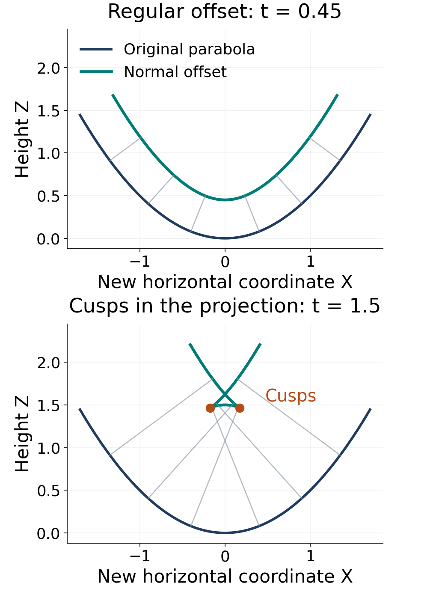

# Contact transformations and first-order equations

*GPT-6.1 Sol (OpenAI). Original exposition and English translations: CC0 1.0; quoted German originals are public domain.*

A first-order equation constrains a point, a function value, and a tangent hyperplane. Contact geometry treats these three pieces together. Its transformations can exchange positions and slopes; its infinitesimal generators are encoded by one function; and its characteristic curves reconstruct a solution from noncharacteristic initial data.

We work locally with analytic functions over $\mathbb K=\mathbb R$ or $\mathbb C$. The analytic flow theorem from One-parameter groups and canonical coordinates, Frobenius from Complete systems and invariants, and the graph-transversality calculation in Prolongation and differential invariants are used. The Euclidean normal-flow examples are real. Our convention is $W=\theta(X_W)$ and $[X,Y]=XY-YX$. Lie's original characteristic function has the opposite sign; the historical reading at the end makes this difference explicit.

## 1. Contact elements and contact transformations

On $J^1(\mathbb K^n,\mathbb K)$ use coordinates $(x^1,\ldots,x^n,z,p_1,\ldots,p_n)$ and the form

$$
\begin{aligned}
\theta&=dz-\sum_i p_i\,dx^i,\\
d\theta&=\sum_i dx^i\wedge dp_i.
\end{aligned}\tag{1.1}
$$

The hyperplane $C=\ker\theta$ is the **contact distribution**. At each point, a basis is $E_i=\partial_{x^i}+p_i\partial_z$ together with $\partial_{p_i}$. The restriction of $d\theta$ to $C$ is nondegenerate, since $d\theta(E_i,\partial_{p_j})=\delta_{ij}$. Equivalently, $\theta\wedge(d\theta)^n$ is a nowhere-zero volume form.

An immersed $n$-dimensional submanifold on which $\theta$ vanishes is **Legendrian**. On such a submanifold $d\theta$ vanishes too, by differentiating the pulled-back zero form. If its projection to $x$ is a local diffeomorphism, it is a graph $(x,z(x),p(x))$, and $\theta=0$ says $p_i=\partial_i z$. Thus it is exactly the first-jet graph of a function. A Legendrian submanifold need not project to a graph.

A local diffeomorphism $\Phi$ is **contact** if

$$
\Phi^*\theta=\rho\theta,\qquad \rho\ne0.
\tag{1.2}
$$

This condition means that it preserves $C$. It also preserves Legendrian submanifolds, though their projections can become singular.

**Theorem 1.1.** Every prolonged point diffeomorphism is contact on its graph-transverse domain. The Legendre transformation

$$
\mathcal L(x,z,p)=(p,\,p\cdot x-z,\,x)
\tag{1.3}
$$

is contact and satisfies $\mathcal L^2=\mathrm{id}$.

**Proof.** Let a point diffeomorphism be $(x,z)\mapsto(X(x,z),Z(x,z))$. Put $A^j_i=\partial_iX^j+p_iX^j_z$. Where $A$ is invertible, its prolonged slopes $P_j$ are the unique solution of

$$
\partial_iZ+p_iZ_z=\sum_jP_jA^j_i.
$$

The form $dZ-P_jdX^j$ has no $dp$ components and annihilates every $E_i$. Therefore

$$
\begin{aligned}
dZ-\sum_jP_jdX^j&=\rho\theta,\\
\rho&=Z_z-\sum_jP_jX^j_z.
\end{aligned}
$$

Use the basis $(E_1,\ldots,E_n,\partial_z)$ in point-space tangent coordinates, and the corresponding transformed basis. The point derivative has block matrix $\left(\begin{smallmatrix}A&X_z\\0&\rho\end{smallmatrix}\right)$. Its determinant is $\det A\,\rho$. Both the point derivative and $A$ are invertible, so $\rho\ne0$. Prolonging the inverse point map gives the inverse on this graph chart, establishing a contact diffeomorphism.

For (1.3), denote its new coordinates by $(X,Z,P)$. Direct calculation gives

$$
\begin{gathered}
dZ-\sum_iP_i\,dX^i\\
=d(p\cdot x-z)-x\cdot dp\\
=p\cdot dx-dz=-\theta.
\end{gathered}
$$

Applying (1.3) twice returns $(x,x\cdot p-(p\cdot x-z),p)=(x,z,p)$. The map is an exact involution; the sign occurs in its pullback of the form. $\square$

The Legendre transformation is generally not a prolonged point map, because its new independent coordinate $X=p$ depends on the slope. On a function graph it becomes a graph only where the Hessian $\partial p/\partial x$ is invertible.

In the plane, an incidence or **directrix equation** $\Omega(x,z,X,Z)=0$ supplies another useful description. Suppose $\Omega_z\Omega_Z\ne0$ and the equations

$$
\Omega=0,\qquad \Omega_x+p\Omega_z=0
\tag{1.4}
$$

can be solved for $(X,Z)$ as functions of $(x,z,p)$. Define $P=-\Omega_X/\Omega_Z$. Differentiating $\Omega=0$ and using (1.4) gives

$$
\Omega_z(dz-p\,dx)+\Omega_Z(dZ-P\,dX)=0.
$$

Thus the resulting map has multiplier $\rho=-\Omega_z/\Omega_Z$. It is a local diffeomorphism: if a tangent vector lies in the kernel of its derivative, the pullback identity forces it into $C$, and the differentiated identity forces it to be orthogonal to all of $C$ under $d\theta$. Nondegeneracy on $C$ makes that vector zero. The inverse function theorem applies. For $\Omega=z+Z-xX$, equations (1.4) give exactly (1.3). These rank and nonvanishing conditions are part of the directrix construction.

## 2. One function determines a contact vector field

A vector field $X$ is contact when $\mathcal L_X\theta=\lambda\theta$ for a function $\lambda$.

**Theorem 2.1 (generating-function bijection).** The map $X\mapsto\theta(X)$ is a linear bijection from contact vector fields to functions. For any function $W$ its inverse is

$$
\begin{aligned}
X_W&=-\sum_iW_{p_i}\partial_{x^i}\\
&+\left(W-\sum_ip_iW_{p_i}\right)\partial_z\\
&+\sum_i(W_{x^i}+p_iW_z)\partial_{p_i}.
\end{aligned}\tag{2.1}
$$

Moreover $\mathcal L_{X_W}\theta=W_z\theta$.

**Proof.** Write $X=a^i\partial_{x^i}+b\partial_z+c_i\partial_{p_i}$ and $W=b-p_ia^i$. Cartan's differentiation formula gives

$$
\begin{aligned}
\mathcal L_X\theta&=dW+\iota_Xd\theta\\
&=dW+\sum_i(a^i\,dp_i-c_i\,dx^i).
\end{aligned}
$$

Compare coefficients with $\lambda(dz-p_i\,dx^i)$. The $dz$ coefficient gives $\lambda=W_z$; the $dp_i$ coefficients give $a^i=-W_{p_i}$; and the $dx^i$ coefficients give $c_i=W_{x^i}+p_iW_z$. Finally $b=W+p_ia^i$ gives (2.1). These equations prove uniqueness. Substitution proves existence for every $W$ and the displayed Lie derivative. $\square$

In particular $X_1=\partial_z$. Adding a constant to a generating function changes its contact field. This differs from ordinary Hamiltonian fields on symplectic phase space, where constants produce zero fields.

Define the **Lagrange bracket**, also called the contact Jacobi bracket, by

$$
\{W,V\}_c=X_WV-W_zV.
\tag{2.2}
$$

Explicitly,

$$
\begin{gathered}
\{W,V\}_c=\\
\begin{aligned}
&\sum_i(W_{x^i}V_{p_i}-W_{p_i}V_{x^i})\\
&+WV_z-VW_z\\
&+\sum_ip_i(W_zV_{p_i}-W_{p_i}V_z).
\end{aligned}
\end{gathered}\tag{2.3}
$$

**Theorem 2.2 (bracket and Jacobi identity).** The bracket is antisymmetric, satisfies the Jacobi identity, and obeys

$$
[X_W,X_V]=X_{\{W,V\}_c}.
\tag{2.4}
$$

**Proof.** The formula for the Lie derivative of a form evaluated on a field gives

$$
\begin{aligned}
\theta([X_W,X_V])&=X_W(\theta(X_V))\\
&-(\mathcal L_{X_W}\theta)(X_V)\\
&=X_WV-W_zV.
\end{aligned}
$$

The commutator is contact, since

$$
\mathcal L_{[X_W,X_V]}\theta
=(X_WV_z-X_VW_z)\theta
$$

by the commutator rule for Lie derivatives. Theorem 2.1 therefore proves (2.4). Antisymmetry follows either from (2.3) or the antisymmetry of field commutators and injectivity. Applying (2.4) to the three terms of the Jacobi expression and using the Jacobi identity of differential operators proves that expression is zero, again by injectivity. $\square$

Unlike a Poisson bracket, (2.2) is not a derivation in each argument for ordinary multiplication. For example $\{W,1\}_c=-W_z$, and

$$
\begin{aligned}
\{W,UV\}_c&=\{W,U\}_cV\\
&+U\{W,V\}_c+W_zUV.
\end{aligned}
$$

For functions independent of $z$, it reduces to the ordinary Poisson bracket

$$
\begin{gathered}
\{W,V\}_P=\\
\sum_i(W_{x^i}V_{p_i}-W_{p_i}V_{x^i}).
\end{gathered}\tag{2.5}
$$

## 3. Characteristics reconstruct a solution

Let $E=\{F(x,z,p)=0\}$. From (2.2), $\{F,F\}_c=0$, hence

$$
X_FF=F F_z.
\tag{3.1}
$$

Thus $X_F$ is tangent to $E$. Its curves there satisfy

$$
\begin{aligned}
\dot x^i&=-F_{p_i},\\
\dot z&=-\sum_ip_iF_{p_i},\\
\dot p_i&=F_{x^i}+p_iF_z.
\end{aligned}\tag{3.2}
$$

Reversing the curve parameter gives the more usual signs in the characteristic equations. On $E$, $\theta(X_F)=F=0$. If $F_p\ne0$, the restriction of $dF$ to $C$ is nonzero, and nondegeneracy of $d\theta|_C$ shows that $X_F$ spans the one-dimensional kernel of $d\theta$ on $TE\cap C$. These are the characteristic curves of the equation.

Let $S$ be an analytic hypersurface in $x$ space and prescribe $z=g$ on $S$. A lifted initial datum is $(x,g(x),p^0(x))$ with

$$
p^0|_{TS}=dg,\qquad F(x,g,p^0)=0.
\tag{3.3}
$$

Let $\nu$ be a nonzero conormal to $S$. The datum is **noncharacteristic** when

$$
\sum_i\nu_iF_{p_i}(x,g,p^0)\ne0.
\tag{3.4}
$$

This is stronger than $F_p\ne0$: the characteristic base direction must be transverse to this particular $S$. Locally write $p^0=\eta+b\nu$, where $\eta|_{TS}=dg$. Given a root at a reference point, the derivative of $F(x,g,\eta+b\nu)$ with respect to $b$ is (3.4). The analytic implicit function theorem determines a unique nearby analytic root branch. Different separated roots can give different Cauchy solutions; uniqueness below fixes this branch.

**Theorem 3.1 (noncharacteristic Cauchy problem).** The union of the $X_F$ characteristics through a lifted analytic datum satisfying (3.3)–(3.4) is the first-jet graph of a unique nearby analytic solution of $F(x,z,dz)=0$ with those initial data and that root branch.

**Proof.** Parametrize $S$ by $s\in\mathbb K^{n-1}$ and let $\gamma(s)$ be its lift. The analytic flow $\Phi_t$ of $X_F$ exists on a product neighbourhood. Equation (3.1) and uniqueness of the scalar linear ODE for $F(\Phi_t\gamma(s))$ imply that its value remains zero. Thus $\Psi(s,t)=\Phi_t\gamma(s)$ lies in $E$.

At $t=0$ the derivatives of its $x$ projection in the $s$ directions span $TS$, and the $t$ derivative is $-F_p$. Condition (3.4) makes these $n$ directions independent. The inverse function theorem makes the $x$ projection of $\Psi$ a local analytic diffeomorphism. In particular, $\Psi$ is an immersed $n$-manifold.

The initial lift annihilates $\theta$ by (3.3). The flow is contact: differentiating $\Phi_t^*\theta$ gives the scalar equation with coefficient $F_z\circ\Phi_t$, so its multiplier is the nonzero exponential of the time integral of that coefficient. Consequently the transported $s$ directions still annihilate $\theta$. The $t$ direction does too, since $\theta(X_F)=F=0$ on $E$. Therefore $\Psi$ is Legendrian. Its invertible $x$ projection and Section 1 make it $(x,z(x),dz(x))$. It lies in $E$ and has the required initial value.

For uniqueness, the first-jet graph $L$ of any other nearby solution is Legendrian in $E$. For $v\in TL$, Cartan's formula gives $d\theta(X_F,v)=F_z\theta(v)-dF(v)=0$. Inside the symplectic vector space $C$, the $n$-dimensional isotropic space $TL$ is Lagrangian, hence equals its symplectic orthogonal. Since $X_F\in C$ on $E$, it follows that $X_F$ is tangent to $L$. Its flow through the initial lift stays in $L$. Uniqueness of the initial normal root forces that lift to be $\gamma$, and uniqueness of the flow forces $L$ to coincide with $\Psi$. $\square$

Multiplying $F$ by a nonvanishing function changes $X_F|_E$ by that same factor. Indeed (2.1) applied to $aF$ gives $X_{aF}|_E=aX_F|_E$. The unparametrized characteristics and the Cauchy solution depend on the equation hypersurface rather than its chosen defining function.

A **complete integral** is an $n$-parameter family $z=U(x;a)$ of solutions whose map $(x,a)\mapsto(x,U,U_x)$ has rank $2n$. Equivalently the $(n+1)\times n$ matrix with rows $U_a$ and $U_{x^i a}$ has rank $n$. The resulting Legendrian graphs locally fill a regular equation hypersurface. An envelope can produce further solutions: replace $a_n$ by a function $h(a_1,\ldots,a_{n-1})$, and solve

$$
U_{a_i}+U_{a_n}h_{a_i}=0\quad(1\le i<n)
$$

for the parameters as functions of $x$, wherever the required implicit derivative is invertible. Differentiating $z=U(x;a(x))$ then leaves $z_x=U_x$, so the envelope still satisfies $F=0$. A full stationary envelope $U_a=0$ has the same property when it defines a graph. Envelopes and their singular projections need separate rank checks; they are not covered automatically by the noncharacteristic theorem.

## 4. Poisson's theorem and the contact qualification

The word “first integral” requires care. An ordinary first integral of $X_F$ satisfies $X_FW=0$. A function commuting with $F$ in the contact bracket instead satisfies

$$
\begin{gathered}
\{F,W\}_c=0\\
\Longleftrightarrow\\
X_FW=F_zW.
\end{gathered}\tag{4.1}
$$

This is a weighted conservation equation. Ratios of two such functions are ordinary first integrals where the denominator is nonzero. For $F_z=0$, weighted and ordinary conservation agree.

**Theorem 4.1 (Poisson and contact closure).** For any collection $F_1,\ldots,F_r$, the functions satisfying $\{F_a,W\}_c=0$ for every $a$ are closed under the Lagrange bracket. If every $F_a$ is independent of $z$, the ordinary common first integrals of the fields $X_{F_a}$ therefore have this closure property. For $z$-independent functions throughout, this is Poisson's theorem for (2.5).

The corresponding assertion holds on a regular common level $E=\{F_a=0\}$ if conservation is interpreted as $\{F_a,W\}_c=0$ on $E$. In particular it holds for the weighted characteristic integrals of a regular involutive first-order system.

**Proof.** Jacobi gives

$$
\begin{gathered}
\{F_a,\{W,V\}_c\}_c=\\
\{\{F_a,W\}_c,V\}_c\\
+\{W,\{F_a,V\}_c\}_c.
\end{gathered}\tag{4.2}
$$

If the inner brackets vanish identically, both terms on the right vanish. When $F_{a,z}=0$, (2.2) identifies the conservation equation with ordinary first-integral conservation, proving the strict-contact case and its Poisson restriction.

For the assertion on $E$, put $G_a=\{F_a,W\}_c$ and $H_a=\{F_a,V\}_c$. These vanish on $E$. Also $X_WF_a=\{W,F_a\}_c+W_zF_a$ vanishes there, so $X_W$ is tangent to the regular common level; the same holds for $X_V$. A tangent field differentiates a function vanishing on $E$ to zero on $E$. Thus $\{G_a,V\}_c=-\{V,G_a\}_c=-X_VG_a+V_zG_a$ and $\{W,H_a\}_c=X_WH_a-W_zH_a$ both vanish there. Equation (4.2) proves the level-set assertion. $\square$

For the stated geometric system, involutivity means $\{F_a,F_b\}_c=0$ on $E$, with the $dF_a|_C$ independent there. The fields $X_{F_a}|_E$ are then independent characteristic directions. Regular defining equations express $\{F_a,F_b\}_c=\sum_c b_{ab}^cF_c$ locally. Formula (2.1) gives

$$
[X_{F_a},X_{F_b}]|_E=\sum_c b_{ab}^cX_{F_c}|_E,
$$

so Frobenius integrates their distribution. The closure theorem concerns functions on an ambient neighbourhood with the specified conservation on $E$; it does not define an unrestricted bracket on arbitrary functions on $E$ independent of their extensions.

Ordinary first integrals need not be closed under the contact bracket. Take $n=2$, $F=z-p_2$, and work where $p_2\ne0$. Then

$$
X_F=\partial_{x^2}+z\partial_z+p_1\partial_{p_1}+p_2\partial_{p_2}.
$$

Both $W=x^1$ and $V=p_1/p_2$ are ordinary first integrals. Nevertheless

$$
\begin{aligned}
\{W,V\}_c&=\frac1{p_2},\\
X_F\{W,V\}_c&=-\frac1{p_2}\ne0.
\end{aligned}\tag{4.3}
$$

The failure persists on the regular hypersurface $z=p_2$, with $F_p\ne0$ and a nonzero projected characteristic direction. Even $z$-independence of $W,V$ alone is insufficient: the defining function $F$ itself has $F_z=1$.

## 5. Jacobi's integration method and function groups

For $z$-independent functions, work in phase space $(x,p)$ with $\omega=\sum_i dx^i\wedge dp_i$. The associated field is $A_H=-H_{p_i}\partial_{x^i}+H_{x^i}\partial_{p_i}$, with $\iota_{A_H}\omega=-dH$ and $A_HV=\{H,V\}_P$. The contact field $X_H$ adds the $z$ component $H-p_iH_{p_i}$.

**Proposition 5.1 (integration from commuting integrals).** Suppose $H_1,\ldots,H_n$ are independent phase-space functions with $\{H_i,H_j\}_P=0$. Each regular common level is Lagrangian. On a level where projection to $x$ is invertible, one quadrature gives $z=u(x)$ with $H_i(x,du)=c_i$.

**Proof.** The fields $A_{H_i}$ are independent because $\omega$ is nondegenerate and the $dH_i$ are independent. They are tangent to each common level because their pairwise brackets vanish. That level has dimension $n$, so these fields span its tangent space. Moreover $\omega(A_{H_i},A_{H_j})=-dH_i(A_{H_j})=0$. Thus the level is Lagrangian, and the fields commute by the Poisson version of (2.4).

If the level is a graph $p=p(x)$, vanishing of the pulled-back $\omega$ says the one-form $\sum_i p_i(x)dx^i$ is closed. On a small star-shaped coordinate neighbourhood it is exact: the integral of that form along a path from a fixed point defines $u$, with path independence following by integrating the closed form over coordinate homotopies. Hence $du=p$, and the common-level equations give $H_i(x,du)=c_i$. The additive constant of $u$ is free. $\square$

This is the local mechanism of Jacobi's method. For $F(x,p)=0$, finding $n-1$ additional independent integrals in mutual Poisson involution with $F$ supplies the $H_i$. Their commuting flows give the level, and the closed one-form gives the solution. Independence and graph transversality are required. The method does not assert that an arbitrarily chosen set of conserved quantities is commuting, or that every common level projects regularly.

A **function group** in Lie's phase-space terminology consists of independent functions $H_1,\ldots,H_r$ whose brackets satisfy

$$
\{H_a,H_b\}_P=B_{ab}(H_1,\ldots,H_r).
\tag{5.1}
$$

It includes all functions of these generators. The chain rule shows closure:

$$
\{f(H),g(H)\}_P=
\sum_{a,b}f_{h_a}(H)g_{h_b}(H)B_{ab}(H).
$$

Consequently the $B_{ab}$ define a Poisson bracket on the local parameter image of $H$. Jacobi follows by pulling back its Jacobi expression along the submersion $H$. The fields $A_{H_a}$ span an involutive distribution of rank $r$, because $A_{B_{ab}(H)}=\sum_c(\partial_cB_{ab})(H)A_{H_c}$. Its $2n-r$ independent local first integrals form the **polar function group**; Poisson's theorem proves their bracket closure. A distinguished function is a function of $H$ commuting with all $H_a$, equivalently a Casimir of the parameter Poisson bracket. If $B$ has constant rank $2s$, Frobenius on its Hamiltonian distribution gives $r-2s$ independent distinguished functions locally.

For a concrete example in four-dimensional phase space, $H_1=x^1,H_2=p_1$ have bracket $1$. All functions of these two variables form a function group with no nonconstant distinguished function. Its polar group consists exactly of functions of $x^2,p_2$, again with their usual Poisson bracket. The two sets commute with one another. Lie's Chapters 8–13 develop the invariant and homogeneous forms of this theory; this description supplies the part used here.

## 6. Computed examples

**Clairaut's equation.** In one independent variable let

$$
F=z-px-f(p)=0.
$$

Equation (2.1) gives

$$
\begin{aligned}
X_F&=(x+f'(p))\partial_x\\
&+(z-f(p)+pf'(p))\partial_z,\\
\dot p&=0.
\end{aligned}\tag{6.1}
$$

The regular characteristic branches have constant $p=c$, giving the complete integral $z=cx+f(c)$. Its parameter derivative matrix has rank one because $\partial_c z_x=1$.

Under the Legendre map, the equation becomes $Z=-f(X)$, with $P$ free. A Legendrian curve in this surface satisfies $(-f'(X)-P)dX=0$. If $X$ is constant, its image is the vertical curve $X=c,Z=-f(c)$; pulling it back gives $z=cx+f(c)$. If $X$ varies, it has $P=-f'(X)$, and pulling it back gives the singular envelope

$$
\begin{aligned}
x&=-f'(p),\\
z&=f(p)-pf'(p).
\end{aligned}\tag{6.2}
$$

Where $f''(p)\ne0$, this is a graph and differentiation gives $dz/dx=p$. For analytic solutions, differentiating the original equation gives $(x+f'(p))p'=0$; the identity theorem yields one of these two branches on a connected small domain. At the envelope $F_p=0$, the contact characteristic field itself vanishes. It lies outside Theorem 3.1's noncharacteristic domain. Treating all Legendre images as graphs would lose the constant-slope solutions.

**Eikonal characteristics.** Take $F=(p_1^2+p_2^2-1)/2$. On $E$, (3.2) gives

$$
\begin{aligned}
x(t)&=x_0-tp_0,\\
p(t)&=p_0,\\
z(t)&=z_0-t,\\
|p_0|&=1.
\end{aligned}\tag{6.3}
$$

The base characteristics are straight lines of unit speed. For zero initial value on a regular plane curve, the lifted $p_0$ is either unit normal. The solution is a local signed distance on the corresponding branch, up to the first failure of the normal-ray projection. Intersections and focal points need a new analysis rather than an extension of the local uniqueness theorem beyond its domain.

**The kinetic generator.** For $W=|p|^2/2$, the full contact flow is

$$
\begin{gathered}
(x,z,p)\longmapsto\\
\left(x-tp,\ z-\frac t2|p|^2,\ p\right).
\end{gathered}\tag{6.4}
$$

Its phase-space projection is straight geodesic motion. The eikonal defining function in (6.3) is $W-1/2$, so its contact field is $X_W-\tfrac12\partial_z$. It has the same phase-space trajectories and a different $z$ transport. This is why the eikonal characteristics and (6.4) have different height rates on $|p|=1$.

**Parallel curves.** In the plane put $W=\sqrt{1+p^2}$ on the positive real branch. Its flow is

$$
\begin{gathered}
\Phi_t(x,z,p)=\\
\Bigl(x-\frac{tp}{\sqrt{1+p^2}},\\
z+\frac t{\sqrt{1+p^2}},\ p\Bigr).
\end{gathered}\tag{6.5}
$$

The point moves distance $t$ in its unit normal direction $(-p,1)/\sqrt{1+p^2}$. This is the parallel transformation historically described as dilation along normals. Differentiating (6.5) gives $\Phi_t^*\theta=\theta$, since $d(1/\sqrt{1+p^2})+p\,d(p/\sqrt{1+p^2})=0$. Along an original graph with curvature $\kappa=p_x/(1+p^2)^{3/2}$, its new independent-coordinate derivative is $1-t\kappa$. Thus the offset remains a graph only where that factor is nonzero. On the branch $1-t\kappa>0$, its oriented curvature is $\kappa/(1-t\kappa)$. The contact map remains invertible even when a particular graph develops a singular projection.

*Computed illustration of (6.5).* The original curve is $(s,s^2/2)$ with slope $p=s$ and curvature $(1+s^2)^{-3/2}$. Gray segments are its normal displacements. At $t=0.45$ the factor $1-t\kappa$ stays positive. At $t=1.5$ the two marked cusps occur at $s=\pm\sqrt{1.5^{2/3}-1}$, where that factor vanishes. The lifted curve in $(X,Z,p)$ is still regular because $dp/ds=1$. Curves are numerical samples of these exact formulas; the projection criterion is proved above. The reproducible plotting source and vector copy accompany the public source edition.

## 7. Higher jets and symplectization

### Recovering the lower jet levels

For $n\ge1$ independent and $m\ge1$ dependent variables, use the symmetric jet coordinates of lesson 9 and write $u^\alpha_J$ for the derivatives. The Cartan distribution on the unrestricted finite jet space $J^k$ is

$$
\begin{gathered}
\mathcal C_k=\ker\Bigl(du^\alpha_J-\sum_i u^\alpha_{J+i}\,dx^i:\\
|J|<k,\ 1\le\alpha\le m\Bigr).
\end{gathered}
$$

It is spanned by the truncated total derivatives

$$
D_i^{(k)}=\partial_{x^i}
+\sum_{\alpha,\,|J|<k}u^\alpha_{J+i}\partial_{u^\alpha_J}
$$

and the highest vertical fields $\partial_{u^\alpha_K}$, $|K|=k$. For $m=1,k=1$ this is the contact hyperplane of (1.1). At higher order it has a different rank and is not that same kind of hyperplane.

For any distribution $\mathcal D$, its first derived distribution is
$\mathcal D^1=\mathcal D+[\mathcal D,\mathcal D]$.
Its characteristic space consists of the $v\in\mathcal D$ for which the bracket with every local section of $\mathcal D$ remains in $\mathcal D$. This is intrinsic: the class of $[A,B]$ modulo $\mathcal D$ at a point depends only on the values of $A,B$ there. Multiplying a section by a function changes that bracket by a vector already in $\mathcal D$. A diffeomorphism preserves brackets: applying $\Phi_*[A,B]$ and $[\Phi_*A,\Phi_*B]$ to any target function gives the same expression $A(B(f\circ\Phi))-B(A(f\circ\Phi))$, transported to the target. Hence both the derived distribution and its characteristic space are preserved.

**Lemma 7.1 (the highest jet fibre).** For $k\ge2$, the characteristic distribution of $\mathcal C_k^1$ is exactly
$V_k=\ker d\pi_{k,k-1}$, where $\pi_{k,k-1}:J^k\to J^{k-1}$ forgets the highest derivatives. Also
$\mathcal C_k^1=(d\pi_{k,k-1})^{-1}\mathcal C_{k-1}$.

**Proof.** The total derivatives commute. For $|K|=k$,

$$
[\partial_{u^\alpha_K},D_i^{(k)}]
=
\begin{cases}
\partial_{u^\alpha_{K-i}},&K_i>0,\\
0,&K_i=0.
\end{cases}
$$

Every index of order $k-1$ occurs in this way. Thus $\mathcal C_k^1$ is spanned by $D_i^{(k)}$ and all vertical fields of orders $k-1$ and $k$. This is precisely the stated inverse image: subtracting the order-$k$ terms from $D_i^{(k)}$ gives a lift of $D_i^{(k-1)}$.

The order-$k$ vertical fields are characteristic, since their brackets with that spanning frame remain in $\mathcal C_k^1$. Conversely, write a characteristic vector in this frame. Its horizontal coefficient $a_i$ must vanish: bracket it with $\partial_{u^\alpha_J}$ for $J=(k-1)e_i$ and take the class modulo $\mathcal C_k^1$. The only term of order $k-2$ contributed by its horizontal part is a nonzero signed multiple of
$a_i\partial_{u^\alpha_{(k-2)e_i}}$. Coefficient derivatives contribute only vectors in the distribution. The order-$k-2$ vertical directions are independent modulo $\mathcal C_k^1$, so $a_i=0$ for every $i$.

Now let $b^\alpha_J$ be its order-$k-1$ vertical coefficients. Bracketing with each $D_i^{(k)}$ has, modulo $\mathcal C_k^1$, the coefficients $b^\alpha_{L+i}$ in the independent order-$k-2$ directions $\partial_{u^\alpha_L}$. They must all vanish. Every $J$ of order $k-1>0$ is $L+i$ for some $i$, so all $b^\alpha_J=0$. Only the highest vertical part remains. This proves the lemma. $\square$

A Cartan-preserving diffeomorphism consequently preserves $V_k$ and its local fibres, and descends to a diffeomorphism of $J^{k-1}$. The inverse-image identity in the lemma makes the descended map preserve $\mathcal C_{k-1}$. In coordinates this descent simply says that its lower output coordinates are independent of the highest input coordinates; applying the same statement to its inverse proves local invertibility downstairs.

### Why several dependent variables force point transformations

**Lemma 7.2 (the first-jet vertical space).** For $m>1$, the fibre distribution $V_1=\ker d\pi_{1,0}$ is determined intrinsically by $\mathcal C_1$. Every diffeomorphism preserving $\mathcal C_1$ is therefore a prolonged point diffeomorphism.

**Proof.** At a first jet, split $\mathcal C_1=H\oplus W$, where $H$ is spanned by the $D_i^{(1)}$, isomorphic to $\mathbb K^n$, and
$W=V_1\cong\operatorname{Hom}(H,\mathbb K^m)$ is the slope-vertical space. The bracket modulo $\mathcal C_1$, called its Levi map, is

$$
\mathcal B((v,A),(w,B))=Aw-Bv\in\mathbb K^m.
$$

This follows from $[\partial_{p^\alpha_j},D_i^{(1)}]=
\delta_{ij}\partial_{u^\alpha}$ and the other frame brackets. A subspace $S\subset\mathcal C_1$ is isotropic for this map when $\mathcal B(S,S)=0$. Let its projection to $H$ have dimension $s$. Every $A\in S\cap W$ must vanish on that projected space, so

$$
\begin{aligned}
\dim S&=s+\dim(S\cap W)\\
&\le s+m(n-s)\\
&=mn-(m-1)s.
\end{aligned}
$$

The space $W$ itself is isotropic of dimension $mn$. For $m>1$, the bound shows that it is the unique isotropic subspace of that dimension: equality forces $s=0$ and then $S=W$. It is thus intrinsic and is preserved by every Cartan-preserving map.

Such a map descends through the slope fibres to a point diffeomorphism
$\phi:J^0\to J^0$. At a first jet, $d\pi_{1,0}(\mathcal C_1)$ is the graph plane spanned by
$\partial_{x^i}+\sum_\alpha p^\alpha_i\partial_{u^\alpha}$. The descended derivative sends this plane to the graph plane of the image jet. A graph plane uniquely determines its slopes; applying the chain rule is exactly the point-prolongation formula of lesson 9. Hence the original first-jet map is that prolongation, on its graph-transverse domain. $\square$

For $m=1$ the dimension bound has no strict loss when $s>0$. Indeed, Legendre transformation exchanges the slope-vertical space with another contact-isotropic $n$-plane. Thus the scalar exception is a geometric fact about the Levi map.

**Theorem 7.3 (finite-order Bäcklund theorem).** For one dependent variable and $k\ge1$, every local analytic diffeomorphism of unrestricted $J^k$ preserving $\mathcal C_k$ is locally the prolongation of a contact transformation of $J^1$. For $m>1$ it is the prolongation of a point transformation of $J^0$. Prolongations are understood on their graph-transverse domains.

**Proof.** For $k\ge2$, apply Lemma 7.1 successively to obtain a Cartan-preserving map of $J^1$. In the scalar case it is a contact map by definition. In the multiple-dependent-variable case Lemma 7.2 makes it a point prolongation.

It remains to show that no extra choice is hidden at a higher level. A jet $z_k$ above $z_{k-1}$ determines the $n$-plane
$P_{z_k}=d\pi_{k,k-1}(\mathcal C_k|_{z_k})$ in
$\mathcal C_{k-1}|_{z_{k-1}}$. Its spanning vectors are $D_i^{(k-1)}$ plus the highest coefficients
$u^\alpha_{J+i}\partial_{u^\alpha_J}$, $|J|=k-1$. This plane is transverse to the independent-variable projection, and it determines every order-$k$ coordinate: each index $K$ of order $k$ has $K=J+i$ for some $i$.

If $\Phi_k$ descends to $\Phi_{k-1}$, Cartan preservation forces
$P_{\Phi_k(z_k)}=d\Phi_{k-1}(P_{z_k})$. The image plane uniquely determines the highest output derivatives. Computing those coefficients by the chain rule is precisely prolongation. Its graph-transversality is necessary and follows on the domain of $\Phi_k$, since the image plane is the plane of an actual output jet. Induction determines all levels uniquely from the first one.

Conversely, a contact map sends scalar Legendrian graph planes to such planes wherever the new independent-variable projection is invertible. Repeated chain-rule differentiation gives its higher prolongations and preserves the contact equations defining $\mathcal C_k$. For a point map this is the prolongation construction of lesson 9. Every finite jet is realized by a Taylor polynomial. At a fixed $k$-jet, the tangent planes of prolonged graphs span $\mathcal C_k$: they contain the total-derivative directions, and varying the Taylor coefficients of order $k+1$ supplies every highest vertical direction by taking differences of those directions. Thus graph preservation proves the distribution identity at every jet in the stated domain. For a fixed independent index $i$, changing one coefficient $u^\alpha_{K+i}$ of order $k+1$ changes the $i$th graph-tangent vector by the single direction $\partial_{u^\alpha_K}$; this also verifies the asserted spanning directly. The transformed derivatives through order $k$ use only the original derivatives through order $k$: after the first-jet coordinates, each further differentiation adds one order. Prolong the inverse first-jet or point map on the image domain. The chain rule applied to a Taylor-polynomial representative of each finite jet makes both compositions the identity. Hence the prolongations are local diffeomorphisms, and the distribution inclusions in both directions are equalities. The scalar contact graph domain and its higher-order denominator control are also proved in Proposition 4.48 of the preceding lesson. This proves both classifications. $\square$

This theorem concerns unrestricted finite jet spaces. Distributions restricted to a particular equation, transformations of infinite jets, and singular graph projections have different classification problems. Tryhuk–Chrastinová, [*On the Mapping of Jet Spaces*](https://www.atlantis-press.com/article/125951023.pdf), §3, Theorem 1, pp. 296–297, treats the classical finite-jet classification.

*Figure 7.1.* Lemmas 7.1–7.2 and Theorem 7.3. Here $\mathbb K=\mathbb R$ or $\mathbb C$, $\mathcal C_k^1=\mathcal C_k+[\mathcal C_k,\mathcal C_k]$, and $P_{z_k}=d\pi_{k,k-1}(\mathcal C_k|_{z_k})$. The upper square consists of local diffeomorphisms and commutes. The dimension bound applies to Levi-isotropic $S\subset\mathcal C_1$, with $s$ the dimension of its horizontal projection. The scalar example is the exact second-order Legendre prolongation of Exercise 6 on $q\ne0$. All prolongations use their graph-transverse domains. Diagram: GPT-6.1 Sol (OpenAI), CC0 1.0.

### Homogeneous symplectic geometry

Contact geometry also relates precisely to homogeneous symplectic geometry. Add $r\in\mathbb R^*$, or $r\in\mathbb C^*$ in the complex setting, and set

$$
\begin{aligned}
\alpha&=r\theta,\\
\omega&=d\alpha=dr\wedge\theta+r\,d\theta.
\end{aligned}\tag{7.1}
$$

This form is symplectic because $\omega^{n+1}=(n+1)r^n\,dr\wedge\theta\wedge(d\theta)^n\ne0$. A contact map with multiplier $\rho$ lifts to

$$
\widehat\Phi(q,r)=(\Phi(q),r/\rho(q)).
\tag{7.2}
$$

Pulling back $\alpha$ gives $(r/\rho)\Phi^*\theta=r\theta$, so the lift preserves $\omega$. It commutes with dilation of $r$. Conversely, a dilation-equivariant map preserving $\alpha$ descends to a contact map, by writing its radial component as $r$ times a nowhere-zero function and comparing the forms. For positive real symplectization $r>0$, restrict to positive multipliers. The Legendre map has multiplier $-1$, and (7.2) exchanges the two real components when both signs of $r$ are allowed.

The homogeneous lift (7.1)–(7.2) relates contact transformations to the symplectic geometry of phase space and generating families. It is the explicit geometric bridge between the contact and Hamiltonian constructions in this lesson.

## 8. Exercises

**Exercise 1 (easy).** Verify the Legendre map in general dimension. Determine whether the map itself is an involution and calculate its contact-form multiplier. For $z=f(x)$, state the condition for its transformed Legendrian submanifold to be a graph.

**Exercise 2 (medium).** For $n=1$, calculate $X_z,X_p,X_{xp}$ and all three pairwise brackets. Check them both as contact brackets and as vector-field commutators.

**Exercise 3 (medium).** Solve the analytic Clairaut equation using the Legendre transformation, keeping both constant-slope and singular branches. For $f(p)=p^2/2$, find its envelope and determine whether the noncharacteristic existence theorem applies there.

**Exercise 4 (medium).** In two independent variables $(x,y)$, write $p=z_y$, $q=z_x$ and solve $p^2=z$ with $z(x,0)=g(x)>0$. Fix the initial root $p(x,0)=\varepsilon\sqrt{g(x)}$, where $\varepsilon\in\{1,-1\}$. Calculate the characteristic flow and verify the resulting solution directly.

**Exercise 5 (hard).** Prove the generating-function bijection for arbitrary $n$ by comparing coefficients in Cartan's formula. Derive the bracket and its Jacobi identity. Explain, using (4.3), why ordinary characteristic first integrals are not automatically closed under that bracket.

**Exercise 6 (intermediate).** For scalar second jets on a line, write $q=z_{xx}$. Find the characteristic space of the first derived Cartan distribution. Prolong Legendre transformation to second order where $q\ne0$ and check the two contact equations directly. Explain why a higher-order contact map need not be a point prolongation.

## 9. Solutions

**Solution 1.** Write $(X,Z,P)=(p,p\cdot x-z,x)$. Then $dZ-P\cdot dX=p\cdot dx-dz=-\theta$. A second application has independent coordinate $P=x$, slope $X=p$, and height $P\cdot X-Z=z$. Thus $\mathcal L^2=\mathrm{id}$ exactly. The minus sign belongs to the contact-form multiplier. On the graph $z=f(x)$, its new base coordinate is $X=df(x)$, whose Jacobian is the Hessian of $f$. The inverse function theorem gives a transformed graph precisely where that Hessian is invertible. The contact image exists even when this graph condition fails.

**Solution 2.** Substituting in (2.1) gives

$$
\begin{aligned}
X_z&=z\partial_z+p\partial_p,\\
X_p&=-\partial_x,\\
X_{xp}&=-x\partial_x+p\partial_p.
\end{aligned}
$$

The contact brackets are $\{z,p\}_c=X_zp-p=0$, $\{z,xp\}_c=X_z(xp)-xp=0$, and $\{p,xp\}_c=-\partial_x(xp)=-p$. Hence

$$
\begin{aligned}
[X_z,X_p]&=0,\\
[X_z,X_{xp}]&=0,\\
[X_p,X_{xp}]&=-X_p=\partial_x.
\end{aligned}
$$

Direct coefficient differentiation gives exactly these commutators. For example $[-\partial_x,-x\partial_x+p\partial_p]=\partial_x$. This also checks the bracket sign fixed in this lesson.

**Solution 3.** The transformed equation is $Z=-f(X)$. Its Legendrian condition is $(-f'(X)-P)dX=0$. Constant $X=c$ gives a vertical curve with $Z=-f(c)$ and arbitrary $P$, hence $z=cx+f(c)$ after applying the involution. The other analytic branch has $P=-f'(X)$; returning to $(x,z,p)$ gives (6.2). Differentiating the original Clairaut equation proves exhaustiveness for analytic solution germs: $(x+f'(p))p'=0$, and on a connected analytic germ one factor vanishes identically.

For $f(p)=p^2/2$, the envelope has $p=-x$ and $z=-x^2/2$. Its derivative is $-x=p$, and substitution gives $px+p^2/2=-x^2/2$. But $F_p=-x-p=0$ there, and (6.1) vanishes on that branch. Theorem 3.1 does not assert uniqueness there. The straight line $z=cx+c^2/2$ is tangent to the envelope at $x=-c$, illustrating precisely the degenerate projection and characteristic initial slope.

**Solution 4.** Put $F=p^2-z$ and use slopes $(q,p)$ in the order $(x,y)$. Then $F_z=-1$, $F_p=2p$, and $F_q=F_x=F_y=0$. Formula (3.2) on $E$ yields

$$
\begin{aligned}
\dot x&=0,\\
\dot y&=-2p,\\
\dot z&=-2z,\\
\dot q&=-q,\\
\dot p&=-p.
\end{aligned}
$$

From initial coordinate $a$ on $y=0$ and initial slopes $q=g'(a)$, $p=\varepsilon\sqrt{g(a)}$, the solution is

$$
\begin{aligned}
x&=a,\\
p&=\varepsilon\sqrt{g(a)}e^{-t},\\
q&=g'(a)e^{-t},\\
y&=2\varepsilon\sqrt{g(a)}(e^{-t}-1),\\
z&=g(a)e^{-2t}.
\end{aligned}
$$

The $y$ derivative at $t=0$ is nonzero, so eliminate $(a,t)$ to get

$$
z(x,y)=\left(\sqrt{g(x)}+\frac{\varepsilon y}{2}\right)^2.
\tag{9.1}
$$

Its $y$ derivative is $\varepsilon(\sqrt g+\varepsilon y/2)$, whose square is (9.1). Its $x$ derivative is $(\sqrt g+\varepsilon y/2)g'/\sqrt g$, agreeing with the characteristic $q$ after substituting $e^{-t}=1+\varepsilon y/(2\sqrt g)$. Its initial value is $g$. The positivity of $g$ gives a real analytic square-root branch and makes the initial datum noncharacteristic. The result is local near $y=0$; this argument makes no uniqueness assertion for initial data where $g=0$.

**Solution 5.** If $X=a^i\partial_{x^i}+b\partial_z+c_i\partial_{p_i}$ and $W=b-p_ia^i$, then $\iota_Xd\theta=a^i dp_i-c_i dx^i$. Cartan's formula makes $\mathcal L_X\theta=dW+a^i dp_i-c_i dx^i$. Comparison with $\lambda\theta$ first gives $\lambda=W_z$, then $a^i=-W_{p_i}$, $c_i=W_{x^i}+p_iW_z$, and finally $b=W-p_iW_{p_i}$. Substitution verifies all components, proving both directions of the bijection for every $n$.

Evaluation on $X_V$ gives $\theta([X_W,X_V])=X_WV-W_zV$. Lie derivatives show that the commutator is contact, so the bijection identifies it with the field of that bracket. Its injectivity transfers the operator Jacobi identity to functions. Ordinary conservation would omit the $-F_zW$ term in the commuting condition. For $F=z-p_2$, $W=x^1$ and $V=p_1/p_2$ are ordinarily conserved by translation in $x^2$ and simultaneous scaling of $z,p$, while their bracket $1/p_2$ scales with weight $-1$. Thus ordinary conservation does not imply bracket closure; (4.1) gives the weighted closure statement.

**Solution 6.** The distribution is
$\mathcal C_2=\langle D,\partial_q\rangle$, with
$D=\partial_x+p\partial_z+q\partial_p$.
Since $[\partial_q,D]=\partial_p$, its first derived distribution is
$\langle D,\partial_p,\partial_q\rangle$.
The bracket $[\partial_p,D]=\partial_z$ lies outside it, forcing both the $D$ and $\partial_p$ coefficients of a characteristic vector to be zero. Its characteristic space is exactly $\mathbb K\partial_q$, the fibre of $J^2\to J^1$.

Legendre transformation has $(X,Z,P)=(p,xp-z,x)$. Along a graph,
$D X=q$ and $D P=1$, so the second derivative is $Q=1/q$. The resulting map
$(x,z,p,q)\mapsto(p,xp-z,x,1/q)$ is invertible and satisfies

$$
\begin{aligned}
dZ-P\,dX&=-(dz-p\,dx),\\
dP-Q\,dX&=-\frac1q(dp-q\,dx).
\end{aligned}
$$

It therefore preserves $\mathcal C_2$. Its first independent coordinate depends on the input slope, so its descended first-jet map is not a point prolongation. This is the scalar alternative in Theorem 7.3, with its necessary domain $q\ne0$.

## Historical reading and references

The historical material includes the introductions to Part I and Chapter 1 and the complete §§1–3 of Chapter 1, together with selected passages from Chapters 4 and 14. The first reading develops contact elements, generating relations, contact composition and integral families. The later selections concern the geometric integration problem and characteristic functions. English translations: GPT-6.1 Sol (OpenAI). Chapter 8 treats function groups; the infinitesimal contact formulas belong to Chapters 14–15.

### Contact elements: Volume II, Chapter 1, introductions and §§1–3

Sophus Lie and Friedrich Engel, *Theorie der Transformationsgruppen*, Volume II (1890), introductions to Part I and Chapter 1, followed by the complete Chapter 1 §§1–3, printed pp. 1–15. [German original](https://archive.org/details/theotransformation02liesrich).

The German original is in the public domain. Transcription and English translation: GPT-6.1 Sol (OpenAI), CC0 1.0.

The analytic inverse and implicit-function arguments are proved in Theorems A–B of Lesson 1. Point prolongations are derived in Section 2 of Lesson 9; scalar contact graph domains are treated in its Proposition 4.48. The finite-jet classification is proved in [Theorem 7.3](#7-higher-jets-and-symplectization). The historical slope $y'$ is denoted by $p$ in the modern contact coordinates.

#### German text: introductions and §§1–3

**Abtheilung I.**

**Begriff der Berührungstransformationen.**

In dieser ersten Abtheilung soll der allgemeine Begriff der *Berührungstransformationen* eingeführt und sollen die hervorragendsten Eigenschaften dieser Transformationen abgeleitet werden.

Will man in das Wesen dieser wichtigen Transformationen tiefer eindringen, so ist es nothwendig oder jedenfalls wünschenswerth, dass man sich des Zusammenhangs bewusst ist, welcher zwischen der Theorie der Berührungstransformationen und der Integrationstheorie der partiellen Differentialgleichungen erster Ordnung besteht. Aus diesem Grunde ist in den Kapiteln 4 und 7 die Theorie der partiellen Differentialgleichungen erster Ordnung in aller Kürze dargestellt. Dabei legen wir das Hauptgewicht auf die Entwickelung der Begriffe; wir suchen diese *Begriffe* in ihrer *wahren Allgemeinheit* zu geben. Eine vollständige Integrationstheorie der partiellen Differentialgleichungen erster Ordnung wird keineswegs gegeben, wenn auch von der Theorie der partiellen Differentialgleichungen mehr gebracht wird, als streng genommen erforderlich sein würde.

Um das Verständniss des äusserst wichtigen, aber abstrakten Kapitels 4 zu erleichtern, entwickeln wir zuerst in Kapitel 1 kurz die Theorie der Berührungstransformationen einer Ebene und ebenso in Kapitel 3 die Theorie der Berührungstransformationen des dreifach ausgedehnten Raumes.

**Kapitel 1.**

**Die Berührungstransformationen in der Ebene.**

Wir entwickeln in diesem Kapitel den Begriff der Berührungstransformationen einer Ebene und leiten eine Reihe von einfachen Sätzen über derartige Transformationen ab. Unsere Einsicht in das Wesen der Berührungstransformationen wird dabei besonders gefördert durch die Einführung eines andern wichtigen Begriffs, welcher die Begriffe: Punkt und Curve der Ebene als Specialfälle und zwar als einzige Specialfälle umfasst.

**§ 1.**

In zwei Veränderlichen sei eine Transformation:

$$
x_1=X(x,y),\qquad y_1=Y(x,y)
\tag{1}
$$

vorgelegt; $x,y$ und $x_1,y_1$ mögen in ein und derselben Ebene, in ein und demselben rechtwinkligen Coordinatensysteme als die Coordinaten zweier Punkte gedeutet werden, so dass also die Transformation (1) als eine Operation erscheint, welche den Punkt mit den Coordinaten $x,y$ in einen Punkt mit den Coordinaten $x_1,y_1$ überführt.

Bei dieser Auffassung werden alle Punkte einer Curve: $y-\varphi(x)=0$ von der Transformation (1) in die Punkte einer neuen Curve übergeführt, oder kürzer: es geht jede Curve: $y-\varphi(x)=0$ in eine neue Curve über. Die Gleichung dieser neuen Curve ergiebt sich, wenn man vermöge (1) die Veränderlichen $x,y$ aus $y-\varphi(x)=0$ fortschafft; sie kann offenbar im Allgemeinen die analoge Form: $y_1-\varphi_1(x_1)=0$ erhalten; von den Fällen, wo dies nicht möglich ist, sehen wir hier ab.

Zu jedem Punkte $x,y$ der Curve: $y-\varphi(x)=0$ gehört ein gewisser Werth des Differentialquotienten:

$$
\frac{dy}{dx}=y'
$$

und zu dem entsprechenden Punkte: $x_1=X,y_1=Y$ der transformirten Curve: $y_1-\varphi_1(x_1)=0$ gehört ein gewisser Werth des Differentialquotienten:

$$
\frac{dy_1}{dx_1}=y_1'.
$$

Zwischen den Grössen $y_1'$ und $y'$ besteht ein Zusammenhang, den wir entwickeln wollen.

Ist $x+dx,y+dy$ ein Punkt der Curve: $y-\varphi(x)=0$, welcher dem Punkte $x,y$ derselben unendlich benachbart ist, so besteht die Gleichung: $dy-y'dx=0$; für den entsprechenden Punkt $x_1+dx_1,y_1+dy_1$ der transformirten Curve gilt ebenso: $dy_1-y_1'dx_1=0$. Drücken wir in dieser letzten Gleichung $x_1$ und $y_1$ vermöge (1) durch $x$ und $y$ aus, so bekommen wir:

$$
\begin{gathered}
dY-y_1'dX=\\
\left(\frac{\partial Y}{\partial x}-y_1'\frac{\partial X}{\partial x}\right)dx\\
+\left(\frac{\partial Y}{\partial y}-y_1'\frac{\partial X}{\partial y}\right)dy=0.
\end{gathered}
$$

Nun aber sind $dx$ und $dy$ unter der gemachten Voraussetzung nur durch die Relation: $dy-y'dx=0$ verknüpft und sonst ganz willkürlich; folglich muss die eben gefundene Gleichung zwischen $dx$ und $dy$ die Form: $dy-y'dx=0$ erhalten können; es muss also eine solche Grösse $\varrho$ geben, dass die Gleichung:

$$
\begin{gathered}
\left(\frac{\partial Y}{\partial x}-y_1'\frac{\partial X}{\partial x}\right)dx\\
+\left(\frac{\partial Y}{\partial y}-y_1'\frac{\partial X}{\partial y}\right)dy\\
=\varrho(dy-y'dx)
\end{gathered}
$$

für alle Werthe von $dx$ und $dy$ besteht. Durch Vergleichung der Coefficienten von $dx$ und $dy$ erhalten wir hieraus:

$$
\left\{\begin{aligned}
\frac{\partial Y}{\partial y}-y_1'\frac{\partial X}{\partial y}&=\varrho,\\
\frac{\partial Y}{\partial x}-y_1'\frac{\partial X}{\partial x}&=-\varrho y',
\end{aligned}\right.
\tag{2}
$$

mithin durch Wegschaffung von $\varrho$ und Auflösung nach $y_1'$:

$$
y_1'=\frac{\dfrac{\partial Y}{\partial x}+y'\dfrac{\partial Y}{\partial y}}
{\dfrac{\partial X}{\partial x}+y'\dfrac{\partial X}{\partial y}},
\tag{3}
$$

eine sehr bekannte Formel.

Wir haben hiemit $y_1'$ durch $x,y,y'$ ausgedrückt; da nun die Gleichung (3) offenbar nach $y'$ auflösbar ist, so lässt sich mit Hülfe von (1) auch umgekehrt $y'$ durch $x_1,y_1,y_1'$ ausdrücken; wir sehen also, dass die Gleichungen (1) und (3) zusammengenommen:

$$
\left\{\begin{aligned}
&x_1=X(x,y),\quad y_1=Y(x,y)\\
&y_1'=\frac{\dfrac{\partial Y}{\partial x}+y'\dfrac{\partial Y}{\partial y}}
{\dfrac{\partial X}{\partial x}+y'\dfrac{\partial X}{\partial y}}=P(x,y,y')
\end{aligned}\right.
\tag{4}
$$

eine Transformation in den drei Veränderlichen $x,y,y'$ darstellen.

Die Transformation (1) transformirt zugleich mit $x$ und $y$ auch die Grösse $y'$ und zwar so, wie es die Transformation (4) angiebt. Wir sagen deshalb, dass die Transformation (4) in den Veränderlichen $x,y,y'$ aus der Transformation (1) durch *Erweiterung* entstanden ist, und wir bezeichnen (4) einfach als *die zu (1) gehörige erweiterte Transformation*.

Ihrer Herleitung zufolge ist die erweiterte Transformation (4) so beschaffen, dass eine Identität von der Form:

$$
dY-PdX\equiv\varrho(dy-y'dx)
\tag{5}
$$

besteht, wo $\varrho$ den Werth:

$$
\varrho=
\frac{\dfrac{\partial X}{\partial x}\dfrac{\partial Y}{\partial y}
-\dfrac{\partial X}{\partial y}\dfrac{\partial Y}{\partial x}}
{\dfrac{\partial X}{\partial x}+y'\dfrac{\partial X}{\partial y}}
$$

besitzt und demnach eine ganz bestimmte Function von $x,y,y'$ ist. Hierin liegt, dass die Transformation (4) die *Pfaffsche* Gleichung: $dy-y'dx=0$ invariant lässt. Ausserdem zeigen die obigen Entwickelungen, dass bei gegebenen $X(x,y)$ und $Y(x,y)$ die Grössen $\varrho$ und $P$ durch die Identität (5) eindeutig als Functionen von $x,y,y'$ bestimmt sind; also können wir sagen:

*Die zu (1) gehörige erweiterte Transformation (4) ist die einzige Transformation von der Form:*

$$
\begin{gathered}
x_1=X(x,y),\\
 y_1=Y(x,y),\\
 y_1'=\Pi(x,y,y'),
\end{gathered}\tag{6}
$$

*welche die Pfaffsche Gleichung: $dy-y'dx=0$ invariant lässt.*

Die Tangente der Curve: $y-\varphi(x)=0$ im Punkte $x,y$ ist durch die zu diesem Punkte gehörigen Werthe von $x,y,y'$ bestimmt, ihre Gleichung ist ja:

$$
\mathfrak y-y=y'(\mathfrak x-x).
$$

Die Tangente der transformirten Curve im Punkte: $x_1=X,y_1=Y$ lautet:

$$
\mathfrak y-y_1=y_1'(\mathfrak x-x_1),
$$

wo der Werth von $y_1'$ aus (4) zu entnehmen ist. Hieraus folgt, *dass alle Curven, welche mit der Curve: $y-\varphi(x)=0$ den Punkt $x,y$ und die zugehörige Tangente gemein haben, bei der Transformation* (1) *in solche Curven übergehen, welche mit der Curve: $y_1-\varphi_1(x_1)=0$ den Punkt: $x_1=X,y_1=Y$ und die zugehörige Tangente gemein haben.* Kürzer ausgedrückt: *Die Transformation* (1) *verwandelt solche Curven der Ebene, welche sich in einem gemeinsamen Punkte berühren, in Curven, die sich in einem gemeinsamen Punkte berühren.*

Das System der beiden Grössen $x,y$ wird in der Ebene durch einen Punkt dargestellt. Nehmen wir noch die dritte Grösse $y'$ hinzu, so erhalten wir zu dem Punkte $x,y$ eine gewisse hindurchgehende Gerade zugeordnet, nämlich die gemeinsame Tangente:

$$
\mathfrak y-y=y'(\mathfrak x-x)
\tag{7}
$$

aller Curven, welche durch den Punkt $x,y$ hindurchgehen und für welche die Grösse $\dfrac{dy}{dx}$ in diesem Punkte gerade den Werth $y'$ hat. Es liegt daher nahe, den Punkt $x,y$ im Verein mit der hindurchgehenden Geraden (7) als das geometrische Bild des Werthsystems $x,y,y'$ aufzufassen. Die so definirte Figur, also den *Inbegriff des Punktes $x,y$ und der hindurchgehenden Geraden* (7) bezeichnen wir als ein *Linienelement* oder noch kürzer als ein *Element* der Ebene $x,y$. Die Grössen $x,y,y'$ fassen wir als die *Coordinaten* dieses Linienelementes auf.

Nach Einführung des Begriffes Linienelement können wir die Transformation (4) als eine *Linienelement*transformation der Ebene $x,y$ bezeichnen im Gegensatz zu der Transformation (1), welche eine *Punkt*transformation dieser Ebene ist. Da übrigens (4) die zu (1) gehörige erweiterte Transformation ist, so sehen wir:

**Satz 1.** *Jede Punkttransformation:*

$$
x_1=X(x,y),\qquad y_1=Y(x,y)
\tag{1}
$$

*der Ebene $x,y$ bestimmt eine Transformation der Linienelemente dieser Ebene; der analytische Ausdruck dieser letzteren Transformation ist die zu (1) gehörige erweiterte:*

$$
\begin{gathered}
x_1=X(x,y),\\
 y_1=Y(x,y),\\

y_1'=\frac{\dfrac{\partial Y}{\partial x}+y'\dfrac{\partial Y}{\partial y}}
{\dfrac{\partial X}{\partial x}+y'\dfrac{\partial X}{\partial y}},
\end{gathered}\tag{4}
$$

*welche dadurch charakterisirt ist, dass sie die Pfaffsche Gleichung: $dy-y'dx=0$ invariant lässt.*

Wählen wir die Punkttransformation (1) ganz allgemein, so wird doch die Linienelementtransformation (4) keine allgemeine, sie besitzt vielmehr offenbar die folgenden beiden besonderen Eigenschaften: *Erstens* verwandelt sie solche Linienelemente, welche den Punkt gemein haben, stets in Linienelemente mit gemeinsamem Punkt und *zweitens* lässt sie nach Satz 1 die *Pfaffsche* Gleichung:

$$
dy-y'dx=0
$$

invariant.

Man überzeugt sich leicht, dass diese beiden Eigenschaften zusammen nur den Transformationen von der Form (4) zukommen. In der That, jede Linienelementtransformation, welche die erste jener zwei Eigenschaften besitzt, hat augenscheinlich die Gestalt:

$$
\begin{gathered}
x_1=X(x,y),\\
 y_1=Y(x,y),\\
 y_1'=\Pi(x,y,y');
\end{gathered}\tag{6}
$$

lässt aber eine Transformation von dieser Art die Pfaffsche Gleichung: $dy-y'dx=0$ invariant, so ist sie nach S. 4 die zu

$$
x_1=X(x,y),\qquad y_1=Y(x,y)
$$

gehörige erweiterte Transformation, sie besitzt also die Form (4).

*Wir sehen hieraus, dass die Transformationen von der Form* (4) *durch ihre vorhin angegebenen beiden Eigenschaften vollständig definirt sind.*

Nun liegt auf der Hand, dass die zweite der genannten beiden Eigenschaften keine Folge der ersten ist; dagegen ist keineswegs unmittelbar klar, ob nicht etwa die erste Eigenschaft eine Folge der zweiten ist; es wäre ja denkbar, dass die erweiterten Punkttransformationen (4) die einzigen Transformationen in $x,y,y'$ wären, welche die Pfaffsche Gleichung: $dy-y'dx=0$ invariant lassen. Wir werden zeigen, dass eine solche Vermuthung der Wahrheit *nicht* entspricht, dass es vielmehr ausser den erweiterten Punkttransformationen (4) noch unbegrenzt viele Transformationen in $x,y,y'$ giebt, welche jene Pfaffsche Gleichung invariant lassen. Es ist naturgemäss für diese Transformationen und für die erweiterten Punkttransformationen eine gemeinsame Benennung zu benutzen. *Wir bezeichnen daher jede Transformation in $x,y,y'$, welche die Pfaffsche Gleichung:*

$$
dy-y'dx=0
$$

*invariant lässt, als eine* **Berührungstransformation**\*) *der Ebene $x,y$.* Die erweiterten Punkttransformationen (4) können einfach als diejenigen Berührungstransformationen charakterisirt werden, welche Linienelemente mit demselben Punkte stets wieder in Linienelemente mit demselben Punkte überführen.

**§ 2.**

Unsere nächste Aufgabe ist jetzt, alle Transformationen in $x,y,y'$ zu bestimmen, welche Berührungstransformationen der Ebene $x,y$ sind.

Wir betrachten eine beliebige Berührungstransformation:

$$
\begin{gathered}
x_1=X(x,y,y'),\\
 y_1=Y(x,y,y'),\\
 y_1'=P(x,y,y').
\end{gathered}\tag{8}
$$

Da dieselbe die Pfaffsche Gleichung: $dy-y'dx=0$ invariant lässt, so befriedigt sie eine Identität von der Form:

$$
dY-PdX\equiv\varrho(dy-y'dx),
$$

wo $\varrho$ eine Function von $x,y,y'$ bezeichnet.

Die Function $\varrho$ kann nicht identisch verschwinden; die Identität:

$$
dY-PdX\equiv0
$$

würde nämlich die folgenden drei:

$$
\begin{gathered}
\frac{\partial Y}{\partial x}-P\frac{\partial X}{\partial x}\\
=\frac{\partial Y}{\partial y}-P\frac{\partial X}{\partial y}\\
=\frac{\partial Y}{\partial y'}-P\frac{\partial X}{\partial y'}=0
\end{gathered}
$$

nach sich ziehen; folglich wären alle zweireihigen Determinanten der Matrix:

$$
\left|\begin{matrix}
\dfrac{\partial X}{\partial x}&\dfrac{\partial X}{\partial y}&\dfrac{\partial X}{\partial y'}\\
\dfrac{\partial Y}{\partial x}&\dfrac{\partial Y}{\partial y}&\dfrac{\partial Y}{\partial y'}
\end{matrix}\right|
$$

identisch null, so dass $X,Y$ keine unabhängigen Functionen von $x,y,y'$ wären und die Gleichungen (8) gar keine Transformation darstellten.

\*) Sophus Lie, Göttinger Nachrichten [Februar 1870](https://archive.org/details/nachrichtenvond64gtgoog) und [October 1872](https://gdz.sub.uni-goettingen.de/id/PPN252457072_1872); [Comptes rendus de l’Académie des sciences, Paris, October 1870](https://archive.org/details/comptes-rendus-hebdomadaires-academie-des-sciences_1870-10-31_71_18); Verhandlungen der Gesellschaft der Wissenschaften zu Christiania [1870](https://archive.org/details/mobot31753002493101)–[1873](https://archive.org/details/forhandlingerivi1872chri); Mathematische Annalen Bd. [V](https://archive.org/details/sim_mathematische-annalen_1872_5) und Bd. [VIII](https://archive.org/details/sim_mathematische-annalen_1875_8).

Denken wir uns jetzt aus den Gleichungen (8) unsrer Berührungstransformation $y_1'$ und $y'$ weggeschafft, so müssen wir mindestens eine Relation zwischen $x,y,x_1,y_1$ allein erhalten; es ist aber auch denkbar, dass sich zwei unabhängige Relationen dieser Art ergeben.

Der zweite Fall kann nur eintreten, wenn $X$ und $Y$ von $y'$ frei sind, wenn also (8) die Form hat:

$$
\begin{gathered}
x_1=X(x,y),\\
 y_1=Y(x,y),\\
 y_1'=P(x,y,y').
\end{gathered}
$$

Diese Transformation aber lässt nach S. 4 die Pfaffsche Gleichung: $dy-y'dx=0$ dann und nur dann invariant, wenn sie aus der Punkttransformation:

$$
x_1=X(x,y),\qquad y_1=Y(x,y)
$$

durch Erweiterung entstanden ist. Also:

**Satz 2.** *Jede Berührungstransformation:*

$$
\begin{gathered}
x_1=X(x,y,y'),\\
 y_1=Y(x,y,y'),\\
 y_1'=P(x,y,y')
\end{gathered}\tag{8}
$$

*der Ebene $x,y$, aus deren Gleichungen zwei unabhängige Relationen zwischen $x,y,x_1,y_1$ allein folgen, besitzt die Form:*

$$
\begin{gathered}
x_1=X(x,y),\\
 y_1=Y(x,y),\\

y_1'=\frac{\dfrac{\partial Y}{\partial x}+y'\dfrac{\partial Y}{\partial y}}
{\dfrac{\partial X}{\partial x}+y'\dfrac{\partial X}{\partial y}}
\end{gathered}
$$

*und ist daher eine erweiterte Punkttransformation dieser Ebene.*

Betrachten wir nunmehr den Fall, dass sich aus den Gleichungen (8) unsrer Berührungstransformation blos eine Relation zwischen $x,y,x_1,y_1$ allein ergiebt, etwa die folgende:

$$
\Omega(x,y,x_1,y_1)=0.
$$

Es ist klar, dass in diesem Falle aus (8) nur eine einzige von $y'$ und $y_1'$ freie Relation zwischen $dx,dy,dx_1,dy_1$ folgen kann, nämlich die Relation:

$$
\frac{\partial\Omega}{\partial x}dx+\frac{\partial\Omega}{\partial y}dy
+\frac{\partial\Omega}{\partial x_1}dx_1+\frac{\partial\Omega}{\partial y_1}dy_1=0.
$$

Nun aber soll (8) eine Berührungstransformation der Ebene $x,y$ sein, es soll also eine Gleichung von der Form:

$$
dy_1-y_1'dx_1-\varrho(x,y,y')\{dy-y'dx\}=0
$$

bestehen. Drücken wir in derselben, was unter der gemachten Voraussetzung möglich ist, $y_1'$ und $y'$ vermöge (8) durch $x,y,x_1,y_1$ aus, so erhalten wir eine von $y'$ und $y_1'$ freie Relation zwischen $dx,dy,dx_1,dy_1$, welche mit der vorhin gefundenen identisch sein muss. Mit andern Worten: es müssen die Gleichungen:

$$
\frac{\partial\Omega}{\partial x}:\frac{\partial\Omega}{\partial y}:
\frac{\partial\Omega}{\partial x_1}:\frac{\partial\Omega}{\partial y_1}
=\varrho y':-\varrho:-y_1':1
$$

eine Folge der Transformationsgleichungen (8) sein. Dabei ist es leicht nachzuweisen, dass unter den Differentialquotienten von $\Omega$ keiner vermöge (8) verschwindet; andernfalls verschwänden nämlich alle vier Differentialquotienten von $\Omega$, und das ist offenbar unmöglich.

Wir ersehen hieraus, dass die drei Gleichungen:

$$
\begin{gathered}
\Omega(x,y,x_1,y_1)=0,\\

\frac{\partial\Omega}{\partial x}+y'\frac{\partial\Omega}{\partial y}=0,\\

\frac{\partial\Omega}{\partial x_1}+y_1'\frac{\partial\Omega}{\partial y_1}=0
\end{gathered}
$$

vermöge (8) identisch bestehen; da aber dieselben von einander unabhängig sind, so muss das von ihnen gebildete Gleichungensystem mit (8) äquivalent sein. Also:

*Jede Berührungstransformation der Ebene $xy$, aus deren Gleichungen* (8) *nur eine Relation $\Omega(x,y,x_1,y_1)=0$ zwischen $x,y,x_1,y_1$ allein folgt, wird bestimmt durch die drei Gleichungen:*

$$
\begin{gathered}
\Omega=0,\\

\frac{\partial\Omega}{\partial x}+y'\frac{\partial\Omega}{\partial y}=0,\\

\frac{\partial\Omega}{\partial x_1}+y_1'\frac{\partial\Omega}{\partial y_1}=0.
\end{gathered}\tag{8'}
$$

Ist umgekehrt irgend eine Function $\Omega$ von $x,y,x_1,y_1$ vorgelegt, welche so beschaffen ist, dass die drei Gleichungen (8') sowohl nach $x_1,y_1,y_1'$ als nach $x,y,y'$ auflösbar sind, so definiren diese drei Gleichungen eine Berührungstransformation der Ebene $x,y$. In der That, vermöge der Transformation (8') verwandelt sich die Gleichung:

$$
\frac{\partial\Omega}{\partial x}dx+\frac{\partial\Omega}{\partial y}dy
+\frac{\partial\Omega}{\partial x_1}dx_1+\frac{\partial\Omega}{\partial y_1}dy_1=0
$$

in:

$$
\frac{\partial\Omega}{\partial y_1}\{dy_1-y_1'dx_1\}
+\frac{\partial\Omega}{\partial y}\{dy-y'dx\}=0,
$$

also lässt die Transformation (8') wirklich die Pfaffsche Gleichung: $dy-y'dx=0$ invariant. Die zugehörige Function $\varrho(x,y,y')$ hat den Werth:

$$
\varrho=-\frac{\dfrac{\partial\Omega}{\partial y}}{\dfrac{\partial\Omega}{\partial y_1}}.
$$

Wünscht man daher zu entscheiden, ob ein vorgelegtes Gleichungensystem von der Form (8') eine Berührungstransformation bestimmt, so hat man nur festzustellen, ob sich dasselbe sowohl nach $x_1,y_1,y_1'$ als nach $x,y,y'$ auflösen lässt.

Soll das Gleichungensystem (8') diese beiden Auflösungen zulassen, so ist jedenfalls nothwendig, dass die vier Veränderlichen $x,y,x_1,y_1$ sämmtlich in $\Omega$ vorkommen. Ist diese Bedingung erfüllt, so wird (8') jedenfalls die Grössen $x_1,y_1,y_1'$ als Functionen von $x,y,y'$ bestimmen, sobald die beiden Gleichungen:

$$
\Omega=0,\qquad\frac{\partial\Omega}{\partial x}+y'\frac{\partial\Omega}{\partial y}=0
$$

nach $x_1,y_1$ auflösbar sind, oder was auf dasselbe hinauskommt, sobald die drei Gleichungen:

$$
\begin{gathered}
\Omega=0,\\
 -y'+\lambda\frac{\partial\Omega}{\partial x}=0,\\

1+\lambda\frac{\partial\Omega}{\partial y}=0
\end{gathered}\tag{9}
$$

nach $x_1,y_1,\lambda$ aufgelöst werden können. Um darüber Auskunft zu erhalten, ob das der Fall ist, bildet man nach einer bekannten Regel die Determinante:

$$
\left|\begin{matrix}
0&\dfrac{\partial\Omega}{\partial x}&\dfrac{\partial\Omega}{\partial y}\\
\dfrac{\partial\Omega}{\partial x_1}&\lambda\dfrac{\partial^2\Omega}{\partial x\partial x_1}&\lambda\dfrac{\partial^2\Omega}{\partial y\partial x_1}\\
\dfrac{\partial\Omega}{\partial y_1}&\lambda\dfrac{\partial^2\Omega}{\partial x\partial y_1}&\lambda\dfrac{\partial^2\Omega}{\partial y\partial y_1}
\end{matrix}\right|
$$

welche durch $\lambda$ dividirt in die Determinante:

$$
\Delta=\left|\begin{matrix}
0&\dfrac{\partial\Omega}{\partial x}&\dfrac{\partial\Omega}{\partial y}\\
\dfrac{\partial\Omega}{\partial x_1}&\dfrac{\partial^2\Omega}{\partial x\partial x_1}&\dfrac{\partial^2\Omega}{\partial y\partial x_1}\\
\dfrac{\partial\Omega}{\partial y_1}&\dfrac{\partial^2\Omega}{\partial x\partial y_1}&\dfrac{\partial^2\Omega}{\partial y\partial y_1}
\end{matrix}\right|
$$

übergeht, und hat nun zu untersuchen, ob $\Delta$ vermöge (9) oder, was auf dasselbe hinauskommt, ob es vermöge $\Omega=0$ verschwindet. Ist das nicht der Fall, so sind die Gleichungen (8') sicher nach $x_1,y_1,y_1'$ auflösbar.

Die Determinante $\Delta$ ist augenscheinlich in Bezug auf die beiden Grössenpaare $x,y$ und $x_1,y_1$ symmetrisch. Verschwindet daher $\Delta$ vermöge $\Omega=0$ nicht, so sind die Gleichungen (8') nothwendig auch nach $x,y,y'$ auflösbar, und da sie, wie wir eben gesehen haben, zugleich nach $x_1,y_1,y_1'$ aufgelöst werden können, so stellen sie eine Transformation dar; diese Transformation ist nach der oben gemachten Bemerkung eine Berührungstransformation.

Aus dem Vorangehenden folgt, dass die Gleichungen (8') dann und nur dann eine Berührungstransformation bestimmen, wenn $\Omega$ alle vier Veränderlichen $x,y,x_1,y_1$ enthält und wenn $\Delta$ nicht vermöge $\Omega=0$ verschwindet. Es ist aber leicht zu erkennen, dass die letztere Bedingung für sich allein genügt; enthält nämlich $\Omega$ nicht die Grössen $x,y,x_1,y_1$ alle vier, so wird $\Delta$ identisch null.

Man könnte auch fragen, ob die Gleichungen (8') nicht etwa schon immer dann eine Berührungstransformation liefern, wenn $\Omega$ alle vier Veränderlichen $x,y,x_1,y_1$ enthält. Diese Frage wäre aber mit nein zu beantworten, denn ist zum Beispiel:

$$
\Omega=\alpha(x,y)+\beta(x_1,y_1),
$$

so verschwindet die Determinante $\Delta$ identisch, welche Functionen ihrer Argumente auch $\alpha$ und $\beta$ sein mögen.

Das gewonnene Ergebniss können wir folgendermassen aussprechen:

**Theorem 1.** *Ist die Function $\Omega$ der vier Veränderlichen $x,y,x_1,y_1$ so beschaffen, dass die Determinante:*

$$
\Delta=\left|\begin{matrix}
0&\dfrac{\partial\Omega}{\partial x}&\dfrac{\partial\Omega}{\partial y}\\
\dfrac{\partial\Omega}{\partial x_1}&\dfrac{\partial^2\Omega}{\partial x\partial x_1}&\dfrac{\partial^2\Omega}{\partial y\partial x_1}\\
\dfrac{\partial\Omega}{\partial y_1}&\dfrac{\partial^2\Omega}{\partial x\partial y_1}&\dfrac{\partial^2\Omega}{\partial y\partial y_1}
\end{matrix}\right|
$$

*nicht vermöge $\Omega=0$ verschwindet, so sind die Gleichungen:*

$$
\begin{gathered}
\Omega(x,y,x_1,y_1)=0,\\

\frac{\partial\Omega}{\partial x}+y'\frac{\partial\Omega}{\partial y}=0,\\

\frac{\partial\Omega}{\partial x_1}+y_1'\frac{\partial\Omega}{\partial y_1}=0
\end{gathered}\tag{8'}
$$

*sowohl nach $x_1,y_1,y_1'$ als nach $x,y,y'$ auflösbar und bestimmen eine Berührungstransformation der Ebene $xy$. Wählt man $\Omega$ in allgemeinster Weise so, dass $\Delta$ nicht vermöge $\Omega=0$ verschwindet, so liefert* (8') *die allgemeinste Berührungstransformation:*

$$
\begin{gathered}
x_1=X(x,y,y'),\\
 y_1=Y(x,y,y'),\\
 y_1'=P(x,y,y'),
\end{gathered}
$$

*aus deren Gleichungen sich nur eine Relation zwischen $x,y,x_1,y_1$ allein ergiebt. Alle übrigen Berührungstransformationen der Ebene $xy$ sind erweiterte Punkttransformationen derselben.*\*)

Beispiele. Setzt man:

$$
\Omega=y+y_1-xx_1,
$$

so findet man $\Delta=1$, so dass $\Delta$ vermöge $\Omega=0$ nicht verschwindet, demnach müssen die Gleichungen:

$$
\begin{gathered}
y+y_1-xx_1=0,\\
 -x_1+y'=0,\\
 -x+y_1'=0
\end{gathered}
$$

eine Berührungstransformation bestimmen. In der That ergiebt sich aus ihnen:

$$
\begin{gathered}
x_1=y',\\
 y_1=xy'-y,\\
 y_1'=x
\end{gathered}\tag{10}
$$

\*) Lie, [Verhandlungen der Ges. der W. zu Christiania 1871](https://archive.org/details/mobot31753002493101), Math. Ann. Bd. [V, S. 159](https://archive.org/details/sim_mathematische-annalen_1872_5), Bd. [VIII](https://archive.org/details/sim_mathematische-annalen_1875_8) und [XI](https://archive.org/details/sim_mathematische-annalen_1877_11); [Archiv for Mathematik og Naturvidenskab, Bd. I, Christiania 1876](https://archive.org/details/archivformathema11876oslo).

und andererseits:

$$
x=y_1',\qquad y=x_1y_1'-y_1,\qquad y'=x_1
$$

und zugleich wird:

$$
\begin{gathered}
dy_1-y_1'dx_1=\\
d(xy'-y)-xdy'=\\
-(dy-y'dx).
\end{gathered}
$$

Die Function $\varrho(x,y,y')$ hat demnach für die betreffende Berührungstransformation den Werth: $-1$.

Für:

$$
\Omega=(x-x_1)x_1+(y-y_1)y_1
$$

hat $\Delta$ den Werth:

$$
\Delta=(2x_1-x)x_1+(2y_1-y)y_1,
$$

welcher vermöge $\Omega=0$ nicht verschwindet. Folglich müssen die Gleichungen:

$$
\begin{gathered}
(x-x_1)x_1+(y-y_1)y_1=0\\
x_1+y'y_1=0,\quad x-2x_1+(y-2y_1)y_1'=0
\end{gathered}
$$

eine Berührungstransformation bestimmen. Dieselbe lautet in aufgelöster Form:

$$
\begin{gathered}
x_1=y'\frac{xy'-y}{y'^2+1},\\

y_1=-\frac{xy'-y}{y'^2+1},\\

y_1'=\frac{x+2yy'-xy'^2}{y-2xy'-yy'^2}.
\end{gathered}\tag{11}
$$

Die versprochene Bestimmung aller Berührungstransformationen einer Ebene $x,y$ ist jetzt geleistet. Insbesondere zeigt das Theorem 1, dass es wirklich, wie auf S. 6 behauptet, ausser den erweiterten Punkttransformationen noch eine ausgedehnte Kategorie von Elementtransformationen giebt, welche die Pfaffsche Gleichung: $dy-y'dx=0$ invariant lassen.

Aus der Definition der Berührungstransformationen ergiebt sich leicht der wichtige

**Satz 3.** *Führt man zwei Berührungstransformationen:*

$$
\begin{gathered}
x_1=X(x,y,y'),\\
 y_1=Y(x,y,y'),\\
 y_1'=P(x,y,y')
\end{gathered}\tag{12}
$$

*und:*

$$
\begin{gathered}
x_2=\Xi(x_1,y_1,y_1'),\\
 y_2=H(x_1,y_1,y_1'),\\
 y_2'=\Pi(x_1,y_1,y_1')
\end{gathered}\tag{12'}
$$

*der Ebene $x,y$ nach einander aus, so ist die entstehende Transformation:*

$$
\begin{gathered}
x_2=A(x,y,y'),\\
 y_2=B(x,y,y'),\\
 y_2'=C(x,y,y')
\end{gathered}\tag{12''}
$$

*wieder eine Berührungstransformation dieser Ebene.*

In der That, unter den Voraussetzungen dieses Satzes besteht vermöge (12) eine Relation von der Gestalt:

$$
dy_1-y_1'dx_1=\varrho(x,y,y')\cdot(dy-y'dx)
$$

und vermöge (12') eine von der Gestalt:

$$
dy_2-y_2'dx_2=\sigma(x_1,y_1,y_1')\cdot(dy_1-y_1'dx_1).
$$

Schafft man aus diesen beiden Gleichungen mit Hülfe von (12) die Veränderlichen $x_1,y_1,y_1'$ fort, so erhält man eine Relation:

$$
\begin{gathered}
dy_2-y_2'dx_2=\\
\sigma(X,Y,P)\cdot\varrho(x,y,y')\\
\cdot(dy-y'dx),
\end{gathered}
$$

die vermöge derjenigen Gleichungen besteht, welche sich aus (12) und (12') durch Fortschaffung von $x_1,y_1,y_1'$ ergeben. Nun aber liefern (12) und (12') bei Wegschaffung von $x_1,y_1,y_1'$ gerade die Gleichungen (12''), also ist wirklich auch (12'') eine Berührungstransformation.

Es ist andererseits selbstverständlich, dass *die aus einer vorgelegten Berührungstransformation* (12) *durch Auflösung entstehende inverse Transformation*

$$
\begin{gathered}
x=U(x_1,y_1,y_1'),\\
 y=V(x_1,y_1,y_1'),\\
 y'=W(x_1,y_1,y_1')
\end{gathered}
$$

*selbst eine Berührungstransformation ist.*

**§ 3.**

In diesem Paragraphen wird ein wichtiger Begriff eingeführt, welcher die Begriffe Curve und Punkt als besondere Fälle umfasst.

Jede Curve: $y-f(x)=0$ zeichnet unter den $\infty^3$ Linienelementen $x,y,y'$ der Ebene $x,y$ gewisse $\infty^1$ aus, die wir geradezu als *die Linienelemente der Curve* bezeichnen wollen; es sind das diejenigen Linienelemente, welche aus je einem Punkte der Curve und der zugehörigen Tangente bestehen; dieselben sind offenbar durch die beiden Gleichungen:

$$
y-f(x)=0,\qquad y'-f'(x)=0
\tag{13}
$$

bestimmt, wo $f'(x)$ die Ableitung von $f(x)$ nach $x$ bedeutet.

Differentiirt man (13) einmal und fügt man die erhaltenen beiden Gleichungen:

$$
\begin{gathered}
dy-f'(x)\cdot dx=0,\\
 dy'-f''(x)\cdot dx=0
\end{gathered}\tag{13'}
$$

zu (13) hinzu, so findet man ein System von vier Gleichungen: (13)(13'), welches offenbar so beschaffen ist, dass alle Werthsysteme $x,y,y',dx,dy,dy'$, die (13)(13') befriedigen, auch der Pfaffschen Gleichung: $dy-y'dx=0$ genügen. Mit andern Worten: die Pfaffsche Gleichung: $dy-y'dx=0$ besteht vermöge der vereinigten Gleichungen (13) und (13').

Besitzt ein Gleichungensystem:

$$
\Phi(x,y,y')=0,\qquad\Psi(x,y,y')=0
$$

die Eigenschaft, dass die Pfaffsche Gleichung: $dy-y'dx=0$ vermöge der vier Gleichungen:

$$
\Phi=0,\qquad\Psi=0,\qquad d\Phi=0,\qquad d\Psi=0
$$

besteht, so wollen wir einfach sagen, *dass das betreffende Gleichungensystem: $\Phi=0,\Psi=0$ der Pfaffschen Gleichung: $dy-y'dx=0$ genügt, oder dass es sie befriedigt, oder erfüllt.*

Bei Anwendung dieser Ausdrucksweise können wir unser obiges Ergebniss einfach folgendermassen ausdrücken:

*Das Gleichungensystem:*

$$
y-f(x)=0,\qquad y'-f'(x)=0,
\tag{13}
$$

*welches die $\infty^1$ Linienelemente der Curve: $y-f(x)=0$ bestimmt, genügt der Pfaffschen Gleichung: $dy-y'dx=0$.*

Leicht zu erkennen ist, dass es ausser den Gleichungensystemen von der Form (13), deren jedes alle Linienelemente einer Curve darstellt, noch andere Gleichungensysteme:

$$
\Phi(x,y,y')=0,\qquad\Psi(x,y,y')=0
$$

giebt, welche die Pfaffsche Gleichung: $dy-y'dx=0$ erfüllen.

In der That, man betrachte die Schaar aller Linienelemente $x,y,y'$, welche denselben Punkt $x_0,y_0$ haben, oder kürzer *die Linienelemente des Punktes* $x_0,y_0$. Die Gleichungen dieser Schaar lauten:

$$
x=x_0,\qquad y=y_0
\tag{14}
$$

und ergeben einmal differentiirt:

$$
dx=0,\qquad dy=0,
\tag{14'}
$$

sodass die Gleichung: $dy-y'dx=0$ vermöge (14) und (14') besteht. Also befriedigt auch jedes Gleichungensystem von der Form (14) die Pfaffsche Gleichung: $dy-y'dx=0$.

Wir werden jetzt beweisen, dass die Gleichungensysteme von der Form (13) und (14) die einzigen sind, welche der Pfaffschen Gleichung: $dy-y'dx=0$ genügen. Wir thun das, indem wir direkt alle Gleichungensysteme:

$$
\Phi(x,y,y')=0,\qquad\Psi(x,y,y')=0
\tag{15}
$$

bestimmen, welche diese Eigenschaft besitzen.

Aus (15) ergeben sich entweder zwei Relationen zwischen $x,y$ allein, oder es ergiebt sich nur eine solche. Im ersten Falle kann (15) die Form: $x=a,y=b$ erhalten und stellt daher alle Linienelemente eines Punktes dar. Im zweiten Falle kann die eine vorhandene Relation zwischen $x$ und $y$ offenbar nicht von $y$ frei sein; sie lässt sich also auf die Form: $y-f(x)=0$ bringen. Durch Differentiation erhalten wir hieraus: $dy-f'(x)dx=0$; soll daher das Gleichungensystem (15) die Pfaffsche Gleichung: $dy-y'dx=0$ erfüllen, so muss der Ausdruck: $(f'-y')dx$ für jedes $dx$ vermöge (15) verschwinden. Mithin kann unser Gleichungensystem (15) die Form (13):

$$
y-f(x)=0,\qquad y'-f'(x)=0
$$

erhalten. Also:

**Theorem 2.** *Wenn ein Gleichungensystem:*

$$
\Phi(x,y,y')=0,\qquad\Psi(x,y,y')=0
$$

*die Pfaffsche Gleichung: $dy-y'dx=0$ erfüllt, so sind die $\infty^1$ Linienelemente, welche es definirt, entweder die Linienelemente einer Curve: $y-f(x)=0$ oder diejenigen eines Punktes: $x=x_0,y=y_0$.*\*)

Es ist naturgemäss für die so definirten Schaaren von Linienelementen eine *gemeinsame* Bezeichnung zu benutzen. *Wir nennen deshalb eine Schaar von $\infty^1$ Linienelementen $x,y,y'$ dann eine Element-Mannigfaltigkeit*\*) *oder kürzer eine Element-$M_1$ der Ebene $xy$, wenn das Gleichungensystem:*

$$
\Phi(x,y,y')=0,\qquad\Psi(x,y,y')=0
$$

*dieser Schaar der Pfaffschen Gleichung: $dy-y'dx=0$ genügt.*

Damit ist der oben (S. 2 und 12) angekündigte allgemeine Begriff gewonnen, der die Begriffe „Curve“ und „Punkt“ als besondere Fälle umfasst.

Jede Element-$M_1$ ist eine *Linienelement*figur; da sie aber entweder aus allen Linienelementen eines Punktes oder aus allen einer Curve besteht, so kann sie auch als eine *Punktfigur* aufgefasst werden und zwar ist sie als Punktfigur *entweder* ein Punkt *oder* eine Curve.

Bemerkenswerth ist, dass unter den soeben gefundenen Element-$M_1$ der Ebene $x,y$ zwar alle Punkte enthalten sind, nicht aber alle Curven; die Curven von der Form: $x=a$, also die zur $y$-Axe parallelen Geraden haben wir bei der Bestimmung aller Element-$M_1$ nicht mit erhalten. Es hat das seinen Grund in den hier benutzten Coordinaten: $x,y,y'$ der Linienelemente; für alle Linienelemente, deren Gerade zur $y$-Axe parallel ist, werden nämlich diese Coordinaten unbrauchbar, da für sie $y'$ unendlich gross wird. Später, wenn wir diese Untersuchungen für beliebig viele Veränderliche durchführen, werden wir Elementcoordinaten kennen lernen, denen ein solcher Mangel nicht anhaftet.

Man kann fragen, ob es ausser der Gleichung: $dy-y'dx=0$ noch andere Pfaffsche Gleichungen giebt, welche von allen Element-$M_1$ der Ebene $x,y$ befriedigt werden. Die Beantwortung dieser Frage bietet keine Schwierigkeit.

\*) Lie, [Göttinger Nachrichten, October 1872](https://gdz.sub.uni-goettingen.de/id/PPN252457072_1872); Verhandlungen der Gesellsch. d. W. zu Christiania [1871](https://archive.org/details/mobot31753002493101), [Mai 1872](https://archive.org/details/forhandlingerivi1872chri) und [Novbr. 1874](https://archive.org/details/forhandlingerivi1874chri); Math. Ann. Bd. [V](https://archive.org/details/sim_mathematische-annalen_1872_5) und [IX](https://archive.org/details/sim_mathematische-annalen_1875_9).

Wird die Pfaffsche Gleichung:

$$
\begin{gathered}
\mathfrak a(x,y,y')\cdot dx\\
+\mathfrak b(x,y,y')\cdot dy\\
+\mathfrak c(x,y,y')\cdot dy'=0
\end{gathered}\tag{16}
$$

von allen Element-$M_1$ der Ebene $x,y$ befriedigt, so genügen ihr insbesondere alle Gleichungensysteme von der Form:

$$
y-f(x)=0,\qquad y'-f'(x)=0.
$$

Hieraus folgt, dass die Gleichung (16) vermöge der Gleichungen:

$$
\begin{gathered}
y-f(x)=0,\\
 y'-f'(x)=0,\\
 dy-f'(x)dx=0,\\
dy'-f''(x)dx=0
\end{gathered}
$$

besteht, welche Function von $x$ auch $f$ sein mag, oder was auf dasselbe hinauskommt, dass die Gleichung:

$$
\begin{gathered}
\{\mathfrak a(x,f,f')\\
+f'\cdot\mathfrak b(x,f,f')\\
+f''\cdot\mathfrak c(x,f,f')\}dx=0
\end{gathered}
$$

für alle Werthe von $dx$ und für jede Function $f(x)$ identisch erfüllt ist. Das aber ist nur möglich, wenn die beiden Gleichungen:

$$
\begin{gathered}
\mathfrak c(x,f,f')=0,\\

\mathfrak a(x,f,f')+f'\cdot\mathfrak b(x,f,f')=0
\end{gathered}
$$

für alle Zahlenwerthe der Grössen $x,f,f'$ identisch bestehen, also wenn (16) die Form:

$$
\mathfrak b(x,y,y')\cdot(dy-y'dx)=0
$$

besitzt und demnach mit der Gleichung: $dy-y'dx=0$ äquivalent ist.

Damit haben wir den

**Satz 4.** *Die Gleichung: $dy-y'dx=0$ ist die einzige Pfaffsche Gleichung, welche von allen Element-$M_1$ der Ebene $x,y$ erfüllt wird; sie ist sogar die einzige Pfaffsche Gleichung, welcher alle Element-$M_1$ von der besonderen Form:*

$$
y-f(x)=0,\qquad y'-f'(x)=0
$$

*genügen.*

Dieser Satz wird uns bald nützlich sein.

#### English translation: introductions and §§1–3

**Part I.**

**The concept of contact transformations.**

In this first part the general concept of *contact transformations* is to be introduced and the most prominent properties of these transformations are to be derived.

To penetrate more deeply into the nature of these important transformations, it is necessary, or at least desirable, to be aware of the connection between the theory of contact transformations and the integration theory of first-order partial differential equations. For this reason Chapters 4 and 7 present the theory of first-order partial differential equations very briefly. Our main emphasis is on developing the concepts; we seek to give these *concepts* in their *true generality*. A complete integration theory of first-order partial differential equations is by no means given, although more of the theory of partial differential equations is presented than would strictly be necessary.

To make the extremely important but abstract Chapter 4 easier to understand, we first develop briefly in Chapter 1 the theory of contact transformations of a plane, and likewise in Chapter 3 the theory of contact transformations of three-dimensional space.

**Chapter 1.**

**Contact transformations in the plane.**

In this chapter we develop the concept of contact transformations of a plane and derive a number of simple theorems about such transformations. Our insight into the nature of contact transformations will be especially advanced by introducing another important concept, which includes the concepts of a point and a curve of the plane as special cases, and indeed as its only special cases.

**§ 1.**

Let a transformation in two variables be given:

$$
x_1=X(x,y),\qquad y_1=Y(x,y)
\tag{1}
$$

Let $x,y$ and $x_1,y_1$ be interpreted as the coordinates of two points in the same plane and in the same rectangular coordinate system, so that transformation (1) appears as an operation taking the point with coordinates $x,y$ to a point with coordinates $x_1,y_1$.

Under this interpretation, transformation (1) takes all points of a curve $y-\varphi(x)=0$ to the points of a new curve; or, more briefly, every curve $y-\varphi(x)=0$ is transformed into a new curve. The equation of this new curve is obtained by using (1) to eliminate the variables $x,y$ from $y-\varphi(x)=0$; in general it can evidently be given the analogous form $y_1-\varphi_1(x_1)=0$. We disregard here the cases in which this is not possible.

To each point $x,y$ of the curve $y-\varphi(x)=0$ there belongs a certain value of the differential quotient

$$
\frac{dy}{dx}=y'
$$

and to the corresponding point $x_1=X,y_1=Y$ of the transformed curve $y_1-\varphi_1(x_1)=0$ there belongs a certain value of the differential quotient

$$
\frac{dy_1}{dx_1}=y_1'.
$$

There is a relationship between the quantities $y_1'$ and $y'$ which we wish to develop.

If $x+dx,y+dy$ is a point of the curve $y-\varphi(x)=0$ infinitely close to its point $x,y$, then the equation $dy-y'dx=0$ holds. For the corresponding point $x_1+dx_1,y_1+dy_1$ of the transformed curve, we likewise have $dy_1-y_1'dx_1=0$. If in this last equation we use (1) to express $x_1$ and $y_1$ in terms of $x$ and $y$, we obtain

$$
\begin{gathered}
dY-y_1'dX=\\
\left(\frac{\partial Y}{\partial x}-y_1'\frac{\partial X}{\partial x}\right)dx\\
+\left(\frac{\partial Y}{\partial y}-y_1'\frac{\partial X}{\partial y}\right)dy=0.
\end{gathered}
$$

Under the assumption made, however, $dx$ and $dy$ are linked only by the relation $dy-y'dx=0$ and are otherwise entirely arbitrary. The equation just found between $dx$ and $dy$ must therefore be capable of taking the form $dy-y'dx=0$; thus there must be a quantity $\varrho$ such that

$$
\begin{gathered}
\left(\frac{\partial Y}{\partial x}-y_1'\frac{\partial X}{\partial x}\right)dx\\
+\left(\frac{\partial Y}{\partial y}-y_1'\frac{\partial X}{\partial y}\right)dy\\
=\varrho(dy-y'dx)
\end{gathered}
$$

holds for all values of $dx$ and $dy$. Comparing the coefficients of $dx$ and $dy$ gives

$$
\left\{\begin{aligned}
\frac{\partial Y}{\partial y}-y_1'\frac{\partial X}{\partial y}&=\varrho,\\
\frac{\partial Y}{\partial x}-y_1'\frac{\partial X}{\partial x}&=-\varrho y',
\end{aligned}\right.
\tag{2}
$$

and consequently, by eliminating $\varrho$ and solving for $y_1'$, we obtain

$$
y_1'=\frac{\dfrac{\partial Y}{\partial x}+y'\dfrac{\partial Y}{\partial y}}
{\dfrac{\partial X}{\partial x}+y'\dfrac{\partial X}{\partial y}},
\tag{3}
$$

a very familiar formula.

We have thus expressed $y_1'$ in terms of $x,y,y'$. Since equation (3) can evidently be solved for $y'$, (1) also allows us conversely to express $y'$ in terms of $x_1,y_1,y_1'$. We therefore see that equations (1) and (3) taken together,

$$
\left\{\begin{aligned}
&x_1=X(x,y),\quad y_1=Y(x,y)\\
&y_1'=\frac{\dfrac{\partial Y}{\partial x}+y'\dfrac{\partial Y}{\partial y}}
{\dfrac{\partial X}{\partial x}+y'\dfrac{\partial X}{\partial y}}=P(x,y,y')
\end{aligned}\right.
\tag{4}
$$

represent a transformation in the three variables $x,y,y'$.

Together with $x$ and $y$, transformation (1) also transforms the quantity $y'$, in precisely the way specified by transformation (4). We therefore say that transformation (4) in the variables $x,y,y'$ arises from transformation (1) by *prolongation*, and we simply call (4) *the prolonged transformation belonging to (1)*.

By its derivation, prolonged transformation (4) is such that an identity of the form

$$
dY-PdX\equiv\varrho(dy-y'dx)
\tag{5}
$$

holds, where $\varrho$ has the value

$$
\varrho=
\frac{\dfrac{\partial X}{\partial x}\dfrac{\partial Y}{\partial y}
-\dfrac{\partial X}{\partial y}\dfrac{\partial Y}{\partial x}}
{\dfrac{\partial X}{\partial x}+y'\dfrac{\partial X}{\partial y}}
$$

and is therefore a quite definite function of $x,y,y'$. This means that transformation (4) leaves the *Pfaffian* equation $dy-y'dx=0$ invariant. The developments above also show that, for given $X(x,y)$ and $Y(x,y)$, identity (5) uniquely determines the quantities $\varrho$ and $P$ as functions of $x,y,y'$. We can therefore say:

*The prolonged transformation (4) belonging to (1) is the only transformation of the form*

$$
\begin{gathered}
x_1=X(x,y),\\
 y_1=Y(x,y),\\
 y_1'=\Pi(x,y,y'),
\end{gathered}\tag{6}
$$

*which leaves the Pfaffian equation $dy-y'dx=0$ invariant.*

The tangent to the curve $y-\varphi(x)=0$ at the point $x,y$ is determined by the values of $x,y,y'$ belonging to that point; its equation is

$$
\mathfrak y-y=y'(\mathfrak x-x).
$$

The tangent to the transformed curve at the point $x_1=X,y_1=Y$ has equation

$$
\mathfrak y-y_1=y_1'(\mathfrak x-x_1),
$$

where the value of $y_1'$ is to be obtained from (4). It follows *that all curves having in common with the curve $y-\varphi(x)=0$ the point $x,y$ and its tangent are taken by transformation* (1) *to curves having in common with the curve $y_1-\varphi_1(x_1)=0$ the point $x_1=X,y_1=Y$ and its tangent.* More briefly: *Transformation* (1) *takes curves of the plane which touch at a common point to curves which touch at a common point.*

The system of the two quantities $x,y$ is represented in the plane by a point. If we add the third quantity $y'$, a certain line through the point $x,y$ is assigned to it, namely the common tangent

$$
\mathfrak y-y=y'(\mathfrak x-x)
\tag{7}
$$

of all curves passing through the point $x,y$ for which the quantity $\dfrac{dy}{dx}$ has precisely the value $y'$ at that point. It is therefore natural to regard the point $x,y$ together with the line (7) through it as the geometric representation of the system of values $x,y,y'$. We call the figure so defined, namely the *aggregate of the point $x,y$ and the line* (7) *through it*, a *line element*, or more briefly an *element*, of the plane $x,y$. We regard the quantities $x,y,y'$ as the *coordinates* of this line element.

After introducing the concept of a line element, we can call transformation (4) a *line-element* transformation of the plane $x,y$, in contrast to transformation (1), which is a *point* transformation of that plane. Moreover, since (4) is the prolonged transformation belonging to (1), we see:

**Proposition 1.** *Every point transformation*

$$
x_1=X(x,y),\qquad y_1=Y(x,y)
\tag{1}
$$

*of the plane $x,y$ determines a transformation of the line elements of that plane. The analytic expression of this latter transformation is the prolongation belonging to (1):*

$$
\begin{gathered}
x_1=X(x,y),\\
 y_1=Y(x,y),\\

y_1'=\frac{\dfrac{\partial Y}{\partial x}+y'\dfrac{\partial Y}{\partial y}}
{\dfrac{\partial X}{\partial x}+y'\dfrac{\partial X}{\partial y}},
\end{gathered}\tag{4}
$$

*characterized by leaving the Pfaffian equation $dy-y'dx=0$ invariant.*

Even if we choose point transformation (1) quite generally, line-element transformation (4) will not be general; it evidently has the following two special properties. *First*, it always takes line elements having their point in common to line elements with a common point; and *second*, by Proposition 1 it leaves the *Pfaffian* equation

$$
dy-y'dx=0
$$

invariant.

It is easy to see that these two properties together belong only to transformations of the form (4). Indeed, every line-element transformation having the first of these two properties evidently has the form

$$
\begin{gathered}
x_1=X(x,y),\\
 y_1=Y(x,y),\\
 y_1'=\Pi(x,y,y');
\end{gathered}\tag{6}
$$

but if a transformation of this kind leaves the Pfaffian equation $dy-y'dx=0$ invariant, then, by p. 4, it is the prolonged transformation belonging to

$$
x_1=X(x,y),\qquad y_1=Y(x,y)
$$

and therefore has the form (4).

*We see from this that transformations of the form* (4) *are completely defined by their two properties stated above.*

It is now obvious that the second of these two properties does not follow from the first. It is by no means immediately clear, however, whether the first property might follow from the second; it would be conceivable that the prolonged point transformations (4) were the only transformations in $x,y,y'$ leaving the Pfaffian equation $dy-y'dx=0$ invariant. We shall show that such a conjecture does *not* correspond to the truth: besides the prolonged point transformations (4), there are indefinitely many transformations in $x,y,y'$ which leave that Pfaffian equation invariant. It is natural to use a common name for these transformations and the prolonged point transformations. *We therefore call every transformation in $x,y,y'$ which leaves the Pfaffian equation*

$$
dy-y'dx=0
$$

*invariant a* **contact transformation**\*) *of the plane $x,y$.* The prolonged point transformations (4) can simply be characterized as those contact transformations which always take line elements with the same point to line elements with the same point.

**§ 2.**

Our next task is to determine all transformations in $x,y,y'$ which are contact transformations of the plane $x,y$.

We consider an arbitrary contact transformation

$$
\begin{gathered}
x_1=X(x,y,y'),\\
 y_1=Y(x,y,y'),\\
 y_1'=P(x,y,y').
\end{gathered}\tag{8}
$$

Since it leaves the Pfaffian equation $dy-y'dx=0$ invariant, it satisfies an identity of the form

$$
dY-PdX\equiv\varrho(dy-y'dx),
$$

where $\varrho$ denotes a function of $x,y,y'$.

The function $\varrho$ cannot vanish identically, since the identity

$$
dY-PdX\equiv0
$$

would entail the following three:

$$
\begin{gathered}
\frac{\partial Y}{\partial x}-P\frac{\partial X}{\partial x}\\
=\frac{\partial Y}{\partial y}-P\frac{\partial X}{\partial y}\\
=\frac{\partial Y}{\partial y'}-P\frac{\partial X}{\partial y'}=0
\end{gathered}
$$

Consequently all two-row determinants of the matrix

$$
\left|\begin{matrix}
\dfrac{\partial X}{\partial x}&\dfrac{\partial X}{\partial y}&\dfrac{\partial X}{\partial y'}\\
\dfrac{\partial Y}{\partial x}&\dfrac{\partial Y}{\partial y}&\dfrac{\partial Y}{\partial y'}
\end{matrix}\right|
$$

would vanish identically, so that $X,Y$ would not be independent functions of $x,y,y'$, and equations (8) would not represent a transformation at all.

\*) Sophus Lie, Göttinger Nachrichten, [February 1870](https://archive.org/details/nachrichtenvond64gtgoog) and [October 1872](https://gdz.sub.uni-goettingen.de/id/PPN252457072_1872); [Comptes rendus de l’Académie des sciences, Paris, October 1870](https://archive.org/details/comptes-rendus-hebdomadaires-academie-des-sciences_1870-10-31_71_18); Verhandlungen der Gesellschaft der Wissenschaften zu Christiania [1870](https://archive.org/details/mobot31753002493101)–[1873](https://archive.org/details/forhandlingerivi1872chri); Mathematische Annalen, vols. [V](https://archive.org/details/sim_mathematische-annalen_1872_5) and [VIII](https://archive.org/details/sim_mathematische-annalen_1875_8).

If we now eliminate $y_1'$ and $y'$ from equations (8) of our contact transformation, we must obtain at least one relation involving $x,y,x_1,y_1$ alone. It is also conceivable, however, that two independent relations of this kind result.

The second case can occur only when $X$ and $Y$ are free of $y'$, that is, when (8) has the form

$$
\begin{gathered}
x_1=X(x,y),\\
 y_1=Y(x,y),\\
 y_1'=P(x,y,y').
\end{gathered}
$$

By p. 4, however, this transformation leaves the Pfaffian equation $dy-y'dx=0$ invariant if and only if it arises by prolongation from the point transformation

$$
x_1=X(x,y),\qquad y_1=Y(x,y)
$$

Thus:

**Proposition 2.** *Every contact transformation*

$$
\begin{gathered}
x_1=X(x,y,y'),\\
 y_1=Y(x,y,y'),\\
 y_1'=P(x,y,y')
\end{gathered}\tag{8}
$$

*of the plane $x,y$, from whose equations two independent relations involving $x,y,x_1,y_1$ alone follow, has the form*

$$
\begin{gathered}
x_1=X(x,y),\\
 y_1=Y(x,y),\\

y_1'=\frac{\dfrac{\partial Y}{\partial x}+y'\dfrac{\partial Y}{\partial y}}
{\dfrac{\partial X}{\partial x}+y'\dfrac{\partial X}{\partial y}}
\end{gathered}
$$

*and is therefore a prolonged point transformation of this plane.*

Let us now consider the case in which equations (8) of our contact transformation yield only one relation involving $x,y,x_1,y_1$ alone, say

$$
\Omega(x,y,x_1,y_1)=0.
$$

It is clear that in this case only one relation between $dx,dy,dx_1,dy_1$, free of $y'$ and $y_1'$, can follow from (8), namely

$$
\frac{\partial\Omega}{\partial x}dx+\frac{\partial\Omega}{\partial y}dy
+\frac{\partial\Omega}{\partial x_1}dx_1+\frac{\partial\Omega}{\partial y_1}dy_1=0.
$$

But (8) is to be a contact transformation of the plane $x,y$, so an equation of the form

$$
dy_1-y_1'dx_1-\varrho(x,y,y')\{dy-y'dx\}=0
$$

is to hold. If in it we use (8) to express $y_1'$ and $y'$ in terms of $x,y,x_1,y_1$, which is possible under the assumption made, we obtain a relation between $dx,dy,dx_1,dy_1$, free of $y'$ and $y_1'$, which must be identical with the one found above. In other words, the equations

$$
\frac{\partial\Omega}{\partial x}:\frac{\partial\Omega}{\partial y}:
\frac{\partial\Omega}{\partial x_1}:\frac{\partial\Omega}{\partial y_1}
=\varrho y':-\varrho:-y_1':1
$$

must follow from the transformation equations (8). It is easy to show that none of the differential quotients of $\Omega$ vanishes by virtue of (8); otherwise all four differential quotients of $\Omega$ would vanish, and that is evidently impossible.

We see from this that the three equations

$$
\begin{gathered}
\Omega(x,y,x_1,y_1)=0,\\

\frac{\partial\Omega}{\partial x}+y'\frac{\partial\Omega}{\partial y}=0,\\

\frac{\partial\Omega}{\partial x_1}+y_1'\frac{\partial\Omega}{\partial y_1}=0
\end{gathered}
$$

hold identically by virtue of (8). Since they are independent of one another, however, the system of equations they form must be equivalent to (8). Thus:

*Every contact transformation of the plane $xy$ from whose equations* (8) *only one relation $\Omega(x,y,x_1,y_1)=0$ involving $x,y,x_1,y_1$ alone follows is determined by the three equations*

$$
\begin{gathered}
\Omega=0,\\

\frac{\partial\Omega}{\partial x}+y'\frac{\partial\Omega}{\partial y}=0,\\

\frac{\partial\Omega}{\partial x_1}+y_1'\frac{\partial\Omega}{\partial y_1}=0.
\end{gathered}\tag{8'}
$$

Conversely, suppose a function $\Omega$ of $x,y,x_1,y_1$ is given such that the three equations (8') can be solved both for $x_1,y_1,y_1'$ and for $x,y,y'$. These three equations then define a contact transformation of the plane $x,y$. Indeed, by transformation (8') the equation

$$
\frac{\partial\Omega}{\partial x}dx+\frac{\partial\Omega}{\partial y}dy
+\frac{\partial\Omega}{\partial x_1}dx_1+\frac{\partial\Omega}{\partial y_1}dy_1=0
$$

becomes

$$
\frac{\partial\Omega}{\partial y_1}\{dy_1-y_1'dx_1\}
+\frac{\partial\Omega}{\partial y}\{dy-y'dx\}=0,
$$

so transformation (8') does indeed leave the Pfaffian equation $dy-y'dx=0$ invariant. The corresponding function $\varrho(x,y,y')$ has the value

$$
\varrho=-\frac{\dfrac{\partial\Omega}{\partial y}}{\dfrac{\partial\Omega}{\partial y_1}}.
$$

Thus, to decide whether a given system of equations of the form (8') determines a contact transformation, one need only establish whether it can be solved both for $x_1,y_1,y_1'$ and for $x,y,y'$.

For system (8') to admit these two solutions, it is certainly necessary that all four variables $x,y,x_1,y_1$ occur in $\Omega$. If this condition is satisfied, (8') will certainly determine the quantities $x_1,y_1,y_1'$ as functions of $x,y,y'$ as soon as the two equations

$$
\Omega=0,\qquad\frac{\partial\Omega}{\partial x}+y'\frac{\partial\Omega}{\partial y}=0
$$

can be solved for $x_1,y_1$, or, equivalently, as soon as the three equations

$$
\begin{gathered}
\Omega=0,\\
 -y'+\lambda\frac{\partial\Omega}{\partial x}=0,\\

1+\lambda\frac{\partial\Omega}{\partial y}=0
\end{gathered}\tag{9}
$$

can be solved for $x_1,y_1,\lambda$. To determine whether this is the case, one forms, by a familiar rule, the determinant

$$
\left|\begin{matrix}
0&\dfrac{\partial\Omega}{\partial x}&\dfrac{\partial\Omega}{\partial y}\\
\dfrac{\partial\Omega}{\partial x_1}&\lambda\dfrac{\partial^2\Omega}{\partial x\partial x_1}&\lambda\dfrac{\partial^2\Omega}{\partial y\partial x_1}\\
\dfrac{\partial\Omega}{\partial y_1}&\lambda\dfrac{\partial^2\Omega}{\partial x\partial y_1}&\lambda\dfrac{\partial^2\Omega}{\partial y\partial y_1}
\end{matrix}\right|
$$

which, divided by $\lambda$, becomes the determinant

$$
\Delta=\left|\begin{matrix}
0&\dfrac{\partial\Omega}{\partial x}&\dfrac{\partial\Omega}{\partial y}\\
\dfrac{\partial\Omega}{\partial x_1}&\dfrac{\partial^2\Omega}{\partial x\partial x_1}&\dfrac{\partial^2\Omega}{\partial y\partial x_1}\\
\dfrac{\partial\Omega}{\partial y_1}&\dfrac{\partial^2\Omega}{\partial x\partial y_1}&\dfrac{\partial^2\Omega}{\partial y\partial y_1}
\end{matrix}\right|
$$

One must now investigate whether $\Delta$ vanishes by virtue of (9), or, equivalently, whether it vanishes by virtue of $\Omega=0$. If it does not, equations (8') can certainly be solved for $x_1,y_1,y_1'$.

The determinant $\Delta$ is evidently symmetric with respect to the two pairs of quantities $x,y$ and $x_1,y_1$. Hence if $\Delta$ does not vanish by virtue of $\Omega=0$, equations (8') must also be soluble for $x,y,y'$. Since, as we have just seen, they can simultaneously be solved for $x_1,y_1,y_1'$, they represent a transformation; by the remark above, this transformation is a contact transformation.

It follows from the foregoing that equations (8') determine a contact transformation if and only if $\Omega$ contains all four variables $x,y,x_1,y_1$ and $\Delta$ does not vanish by virtue of $\Omega=0$. It is easy to see, however, that the latter condition alone suffices: if $\Omega$ does not contain all four quantities $x,y,x_1,y_1$, then $\Delta$ vanishes identically.

One might also ask whether equations (8') always yield a contact transformation as soon as $\Omega$ contains all four variables $x,y,x_1,y_1$. The answer would be no, for if, for example,

$$
\Omega=\alpha(x,y)+\beta(x_1,y_1),
$$

the determinant $\Delta$ vanishes identically, whatever functions of their arguments $\alpha$ and $\beta$ may be.

We can state the result obtained as follows:

**Theorem 1.** *If the function $\Omega$ of the four variables $x,y,x_1,y_1$ is such that the determinant*

$$
\Delta=\left|\begin{matrix}
0&\dfrac{\partial\Omega}{\partial x}&\dfrac{\partial\Omega}{\partial y}\\
\dfrac{\partial\Omega}{\partial x_1}&\dfrac{\partial^2\Omega}{\partial x\partial x_1}&\dfrac{\partial^2\Omega}{\partial y\partial x_1}\\
\dfrac{\partial\Omega}{\partial y_1}&\dfrac{\partial^2\Omega}{\partial x\partial y_1}&\dfrac{\partial^2\Omega}{\partial y\partial y_1}
\end{matrix}\right|
$$

*does not vanish by virtue of $\Omega=0$, then the equations*

$$
\begin{gathered}
\Omega(x,y,x_1,y_1)=0,\\

\frac{\partial\Omega}{\partial x}+y'\frac{\partial\Omega}{\partial y}=0,\\

\frac{\partial\Omega}{\partial x_1}+y_1'\frac{\partial\Omega}{\partial y_1}=0
\end{gathered}\tag{8'}
$$

*can be solved both for $x_1,y_1,y_1'$ and for $x,y,y'$ and determine a contact transformation of the plane $xy$. If $\Omega$ is chosen in the most general way so that $\Delta$ does not vanish by virtue of $\Omega=0$, then* (8') *yields the most general contact transformation*

$$
\begin{gathered}
x_1=X(x,y,y'),\\
 y_1=Y(x,y,y'),\\
 y_1'=P(x,y,y'),
\end{gathered}
$$

*from whose equations only one relation involving $x,y,x_1,y_1$ alone results. All remaining contact transformations of the plane $xy$ are prolonged point transformations of it.*\*)

Examples. If we set

$$
\Omega=y+y_1-xx_1,
$$

we find $\Delta=1$, so $\Delta$ does not vanish by virtue of $\Omega=0$. The equations

$$
\begin{gathered}
y+y_1-xx_1=0,\\
 -x_1+y'=0,\\
 -x+y_1'=0
\end{gathered}
$$

must therefore determine a contact transformation. They do indeed give

$$
\begin{gathered}
x_1=y',\\
 y_1=xy'-y,\\
 y_1'=x
\end{gathered}\tag{10}
$$

\*) Lie, [Verhandlungen der Ges. der W. zu Christiania 1871](https://archive.org/details/mobot31753002493101), Math. Ann., vol. [V, p. 159](https://archive.org/details/sim_mathematische-annalen_1872_5), vols. [VIII](https://archive.org/details/sim_mathematische-annalen_1875_8) and [XI](https://archive.org/details/sim_mathematische-annalen_1877_11); [Archiv for Mathematik og Naturvidenskab, vol. I, Christiania 1876](https://archive.org/details/archivformathema11876oslo).

and, conversely,

$$
x=y_1',\qquad y=x_1y_1'-y_1,\qquad y'=x_1
$$

and at the same time

$$
\begin{gathered}
dy_1-y_1'dx_1=\\
d(xy'-y)-xdy'=\\
-(dy-y'dx).
\end{gathered}
$$

For this contact transformation, therefore, the function $\varrho(x,y,y')$ has the value $-1$.

For

$$
\Omega=(x-x_1)x_1+(y-y_1)y_1
$$

$\Delta$ has the value

$$
\Delta=(2x_1-x)x_1+(2y_1-y)y_1,
$$

which does not vanish by virtue of $\Omega=0$. The equations

$$
\begin{gathered}
(x-x_1)x_1+(y-y_1)y_1=0\\
x_1+y'y_1=0,\quad x-2x_1+(y-2y_1)y_1'=0
\end{gathered}
$$

must therefore determine a contact transformation. In solved form it is

$$
\begin{gathered}
x_1=y'\frac{xy'-y}{y'^2+1},\\

y_1=-\frac{xy'-y}{y'^2+1},\\

y_1'=\frac{x+2yy'-xy'^2}{y-2xy'-yy'^2}.
\end{gathered}\tag{11}
$$

The promised determination of all contact transformations of a plane $x,y$ is now accomplished. In particular, Theorem 1 shows that, as asserted on p. 6, there is indeed, besides the prolonged point transformations, an extensive category of element transformations which leave the Pfaffian equation $dy-y'dx=0$ invariant.

The definition of contact transformations easily gives the important

**Proposition 3.** *If two contact transformations*

$$
\begin{gathered}
x_1=X(x,y,y'),\\
 y_1=Y(x,y,y'),\\
 y_1'=P(x,y,y')
\end{gathered}\tag{12}
$$

*and*

$$
\begin{gathered}
x_2=\Xi(x_1,y_1,y_1'),\\
 y_2=H(x_1,y_1,y_1'),\\
 y_2'=\Pi(x_1,y_1,y_1')
\end{gathered}\tag{12'}
$$

*of the plane $x,y$ are performed successively, the resulting transformation*

$$
\begin{gathered}
x_2=A(x,y,y'),\\
 y_2=B(x,y,y'),\\
 y_2'=C(x,y,y')
\end{gathered}\tag{12''}
$$

*is again a contact transformation of this plane.*

Indeed, under the assumptions of this proposition, (12) gives a relation of the form

$$
dy_1-y_1'dx_1=\varrho(x,y,y')\cdot(dy-y'dx)
$$

and (12') one of the form

$$
dy_2-y_2'dx_2=\sigma(x_1,y_1,y_1')\cdot(dy_1-y_1'dx_1).
$$

If we use (12) to eliminate the variables $x_1,y_1,y_1'$ from these two equations, we obtain a relation

$$
\begin{gathered}
dy_2-y_2'dx_2=\\
\sigma(X,Y,P)\cdot\varrho(x,y,y')\\
\cdot(dy-y'dx),
\end{gathered}
$$

which holds by virtue of the equations resulting from (12) and (12') by eliminating $x_1,y_1,y_1'$. But eliminating $x_1,y_1,y_1'$ from (12) and (12') gives precisely equations (12''), so (12'') is indeed also a contact transformation.

On the other hand, it is self-evident that *the inverse transformation obtained by solving a given contact transformation* (12),

$$
\begin{gathered}
x=U(x_1,y_1,y_1'),\\
 y=V(x_1,y_1,y_1'),\\
 y'=W(x_1,y_1,y_1')
\end{gathered}
$$

*is itself a contact transformation.*

**§ 3.**

In this section an important concept is introduced which includes the concepts of a curve and a point as special cases.

Each curve $y-f(x)=0$ distinguishes certain $\infty^1$ among the $\infty^3$ line elements $x,y,y'$ of the plane $x,y$, which we shall simply call *the line elements of the curve*. These are the line elements consisting of a point of the curve and the tangent there; they are evidently determined by the two equations

$$
y-f(x)=0,\qquad y'-f'(x)=0
\tag{13}
$$

where $f'(x)$ means the derivative of $f(x)$ with respect to $x$.

If we differentiate (13) once and add the two resulting equations

$$
\begin{gathered}
dy-f'(x)\cdot dx=0,\\
 dy'-f''(x)\cdot dx=0
\end{gathered}\tag{13'}
$$

to (13), we obtain a system of four equations, (13)(13'), evidently such that all systems of values $x,y,y',dx,dy,dy'$ satisfying (13)(13') also satisfy the Pfaffian equation $dy-y'dx=0$. In other words, the Pfaffian equation $dy-y'dx=0$ holds by virtue of equations (13) and (13') taken together.

If a system of equations

$$
\Phi(x,y,y')=0,\qquad\Psi(x,y,y')=0
$$

has the property that the Pfaffian equation $dy-y'dx=0$ holds by virtue of the four equations

$$
\Phi=0,\qquad\Psi=0,\qquad d\Phi=0,\qquad d\Psi=0
$$

we shall simply say *that the system $\Phi=0,\Psi=0$ obeys the Pfaffian equation $dy-y'dx=0$, or that it satisfies or fulfils it.*

Using this terminology, we can express our result above simply as follows:

*The system of equations*

$$
y-f(x)=0,\qquad y'-f'(x)=0,
\tag{13}
$$

*which determines the $\infty^1$ line elements of the curve $y-f(x)=0$, satisfies the Pfaffian equation $dy-y'dx=0$.*

It is easy to see that, besides systems of the form (13), each of which represents all line elements of a curve, there are other systems of equations

$$
\Phi(x,y,y')=0,\qquad\Psi(x,y,y')=0
$$

which fulfil the Pfaffian equation $dy-y'dx=0$.

Indeed, consider the family of all line elements $x,y,y'$ having the same point $x_0,y_0$, or more briefly *the line elements of the point* $x_0,y_0$. The equations of this family are

$$
x=x_0,\qquad y=y_0
\tag{14}
$$

and, differentiated once, give

$$
dx=0,\qquad dy=0,
\tag{14'}
$$

so the equation $dy-y'dx=0$ holds by virtue of (14) and (14'). Thus every system of the form (14) also satisfies the Pfaffian equation $dy-y'dx=0$.

We shall now prove that systems of the forms (13) and (14) are the only ones which satisfy the Pfaffian equation $dy-y'dx=0$. We do so by directly determining all systems of equations

$$
\Phi(x,y,y')=0,\qquad\Psi(x,y,y')=0
\tag{15}
$$

having this property.

From (15) either two relations involving $x,y$ alone result, or only one such relation results. In the first case (15) can be given the form $x=a,y=b$ and therefore represents all line elements of a point. In the second case the one existing relation between $x$ and $y$ evidently cannot be free of $y$; it can therefore be put in the form $y-f(x)=0$. Differentiating gives $dy-f'(x)dx=0$. If system (15) is to fulfil the Pfaffian equation $dy-y'dx=0$, the expression $(f'-y')dx$ must therefore vanish for every $dx$ by virtue of (15). Thus our system (15) can take the form (13),

$$
y-f(x)=0,\qquad y'-f'(x)=0
$$

Hence:

**Theorem 2.** *If a system of equations*

$$
\Phi(x,y,y')=0,\qquad\Psi(x,y,y')=0
$$

*fulfils the Pfaffian equation $dy-y'dx=0$, then the $\infty^1$ line elements it defines are either the line elements of a curve $y-f(x)=0$ or those of a point $x=x_0,y=y_0$.*\*)

It is natural to use a *common* name for the families of line elements so defined. *We therefore call a family of $\infty^1$ line elements $x,y,y'$ an element manifold*\*) *or more briefly an element-$M_1$ of the plane $xy$ when the system of equations*

$$
\Phi(x,y,y')=0,\qquad\Psi(x,y,y')=0
$$

*of this family satisfies the Pfaffian equation $dy-y'dx=0$.*

We have thereby obtained the general concept announced above (pp. 2 and 12), which includes the concepts “curve” and “point” as special cases.

Every element-$M_1$ is a *figure of line elements*. Since, however, it consists either of all line elements of a point or of all those of a curve, it can also be regarded as a *point figure*, and as a point figure it is *either* a point *or* a curve.

It is noteworthy that all points of the plane $x,y$ are included among the element-$M_1$ just found, but not all curves. The curves of the form $x=a$, that is, the lines parallel to the $y$-axis, were not included in our determination of all element-$M_1$. This is due to the coordinates $x,y,y'$ of line elements used here: for all line elements whose line is parallel to the $y$-axis, these coordinates become unusable, since $y'$ becomes infinitely large. Later, when we carry out these investigations for arbitrarily many variables, we shall encounter element coordinates without this defect.

One can ask whether, besides the equation $dy-y'dx=0$, there are other Pfaffian equations satisfied by all element-$M_1$ of the plane $x,y$. Answering this question presents no difficulty.

\*) Lie, [Göttinger Nachrichten, October 1872](https://gdz.sub.uni-goettingen.de/id/PPN252457072_1872); Verhandlungen der Gesellsch. d. W. zu Christiania [1871](https://archive.org/details/mobot31753002493101), [May 1872](https://archive.org/details/forhandlingerivi1872chri) and [November 1874](https://archive.org/details/forhandlingerivi1874chri); Math. Ann., vols. [V](https://archive.org/details/sim_mathematische-annalen_1872_5) and [IX](https://archive.org/details/sim_mathematische-annalen_1875_9).

If the Pfaffian equation

$$
\begin{gathered}
\mathfrak a(x,y,y')\cdot dx\\
+\mathfrak b(x,y,y')\cdot dy\\
+\mathfrak c(x,y,y')\cdot dy'=0
\end{gathered}\tag{16}
$$

is satisfied by all element-$M_1$ of the plane $x,y$, then in particular all systems of equations of the form

$$
y-f(x)=0,\qquad y'-f'(x)=0.
$$

satisfy it. It follows that equation (16) holds by virtue of the equations

$$
\begin{gathered}
y-f(x)=0,\\
 y'-f'(x)=0,\\
 dy-f'(x)dx=0,\\
dy'-f''(x)dx=0
\end{gathered}
$$

whatever function of $x$ the function $f$ may be; or, equivalently, that the equation

$$
\begin{gathered}
\{\mathfrak a(x,f,f')\\
+f'\cdot\mathfrak b(x,f,f')\\
+f''\cdot\mathfrak c(x,f,f')\}dx=0
\end{gathered}
$$

is identically fulfilled for all values of $dx$ and every function $f(x)$. This is possible only if the two equations

$$
\begin{gathered}
\mathfrak c(x,f,f')=0,\\

\mathfrak a(x,f,f')+f'\cdot\mathfrak b(x,f,f')=0
\end{gathered}
$$

hold identically for all numerical values of the quantities $x,f,f'$, that is, if (16) has the form

$$
\mathfrak b(x,y,y')\cdot(dy-y'dx)=0
$$

and is therefore equivalent to the equation $dy-y'dx=0$.

We have thus obtained

**Proposition 4.** *The equation $dy-y'dx=0$ is the only Pfaffian equation fulfilled by all element-$M_1$ of the plane $x,y$; it is even the only Pfaffian equation which all element-$M_1$ of the special form*

$$
y-f(x)=0,\qquad y'-f'(x)=0
$$

*satisfy.*

This proposition will soon be useful to us.

**The geometric integration problem: Volume II, Chapter 4, §23, printed p. 87.** The source has first written an ordinary solution graph as $z=F(x)$ with $p_i=\partial_iF$. Its generalization is:

> Es sollen überhaupt alle $(n+1)$-gliedrigen Gleichungensysteme:
>
> $$
> \begin{gathered}
> \Phi_1(z,x_1\cdots x_n,p_1\cdots p_n)=0,\\
> \cdots\\
> \Phi_{n+1}(z,x_1\cdots x_n,p_1\cdots p_n)=0
> \end{gathered}
> $$
>
> bestimmt werden, welche die Pfaffsche Gleichung: $dz-p_1dx_1-\cdots-p_ndx_n=0$ erfüllen und welche dabei die Gleichung:
>
> $$(10')\qquad\Phi(z,x_1\cdots x_n,p_1\cdots p_n)=0$$
>
> umfassen.

**Independent translation.** The task is to determine all systems of $n+1$ equations in $(z,x,p)$ that satisfy the Pfaffian equation $dz-p_1dx_1-\cdots-p_ndx_n=0$ and also include the equation $(10')$, namely $\Phi(z,x,p)=0$.

In current language this seeks Legendrian integral submanifolds inside the equation hypersurface; graph solutions are those with regular $x$ projection. Theorem 3.1 states the rank and initial-data conditions used for our construction. The source's literature footnote is omitted from this selected problem statement.

**Characteristic functions: Volume II, Chapter 14, §64, Theorem 39, printed p. 253.**

> Jede infinitesimale Berührungstransformation:
>
> $$
> \zeta\frac{\partial f}{\partial z}
> +\sum_{i=1}^n\left(\xi_i\frac{\partial f}{\partial x_i}
> +\pi_i\frac{\partial f}{\partial p_i}\right)
> $$
>
> ist durch die Function:
>
> $$W=p_1\xi_1+\cdots+p_n\xi_n-\zeta,$$
>
> ihre sogenannte charakteristische Function vollständig bestimmt. Andrerseits ist jede beliebige Function $W(z,x,p)$ die charakteristische Function einer ganz bestimmten infinitesimalen Berührungstransformation, welche durch das Symbol:
>
> $$[Wf]-W\frac{\partial f}{\partial z}$$
>
> dargestellt wird.

**Independent translation.** Every infinitesimal contact transformation displayed above is completely determined by the function $W=p_1\xi_1+\cdots+p_n\xi_n-\zeta$, its characteristic function. Conversely, each arbitrary function $W(z,x,p)$ is the characteristic function of one definite infinitesimal contact transformation, represented by $[Wf]-W\,\partial f/\partial z$.

The bracket symbol in this quotation is Lie's notation. For the displayed field, our form gives $\theta(X)=\zeta-p_i\xi_i$, so $W_{\mathrm{Lie}}=-W_{\mathrm{course}}$. Converting that sign gives (2.1). The source's following normal-displacement example consequently has the opposite flow parameter from (6.5), while tracing the same parallel curves. The theorem's bibliographic footnote is omitted from this selection.

- Sophus Lie and Friedrich Engel, [*Theorie der Transformationsgruppen*, Volume II](https://archive.org/details/theotransformation02liesrich), Chapter 1, §§1–3, for contact elements and directrix equations; Chapter 4, §§21–23, especially printed p. 87, for the equation as a Legendrian integration problem; Chapter 7, §§44–46, printed pp. 171–176, for Jacobi and Poisson's theorem; Chapter 8, §47, printed pp. 178–180, for function groups; Chapter 14, §64, Theorem 39, printed p. 253, and Chapter 15 for contact generators and brackets. The cited sections contain the corresponding historical constructions.
- Václav Tryhuk and Veronika Chrastinová, [*On the Mapping of Jet Spaces*](https://www.atlantis-press.com/journals/jnmp/125951023), *Journal of Nonlinear Mathematical Physics* 17 (2010), 293–310, §3, Theorem 1, for the finite-order Bäcklund classification.

