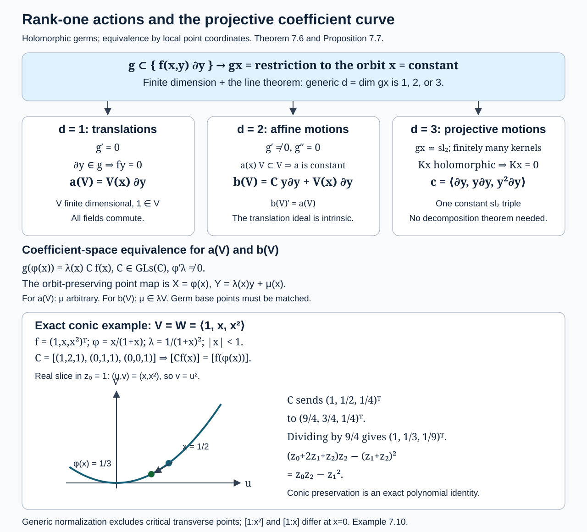
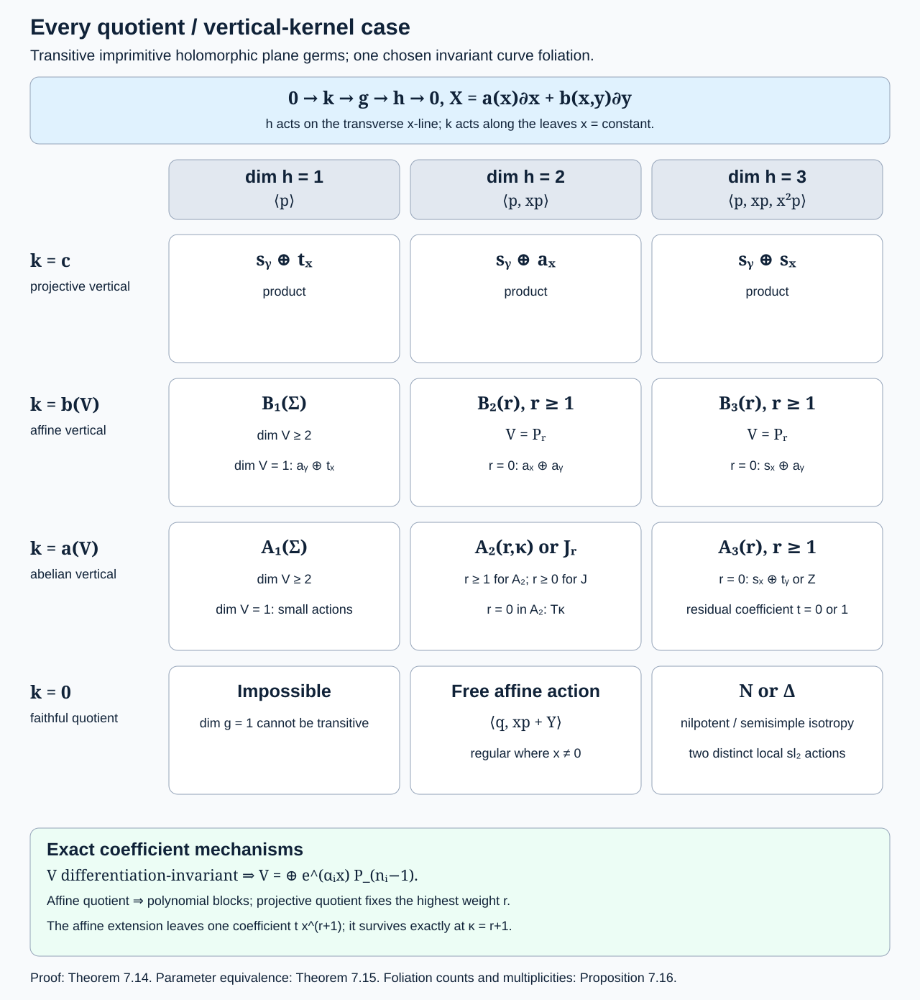
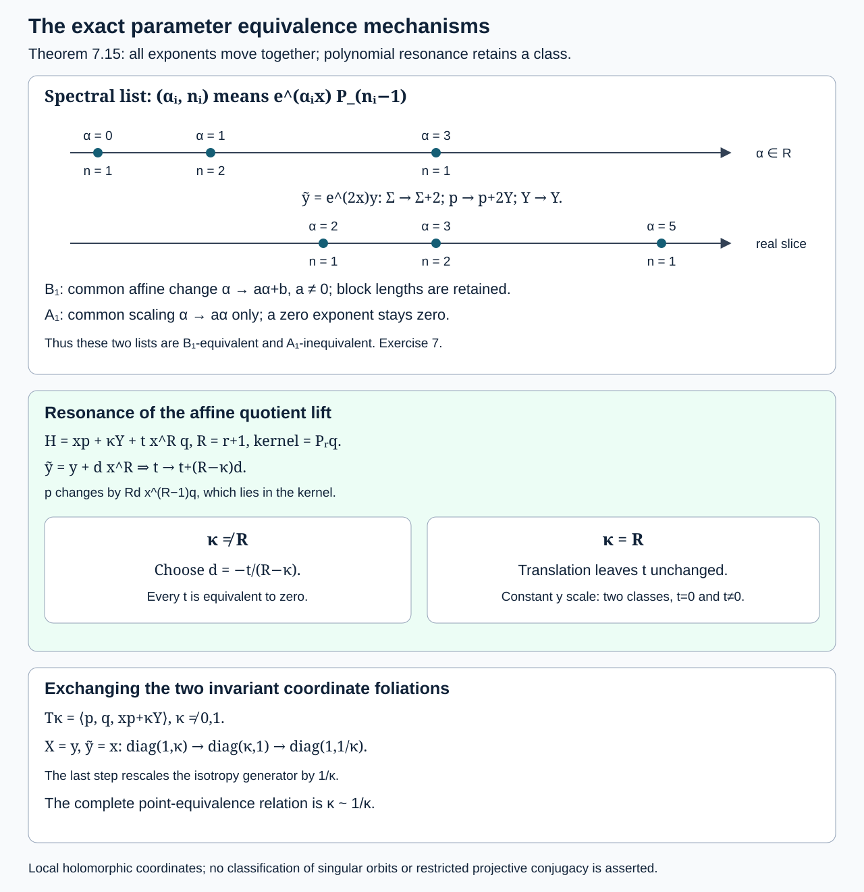
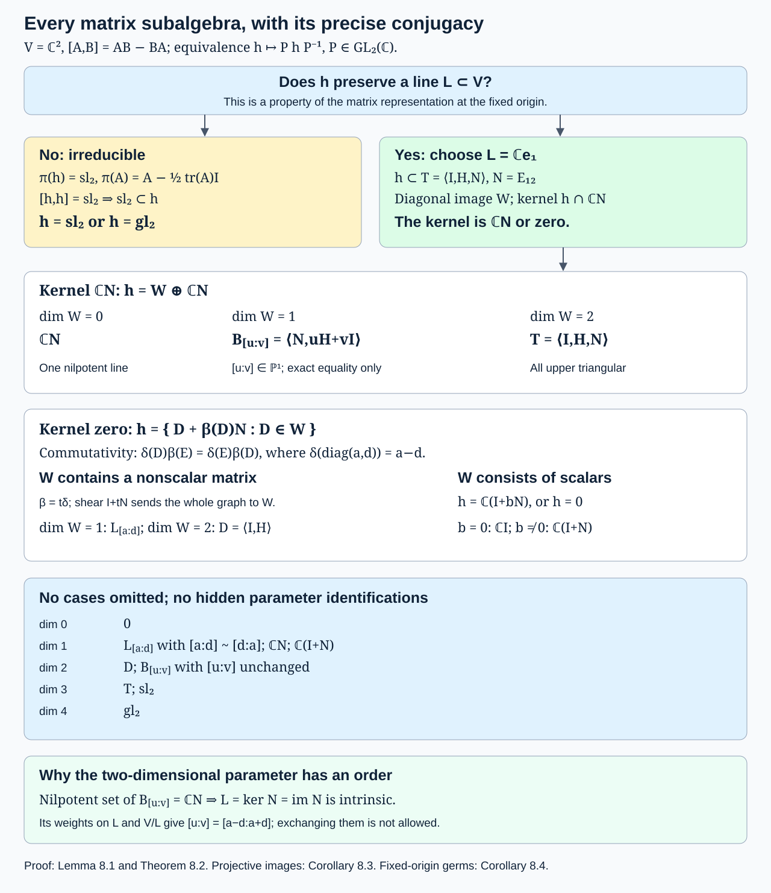
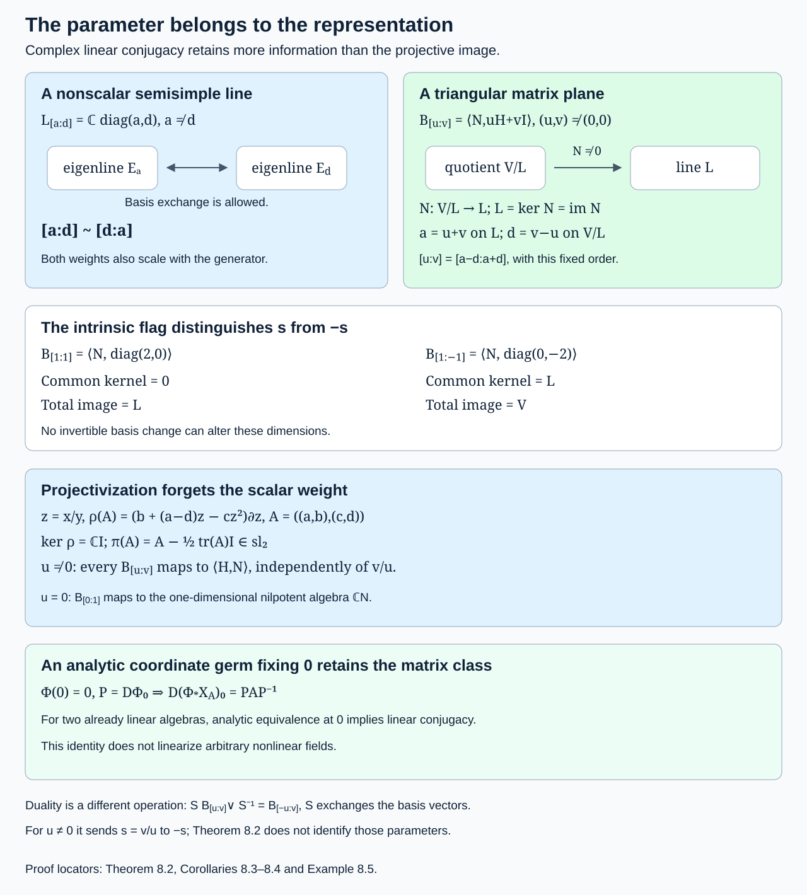

# Lie algebras of vector fields on the line and in the plane

*GPT-6.1 Sol (OpenAI). Original exposition and English translations: CC0 1.0; quoted German originals are public domain.*

Finite-dimensionality places a strong restriction on local motions of a line. In a complex plane, orbit rank and invariant curve foliations lead to the generic local classification proved below. The intransitive actions carry functional parameters described by projective curve germs. Transitive imprimitive actions carry spectral parameters and a resonant polynomial extension. Their full point-equivalence relations are part of the classification. The isotropy filtration explains the three primitive plane forms and their distinction from the imprimitive actions. The homogeneous linear plane classification under linear conjugacy and its projective-line images are proved in Section 8, including their distinct parameter relations and the role of the fixed origin.

We use analytic germs at a specified regular point, holomorphic germs in the complex case. A Lie algebra consists of vector fields independent over the constant field, with bracket $[X,Y]=XY-YX$. Equivalence means pushforward by a local analytic diffeomorphism. Transitivity and invariant foliations have the local meanings established in Transitivity and primitivity. The projective fields come from Prolongation, differential invariants and the projective group.

## 1. The line: a dimension bound and actual coordinates

The regular-point hypothesis is essential. The one-dimensional algebra generated by $x^2\partial_x$ is nonzero as an algebra of germs at zero, but every field in it vanishes there. It cannot be changed into translations by a diffeomorphism fixing that base point. The theorem below assumes that evaluation at the base point is nonzero. Every nonzero analytic algebra on a connected line has such points on an open dense set.

**Theorem 1.1 (line classification).** Let $\mathfrak g$ be a finite-dimensional nonzero algebra of analytic vector-field germs on a line over $\mathbb K=\mathbb R$ or $\mathbb C$. At a point where some field is nonzero, it is analytically equivalent to exactly one of

$$
\langle\partial_u\rangle,\qquad
\langle\partial_u,u\partial_u\rangle,\qquad
\langle\partial_u,u\partial_u,u^2\partial_u\rangle.
\tag{1.1}
$$

In particular, its dimension is at most three at a regular point.

**Proof.** Straighten a nonzero field as in One-parameter groups, obtaining $\partial_x\in\mathfrak g$. Let $V$ be the finite-dimensional space of its coefficient functions. Since $[\partial_x,f\partial_x]=f'\partial_x$, differentiation preserves $V$.

For a nonzero germ $f$, let $\operatorname{ord}_0f$ be its vanishing order. There is a largest order $r$ among the nonzero elements of $V$. Indeed, the descending subspaces whose first $k$ Taylor coefficients vanish eventually stabilize; their intersection is zero by analyticity, so the stabilized subspace is zero. Each successive quotient has dimension at most one. A function of order $r$, together with its derivatives, supplies orders $r,r-1,\ldots,0$. Hence every quotient up to $r$ has dimension one and

$$
\dim V=r+1.
\tag{1.2}
$$

For leading terms $a x^j$ and $b x^k$ with $j\ne k$,

$$
[a x^j\partial_x,b x^k\partial_x]
=ab(k-j)x^{j+k-1}\partial_x.
\tag{1.3}
$$

If $r\ge3$, choose fields of orders two and $r$. Their bracket has order $r+1$ and nonzero leading coefficient, contradicting maximality. Thus $r\le2$.

If $r=0$, the straightened algebra is already the first form in (1.1). If $r\ge1$, there is a field $H=f(x)\partial_x$ with $f(0)=0$ and, after a constant rescaling, $f'(0)=1$. The function $1/f(x)-1/x$ has a removable singularity at zero. Define

$$
u=x\exp\left(\int_0^x\left(\frac1{f(s)}-\frac1s\right)ds\right).
\tag{1.4}
$$

The integrand is analytic, the integral is its local analytic primitive, and $u'(0)=1$. Differentiating gives $f(x)u'(x)=u$, so $H=u\partial_u$ in this coordinate.

The operator $\operatorname{ad}H$ on coefficients is $L=u\,d/du-1$. It preserves the transformed finite-dimensional coefficient space. Choose a nonzero polynomial $P$ that annihilates this finite-dimensional operator, for example its characteristic polynomial. If $g(u)=\sum_{k\ge0}a_k u^k$ belongs to the space, then

$$
P(L)g=\sum_{k\ge0}P(k-1)a_k u^k=0.
$$

Only finitely many $k$ can have $a_k\ne0$, since $P$ has finitely many roots. Thus every coefficient is a polynomial. Polynomial spectral projectors for the distinct numbers $k-1$ extract each of its homogeneous monomials as another element of the space. Coordinate changes preserve vanishing orders, whose maximum is still $r$. Consequently the space is contained in $\langle1,u,\ldots,u^r\rangle$. Equation (1.2) gives equality. This proves (1.1). The dimensions distinguish its three forms. $\square$

The last form is $\mathfrak{sl}_2$ as an abstract algebra. For

$$
E=\partial_u,\qquad H=-2u\partial_u,\qquad F=-u^2\partial_u,
$$

equation (1.3) gives $[H,E]=2E$, $[H,F]=-2F$, and $[E,F]=H$. Its flows are projective transformations of a line. For example, $u^2\partial_u$ has flow $u\mapsto u/(1-tu)$ where the denominator is nonzero. Local coordinates do not imply a global projective action on the original domain.

## 2. Filtration and the isotropy representation

Let a finite-dimensional algebra $\mathfrak g$ be transitive at $p$ in an $n$-dimensional analytic manifold. Put $\mathfrak g_{-1}=\mathfrak g$ and, for $i\ge0$, let $\mathfrak g_i$ be the fields whose coefficients vanish to order at least $i+1$ at $p$. In particular, $\mathfrak g_0$ is the isotropy algebra.

**Proposition 2.1.** The filtration is intrinsic and eventually zero. Whenever $i,j\ge-1$ and $i+j\ge-1$,

$$
[\mathfrak g_i,\mathfrak g_j]\subset\mathfrak g_{i+j}.
\tag{2.1}
$$

Evaluation identifies $\mathfrak g/\mathfrak g_0$ with $T_pM$. The isotropy action on this quotient is

$$
\rho(X)=-DX_p\quad(X\in\mathfrak g_0),
\tag{2.2}
$$

with kernel $\mathfrak g_1$.

**Proof.** In coordinates, $[X,Y]^a=X^b\partial_bY^a-Y^b\partial_bX^a$. Differentiation reduces vanishing order by at most one; multiplication adds orders. This gives (2.1), including the case of bracketing with a field of order zero. The chain rule shows that vanishing order is unchanged under an invertible analytic coordinate change. Finite-dimensionality and uniqueness of an analytic germ from its Taylor coefficients give eventual zero exactly as in the line proof.

Transitivity makes evaluation surjective, with kernel $\mathfrak g_0$. For $X(p)=0$,

$$
[X,Y](p)=-DX_p\,Y(p).
$$

This proves (2.2). Jacobi implies that $\rho$ is a representation; equivalently, direct differentiation shows $D[X,Y]_p=DY_pDX_p-DX_pDY_p$ for $X,Y$ vanishing at $p$. Its kernel is the fields with zero constant and linear terms, namely $\mathfrak g_1$. $\square$

The minus sign in (2.2) is required by our bracket convention. The subspace of coefficient matrices $DX_p$ is still closed under matrix commutators, since changing every bracket sign does not change the underlying subspace.

Write $V=T_pM$. The leading term of a field in $\mathfrak g_i$ embeds

$$
\mathfrak g_i/\mathfrak g_{i+1}\hookrightarrow
S^{i+1}V^*\otimes V\qquad(i\ge0).
\tag{2.3}
$$

Bracketing with a field whose value at $p$ is $v$ differentiates a leading homogeneous term in direction $v$. Thus higher homogeneous terms must have all their directional derivatives in the preceding graded space. This compatibility is often much stronger than a dimension estimate.

## 3. Why primitive complex plane isotropy contains $\mathfrak{sl}_2$

From now on the manifold is complex two-dimensional and the algebra is transitive and primitive. Primitivity means that no regular invariant one-dimensional foliation exists near the base point.

**Lemma 3.1.** The isotropy representation on $V\cong\mathbb C^2$ is irreducible. Its image is either $\mathfrak{sl}(V)$ or $\mathfrak{gl}(V)$.

**Proof.** An isotropy-invariant line $L\subset\mathfrak g/\mathfrak g_0$ has inverse image $\mathfrak k$ in $\mathfrak g$. The quotient $\mathfrak k/\mathfrak g_0$ is one-dimensional, $[\mathfrak g_0,\mathfrak k]\subset\mathfrak k$, and the bracket of a lift of a generator with itself is zero. Hence $\mathfrak k$ is a subalgebra strictly between $\mathfrak g_0$ and $\mathfrak g$. The subgroup–foliation correspondence proved in lesson 8 gives an invariant curve foliation, a contradiction. Conversely, such a foliation has an isotropy-invariant tangent line at $p$. This proves irreducibility and also its converse in this transitive plane setting.

Let $\mathfrak h\subset\mathfrak{gl}_2(\mathbb C)$ be the image. A solvable complex matrix algebra has a common eigenvector by the fully proved Lie theorem in The adjoint group, composition and isomorphism, so $\mathfrak h$ is not solvable. Project onto traceless matrices by $A\mapsto A-\tfrac12\operatorname{tr}(A)I$. This is a Lie algebra homomorphism. A proper subalgebra of $\mathfrak{sl}_2$ has dimension at most two, hence is solvable: a two-dimensional algebra has derived algebra of dimension at most one. The projection kernel is central, so a solvable projected algebra would make $\mathfrak h$ solvable. Therefore the projected image is all of $\mathfrak{sl}_2$.

Commutators of lifts have zero trace, and their projections span $[\mathfrak{sl}_2,\mathfrak{sl}_2]=\mathfrak{sl}_2$. Thus $\mathfrak h$ itself contains every traceless matrix. It is $\mathfrak{sl}_2$ or, if it contains any nonzero trace, $\mathfrak{gl}_2$. $\square$

This argument uses complex eigenvectors. Over $\mathbb R$, a rotation algebra can be irreducible and solvable, so the same reduction is false. In particular, real rotations on a sphere and real conformal motions have additional primitive forms.

## 4. The quadratic terms and the end of the filtration

Use linear coordinates $x,y$ on $V$. Denote its six-dimensional space of quadratic vector fields by $\mathcal Q=S^2V^*\otimes V$. There are two invariant subspaces:

$$
\mathcal H=\{Q:\operatorname{div}Q=0\},\qquad
\mathcal P=\{\ell(x,y)(x\partial_x+y\partial_y):\ell\text{ linear}\}.
\tag{4.1}
$$

For $Q=\ell(x,y)(x\partial_x+y\partial_y)$, divergence is $3\ell$. Since divergence maps quadratic fields onto linear functions, $\dim\mathcal H=4$, $\dim\mathcal P=2$, and $\mathcal Q=\mathcal H\oplus\mathcal P$. Traceless linear fields preserve both subspaces. For $\mathcal H$, use $\operatorname{div}[L,Q]=L(\operatorname{div}Q)$ when $\operatorname{div}L=0$; for $\mathcal P$, use $[L,\ell E]=L(\ell)E$, where $E=x\partial_x+y\partial_y$ commutes with linear fields.

**Lemma 4.1.** Each subspace in (4.1) is an irreducible $\mathfrak{sl}_2$ module, and every invariant subspace of $\mathcal Q$ is a sum of some of these two subspaces.

**Proof.** Let $R=x\partial_y$, $S=y\partial_x$, and $H=x\partial_x-y\partial_y$. Their brackets are $[H,R]=2R$, $[H,S]=-2S$, and $[R,S]=H$. The space $\mathcal P$ has basis $xE,yE$, interchanged up to nonzero factors by $R,S$, with distinct $H$ weights $1,-1$. Any invariant subspace contains a weight vector, obtained by a polynomial projector in $H$, and hence both basis vectors.

The map

$$
f\longmapsto f_y\partial_x-f_x\partial_y
\tag{4.2}
$$

identifies homogeneous cubic polynomials with $\mathcal H$. Indeed, the coefficients in (4.2) have zero divergence. Conversely, the one-form $-Q^y dx+Q^xdy$ for a divergence-free quadratic field is closed and has a homogeneous cubic primitive, obtained by integration or the radial formula. The map is equivariant for traceless linear fields because these preserve $dx\wedge dy$. On the cubic basis $x^3,x^2y,xy^2,y^3$, the $H$ weights are $3,1,-1,-3$, and $R,S$ connect successive vectors with nonzero factors. The same weight-projector argument proves irreducibility.

To separate the two summands without importing complete reducibility, use the operator

$$
C=H^2+2(RS+SR)
\tag{4.3}
$$

on the module, where each letter denotes its action by bracket. Its commutators with $H,R,S$ vanish, by the three displayed bracket relations. A highest-weight vector of weight $\lambda$ satisfies $Rv=0$ and $RSv=\lambda v$, so $Cv=\lambda(\lambda+2)v$. Commutation then gives $C=15I$ on $\mathcal H$ and $C=3I$ on $\mathcal P$. The polynomials $(C-3I)/12$ and $(15I-C)/12$ project onto the two summands. An invariant subspace is stable under these projectors, and each resulting intersection is zero or the entire irreducible summand. $\square$

**Lemma 4.2.** In a finite-dimensional transitive plane algebra whose linear isotropy contains $\mathfrak{sl}_2$, the quadratic graded space is zero or $\mathcal P$. In the latter case the linear isotropy is $\mathfrak{gl}_2$. There are no cubic or higher graded terms.

**Proof.** The quadratic graded space $\mathfrak g_1/\mathfrak g_2$ is an invariant subspace of $\mathcal Q$. It cannot contain $\mathcal H$. Otherwise choose actual fields with leading terms

$$
A=x^2\partial_y,\qquad B=x^2\partial_x-2xy\partial_y,
$$

both in $\mathcal H$. For $A_k=x^k\partial_y$,

$$
[A_k,B]=-(k+2)x^{k+1}\partial_y.
\tag{4.4}
$$

Starting with $k=2$, repeated bracketing of the actual fields has these nonzero successively higher leading terms; higher remainders cannot affect them. This contradicts termination of the finite filtration. Lemma 4.1 now leaves only zero or $\mathcal P$.

If the linear isotropy is traceless and $Q\in\mathcal P$ is a leading quadratic term, its derivatives in every constant direction must be traceless linear fields, by transitivity and (2.3). Their traces are the corresponding derivatives of $\operatorname{div}Q=3\ell$. All vanish only when $\ell=0$. Thus nonzero $\mathcal P$ requires $\mathfrak{gl}_2$.

If the quadratic graded space is zero, a putative nonzero higher leading term can be differentiated repeatedly in constant directions to a nonzero quadratic term. This is impossible. Hence $\mathfrak g_1=0$ in that case.

If the quadratic space is $\mathcal P$, let $Z$ be a possible homogeneous cubic leading term. Its two partial derivatives have the form $\partial_jZ=\ell_j(x,y)(x,y)$, regarded as coefficient vectors. Euler's identity gives

$$
3Z=(x\ell_1+y\ell_2)(x,y),
$$

so $Z=f(x,y)(x,y)$ with quadratic scalar $f$. Then $\partial_jZ=f_j(x,y)(x,y)+f e_j$. Since both $\partial_jZ$ must be proportional to $(x,y)$, the wedges of $f e_1$ and $f e_2$ with $(x,y)$ vanish. Thus $fy=fx=0$ as polynomials, and $f=0$. There are no cubic terms. Repeated differentiation rules out all higher terms. Therefore $\mathfrak g_2=0$. $\square$

This is the missing qualification in the assertion that isotropy is determined by its first-order part. In the projective case, $\mathfrak g_0$ has dimension six, its linear image has dimension four, and its kernel $\mathfrak g_1=\mathcal P$ has dimension two. First-order determination holds for the two affine cases, not for all primitive cases.

## 5. Analytic normalization when the linear isotropy is $\mathfrak{gl}_2$

We need to turn graded information into actual analytic coordinates. The scalar matrix in $\mathfrak{gl}_2$ supplies an isotropy field with linear part $E=(x,y)$. The following special linearization has a direct proof.

**Lemma 5.1 (Euler linearization).** An analytic field $Z(w)=w+O(|w|^2)$ near zero is analytically conjugate to the Euler field $w\cdot\partial_w$.

**Proof.** In the real case first extend the coefficients holomorphically to a complex ball, using their power series. Shrink the ball so that $Z(w)=w+R(w)$ with $|R(w)|\le\varepsilon|w|$ there, where $0<\varepsilon<1/2$. For real $t\ge0$, the backward flow $w_t=\Phi_Z^{-t}(w)$ solves $w_t'=-w_t-R(w_t)$. Differentiating its squared Hermitian norm gives

$$
\frac d{dt}|w_t|^2\le-2(1-\varepsilon)|w_t|^2.
$$

It remains inside the ball, exists for all $t\ge0$, and satisfies $|w_t|\le e^{-(1-\varepsilon)t}|w|$. The continuation assertion follows from the local ODE theorem on smaller closed balls. Since also $|R(w)|\le C|w|^2$,

$$
\frac d{dt}(e^tw_t)=-e^tR(w_t),\qquad
|e^tR(w_t)|\le C e^{-(1-2\varepsilon)t}|w|^2.
$$

The right side is integrable uniformly on a smaller ball. Hence

$$
h(w)=\lim_{t\to\infty}e^t\Phi_Z^{-t}(w)
\tag{5.1}
$$

exists uniformly there and is $w+O(|w|^2)$. It is holomorphic: on each smaller polydisc the componentwise Cauchy integrals for the holomorphic approximants pass to the uniform limit and give Cauchy representations for the limit itself. It has an analytic inverse near zero by the analytic inverse theorem stated in lesson 1. The flow identity yields $h(\Phi_Z^s(w))=e^s h(w)$ for sufficiently small real $s$; differentiating at zero gives $Dh(w)Z(w)=h(w)$. In the holomorphic case this identity is holomorphic and gives the conjugacy as well. Real coefficients make $h$ real on real points. $\square$

After this normalization, the algebra contains the actual Euler field. On homogeneous coefficient fields of degree $d$, its adjoint action is multiplication by $d-1$. As in the line proof, a polynomial annihilating its action on the finite-dimensional algebra forces every field to have only finitely many homogeneous terms, and polynomial spectral projectors put each homogeneous term in the algebra. Lemma 4.2 bounds the degrees by two. Transitivity supplies the full two-dimensional space of constants; the linear image supplies all four linear fields. The quadratic space is either zero or the two projective fields $xE,yE$. The resulting algebras are exactly

$$
\mathfrak{gl}_2\ltimes\mathbb C^2
\quad\text{and}\quad
\langle\partial_x,\partial_y,x\partial_x,y\partial_x,
x\partial_y,y\partial_y,xE,yE\rangle.
\tag{5.2}
$$

The second is the eight-dimensional projective algebra $\mathfrak{sl}_3$, with the matrix-to-field sign identification proved in lesson 9.

## 6. The special affine case without a splitting theorem

Suppose the linear isotropy is $\mathfrak{sl}_2$. Lemma 4.2 gives $\mathfrak g_1=0$. Thus $\mathfrak g_0$ itself is isomorphic to $\mathfrak{sl}_2$, and $\dim\mathfrak g=5$. We will produce two commuting translations inside it, rather than assume a general extension theorem.

Choose $H,R,S$ in $\mathfrak g_0$ satisfying the same three Chevalley relations as above. Let $C$ be (4.3), now with each letter acting by its adjoint action on $\mathfrak g$. It commutes with $\mathfrak g_0$. On the adjoint module $\mathfrak g_0$, its value is $8I$; this follows from highest weight two and the calculation in Lemma 4.1. On the quotient $\mathfrak g/\mathfrak g_0\cong V$, it is $3I$, since this is the standard two-dimensional module with highest weight one. Therefore

$$
(C-8I)(C-3I)=0\quad\text{on }\mathfrak g.
$$

The distinct roots give the invariant decomposition

$$
\mathfrak g=\mathfrak g_0\oplus A,\qquad A=\ker(C-3I),\quad\dim A=2.
\tag{6.1}
$$

Indeed, $C-3I$ maps the algebra into $\mathfrak g_0$, and the $8$ eigenspace is exactly $\mathfrak g_0$; spectral projection onto the $3$ eigenspace identifies it with the quotient.

The module $\Lambda^2A$ is trivial, because the standard $\mathfrak{sl}_2$ representation has trace zero. The bracket is an equivariant map from $\Lambda^2A$ into $\mathfrak g$. Its image would consist of vectors fixed by all of $\mathfrak g_0$. Neither the adjoint module nor the standard module has such a nonzero vector: commuting with all of $\mathfrak{sl}_2$ in its adjoint module means being in its zero centre; the standard module has no common zero vector for its matrices. Thus $[A,A]=0$.

Evaluation sends $A$ isomorphically to $T_pM$. Choose its two generators, whose commuting analytic flows give a coordinate chart by the inverse theorem. In that chart they are $\partial_x,\partial_y$. Each isotropy field $X$ normalizes this constant space, so $[X,\partial_j]=-\partial_jX$ has constant coefficients. Hence $X$ has linear coefficients plus constants. Its value at the origin is zero, so the constants vanish, and its linear part is traceless. We have obtained exactly

$$
\langle\partial_x,\partial_y,x\partial_y,y\partial_x,
x\partial_x-y\partial_y\rangle
=\mathfrak{sl}_2\ltimes\mathbb C^2.
\tag{6.2}
$$

**Theorem 6.1 (primitive complex plane classification).** Every transitive primitive finite-dimensional algebra of holomorphic vector-field germs on a complex surface is locally analytically equivalent to the special affine algebra (6.2), the affine algebra in (5.2), or the projective algebra in (5.2). All three are primitive and have respective dimensions five, six, and eight.

**Proof.** Lemma 3.1 gives the two possible linear images. Lemmas 4.1–4.2 and Sections 5–6 produce exactly the three forms. Conversely, their isotropy images contain $\mathfrak{sl}_2$, which has no invariant line in $\mathbb C^2$. The first paragraph of Lemma 3.1 then excludes invariant curve foliations. Their displayed independent coefficient fields give the dimensions. $\square$

## 7. The remaining complex plane list

Here is the rest of Lie's list. Theorem 7.6 and Corollary 7.8 prove its intransitive entries. Theorems 7.14–7.15 prove the transitive imprimitive classification and all parameter identifications, and Proposition 7.16 explains its invariant-foliation refinements. The precise source is [Lie–Engel III, Chapter 4, §18, Theorem 6, pp. 71–73], with its derivation in Chapter 3, §§6–14, pp. 28–58, and the invariant-family refinements in Chapter 4, §§15–17, pp. 58–71. We have grouped the fields using coefficient spaces to make the parameter families readable. This is a classification of germs at generic regular points; exceptional base points, including critical transverse parameters at regular orbits, are outside this generic statement. The three primitive entries are already proved above.

Put $p=\partial_x$, $q=\partial_y$, $Y=yq$, and

$$
P_rq=\langle q,xq,\ldots,x^r q\rangle\quad(r\ge0),\qquad
A_Fq=\langle q,xq,F_1(x)q,\ldots,F_r(x)q\rangle.
\tag{7.1}
$$

In $A_F$, all displayed coefficient functions are analytic and independent over $\mathbb C$; $r=0$ is allowed. They are arbitrary subject to that condition. Define also

$$
U=P_m+\sum_{k=1}^{l}e^{\alpha_kx}P_{m_k},\qquad
V=\sum_{k=1}^{l}e^{\alpha_kx}P_{m_k}.
\tag{7.2}
$$

Here $P_j=\langle1,x,\ldots,x^j\rangle$. For $U$, take $m,m_k\ge0$, distinct nonzero $\alpha_k$, $l\ge0$, $l+m+\sum m_k>0$, and normalize $\alpha_1=1$ if $l>0$. For $V$, take distinct $\alpha_k$, which may include zero, $l>0$, $m_k\ge0$, $l+\sum m_k>1$, and normalize the first exponent to $\alpha_1\in\{0,1\}$. This last normalization restricts only the first chosen exponent, not every exponent. It follows by scaling $x$ when a nonzero exponent is chosen first. All rows mean the constant linear span of the displayed fields, not a module over arbitrary functions.

The nine families in the first part of Lie's one-invariant-foliation list are:

| Fields | Parameters |
|---|---|
| $q,xq,p,2xp+Y,x^2p+xY$ | — |
| $P_rq,p,2xp+rY,x^2p+rxY$ | $r>2$ |
| $P_rq,Y,p,xp,x^2p+rxY$ | $r>0$ |
| $Y,p,xp,x^2p+xY$ | — |
| $P_rq,Y,p,xp$ | $r>0$ |
| $P_rq,p,xp+cY$ | $r>0$, $c\ne1$ |
| $P_{r-1}q,p,xp+(ry+x^r)q$ | $r>1$ |
| $Uq,Y,p$ | $U$ as in (7.2) |
| $A_Fq,Y$ | $r\ge0$ |

The six families in its second part are:

| Fields | Parameters |
|---|---|
| $P_2q,p,xp+Y,x^2p+2xY$ | — |
| $p,2xp+Y,x^2p+xY$ | — |
| $P_rq,p,xp+Y$ | $r>0$ |
| $q,p,xp+(x+y)q$ | — |
| $Vq,p$ | $V$ as in (7.2) |
| $A_Fq$ | $r\ge0$ |

Lie describes the unique invariant family in these two parts as counted simply or doubly. This historical multiplicity concerns invariant tangent directions in his characteristic equation; it does not mean that the second part has two different foliations. The separate two-foliation group appears next.

The nine entries with two invariant curve foliations are:

| Fields |
|---|
| $q,Y,y^2q,p,xp,x^2p$ |
| $p+q,xp+Y,x^2p+y^2q$ |
| $q,Y,y^2q,p,xp$ |
| $q,Y,y^2q,p$ |
| $q,Y,y^2q$ |
| $q,Y,p,xp$ |
| $q,p,xp+cY$, $c\ne0,1$ |
| $q,Y,p$ |
| $q,Y$ |

The three entries with a one-parameter family of invariant foliations are $\langle p,q,xp+Y\rangle$, $\langle q,xp+Y\rangle$, and $\langle p,q\rangle$. The invariant foliations of $\langle q\rangle$ depend on an arbitrary holomorphic function, as in Proposition 7.11. Include the zero algebra separately if trivial actions are allowed. These tables, together with the three primitive forms, reproduce the entire finite continuous complex plane list in Theorem 6. They include intransitive entries; they are not all transitive algebras.

**Example 7.1 (why exponentials appear).** If $\langle p,Uq\rangle$ is finite-dimensional, closure under $[p,f(x)q]=f'(x)q$ makes $U$ invariant under differentiation. Its minimal polynomial gives a constant-coefficient linear ODE for every element of $U$. The generalized eigenspaces of differentiation have bases $e^{\alpha x},xe^{\alpha x},\ldots,x^m e^{\alpha x}$: solving $(D-\alpha)^{m+1}f=0$ amounts to writing $f=e^{\alpha x}g$ with $g^{(m+1)}=0$. This proves the shape of the spaces in (7.2), although it does not prove the whole classification table.

**Example 7.2 (arbitrary functions in an intransitive algebra).** For any independent analytic $f_1(x),\ldots,f_s(x)$,

$$
\mathfrak a=\langle f_1(x)\partial_y,\ldots,f_s(x)\partial_y\rangle
$$

is abelian and has one-dimensional regular orbits. It can have arbitrarily large finite dimension: the line dimension bound does not apply to coefficients varying in a transverse parameter $x$. After shrinking where $f_1\ne0$, set $y_1=y/f_1(x)$ to normalize one coefficient to one. If $s\ge2$, a ratio with nonzero derivative at a generic point can be used as the new $x$ coordinate, normalizing a second coefficient to $x$. This explains the $A_Fq$ row. If all ratios are constant, the original fields were not independent. Adding $Y$ preserves this arbitrary coefficient space because $[Y,fq]=-fq$.

**Example 7.3 (a transitive imprimitive algebra).** For $\langle p,q,xq\rangle$, the foliation $x=\text{constant}$ is invariant. Each generator takes a function of $x$ to another function of $x$. The bracket $[p,xq]=q$ makes this algebra the three-dimensional Heisenberg algebra. It acts transitively in a plane even though its centre has a nontrivial action and each point has one-dimensional isotropy. It is the $Vq,p$ row with $V=P_1$.

The equivalence relation matters. Chapter 4, §19, pp. 74–78, examines which distinct point-action entries become equivalent under contact transformations. Our tables and Theorem 6.1 use point diffeomorphisms; allowing contact transformations changes the classification problem.

The displayed coefficient families also admit direct closure checks. For analytic functions $f,g$ of $x$,

$$
[fq,gq]=0,\quad [Y,fq]=-fq,\quad [p,fq]=f'q,
\quad [xp+cY,fq]=(xf'-cf)q,
$$

and $[x^2p+rxY,fq]=(x^2f'-rxf)q$. The last expression sends $x^j$ to $(j-r)x^{j+1}$, so its apparent highest degree cancels on $P_r$. Differentiation preserves every exponential-polynomial summand in (7.2), as Example 7.1 proves. In the exceptional polynomial row put $H=xp+(ry+x^r)q$. Then $[p,H]=p+rx^{r-1}q$ and $[H,x^jq]=(j-r)x^jq$; these stay in its displayed span. The remaining rows involve only the line projective fields $p,xp,x^2p$ and $q,Y,y^2q$, their direct sums, their diagonal copy, or the displayed weighted linear combinations. Formula (1.3) and the four identities above check their brackets directly. These calculations give closure directly. Theorems 7.14–7.15 provide the exhaustive classification and parameter equivalence, and Proposition 7.16 gives the foliation counts and multiplicities.

### 7.1. Intransitive actions and their coefficient spaces

An intransitive action has regular one-dimensional orbits on an open set. Its restriction to each orbit has dimension at most three by Theorem 1.1, although the algebra acting on all the orbits can have arbitrarily large dimension. The transverse variation is exactly the functional parameter in the two families below.

For a finite-dimensional complex vector space $V$ of holomorphic function germs in $x$, with $1\in V$, define

$$
\begin{aligned}
\mathfrak a(V)&=\{f(x)\partial_y:f\in V\},\\
\mathfrak b(V)&=\mathbb C y\partial_y+\mathfrak a(V),\\
\mathfrak c&=\langle\partial_y,y\partial_y,y^2\partial_y\rangle.
\end{aligned}
\tag{7.3}
$$

Their orbit foliation is $x=\text{constant}$. Here $V$ is a vector space over $\mathbb C$, not over the functions of $x$. For example, $\dim\mathfrak a(V)=\dim V$ even though every evaluation has rank one.

We first give a finite-dimensional algebra argument needed to control the projective case. It does not require a decomposition theorem for Lie algebras.

**Lemma 7.4 (finitely many simple quotient kernels).** Let $\mathfrak l$ be a finite-dimensional complex Lie algebra. There are at most $\lfloor\dim\mathfrak l/3\rfloor$ distinct ideals $K$ for which $\mathfrak l/K\cong\mathfrak{sl}_2$.

**Proof.** The algebra $\mathfrak s=\langle E,H,F\rangle$ with $[H,E]=2E$, $[H,F]=-2F$, $[E,F]=H$ is simple. Indeed, an ideal is stable under $\operatorname{ad}H$. Polynomial projections onto its three distinct eigenspaces extract a nonzero multiple of at least one of $E,H,F$ from any nonzero element of the ideal. Brackets with the other basis vectors then give all three. In particular, $\mathfrak s$ is nonabelian and has zero centre.

Suppose $\rho_i:\mathfrak l\to\mathfrak s$, $1\le i\le m$, are surjective and have pairwise distinct kernels. We prove by induction that their combined image is $\mathfrak s^m$. This is immediate for $m=1$. For the induction step, let $T\subset\mathfrak s^{m-1}\oplus\mathfrak s$ be the combined image. Its projection onto the first factors is onto. The kernel of that projection is $0\oplus J$, where $J$ is an ideal in the last $\mathfrak s$: bracket with a lift of any last coordinate proves ideality. Hence $J=0$ or $J=\mathfrak s$.

If $J=\mathfrak s$, surjectivity onto the first factors gives $T=\mathfrak s^m$. If $J=0$, $T$ is the graph of a surjective Lie homomorphism $h:\mathfrak s^{m-1}\to\mathfrak s$. The image under $h$ of each factor is an ideal, hence zero or all of $\mathfrak s$. At least one image is all. Two such images would commute, since the corresponding factors commute, contradicting the nonabelian bracket of $\mathfrak s$. Thus $h$ is an isomorphism on exactly one factor and zero on the others. The last map $\rho_m$ then has the same kernel as that factor map, a contradiction. This completes the induction. Consequently $3m\le\dim\mathfrak l$. If there were more distinct quotient kernels, choosing that many surjections would contradict this inequality. $\square$

**Lemma 7.5 (constant fibre dimension).** Let $\mathfrak g$ be a finite-dimensional algebra of holomorphic fields on a polydisc, all tangent to $x=\text{constant}$, with $\partial_y\in\mathfrak g$. After restricting to an open dense set of transverse parameters, the restricted algebra

$$
\mathfrak g_x=\{f(x,y)\partial_y:f(x,y)\partial_y\in\mathfrak g\}
\tag{7.4}
$$

has constant dimension $d\in\{1,2,3\}$. Its restriction kernel $K_x\subset\mathfrak g$ depends holomorphically on $x$ there.

**Proof.** Restriction is a Lie homomorphism because the fields differentiate only $y$. Its image contains $\partial_y$, so Theorem 1.1 gives $1\le\dim\mathfrak g_x\le3$. Choose a constant basis $f_i(x,y)\partial_y$ of $\mathfrak g$. Restriction is represented by the matrix with entries $\partial_y^k f_i(x,0)$, for $k\ge0$. Its rank is the dimension of the restricted algebra: a holomorphic germ in $y$ is zero precisely when all its Taylor coefficients are zero.

Let $d$ be the largest rank on the transverse disc. At a point attaining it, finitely many rows and columns give a nonzero $d$-minor. Its nonvanishing set is open dense by the analytic identity theorem. The rank is exactly $d$ there. On a smaller disc about any such point, retain those $d$ rows. Their kernel equals the kernel of the entire restriction map, since both have codimension $d$. Solving for the pivot variables gives a holomorphic basis for $K_x$. $\square$

**Theorem 7.6 (generic intransitive classification).** Let $\mathfrak g$ be a nonzero finite-dimensional algebra of holomorphic vector fields on a connected complex surface, with generic orbit rank one. At points in a suitable open dense set it is locally equivalent to exactly one of the three kinds

$$
\mathfrak a(V),\qquad \mathfrak b(V),\qquad \mathfrak c,
\tag{7.5}
$$

where $V$ is finite-dimensional and contains $1$. Within the first two kinds the full equivalence relation is given in Proposition 7.7. The three kinds cannot be equivalent to one another.

**Proof.** At a point where a field is nonzero, the holomorphic straightening theorem in One-parameter groups, Theorem 3.1 gives coordinates in which that field is $\partial_y$. Rank one implies that every other field has zero $\partial_x$ coefficient on this neighbourhood. Thus we may apply Lemma 7.5. Restrict the transverse disc to one on which $d$ is constant. Whenever a bracket restricts to zero for every $x$ there, its coefficients vanish as holomorphic functions of $(x,y)$; hence it is the zero element of the algebra.

If $d=1$, every restricted algebra is abelian. It follows that $[\mathfrak g,\mathfrak g]=0$. In particular,

$$
[\partial_y,f(x,y)\partial_y]=f_y(x,y)\partial_y=0.
$$

Every coefficient depends only on $x$. This is $\mathfrak a(V)$, with $1\in V$ because $\partial_y\in\mathfrak g$.

Suppose $d=2$. The line theorem says that every restricted algebra is the affine algebra. Its derived algebra is nonzero and abelian. Therefore $\mathfrak g'=[\mathfrak g,\mathfrak g]$ is nonzero and $[\mathfrak g',\mathfrak g']=0$. Choose a nonzero $E\in\mathfrak g'$ and restrict to a point where $E$ is nonvanishing. This excludes only a proper analytic zero set. A change of vertical coordinate preserving $x$ makes $E=\partial_y$: if $E=e(x,y)\partial_y$, use the local primitive $\int_{y_0}^y e(x,t)^{-1}dt$, whose $y$ derivative is nonzero. The convergent power series for $1/e$ can be integrated term by term on a smaller polydisc, so this primitive is jointly holomorphic. The analytic inverse theorem, Theorem A, makes it a coordinate. Every element of $\mathfrak g'$ then has coefficient $b(x)$, because it commutes with $\partial_y$.

Let $B$ be this finite-dimensional coefficient space; it contains $1$. If $X=f(x,y)\partial_y\in\mathfrak g$, then $[X,\partial_y]\in\mathfrak g'$, so

$$
f(x,y)=a_X(x)y+c_X(x).
$$

For every $b\in B$ we also have $[X,b(x)\partial_y]=-a_X(x)b(x)\partial_y\in\mathfrak g'$. Thus multiplication by $a_X$ preserves $B$. The powers of this multiplication operator are linearly dependent in the finite-dimensional space $\operatorname{End}(B)$. A nonzero constant polynomial $P$ therefore satisfies $P(a_X)b=0$ for all $b\in B$. Taking $b=1$ gives $P(a_X(x))=0$. A continuous function on a connected disc taking values in a finite set is constant, so $a_X$ is a constant.

Some $a_X$ is nonzero, since otherwise every coefficient depends only on $x$ and $\mathfrak g$ would be abelian. Rescale such a field to $X_0=(y+c_0(x))\partial_y$ and replace $y$ by $y+c_0(x)$. The field becomes $y\partial_y$. The fields with zero $y$ coefficient form a finite-dimensional space $V(x)\partial_y$, containing $\partial_y$. Hence $\mathfrak g=\mathfrak b(V)$. Directly,

$$
\begin{aligned}
[y\partial_y,f(x)\partial_y]&=-f(x)\partial_y,\\
\mathfrak b(V)'&=\mathfrak a(V).
\end{aligned}
\tag{7.6}
$$

Finally suppose $d=3$. Each restriction is a surjection onto an algebra isomorphic to $\mathfrak{sl}_2$. Lemma 7.4 gives only finitely many possible kernels $K_x$. Lemma 7.5 makes their variation continuous. To see explicitly why the kernel is locally constant, express it by its pivot-variable matrix on a smaller disc: every matrix entry is continuous and takes values in the finite set obtained from these finitely many subspaces. Every entry is therefore constant. Denote the common kernel by $K$.

A field in $K$ restricts to zero on every orbit in that polydisc, so its coefficient is identically zero. The algebra consists of actual fields, and consequently $K=0$. Thus $\dim\mathfrak g=3$ and $\mathfrak g\cong\mathfrak{sl}_2$. Choose constant elements $E,H,F\in\mathfrak g$ with the bracket relations of Lemma 7.4 and $E$ nonzero at the chosen point; the line normal form on that orbit supplies such a choice. Make $E=\partial_y$ by a vertical coordinate change as above. The relation $[H,E]=2E$ gives

$$
H=(-2y+h(x))\partial_y.
$$

Replacing $y$ by $y-h(x)/2$ makes $H=-2y\partial_y$. Next $[E,F]=H$ gives $F=(-y^2+k(x))\partial_y$. The last relation becomes

$$
\begin{aligned}
[H,F]&=(2y^2+2k(x))\partial_y,\\
-2F&=(2y^2-2k(x))\partial_y,
\end{aligned}
$$

so $k=0$. This is $\mathfrak c$.

Conversely, all the algebras in (7.3) are finite-dimensional and have rank one, and their displayed brackets close. The first kind is abelian, the second has nonzero abelian derived algebra by (7.6), and the third is simple and perfect by Lemma 7.4. These properties distinguish the three kinds under any equivalence. The restrictions used in the argument remove proper analytic zero sets. A nonzero analytic field or minor cannot vanish on an open subset of a connected coordinate domain; consequently the suitable regular points form an open dense set. $\square$

**Proposition 7.7 (complete coefficient-space equivalence).** Suppose $1\in V,W$. The actions $\mathfrak a(V)$ and $\mathfrak a(W)$ are equivalent if and only if there are a locally invertible holomorphic germ $\phi$ and a nonvanishing holomorphic germ $\lambda$ such that

$$
\{g(\phi(x)):g\in W\}=\lambda(x)V
\tag{7.7}
$$

Equality in (7.7) is equality of complex vector spaces of germs. The same criterion characterizes equivalence between $\mathfrak b(V)$ and $\mathfrak b(W)$. More precisely, every equivalence of either kind has the form

$$
\begin{gathered}
X=\phi(x),\quad Y=\lambda(x)y+\mu(x),\\
\phi'\lambda\ne0.
\end{gathered}
\tag{7.8}
$$

For $\mathfrak a(V)$, $\mu$ is unrestricted. For $\mathfrak b(V)$, it must satisfy $\mu\in\lambda V$. Thus (7.7) is also sufficient for the affine kind by choosing $\mu=0$.

**Proof.** An equivalence sends the rank-one orbit distribution to the target orbit distribution, so $X_y=0$. Hence $X=\phi(x)$ and the remaining coordinate is $Y=\psi(x,y)$, with $\phi'\psi_y\ne0$. In the abelian kind the whole algebra consists of vertical translations. In the affine kind the derived algebra is precisely its vertical translation ideal by (7.6), so that ideal must be carried onto the target translation ideal. Since $\partial_y$ belongs to it, its image $\psi_y\partial_Y$ must have coefficient depending only on $X$. Thus $\psi_y=\lambda(x)$ and $\psi=\lambda(x)y+\mu(x)$.

The image of $f(x)\partial_y$ is $\lambda(x)f(x)\partial_Y$. Equality of the two translation spaces is exactly (7.7). In the affine kind,

$$
(7.8)_*(y\partial_y)
=(Y-\mu(x))\partial_Y.
\tag{7.9}
$$

This belongs to the target affine algebra precisely when $\mu\in\{g\circ\phi:g\in W\}=\lambda V$. These conditions give all the required images and an invertible local map, proving necessity and sufficiency. $\square$

For bases $f=(f_1,\ldots,f_s)^T$ of $V$ and $g=(g_1,\ldots,g_s)^T$ of $W$, criterion (7.7) is equivalently

$$
\begin{gathered}
g(\phi(x))=\lambda(x)C f(x),\\
C\in\operatorname{GL}_s(\mathbb C).
\end{gathered}
\tag{7.10}
$$

Thus the functional parameter is the projective curve germ $x\mapsto[f_1(x):\cdots:f_s(x)]$, up to a projective linear change and an invertible change of its parameter. No coordinate is simultaneously zero, because $1\in V$. Multiplying the entire basis by a unit disappears in projective coordinates. Conversely, a projective equality lifts locally to a holomorphic unit $\lambda$: choose a nonzero homogeneous coordinate at the base point and divide in that chart. This proves the equivalence of the projective and coefficient-space descriptions, including parametrizations whose derivative vanishes at a special point.

*Figure 7.1.* The upper diagram is the exhaustive rank-one argument of Lemmas 7.4–7.5 and Theorem 7.6. The lower diagram uses $f=(1,x,x^2)^T$, $\phi=x/(1+x)$, $\lambda=(1+x)^{-2}$ and the constant matrix displayed in Example 7.9. It shows the exact projective reparametrization in (7.10), rather than a numerical test for equivalence. The geometric picture is a real slice of the complex conic; the formula and proof hold holomorphically near zero. The accompanying Python source generates the SVG from these exact formulas.

**Corollary 7.8 (the five intransitive table families).** At generic points the intransitive entries in the tables are exactly

$$
\begin{gathered}
\langle q\rangle,\quad A_Fq,\quad\langle q,Y\rangle,\\
A_Fq+\mathbb C Y,\quad\langle q,Y,y^2q\rangle.
\end{gathered}
\tag{7.11}
$$

The arbitrary functions in $A_F$ are identified by (7.7); different displayed functions need not give inequivalent actions.

**Proof.** Theorem 7.6 gives the three kinds. If $\dim V=1$, the normalization $1\in V$ gives the first or third entry. If $\dim V\ge2$, choose a nonconstant $h\in V$. Its derivative is nonzero off a proper analytic set, so at a generic point $X=h(x)$ is a coordinate. The transformed space contains $1,X$ and admits a constant basis $1,X,F_1(X),\ldots,F_r(X)$. This gives the second or fourth entry. The projective kind is the fifth. Proposition 7.7 proves the stated identifications. $\square$

**Example 7.9 (a nontrivial equivalence with no change of coefficient space).** Take $V=W=\langle1,x,x^2\rangle$. Near zero, set

$$
\begin{aligned}
\phi(x)&=\frac{x}{1+x},\\
\lambda(x)&=\frac1{(1+x)^2},\\
C&=\begin{pmatrix}1&2&1\\0&1&1\\0&0&1\end{pmatrix}.
\end{aligned}
\tag{7.12}
$$

Then $g=f=(1,x,x^2)^T$ satisfies $g\circ\phi=\lambda C f$, since the three numerators are $(1+x)^2,x(1+x),x^2$. Also $\phi'=(1+x)^{-2}$ and $\det C=1$. Hence $X=x/(1+x)$, $Y=y/(1+x)^2$ is an equivalence of both $\mathfrak a(V)$ and $\mathfrak b(V)$. The projective curve is the conic $z_0z_2=z_1^2$, and $C$ preserves its defining equation: $(z_0+2z_1+z_2)z_2-(z_1+z_2)^2=z_0z_2-z_1^2$.

**Example 7.10 (a regular orbit at an exceptional transverse point).** The algebra $\langle\partial_y,x^2\partial_y\rangle$ has orbit rank one even at $x=0$. Nevertheless it is not equivalent there to $\langle\partial_y,x\partial_y\rangle$. Their projective coefficient maps are $[1:x^2]$ and $[1:x]$, whose derivatives at zero have ranks zero and one. A projective automorphism and an invertible change of parameter preserve this rank, so (7.10) rules out an equivalence. The generic normalization in Corollary 7.8 therefore excludes some regular orbit points as well as points where the orbit rank drops. The more general coefficient-space criterion (7.7) retains this information.

**Proposition 7.11 (invariant foliations of a single translation).** A regular holomorphic curve foliation is preserved by $q=\partial_y$ precisely when its tangent direction is a holomorphic function of $x$ with values in the projective line of tangent directions. On a chart where its tangent is not vertical, its leaves are

$$
y-F(x)=\text{constant},
\tag{7.13}
$$

where $F$ is an arbitrary holomorphic function. The everywhere vertical direction gives $x=\text{constant}$. A chart about a vertical tangency has tangent field $a(x)\partial_x+\partial_y$, where $a$ may vanish at the base point. These foliations depend on an arbitrary function, rather than on two constants.

**Proof.** The flow of $q$ is $(x,y)\mapsto(x,y+t)$, whose derivative is the identity matrix. A preserved foliation therefore has the same tangent line at $(x,y)$ and $(x,y+t)$ whenever both are in its flow box. Its projective tangent direction depends only on $x$. Conversely, let such a holomorphic projective direction be given. Choose a homogeneous component that is nonzero at the base point. Dividing by it gives a nonvanishing holomorphic field spanning the direction, with coefficients depending only on $x$. The analytic straightening theorem gives its regular curve foliation. Translation in $y$ preserves the field itself and hence its leaves, proving the converse.

If the horizontal component is nonzero, normalize the field to $\partial_x+f(x)\partial_y$. A holomorphic primitive $F'=f$ gives the leaf coordinate $y-F(x)$ and proves (7.13). If the direction is vertical at the base point, its vertical component is nonzero, so the other normalization is $a(x)\partial_x+\partial_y$. Its leaves solve $dx/dy=a(x)$; the analytic flow theorem supplies their local holomorphic coordinates even when $a$ has a zero. This includes the constant vertical direction when $a=0$. For example, $a=-x$ has leaf coordinate $xe^y$: the foliation is regular along $x=0$, although the induced action on its leaf coordinate has a zero there. Thus a vertical tangency must not be removed by dividing by $a(x)$. $\square$

### 7.2. The quotient and the vertical kernel

Fix an invariant curve foliation of a transitive imprimitive action and choose its transverse coordinate $x$. Every field has the form $a(x)p+b(x,y)q$. Projection to $a(x)p$ is a Lie homomorphism. Its image $\mathfrak h$ is a nonzero regular line algebra, and its kernel $\mathfrak k$ consists of the vertical fields. Thus

$$
\begin{gathered}
0\longrightarrow\mathfrak k\longrightarrow\mathfrak g
\longrightarrow\mathfrak h\longrightarrow0,\\
1\le\dim\mathfrak h\le3.
\end{gathered}
\tag{7.14}
$$

If $\mathfrak k\ne0$, it has rank one at generic points. Theorem 7.6 normalizes it to $\mathfrak a(V)$, $\mathfrak b(V)$ or $\mathfrak c$ by coordinates preserving the foliation. The line theorem normalizes the quotient, by a change of $x$, to $\langle p\rangle$, $\langle p,xp\rangle$ or $\langle p,xp,x^2p\rangle$. Changing $x$ composes the functions in $V$ with its inverse and leaves these three vertical kinds unchanged.

We will use the following explicit form of finite differentiation-invariant spaces. A spectral list $\Sigma$ consists of distinct numbers $\alpha_i\in\mathbb C$ and positive integers $n_i$. Put

$$
\begin{gathered}
E(\Sigma)=\bigoplus_i e^{\alpha_i x}P_{n_i-1},\\
|\Sigma|=\sum_i n_i.
\end{gathered}
\tag{7.15}
$$

**Lemma 7.12 (finite coefficient spaces).** Every nonzero finite-dimensional holomorphic function space preserved by $D=d/dx$ is exactly one of the spaces $E(\Sigma)$. Its spectral list is unique up to permutation. If such a space is also preserved by $xD-\kappa$, it is $P_r$ for some $r\ge0$. If it is preserved by $xD-cx$, it is $e^{cx}P_r$.

**Proof.** The powers of $D$ acting on a finite-dimensional space are linearly dependent, so some nonzero polynomial $P$ satisfies $P(D)=0$. Factor it into powers of distinct linear factors. For completeness, polynomial splitting over $\mathbb C$ follows by minimizing the modulus of a nonconstant polynomial: its modulus tends to infinity at infinity, so it attains a minimum. If its value at a minimum $z_0$ were nonzero, write $P(z_0+w)/P(z_0)=1+a w^m+O(w^{m+1})$, with $a\ne0$. Choose the argument of $w$ so $a w^m=-|a||w|^m$. For small $|w|$, the remainder has modulus less than $|a||w|^m/2$, and the modulus of the displayed expression is less than one, a contradiction. Division by the resulting linear factor and induction give the factorization.

Write $P_i=(T-\alpha_i)^{m_i}$ and $Q_i=P/P_i$. Successive polynomial division and back-substitution give $u_iQ_i+v_iP_i=1$: their last nonzero common remainder is constant, since a nonconstant common divisor would have a root shared by $P_i$ and $Q_i$. Thus $e_i=u_iQ_i$ is one modulo $P_i$ and zero modulo every other factor. The identities $\sum e_i=1$, $e_i^2=e_i$ and $e_ie_j=0$ for $i\ne j$ hold modulo $P$. Also $P_ie_i$ is divisible by $P$. Applying these identities to $D$ decomposes the space as the direct sum of the kernels of $P_i(D)$: the operators $e_i(D)$ are the projections, their images lie in these kernels, and $e_i(D)$ is the identity on its corresponding kernel. On a generalized $\alpha$ eigenspace,

$$
\begin{gathered}
(D-\alpha)^m f=0\\
\Longleftrightarrow\\
D^m(e^{-\alpha x}f)=0.
\end{gathered}
\tag{7.16}
$$

The last equation says, by its convergent Taylor series, that $e^{-\alpha x}f$ is a polynomial of degree at most $m-1$. The resulting polynomial subspace is differentiation-invariant. If its maximum degree is $r$, derivatives of a polynomial of that degree have distinct degrees $r,r-1,\ldots,0$ and span $P_r$. Thus the subspace is all of $P_r$. This proves (7.15). The generalized eigenvalues and their dimensions recover the list and prove uniqueness.

On the highest-degree vector $e^{\alpha x}x^r$ of a block, $xD-\kappa$ has term $\alpha e^{\alpha x}x^{r+1}$. Distinct exponential blocks are independent by the same polynomial projections. Preservation forces every $\alpha=0$, giving $P_r$. For $xD-cx$, its highest term is $(\alpha-c)e^{\alpha x}x^{r+1}$; hence every $\alpha=c$ and the space is $e^{cx}P_r$. Conversely the stated spaces have the required preservation properties. $\square$

**Lemma 7.13 (vertical normalizers).** Suppose $V$ contains a function nonzero at the base point. A field preserving $x=\text{constant}$ normalizes $\mathfrak a(V)$ precisely when it has the form

$$
\begin{gathered}
X=a(x)p+(b(x)y+c(x))q,\\
(aD-b)V\subset V.
\end{gathered}
\tag{7.17}
$$

It normalizes $\mathfrak b(V)$ precisely when, in addition, $c\in V$. The normalizer of $\mathfrak c$ consists exactly of the fields $a(x)p+C$, where $C\in\mathfrak c$ has constant coefficients in its displayed basis.

**Proof.** Write $X=ap+Bq$ and choose a nonvanishing $f_0\in V$. The coefficient $af_0'-f_0B_y$ of $[X,f_0q]\in\mathfrak a(V)$ depends only on $x$. Division by $f_0(x)$ makes $B_y$ independent of $y$, hence $B=by+c$. Now

$$
\begin{aligned}
[X,f(x)q]&=(af'-bf)q,\\
[X,Y]&=c(x)q.
\end{aligned}
\tag{7.18}
$$

These identities prove both necessity and sufficiency for $\mathfrak a(V)$. For $\mathfrak b(V)$, its derived algebra is $\mathfrak a(V)$; Jacobi makes every normalizing adjoint map preserve that derived algebra. The second identity then gives exactly $c\in V$ and proves sufficiency as well.

For $\mathfrak c$, $[X,q]\in\mathfrak c$ says that $B_y$ is quadratic in $y$ with constant coefficients. Integration gives a cubic polynomial in $y$ with constant nonconstant coefficients and an arbitrary constant term $c(x)$. The identity $[X,Y]=(B-yB_y)q\in\mathfrak c$ removes the cubic term and makes $c(x)$ constant. Thus $Bq\in\mathfrak c$. Conversely, every $a(x)p$ commutes with $\mathfrak c$, which is closed under bracket. $\square$

### 7.3. All transitive imprimitive normal forms

The next lists classify generic regular holomorphic point actions. In the first table the invariant curve foliation is unique. Spectral lists have $|\Sigma|\ge2$. All polynomial indices are integers in their stated ranges.

| Name | Constant span of fields | Parameters |
|---|---|---|
| $A_1(\Sigma)$ | $p,E(\Sigma)q$ | spectral list |
| $B_1(\Sigma)$ | $p,Y,E(\Sigma)q$ | spectral list |
| $A_2(r,\kappa)$ | $P_rq,p,xp+\kappa Y$ | $r\ge1$, $\kappa\in\mathbb C$ |
| $J_r$ | $P_rq,p,xp+(r+1)Y+x^{r+1}q$ | $r\ge0$ |
| $B_2(r)$ | $P_rq,Y,p,xp$ | $r\ge1$ |
| $A_3(r)$ | $P_rq,p,2xp+rY,x^2p+rxY$ | $r\ge1$ |
| $B_3(r)$ | $P_rq,Y,p,xp,x^2p+rxY$ | $r\ge1$ |
| $Z$ | $q,p,xp,x^2p+xq$ | — |
| $N$ | $p,2xp+Y,x^2p+xY$ | on a regular open set |

For the remaining forms write

$$
\begin{aligned}
\mathfrak t_x&=\langle p\rangle,\quad\mathfrak t_y=\langle q\rangle,\\
\mathfrak a_x&=\langle p,xp\rangle,\\
\mathfrak a_y&=\langle q,Y\rangle,\\
\mathfrak s_x&=\langle p,xp,x^2p\rangle,\\
\mathfrak s_y&=\langle q,Y,y^2q\rangle.
\end{aligned}
\tag{7.19}
$$

The forms with exactly two invariant curve foliations are the five products

$$
\begin{gathered}
\mathfrak s_x\oplus\mathfrak s_y,\quad
\mathfrak s_x\oplus\mathfrak a_y,\\
\mathfrak s_x\oplus\mathfrak t_y,\\
\mathfrak a_x\oplus\mathfrak a_y,\quad
\mathfrak a_x\oplus\mathfrak t_y,
\end{gathered}
\tag{7.20}
$$

together with

$$
\begin{aligned}
\Delta&=\langle p+q,xp+Y,\\
&\qquad x^2p+y^2q\rangle,\\
T_\kappa&=\langle p,q,xp+\kappa Y\rangle,
\\&\qquad\kappa\ne0,1.
\end{aligned}
\tag{7.21}
$$

The diagonal action $\Delta$ is considered off $x=y$. Three further forms have a projective line of invariant foliation germs through each base point:

$$
\begin{gathered}
\langle p,q\rangle,\\
\langle q,xp+Y\rangle,\\
\langle p,q,xp+Y\rangle.
\end{gathered}
\tag{7.22}
$$

The middle action is regular where $x\ne0$.

**Theorem 7.14 (transitive imprimitive classification).** Every transitive imprimitive finite-dimensional algebra of holomorphic vector fields is, at generic regular points, equivalent to one of the forms in these lists. The complete parameter identifications and the distinction between the lists are proved in Theorem 7.15 and Proposition 7.16.

**Proof.** Use (7.14), Lemma 7.13 and the three possibilities for the quotient. We give each kernel case, including the cases that have more than one invariant foliation.

**Projective vertical kernel.** If $\mathfrak k=\mathfrak c$, Lemma 7.13 writes every field as $ap+C$ with $C\in\mathfrak k$. Subtracting $C$ shows that $\mathfrak g=\mathfrak h\oplus\mathfrak c$. The three quotient dimensions give the first three product types in (7.20), up to exchanging coordinates.

**Affine vertical kernel.** Suppose $\mathfrak k=\mathfrak b(V)$. A lift of a nonvanishing quotient field, after straightening its $x$ coefficient, is $p+(b(x)y+c(x))q$, with $c\in V$. Subtract $cq\in\mathfrak k$. Choose a nonzero holomorphic solution $\lambda'/\lambda=-b$, given by the exponential of a local primitive, and set $\widetilde y=\lambda(x)y$. The lift becomes $p$, the field $Y$ is unchanged and the translation coefficient space becomes $\lambda V$. We again denote that space by $V$. Bracketing with $p$ gives $DV\subset V$, so Lemma 7.12 applies. It is not necessary that this new space contain the constant function.

If $\dim\mathfrak h=1$, the resulting algebra is $\langle p,Y,E(\Sigma)q\rangle$. A one-dimensional coefficient space is $\mathbb C e^{\alpha x}$. The change $\widetilde y=e^{-\alpha x}y$ makes the algebra $\langle p,Y,q\rangle$, the affine–translation product. For coefficient dimension at least two it is $B_1(\Sigma)$.

For a two-dimensional quotient, choose a lift of $xp$. Its translation term lies in $V$ and can be subtracted. Write the lift $xp+b_1(x)Y$. Its bracket with $p$, minus $p$, is $b_1'(x)Y\in\mathfrak k$, so $b_1'$ is a constant. Subtracting a constant multiple of $Y$ gives $b_1=cx$. Lemma 7.13 says that $xD-cx$ preserves $V$; hence $V=e^{cx}P_r$. Scaling $y$ by $e^{-cx}$ gives $V=P_r$ and the lift $xp$. The transformed lift of $p$ differs from $p$ by a constant multiple of $Y$, so $p$ is still in the algebra. We obtain $B_2(r)$. If $r=0$, this is $\mathfrak a_x\oplus\mathfrak a_y$; if $r\ge1$, it is the indicated unique-foliation row.

For a three-dimensional quotient use this same affine normalization. A lift of $x^2p$, after subtracting its translation term, is $x^2p+b_2(x)Y$. Its bracket with $p$, minus $2xp$, gives $b_2'$ constant. Subtract the constant $Y$ term and write $b_2=\rho x$. Preservation of $P_r$ requires

$$
(x^2D-\rho x)x^r=(r-\rho)x^{r+1}
\in P_r,
$$

so $\rho=r$. Thus the algebra is $B_3(r)$. The case $r=0$ is the product $\mathfrak s_x\oplus\mathfrak a_y$; the other cases are in the first table.

**Abelian vertical kernel.** Suppose $\mathfrak k=\mathfrak a(V)$. A lift of a regular quotient field is $p+(b_0y+c_0)q$. In the change

$$
\begin{aligned}
\widetilde y&=\lambda(x)y+\mu(x),\\
\lambda'/\lambda&=-b_0,\\
\mu'&=-\lambda c_0,
\end{aligned}
\tag{7.23}
$$

that field becomes $p$. The nonzero function $\lambda$ and the function $\mu$ exist by holomorphic primitives, and the Jacobian of the coordinate change is $\lambda\ne0$. The kernel remains a finite translation coefficient space, now $\lambda V$, and bracketing with $p$ makes it differentiation-invariant. Rename it $V$.

For a one-dimensional quotient the algebra is $\langle p,E(\Sigma)q\rangle$. If $|\Sigma|\ge2$ this is $A_1(\Sigma)$. In dimension one, $V=\mathbb C e^{\alpha x}$. For $\alpha=0$ we get $\langle p,q\rangle$. For $\alpha\ne0$, the coordinates $X=e^{-\alpha x}$, $\widetilde y=e^{-\alpha x}y$ send the two generators to $-\alpha(X\partial_X+\widetilde y\partial_{\widetilde y})$ and $\partial_{\widetilde y}$. Their span is the middle form in (7.22), with nonzero Jacobian $-\alpha e^{-2\alpha x}$.

For a two-dimensional quotient, write its second lift as $H=xp+b_1(x)Y+f(x)q$. The identity $[p,H]-p\in Vq$ gives $b_1'=0$ and $f'\in V$. Put $b_1=\kappa$. The operator $xD-\kappa$ preserves $V$, so Lemma 7.12 gives $V=P_r$. Since $f'\in P_r$, subtracting an element of $P_rq$ reduces $f$ to $t x^{r+1}$. A further shift $\widetilde y=y+d x^{r+1}$ keeps $p$ in the algebra, because its change is a kernel field, and changes this coefficient by

$$
t\longmapsto t+(r+1-\kappa)d.
\tag{7.24}
$$

If $\kappa\ne r+1$ it is removed. If $\kappa=r+1$, it is either zero or, by a constant nonzero scaling of $y$, equal to one. Thus we get $A_2(r,\kappa)$ and $J_r$. For $r=0$, the zero-resonance-coefficient forms are $T_\kappa$. When $\kappa=0$ this is the affine–translation product, and when $\kappa=1$ it is the last form in (7.22). The remaining $T_\kappa$ are in (7.21). The nonzero resonant form $J_0$ stays in the first table.

For a three-dimensional quotient let $F=x^2p+b_2(x)Y+c(x)q$. Before removing the possible $f$ in $H$, the $Y$ coefficient of $[p,F]-2H$ gives $b_2=2\kappa x+\delta$. The $Y$ coefficient of $[H,F]-F$ is $-\delta$, hence $\delta=0$. Preservation of $P_r$ by $x^2D-2\kappa x$ forces $2\kappa=r$. This is never the resonance $\kappa=r+1$ for $r\ge0$, so (7.24) removes $f$. Now $[p,F]-2H\in P_rq$ gives $c'\in P_r$. Modulo the kernel, $c=t x^{r+1}$. The remaining bracket gives

$$
\begin{gathered}
[H,F]-F=\frac r2\,t x^{r+1}q\\
\pmod{P_rq}.
\end{gathered}
\tag{7.25}
$$

For $r\ge1$, this requires $t=0$ and gives $A_3(r)$. If $r=0$, $t$ is unrestricted. Its zero value gives $\mathfrak s_x\oplus\mathfrak t_y$. Its nonzero values are equivalent by constant scaling of $y$ and give $Z$. The coordinate $\widetilde y=e^y$ sends $Z$ to the table entry $\langle Y,p,xp,x^2p+xY\rangle$, locally where $\widetilde y\ne0$.

**Zero vertical kernel.** Now $\mathfrak g\to\mathfrak h$ is an isomorphism. Transitivity excludes a one-dimensional quotient. A lift of $p$ has $x$ component one. Its flow starting on $x=0$ gives coordinates that retain $x$ and make that lift exactly $p$, by the analytic flow and inverse theorems.

For the affine quotient, its other field is $xp+b(y)q$, since its bracket with $p$ is exactly $p$. Transitivity makes $b\ne0$ at the base point. A vertical primitive normalizes $bq$ to $q$. Thus $\mathfrak g=\langle p,xp+q\rangle$. The change $X=e^y$, $\widetilde y=x$ gives $\langle\partial_{\widetilde y},X\partial_X+\widetilde y\partial_{\widetilde y}\rangle$, already in (7.22).

For the projective quotient the three fields have the form

$$
\begin{aligned}
p,\qquad H&=xp+b(y)q,\\
F&=x^2p\\
&\quad+(2xb(y)+c(y))q,\\
bc'-cb'&=c.
\end{aligned}
\tag{7.26}
$$

The first two brackets give the displayed coefficients, and $[H,F]=F$ gives the last equation. If $c=0$, transitivity makes $b\ne0$. Normalize $bq=q$ to obtain $p,xp+q,x^2p+2xq$. Exponentiating this vertical coordinate by $\widetilde y=e^{y/2}$ gives $N$.

If $c$ is not identically zero, restrict to its nonvanishing set and normalize $cq=q$. Then $-b'=1$, so a vertical translation gives $b=-y$. The fields are $p,xp-yq,x^2p+(1-2xy)q$. On $y\ne0$, the coordinates $X=x$, $\widetilde y=x-1/y$ send them to $\partial_X+\partial_{\widetilde y}$, $X\partial_X+\widetilde y\partial_{\widetilde y}$ and $X^2\partial_X+\widetilde y^2\partial_{\widetilde y}$. The Jacobian is $1/y^2$, and $X\ne\widetilde y$. This gives $\Delta$ at generic regular points.

These cases exhaust (7.14). Each displayed span is a Lie algebra: the line brackets are (1.3), the vertical brackets are (7.18), the spaces (7.15) are differentiation-invariant, and the highest-degree cancellations used above check $A_3$ and $B_3$. For $J_r$, $[p,xp+(r+1)Y+x^{r+1}q]=p+(r+1)x^rq$, and its action on $x^jq$ is $(j-r-1)x^jq$, both in the displayed span. The other exceptional spans have exactly the brackets used in their construction. Their regular transitive domains follow from their translation fields, or from the indicated nonzero coordinate determinants. $\square$

*Figure 7.2.* The case division of Theorem 7.14. The quotient acts on the transverse line, and the vertical kernel acts along its leaves. Zero-kernel actions, one-dimensional coefficient spaces and zero polynomial indices are retained; their explicit coordinate identifications give the products and small actions in (7.20)–(7.22). The diagram is a classification tree of local holomorphic actions, not a claim about global actions or singular orbit points.

### 7.4. Complete parameter identifications

**Theorem 7.15 (point equivalence of the normal forms).** In the unique-foliation table, no two different rows are equivalent. Within $A_1(\Sigma)$, spectral lists are identified exactly by a common nonzero scaling of every $\alpha_i$ and permutation, preserving their integers $n_i$. Within $B_1(\Sigma)$, the identification is exactly a common invertible affine change of the $\alpha_i$ and permutation, again preserving the $n_i$. In $A_2(r,\kappa)$, both $r$ and $\kappa$ are invariants. The integer indices in the other rows are invariants. A nonzero resonant class $J_r$ is distinct from every $A_2(r,\kappa)$.

The five product types in (7.20), $\Delta$ and the three forms in (7.22) are mutually distinct and distinct from the unique-foliation rows. The remaining family has precisely the identification

$$
\begin{gathered}
T_\kappa\sim T_\eta
\,\Longleftrightarrow\,
\eta\in\{\kappa,\kappa^{-1}\},\\
\kappa,\eta\ne0,1.
\end{gathered}
\tag{7.27}
$$

**Proof.** Proposition 7.16 below proves the asserted foliation counts without using parameter uniqueness. An equivalence of unique-foliation actions therefore preserves that foliation and carries its intrinsic vertical kernel and quotient onto those of the target. For an abelian vertical kernel, or the characteristic derived ideal of an affine vertical kernel, choose a nonvanishing translation coefficient $f_0(x)$. If $X=\phi(x)$, $\widetilde y=\psi(x,y)$ is the equivalence, the image coefficient $f_0(x)\psi_y(x,y)$ depends only on $X$. Therefore $\psi_y$ depends only on $x$. This is the argument of Proposition 7.7 without requiring the translation space to contain the constant function. For these abelian and affine kernel rows the equivalence consequently has the form

$$
\begin{aligned}
X&=\phi(x),\\
\widetilde y&=\lambda(x)y+\mu(x).
\end{aligned}
\tag{7.28}
$$

For $A_1$, both quotient algebras are constant translations, so $\phi'=a\ne0$ is constant. The image of $p$ must have no $\widetilde y\partial_{\widetilde y}$ coefficient, so $\lambda'=0$. Kernel equality is $W(ax+b)=\lambda V$. Translations of the argument and constant nonzero factors preserve every exponential-polynomial block, while scaling the argument multiplies all its exponents by the same nonzero number. Uniqueness in Lemma 7.12 proves necessity of the spectral criterion. Conversely that criterion gives equality of the kernel spaces under (7.28), and $\mu=0$ gives an equivalence.

For $B_1$, its vertical derived ideal gives $W(ax+b)=\lambda V$, and the image of $p$ now permits a constant $Y$ coefficient. Thus $\lambda'/\lambda=\beta$ is constant, or $\lambda=C e^{\beta x}$. This adds the same constant to all exponents, proving the affine spectral criterion by Lemma 7.12. The vertical affine-kernel condition is $\mu\in\lambda V$. It introduces no additional restriction on existence: take $\mu=0$. If $\mu=\lambda v$, its remaining translation term is $\mu'-\beta\mu=\lambda v'\in\lambda V$, so the condition is sufficient even for the full allowable shift.

For $A_2(r,\kappa)$ and $J_r$, the quotient is the affine line algebra. Its derived algebra is $\mathbb C p$, so a quotient equivalence again has $\phi=ax+b$. The kernel dimension determines $r$. Since $P_r(ax+b)=P_r(x)$, kernel equality says $\lambda P_r=P_r$. In particular $\lambda$ is a polynomial; its product with $x^r$ cannot have degree greater than $r$, so $\lambda$ is constant. The image of $p$ requires $\mu'\in P_r$, hence $\mu\in P_{r+1}$. The $Y$ coefficient of the lift of $xp$ is therefore still $\kappa$. Its coefficient of degree $r+1$ changes, apart from nonzero constant coordinate factors, exactly by (7.24). The coefficient is removable off resonance and invariant as zero or nonzero at resonance. This proves every stated identification and distinction for these two rows.

For $B_2$, $A_3$ and $B_3$, the kernel dimension determines the integer. Equality of that integer is sufficient by the displayed identical models. Different rows are separated by the quotient dimension and by whether the vertical kernel is zero, abelian, or nonabelian with abelian derived algebra, together with its dimension. The row $Z$ has an abelian one-dimensional vertical kernel and three-dimensional quotient; $N$ has zero kernel. Thus these rows cannot coincide with each other or any other unique-foliation row.

It remains to classify the actions with multiple foliations. For $T_\kappa$ with $\kappa\ne0$, the derived algebra is exactly the two-dimensional translation algebra, a characteristic ideal. Any point equivalence must send its constant basis to constant linear combinations of the target translations. The coordinate Jacobian is consequently constant, so the map is affine. Its linear part conjugates the one-dimensional isotropy generator, allowing an overall nonzero scalar. Its two eigenvalues are $1,\kappa$; their unordered ratio is therefore invariant up to reciprocal. Exchanging $x$ and $y$ realizes the reciprocal, proving (7.27). The scalar case $\kappa=1$ is distinct from unequal eigenvalues, and $J_0$ has a nonzero Jordan part and is distinct from both. At $\kappa=0$ the derived algebra has dimension one, giving the affine–translation product already listed.

The product types of different dimensions are distinct. The two four-dimensional products are separated by derived dimensions two and three. The three-dimensional affine–translation product has derived dimension one; $T_\kappa$ has derived dimension two; $\Delta$ is perfect. The two two-dimensional algebras in (7.22) are distinguished by being abelian or nonabelian. The remaining action in (7.22) has dimension three and scalar linear isotropy. Finally $N$ and $\Delta$, which are both abstractly $\mathfrak{sl}_2$, have different isotropy: in $N$ its adjoint operator is nilpotent, whereas in $\Delta$ it has eigenvalues $0,1,-1$ after a nonzero scaling. These follow directly from (1.3); at $(0,1)$ the stabilizer of $\Delta$ is $\langle(xp+Y)-(x^2p+y^2q)\rangle$. Isomorphisms preserve nilpotence of adjoint maps. The foliation counts separate all remaining comparisons between the lists. $\square$

### 7.5. Foliations and the multiplicity of a tangent direction

**Proposition 7.16 (all invariant curve foliations).** The first table has one invariant curve foliation; (7.20)–(7.21) have exactly two; and (7.22) have a projective line of invariant foliation germs at each regular base point. In the first table the unique direction is double precisely for

$$
\begin{gathered}
A_1(\Sigma),\quad A_2(r,1),\\
J_0,\quad A_3(2),\quad N.
\end{gathered}
\tag{7.29}
$$

All its other rows have a simple direction. This gives the simple/double division of the transitive entries in the earlier historical table.

**Proof.** For a transitive plane action, invariant foliation germs are in bijection with isotropy-invariant tangent lines. Indeed, the inverse image of such a line under evaluation is the isotropy plus one additional generator. It is closed under bracket: isotropy preserves the line, and the bracket of that additional generator with itself is zero. The foliation correspondence, Theorem 4.1, gives its invariant foliation and uniqueness. Conversely, the tangent line of an invariant foliation is preserved by isotropy. This is also the argument used in Lemma 3.1.

If a finite coefficient space has dimension at least two, at a generic $x_0$ it contains $f$ with $f(x_0)=0$ and $f'(x_0)\ne0$: choose a nonconstant ratio of two independent coefficients and a point where its derivative and denominator are nonzero. The linear part of $fq$ is a nonzero shear sending $\partial_x$ into $\partial_y$ and killing $\partial_y$. Its only invariant tangent line is vertical. This proves uniqueness for both spectral rows and all polynomial rows with $r\ge1$. In $Z$, isotropy at zero contains $xp$ and $x^2p+xq$, whose linear parts include this shear. In $N$, use the regular point $(0,1)$; the vanishing field $x^2p+xY$ has the same nonzero shear linear part. In $J_0$, isotropy has linear coefficient matrix $\left(\begin{smallmatrix}1&0\\1&1\end{smallmatrix}\right)$, with exactly one eigenline. Thus every row of the first table has exactly the indicated foliation.

The product actions preserve both coordinate foliations. Their isotropy has a non-scalar diagonal linear part, whose only invariant lines are the two axes, so there are no more. The same argument applies to $T_\kappa$ with $\kappa\ne0,1$, and to $\Delta$ at $(0,1)$, where the isotropy linear part has distinct eigenvalues. The first two actions in (7.22) are simply transitive and have zero isotropy. The last has scalar linear isotropy. Every tangent line is therefore invariant in these three cases, proving the projective-line assertion.

To compute multiplicity, use the slope $v=dx/dy$ near the vertical line. A triangular linear field with matrix $\left(\begin{smallmatrix}a&0\\b&d\end{smallmatrix}\right)$ induces

$$
\dot v=(a-d)v-bv^2.
\tag{7.30}
$$

This follows by differentiating the ratio of its two tangent-vector components. The common root $v=0$ is simple if some $a\ne d$, and double if all $a=d$ and some $b\ne0$. These are exactly the possibilities when that root is unique.

For $A_1$ the isotropy consists of shears, so the root is double; for $B_1$ the field $Y$ adds a non-scalar diagonal part, so it is simple. For $A_2(r,\kappa)$, isotropy includes a shear and the diagonal $(1,\kappa)$, giving double exactly at $\kappa=1$. For $J_r$, the diagonal is $(1,r+1)$, giving a simple root for $r\ge1$ and a double Jordan root for $r=0$. For $A_3(r)$ the diagonal is $(2,r)$ and the other linear parts are shears, giving double exactly at $r=2$. The rows $B_2,B_3$ contain $Y$ and hence have simple roots. The isotropy of $Z$ includes the non-scalar diagonal of $xp$, whereas the isotropy of $N$ is a shear. This gives precisely (7.29). $\square$

The intransitive rows fit the same geometric descriptions. For $\mathfrak a(V)$ with $\dim V\ge2$, a generic vanishing coefficient with nonzero derivative gives a shear and forces the vertical foliation. For $\mathfrak b(V)$ of that dimension it is still the only foliation, and the isotropy also contains a non-scalar diagonal part. For $\langle q,Y\rangle$ or $\mathfrak c$, preservation by translations first makes a tangent direction depend only on $x$; preservation by dilations then makes it horizontal or vertical, with the same choice throughout a connected neighbourhood. Both coordinate foliations are preserved, so there are exactly two. For $\langle q\rangle$, Proposition 7.11 gives the arbitrary-function family. This also explains the superscript $\infty$ in class IV of Lie's table.

*Figure 7.3.* The exact mechanisms of Theorem 7.15. The coefficient list records each exponent with its block length. Multiplication by $e^{\beta x}$ is allowed in the $B_1$ equivalence because $Y$ belongs to that algebra; the $A_1$ condition forces a constant vertical scale. The lower diagram is (7.24), including the zero and nonzero resonant classes. The reciprocal identification of $T_\kappa$ is the exchange of its two invariant coordinate foliations.

The lists now give the generic complex plane classification under arbitrary local holomorphic point coordinates, together with all continuous and discrete parameter identifications. Classification under projective coordinate changes, or at singular orbit points, remains a separate problem.

## 8. Linear and projective groups: what classification is being made

On a projective line the full algebra is the three-dimensional algebra in Section 1. Over $\mathbb C$, a nonzero matrix in $\mathfrak{sl}_2$ is either nilpotent or has two distinct eigenvalues. Thus a one-dimensional projective subalgebra is conjugate to translations or to dilations. A two-dimensional subalgebra is solvable and preserves a common line in $\mathbb C^2$ by Lie's theorem; after choosing that line as the point at infinity, it is the affine projective subalgebra. The three-dimensional case is the full projective algebra. The one-dimensional translation and dilation subgroups are distinct under projective conjugation, although Theorem 1.1 makes their regular local actions equivalent under arbitrary analytic coordinate changes. This distinction is treated in [Lie–Engel III, Chapter 2, §4, pp. 12–18]. Lemma 8.1 gives a direct matrix proof of this catalogue, and Corollary 8.3 describes every homogeneous linear lift.

For linear homogeneous plane groups, the origin is fixed. Hence their actions at the origin fall outside the regular transitive classification above. Their coefficient matrices form subalgebras of $\mathfrak{gl}_2$. Over $\mathbb C$, Lemma 3.1 shows that an irreducible such subalgebra is $\mathfrak{sl}_2$ or $\mathfrak{gl}_2$. Reducible subalgebras can be made upper triangular. Theorem 8.2 proves the full normal-form catalogue, including every reducible case and its exact parameter equivalence, corresponding to [Chapter 2, §5, pp. 18–28].

The full plane projective algebra is $\mathfrak{sl}_3$. Its proper subalgebras include primitive affine and special affine actions, many imprimitive polynomial entries in Section 7, and intransitive stabilizer actions. Chapter 5, §§20–28, pp. 78–109, classifies its subgroups using changes restricted to projective coordinates and projective duality. An invariant line in the projective plane is different from an invariant foliation on a two-dimensional affine chart. For example, the affine group preserves the line at infinity but is primitive on its affine open orbit. Chapter 6, §§29–31, pp. 109–121, treats linear homogeneous groups in three variables; their relation to projective plane actions is projectivization, whose kernel consists of scalar matrices. These two additional catalogues are cited with their scope, not proved or replaced by the table for unrestricted local equivalence.

### 8.1. The complete homogeneous linear plane catalogue

Let $V=\mathbb C^2$. A homogeneous linear field is $X_A(v)=Av$, with $A\in\mathfrak{gl}_2(\mathbb C)$. We classify its matrix subalgebra under $A\mapsto PAP^{-1}$, $P\in\operatorname{GL}_2(\mathbb C)$. Put

$$
\begin{aligned}
I&=\begin{pmatrix}1&0\\0&1\end{pmatrix},\\
H&=\begin{pmatrix}1&0\\0&-1\end{pmatrix},\\
N&=\begin{pmatrix}0&1\\0&0\end{pmatrix},\\
F&=\begin{pmatrix}0&0\\1&0\end{pmatrix}.
\end{aligned}
\tag{8.1}
$$

Throughout this subsection matrix brackets mean $[A,B]=AB-BA$. The corresponding coefficient fields have

$$
\begin{aligned}
[X_A,X_B]&=-X_{[A,B]},\\
P_*X_A&=X_{PAP^{-1}}.
\end{aligned}
\tag{8.2}
$$

Indeed, differentiating the two linear coefficient maps gives $(BA-AB)v$ for the first identity, and the chain rule gives the second. The right action $v\cdot g=g^{-1}v$ has field $-X_A$ and therefore agrees with the usual matrix Lie bracket. Since a vector subspace equals its negative, this sign does not change the catalogue. By the local subgroup correspondence, Theorem 2.1, the matrix catalogue also describes connected local subgroup germs of $\operatorname{GL}_2(\mathbb C)$ under conjugacy.

We first give the small traceless calculation that controls the irreducible case.

**Lemma 8.1 (subalgebras of $\mathfrak{sl}_2$).** Every matrix Lie subalgebra of $\mathfrak{sl}_2(\mathbb C)$ is conjugate to exactly one of

$$
\begin{gathered}
0,\quad \mathbb C N,\quad\mathbb C H,\\
\langle H,N\rangle,\quad\mathfrak{sl}_2(\mathbb C).
\end{gathered}
\tag{8.3}
$$

Every proper subalgebra has a common invariant line in $V$.

**Proof.** Direct multiplication for a two-by-two matrix gives

$$
A^2-(\operatorname{tr}A)A+(\det A)I=0.
\tag{8.4}
$$

For traceless nonzero $A$, if $\det A\ne0$, its characteristic polynomial has distinct roots $\lambda,-\lambda$. Existence of complex roots was proved in Lemma 7.12. The two eigenspaces contain nonzero vectors, and vectors for distinct eigenvalues are independent, so $A$ is conjugate to a nonzero multiple of $H$. If $\det A=0$, (8.4) gives $A^2=0$. Choose $v$ with $Av\ne0$. The vectors $Av,v$ are independent and put $A$ into the form $N$. This proves the one-dimensional possibilities. Their matrices are respectively nilpotent and non-nilpotent, so their lines are not conjugate.

The centralizer in $\mathfrak{sl}_2$ of either $H$ or $N$ is its own line. For $H$, a commuting matrix has zero off-diagonal entries. For $N$, writing $B=\left(\begin{smallmatrix}a&b\\c&-a\end{smallmatrix}\right)$, the equation $[B,N]=0$ gives $a=c=0$. Consequently a two-dimensional subalgebra cannot be abelian. Its nonzero derived algebra has dimension one, because the bracket of two basis vectors spans every bracket. Write it $\mathbb C C$. It is an ideal by Jacobi. A complementary element $D$ has $[D,C]=\gamma C$, where $\gamma\ne0$; otherwise the whole algebra would be abelian. Rescale $D$ to make $\gamma=1$.

The cyclic trace identity, obtained by expanding matrix indices, gives

$$
\operatorname{tr}(C^2)
=\operatorname{tr}([D,C]C)=0.
$$

Since $\operatorname{tr}C=0$, taking the trace of (8.4) gives $\operatorname{tr}(C^2)=-2\det C$. Thus $C$ is nonzero nilpotent and can be made $N$. The condition $[D,N]\in\mathbb C N$ forces the lower-left entry of $D$ to vanish. Its diagonal part is a nonzero multiple of $H$, since $D$ and $N$ are independent. Hence the subalgebra is $\langle H,N\rangle$.

The dimensions distinguish the remaining possibilities, and $\mathfrak{sl}_2$ itself has no invariant line: $H$ forces a common line to be an axis, and $N,F$ exclude the two axes. Every proper listed algebra preserves at least one axis. $\square$

Define the families and the diagonal and triangular algebras by

$$
\begin{aligned}
L_{[a:d]}&=\mathbb C\operatorname{diag}(a,d),\\
\mathcal B_{[u:v]}&=\langle N,uH+vI\rangle,\\
\mathcal D&=\langle I,H\rangle,\\
\mathcal T&=\langle I,H,N\rangle.
\end{aligned}
\tag{8.5}
$$

Both parameter pairs are nonzero and are homogeneous coordinates in $\mathbb P^1(\mathbb C)$.

**Theorem 8.2 (all homogeneous linear plane algebras).** Every complex matrix Lie subalgebra of $\mathfrak{gl}_2$ is linearly conjugate to a row of the following table. Different rows are inequivalent. All parameter identifications are exactly those in the last column.

| Dimension | Matrix algebra | Parameter identifications |
|---|---|---|
| $0$ | $0$ | — |
| $1$ | $L_{[a:d]}$ | $[a:d]\sim[d:a]$ |
| $1$ | $\mathbb C N$ | — |
| $1$ | $\mathbb C(I+N)$ | — |
| $2$ | $\mathcal D$ | — |
| $2$ | $\mathcal B_{[u:v]}$ | equality of $[u:v]$; no other identification |
| $3$ | $\mathcal T$ | — |
| $3$ | $\mathfrak{sl}_2$ | — |
| $4$ | $\mathfrak{gl}_2$ | — |

The scalar line is $L_{[1:1]}$. The two-dimensional algebra $\mathcal B_{[0:1]}=\langle N,I\rangle$ is abelian; every other member of that family is nonabelian. Thus scalar matrices and repeated eigenvalues are included in the table.

**Proof: irreducible algebras.** The traceless projection

$$
\pi(A)=A-\tfrac12\operatorname{tr}(A)I
\tag{8.6}
$$

is a Lie homomorphism with central scalar kernel. This follows from $\operatorname{tr}[A,B]=0$ and the fact that scalar matrices commute with every matrix. If $\pi(\mathfrak h)$ is proper in $\mathfrak{sl}_2$, Lemma 8.1 gives a line invariant under all its matrices. Adding scalar matrices preserves that line, so $\mathfrak h$ is reducible. Therefore an irreducible $\mathfrak h$ has $\pi(\mathfrak h)=\mathfrak{sl}_2$.

All commutators have trace zero, and
$\pi([\mathfrak h,\mathfrak h])=[\mathfrak{sl}_2,\mathfrak{sl}_2]=\mathfrak{sl}_2$. The last equality follows explicitly from $[H,N]=2N$, $[H,F]=-2F$, $[N,F]=H$. Since $\pi$ is the identity on traceless matrices, this proves $[\mathfrak h,\mathfrak h]=\mathfrak{sl}_2$ as actual matrix subspaces. Thus $\mathfrak h$ contains $\mathfrak{sl}_2$. If all its matrices are traceless, it equals $\mathfrak{sl}_2$. Otherwise subtracting the traceless part of a matrix with nonzero trace gives a nonzero scalar matrix in $\mathfrak h$, and $\mathfrak h=\mathfrak{gl}_2$. This argument uses no splitting theorem.

**Proof: reducible algebras.** Choose a basis with a common invariant line $\mathbb C e_1$. Then $\mathfrak h\subset\mathcal T$. Project upper triangular matrices onto their diagonal parts, and write $W$ for the image. Its kernel on $\mathfrak h$ is $\mathfrak h\cap\mathbb C N$, which is zero or $\mathbb C N$.

If the kernel is $\mathbb C N$, subtracting off-diagonal multiples of $N$ gives $\mathfrak h=W\oplus\mathbb C N$. The diagonal image has dimension zero, one or two. These give respectively $\mathbb C N$, $\mathcal B_{[u:v]}$, and $\mathcal T$. Every nonzero diagonal line has a unique homogeneous parameter $[u:v]$, because $I,H$ form a basis of the diagonal matrices.

If the kernel is zero, the diagonal projection is injective. The bracket of two triangular matrices has zero diagonal part, so $[\mathfrak h,\mathfrak h]=0$. Put $\delta(D)=a-d$ for $D=\operatorname{diag}(a,d)$. The algebra is the graph of a complex linear functional $\beta:W\to\mathbb C$:

$$
\begin{aligned}
A_D&=D+\beta(D)N,\\
&D\in W,\\
\delta(D)\beta(E)&=\delta(E)\beta(D).
\end{aligned}
\tag{8.7}
$$

The last equality is exactly the coefficient of $N$ in $[A_D,A_E]=0$. If some $D_0\in W$ has $\delta(D_0)\ne0$, it gives $\beta=t\delta$ on all of $W$, with constant $t=\beta(D_0)/\delta(D_0)$. The invertible shear $P=I+tN$ has inverse $I-tN$, and multiplication gives, with $\widetilde A_D=P A_D P^{-1}$,

$$
\begin{aligned}
\widetilde A_D&=D\\
&\quad+(\beta(D)-t\delta(D))N.
\end{aligned}
\tag{8.8}
$$

Thus it conjugates the whole graph to $W$. A two-dimensional $W$ is $\mathcal D$; a one-dimensional $W$ gives a diagonal line $L_{[a:d]}$.

If $\delta$ vanishes on $W$, then $W\subset\mathbb C I$ has dimension at most one. A nonzero graph is $\mathbb C(I+bN)$. For $b=0$ it is the scalar line already included. For $b\ne0$, conjugation by $\operatorname{diag}(b^{-1},1)$ gives $\mathbb C(I+N)$. The zero graph gives the zero algebra. These cases exhaust every reducible algebra.

**Proof: parameter equivalence and separation.** Two diagonal lines are conjugate exactly when their unordered eigenvalue pairs agree up to a common nonzero scalar. Necessity follows by conjugating a nonzero generator; sufficiency is realized by a scalar change of generator and, when necessary, the basis exchange. Hence the precise relation is $[a:d]\sim[d:a]$, including the scalar and zero-eigenvalue cases.

Every nonzero element of such a line is diagonalizable. Neither $N$ nor $I+N$ is diagonalizable, and their lines are distinguished by trace: every nonzero element of $\mathbb C N$ has trace zero, while every nonzero element of $\mathbb C(I+N)$ has nonzero trace. Thus the one-dimensional rows are distinct.

In every $\mathcal B_{[u:v]}$, the set of nilpotent matrices is exactly $\mathbb C N$. Indeed, a matrix $sN+t(uH+vI)$ has diagonal entries $t(u+v)$ and $t(v-u)$. Since $(u,v)\ne(0,0)$, both are zero precisely when $t=0$. A conjugacy between two members must therefore preserve the line $\mathbb C N$ and its intrinsic line

$$
L=\ker N=\operatorname{im}N=\mathbb C e_1.
\tag{8.9}
$$

Its conjugating matrix is upper triangular. Such conjugation preserves each ordered diagonal entry, so it preserves the diagonal-image line $W$. This forces equality of $[u:v]$. Conversely equal homogeneous parameters give the same displayed algebra. The parameter is intrinsically the ordered weight pair: if a generator outside $\mathbb C N$ acts on $L$ by $a$ and on $V/L$ by $d$, then

$$
[u:v]=[a-d:a+d].
\tag{8.10}
$$

Adding a multiple of $N$ does not change these weights, and rescaling the generator rescales them together. The flag $L\subset V$ specifies their order.

The algebra $\mathcal D$ has no nonzero nilpotent matrix, so it is distinct from every $\mathcal B_{[u:v]}$, including its abelian member. The two three-dimensional rows are separated by trace: $\mathcal T$ contains $I$, whereas $\mathfrak{sl}_2$ contains no nonzero scalar. Dimensions separate all remaining rows. Finally $[uH+vI,N]=2uN$ gives the stated abelian condition. Every listed span is closed under commutators by these same identities, completing existence and uniqueness. $\square$

*Figure 8.1.* The complete case division in Theorem 8.2. The projection of a triangular algebra onto diagonal matrices has kernel zero or $\mathbb C N$. In the zero-kernel case, equation (8.8) removes the commuting graph whenever its diagonal image contains a nonscalar matrix. Scalar and Jordan lines remain separate. Every box denotes an actual matrix subalgebra of $\mathfrak{gl}_2(\mathbb C)$, under linear conjugacy.

### 8.2. Projectivization and the fixed origin

**Corollary 8.3 (the projective line and its linear lifts).** Up to projective coordinate conjugacy, the complete list of Lie subalgebras of the complex projective transformation algebra $\mathfrak{pgl}_2$ is

$$
\begin{gathered}
0,\quad\langle\partial_z\rangle,\quad\langle z\partial_z\rangle,\\
\langle\partial_z,z\partial_z\rangle,\\
\langle\partial_z,z\partial_z,z^2\partial_z\rangle.
\end{gathered}
\tag{8.11}
$$

For a homogeneous linear algebra, its projective image is given by the following table. The image names refer to the matrix models in Lemma 8.1.

| Linear algebra | Projective image up to conjugacy |
|---|---|
| $0$ or $L_{[1:1]}$ | $0$ |
| $L_{[a:d]}$ with $a\ne d$ | $\mathbb C H$ |
| $\mathbb C N$ or $\mathbb C(I+N)$ | $\mathbb C N$ |
| $\mathcal D$ | $\mathbb C H$ |
| $\mathcal B_{[0:1]}$ | $\mathbb C N$ |
| $\mathcal B_{[u:v]}$ with $u\ne0$ | $\langle H,N\rangle$ |
| $\mathcal T$ | $\langle H,N\rangle$ |
| $\mathfrak{sl}_2$ or $\mathfrak{gl}_2$ | $\mathfrak{sl}_2$ |

**Proof.** For $A=\left(\begin{smallmatrix}a&b\\c&d\end{smallmatrix}\right)$ and $\dot v=Av$, differentiating $z=x/y$ gives the projective coefficient field

$$
\begin{aligned}
\rho(A)&=\bigl(b+(a-d)z\\
&\qquad-cz^2\bigr)\partial_z.
\end{aligned}
\tag{8.12}
$$

It vanishes identically exactly when $A$ is scalar. Thus the scalar quotient is identified by (8.6) with $\mathfrak{sl}_2$. In the coefficient-field convention (8.2), $\rho$ reverses the matrix bracket; $-\rho$ is a Lie homomorphism. Both have the same image subspaces. A basis change $v\mapsto Pv$ gives precisely a projective coordinate change, and multiplying $P$ by a nonzero scalar has no effect on that coordinate change. Lemma 8.1 therefore proves the entire list (8.11). Applying $\pi$ to each matrix span in Theorem 8.2 gives the displayed image table.

The two one-dimensional nonzero images are distinct: the translation field has a double zero at infinity, because in $w=1/z$ it is $-w^2\partial_w$. The dilation field has simple zeros at zero and infinity. Projective coordinate changes preserve these orders. The other nonzero rows are separated by dimension.

Equivalently, a common invariant line in $V$ is a fixed point of the projective action. The nonabelian $\mathcal B$ members and $\mathcal T$ have one such line; $\mathcal D$ and the nonscalar diagonal lines have two. The nilpotent and Jordan lines and $\mathcal B_{[0:1]}$ have one double projective fixed point. Scalar and zero algebras fix every projective point, while $\mathfrak{sl}_2$ and $\mathfrak{gl}_2$ have no common invariant line. This follows either from (8.12) or directly from the five listed projective models. $\square$

**Corollary 8.4 (analytic equivalence at the fixed origin).** Two already homogeneous linear algebras, regarded as germs at their common fixed origin, are equivalent by an analytic coordinate germ fixing the origin if and only if their matrix algebras are linearly conjugate.

**Proof.** Let $\Phi(0)=0$ and $P=D\Phi_0$. For every linear field vanishing at zero, the chain rule gives

$$
D(\Phi_*X_A)_0=PAP^{-1}.
\tag{8.13}
$$

The term involving $D^2\Phi$ is multiplied by $X_A(0)=0$ and vanishes. If the target fields are also homogeneous linear, their coefficient derivatives are their matrices themselves. Equality of the pushed-forward vector spaces therefore implies $\mathfrak h'=P\mathfrak hP^{-1}$. Conversely $\Phi(v)=Pv$ realizes that conjugacy. This compares already linear algebras; it asserts no linearization of arbitrary nonlinear fields at a fixed point. $\square$

**Example 8.5 (the ordered flag and duality).** For $u\ne0$, write $s=v/u$, so $\mathcal B_{[u:v]}=\langle N,H+sI\rangle$. All these algebras induce the same two-dimensional projective algebra, but their linear-conjugacy parameter $s$ is exact. In particular,

$$
\begin{aligned}
\mathcal B_{[1:1]}&=\langle N,\operatorname{diag}(2,0)\rangle,\\
\mathcal B_{[1:-1]}&=\langle N,\operatorname{diag}(0,-2)\rangle
\end{aligned}
$$

are inequivalent: the first has zero common kernel and a one-dimensional total image, while the second has a one-dimensional common kernel and total image $V$. These dimensions are preserved by conjugacy.

For the contragredient operation $\mathfrak h^\vee=\{-A^T:A\in\mathfrak h\}$, let $S=\left(\begin{smallmatrix}0&1\\1&0\end{smallmatrix}\right)$. Direct multiplication gives

$$
S\mathcal B_{[u:v]}^\vee S^{-1}
=\mathcal B_{[-u:v]}.
\tag{8.14}
$$

Thus duality sends $s$ to $-s$ and can exchange distinct linear-conjugacy classes. Theorem 8.2 uses linear conjugacy itself, so its ordered parameter remains unchanged. For a single semisimple line, by contrast, exchanging its two eigenlines is already a basis change and gives the relation $[a:d]\sim[d:a]$.

*Figure 8.2.* The parameter mechanism of Theorem 8.2. For a nonscalar semisimple line the two eigenlines are unordered. In $\mathcal B_{[u:v]}$, the unique nilpotent matrix line determines $L=\ker N=\operatorname{im}N$ and the nonzero induced map $N:V/L\to L$. The weights $a=u+v$, $d=v-u$ therefore have a fixed order, giving $[u:v]=[a-d:a+d]$. The diagram also shows how scalar projectivization loses these weight parameters and how the fixed-origin derivative (8.13) retains the matrix-conjugacy class.

The homogeneous linear catalogue is Lie–Engel III, Chapter 2, Section 5, Theorem 3, pp. 26–27, with its derivation on pp. 18–26 and invariant-line description on p. 28. The first projective-line catalogue is Chapter 2, Section 4, Theorem 2, p. 17. The matrix proofs above include the zero and full algebras and specify every parameter identification.

## 9. Exercises

**Exercise 1 (introductory).** Compute all brackets among $\partial_x,x\partial_x,x^2\partial_x$ and identify a Chevalley basis for $\mathfrak{sl}_2$.

**Exercise 2 (intermediate).** Show that $\langle\partial_x,x\partial_x,x^3\partial_x\rangle$ is not a Lie algebra. Explain both the immediate failure and the later obstruction that would remain after adjoining its first missing bracket.

**Exercise 3 (intermediate).** Prove directly that the special affine algebra (6.2) is primitive, using invariant tangent lines and its isotropy.

**Exercise 4 (intermediate).** Find an invariant foliation for $\langle\partial_x,\partial_y,x\partial_y\rangle$. Compute its isotropy at the origin and the associated intermediate subalgebra.

**Exercise 5 (advanced).** Give a complete proof of the line classification, including the analytic coordinate normalization. Explain why singular base points and projective-only coordinate changes require different statements.

**Exercise 6 (advanced).** Let $V_m=\langle1,x^m\rangle$, with integer $m\ge1$. Prove that $\mathfrak a(V_m)$ and $\mathfrak a(V_n)$ are equivalent as germs at $x=0$ if and only if $m=n$. Prove the same assertion for $\mathfrak b(V_m)$ and $\mathfrak b(V_n)$. Then show that every one of these abelian actions is equivalent to $\mathfrak a(V_1)$ near any point $x\ne0$, and every affine action to $\mathfrak b(V_1)$ there. Identify the precise condition that fails when this last coordinate is used at zero.

**Exercise 7 (advanced: spectral and reciprocal parameters).** Let $\Sigma=((0,1),(1,2),(3,1))$ and $\Theta=((2,1),(3,2),(5,1))$. Exhibit an equivalence between $B_1(\Sigma)$ and $B_1(\Theta)$, and prove that $A_1(\Sigma)$ and $A_1(\Theta)$ are inequivalent. Then exhibit an equivalence between $T_2$ and $T_{1/2}$ and explain why their displayed unequal parameters do not distinguish point actions.

**Exercise 8 (advanced: the resonant coefficient).** For $r=2$, consider $P_2q$, $p$ and $H=xp+\kappa Y+t x^3q$. Verify closure. If $\kappa=2$, remove $t$ by an explicit point coordinate change. If $\kappa=3$, prove that $t=0$ and $t\ne0$ give inequivalent generic point actions, and that every $t\ne0$ gives $J_2$. Explain why permitting an arbitrary holomorphic coordinate change does not invalidate the resonance conclusion.

9. Use Theorem 8.2 to compare $L_{[2:1]}$ with $L_{[1:2]}$, and $\mathcal B_{[1:1]}$ with $\mathcal B_{[1:-1]}$. Give an explicit conjugacy for the equivalent pair and a directly computed invariant for the inequivalent pair. Determine the projective image of all four algebras.

10. Let $A=\operatorname{diag}(2,1)$ and let $\Phi(x,y)=(x+y^2,y)$. Compute $\Phi_*X_A$ in coordinates $(X,Y)=\Phi(x,y)$ and its coefficient derivative at zero. Does this coordinate change preserve homogeneous linearity? Then compute the contragredient of $\mathcal B_{[1:2]}$ up to a basis exchange. Decide whether that contragredient algebra is linearly conjugate to the original, and compare their projective images.

## 10. Solutions

**Solution 1.** Formula (1.3) gives $[\partial_x,x\partial_x]=\partial_x$, $[\partial_x,x^2\partial_x]=2x\partial_x$, and $[x\partial_x,x^2\partial_x]=x^2\partial_x$. The reverse brackets are their negatives, and self-brackets are zero. The choices $E=\partial_x$, $H=-2x\partial_x$, $F=-x^2\partial_x$ give $[H,E]=2E$, $[H,F]=-2F$, $[E,F]=H$.

**Solution 2.** The bracket $[\partial_x,x^3\partial_x]=3x^2\partial_x$ is absent from the proposed span; independence follows by comparing polynomial coefficients. Adjoining it does not close the algebra: $[x^2\partial_x,x^3\partial_x]=x^4\partial_x$. More generally, $[x^2\partial_x,x^k\partial_x]=(k-2)x^{k+1}\partial_x$ for $k\ge3$, producing arbitrarily high orders. This is exactly the maximal-order contradiction used in Theorem 1.1.

**Solution 3.** The two translations give transitivity. The isotropy at the origin contains all traceless linear fields. An invariant foliation would have a tangent line preserved by all their linear parts. The diagonal field $x\partial_x-y\partial_y$ forces such a line to be one of the two coordinate axes. The field $x\partial_y$ moves the first axis to the second direction, and $y\partial_x$ moves the second to the first. Neither is invariant under all three. Thus no invariant tangent line and hence no invariant regular curve foliation exists. This proof is over $\mathbb C$ and also proves that this particular real special affine action is primitive.

**Solution 4.** All flows preserve the family $x=c$: translations in $x$ change $c$, while the other two fields stay on a leaf. At zero the only vanishing generator is $x\partial_y$, so $\mathfrak g_0=\langle x\partial_y\rangle$. The leaf tangent line is $\langle\partial_y\rangle$ modulo isotropy. Its inverse image is $\mathfrak k=\langle\partial_y,x\partial_y\rangle$, an abelian subalgebra properly between $\mathfrak g_0$ and the full three-dimensional algebra. This gives the foliation through the subgroup–foliation correspondence as well.

**Solution 5.** At a regular base point, straighten a nonzero field to $\partial_x$. The coefficient space is finite-dimensional and differentiation-invariant. Its vanishing-order filtration terminates by analyticity. If its maximal order is $r$, successive derivatives of a field of that order give all orders from zero to $r$, while each graded piece has dimension at most one. Hence its dimension is $r+1$. If $r\ge3$, bracketing orders two and $r$ gives order $r+1$ with nonzero leading coefficient, a contradiction. Thus $r\le2$.

For $r=0$ we have translations. Otherwise choose a field with a simple zero, rescale its derivative to one, and use the analytic coordinate (1.4) to make it $u\partial_u$. A polynomial annihilating its adjoint action shows that every coefficient is a polynomial, because each Taylor coefficient has the eigenvalue $k-1$ and only finitely many can be roots of that polynomial. Its spectral projectors extract each monomial. No degree exceeds $r$, since vanishing order is coordinate invariant, and dimension $r+1$ forces the full span $1,u,\ldots,u^r$. These are exactly (1.1).

If all fields vanish at the base point, straightening the initial field is impossible; $\langle x^2\partial_x\rangle$ is already a counterexample to regular translations there. If coordinate changes are restricted to projective transformations, a translation field and a dilation field are distinct: the former has one double zero on the projective line, the latter two simple zeros. Arbitrary local analytic changes away from their zeros can straighten either. Thus neither qualification can be omitted.

**Solution 6.** For $V_m$, the projective coefficient curve is $[1:x^m]$. If the base point is zero, (7.10) would identify this curve with $[1:\phi(x)^n]$ under a projective automorphism, where $\phi(0)=0$ and $\phi'(0)\ne0$. In the affine chart about the relevant image point, an invertible projective map is a holomorphic function $h$ with $h'(0)\ne0$ after centring source and target. Its Taylor expansion gives $h(t)-h(0)=a t+O(t^2)$ with $a\ne0$. Thus $h(x^m)-h(0)$ has vanishing order exactly $m$. Likewise $\phi(x)^n$ has order exactly $n$. Equality forces $m=n$. If $m=n$, the identity coordinates give equivalence. Proposition 7.7 uses exactly the same coefficient-space criterion for the affine kind, proving its assertion too.

At a base point $a\ne0$, the change $X=x^m-a^m$, $Y=y$ has $X'(a)=ma^{m-1}\ne0$ and sends the coefficient space to $\langle1,X\rangle$. It leaves $y\partial_y=Y\partial_Y$ unchanged. It therefore gives both of the claimed generic equivalences. At zero and $m>1$ its transverse derivative vanishes, so it is not a local coordinate. For $m=1$ the derivative is nonzero everywhere. Orbit regularity alone does not supply the missing transverse derivative.

**Solution 7.** Set $X=x$, $\widetilde y=e^{2x}y$. Its Jacobian is $e^{2x}\ne0$. It sends every coefficient $e^{\alpha x}x^j q$ to $e^{(\alpha+2)X}X^j\partial_{\widetilde y}$, sends $Y$ to $\widetilde y\partial_{\widetilde y}$, and sends $p$ to $\partial_X+2\widetilde y\partial_{\widetilde y}$. These fields span exactly $B_1(\Theta)$, proving equivalence. For $A_1$, the complete criterion of Theorem 7.15 permits only a common nonzero scaling of the exponents. Such a scaling retains the exponent zero. The target list has no zero exponent, so these two $A_1$ actions are inequivalent.

For the last claim interchange coordinates: $X=y$, $\widetilde y=x$. This exchanges the two translation generators and sends $xp+2Y$ to $2X\partial_X+\widetilde y\partial_{\widetilde y}$. Rescale the latter generator by $1/2$ to obtain the defining generator of $T_{1/2}$. The coordinate change has nonzero determinant $-1$, so it is a point equivalence. Both invariant coordinate foliations are available for this exchange; Theorem 7.15 identifies precisely these reciprocal parameters.

**Solution 8.** For $0\le j\le2$, $[p,x^jq]=jx^{j-1}q$ and $[H,x^jq]=(j-\kappa)x^jq$. Also $[p,H]=p+3t x^2q$. All brackets lie in the displayed span. With $\widetilde y=y+d x^3$, the field $p$ acquires the kernel term $3d x^2\partial_{\widetilde y}$, while the coefficient $t$ in the lift of $xp$ becomes $t+(3-\kappa)d$. For $\kappa=2$, choose $d=-t$ to obtain $A_2(2,2)$.

For $\kappa=3$ the coefficient is unchanged by every such shift. A nonzero constant vertical scaling multiplies it by a nonzero constant, so all its nonzero values normalize to one and give $J_2$. The zero value is $A_2(2,3)$.

To exclude a more general equivalence, the kernel $P_2q$ contains the isotropy shear $xq$ at zero. Proposition 7.16 makes the vertical foliation unique, so every point equivalence preserves it. Its induced quotient map normalizes the affine line algebra, hence is $X=ax+b$, with $a\ne0$. Kernel equality forces the vertical multiplier $\lambda$ to be constant. The image of $p$ forces the vertical shift $\mu$ to have derivative in $P_2$, so $\mu\in P_3$. Lower-degree terms are kernel terms, and the degree-three shift changes $t$ by $(3-\kappa)d=0$. The remaining coordinate factors are nonzero constants. Thus zero cannot become nonzero under any point equivalence, proving the assertion without restricting the coordinate changes in advance.

**Solution 9.** The basis exchange $S=\left(\begin{smallmatrix}0&1\\1&0\end{smallmatrix}\right)$ gives $S\operatorname{diag}(2,1)S^{-1}=\operatorname{diag}(1,2)$, so the two diagonal lines are equivalent. They both have projective image $\mathbb C H$, since their two diagonal weights differ.

For the first triangular plane, $N$ and $\operatorname{diag}(2,0)$ have total image $\mathbb C e_1$, and the intersection of their kernels is zero. For the second, $N$ and $\operatorname{diag}(0,-2)$ have total image $V$, and their kernels intersect in $\mathbb C e_1$. An invertible conjugacy carries the common kernel and the total image onto those of its target, preserving their dimensions. Thus these planes are inequivalent. Both have projective image $\langle H,N\rangle$: subtracting scalars leaves $H$ and $N$ in each. Projectivization therefore does not distinguish them, whereas their ordered weights on the intrinsic flag do.

**Solution 10.** The inverse coordinate map is $(x,y)=(X-Y^2,Y)$. The original field has $\dot x=2x$, $\dot y=y$, so

$$
\begin{aligned}
\dot X&=2x+2y^2=2X,\\
\dot Y&=Y.
\end{aligned}
$$

For these particular weights the pushed-forward field is again $2X\partial_X+Y\partial_Y$. Its derivative is $A$, also obtained from $D\Phi_0=I$ and (8.13). The cancellation depends on the weights: for $A_0=\operatorname{diag}(3,1)$ the same coordinate change gives $(3X-Y^2)\partial_X+Y\partial_Y$, whose derivative is $A_0$ although its quadratic term is nonzero. Thus (8.13) controls the derivative and does not by itself imply that a nonlinear coordinate change preserves homogeneous linearity.

Equation (8.14) gives

$$
\begin{aligned}
S\mathcal B_{[1:2]}^\vee S^{-1}
&=\mathcal B_{[-1:2]}\\
&=\mathcal B_{[1:-2]}.
\end{aligned}
$$

The parameters $[1:2]$ and $[1:-2]$ differ in $\mathbb P^1$, so Theorem 8.2 proves that the two planes are not linearly conjugate. Both have projective image $\langle H,N\rangle$, because the first parameter is nonzero. The discarded scalar weight is precisely what distinguishes these linear lifts.

## What this lesson does not prove

The generic holomorphic point-action classification is proved in Theorems 1.1, 6.1, 7.6 and 7.14, with complete parameter identifications in Propositions 7.7 and Theorem 7.15. Proposition 7.16 gives the invariant curve foliations and their tangent multiplicities. These statements concern generic regular points and arbitrary local holomorphic point coordinates. The historical normal-form table is Lie–Engel III, Chapter 4, Section 18, Theorem 6, pp. 71–73.

Theorem 8.2 proves the full homogeneous linear plane catalogue under linear conjugacy, and Corollaries 8.3–8.4 give the projective-line images and fixed-origin equivalence. The classifications of projective plane subgroups and of linear groups in three variables are cited at the exact chapter locators in Section 8. We do not give the classification at singular base points or the additional real primitive plane forms. Compact-uniform holomorphicity and analytic coordinate changes are proved in Transformation groups and their parameters, Lemma A.1 and Theorem A. Analytic flows and straightening are proved in One-parameter groups, Lemma 1.1 and Theorem 3.1. The one-variable Cauchy formula has its exact preceding programme proof linked in Lesson 1.

## References

- Sophus Lie, with Friedrich Engel, *Theorie der Transformationsgruppen*, Volume III (1893), first division, Chapter 1, §§1–3, pp. 1–11; Chapter 2, §§4–5, pp. 12–28; Chapter 3, §§6–14, pp. 28–58; Chapter 4, §§15–19, pp. 58–78, especially Theorem 6, pp. 71–73. The printed page numbers identify the normal-form table and its parameter conditions.
- Sophus Lie, with Friedrich Engel, *Theorie der Transformationsgruppen*, Volume III, Chapter 5, §§20–28, pp. 78–109, and Chapter 6, §§29–31, pp. 109–121, for the separate projective and linear classifications.
- Sophus Lie, with Friedrich Engel, *Theorie der Transformationsgruppen*, Volume I (1888), Chapter 29, pp. 619 onwards, for characteristic properties of actions locally equivalent to projective groups. [Modern presentation and English translation by Joël Merker, arXiv:1003.3202v1](https://arxiv.org/abs/1003.3202v1). The line proof here uses its own finite filtration and coordinate argument.
 [Freely accessible original scan](https://archive.org/download/theotransformation03liesrich/theotransformation03liesrich.pdf).