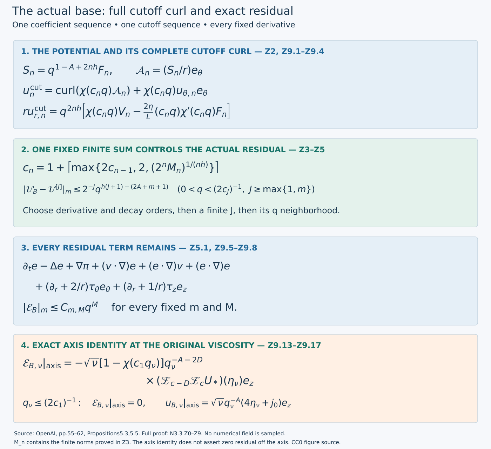

# Realization of the actual base field

The global coefficient sequence is supplied by [D0–D6](higher-axis-coefficients-audit.md) and [Y0–Y7](positive-order-extension-audit.md), starting with the actual leading profile in [V0–V7](shear-realization-audit.md). This note derives the complete finite residual, constructs one sequence of cutoffs for the actual potentials and both stress components, and proves every assertion of original Proposition 5.5. It establishes the supplying base field for the later correction scheme. The complete theorem and its proof dependencies are stated in the [theorem construction](theorem-audit-conclusion.md).

Source: OpenAI, *Finite Time Blowup for Navier–Stokes*, original [PDF, pages 55–62](https://cdn.openai.com/pdf/32d9f210-8b73-45e0-91bc-82a30aef8a9a/navier-stokes.pdf#page=55), (5.23)–(5.46), Propositions 5.3 and 5.5 and Lemma 5.4. PDF SHA256 `0e779481c4da40bd28d1e642e1d8ca57447d129610df28dfa5a11e9af8ae228f`.

The diagram records the full cutoff curl, finite comparison and residual operator in Z2–Z5, with the exact actual base-axis identity in Z9. [Reproducible figure source](../assets/actual-base-field.py) · [Vector figure](../assets/actual-base-field.svg).

## Z0. Exact Cartesian fields and the derivative loss

Keep the original q, A,D,h,η,X,λ_n=2nh, \(R=\sqrt{2X}\) and \(\mathsf C\) from D. Define only the explicit coordinate map \(\xi=(x_1,x_2)/\sqrt q\); then X=|ξ|²/2 and every original profile below is evaluated at that same X and η. The original velocity coefficients, with every radial and angular factor, are
\[
\begin{split}
u_{\theta,n}e_\theta&=q^{-A+\lambda_n}\frac{\phi_n}{\mathsf C}(-\xi_2,\xi_1,0),\\
u_{z,n}e_z&=q^{-A+\lambda_n}U_ne_z,\\
u_{r,n}e_r&=\tfrac12q^{-1/2+\lambda_n}\frac{V_n}{X}(\xi_1,\xi_2,0),\\
p_n&=q^{-2A+\lambda_n}\Pi_n.
\end{split}
\tag{Z0.1}
\]
The factor 1/2 in the radial row follows from V_n/R²=V_n/(2X). Y3.3 proves the smooth Cartesian representatives at the axis. On every compact profile range, all fixed mixed derivatives of these representatives are bounded by the already constructed coefficient bounds; their constants can depend on n.

On a function of (q,ξ,η), the exact physical differentiation operators are
\[
\begin{gathered}
\partial_{x_i}=q^{-1/2}\partial_{\xi_i}\quad(i=1,2),\\
\partial_t=q^{-1}L^{-1}\left(-q\partial_q+\tfrac12\xi\cdot\nabla_\xi+D\eta\partial_\eta\right),\\
\partial_z=q^{-D}L^{-1}\left(2\eta q\partial_q-\eta\xi\cdot\nabla_\xi+d\partial_\eta\right).
\end{gathered}
\tag{Z0.2}
\]
They follow by differentiating q(1−η²)=1−t and q^Dη=z, then ξ=x_perp/√q. In particular the q and η derivatives are exactly those in G0, and the ξ terms follow from the derivative of q^{-1/2}.

For a profile g(ξ,η), each time application of Z0.2 subtracts one from the q exponent, each axial application subtracts D, and each transverse application subtracts 1/2. Differentiating any coefficient involving L,η,ξ leaves bounded smooth coefficients on a compact profile range, since L≥1−2h>0. After m derivatives there are finitely many terms; each exponent differentiation contributes a factor β−c with |c|≤m. Induction on m therefore proves
\[
|\partial_{x_\perp}^{\alpha}\partial_z^k\partial_t^\ell(q^\beta g(\xi,\eta))|
\le C_m(1+|\beta|)^m\|g\|_{C^m}\,
q^{\beta-|\alpha|/2-Dk-\ell},\qquad m=|\alpha|+k+\ell.
\tag{Z0.3}
\]
Every norm here is on the specified compact profile range. Constants depend on that range and h, but the exponent loss does not depend on β or the coefficient order. Powers of λ_n remain in the finite coefficient constants. No coordinate, factor or field is replaced by its largest-order estimate.

## Z1. All terms in the finite augmented residual

Use the original finite tuple
\[
\mathcal U^{[N]}=\sum_{n=0}^N(u_n,p_n,q^{-A-1/2+\lambda_n}\mathcal T_n),\qquad
\mathcal F_{\rm slow}(u,p,T)=\mathscr R(u,p)
+(\partial_r+2/r)T_\theta e_\theta+(\partial_r+1/r)T_ze_z.
\tag{Z1.1}
\]
Here \(\mathscr R=\partial_tu-\Delta u+(u\cdot\nabla)u+\nabla p\) is the source's coefficient-one operator; the exact map back to the original ν is D6.2/Y6.3. All finite velocities are divergence-free by the independently proved order-by-order identity D0.4. Y4.1–Y4.2 cancel the two complete tangential residual coefficients at every retained positive order; the leading ones cancel by G1 and V7. The radial pressure relation D1.5 cancels the retained radial coefficients as well.

The unretained terms can be listed without an appeal to a formal infinite series. Products of two retained fields have i,j≤N; tangential products have total order i+j, and their omitted terms have i+j>N. Tangential axial viscosity acting on a retained order j has order j+1, so only its unretained last index j=N remains. Time, transverse viscosity and pressure differentiation otherwise retain their index in the tangential equations. In particular the exact tangential components of the remaining augmented residual are
\[
\begin{split}
(\mathcal F_{\rm slow}(\mathcal U^{[N]}))_\theta
={}&\frac R{\mathsf C}\sum_{\substack{0\le i,j\le N\\i+j>N}}
q^{-A-1+\lambda_{i+j}}\{V_i(\phi_j'+\phi_j/X)+U_iZ_{b,j}\phi_j\}
-\frac R{\mathsf C}q^{-A-1+\lambda_{N+1}}Z_{b,N}^{[2]}\phi_N,\\
(\mathcal F_{\rm slow}(\mathcal U^{[N]}))_z
={}&\sum_{\substack{0\le i,j\le N\\i+j>N}}
q^{-A-1+\lambda_{i+j}}\{V_iU_j'+U_iZ_{c,j}U_j\}
-q^{-A-1+\lambda_{N+1}}Z_{c,N}^{[2]}U_N.
\end{split}
\tag{Z1.2}
\]
Primes mean ∂_X. All operators and profiles are the full ones in D0–D1, and λ_{i+j}=λ_i+λ_j; the index does not denote an unconstructed product profile.

For the radial equation multiplied by r, retain the two distinct physical factors from D1.5–D1.6:
\[
q^{-2A+\lambda_n}\left[2X\Pi_n'-\mathsf C^{-2}2X\sum_{i+j=n}\phi_i\phi_j\right],\qquad
q^{-1+\lambda_k}\Omega_k.
\tag{Z1.3}
\]
The second factor has radial coefficient order k+1 because −1+λ_k=−2A+λ_{k+1}. Thus radial time and transverse viscosity at retained index j enter order j+1; radial transport products at i+j=k enter order k+1. The radial axial-viscosity term acting on j enters order j+2, because −2D+λ_j=−2A+λ_{j+2}. This last shift retains the full axial viscosity of V_N: it is not part of the tangential j+1 rule. The pressure/centrifugal difference has order n=i+j in its products. Every coefficient of order at most N cancels by the equations already proved, including all middle terms. All remaining orders are at least N+1 and there are only finitely many of them; radial orders can reach max(2N+1,N+2).

More explicitly the exact remaining radial component, multiplied by r, is
\[
\begin{split}
r(\mathcal F_{\rm slow}(\mathcal U^{[N]}))_r
={}&-\frac{2X}{\mathsf C^2}\sum_{\substack{0\le i,j\le N\\i+j>N}}q^{-2A+\lambda_{i+j}}\phi_i\phi_j
+q^{-1+\lambda_N}(T_{0,N}V_N-2XV_N'')\\
&+\sum_{\substack{0\le i,j\le N\\i+j+1>N}}q^{-1+\lambda_{i+j}}
\{V_i(V_j'-V_j/(2X))+U_iZ_{0,j}V_j\}\\
&-\sum_{\substack{0\le j\le N\\j+2>N}}q^{-2D+\lambda_j}Z_{0,j}^{[2]}V_j.
\end{split}
\tag{Z1.4}
\]
For N=0 the last sum has j=0; for N≥1 it has precisely j=N−1,N. This includes the entire final axial-viscosity contribution. The stress pair has only tangential divergence, so it adds no radial term to this identity.

After dividing the radial equation by r, the common radial power is q^{-2A-1/2+λ_n}; the tangential power is q^{-A-1+λ_n}. Division by R in the radial coefficient is regular: Ω_k=X times the smooth function D1.7, while the pressure/centrifugal bracket has factor X. Multiplication by e_r then gives R e_r=(ξ_1,ξ_2,0), with its retained numerical factors. The angular bracket in Y4.1 has its explicit R factor and hence a smooth Cartesian angular vector. The only cylindrical factors in the stress divergence occur on [X_a,X_b], away from X=0, where R^{-1} and every fixed derivative are bounded. Consequently all remaining coefficient functions are smooth Cartesian functions with finite bounds on each fixed compact profile range.

Since 0<q≤1 and 2A+1/2>A+1 for h>0, the exact powers above and Z0.3 give the concrete estimate
\[
|\mathcal F_{\rm slow}(\mathcal U^{[N]})|_m
\le C_{N,m}q^{2h(N+1)-(2A+1/2+m)}.
\tag{Z1.5}
\]
Here |·|_m is the original maximum of Cartesian space-time derivatives through order m. This estimate retains every term of Z1.2–Z1.4. Its exponent loss is independent of N, and its constant may depend on N,m and the compact profile range. It proves the finite-residual assertion of original (5.25), with an explicit allowable loss. There is no additional finite-stage remainder in this application.

## Z2. The actual Stokes potential and its full cutoff curl

For positive order use the exact F_n from Y1.4 and s=r²/2=qX. The physical Stokes function and vector potential are
\[
S_n=q^{1-A+\lambda_n}F_n,\qquad
\mathcal A_n=(S_n/r)e_\theta
=\frac12q^{-A+\lambda_n}\frac{F_n}{X}(-x_2,x_1,0)
=\frac12q^{1/2-A+\lambda_n}\frac{F_n}{X}(-\xi_2,\xi_1,0).
\tag{Z2.1}
\]
These equalities retain the factor 1/2 and both coordinate representations. The actual potential is smooth at the Cartesian axis because F_n/X is smooth. Direct curl in cylindrical coordinates gives
\[
\operatorname{curl}\mathcal A_n=-\frac{\partial_zS_n}{r}e_r+\frac{\partial_rS_n}{r}e_z,
\quad \partial_sS_n=q^{-A+\lambda_n}U_n=u_{z,n},
\quad -\partial_zS_n=q^{\lambda_n}V_n=ru_{r,n}.
\tag{Z2.2}
\]
The last identity follows from the full expression D0.4 and F_n=X\mathcal A_XU_n; it includes the derivative of q^{1−A+λ_n}. Thus the potential is proved to give the original radial and axial fields.

Let χ be smooth, equal to one on [0,1/2] and zero on [1,∞), and let c_n>0. Cutting the potential before taking curl gives the exact fields
\[
\begin{split}
ru_{r,n}^{\rm cut}
&=q^{\lambda_n}\left[\chi(c_nq)V_n-\frac{2\eta}{L}(c_nq)\chi'(c_nq)F_n\right],\\
u_{z,n}^{\rm cut}&=q^{-A+\lambda_n}\chi(c_nq)U_n,\qquad
u_{\theta,n}^{\rm cut}=q^{-A+\lambda_n}\chi(c_nq)E_n.
\end{split}
\tag{Z2.3}
\]
Indeed q is independent of r, while q_z=2ηq^{1−D}/L; multiplying c_nχ' q_z by q^{1−A+λ_n}F_n produces q^{λ_n}(2η/L)(c_nq)χ'F_n because A+D=1. The radial sign is negative from −∂_zS_n. Curl has zero divergence by commutation of Cartesian mixed derivatives, and the θ-independent angular field has zero divergence. This proves incompressibility through every cutoff transition, not merely where χ is constant.

The five coefficient entries \((\mathcal A_n,u_{\theta,n}e_\theta,p_n,\mathcal T_{n,\theta}^{\rm phys},\mathcal T_{n,z}^{\rm phys})\) have respectively the exact powers \(q^{-h+\lambda_n},q^{-A+\lambda_n},q^{-2A+\lambda_n},q^{-A-1/2+\lambda_n},q^{-A-1/2+\lambda_n}\) in their smooth Cartesian or annular profile representations. Since D<1/2, Z0.3 bounds every derivative through m by C_{n,m}q^{λ_n−(2A+m)}. Thus the source's admissible common loss ℓ_m=2A+m follows from the actual coefficient fields. The stress entries, pressure and potential are all included; no bound uniform in n is asserted.

## Z3. One actual cutoff sequence for every required derivative

Choose the exact fixed step \(\chi(s)=1-\sigma(2s-1)\), with σ from O0.1. It equals one for s≤1/2 and zero for s≥1, is smooth and flat at the transition endpoints, and has values between zero and one. For a positive-order z,t derivative of χ(cq), repeated chain rule gives a finite sum of terms
\[
c^k\chi^{(k)}(cq)\prod_{j=1}^k\partial_z^{a_j}\partial_t^{b_j}q,
\quad\sum a_j=a,\quad\sum b_j=b,\quad a_j+b_j\ge1.
\tag{Z3.1}
\]
Z0.2, applied repeatedly to q, gives \(|\partial_z^{a_j}\partial_t^{b_j}q|\le Cq^{1-Da_j-b_j}\). On the support of the derivative, 1/2≤cq≤1, so the factors c^k q^k are bounded independently of c. Consequently
\[
|\partial_z^a\partial_t^b\chi(cq)|\le C_{a,b}q^{-Da-b},\qquad
\partial_{x_1}\chi(cq)=\partial_{x_2}\chi(cq)=0.
\tag{Z3.2}
\]
The undifferentiated cutoff is bounded by one. These bounds hold on the whole domain because the positive derivatives vanish outside the transition.

For the full cut tuple let
\[
W_n(c)=\left(\operatorname{curl}(\chi(cq)\mathcal A_n)+\chi(cq)u_{\theta,n}e_\theta,
\quad\chi(cq)p_n,\quad\chi(cq)q^{-A-1/2+\lambda_n}\mathcal T_n\right).
\tag{Z3.3}
\]
All potential, direct-field, pressure and stress terms remain. A derivative through order m of its curl uses at most m+1 derivatives in total. A term with k derivatives on χ costs at most q^{-k}, and the remaining at most m+1−k derivatives on the potential cost q^{λ_n−2A−(m+1−k)} by Z2. The full product rule therefore gives
\[
|W_n(c)|_m\le C^{\rm phys}_{n,m}q^{2nh-\ell'_m},\qquad \ell'_m=2A+m+1,
\tag{Z3.4}
\]
with constants independent of c. The direct field, pressure and both stress entries obey the same bound, using fewer derivatives. All positive-order profiles have a common compact radial support, so these constants can be taken on that entire support, including its smooth zero extension. In particular the first-order stress is included by Y5.9, whose exponential beats every inverse power at its endpoint.

The additional estimates use exactly the source operators \(\mathscr D=(q\partial_q,\partial_X,\partial_\eta)\). For a multi-index I, let \(\mathscr D^I\) denote their indicated composition. They commute on functions of the independent (q,X,η). The identity
\[
(q\partial_q)^j\chi(cq)=(s\partial_s)^j\chi(s)\big|_{s=cq}
\tag{Z3.5}
\]
gives a uniform bound for every fixed j; the same holds with χ(s) replaced by sχ'(s). Each application to q^{2nh} contributes precisely 2nh. All ∂_X and ∂_η derivatives of the actual profiles on a fixed compact annulus are finite. Thus, for every fixed annulus, the quantities
\[
\begin{gathered}
q^{2nh}\chi(cq)a_n,\qquad
a_n\in\{E_n,U_n,\Pi_n,V_n/R,F_n/R\},\\
q^{2nh}\left[\chi(cq)V_n/R-\frac{2\eta}{L}(cq)\chi'(cq)F_n/R\right],\\
q^{2nh}\chi(cq)\mathcal T_n/\zeta\quad(n\ge2)
\end{gathered}
\tag{Z3.6}
\]
have all \(\mathscr D^I\) bounds C_{n,I}q^{2nh} independent of c. In the last row Y5.2 places the stress in the interior [X_-,X_+], so its quotient by ζ is smooth with bounded derivatives on the entire active annulus, extended by zero near both edges. This quotient estimate is not applied to n=1.

Here is one explicit sequence meeting every requirement. Set \(X_*=\max\{1,X_b\}\) and \(\mathcal K_k=[X_a/(k+1),(k+1)X_*]\times[-1,1]\), k≥1. These exhaust the positive radial coordinate and contain the active annulus. For each n, take M_n≥1 to be the maximum of the finitely many constants in Z3.4 for 0≤m≤n and in Z3.6 for |I|≤n and 1≤k≤n. Include the full bracket, not just its first term, and the entire stress quotient when n≥2. Each constant is defined by the finite product-rule bounds just proved for the already constructed profiles and the fixed χ; no unknown future coefficient enters. Define c_0=1 and recursively
\[
c_n=1+\left\lceil\max\left\{2c_{n-1},\ 2,\ (2^nM_n)^{1/(nh)}\right\}\right\rceil.
\tag{Z3.7}
\]
All M_n are finite and h>0 was fixed in the actual leading construction. Hence this gives one finite positive c_n at every order and c_n≥2c_{n−1}. For 0<q≤1/c_n it implies M_nq^{nh}≤2^{-n}. On larger q the n-th summand and all its derivatives vanish. Consequently
\[
|W_n(c_n)|_m\le2^{-n}q^{nh-\ell'_m}\quad(m\le n),
\qquad
|\mathscr D^I B_n^{\rm sim}|\le2^{-n}q^{nh}\quad(|I|\le n,\ k\le n),
\tag{Z3.8}
\]
where B_n^{sim} means each of the complete expressions in Z3.6 on \(\mathcal K_k\), including the full cutoff bracket and both stress quotients. The q derivative factors and the coefficients 2η/L are included in M_n. This is an exact diagonal construction from finite norms; it requires no numerical estimate of the enormous possible cutoff sizes and no hypothesis of uniform coefficient growth.

## Z4. Actual fields, exact divergence and their finite comparison

Define the fields by the actual locally finite series
\[
\begin{split}
u_B&=u_0+\sum_{n\ge1}\left[\operatorname{curl}(\chi(c_nq)\mathcal A_n)+\chi(c_nq)u_{\theta,n}e_\theta\right],\\
p_B&=p_0+\sum_{n\ge1}\chi(c_nq)p_n,\\
T_{\rm phys}&=q^{-A-1/2}\mathcal T_0+\sum_{n\ge1}\chi(c_nq)q^{-A-1/2+2nh}\mathcal T_n.
\end{split}
\tag{Z4.1}
\]
On any compact set with q≥q_*>0, c_nq≥1 for all sufficiently large n. Thus only finitely many terms and their derivatives occur locally. Every term is smooth in Cartesian coordinates at the axis by Z0–Z2, or supported away from it for the stress. Z2.3 proves exact incompressibility, including every cutoff term, and local finiteness preserves it in the sum. All added terms extend smoothly by zero for q≥1/c_1 because χ is flat at its outer endpoint.

Every positive-order velocity and pressure term is zero when X≥X_+: its potential contains F_n, its cutoff curl contains only F_n and V_n, and all of these, as well as U_n,E_n,Π_n, vanish there by Y3. The stress has support [X_a,X_b] because its leading and higher components do, and multiplication by χ(c_nq) does not alter the radial profile support. No conclusion that the first-order stress vanishes at X_+ is used.

Fix a derivative order m. For J≥max{1,m} and 0<q<(2c_J)^{-1}, all first J cutoffs equal one on a neighborhood, including all their vanishing derivatives. The original tuple \(\mathcal U^{[J]}\), with its uncut potentials differentiated, is therefore the first J part of Z4.1. By Z3.8,
\[
|(u_B,p_B,T_{\rm phys})-\mathcal U^{[J]}|_m
\le\sum_{n>J}2^{-n}q^{nh-\ell'_m}
\le2^{-J}q^{h(J+1)-\ell'_m}.
\tag{Z4.2}
\]
The last inequality uses q≤1 and the exact sum \(\sum_{n>J}2^{-n}=2^{-J}\). The common derivative loss is independent of J.

## Z5. The complete augmented residual is flat

For one fixed finite state set v=u^{[J]}, p_*=p^{[J]}, T_*=T^{[J]}, and e=u_B−v, π=p_B−p_*, τ=T_phys−T_*. Subtracting the full residual gives the exact identity
\[
\begin{split}
\mathcal F_{\rm slow}(u_B,p_B,T_{\rm phys})-\mathcal F_{\rm slow}(v,p_*,T_*)
={}&\partial_te-\Delta e+\nabla\pi+(v\cdot\nabla)e+(e\cdot\nabla)v+(e\cdot\nabla)e\\
&+(\partial_r+2/r)\tau_\theta e_\theta+(\partial_r+1/r)\tau_ze_z.
\end{split}
\tag{Z5.1}
\]
The last line contains both original tangential stress divergences. It is supported in the fixed active annulus. Write \(\partial_r=e_r\cdot\nabla_x\) there. A Cartesian derivative of order j of e_r,e_θ is bounded by C_jr^{-j}, and of 1/r by C_jr^{-1−j}; their t,z derivatives vanish. Since r=√q R and \(\sqrt{2X_a}\le R\le\sqrt{2X_b}\), the product rule yields
\[
| (\partial_r+2/r)\tau_\theta e_\theta+(\partial_r+1/r)\tau_ze_z |_m
\le C_mq^{-H_m}|\tau|_{m+1},\qquad H_m=(m+1)/2.
\tag{Z5.2}
\]
Terms with fewer frame derivatives obey the same bound because 0<q≤1. All coefficients and supports are the original ones; no 1/r estimate is used at the axis.

For the three nonlinear terms in Z5.1, every differentiated component is a finite sum
\(\partial^I(v_k\partial_ke_i)=\sum_{J'\le I}\binom I{J'}(\partial^{J'}v_k)(\partial^{I-J'}\partial_ke_i)\), and the other two products have their respective displayed factors. This proves the full estimate
\[
|\mathcal F_{\rm slow}(u_B,p_B,T_{\rm phys})-\mathcal F_{\rm slow}(v,p_*,T_*)|_m
\le C_m\left(|e|_{m+2}+|\pi|_{m+1}+|v|_{m+1}|e|_{m+1}+|e|_{m+1}^2+q^{-H_m}|\tau|_{m+1}\right).
\tag{Z5.3}
\]
In particular the quadratic new-new term and the pressure term have not been discarded.

On a fixed compact profile range, Z0.1–Z0.3 and the actual leading profile give, for every finite J,
\[
|\mathcal U^{[J]}|_r\le C_{J,r}q^{-K_r},\qquad K_r=2A+r,
\tag{Z5.4}
\]
because all coefficient increments have factor q^{2nh}≤1 and the pressure is the most singular of the undifferentiated entries. The constants may grow with J; K_r does not. The leading stress has its already proved smooth zero extension, and its support is away from the axis.

Given physical derivative order m and desired decay order M≥0, put r=m+2 and choose one finite integer J≥max{1,r} such that
\[
\alpha=h(J+1)-\ell'_r\ge M+\max\{K_r,H_m\},\qquad
2h(J+1)-(2A+1/2+m)\ge M.
\tag{Z5.5}
\]
Both inequalities hold for a sufficiently large finite J because h>0 and every displayed loss is independent of J. For example the ceiling of the maximum of r, \((M+\max\{K_r,H_m\}+\ell'_r)/h-1\), and \((M+2A+1/2+m)/(2h)-1\), enlarged to at least one, suffices. Keep this J fixed and restrict q<(2c_J)^{-1}. Equation Z4.2 bounds e,π,τ through order r by 2^{-J}q^α; Z5.4 bounds v by C_{J,r}q^{-K_r}. The five terms in Z5.3 have powers at least α, α, α−K_r, 2α and α−H_m, all at least M by Z5.5. The finite residual Z1.5 also has power at least M. Therefore the actual field satisfies
\[
\mathscr R(u_B,p_B)=-(\partial_r+2/r)T_{{\rm phys},\theta}e_\theta
-(\partial_r+1/r)T_{{\rm phys},z}e_z+\mathcal E_B,
\qquad |\mathcal E_B|_m\le C_{m,M}q^M
\tag{Z5.6}
\]
on the chosen compact profile range as q↓0, for every m and M. The constants and neighborhood may depend on that range and on m,M. The order of choices is (m,M), then one finite J, then its q neighborhood. This uses no infinite sum of residual remainders. It proves the actual application of Lemma 5.4 to the base, including its stress variable, rather than importing unverified finite-state data.

## Z6. Every original velocity and weighted stress comparison

Fix any \(0<X_{\rm lo}<X_a<X_b<X_{\rm hi}<\infty\). Choose k so its closed profile rectangle lies in \(\mathcal K_k\). For a fixed |I|=m split the positive series into a finite initial block and a tail starting at n_0≥max{2,k,m}. The finite terms in Z3.6 and their \(\mathscr D^I\) derivatives are O(q^{2h}), since each has its original q^{2nh} factor and the fixed cutoff derivatives are bounded. The tail is at most
\[
\sum_{n\ge n_0}2^{-n}q^{nh}\le2^{1-n_0}q^{n_0h}\le2^{1-n_0}q^{2h}.
\tag{Z6.1}
\]
Use this for each complete expression in Z3.6 and then use the exact fields Z2.3. It proves all of the following, with their original factors:
\[
\begin{gathered}
\mathscr D^I(q^Au_{\theta,B}-E_0)=O_I(q^{2h}),\qquad
\mathscr D^I(q^Au_{z,B}-U_0)=O_I(q^{2h}),\\
\mathscr D^I(q^{1/2}u_{r,B}-V_0/\sqrt{2X})=O_I(q^{2h}),\qquad
\mathscr D^I(q^Au_{r,B})=O_I(q^h),\\
\mathscr D^I(q^{2A}p_B-\Pi_0)=O_I(q^{2h}).
\end{gathered}
\tag{Z6.2}
\]
For the fourth row, the exact identity is q^Au_{r,B}=q^h[V_0/\sqrt{2X}+O(q^{2h})]; the leading term is retained. The positive-order radial contribution with that same q^A factor is O(q^{3h}). All derivatives of the extra cutoff term in Z2.3 are included in the third and fourth rows. The pressure statement follows from the same included coefficient row; Π_0 here is the full leading pressure, as in D0.

For the original stress set \(\widehat T=q^{A+1/2}T_{\rm phys}\). The exact difference is
\[
\widehat T-\mathcal T_0=\chi(c_1q)q^{2h}\mathcal T_1
+\zeta\sum_{n\ge2}\chi(c_nq)q^{2nh}(\mathcal T_n/\zeta).
\tag{Z6.3}
\]
For n≥2 the quotients and all derivatives are bounded on the full active annulus by Y6, and are included in Z3.6–Z3.8. Their series and every \(\mathscr D^I\) derivative are O(q^{2h}) by Z6.1 and a finite initial block. For each fixed j, the full exponential ζ of Y6.1 satisfies \(|\partial_X^j\zeta|\le C_j\zeta\delta^{-M_j}\): differentiate both exponential factors, using the bounded derivatives of log(X/X_a), log(X_b/X) on the fixed annulus, and retain the finite resulting inverse powers. The product rule therefore bounds the second term in Z6.3 by O_I(q^{2h}ζδ^{-N_I}). The first term obeys the same bound using the actual first-order stress estimate Y5.9–Y6.2 and the fixed cutoff derivatives. Taking the maximum over the finitely many product-rule exponents gives
\[
|\mathscr D^I(\widehat T-\mathcal T_0)|\le C_Iq^{2h}\zeta\delta^{-N_I}
\le C_Iq^h\zeta\delta^{-N_I},\qquad 0<q\le1,
\tag{Z6.4}
\]
uniformly for X_a<X<X_b and −1≤η≤1. This treats the whole first-order outer stress and both stress entries. It does not assume positivity of the higher stresses or replace them by their leading value.

## Z6a. Exact outer stress coefficient of the actual base

On the terminal collar \(X>X_+\), Y5.2–Y5.3 give \(\mathcal T_n=0\) for \(n\ge2\) and \(\mathcal T_{1,z}=0\). Thus the actual sum Z6.3 is exactly
\[
\widehat T_\theta=e^{-4/\delta_b^2}\delta_b^{-3}
[b_\theta+\chi(c_1q)q^{2h}B_1],\qquad
\widehat T_z=e^{-4/\delta_b^2}\delta_b^3b_z.
\tag{Z6a.1}
\]
These are the full original stress components; no limiting series is interchanged here because all but one correction vanish identically on this collar. H6.6 supplies the smooth positive leading coefficient \(b_\theta\), and [Y8.16–Y8.27](positive-order-extension-audit.md) proves
\[
\frac{B_1(0,\eta)}{b_\theta(0,\eta)}
=\frac{2X_b\eta^2}{L^2},\qquad
\lim_{\delta_b\downarrow0}\delta_b^{-3}
\frac{B_1(\delta_b,0)}{b_\theta(\delta_b,0)}=\frac{X_b}{8}.
\tag{Z6a.2}
\]
In particular the ratio \(B_1/b_\theta\) extends smoothly through the outer endpoint, despite the unbounded first-order quotient \(\mathcal T_{1,\theta}/\zeta\) at fixed nonzero \(\eta\).

The actual cutoff satisfies \(0\le\chi\le1\). At the endpoint the angular coefficient divided by \(b_\theta\) is
\[
1+\chi(c_1q)q^{2h}\frac{2X_b\eta^2}{L^2}\ge1.
\tag{Z6a.3}
\]
For every fixed bounded interval of \(q\ge0\), continuity and compactness supply a common smaller terminal collar on which the full angular coefficient stays positive. The cutoff is zero for large \(c_1q\), so the same conclusion holds on any intended preterminal range. The exact direction is
\[
\frac{\widehat T}{|\widehat T|}
=\frac{(1,\mathcal R_B)}{\sqrt{1+\mathcal R_B^2}},\qquad
\mathcal R_B=\frac{\delta_b^6b_z}
{b_\theta+\chi(c_1q)q^{2h}B_1}
\longrightarrow0.
\tag{Z6a.4}
\]
It is smooth in \((\delta_b,\eta)\) through the endpoint for each fixed \(q>0\), with every fixed \(q\)-derivative on compact positive \(q\) intervals. The exact radial derivative bounds [Y8.22–Y8.25](positive-order-extension-audit.md) allow the exponent \(3k+3\) for the first-order outer stress after \(k\) radial derivatives, with arbitrary fixed parameter derivatives. This supplies an explicit exponent for that term of Z6.4; other product-rule terms retain their stated finite exponents. The actual physical stress is \(\nu q^{-A-1/2}\widehat T\) at the unchanged viscosity coordinates, so the positive scalar factor preserves the direction and all original physical factors. This proves a sharper endpoint comparison for the same base field, without altering the construction or claiming an original source error.

## Z7. Formal expansion, exterior, mean patch and endpoint derivatives

Fix a formal order N and a physical derivative order m. Take J≥max{2N+2,m+1}. For sufficiently small q, the finitely many cutoffs with n≤J equal one and all their derivatives vanish. The intermediate block N<n<J then consists exactly of original coefficient terms and has powers at least 2h(N+1), with the fixed derivative losses already proved in Z0.3. The remaining tail satisfies
\[
\sum_{n\ge J}2^{-n}q^{nh-\ell'_m}
\le2^{1-J}q^{Jh-\ell'_m}
\le2^{1-J}q^{2h(N+1)-\ell'_m}.
\tag{Z7.1}
\]
The constants of the finite intermediate block may depend on N,m. This proves every fixed formal order of the original tuple, including physical derivatives with an index-independent exponent loss. For the similarity derivatives the same argument applies to Z3.6, with J also exceeding the chosen annulus index k; its tail has no physical loss. The cutoff curl vanishes in the finite initial block and remains fully present in the tail bounds. Thus the asymptotic coefficients are the original \(\mathcal U^{[N]}\), with their Stokes potentials differentiated before summation as specified in the source.

One can also retain the exact component power in this comparison. For angular or axial velocity, radial velocity, pressure, and stress respectively, let \(\beta=-A,-1/2,-2A,-A-1/2\), as in Z0.1 and Z1.1. A prescribed derivative with a transverse, k axial and ℓ time derivatives has exact loss w=a/2+Dk+ℓ. Enlarge the finite split index J, if necessary, until \(hJ-\ell'_m\ge\beta+2h(N+1)-w\). The intermediate terms obey Z0.3 with this original β, and the tail obeys this strengthened choice of J in Z7.1. Therefore the component remainder after the original N-th truncation is \(O(q^{\beta+2h(N+1)-w})\) for that derivative. All five types of field have been retained; a larger finite J proves their finite list of requirements simultaneously. This proves the coefficient expansion with the actual physical powers as well as the common-loss estimate.

By Y3.5, E_n,U_n,F_n,V_n vanish on the untouched mean patch for every positive n. Both terms in the radial bracket Z2.3 vanish there as well. Hence the exact base velocity on that patch is
\[
u_B=u^{(0)},\qquad u_{z,B}=0,\qquad
q^Au_{\theta,B}=E_0=c_{\rm patch}(1+\eta^2)^{-1}X^{-1/2-\lambda}
\quad(X\in\mathcal I_{\rm mean}).
\tag{Z7.2}
\]
There is no pressure-equality assertion on this earlier patch. In the exterior X≥X_+, Y3 gives all positive-order fields and potentials, including pressure, identically zero. Thus u_B=u^(0) and p_B=p^(0) there. For X≥X_b this is precisely the actual heat swirl and its pressure from H0/H4 and V7, including \(U_0=V_0=0\), not just a field with the same asymptotic power.

For endpoint regularity fix a compact set with q≥q_*>0. Local finiteness leaves only finitely many positive-order terms. Each has every fixed profile derivative continuous up to η=±1 by D/Y; the leading term has that same one-sided smoothness by G/O/H/J/Q/V, including the heat factor at d=0. The cutoff and its derivatives are smooth functions of q. Formula Z0.2 transfers these limits to every fixed physical space-time derivative because L≥1−2h>0 and q is bounded below. The same applies to the pressure and stress, and then to \(\mathcal E_B\), which is their finite differential expression Z5.6. This proves the claimed continuous derivative extensions. It requires no claim of two-sided analytic extension of the terminal heat factor at d=0.

## Z8. Original viscosity and the receiving construction

For the originally specified ν>0 use the exact map
\[
\begin{gathered}
x_\nu=\sqrt\nu x,\quad t_\nu=t,\quad
q_\nu-(z_\nu^2/\nu)q_\nu^{2h}=1-t,\quad
X_\nu=r_\nu^2/(2\nu q_\nu),\quad \eta_\nu=z_\nu/(\sqrt\nu q_\nu^D),\\
u_{B,\nu}=\sqrt\nu\,u_B(x_\nu/\sqrt\nu,t),\quad
p_{B,\nu}=\nu p_B(x_\nu/\sqrt\nu,t),\quad
T_{{\rm phys},\nu}=\nu T_{\rm phys}(x_\nu/\sqrt\nu,t),\\
\mathcal A_{n,\nu}=\nu\mathcal A_n(x_\nu/\sqrt\nu,t),\qquad
S_{n,\nu}=\nu^{3/2}S_n(x_\nu/\sqrt\nu,t),\qquad
\mathcal E_{B,\nu}=\sqrt\nu\mathcal E_B(x_\nu/\sqrt\nu,t).
\end{gathered}
\tag{Z8.1}
\]
The potential and streamfunction factors follow from r_ν=√ν r and curl_ν=ν^{-1/2}curl; they give exactly the mapped velocity including every cutoff curl. Each momentum term has the factor √ν: one spatial derivative costs ν^{-1/2}, pressure and stress have factor ν, and νΔ_νu_ν has ν·ν^{-1}·√ν. Thus
\[
\partial_tu_{B,\nu}-\nu\Delta_\nu u_{B,\nu}+(u_{B,\nu}\cdot\nabla_\nu)u_{B,\nu}+\nabla_\nu p_{B,\nu}
=-\operatorname{div}_{\nu,\rm tan}T_{{\rm phys},\nu}+\mathcal E_{B,\nu}.
\tag{Z8.2}
\]
Here the tangential divergence is exactly the two operators \((\partial_{r_\nu}+2/r_\nu)T_{\nu,\theta}e_\theta+(\partial_{r_\nu}+1/r_\nu)T_{\nu,z}e_z\). All residual derivative bounds gain only the fixed factors ν^{(1−|α|)/2} for |α| spatial derivatives; time is unchanged. They are therefore flat to every order in the same original q_ν. Stress support, endpoint extensions and exterior and mean-patch equalities pass through this exact coordinate map. No different viscosity or spatial scale has replaced the original problem.

Z0–Z1 prove Proposition 5.3 for the actual D/Y sequence. Z2–Z5 construct its divergence-preserving sum and prove the full stress-augmented application of Lemma 5.4. Z6–Z8 prove every comparison, formal expansion, support, endpoint and viscosity assertion needed for Proposition 5.5. The result supplies the actual base required by the local oscillatory operators and the later finite correction cycle. The receiving arguments are assembled for this actual base in [I0–I7](local-construction-assembly-audit.md), proving every property of Theorem 3.1. The actual local fields are used in [F0–F8](terminal-force-and-blowup-audit.md) to derive localization, force extension, solution class, energy, comparison and blowup. The complete theorem and its proof dependencies are stated in the [theorem construction](theorem-audit-conclusion.md).

## Z9. Exact cutoff, residual and expansion consequences

### Exact divergence defect and unique regular radial repair

Write \(s=c_nq\), only as the argument of the already fixed cutoff. Since \(\operatorname{div}u_n=0\), \(q\) is independent of \(r\), and \(q_z=2\eta q^{1-D}/L\),
\[
\operatorname{div}[\chi(c_nq)u_n]
=c_n\chi'(c_nq)q_z u_{z,n}
=\frac{2\eta}{L}s\chi'(s)q^{\lambda_n-1}U_n.
\tag{Z9.1}
\]
Here \(A+D=1\) gives the final exponent. The angular component contributes no divergence. The extra radial component in Z2.3 is
\[
w_{r,n}=-\frac{2\eta}{L}s\chi'(s)\frac{q^{\lambda_n}F_n}{r}.
\tag{Z9.2}
\]
At fixed \(z,t\), every factor outside \(F_n/r\) is independent of \(r\), while \(\partial_rF_n=(r/q)U_n\). Hence
\[
\frac1r\partial_r(rw_{r,n})
=-\frac{2\eta}{L}s\chi'(s)q^{\lambda_n-1}U_n.
\tag{Z9.3}
\]
This proves the cancellation with its exact sign. Moreover \(F_n/X\) is smooth and \(X=r^2/(2q)\); thus \(w_{r,n}e_r\) is smooth in the Cartesian variables. In fact the positive-order zero axis trace gives \(F_n=O(X^2)\), so this correction is \(O(r^3)\) at fixed \(z,t\).

Any other radial solution of the same divergence equation differs by \(a(z,t)/r\). Smoothness at the axis forces \(a=0\). Equivalently, integrating \(\partial_r(rw)=-r\,\operatorname{div}[\chi u_n]\) from zero gives precisely Z9.2, because \(F_n(0)=0\). This proves uniqueness in the specified class. The common compact support and the zero mean-patch value follow from those of \(F_n\).

For the original viscosity, \(r_\nu=\sqrt\nu r\), \(w_{r,n,\nu}=\sqrt\nu w_{r,n}\), and
\[
r_\nu w_{r,n,\nu}
=-\nu\frac{2\eta_\nu}{L_\nu}(c_nq_\nu)\chi'(c_nq_\nu)
q_\nu^{\lambda_n}F_n(X_\nu,\eta_\nu).
\tag{Z9.4}
\]
In the divergence, the spatial factor \(\nu^{-1/2}\) cancels the velocity factor \(\sqrt\nu\); Z9.1 and Z9.3 retain exactly their coefficient-one values at \((X_\nu,\eta_\nu,q_\nu)\). In the curl, the potential has factor \(\nu\), so its mapped curl has factor \(\sqrt\nu\), as Z8.1 requires.

### Complete residual of the first finite sum

The tangential product condition \(i+j>1\), with \(0\le i,j\le1\), leaves only \((1,1)\). The last retained axial-viscosity term has index one. Consequently
\[
\begin{split}
(\mathcal F_{\rm slow}(\mathcal U^{[1]}))_\theta
&=q^{-A-1+4h}\frac R{\mathsf C}
\left[V_1(\phi_1'+\phi_1/X)+U_1Z_{b,1}\phi_1
-Z_{b,1}^{[2]}\phi_1\right],\\
(\mathcal F_{\rm slow}(\mathcal U^{[1]}))_z
&=q^{-A-1+4h}
\left[V_1U_1'+U_1Z_{c,1}U_1-Z_{c,1}^{[2]}U_1\right].
\end{split}
\tag{Z9.5}
\]
All functions retain their actual \(X,\eta\) dependence. The operators have the original shifts: \(Z_{\beta,1}^{[2]}=Z_{\beta+2h-D}Z_{\beta+2h}\).

For radial transport the condition is \(i+j+1>1\). It leaves \((0,1),(1,0),(1,1)\). The radial axial-viscosity condition \(j+2>1\) leaves both \(j=0\) and \(j=1\). Group only terms with identical original powers:
\[
\begin{split}
G_2={}&-\frac{2X}{\mathsf C^2}\phi_1^2
+T_{0,1}V_1-2XV_1''\\
&+V_0(V_1'-V_1/(2X))+V_1(V_0'-V_0/(2X))\\
&+U_0Z_{0,1}V_1+U_1Z_{0,0}V_0-Z_{0,0}^{[2]}V_0,\\
G_3={}&V_1(V_1'-V_1/(2X))+U_1Z_{0,1}V_1
-Z_{0,1}^{[2]}V_1.
\end{split}
\tag{Z9.6}
\]
The full radial expression is
\[
r(\mathcal F_{\rm slow}(\mathcal U^{[1]}))_r
=q^{-2A+4h}G_2+q^{-2A+6h}G_3.
\tag{Z9.7}
\]
Indeed \(-1+2h=-2A+4h=-2D\), whereas \(-1+4h=-2A+6h=-2D+2h\). These identities place the two radial axial derivatives in orders two and three respectively. They also place the radial time and transverse-viscosity terms in order two. Every coefficient and both middle transport products remain in Z9.6.

Each \(G_j/X\) is smooth at \(X=0\): substitute \(V_i=Xv_i\) into every term and use the operator identities \(T_\beta(Xf)=XT_{\beta-1}f\), \(Z_\beta(Xf)=XZ_{\beta-1}f\). Thus division by \(r=\sqrt qR\) gives the smooth Cartesian radial vector with its exact factor \(X/R=R/2\). On a fixed compact profile range, the derivative estimate Z0.3 gives
\[
|\mathcal F_{\rm slow}(\mathcal U^{[1]})|_m
\le C_m q^{4h-(2A+1/2+m)}.
\tag{Z9.8}
\]
This is a bound for the displayed finite residual. It does not discard the order-three term or equate a finite truncation with the actual infinite base. For viscosity \(\nu\), the entire vector in Z9.5–Z9.7 is multiplied by \(\sqrt\nu\) and evaluated at \(x=x_\nu/\sqrt\nu\); an additional spatial derivative contributes \(\nu^{-1/2}\).

### Flat comparison of actual cutoff realizations

Put \(\Delta\chi_n(q)=\chi(c_nq)-\chi(\widetilde c_nq)\). The exact difference is
\[
\begin{split}
\Delta u_B&=\sum_{n\ge1}
\left[\operatorname{curl}(\Delta\chi_n\mathcal A_n)
+\Delta\chi_n u_{\theta,n}e_\theta\right],\\
\Delta p_B&=\sum_{n\ge1}\Delta\chi_n p_n,\\
\Delta T_{\rm phys}&=\sum_{n\ge1}
\Delta\chi_n q^{-A-1/2+2nh}\mathcal T_n.
\end{split}
\tag{Z9.9}
\]
Both sums are locally finite. Their difference is divergence-free by the full curl identity, and its velocity and pressure vanish outside \(X_+\). Its velocity vanishes on the unchanged mean patch. The stress difference has support in \([X_a,X_b]\).

Fix a derivative order \(m\) and decay order \(M\). Choose \(J\ge\max\{1,m\}\) with \(h(J+1)-\ell'_m\ge M\). For
\[
0<q<\min\{(2c_J)^{-1},(2\widetilde c_J)^{-1}\},
\tag{Z9.10}
\]
both sets of first \(J\) cutoffs are identically one. Apply Z4.2 to each base relative to the same finite tuple. The exact triangle inequality gives
\[
|(\Delta u_B,\Delta p_B,\Delta T_{\rm phys})|_m
\le2^{1-J}q^{h(J+1)-\ell'_m}
\le2^{1-J}q^M.
\tag{Z9.11}
\]
The constants and the neighborhood are permitted to depend on \(m,M\). This proves equality of every formal coefficient with a flat difference, rather than equality of the actual fields.

There is a stronger stress comparison after retaining its original multiplier. Define \(\Delta\widehat T=q^{A+1/2}\Delta T_{\rm phys}\). For \(q\) as in Z9.10 with \(J\ge\max\{2,|I|\}\), the first-order term vanishes exactly. Every remaining stress coefficient is supported in the fixed interior \([X_-,X_+]\); its quotient by \(\zeta\) is smooth. The two bounds Z3.8 therefore give
\[
\left|\mathscr D^I\left(\frac{\Delta\widehat T}{\zeta}\right)\right|
\le2\sum_{n>J}2^{-n}q^{nh}
\le2^{1-J}q^{h(J+1)}
\quad(X_a<X<X_b).
\tag{Z9.12}
\]
Choose \(J\) also so that \(h(J+1)\ge M\). This is flat uniformly through the whole active annulus and every fixed similarity derivative, with no inverse distance factor. The quotient extends by zero near both endpoints because the remaining supports lie in that fixed interior. The exact original physical relation is \(\Delta T_{{\rm phys},\nu}=\nu q_\nu^{-A-1/2}\Delta\widehat T\); no stress multiplier has been removed from the physical conclusion.

### Exact actual base-axis residual

Use the actual traces and slopes already derived from the full coefficient equations:
\[
\begin{gathered}
U_*=4\eta+j_0,\qquad c=-A,\qquad
\mathscr Z_\beta f=\frac{2\beta\eta f+(1-\eta^2)f'}{1-2h\eta^2},\\
U_n(0,\eta)=\Pi_n(0,\eta)=0\quad(n\ge1),\\
\alpha(\eta):=U_{1,X}(0,\eta)
=-\tfrac12\mathscr Z_{c-D}\mathscr Z_cU_*,
\qquad U_{n,X}(0,\eta)=0\quad(n\ge2).
\end{gathered}
\tag{Z9.13}
\]
These are D7.10–D7.15; the global moment corrections preserve the protected axis interval. At any fixed \(q_\nu>0\) only finitely many base terms occur. The axial components in Z2.3 have the factor \(\chi(c_nq_\nu)\), which is independent of \(r_\nu\). Their zero axis traces remain zero under every time and axial derivative. Their pressure derivatives in \(z_\nu\) also have zero trace.

Every positive-order horizontal velocity, including the additional radial cutoff term, is \(O(r_\nu^3)\), and the positive-order axial velocity is \(O(r_\nu^2)\). Hence all extra axial convection terms vanish at the axis. Only the transverse Laplacian of the first positive-order axial component contributes there. Its exact value is
\[
\left.\nu(\partial_{r_\nu r_\nu}+r_\nu^{-1}\partial_{r_\nu})
(u_{z,B,\nu}-u_{z,\nu}^{(0)})\right|_{r_\nu=0}
=2\sqrt\nu\,\chi(c_1q_\nu)q_\nu^{-A+2h-1}\alpha(\eta_\nu).
\tag{Z9.14}
\]
The higher orders have zero first radial slope by Z9.13, so they contribute zero even in their cutoff transitions. The leading residual from D7.23 is
\(-\sqrt\nu q_\nu^{-A-2D}\mathscr Z_{c-D}\mathscr Z_cU_*\).
Since \(2h-1=-2D\), inserting Z9.13 into the negative viscous term gives
\[
\mathcal E_{B,\nu}(0,0,z_\nu,t)
=-\sqrt\nu\,[1-\chi(c_1q_\nu)]q_\nu^{-A-2D}
(\mathscr Z_{c-D}\mathscr Z_cU_*)(\eta_\nu)e_z.
\tag{Z9.15}
\]
The stress and its derivatives vanish on a neighborhood of the axis because \(X_a>0\), so the augmented residual there is the ordinary momentum residual. Its horizontal components are zero: a smooth axisymmetric vector at the axis is fixed by every horizontal rotation and hence is parallel to \(e_z\). This proves the full vector identity.

In particular the residual is identically zero on the axis whenever \(0<q_\nu\le(2c_1)^{-1}\), although no open radial neighborhood with identically zero residual is claimed. At \(z_\nu=0\), write \(\tau=1-t=q_\nu\); D7.22 gives
\[
\mathcal E_{B,\nu}(0,0,0,t)
=2Aj_0\sqrt\nu\,[1-\chi(c_1\tau)]\tau^{-A-2D}e_z.
\tag{Z9.16}
\]
The velocity trace is exactly
\[
u_{B,\nu}(0,0,z_\nu,t)
=\sqrt\nu q_\nu^{-A}(4\eta_\nu+j_0)e_z,
\qquad
u_{B,\nu}(0,0,0,t)=\sqrt\nu j_0(1-t)^{-A}e_z.
\tag{Z9.17}
\]
Thus exact axis cancellation preserves the prescribed growth. It supplies an identity for the constructed base, not a replacement for the later annular correction and localization arguments.

### Full first correction and weighted remainder

Keep \(X_{\rm lo},X_{\rm hi}\) and \(\mathscr D\) from Z6. For \(q<(2c_1)^{-1}\), the first cutoff is one and its derivatives vanish. Fix \(I\) and choose a tail index \(J\ge\max\{4,|I|,k\}\), where \(\mathcal K_k\) contains the chosen annulus. Every term \(2\le n<J\) has its full factor \(q^{2nh}\), hence is \(O_I(q^{4h})\); the finitely many cutoff derivatives are bounded by Z3.5. The remaining tail is bounded by \(2^{1-J}q^{Jh}\), which is also \(O(q^{4h})\). Applying this argument to every complete entry of Z3.6 yields
\[
\begin{split}
\mathscr D^I(q^Au_{\theta,B}-E_0-q^{2h}E_1)&=O_I(q^{4h}),\\
\mathscr D^I(q^Au_{z,B}-U_0-q^{2h}U_1)&=O_I(q^{4h}),\\
\mathscr D^I(q^{1/2}u_{r,B}-V_0/R-q^{2h}V_1/R)&=O_I(q^{4h}),\\
\mathscr D^I(q^{2A}p_B-\Pi_0-q^{2h}\Pi_1)&=O_I(q^{4h}).
\end{split}
\tag{Z9.18}
\]
The entire radial cutoff bracket remains in the tail estimate; it is not set to zero there. The common \(q^A\) factor in the radial component gives the more precise expansion
\[
\mathscr D^I\left(q^Au_{r,B}
-q^h V_0/R-q^{3h}V_1/R\right)=O_I(q^{5h}).
\tag{Z9.19}
\]
Each derivative of the extra factor \(q^h\) contributes a fixed power of \(h\), so the product rule preserves this stated exponent.

For stress, subtract the full first coefficient before dividing by the original weight:
\[
\frac{\widehat T-\mathcal T_0-q^{2h}\mathcal T_1}{\zeta}
=\sum_{n\ge2}\chi(c_nq)q^{2nh}\frac{\mathcal T_n}{\zeta}.
\tag{Z9.20}
\]
All terms on the right have support in \([X_-,X_+]\). The same finite-block and tail argument, now using the exact quotient estimates in Z3.6, proves
\[
\left|\mathscr D^I
\left(\frac{\widehat T-\mathcal T_0-q^{2h}\mathcal T_1}{\zeta}\right)\right|
\le C_Iq^{4h}
\quad(X_a<X<X_b).
\tag{Z9.21}
\]
This quotient extends smoothly by zero near both endpoints. The exceptional first-order stress has been retained explicitly; its quotient by \(\zeta\) is not bounded at a fixed nonzero outer parameter, as Y8 proves. Differentiating Z9.20 after multiplying back by \(\zeta\) also gives the physical weighted estimate \(C_Iq^{4h}\zeta\delta^{-N_I}\) for the displayed stress remainder, with the finite product-rule exponents of the original weight.

To restore viscosity in Z9.18–Z9.21, evaluate at \((q_\nu,X_\nu,\eta_\nu)\), use \(u_{B,\nu}=\sqrt\nu u_B\), \(p_{B,\nu}=\nu p_B\), and \(T_{{\rm phys},\nu}=\nu q_\nu^{-A-1/2}\widehat T\). For example the angular comparison is for \(q_\nu^Au_{\theta,B,\nu}/\sqrt\nu\), and the pressure comparison for \(q_\nu^{2A}p_{B,\nu}/\nu\). These are exact comparisons to the original physical fields, retaining their specified viscosity.

The [complete base-field lesson](../src/constructing-the-actual-base-field.md) gives the teaching exposition and all source comparisons. These consequences retain the actual base and do not alter the diplomatic transcription.
