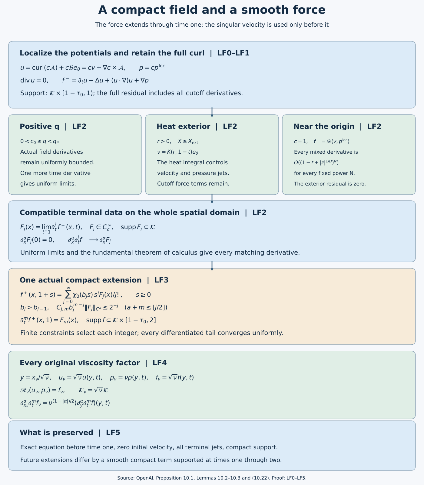

# Localizing the field and extending its smooth force

*NS-BLOWUP N7.1. Written and self-checked by GPT-6 Astra (OpenAI), at Ultra. This independent exposition is dedicated to CC0. No independent human review or formal verification is claimed.*

The local-field construction gives an actual divergence-free velocity, its potentials and pressure. Its momentum residual vanishes to every order near the singular scale, and its exterior is an exact heat flow. This lesson turns those fields into a compactly supported solution from rest before time one, and constructs a smooth compactly supported force through and beyond that time. The force extends; the argument does not extend the singular velocity.

LF0–LF3 prove the complete localization and force-extension argument. LF4 retains every original positive-viscosity factor, including the full localized residual. LF5 gives five solved exercises on composition of cutoffs, all exterior force components and terminal derivatives, finite bounds for the integer choices, the exact freedom in extension, and the flatness of the constructed force.

The [preceding local-field lesson](../src/constructing-the-actual-local-field.md), PL0–PL7 and LC0–LC8, proves all local inputs used below. Its LC4 supplies the actual potential sum and all residual derivatives; LC5 proves the endpoint limits; LC6 gives the exact heat exterior and inner growth; LC7 retains viscosity. References to these labels refer to that complete lesson. The energy, whole-space comparison, growth and periodic conclusions are proved in the [following lesson](../src/energy-comparison-and-the-final-blowup-conclusions.md), EC0–EC7.

The [editable figure source](../assets/compact-force-extension.py) records the maps and proof locators. Spatial regions are schematic; the time supports and equations have their exact stated meanings.

## LF0. The exact local input and a compact cutoff inside its domain

Use the actual viscosity-one fields proved in the [local-field lesson](../src/constructing-the-actual-local-field.md), LC4–LC7:
\[
v=\operatorname{curl}\mathcal A+\mathcal B e_\theta,\qquad p^{\rm loc},
\qquad \Omega_*=\{(x,t):\tau=1-t>0,\ q<q_*\}.
\tag{LF0.1}
\]
The scalar \(\mathcal B\) is axisymmetric. The actual Cartesian representatives, compatible one-sided derivatives for q bounded below, flat residual on every bounded profile interval, exact heat exterior, and positive inner-growth path are LC4–LC6. Keep the original \(0<h<1/100\), \(A=1/2+h\), \(D=1/2-h\), \(\tau=q(1-\eta^2)\), \(z=q^D\eta\), \(X=r^2/(2q)\), and \(L=1-2h\eta^2\).

If \(1-\eta^2\ge1/2\), then \(q\le2\tau\). Otherwise \(|\eta|>2^{-1/2}\) and \(q\le(\sqrt2|z|)^{1/D}\). Consequently the original (10.3) holds with the explicit admissible constant
\[
q\le C_0(\tau+|z|^{1/D}),\qquad
C_0=\max\{2,2^{1/(2D)}\}.
\tag{LF0.2}
\]
This estimate is uniform in r. Fix
\[
\tau_0=\frac{q_*}{8C_0}<\frac12,\qquad
z_0=\left(\frac{q_*}{8C_0}\right)^D,
\qquad C_0(\tau_0+z_0^{1/D})=q_*/4.
\tag{LF0.3}
\]
Take any fixed \(r_0>0\). Use the smooth step
\[
e(s)=\begin{cases}\exp(-1/s),&s>0,\\0,&s\le0,\end{cases}
\qquad \sigma(s)=\frac{e(s)}{e(s)+e(1-s)}.
\tag{LF0.3a}
\]
The denominator is positive for every real \(s\). Each derivative of \(e\) on the positive half-line is \(e(s)\) times a polynomial in \(1/s\), and tends to zero at zero: for every integer \(n\), \(y^ne^{-y}\to0\) as \(y\to\infty\), by the exponential series with an integer power larger than \(n\). Hence \(e\) and \(\sigma\) are smooth, with \(\sigma=0\) on \(( -\infty,0]\), \(\sigma=1\) on \([1,\infty)\), and flat derivatives at both endpoints. Set
\[
\begin{split}
\chi_x(x)&=\left[1-\sigma\!\left(2r^2/r_0^2-\tfrac12\right)\right]
 \left[1-\sigma\!\left(2z^2/z_0^2-\tfrac12\right)\right],\\
\chi_t(t)&=1-\sigma(2\tau/\tau_0-1),\qquad c(x,t)=\chi_x(x)\chi_t(t).
\end{split}
\tag{LF0.4}
\]
Thus \(\chi_x=1\) for \(r\le r_0/2,\ |z|\le z_0/2\), and its support is contained in \(r<r_0,\ |z|<z_0\). It is a smooth function of \(r^2,z\), including the Cartesian axis. The time cutoff is zero for \(\tau\ge\tau_0\) and one for \(0\le\tau\le\tau_0/2\). Its derivatives are flat at its endpoints. For \(t<1\), the support of c and all its derivatives lies in \(q\le q_*/4<q_*/2\), by LF0.2–LF0.3. Let \(\mathcal K=\operatorname{supp}\chi_x\); it is a fixed compact subset of \(\mathbb R^3\).

Define on the local domain and extend by zero elsewhere
\[
u=\operatorname{curl}(c\mathcal A)+c\mathcal B e_\theta,\qquad
p=cp^{\rm loc}.
\tag{LF0.5}
\]
There is a positive margin in q between the support and the outer boundary of \(\Omega_*\), so the zero extension is smooth. The original Cartesian axis representatives give smoothness at \(r=0\). Commuting Cartesian mixed derivatives gives zero divergence for the curl. Since c and \(\mathcal B\) are independent of θ, the divergence of the other term is \(r^{-1}\partial_\theta(c\mathcal B)=0\), with its continuous Cartesian interpretation at the axis. Hence u is exactly divergence-free.

Both u and p are smooth on \(\mathbb R^3\times[0,1)\), supported in \(\mathcal K\) at every time, and identically zero for \(0\le t\le1-\tau_0\). They agree with the original local fields whenever \(r<r_0/2,\ |z|<z_0/2,\ \tau<\tau_0/2\). This proves every assertion of Proposition 10.1 for the supplied fields.

## LF1. The complete localized momentum residual

Keep the full curl correction \(a=\nabla c\times\mathcal A\), so \(u=cv+a\). For \(t<1\) set
\[
f^-=\partial_tu-\Delta u+(u\cdot\nabla)u+\nabla p.
\tag{LF1.1}
\]
Every term is smooth before terminal time and has spatial support in \(\mathcal K\). The exact expansion is
\[
\begin{aligned}
f^-={}&c\,\mathscr R(v,p^{\rm loc})+(\partial_tc-\Delta c)v\\
&-2\sum_{i=1}^3(\partial_i c)(\partial_i v)
+p^{\rm loc}\nabla c+(\partial_t-\Delta)a\\
&+(c^2-c)(v\cdot\nabla)v+c(v\cdot\nabla c)v\\
&+c(v\cdot\nabla)a+(a\cdot\nabla c)v\\
&+c(a\cdot\nabla)v+(a\cdot\nabla)a .
\end{aligned}
\tag{LF1.2}
\]
To verify it, expand the time derivative and Laplacian of cv, the gradient of \(cp^{\rm loc}\), and all four products in \((cv+a)\cdot\nabla(cv+a)\). Subtract the single \(c(v\cdot\nabla)v\) already contained in \(c\mathscr R(v,p^{\rm loc})\). This leaves the coefficient \(c^2-c\), not zero. The displayed \(a\cdot\nabla c\) term is identically zero by \((\nabla c\times\mathcal A)\cdot\nabla c=0\), but it has been retained in the full expansion. No other cutoff term has been suppressed.

Taking divergence of LF1.1, using \(\operatorname{div}u=0\), gives exactly
\[
-\Delta p=\sum_{i,j=1}^3\partial_i\partial_j(u_i u_j)-\operatorname{div}f^-.
\tag{LF1.3}
\]
The force need not be divergence-free; the target theorem imposes no such condition. The compactly supported pressure and this force satisfy the full pressure equation.

## LF2. Uniform terminal limits of every force derivative

First consider a compact spatial region with q bounded below and bounded away from \(q_*\) near \(t=1\). LC5 supplies bounded derivatives of the actual \(\mathcal A,\mathcal B e_\theta,p^{\rm loc}\) of every order there. LF1.2 is a finite differential polynomial in these fields and the fixed cutoffs, so the same holds for \(f^-\). One additional time derivative gives
\[
\sup_{x\in K_0}
|\partial_x^\alpha\partial_t^j f^-(x,t_2)
 -\partial_x^\alpha\partial_t^j f^-(x,t_1)|
\le C_{\alpha,j,K_0}|t_2-t_1|.
\tag{LF2.1}
\]
Thus every derivative is uniformly Cauchy on that compact region.

The other region away from the origin has r bounded below and q small enough that \(X\ge X_{\rm ext}\). There \(\mathcal A=0\), \(v=K(r,\tau)e_\theta\), and the exact fields are
\[
K(r,\tau)=c_\infty s^{-A}\mathcal H(2\tau/s),\quad s=r^2/2,\qquad
p^{\rm loc}(r,\tau)=-\int_r^\infty K(\rho,\tau)^2\,\frac{d\rho}{\rho}.
\tag{LF2.2}
\]
The original heat integral and its full derivative bounds were proved in PL6/LC6. In particular, for every j,
\[
|\partial_\tau^jK(r,\tau)|\le C_jr^{-1-2h-2j},\qquad
\left|\partial_\tau^j(K(\rho,\tau)^2/\rho)\right|
\le C_j\rho^{-3-4h-2j}.
\tag{LF2.3}
\]
The second estimate contains every product-rule summand
\(\sum_{i=0}^j\binom ji(\partial_\tau^iK)(\partial_\tau^{j-i}K)/\rho\).
On a positive-radius interval the majorant is integrable from its lower endpoint to infinity. Dominated convergence gives all one-sided time derivatives of the pressure with its original integral. Each subsequent radial derivative differentiates the lower-endpoint expression; PL6.9 supplies the full radial derivatives of K, including all factors of \(\tau/r^2\). For r bounded below these give smooth Cartesian derivatives as well, since the cylindrical frame and each fixed derivative of it are bounded. All limits are uniform on compact positive-radius sets.

In this exterior \(a=0\), and LF1.2 involves just these smooth quantities and fixed cutoffs. Its full nonlinear term \((c^2-c)(v\cdot\nabla)v\) remains. It too has all uniform derivative limits. The uncut residual is exactly zero, by the swirl heat equation and centrifugal pressure cancellation proved in LC6.

These two cases cover the terminal slice away from the origin. At \(z\ne0\), \(q\ge|z|^{1/D}>0\). At \(z=0\) but \(x\ne0\), \(r>0\); choosing a small neighborhood and t sufficiently close to one gives q small by LF0.2 and hence \(X\ge X_{\rm ext}\). A finite cover therefore gives uniform convergence on every compact spatial set avoiding the origin. The support margin from LF0.3 keeps the positive-q part away from \(q_*\).

Near the origin and for t sufficiently close to one, both cutoffs equal one. Thus \(f^-=\mathscr R(v,p^{\rm loc})\). On \(X\le X_{\rm ext}\), LC4.9 gives arbitrary-order flatness; on \(X\ge X_{\rm ext}\), the residual is identically zero. With LF0.2 this proves, for every \(\alpha,j,N\) on one fixed neighborhood of (0,1),
\[
|\partial_x^\alpha\partial_t^j f^-(x,t)|
\le C_{\alpha,j,N}(\tau+|z|^{1/D})^N.
\tag{LF2.4}
\]
To obtain uniform convergence on all of \(\mathbb R^3\), fix \(\alpha,j\) and a tolerance. Choose a ball inside that neighborhood so small that its \(|z|^{1/D}\) contribution in LF2.4 is below the tolerance, then take τ small enough for its other contribution. Inside the ball, both members of a time difference are small. On the compact remainder of \(\mathcal K\), LF2.1 and the exterior argument give a uniformly Cauchy family. Outside \(\mathcal K\), all derivatives vanish. These three estimates prove the global uniform Cauchy property.

Define \(F_j(x)=\lim_{t\uparrow1}\partial_t^j f^-(x,t)\). Its support is contained in \(\mathcal K\). Passing to the uniform limit in the fundamental theorem of calculus along a spatial coordinate segment proves
\[
\lim_{t\uparrow1}\partial_x^\alpha\partial_t^j f^-(x,t)
=\partial_x^\alpha F_j(x),\qquad
F_j\in C_c^\infty(\mathbb R^3;\mathbb R^3),\qquad
\partial_x^\alpha F_j(0)=0.
\tag{LF2.5}
\]
The last equality follows by putting \(x=0\) in LF2.4 and taking \(\tau\downarrow0\), for each derivative separately. Passing to the time limit in the corresponding integral identity gives
\[
\partial_x^\alpha\partial_t^j f^-(x,t)
=\partial_x^\alpha F_j(x)
-\int_t^1\partial_x^\alpha\partial_t^{j+1}f^-(x,s)\,ds.
\tag{LF2.6}
\]
This proves the full compatibility of the terminal jets, not just the existence of pointwise limits. It establishes Lemma 10.2 for the actual localized residual.

## LF3. A compact smooth extension with every prescribed jet

Choose the original type of cutoff \(\chi_0\in C_c^\infty(\mathbb R)\), equal to one near zero and zero for arguments at least one. For definiteness, the same step gives
\[
\chi_0(s)=1-\sigma\left(\frac{4s^2-1}{3}\right).
\tag{LF3.0}
\]
It is even, equals one on \([-1/2,1/2]\), vanishes for \(|s|\ge1\), and is smooth with flat endpoint derivatives. For \(\sigma=t-1\ge0\) use the original series
\[
f^+(x,1+\sigma)=\sum_{j=0}^\infty
\chi_0(b_j\sigma)\frac{\sigma^j}{j!}F_j(x).
\tag{LF3.1}
\]
For a spatial multi-index α and a nonnegative integer m, the exact derivative of its j-th term is
\[
\partial_x^\alpha\partial_\sigma^m
\left(\chi_0(b_j\sigma)\frac{\sigma^j}{j!}F_j\right)
=\sum_{\substack{0\le a\le m\\j-m+a\ge0}}
\binom ma b_j^a\chi_0^{(a)}(b_j\sigma)
\frac{\sigma^{j-m+a}}{(j-m+a)!}\partial_x^\alpha F_j.
\tag{LF3.2}
\]
Terms with a negative remaining monomial degree are absent. On the support of each term \(0\le\sigma\le b_j^{-1}\). Define the finite constant
\[
C_{j,m}=\sum_{\substack{0\le a\le m\\j-m+a\ge0}}
\binom ma\,\frac{\|\chi_0^{(a)}\|_\infty}{(j-m+a)!}.
\]
The full derivative is bounded in the global supremum norm by
\[
C_{j,m}b_j^{m-j}\|F_j\|_{C^{|\alpha|}}.
\tag{LF3.3}
\]
Set \(b_0=1\) and retain the source's exact integer choice for \(j\ge1\):
\[
b_j=\min\left\{b\in\mathbb N:\ b>b_{j-1},\
\max_{\substack{a,m\ge0\\a+m\le\lfloor j/2\rfloor}}
C_{j,m}b^{m-j}\|F_j\|_{C^a}\le2^{-j}\right\}.
\tag{LF3.4}
\]
Every \(F_j\) norm is finite by LF2.5. The maximum has finitely many entries, and in each \(m-j<0\). Taking b sufficiently large makes all of them at most \(2^{-j}\). Thus the defining set is nonempty and its least integer exists at every stage. This constructs the original sequence from the actual jets without any coefficient-growth assumption or numerical run.

For fixed \(\alpha,m\), all sufficiently large j obey \(|\alpha|+m\le\lfloor j/2\rfloor\), so LF3.3 is at most \(2^{-j}\). The differentiated tails consequently converge uniformly, together with every fixed mixed derivative. The finitely many initial terms are smooth. At \(\sigma=0\), each fixed cutoff is constant on a neighborhood; its m-th time derivative contributes only when \(j=m\), with value \(F_m\). Uniform differentiated convergence therefore proves
\[
\partial_x^\alpha\partial_\sigma^m f^+(x,1)
=\partial_x^\alpha F_m(x).
\tag{LF3.5}
\]
Join \(f^-\) for \(t<1\) to \(f^+\) for \(t\ge1\). Equations LF2.6 and LF3.5 give matching derivatives of every order. The fundamental theorem of calculus across \(t=1\), followed by induction on derivative order, shows that the joined function is \(C^\infty\) in all space-time variables.

Every summand has spatial support in \(\mathcal K\) and vanishes for \(\sigma\ge1\), since \(b_j\ge1\). Uniform convergence of every derivative also gives the smooth zero extension at the support boundary. On the left, LF0 makes the residual zero for \(t\le1-\tau_0>0\). Hence
\[
f\in C_c^\infty(\mathbb R^3\times(0,\infty);\mathbb R^3),\qquad
\operatorname{supp}f\subset\mathcal K\times[1-\tau_0,2],\qquad
\mathscr R(u,p)=f\quad(0\le t<1).
\tag{LF3.6}
\]
In particular this has the original weaker support bound \(\mathcal K\times[0,2]\). If \(\mathcal K\subset B(0,R)\) and \(M_{\alpha,m}=\|\partial_x^\alpha\partial_t^m f\|_\infty\), compact support gives, for every integer k≥0,
\[
|\partial_x^\alpha\partial_t^m f(x,t)|
\le M_{\alpha,m}(3+R)^k(1+|x|+t)^{-k}.
\tag{LF3.7}
\]
Inside the support this follows from \(1+|x|+t\le3+R\); outside it the left side is zero. This proves the force's exact regularity, support and all decay conditions in Lemma 10.3.

## LF4. The construction at every original positive viscosity

Fix the prescribed \(\nu>0\). Use the original spatial map \(y=x_\nu/\sqrt\nu\), with time unchanged, and retain all potentials and coefficients:
\[
\begin{gathered}
\mathcal A_\nu(x_\nu,t)=\nu\mathcal A(y,t),\qquad
\mathcal B_\nu(x_\nu,t)=\sqrt\nu\mathcal B(y,t),\\
v_\nu(x_\nu,t)=\sqrt\nu v(y,t),\qquad
p^{\rm loc}_\nu(x_\nu,t)=\nu p^{\rm loc}(y,t),\qquad
c_\nu(x_\nu,t)=c(y,t).
\end{gathered}
\tag{LF4.1}
\]
The angular frame is unchanged by this positive radial scaling. The actual coordinates remain
\[
q_\nu-(z_\nu^2/\nu)q_\nu^{2h}=1-t,\qquad
\eta_\nu=\frac{z_\nu}{\sqrt\nu q_\nu^D},\qquad
X_\nu=\frac{r_\nu^2}{2\nu q_\nu}.
\tag{LF4.2}
\]
In particular the cutoff is the explicit function
\[
\begin{aligned}
c_\nu(x_\nu,t)
={}&\left[1-\sigma\left(\frac{2r_\nu^2}{\nu r_0^2}-\frac12\right)\right]
\left[1-\sigma\left(\frac{2z_\nu^2}{\nu z_0^2}-\frac12\right)\right]\\
&\times[1-\sigma(2(1-t)/\tau_0-1)].
\end{aligned}
\tag{LF4.3}
\]
Thus the spatial support is \(\mathcal K_\nu=\sqrt\nu\mathcal K\), the time support is unchanged, and (LF0.2) becomes
\[
q_\nu\le C_0\left(1-t+\nu^{-1/(2D)}|z_\nu|^{1/D}\right).
\tag{LF4.4}
\]
The positive margin \(q_\nu\le q_*/4\) on the cutoff support follows from the same inequalities with \(|z_\nu|\le\sqrt\nu z_0\).

Keep the complete localized fields
\[
\begin{gathered}
a_\nu=\nabla_{x_\nu}c_\nu\times\mathcal A_\nu
=\sqrt\nu a(y,t),\\
u_\nu=\operatorname{curl}_{x_\nu}(c_\nu\mathcal A_\nu)
+c_\nu\mathcal B_\nu e_\theta
=c_\nu v_\nu+a_\nu=\sqrt\nu u(y,t),\\
p_\nu=c_\nu p^{\rm loc}_\nu=\nu p(y,t).
\end{gathered}
\tag{LF4.5}
\]
Every spatial derivative contributes \(\nu^{-1/2}\). Consequently all four terms of the momentum equation have factor \(\sqrt\nu\):
\[
\begin{aligned}
\mathscr R_\nu(u_\nu,p_\nu)
&:=\partial_tu_\nu-\nu\Delta_{x_\nu}u_\nu
+(u_\nu\cdot\nabla_{x_\nu})u_\nu+\nabla_{x_\nu}p_\nu\\
&=\sqrt\nu\,\mathscr R(u,p)(y,t).
\end{aligned}
\tag{LF4.6}
\]
Divergence has factor one and remains zero. To exhibit every cutoff contribution directly in the original physical variables, write all derivatives in the next display with respect to \(x_\nu\):
\[
\begin{aligned}
f^-_\nu={}&c_\nu\mathscr R_\nu(v_\nu,p^{\rm loc}_\nu)
+(\partial_tc_\nu-\nu\Delta c_\nu)v_\nu\\
&-2\nu\sum_{i=1}^3(\partial_i c_\nu)(\partial_i v_\nu)
+p^{\rm loc}_\nu\nabla c_\nu+(\partial_t-\nu\Delta)a_\nu\\
&+(c_\nu^2-c_\nu)(v_\nu\cdot\nabla)v_\nu
+c_\nu(v_\nu\cdot\nabla c_\nu)v_\nu\\
&+c_\nu(v_\nu\cdot\nabla)a_\nu
+(a_\nu\cdot\nabla c_\nu)v_\nu\\
&+c_\nu(a_\nu\cdot\nabla)v_\nu+(a_\nu\cdot\nabla)a_\nu.
\end{aligned}
\tag{LF4.7}
\]
This is the product expansion of (LF4.6), and agrees term by term with \(\sqrt\nu f^-(y,t)\). For example, the viscosity coefficient cancels the two factors \(\nu^{-1/2}\) on the product of first derivatives, leaving the velocity factor \(\sqrt\nu\). The pressure-gradient cutoff term has factors \(\nu\) and \(\nu^{-1/2}\). The curl term \(a_\nu\) retains the potential factor \(\nu\). The term containing \(a_\nu\cdot\nabla c_\nu\) is zero by the cross-product identity, and is retained in the expansion. No physical term is discarded.

Define the actual terminal data
\[
F_{j,\nu}(x_\nu)=\sqrt\nu F_j(x_\nu/\sqrt\nu),\qquad
\partial_{x_\nu}^\alpha F_{j,\nu}
=\nu^{(1-|\alpha|)/2}(\partial_y^\alpha F_j)(y).
\tag{LF4.8}
\]
The same integer sequence \(b_j\) used in (LF3.4) gives
\[
f^+_\nu(x_\nu,1+s)
=\sum_{j=0}^\infty\chi_0(b_js)\frac{s^j}{j!}F_{j,\nu}(x_\nu)
=\sqrt\nu f^+(y,1+s),\qquad s\ge0.
\tag{LF4.9}
\]
For each fixed spatial derivative the convergence estimate is multiplied by the fixed positive constant \(\nu^{(1-|\alpha|)/2}\), so all mixed derivatives still converge uniformly. The time derivatives at \(s=0\) are exactly \(F_{j,\nu}\). This argument uses the actual sequence and retains its original definition; it does not assume viscosity-independent derivative norms.

The joined force satisfies
\[
\begin{gathered}
f_\nu\in C_c^\infty(\mathbb R^3\times(0,\infty);\mathbb R^3),\qquad
\operatorname{supp}f_\nu\subset\mathcal K_\nu\times[1-\tau_0,2],\\
\mathscr R_\nu(u_\nu,p_\nu)=f_\nu\quad(0\le t<1),\qquad u_\nu(\cdot,0)=0,\\
-\Delta p_\nu=\sum_{i,j=1}^3\partial_i\partial_j(u_{\nu,i}u_{\nu,j})
-\operatorname{div}f_\nu.
\end{gathered}
\tag{LF4.10}
\]
These are the original physical equation, datum, support and pressure relation. If \(\mathcal K\subset B(0,R)\), put
\(M_{\alpha,m,\nu}=\nu^{(1-|\alpha|)/2}\|\partial_y^\alpha\partial_t^m f\|_\infty\). For every integer \(k\ge0\),
\[
|\partial_{x_\nu}^\alpha\partial_t^m f_\nu(x_\nu,t)|
\le M_{\alpha,m,\nu}(3+\sqrt\nu R)^k(1+|x_\nu|+t)^{-k}.
\tag{LF4.11}
\]
Indeed \(1+|x_\nu|+t\le3+\sqrt\nu R\) on the support; elsewhere the derivative is zero. The original viscosity has not changed the singular time or the smooth force's terminal matching.

## LF5. Five exercises with complete solutions

### Exercise 1. Compose two localizations without losing a curl term

Let \(c,d\) be smooth axisymmetric cutoffs in the actual local domain. Apply the potential localization first with \(c\) and then with \(d\). Prove that the resulting full velocity and pressure equal the result from the single cutoff \(cd\), including every cross-product term.

**Solution.** Use the original viscosity \(\nu>0\), and write \(\mathcal A_\nu,\mathcal B_\nu,p^{\rm loc}_\nu,v_\nu\) for the actual fields. The first localization has potential \(c\mathcal A_\nu\), angular coefficient \(c\mathcal B_\nu\) and pressure \(cp^{\rm loc}_\nu\). Hence
\[
\begin{aligned}
u_{d\circ c}
&=\operatorname{curl}(dc\mathcal A_\nu)+dc\mathcal B_\nu e_\theta\\
&=d\{cv_\nu+\nabla c\times\mathcal A_\nu\}
+\nabla d\times(c\mathcal A_\nu)\\
&=cdv_\nu+(d\nabla c+c\nabla d)\times\mathcal A_\nu
=u_{cd},\\
p_{d\circ c}&=dc p^{\rm loc}_\nu=p_{cd}.
\end{aligned}
\tag{LF5.1}
\]
Here all curls and gradients are physical spatial derivatives. The product rule \(\nabla(cd)=d\nabla c+c\nabla d\) proves the equality, including transition regions where both derivatives can be nonzero. Both vector fields have zero divergence: the curl part has zero divergence by commuting Cartesian derivatives, and the direct angular part has divergence \(r_\nu^{-1}\partial_\theta(cd\mathcal B_\nu)=0\), with its smooth axis interpretation.

Because both velocity and pressure agree as smooth fields, substitution into every term of \(\mathscr R_\nu\) gives
\[
\mathscr R_\nu(u_{d\circ c},p_{d\circ c})
=\mathscr R_\nu(u_{cd},p_{cd}).
\tag{LF5.2}
\]
In computing the left side by (LF4.7), the inputs for the second step are the full first localized velocity, its potential \(c\mathcal A_\nu\), its pressure and its residual. Replacing that residual by zero would not be this composition. Equations (LF5.1)–(LF5.2) prove the exact relation without such a replacement.

### Exercise 2. The entire exterior force and all its terminal derivatives

Work in a neighborhood where the original exact heat exterior holds and the time cutoff is one. Set \(r=r_\nu>0\), \(z=z_\nu\), and write the actual spatial cutoff as \(c=c_\nu(r,z)\). Compute every cylindrical component of the localized force. Then give each of its time derivatives at \(t=1\).

**Solution.** In this neighborhood \(\mathcal A_\nu=0\), \(v_\nu=K_\nu(r,1-t)e_\theta\), and the pressure is the full centrifugal integral. Thus \(a_\nu=0\) and \(u_\nu=cK_\nu e_\theta\). The uncut heat and pressure identities are
\[
\partial_tK_\nu=\nu(\partial_r^2+r^{-1}\partial_r-r^{-2})K_\nu,
\qquad \partial_r p^{\rm loc}_\nu=K_\nu^2/r,
\qquad \partial_zK_\nu=\partial_zp^{\rm loc}_\nu=0.
\tag{LF5.3}
\]
The angular convection is \(-(cK_\nu)^2e_r/r\). The scalar Laplacian of the cutoff is \(\Delta c=c_{rr}+r^{-1}c_r+c_{zz}\), while the angular vector Laplacian retains its frame term \(-r^{-2}\). Expanding the full equation gives
\[
\begin{aligned}
f^-_{\nu,r}&=(c-c^2)K_\nu^2/r+p^{\rm loc}_\nu c_r,\\
f^-_{\nu,\theta}&=-\nu\{(c_{rr}+r^{-1}c_r+c_{zz})K_\nu
+2c_r\partial_rK_\nu\},\\
f^-_{\nu,z}&=p^{\rm loc}_\nu c_z.
\end{aligned}
\tag{LF5.4}
\]
The terms \(c\partial_tK_\nu\) and \(\nu c(\partial_r^2+r^{-1}\partial_r-r^{-2})K_\nu\) cancel by (LF5.3). The pressure and convection leave \((c-c^2)K_\nu^2/r\), with the displayed sign. Thus the zero residual of the original exterior does not remove its cutoff force.

Use \(d_*=1+2h\), \(C_\infty=2^Ac_\infty\), and the terminal formulas proved in the preceding local-field lesson, LC8.18–LC8.21. For \(j\ge0\) define the actual terminal values
\[
S_j(r)=C_\infty4^j\nu^{1+h+j}r^{-d_*-2j}(h)_j(1+h)_j,
\tag{LF5.5}
\]
\[
\begin{aligned}
P_j(r)={}&-\frac{C_\infty^2 4^j\nu^{2+2h+j}}
{(2d_*+2j)r^{2d_*+2j}}\\
&\times\sum_{i=0}^j\binom ji(h)_i(1+h)_i(h)_{j-i}(1+h)_{j-i}.
\end{aligned}
\tag{LF5.6}
\]
Here \((a)_0=1\) and \((a)_j=a(a+1)\cdots(a+j-1)\) for positive \(j\). They equal \(\partial_t^jK_\nu|_{1^-}\) and \(\partial_t^jp^{\rm loc}_\nu|_{1^-}\). In particular \(\partial_rS_j=-(d_*+2j)S_j/r\). The cutoff has no time dependence in this neighborhood. The full binomial product rule in (LF5.4) therefore gives
\[
\begin{aligned}
F_{j,\nu,r}&=\frac{c-c^2}{r}\sum_{i=0}^j\binom jiS_iS_{j-i}+P_jc_r,\\
F_{j,\nu,\theta}&=-\nu\{(c_{rr}+r^{-1}c_r+c_{zz})S_j
+2c_r\partial_rS_j\},\\
F_{j,\nu,z}&=P_jc_z.
\end{aligned}
\tag{LF5.7}
\]
These formulas keep every derivative, viscosity power, centrifugal sign and pressure endpoint factor. The Cartesian jets are obtained from the same components using the smooth frame at positive radius. They describe this exterior neighborhood, not the singular point or a fictitious heat formula outside its domain.

### Exercise 3. An explicit finite bound for the integer cutoff choice

Prove that the original minimum in (LF3.4) can be found below a finite explicit integer, and bound every fixed differentiated tail of the force series.

**Solution.** For \(j\ge1\) let
\[
\begin{gathered}
Q_j=\max_{\substack{a,m\ge0\\a+m\le\lfloor j/2\rfloor}}
\left(2^jC_{j,m}\|F_j\|_{C^a}\right)^{1/(j-m)},\\
B_j=\max\{b_{j-1}+1,1,\lceil Q_j\rceil\}.
\end{gathered}
\tag{LF5.8}
\]
The index set is finite and nonempty, all norms are finite, and \(j-m>0\). If a norm is zero the corresponding power is zero. Since \(B_j\ge Q_j\), every inequality
\(C_{j,m}B_j^{m-j}\|F_j\|_{C^a}\le2^{-j}\) holds; also \(B_j>b_{j-1}\). Thus the original integer \(b_j\) exists and \(b_j\le B_j\). This is a bound for the original minimum, not a change to its definition.

Fix a spatial multi-index \(\alpha\), an integer \(m\ge0\), and \(J\ge2(|\alpha|+m)\). For every \(j>J\), the original constraint includes \(a=|\alpha|\) and this \(m\). Equation (LF3.2) retains all differentiated cutoff terms and gives
\[
\sup_{\substack{x\in\mathbb R^3\\s\ge0}}\left|
\partial_x^\alpha\partial_s^m
\sum_{j>J}\chi_0(b_js)\frac{s^j}{j!}F_j(x)\right|
\le\sum_{j>J}2^{-j}=2^{-J}.
\tag{LF5.9}
\]
For the original viscosity, (LF4.8) multiplies this bound by exactly \(\nu^{(1-|\alpha|)/2}\). The derivative of the infinite sum is justified by the uniform convergence of each differentiated tail and the fundamental theorem of calculus, as in LF3. The estimate is uniform over the whole spatial domain and the whole future half-line, with no assumption on the growth of the sequence \(F_j\).

### Exercise 4. The exact freedom in extending the same terminal data

Use two admissible increasing cutoff sequences for the same actual \(F_j\). Prove what their future forces have in common, derive the remainder estimate for their difference, and describe the freedom in all smooth compact extensions of the fixed past force.

**Solution.** Let \(f^+\) and \(\widetilde f^+\) be the two series. Their exact difference is
\[
H(x,1+s)=\sum_{j=0}^\infty
\{\chi_0(\widetilde b_js)-\chi_0(b_js)\}\frac{s^j}{j!}F_j(x).
\tag{LF5.10}
\]
Both series converge with every fixed mixed derivative by (LF3.3)–(LF3.5). They have the same jets \(F_m\), so every spatial derivative of every time derivative of \(H\) is zero at \(s=0\). Repeated integration from zero gives, for \(N\ge1\),
\[
\begin{aligned}
\partial_x^\alpha\partial_s^mH(x,1+s)
={}&\frac1{(N-1)!}\int_0^s(s-a)^{N-1}
\partial_x^\alpha\partial_s^{m+N}H(x,1+a)\,da,\\
\|\partial_x^\alpha\partial_s^mH(\cdot,1+s)\|_\infty
\le{}&\frac{s^N}{N!}\|\partial_x^\alpha\partial_t^{m+N}H\|_\infty.
\end{aligned}
\tag{LF5.11}
\]
The global norm is finite because the difference is smooth with compact support. Extending \(H\) by zero for \(t\le1\) is smooth by the vanishing jets. Its support is contained in \(\mathcal K\times[1,2]\).

More generally define the vector space
\[
\mathcal Z_{\mathcal K}=
\{H\in C_c^\infty(\mathbb R^3\times(0,\infty);\mathbb R^3):
\operatorname{supp}H\subset\mathcal K\times[1,2]\}.
\tag{LF5.12}
\]
Every member is zero for \(t<1\), and smoothness forces all its jets at \(t=1\) to be zero. If \(f\) is the force constructed in LF3, the set of smooth extensions with the same past force and support contained in \(\mathcal K\times[1-\tau_0,2]\) is exactly
\[
f+\mathcal Z_{\mathcal K}.
\tag{LF5.13}
\]
Indeed adding a member preserves the past, terminal jets, smoothness and support. Conversely the difference of two such extensions is a member by those same properties. The freedom is nontrivial: choose a nonzero smooth vector field compactly supported in the interior of \(\mathcal K\), multiply it by a nonzero smooth function supported in \((5/4,3/2)\), and use that product as \(H\). This changes the force only after time one. It does not change the constructed solution or its equation on \([0,1)\), and makes no assertion of a velocity extension through blowup. The same proof uses \(\mathcal K_\nu\) for the original viscosity.

### Exercise 5. Spatial and space-time flatness of the constructed extension

Prove that the specific series in LF4 is spatially flat at the origin for every \(t\ge1\), and that every mixed derivative of the joined force vanishes to arbitrary order at \((0,1)\). Retain the stronger estimate already obtained before terminal time.

**Solution.** Equation (LF2.5), with (LF4.8), gives
\(\partial_{x_\nu}^\alpha F_{j,\nu}(0)=0\) for every \(\alpha,j\). Termwise differentiation of the uniformly convergent differentiated series (LF4.9) proves
\[
\partial_{x_\nu}^\alpha\partial_t^m f^+_\nu(0,t)=0
\qquad(t\ge1,\ \alpha\in\mathbb N^3,\ m\ge0).
\tag{LF5.14}
\]
At time one these equal the derivatives from the past. Fix \(\alpha,m\), write
\(g=\partial_{x_\nu}^\alpha\partial_t^m f_\nu\), and choose a convex neighborhood of \((0,1)\) with positive time. For \(w=(x_\nu,s)\), all derivatives of \(g\) at \((0,1)\) vanish. Applying one-variable Taylor's formula to \(a\mapsto g(ax_\nu,1+as)\) yields the exact remainder
\[
\begin{aligned}
g(x_\nu,1+s)
={}&\frac1{(N-1)!}\int_0^1(1-a)^{N-1}
D^Ng(ax_\nu,1+as)[w,\ldots,w]\,da,\\
D^Ng[w,\ldots,w]
={}&\sum_{|\beta|+j=N}\frac{N!}{\beta!j!}
x_\nu^\beta s^j\partial_{x_\nu}^\beta\partial_t^j g.
\end{aligned}
\tag{LF5.15}
\]
For each fixed \(N\ge1\), all derivatives in this finite sum are bounded on a smaller compact neighborhood. If their common bound is \(M_N\), then
\[
|g(x_\nu,1+s)|
\le\frac{M_N}{N!}
(|x_{\nu,1}|+|x_{\nu,2}|+|x_{\nu,3}|+|s|)^N
\le C_N(|x_\nu|+|s|)^N.
\tag{LF5.16}
\]
All multi-index coefficients and the integral factor \(1/N\) are retained in deriving this bound. For \(t<1\), the previously proved, more specific estimate is still
\[
|\partial_{x_\nu}^\alpha\partial_t^m f_\nu(x_\nu,t)|
\le C_{\alpha,m,N}\nu^{(1-|\alpha|)/2}
\left(1-t+\nu^{-1/(2D)}|z_\nu|^{1/D}\right)^N.
\tag{LF5.17}
\]
It follows by the original scaling from (LF2.4); its constants before the explicit viscosity factor are those of the viscosity-one fields. Estimate (LF5.16) does not replace (LF5.17).

The line property (LF5.14) belongs to this actual series, whose every coefficient is spatially flat at the origin. Arbitrary additions in \(\mathcal Z_{\mathcal K_\nu}\) need not preserve that property for \(t>1\), although they preserve every mixed jet at \((0,1)\). Neither flatness conclusion asserts that the force vanishes on a neighborhood of that point.

## Sources and scope

OpenAI, *Finite Time Blowup for Navier–Stokes*, [original 166-page paper](https://cdn.openai.com/pdf/32d9f210-8b73-45e0-91bc-82a30aef8a9a/navier-stokes.pdf), SHA-256 0e779481c4da40bd28d1e642e1d8ca57447d129610df28dfa5a11e9af8ae228f. Original pages 117–120 supply Proposition 10.1, Lemmas 10.2–10.3 and equations (10.1)–(10.12). Original (10.22) on page 124 gives the viscosity map used in LF4. The complete pages 117–126 were inspected. No original-source error is asserted and no diplomatic transcription is changed.

The supplying [terminal-force proof](https://github.com/KokunoYumeto/open-math-courses-public-public/blob/main/docs/courses/NS-BLOWUP/audits/terminal-force-and-blowup-audit.md), F0–F8, was read completely. LF0–LF3 retain all arguments of F0–F3. LF4 gives the full physical localization and force extension. LF5 supplies the exact additional calculations and their proofs; no novelty is claimed. The separately proved energy, comparison, growth and periodic arguments remain available in F4–F8 and the [full comparison proof](https://github.com/KokunoYumeto/open-math-courses-public-public/blob/main/docs/courses/NS-BLOWUP/audits/lemma_10_5_reaudit.md), equations (1)–(64), whose analytical tools were also read completely. Those arguments are supplied in the [complete N7.2 lesson](../src/energy-comparison-and-the-final-blowup-conclusions.md), EC0–EC7, including all analytical tools in EC1. The separate computation theorem has its own verification scope.

The mathematical review is author derivation and self-review. Diplomatic transcriptions retain OpenAI's actual statements, formulas and irregularities. The proofs and exercises here are separate editorial exposition.
