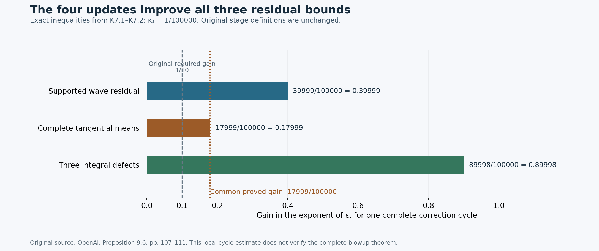

# Initialization, the complete correction cycle and its common domain

The complete theorem and its proof dependencies are stated in the [theorem construction](theorem-audit-conclusion.md). This note proves the original finite-state initialization and four actual updates, including their accumulated-field bounds, complete pressure and moment receivers, and a domain independent of the finite stage. The companion physical-realization audit derives the subsequent physical derivative estimates and summation. The actual leading profile and complete base field are supplied by [V0–V7](shear-realization-audit.md) and [Z0–Z8](base-field-realization-audit.md). The complete theorem and its proof dependencies are stated in the [theorem construction](theorem-audit-conclusion.md).

Source: OpenAI, *Finite Time Blowup for Navier–Stokes*, original [PDF](https://cdn.openai.com/pdf/32d9f210-8b73-45e0-91bc-82a30aef8a9a/navier-stokes.pdf), SHA256 `0e779481c4da40bd28d1e642e1d8ca57447d129610df28dfa5a11e9af8ae228f`. The source passages are on original pages 60, 94, 97 and 106–112. The original phase coefficient is given in P0.

Complete operator derivations receiving and supplying this argument are [pulse inverse P1–P8](pulse-inverse-audit.md), [wave interactions W1–W8](wave-interaction-audit.md), [stress covariance C1–C9](stress-covariance-audit.md), [source containment S1–S5](source-containment-audit.md), [temporal mean T1–T4](temporal-mean-correction-audit.md), [five-profile means M1–M8](mean-moment-correction-audit.md), and [radial primitives R1–R8](radial-primitive-audit/src/radial-primitives-and-compact-mean-corrections.md). They are included in this repository. The following derivation uses their exact operations on the original base; it does not replace the base construction by a new assumption or certify that construction.

## K0. The original finite state and all receiving quantities

Keep the original constants and coordinates
\[
0<h<1/100,\quad A=1/2+h,\quad D=1/2-h,\quad
Q=2^{-\ell},\quad\varepsilon=Q^h,\quad S_*=\ell^2,\quad\kappa_s=10^{-5}.
\]
The complete chart velocity and pressure are
\[
u_*=(b+\beta,V+v,G+\gamma)+w,\qquad
p_*=p_{B,*}+p_m+p_w,\qquad
\langle w\rangle_\theta=\langle p_w\rangle_\theta=0.
\tag{K0.1}
\]
Every wave is an actual curl, including its lower-order curl terms. The mean is the curl of an azimuthal potential plus a direct azimuthal field. Write \(w_0^{\rm tan}=W_0^{\rm as}\) for the fixed assembled primary transverse field before its curl remainder. It remains fixed throughout the iteration.

Original Definition 9.4 requires
\[
\begin{gathered}
\sigma_j=\tfrac15+\tfrac j{10},\qquad B_j=\tfrac12+\sigma_j,\qquad C_j^*=1+\sigma_j,\\
\mathcal G_{\rm wave}^{[j]}\in\mathsf W_{B_j},\qquad
E_\theta,E_z\in\mathsf M_{C_j^*},\qquad
(\mathcal P,\mathcal J_\theta,\mathcal J_z)\in\mathsf S_{C_j^*},\\
w\in\mathsf W_{1/2},\qquad w-w_0^{\rm tan}\in\mathsf W_{0.68},\qquad
v,\gamma,p_m\in\mathsf M_{0.9},\qquad\beta\in\mathsf M_{1.9},\\
\int_0^\infty R^2\langle v\rangle_Y\,dR=0,\qquad
\int_0^\infty R\langle\gamma\rangle_Y\,dR=0.
\end{gathered}
\tag{K0.2}
\]
These are the original (9.8)–(9.10); the decimal constants are retained. The wave class concerns each collected label and nonzero harmonic, with bounds \(\varepsilon^a S_*^b\sqrt\zeta\delta^{-d}P(v)\) for every fixed coefficient derivative. The mean class has \(\varepsilon^aS_*^b\zeta\delta^{-d}\) bounds and no auxiliary-support restriction. The moment class \(\mathsf S_a\) has \(\varepsilon^aS_*^b\) bounds for every fixed \((Z,T)\) derivative, after including its original radial measure. The supports, phases, weight, envelope and covering maps are those explicitly specified in W1–W3 and S1–S2. Constants may depend on the finite stage and derivative order. The bound with a larger exponent implies that with a smaller one since \(0<\varepsilon\le1\); it does not assert a smaller stage-dependent constant.

Let \(W_{ab}=\langle w_aw_b\rangle_\theta\). The radial source is the entire expression S4.2 or M5.2. Reconstruct pressure after each update using
\[
\mathcal P=\int\langle g_r\rangle_Y\,dR,\qquad
p_m=\mathsf T_0(g_r-\rho\mathcal P),\qquad
\int\rho\,dR=1.
\tag{K0.3}
\]
The two other defects and the moving pressure-moment coefficient are
\[
\begin{split}
\mathcal J_\theta&=\int R^2\langle Gv+V\gamma+\gamma v+W_{z\theta}\rangle_Y\,dR,\\
\mathcal J_z&=\int R\langle2G\gamma+\gamma^2+W_{zz}\rangle_Y\,dR
-\tfrac12\int R^2\langle g_r\rangle_Y\,dR,\qquad
c_\rho=\tfrac12\int R^2\rho\,dR.
\end{split}
\tag{K0.4}
\]
Unspecified radial integrals in this note run from zero to infinity. The radial residual is exactly
\[
D_rp_m-g_r=-\rho\mathcal P-\mathcal A_0(g_r-\rho\mathcal P).
\tag{K0.5}
\]
The compact-primitive remainder \(\mathcal A_0\) is retained. Its all-order physical flatness is proved in R5–R6, not inferred from a finite numerical check.

The original base inputs consumed by the cycle are (5.41)–(5.44): divergence zero, residual equal to minus the cylindrical radial divergence of its full tangential stress plus \(\mathcal E_B\), flatness of every fixed derivative of \(\mathcal E_B\), \(b=O(\varepsilon)\) with all fixed coefficient derivatives, bounded tangential coefficients and their derivatives, and the exact reserved mean patch from M1. The order-zero tangential fields differ from the full ones by \(O(\varepsilon^2)\). For the stress, original (5.43) gives, with \(\widehat{\mathcal T}=q^{A+1/2}\mathcal T_{\rm phys}\),
\[
|\mathcal D^I(\widehat{\mathcal T}-\mathcal T_0)|
\le C_Iq^{2h}\zeta\delta^{-N_I}\le C_Iq^h\zeta\delta^{-N_I}.
\tag{K0.6}
\]
Both powers are retained. With \(\xi=q/Q\), the exact chart difference is
\[
\Sigma^B-\Sigma^{(0)}=Q^{2A}q^{-A-1/2}(\widehat{\mathcal T}-\mathcal T_0),\qquad
Q^{2A}q^{-A-1/2}q^{2h}
=Q^{3h}\xi^{-A-1/2+2h}.
\tag{K0.7}
\]
Thus this input gives \(\Sigma^B-\Sigma^{(0)}\in\mathsf M_3\subset\mathsf M_2\), retaining the smooth \(\xi\) factor. Every fixed derivative follows from the profile-to-chart chain rule C4 and the original \(q\partial_q,\partial_X,\partial_\eta\) bounds. These calculations identify exactly which base assertions the cycle uses. The actual supplying fields and these exact bounds are derived in [Z0–Z8](base-field-realization-audit.md), especially Z6.2–Z6.4.

## K1. Exact wave-update receiver and weighted mean identities

First keep \(\beta,v,\gamma\) fixed and add an actual wave increment \(s\). Set
\[
\Delta W_{ab}=\langle w_as_b+s_aw_b+s_as_b\rangle_\theta.
\tag{K1.1}
\]
Subtract the two full conservative equations S4.2. No base or mean field has changed, so all its terms cancel, leaving
\[
\begin{split}
\Delta g_r&=-(D_r+R^{-1})\Delta W_{rr}-D_z\Delta W_{zr}+\Delta W_{\theta\theta}/R,\\
\Delta\mathcal P&=\int\langle\Delta g_r\rangle_Y\,dR,\qquad
\Delta p_m=\mathsf T_0(\Delta g_r-\rho\Delta\mathcal P),\\
\Delta E_\theta&=(D_r+2/R)\Delta W_{r\theta}+D_z\Delta W_{z\theta},\\
\Delta E_z&=(D_r+1/R)\Delta W_{rz}+D_z(\Delta W_{zz}+\Delta p_m),\\
\Delta\mathcal J_\theta&=\int R^2\langle\Delta W_{z\theta}\rangle_Y\,dR,\\
\Delta\mathcal J_z&=\int R\langle\Delta W_{zz}\rangle_Y\,dR
-\tfrac12\int R^2\langle\Delta g_r\rangle_Y\,dR.
\end{split}
\tag{K1.2}
\]
These equations include the square of the new wave, its entire curl remainder, every pressure change and the pressure contribution to the axial flux defect. The harmonic pressure increment has zero angular mean, so it adds no term to (K1.2). A mean pressure change adds no nonzero angular harmonic.

Next derive the exact weighted identities needed to remove a compact residual by stress. Average S4.2 over the auxiliary torus. The fast torus derivatives integrate to zero, so \(D_r\) becomes \(\partial_R\), \(D_z=\varepsilon\partial_Z\), and \(\mathfrak t_*\) becomes \(-\varepsilon\partial_T\). Multiply the azimuthal equation by \(R^2\) and the axial equation by \(R\). The radial divergences become endpoint terms, all zero by smooth compact shell support, including the base stress. The radial viscous terms give exactly
\[
\int R^2(f_{RR}+R^{-1}f_R-R^{-2}f)\,dR=(2-1-1)\int f\,dR=0,
\quad
\int R(g_{RR}+R^{-1}g_R)\,dR=-\int g_R\,dR+\int g_R\,dR=0.
\tag{K1.3}
\]
The time and axial viscosity contributions are derivatives of the two zero integrals in (K0.2). The Haar average of the compact remainder in (K0.5) is zero: R3's full radial integral, after Haar averaging, is the zero total integral of \(g_r-\rho\mathcal P\); its cutoff is auxiliary independent. Integration by parts therefore yields the exact pressure moment
\[
\int R\langle p_m\rangle_Y\,dR
=-\tfrac12\int R^2\partial_R\langle p_m\rangle_Y\,dR
=-\tfrac12\int R^2\langle g_r\rangle_Y\,dR+c_\rho\mathcal P.
\tag{K1.4}
\]
Combining the surviving axial fluxes proves original (8.16), with no remainder omitted:
\[
\int R^2\langle E_\theta\rangle_Y\,dR=\varepsilon\partial_Z\mathcal J_\theta,
\qquad
\int R\langle E_z\rangle_Y\,dR=\varepsilon\partial_Z(\mathcal J_z+c_\rho\mathcal P).
\tag{K1.5}
\]
The \(q\)-scaled original bump gives
\(c_\rho=(q/(2Q))\int x^2\widehat\rho(x)\,dx\), so all fixed \((Z,T)\) derivatives are bounded, but it need not be constant. Its full product with \(\mathcal P\) stays inside \(\partial_Z\). Consequently defects of class \(\mathsf S_a\) give the two weighted residual moments in \(\mathsf S_{a+1}\).

## K2. Initialization from the actual primary curls

Start with \(v=\gamma=\beta=0\). C7 gives the exact primary wave
\[
w=w_0^{\rm tan}+R_0,\qquad
w\in\mathsf W_{1/2},\qquad R_0\in\mathsf W_{1-\kappa_s}.
\tag{K2.1}
\]
Here \(R_0\) is the actual primary curl remainder from C7. The linear residual bound P8 implies the original conservative exponent \(1-3\kappa_s\), and W6 gives the quadratic wave exponent \(1-\kappa_s\). Thus the supported nonzero harmonic residual is in \(\mathsf W_{1-3\kappa_s}\). The excluded Gaussian tails remain additive flat residuals. At zero means, the exact radial source is
\(g_r=-(D_r+R^{-1})W_{rr}-D_zW_{zr}+W_{\theta\theta}/R\).
Since every \(W_{ab}\in\mathsf M_1\), (K0.3), S4.2 and K0.7 show
\[
g_r,p_m,E_\theta,E_z\in\mathsf M_{1-\kappa_s},\qquad
(\mathcal P,\mathcal J_\theta,\mathcal J_z)\in\mathsf S_{1-\kappa_s}.
\tag{K2.2}
\]
All moment measures in (K0.4) are bounded on the shell; the class estimates hold after each slow derivative by smooth zero extension and differentiation under the integral.

The auxiliary-averaged tangential residual has a better order. Let \(\Sigma^{(0)}\) be the assembled leading stress and \(\Sigma^B\) the full base stress. With zero means, the exact equations are
\[
\begin{split}
\langle E_\theta\rangle_Y
&=(\partial_R+2/R)(\langle W_{r\theta}\rangle_Y-\Sigma^{(0)}_\theta)
-(\partial_R+2/R)(\Sigma^B_\theta-\Sigma^{(0)}_\theta)
+\varepsilon\partial_Z\langle W_{z\theta}\rangle_Y,\\
\langle E_z\rangle_Y
&=(\partial_R+1/R)(\langle W_{rz}\rangle_Y-\Sigma^{(0)}_z)
-(\partial_R+1/R)(\Sigma^B_z-\Sigma^{(0)}_z)
+\varepsilon\partial_Z\langle W_{zz}+p_m\rangle_Y.
\end{split}
\tag{K2.3}
\]
C6 proves cancellation of the leading covariance with the exact squared partition, including derivatives of its sum. C7 proves the first differences in (K2.3) have class \(\mathsf M_{3/2-\kappa_s}\); their quadratic curl part has the still higher exponent \(2-2\kappa_s\). C8 allows the same exponent after full auxiliary averaging and radial divergence. Even using the source's weaker allowance of an additional \(\kappa_s\) gives \(3/2-2\kappa_s\). The remaining terms have exponents at least \(2-\kappa_s\): the axial covariance has exponent two, axial pressure has \(2-\kappa_s\), and K0.7 supplies the higher base stress. Since \(3/2-2\kappa_s=1.49998>1.49\),
\[
\langle E_\theta\rangle_Y,\langle E_z\rangle_Y\in\mathsf M_{1.49}.
\tag{K2.4}
\]

Set \(H_0=1-\kappa_s\). Apply the actual temporal mean map T1–T4 to the zero-auxiliary-average parts of the residual. Its increments satisfy
\(\Delta v,\Delta\gamma,\Delta p_m\in\mathsf M_{H_0}\),
\(\Delta\beta\in\mathsf M_{H_0+1}\). They preserve both moments exactly. Its full tangential change after cancellation, apart from the explicitly retained axial reconstruction term, has exponent \(H_0+1-2\kappa_s\); that reconstruction term belongs to every required mean class by T3.4. Thus the exact tangential residuals retain order \(1.49\). Defects remain in \(\mathsf S_{H_0}\), because T4 computes their changes in \(\mathsf S_{H_0+0.9}\). Their old values are not set to zero by this step. W5 and W7 give the added nonzero harmonic residual in \(\mathsf W_{H_0}\).

Recompute all three defects and apply the five-profile correction M3–M7 at order \(H_0\). Its first two rows preserve the two moments; its other three rows cancel the linear parts of the current defects. Its complete nonlinear recomputation gives defects in \(\mathsf S_{H_0+0.9}\), which implies the weaker bound used in original Proposition 9.5. Its tangential changes have exponent \(H_0+1\) and its wave interaction exponent \(H_0\), so they preserve the tangential order \(1.49\) and the supported wave order \(1-3\kappa_s\). These operator proofs apply here because \(H_0>0.9\), all means before the temporal step are zero, and after it they satisfy the \(0.9,1.9\) bounds required by M6.

The initialized bounds are consequently
\[
\mathcal G_{\rm wave}^{[0]}\in\mathsf W_{1-3\kappa_s}\subset\mathsf W_{0.7},\qquad
E_\theta,E_z\in\mathsf M_{1.49}\subset\mathsf M_{1.2},\qquad
(\mathcal P,\mathcal J_\theta,\mathcal J_z)\in\mathsf S_{1.9-\kappa_s}\subset\mathsf S_{1.2}.
\tag{K2.5}
\]
The wave itself is unchanged by these mean operations; (K2.1) gives \(w-w_0^{\rm tan}\in\mathsf W_{1-\kappa_s}\subset\mathsf W_{0.68}\). All mean velocities and reconstructed mean pressure have exponent at least \(H_0>0.9\), and radial mean velocity at least \(H_0+1>1.9\). This proves every part of (K0.2) at \(j=0\), with pressure recomputed before and after both updates. Flat residuals and support remain as proved in S1–S4. This establishes the initialization of original Proposition 9.5 with its actual global-base supplier in [Z0–Z8](base-field-realization-audit.md).

## K3. Cycle step 1: the inhomogeneous pulse update

Fix a finite state and abbreviate \(B=B_j\ge0.7\), \(C_*=C_j^*=B+1/2\). Group each current supported source coefficient as in S1. Apply the zero-initial-data solve P4 with its full pressure, and form the actual increment
\[
s_m=\operatorname{curl}_*\left(\frac{i n_\Phi\times(\psi t_m)}{km|n_\Phi|^2}e^{ikm\Phi}\right),\qquad
\pi_{w,m}=\psi\pi_m e^{ikm\Phi},\qquad
\mathscr L_m(t_m,\pi_m)=-f_m.
\tag{K3.1}
\]
Sum with the original physical factors and conjugate pairs. The full velocity increment is in \(\mathsf W_B\); its harmonic pressure is in \(\mathsf W_{B+1/2}\). The exact expansion of the residual is S3.1, with the old supported harmonic canceled by the principal solve and the complete curl retained. The bounds on the remaining nonzero harmonics are

| Term in the exact residual change | Class exponent at least | Complete supplying calculation |
|---|---:|---|
| Linear pulse/curl residual, apart from its retained flat tails | \(B+1/2-3\kappa_s\) | P8; its proved stronger bound also implies this original exponent |
| Cross interaction with the current full wave | \(B+1/2-\kappa_s\) | W6 and \(w\in\mathsf W_{1/2}\) |
| Square of the particular increment | \(2B-\kappa_s\) | W6, with coefficient one on the square |
| Cross interaction with the total mean correction | \(B+0.4\) | W5 with \(0.9\) tangential mean exponent and \(1.9\) radial exponent |

The old exact wave may include every earlier correction; its total bound is the one in (K0.2). Subtracting \(B\), the four lower gains are \(1/2-3\kappa_s,1/2-\kappa_s,B-\kappa_s,0.4\), whose minimum is \(0.4\). Thus the new supported harmonic residual is in \(\mathsf W_{B+0.4}\).

The entire covariance change (K1.1) has mean class \(\mathsf M_{C_*}\): its cross terms have exponent \(B+1/2=C_*\), while its square has exponent \(2B\ge C_*\). The complete receiver (K1.2), including pressure, gives
\[
\Delta g_r,\Delta p_m,E_{\theta,\rm new},E_{z,\rm new}\in\mathsf M_{C_*-\kappa_s},\qquad
(\mathcal P,\mathcal J_\theta,\mathcal J_z)_{\rm new}\in\mathsf S_{C_*-\kappa_s}.
\tag{K3.2}
\]
The statements about \(g_r,p_m\) are changes, not an assertion that their old leading parts have disappeared. Old tangential residuals and defects had exponent \(C_*\), so adding these changes gives (K3.2). The zero mean-velocity moments are unchanged, and the pressure has been recomputed. Apply (K1.5) to this new complete state:
\[
m_2:=\int R^2\langle E_\theta\rangle_Y\,dR\in\mathsf S_{C_*+1-\kappa_s},\qquad
m_1:=\int R\langle E_z\rangle_Y\,dR\in\mathsf S_{C_*+1-\kappa_s}.
\tag{K3.3}
\]
This is the extra power required for the retained moment term in the next step. In the axial identity it comes from \(\varepsilon\partial_Z(\mathcal J_z+c_\rho\mathcal P)\), with the full product derivative retained.

## K4. Cycle step 2: signed stress, its physical sign and complete covariance

This operation is defined in physical coordinates so that the fields agree on chart overlaps. Retain an arbitrary original viscosity \(\nu>0\) using the exact bridge C9. Define the physical averaged tangential residuals by
\[
F_{2,\nu}=\sqrt\nu Q^{-2A-1/2}\langle E_\theta\rangle_Y,
\qquad F_{1,\nu}=\sqrt\nu Q^{-2A-1/2}\langle E_z\rangle_Y.
\tag{K4.1}
\]
They are the same physical functions in every chart. The two prescribed interior profiles satisfy \(\int_0^\infty x^e\widehat b_e(x)\,dx=1\), \(e\in\{1,2\}\). Set
\[
\begin{split}
b_{e,\nu}(r_\nu,z_\nu,t)&=(\nu q_\nu)^{-(e+1)/2}\widehat b_e(r_\nu/\sqrt{\nu q_\nu}),\\
M_{e,\nu}&=\int_0^\infty r_\nu^eF_{e,\nu}(r_\nu)\,dr_\nu,\\
\sigma_{e,\nu}(r_\nu)&=-r_\nu^{-e}\int_0^{r_\nu}(r')^e
[F_{e,\nu}(r')-b_{e,\nu}(r')M_{e,\nu}]\,dr'.
\end{split}
\tag{K4.2}
\]
Time and \(z_\nu\) are fixed along these integrals; \(q_\nu\) is independent of the radial coordinate. Changing variable \(r_\nu=\sqrt{\nu q_\nu}\,x\) shows \(\int r_\nu^eb_{e,\nu}\,dr_\nu=1\). Hence the integrand in the last line has zero total weighted moment. The primitive vanishes on both sides of its shell, with its lower endpoint fixing the integration constant. Its exact divergence, including the minus sign, is
\[
(\partial_{r_\nu}+e/r_\nu)\sigma_{e,\nu}=-F_{e,\nu}+b_{e,\nu}M_{e,\nu}.
\tag{K4.3}
\]
At \(\nu=1\) these are exactly the physical formulas printed on original page 109.

With \(R=r_\nu/\sqrt{\nu Q}\), the complete moment and bump factors are
\[
\begin{split}
M_{e,\nu}&=\nu^{(e+2)/2}Q^{e/2-2A}m_e,\\
\rho_{e,*}&=(\nu Q)^{(e+1)/2}b_{e,\nu}
=(Q/q_\nu)^{(e+1)/2}\widehat b_e(\sqrt{Q/q_\nu}\,R),\\
\int R^e\rho_{e,*}\,dR&=1,
\qquad \Sigma=(\Sigma_\theta,\Sigma_z)=\nu^{-1}Q^{2A}(\sigma_{2,\nu},\sigma_{1,\nu}).
\end{split}
\tag{K4.4}
\]
Substitution into (K4.2) gives exactly, with \(\overline E_2=\langle E_\theta\rangle_Y\), \(\overline E_1=\langle E_z\rangle_Y\),
\[
\Sigma_e=-R^{-e}\int_0^R s^e(\overline E_e(s)-\rho_{e,*}(s)m_e)\,ds,
\qquad
(\partial_R+e/R)\Sigma_e=-\overline E_e+\rho_{e,*}m_e.
\tag{K4.5}
\]
Here \(\Sigma_2\) means \(\Sigma_\theta\), and \(\Sigma_1\) means \(\Sigma_z\). The physical stress factor is \(\nu Q^{-2A}\), and its radial divergence factor is \(\sqrt\nu Q^{-2A-1/2}\), as required by (K4.1). Every slow derivative of \(\rho_{e,*}\) is bounded by the implicit-coordinate estimates C4. S2 proves all edge derivatives of the zero-moment primitive. Equations (K3.2)–(K3.3) therefore give \(\Sigma\in\mathsf M_{C_*-\kappa_s}\); the retained source \(\rho_{e,*}m_e\) has the higher class \(\mathsf M_{C_*+1-\kappa_s}\). These are auxiliary-independent stresses because (K4.1) uses the full Haar average, even when the unaveraged residual depends on that torus.

Apply the fixed signed operator of C5–C6. Its transverse field and actual curl increment satisfy
\[
t_s=\mathcal L^{\rm as}\Sigma\in\mathsf W_{B-\kappa_s},\qquad
s=t_s+r_s,\qquad r_s\in\mathsf W_{C_*-2\kappa_s}.
\tag{K4.6}
\]
In each box it divides by the fixed primary \(2a_\sigma=2\sqrt{y_\sigma}\); no current-covariance square root is taken. The uncut coefficient is a slow scalar times a transverse cutoff times the homogeneous pulse. The principal pulse derivative leaves the slow scalar and transverse cutoff fixed, so its homogeneous equation has source zero. Use its full homogeneous pressure and then the original pulse cutoff and curl. All slow derivatives of the scalars and cutoffs enter the P8 remainder; its endpoint term remains flat.

The four newly introduced nonzero harmonic errors have the original bounds

| Term | Class exponent at least |
|---|---:|
| Linear homogeneous pulse/curl error | \(B+1/2-4\kappa_s\) |
| Interaction with total mean correction | \(B+0.4-\kappa_s\) |
| Cross term with current exact waves | \(B+1/2-2\kappa_s\) |
| Square of the signed increment | \(2B-3\kappa_s\) |

These follow by inserting \(B-\kappa_s\) into P8 and W5–W6. The four gains over \(B\) are at least \(0.4-\kappa_s\), because \(B\ge0.7\). The old residual after step 1 was in \(\mathsf W_{B+0.4}\). Their sum is therefore in \(\mathsf W_{B+0.4-\kappa_s}\).

For the averaged stress, retain the full tensor, not only the two prescribed components. Define
\(\mathscr B(a,b)=\langle\langle a\otimes b+b\otimes a\rangle_\theta\rangle_Y\).
Equation (K1.1) becomes exactly
\[
\langle\Delta W\rangle_Y
=\mathscr B(w_0^{\rm tan},t_s)
+\mathscr B(w-w_0^{\rm tan},t_s)
+\mathscr B(w,r_s)
+\langle\langle s\otimes s\rangle_\theta\rangle_Y.
\tag{K4.7}
\]
The radial–tangential components of the first tensor equal \(\Sigma\), by the exact linear covariance inverse C6. Its divergence cancels \(-\overline E_e\) with the sign in (K4.5), leaving \(\rho_{e,*}m_e\). The three remaining tensor terms have respective classes
\[
\mathsf M_{C_*+0.18-\kappa_s},\qquad
\mathsf M_{C_*+1/2-2\kappa_s},\qquad
\mathsf M_{C_*+\sigma_j-2\kappa_s}.
\tag{K4.8}
\]
The first uses the actual accumulated bound \(w-w_0^{\rm tan}\in\mathsf W_{0.68}\), still valid after step 1 since its increment had exponent \(B\ge0.7\). The second uses the full \(w\in\mathsf W_{1/2}\). The third keeps the entire square of \(s\) and uses \(2B-2\kappa_s=C_*+\sigma_j-2\kappa_s\). No sign condition on the input stress was imposed.

All unprojected tensor changes have mean class \(\mathsf M_{C_*-\kappa_s}\), including their nonconstant auxiliary parts. Equation (K1.2) gives changes \(\Delta g_r,\Delta p_m\in\mathsf M_H\), where
\[
H=C_*-2\kappa_s.
\tag{K4.9}
\]
Thus the axial pressure effect has exponent \(H+1\), and the other axial tensor divergences have exponent \(C_*+1-\kappa_s\). The full residuals and all three defects have order at least \(H\).

For the fully auxiliary-averaged radial divergences of (K4.8), C8 proves that there is no further fast radial loss. In fact their exact coefficient derivative is \(\partial_R\), because the torus derivative has zero Haar integral. Combined with the retained moment term and axial terms just listed, the exact averaged tangential residuals have the stronger estimate
\[
\overline E_\theta,\overline E_z\in\mathsf M_{C_*+0.18-\kappa_s}.
\tag{K4.10}
\]
To verify the minimum, subtract \(0.18-\kappa_s\) from the other gains: they are at least \(0.32-\kappa_s\), \(\sigma_j-0.18-\kappa_s\ge0.02-\kappa_s\), \(0.82\), and \(0.82-\kappa_s\), all positive. Using instead the original allowance of an extra \(\kappa_s\) still gives \(0.18-2\kappa_s>0.17\) and \(\sigma_j-3\kappa_s>0.17\). Thus (K4.10) implies every original assertion in (9.14): averaged order \(C_*+0.17\), full order \(H\), and defects in \(\mathsf S_H\). It is important here that (K4.10) concerns the complete Haar average, while the unaveraged angular mean still only has the bound \(H\).

## K5. Cycle step 3: temporal mean inverse and its actual axial field

For the current exact residual put \(E_a^\circ=E_a-\langle E_a\rangle_Y\), \(a=\theta,z\), and apply the original operation
\[
\Delta v=-c_{i_0}^{-1}N_{i_0}^{-1}E_\theta^\circ,\qquad
\gamma_d=-c_{i_0}^{-1}N_{i_0}^{-1}E_z^\circ,\qquad
\Psi_*=\mathsf T_1\gamma_d,\qquad
\Delta\beta=-\varepsilon\partial_Z\Psi_*,\qquad
\Delta\gamma=(D_r+R^{-1})\Psi_*.
\tag{K5.1}
\]
The torus inverse is the zero-mean inverse with its exact finite derivative estimate in T1–T2. The compact primitive has its original sign and full remainder. Therefore
\[
\Delta v,\Delta\gamma\in\mathsf M_H,\quad\Delta\beta\in\mathsf M_{H+1},\quad
\Delta\gamma=\gamma_d-\mathcal A_1\gamma_d,
\tag{K5.2}
\]
and the actual fast-time identities are
\[
c_{i_0}N_{i_0}\Delta v=-E_\theta^\circ,\qquad
c_{i_0}N_{i_0}\Delta\gamma=-E_z^\circ+\mathcal F_{\rm ax},\qquad
\mathcal F_{\rm ax}=c_{i_0}N_{i_0}(\Delta\gamma-\gamma_d).
\tag{K5.3}
\]
For every fixed coefficient derivative \(I\) and integer \(p\ge1\), T3.4 proves
\( |\partial^I\mathcal F_{\rm ax}|\le C_{I,p}\varepsilon^{H+p\kappa_s}S_*^{b_{I,p}}\zeta\delta^{-d_{I,p}}\).
Thus it belongs to every required mean class by choosing a finite \(p\) for that class. All physical derivatives are also flat, with the original viscosity factors. Its actual contribution is retained in both (K5.2) and (K5.3); no inference from physical flatness alone to a coefficient estimate is being used.

Recompute the radial source from the complete new means. Its exact change is
\[
\Delta g_r=(2V/R)\Delta v+\mathcal R_g,
\tag{K5.4}
\]
where \(\mathcal R_g\) is the full expression (K6.2) below, with the actual torus-dependent increments in this step. T4 proves \(\mathcal R_g\in\mathsf M_{H+0.9}\), \(\Delta g_r,\Delta p_m\in\mathsf M_H\). The linear term is present in the pressure change even though its auxiliary average is zero. Subtracting the two versions of the exact tangential equations yields
\[
\begin{split}
E_{\theta,\rm new}-\overline E_\theta={}&-\varepsilon\partial_T\Delta v-\varepsilon(\Delta_0-R^{-2})\Delta v\\
&+(D_r+2/R)((b+\beta)\Delta v+(V+v)\Delta\beta+\Delta\beta\Delta v)\\
&+D_z((G+\gamma)\Delta v+(V+v)\Delta\gamma+\Delta\gamma\Delta v),\\
E_{z,\rm new}-\overline E_z={}&-\varepsilon\partial_T\Delta\gamma-\varepsilon\Delta_0\Delta\gamma+\mathcal F_{\rm ax}\\
&+(D_r+1/R)((b+\beta)\Delta\gamma+(G+\gamma)\Delta\beta+\Delta\beta\Delta\gamma)\\
&+D_z(2(G+\gamma)\Delta\gamma+(\Delta\gamma)^2+\Delta p_m).
\end{split}
\tag{K5.5}
\]
The wave covariance is unchanged by a mean update. The four nonflat types of terms in (K5.5) have the following bounds, using \(b\) of order one in \(\varepsilon\), old radial mean order \(1.9\), and the new radial order \(H+1\):

| Type | Class exponent at least |
|---|---:|
| Slow-time derivative | \(H+1\) |
| Radial flux, including every old-new and new-new product | \(H+1-\kappa_s\) |
| Axial flux, including the full pressure change | \(H+1\) |
| Viscosity with at most two fast radial derivatives | \(H+1-2\kappa_s\) |

For example the new-new radial product has exponent \(2H+1-\kappa_s\), above the displayed bound since \(H\ge1.2-2\kappa_s>0\). Every remaining product is included explicitly in (K5.5); the termwise all-derivative estimates are T4. As \(H+1-2\kappa_s=C_*+1-4\kappa_s>C_*+0.18-\kappa_s\), (K4.10) gives the full, exact residual estimate
\[
E_{\theta,\rm new},E_{z,\rm new}\in\mathsf M_{C_*+0.18-\kappa_s}.
\tag{K5.6}
\]
This includes \(\mathcal F_{\rm ax}\) using its coefficient bounds above. It can simultaneously be recorded as an additive flat residual with the exact decomposition S3.3. Its velocity contribution continues to enter all later products.

The increments have zero auxiliary average, including the complete axial reconstruction, by Haar translation invariance in T3. Thus both moments in (K0.2) are unchanged. T4.4 gives the exact defect changes in \(\mathsf S_{H+0.9}\); it does not cancel the old defects, so they remain in \(\mathsf S_H\). The only new nonzero harmonic terms are the interactions of this mean increment with the current exact wave. W7 gives class \(\mathsf W_H\). All supports and envelopes required for the next pulse solve are preserved by S1.

## K6. Cycle step 4: the five exact rows and all nonlinear terms

Use the current three defects after step 3. The fixed moment inverse M3 supplies auxiliary-independent increments solving the original five equations
\[
\begin{gathered}
\int R^2\Delta v\,dR=0,\qquad\int R\gamma_d\,dR=0,\\
\int (2V/R)\Delta v\,dR=-\mathcal P,\\
\int R^2(G\Delta v+V\gamma_d)\,dR=-\mathcal J_\theta,\\
\int(2RG\gamma_d-RV\Delta v)\,dR=-\mathcal J_z.
\end{gathered}
\tag{K6.1}
\]
All terms are retained, including the occurrences of \(G\), which are identically zero on the prescribed mean patch by original (5.44)/(8.24). M2 gives the physical measure and viscosity factor for every row. M3 proves invertibility from the fixed profiles and \(\lambda>0\), with no smallness condition on the target triple. M4 proves that the actual potential has \(\Delta\gamma=\gamma_d\) exactly and \(\Delta\beta\in\mathsf M_{H+1}\), because the second row makes its total weighted axial moment zero. The tangential increments are in \(\mathsf M_H\), all supported in the fixed interior patch. The first two rows preserve the two zero moments.

Keep the actual wave fixed and expand the radial source. Its complete remainder beyond \((2V/R)\Delta v\) is
\[
\begin{split}
\mathcal R_g={}&-\mathfrak t_*\Delta\beta
-(D_r+R^{-1})(2b\Delta\beta+2\beta\Delta\beta+(\Delta\beta)^2)\\
&-D_z(b\Delta\gamma+G\Delta\beta+\beta\Delta\gamma+\gamma\Delta\beta+\Delta\beta\Delta\gamma)\\
&+(2v\Delta v+(\Delta v)^2)/R+\varepsilon(\Delta_0-R^{-2})\Delta\beta.
\end{split}
\tag{K6.2}
\]
This equality also applies to step 3 before invoking auxiliary independence. All \(W\) terms cancel here because the wave field is unchanged, not because its remainders are ignored. In the present step \(\mathfrak t_*\Delta\beta=-\varepsilon\partial_T\Delta\beta\), and all derivatives of new increments in \(D_r\) are ordinary radial derivatives. The table in M6 covers every term in (K6.2), with lower bounds
\[
H+2,\ H+2.9-\kappa_s,\ 2H+2,\ H+2.9,
\ H+0.9,\ 2H,\ H+4.
\]
All are at least \(H+0.9\), because \(H>0.9\). These estimates apply after every fixed derivative by the finite product rule. Thus \(\mathcal R_g\in\mathsf M_{H+0.9}\).

The three base-linear changes cancel the old defects by the last three rows in (K6.1). The exact remaining values are
\[
\begin{split}
\mathcal P_{\rm new}&=\int\langle\mathcal R_g\rangle_Y\,dR,\\
\mathcal J_{\theta,\rm new}&=\int R^2\langle\gamma\Delta v+v\Delta\gamma+\Delta\gamma\Delta v\rangle_Y\,dR,\\
\mathcal J_{z,\rm new}&=\int R\langle2\gamma\Delta\gamma+(\Delta\gamma)^2\rangle_Y\,dR
-\tfrac12\int R^2\langle\mathcal R_g\rangle_Y\,dR.
\end{split}
\tag{K6.3}
\]
In the fifth row, the pressure contribution is exactly \(-\tfrac12R^2(2V/R)\Delta v=-RV\Delta v\), with its minus sign. Every product in (K6.3) has exponent at least \(H+0.9\), using the old \(0.9\) tangential means and \(H\ge0.9\). Radial integration and its differentiated forms preserve this exponent on the fixed shell. Therefore
\[
(\mathcal P,\mathcal J_\theta,\mathcal J_z)_{\rm new}
\in\mathsf S_{H+0.9}=\mathsf S_{C_*+0.9-2\kappa_s}.
\tag{K6.4}
\]
This is the proved M6 refinement of the original weaker \(C_*+0.9-4\kappa_s\), now propagated through the actual complete cycle.

Recompute pressure from \(g_{r,\rm new}\). The full change is \(\mathsf T_0(\Delta g_r-\rho\Delta\mathcal P)\), retaining the compact remainder in (K0.5), and is in \(\mathsf M_H\). The exact tangential change is M7.3, or (K5.5) with the original fast-time cancellation removed and \(-\varepsilon\partial_T\) acting on the new means. M7 proves class \(\mathsf M_{H+1}\). It preserves (K5.6). W7 again gives a nonzero harmonic change in \(\mathsf W_H\). Every full current quantity, rather than its previous value or just its principal term, has thus been used for the final state.

## K7. Simultaneous improvement and preservation of the accumulated fields

The exact operations give the following end-of-cycle bounds:
\[
\begin{split}
\mathcal G_{\rm wave,new}&\in\mathsf W_{B+0.4-\kappa_s},\\
E_{\theta,\rm new},E_{z,\rm new}&\in\mathsf M_{C_*+0.18-\kappa_s},\\
(\mathcal P,\mathcal J_\theta,\mathcal J_z)_{\rm new}&\in\mathsf S_{C_*+0.9-2\kappa_s}.
\end{split}
\tag{K7.1}
\]
For the wave bound, steps 3–4 add only order \(H\), and
\(H-(B+0.4-\kappa_s)=0.1-\kappa_s>0\).
For the full tangential mean bound, the step 3 changes have gain \(1-4\kappa_s\) over \(C_*\), the step 4 changes gain \(1-2\kappa_s\), and both exceed \(0.18-\kappa_s\). The flat axial reconstruction has every required coefficient class, as shown in K5. The defect bound is the full nonlinear equality K6.3 and its estimate K6.4.

Since \(\kappa_s=1/100000\), the three guaranteed gains in (K7.1) are exactly
\[
\frac{39999}{100000},\qquad\frac{17999}{100000},\qquad\frac{89998}{100000}.
\tag{K7.2}
\]
Every one exceeds the original required \(1/10=10000/100000\). Their smallest value is \(17999/100000\). Thus (K7.1) proves the original \(B_{j+1}=B_j+1/10\), \(C_{j+1}^*=C_j^*+1/10\), with the exact original \(\sigma_j\) left unchanged. Even the source's unrevised bounds close directly: its two wave minima are \(0.4\) and \(0.4-\kappa_s\), its later wave gain is \(H-B=1/2-2\kappa_s>0.1\), its tangential minimum is \(\min(0.17,1-4\kappa_s)=0.17>0.1\), and its defect gain \(0.9-4\kappa_s>0.1\). The strengthened bounds are additional consequences of these operators. The original numerical margins are also positive.

It remains to verify every accumulated-field assertion, because improving a residual alone would not establish the next finite state. The two wave-velocity increments have exponents \(B\) and \(B-\kappa_s\), respectively. Their minima over all incoming stages are \(0.7\) and \(0.69999\), both above \(0.68\), and therefore above \(1/2\). Adding them to the full old wave proves both \(w_{\rm new}\in\mathsf W_{1/2}\) and \(w_{\rm new}-w_0^{\rm tan}\in\mathsf W_{0.68}\). The mean operations change no wave velocity. All harmonic coefficients of an equal label are collected before making these assertions; the number is finite at each stage by S1.

Only steps 3–4 add mean velocities. Their tangential exponent is \(H\ge1.2-2\kappa_s=1.19998>0.9\) and radial exponent \(H+1>1.9\). Mean-pressure changes have exponents \(C_*-\kappa_s\) in step 1 and at least \(H\) in each other step, all greater than \(0.9\). The old mean pressure is not replaced by these changes in estimating its total. Finite addition consequently preserves \(v,\gamma,p_m\in\mathsf M_{0.9}\) and \(\beta\in\mathsf M_{1.9}\). Constants may grow with this finite stage, as allowed by the definition.

The two wave updates leave mean velocities and their moments unchanged. The temporal update has zero auxiliary average in every complete mean component. The moment update preserves the two integrals by the first two exact rows of (K6.1). Hence (9.10) holds exactly in the new state. Every velocity increment is the original full potential curl or direct azimuthal field, so incompressibility and reality are exact. Every pressure was reconstructed from the current radial source. S1–S5 prove the source support, finite harmonic set, all fixed derivative bounds, torus compatibility and the exact flat-residual decomposition needed for another cycle. These checks supply every item in the finite-state definition, not only the exponent comparisons.

Equations (K7.1)–(K7.2) also prove the local underclaim `OAI-CYCLE-DECAY-GAIN-20261015`: the same four operations improve all three decay exponents by at least \(0.18-\kappa_s=0.17999\), whereas the original proposition states the common gain \(0.1\). Its proof uses the already derived disappearance of the fast radial derivative after full Haar averaging in C8, now applied in K4, and the complete moment remainder in M6, now applied in K6. No state definition, original coordinate, operation, source object or target theorem is changed. This is a lower bound on this cycle's gain; no optimality, novelty or stronger global blowup theorem is asserted.

The diagram displays precisely the three rational bounds in (K7.2), with the original required gain and the common proved gain marked. It represents exponents of the original coefficient classes, not a physical-time simulation or numerical evidence. [Reproducible drawing source](assets/correction-cycle-gain.py); [vector copy](assets/correction-cycle-gain.svg). The complete argument is K1–K7, with the original source locators given above.

## K8. A common positive domain for every finite stage

Original Lemma 9.7 requires one \(q_{\rm big}>0\), independent of the finite stage and derivative order. The local derivations already identify the finite list of value conditions needed to choose it: the source base's fixed enlarged annulus and mean patch, the pulse's positive denominators and frame comparison from P1, the homogeneous-pulse radial lower bound from P5, and the positive primary covariance margin and invertibility in C3. Choose \(0<q_{\rm big}\le q_*\) satisfying those conditions and \(q_{\rm big}<1\). V0–V7 and [Z0–Z8](base-field-realization-audit.md) supply the actual original input properties for this choice. The base cutoff sequence is fixed first. Its finite value comparisons in Z6.2–Z6.4 have constants independent of the later correction stage; decreasing q_big to meet the finite pulse and cone conditions therefore does not change the constructed base or its coefficients.

No later step changes the base, primary amplitudes, phases, compact supports or inverse matrices. The inhomogeneous pulse equation is linear with these fixed coefficients. P3 proves the exact propagator relation for every nonzero integer harmonic,
\[
V_m(v,w)=\exp\left[-(m^2-1)\int_w^v d(s)\,ds\right]V_1(v,w),
\qquad 0\le w\le v\le L_s,\qquad d(s)=\varepsilon k^2|n_\Phi(s)|^2>0.
\tag{K8.1}
\]
The scalar factor is at most one; the same value threshold works for every harmonic. Differentiation introduces powers of \(m\) into constants for the finite harmonic set and polynomial factors in \(S_*\), not a new smallness requirement. The signed inverse always divides by the original \(2a_\sigma\), whose vanishing at the shell edge is handled by the exact weighted division C5. It never divides by an accumulated amplitude. The five-profile inverse is fixed and linear for arbitrary real targets. Pressure reconstruction, temporal inversion and modified radial integration are fixed linear maps. Their estimates are homogeneous in the source norms. Large finite constants near the upper end of the domain do not prevent any of these operations from being defined.

All higher derivative estimates permit constants depending on that fixed order. The source's unweighted asymptotic derivative bounds can be used on this same \(q_{\rm big}\) interval: for a derivative whose asymptotic bound initially uses a smaller threshold, smoothness on the intervening compact region gives a finite larger constant. The weighted shell estimates are the original (5.43) and the proved weighted operator estimates, retaining their exact edge factors; this argument does not replace them with an unweighted compactness claim at a vanishing edge. The only estimates required to be small are the finite value comparisons already used in choosing the domain.

For completeness, each fixed output order uses finitely many input derivatives. Represent a finite construction by its actual finite graph of sums, products, explicit derivatives and these inverse maps. For a source vertex \(a\), let \(D_{v,a}(m)\) be a sufficient input order at \(a\) to control derivatives through order \(m\) at vertex \(v\). If the operation at \(v\) uses an input \(w\) through order \(m+d_{v,w}\), set
\[
D_{v,a}(m)=\max_{w\to v}D_{w,a}(m+d_{v,w}),\qquad
D_{a,a}(m)=m,\qquad D_{b,a}(m)=0\quad(b\ne a\text{ a source vertex}).
\tag{K8.2}
\]
Explicit differential operators have finite order; product rules use finite sums through order \(m\); T1's torus inverse uses four additional derivatives in its displayed bound; R4's primitive preserves coefficient derivative order; P4's differentiated initial-value equation uses derivatives through order \(m\) and lower solution derivatives already controlled by induction. To request a particular flat-error power, R5–R6 use a finite number of integrations by parts, fixed for that output order and power, and hence a finite additional input order in (K8.2). Because the graph is finite and has no cycles in its dependence on already constructed quantities, (K8.2) is finite at each vertex. Exponent losses from explicit \(D_r\) operators are counted where those operators occur; they are not repeated every time an already established coefficient estimate is differentiated.

Thus every finite corrected state is defined on the same \(0<q<q_{\rm big}\), with its entire finite collection of derivative estimates. This proves the local common-domain statement of Lemma 9.7. The companion [physical-realization audit](physical-realization-audit.md), L0–L7, now derives the stage-independent physical derivative loss and the actual summation, using the exact potentials and pressures in original (9.15). The actual global leading profile and base are supplied by V0–V7 and [Z0–Z8](base-field-realization-audit.md). Their complete receiving maps and all assertions of Theorem 3.1 are assembled in [I0–I7](local-construction-assembly-audit.md). Final localization and the force argument are derived in [F0–F8](terminal-force-and-blowup-audit.md), with the actual fields supplied by I0–I7. 
