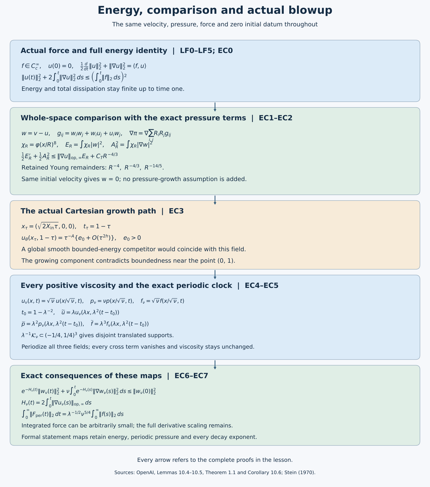

# Energy, comparison and the final blowup conclusions

*NS-BLOWUP N7.2. Exposition by GPT-6 Astra (OpenAI). This independent exposition is dedicated to CC0.*

The [preceding lesson](../src/localizing-the-field-and-extending-the-force.md), LF0–LF5, constructs the actual compactly supported velocity and pressure before time one and a smooth compact force through that time. The [local-field lesson](../src/constructing-the-actual-local-field.md), PL0–PL7 and LC0–LC8, proves every local input and the growth path. This lesson completes the energy, comparison, growth, viscosity and periodic conclusions for those same fields.

We first keep the viscosity-one fields exactly as constructed, then retain every factor in the source's map to each prescribed positive viscosity. EC0 proves uniform energy and total dissipation. EC1 gives the complete comparison proof, including its pressure-gradient argument, all cutoff terms and the analytical tools it uses. EC2 supplies its actual hypotheses. EC3–EC5 prove growth, nonexistence of a global competitor, every viscosity assertion and periodization. EC6 identifies the precise formal statements and proves the required coordinate and derivative comparisons. EC7 contains five solved exercises and the consequences they establish.

The [editable figure source](../assets/energy-comparison-and-blowup.py) records the equations and proof locators. The diagram describes proved implications, not numerical flow samples.

## EC0. Uniform energy and total dissipation

For each T<1, u,p are smooth on \([0,T]\) with the same compact spatial support. Integration against u has no boundary term. The nonlinear term is the integral of \(\operatorname{div}(|u|^2u/2)\), pressure integrates to \(\operatorname{div}(pu)\), and the Laplacian contributes \(-\|\nabla u\|_2^2\). Thus
\[
\frac12\frac d{dt}\|u(t)\|_2^2+\|\nabla u(t)\|_2^2
=\langle f(t),u(t)\rangle.
\tag{EC0.1}
\]
Keep \(\mathcal F(t)=\int_0^t\|f(s)\|_2\,ds\), \(0\le t\le1\). Its value at one is finite because f is smooth with fixed compact support. For δ>0, divide EC0.1 by \((\|u\|_2^2+\delta^2)^{1/2}\). The dissipation is nonnegative and Cauchy–Schwarz gives
\[
\frac d{dt}(\|u(t)\|_2^2+\delta^2)^{1/2}\le\|f(t)\|_2.
\]
Since u(0)=0, integration gives the upper bound \(\delta+\mathcal F(t)\). Taking δ↓0 yields \(\|u(t)\|_2\le\mathcal F(t)\). Integrate the full identity EC0.1 again to retain dissipation:
\[
\|u(t)\|_2^2+2\int_0^t\|\nabla u(s)\|_2^2\,ds
\le2\int_0^t\mathcal F'(s)\mathcal F(s)\,ds
=\mathcal F(t)^2.
\tag{EC0.2}
\]
The nonnegative dissipation integrals increase to their value on [0,1), bounded by \(\mathcal F(1)^2/2\). This proves Lemma 10.4, including uniform energy and finite total dissipation, using the actual force and all spatial boundary terms. No estimate of the sum's individual high-frequency energies is needed.

## EC1. The complete whole-space comparison proof

Let \(u,p\) and \(v,P\) be smooth solutions on \(\mathbb R^3\times[0,T]\) of the incompressible viscosity-one equation with the same force and the same initial velocity. Assume

\[
u,v\in L^\infty(0,T;L^2(\mathbb R^3)),\qquad
u\in L^\infty(0,T;L^6(\mathbb R^3)),\qquad
\|\nabla u(\,\cdot\,,t)\|_\infty\in L^1(0,T).
\tag{CP1}
\]

Then \(u=v\) on \(\mathbb R^3\times[0,T]\). In particular, the compact spatial support assumed for the reference field in the source lemma is not needed for the comparison step.

The essential-time norm bounds hold at every individual time in the closed interval: choose interior times approaching that time outside the exceptional null set, use smooth pointwise convergence, and apply Fatou to the squared or sixth powers. This also supplies the endpoint bounds used below.

For the compactly supported reference field of the source, the expanding-cutoff error can be bounded by \(C_TR^{-4/3}\), which strengthens the displayed source bound \(C_TR^{-1}\).

### EC1.1. Pressure-gradient recovery

Set

\[
w=v-u,\qquad \pi=P-p,\qquad
g_{ij}=v_iv_j-u_iu_j=w_iw_j+w_iu_j+u_iw_j,
\tag{CP2}
\]

and keep the convention

\[
(\operatorname{div}g)_i=\sum_{j=1}^3\partial_jg_{ij}.
\tag{CP3}
\]

If

\[
M=\sup_{0\le t\le T}\|w(t)\|_2,\qquad
U_2=\sup_{0\le t\le T}\|u(t)\|_2,
\tag{CP4}
\]

then Cauchy–Schwarz, component by component, gives

\[
\|g_{ij}(t)\|_1
\le \|w_i(t)\|_2\|w_j(t)\|_2
+\|w_i(t)\|_2\|u_j(t)\|_2
+\|u_i(t)\|_2\|w_j(t)\|_2.
\tag{CP5}
\]

Thus

\[
G:=\sup_{0\le t\le T}\sum_{i,j=1}^3\|g_{ij}(t)\|_1<\infty.
\tag{CP6}
\]

The exact difference equation is

\[
\partial_tw+\operatorname{div}g=\Delta w-\nabla\pi,
\qquad \operatorname{div}w=0.
\tag{CP7}
\]

Use the unitary Fourier transform with derivative multiplier \(i\xi_i\), and let \(R_i\) have multiplier \(i\xi_i/|\xi|\). Define

\[
\pi_*=\sum_{i,j=1}^3R_iR_jg_{ij}.
\tag{CP8}
\]

For every \(s>3/2\),

\[
\|\pi_*(t)\|_{H^{-s}}^2
\le (2\pi)^{-3}G^2
\int_{\mathbb R^3}(1+|\xi|^2)^{-s}\,d\xi<\infty.
\tag{CP9}
\]

The integral is finite at the origin and has radial exponent \(2-2s<-1\) at infinity. The multiplier in (CP8) is \(-\xi_i\xi_j/|\xi|^2\), so

\[
\Delta\pi_*=-\sum_{i,j=1}^3\partial_i\partial_jg_{ij}.
\tag{CP10}
\]

Taking divergence in (CP7) gives the same equation for \(\pi\), locally in distributions.

For \(a\in C_c^\infty(0,T)\), integration by parts in time in (CP7) yields the exact signs

\[
\int_0^T a\nabla\pi\,dt
=\Delta\int_0^T aw\,dt
+\int_0^T a'w\,dt
-\operatorname{div}\int_0^T ag\,dt.
\tag{CP11}
\]

The three terms on the right belong to \(H^{-2}\), \(L^2\), and \(H^{-3}\), respectively. The last inclusion follows from \(L^1\subset H^{-2}\) in three dimensions and one spatial derivative. Equation (CP9), with \(s=2\), also gives

\[
H_a:=\int_0^T a(\nabla\pi-\nabla\pi_*)\,dt\in H^{-3}(\mathbb R^3),
\qquad \Delta H_a=0.
\tag{CP12}
\]

The Fourier transform of each component of \(H_a\) is a weighted \(L^2\) function. The harmonic equation makes it vanish away from \(\{0\}\); a function supported on that measure-zero set is zero almost everywhere. Therefore \(H_a=0\). Testing against every time test function and every compact spatial test function proves

\[
\nabla\pi=\nabla\pi_*
\quad\text{on }\mathbb R^3\times(0,T).
\tag{CP13}
\]

This proves equality of pressure gradients. It neither identifies the scalar pressure gauges nor imposes a growth condition on \(P\).

### EC1.2. The exact commutator and pressure-flux estimate

Choose \(\varphi\in C_c^\infty(\mathbb R^3)\) with \(0\le\varphi\le1\) and \(\varphi=1\) on the unit ball. For \(R\ge1\), retain the source definitions

\[
\varphi_R(x)=\varphi(x/R),\qquad
\chi_R=\varphi_R^8,
\tag{CP14}
\]

\[
E_R=\int_{\mathbb R^3}\chi_R|w|^2,\qquad
A_R=\left(\int_{\mathbb R^3}\chi_R|\nabla w|^2\right)^{1/2},\qquad
B_R=\|\varphi_R^4w\|_6.
\tag{CP15}
\]

The homogeneous Sobolev inequality proved in EC1.5.1, with \(C_S=4\sqrt3\), and the product rule give

\[
B_R\le C_S\|\nabla(\varphi_R^4w)\|_2
\le C_S\left(A_R+4\|\nabla\varphi\|_\infty R^{-1}M\right).
\tag{CP16}
\]

The full distributional kernel of \(R_iR_j\) is

\[
\operatorname{pv}\frac{3y_iy_j-\delta_{ij}|y|^2}{4\pi|y|^5}
-\frac{\delta_{ij}}3\delta_0.
\tag{CP17}
\]

The local term cancels in a commutator. With \(a_R=\varphi_R^4\),

\[
a_R\pi_*=
\sum_{i,j}R_iR_j(a_Rg_{ij})
+\sum_{i,j}[a_R,R_iR_j]g_{ij}.
\tag{CP18}
\]

The nonlocal kernel in (CP17) is bounded by \(\pi^{-1}|y|^{-3}\), while

\[
|a_R(x)-a_R(y)|
\le \min\left\{4\|\nabla\varphi\|_\infty\frac{|x-y|}{R},1\right\}.
\tag{CP19}
\]

Consequently each commutator is majorized by convolution with

\[
K_R(y)=C|y|^{-3}\min\{|y|/R,1\}.
\tag{CP20}
\]

The complete radial calculation is

\[
\begin{aligned}
\|K_R\|_{4/3}^{4/3}
&=4\pi C^{4/3}\left[
R^{-4/3}\int_0^Rr^{-2/3}\,dr
+\int_R^\infty r^{-2}\,dr\right]\\
&=16\pi C^{4/3}R^{-1}.
\end{aligned}
\tag{CP21}
\]

Young’s convolution inequality therefore gives

\[
\left\|\sum_{i,j}[a_R,R_iR_j]g_{ij}\right\|_{4/3}
\le C G R^{-3/4}.
\tag{CP22}
\]

Let

\[
U_6=\sup_{0\le t\le T}\|u(t)\|_6.
\tag{CP23}
\]

The first sum in (CP18) satisfies

\[
\|\varphi_R^4w_iw_j\|_{3/2}\le B_RM,
\tag{CP24}
\]

\[
\|\varphi_R^4w_iu_j\|_{3/2}\le MU_6,\qquad
\|\varphi_R^4u_iw_j\|_{3/2}\le U_6M.
\tag{CP25}
\]

The \(L^{3/2}\) bound for each double Riesz transform proved in EC1.5.3 then yields

\[
\left\|\sum_{i,j}R_iR_j(a_Rg_{ij})\right\|_{3/2}
\le C M(B_R+2U_6).
\tag{CP26}
\]

For \(g\in L^1\), identity (CP18) follows by first cutting \(g\) off smoothly, applying the identity to the compact smooth approximants, and passing to the limit in \(H^{-s}\) for the Riesz terms and in \(L^{4/3}\) for the commutators. The compact factor \(a_Rg\) is also locally in every finite \(L^p\), since the solutions are smooth. Hence \(\pi_*\) is locally integrable.

Testing (CP13) against \(a(t)\chi_Rw\) gives, for almost every \(t\),

\[
\int_{\mathbb R^3}\pi w\cdot\nabla\chi_R
=\int_{\mathbb R^3}\pi_*w\cdot\nabla\chi_R.
\tag{CP27}
\]

There is no scalar-gauge term because

\[
\operatorname{div}(\chi_Rw)=w\cdot\nabla\chi_R.
\tag{CP28}
\]

The exact derivative

\[
\nabla\chi_R
=8R^{-1}\varphi_R^7(\nabla\varphi)(x/R)
\tag{CP29}
\]

pairs (CP18) with \(CR^{-1}\varphi_R^3w\). The required interpolations retain the cutoff powers:

\[
\|\varphi_R^3w\|_3
\le\|\varphi_R^2w\|_3
\le B_R^{1/2}M^{1/2},
\tag{CP30}
\]

\[
\|\varphi_R^3w\|_4
\le B_R^{3/4}M^{1/4}.
\tag{CP31}
\]

Indeed,

\[
\varphi_R^2|w|=(\varphi_R^4|w|)^{1/2}|w|^{1/2},
\qquad
\varphi_R^3|w|=(\varphi_R^4|w|)^{3/4}|w|^{1/4},
\tag{CP32}
\]

and Hölder gives (CP30)–(CP31). Combining (CP22), (CP26), and (CP29)–(CP31) gives the complete pressure-flux estimate

\[
\left|\int_{\mathbb R^3}\pi w\cdot\nabla\chi_R\right|
\le C R^{-1}M(B_R+2U_6)B_R^{1/2}M^{1/2}
+C G R^{-7/4}B_R^{3/4}M^{1/4}.
\tag{CP33}
\]

After uniform \(L^2\) and \(L^6\) bounds are placed in \(C_T\), this is exactly the source estimate (10.19).

### EC1.3. Difference energy and the stronger remainder

Pairing (CP7) with \(\chi_Rw\), with all integrals over \(\mathbb R^3\), gives

\[
\begin{aligned}
\frac12E_R'+A_R^2
={}&-\int\chi_R(w\cdot\nabla)u\cdot w
+\frac12\int|w|^2\Delta\chi_R\\
&+\frac12\int|w|^2v\cdot\nabla\chi_R
+\int\pi w\cdot\nabla\chi_R.
\end{aligned}
\tag{CP34}
\]

Let

\[
K(t)=\|\nabla u(t)\|_{\mathrm{op},\infty}.
\tag{CP35}
\]

The first term on the right of (CP34) is bounded by \(K(t)E_R\). Since

\[
\Delta\varphi_R^8
=56\varphi_R^6|\nabla\varphi_R|^2
+8\varphi_R^7\Delta\varphi_R,
\tag{CP36}
\]

the Laplacian term is bounded by \(CR^{-2}M^2\).

If \(u\) is compactly supported and \(R\) is large enough that \(\chi_R=1\) near its support, then \(v=w\) on \(\operatorname{supp}\nabla\chi_R\). The transport flux is bounded by

\[
CR^{-1}\int\varphi_R^6|w|^3
\le CR^{-1}B_R^{3/2}M^{3/2}.
\tag{CP37}
\]

The exponent \(6\) is an inequality consequence of the actual exponent \(7\), since \(0\le\varphi_R\le1\).

For the stronger theorem, keep \(v=w+u\). The additional term obeys

\[
\begin{aligned}
CR^{-1}\int\varphi_R^7|w|^2|u|
&\le CR^{-1}U_6\|\varphi_R^{7/2}w\|_{12/5}^2\\
&\le CR^{-1}U_6B_R^{1/2}M^{3/2}.
\end{aligned}
\tag{CP38}
\]

The last step uses \(\varphi_R^{7/2}\le\varphi_R\) and the exact interpolation

\[
\|\varphi_Rw\|_{12/5}
\le B_R^{1/4}M^{3/4},
\qquad
\frac5{12}=\frac{1/4}{6}+\frac{3/4}{2}.
\tag{CP39}
\]

For \(0<\beta<2\), \(a>0\), and \(\delta>0\), direct maximization of \(ax^\beta-\delta x^2\) over \(x\ge0\) gives

\[
ax^\beta\le\delta x^2
+\left(1-\frac\beta2\right)
\left(\frac\beta2\right)^{\beta/(2-\beta)}
\delta^{-\beta/(2-\beta)}
a^{2/(2-\beta)}.
\tag{CP40}
\]

Substituting (CP16) into (CP33), (CP37), and (CP38) leaves only these positive powers of \(A_R\):

\[
CR^{-1}A_R^{3/2},\qquad
CR^{-1}A_R^{1/2},\qquad
CR^{-7/4}A_R^{3/4}.
\tag{CP41}
\]

Their remainders under (CP40) have powers

\[
R^{-4},\qquad R^{-4/3},\qquad R^{-14/5},
\tag{CP42}
\]

respectively. The terms obtained from the \(R^{-1}M\) part of (CP16), together with (CP36), have powers

\[
R^{-5/2},\qquad R^{-3/2},\qquad R^{-5/2},\qquad R^{-2}.
\tag{CP43}
\]

Choose the finitely many \(\delta\)’s in (CP40) so that their sum is at most \(1/2\). For \(R\ge1\), equations (CP34)–(CP43) yield

\[
\frac12E_R'+\frac12A_R^2
\le K(t)E_R+C_TR^{-4/3}.
\tag{CP44}
\]

The source’s \(C_TR^{-1}\) bound is therefore valid and non-sharp; (CP44) is the stronger bound.

If the initial velocities agree, then \(E_R(0)=0\). Gronwall’s inequality and \(K\in L^1(0,T)\) give

\[
E_R(t)\le
2C_TR^{-4/3}\int_0^t
\exp\left(2\int_s^tK(a)\,da\right)\,ds.
\tag{CP45}
\]

Every fixed spatial ball lies in the region where \(\chi_R=1\) once \(R\) is large. Letting \(R\to\infty\) in (CP45) shows that the \(L^2\) mass of \(w(t)\) on every fixed ball is zero. Smoothness gives \(w=0\) pointwise, including the time endpoints.

### EC1.4. The \(L^6\) input follows from the source’s stronger regularity

If \(u(t)\in L^2\) and \(L=\|\nabla u(t)\|_{\mathrm{op},\infty}>0\), let \(a=|u(x,t)|\). On the ball of radius \(a/(2L)\) centered at \(x\),

\[
|u(y,t)|\ge a/2.
\tag{CP46}
\]

Therefore

\[
\|u(t)\|_2^2
\ge\frac{a^2}{4}\frac{4\pi}{3}\left(\frac{a}{2L}\right)^3
=\frac{\pi a^5}{24L^3}.
\tag{CP47}
\]

Taking the supremum over \(x\) gives

\[
\|u(t)\|_\infty
\le\left(\frac{24}{\pi}\right)^{1/5}
\|u(t)\|_2^{2/5}L^{3/5}.
\tag{CP48}
\]

Also,

\[
\|u(t)\|_6
\le\|u(t)\|_\infty^{2/3}\|u(t)\|_2^{1/3}.
\tag{CP49}
\]

If \(L=0\), the field is spatially constant and its \(L^2\) membership makes it zero. Thus the source’s smooth compactly supported reference field has the required uniform \(L^6\) bound on every interval \([0,T]\), \(T<1\).

### EC1.5. Proofs of the analytical tools used above

#### EC1.5.1. The homogeneous Sobolev inequality on the actual cutoff field

For a scalar \(g\in C_c^1(\mathbb R^3)\), define
\[
A_1(x_2,x_3)=\int_{\mathbb R}|\partial_1g(s,x_2,x_3)|\,ds
\]
and define \(A_2(x_1,x_3)\), \(A_3(x_1,x_2)\) by the corresponding coordinate integrals. The fundamental theorem of calculus, starting beyond the compact support on each coordinate line, gives \(|g(x)|\le A_i\) for every i. Hence
\[
|g(x)|^{3/2}\le
\{A_1(x_2,x_3)A_2(x_1,x_3)A_3(x_1,x_2)\}^{1/2}.
\tag{CP50}
\]
Put \(B_2(x_3)=\int A_2(x_1,x_3)\,dx_1\) and
\(B_3(x_2)=\int A_3(x_1,x_2)\,dx_1\).
Cauchy–Schwarz first in \(x_1\), then jointly in \(x_2,x_3\), gives the complete estimate
\[
\begin{split}
\int|g|^{3/2}
&\le\int_{\mathbb R^2}A_1(x_2,x_3)^{1/2}
B_2(x_3)^{1/2}B_3(x_2)^{1/2}\,dx_2dx_3\\
&\le\left(\int_{\mathbb R^2}A_1\right)^{1/2}
\left(\int_{\mathbb R}B_2\int_{\mathbb R}B_3\right)^{1/2}
=\prod_{i=1}^3\|\partial_i g\|_1^{1/2}.
\end{split}
\tag{CP51}
\]
Raise this to the power \(2/3\). The geometric mean of three nonnegative numbers is at most their sum; also
\(\sum_i|\partial_i g|\le\sqrt3|\nabla g|\). Therefore
\[
\|g\|_{3/2}\le\prod_i\|\partial_i g\|_1^{1/3}
\le\sqrt3\|\nabla g\|_1.
\tag{CP52}
\]
Apply this to \(g=|b|^4\), where \(b\) is a smooth compactly supported vector field. This is a smooth polynomial in its real components. With the Euclidean norm for b and the Frobenius norm for its gradient, the chain rule gives
\(|\nabla |b|^4|\le4|b|^3|\nabla b|\). Consequently
\[
\|b\|_6^4\le4\sqrt3\int |b|^3|\nabla b|
\le4\sqrt3\|b\|_6^3\|\nabla b\|_2.
\tag{CP53}
\]
For nonzero b divide by \(\|b\|_6^3\); for zero b the conclusion holds directly. Thus
\(\|b\|_6\le4\sqrt3\|\nabla b\|_2\).
Taking exactly \(b=\varphi_R^4w\) proves (CP16), with every cutoff derivative retained. No regularity or decay at infinity for the uncut derivatives of w was assumed.

#### EC1.5.2. The complete kernel and its weak estimate

Fix \(i,j\in\{1,2,3\}\) and let \(T=R_iR_j\) initially act on \(L^2(\mathbb R^3)\) by its multiplier
\(-\xi_i\xi_j/|\xi|^2\). Define it arbitrarily at \(\xi=0\), a null set. Plancherel gives
\[
\|Tb\|_2\le\|b\|_2.
\tag{CP54}
\]
Here the unitary convention is
\(\widehat b(\xi)=(2\pi)^{-3/2}\int e^{-ix\cdot\xi}b(x)\,dx\).
The Newton kernel has the exact heat representation
\[
G(x)=\frac1{4\pi|x|}
=\int_0^\infty(4\pi s)^{-3/2}e^{-|x|^2/(4s)}\,ds.
\tag{CP55}
\]
The substitution \(a=|x|/(2\sqrt s)\) evaluates the integral, using
\(\int_0^\infty e^{-a^2}\,da=\sqrt\pi/2\).
Fourier transformation of the heat kernels gives
\(\widehat G(\xi)=(2\pi)^{-3/2}|\xi|^{-2}\) as a tempered distribution; the latter is locally integrable in three dimensions. The time integral can first be taken on a compact subinterval of \((0,\infty)\), then passed to the limit against Schwartz functions. Thus convolution with \(\partial_i\partial_jG\) has precisely T’s multiplier, including its sign.

For \(y\ne0\), direct differentiation gives
\[
K_{ij}(y)=\partial_i\partial_jG(y)
=\frac{3y_iy_j-\delta_{ij}|y|^2}{4\pi|y|^5},
\quad |K_{ij}(y)|\le\frac1{\pi|y|^3},
\quad |\nabla K_{ij}(y)|\le\frac7{\pi|y|^4}.
\tag{CP56}
\]
For the last bound the numerator has absolute value at most \(4|y|^2\) and gradient norm at most \(8|y|\); differentiating \(|y|^{-5}\) contributes \(20|y|^{-4}\) before division by \(4\pi\), and the differentiated numerator contributes \(8|y|^{-4}\).

To retain the distribution at zero, integrate twice by parts over \(|y|>\epsilon\) against a smooth compactly supported test function \(\psi\). The inner sphere has outward normal \(-y/|y|\). The boundary contribution containing \(G\partial_j\psi\) is \(O(\epsilon)\). The other contribution is
\[
-\frac1{4\pi}\int_{\mathbb S^2}\omega_i\omega_j
\psi(\epsilon\omega)\,d\omega
\longrightarrow-\frac{\delta_{ij}}3\psi(0).
\tag{CP57}
\]
The spherical integral uses coordinate reflections for \(i\ne j\) and
\(\sum_i\omega_i^2=1\) for the three equal diagonal entries. The principal value of the volume term exists: K has zero spherical mean, its product with the linear term in the Taylor expansion of \(\psi\) has odd spherical mean, and its product with the quadratic remainder is integrable at zero. Thus the complete kernel is
\(\operatorname{pv}K_{ij}-(\delta_{ij}/3)\delta_0\), as in (CP17). In particular the local term is absent outside the support of the input and cancels in the commutator (CP18).

We prove a weak \(L^1\) estimate with an explicit admissible constant. Let \(b\in C_c^\infty(\mathbb R^3)\) and \(t>0\). In one fixed dyadic grid choose all maximal cubes Q for which
\(|Q|^{-1}\int_Q|b|>t\). Large ancestor cubes have averages tending to zero, so every chosen cube has a maximal ancestor of this kind. The maximal cubes are disjoint. Their parents fail the strict inequality and have eight times their volume. Outside their union the shrinking dyadic averages converge to \(|b(x)|\) by continuity, apart from the null grid boundaries. These facts give
\[
\sum_Q|Q|\le\|b\|_1/t,\qquad
t<|Q|^{-1}\int_Q|b|\le8t,\qquad
|b|\le t\ \text{a.e. outside }\bigcup_QQ.
\tag{CP58}
\]
Set \(b_Q=(b-b_Q^{\rm av})1_Q\), where \(b_Q^{\rm av}=|Q|^{-1}\int_Qb\), and put \(g=b-\sum_Qb_Q\). Then
\[
\int b_Q=0,\quad \sum_Q\|b_Q\|_1\le2\|b\|_1,\quad
\|g\|_1\le\|b\|_1,\quad \|g\|_\infty\le8t,\quad
\|g\|_2^2\le8t\|b\|_1.
\tag{CP59}
\]
The sum of the \(b_Q\) converges in \(L^2\): disjoint supports and
\(\sum_Q\|b_Q\|_2^2\le4\|b\|_2^2\) follow by Cauchy–Schwarz for each average.

Let E be the union of the concentric cubes \(6Q\), whose side lengths are six times those of Q. Then \(|E|\le216\|b\|_1/t\).
If Q has center c and side length \(\ell\), \(x\notin6Q\) implies
\(|x-c|\ge3\ell\), whereas \(y\in Q\) implies
\(|y-c|\le\sqrt3\ell/2<|x-c|/2\).
Use \(\int b_Q=0\) and (CP56) along the segment from \(x-c\) to \(x-y\). The exact off-support representation yields
\[
Tb_Q(x)=\int_Q\{K_{ij}(x-y)-K_{ij}(x-c)\}b_Q(y)\,dy,
\]
\[
\begin{split}
\int_{(6Q)^c}|Tb_Q(x)|\,dx
&\le \frac7\pi\,16\,\frac{\sqrt3\ell}2\,
4\pi\int_{3\ell}^\infty r^{-2}\,dr\,\|b_Q\|_1\\
&=\frac{224\sqrt3}{3}\|b_Q\|_1=:C_b\|b_Q\|_1.
\end{split}
\tag{CP60}
\]
The off-support formula follows first for smooth approximations to \(b_Q\), then by their \(L^1\) and \(L^2\) convergence on sets at positive distance from Q; the kernel is smooth there and T is \(L^2\)-continuous. The \(L^2\) sum of the \(Tb_Q\) and their \(L^1(E^c)\) sum represent the same distribution, so the latter bounds the actual \(T(\sum_Qb_Q)\) on \(E^c\).

If \(|Tb|>t\) outside E, either \(|Tg|>t/2\) or
\(|T(\sum_Qb_Q)|>t/2\). Chebyshev, (CP54), (CP59) and (CP60) give
\[
\begin{split}
|\{|Tb|>t\}|
&\le216\|b\|_1/t+4t^{-2}\|g\|_2^2
+2t^{-1}C_b\sum_Q\|b_Q\|_1\\
&\le C_w\|b\|_1/t,\qquad
C_w=248+\frac{896\sqrt3}{3}.
\end{split}
\tag{CP61}
\]
For \(b\in L^1\cap L^2\), approximate simultaneously in both norms by smooth compactly supported functions. The images converge in \(L^2\) and along a subsequence almost everywhere. Apply (CP61) at threshold \(t-\epsilon>0\), use Fatou for the level-set indicators at threshold t of the limit, and then let \(\epsilon\downarrow0\). This extends (CP61) to \(L^1\cap L^2\).

#### EC1.5.3. The exact \(L^{3/2}\) bound required by the pressure flux

For smooth compactly supported b and each \(t>0\), split
\(b=b\,1_{\{|b|>t\}}+b\,1_{\{|b|\le t\}}\).
Apply (CP61) to the first part and (CP54) to the second. The threshold for each image is \(t/2\), so
\[
|\{|Tb|>t\}|
\le\frac{2C_w}{t}\int_{|b|>t}|b|
+\frac4{t^2}\int_{|b|\le t}|b|^2.
\tag{CP62}
\]
The layer-cake identity and Tonelli’s theorem, for \(1<p<2\), now give
\[
\begin{split}
\|Tb\|_p^p
&=p\int_0^\infty t^{p-1}|\{|Tb|>t\}|\,dt\\
&\le2pC_w\int |b(x)|
\left(\int_0^{|b(x)|}t^{p-2}\,dt\right)\,dx\\
&\quad+4p\int |b(x)|^2
\left(\int_{|b(x)|}^\infty t^{p-3}\,dt\right)\,dx\\
&=\left(\frac{2pC_w}{p-1}+\frac{4p}{2-p}\right)\|b\|_p^p.
\end{split}
\tag{CP63}
\]
Both inner integrals converge for the displayed range of p. In particular,
\[
\|R_iR_jb\|_{3/2}\le(6C_w+12)^{2/3}\|b\|_{3/2}.
\tag{CP64}
\]
Density extends this operator uniquely to \(L^{3/2}\). For inputs also in \(L^2\), approximation in both norms identifies it with the Fourier multiplier. For the compact smooth factors \(a_Rg_{ij}\) in (CP26), both definitions therefore agree. For the \(L^1\) approximations used in (CP18), Fourier convergence in \(H^{-s}\), \(s>3/2\), follows from the bound in (CP9), while (CP64) supplies the \(L^{3/2}\) convergence of the compact factors. Thus this proof supplies the exact operator and exponent used in the pressure argument, including compatibility with its distributional definition.

## EC2. The actual whole-space comparison inputs

EC1 contains the complete comparison proof, equations (CP1)–(CP64), including its analytical tools in EC1.5. It includes pressure-gradient recovery, the exact Riesz commutator, every cutoff power, the full difference-energy identity, and an \(R^{-4/3}\) remainder. EC1.5 proves both the homogeneous Sobolev inequality and the required \(L^{3/2}\) double-Riesz bound, retaining the distributional local term and explicit admissible constants. This is classical singular-integral theory (Calderón–Zygmund theory); no novelty is claimed. The source comparison on original pages 121–123 confirms that no pressure-growth hypothesis is assumed.

For clarity, here are the actual inputs and their receiving estimates. Fix T<1 and let \(v_c,P_c\) be any smooth solution with the same force and initial velocity and with \(v_c\in L^\infty(0,T;L^2(\mathbb R^3))\). The constructed u has its \(L^\infty_tL^2_x\) bound from EC0.2. Its fixed compact support and smoothness on \(\mathcal K\times[0,T]\) give
\[
\sup_{0\le t\le T}\|u(t)\|_6<\infty,\qquad
\sup_{0\le t\le T}\|\nabla u(t)\|_\infty<\infty.
\tag{EC2.1}
\]
Thus every hypothesis of statement (CP1) is supplied. No regularity at t=1 for u is used.

Set w=v_c−u, π=P_c−p and retain all three terms
\[
g_{ij}=w_iw_j+w_i u_j+u_iw_j,\qquad
\|g_{ij}\|_1\le\|w_i\|_2\|w_j\|_2+
\|w_i\|_2\|u_j\|_2+\|u_i\|_2\|w_j\|_2.
\tag{EC2.2}
\]
These are uniformly bounded in time on [0,T]. The exact difference equation is
\(\partial_tw+\operatorname{div}g=\Delta w-\nabla\pi\).
With \(R_i\) having multiplier \(i\xi_i/|\xi|\), let
\(\pi_*=\sum_{i,j}R_iR_jg_{ij}\). The comparison proof gives \(\pi_*\in L^\infty_tH^{-2}_x\). For a compactly supported smooth time test a(t),
\[
\int_0^T a\nabla\pi\,dt
=\Delta\int_0^T aw\,dt+\int_0^T a'w\,dt
-\operatorname{div}\int_0^T ag\,dt.
\tag{EC2.3}
\]
The right side is in \(H^{-3}\); so is the time integral of \(\nabla\pi_*\). Their difference is harmonic because the two scalar pressures have the same Laplacian. Its Fourier transform is a weighted \(L^2\) function supported at \(\{0\}\), so is zero. Testing in time and space gives \(\nabla\pi=\nabla\pi_*\). This establishes the needed pressure-gradient identification without a spatial growth assumption on \(P_c\).

For the original cutoff \(\chi_R=\varphi(x/R)^8\), keep
\[
E_R=\int\chi_R|w|^2,\qquad
A_R^2=\int\chi_R|\nabla w|^2,\qquad
B_R=\|\varphi(x/R)^4w\|_6.
\]
The full comparison note proves, with constants depending on T and these supplied bounds but not R,
\[
B_R\le C(A_R+R^{-1}\|w\|_2),\qquad
\left|\int\pi w\cdot\nabla\chi_R\right|
\le C_T\{R^{-1}(B_R+1)B_R^{1/2}+R^{-7/4}B_R^{3/4}\}.
\tag{EC2.4}
\]
Its commutator kernel is bounded by
\(C|y|^{-3}\min\{|y|/R,1\}\), whose \(L^{4/3}\) norm is \(O(R^{-3/4})\). This is the full outer contribution; it is not discarded because the original pressure is unknown at infinity. Pairing the difference equation with \(\chi_Rw\) and retaining transport, pressure and Laplacian fluxes then gives
\[
\frac12E_R'+\frac12A_R^2
\le\|\nabla u(t)\|_\infty E_R+C_TR^{-4/3}.
\tag{EC2.5}
\]
Equations (CP34)–(CP44) prove every term in this inequality. The Young remainders are \(R^{-4}\), \(R^{-4/3}\), \(R^{-14/5}\); all other displayed remainders decay faster. The original \(R^{-1}\) bound follows too.

Since E_R(0)=0, multiply EC2.5 by
\(\exp(-2\int_0^t\|\nabla u(s)\|_\infty ds)\), integrate, and use EC2.1. This yields \(E_R(t)\le C_T'R^{-4/3}\), uniformly for \(0\le t\le T\). Every fixed spatial ball has \(\chi_R=1\) when R is sufficiently large. Letting R→∞ makes the \(L^2\) norm of w on that ball zero. Smoothness gives \(v_c=u\) pointwise on \(\mathbb R^3\times[0,T]\). Thus the actual constructed field satisfies the precise comparison conclusion of Lemma 10.5.

## EC3. The original growth path and exclusion of a global competitor

Use the original Cartesian point from (10.20),
\[
x_\tau=(\sqrt{2X_{\rm in}\tau},0,0),\qquad t_\tau=1-\tau.
\tag{EC3.1}
\]
It tends to (0,1). For sufficiently small τ, it lies where both cutoffs in LF0.4 equal one. LC6.2 then gives
\[
u_\theta(x_\tau,1-\tau)
=\tau^{-A}\{e_0+O(\tau^{2h})\}\longrightarrow+\infty,
\qquad e_0>0.
\tag{EC3.2}
\]
For example, choose τ so the finite remainder bound is at most e_0/2; the component is then at least \(e_0\tau^{-A}/2\). At this point θ=0 and \(e_\theta=(0,1,0)\), so it is an actual Cartesian component of u. Hence the spatial \(L^\infty\) norm is unbounded as t↑1. The original summation cutoffs and their remainder are included in LC6.2, and every annular correction vanishes on this inner path.

Suppose a global smooth whole-space solution \(v_c,P_c\) had the same datum and force and uniformly bounded kinetic energy. For every T<1 it has the \(L^\infty_tL^2_x\) input required in EC2, so \(v_c=u\) on [0,T]. Since T is arbitrary this equality holds before time one. Smoothness of \(v_c\) bounds it on a compact neighborhood of (0,1), contradicting the component growth EC3.2. This proves precisely the global-comparison conclusion in Theorem 1.1. The force is nonzero: if f were identically zero, EC0.2 would give u=0, contradicting EC3.2.

For completeness the stated classical \(H^3\) lifespan also follows. Fixed compact support and smoothness give \(u\in C([0,T];H^3)\) for every T<1, by dominated convergence of each derivative through order three. Use the precise Fourier norm \(\|u\|_{H^3}^2=\int(1+|\xi|^2)^3|\widehat u(\xi)|^2\,d\xi\), with the Euclidean sum over vector components. The unitary Fourier formula and Cauchy–Schwarz give, for \(|\alpha|\le1\),
\[
\|\partial^\alpha u\|_\infty
\le(2\pi)^{-3/2}
\left(\int_{\mathbb R^3}|\xi|^{2|\alpha|}(1+|\xi|^2)^{-3}d\xi\right)^{1/2}
\|u\|_{H^3}.
\tag{EC3.3}
\]
The integrals converge at zero and at infinity: their radial powers at infinity are \(2|\alpha|-4\le-2\). Thus \(H^3\) controls both the velocity and its first derivatives. A continuation continuous in \(H^3\) through time one would make the left side with α=0 uniformly bounded near one, contrary to EC3.2. Uniqueness on shorter classical \(H^3\) intervals follows by the same difference energy calculation. The velocity bound just proved and \(w\in L^2\) place each component of \(g=v_c\otimes v_c-u\otimes u\) in \(L^2\). Thus \(\pi_*\in L^2\) by Plancherel, and the pressure-gradient recovery in EC2 remains valid. Integrate first against the compact field \(\chi_Rw\). The transport boundary error is at most \(CR^{-1}\|v_c\|_\infty\|w\|_2^2\), and the pressure boundary error is at most \(CR^{-1}\|\pi_*\|_2\|w\|_2\); both tend to zero. The Laplacian boundary error also tends to zero and the main gradient integral converges because \(w\in H^3\). The remaining term is bounded by \(\|\nabla u\|_\infty\|w\|_2^2\). The classical time regularity permits the integrated energy identity; multiplying by the same integrating factor gives w=0. This identifies the maximal interval of this classical solution as [0,1).

## EC4. Every original viscosity factor

For any prescribed \(\nu>0\), retain the source map with unchanged time:
\[
u_\nu(x,t)=\sqrt\nu\,u(x/\sqrt\nu,t),\quad
p_\nu(x,t)=\nu p(x/\sqrt\nu,t),\quad
f_\nu(x,t)=\sqrt\nu\,f(x/\sqrt\nu,t).
\tag{EC4.1}
\]
With y=x/√ν, the time, convection, viscosity and pressure-gradient terms all have the common factor √ν:
\[
\partial_tu_\nu+(u_\nu\cdot\nabla_x)u_\nu-\nu\Delta_xu_\nu+\nabla_xp_\nu
=\sqrt\nu\{\partial_tu+(u\cdot\nabla_y)u-\Delta_yu+\nabla_yp\}
=f_\nu.
\tag{EC4.2}
\]
Divergence is unchanged by its velocity and derivative factors. The datum stays zero, and the common spatial support is \(\mathcal K_\nu=\sqrt\nu\,\mathcal K\). The force is smooth and compactly supported in \(\mathcal K_\nu\times[1-\tau_0,2]\), with
\[
\partial_x^\alpha\partial_t^m f_\nu
=\nu^{(1-|\alpha|)/2}
(\partial_y^\alpha\partial_t^m f)(x/\sqrt\nu,t).
\tag{EC4.3}
\]
The energy and full dissipation retain the factors from original (10.23):
\[
\|u_\nu(t)\|_2^2=\nu^{5/2}\|u(t)\|_2^2,\qquad
\nu\int_0^1\|\nabla_xu_\nu\|_2^2dt
=\nu^{5/2}\int_0^1\|\nabla_yu\|_2^2dt.
\tag{EC4.4}
\]
The growth point is √ν x_τ and its growing component is √ν times EC3.2. A hypothetical bounded-energy global competitor maps back by
\(v_c(y,t)=\nu^{-1/2}v_\nu(\sqrt\nu y,t)\),
\(P_c(y,t)=\nu^{-1}P_\nu(\sqrt\nu y,t)\).
Its energy is \(\nu^{-5/2}\|v_\nu(t)\|_2^2\), still uniformly bounded. EC3 excludes it. This proves every quantified viscosity assertion of Theorem 1.1 without changing its original singular time.

## EC5. The periodic construction with the same viscosity

Keep the original torus \(\mathbb T^3=\mathbb R^3/\mathbb Z^3\) and fundamental cube \(Q_0=(-1/2,1/2)^3\). Fix ν and choose λ>1 so large that \(\lambda^{-1}\mathcal K_\nu\) lies strictly inside Q_0. For example λ larger than \(4\sup_{x\in\mathcal K_\nu}\max_i|x_i|\) as well as one places the support in \((-1/4,1/4)^3\). Set \(t_0=1-\lambda^{-2}>0\) and retain the source scaling
\[
\begin{split}
\widetilde u(x,t)&=\lambda u_\nu(\lambda x,\lambda^2(t-t_0)),\\
\widetilde p(x,t)&=\lambda^2p_\nu(\lambda x,\lambda^2(t-t_0)),\\
\widetilde f(x,t)&=\lambda^3f_\nu(\lambda x,\lambda^2(t-t_0)).
\end{split}
\tag{EC5.1}
\]
The first two fields are used for \(t_0\le t<1\), and the force for \(t\ge t_0\); extend them by zero for \(t<t_0\). Their original counterparts vanish on an initial interval, so these zero extensions are smooth. Each momentum term has factor λ³ and divergence has factor λ²; the viscosity remains ν. Original time one is reached exactly at t=1.

Periodize all three full fields:
\[
U(x,t)=\sum_{k\in\mathbb Z^3}\widetilde u(x+k,t),\quad
P_{\rm per}(x,t)=\sum_{k\in\mathbb Z^3}\widetilde p(x+k,t),\quad
F_{\rm per}(x,t)=\sum_{k\in\mathbb Z^3}\widetilde f(x+k,t).
\tag{EC5.2}
\]
The translates have disjoint closed supports with a positive gap. The sums are locally finite and periodic, including their pressures and all derivatives. At any point at most one translate can be nonzero; derivatives vanish outside the same closed supports. Therefore every cross term between distinct translates is zero and
\[
(U\cdot\nabla)U=\sum_k(\widetilde u\cdot\nabla)\widetilde u(x+k,t).
\tag{EC5.3}
\]
The periodized fields satisfy the exact Navier–Stokes equation with viscosity ν, periodic pressure and zero initial velocity.

The force has time support contained in \([t_0,1+\lambda^{-2}]\), is smooth, and satisfies every required temporal decay bound by compact support. Before time one, velocity and pressure are supported in the same fixed compact subset of the interior of Q_0. On the original path,
\[
\widetilde x_\tau=\lambda^{-1}\sqrt\nu\,x_\tau,\qquad
\widetilde t_\tau=1-\lambda^{-2}\tau,\qquad
U_\theta(\widetilde x_\tau,\widetilde t_\tau)
=\lambda\sqrt\nu\,\tau^{-A}\{e_0+O(\tau^{2h})\}\longrightarrow+\infty.
\tag{EC5.4}
\]
The point stays inside Q_0 near (0,1), where its zeroth translate is the only nonzero one. In particular the periodic \(L^\infty\) norm diverges. The construction also retains
\(\|U(t)\|_{L^2(\mathbb T^3)}^2
=\lambda^{-1}\|u_\nu(\lambda^2(t-t_0))\|_{L^2(\mathbb R^3)}^2\)
whenever \(t\ge t_0\), by the exact volume change and absence of overlapping copies.

If a global smooth periodic competitor has the same datum and force, its difference w from U on any [0,T], T<1, satisfies
\[
\frac12\frac d{dt}\|w\|_{L^2(\mathbb T^3)}^2
+\nu\|\nabla w\|_{L^2(\mathbb T^3)}^2
\le\|\nabla U\|_\infty\|w\|_{L^2(\mathbb T^3)}^2.
\tag{EC5.5}
\]
Periodic integration removes transport and pressure boundary terms. The coefficient is bounded on the compact torus and finite time interval. The zero datum and integrating factor imply w=0. As T is arbitrary, a global competitor would coincide with U before time one, contradicting smooth boundedness near the growth path EC5.4. This proves every assertion of Corollary 10.6.

## EC6. The precise formal statements and their mathematical meaning

The formal definitions and theorem declarations in this section are from the author's files at commit `f9e8bc5b38b6e212696e8a30e3e91517af887bbd`. The following comparisons specify their solution classes, coordinate order and derivative bounds. EC0–EC5 provide the mathematical proofs of the corresponding conclusions.

### EC6.1. Whole-space and periodic solution classes

In [R3/ProblemStatement.lean](https://github.com/openai/NavierStokesAndEuler/blob/f9e8bc5b38b6e212696e8a30e3e91517af887bbd/NavierStokes/R3/ProblemStatement.lean), space is Euclidean three-space and spacetime has time first. `CandidateProperties` retains the same velocity, pressure, force and compact spatial set. It requires smooth velocity and pressure on the half-open time interval, compact support of both spatial slices in that set, a globally smooth force with compact support in strictly positive time, zero initial velocity, divergence, the equation at positive times before one, uniform finite energy and unbounded speed arbitrarily close to time one. The energy definition and its explicit integrability condition are
\[
\begin{gathered}
\mathcal E(u,t)=\frac12\int_{\mathbb R^3}|u(x,t)|^2\,dx,\qquad
|u(\cdot,t)|^2\in L^1(\mathbb R^3),\\
\exists E\ge0\ \forall t\in[0,1):\quad \mathcal E(u,t)\le E.
\end{gathered}
\tag{EC6.1}
\]
The factor one half and the separate integrability condition are part of the definition. A totalized integral alone would not state square integrability.

`GlobalFiniteEnergySolution` requires smooth velocity and pressure on all nonnegative times, the same zero datum and prescribed force, the equation at positive times, divergence, and one finite energy bound for all those times. It imposes no compact support, pressure-growth, derivative-growth or energy-inequality assumption on the competitor. The declaration `NavierStokesR3.theorem_1_1` in [R3/Theorem.lean, line 46](https://github.com/openai/NavierStokesAndEuler/blob/f9e8bc5b38b6e212696e8a30e3e91517af887bbd/NavierStokes/R3/Theorem.lean#L46) has the full form
\[
\begin{aligned}
\forall\nu>0\quad\exists u,p,f,\mathcal K:\quad&
\mathrm{CandidateProperties}(\nu,u,p,f,\mathcal K)\\
&\land\ \neg\exists\text{ global smooth finite-energy solution for }(\nu,f,0).
\end{aligned}
\tag{EC6.2}
\]
EC0–EC4 prove these properties for one and the same construction. The same source file's `theorem_1_1_with_dissipation`, starting at line 66, additionally states the integrability of the force norm and total dissipation and the energy inequalities proved in EC0 and EC4.

The [periodic source](https://github.com/openai/NavierStokesAndEuler/blob/f9e8bc5b38b6e212696e8a30e3e91517af887bbd/NavierStokes/PeriodicPaperTheorem.lean#L26) retains every positive viscosity and singular time one. Its `CandidateProperties` requires the spatial support, intersected with the closed fundamental cube, to lie in a fixed compact subset of the cube's interior. It does not require a nonzero periodic lift to have compact support on all of space. Its global competitor has both periodic velocity and periodic pressure. No separate energy bound or pressure normalization is imposed. EC5 gives these exact fields, supports and comparison. The declaration `periodic_corollary` starts at [line 155](https://github.com/openai/NavierStokesAndEuler/blob/f9e8bc5b38b6e212696e8a30e3e91517af887bbd/NavierStokes/PeriodicPaperTheorem.lean#L155).

### EC6.2. Argument order and all differential operators

The two final declarations in [ComparatorSolution.lean, lines 16 and 23](https://github.com/openai/NavierStokesAndEuler/blob/f9e8bc5b38b6e212696e8a30e3e91517af887bbd/NavierStokes/ComparatorSolution.lean#L16) use space first and curry time as a second argument. Let
\[
J:\mathbb R^3\times\mathbb R\longrightarrow\mathbb R\times\mathbb R^3,
\quad J(x,t)=(t,x),\qquad
g(x)(t)=f(J(x,t)).
\tag{EC6.3}
\]
The inverse is the same coordinate interchange. For the product norm used by these product spaces,
\[
\|(x,t)\|=\max\{|x|,|t|\},\qquad
\|J(x,t)\|=\max\{|t|,|x|\}=\|(x,t)\|.
\tag{EC6.4}
\]
Thus this is an exact linear isometry, without a change of viscosity, time or spatial scale. The iterated chain rule for the linear map gives, for every integer \(m\ge0\),
\[
D^m(f\circ J)(z)[h_1,\ldots,h_m]
=D^mf(Jz)[Jh_1,\ldots,Jh_m],\qquad
\|D^m(f\circ J)(z)\|_{\rm op}=\|D^mf(Jz)\|_{\rm op}.
\tag{EC6.5}
\]
For the equality of norms, one inequality uses that \(J\) is an isometry; the reverse uses its isometric inverse. For \(m=0\), the formula is equality of the values and their norms. Repeated currying and uncurrying is a bijection of the stated field spaces.

Write \(e_1,e_2,e_3\) for the standard orthonormal basis. The finite-dimensional derivative identities are
\[
\begin{aligned}
\operatorname{tr}(D_xv)&=\sum_{i=1}^3(D_xv[e_i])_i
=\sum_{i=1}^3\partial_i v_i,\\
D_xv[v]&=\sum_{i=1}^3v_i\partial_i v,\qquad
\nabla_xp=\sum_{i=1}^3D_xp[e_i]e_i,\\
\Delta_xv&=\sum_{i=1}^3D_x^2v[e_i,e_i].
\end{aligned}
\tag{EC6.6}
\]
The trace identity is the sum of the diagonal entries in this basis. The convection and pressure identities follow by expanding the input vector in the same basis and using linearity; differentiating each first spatial derivative in its own basis direction gives the last identity. Consequently the formal and coordinate expressions have exactly the same time derivative, convection, viscosity coefficient, pressure sign and force. No factor is absorbed into an operator.

At time zero, the comparator writes the derivative within the nonnegative half-line. A smooth function on this half-domain has a unique derivative there: a one-sided time direction and every spatial direction determine its linear differential. Equivalently the cone of increments with nonnegative time component spans the full product space; a linear map vanishing on that cone vanishes everywhere. Restricting a smooth extension therefore gives that derivative. Applying this argument inductively to the derivative fields identifies every iterated derivative within the half-domain. The same uniqueness argument applies to derivatives within the spatial-time half-space in the force conditions. All terms of the equation are continuous up to zero. Thus an equation valid at every positive time and smooth on the closed half-domain has the required equality at zero by a one-sided limit. In the constructed solution all fields already vanish on an initial time interval.

### EC6.3. Full derivative decay and the energy comparison

The comparator's [force definitions](https://github.com/openai/NavierStokesAndEuler/blob/f9e8bc5b38b6e212696e8a30e3e91517af887bbd/NavierStokes/ComparatorDefinitions.lean#L149) quantify every integer derivative order \(m\) and every real decay exponent \(K\), not just nonnegative integer exponents. We now derive exactly those conditions from the actual force.

Use the time basis vector \(e_0=(1,0)\), spatial vectors \(e_i=(0,e_i)\), and write \(h_j=\sum_{i=0}^3h_{j,i}e_i\). For a smooth vector-valued force, multilinearity gives the full finite expansion
\[
D^mf(z)[h_1,\ldots,h_m]
=\sum_{i_1=0}^3\cdots\sum_{i_m=0}^3
\left(\prod_{j=1}^m h_{j,i_j}\right)
\partial_{i_1}\cdots\partial_{i_m}f(z).
\tag{EC6.7}
\]
Here \(\partial_0=\partial_t\); all other derivatives are spatial. For \(m=0\) the empty product is one and the formula has its single zeroth-order term. Every coordinate of a product-unit vector has absolute value at most one. If
\[
B_m=\max_{i_1,\ldots,i_m\in\{0,1,2,3\}}
\|\partial_{i_1}\cdots\partial_{i_m}f\|_\infty,
\quad B_0=\|f\|_\infty,
\quad\text{then}\quad
\|D^mf\|_{\mathrm{op},\infty}\le4^mB_m.
\tag{EC6.8}
\]
Conversely each displayed mixed partial is evaluation on product-unit basis vectors, so its norm is at most the differential's operator norm. These two inequalities prove the comparison of the full derivative data; they do not replace the original mixed derivatives or their viscosity factors.

For the actual whole-space force at viscosity \(\nu\), LF4 gives support in \(\mathcal K_\nu\times[1-\tau_0,2]\). Choose \(R_\nu\) with \(\mathcal K_\nu\subset B(0,R_\nu)\), retain the finite constants \(B_{m,\nu}\) defined by (EC6.8), and set \(K_+=\max\{K,0\}\). Then
\[
\|D^mf_\nu(t,x)\|_{\rm op}
\le\frac{4^mB_{m,\nu}(3+R_\nu)^{K_+}}
{(1+|x|+t)^K}\qquad(t\ge0,\ K\in\mathbb R).
\tag{EC6.9}
\]
For \(K\ge0\), the denominator's base on the support is at most \(3+R_\nu\). For \(K<0\), its reciprocal is at least one. Outside the support all the derivatives vanish. This proves every case of the real exponent. Equation (EC6.5) and the boundary derivative argument give the same statement for the curried force and its derivatives within the half-domain.

For the periodic force, every mixed derivative has a finite supremum on the closed fundamental cube and the compact time interval \([0,T_f]\), where \(T_f=1+\lambda^{-2}\). Periodicity extends this bound to all spatial points, and all derivatives vanish after \(T_f\). If \(B^{\rm per}_m\) is the maximum of those mixed derivative norms, the exact temporal bound is
\[
\|D^mF_{\rm per}(t,x)\|_{\rm op}
\le\frac{4^mB^{\rm per}_m(1+T_f)^{K_+}}{(1+t)^K}
\qquad(t\ge0,\ K\in\mathbb R).
\tag{EC6.10}
\]
The same support and sign cases prove it. Zero initial velocity meets every initial derivative-decay condition and every periodicity condition directly.

The whole-space comparator uses \(\int|v|^2<E_c\), uniformly in nonnegative time, together with membership in \(L^2\). The paper record uses (EC6.1). Their exact conversion is
\[
\int|v|^2<E_c\quad\Longrightarrow\quad
\mathcal E(v,t)\le\max\{0,E_c/2\},\qquad
\mathcal E(v,t)\le E\quad\Longrightarrow\quad
\int|v|^2<2E+1.
\tag{EC6.11}
\]
Integrability is retained in both directions; the identity between \(L^2\) membership and integrability of the squared Euclidean norm supplies it. The coordinate interchange preserves the spatial measure at each time, so there is no Jacobian factor. The final [whole-space adapter](https://github.com/openai/NavierStokesAndEuler/blob/f9e8bc5b38b6e212696e8a30e3e91517af887bbd/NavierStokes/R3/ComparatorBridge.lean) uses the same force, viscosity and zero datum. The [periodic adapter](https://github.com/openai/NavierStokesAndEuler/blob/f9e8bc5b38b6e212696e8a30e3e91517af887bbd/NavierStokes/PeriodicPaperComparator.lean) does the same and retains periodic pressure. The transformations above give exact maps in both directions for the solution classes, including the boundary equation. Applying the nonexistence conclusions of EC3–EC5 to these maps yields the two final comparator statements.

## EC7. Five solved exercises

### Exercise 1. The actual force budget and total dissipation

Retain the original viscosity. Bound the energy and total dissipation by the actual force, and prove a necessary quadratic force budget on each positive interval before blowup.

**Solution.** Put
\[
E_\nu(t)=\|u_\nu(t)\|_2^2,\quad
D_\nu(t)=\|\nabla u_\nu(t)\|_2^2,\quad
F_\nu(t)=\int_0^t\|f_\nu(s)\|_2\,ds.
\tag{EC7.1}
\]
The complete integration by parts in EC0, now keeping \(\nu\) on the Laplacian, gives
\[
\frac12E_\nu'(t)+\nu D_\nu(t)=\langle f_\nu,u_\nu\rangle,
\qquad
E_\nu(t)+2\nu\int_0^tD_\nu(s)\,ds\le F_\nu(t)^2.
\tag{EC7.2}
\]
The square-root regularization used in EC0 proves this even at times where \(E_\nu=0\). Cauchy–Schwarz in time yields, for \(0<t<1\),
\[
\int_0^t\|f_\nu(s)\|_2^2\,ds
\ge\frac{E_\nu(t)+2\nu\int_0^tD_\nu(s)\,ds}{t}.
\tag{EC7.3}
\]
The force is smooth and compact, so both force integrals are finite. Monotone convergence of the nonnegative dissipation gives
\[
\sup_{0\le t<1}E_\nu(t)\le F_\nu(1)^2,\qquad
2\nu\int_0^1D_\nu(s)\,ds\le F_\nu(1)^2.
\tag{EC7.4}
\]
No terminal velocity value is inserted. The growth path guarantees a nonzero velocity at some time; continuity then gives a ball with positive squared integral. Equation (EC7.3) proves a strictly positive force budget on that interval. This also excludes identically zero force without relying only on a verbal distinction between forced and unforced equations.

### Exercise 2. Stability when the initial velocities differ

Keep the same force and all three comparison hypotheses in (CP1), but allow different initial velocities. Prove the resulting quantitative comparison, including a dissipation bound, at every prescribed \(\nu>0\).

**Solution.** First work at viscosity one with the same \(w=v-u\), \(K(t)=\|\nabla u(t)\|_{\mathrm{op},\infty}\), cutoff and all pressure terms. Nothing in (CP2)–(CP44) uses the equality of initial velocities. Define
\[
H(t)=2\int_0^tK(a)\,da,\qquad E_0=\|v(0)-u(0)\|_2^2.
\tag{EC7.5}
\]
Multiplying (CP44) by \(2e^{-H(t)}\) and integrating gives
\[
e^{-H(t)}E_R(t)+\int_0^t e^{-H(s)}A_R(s)^2\,ds
\le E_R(0)+2C_TR^{-4/3}\int_0^t e^{-H(s)}\,ds.
\tag{EC7.6}
\]
At every spatial point \(\chi_R\to1\), with \(0\le\chi_R\le1\). Dominated convergence applies to the two fixed-time squared velocities, and Fatou applies to the nonnegative spacetime gradient integrals. Neither argument requires that the cutoffs be monotone in \(R\). Hence
\[
e^{-H(t)}\|w(t)\|_2^2+
\int_0^t e^{-H(s)}\|\nabla w(s)\|_2^2\,ds\le E_0.
\tag{EC7.7}
\]
In particular the difference gradient is globally square-integrable in spacetime, although that was not an initial assumption. The bound holds at every time by the local smoothness and fixed-time argument used in EC1, including the endpoints.

For the physical viscosity, set \(w_\nu(x,t)=\sqrt\nu\,w(x/\sqrt\nu,t)\) and use the same transformation for the two reference fields and their common force. These are invertible maps; thus they apply to any pair of smooth solutions at viscosity \(\nu\), by first using their inverse. The spatial gradient has factor one, while the squared velocity integral has factor \(\nu^{5/2}\) and the squared gradient integral has factor \(\nu^{3/2}\). Also \(K_\nu(t)=K(t)\). Multiplying (EC7.7) by \(\nu^{5/2}\) proves
\[
\begin{aligned}
e^{-H_\nu(t)}\|w_\nu(t)\|_2^2
&+\nu\int_0^t e^{-H_\nu(s)}\|\nabla w_\nu(s)\|_2^2\,ds
\le\|w_\nu(0)\|_2^2,\\
H_\nu(t)&=2\int_0^t\|\nabla u_\nu(s)\|_{\mathrm{op},\infty}\,ds.
\end{aligned}
\tag{EC7.8}
\]
The \(L^2\), \(L^6\) and time-integrable gradient hypotheses are preserved by the fixed positive scaling, with their actual finite norm factors. Taking the first term alone gives \(\|w_\nu(t)\|_2\le e^{H_\nu(t)/2}\|w_\nu(0)\|_2\). Zero initial difference recovers the original uniqueness conclusion. This strengthening belongs to the editorial argument; it does not change the source lemma.

### Exercise 3. Both physical rescalings, every derivative and every norm

Combine viscosity and periodic compression. Derive the full mixed derivative factors, spatial norms and energy/force identities, keeping the shifted time interval.

**Solution.** Let \(s=\lambda^2(t-t_0)\), \(y=\lambda x/\sqrt\nu\), with \(t_0=1-\lambda^{-2}\). Before periodization the three fields are
\[
\widetilde u=\lambda\sqrt\nu\,u(y,s),\qquad
\widetilde p=\lambda^2\nu p(y,s),\qquad
\widetilde f=\lambda^3\sqrt\nu\,f(y,s).
\tag{EC7.9}
\]
For a spatial multi-index \(\alpha\) and time order \(m\), the ordinary chain rule retains every factor:
\[
\begin{aligned}
\partial_x^\alpha\partial_t^m\widetilde u
&=\lambda^{1+|\alpha|+2m}\nu^{(1-|\alpha|)/2}
(\partial_y^\alpha\partial_s^m u)(y,s),\\
\partial_x^\alpha\partial_t^m\widetilde p
&=\lambda^{2+|\alpha|+2m}\nu^{1-|\alpha|/2}
(\partial_y^\alpha\partial_s^m p)(y,s),\\
\partial_x^\alpha\partial_t^m\widetilde f
&=\lambda^{3+|\alpha|+2m}\nu^{(1-|\alpha|)/2}
(\partial_y^\alpha\partial_s^m f)(y,s).
\end{aligned}
\tag{EC7.10}
\]
The volume form is \(dx=\nu^{3/2}\lambda^{-3}dy\). Thus, for \(1\le p_*\le\infty\), the exact three spatial norm identities at the corresponding times are
\[
\begin{aligned}
\|\partial_x^\alpha\partial_t^m\widetilde u(t)\|_{p_*}
&=\lambda^{1+|\alpha|+2m-3/p_*}
\nu^{(1-|\alpha|)/2+3/(2p_*)}
\|\partial_y^\alpha\partial_s^m u(s)\|_{p_*},\\
\|\partial_x^\alpha\partial_t^m\widetilde p(t)\|_{p_*}
&=\lambda^{2+|\alpha|+2m-3/p_*}
\nu^{1-|\alpha|/2+3/(2p_*)}
\|\partial_y^\alpha\partial_s^m p(s)\|_{p_*},\\
\|\partial_x^\alpha\partial_t^m\widetilde f(t)\|_{p_*}
&=\lambda^{3+|\alpha|+2m-3/p_*}
\nu^{(1-|\alpha|)/2+3/(2p_*)}
\|\partial_y^\alpha\partial_s^m f(s)\|_{p_*}.
\end{aligned}
\tag{EC7.11}
\]
These identities follow directly from (EC7.10) and the volume form; the convention \(1/\infty=0\) gives the supremum cases. On the corresponding time intervals, an \(L^{q_*}\) time norm has the additional factor \(\lambda^{-2/q_*}\), because \(dt=\lambda^{-2}ds\). The intervals \([t_0,1)\) and \([0,1)\) correspond exactly for velocity and pressure. For the complete force use \([t_0,1+\lambda^{-2}]\) and \([0,2]\), with zero extension elsewhere. Each norm identity is valid as an equality of extended nonnegative quantities; it asserts finiteness only when the corresponding original norm is finite.

Disjoint periodization preserves the spatial integral on one fundamental cube. In particular, with the original viscosity-one fields on the right,
\[
\begin{aligned}
\|U(t)\|_{L^2(\mathbb T^3)}^2
&=\lambda^{-1}\nu^{5/2}\|u(s)\|_2^2,\\
\nu\int_{t_0}^1\|\nabla U(t)\|_{L^2(\mathbb T^3)}^2\,dt
&=\lambda^{-1}\nu^{5/2}\int_0^1\|\nabla u(s)\|_2^2\,ds,\\
\int_0^\infty\|F_{\rm per}(t)\|_{L^2(\mathbb T^3)}\,dt
&=\lambda^{-1/2}\nu^{5/4}\int_0^\infty\|f(s)\|_2\,ds,\\
\int_0^\infty\|F_{\rm per}(t)\|_{L^2(\mathbb T^3)}^2\,dt
&=\lambda\nu^{5/2}\int_0^\infty\|f(s)\|_2^2\,ds.
\end{aligned}
\tag{EC7.12}
\]
For the force identities its entire spatial support, including its extension after time one, is compressed inside the cube. For all derivatives, the same disjoint supports eliminate every cross term in the spatial norms. The energy and the square of the integrated force norm have the same factor; the squared force norm integrated in time has a different factor, which is retained.

### Exercise 4. Arbitrarily small integrated force at fixed viscosity and singular time

Use the actual compression to prove that the whole-space and periodic constructions can have arbitrarily small \(L^1_tL^2_x\) force while retaining singular time one and the original positive viscosity. State precisely what other bounds follow.

**Solution.** Fix \(\nu>0\), the actual viscosity-one construction, and \(\varepsilon>0\). Set
\[
\mathcal B_\nu=\nu^{5/4}\int_0^\infty\|f(s)\|_2\,ds.
\tag{EC7.13}
\]
This is finite and positive by compact forcing and Exercise 1. Choose
\[
\lambda>\max\left\{1,\ 4\sup_{x\in\mathcal K_\nu}\max_i|x_i|,
\ (\mathcal B_\nu/\varepsilon)^2\right\}.
\tag{EC7.14}
\]
This ensures all support separation requirements and, by (EC7.12),
\[
\int_0^\infty\|F_{\rm per}(t)\|_2\,dt<\varepsilon,
\quad
\sup_{0\le t<1}\|U(t)\|_2^2<\varepsilon^2,
\quad
2\nu\int_0^1\|\nabla U(t)\|_2^2\,dt<\varepsilon^2.
\tag{EC7.15}
\]
The last two statements follow either from (EC7.12) and EC0 or from the full periodic energy identity with zero datum. Each inequality uses the force norm over all nonnegative times, which bounds the integral only up to one. Before periodization exactly the same equalities and inequalities hold on all of \(\mathbb R^3\). The zero extensions vanish near \(t_0\); the support of the force in time is more precisely
\[
\operatorname{supp}_t\widetilde f\subset
\left[1-\frac{\tau_0}{\lambda^2},\ 1+\frac1{\lambda^2}\right].
\tag{EC7.16}
\]
The spatial support is \(\lambda^{-1}\mathcal K_\nu\). Equation (EC5.4) proves growth to infinity along the same compressed path at time one for each such finite \(\lambda\). On each interval before one, the compressed whole-space field has fixed compact support, a uniform energy bound, a finite L6 bound and bounded spatial gradient. EC1 therefore identifies any global smooth bounded-energy competitor with that field there; the same compressed growth path contradicts its smoothness at time one. Periodic uniqueness in EC5 gives the corresponding exclusion on the torus. Thus these are consequences of the actual construction, not assumptions about a small-force problem. There is no claim that all force norms or derivative bounds are small: the last line of (EC7.12) and (EC7.10) retain their positive powers of \(\lambda\). No novelty is asserted.

### Exercise 5. The exact speed predicate and the stronger actual growth

Translate `SpeedUnboundedAtOne` and compare it with the actual growth path. Determine whether the abstract predicate alone implies that the spatial supremum tends to infinity.

**Solution.** Its precise quantifiers are
\[
\forall M>0\ \forall\delta>0\quad\exists t\in(0,1),\ x\in\mathbb R^3:
\quad 1-\delta<t,\quad |u(x,t)|>M.
\tag{EC7.17}
\]
For continuous spatial slices, a value strictly above \(M\) remains above \(M\) on a ball of positive measure. Thus (EC7.17) implies an arbitrarily large essential supremum in each left time neighborhood. Conversely an essential supremum strictly above \(M\) implies a point with value above \(M\); otherwise the pointwise bound would give the essential bound. These implications identify the predicate with unbounded spatial supremum in every left neighborhood.

For the actual viscosity-one solution, EC3 supplies constants \(c=e_0/2>0\) and \(\tau_*>0\) for which
\[
\|u(1-\tau)\|_\infty\ge c\tau^{-A}
\qquad(0<\tau<\tau_*).
\tag{EC7.18}
\]
Given any \(M>0\), every sufficiently small \(\tau\) satisfies this strict lower bound above \(M\). Therefore the actual spatial supremum tends to infinity, and in particular satisfies (EC7.17). The viscosity and periodic factors in EC4–EC5 give the same stronger conclusion for those exact fields.

The abstract converse fails. To see the precise logical distinction, take a smooth compactly supported scalar \(\psi\) with \(0\le\psi\le1\) and \(\psi(0)=1\), obtainable from the explicit smooth step in LF0. Set, only for this example,
\[
a(t)=\frac{e^{-1/t}\sin^2(1/(1-t))}{1-t}\quad(0<t<1),\quad a(0)=0,
\qquad b(x,t)=a(t)\psi(x)e_1.
\tag{EC7.19}
\]
The exponential has all zero derivatives at zero, and the other factors are smooth near zero, so \(b\) is smooth on \([0,1)\) with zero initial value and compact spatial support. At \(t_n=1-(n\pi)^{-1}\), for positive integers \(n\), it vanishes identically. At \(s_n=1-(\pi/2+2\pi n)^{-1}\), its value at zero has norm
\[
|b(0,s_n)|=e^{-1/s_n}(\pi/2+2\pi n)\longrightarrow\infty.
\tag{EC7.20}
\]
Both sequences tend to one from below. This proves (EC7.17) for \(b\), while its spatial supremum does not tend to infinity because of the zero sequence. This is a test of the predicate only; no incompressibility or Navier–Stokes equation is asserted for \(b\). The actual construction has the stronger all-sufficiently-late-times lower bound (EC7.18), which is retained in the lesson even though the displayed formal predicate asks less.

## Sources and scope

OpenAI, *Finite Time Blowup for Navier–Stokes*, [original 166-page paper](https://cdn.openai.com/pdf/32d9f210-8b73-45e0-91bc-82a30aef8a9a/navier-stokes.pdf), SHA-256 0e779481c4da40bd28d1e642e1d8ca57447d129610df28dfa5a11e9af8ae228f. The source passages are on pages 117–126. This lesson uses Lemmas 10.4–10.5, the conclusion of Theorem 1.1 and Corollary 10.6. The Cartesian point in original (10.20) is retained exactly.

The supplying [terminal proof](terminal-force-and-blowup-audit.md), F0–F8, and [complete comparison proof](lemma_10_5_reaudit.md), statement and sections 1–5.3, equations (1)–(64), supply the corresponding arguments. EC0 and EC2–EC5 retain all F4–F8 arguments. EC1 retains the complete comparison calculation and its analytical tools. The stronger cutoff remainder and reference-field hypotheses are editorial consequences, with their full proofs in EC1. EC6 and EC7 give the stated additional comparisons and consequences with complete arguments; no novelty is claimed.

The classical singular-integral theory used here is Calderón–Zygmund theory. EC1.5 proves the precise Sobolev and double-Riesz bounds used here, including the local distributional term and explicit admissible constants.

The formal definitions, theorem declarations and coordinate adapters in EC6 are from the author repository at commit f9e8bc5b38b6e212696e8a30e3e91517af887bbd. They specify the formal statements compared with the mathematical proofs in EC0–EC5.

Together with the complete preceding construction, N7.1 and this lesson supply N7's whole-space and periodic argument. N8 develops separate computation theorems with their own hypotheses and proofs. Diplomatic transcriptions retain OpenAI's actual text and mathematical irregularities; the independent proofs and exercises here are separate editorial exposition.
