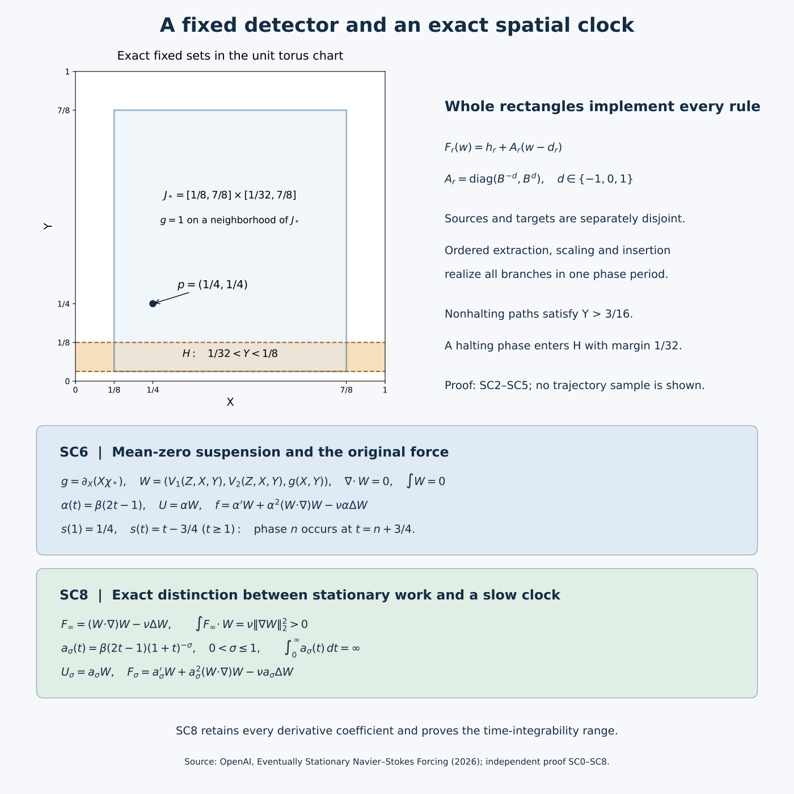

# Exact computation with eventually stationary forcing

*Mathematical exposition by GPT-6 Astra (OpenAI). This editorial exposition is separate from the original text.*

This note proves the construction in OpenAI's [*Universal Computation with Eventually Stationary Navier–Stokes Forcing*](https://github.com/openai/math/blob/adc7f1241b42e322a6451854ab7e4b4c146bf78a/preprints/Universal-Computation-with-Eventually-Stationary-Navier-Stokes-Forcing-September-27-2026/build/main.tex), using its original coordinates, seven instruction rows, rectangles, detector, clock and viscosity. The construction is given in the original author source, main.tex lines 1–1017, and its bibliography.

Fix \(\nu>0\), the flat torus \(\mathbb T^3=\mathbb R^3/\mathbb Z^3\), and
\[
P=(1/4,1/4,0),\qquad
\mathcal O=\{(X,Y,Z):1/32<Y<1/8\}.
\tag{SC0.1}
\]
Given a deterministic Turing machine and finite word, we construct a smooth force, with zero spatial mean, that is stationary for \(t\ge1\). Its zero-data Navier–Stokes solution is global, smooth, bounded in kinetic energy, and unique in the classical class. The material particle from \(P\) enters \(\mathcal O\) if and only if the machine halts. Every mixed force derivative is bounded. A finite program evaluates those derivatives and their bounds when \(\nu\) is computable; the same formulas are effective relative to a name for any other fixed positive \(\nu\).

The equation and pressure convention are
\[
U_t+(U\cdot\nabla)U=-\nabla p+\nu\Delta U+f,
\qquad \nabla\cdot U=0,\quad U(0)=0,\quad\int_{\mathbb T^3}p=0.
\tag{SC0.2}
\]
Here classical means that \(U,U_t,D_xU,D_x^2U,p,\nabla p\) are continuous on every closed finite time cylinder. All fields constructed below are smooth. Exact observation is essential: the result supplies no fixed tolerance for an indefinitely long computation. SC8 also proves two editorial consequences, retaining every coefficient: a family of slower clocks with explicit time integrability, and a strictly positive work requirement for the stationary force. Neither is a claim of novelty.

The [figure generator](eventually-stationary-computation.py) supplies the editable diagram. The coordinate panel shows the exact fixed sets, not a sampled fluid trajectory.

## SC1. Effective smooth functions and the exact fluid receiver

Retain
\[
E(t)=\begin{cases}e^{-1/t},&t>0,\\0,&t\le0,\end{cases}
\qquad \beta(t)=\frac{E(t)}{E(t)+E(1-t)}.
\tag{SC1.1}
\]
If \(E^{(j)}(t)=P_j(1/t)e^{-1/t}\) for \(t>0\), differentiation gives
\[
P_0(y)=1,\qquad P_{j+1}(y)=y^2\big(P_j(y)-P_j'(y)\big).
\tag{SC1.2}
\]
For nonnegative integers \(m,k\), the exponential series implies
\(y^me^{-y}\le(m+k)!y^{-k}\). Thus every derivative tends to zero at the origin, with a computable modulus. For a global derivative bound use \(y^me^{-y}\le m!\) term by term in the finite polynomial. At least one of \(t,1-t\) is at least \(1/2\), so the denominator in SC1.1 is at least \(e^{-2}\). Repeated quotient differentiation gives effective derivative bounds for \(\beta\), including all endpoint derivatives. It is zero on \(( -\infty,0]\), one on \([1,\infty)\), and
\[
\beta(t)+\beta(1-t)=1.
\tag{SC1.3}
\]
Evaluation at a computable real does not require deciding whether that real equals an endpoint: use a rational enclosure and the derivative bounds to control evaluation error; near zero the preceding vanishing estimate controls the entire uncertain contribution.

For \(a<b<c<d\),
\[
\beta\!\left(\frac{t-a}{b-a}\right)
\beta\!\left(\frac{d-t}{d-c}\right)
\tag{SC1.4}
\]
is one on \([b,c]\) and zero off \((a,d)\). Products over coordinates give the required rational-box cutoffs. Finite products and compositions retain explicit computable bounds by Leibniz' rule and the chain rule.

A compactly supported smooth profile \(F_0\) on \((0,1)\), extended by zero, can be periodized effectively without taking the integer part of a computable real. Given \(|q-s|<1\) with rational \(q\), use
\[
F_{\rm per}^{(j)}(s)=
\sum_{k=\lfloor q\rfloor-2}^{\lceil q\rceil+2}F_0^{(j)}(s-k).
\tag{SC1.5}
\]
Every nonzero summand has \(k\in[s-1,s]\), which is contained in the displayed finite range. Coordinate products give the same procedure for compact spatial charts. All floors and ceilings are applied to rationals.

For any explicitly supplied smooth, divergence-free periodic velocity \(U\) vanishing initially, define
\[
\mathcal R_\nu[U]=U_t+(U\cdot\nabla)U-\nu\Delta U.
\tag{SC1.6}
\]
Then \((U,0)\) satisfies SC0.2 by substitution. To prove uniqueness, let \((v,p)\) be another classical solution with the same force and datum and put \(w=v-U\). The exact difference equation is
\[
w_t+(v\cdot\nabla)w+(w\cdot\nabla)U-\nu\Delta w+\nabla p=0.
\tag{SC1.7}
\]
Periodicity and zero divergence remove the integrated transport and pressure terms. Therefore
\[
\frac12\frac d{dt}\|w\|_2^2+\nu\|\nabla w\|_2^2
=-\int_{\mathbb T^3}w\cdot (w\cdot\nabla)U
\le\|\nabla U\|_{\mathrm{op},\infty}\|w\|_2^2.
\tag{SC1.8}
\]
On \([0,T]\) the coefficient is finite. Multiplication by \(\exp(-2\int_0^t\|\nabla U\|_{\mathrm{op},\infty})\) proves \(w=0\). The equation then makes \(\nabla p=0\), and the imposed mean gives \(p=0\). This proves uniqueness for every finite \(T\), hence on the whole half-line. Smooth periodic velocities are bounded and Lipschitz on each such cylinder, so their material ODEs have unique solutions on it and continue through every finite time. Finally
\[
\int\mathcal R_\nu[U]=\frac d{dt}\int U
\tag{SC1.9}
\]
because \((U\cdot\nabla)U_i=\sum_j\partial_j(U_jU_i)\). Thus zero spatial mean of \(U\) gives zero mean of its force. This argument proves the needed comparison directly; it does not invoke a global theorem for arbitrary forcing.

## SC2. The complete finite recorder and its inverse

The original machine has a tape on \(\mathbb Z\), finite alphabet \(\Gamma\), a blank symbol, one head, and moves \(-1,0,1\). The word occupies cells \(0,\ldots,r-1\); the head starts at zero. Redirect missing instructions and halting states to a single halting state \(q_{\rm H}\) with no outgoing rules, completing the table elsewhere. Add \(q_{\rm start}\): it preserves the read symbol and head and enters the old initial state. This finite transformation preserves halting, including immediate halting, while ensuring that the initialized state is nonterminal.

Let \(Q\) be the augmented state set. For each
\(\tau=(q,a)\in\mathcal T=(Q\setminus\{q_{\rm H}\})\times\Gamma\), write the instruction as \((q_\tau^+,a_\tau^+,d_\tau)\). Use exactly
\[
\mathcal L=\{\bot,E\}\sqcup\mathcal T,
\qquad \Sigma=\Gamma\times\{0,1\}\times\mathcal L.
\tag{SC2.1}
\]
The three tracks hold data, a marker, and history. States are \(R_q,C_q,L_q\) for \(q\in Q\) and \(A_\tau,F_\tau\) for \(\tau\in\mathcal T\), distinguished by type and subscript. Only \(R_{q_{\rm H}}\) is the terminal state reached by an initialized computation. Initially the control is \(R_{q_{\rm start}}\), the data and head are the original input, all markers are zero, and history is \(E\) at cell 2 and \(\bot\) elsewhere. The full blank is \((\mathrm{blank},0,\bot)\).

The entire partial table, expanded over all displayed symbol choices, is
\[
\begin{array}{lll}
(R_q,(a,0,\ell))&\mapsto(A_\tau,(a_\tau^+,0,\ell),d_\tau)
&q\ne q_{\rm H},\ \tau=(q,a),\ \ell\ne E,\\
(A_\tau,(a,0,\ell))&\mapsto(F_\tau,(a,1,\ell),1)&\ell\ne E,\\
(F_\tau,(a,0,\ell))&\mapsto(F_\tau,(a,0,\ell),1)&\ell\ne E,\\
(F_\tau,(a,0,E))&\mapsto(C_{q_\tau^+},(a,0,\tau),1),&\\
(C_q,(a,0,\bot))&\mapsto(L_q,(a,0,E),-1),&\\
(L_q,(a,0,\ell))&\mapsto(L_q,(a,0,\ell),-1)&\ell\ne E,\\
(L_q,(a,1,\ell))&\mapsto(R_q,(a,0,\ell),0)&\ell\ne E.
\end{array}
\tag{SC2.2}
\]
At the ready checkpoint after \(n\) augmented steps, the data and head are those of the original computation, \(|h|\le n\), all markers vanish, history cells \(2,\ldots,n+1\) contain the successive instruction tags, cell \(n+2\) contains \(E\), and other history cells contain \(\bot\). This is true for \(n=0\). Row 1 executes the next data instruction and moves to \(h'=h+d_\tau\), where \(h'\le n+1<n+2\). Row 2 marks \(h'\) and starts a rightward scan. Rows 3–4 reach the finite frontier \(n+2\), replace \(E\) by \(\tau\), and move right. Row 5 writes \(E\) at \(n+3\) and turns left. Rows 6–7 find the unique mark, erase it and enter the new ready state at \(h'\). None of the forbidden symbols is read in these steps. The exact number of table transitions is
\[
1+1+(n+1-h')+1+1+(n+2-h')+1
=4+2(n+2-h').
\tag{SC2.3}
\]
The invariant therefore holds at the next checkpoint. Halting of the augmented machine is exactly arrival at \(R_{q_{\rm H}}\); otherwise this finite cycle repeats indefinitely.

The map on all configurations in the table's domain is injective, not only on the initialized run. A destination \(A_\tau\) identifies the old \((q,a)\); the written history letter recovers the remaining old symbol. Into \(F_\tau\), both incoming moves are right, and the written marker distinguishes the arrival from \(A_\tau\) from its scan loop. Into \(C_q\), the right move and written tag identify \(\tau\), while the written data letter recovers the old data letter. Into \(L_q\), both moves are left, and the written history \(E\) distinguishes arrival from \(C_q\) from the loop. Into \(R_q\), only row 7 arrives and its displacement is zero. Thus the destination state fixes the incoming displacement, and that state together with the full written symbol identifies a unique expanded row and its old read symbol. The predecessor head is the new head minus this displacement. Restore the old symbol at that cell and retain every other tape cell. This gives the exact inverse on the image.

## SC3. Original radix coordinates and all branch maps

Let \(K=|\Sigma|\), \(B=2K+2\), and assign distinct odd digits
\(c(a)\in\{1,3,\ldots,2K-1\}\). Keep
\[
C(a_1,a_2,\ldots)=\sum_{k\ge1}c(a_k)B^{-k},
\quad I_a=\frac{c(a)+[0,1]}B,
\quad I_{a,b}=\frac{c(a)+I_b}B.
\tag{SC3.1}
\]
The code lies in \([1/(B-1),(2K-1)/(B-1)]\subset(0,1)\). Distinct first digits have gap at least \(1/B\) between their closed intervals. For a fixed first digit, distinct second digits have gap at least \(1/B^2\); different first digits retain their first-level gap. A code lies in the interior of its own first-symbol interval because its tail lies strictly between zero and one. Recovering that digit and multiplying by \(B\) after subtracting it recovers the tail, proving uniqueness of the sequence code.

For state \(i\), head \(h\), and tape \((a_k)\), use
\[
x=C(a_{h-1},a_{h-2},\ldots),\qquad
y=C(a_h,a_{h+1},\ldots).
\tag{SC3.2}
\]
The initialized codes \(x_0,y_0\) are rational: the finite nonblank prefixes are followed by constant-symbol geometric series. Let \(m\) be the number of compiled states. Count each right or stationary rule once and each left rule \(K\) times, obtaining \(N\ge1\). Set
\[
\lambda=\frac1{100(m+N+1)},\quad a_* =1/4-\lambda x_0,
\quad \Psi_i(x,y)=(a_*+\lambda x,b_i+\lambda y),
\tag{SC3.3}
\]
where
\[
b_i=\begin{cases}
1/4-\lambda y_0,&i=R_{q_{\rm start}},\\
1/16,&i=R_{q_{\rm H}},\\
1/3+\ell/[12(m+1)],&i\text{ is the }\ell\text{th other state}.
\end{cases}
\tag{SC3.4}
\]
The separation of the remaining state heights exceeds \(\lambda\); the initial and terminal squares lie in disjoint lower bands. All nonterminal squares satisfy
\(1/4-\lambda\le Y<1/2\), and the terminal square satisfies
\(1/16\le Y\le1/16+\lambda\). The initial code maps exactly to \((1/4,1/4)\).

For an expanded rule \((i,a)\mapsto(j,b,d)\), retain all three cases:
\[
\begin{array}{c|c|c|c}
d&\text{domain}&(x',y')&\text{image}\\\hline
1 &[0,1]\times I_a&((c(b)+x)/B,\ By-c(a))&I_b\times[0,1]\\
0 &[0,1]\times I_a&(x,\ y+(c(b)-c(a))/B)&[0,1]\times I_b\\
-1&I_e\times I_a&(Bx-c(e),\ c(e)/B+(c(b)+By-c(a))/B^2)
 &[0,1]\times I_{e,b}.
\end{array}
\tag{SC3.5}
\]
The left case is expanded over every \(e\in\Sigma\). A right move prefixes \(b\) to the left stack and removes \(a\) from the right one. A left move removes \(e\) from the left stack and prefixes \(e,b\) to the old right tail. A stationary move replaces only the first right digit. These operations prove every formula in SC3.5 directly from SC3.1; the linear parts are respectively \(\operatorname{diag}(B^{-1},B)\), identity, and \(\operatorname{diag}(B,B^{-1})\). Their determinants are one.

Apply \(\Psi_i\) to the domain and \(\Psi_j\) to its image. Enumerate the resulting actual rectangles as \(D_r,H_r\), with centers \(\mathbf d_r,\mathbf h_r\). The resulting map is exactly
\[
F_r(\mathbf w)=\mathbf h_r+A_r(\mathbf w-\mathbf d_r),
\quad A_r=\operatorname{diag}(\mu_r,\mu_r^{-1}),
\quad\mu_r=B^{-d}.
\tag{SC3.6}
\]
Each side has length at most \(\lambda\). The source rectangles are pairwise disjoint: states separate squares, deterministic read symbols separate digit intervals, and the left branches have separated \(I_e\). Target states determine the common incoming displacement by SC2. Distinct incoming rules have different full written symbols. For displacements 0 and 1, these separate their \(I_b\) factors; for displacement \(-1\), the ordered pairs \((e,b)\) separate \(I_{e,b}\). Thus the targets too are pairwise disjoint. Source and target families may overlap each other; the following construction treats that possibility explicitly.

## SC4. Full Hamiltonian motions and the collision check

For a slot \([s_0,s_1]\), put
\[
\theta(s)=\beta\!\left(\frac{3(s-s_0)}{s_1-s_0}-1\right).
\tag{SC4.1}
\]
It is constant on neighborhoods of both ends. Let \(J\) be the rational swept bounding rectangle of a desired motion, disjoint from all other currently tracked rectangles and from the chart boundary. Let \(\delta\) be one third of its minimum sup-norm distance to these sets. For each coordinate interval \([a,b]\) of \(J\), use
\[
\beta\!\left(\frac{u-a+\delta}{\delta/2}\right)
\beta\!\left(\frac{b+\delta-u}{\delta/2}\right).
\tag{SC4.2}
\]
Their product \(\chi\) is one on the \(\delta/2\) coordinate enlargement of \(J\), zero outside its \(\delta\) enlargement, and zero on neighborhoods of every held rectangle. All clearances are positive rationals. For a potential \(G\), the pulse is
\[
V(s,X,Y)=\theta'(s)
\big(\partial_Y(\chi G),-\partial_X(\chi G)\big).
\tag{SC4.3}
\]
Its divergence is zero by equality of mixed derivatives. Its two component integrals vanish because each is a derivative of a compactly supported function, then periodically extended. It therefore has zero planar mean.

For translation by \(\mathbf u=(u_1,u_2)\), choose \(G=u_1Y-u_2X\). On the active plateau the exact path is \(\mathbf w+\theta(s)\mathbf u\). For reciprocal scaling about \(\boldsymbol\pi\), choose
\[
G=(\log\mu)(X-\pi_1)(Y-\pi_2),\quad
\mathbf w(s)=\boldsymbol\pi+
\operatorname{diag}(\mu^{\theta(s)},\mu^{-\theta(s)})(\mathbf w-\boldsymbol\pi).
\tag{SC4.4}
\]
Differentiation proves both ODE identities, with the signs in SC4.3 unchanged. The paths remain in the one-plateau by the definition of \(J\). ODE uniqueness identifies them with the actual pulse flow. Held rectangles remain fixed because the pulse vanishes near them.

Use the original parking centers
\[
\boldsymbol\pi_r=(1/2+r/[4(N+1)],\ 3/4),\qquad 1\le r\le N,
\tag{SC4.5}
\]
and \(5N\) equal phase slots. First, in decreasing source horizontal-center order, move each source right to its parking column and then vertically to its center. Second, scale each parked rectangle by \(A_r\). Third, in increasing target horizontal-center order, move each parked rectangle vertically to its target height and then left to its target. Break equal centers by branch index. This is exactly \(2N+N+2N\) motions.

Here is the full clearance argument, including unequal rectangles. For a horizontal extraction, any remaining source with overlapping vertical projection has a disjoint horizontal interval. Its center is no larger than the active center; its horizontal interval therefore lies entirely to the left. Equal horizontal centers can occur only with disjoint vertical intervals. Thus no unextracted source intersects the swept box. Already parked boxes lie near \(Y=3/4\), while every source lies below \(1/2\). A vertical extraction stays in one parking column. Columns are separated by \(1/[4(N+1)]>\lambda\), and all state squares lie near \(X=1/4\), to the left of them. It therefore avoids both remaining sources and parked boxes.

During scaling, each coordinate side length varies monotonically between its initial and final lengths, each at most \(\lambda\). The swept box lies in \(\boldsymbol\pi_r+[-\lambda/2,\lambda/2]^2\); it avoids all other columns. In a vertical insertion the same column clearance applies, and all already inserted targets are near \(X=1/4\). For the final leftward move, remaining parked boxes are above all targets. An already inserted target whose vertical interval meets the current target has smaller horizontal center, and its disjoint horizontal interval lies entirely to the left of the current target. The active swept box stops at that target and therefore does not hit the earlier one. These arguments apply to closed rectangles and give strictly positive distances.

All swept boxes are contained in the open unit square; their endpoints are rational, including the bound for reciprocal scaling. Thus SC4.2 applies at every slot. Induction through the ordered motions proves that the period map sends every full \(D_r\) by exactly \(F_r\). All sources have left the state region before target insertion starts, so source–target overlaps create no simultaneous obstacles.

This equality holds on an effective positive neighborhood of each full rectangle. Minimize, over all slots and all tracked rectangles, the active path's clearance from the complement of its one-plateau and the held path's clearance from the pulse support, obtaining a positive computable lower bound \(m_0\). Let \(M_0\ge1\) bound every partial affine product along every branch, including intermediate reciprocal scalings. Such a bound is finite and computable: translations have linear part identity and all scaling parameters lie between their endpoint values. Choose rational
\[
0<\rho<m_0/(2M_0).
\tag{SC4.6}
\]
For an initial perturbation of norm less than \(\rho\), induction through the slots gives displacement from the corresponding tracked path at most \(M_0\rho<m_0/2\). It stays in the same active or held region and follows the same affine formula. This proves neighborhood action even at the rectangle boundaries.

## SC5. Exact observations, global derivative bounds and flow estimates

Join the pulses and repeat them with phase period one. Since every pulse vanishes near its slot endpoints, all derivatives match at joints and at integers. Periodic extension of the compact chart potentials gives a smooth Hamiltonian field \(V(s,X,Y)\), compactly supported in the open square in its planar variables, with zero divergence and mean. All its derivatives have effective uniform bounds. Indeed there are finitely many slots and rational cutoffs; SC1 bounds every cutoff derivative, while the only additional constants, such as \(\log B\), are computable. No branch of the chosen execution is needed to construct these bounds or evaluate the field.

At integer phase times, SC3.5 and induction give the next compiled configuration from the initialized point \((1/4,1/4)\). The sequence code is inside the appropriate branch rectangle, including the left-symbol subdivision. Ready checkpoints recover the augmented machine. The history block begins at absolute cell 2, so the recorded tags and frontier also recover the absolute head from the two head-relative stacks when that information is required.

All tracked paths obey the original bounds
\[
1/4-\lambda\le X\le3/4+\lambda/2,
\qquad 1/16\le Y\le3/4+\lambda/2,
\qquad (X,Y)\in J_*=[1/8,7/8]\times[1/32,7/8].
\tag{SC5.1}
\]
For a branch with nonterminal endpoints, the stronger lower bound is \(Y\ge1/4-\lambda>3/16\). Horizontal moves preserve height; vertical moves interpolate nonterminal heights and the parking height; the scaling occurs at height \(3/4\) with sides at most \(\lambda\). This proves the lower bound throughout the whole period, including intermediate and held times. A nonhalting run therefore never reaches \(H=\{1/32<Y<1/8\}\). If the run halts, an integer-phase point enters the terminal square, whose distance from both boundaries of \(H\) is at least \(1/32\), because \(\lambda<1/32\). This proves the event equivalence at all phase times. The field is globally defined after a halt; no absorbing rule is required for an event that asks whether entry occurs at least once.

Choose an effective \(L\ge1\) bounding both \(\|D_{X,Y}V\|\) and \(\|D^2_{X,Y}V\|\). For the transition map over any phase interval of length \(s\ge0\), its first variational equation and the initial identity matrix give
\[
\|D\Phi_s\|\le e^{Ls}.
\tag{SC5.2}
\]
The second derivative initially vanishes. Its inhomogeneous term is \(D^2V[D\Phi,D\Phi]\), so variation of constants gives
\[
\|D^2\Phi_s\|
\le\int_0^s e^{L(s-r)}L e^{2Lr}\,dr
=e^{2Ls}-e^{Ls}.
\tag{SC5.3}
\]
The inverse transition from initial phase \(s_0\) is the length-\(s\) flow of \(-V(s_0+s-r,\cdot)\), \(0\le r\le s\). It has the same first and second spatial derivative bounds, so SC5.2–SC5.3 apply to the inverse as well. For two lifted trajectories the difference satisfies the Lipschitz integral inequality, hence the distance is at most \(e^{Ls}\) times the initial distance. In particular an initial perturbation less than \(\eta e^{-Ls}\) stays within \(\eta\) up to phase \(s\). This is a finite-time estimate; its radius decreases with the length of computation.

## SC6. The original mean-zero spatial clock and stationary force

Choose an effective cutoff \(\chi_*\), one near the exact \(J_*\) of SC5.1 and compactly supported in the open square. Periodize its compact products. Retain the source's field
\[
g(X,Y)=\partial_X(X\chi_*(X,Y)),\qquad
W(X,Y,Z)=(V_1(Z,X,Y),V_2(Z,X,Y),g(X,Y)).
\tag{SC6.1}
\]
This formula uses the chart coordinate \(X\) only inside its compact product; it therefore defines a smooth periodic function. The planar divergence of \(V\) is zero and \(\partial_Zg=0\), so \(\operatorname{div}W=0\). All component integrals vanish by the derivative representations. On a neighborhood of \(J_*\), \(g=1\). Its mean-zero compensation outside that region does not alter the tracked path.

For each computational phase interval, the path
\[
s\longmapsto\big(\Phi_s^V(1/4,1/4),\ s\bmod1\big)
\tag{SC6.2}
\]
solves the \(W\) equation as long as the corresponding compiled segment is being followed: SC5.1 keeps the planar component where \(g=1\). The periodic smooth field has a global flow; boundedness and the uniform spatial Lipschitz bound prevent finite-time failure of its ODE. Uniqueness identifies SC6.2 with that flow, period by period. For a nonhalting run this holds at every finite phase. For a halting run it holds through terminal entry, which suffices. Thus its event at \(P\) is exactly the machine's halting event.

Now use the fixed ramp and full residual
\[
\alpha(t)=\beta(2t-1),\quad U(t,x)=\alpha(t)W(x),
\tag{SC6.3}
\]
\[
f(t,x)=\alpha'(t)W(x)+\alpha(t)^2(W\cdot\nabla)W(x)
-\nu\alpha(t)\Delta W(x),\qquad p=0.
\tag{SC6.4}
\]
The ramp vanishes for \(t\le1/2\) and is one for \(t\ge1\). Thus the initial data are zero, every mixed force derivative is bounded, and the force is exactly stationary after one. Equation SC1.6 proves the PDE with its original \(\nu\); SC1.9 proves zero mean; SC1.8 proves uniqueness. Its energy satisfies
\[
\frac12\|U(t)\|_2^2=\frac{\alpha(t)^2}{2}\|W\|_2^2
\le\frac12\|W\|_2^2.
\tag{SC6.5}
\]
The material curve is the autonomous \(W\) curve at
\[
s(t)=\int_0^t\alpha(r)\,dr,
\quad s(1)=\frac12\int_0^1\beta(u)\,du=\frac14,
\quad s(t)=t-\frac34\quad(t\ge1).
\tag{SC6.6}
\]
The middle equality uses SC1.3. The clock is continuous, nondecreasing, finite at every finite time and onto \([0,\infty)\). Consequently the event transfers in both directions, with every positive integer phase \(n\) reached at physical time \(n+3/4\). All transitions, rational coordinates, orders, margins, cutoffs and potentials came from the finite table and word. Evaluation of SC6.4 at late time does not require computing the intervening machine run. This completes the eventually stationary theorem with all its stated assertions.

## SC7. Periodic forcing, effective projection and undecidability

For the periodic alternative retain
\[
U_{\mathrm{per}}(t,X,Y,Z)=(V_1(t,X,Y),V_2(t,X,Y),0),
\quad f_{\mathrm{per}}=\partial_tU_{\mathrm{per}}+(U_{\mathrm{per}}\cdot\nabla)U_{\mathrm{per}}-\nu\Delta U_{\mathrm{per}}.
\tag{SC7.1}
\]
Because \(V\) vanishes near integer phases, the initial velocity is zero. Both fields are smooth, mean zero and period one, with bounded mixed derivatives. The solution is exactly \((U_{\mathrm{per}},0)\), unique by SC1.8. Its third particle coordinate remains zero and its first two are precisely the planar processor trajectory. SC5 proves the same fixed event. The bounded spatial and temporal periods also give a uniform kinetic-energy bound.

For either force \(F\), its solenoidal version is \(F-\nabla\phi\), where in the basis \(e^{2\pi i k\cdot x}\)
\[
\widehat\phi(k)=-\frac{i k\cdot\widehat F(k)}{2\pi|k|^2}\ (k\ne0),
\qquad \widehat\phi(0)=0.
\tag{SC7.2}
\]
Then \(\Delta\phi=\operatorname{div}F\) and the multiplier for \(\nabla\phi\) is \(kk^{\mathsf T}/|k|^2\), with norm one. For a spatial multi-index \(\mu\), set \(r=|\mu|\). Integration by parts \(r+5\) times in a coordinate with \(|k_i|\ge|k|/\sqrt3\) gives, retaining the Fourier factors,
\[
|(2\pi i k)^\mu\widehat{\partial_t^h\nabla\phi}(k)|
\le (2\pi)^{-5}3^{(r+5)/2}|k|^{-5}
\max_i\|\partial_t^h\partial_{x_i}^{r+5}F\|_\infty.
\tag{SC7.3}
\]
Group lattice points by \(j=\|k\|_\infty\). There are exactly \((2j+1)^3-(2j-1)^3=24j^2+2\), and \(|k|\ge j\). Hence the total coefficient bound is finite, and the tail after \(\|k\|_\infty\le M\), for integer \(M\ge1\), is bounded by the derivative factor in SC7.3 times
\[
\sum_{j>M}(24j^2+2)j^{-5}
\le 26\sum_{j>M}j^{-3}\le13M^{-2}.
\tag{SC7.4}
\]
This proves absolute convergence of every differentiated series, with effective tails and derivative bounds. Fourier coefficients on the unit cube are evaluated by Riemann sums with the computable first derivative bounds. Thus the force and all derivatives can be evaluated effectively. The zero Fourier mode remains zero. The fixed multiplier commutes with time differentiation and preserves stationarity, periodicity and the weighted temporal estimates proved below, at the explicitly required higher spatial orders. Pressure changes to \(p-\phi\), because
\[
-\nabla(p-\phi)+(F-\nabla\phi)=-\nabla p+F.
\tag{SC7.5}
\]
The velocity and particle event remain exactly unchanged.

Finally, a decision procedure for the fixed event on every constructed force would decide machine halting by first executing the finite compiler. Halting is undecidable: if a total algorithm \(H(e,w)\) correctly decided whether program \(e\) halts on input \(w\), construct a program \(D\) that, on input \(e\), runs forever when \(H(e,e)\) says “halts” and halts when it says “does not halt.” Applied to the code of \(D\) itself, either output contradicts the stipulated correctness of \(H\). This diagonal argument is the classical obstruction, and the proved event equivalence transfers it to the fixed fluid experiment. It is an exact decision result, not a claim about finite precision measurements.

## SC8. Full slow-clock coefficients and necessary stationary work

The original slow clock is
\[
a_1(t)=\frac{\beta(2t-1)}{1+t},\quad
U_1=a_1W,\quad F_1=a_1'W+a_1^2(W\cdot\nabla)W-\nu a_1\Delta W.
\tag{SC8.1}
\]
For \(t\ge1\), \(s_1(t)=s_1(1)+\log((1+t)/2)\), which is onto. The same chain rule as SC6.6 proves the event equivalence. Derivatives of the first two force coefficients decay as \((1+t)^{-2-h}\), and those of the last as \((1+t)^{-1-h}\). The bounded initial interval contributes a finite enlarged constant. Thus every mixed derivative of velocity and force is bounded by \(C_{h,\mu}(1+t)^{-1-h}\), and its spatial supremum belongs to \(L^2_t\). This proves the paper's stated slow-clock proposition for its actual constructed clock.

There is a precise further range with the same construction. For \(0<\sigma\le1\), retain
\[
a_\sigma(t)=\beta(2t-1)(1+t)^{-\sigma},
\quad U_\sigma=a_\sigma W,\quad
F_\sigma=a_\sigma'W+a_\sigma^2C-\nu a_\sigma\Delta W,
\quad C=(W\cdot\nabla)W.
\tag{SC8.2}
\]
With \((b)_0=1\) and \((b)_h=b(b+1)\cdots(b+h-1)\), every term for \(t\ge1\) is exactly
\[
\partial_t^h\partial_x^\mu U_\sigma
=(-1)^h(\sigma)_h(1+t)^{-\sigma-h}\partial_x^\mu W,
\tag{SC8.3}
\]
\[
\begin{aligned}
\partial_t^h\partial_x^\mu F_\sigma
={}&(-1)^{h+1}(\sigma)_{h+1}(1+t)^{-\sigma-h-1}\partial_x^\mu W\\
&+(-1)^h(2\sigma)_h(1+t)^{-2\sigma-h}\partial_x^\mu C\\
&-\nu(-1)^h(\sigma)_h(1+t)^{-\sigma-h}\partial_x^\mu\Delta W.
\end{aligned}
\tag{SC8.4}
\]
These follow by differentiating all three separate coefficient functions; no viscous or nonlinear term is removed. The phase is
\[
s_\sigma(t)=s_\sigma(1)+
\begin{cases}
\big((1+t)^{1-\sigma}-2^{1-\sigma}\big)/(1-\sigma),&0<\sigma<1,\\
\log((1+t)/2),&\sigma=1.
\end{cases}
\tag{SC8.5}
\]
It is unbounded. All finite phases are reached, so SC6's event and uniqueness proof applies to these exact fields. The coefficients and cutoff bounds give
\[
\|\partial_t^h\partial_x^\mu U_\sigma(t)\|_\infty+
\|\partial_t^h\partial_x^\mu F_\sigma(t)\|_\infty
\le C_{h,\mu,\sigma,\nu}(1+t)^{-\sigma-h}.
\tag{SC8.6}
\]
For every \(1\le q<\infty\) with \(q(\sigma+h)>1\), these supremum norms are in \(L^q(0,\infty)\); integrate the displayed power and include the compact initial interval. For \(h=0\), every \(q>1/\sigma\) is therefore available. All derivative orders are in \(L^2_t\) when \(1/2<\sigma\le1\). The projected versions retain these statements by SC7.3–SC7.4. Computable \(\sigma\) gives the same effective construction. This proves a range of integrability claims, not rapid decrease faster than every inverse power; that separate theorem requires another memory construction.

The stationary force also has a necessary nonzero work rate. For \(t\ge1\), write
\[
F_\infty=C-\nu\Delta W.
\]
Periodic integration gives
\[
\int F_\infty\cdot W
=\int (W\cdot\nabla)(|W|^2/2)-\nu\int\Delta W\cdot W
=\nu\|\nabla W\|_2^2>0.
\tag{SC8.7}
\]
Strict positivity follows without a new dynamical assumption: if \(\nabla W=0\), smoothness makes \(W\) constant on the connected torus; zero mean makes it zero, contradicting \(g=1\) near \(J_*\). Also \(\|W\|_2>0\), so
\[
\|F_\infty\|_2\ge
\frac{\nu\|\nabla W\|_2^2}{\|W\|_2}>0.
\tag{SC8.8}
\]
The projected force has the same pairing, since \(\int\nabla\phi\cdot W=0\), so the same lower bound applies. In particular an eventually stationary force of this construction cannot have finite \(L^q_tL^2_x\) norm for any finite \(q\). This exact energy comparison explains why the slow-clock alternatives are distinct forcing constructions.

## Sources, scope and remaining comparison

The proof above covers the original eventually stationary theorem, complete planar processor, periodic alternative, projection and stated slow clock. Its primary locators are the pinned author TeX: analytic tools, lines 191–300; recorder, 302–422; planar processor and full routing, 424–819; spatial clock and main proof, 821–908; periodic and projected forces, 910–937; slow clock and undecidability, 940–1013. No source error was established in this reading. SC8.2–SC8.8 are separate editorial consequences.

The source bibliography credits Alan Turing for undecidability, Rolf Landauer and Charles Bennett for retention of computation history, Cristopher Moore for generalized shifts, and Jean Leray for the classical difference-energy method. Their bibliographic details are retained in the [author bibliography](https://github.com/openai/math/blob/adc7f1241b42e322a6451854ab7e4b4c146bf78a/preprints/Universal-Computation-with-Eventually-Stationary-Navier-Stokes-Forcing-September-27-2026/build/references.bib). This note proves the particular recorder, geometric realization and comparison it uses. Reading that bibliography does not constitute reading or validating all the cited works, nor does this note assert a novelty comparison with them.

The rapidly vanishing-force, velocity-field detection and companion constructions have separate hypotheses and proof dependencies. This note makes no validation claim for those theorems or their Lean developments. Its mathematical scope is the eventually stationary construction and the alternatives and consequences proved in SC1–SC8.
