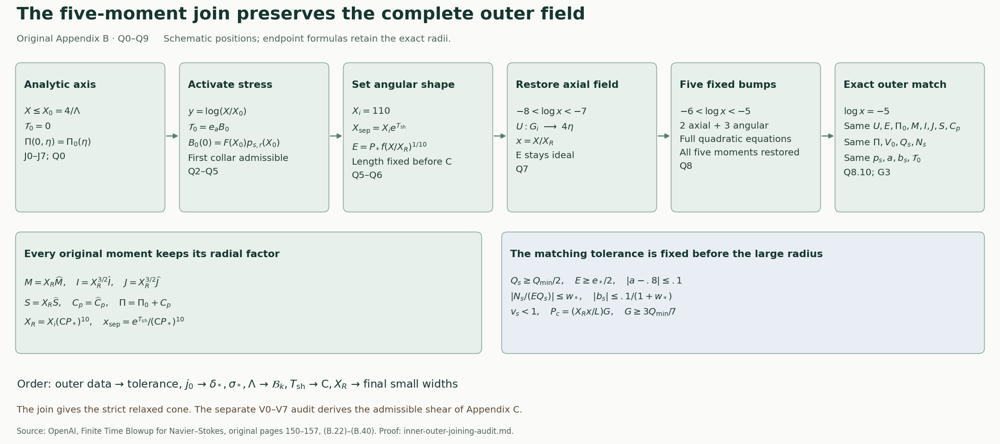

# Joining the analytic axis solution to the outer profile

This note constructs the continuation in original Appendix B, from the axis endpoint through the exact five-moment match. The original pressure datum, radial scale factors, field amplitudes and stress equations are retained. The later shear modification of Appendix C is a separate construction. The complete theorem and its proof dependencies are stated in the [theorem construction](theorem-audit-conclusion.md).

Source: OpenAI, *Finite Time Blowup for Navier–Stokes*, original [PDF, pages 150–157](https://cdn.openai.com/pdf/32d9f210-8b73-45e0-91bc-82a30aef8a9a/navier-stokes.pdf#page=150), SHA256 0e779481c4da40bd28d1e642e1d8ca57447d129610df28dfa5a11e9af8ae228f, equations (B.22)–(B.40). The actual analytic solution is constructed in [J0–J7](analytic-axis-profile-audit.md); the exact stress and moment maps are proved in [G0–G6](profile-stress-moment-audit.md); the outer family and its pressure datum are constructed in [O0–O8](outer-profile-audit.md) and [H0–H7](heat-exterior-stress-audit.md).

The radial positions in this diagram are schematic. Q2–Q6 prove the inner continuation and transition; Q7–Q8 retain every original radial factor and prove exact exterior preservation; Q9 proves the order of choices. The source is Appendix B, (B.22)–(B.40), cited above. The later admissible-shear construction is derived separately in [V0–V7](shear-realization-audit.md). [Reproducible figure source](assets/inner-outer-joining.py) · [Vector figure](assets/inner-outer-joining.svg).

## Q0. Objects, norms and the reference continuation

Retain \(A=1/2+h\), \(D=1/2-h\), \(d=1-\eta^2\), \(L=1-2h\eta^2\), \(0<h<1/100\), and the parameter interval \(-1\le\eta\le1\). Thus \(1-2h\le L\le1\). The prescribed datum is the actual analytic \(\Pi_0\) of O4. Write the J solution as
\[
U_{\rm nat}=U_*+\Lambda^{-1}\mathfrak u(\Lambda X,\eta),
\quad
\phi_{\rm nat}=\phi_*\Phi(\Lambda X,\eta),
\quad E_{\rm nat}=\frac{\sqrt{2X}}{\mathsf C}\phi_{\rm nat},
\quad
\widetilde\zeta_0=\Lambda\zeta_*,
\quad \zeta_*=-\frac{LH_*}{H_*^2+\sigma_*^2}.
\tag{Q0.1}
\]
Here \(U_*=4\eta+j_0\), \(H_*=D\eta+dU_*\), and \(W_*,Z_*,\chi\) are exactly J0.1–J0.4. The original unaccented \(\zeta_*\) and accented \(\widetilde\zeta_0\) follow (B.3). For each fixed integer \(k\), \(\|\cdot\|_k\) is the maximum of parameter derivatives through order \(k\), uniformly on the indicated radial interval. A bound uniform in \(\mathsf C\) is asserted only for \(\mathsf C\ge\mathsf C_0(\Lambda)\). Constants allowed to depend on the already fixed \(\Lambda\) will be indicated by \(K_k(\Lambda)\); they do not depend on subsequent cutoff widths.

Use exactly
\[
X_0=4/\Lambda,\qquad X_b^{\rm loc}=100,\qquad X_i=110,
\qquad y=\log(X/X_0),\qquad 4e^{2\bar t}<4.1.
\tag{Q0.2}
\]
The superscript distinguishes this local radius 100, called \(X_b\) in Appendix B, from the exterior stress endpoint of Appendix A. No radius has been changed. Increase \(\Lambda\) if necessary so \(X_0<100\). Fix a positive \(\bar t\) satisfying Q0.2. With the original smooth step
\[
\sigma(s)=\frac{e^{-1/s^2}}{e^{-1/s^2}+e^{-1/(1-s)^2}}\quad(0<s<1),
\qquad \sigma(s)=0\ (s\le0),\quad \sigma(s)=1\ (s\ge1),
\tag{Q0.3}
\]
choose \(0<t_1\le\bar t\). Let \((U_{\rm r},\phi_{\rm r})\) equal the analytic solution for \(y\le t_1\); on \(t_1<y<2t_1\) define
\[
\partial_yU_{\rm r}=[1-\sigma((y-t_1)/t_1)]\mathcal D_XU_{\rm nat},
\qquad
\partial_y\log\phi_{\rm r}=[1-\sigma((y-t_1)/t_1)]\mathcal D_X\log\phi_{\rm nat}.
\tag{Q0.4}
\]
Integrate from \(y=t_1\), then keep both functions constant for \(y\ge2t_1\). Positivity of \(\phi_{\rm r}\) follows by exponentiation. Flatness of the step at its endpoints makes the fields smooth at both joins. Set \(E_{\rm r}=\sqrt{2X}\phi_{\rm r}/\mathsf C\). Define \(\Pi_{\rm r},Q_{s,\rm r},N_{s,\rm r}\) by the original forward pressure and stress integrals G1.3 and G2.1, with the same \(\Pi_0\).

The J estimates give, for every fixed \(k\),
\[
\|U_{\rm r}-U_*\|_k\le K_k/\Lambda,\quad
\|\log\phi_{\rm r}-\log\phi_*\|_k\le K_k,\quad
\|\Pi_{\rm r}-\Pi_0\|_k\le K_k(\Lambda)\mathsf C^{-2}
\quad(0\le X\le X_i).
\tag{Q0.5}
\]
For the first two bounds integrate Q0.4 over length at most \(\bar t\): the integrands and all parameter derivatives are bounded respectively by \(K_k/\Lambda\) and \(K_k\), since \(4\le\Lambda X\le4.1\) there. Before that interval J4.4 applies, and after it the fields are constant. The radial average is exactly \(\mathcal A_Xf=\int_0^1f(aX,\eta)\,da\), a contraction in every such norm, so the first bound holds also for \(\mathcal A_XU_{\rm r}-U_*\). Finally,
\[
\Pi_{\rm r}(X,\eta)-\Pi_0(\eta)
=\mathsf C^{-2}\int_0^X\phi_{\rm r}(v,\eta)^2\,dv.
\tag{Q0.6}
\]
The factor \(\sqrt{2X}\) in E is essential to this identity. Product differentiation and Q0.5 bound this integral through every fixed parameter order, including at zero. Exponentiation and reciprocal differentiation show that \(\mathsf C E_{\rm r}\) and \((\mathsf C E_{\rm r})^{-1}\) have bounded \(k\)-norms on \([X_0,X_i]\), with positive lower bounds there, uniformly in \(\mathsf C,t_1\). All these statements use parameter derivatives; high radial cutoff derivatives need not be bounded as \(t_1\) decreases.

## Q1. The reference source and strict shear comparison

The weighted gradient bounds used in J5 remain valid through the cutoff. To check this directly, put \(q(Y,\eta)=\log\Phi(Y,\eta)\). Differentiating the center \(\log f_0(Y\chi)\) and using \(|H_*\chi'|\le2\|H_*'\|_\infty\chi\), together with J4.4 and positivity, gives
\[
|Yq_Y|+|H_*q_\eta|+|H_*\partial_\eta(Yq_Y)|
\le K\chi+K/\Lambda,\qquad 0\le Y\le4.1.
\tag{Q1.1}
\]
All denominators are bounded below by J4.5. In Q0.4 the cutoff has no parameter dependence. Integrating its parameter derivative, and using the last term of Q1.1 on the interval of length at most \(\bar t\), proves
\[
|\mathcal D_X\log\phi_{\rm r}|
+|H_*\partial_\eta(\log\phi_{\rm r}-\log\phi_*)|
\le K\chi+K/\Lambda.
\tag{Q1.2}
\]
The unweighted derivative of \(\log\phi_{\rm r}-\log\phi_*\) is also bounded by Q0.5. Since \(H_{c,\rm r}-H_*=d(U_{\rm r}-U_*)\), Q0.5 and \(|\zeta_*|\le L\sigma_*^{-1}\sqrt\chi\) give
\[
-H_{c,\rm r}(\log\phi_{\rm r})_\eta
\ge \Lambda L\chi-K\chi-K_{\sigma_*}\sqrt\chi-K/\Lambda.
\tag{Q1.3}
\]
Furthermore \(W_{\rm r}-W_*=O(\Lambda^{-1})\), by the actual radial-average formula, and \(|U_{\rm r}|\le4.1\) for large \(\Lambda\). In the exact source
\[
S_{q,\rm r}=-W_{\rm r}l_{\rm r}-h(1-2\eta U_{\rm r})
-H_{c,\rm r}(\log\phi_{\rm r})_\eta,\qquad
l_{\rm r}=1+\mathcal D_X\log\phi_{\rm r},
\]
Q1.2 therefore bounds the change caused by \(l_{\rm r}-1\) by \(K\chi+K/\Lambda\). Hence
\[
S_{q,\rm r}\ge\Lambda L\chi-W_*-10h-K\chi-K_{\sigma_*}\sqrt\chi-K/\Lambda
\ge .94\Lambda L\chi+2.4.
\tag{Q1.4}
\]
For the last inequality choose \(\Lambda\) so \(K\chi\le.03\Lambda L\chi\), and use
\(K_{\sigma_*}\sqrt\chi\le.03\Lambda L\chi+
K_{\sigma_*}^2/(.12\Lambda(1-2h))\).
Then enlarge \(\Lambda\) so the remaining \(1/\Lambda\) terms are smaller than .3. The original bounds \(-W_*>2.8\) and \(10h\le.1\) supply the constant 2.4, with strict spare room by making the last error smaller. No division by \(\chi\) occurs. This estimate is uniform over a fixed small reference-width family.

On the natural interval, J5.7–J5.8 give \(\mathcal D_X\log\phi_{\rm nat}=-p_1/2<0\). Multiplication by the nonnegative cutoff and then setting the slope to zero proves \(l_{\rm r}\le1\).

For the axial source, retain every term of G1.1. Q0.5, \(\mathcal D_XU_{\rm r}=O(\Lambda^{-1})\), and Q0.6 yield
\[
\|S_{n,\rm r}-Z_*\|_k\le K_k/\Lambda+K_k(\Lambda)\mathsf C^{-2}.
\tag{Q1.5}
\]
The two pressure derivatives are included: \(\Pi_{\rm r}-\Pi_0\) is Q0.6 and \(\mathcal D_X\Pi_{\rm r}=E_{\rm r}^2/2\). Choose \(\Lambda\), then \(\mathsf C\), so the right side for \(k=0\), after division by L, is below \(\delta_*/4\). On \(\chi\le.99\), \(|Z_*|>\delta_*\) by J0.4. The equation and its exact solution are
\[
\partial_y n_{s,\rm r}+n_{s,\rm r}=S_{n,\rm r}/L,\qquad
n_{s,\rm r}(y)=e^{-y}n_{s,\rm r}(0)+
\int_0^y e^{-(y-v)}\,\frac{S_{n,\rm r}(v)}L\,dv.
\tag{Q1.6}
\]
The analytic initial value differs from \(Z_*/L\) by \(O(\Lambda^{-1})\). Both terms in this convex average have the sign of \(Z_*\) and absolute value at least \(\delta_*/2\), after the same choice. Therefore \(|n_{s,\rm r}|\ge\delta_*/2\) on that parameter region throughout the continuation.

The positive stress integral gives \(p_{1,\rm r}>0\), and its equation is
\[
\partial_y p_{1,\rm r}=\frac{XS_{q,\rm r}}L-l_{\rm r}p_{1,\rm r}.
\tag{Q1.7}
\]
Using \(l_{\rm r}\le1\), Q1.4 and \(X=X_0e^y\) in the integrating-factor inequality gives both exact lower comparisons
\[
\begin{split}
p_{1,\rm r}(y)&\ge p_{1,\rm r}(0)e^{-y}
+1.88\chi(e^y-e^{-y}),\\
p_{1,\rm r}(X)&\ge p_{1,\rm r}(X_0)\frac{X_0}X
+1.2\left(X-\frac{X_0^2}X\right).
\end{split}
\tag{Q1.8}
\]
The coefficient 1.88 is \(.94\Lambda X_0/2\); the coefficient 1.2 uses \(L\le1\) and \(2.4/2\). On \(\chi>.99\), J6 gives \(p_{1,\rm r}(0)>2.3\). Replacing it by 2.3 in the first comparison gives
\(1.88\chi e^y+(2.3-1.88\chi)e^{-y}\), whose derivative is positive for \(y\ge0\), because \(1.88\chi>2.3/2\). Thus \(p_{1,\rm r}>2.3\) there. The second comparison is greater than 3 for \(100\le X\le110\), since \(X_0\le4\) and \(1.2(100-16/100)>3\).

The reference pressure and field bounds, or their exact moment formulas, also give a finite upper bound \(M_0(\Lambda)\) for \(p_{1,\rm r}\), independently of subsequent \(\mathsf C,t_1\). Let \(E_{\max}(\Lambda)\) bound \(\mathsf C E_{\rm r}\). On \(\chi\le.99\),
\[
\frac{p_{2,\rm r}^2}{p_{1,\rm r}}
=\frac{X^2 n_{s,\rm r}^2}{E_{\rm r}^2p_{1,\rm r}}
\ge
\frac{\mathsf C^2X_0^2\delta_*^2}
{4E_{\max}(\Lambda)^2M_0(\Lambda)}.
\tag{Q1.9}
\]
Increase \(\mathsf C\) so this is at least \(5/2\). On the other region \(p_{1,\rm r}>2.3\). Consequently
\[
v_{\rm r}:=p_{1,\rm r}+\frac{p_{2,\rm r}^2}{p_{1,\rm r}}>2+.2
\quad\hbox{on }[X_0,X_i]\times[-1,1].
\tag{Q1.10}
\]
Each fixed parameter derivative of \(p_{1,\rm r},n_{s,\rm r}\) is uniformly bounded: the moment formulas G2.5 use Q0.5–Q0.6, one additional parameter derivative, positive denominators and integrals on a fixed interval. For \(Q_{s,\rm r}\), its common amplitude factor cancels exactly between numerator and denominator. For \(N_{s,\rm r}\), Q1.5–Q1.6 apply. The lower comparison in Q1.8 is uniform and positive. Once a finite \(\mathsf C\) is fixed these bounds therefore give a finite \(V_{\max}\) bounding \(v_{\rm r}\) for every sufficiently small \(t_1\), before any one width is selected. This proves the full reference statement of Lemma B.4.

## Q2. Activation and the stress cone without an inverse cutoff loss

Fix a sufficiently large finite \(\mathsf C\) as above. All constants in this section may depend on it and on \(\Lambda\), but are uniform as \(t_1\) and \(0<\kappa_0<1/2\) decrease. On \(0<y<t_1\), prescribe
\[
e_a=(1-\kappa_0)\sigma(y/t_1),\quad \kappa=1-e_a,\quad
a=\kappa p_{1,\rm r},\quad
\mathcal D_XU=-\frac{\kappa Xn_{s,\rm r}}2,\quad
\partial_y\log\phi=-\frac{\kappa p_{1,\rm r}}2.
\tag{Q2.1}
\]
Integrate from the actual axis values at \(y=0\); leave the analytic solution unchanged for \(X\le X_0\). Define \(E=\sqrt{2X}\phi/\mathsf C\), and compute pressure and stresses by forward integration with the same \(\Pi_0\).

On this entire first interval the reference is the natural solution. Its zero leading stress gives the exact differences
\[
\partial_y(\log\phi-\log\phi_{\rm r})=\frac{e_ap_{1,\rm r}}2,\qquad
\partial_y(U-U_{\rm r})=\frac{e_aXn_{s,\rm r}}2.
\tag{Q2.2}
\]
The step is increasing, so \(\int_0^ye_a(v)\,dv\le ye_a(y)\). Parameter differentiation commutes with these integrals and never differentiates the cutoff. Thus the field differences and \(\log\phi-\log\phi_{\rm r}\) are \(O_k(ye_a)\). Exponentiating gives \(E_{\rm r}/E=1+O_k(ye_a)\). On this compact annulus the moment integrands are smooth functions of the fields; their differences vanish before \(X_0\). Their integrals obey the same bound, also with one additional parameter derivative. G3.3–G3.6 consequently prove
\[
p_s-p_{s,\rm r}=O_k(ye_a),\qquad E_{\rm r}/E=1+O_k(ye_a).
\tag{Q2.3}
\]
These are estimates on values and parameter derivatives, not bounds on radial cutoff derivatives.

Since \(p_{2,\rm r}=Xn_{s,\rm r}/E_{\rm r}\), the actual shear is exactly
\(\mathfrak s=\kappa(p_{1,\rm r},p_{2,\rm r}E_{\rm r}/E)\).
Divide its two components before estimating: because \(\kappa>0\),
\[
t_s=-b_s/a=\frac{p_{2,\rm r}}{p_{1,\rm r}}\frac{E_{\rm r}}E,\quad
v_s=\kappa v_{\rm r}+O(ye_a),\quad
P_c=v_{\rm r}+O(ye_a),\quad J_c=O(ye_a).
\tag{Q2.4}
\]
The bounded reciprocal of \(p_{1,\rm r}\) follows from Q1.8. Every error constant is independent of \(\kappa_0^{-1}\): the common \(\kappa\) cancels exactly in \(t_s\), while \(0<\kappa\le1\) multiplies the remaining error in \(v_s\).

Choose one constant \(K\) bounding the four errors, and use \(v_{\rm r}>2+.2\), \(v_{\rm r}\le V_{\max}\). Taking \(t_1\) small enough yields positive constants \(c_1,c_2\), independent of its final smaller value, with
\[
P_c-v_s\ge c_1e_a,\quad P_c>2+c_2,\quad
\frac{(v_s-2)_+J_c^2}{(P_c-v_s)^2}
\le\frac{(V_{\max}+1)K^2}{c_1^2}y^2<2.
\tag{Q2.5}
\]
For example require the error in the first difference to be at most \(e_a\), the error in \(P_c\) to be at most .1, and the final displayed upper bound to be less than 2. These are finitely many width bounds on already fixed constants. G6.1–G6.2 prove the admissible cone where \(v_s>2\); where \(v_s\le2\), the fact that \(\mathcal U(P_c,J_c)>2\) proves the strict relaxed condition. Continuity from \(v_s(0,\eta)=v_{\rm r}(0,\eta)>2+.2\), uniformly on the compact parameter interval, supplies a positive first collar with \(v_s>2+.1\).

## Q3. Flat stress factor and limiting direction at the inner edge

For \(y\ge0\) near zero write, exactly,
\[
e_a(y)=e^{-t_1^2/y^2}g_a(y),\qquad
g_a(y)=\frac{1-\kappa_0}
{e^{-t_1^2/y^2}+e^{-1/(1-y/t_1)^2}},\qquad
g_a(0)=(1-\kappa_0)e>0.
\tag{Q3.1}
\]
The exponential extends smoothly by zero at zero, so \(g_a\) is smooth and positive on a closed small collar. For a nonnegative integer \(m\) and a smooth \(b\), the substitution in H6.1–H6.2, now with \(c=t_1^2\), gives the full formula
\[
\begin{split}
\frac1{e_a(y)}\int_0^y e_a(v)v^m b(v,\eta)\,dv
={}&\frac{y^{m+3}}{2g_a(y)}
\int_0^\infty e^{-t_1^2w}(1+y^2w)^{-(m+3)/2}\\
&\qquad\cdot
g_a\!\left(\frac{y}{\sqrt{1+y^2w}}\right)
b\!\left(\frac{y}{\sqrt{1+y^2w}},\eta\right)\,dw .
\end{split}
\tag{Q3.2}
\]
Every fixed mixed derivative of the integral is dominated by \(e^{-t_1^2w}\) times a polynomial in \(w\); the chosen \(t_1>0\) is fixed here. Hence the right side is \(y^{m+3}\) times a smooth function through zero. This retains the integration factor \(1/2\), rather than only recording a vanishing order.

Apply \(m=0\) to Q2.2. Field and logarithmic differences belong to \(e_ay^3C^\infty\). Products and smooth compositions preserve this class: write, for instance,
\(\exp(e_ay^3b)-1=e_ay^3b\int_0^1\exp(se_ay^3b)\,ds\).
Reciprocals are handled by \((f+g)^{-1}-f^{-1}=-g/[f(f+g)]\), where the fields have nonzero denominators. Each moment and pressure difference is one further forward integral of such a difference, with smooth radial weights \(dX=X_0e^y\,dy\) and \(1/X\) on this collar. Applying Q3.2 with \(m=3\) gives \(e_ay^6C^\infty\).

Substituting these exact classes in G3.4 gives \(p_s-p_{s,\rm r}\in e_ay^3C^\infty\). The shear formula in Q2.4 then proves
\[
\mathcal T_0=F(p_s-\mathfrak s)=e_a B_0(y,\eta),\qquad
B_0\in C^\infty,\qquad
B_0(0,\eta)=F(X_0,\eta)p_{s,\rm r}(X_0,\eta)\ne0.
\tag{Q3.3}
\]
Here \(F=\phi/\mathsf C\) is positive, \(p_{1,\rm r}>0\), and no division by a vanishing field was used. At the endpoint \(t_s=p_{2,\rm r}/p_{1,\rm r}\), so exactly
\[
B_0\cdot(-t_s,1)=0,\qquad
B_0\cdot(1,t_s)=F(X_0,\eta)v_{\rm r}(X_0,\eta)>0.
\tag{Q3.4}
\]
It follows that \(2[B_0\cdot(1,t_s)]^2-(v_s-2)[B_0\cdot(-t_s,1)]^2\) has a positive minimum at the endpoint. Smoothness and compactness preserve that minimum, and \(|B_0|>0\), on a smaller collar. Thus \(B_0/|B_0|\) is the smooth limiting unit stress direction.

Differentiating Q3.1 any fixed number of times introduces only finitely many inverse powers of \(y\). Since \(X_0>0\), \(\partial_X=X^{-1}\partial_y\) has smooth bounded coefficients here. For every fixed radial/parameter multi-index \(I\),
\[
|\mathcal T_0|\ge c e^{-t_1^2/y^2},\qquad
|\partial^I\mathcal T_0|\le C_Ie^{-t_1^2/y^2}y^{-N_I}.
\tag{Q3.5}
\]
The upper bounds tend to zero to every order. The stress therefore extends smoothly by zero to \(X\le X_0\), while its direction extends by Q3.4. This proves the full inner endpoint assertions (B.30)–(B.31).

## Q4. Continuation with small shear to the radius 110

After \(y=t_1\), keep Q2.1 with \(\kappa=\kappa_0\) up to \(X=100\). These are explicit integrals of the already constructed reference coefficients, so they define smooth \(U,\log\phi\) and positive E. On the reference cutoff, the reference logarithmic slopes are bounded independently of its width; their integrals over length \(t_1\) are \(O_k(t_1)\). After that cutoff both reference fields are constant. Integrating the actual slopes over the fixed remaining interval gives \(O_k(\kappa_0)\). Together with Q2.2 this proves
\[
\|U-U_{\rm r}\|_k+\|\log\phi-\log\phi_{\rm r}\|_k
+\|p_s-p_{s,\rm r}\|_k
\le K_k(\mathsf C,\Lambda)(t_1+\kappa_0)
\quad(X_0\le X\le100).
\tag{Q4.1}
\]
For the last term use the exact five moment differences and G3.4 with one extra parameter derivative. Positivity and a lower bound for E follow first from the bound on the logarithm. No radial derivative of a narrow cutoff is used in this comparison.

The same common-\(\kappa\) cancellation as in Q2.4 gives
\[
P_c=v_{\rm r}+O(t_1+\kappa_0),\qquad
v_s=\kappa_0v_{\rm r}+O(t_1+\kappa_0)
\quad(t_1\le y\le\log(100/X_0)).
\tag{Q4.2}
\]
Choose \(\kappa_0\) so \(\kappa_0V_{\max}<1/4\), \(\kappa_0\sup p_{1,\rm r}<.8\), and all the errors contributed by \(\kappa_0\) in Q4.2 are below \(\min(.05,1/8)\). Then choose \(t_1>0\) so its errors satisfy the same bounds as well as Q2.5. This gives \(P_c>2+.1\) and \(v_s<1\) after the first activation interval. Since \(\mathcal U(P_c,J_c)>2\), the strict relaxed condition holds irrespective of the size of \(J_c\). The entire reference family, rather than a previously selected member, supplied the constants, so there is no circular dependence on the choice of \(t_1\).

At \(X=100\) multiply the axial prescription by a smooth \(\beta\) decreasing from 1 to 0 on a short logarithmic interval; keep \(a=\kappa_0p_{1,\rm r}\) there. The reference coefficients have been defined up to 110. For final transition lengths with sum \(\omega_{\rm fin}\), integration gives the same comparisons as Q4.1, with an additional \(K_k\omega_{\rm fin}\). On the axial cutoff,
\[
t_s=\beta\frac{p_{2,\rm r}}{p_{1,\rm r}}\frac{E_{\rm r}}E,\qquad
P_c=p_{1,\rm r}+\beta\frac{p_{2,\rm r}^2}{p_{1,\rm r}}
+O(t_1+\kappa_0+\omega_{\rm fin}).
\tag{Q4.3}
\]
Since \(p_{1,\rm r}>3\), \(0\le\beta\le1\), and \(\kappa_0V_{\max}<1/4\), decreasing the chosen parameters makes \(P_c>2\) and \(v_s<1\) on this cutoff. At its end \(\mathcal D_XU=0\). On the next short interval interpolate \(a\) from \(\kappa_0p_{1,\rm r}\) to .8 by
\(a=(1-\theta)\kappa_0p_{1,\rm r}+.8\theta\), where \(\theta\) is a flat-ended smooth step. Keep \(\mathcal D_XU=0\). Then \(0<a\le.8\), \(b_s=0\), \(v_s=a<1\). G3.4 and the short-interval comparison with the value at 100 give \(P_c=p_1>2\) throughout. Both transitions fit strictly before 110 by requiring \(\omega_{\rm fin}<\log(110/100)\).

After the second transition keep \(a=.8\), \(l=.6\), and \(U\) constant in X. The parameter derivative of \(\log\phi\) is then constant in X. At its start it equals
\[
(\log\phi)_\eta=\Lambda\zeta_*+
(\log\Phi(4,\eta))_\eta+r_\eta(\eta),\qquad
\|r_\eta\|_k\le K_k(\Lambda)(t_1+\kappa_0+\omega_{\rm fin}).
\tag{Q4.4}
\]
To prove the stated independence from \(\mathsf C\), differentiate the integrated slopes in Q2.1 and the two final cutoffs. The only varying parameter coefficients are derivatives of \(p_{1,\rm r}\), whose bounds in Q1 are uniform in \(\mathsf C\). The constant .8 has zero parameter derivative. For U the corresponding coefficients are \(n_{s,\rm r}\), also uniformly bounded. Thus \(U-U_*=O_k(\Lambda^{-1})+O_k(\Lambda)(t_1+\kappa_0+\omega_{\rm fin})\) throughout the construction, including its radial average.

As in Q1.3, after increasing \(\Lambda\) as an axis parameter and then decreasing the final widths, the gradient term is bounded below by
\[
-H_c(\log\phi)_\eta
\ge\Lambda L\chi-K\chi-K_{\sigma_*}\sqrt\chi-K/\Lambda
-K(\Lambda)(t_1+\kappa_0+\omega_{\rm fin})\ge-.1.
\tag{Q4.5}
\]
The fixed-\(\Lambda\) coefficient of the last error includes multiplication by \(\Lambda\zeta_*\); it is finite and is made small by the later choices. One can simultaneously ensure \(-W\ge2.75\) and \(|U|\le4.1\). The original source then satisfies
\[
S_q=-.6W-h(1-2\eta U)-H_c(\log\phi)_\eta
\ge .6(2.75)-.1-.1>1.
\tag{Q4.6}
\]
Starting from \(p_1>2\), a first downward crossing of 2 on this interval would have
\(\partial_y p_1=XS_q/L-.6p_1>X-1.2>0\).
At a first crossing from above its left derivative must be nonpositive, a contradiction. Consequently \(p_1>2\) through \(X_i=110\). This completes the actual continuation of Proposition B.5, including positivity, the inner admissible collar, the later strict relaxed cone and the specified final slopes.

## Q5. One analytic collar and amplitude-independent endpoint bounds

Choose \(0<t_c<t_1\) inside the admissible collar of Q2–Q3, with \(4e^{t_c}<4.1\). The J solution has a joint complex neighborhood of its compact radial/parameter rectangle; shrink the parameter neighborhood once so that \(\Phi\) has no zeros and L has no zeros. In the first collar the reference is the natural solution. Its \(p_{1,\rm r},n_{s,\rm r}\) and all their radial derivatives are holomorphic in that same smaller parameter neighborhood, using either J5.7 or the original forward integrals. Q2.1 then integrates holomorphic coefficients multiplied by radial-only cutoffs. Its exponential for \(\phi\) is nonzero. Differentiating these formulas radially changes cutoff derivatives but neither introduces a new parameter singularity nor changes the parameter domain.

The exact expressions
\[
\frac E{\sqrt{2X}}=\frac{\phi}{\mathsf C},\qquad
\frac{V_0}X=\frac{2\eta U-2D\eta\mathcal A_XU-d\partial_\eta\mathcal A_XU}{L},
\qquad
\Pi=\Pi_0+\mathsf C^{-2}\int_0^X\phi(v,\eta)^2\,dv
\tag{Q5.1}
\]
are therefore smooth in \((X,\eta)\) through \(X=0\) and holomorphic in \(\eta\) on a common neighborhood for \(0\le X\le X_0e^{t_c}\). Each fixed radial derivative has finite bounds on a smaller common neighborhood. Subsequent modifications will lie strictly to its right. Since all the integrals in Q5.1 are forward integrals, later modifications leave this rectangle unchanged. The size of \(t_c\) and the radial derivative bounds need not be uniform as the final amplitude grows or the transition widths decrease. This proves precisely Corollary B.6.

For the endpoint quantities
\[
\ell_i(\eta)=\log(\mathsf C E(X_i,\eta)),\qquad
G_i(\eta)=U(X_i,\eta),\qquad L_0=\log(X_i/X_0),
\tag{Q5.2}
\]
let \(M_k,N_k\) be the uniform bounds for \(p_{1,\rm r},n_{s,\rm r}\) from Q1. Before the final interpolation, \(a=\kappa p_{1,\rm r}\); during it a is a convex combination of \(\kappa_0p_{1,\rm r}\) and .8; afterwards it is .8. Thus \(\|a\|_k\le M_k+.8\). Integrating \(\partial_y\log\phi=-a/2\) gives the explicit finite bound
\[
\|\ell_i\|_k\le
\tfrac12|\log(2X_i)|+
\sup_{\mathsf C\ge\mathsf C_0(\Lambda)}
\|\log\phi_*+\log\Phi(4,\cdot)\|_k
+\tfrac12(M_k+.8)L_0=:\mathcal B_k.
\tag{Q5.3}
\]
The supremum is finite by J4.4 and positivity. It depends on \(\Lambda\) and the prior axis data, but not on subsequent \(\mathsf C\) or smaller widths.

For U, the first activation contributes at most \(X_0e^{\bar t}N_kt_1/2\) to its endpoint \(k\)-norm. On the remainder, including its final cutoff, the integrand has magnitude at most \(\kappa_0X|n_{s,\rm r}|/2\); using \(dX=X\,dy\) bounds its integral by \(\kappa_0X_iN_k/2\). It is zero after the axial cutoff. Therefore
\[
\|G_i-U_*\|_k
\le\frac{C_k^{\rm nat}}{\Lambda}
+\frac{N_k}{2}(X_0e^{\bar t}t_1+X_i\kappa_0)
\le\frac{C_k^{\rm nat}}{\Lambda}
+C_k^{\rm join}(\Lambda)(t_1+\kappa_0+\omega_{\rm fin}).
\tag{Q5.4}
\]
The natural constant is independent of large \(\Lambda,\mathsf C\) by J4.4, after the axis shape data have been fixed. The joining constant is independent of subsequent \(\mathsf C\) and widths. No inverse cutoff width occurs because only integrated cutoff values, not radial derivatives, were used. This proves Lemma B.7 with its full stated uniformity.

## Q6. Transition length chosen before the amplitude

Keep \(f(\eta)=(1+\eta^2)^{-1}\). Choose a positive finite \(T_{\rm sh}\) satisfying
\[
T_{\rm sh}\ge20\|\sigma'\|_\infty
(\mathcal B_0+\|\log f\|_\infty).
\tag{Q6.1}
\]
The right side is already fixed before the final amplitude. For \(y_i=\log(X/X_i)\ge0\), prescribe
\[
\log E=-\log\mathsf C+\frac{y_i}{10}
+[1-\sigma(y_i/T_{\rm sh})]\ell_i
+\sigma(y_i/T_{\rm sh})\log f,\qquad U=G_i.
\tag{Q6.2}
\]
At \(X_i\) this matches the existing constant slopes to every radial order; the step is flat at zero. E is positive by construction. Its exact slope is
\[
l=\frac35+\frac{\sigma'(y_i/T_{\rm sh})}{T_{\rm sh}}
(\log f-\ell_i)\in[.55,.65],
\quad a=2-2l\in[.7,.9],\quad b_s=0.
\tag{Q6.3}
\]
Q5.3 supplies the stated interval without any growth of \(T_{\rm sh}\) with \(\mathsf C\).

The angular source remains positive on this potentially long interval. Q4.4 and J5.2 imply
\[
-H_c\ell_i'\ge\Lambda L\chi-K\chi-K_{\sigma_*}\sqrt\chi
-K/\Lambda-o(1),
\tag{Q6.4}
\]
where \(o(1)\) is bounded by a fixed-\(\Lambda\) constant times \(t_1+\kappa_0+\omega_{\rm fin}\). The full radial history of U stays close to \(U_*\), so this also bounds \(W-W_*\) through its actual radial average. The other endpoint gradient has the exact expression
\[
-H_c(\log f)'=\frac{2\eta H_c}{1+\eta^2}
\ge-\frac{j_0^2}{2D}-\|G_i-U_*\|_0.
\tag{Q6.5}
\]
Indeed \(\eta H_*=(D+4d)\eta^2+dj_0\eta
\ge D\eta^2-j_0|\eta|\ge-j_0^2/(4D)\), and
\(2|\eta|d/(1+\eta^2)\le1\). This verifies the bound at both parameter endpoints as well as near the zero of \(H_*\).

Young's inequality as in Q1 makes the right side of Q6.4 at least \(-.1\) for large \(\Lambda\) and the later small widths. Q6.5 is at least \(-.1\) for \(j_0\le.05\), large \(\Lambda\) and the same sufficiently small widths. Since the cutoff in Q6.2 is independent of \(\eta\), its parameter gradient is the convex combination of these two gradients. Also \(-W\ge2.75\) and \(|U|\le4.1\) persist. Hence the exact source satisfies
\[
S_q=-Wl-h(1-2\eta U)-H_c(\log E)_\eta
\ge2.75(.55)-.1-.1>1.
\tag{Q6.6}
\]
At a putative first downward crossing \(p_1=2\), the original equation gives
\(\partial_{y_i}p_1=XS_q/L-lp_1>X-1.3>0\), impossible for \(X\ge110\). Thus \(p_1>2\), \(v_s=a\le.9<2\), and \(P_c=p_1>2\): the strict relaxed cone persists.

At \(X_{\rm sep}=X_ie^{T_{\rm sh}}\) the field becomes exactly
\[
E=\mathsf C^{-1}f(X/X_i)^{1/10}
=P_*f(X/X_R)^{1/10},\qquad
X_R=X_i(\mathsf C P_*)^{10},\qquad U=G_i.
\tag{Q6.7}
\]
The equality retains the amplitude and every power. The step is flat at its upper endpoint, so the match is smooth. Before axial restoration the same source bound and crossing argument continue to apply to this constant-slope interval. The endpoint \(X_{\rm sep}\) is fixed before \(\mathsf C\), whereas \(X_R\) grows with it; this is the scale separation required for the moment estimates below.

## Q7. All five moment errors with their original scale factors

Introduce \(x=X/X_R\) only with the exact comparison
\[
\begin{gathered}
M=X_R\widehat M,\quad I=X_R^{3/2}\widehat I,\quad
J=X_R^{3/2}\widehat J,\quad S=X_R\widehat S,\quad C_p=\widehat C_p,\\
\widehat H(x,\eta)=\sqrt{2x}\,E(X_Rx,\eta),\qquad
H(X_Rx,\eta)=\sqrt{X_R}\widehat H(x,\eta),\\
\widehat C_p(x,\eta)=\int_0^x\frac{E(X_Rv,\eta)^2}{2v}\,dv,\qquad
\Pi(X_Rx,\eta)=\Pi_0(\eta)+\widehat C_p(x,\eta).
\end{gathered}
\tag{Q7.1}
\]
The other hatted moments are the integrals in \(dv\) of \(U,\widehat H,U\widehat H,U^2-E^2/2\), evaluated at \(X_Rv\). Changing variables in the original moments proves every factor in Q7.1. Substitution in G2.5 gives the exact original functions at \(X_Rx\):
\[
\begin{split}
W&=1-\frac{2D\eta\widehat M+d\widehat M_\eta}{x},\\
Q_s&=-W+
\frac{(1-h)\widehat I-D\eta\widehat I_\eta-d\widehat J_\eta
+2(h-D)\eta\widehat J}{x\widehat H},\\
N_s&=-WU+
\frac{D(\widehat M-\eta\widehat M_\eta)+4h\eta\widehat S-d\widehat S_\eta}{x}
+4A\eta\Pi-d\Pi_\eta.
\end{split}
\tag{Q7.2}
\]
These formulas remove \(X_R\) from the coefficient map, but not from the physical moments or from \(p_s=(X_Rx/L)(Q_s,N_s/E)\). Those factors remain in use.

The short inner portion ends at
\[
x_{\rm sep}=\frac{X_{\rm sep}}{X_R}
=\frac{e^{T_{\rm sh}}}{(\mathsf C P_*)^{10}}.
\tag{Q7.3}
\]
Q0, Q5 and Q6 bound U and \(\mathsf C E\) on \(0\le X\le X_{\rm sep}\) in each fixed parameter norm, independently of later large \(\mathsf C\) and the allowed smaller widths. Near zero \(\mathsf C E=\sqrt{2X}\phi_{\rm nat}\). Therefore at \(x=x_{\rm sep}\),
\[
\|\widehat M\|_k+\|\widehat S\|_k\le K_k(\Lambda)x_{\rm sep},\qquad
\|\widehat I\|_k+\|\widehat J\|_k
\le K_k(\Lambda)\mathsf C^{-1}x_{\rm sep}^{3/2},\qquad
\|\widehat C_p\|_k\le K_k(\Lambda)\mathsf C^{-2}.
\tag{Q7.4}
\]
For the first bounds use the bounded U and \(E=O(\mathsf C^{-1})\) in the exact integrands. For I and J integrate the retained factor \(\sqrt{2x}\) against this E bound. For pressure, change back to X: on \([0,X_0]\) its integrand is \(\mathsf C^{-2}\phi_{\rm nat}^2\); on \([X_0,X_{\rm sep}]\) it is bounded by \(K_k(\Lambda)\mathsf C^{-2}/X\), whose integral is finite because \(X_0>0\) and \(X_{\rm sep}\) is fixed. Product differentiation supplies the same estimates through every chosen finite order. No singular \(1/x\) majorant was integrated to zero.

The ideal inner part of the actual outer family has \(U_0=4\eta\), \(E_0=P_*fx^{1/10}\). Its exact moments are
\[
\begin{split}
\widehat M_0&=4\eta x,&
\widehat I_0&=\frac{5\sqrt2}{8}P_*fx^{8/5},&
\widehat J_0&=4\eta\widehat I_0,\\
\widehat S_0&=16\eta^2x-\frac5{12}P_*^2f^2x^{6/5},&
\widehat C_{p,0}&=\frac52P_*^2f^2x^{1/5}.
\end{split}
\tag{Q7.5}
\]
In particular, at the endpoint,
\(\widehat C_{p,0}(x_{\rm sep})=(5/2)f^2e^{T_{\rm sh}/5}\mathsf C^{-2}\).
Every term of Q7.5, with every fixed parameter derivative, tends to zero there as \(\mathsf C\) grows. Q7.4–Q7.5 consequently make the actual differences of all five hatted moments as small as any preassigned positive tolerance, uniformly over the later width choices. Through Q7.1 this is a proved statement about the original moments, not their replacement by different objects.

After \(x_{\rm sep}\), E is exactly \(E_0\). Put \(g(\eta)=G_i-4\eta\). Choose \(\mathsf C\) so \(x_{\rm sep}<e^{-8}\), and on \(-8<\log x<-7\) restore the axial field by
\[
U=4\eta+\rho(x)g,\qquad
\rho(x)=1-\sigma(\log x+8).
\tag{Q7.6}
\]
Take \(\rho=1\) before that interval and \(\rho=0\) after it. The error integrands after \(x_{\rm sep}\), before any angular bumps, are exactly
\[
\Delta U=\rho g,\quad \Delta\widehat H=0,\quad
\Delta(U\widehat H)=\sqrt2P_*fx^{3/5}\rho g,\quad
\Delta(U^2-E^2/2)=8\eta\rho g+\rho^2g^2,\quad
\Delta(E^2/(2x))=0.
\tag{Q7.7}
\]
Their weights \(1,x^{3/5}\) are integrable at zero. Integrating to \(e^{-5}\), and differentiating in \(\eta\), bounds the five moment discrepancies by
\[
K_k^{\rm out}\|g\|_{k+1}+o_{\mathsf C}(1)
\tag{Q7.8}
\]
provided \(\|g\|_{k+1}\le1\); the extra derivative is retained for Q7.2. Here \(K_k^{\rm out}\) depends only on the fixed outer data and the fixed restoration cutoff. The error \(o_{\mathsf C}(1)\) is the sum of the explicit bounds in Q7.4–Q7.5, with fixed axis data. On \([e^{-8},e^{-5}]\), the same bound controls the fields, their logarithmic radial derivatives and the input moment histories. This follows by differentiating the fixed \(\rho\) in Q7.6; its derivative norms do not involve the small activation widths.

## Q8. A fixed cone tolerance and the exact five-bump solution

Let \(\mathcal R=[e^{-8},e^{-5}]\times[-1,1]\). The ideal functions \(E_0>0\) and \(Q_{s,0}>1\) have positive minima there by O5.2; \(N_{s,0}\) is bounded by Q7.2 with Q7.5 and the fixed \(\Pi_0\). Define the actual finite constants
\[
Q_{\min}=\min_{\mathcal R}Q_{s,0}>0,\qquad
e_*=\min_{\mathcal R}E_0>0,\qquad
w_*=1+\max_{\mathcal R}\left|\frac{N_{s,0}}{E_0Q_{s,0}}\right|.
\tag{Q8.1}
\]
The reference shear is \(a=.8,b_s=0\). Apply the explicit difference and reciprocal formulas G3.3–G3.5 to Q7.2 on the fixed rectangle. They give finite Lipschitz constants for \(Q_s,N_s\) in a prescribed \(C_\eta^k\) norm, using one additional parameter derivative of the field and moment inputs. The same product and reciprocal formulas applied to
\(a=1-2xE_x/E\), \(b_s=2xU_x/E\) control the shears from the fields and their first logarithmic radial derivatives. A sufficiently small positive input tolerance, depending only on these fixed outer data, therefore ensures
\[
Q_s\ge Q_{\min}/2,\quad E\ge e_*/2,\quad |a-.8|\le.1,\quad
\left|\frac{N_s}{EQ_s}\right|\le w_*,
\qquad |b_s|\le\frac{.1}{1+w_*}.
\tag{Q8.2}
\]
The numerator in the last bound is the original decimal .1 in (B.36), page 156.

The original cone coordinates then obey
\[
\begin{split}
v_s=a+\frac{b_s^2}{a}&\le.9+\frac{.01}{.7}<1,\\
G:=Q_s-\frac{b_sN_s}{aE}
&\ge\left(1-\frac{.1w_*}{.7(1+w_*)}\right)Q_s
\ge\frac67Q_s\ge\frac{3Q_{\min}}7,\\
P_c&=\frac{X_Rx}{L}G.
\end{split}
\tag{Q8.3}
\]
Thus \(X_R>14e^8/(3Q_{\min})\) makes \(P_c>2\) throughout \(\mathcal R\), since \(L\le1\). This proves the strict relaxed cone without making the tolerance shrink with \(X_R\).

For an actual moment correction, set \(a_0=e^{-6}\), \(b_0=e^{-5}\), \(c_j=a_0+j(b_0-a_0)/6\) for \(j=1,\ldots,5\), and \(\omega=(b_0-a_0)/20\). Use the explicit fixed positive bumps
\[
\beta_j(x)=
\begin{cases}
\exp[-1/(1-((x-c_j)/\omega)^2)],&|x-c_j|<\omega,\\
0,&|x-c_j|\ge\omega.
\end{cases}
\tag{Q8.4}
\]
Their supports are ordered, disjoint and strictly inside \((e^{-6},e^{-5})\). Put \(u=c_1^{\,\rm amp}(\eta)\beta_1+c_2^{\,\rm amp}(\eta)\beta_2\) and
\(e=\sum_{j=3}^5c_j^{\,\rm amp}(\eta)\beta_j\).
Here the superscript distinguishes the five coefficient functions from the fixed centers. The unperturbed fields on this patch already equal \(U_0=4\eta,E_0=P_*fx^{1/10}\). Replace them by \(U_0+u,E_0+e\).

The increments of the original five moments, over this whole patch, are exactly
\[
\begin{split}
\delta M&=X_R\int u\,dx,&
\delta I&=\sqrt2X_R^{3/2}\int\sqrt x\,e\,dx,\\
\delta J&=\sqrt2X_R^{3/2}\int\sqrt x\,(4\eta e+E_0u+ue)\,dx,\\
\delta S&=X_R\int(8\eta u+u^2-E_0e-e^2/2)\,dx,&
\delta C_p&=\int(E_0e/x+e^2/(2x))\,dx.
\end{split}
\tag{Q8.5}
\]
Let \(\Delta\mathbf m\) denote the original moment discrepancy accumulated before these bumps. Apply the exact invertible row map
\[
\mathscr L_\eta(\delta\mathbf m)=
\left(
\frac{\delta M}{X_R},
\frac{\delta J-4\eta\delta I}{\sqrt2X_R^{3/2}P_*f},
\frac{\delta I}{\sqrt2X_R^{3/2}},
-\frac{\delta S-8\eta\delta M}{X_RP_*f},
\frac{\delta C_p}{P_*f}
\right).
\tag{Q8.6}
\]
Its inverse is G5.3 with \(\rho=X_R,u_c=4\eta,e_*=P_*,f_*=f\). Thus solving for target \(d_{\rm tar}=-\mathscr L_\eta(\Delta\mathbf m)\) is exactly equivalent to cancelling all original moments.

The transformed linear coefficient matrix has the two actual blocks
\[
B_U=
\begin{pmatrix}\int\beta_1&\int\beta_2\\
\int x^{3/5}\beta_1&\int x^{3/5}\beta_2\end{pmatrix},
\qquad
(B_E)_{ij}=\int x^{\alpha_i}\beta_{j+2}(x)\,dx,
\quad(\alpha_1,\alpha_2,\alpha_3)=(1/2,1/10,-9/10).
\tag{Q8.7}
\]
G4 proves invertibility for these ordered nonnegative bumps and distinct powers. The factors \(P_*f\) in Q8.6 are positive and their parameter derivatives and inverses are bounded by the outer data. The exact nonlinear part, with no dropped term, is
\[
\mathscr Q_\eta(c,c)=
\left(0,\frac{\int\sqrt x\,ue\,dx}{P_*f},0,
\frac{-\int u^2\,dx+\frac12\int e^2\,dx}{P_*f},
\frac{\int e^2/(2x)\,dx}{P_*f}\right).
\tag{Q8.8}
\]
For \(m=k+1\), let \(\nu_m\) be the operator norm of \(B^{-1}\) and \(q_m\) the bilinear norm of this quadratic map in \(C_\eta^m\), including the finite product-rule factors. Both are finite and independent of \(X_R,\mathsf C\). For
\[
8\nu_m^2q_m\|d_{\rm tar}\|_m\le1,
\qquad
c_{n+1}=B^{-1}\bigl(d_{\rm tar}-\mathscr Q_\eta(c_n,c_n)\bigr),\quad c_0=0,
\tag{Q8.9}
\]
the estimates G5.6–G5.7 show that the iteration stays in the radius \(2\nu_m\|d_{\rm tar}\|_m\) ball and contracts by at most \(1/2\). It therefore converges to an actual solution of all five equations, with that norm bound. G5.8 supplies an invertible derivative in c and proves that this solution is smooth in \(\eta\), with finite derivatives of every fixed higher order. Only the selected finite norm must be small.

The same coefficient bound controls u, e, their first logarithmic radial derivatives and their partial moment integrals throughout the patch: each is a fixed finite sum or integral of the fixed bumps, with finite coefficient norms. Let \(K_{\rm patch}\) be the maximum of these finitely many operator bounds and their product-rule constants on the chosen small coefficient ball. Shrink the fixed discrepancy tolerance so that
\(2K_{\rm patch}\nu_m\|d_{\rm tar}\|_m\)
is below half the input tolerance of Q8.2, and so that Q8.9 holds. Require the preexisting error in Q7.8 to be below the other half. Both requirements involve only fixed outer-data constants. They guarantee Q8.2 throughout the restoration and every partial moment correction, not merely at its final endpoint.

At the right endpoint the five moment differences vanish identically as functions of \(\eta\). The bumps have compact interior supports, so the fields already agree with the ideal fields on a neighborhood of that endpoint. Continue with the actual outer family of O and H. The same \(\Pi_0\), the vanishing five moments, and G3.1–G3.4 prove exact equality thereafter of
\[
\Pi,\ V_0,\ Q_s,\ N_s,\ p_s,\ a,\ b_s,\ \mathcal T_0
\tag{Q8.10}
\]
with their actual outer-profile values, including all their derivatives. In particular the heat exterior, exact zero outer stress, smooth terminal direction and all total-moment conditions survive. This completes Proposition B.8 by an actual nonlinear moment solve.

## Q9. Compatible choices and the precise completed component

Fix in advance the finite parameter derivative orders needed for the inequalities and finite moment solve, including the additional derivative in Q7.2. Keep the outer shape choices \(M_d,T_d,P_*,\lambda,h\) of O and H. Their constructed family has the same analytic \(\Pi_0\) for every sufficiently large \(X_R\); the heat compensation has zero pressure increment and preserves that datum.

First fix the restoration and bump functions Q7.6 and Q8.4. The compact ideal rectangle in Q8.1 then fixes the positive cone and moment-solve tolerances independently of \(X_R\). Choose \(j_0>0\), at most .05, so the contribution of the constant \(U_*-4\eta=j_0\) to Q7.8 is smaller than a chosen fraction of that tolerance. Then choose \(\delta_*,\sigma_*\) as in J0, and \(\Lambda\) large enough for J, Q1, the gradient absorptions, and \(C_k^{\rm nat}/\Lambda\) in Q5.4 to satisfy their finite inequalities. These constants are determined after \(j_0\), so small \(\sigma_*\) causes no circular choice.

The uniform reference bounds and Q5.3 now fix all required \(\mathcal B_k\), hence a positive \(T_{\rm sh}\) and \(X_{\rm sep}\), before the amplitude. Choose a finite \(\mathsf C\) large enough for the analytic construction, Q1.5 and Q1.9, and for all the following:
\[
X_R=X_i(\mathsf C P_*)^{10}>
\max\left(X_R^{\rm outer},\,\frac{14e^8}{3Q_{\min}}\right),
\quad x_{\rm sep}<e^{-8},
\quad\hbox{the finite Q7.4–Q7.5 moment errors are below the fixed tolerance.}
\tag{Q9.1}
\]
Here \(X_R^{\rm outer}\) is the finite threshold already obtained for the actual O–H family. The quantities required to decay in Q9.1 are explicit positive powers of \(\mathsf C^{-1}\), with constants fixed before \(\mathsf C\), so such a finite choice exists. The initial-segment bounds hold uniformly over the allowed subsequent width family by Q5.3–Q5.4; selecting smaller widths does not undo Q9.1.

With this fixed \(\mathsf C,\Lambda\), choose \(\kappa_0\), then \(t_1\), then the finite final transition widths as in Q2 and Q4. Make their additional contribution in Q5.4, Q4.4 and Q7.8 as small as the remaining fractions of the fixed tolerances require. Positivity and the reference comparisons hold for the entire smaller-width family, so decreasing a width preserves the earlier estimates. The strict inequalities before the matching patch use finite constants that may depend on \(\mathsf C,\Lambda\); their widths are chosen after those constants. The matching tolerance uses only the fixed outer data and therefore does not conflict with this order. Finally solve Q8.9. Higher derivatives exist by smoothness and the finite-dimensional inverse argument, without infinitely many simultaneous smallness requirements.

This realizes the original order (B.40):
\[
M_d,T_d,P_*,\lambda,h
\ \longrightarrow\ \hbox{fixed matching tolerance},j_0
\ \longrightarrow\ \delta_*,\sigma_*,\Lambda
\ \longrightarrow\ (\mathcal B_k),T_{\rm sh}
\ \longrightarrow\ \mathsf C,X_R
\ \longrightarrow\ \kappa_0,t_1,\hbox{final widths}.
\tag{Q9.2}
\]
The radial frequency for the later shear modification has not yet been chosen.

The constructed profile is smooth through the Cartesian axis by J4 and unchanged on its reserved analytic rectangle. E is positive for \(X>0\). The leading stress is zero through \(X_0\), has the exact inner flat factor and smooth nonzero limiting direction of Q3, and satisfies the admissible cone on a positive inner collar. It satisfies the strict relaxed cone thereafter through the matching point \(\log(X/X_R)=-5\). All five original radial moments, the pressure and all exterior fields match exactly there, so the already established outer-profile and heat-exterior properties remain true. The stress is nonzero between its two endpoints: throughout a strict relaxed region \(v_s<\mathcal U(P_c,J_c)\le P_c\), so its parallel component is \(F(P_c-v_s)>0\); the inner and outer collars have their proved positive direction bounds. These statements establish Lemma B.4, Proposition B.5, Corollary B.6, Lemma B.7, Proposition B.8 and Corollary B.10, with the parameter ordering of Remark B.9.

The construction does not yet enforce \(v_s>2\) throughout the intervening annulus: it intentionally contains portions with \(v_s<1\). The actual Appendix C modification is derived in [V0–V7](shear-realization-audit.md), preserving these exact moments and protected collars and proving all six parts of the leading-profile Theorem 4.6. The positive-order base and both stress entries are constructed in [Z0–Z8](base-field-realization-audit.md). The complete theorem and its proof dependencies are stated in the [theorem construction](theorem-audit-conclusion.md).

## Q10. Exact endpoint coefficients and the disjoint-support correction

### The divided flat integral

Put \(c=t_1^2>0\). For every fixed nonnegative integer \(m\) and smooth \(b\), Q3.2 writes
\[
\frac{\int_0^y e_a(v)v^m b(v,\eta)\,dv}{e_a(y)y^{m+3}}
=\frac1{2g_a(y)}\int_0^\infty e^{-cw}(1+y^2w)^{-(m+3)/2}
g_a\!\left(\frac y{\sqrt{1+y^2w}}\right)
b\!\left(\frac y{\sqrt{1+y^2w}},\eta\right)\,dw.
\tag{Q10.1}
\]
For each fixed mixed derivative, the integrand is bounded by \(e^{-cw}\) times a polynomial in \(w\), on a sufficiently small closed collar. This is integrable because the chosen \(c\) is positive. Differentiation under the integral proves a smooth extension to zero. Since \(g_a(0)>0\) and \(\int_0^\infty e^{-cw}\,dw=1/c\), its endpoint value is exactly
\[
\left.\frac{\int_0^y e_a(v)v^m b(v,\eta)\,dv}
{e_a(y)y^{m+3}}\right|_{y=0}
=\frac{b(0,\eta)}{2t_1^2}.
\tag{Q10.2}
\]
The quotient notation at zero denotes this proved smooth extension.

Write \(p_e=p_{1,\rm r}(X_0,\eta)\) and \(n_e=n_{s,\rm r}(X_0,\eta)\). In the first activation interval the reference is the natural axis solution. Applying Q10.2 with \(m=0\) to the two exact integrals Q2.2 gives
\[
\begin{split}
\log\phi-\log\phi_{\rm r}&=e_a y^3 A_\phi(y,\eta),
&A_\phi(0,\eta)&=\frac{p_e}{4t_1^2},\\
U-U_{\rm r}&=e_a y^3 A_U(y,\eta),
&A_U(0,\eta)&=\frac{X_0n_e}{4t_1^2}.
\end{split}\tag{Q10.3}
\]
Both coefficients are smooth through zero, including all fixed mixed derivatives. The original \(X_0\) comes from \(X=X_0e^y\) in the axial integrand. The angular coefficient is strictly positive because \(p_e>0\). These formulas retain the width dependence rather than claiming uniform radial bounds as \(t_1\) shrinks.

### All five original moment coefficients

All moment differences vanish before \(X_0\). At the endpoint set
\[
U_e=U_{\rm r}(X_0,\eta),\quad E_e=E_{\rm r}(X_0,\eta),\quad
H_e=\sqrt{2X_0}\,E_e=\frac{2X_0\phi_{\rm r}(X_0,\eta)}{\mathsf C}.
\tag{Q10.4}
\]
Each quantity is the actual endpoint value, not its leading approximation at the axis. For fixed \(X\), \(E/E_{\rm r}=H/H_{\rm r}=\exp(\log\phi-\log\phi_{\rm r})\). Q10.3 and the exact integral formula for the exponential give
\[
\left.\frac{\Delta E}{e_a y^3}\right|_0
=\frac{E_ep_e}{4c},\qquad
\left.\frac{\Delta H}{e_a y^3}\right|_0
=\frac{H_ep_e}{4c},\qquad c=t_1^2.
\tag{Q10.5}
\]
Products of two field differences have zero coefficient at this order. Thus the endpoint coefficients of the original moment integrands are
\[
\begin{array}{c|c}
\text{integrand difference}&
\left.\text{integrand difference}/(e_a y^3)\right|_0\\ \hline
\Delta U&X_0n_e/(4c)\\
\Delta H&H_ep_e/(4c)\\
\Delta(UH)&H_e(U_ep_e+X_0n_e)/(4c)\\
\Delta(U^2-E^2/2)&(2U_eX_0n_e-E_e^2p_e)/(4c)
\end{array}
\tag{Q10.6}
\]
The first four moments use \(dX=X_0e^y\,dy\), so their coefficients acquire another factor \(X_0/(2c)\) under the integration rule Q10.2 with \(m=3\). For the fifth moment,
\[
\Delta C_p
=\int_0^y\frac{E(v,\eta)^2-E_{\rm r}(v,\eta)^2}{2}\,dv.
\]
Here \(dX/X=dy\); there is no additional \(X_0\) factor. The coefficient of its integrand divided by \(e_a y^3\) is \(E_e^2p_e/(4c)\). We therefore obtain the full vector
\[
\left.
\frac{(\Delta M,\Delta I,\Delta J,\Delta S,\Delta C_p)}{e_a y^6}
\right|_0
=\frac1{8t_1^4}
\begin{pmatrix}
X_0^2n_e\\
X_0H_ep_e\\
X_0H_e(U_ep_e+X_0n_e)\\
X_0(2U_eX_0n_e-E_e^2p_e)\\
E_e^2p_e
\end{pmatrix}^{\!T}.
\tag{Q10.7}
\]
The displayed row and column notation specifies the same five ordered components. Every quotient has a smooth extension: its integrand lies in \(e_a y^3C^\infty\), and Q10.1 proves the next integration step in all fixed derivatives. The common datum \(\Pi_0\) gives \(\Delta\Pi=\Delta C_p\). In particular,
\[
\Delta\Pi=e_a y^6 B_\Pi(y,\eta),\qquad
B_\Pi(0,\eta)=\frac{E_e^2p_e}{8t_1^4}>0.
\tag{Q10.8}
\]
This positive difference is local to the first activation collar. The later five-bump correction cancels the complete accumulated pressure moment at the matching point; no intermediate equality of pressure was assumed.

### The complete original scale comparison

With all preceding shape data fixed, put
\[
\alpha=X_iP_*^{10},\qquad d_{\rm sep}=e^{T_{\rm sh}}P_*^{-10}.
\]
These are the exact constants in
\[
X_R=\alpha\mathsf C^{10},\qquad
x_{\rm sep}=d_{\rm sep}\mathsf C^{-10},\qquad
X_Rx_{\rm sep}=X_ie^{T_{\rm sh}}.
\tag{Q10.9}
\]
Let \(\Delta\widehat{\mathbf m}\) compare the actual and ideal moments at this endpoint. Q7.4 gives orders \(\mathsf C^{-10}\) for \(\widehat M,\widehat S\), \(\mathsf C^{-16}\) for \(\widehat I,\widehat J\), and \(\mathsf C^{-2}\) for \(\widehat C_p\). For the ideal moments Q7.5 gives the same orders, with the angular term of \(\widehat S_0\) carrying the still smaller factor \(\mathsf C^{-12}\). In particular its pressure term is exactly
\[
\widehat C_{p,0}(x_{\rm sep})
=\frac52 f^2 e^{T_{\rm sh}/5}\mathsf C^{-2}.
\tag{Q10.10}
\]
Triangle inequalities and the finite product-rule sums prove, in every selected parameter norm, finite bounds
\[
\begin{split}
\|\Delta\widehat M\|_k+\|\Delta\widehat S\|_k&\le K_{MS,k}\mathsf C^{-10},\\
\|\Delta\widehat I\|_k+\|\Delta\widehat J\|_k&\le K_{IJ,k}\mathsf C^{-16},\\
\|\Delta\widehat C_p\|_k&\le K_{p,k}\mathsf C^{-2}.
\end{split}\tag{Q10.11}
\]
The constants retain the fixed \(d_{\rm sep},P_*,f,X_i\), the original inner-profile bounds and all their required derivatives. They are independent of subsequent amplitude and smaller transition widths. For a desired total error \(\varepsilon>0\), the finite choice
\[
\mathsf C\ge
\max\left\{
1,\left(\frac{3K_{MS,k}}\varepsilon\right)^{1/10},
\left(\frac{3K_{IJ,k}}\varepsilon\right)^{1/16},
\left(\frac{3K_{p,k}}\varepsilon\right)^{1/2}
\right\}
\tag{Q10.12}
\]
makes the sum of the five displayed norms at most \(\varepsilon\). Take the maximum with the other finite thresholds in Q9.1.

Restoring the original quantities by Q7.1 gives
\[
\begin{split}
\|\Delta M\|_k+\|\Delta S\|_k&\le\alpha K_{MS,k},\\
\|\Delta I\|_k+\|\Delta J\|_k&\le\alpha^{3/2}K_{IJ,k}\mathsf C^{-1},\\
\|\Delta C_p\|_k&\le K_{p,k}\mathsf C^{-2}.
\end{split}\tag{Q10.13}
\]
The argument therefore does not claim that the unscaled \(M,S\) discrepancies tend to zero. The exact invertible row map Q8.6 uses their retained \(X_R\) factors and converts the proved small quantities into the actual five-equation target. Its inverse then cancels the original discrepancies exactly. The remaining axial restoration error is controlled separately by \(G_i-4\eta\), with the order of choices in Q9.

### An exact triangular correction solve

Use the fixed bumps Q8.4 and write their coefficient vectors as
\[
\mathbf a=(a_1,a_2),\qquad \mathbf b=(b_1,b_2,b_3),\qquad
u=a_1\beta_1+a_2\beta_2,\quad e=\sum_{j=1}^3b_j\beta_{j+2}.
\]
All five supports are disjoint. Consequently \(ue=0\) pointwise, and there are no cross terms in either square. Set
\[
A_i=\int\beta_i^2\,dx,\qquad
B_j=\int\beta_{j+2}^2\,dx,\qquad
D_j=\int x^{-1}\beta_{j+2}^2\,dx.
\tag{Q10.14}
\]
These constants are finite and positive, since the fixed supports lie inside \((e^{-6},e^{-5})\). The full quadratic remainder Q8.8 becomes exactly
\[
\left(0,0,0,
\frac{-\sum_{i=1}^2A_i a_i^2+\frac12\sum_{j=1}^3B_j b_j^2}{P_*f},
\frac{\sum_{j=1}^3D_j b_j^2}{2P_*f}\right).
\tag{Q10.15}
\]
For the original transformed target \(d=(d_1,\ldots,d_5)=-\mathscr L_\eta(\Delta\mathbf m)\), the first two equations therefore give
\[
\mathbf a=B_U^{-1}(d_1,d_2)^T
\tag{Q10.16}
\]
exactly. Define
\[
\mathbf r=\left(d_3,\ d_4+\frac{\sum_iA_i a_i^2}{P_*f},\ d_5\right)^T,\qquad
q_E(\mathbf b,\mathbf b)=
\left(0,\frac{\sum_jB_jb_j^2}{2P_*f},
\frac{\sum_jD_jb_j^2}{2P_*f}\right)^T.
\tag{Q10.17}
\]
The remaining three equations are precisely \(B_E\mathbf b+q_E(\mathbf b,\mathbf b)=\mathbf r\). No original moment or quadratic term has been discarded.

For a selected \(C_\eta^m\) norm, let \(\nu_U,\nu_E\) be the norms of the two actual inverse matrices, let \(q_E^*\) bound the displayed bilinear map, and let \(\gamma_m\) bound \(\mathbf a\mapsto\sum_iA_i a_i^2/(P_*f)\) by \(\gamma_m\|\mathbf a\|_m^2\). The product rule and the fixed positive \(P_*f\) make these constants finite and independent of \(X_R,\mathsf C\). Fix the target tolerance \(\varepsilon\) small enough that
\[
\gamma_m\nu_U^2\varepsilon\le1,\qquad
16\nu_E^2q_E^*\varepsilon\le1.
\tag{Q10.18}
\]
Q7–Q9 achieve this fixed tolerance, together with the earlier cone tolerance, by their already proved finite choices. Then \(\|\mathbf a\|_m\le\nu_U\varepsilon\) and \(\|\mathbf r\|_m\le2\varepsilon\). On the radius \(2\nu_E\|\mathbf r\|_m\) ball, the iteration
\[
\mathbf b_{n+1}=B_E^{-1}\bigl(\mathbf r-q_E(\mathbf b_n,\mathbf b_n)\bigr),
\qquad\mathbf b_0=0
\tag{Q10.19}
\]
stays in that ball and has Lipschitz constant at most
\(4\nu_E^2q_E^*\|\mathbf r\|_m\le1/2\). Indeed its quadratic contribution to the radius is at most half the linear radius, by the same inequality. The complete-space contraction argument supplies the actual angular coefficients. They obey \(\|\mathbf b\|_m\le4\nu_E\varepsilon\); decreasing the fixed tolerance also meets the partial-patch bounds used in Q8.

The derivative in \(\mathbf b\) is \(B_E+2q_E(\mathbf b,\cdot)\), whose inverse follows from a norm-convergent geometric series after multiplication by \(B_E^{-1}\). Smooth dependence on \(\eta\) follows by differentiating these three finite equations and using that inverse at each fixed order. Substitution in Q8.5–Q8.6 proves exact cancellation of all five original moments. The axial coefficients are independent of the angular targets \(d_3,d_4,d_5\); their exact dependence is Q10.16. This is a property of the specified disjoint supports, not an approximation that neglects a mixed term.

### Radial Taylor data and parameter analyticity

On \(X\le X_0\), the actual and natural profiles agree. On the first activation interval, Q10.3 gives
\[
\log\phi-\log\phi_{\rm nat}=e_a y^3A_\phi,\qquad
A_\phi(0,\eta)=p_e/(4t_1^2)>0.
\tag{Q10.20}
\]
Since \(e_a\) vanishes to infinite order and \(X=X_0e^y\) is an analytic invertible coordinate near \(y=0\), the difference and every fixed mixed derivative vanish at \(X_0\). Exponentiation proves the same equality of all derivatives for \(\phi\) and \(E\).

For every fixed real \(\eta\), Q2.2 also gives
\[
\log\phi-\log\phi_{\rm nat}
=\frac12\int_0^y e_a(v)p_{1,\rm r}(X_0e^v,\eta)\,dv>0
\quad(0<y<t_1).
\tag{Q10.21}
\]
Every integrand is positive there. The natural profile is analytic in \(X\) on a neighborhood of \(X_0\), supplied by J. If the activated \(\phi\) were analytic there as well, the equality of all Taylor coefficients would force equality on a neighborhood, contradicting Q10.21. Thus \(\phi\), and also \(E=\sqrt{2X}\phi/\mathsf C\), are smooth but not real analytic in \(X\) at \(X_0\). This statement concerns the constructed leading profile.

For parameter analyticity, Q2.1 integrates holomorphic parameter coefficients against radial-only cutoffs. Exponentiation, the nonvanishing denominators and the forward integrals Q5.1 preserve one common parameter neighborhood. Every fixed radial derivative remains holomorphic there: differentiating the cutoff changes a finite radial coefficient without changing that parameter domain. These are the exact maps that produce the regularity stated in Corollary B.6.

For the original viscosity \(\nu>0\), the physical comparison is
\[
X_\nu=\frac{r_\nu^2}{2\nu q_\nu},\qquad
\eta_\nu=\frac{z_\nu}{\sqrt\nu\,q_\nu^D},\qquad
q_\nu-\frac{z_\nu^2}{\nu}q_\nu^{2h}=1-t.
\tag{Q10.22}
\]
It follows from \(x_\nu=\sqrt\nu\,x\), with the original time and parameter data retained. For fixed \(z_\nu,t<1\), the activation edge and protected collar have the exact radii
\[
r_{\nu,0}=\sqrt{2\nu q_\nu X_0},\qquad
0\le r_\nu\le\sqrt{2\nu q_\nu X_0e^{t_c}}.
\tag{Q10.23}
\]
The radial coordinate map is analytically invertible near the positive edge radius, so the failure of radial analyticity persists under this map. The collar remains smooth and parameter analytic as proved. Every subsequent modification is supported strictly outside it. The forward integrals for pressure and radial velocity use only smaller radii, so those later modifications leave all collar fields and derivatives exactly unchanged. The final matching equations separately preserve the exterior by Q8.10.

The [joining lesson](../src/joining-the-analytic-axis-to-the-outer-field.md) supplies the complete teaching exposition with five worked exercises. The calculations in this supplement retain the original constructions; they assert no source error or novelty.
