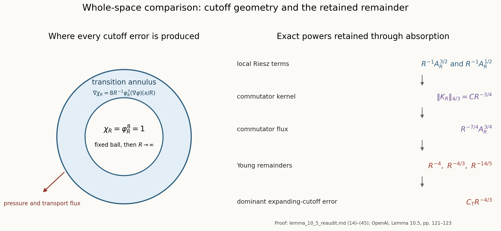

# Whole-space comparison and quantitative bounds

## Source identity and scope

The source statement is Lemma 10.5 of *Finite Time Blowup for Navier–Stokes*, pp. 121–123 of the 166-page capture, SHA-256

\[
0e779481c4da40bd28d1e642e1d8ca57447d129610df28dfa5a11e9af8ae228f.
\]

The controlling comparison is with pages 121–123 of OpenAI’s [original PDF](https://cdn.openai.com/pdf/32d9f210-8b73-45e0-91bc-82a30aef8a9a/navier-stokes.pdf). This note retains the original pressure convention and all cutoff powers, proves the comparison result and two strengthenings, and supplies its analytical tools in §5. The actual constructed-field inputs are supplied in [I0–I7](local-construction-assembly-audit.md) and [F0–F5](terminal-force-and-blowup-audit.md).

The source proof cites the \(L^p\) boundedness of the Riesz transforms; this is classical Calderón–Zygmund theory. The proofs below give the precise tools used here; no novelty claim is made.

## Statement proved

Let \(u,p\) and \(v,P\) be smooth solutions on \(\mathbb R^3\times[0,T]\) of the incompressible viscosity-one equation with the same force and the same initial velocity. Assume

\[
u,v\in L^\infty(0,T;L^2(\mathbb R^3)),\qquad
u\in L^\infty(0,T;L^6(\mathbb R^3)),\qquad
\|\nabla u(\,\cdot\,,t)\|_\infty\in L^1(0,T).
\tag{1}
\]

Then \(u=v\) on \(\mathbb R^3\times[0,T]\). In particular, the compact spatial support assumed for the reference field in the source lemma is not needed for the comparison step.

For the compactly supported reference field of the source, the expanding-cutoff error can be bounded by \(C_TR^{-4/3}\), which strengthens the displayed source bound \(C_TR^{-1}\).

## 1. Pressure-gradient recovery

Set

\[
w=v-u,\qquad \pi=P-p,\qquad
g_{ij}=v_iv_j-u_iu_j=w_iw_j+w_iu_j+u_iw_j,
\tag{2}
\]

and keep the convention

\[
(\operatorname{div}g)_i=\sum_{j=1}^3\partial_jg_{ij}.
\tag{3}
\]

If

\[
M=\sup_{0\le t\le T}\|w(t)\|_2,\qquad
U_2=\sup_{0\le t\le T}\|u(t)\|_2,
\tag{4}
\]

then Cauchy–Schwarz, component by component, gives

\[
\|g_{ij}(t)\|_1
\le \|w_i(t)\|_2\|w_j(t)\|_2
+\|w_i(t)\|_2\|u_j(t)\|_2
+\|u_i(t)\|_2\|w_j(t)\|_2.
\tag{5}
\]

Thus

\[
G:=\sup_{0\le t\le T}\sum_{i,j=1}^3\|g_{ij}(t)\|_1<\infty.
\tag{6}
\]

The exact difference equation is

\[
\partial_tw+\operatorname{div}g=\Delta w-\nabla\pi,
\qquad \operatorname{div}w=0.
\tag{7}
\]

Use the unitary Fourier transform with derivative multiplier \(i\xi_i\), and let \(R_i\) have multiplier \(i\xi_i/|\xi|\). Define

\[
\pi_*=\sum_{i,j=1}^3R_iR_jg_{ij}.
\tag{8}
\]

For every \(s>3/2\),

\[
\|\pi_*(t)\|_{H^{-s}}^2
\le (2\pi)^{-3}G^2
\int_{\mathbb R^3}(1+|\xi|^2)^{-s}\,d\xi<\infty.
\tag{9}
\]

The integral is finite at the origin and has radial exponent \(2-2s<-1\) at infinity. The multiplier in (8) is \(-\xi_i\xi_j/|\xi|^2\), so

\[
\Delta\pi_*=-\sum_{i,j=1}^3\partial_i\partial_jg_{ij}.
\tag{10}
\]

Taking divergence in (7) gives the same equation for \(\pi\), locally in distributions.

For \(a\in C_c^\infty(0,T)\), integration by parts in time in (7) yields the exact signs

\[
\int_0^T a\nabla\pi\,dt
=\Delta\int_0^T aw\,dt
+\int_0^T a'w\,dt
-\operatorname{div}\int_0^T ag\,dt.
\tag{11}
\]

The three terms on the right belong to \(H^{-2}\), \(L^2\), and \(H^{-3}\), respectively. The last inclusion follows from \(L^1\subset H^{-2}\) in three dimensions and one spatial derivative. Equation (9), with \(s=2\), also gives

\[
H_a:=\int_0^T a(\nabla\pi-\nabla\pi_*)\,dt\in H^{-3}(\mathbb R^3),
\qquad \Delta H_a=0.
\tag{12}
\]

The Fourier transform of each component of \(H_a\) is a weighted \(L^2\) function. The harmonic equation makes it vanish away from \(\{0\}\); a function supported on that measure-zero set is zero almost everywhere. Therefore \(H_a=0\). Testing against every time test function and every compact spatial test function proves

\[
\nabla\pi=\nabla\pi_*
\quad\text{on }\mathbb R^3\times(0,T).
\tag{13}
\]

This proves equality of pressure gradients. It neither identifies the scalar pressure gauges nor imposes a growth condition on \(P\).

## 2. The exact commutator and pressure-flux estimate

Choose \(\varphi\in C_c^\infty(\mathbb R^3)\) with \(0\le\varphi\le1\) and \(\varphi=1\) on the unit ball. For \(R\ge1\), retain the source definitions

\[
\varphi_R(x)=\varphi(x/R),\qquad
\chi_R=\varphi_R^8,
\tag{14}
\]

\[
E_R=\int_{\mathbb R^3}\chi_R|w|^2,\qquad
A_R=\left(\int_{\mathbb R^3}\chi_R|\nabla w|^2\right)^{1/2},\qquad
B_R=\|\varphi_R^4w\|_6.
\tag{15}
\]

The homogeneous Sobolev inequality proved in §5.1, with \(C_S=4\sqrt3\), and the product rule give

\[
B_R\le C_S\|\nabla(\varphi_R^4w)\|_2
\le C_S\left(A_R+4\|\nabla\varphi\|_\infty R^{-1}M\right).
\tag{16}
\]

The full distributional kernel of \(R_iR_j\) is

\[
\operatorname{pv}\frac{3y_iy_j-\delta_{ij}|y|^2}{4\pi|y|^5}
-\frac{\delta_{ij}}3\delta_0.
\tag{17}
\]

The local term cancels in a commutator. With \(a_R=\varphi_R^4\),

\[
a_R\pi_*=
\sum_{i,j}R_iR_j(a_Rg_{ij})
+\sum_{i,j}[a_R,R_iR_j]g_{ij}.
\tag{18}
\]

The nonlocal kernel in (17) is bounded by \(\pi^{-1}|y|^{-3}\), while

\[
|a_R(x)-a_R(y)|
\le \min\left\{4\|\nabla\varphi\|_\infty\frac{|x-y|}{R},1\right\}.
\tag{19}
\]

Consequently each commutator is majorized by convolution with

\[
K_R(y)=C|y|^{-3}\min\{|y|/R,1\}.
\tag{20}
\]

The complete radial calculation is

\[
\begin{aligned}
\|K_R\|_{4/3}^{4/3}
&=4\pi C^{4/3}\left[
R^{-4/3}\int_0^Rr^{-2/3}\,dr
+\int_R^\infty r^{-2}\,dr\right]\\
&=16\pi C^{4/3}R^{-1}.
\end{aligned}
\tag{21}
\]

Young’s convolution inequality therefore gives

\[
\left\|\sum_{i,j}[a_R,R_iR_j]g_{ij}\right\|_{4/3}
\le C G R^{-3/4}.
\tag{22}
\]

Let

\[
U_6=\sup_{0\le t\le T}\|u(t)\|_6.
\tag{23}
\]

The first sum in (18) satisfies

\[
\|\varphi_R^4w_iw_j\|_{3/2}\le B_RM,
\tag{24}
\]

\[
\|\varphi_R^4w_iu_j\|_{3/2}\le MU_6,\qquad
\|\varphi_R^4u_iw_j\|_{3/2}\le U_6M.
\tag{25}
\]

The \(L^{3/2}\) bound for each double Riesz transform proved in §5.3 then yields

\[
\left\|\sum_{i,j}R_iR_j(a_Rg_{ij})\right\|_{3/2}
\le C M(B_R+2U_6).
\tag{26}
\]

For \(g\in L^1\), identity (18) follows by first cutting \(g\) off smoothly, applying the identity to the compact smooth approximants, and passing to the limit in \(H^{-s}\) for the Riesz terms and in \(L^{4/3}\) for the commutators. The compact factor \(a_Rg\) is also locally in every finite \(L^p\), since the solutions are smooth. Hence \(\pi_*\) is locally integrable.

Testing (13) against \(a(t)\chi_Rw\) gives, for almost every \(t\),

\[
\int_{\mathbb R^3}\pi w\cdot\nabla\chi_R
=\int_{\mathbb R^3}\pi_*w\cdot\nabla\chi_R.
\tag{27}
\]

There is no scalar-gauge term because

\[
\operatorname{div}(\chi_Rw)=w\cdot\nabla\chi_R.
\tag{28}
\]

The exact derivative

\[
\nabla\chi_R
=8R^{-1}\varphi_R^7(\nabla\varphi)(x/R)
\tag{29}
\]

pairs (18) with \(CR^{-1}\varphi_R^3w\). The required interpolations retain the cutoff powers:

\[
\|\varphi_R^3w\|_3
\le\|\varphi_R^2w\|_3
\le B_R^{1/2}M^{1/2},
\tag{30}
\]

\[
\|\varphi_R^3w\|_4
\le B_R^{3/4}M^{1/4}.
\tag{31}
\]

Indeed,

\[
\varphi_R^2|w|=(\varphi_R^4|w|)^{1/2}|w|^{1/2},
\qquad
\varphi_R^3|w|=(\varphi_R^4|w|)^{3/4}|w|^{1/4},
\tag{32}
\]

and Hölder gives (30)–(31). Combining (22), (26), and (29)–(31) gives the complete pressure-flux estimate

\[
\left|\int_{\mathbb R^3}\pi w\cdot\nabla\chi_R\right|
\le C R^{-1}M(B_R+2U_6)B_R^{1/2}M^{1/2}
+C G R^{-7/4}B_R^{3/4}M^{1/4}.
\tag{33}
\]

After uniform \(L^2\) and \(L^6\) bounds are placed in \(C_T\), this is exactly the source estimate (10.19).

## 3. Difference energy and the stronger remainder

Pairing (7) with \(\chi_Rw\), with all integrals over \(\mathbb R^3\), gives

\[
\begin{aligned}
\frac12E_R'+A_R^2
={}&-\int\chi_R(w\cdot\nabla)u\cdot w
+\frac12\int|w|^2\Delta\chi_R\\
&+\frac12\int|w|^2v\cdot\nabla\chi_R
+\int\pi w\cdot\nabla\chi_R.
\end{aligned}
\tag{34}
\]

Let

\[
K(t)=\|\nabla u(t)\|_{\mathrm{op},\infty}.
\tag{35}
\]

The first term on the right of (34) is bounded by \(K(t)E_R\). Since

\[
\Delta\varphi_R^8
=56\varphi_R^6|\nabla\varphi_R|^2
+8\varphi_R^7\Delta\varphi_R,
\tag{36}
\]

the Laplacian term is bounded by \(CR^{-2}M^2\).

If \(u\) is compactly supported and \(R\) is large enough that \(\chi_R=1\) near its support, then \(v=w\) on \(\operatorname{supp}\nabla\chi_R\). The transport flux is bounded by

\[
CR^{-1}\int\varphi_R^6|w|^3
\le CR^{-1}B_R^{3/2}M^{3/2}.
\tag{37}
\]

The exponent \(6\) is an inequality consequence of the actual exponent \(7\), since \(0\le\varphi_R\le1\).

For the stronger theorem, keep \(v=w+u\). The additional term obeys

\[
\begin{aligned}
CR^{-1}\int\varphi_R^7|w|^2|u|
&\le CR^{-1}U_6\|\varphi_R^{7/2}w\|_{12/5}^2\\
&\le CR^{-1}U_6B_R^{1/2}M^{3/2}.
\end{aligned}
\tag{38}
\]

The last step uses \(\varphi_R^{7/2}\le\varphi_R\) and the exact interpolation

\[
\|\varphi_Rw\|_{12/5}
\le B_R^{1/4}M^{3/4},
\qquad
\frac5{12}=\frac{1/4}{6}+\frac{3/4}{2}.
\tag{39}
\]

For \(0<\beta<2\), \(a>0\), and \(\delta>0\), direct maximization of \(ax^\beta-\delta x^2\) over \(x\ge0\) gives

\[
ax^\beta\le\delta x^2
+\left(1-\frac\beta2\right)
\left(\frac\beta2\right)^{\beta/(2-\beta)}
\delta^{-\beta/(2-\beta)}
a^{2/(2-\beta)}.
\tag{40}
\]

Substituting (16) into (33), (37), and (38) leaves only these positive powers of \(A_R\):

\[
CR^{-1}A_R^{3/2},\qquad
CR^{-1}A_R^{1/2},\qquad
CR^{-7/4}A_R^{3/4}.
\tag{41}
\]

Their remainders under (40) have powers

\[
R^{-4},\qquad R^{-4/3},\qquad R^{-14/5},
\tag{42}
\]

respectively. The terms obtained from the \(R^{-1}M\) part of (16), together with (36), have powers

\[
R^{-5/2},\qquad R^{-3/2},\qquad R^{-5/2},\qquad R^{-2}.
\tag{43}
\]

Choose the finitely many \(\delta\)’s in (40) so that their sum is at most \(1/2\). For \(R\ge1\), equations (34)–(43) yield

\[
\frac12E_R'+\frac12A_R^2
\le K(t)E_R+C_TR^{-4/3}.
\tag{44}
\]

The source’s \(C_TR^{-1}\) bound is therefore valid and non-sharp; (44) is the stronger bound.

If the initial velocities agree, then \(E_R(0)=0\). Gronwall’s inequality and \(K\in L^1(0,T)\) give

\[
E_R(t)\le
2C_TR^{-4/3}\int_0^t
\exp\left(2\int_s^tK(a)\,da\right)\,ds.
\tag{45}
\]

Every fixed spatial ball lies in the region where \(\chi_R=1\) once \(R\) is large. Letting \(R\to\infty\) in (45) shows that the \(L^2\) mass of \(w(t)\) on every fixed ball is zero. Smoothness gives \(w=0\) pointwise, including the time endpoints.

## 4. The \(L^6\) input follows from the source’s stronger regularity

If \(u(t)\in L^2\) and \(L=\|\nabla u(t)\|_{\mathrm{op},\infty}>0\), let \(a=|u(x,t)|\). On the ball of radius \(a/(2L)\) centered at \(x\),

\[
|u(y,t)|\ge a/2.
\tag{46}
\]

Therefore

\[
\|u(t)\|_2^2
\ge\frac{a^2}{4}\frac{4\pi}{3}\left(\frac{a}{2L}\right)^3
=\frac{\pi a^5}{24L^3}.
\tag{47}
\]

Taking the supremum over \(x\) gives

\[
\|u(t)\|_\infty
\le\left(\frac{24}{\pi}\right)^{1/5}
\|u(t)\|_2^{2/5}L^{3/5}.
\tag{48}
\]

Also,

\[
\|u(t)\|_6
\le\|u(t)\|_\infty^{2/3}\|u(t)\|_2^{1/3}.
\tag{49}
\]

If \(L=0\), the field is spatially constant and its \(L^2\) membership makes it zero. Thus the source’s smooth compactly supported reference field has the required uniform \(L^6\) bound on every interval \([0,T]\), \(T<1\).

## 5. Proofs of the analytical tools used above

### 5.1. The homogeneous Sobolev inequality on the actual cutoff field

For a scalar \(g\in C_c^1(\mathbb R^3)\), define
\[
A_1(x_2,x_3)=\int_{\mathbb R}|\partial_1g(s,x_2,x_3)|\,ds
\]
and define \(A_2(x_1,x_3)\), \(A_3(x_1,x_2)\) by the corresponding coordinate integrals. The fundamental theorem of calculus, starting beyond the compact support on each coordinate line, gives \(|g(x)|\le A_i\) for every i. Hence
\[
|g(x)|^{3/2}\le
\{A_1(x_2,x_3)A_2(x_1,x_3)A_3(x_1,x_2)\}^{1/2}.
\tag{50}
\]
Put \(B_2(x_3)=\int A_2(x_1,x_3)\,dx_1\) and
\(B_3(x_2)=\int A_3(x_1,x_2)\,dx_1\).
Cauchy–Schwarz first in \(x_1\), then jointly in \(x_2,x_3\), gives the complete estimate
\[
\begin{split}
\int|g|^{3/2}
&\le\int_{\mathbb R^2}A_1(x_2,x_3)^{1/2}
B_2(x_3)^{1/2}B_3(x_2)^{1/2}\,dx_2dx_3\\
&\le\left(\int_{\mathbb R^2}A_1\right)^{1/2}
\left(\int_{\mathbb R}B_2\int_{\mathbb R}B_3\right)^{1/2}
=\prod_{i=1}^3\|\partial_i g\|_1^{1/2}.
\end{split}
\tag{51}
\]
Raise this to the power \(2/3\). The geometric mean of three nonnegative numbers is at most their sum; also
\(\sum_i|\partial_i g|\le\sqrt3|\nabla g|\). Therefore
\[
\|g\|_{3/2}\le\prod_i\|\partial_i g\|_1^{1/3}
\le\sqrt3\|\nabla g\|_1.
\tag{52}
\]
Apply this to \(g=|b|^4\), where \(b\) is a smooth compactly supported vector field. This is a smooth polynomial in its real components. With the Euclidean norm for b and the Frobenius norm for its gradient, the chain rule gives
\(|\nabla |b|^4|\le4|b|^3|\nabla b|\). Consequently
\[
\|b\|_6^4\le4\sqrt3\int |b|^3|\nabla b|
\le4\sqrt3\|b\|_6^3\|\nabla b\|_2.
\tag{53}
\]
For nonzero b divide by \(\|b\|_6^3\); for zero b the conclusion holds directly. Thus
\(\|b\|_6\le4\sqrt3\|\nabla b\|_2\).
Taking exactly \(b=\varphi_R^4w\) proves (16), with every cutoff derivative retained. No regularity or decay at infinity for the uncut derivatives of w was assumed.

### 5.2. The complete kernel and its weak estimate

Fix \(i,j\in\{1,2,3\}\) and let \(T=R_iR_j\) initially act on \(L^2(\mathbb R^3)\) by its multiplier
\(-\xi_i\xi_j/|\xi|^2\). Define it arbitrarily at \(\xi=0\), a null set. Plancherel gives
\[
\|Tb\|_2\le\|b\|_2.
\tag{54}
\]
Here the unitary convention is
\(\widehat b(\xi)=(2\pi)^{-3/2}\int e^{-ix\cdot\xi}b(x)\,dx\).
The Newton kernel has the exact heat representation
\[
G(x)=\frac1{4\pi|x|}
=\int_0^\infty(4\pi s)^{-3/2}e^{-|x|^2/(4s)}\,ds.
\tag{55}
\]
The substitution \(a=|x|/(2\sqrt s)\) evaluates the integral, using
\(\int_0^\infty e^{-a^2}\,da=\sqrt\pi/2\).
Fourier transformation of the heat kernels gives
\(\widehat G(\xi)=(2\pi)^{-3/2}|\xi|^{-2}\) as a tempered distribution; the latter is locally integrable in three dimensions. The time integral can first be taken on a compact subinterval of \((0,\infty)\), then passed to the limit against Schwartz functions. Thus convolution with \(\partial_i\partial_jG\) has precisely T’s multiplier, including its sign.

For \(y\ne0\), direct differentiation gives
\[
K_{ij}(y)=\partial_i\partial_jG(y)
=\frac{3y_iy_j-\delta_{ij}|y|^2}{4\pi|y|^5},
\quad |K_{ij}(y)|\le\frac1{\pi|y|^3},
\quad |\nabla K_{ij}(y)|\le\frac7{\pi|y|^4}.
\tag{56}
\]
For the last bound the numerator has absolute value at most \(4|y|^2\) and gradient norm at most \(8|y|\); differentiating \(|y|^{-5}\) contributes \(20|y|^{-4}\) before division by \(4\pi\), and the differentiated numerator contributes \(8|y|^{-4}\).

To retain the distribution at zero, integrate twice by parts over \(|y|>\epsilon\) against a smooth compactly supported test function \(\psi\). The inner sphere has outward normal \(-y/|y|\). The boundary contribution containing \(G\partial_j\psi\) is \(O(\epsilon)\). The other contribution is
\[
-\frac1{4\pi}\int_{\mathbb S^2}\omega_i\omega_j
\psi(\epsilon\omega)\,d\omega
\longrightarrow-\frac{\delta_{ij}}3\psi(0).
\tag{57}
\]
The spherical integral uses coordinate reflections for \(i\ne j\) and
\(\sum_i\omega_i^2=1\) for the three equal diagonal entries. The principal value of the volume term exists: K has zero spherical mean, its product with the linear term in the Taylor expansion of \(\psi\) has odd spherical mean, and its product with the quadratic remainder is integrable at zero. Thus the complete kernel is
\(\operatorname{pv}K_{ij}-(\delta_{ij}/3)\delta_0\), as in (17). In particular the local term is absent outside the support of the input and cancels in the commutator (18).

We prove a weak \(L^1\) estimate with an explicit admissible constant. Let \(b\in C_c^\infty(\mathbb R^3)\) and \(t>0\). In one fixed dyadic grid choose all maximal cubes Q for which
\(|Q|^{-1}\int_Q|b|>t\). Large ancestor cubes have averages tending to zero, so every chosen cube has a maximal ancestor of this kind. The maximal cubes are disjoint. Their parents fail the strict inequality and have eight times their volume. Outside their union the shrinking dyadic averages converge to \(|b(x)|\) by continuity, apart from the null grid boundaries. These facts give
\[
\sum_Q|Q|\le\|b\|_1/t,\qquad
t<|Q|^{-1}\int_Q|b|\le8t,\qquad
|b|\le t\ \text{a.e. outside }\bigcup_QQ.
\tag{58}
\]
Set \(b_Q=(b-b_Q^{\rm av})1_Q\), where \(b_Q^{\rm av}=|Q|^{-1}\int_Qb\), and put \(g=b-\sum_Qb_Q\). Then
\[
\int b_Q=0,\quad \sum_Q\|b_Q\|_1\le2\|b\|_1,\quad
\|g\|_1\le\|b\|_1,\quad \|g\|_\infty\le8t,\quad
\|g\|_2^2\le8t\|b\|_1.
\tag{59}
\]
The sum of the \(b_Q\) converges in \(L^2\): disjoint supports and
\(\sum_Q\|b_Q\|_2^2\le4\|b\|_2^2\) follow by Cauchy–Schwarz for each average.

Let E be the union of the concentric cubes \(6Q\), whose side lengths are six times those of Q. Then \(|E|\le216\|b\|_1/t\).
If Q has center c and side length \(\ell\), \(x\notin6Q\) implies
\(|x-c|\ge3\ell\), whereas \(y\in Q\) implies
\(|y-c|\le\sqrt3\ell/2<|x-c|/2\).
Use \(\int b_Q=0\) and (56) along the segment from \(x-c\) to \(x-y\). The exact off-support representation yields
\[
Tb_Q(x)=\int_Q\{K_{ij}(x-y)-K_{ij}(x-c)\}b_Q(y)\,dy,
\]
\[
\begin{split}
\int_{(6Q)^c}|Tb_Q(x)|\,dx
&\le \frac7\pi\,16\,\frac{\sqrt3\ell}2\,
4\pi\int_{3\ell}^\infty r^{-2}\,dr\,\|b_Q\|_1\\
&=\frac{224\sqrt3}{3}\|b_Q\|_1=:C_b\|b_Q\|_1.
\end{split}
\tag{60}
\]
The off-support formula follows first for smooth approximations to \(b_Q\), then by their \(L^1\) and \(L^2\) convergence on sets at positive distance from Q; the kernel is smooth there and T is \(L^2\)-continuous. The \(L^2\) sum of the \(Tb_Q\) and their \(L^1(E^c)\) sum represent the same distribution, so the latter bounds the actual \(T(\sum_Qb_Q)\) on \(E^c\).

If \(|Tb|>t\) outside E, either \(|Tg|>t/2\) or
\(|T(\sum_Qb_Q)|>t/2\). Chebyshev, (54), (59) and (60) give
\[
\begin{split}
|\{|Tb|>t\}|
&\le216\|b\|_1/t+4t^{-2}\|g\|_2^2
+2t^{-1}C_b\sum_Q\|b_Q\|_1\\
&\le C_w\|b\|_1/t,\qquad
C_w=248+\frac{896\sqrt3}{3}.
\end{split}
\tag{61}
\]
For \(b\in L^1\cap L^2\), approximate simultaneously in both norms by smooth compactly supported functions. The images converge in \(L^2\) and along a subsequence almost everywhere. Apply (61) at threshold \(t-\epsilon>0\), use Fatou for the level-set indicators at threshold t of the limit, and then let \(\epsilon\downarrow0\). This extends (61) to \(L^1\cap L^2\).

### 5.3. The exact \(L^{3/2}\) bound required by the pressure flux

For smooth compactly supported b and each \(t>0\), split
\(b=b\,1_{\{|b|>t\}}+b\,1_{\{|b|\le t\}}\).
Apply (61) to the first part and (54) to the second. The threshold for each image is \(t/2\), so
\[
|\{|Tb|>t\}|
\le\frac{2C_w}{t}\int_{|b|>t}|b|
+\frac4{t^2}\int_{|b|\le t}|b|^2.
\tag{62}
\]
The layer-cake identity and Tonelli’s theorem, for \(1<p<2\), now give
\[
\begin{split}
\|Tb\|_p^p
&=p\int_0^\infty t^{p-1}|\{|Tb|>t\}|\,dt\\
&\le2pC_w\int |b(x)|
\left(\int_0^{|b(x)|}t^{p-2}\,dt\right)\,dx\\
&\quad+4p\int |b(x)|^2
\left(\int_{|b(x)|}^\infty t^{p-3}\,dt\right)\,dx\\
&=\left(\frac{2pC_w}{p-1}+\frac{4p}{2-p}\right)\|b\|_p^p.
\end{split}
\tag{63}
\]
Both inner integrals converge for the displayed range of p. In particular,
\[
\|R_iR_jb\|_{3/2}\le(6C_w+12)^{2/3}\|b\|_{3/2}.
\tag{64}
\]
Density extends this operator uniquely to \(L^{3/2}\). For inputs also in \(L^2\), approximation in both norms identifies it with the Fourier multiplier. For the compact smooth factors \(a_Rg_{ij}\) in (26), both definitions therefore agree. For the \(L^1\) approximations used in (18), Fourier convergence in \(H^{-s}\), \(s>3/2\), follows from the bound in (9), while (64) supplies the \(L^{3/2}\) convergence of the compact factors. Thus this proof supplies the exact operator and exponent used in the pressure argument, including compatibility with its distributional definition.

## Comparison consequences

The figure records the exact proof flow from the transition annulus through the Riesz and commutator terms to the three Young remainders. The two-dimensional section is a schematic of the spatial cutoff, without fixing its outer support radius. Its [reproducible source](assets/lemma_10_5_cutoff_flux.py) and equations (14)–(45) above give every displayed power. The source comparison is OpenAI, Lemma 10.5, pages 121–123; §5 supplies the analytical tools. The remainder is a proved estimate, with no assertion of optimality.

The written proof of Lemma 10.5 is mathematically sound under the constructed-field inputs stated there. The pressure-gradient argument does not require a hidden pressure-growth hypothesis. The calculation above proves two underclaims:

1. the source cutoff remainder \(C_TR^{-1}\) improves to \(C_TR^{-4/3}\);
2. compact support of the reference velocity can be replaced by the three conditions in (1).

These strengthen the comparison step only. The profile, correction and local-realization arguments are the separate suppliers assembled in [I0–I7](local-construction-assembly-audit.md). The compact localization, force extension, actual receiving hypotheses, energy and blowup implications are proved in [F0–F8](terminal-force-and-blowup-audit.md).
