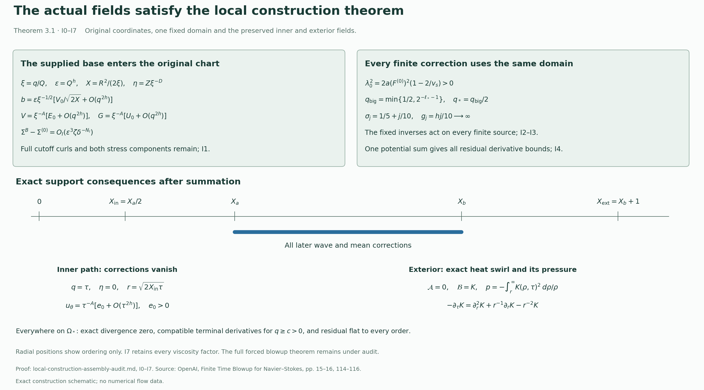

# Assembly of the actual local construction

This note connects the constructed base field to the finite correction cycle and its potential sum, then proves each assertion of original Theorem 3.1 for those fields. Its input proofs are included in this construction: the leading profile [V0–V7](shear-realization-audit.md), coefficients [D0–D6](higher-axis-coefficients-audit.md) and [Y0–Y7](positive-order-extension-audit.md), base [Z0–Z8](base-field-realization-audit.md), complete cycle [K0–K8](correction-cycle-audit.md), and physical realization [L0–L7](physical-realization-audit.md). Their cited operator proofs are also included. The final localization, smooth force, energy and whole-space comparison are derived for these actual fields in [F0–F8](terminal-force-and-blowup-audit.md). The complete theorem and its proof dependencies are stated in the [theorem construction](theorem-audit-conclusion.md).

Source: OpenAI, *Finite Time Blowup for Navier–Stokes*, original [PDF, Theorem 3.1, pages 15–16](https://cdn.openai.com/pdf/32d9f210-8b73-45e0-91bc-82a30aef8a9a/navier-stokes.pdf#page=15), Proposition 9.9, pages 114–116; SHA256 `0e779481c4da40bd28d1e642e1d8ca57447d129610df28dfa5a11e9af8ae228f`.

The diagram displays the receiving maps and support consequences proved in I1–I6. Radial positions show ordering only. [Reproducible figure source](assets/local-construction-assembly.py) · [Vector figure](assets/local-construction-assembly.svg).

## I0. One actual profile, its coordinates and its original potentials

Fix the particular finite choices in G/O/H/J/Q/V, in their existing order. They give one number \(0<h<1/100\), the original \(A=1/2+h\), \(D=1/2-h\), radii \(0<X_a<X_b<\infty\), positive angular profile \(E_0(X,\eta)\) for \(X>0\), leading axial and radial profiles \(U_0,V_0\), pressure \(\Pi_0\), and stress \(\mathcal T_0\). Here \(\Pi_0\) denotes the full leading pressure, not only its axis value. The two reserved intervals, stress weight \(\zeta\), closed-edge directions and positive constants are the ones proved there; they are not chosen again to fit a later calculation. Fix the D/Y coefficient sequence and the Z3 cutoff sequence next. All of these choices precede the correction stages.

Retain \(\tau=1-t\) and the original map
\[
\tau=q(1-\eta^2),\qquad z=q^D\eta,\qquad
X=r^2/(2q),\qquad L=1-2h\eta^2.
\tag{I0.1}
\]
For every \(\tau>0,z\in\mathbb R\), the equation for q has exactly one positive solution. Indeed
\(q^{1-2h}-\tau q^{-2h}=z^2\) has strictly positive derivative
\((1-2h)q^{-2h}+2h\tau q^{-2h-1}\), tends to minus infinity at zero and to plus infinity at infinity. At its root \(q>\tau\) unless z=0, when \(q=\tau\); also \(z^2q^{2h-1}=1-\tau/q<1\). Thus \(|\eta|<1\) and \(L\ge1-2h>0\). Implicit differentiation consequently gives a smooth q on \(\tau>0\). At \(\tau=0,z\ne0\), the same root is \(q=|z|^{1/D}>0\), \(\eta=\operatorname{sgn}z\), with the same nonzero implicit derivative L. These facts identify the exact one-sided boundary used below.

For every order let \(F_n(X,\eta)=\int_0^XU_n(y,\eta)\,dy\). This includes n=0, whose zero total moment is V7.2. The leading and positive-order Stokes functions are
\[
S_n=q^{1-A+2nh}F_n,\qquad
\mathcal A_n^B=(S_n/r)e_\theta
=\tfrac12q^{-A+2nh}(F_n/X)(-x_2,x_1,0).
\tag{I0.2}
\]
The identity \(F_n/X=\int_0^1U_n(sX,\eta)\,ds\) gives its smooth value and every derivative at X=0. With the original factors, direct curl is
\[
\operatorname{curl}\mathcal A_n^B
=-r^{-1}\partial_z S_n\,e_r+r^{-1}\partial_r S_n\,e_z
=u_{r,n}e_r+u_{z,n}e_z.
\tag{I0.3}
\]
The last equality is G0 for n=0 and D0/Z2 for n≥1; these prove the full differentiated power of q as well as its profile terms. The original angular coefficient satisfies \(u_{\theta,n}=q^{-A+2nh}E_n\), with \(E_n=\sqrt{2X}\phi_n/\mathsf C\). Hence \(u_{\theta,n}e_\theta=q^{-A+2nh-1/2}(\phi_n/\mathsf C)(-x_2,x_1,0)\), smooth in Cartesian coordinates for fixed q>0.

The actual base potential and direct angular field are therefore
\[
\mathcal A_B=\mathcal A_0^B+\sum_{n\ge1}\chi(c_nq)\mathcal A_n^B,
\qquad \mathcal B_Be_\theta=u_{\theta,0}e_\theta+
\sum_{n\ge1}\chi(c_nq)u_{\theta,n}e_\theta.
\tag{I0.4}
\]
Z3–Z4 prove that these sums are locally finite for q>0. Curl gives the whole Z4 velocity, including
\(-q^{2nh}r^{-1}(2\eta/L)(c_nq)\chi'(c_nq)F_n\) in its radial component. In particular the potential used in the correction sum is a proved representative of the actual base, not a newly chosen potential with an unspecified exterior constant.

## I1. Exact base-to-chart maps

On a band retain \(Q=2^{-\ell}\), \(\varepsilon=Q^h\), \(S_*=\ell^2\), \(R=r/\sqrt Q\), \(Z=z/Q^D\), \(T=\tau/Q\), and \(\xi=q/Q\in[1/2,2]\). Thus
\[
\xi-Z^2\xi^{2h}=T,\qquad X=R^2/(2\xi),\qquad \eta=Z\xi^{-D}.
\tag{I1.1}
\]
When acting on a function of the original independent variables \((q,X,\eta)\), the slow chart derivatives are exactly
\[
\begin{split}
\partial_R&=(R/\xi)\partial_X,\\
\partial_Z&=\xi^{-D}L^{-1}
 (2\eta q\partial_q-2\eta X\partial_X+(1-\eta^2)\partial_\eta),\\
\partial_T&=\xi^{-1}L^{-1}
 (q\partial_q-X\partial_X-D\eta\partial_\eta).
\end{split}
\tag{I1.2}
\]
For example \(\xi_Z=2\eta\xi^{1-D}/L\), \(\xi_T=1/L\), and differentiating X and η gives the second and third rows. This also verifies the sign of the T derivative: T is positive backward time. Every fixed derivative of the coefficients in I1.2 is bounded on a fixed enlarged annulus and \(-1\le\eta\le1\), because ξ is bounded away from zero and L≥1−2h. Repeated product rules prove that each fixed slow chart derivative is a finite sum of bounded coefficients times compositions of the three exact similarity derivatives in Z6. No coefficient bound for a high derivative is required to be small.

Write \(R_p=\sqrt{2X}\) only to distinguish the original profile radius from the chart radius R. Z6.2 gives the following full chart values, with the stated estimates after every fixed slow derivative:
\[
\begin{split}
b:=Q^Au_{r,B}&=\varepsilon\xi^{-1/2}
 [V_0/R_p+O(q^{2h})]=O(\varepsilon),\\
V:=Q^Au_{\theta,B}&=\xi^{-A}[E_0+O(q^{2h})],\\
G:=Q^Au_{z,B}&=\xi^{-A}[U_0+O(q^{2h})],\\
Q^{2A}p_B&=\xi^{-2A}[\Pi_0+O(q^{2h})].
\end{split}
\tag{I1.3}
\]
Because \(q^{2h}=\varepsilon^2\xi^{2h}\), the full tangential coefficients differ from their fixed leading values by \(O(\varepsilon^2)\). The radial comparison includes the derivative of the base cutoff in I0.4. These are precisely the quantities and derivative bounds used in P1 and K0.

For the full physical stress, Z6 proves
\[
\begin{split}
\Sigma^B&=Q^{2A}T_{\rm phys}
=\varepsilon\xi^{-A-1/2}\widehat T,
\qquad \Sigma^{(0)}=\varepsilon\xi^{-A-1/2}\mathcal T_0,\\
\partial^I(\Sigma^B-\Sigma^{(0)})
&=O_I(\varepsilon^3\zeta\delta^{-N_I}),\qquad
\widehat T=q^{A+1/2}T_{\rm phys}.
\end{split}
\tag{I1.4}
\]
Indeed \(Q^{2A}q^{-A-1/2}q^{2h}=Q^{3h}\xi^{-A-1/2+2h}\); its full bounded ξ factor remains. The product rule with I1.2 preserves the weight and permits larger finite inverse powers of δ. Thus the stress difference belongs to the original class \(\mathsf M_3\subset\mathsf M_2\), with no assumption that its ratio to the leading stress is uniformly small at a vanishing edge.

Z5.6 supplies the remaining input: the exact base residual is minus the two physical stress divergences plus \(\mathcal E_B\), every derivative of which is bounded by every positive power of q on each compact profile range. Multiplying by chart factors and differentiating by I1.2 preserves arbitrary-order decay: each fixed operation has a finite power cost, and Z5 permits choosing the initial decay power larger by that cost. The base is independent of the auxiliary torus. Its flat error is retained as an additive residual, as in S3 and K2; it is not put into a pulse inverse as an unproved supported source.

## I2. The actual shear, stress cone and one fixed band threshold

Let \(F_{\rm prof}=E_0/\sqrt{2X}\), \(a=1-2X\partial_X\log E_0\), \(b_s=2X(U_0)_X/E_0\), and \(v_s=a+b_s^2/a\). V5–V7 prove \(F_{\rm prof}>0\), a>0 and v_s>2 on the closed active annulus, with smooth extensions and strict endpoint margins. Compactness gives positive lower bounds \(F_-,a_-,d_v\) such that the leading chart value \(F^{(0)}=\xi^{-A-1/2}F_{\rm prof}\ge F_-\) and \(v_s\ge2+d_v\); let \(F_+,a_+\) be finite upper bounds. These margins persist on a fixed, sufficiently small radial enlargement. Parameter endpoints remain one-sided; all slow boxes are restricted to the closed \(T\ge0\) domain. Segments comparing a representative with another point can be taken in that domain. No analytic continuation across η=±1 is required.

The exact leading shear is
\[
g=(R\partial_RF^{(0)},\partial_RG^{(0)})=F^{(0)}(-a,b_s),
\quad N=g/|g|,\quad K=(-N_z,N_\theta),
\tag{I2.1}
\]
by C3.1a, retaining the ξ factor. In particular \(|g|\ge F_-a_->0\). With the original frozen growth rate,
\[
\lambda_0^2=-2F^{(0)}N_\theta(2F^{(0)}N_\theta+|g|)
=2a(F^{(0)})^2(1-2/v_s),
\tag{I2.2}
\]
one can use
\(\lambda_-^2=2a_-F_-^2d_v/(2+d_v)>0\) and
\(\lambda_+^2=2a_+F_+^2\). Thus P1.3–P1.4 have actual positive denominators and uniform constants. They do not rely on a shear assumed after construction.

Set \(t_s=-b_s/a\). V5 supplies one \(\kappa_c\in(0,2)\) and a smooth unit stress direction n on the closed annulus satisfying
\[
n_\theta+t_sn_z\ge\kappa_c,
\qquad (v_s-2)(n_z-t_sn_\theta)^2
\le(2-\kappa_c)(n_\theta+t_sn_z)^2.
\tag{I2.3}
\]
The original \(c_0=\lambda_0/(2F^{(0)}N_\theta)<0\) obeys \(c_0^2=(v_s-2)/2\). With \(T_0^*=\xi^{-A-1/2}\mathcal T_0\), C3 proves
\[
(T_0^*)_N<0,\qquad
\left|c_0\frac{(T_0^*)_K}{(T_0^*)_N}\right|
\le\sqrt{1-\kappa_c/2}<1.
\tag{I2.4}
\]
At the edges this quotient means the quotient of the smooth unit direction components, whose denominator is bounded away from zero by I2.3. Let m_c be its maximum on the closed rectangle. Choose the actual original cone parameter by
\(r_u=(1+m_c)/2\), \(u_*=r_u/\sqrt{1-r_u^2}\); then \(u_*/\sqrt{1+u_*^2}=r_u>m_c\). This is a finite positive choice with the required original inequality.

Fix the original torus matrix and eigenvectors, the finite coloring, rational centers and rectangle radius in W1–W2. Their construction depends on fixed band overlap bounds, not on the later stages. Choose one sufficiently large integer \(\ell_*\) so that, for every \(\ell\ge\ell_*\), all the following finite list of value conditions hold: the covering index is nonnegative; the P1 phase error is at most half the fixed tangential frequency lower bound on the enlarged pulse rectangle; the P5 homogeneous radial pulse comparison has its proved positive lower bound; the frozen cone quotient differs by at most \((r_u-m_c)/2\); and C3.6 has \(\vartheta\le\eta_c/(4+\eta_c)\). Include the finite slow-box radial enlargement and the initial upper domain bound in the same choice. Each requirement follows from a fixed inverse power of \(S_*=\ell^2\), or a fixed polynomial in ℓ times \(2^{-a\ell}\) with a>0. The latter tends to zero since its logarithm is \(b\log\ell-a\ell\log2\to-\infty\). Hence an integer satisfying the whole finite list exists.

Take
\[
q_{\rm big}=\min\{1/2,2^{-\ell_*-1}\},\qquad q_*=q_{\rm big}/2.
\tag{I2.5}
\]
On every band meeting \(q<q_{\rm big}\), one has \(Q\le2q<2^{-\ell_*}\); all its labels therefore satisfy the selected thresholds. P1/P5 and C3 give the actual pulse denominators, positive covariance amplitudes and inverse bounds on this one domain. V6 and Z6 retain the full flat edge weights for all derivatives. High derivative orders change finite constants and powers of S_* and δ, not the finite value conditions above.

Every subsequent inverse uses this same base and these fixed matrices. The pulse propagator for harmonic m is the m=1 propagator times the scalar
\(\exp[-(m^2-1)\int_w^v\varepsilon k^2|n_\Phi(s)|^2ds]\), at most one for \(0\le w\le v\); see K8.1. The signed covariance inverse divides by the fixed primary amplitude, with its exact weighted division at the edges, and never by the accumulated signed amplitude. The radial, temporal and five-profile mean maps are linear in their targets. No one of these definitions requires a later source norm to be small. K8.2 proves that each finite output derivative uses finitely many finite input derivatives. This proves that the whole finite induction uses I2.5, rather than a stage-dependent domain whose intersection might be empty.

## I3. The unchanged mean patch and complete finite states

On the same reserved interval \(\mathcal I_{\rm mean}\), Z7.2 gives
\[
u_{z,B}=0,\qquad q^Au_{\theta,B}
=c_{\rm patch}(1+\eta^2)^{-1}X^{-1/2-\lambda},\qquad u_B=u^{(0)}.
\tag{I3.1}
\]
For \(x=r/\sqrt q=\sqrt{2X}\), this is exactly M1.3 with
\(a(\eta)=2^{1/2+\lambda}c_{\rm patch}/(1+\eta^2)\), bounded below by \(2^{-1/2+\lambda}c_{\rm patch}>0\). M3's five bumps can therefore be chosen inside that actual interval, and its matrices retain their distinct powers and every nonzero row multiplier from M2. The positive-order coefficients and their cutoff potentials vanish on the interval; no pressure-equality assertion there is used. This supplies the full mean map used at initialization and after every cycle.

Initialize from the actual primary curls of C4–C7, using the stress \(\Sigma^{(0)}\) just supplied. The exact squared partition realizes its leading covariance. Recompute pressure by the full compact radial map, then apply T and M. K2 proves, for these operations and these base inputs, the following initialized state:
\[
\begin{gathered}
\mathcal G_{\rm wave}^{[0]}\in\mathsf W_{0.7},\quad
E_\theta,E_z\in\mathsf M_{1.2},\quad
(\mathcal P,\mathcal J_\theta,\mathcal J_z)\in\mathsf S_{1.2},\\
w\in\mathsf W_{1/2},\quad w-w_0^{\rm tan}\in\mathsf W_{0.68},\quad
v,\gamma,p_m\in\mathsf M_{0.9},\quad\beta\in\mathsf M_{1.9},\\
\int_0^\infty R^2\langle v\rangle_YdR=0,\qquad
\int_0^\infty R\langle\gamma\rangle_YdR=0.
\end{gathered}
\tag{I3.2}
\]
The base stress mismatch in this calculation is I1.4, the base error is the retained flat \(\mathcal E_B\), and the mean patch is I3.1. Thus no supplying hypothesis of K2 remains assumed. The full equations defining the three defects, pressure and both tangential residuals are K0.3–K1.5; they include the moving pressure-moment coefficient and the radial compact remainder.

Apply K3–K6 in their fixed order. Their complete changes include the new-new wave products, signed covariance square, reconstructed pressure, temporal axial component, five exact moment rows and every mean nonlinear remainder. K7 proves the next state on the same domain, with
\[
\sigma_j=1/5+j/10,\quad B_j=1/2+\sigma_j,\quad C_j^*=1+\sigma_j,
\qquad
(\mathcal G_{\rm wave}^{[j]},E_\theta,E_z,\mathcal P,\mathcal J_\theta,\mathcal J_z)
\in\mathsf W_{B_j}\times\mathsf M_{C_j^*}^2\times\mathsf S_{C_j^*}^3.
\tag{I3.3}
\]
Both exact zero moments and the accumulated field bounds in I3.2 persist, as proved in K7. The least established cycle gain is \(17999/100000>1/10\); the iteration here retains the source's original increment 1/10. Induction on the integer j therefore constructs every actual finite state. The induction does not require a bound on its constants uniform in j, nor does it change its domain. Source closure and smooth support extensions at each stage are S1–S5; distinct-label products vanish by the proved absolute-torus support separation W2.

## I4. The actual potential sum and its residual

Take \(U_0=(u^{[0]},p^{[0]})\) to be the actual initialized field, with its potential \(\mathcal A_0\) and angular coefficient \(\mathcal B_0\). It is already defined throughout \(q<q_{\rm big}\), so no additional initialization cutoff is needed on \(q<q_*\). For j≥1 retain exactly
\[
Z_j=(A_j,B_j^{\rm vec},p_j),\qquad
\Delta u_j=\operatorname{curl}A_j+B_j^{\rm vec},\qquad
(u^{[J]},p^{[J]})=U_0+\sum_{j=1}^J(\Delta u_j,p_j),
\tag{I4.1}
\]
where A_j contains the wave and azimuthal mean potentials, B_j^{vec} is the direct angular mean field, and p_j is the entire pressure difference. The exact telescoping pressure formula is L0.3. L1–L2 give
\[
|Z_j|_m+|\Delta u_j|_m
\le C_{j,m}q^{g_j-\ell_m}(1+|\log q|)^{P_{j,m}},\qquad
g_j=hj/10,\quad\ell_m=2A+(m+1)(1+3h/2).
\tag{I4.2}
\]
The physical derivative costs include the carrier frequency, the full auxiliary graph and the cylindrical frame. The base contribution to the finite-state size has a stage-independent loss: Z0 and Z4 give \( |(u_B,p_B)|_m\le C_mq^{-(2A+m)}\) on each compact profile range. To see this directly, fix J≥m with \(h(J+1)\ge1\) in Z4.2. Every finite coefficient has that displayed bound by Z0.3; the tail exponent \(h(J+1)-(2A+m+1)\) is at least \(-(2A+m)\). The finite J is fixed for this estimate. Consequently L2.4–L2.5 have actual inputs and yield
\[
\begin{split}
|\mathscr R(u^{[j]},p^{[j]})|_m
&\le C_{j,m}q^{h\sigma_j-K_m^R}(1+|\log q|)^{P_{j,m}}+E_{j,m},\\
|(u^{[j]},p^{[j]})|_m
&\le C_{j,m}q^{-K_m^U}(1+|\log q|)^{P_{j,m}},\\
K_m^R&=2A+1/2+m(1+3h/2),\qquad
K_m^U=\max\{2A+m,\ell_{m+1}\},
\end{split}
\tag{I4.3}
\]
where \(E_{j,m}\le C_{j,m,N}q^N\) for every fixed j,m,N. These exponents are independent of j. Outside the correction shell the finite fields equal the base; its stress is zero there, so Z5 supplies the residual bound. This proves the required uniformity including the axis on every \(0\le X\le X_1<\infty\).

For one smooth cutoff χ, one on [0,1/2] and zero on [1,∞), L3–L4 bound every complete cut increment by
\[
\left|\left(\operatorname{curl}(\chi(aq)A_j)+\chi(aq)B_j^{\rm vec},\chi(aq)p_j\right)\right|_m
\le\widehat C_{j,m}q^{g_j-\ell'_m}(1+|\log q|)^{\widehat P_{j,m}},
\quad\ell'_m=\ell_{m+1}+m+1,
\tag{I4.4}
\]
uniformly in a>0. This includes \(a\chi'(aq)\nabla q\times A_j\); no transition term is discarded. Choose \(a_1^{-1}<q_*\), \(a_{j+1}\ge2a_j\), so that for m≤j and \(0<q\le a_j^{-1}\),
\(\widehat C_{j,m}(1+|\log q|)^{\widehat P_{j,m}}q^{g_j/2}\le2^{-j}\).
Every finite list is possible because \(g_j>0\); L4 proves the required logarithmic limit. The same choice can include the cut potentials and direct fields themselves, using their weaker derivative bounds from I4.2. Now set
\[
\begin{split}
\mathcal A&=\mathcal A_0+\sum_{j\ge1}\chi(a_jq)A_j,\\
\mathcal Be_\theta&=\mathcal B_0e_\theta+\sum_{j\ge1}\chi(a_jq)B_j^{\rm vec},\\
p&=p^{[0]}+\sum_{j\ge1}\chi(a_jq)p_j,\qquad
u=\operatorname{curl}\mathcal A+\mathcal Be_\theta.
\end{split}
\tag{I4.5}
\]
Only finitely many terms survive on a neighborhood with q bounded below. Thus these are actual smooth fields on \(\Omega_* =\{(x,t):\tau>0,\ q<q_*\}\). The B fields are axisymmetric after evaluation because the original auxiliary map depends only on r,t. Curl has zero divergence and \(\operatorname{div}(\mathcal Be_\theta)=r^{-1}\partial_\theta\mathcal B=0\). The axis representatives in I0.2–I0.4 are smooth, and every added correction is supported away from the axis for fixed q. This proves all of Theorem 3.1(i).

For J≥max{1,m} and \(q<(2a_J)^{-1}\), every first cutoff is one and the finite comparison is
\[
|(u,p)-(u^{[J]},p^{[J]})|_m
\le2^{-J}q^{g_{J+1}/2-\ell'_m}.
\tag{I4.6}
\]
Fix m,N and write r=m+2. Choose a finite J≥r with
\[
g_{J+1}/2-\ell'_r\ge N+K_r^U+1,\qquad
h\sigma_J-K_m^R\ge N+1.
\tag{I4.7}
\]
These are possible since g_j and hσ_j tend to infinity. For this fixed J, take q small enough to absorb the finitely many logarithms and constants in I4.3 into q^{-1}. Put v=u^{[J]}, e=u−v, π=p−p^{[J]}. The exact residual difference is
\[
\mathscr R(v+e,p^{[J]}+\pi)-\mathscr R(v,p^{[J]})
=\partial_te-\Delta e+\nabla\pi+(v\cdot\nabla)e+(e\cdot\nabla)v+(e\cdot\nabla)e.
\tag{I4.8}
\]
After m derivatives, its norm is bounded by
\(C_m(|e|_{m+2}+|\pi|_{m+1}+|v|_{m+1}|e|_{m+1}+|e|_{m+1}^2)\), by the full finite product rule. I4.6–I4.7 make every term \(O(q^N)\). The finite-state residual in I4.3 also is \(O(q^N)\), including its retained E_{J,m}. Hence
\[
|\partial_x^\alpha\partial_t^b\mathscr R(u,p)|
\le C_{\alpha,b,N,X_1}q^N\qquad(0\le X\le X_1,\ q\downarrow0)
\tag{I4.9}
\]
for every finite X_1 and every α,b,N. One finite comparison, rather than a sum of infinitely many residual errors, proves the claim. This is the full flat-residual part of Theorem 3.1(iii).

## I5. Compatible derivatives at the time boundary

Fix a compact spatial set and \(0<c<c'<q_*\). Near its portion with \(c\le q\le c'\) and τ=0, I0 gives smooth q and η with bounded derivatives, after a fixed slight enlargement retaining q≥c/2. On this neighborhood only finitely many correction stages in I4.5 survive. Only finitely many dyadic bands meet it, and each fixed band has finitely many slow mesh labels in its bounded slow-coordinate set. The auxiliary labels, representatives, rounded frequencies and rectangles were fixed on the closed T≥0 domain; none is recomputed as τ approaches zero.

Z7 proves every base derivative extends continuously to η=±1. All finite pulse, signed, radial and temporal operations preserve bounded derivatives up to this boundary: their denominators have I2's fixed lower bounds, their edge extensions were proved in C4/S2, and their derivatives are finite combinations of the fixed-order input bounds by K8. The Cartesian axis representatives were proved in I0, and r is bounded away from zero on the correction annulus with q≥c/2. Thus every derivative of \(\mathcal A,\mathcal Be_\theta,p\) is uniformly bounded on that compact neighborhood.

For each derivative \(\partial^If\), boundedness of one further time derivative gives
\( |\partial^If(x,t_2)-\partial^If(x,t_1)|\le C_I|t_2-t_1|\).
It therefore has a uniform continuous limit f_I(x) as t↑1. On a small coordinate segment, pass to the uniform limit in
\[
\partial^If(x+se_k,t)-\partial^If(x,t)
=\int_0^s\partial^{I+e_k}f(x+ve_k,t)\,dv.
\tag{I5.1}
\]
The result proves \(\partial_{x_k}f_I=f_{I+e_k}\). The time integral identity proves compatibility of consecutive one-sided time derivatives as well. This establishes Theorem 3.1(ii) for the stated potentials and pressure themselves, including all mixed derivatives.

## I6. The exact exterior and the positive inner path

Choose \(X_{\rm ext}=X_b+1\). All correction potentials, angular mean fields and pressure increments vanish there. The leading axial moment and all positive-order axial moments are zero, and U_n is zero beyond its respective support, so F_n vanishes identically in this exterior. I0.2–I0.4 then give \(\mathcal A_B=0\); every later potential also vanishes. By V7 and Z7 the remaining angular field and pressure are exactly
\[
\begin{split}
\mathcal A&=0,\qquad\mathcal B=K(r,\tau)
=r^{-1-2h}\mathcal H_{\rm ext}(\tau/r^2),\\
p&=-\int_r^\infty K(\rho,\tau)^2\frac{d\rho}{\rho},\qquad
\mathcal H_{\rm ext}(s)=2^Ac_\infty\mathcal H(4s),\\
\mathcal H(Z)&=\frac1{\Gamma(1+h)}\int_0^\infty e^{-v}v^h(1+Zv)^{-h}dv.
\end{split}
\tag{I6.1}
\]
The integral and every fixed right derivative are convergent for Z≥0. L6.3 gives
\(\sup_{s\ge0}|\mathcal H_{\rm ext}^{(m)}(s)|\le2^Ac_\infty4^m(h)_m(1+h)_m\).
The complete identity L6.4, obtained by integration by parts with vanishing endpoint terms, gives
\(-\partial_\tau K=\partial_r^2K+r^{-1}\partial_rK-r^{-2}K\).
The pressure derivative is \(+K^2/r\), canceling the centrifugal term \(-K^2/r\); all other pressure components vanish. Thus the full residual is identically zero for X≥X_ext. This supplies every remaining assertion of Theorem 3.1(iii), including the original pressure integral and heat equation.

Choose \(X_{\rm in}=X_a/2\). V7 gives \(e_0=E_0(X_{\rm in},0)>0\). At z=0, q=τ and η=0; every annular correction and its cutoff curl vanish at X=X_in. The base remainder from Z6.2 consequently gives
\[
u_\theta(\sqrt{2X_{\rm in}\tau},0,0,1-\tau)
=\tau^{-A}\{e_0+O(\tau^{2h})\}.
\tag{I6.2}
\]
These arguments are the original cylindrical position and time. For sufficiently small τ the bracket is at least e_0/2: take Cτ^{2h}≤e_0/2 for the finite remainder constant C. Since A>0, the displayed component grows without bound along this original inner path. This is exactly Theorem 3.1(iv), before final localization; no global solution conclusion is inferred here.

## I7. Original viscosity and the remaining theorem

For every prescribed \(\nu>0\), use the complete map proved in Z8/L3:
\[
\begin{gathered}
y=x_\nu/\sqrt\nu,\quad
u_\nu(x_\nu,t)=\sqrt\nu\,u(y,t),\quad
p_\nu(x_\nu,t)=\nu p(y,t),\\
\mathcal A_\nu(x_\nu,t)=\nu\mathcal A(y,t),\qquad
\mathcal B_\nu e_\theta=\sqrt\nu\,\mathcal Be_\theta(y,t),\\
q_\nu-(z_\nu^2/\nu)q_\nu^{2h}=1-t,\quad
X_\nu=r_\nu^2/(2\nu q_\nu),\quad
\eta_\nu=z_\nu/(\sqrt\nu q_\nu^D).
\end{gathered}
\tag{I7.1}
\]
Curl and each momentum term transform with the required factors: \(\operatorname{curl}_{x_\nu}\mathcal A_\nu=\sqrt\nu\operatorname{curl}_y\mathcal A\), and
\(\mathscr R_\nu(u_\nu,p_\nu)=\sqrt\nu\mathscr R_1(u,p)(y,t)\).
A spatial derivative α multiplies the latter by \(\nu^{-|\alpha|/2}\), and time is unchanged. Thus all flatness, support and endpoint conclusions persist with these explicit constants and the same q threshold. The exterior is
\(K_\nu=\nu^{1+h}r_\nu^{-1-2h}\mathcal H_{\rm ext}(\nu\tau/r_\nu^2)\), with pressure \(-\int_{r_\nu}^\infty K_\nu(\rho,\tau)^2d\rho/\rho\), and its heat equation retains ν. The inner path is
\[
u_{\theta,\nu}(\sqrt{2\nu X_{\rm in}\tau},0,0,1-\tau)
=\sqrt\nu\,\tau^{-A}\{e_0+O(\tau^{2h})\}.
\tag{I7.2}
\]
All original factors, domains and constants have therefore been kept in passing from the source's coefficient-one construction to the arbitrary-viscosity target.

I0–I7 assemble all four properties of original Theorem 3.1 from the supplied actual constructions. Section 10 is derived for these actual fields in [F0–F8](terminal-force-and-blowup-audit.md): localization of these potentials and pressure, every terminal derivative of the compact force, uniform energy and dissipation, comparison with a possible global solution, the original growth path, every viscosity factor and the periodic conclusion. The complete theorem and its proof dependencies are stated in the [theorem construction](theorem-audit-conclusion.md).
