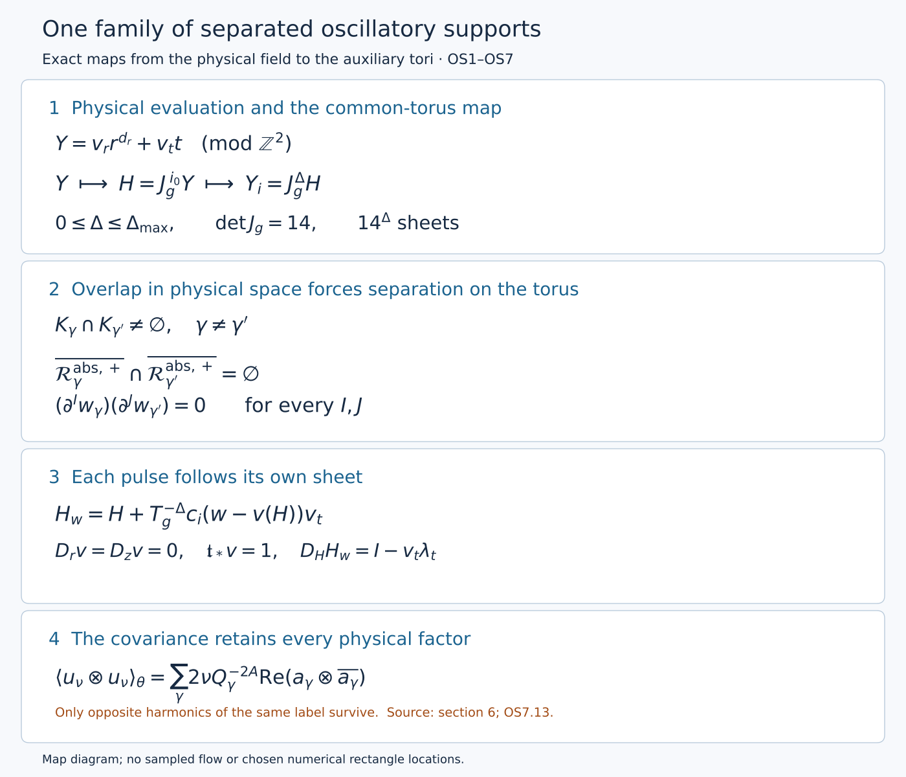

# Auxiliary support construction and coefficient algebra

The [actual base field](base-field-realization-audit.md) has a prescribed annular stress. The next construction supplies that stress through oscillating velocities. If two unrelated velocities overlap, their product adds a term that the construction did not prescribe. We first arrange the supports so that every such product is exactly zero, even after differentiation. At the same time we must allow fast temporal variation without an equally large radial derivative.

This lesson proves the complete geometric and coefficient framework of OpenAI, *Finite Time Blowup for Navier–Stokes*, section 6, original pages 62–72, equations (6.1)–(6.32), Lemmas 6.1–6.3 and Proposition 6.6. The [original paper](https://cdn.openai.com/pdf/32d9f210-8b73-45e0-91bc-82a30aef8a9a/navier-stokes.pdf) supplies the objects and constants. The proofs below retain their full physical coordinate maps. The pulse equation and its particular phase are the next construction. Here the phase hypotheses are exactly the definitions of section 6, whose algebra applies to the subsequent constructed phase.

The diagram records exact maps and support implications proved in OS1–OS5. The rectangle centers are constructed in OS3 and Exercise 3. In its final panel \(u_\nu=\sum_\gamma u_{\nu,\gamma}\), as defined in Exercise 5. No flow samples are used. [Editable diagram source](../assets/oscillatory-supports.py).

## OS0. Keep the physical field and every chart factor

Retain
\[
0<h<1/100,\quad A=\tfrac12+h,\quad D=\tfrac12-h,\quad
z=q^D\eta,\quad 1-t=q(1-\eta^2),\quad X=\frac{r^2}{2q}.
\tag{OS0.1}
\]
We work where \(q>0\), initially \(1-t\ge0\), and in the fixed active shell \(0<X_a\le X\le X_b\). The base field supplies a smooth extension near \(1-t=0\). For a fixed integer band \(\ell\), set
\[
Q=2^{-\ell},\quad \varepsilon=Q^h,\quad S_*=\ell^2,\qquad
R=\frac r{\sqrt Q},\quad Z=\frac z{Q^D},\quad T=\frac{1-t}{Q}.
\tag{OS0.2}
\]
These coordinates retain the original physical field. The chart radius is \(R=\sqrt{q/Q}\sqrt{2X}\), whereas the earlier profile radius was \(\sqrt{2X}\). On \(1/2\le q/Q\le2\),
\[
\sqrt{X_a}\le R\le2\sqrt{X_b},\qquad
|Z|\le2^D,\qquad 0\le T\le2.
\tag{OS0.3}
\]
Indeed \(|\eta|\le1\), and substitution of OS0.1 gives each bound. A sufficiently small fixed enlargement remains away from \(R=0\), with bounded \(Z,T\).

The positive viscosity is retained through the exact map
\[
r_\nu=\sqrt\nu\,r,\quad z_\nu=\sqrt\nu\,z,\quad
u_\nu=\sqrt\nu\,u,\quad p_\nu=\nu p,\quad
\mathcal T_\nu=\nu\mathcal T,\qquad \nu>0.
\tag{OS0.4}
\]
Thus \(q=q(z_\nu/\sqrt\nu,t)\), \(X=r_\nu^2/(2\nu q)\). For physical velocity, pressure, stress and augmented residual define their chart representatives by
\[
u_*=\frac{Q^A}{\sqrt\nu}u_\nu,\quad
p_*=\frac{Q^{2A}}{\nu}p_\nu,\quad
\mathcal T_*=\frac{Q^{2A}}{\nu}\mathcal T_\nu,\quad
E_*=\frac{Q^{2A+1/2}}{\sqrt\nu}E_\nu.
\tag{OS0.5}
\]
The full receiving differential equation is derived in OS6; none of these factors is discarded.

## OS1. The auxiliary variable and its evaluated derivatives

The extended field has an independent variable \(Y\in\mathbb T^2=\mathbb R^2/\mathbb Z^2\). Set
\[
J_g=\begin{pmatrix}3&1\\1&5\end{pmatrix},\quad
\Lambda_g=4-\sqrt2,\quad T_g=4+\sqrt2,\quad b_g=\sqrt2-1,
\]
\[
v_r=(1,-b_g),\quad v_t=(b_g,1),\quad
\rho_g=\frac{\log\Lambda_g}{\log T_g},\quad
\kappa_s=10^{-5},\quad d_r=2((1+h)\rho_g-h\kappa_s).
\tag{OS1.1}
\]
Direct multiplication gives \(J_gv_r=\Lambda_gv_r\), \(J_gv_t=T_gv_t\), \(v_r\cdot v_t=0\), and \(|v_r|^2=|v_t|^2=1+b_g^2\). Both eigenvalues exceed one and \(\det J_g=14\). Also \(\Lambda_g>2,T_g<6\) imply \(\rho_g>\log2/\log6>1/3\), so \(d_r>2(1/3-10^{-7})>0\).

Evaluate the extended field at
\[
Y=v_r r^{d_r}+v_t t\pmod{\mathbb Z^2}.
\tag{OS1.2}
\]
This is smooth on the active shell. No assertion of smoothness of \(r^{d_r}\) at the axis is needed: every auxiliary-dependent correction is supported away from the axis. Define
\[
N_{\rm abs}=v_t\cdot\partial_Y,\quad
\mathcal L_{\rm abs}=v_r\cdot\partial_Y,\quad
\mathfrak t=\partial_t+N_{\rm abs},\quad
\mathfrak r=\partial_r+d_rr^{d_r-1}\mathcal L_{\rm abs}.
\tag{OS1.3}
\]
The chain rule proves that \(\mathfrak t f\) and \(\mathfrak r f\), evaluated at OS1.2, equal the physical derivatives of the evaluated \(f\). The derivatives \(\partial_t,\partial_r\) in OS1.3 hold \(Y\) fixed. Auxiliary periodicity does not impose periodicity on the physical coordinates.

For sufficiently large \(\ell\), choose the nonnegative integer
\[
i=i(\ell)=\left\lfloor
\frac{(1+h)\ell\log2-2\log\ell}{\log T_g}\right\rfloor,\qquad
Y_i=J_g^iY\pmod{\mathbb Z^2}.
\tag{OS1.4}
\]
This is an integer covering, not a globally invertible torus coordinate change. On a band pullback, \(N_{\rm abs}=T_g^iN_i\) and \(\mathcal L_{\rm abs}=\Lambda_g^i\mathcal L_i\), where \(N_i=v_t\cdot\partial_{Y_i}\), \(\mathcal L_i=v_r\cdot\partial_{Y_i}\). Consequently
\[
\begin{aligned}
\mathfrak t_*&=Q^{1+h}\mathfrak t=-\varepsilon\partial_T+c_iN_i,
&c_i&=T_g^iQ^{1+h},\\
D_r&=\sqrt Q\,\mathfrak r
=\partial_R+M_id_rR^{d_r-1}\mathcal L_i,
&M_i&=\Lambda_g^iQ^{d_r/2},\\
D_z&=\sqrt Q\,\partial_z=\varepsilon\partial_Z,
&D_\theta&=R^{-1}\partial_\theta.
\end{aligned}
\tag{OS1.5}
\]
The time sign follows from \(T=(1-t)/Q\); the axial factor is \(Q^{1/2-D}=Q^h\). The floor in OS1.4 gives the two-sided bounds
\[
T_g^{-1}S_*^{-1}<c_i\le S_*^{-1},\qquad
\Lambda_g^{-1}\varepsilon^{-\kappa_s}S_*^{-\rho_g}
<M_i\le\varepsilon^{-\kappa_s}S_*^{-\rho_g}.
\tag{OS1.6}
\]
For the second, raise the first covering-index bound to \(\rho_g\) and use \(d_r/2-(1+h)\rho_g=-h\kappa_s\). These are exact inequalities, including the floor losses.

The operators \(D_r,D_z,\partial_\theta,\mathfrak t_*\) commute pairwise on component functions: the only variable auxiliary coefficient depends on \(R\), and the other three operators annihilate it. However \(D_r(R^{-1})=-R^{-2}\), which must be retained when differentiating a cylindrical vector.

Both auxiliary directions have a quantitative inverse on zero-Haar-mean smooth functions. For \(n=(n_1,n_2)\in\mathbb Z^2\setminus\{0\}\), the products
\[
\begin{aligned}
(v_r\cdot n)\big(n_1+(1+\sqrt2)n_2\big)
&=(n_1+n_2)^2-2n_2^2,\\
(v_t\cdot n)\big(n_2-(1+\sqrt2)n_1\big)
&=(n_2-n_1)^2-2n_1^2
\end{aligned}
\tag{OS1.7}
\]
are nonzero integers. If either vanished, irrationality of \(\sqrt2\) would force both coordinates to vanish. Cauchy–Schwarz bounds each conjugate by
\(C_g|n|\), where \(C_g=\sqrt{1+(1+\sqrt2)^2}\). Hence
\[
|v_r\cdot n|,\ |v_t\cdot n|\ge\frac1{C_g|n|}.
\tag{OS1.8}
\]
Exercise 1 constructs the inverse with this full constant and proves its derivative estimate.

## OS2. Slow partitions, labels and pulse coordinates

Here is an explicit construction of the partitions used in the paper. Choose a nonnegative smooth function \(\beta\), supported in \([-1,1]\), positive on \((-1,1)\), with all derivatives zero at the endpoints; for example \(\beta(s)=e^{-1/(1-s^2)}\) on that interval and zero outside. Define
\[
b_a(s)=\frac{\beta(s-a)}
{\left(\sum_{j\in\mathbb Z}\beta(s-j)^2\right)^{1/2}},
\qquad \sum_a b_a(s)^2=1.
\tag{OS2.1}
\]
The denominator is smooth, periodic and strictly positive: some integer lies within distance \(1/2\) of every \(s\). Only three indices can meet a point in the closed supports. Every fixed derivative is bounded.

Put \(\chi_\ell(q)=b_\ell(-\log_2q)\). Its support has \(q/Q\in[1/2,2]\). In each band use the product of three such partitions at mesh \(S_*^{-3}\) in \(R,Z,T\), denoted \(\chi_{\ell,a}\). Its closed box \(B_{\ell,a}\) extends at most one mesh length from the grid center in each coordinate. These choices give
\[
\sum_\ell\chi_\ell(q)^2=1,\qquad
\sum_a\chi_{\ell,a}(R,Z,T)^2=1.
\tag{OS2.2}
\]
Take \(\ell_0\) sufficiently large and \(q_{\rm big}\le2^{-\ell_0}\). A band below \(\ell_0\) cannot have a nonzero cutoff at \(0<q<q_{\rm big}\). Let \(\mathcal A_\ell\) be the portion \(q<q_{\rm big}\), \(q/Q\in[1/2,2]\), \(1-t\ge0\), \(X_a\le X\le X_b\), expressed in the chart. Select
\[
\mathcal I_\ell=\{a:B_{\ell,a}\cap\mathcal A_\ell\ne\varnothing\},\quad
x^0_{\ell,a}\in B_{\ell,a}\cap\mathcal A_\ell,\quad
\gamma=(\ell,a,\sigma),\quad \sigma\in\{+,-\}.
\tag{OS2.3}
\]
The representatives and all discrete choices stay fixed under differentiation. Write \(C_\ell(r,z,t)=(R,Z,T)\) and
\[
\eta_\gamma=\chi_\ell(q)\chi_{\ell,a},\quad
K_\gamma=\operatorname{supp}_{(r,z,t)}(\eta_\gamma\circ C_\ell),\quad
\sum_{\ell,a\in\mathcal I_\ell}(\eta_{\ell,a,+}\circ C_\ell)^2=1.
\tag{OS2.4}
\]
The signs duplicate the cutoff: including both signs in the last sum would give two. Supports include their closure in the coordinate domain and the smooth extension near \(1-t=0\).

Every fixed derivative of these cutoffs in chart coordinates costs only a power of \(S_*\). To check the \(q\)-factor explicitly, set \(s=q/Q\). The implicit equation becomes \(s-Z^2s^{2h}=T\), whose derivative in \(s\) is \(1-2hZ^2s^{2h-1}=1-2h\eta^2\ge1-2h>0\). On the band all its derivatives and implicit derivatives are bounded. A small extension preserves a positive lower bound. Differentiating the grid factors costs at most \(S_*^{3|I|}\); the band cutoff has fixed bounds.

Assign to each label a center \(c_\gamma\in\mathbb T^2\) and a common radius \(r_0>0\), constructed in OS3. Set
\[
\mathcal R_\gamma=\{c_\gamma+\xi v_r+\eta_gv_t:|\xi|,|\eta_g|<r_0\},\quad
\mathcal R_\gamma^+=\{c_\gamma+\xi v_r+\eta_gv_t:|\xi|,|\eta_g|<2r_0\},
\tag{OS2.5}
\]
with both sets taken modulo \(\mathbb Z^2\). Their absolute preimages are
\(\mathcal R_\gamma^{\rm abs}=(J_g^{i(\ell)})^{-1}(\mathcal R_\gamma)\), and similarly for the enlargement. The superscript \({}^{-1}\) here denotes set preimage.

On a local lift choose \(k_{\rm copy}\in\mathbb Z^2\) and write
\[
Y_i-c_\gamma-k_{\rm copy}=\xi_gv_r+\eta_gv_t,\qquad
v=\frac{\eta_g+r_0}{c_i},\qquad L_s=\frac{2r_0}{c_i}.
\tag{OS2.6}
\]
The dual linear functionals are
\(\lambda_r(w)=v_r\cdot w/(1+b_g^2)\) and
\(\lambda_t(w)=v_t\cdot w/(1+b_g^2)\).
Thus \(\mathcal L_i\xi_g=N_i\eta_g=1\) and
\(\mathcal L_i\eta_g=N_i\xi_g=0\). In particular
\[
D_rv=D_zv=0,\quad \mathfrak t_*v=1,\qquad
2r_0S_*\le L_s<2r_0T_gS_*.
\tag{OS2.7}
\]
Choose nonzero \(0\le\chi_g\le1\) smoothly supported in \((-r_0,r_0)\), and a rescaled smooth time cutoff with
\[
\psi(v)=1\ \text{if }|v-L_s/2|\le L_s/5,\qquad
\operatorname{supp}\psi\subset\{|v-L_s/2|<L_s/3\}.
\tag{OS2.8}
\]
Such cutoffs follow from the same bump construction. Their temporal support stays strictly inside \(0<v<L_s\). They will be applied inside the velocity potentials after solving the pulse equation.

## OS3. One separation construction for all labels

Enlarge slow boxes to a fixed half-width \(L\ge1\) in mesh units. Join two distinct labels when their enlarged physical boxes meet and \(|\ell-\ell'|\le4\); join the opposite signs at one box too. Meeting original slow supports implies \(|\ell-\ell'|\le2\), since both \(q/Q\) and \(q/Q'\) lie in \([1/2,2]\).

The physical mesh lengths are
\[
d_{\ell,r}=2^{-\ell/2}\ell^{-6},\quad
d_{\ell,z}=2^{-D\ell}\ell^{-6},\quad
d_{\ell,t}=2^{-\ell}\ell^{-6}.
\tag{OS3.1}
\]
For \(\ell,\ell'\ge\ell_0\), \(|\ell-\ell'|\le4\), ratios in either direction are at most
\[
M_{\rm mesh}=2^{4\max\{1/2,|D|,1\}}(1+4/\ell_0)^6,\quad
N_{\rm mesh}=2\lceil L(1+M_{\rm mesh})\rceil+1.
\tag{OS3.2}
\]
A meeting box center in each coordinate lies in an interval of length
\(2L(d_{\ell,j}+d_{\ell',j})\), which contains at most \(N_{\rm mesh}\) centers at mesh \(d_{\ell',j}\). Nine possible bands and two signs give graph degree at most \(18N_{\rm mesh}^3-1\). Enumerate the countable labels and greedily assign one of \(K=18N_{\rm mesh}^3\) colors unused by already colored neighbors. A later endpoint of every edge therefore receives a different color.

The mean value theorem for \(\log\ell\) and the floor inequality give
\[
|i(\ell)-i(\ell')|
\le1+\frac{4(1+h)\log2+8/\ell_0}{\log T_g}
\le\Delta_{\max},
\tag{OS3.3}
\]
where \(\Delta_{\max}\) is a fixed integer ceiling. Choose a center \(c_\nu\) for each color satisfying all ordered constraints
\[
c_\mu\ne J_g^\Delta c_\nu\pmod{\mathbb Z^2},
\quad 0\le\Delta\le\Delta_{\max},\quad
(\Delta,\nu,\mu)\ne(0,\nu,\nu).
\tag{OS3.4}
\]
For distinct colors the excluded equality is closed with empty interior, since one center can be varied independently. For equal colors and \(\Delta>0\), \(J_g^\Delta-I\) is nonsingular: its eigenvalues are \(\Lambda_g^\Delta-1,T_g^\Delta-1>0\). Its torus kernel is finite, because on a bounded fundamental square its integer image has finitely many possibilities, each with at most one preimage. A finite union of these closed sets has empty interior: remove them successively from a nonempty open subset. The remaining open dense set contains a rational tuple. Exercise 3 provides an explicit finite selection rule.

Let \(s_0>0\) be the smallest distance of the finitely many forbidden differences to \(\mathbb Z^2\), and put \(C_e=2\sqrt{2(1+b_g^2)}\). Choose
\[
0<r_0<\min\left\{\frac1{4C_e},
\frac{s_0}{2C_e(T_g^{\Delta_{\max}}+1)}\right\}.
\tag{OS3.5}
\]
An enlarged displacement \(e=\xi v_r+\eta_gv_t\), \(|\xi|,|\eta_g|\le2r_0\), has \(|e|\le C_er_0\). Its diameter is less than one, proving injectivity modulo the integer lattice. If absolute enlarged preimages for joined labels at levels \(i\) and \(i+\Delta\) met, their centers would satisfy
\[
c_\mu-J_g^\Delta c_\nu
 =J_g^\Delta e_\nu-e_\mu\pmod{\mathbb Z^2}.
\tag{OS3.6}
\]
The right side has norm at most \(C_er_0(T_g^\Delta+1)<s_0/2\), since \(J_g\) is symmetric positive definite with norm \(T_g\). This contradicts the definition of \(s_0\). At \(\Delta=0\), joined labels have different colors, so that constraint was included. We have proved
\[
\gamma\ne\gamma',\ K_\gamma\cap K_{\gamma'}\ne\varnothing
\ \Longrightarrow\
\overline{\mathcal R_\gamma^{\rm abs,+}}
\cap\overline{\mathcal R_{\gamma'}^{\rm abs,+}}=\varnothing.
\tag{OS3.7}
\]
Thus products of distinct-label fields supported in these slow and auxiliary sets vanish exactly. A derivative of a smooth field has support in the original closed support: on its open complement the field is identically zero. The same product identity holds for every pair of derivatives, including frame derivatives, and after physical evaluation OS1.2.

## OS4. A shared torus, its sheets and its operations

Fix \((z,t)\) with \(q>0\). Choose a small neighborhood \(U\) whose band cutoffs have indices differing by at most four. This is possible because \(\log_2 q\) is continuous and the band support interval has length two in that variable. Let
\[
\mathcal L(U)=\{\ell:\operatorname{supp}_{(z,t)}\chi_\ell(q)\cap U\ne\varnothing\},
\quad i_0=\min_{\ell\in\mathcal L(U)}i(\ell),\quad
H=J_g^{i_0}Y,\quad \Delta_\ell=i(\ell)-i_0.
\tag{OS4.1}
\]
Then \(0\le\Delta_\ell\le\Delta_{\max}\), and
\[
Y_i=J_g^{\Delta_\ell}H,\qquad
\mathcal R_\gamma^H=(J_g^{\Delta_\ell})^{-1}(\mathcal R_\gamma),\qquad
\mathcal R_\gamma^{\rm abs}=(J_g^{i_0})^{-1}(\mathcal R_\gamma^H).
\tag{OS4.2}
\]
The last map is onto: an invertible real matrix \(J_g^{i_0}\) has a real preimage of every representative of a torus point. Therefore separation of absolute preimages implies separation on this shared torus.

Writing \(\Delta=\Delta_\ell\), its sheets are
\[
\bigcup_{[k]\in\mathbb Z^2/J_g^\Delta\mathbb Z^2}
\left\{J_g^{-\Delta}(c_\gamma+k+\xi v_r+\eta_gv_t):
|\xi|,|\eta_g|<r_0\right\}\pmod{\mathbb Z^2}.
\tag{OS4.3}
\]
Here the real matrix inverse is used on individual lifts. Two parameter points with the same torus image have identical band coordinates by rectangle injectivity; the remaining equality identifies exactly the same coset of \(k\). Thus these sheets are disjoint. Their number is
\[
[\mathbb Z^2:J_g^\Delta\mathbb Z^2]=|\det J_g^\Delta|=14^\Delta.
\tag{OS4.4}
\]
For completeness, the lattice-index formula follows by tiling \(\mathbb R^2\) with translates of the parallelogram \(J_g^\Delta[0,1)^2\). A fundamental domain of this sublattice is also tiled, up to measure-zero boundaries, by one unit-square fundamental domain for each integer-lattice coset. Its area is both the number of cosets and \(|\det J_g^\Delta|\); finiteness follows because a bounded fundamental parallelogram contains a representative of each coset.

For a smooth band function \(f\), Fourier expansion and invertibility of \((J_g^\Delta)^T\) give
\[
\int_{\mathbb T^2}f(J_g^\Delta H)\,dH
=\int_{\mathbb T^2}f(Y_i)\,dY_i.
\tag{OS4.5}
\]
Indeed a frequency \(n\) becomes \((J_g^\Delta)^Tn\), which is zero exactly for \(n=0\). Smooth Fourier series converge absolutely, so termwise integration is justified. The same proof applies to the absolute covering. Each sheet has area \((4r_0^2(1+b_g^2))/14^\Delta\); summing its \(14^\Delta\) copies also proves preservation of the rectangle's total Haar area.

On overlaps the representatives must satisfy
\[
f_U(R,Z,T,J_g^{i_0(U)}Y)
=f_V(R,Z,T,J_g^{i_0(V)}Y),
\tag{OS4.6}
\]
in the same fixed physical band chart. Both sides equal the original extended field. At support closures the equality follows by continuity. Throughout the following operator identities \(Q\) stays fixed, even when a common-torus index changes:
\[
c_{i_0}=T_g^{-\Delta}c_i,\quad M_{i_0}=\Lambda_g^{-\Delta}M_i,\quad
M_{i_0}\mathcal L_{i_0}(f\circ J_g^\Delta)
=M_i(\mathcal L_if)\circ J_g^\Delta.
\tag{OS4.7}
\]
The corresponding identity for \(cN\) uses \(T_g^\Delta\). Thus these operators give exactly the same evaluated derivative; no inverse torus covering is invoked.

A smooth absolute function descends to the torus of level \(i_0\) precisely when it is invariant under every deck translation \(Y\mapsto Y+a\), \(J_g^{i_0}a\in\mathbb Z^2\). Equivalently, its Fourier frequencies lie in \((J_g^{i_0})^T\mathbb Z^2\). To verify the converse direction of this frequency criterion, invariance of a character of frequency \(n\) under \(a=J_g^{-i_0}k\) for all \(k\in\mathbb Z^2\) says \((J_g^{-i_0})^Tn\in\mathbb Z^2\); this is precisely the stated lattice.

Torus translation multiplies each Fourier coefficient by a phase. Haar averaging retains the zero frequency. A directional inverse on the zero-mean subspace multiplies each nonzero frequency by a scalar. Each operation therefore preserves descent. Radial integration at fixed \((z,t)\) leaves \(q(z,t)\), every band cutoff and its covering index fixed, and preserves the same deck invariance under the integral. It can meet more grid boxes but introduces no new dyadic band.

At a point at most three band indices, three grid centers in each coordinate and two signs occur, giving at most \(3\cdot3^3\cdot2=162\) closed slow supports. On a fixed compact chart box the count is at most \(C_BS_*^9\); on a bounded radial interval at fixed \(Z,T\) it is at most \(C_IS_*^3\). These follow by counting grid points in intervals of mesh \(S_*^{-3}\); fixed enlargements change only the constants. Common-torus lifts add at most \(14^{\Delta_{\max}}\). These explicit counts prove the polynomial label losses required for radial integration.

On an individual lifted rectangle define \(\eta_g(H)=\lambda_t(J_g^\Delta H-c_\gamma-k_{\rm copy})\). The path reaching pulse coordinate \(w\in[0,L_s]\) is
\[
H_w=H+T_g^{-\Delta}c_i(w-v(H))v_t
=H_0+T_g^{-\Delta}c_iwv_t,\quad
H_0=H-T_g^{-\Delta}(\eta_g(H)+r_0)v_t.
\tag{OS4.8}
\]
Its slow and transverse coordinates are fixed, and its pulse coordinate is \(w\), by applying \(J_g^\Delta\) and then \(\lambda_r,\lambda_t\). A general source on the shared torus is evaluated at this \(H_w\) on this sheet; one does not average other sheets. Since \(\lambda_tJ_g^\Delta=T_g^\Delta\lambda_t\),
\[
D_HH_w=I-v_t\lambda_t,\qquad
D_Hv=\frac{T_g^\Delta}{c_i}\lambda_t,
\tag{OS4.9}
\]
and every derivative of order at least two of these affine maps is zero. The first is bounded independently of the band; the second is bounded by a constant times \(S_*\), using OS1.6. Exercise 4 proves the exact path composition and descent.

## OS5. The coefficient classes and their complete algebra

Keep the full radial weight
\[
\zeta(X)=\exp\left(-\frac{a_a}{\log^2(X/X_a)}
-\frac{a_b}{\log^2(X_b/X)}\right),\quad
\delta(X)=\min\{1,\log(X/X_a),\log(X_b/X)\},\quad a_a,a_b>0.
\tag{OS5.1}
\]
Extend \(\zeta\) by zero outside the active interval. Every fixed inverse power of the distance to either edge, multiplied by \(\zeta^b\) for \(b>0\), tends to zero there: after setting \(y=1/s\), the required limit is \(y^Me^{-aby^2}=0\). Differentiation produces only more finite inverse powers. Thus the same assertion holds for every fixed derivative. The quantity \(\delta\) is an estimate weight; no differentiability of its minimum is assumed. Both weights are constant along OS4.8 because \(R,Z,T\) remain fixed.

Fix a finite construction stage \(j\). A coefficient derivative is
\[
\partial^I=\partial_R^{I_1}\partial_Z^{I_2}\partial_T^{I_3}
\partial_{H_1}^{I_4}\partial_{H_2}^{I_5},\qquad I\in\mathbb N_0^5.
\tag{OS5.2}
\]
It holds the band, label, representative and harmonic integer fixed. A mean coefficient \(f\in\mathsf M_\alpha\) is independent of \(\theta\), has the descent compatibility OS4.6, extends smoothly by zero outside the active radial shell, and satisfies for every \(I\)
\[
|\partial^If|\le C_{j,I}\varepsilon^\alpha S_*^{b_{j,I}}
\zeta\delta^{-d_{j,I}},\qquad b_{j,I},d_{j,I}\ge0.
\tag{OS5.3}
\]
Constants are uniform in the band, label, sheet and point; they may depend on fixed profile data, \(j,I\). Such a coefficient may depend on \(H\). It has neither a rectangle restriction nor a temporal envelope requirement.

A moment coefficient \(F(Z,T)\in\mathsf S_\alpha\) satisfies, for each two-variable multi-index,
\[
|\partial_{Z,T}^IF|\le C_{j,I}\varepsilon^\alpha S_*^{b_{j,I}}.
\tag{OS5.4}
\]
For a component with \(f_* = Q^{a_f}f_{\rm phys}\), the complete radial moment map is
\[
\int R^e\langle f_*\rangle_Y\,dR
=Q^{a_f-(e+1)/2}\int r^e\langle f_{\rm phys}\rangle_Y\,dr.
\tag{OS5.5}
\]
This follows from \(r=\sqrt Q R\), including both \(r^e\) and \(dr\). It holds before averaging too. For arbitrary viscosity and a quantity \(f_{\nu}=\nu^{b_f}f_{\rm phys}\), its full version is
\[
\int R^e\langle Q^{a_f}\nu^{-b_f}f_\nu\rangle_Y\,dR
=Q^{a_f-(e+1)/2}\nu^{-b_f-(e+1)/2}
\int r_\nu^e\langle f_\nu\rangle_Y\,dr_\nu.
\tag{OS5.6}
\]

For each label prescribe a phase, envelope and finite set of nonzero harmonics as in the original definition:
\[
\begin{gathered}
\Phi_\gamma=p_\gamma\theta+\varphi_\gamma(R,Z,T,H),\qquad
k_\gamma=\lceil\varepsilon^{-1/2}\rceil,\\
k_\gamma p_\gamma\in\mathbb Z\setminus\{0\},\qquad
0<P_v\le1,\qquad
\mathscr H_j\subset\mathbb Z\setminus\{0\},\quad |\mathscr H_j|<\infty.
\end{gathered}
\tag{OS5.7}
\]
The actual phase and envelope are constructed with the pulse in section 7. For the algebra here, \(\varphi_\gamma\) is smooth on the enlarged lifted rectangles and the amplitude is independent of \(\theta\). The finite harmonic set is independent of the band.

Put \(x_*=(R,Z,T)\), \(K_\gamma^*=C_\ell(K_\gamma)\). The permitted domains and supports are
\[
\begin{aligned}
\mathcal E_\gamma&=\{(x_*,H):H\in\overline{\mathcal R_\gamma^H}\},\\
\Omega_\gamma&=\{(x_*,H)\in\mathcal E_\gamma:
x_*\in K_\gamma^*,\ \xi_g(H)\in\operatorname{supp}\chi_g,\ X_a\le X\le X_b\},\\
\Omega_\gamma^{\rm cut}&=\Omega_\gamma\cap\{v(H)\in\operatorname{supp}\psi\}.
\end{aligned}
\tag{OS5.8}
\]
The enlarged open domain \(\mathcal E_\gamma^+\) replaces the closed rectangle by its open enlargement. A smooth labelled amplitude \(a_{\gamma,m}\in\mathsf W_\alpha\) on that domain has mutually compatible lift formulas and OS4.6, is independent of \(\theta\), and its support on \(\mathcal E_\gamma\) lies in \(\Omega_\gamma\). It extends smoothly by zero across slow and transverse support boundaries and both shell edges. For all fixed \(I\), on \(0\le v\le L_s\),
\[
|\partial^Ia_{\gamma,m}|
\le C_{j,I}\varepsilon^\alpha S_*^{b_{j,I}}
\sqrt\zeta\,\delta^{-d_{j,I}}P_v.
\tag{OS5.9}
\]
This is an estimate for every differentiated amplitude. We do not differentiate an inequality for \(P_v\). Before cutoff, continuation beyond \(v=0,L_s\) has no temporal envelope or zero-extension requirement. An actual cut coefficient has support in \(\Omega_\gamma^{\rm cut}\) and smooth zero extension in \(v\). No divisibility by any chosen cutoff is assumed.

For a finite or locally finite sum of real waves, collect equal label-harmonic pairs first:
\[
w=\sum_{\gamma,m}A_{\gamma,m}e^{ik_\gamma m\Phi_\gamma},
\qquad A_{\gamma,m}=\sum_{\nu:(\gamma_\nu,m_\nu)=(\gamma,m)}a_\nu.
\tag{OS5.10}
\]
Membership requires uniform OS5.9 for these collected coefficients. Mere local finiteness is not a substitute for those uniform estimates.

Leibniz' formula proves
\[
\mathsf M_\alpha\mathsf M_\beta\subset\mathsf M_{\alpha+\beta},
\qquad
\mathsf M_\alpha\mathsf W_\beta\subset\mathsf W_{\alpha+\beta}.
\tag{OS5.11}
\]
For equal-label amplitudes the product lies in \(\mathsf W_{\alpha+\beta}\) at harmonic \(m+m'\ne0\), and in \(\mathsf M_{\alpha+\beta}\) when \(m+m'=0\), after temporal cutoff. Before cutoff the zero harmonic satisfies the mean estimates on that rectangle only. In detail, powers of \(\varepsilon,S_*,\delta^{-1}\) add in each finite Leibniz term, and
\[
\zeta^2\le\zeta,\quad
\zeta^{3/2}P_v\le\sqrt\zeta P_v,\quad
\zeta P_v^2\le\zeta,\quad
\zeta P_v^2\le\sqrt\zeta P_v.
\tag{OS5.12}
\]
Product support is contained in the intersection. Smooth zero extensions follow from the stated support conditions and flat weight at the shell. To check an edge derivative directly, its interior limit is zero; its difference quotient across the edge is zero because the preceding derivative vanishes faster than the edge distance. Induction proves all orders. For a zero harmonic from actual cut coefficients, temporal zero extension supplies a global mean coefficient; without that extension one has only the local assertion.

For distinct labels, OS3.7 proves zero for every pair of differentiated actual fields. For one label, integer periodicity proves
\[
\left\langle a_{\gamma,m}a_{\gamma,m'}
e^{ik_\gamma(m+m')\Phi_\gamma}\right\rangle_\theta
=
\begin{cases}
a_{\gamma,m}a_{\gamma,m'},&m+m'=0,\\
0,&m+m'\ne0.
\end{cases}
\tag{OS5.13}
\]
This average integrates cylindrical component columns over \(0\le\theta\le2\pi\). The integral of \(e^{in\theta}\) is zero for every nonzero integer \(n\). It is a different operation from Haar averaging in \(Y\), which removes auxiliary dependence. In particular an angular mean \(f\) can have a nonzero auxiliary zero-mean part \(f^\circ=f-\langle f\rangle_Y\).

For \(\mathsf C=\mathsf M\) or \(\mathsf W\), coefficient derivatives preserve the exponent, and the evaluated operators act by
\[
\begin{array}{c|c}
\text{operator}&\text{map}\\ \hline
\partial_{R,Z,T,H}&\mathsf C_\alpha\longrightarrow\mathsf C_\alpha\\
D_r&\mathsf C_\alpha\longrightarrow\mathsf C_{\alpha-\kappa_s}\\
D_z=\varepsilon\partial_Z&\mathsf C_\alpha\longrightarrow\mathsf C_{\alpha+1}\\
c_{i_0}N_{i_0}&\mathsf C_\alpha\longrightarrow\mathsf C_\alpha\\
-\varepsilon\partial_T&\mathsf C_\alpha\longrightarrow\mathsf C_{\alpha+1}.
\end{array}
\tag{OS5.14}
\]
Indeed all derivatives of \(R^{d_r-1}\) are bounded on OS0.3; OS1.6 supplies the one factor \(\varepsilon^{-\kappa_s}\). Differentiating that coefficient any fixed number of times introduces no further such factor. The slow derivative term embeds in the weaker radial class because \(0<\varepsilon\le1\). The factors \(c_{i_0}\) and matrices in OS4.7 have bounded polynomial losses only. The compatibility identity OS4.6 is preserved because these are the same absolute operators at fixed \(Q\). Finite sums preserve every class. Finite products add harmonic indices, and differentiation preserves each index; at each fixed stage the resulting harmonic set is still finite.

These are amplitude maps. A full wave has the extra exact phase factors
\[
\begin{aligned}
D_r(ae^{ikm\Phi})&=(D_ra+ikm(D_r\Phi)a)e^{ikm\Phi},\\
D_z(ae^{ikm\Phi})&=(D_za+ikm(D_z\Phi)a)e^{ikm\Phi},\\
R^{-1}\partial_\theta(ae^{ikm\Phi})&=ikm(p/R)ae^{ikm\Phi},\\
\mathfrak t_*(ae^{ikm\Phi})&=(\mathfrak t_*a+ikm(\mathfrak t_*\Phi)a)e^{ikm\Phi}.
\end{aligned}
\tag{OS5.15}
\]
No pulse bound has been assumed to remove these terms.

## OS6. Cylindrical frames and the physical receiving equation

Use the orthonormal physical frame \((e_r,e_\theta,e_z)\). Its derivatives are
\(\partial_\theta e_r=e_\theta\), \(\partial_\theta e_\theta=-e_r\), \(\partial_\theta e_z=0\). Therefore the full component transport is
\[
\mathcal B(u,v)=u_rD_rv+u_\theta R^{-1}\partial_\theta v+u_zD_zv
+R^{-1}(-u_\theta v_\theta,u_\theta v_r,0).
\tag{OS6.1}
\]
The last column is obtained by differentiating the frame. It is retained for both mean and oscillatory coefficients.

Define \(\nabla_*p=(D_rp,R^{-1}\partial_\theta p,D_zp)\) and
\(\Delta_s=D_r^2+R^{-1}D_r+R^{-2}\partial_\theta^2+D_z^2\). Differentiating the frame twice gives
\[
\Delta_*u=\left(
\Delta_su_r-R^{-2}u_r-2R^{-2}\partial_\theta u_\theta,\ 
\Delta_su_\theta-R^{-2}u_\theta+2R^{-2}\partial_\theta u_r,\ 
\Delta_su_z\right).
\tag{OS6.2}
\]
For example \(\partial_\theta^2(u_re_r+u_\theta e_\theta)\) has radial coefficient
\(\partial_\theta^2u_r-u_r-2\partial_\theta u_\theta\) and angular coefficient
\(\partial_\theta^2u_\theta-u_\theta+2\partial_\theta u_r\), proving the displayed terms.

For a symmetric stress matrix \(T\) in this frame, differentiation of both frame factors gives
\[
\operatorname{div}_*T=
\begin{pmatrix}
D_rT_{rr}+R^{-1}\partial_\theta T_{r\theta}+D_zT_{rz}
+R^{-1}(T_{rr}-T_{\theta\theta})\\
D_rT_{r\theta}+R^{-1}\partial_\theta T_{\theta\theta}+D_zT_{\theta z}
+2R^{-1}T_{r\theta}\\
D_rT_{rz}+R^{-1}\partial_\theta T_{\theta z}+D_zT_{zz}
+R^{-1}T_{rz}
\end{pmatrix}.
\tag{OS6.3}
\]
One can verify this directly from
\(\operatorname{div}T=\sum_j(\nabla_{e_j}T)e_j\): only
\(\nabla_{e_\theta}e_r=R^{-1}e_\theta\) and
\(\nabla_{e_\theta}e_\theta=-R^{-1}e_r\) are nonzero frame derivatives. The derivative of the contracted frame contributes
\(R^{-1}(T_{rr},T_{\theta r},T_{zr})\); the derivative of the first tensor factor contributes
\(R^{-1}(-T_{\theta\theta},T_{r\theta},0)\), yielding OS6.3.

Substitute OS0.5 in
\(E_\nu=\partial_tu_\nu+(u_\nu\cdot\nabla)u_\nu+\nabla p_\nu-\nu\Delta u_\nu-\operatorname{div}\mathcal T_\nu\).
Since physical spatial differentiation is \((\nu Q)^{-1/2}\) times its evaluated chart counterpart, every factor gives
\[
E_*=\mathfrak t_*u_*+\mathcal B(u_*,u_*)+\nabla_*p_*
-\varepsilon\Delta_*u_*-\operatorname{div}_*\mathcal T_*.
\tag{OS6.4}
\]
The time factor is \(Q^{2A+1/2-A}=Q^{1+h}\); the viscous factor is
\(Q^{2A+1/2-A-1}=Q^h=\varepsilon\). The factors \(\sqrt\nu,\nu\) in OS0.5 cancel exactly as displayed, retaining the original equation for every \(\nu>0\).

The exact curl and divergence are
\[
\operatorname{curl}_*C=
(R^{-1}\partial_\theta C_z-D_zC_\theta,\
D_zC_r-D_rC_z,\
(D_r+R^{-1})C_\theta-R^{-1}\partial_\theta C_r),
\tag{OS6.5}
\]
\[
\operatorname{div}_*u=(D_r+R^{-1})u_r+R^{-1}\partial_\theta u_\theta+D_zu_z.
\]
Inserting OS6.5 gives the six terms
\[
\begin{aligned}
\operatorname{div}_*\operatorname{curl}_*C={}&
R^{-1}D_r\partial_\theta C_z-(D_r+R^{-1})D_zC_\theta\\
&+R^{-1}D_z\partial_\theta C_r-R^{-1}\partial_\theta D_rC_z\\
&+D_z(D_r+R^{-1})C_\theta-R^{-1}D_z\partial_\theta C_r=0.
\end{aligned}
\tag{OS6.6}
\]
The first term uses \(D_r(R^{-1})=-R^{-2}\), which cancels the additional \(R^{-1}\) in the divergence. The remaining cancellations use the commutators proved in OS1.

For a \(\theta\)-independent potential coefficient \(C_m\), retain \(n=(D_r\Phi,p/R,D_z\Phi)\). Its actual amplitude is
\[
\operatorname{curl}_*(C_me^{ikm\Phi})
=\left[ikm\,n\times C_m+
(-D_z(C_m)_\theta,\ D_z(C_m)_r-D_r(C_m)_z,\
(D_r+R^{-1})(C_m)_\theta)\right]e^{ikm\Phi}.
\tag{OS6.7}
\]
All cutoff derivatives inside \(C_m\) remain. In particular \(D_r\psi(v)=D_z\psi(v)=0\) by OS2.7, whereas spatial derivatives of the slow and transverse cutoffs generally remain. If the physical vector potential is \(A_\nu=\nu Q^{1/2-A}C\), then
\(\nabla_{\rm phys}\times A_\nu=\sqrt\nu Q^{-A}\operatorname{curl}_*C\). This is the exact potential map corresponding to OS0.5.

## OS7. Five solved exercises

### Exercise 1. Invert the original torus directions

Construct the inverse of \(d\cdot\partial_H\), for \(d=v_r\) or \(v_t\), on zero-Haar-mean smooth functions. Keep the constant and prove its behavior under the covering maps.

**Solution.** Write \(f(H)=\sum_{n\ne0}\widehat f(n)e^{2\pi i n\cdot H}\) and set
\[
(d\cdot\partial_H)^{-1}f
=\sum_{n\ne0}\frac{\widehat f(n)}{2\pi i\,d\cdot n}e^{2\pi i n\cdot H}.
\tag{OS7.1}
\]
OS1.8 bounds the multiplier by \(C_g|n|/(2\pi)\). Smooth Fourier decay then gives convergence with every derivative. With
\(\|f\|_{H^s}^2=\sum_n(1+|n|^2)^s|\widehat f(n)|^2\), termwise comparison proves
\[
\|(d\cdot\partial_H)^{-1}f\|_{H^s}
\le\frac{C_g}{2\pi}\|f\|_{H^{s+1}}.
\tag{OS7.2}
\]
The mean is zero, differentiation returns \(f\), and uniqueness follows because no nonzero frequency lies in the directional kernel. A direct \(C^k\) estimate also follows: integrate by parts \(k+4\) times in a coordinate with \(|n_j|\ge|n|/\sqrt2\); the differentiated inverse series is bounded by a constant times
\(\|f\|_{C^{k+4}}\sum_{n\ne0}|n|^{-3}\), and the sum converges in two dimensions.

Let \(d=v_r\) with eigenvalue \(\lambda=\Lambda_g\), or \(d=v_t\) with \(\lambda=T_g\). A pullback frequency is \((J_g^\Delta)^Tn\), and
\(d\cdot(J_g^\Delta)^Tn=\lambda^\Delta d\cdot n\). Hence
\[
(d\cdot\partial_H)^{-1}(f\circ J_g^\Delta)
=\lambda^{-\Delta}\big((d\cdot\partial_{Y_i})^{-1}f\big)\circ J_g^\Delta.
\tag{OS7.3}
\]
This proves the precise inverse comparison and preserves the pullback frequency lattice.

### Exercise 2. Bound radial sums without losing their moments

For a fixed band suppose actual mean coefficients \(f_\gamma\) satisfy OS5.3 uniformly and are supported in the selected slow boxes. Bound a finite or locally finite sum integrated along a bounded radial interval with weight \(R^e\), retaining the number of sheets and the physical measure.

**Solution.** Let the interval have length \(L_R\), and let the enlarged slow-box half-width be \(L\). There are at most
\(\lceil L_RS_*^3+2L\rceil+1\) radial centers, and at most \(2\lceil L\rceil+1\) centers in each of \(Z,T\). Including signs, a valid bound is
\[
N_{\rm line}\le
2(2\lceil L\rceil+1)^2(\lceil L_RS_*^3+2L\rceil+1).
\tag{OS7.4}
\]
On a common torus multiply this by at most \(14^{\Delta_{\max}}\) when counting sheets separately. Haar integration already accounts for their smaller measures; counting every sheet by the whole-torus bound is a valid upper bound. At fixed derivative order, the source estimate gives a finite exponent \(d_I\), and
\[
\int_{I_R}|R^e|\zeta(X)\delta(X)^{-d_I}\,dR\le C_{e,I}.
\tag{OS7.5}
\]
The interval stays away from zero and has bounded length; the edge weight bounds the entire integrand uniformly. Its differentiated version follows from the same weight estimate, with an increased finite exponent. Integrate over a fixed enclosing interval, using the smooth zero extension, so no moving support endpoint term is lost. Differentiation under the integral is justified by these uniform bounds. Therefore the Haar-averaged moment of the sum lies in \(\mathsf S_\alpha\) with at most the added factor \(14^{\Delta_{\max}}C_IS_*^3\). A finite set of overlapping bands changes only this constant and the polynomial degree. The exact physical moment is OS5.6, including \(Q^{a_f-(e+1)/2}\nu^{-b_f-(e+1)/2}\); the estimate does not remove that map.

### Exercise 3. Choose all rectangle centers by a finite rational rule

Give a finite construction satisfying every constraint OS3.4 and an explicit admissible radius.

**Solution.** Put \(D_0=\Delta_{\max}\), \(K=18N_{\rm mesh}^3\), and form the positive integer
\[
B=14\prod_{\Delta=1}^{D_0}\det(J_g^\Delta-I).
\tag{OS7.6}
\]
Each determinant is positive and nonzero by the eigenvalue calculation. Choose an integer \(N\ge\max\{7,2K(D_0+1)\}\), and choose a prime divisor \(p\) of \(BN!+1\). Such a divisor exists because this integer exceeds one. It satisfies \(p>N\) and \(p\nmid B\): a prime at most \(N\), or dividing \(B\), cannot divide a number congruent to one modulo that prime. Thus \(J_g\) and every \(J_g^\Delta-I\), \(1\le\Delta\le D_0\), are invertible over \(\mathbb F_p\).

Choose \(a_\nu\in\mathbb F_p^2\) successively. Exclude zero and, for every previously chosen \(a_\mu\), all \(J_g^\Delta a_\mu\) and \(J_g^{-\Delta}a_\mu\), \(0\le\Delta\le D_0\). At step \(\nu\) at most \(1+2(D_0+1)(\nu-1)\) points are excluded, which is less than \(p^2\). Choose the first remaining pair in lexicographic order. The exclusions impose both ordered constraints for distinct colors. For one color, \((J_g^\Delta-I)a_\nu\ne0\) because the matrix is invertible and \(a_\nu\ne0\). Therefore \(c_\nu=a_\nu/p\pmod{\mathbb Z^2}\) satisfies OS3.4.

Every forbidden difference has coordinates in \(p^{-1}\mathbb Z\) and is nonzero modulo \(\mathbb Z^2\); its distance to that lattice is at least \(1/p\). Thus the explicit choice
\[
r_0=\min\left\{\frac1{8C_e},
\frac1{4pC_e(T_g^{D_0}+1)}\right\}
\tag{OS7.7}
\]
satisfies OS3.5 strictly. This constructs the required centers and radius by finite integer arithmetic. It establishes no need to compute a large numerical table and makes no novelty claim.

### Exercise 4. Follow the same pulse sheet exactly

Prove the composition rule for OS4.8, identify its derivative, and show why descent does not require averaging sheets.

**Solution.** Put \(P=I-v_t\lambda_t\). Since \(\lambda_t(v_t)=1\),
\[
P^2=P,\qquad Pv_t=0,\qquad Pv_r=v_r.
\tag{OS7.8}
\]
Thus \(P\) is the orthogonal projection onto the original radial eigendirection, because the eigendirections are orthogonal. Write \(A_w(H)=H_w\) on one lifted rectangle. Applying \(\lambda_tJ_g^\Delta\) to OS4.8 proves \(v(A_w(H))=w\); applying \(\lambda_rJ_g^\Delta\) proves that the transverse coordinate is unchanged. Substituting in the same formula gives, for \(s,w\in[0,L_s]\),
\[
A_s(A_w(H))=A_s(H),\qquad A_{v(H)}(H)=H,\qquad D_HA_w=P.
\tag{OS7.9}
\]
These are identities on the chosen sheet, with its unchanged copy index. Different preimages of a band point may carry different values of a common-torus source, so the source must remain \(f(R,Z,T,A_w(H))\).

In the absolute variable the corresponding path is
\[
Y_w=Y+T_g^{-i}c_i(w-v(Y))v_t.
\tag{OS7.10}
\]
Multiplying by \(J_g^{i_0}\) gives OS4.8. A deck translation preserving \(H=J_g^{i_0}Y\) translates this entire path by that deck vector and reindexes its lifted rectangle; it leaves the common source value unchanged. Consequently a uniquely specified zero-initial-data linear solution on these paths descends to the common torus: the translated solution satisfies the identical equation and initial data, and uniqueness identifies it. This is a descent statement; the quantitative pulse inverse is still to be constructed. No average over the \(14^\Delta\) sheets was taken.

### Exercise 5. Compute the exact angular covariance and its physical factor

Let \(a_\gamma\) be an actual cut coefficient column and
\(w_\gamma=a_\gamma e^{ik_\gamma\Phi_\gamma}+\overline{a_\gamma}e^{-ik_\gamma\Phi_\gamma}\).
Compute the angular covariance of their real sum and distinguish it from auxiliary averaging.

**Solution.** The column tensor product is bilinear. Expanding the two factors and using OS5.13 yields
\[
\langle w_\gamma\otimes w_\gamma\rangle_\theta
=a_\gamma\otimes\overline{a_\gamma}
+\overline{a_\gamma}\otimes a_\gamma
=2\operatorname{Re}(a_\gamma\otimes\overline{a_\gamma}).
\tag{OS7.11}
\]
The terms at harmonics \(2,-2\) have zero angular mean. Distinct-label cross-products vanish pointwise by OS3.7, before averaging. The sum is locally finite, so
\[
\left\langle\left(\sum_\gamma w_\gamma\right)\otimes
\left(\sum_\gamma w_\gamma\right)\right\rangle_\theta
=\sum_\gamma2\operatorname{Re}(a_\gamma\otimes\overline{a_\gamma}).
\tag{OS7.12}
\]
All products and averages are of cylindrical component tensors; frame derivatives in later divergence remain those of OS6.3.

For physical velocities \(u_{\nu,\gamma}=\sqrt\nu\,Q_\gamma^{-A}w_\gamma\), retain each band's factor:
\[
\left\langle\left(\sum_\gamma u_{\nu,\gamma}\right)\otimes
\left(\sum_\gamma u_{\nu,\gamma}\right)\right\rangle_\theta
=\sum_\gamma2\nu Q_\gamma^{-2A}
\operatorname{Re}(a_\gamma\otimes\overline{a_\gamma}).
\tag{OS7.13}
\]
Each term is evaluated using its original band chart and the same physical point. One cannot put a single band factor in front without applying the exact chart comparisons.

For \(n\in\mathbb Z^2\setminus\{0\}\), \(f(Y)=\cos(2\pi n\cdot Y)\) has angular mean \(f\) and Haar mean zero. After physical evaluation it becomes
\(\cos(2\pi n\cdot(v_r r^{d_r}+v_tt))\), which is not identically zero. This proves by an explicit function why angular mean, auxiliary mean and physical evaluation must retain their separate exact maps. The covariance to be prescribed is the one in OS7.13; its actual pulse coefficients are constructed next.

## What this construction supplies

We have constructed the slow partitions, all labels, one uniformly separating family of auxiliary rectangles and its pulse coordinates. We proved the common-torus maps, sheet counts, Haar identities, path derivatives, radial integration counts, complete coefficient algebra and exact physical differential operators. The next lesson constructs the particular phase, solves the pulse equation and proves the bounds needed for its amplitudes and curl potentials. This lesson does not claim that arbitrary coefficients already realize the target stress.

The work is independent exposition based on the original section 6 and the cited preceding construction.
