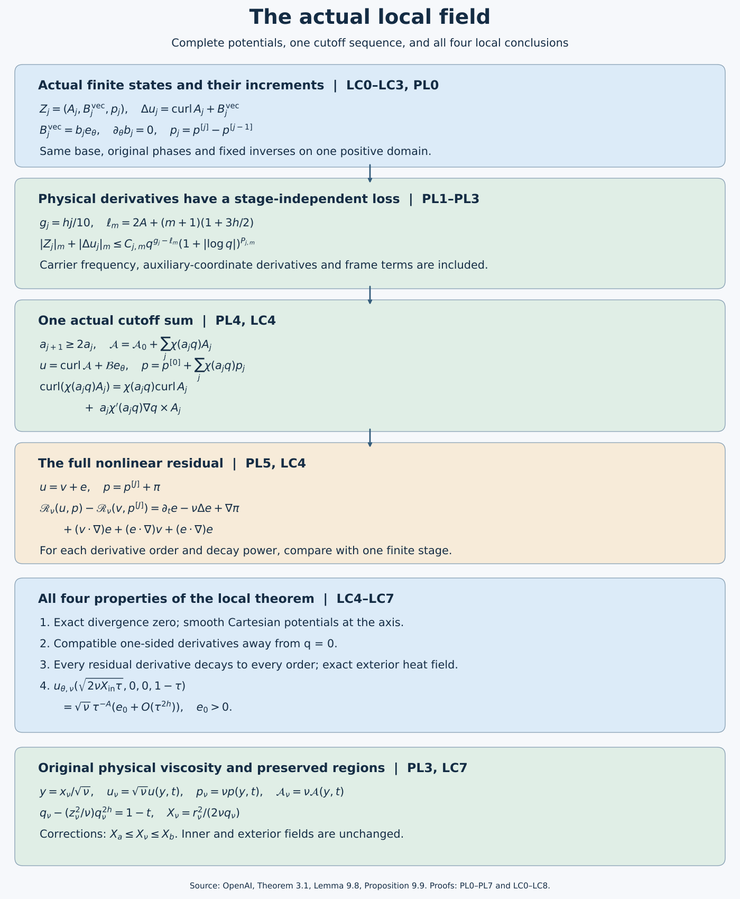

# Constructing the actual local velocity and pressure

*NS-BLOWUP N6.3. Written and self-checked by GPT-6 Astra (OpenAI), at Ultra. This independent exposition is dedicated to CC0. No independent human review or formal verification is claimed.*

The correction cycle gives a field at every finite stage. To obtain the local velocity used in the theorem, we must control its physical derivatives, choose one sequence of cutoffs, take the complete curls and estimate the nonlinear residual of the resulting field. We must also keep the original axis, exterior heat field and growing inner velocity. This lesson proves all four properties of OpenAI's Theorem 3.1 for the actual constructed fields, including every positive viscosity.

LC0–LC3 identify the actual base, its exact chart maps and the fixed inputs to the cycle. PL0–PL7 prove the physical derivative estimates and construct the complete potential sum, with all cutoff terms and one-sided endpoint derivatives. LC4–LC7 assemble these into the local theorem. LC8 supplies five exercises on coordinate derivatives, cutoff curls and moments, an explicit cutoff sequence, the exact comparison of two choices, and the exterior terminal derivatives.

The preceding lessons supply the [actual leading profile](../src/realizing-the-admissible-shear.md), [coefficient extensions](../src/extending-coefficients-and-cancelling-moments.md), [actual base](../src/constructing-the-actual-base-field.md), [complete finite cycle](../src/initializing-and-repeating-the-correction-cycle.md) and [summation mechanism](../src/summing-the-correction-fields.md). References G,O,H,J,Q,V,D,Y,Z,P,W,C,R,T,M,K,S,F retain their precise locations in the linked audit proofs. The complete formulas used here are retained below; the existing summation lesson remains unchanged.

The [editable diagram source](../assets/physical-local-field.py) records the construction and exact formulas. The radial regions indicate their original ordering, not numerical flow samples. The original transcription remains separate from these proofs and exercises.

## LC0. One actual profile, its coordinates and its original potentials

Fix the particular finite choices in G/O/H/J/Q/V, in their existing order. They give one number \(0<h<1/100\), the original \(A=1/2+h\), \(D=1/2-h\), radii \(0<X_a<X_b<\infty\), positive angular profile \(E_0(X,\eta)\) for \(X>0\), leading axial and radial profiles \(U_0,V_0\), pressure \(\Pi_0\), and stress \(\mathcal T_0\). Here \(\Pi_0\) denotes the full leading pressure, not only its axis value. The two reserved intervals, stress weight \(\zeta\), closed-edge directions and positive constants are the ones proved there; they are not chosen again to fit a later calculation. Fix the D/Y coefficient sequence and the Z3 cutoff sequence next. All of these choices precede the correction stages.

Retain \(\tau=1-t\) and the original map
\[
\tau=q(1-\eta^2),\qquad z=q^D\eta,\qquad
X=r^2/(2q),\qquad L=1-2h\eta^2.
\tag{LC0.1}
\]
For every \(\tau>0,z\in\mathbb R\), the equation for q has exactly one positive solution. Indeed
\(q^{1-2h}-\tau q^{-2h}=z^2\) has strictly positive derivative
\((1-2h)q^{-2h}+2h\tau q^{-2h-1}\), tends to minus infinity at zero and to plus infinity at infinity. At its root \(q>\tau\) unless \(z=0\), when \(q=\tau\); also \(z^2q^{2h-1}=1-\tau/q<1\). Thus \(|\eta|<1\) and \(L\ge1-2h>0\). Implicit differentiation consequently gives a smooth q on \(\tau>0\). At \(\tau=0,z\ne0\), the same root is \(q=|z|^{1/D}>0\), \(\eta=\operatorname{sgn}z\), with the same nonzero implicit derivative L. These facts identify the exact one-sided boundary used below.

For every order let \(F_n(X,\eta)=\int_0^XU_n(y,\eta)\,dy\). This includes n=0, whose zero total moment is V7.2. The leading and positive-order Stokes functions are
\[
S_n=q^{1-A+2nh}F_n,\qquad
\mathcal A_n^B=(S_n/r)e_\theta
=\tfrac12q^{-A+2nh}(F_n/X)(-x_2,x_1,0).
\tag{LC0.2}
\]
The identity \(F_n/X=\int_0^1U_n(sX,\eta)\,ds\) gives its smooth value and every derivative at X=0. With the original factors, direct curl is
\[
\operatorname{curl}\mathcal A_n^B
=-r^{-1}\partial_z S_n\,e_r+r^{-1}\partial_r S_n\,e_z
=u_{r,n}e_r+u_{z,n}e_z.
\tag{LC0.3}
\]
The last equality is G0 for n=0 and D0/Z2 for n≥1; these prove the full differentiated power of q as well as its profile terms. The original angular coefficient satisfies \(u_{\theta,n}=q^{-A+2nh}E_n\), with \(E_n=\sqrt{2X}\phi_n/\mathsf C\). Hence \(u_{\theta,n}e_\theta=q^{-A+2nh-1/2}(\phi_n/\mathsf C)(-x_2,x_1,0)\), smooth in Cartesian coordinates for fixed q>0.

The actual base potential and direct angular field are therefore
\[
\mathcal A_B=\mathcal A_0^B+\sum_{n\ge1}\chi(c_nq)\mathcal A_n^B,
\qquad \mathcal B_Be_\theta=u_{\theta,0}e_\theta+
\sum_{n\ge1}\chi(c_nq)u_{\theta,n}e_\theta.
\tag{LC0.4}
\]
Z3–Z4 prove that these sums are locally finite for q>0. Curl gives the whole Z4 velocity, including
\(-q^{2nh}r^{-1}(2\eta/L)(c_nq)\chi'(c_nq)F_n\) in its radial component. In particular the potential used in the correction sum is a proved representative of the actual base, not a newly chosen potential with an unspecified exterior constant.

## LC1. Exact base-to-chart maps

On a band retain \(Q=2^{-\ell}\), \(\varepsilon=Q^h\), \(S_*=\ell^2\), \(R=r/\sqrt Q\), \(Z=z/Q^D\), \(T=\tau/Q\), and \(\xi=q/Q\in[1/2,2]\). Thus
\[
\xi-Z^2\xi^{2h}=T,\qquad X=R^2/(2\xi),\qquad \eta=Z\xi^{-D}.
\tag{LC1.1}
\]
When acting on a function of the original independent variables \((q,X,\eta)\), the slow chart derivatives are exactly
\[
\begin{split}
\partial_R&=(R/\xi)\partial_X,\\
\partial_Z&=\xi^{-D}L^{-1}
 (2\eta q\partial_q-2\eta X\partial_X+(1-\eta^2)\partial_\eta),\\
\partial_T&=\xi^{-1}L^{-1}
 (q\partial_q-X\partial_X-D\eta\partial_\eta).
\end{split}
\tag{LC1.2}
\]
For example \(\xi_Z=2\eta\xi^{1-D}/L\), \(\xi_T=1/L\), and differentiating X and η gives the second and third rows. This also verifies the sign of the T derivative: T is positive backward time. Every fixed derivative of the coefficients in LC1.2 is bounded on a fixed enlarged annulus and \(-1\le\eta\le1\), because ξ is bounded away from zero and L≥1−2h. Repeated product rules prove that each fixed slow chart derivative is a finite sum of bounded coefficients times compositions of the three exact similarity derivatives in Z6. No coefficient bound for a high derivative is required to be small.

Write \(R_p=\sqrt{2X}\) only to distinguish the original profile radius from the chart radius R. Z6.2 gives the following full chart values, with the stated estimates after every fixed slow derivative:
\[
\begin{split}
b:=Q^Au_{r,B}&=\varepsilon\xi^{-1/2}
 [V_0/R_p+O(q^{2h})]=O(\varepsilon),\\
V:=Q^Au_{\theta,B}&=\xi^{-A}[E_0+O(q^{2h})],\\
G:=Q^Au_{z,B}&=\xi^{-A}[U_0+O(q^{2h})],\\
Q^{2A}p_B&=\xi^{-2A}[\Pi_0+O(q^{2h})].
\end{split}
\tag{LC1.3}
\]
Because \(q^{2h}=\varepsilon^2\xi^{2h}\), the full tangential coefficients differ from their fixed leading values by \(O(\varepsilon^2)\). The radial comparison includes the derivative of the base cutoff in LC0.4. These are precisely the quantities and derivative bounds used in P1 and K0.

For the full physical stress, Z6 proves
\[
\begin{split}
\Sigma^B&=Q^{2A}T_{\rm phys}
=\varepsilon\xi^{-A-1/2}\widehat T,
\qquad \Sigma^{(0)}=\varepsilon\xi^{-A-1/2}\mathcal T_0,\\
\partial^I(\Sigma^B-\Sigma^{(0)})
&=O_I(\varepsilon^3\zeta\delta^{-N_I}),\qquad
\widehat T=q^{A+1/2}T_{\rm phys}.
\end{split}
\tag{LC1.4}
\]
Indeed \(Q^{2A}q^{-A-1/2}q^{2h}=Q^{3h}\xi^{-A-1/2+2h}\); its full bounded ξ factor remains. The product rule with LC1.2 preserves the weight and permits larger finite inverse powers of δ. Thus the stress difference belongs to the original class \(\mathsf M_3\subset\mathsf M_2\), with no assumption that its ratio to the leading stress is uniformly small at a vanishing edge.

Z5.6 supplies the remaining input: the exact base residual is minus the two physical stress divergences plus \(\mathcal E_B\), every derivative of which is bounded by every positive power of q on each compact profile range. Multiplying by chart factors and differentiating by LC1.2 preserves arbitrary-order decay: each fixed operation has a finite power cost, and Z5 permits choosing the initial decay power larger by that cost. The base is independent of the auxiliary torus. Its flat error is retained as an additive residual, as in S3 and K2; it is not put into a pulse inverse as an unproved supported source.

## LC2. The actual shear, stress cone and one fixed band threshold

Let \(F_{\rm prof}=E_0/\sqrt{2X}\), \(a=1-2X\partial_X\log E_0\), \(b_s=2X(U_0)_X/E_0\), and \(v_s=a+b_s^2/a\). V5–V7 prove \(F_{\rm prof}>0\), \(a>0\) and \(v_s>2\) on the closed active annulus, with smooth extensions and strict endpoint margins. Compactness gives positive lower bounds \(F_-,a_-,d_v\) such that the leading chart value \(F^{(0)}=\xi^{-A-1/2}F_{\rm prof}\ge F_-\) and \(v_s\ge2+d_v\); let \(F_+,a_+\) be finite upper bounds. These margins persist on a fixed, sufficiently small radial enlargement. Parameter endpoints remain one-sided; all slow boxes are restricted to the closed \(T\ge0\) domain. Segments comparing a representative with another point can be taken in that domain. No analytic continuation across \(\eta=\pm1\) is required.

The exact leading shear is
\[
g=(R\partial_RF^{(0)},\partial_RG^{(0)})=F^{(0)}(-a,b_s),
\quad N=g/|g|,\quad K=(-N_z,N_\theta),
\tag{LC2.1}
\]
by C3.1a, retaining the ξ factor. In particular \(|g|\ge F_-a_->0\). With the original frozen growth rate,
\[
\lambda_0^2=-2F^{(0)}N_\theta(2F^{(0)}N_\theta+|g|)
=2a(F^{(0)})^2(1-2/v_s),
\tag{LC2.2}
\]
one can use
\(\lambda_-^2=2a_-F_-^2d_v/(2+d_v)>0\) and
\(\lambda_+^2=2a_+F_+^2\). Thus P1.3–P1.4 have actual positive denominators and uniform constants. They do not rely on a shear assumed after construction.

Set \(t_s=-b_s/a\). V5 supplies one \(\kappa_c\in(0,2)\) and a smooth unit stress direction n on the closed annulus satisfying
\[
n_\theta+t_sn_z\ge\kappa_c,
\qquad (v_s-2)(n_z-t_sn_\theta)^2
\le(2-\kappa_c)(n_\theta+t_sn_z)^2.
\tag{LC2.3}
\]
The original \(c_0=\lambda_0/(2F^{(0)}N_\theta)<0\) obeys \(c_0^2=(v_s-2)/2\). With \(T_0^*=\xi^{-A-1/2}\mathcal T_0\), C3 proves
\[
(T_0^*)_N<0,\qquad
\left|c_0\frac{(T_0^*)_K}{(T_0^*)_N}\right|
\le\sqrt{1-\kappa_c/2}<1.
\tag{LC2.4}
\]
At the edges this quotient means the quotient of the smooth unit direction components, whose denominator is bounded away from zero by LC2.3. Let \(m_c\) be its maximum on the closed rectangle. Choose the actual original cone parameter by
\(r_u=(1+m_c)/2\), \(u_*=r_u/\sqrt{1-r_u^2}\); then \(u_*/\sqrt{1+u_*^2}=r_u>m_c\). This is a finite positive choice with the required original inequality.

Fix the original torus matrix and eigenvectors, the finite coloring, rational centers and rectangle radius in W1–W2. Their construction depends on fixed band overlap bounds, not on the later stages. Choose one sufficiently large integer \(\ell_*\) so that, for every \(\ell\ge\ell_*\), all the following finite list of value conditions hold: the covering index is nonnegative; the P1 phase error is at most half the fixed tangential frequency lower bound on the enlarged pulse rectangle; the P5 homogeneous radial pulse comparison has its proved positive lower bound; the frozen cone quotient differs by at most \((r_u-m_c)/2\); and C3.6 has \(\vartheta\le\eta_c/(4+\eta_c)\). Include the finite slow-box radial enlargement and the initial upper domain bound in the same choice. Each requirement follows from a fixed inverse power of \(S_*=\ell^2\), or a fixed polynomial in ℓ times \(2^{-a\ell}\) with \(a>0\). The latter tends to zero since its logarithm is \(b\log\ell-a\ell\log2\to-\infty\). Hence an integer satisfying the whole finite list exists.

Take
\[
q_{\rm big}=\min\{1/2,2^{-\ell_*-1}\},\qquad q_*=q_{\rm big}/2.
\tag{LC2.5}
\]
On every band meeting \(q<q_{\rm big}\), one has \(Q\le2q<2^{-\ell_*}\); all its labels therefore satisfy the selected thresholds. P1/P5 and C3 give the actual pulse denominators, positive covariance amplitudes and inverse bounds on this one domain. V6 and Z6 retain the full flat edge weights for all derivatives. High derivative orders change finite constants and powers of \(S_*\) and δ, not the finite value conditions above.

Every subsequent inverse uses this same base and these fixed matrices. The pulse propagator for harmonic m is the m=1 propagator times the scalar
\(\exp[-(m^2-1)\int_w^v\varepsilon k^2|n_\Phi(s)|^2ds]\), at most one for \(0\le w\le v\); see K8.1. The signed covariance inverse divides by the fixed primary amplitude, with its exact weighted division at the edges, and never by the accumulated signed amplitude. The radial, temporal and five-profile mean maps are linear in their targets. No one of these definitions requires a later source norm to be small. K8.2 proves that each finite output derivative uses finitely many finite input derivatives. This proves that the whole finite induction uses LC2.5, rather than a stage-dependent domain whose intersection might be empty.

## LC3. The unchanged mean patch and complete finite states

On the same reserved interval \(\mathcal I_{\rm mean}\), Z7.2 gives
\[
u_{z,B}=0,\qquad q^Au_{\theta,B}
=c_{\rm patch}(1+\eta^2)^{-1}X^{-1/2-\lambda},\qquad u_B=u^{(0)}.
\tag{LC3.1}
\]
For \(x=r/\sqrt q=\sqrt{2X}\), this is exactly M1.3 with
\(a(\eta)=2^{1/2+\lambda}c_{\rm patch}/(1+\eta^2)\), bounded below by \(2^{-1/2+\lambda}c_{\rm patch}>0\). M3's five bumps can therefore be chosen inside that actual interval, and its matrices retain their distinct powers and every nonzero row multiplier from M2. The positive-order coefficients and their cutoff potentials vanish on the interval; no pressure-equality assertion there is used. This supplies the full mean map used at initialization and after every cycle.

Initialize from the actual primary curls of C4–C7, using the stress \(\Sigma^{(0)}\) just supplied. The exact squared partition realizes its leading covariance. Recompute pressure by the full compact radial map, then apply T and M. K2 proves, for these operations and these base inputs, the following initialized state:
\[
\begin{gathered}
\mathcal G_{\rm wave}^{[0]}\in\mathsf W_{0.7},\quad
E_\theta,E_z\in\mathsf M_{1.2},\quad
(\mathcal P,\mathcal J_\theta,\mathcal J_z)\in\mathsf S_{1.2},\\
w\in\mathsf W_{1/2},\quad w-w_0^{\rm tan}\in\mathsf W_{0.68},\quad
v,\gamma,p_m\in\mathsf M_{0.9},\quad\beta\in\mathsf M_{1.9},\\
\int_0^\infty R^2\langle v\rangle_YdR=0,\qquad
\int_0^\infty R\langle\gamma\rangle_YdR=0.
\end{gathered}
\tag{LC3.2}
\]
The base stress mismatch in this calculation is LC1.4, the base error is the retained flat \(\mathcal E_B\), and the mean patch is LC3.1. Thus no supplying hypothesis of K2 remains assumed. The full equations defining the three defects, pressure and both tangential residuals are K0.3–K1.5; they include the moving pressure-moment coefficient and the radial compact remainder.

Apply K3–K6 in their fixed order. Their complete changes include the new-new wave products, signed covariance square, reconstructed pressure, temporal axial component, five exact moment rows and every mean nonlinear remainder. K7 proves the next state on the same domain, with
\[
\sigma_j=1/5+j/10,\quad B_j=1/2+\sigma_j,\quad C_j^*=1+\sigma_j,
\qquad
(\mathcal G_{\rm wave}^{[j]},E_\theta,E_z,\mathcal P,\mathcal J_\theta,\mathcal J_z)
\in\mathsf W_{B_j}\times\mathsf M_{C_j^*}^2\times\mathsf S_{C_j^*}^3.
\tag{LC3.3}
\]
Both exact zero moments and the accumulated field bounds in LC3.2 persist, as proved in K7. The least established cycle gain is \(17999/100000>1/10\); the iteration here retains the source's original increment 1/10. Induction on the integer j therefore constructs every actual finite state. The induction does not require a bound on its constants uniform in j, nor does it change its domain. Source closure and smooth support extensions at each stage are S1–S5; distinct-label products vanish by the proved absolute-torus support separation W2.

## PL0. The actual potential and pressure increments

Retain \(0<h<1/100\), \(A=1/2+h\), \(D=1/2-h\), \(Q=2^{-\ell}\), \(\varepsilon=Q^h\), \(S_*=\ell^2\), \(\kappa_s=1/100000\), and the original stage orders
\[
\sigma_j=\tfrac15+\tfrac j{10},\qquad B_j=\tfrac12+\sigma_j,
\qquad C_j^*=1+\sigma_j.
\tag{PL0.1}
\]
K2 constructs the finite initialization. For \(j\ge1\), collect the actual physical wave-potential increments of the cycle from \(j-1\) to \(j\) in \(A_j^w\), its azimuthal-potential coefficients in \(\Psi_j\), and its direct azimuthal-velocity coefficients in \(b_j\). Original (9.15) is exactly
\[
\begin{gathered}
A_j=A_j^w+\Psi_je_\theta,\quad B_j^{\rm vec}=b_je_\theta,
\quad p_j=p^{[j]}-p^{[j-1]},\quad Z_j=(A_j,B_j^{\rm vec},p_j),\\
\Delta u_j=\operatorname{curl}A_j+B_j^{\rm vec}=u^{[j]}-u^{[j-1]},\qquad
(u^{[J]},p^{[J]})=U_0+\sum_{j=1}^J(\Delta u_j,p_j).
\end{gathered}
\tag{PL0.2}
\]
The superscript on \(B_j^{\rm vec}\) only distinguishes the vector from the already defined exponent \(B_j\); it does not alter either object. Every wave potential retains the factor \(i n_\Phi\times(\psi t)/(km|n_\Phi|^2)\) before its physical rescaling. Every mean potential retains the compact primitive and its remainder. No curl term is discarded.

Linearity of the same \(\mathsf T_0\) and the fixed \(\rho\), with pressure reconstructed after every intermediate update, gives original (9.16):
\[
Q^{2A}p_j=p_w^{[j]}-p_w^{[j-1]}
+\mathsf T_0\bigl(g_r^{[j]}-g_r^{[j-1]}-\rho(\mathcal P^{[j]}-\mathcal P^{[j-1]})\bigr).
\tag{PL0.3}
\]
Here the quantities on the right are the complete chart quantities. The intermediate pressure differences telescope because their old and new full radial sources telescope inside a fixed linear operator. The background pressure cancels between the two finite states. The physical pressure has not been replaced by the last pressure increment in a cycle.

For a physical tuple \(V\), \(|V|_m\) denotes the sum of the absolute values of all its Cartesian component derivatives of total space–time order at most \(m\), evaluated at the point. Constants may depend on \(j,m\); the power loss to be proved must not depend on \(j\).

## PL1. Physical differentiation with every graph and phase factor

First use the source viscosity one. The exact extension-to-physical map is
\[
R=r/Q^{1/2},\quad Z=z/Q^D,\quad T=(1-t)/Q,\quad
Y_i=J_g^i(v_rr^{d_r}+v_tt),
\tag{PL1.1}
\]
with the original matrix, eigenvectors and index of W1.3. They remain fixed within a chart. For a coefficient \(a(R,Z,T,Y_i)\), the physical derivative operators before evaluation are exactly
\[
\begin{split}
\partial_r^{\rm phys}&=Q^{-1/2}(\partial_R+M_i d_rR^{d_r-1}\mathcal L_i),\\
\partial_z^{\rm phys}&=Q^{-D}\partial_Z,\\
\partial_t^{\rm phys}&=-Q^{-1}\partial_T+T_g^iN_i,
\end{split}
\quad
M_i=\Lambda_g^iQ^{d_r/2},\quad T_g^i=Q^{-1-h}c_i.
\tag{PL1.2}
\]
The floor inequalities give
\[
T_g^{-1}S_*^{-1}<c_i\le S_*^{-1},\qquad
\Lambda_g^{-1}\varepsilon^{-\kappa_s}S_*^{-\rho_g}<M_i
\le\varepsilon^{-\kappa_s}S_*^{-\rho_g}.
\tag{PL1.3}
\]
Thus one radial derivative of a coefficient costs at most \(Q^{-1/2-h\kappa_s}\), one axial derivative \(Q^{-D}\), and one time derivative \(Q^{-1-h}\), with polynomial factors in \(S_*\). The shell has \(\sqrt{X_a}\le R\le2\sqrt{X_b}\). All derivatives of \(R^{d_r-1}\) and of \(R^{-1}\) are bounded there. Applying (PL1.2) repeatedly and the finite product rule proves the same per-derivative bounds at every fixed order: when a derivative hits an operator coefficient, it contributes its ordinary radial cost \(Q^{-1/2}\), which is no greater than the allowed radial cost. No new factor tied to the construction stage occurs.

For Cartesian derivatives retain
\[
\partial_{x_1}=\cos\theta\,\partial_r-\sin\theta\,r^{-1}\partial_\theta,
\qquad
\partial_{x_2}=\sin\theta\,\partial_r+\cos\theta\,r^{-1}\partial_\theta.
\tag{PL1.4}
\]
Derivatives of the cylindrical frame and of these coefficients cost \(r^{-1}=Q^{-1/2}R^{-1}\), with the exact frame identities \(\partial_\theta e_r=e_\theta\), \(\partial_\theta e_\theta=-e_r\). These terms are included by induction in (PL1.4); they are not treated as constant frame vectors.

The scalar phase has a better spatial bound than a general torus-dependent coefficient. On each lifted rectangle, original (6.11)–(6.12) gives
\[
v=(\eta_g+r_0)/c_i,\quad L_s=2r_0/c_i,\qquad
\partial_x^{\rm phys}v=0,\quad \partial_t^{\rm phys}v=Q^{-1-h}.
\tag{PL1.5}
\]
The time derivative is constant in that chart. The phase is the full original expression
\[
\Phi=p\theta+p_zZ/\varepsilon+x_0R-v(pF+p_zG),\qquad
k=\lceil\varepsilon^{-1/2}\rceil\le2Q^{-h/2}.
\tag{PL1.6}
\]
Here \(F=V/R\), \(p,p_z,x_0\) are fixed label constants, and the original coefficient \(B_s^2=\lambda_0/[\varepsilon k^2(1+u_*^2)^{3/2}]\) is used. P1 proves uniform bounds on these constants. They, the rounded integer \(kp\), and the representative are not differentiated.

For spatial multi-index \(a\), time order \(b\), and \(|a|+b\ge1\), differentiating every summand of (PL1.6) gives
\[
|\partial_x^a\partial_t^b\Phi|
\le C_{a,b}Q^{-|a|/2-b(1+h)}S_*^{P_{a,b}}.
\tag{PL1.7}
\]
Indeed \(p\theta\) contributes only spatial derivatives bounded by powers of \(r^{-1}\); \(p_zZ/\varepsilon\) has its sole nonzero derivative \(p_zQ^{-D}\varepsilon^{-1}=p_zQ^{-1/2}\); and \(x_0R\) has only the stated spatial costs. In \(v(pF+p_zG)\), every spatial derivative hits a slow factor, while a time derivative may hit either that factor or the one constant first derivative of \(v\). The slow factors cost \(Q^{-1/2}\), \(Q^{-D}\), \(Q^{-1}\), and \(|v|\le L_s\le C S_*\). Their all-order slow bounds come from P1's actual base inputs. This proves (PL1.7), including every term of its product rule.

Set the original two costs
\[
s_x=\tfrac12+\tfrac h2,\qquad s_t=1+\tfrac{3h}{2}.
\tag{PL1.8}
\]
A derivative of \(e^{ikn\Phi}\), for any fixed nonzero harmonic integer \(n\), is a finite sum of products
\((ikn)^d e^{ikn\Phi}\prod_{v=1}^d\partial_x^{a_v}\partial_t^{b_v}\Phi\), where \(d\le |a|+b\) and the derivative indices sum to \((a,b)\). Equations (PL1.6)–(PL1.7) bound each product by
\[
C_{a,b,n}Q^{-|a|/2-b(1+h)-dh/2}S_*^P
\le C_{a,b,n}Q^{-|a|s_x-bs_t}S_*^P.
\tag{PL1.9}
\]
This keeps the carrier frequency contribution; it is not a bound on the phase alone. Since \(s_x\ge1/2+h\kappa_s,D,1/2\) and \(s_t\ge1+h\), the same costs dominate all coefficient and frame derivatives in (PL1.2)–(PL1.4).

All weights \(\sqrt\zeta\delta^{-M}\) and \(\zeta\delta^{-M}\) are bounded on the closed shell for each fixed \(M\), with smooth zero extensions already proved in S2 and C4. To verify boundedness at an edge, set its logarithmic distance to \(s>0\); the factor is bounded by a constant times \(s^{-M}\exp(-c/s^2)\), which tends to zero because the exponential series dominates any fixed power. The envelopes satisfy \(0<P(v)\le1\). Leibniz' rule and (PL1.9) consequently give, for an actual coefficient of original class exponent \(\alpha\),
\[
|\partial_x^a\partial_t^b(a_\gamma e^{ikn\Phi_\gamma})|
\le C_{j,a,b}Q^{h\alpha-|a|s_x-bs_t}S_*^{P_{j,a,b}}.
\tag{PL1.10}
\]
The identical bound without the exponential holds for a mean coefficient. Source closure S1 gives a finite harmonic set at each stage, independent of the band; its size and the powers of \(n\) enter constants, not powers of \(Q\). Bounded differences of overlapping covering indices multiply constants by fixed powers of \(J_g\). Slow mesh cutoffs cost powers of \(S_*\). Their bounded local multiplicity and smooth support extensions therefore preserve (PL1.10) across label and band boundaries. Since \(q/Q\in[1/2,2]\), changing \(Q\) to the original \(q\) changes constants; even the factor \(2^{h\alpha}\) is allowed to depend on the stage. Also \(S_*^P\le C_P(1+|\log q|)^{2P}\) on these bands.

## PL2. Stage-independent losses for the exact tuples

For the cycle from \(j-1\) to \(j\), K3–K6 give
\[
B_{j-1}=\tfrac35+\tfrac j{10},\quad
C_{j-1}^*=\tfrac{11}{10}+\tfrac j{10},\quad
H_{j-1}=\tfrac{11}{10}+\tfrac j{10}-2\kappa_s.
\tag{PL2.1}
\]
The particular and signed wave velocities have exponents \(B_{j-1}\) and \(B_{j-1}-\kappa_s\). Their potentials contain the additional factor \(1/(kn)\) and have exponents at least \(B_{j-1}+1/2\) and \(B_{j-1}+1/2-\kappa_s\), respectively. The derivative and division estimates of P6 and C5 retain those full potential bounds. Mean potentials and direct azimuthal fields have exponent \(H_{j-1}\). Mean-pressure increments have exponents \(C_{j-1}^*-\kappa_s\) or \(H_{j-1}\), and the two harmonic pressure increments have the same exponents as their corresponding wave potentials. Consequently every entry of the exact tuple, and every actual velocity increment, has coefficient exponent at least \(j/10\). All omitted positive offsets in this last inequality remain recorded in the preceding list; it is an estimate on the original fields, not their replacement by leading terms.

The physical rescaling factors for velocity, pressure, wave potential and mean potential are, respectively,
\[
Q^{-A},\qquad Q^{-2A},\qquad Q^{1/2-A},\qquad Q^{1/2-A}.
\tag{PL2.2}
\]
Every one is bounded above by \(Q^{-2A}\) for \(0<Q<1\). The factor \((kn)^{-1}\) is already inside the potential coefficient. One more spatial derivative covers its complete curl. Combining (PL1.10) and (PL2.1)–(PL2.2) therefore proves original (9.17) with the explicit common loss
\[
|Z_j|_m+|\Delta u_j|_m
\le C_{j,m}q^{g_j-\ell_m}(1+|\log q|)^{P_{j,m}},\qquad
g_j=\frac{hj}{10},\quad
\ell_m=2A+(m+1)\left(1+\frac{3h}{2}\right).
\tag{PL2.3}
\]
The loss is independent of \(j\), nonnegative and increasing in \(m\). This derivation uses the exact original stage orders, not the stronger cycle gain from K7.

For the complete residual, K0 and K7 give wave exponent at least \(B_j\), exact tangential means at least \(C_j^*\), and the radial term \(-\rho\mathcal P\) at least \(C_j^*\). All are at least \(\sigma_j\). The radial compact remainder, Gaussian tails and the base residual are the additive flat terms recorded in S3; they have not been included as new pulse sources. The physical residual factor is \(Q^{-2A-1/2}\), so (PL1.10) gives on the correction shell
\[
|\mathscr R_1(u^{[j]},p^{[j]})|_m
\le C_{j,m}q^{h\sigma_j-K_m^R}(1+|\log q|)^{P_{j,m}}
+E_{j,m},\quad K_m^R=2A+\tfrac12+ms_t,
\tag{PL2.4}
\]
where, for every fixed \(j,m,N\), \(E_{j,m}\le C_{j,m,N}q^N\). The source-base part of this assertion is the actual flat residual proved in [Z5](https://github.com/KokunoYumeto/open-math-courses-public-public/blob/main/docs/courses/NS-BLOWUP/audits/base-field-realization-audit.md#z5-the-complete-augmented-residual-is-flat), original (5.41). All correction-generated flat terms have the uniform band estimates proved in P7, R5–R6 and S3. The bound is for the actual field after evaluating the torus map. Differentiating that map was included in PL1.

Finite addition and the retained total bounds in K7 also give
\[
|(u^{[j]},p^{[j]})|_m\le C_{j,m}q^{-K_m^U}(1+|\log q|)^{P_{j,m}},
\tag{PL2.5}
\]
where one may take \(K_m^U=\max\{K_m^{\rm base},\ell_{m+1}\}\). Here \(K_m^{\rm base}\) is the fixed-base exponent supplied by (5.42) and its Cartesian axis/exterior representations; it is independent of the correction stage. A finite number of new constants cannot change \(K_m^U\). Taking the maximum of \(K_m^R\) and \(K_m^U\) yields the common \(K_m\) allowed in original (9.18). Outside the annular corrections the finite fields equal the actual base. Thus uniformity on every bounded profile rectangle uses precisely the base assertions just identified, and exterior uniformity uses its exact heat field checked in PL6 below; no unchecked global-base property has been silently inferred from a shell estimate.

## PL3. The original viscosity, coordinates and cutoff derivatives

For every fixed \(\nu>0\), the exact bridge is \(y=x_\nu/\sqrt\nu\), with time unchanged. Put
\[
A_{j,\nu}(x_\nu,t)=\nu A_j(y,t),\quad
B_{j,\nu}^{\rm vec}(x_\nu,t)=\sqrt\nu B_j^{\rm vec}(y,t),\quad
p_{j,\nu}(x_\nu,t)=\nu p_j(y,t),\quad
\Delta u_{j,\nu}=\sqrt\nu\Delta u_j(y,t).
\tag{PL3.1}
\]
The curl of the first field is \(\sqrt\nu\operatorname{curl}_y A_j\). For every spatial multi-index \(a\) and time order \(b\), the exact derivative factors are
\[
\begin{array}{c|c}
\text{field}&\text{factor multiplying its derivative in }(y,t)\\\hline
A_{j,\nu},p_{j,\nu}&\nu^{1-|a|/2}\\
B_{j,\nu}^{\rm vec},\Delta u_{j,\nu}&\nu^{1/2-|a|/2}\\
\mathscr R_\nu(u_\nu,p_\nu)&\nu^{1/2-|a|/2}.
\end{array}
\tag{PL3.2}
\]
The last line follows by expanding the time, diffusion, convection and pressure terms: each has the common factor \(\sqrt\nu\) before further differentiation. These fixed positive factors enter the constants in (PL2.3)–(PL2.5), while their \(q\)-exponents and stage independence are unchanged.

Keep the actual scale variable and profile coordinates
\[
q_\nu-(z_\nu^2/\nu)q_\nu^{2h}=1-t,\quad
\eta_\nu=z_\nu/(\sqrt\nu q_\nu^D),\quad
X_\nu=r_\nu^2/(2\nu q_\nu),\quad L=1-2h\eta_\nu^2\ge1-2h>0.
\tag{PL3.3}
\]
The original \(q\) is not replaced by a new time variable. Implicit differentiation gives
\[
\begin{split}
\partial_{z_\nu}q_\nu&=\nu^{-1/2}\frac{2\eta_\nu q_\nu^{1-D}}L,
&\partial_tq_\nu&=-1/L,\\
\partial_{z_\nu}\eta_\nu&=\nu^{-1/2}\frac{q_\nu^{-D}(1-\eta_\nu^2)}L,
&\partial_t\eta_\nu&=D\eta_\nu/(q_\nu L).
\end{split}
\tag{PL3.4}
\]
Applying these formulas repeatedly to \(q_\nu^\lambda F(\eta_\nu)\) gives
\[
\partial_{z_\nu}^a\partial_t^bq_\nu
=\nu^{-a/2}q_\nu^{1-aD-b}F_{a,b}(\eta_\nu),\quad
F_{a,b}\in C^\infty([-1,1]),
\tag{PL3.5}
\]
because the recurrences use only derivatives, products and division by powers of the positive \(L\). The first-step operators on \(F\) are \([2\lambda\eta F+(1-\eta^2)F']/L\) and \([-\lambda F+D\eta F']/L\), respectively. They prove the induction and its finite bounds on the closed interval. Also \(q_\nu\ge1-t\); thus it has a positive lower bound on every compact subset of \(t<1\).

Let \(\chi\) be smooth, one on \([0,1/2]\), zero on \([1,\infty)\). Such a function is given by \(\chi(s)=\psi(1-s)/(\psi(1-s)+\psi(s-1/2))\), with \(\psi(s)=e^{-1/s}\) for \(s>0\) and zero otherwise. Every derivative of \(\psi\) at zero vanishes, by the exponential-versus-power estimate used in PL1. For any scale \(a_*>0\), a positive-order derivative of \(\chi(a_*q_\nu)\) is a finite sum
\[
c\,a_*^k\chi^{(k)}(a_*q_\nu)
\prod_{v=1}^k\partial_{z_\nu}^{a_v}\partial_t^{b_v}q_\nu,
\quad \sum a_v=a,\quad\sum b_v=b,\quad a_v+b_v\ge1.
\tag{PL3.6}
\]
It is supported where \(1/2\le a_*q_\nu\le1\). Equation (PL3.5) bounds the product by a constant times \(\nu^{-a/2}q_\nu^{k-aD-b}\); hence the factor \(a_*^k\) is bounded using \((a_*q_\nu)^k\le1\). The resulting bound is \(C_{a,b}\nu^{-a/2}q_\nu^{-aD-b}\), independent of \(a_*\). Derivatives in the first two Cartesian coordinates vanish. Every cutoff derivative of total order at most \(m\) therefore costs at most \(q_\nu^{-m}\), with its actual viscosity factors retained.

## PL4. One actual sum of potentials, with every cutoff curl

K8 supplies one domain \(0<q<q_{\rm big}\) for all finite operations. Take \(U_{0,\nu}\) to be the actual slow base plus finite initialization. If an outer cutoff is needed for the initialization, apply it to its wave and mean potentials before taking curls, and to its direct azimuthal field and pressure. Keep the slow base itself unchanged. Choose that one cutoff to equal one for \(q_\nu<c_0\), with \(c_0>0\), and to vanish before \(q_{\rm big}\). Its extra terms have compact annular support with \(q_\nu\ge c_0\); their derivatives are bounded and hence at most \(C_Nq_\nu^N\) for every fixed \(N\). There are only finitely many dyadic labels in this region. This changes no finite-state comparison near \(q_\nu=0\) and preserves the base exterior. It does not set these extra terms to zero.

For \(a_*>0\), define the complete cut increment
\[
W_{j,\nu}(a_*)=
\left(\operatorname{curl}(\chi(a_*q_\nu)A_{j,\nu})
+\chi(a_*q_\nu)B_{j,\nu}^{\rm vec},\quad
\chi(a_*q_\nu)p_{j,\nu}\right).
\tag{PL4.1}
\]
Its velocity contains both terms in
\[
\begin{aligned}
\operatorname{curl}(\chi(a_*q_\nu)A_{j,\nu})
&=\chi(a_*q_\nu)\operatorname{curl}A_{j,\nu}\\
&\quad+a_*\chi'(a_*q_\nu)\nabla q_\nu\times A_{j,\nu}.
\end{aligned}
\tag{PL4.2}
\]
The full product rule, (PL2.3) and (PL3.6) imply
\[
|W_{j,\nu}(a_*)|_m\le\widehat C_{j,m,\nu}
q_\nu^{g_j-\ell'_m}(1+|\log q_\nu|)^{\widehat P_{j,m}},
\qquad \ell'_m=\ell_{m+1}+m+1,
\tag{PL4.3}
\]
with constants independent of \(a_*\). Indeed the potential needs at most \(m+1\) derivatives; each term is bounded using \(q_\nu^{-m-1}q_\nu^{g_j-\ell_{m+1}}\), and the direct field and pressure need no more derivatives. The fixed \(\nu\) factors from PL3 remain in \(\widehat C_{j,m,\nu}\).

For \(g>0\) and finite \(P\), \(q^g(1+|\log q|)^P\to0\) as \(q\downarrow0\). Setting \(y=-\log q\), this follows from \(e^{gy/2}\ge(gy/2)^n/n!\) with an integer \(n>P\). We can therefore choose one increasing sequence \(a_{j+1}\ge2a_j\), \(a_1^{-1}<q_{\rm big}\), by requiring the finite list
\[
\widehat C_{j,m,\nu}(1+|\log q_\nu|)^{\widehat P_{j,m}}
q_\nu^{g_j/2}\le2^{-j}
\quad(0<q_\nu\le a_j^{-1},\quad0\le m\le j).
\tag{PL4.4}
\]
The already proved positive \(g_j=hj/10\) makes every member possible. Larger cutoffs meet all members at once. Alternatively, the viscosity-one sequence may be pulled back by (PL3.1); its derivative bounds then gain the fixed factors in (PL3.2). Either construction uses the same original \(q_\nu\) and gives the original viscosity \(\nu\), not a new field equation.

On compact sets with \(q_\nu\ge c>0\), all sufficiently large \(j\) satisfy \(a_jq_\nu\ge1\), so their summands vanish. Define the locally finite fields
\[
\begin{split}
\mathcal A_\nu&=\mathcal A_{0,\nu}+\sum_{j\ge1}\chi(a_jq_\nu)A_{j,\nu},\\
\mathcal B_\nu e_\theta&=\mathcal B_{0,\nu}e_\theta+\sum_{j\ge1}\chi(a_jq_\nu)B_{j,\nu}^{\rm vec},\\
p_{{\rm loc},\nu}&=p_{0,\nu}+\sum_{j\ge1}\chi(a_jq_\nu)p_{j,\nu},\qquad
u_{{\rm loc},\nu}=\operatorname{curl}\mathcal A_\nu+\mathcal B_\nu e_\theta.
\end{split}
\tag{PL4.5}
\]
These are original (9.21) with every viscosity factor included. Mixed Cartesian derivatives commute, so the curl has zero divergence. Each direct azimuthal field is independent of \(\theta\), including its auxiliary dependence after evaluation, because \(Y(r,t)\) has no angular argument. Its divergence is \(r_\nu^{-1}\partial_\theta b=0\). Multiplication by \(\chi(a_jq_\nu)\) adds \(\nabla\chi\cdot(b e_\theta)=0\), since \(q_\nu\) is independent of radius and angle. Thus incompressibility holds exactly, including (PL4.2).

For \(J\ge\max(1,m)\) and \(q_\nu<(2a_J)^{-1}\), the first \(J\) cutoffs are identically one near the point and their derivatives vanish. Equations (PL4.3)–(PL4.4) give the exact comparison with the uncut finite state,
\[
|(u_{{\rm loc},\nu},p_{{\rm loc},\nu})-(u_\nu^{[J]},p_\nu^{[J]})|_m
\le\sum_{j>J}2^{-j}q_\nu^{g_j/2-\ell'_m}
\le2^{-J}q_\nu^{g_{J+1}/2-\ell'_m}.
\tag{PL4.6}
\]
If the finite initialization received its optional cutoff, also require \(q_\nu<c_0\). This is one fixed additional restriction, independent of the later stage. The monotonicity of \(g_j\) and the geometric series prove the second inequality. The first equality of fields behind this estimate holds only in the region where those first cutoffs are one; no assertion has been made about matching a finite state on all transition annuli.

Every correction potential and direct azimuthal field vanishes in a neighborhood of the axis for each fixed \(q_\nu>0\). Local finiteness makes that neighborhood common for the finite set of nonzero summands near a point. The source base Stokes streamfunction has the form \(S=r^2s(r^2,z,t)\); its azimuthal potential is \((S/r)e_\theta=(-x_2,x_1,0)s\). Its base angular field likewise has \(r e(r^2,z,t)e_\theta=(-x_2,x_1,0)e\). These are the precise Cartesian maps used for the base in original (5.27). Their actual source coefficients and Cartesian regularity are proved in [Z0–Z4](https://github.com/KokunoYumeto/open-math-courses-public-public/blob/main/docs/courses/NS-BLOWUP/audits/base-field-realization-audit.md); these are the same original Stokes potentials, with their full cutoff curls. All correction boundary extensions were proved in S1–S2, and all added series vanish for \(q_\nu\ge a_1^{-1}\). Thus the summation preserves the original Cartesian axis and outer-support properties.

## PL5. The nonlinear residual of the summed fields

Keep the entire original operator
\[
\mathscr R_\nu(u,p)=\partial_tu-\nu\Delta u+(u\cdot\nabla)u+\nabla p.
\tag{PL5.1}
\]
For one finite state put \(v=u_\nu^{[J]}\), \(p_*=p_\nu^{[J]}\), \(e=u_{{\rm loc},\nu}-v\), and \(\pi=p_{{\rm loc},\nu}-p_*\). Direct subtraction gives
\[
\mathscr R_\nu(v+e,p_*+\pi)-\mathscr R_\nu(v,p_*)
=\partial_te-\nu\Delta e+\nabla\pi
+(v\cdot\nabla)e+(e\cdot\nabla)v+(e\cdot\nabla)e.
\tag{PL5.2}
\]
For each component and multi-index \(I\), the convective product rule is
\(\partial^I(v_k\partial_ke_i)=\sum_{L\le I}\binom IL(\partial^Lv_k)(\partial^{I-L}\partial_ke_i)\); the other two products have the identical formula with their displayed factors. Summing the finite component and multi-index lists proves
\[
|\mathscr R_\nu(v+e,p_*+\pi)-\mathscr R_\nu(v,p_*)|_m
\le C_m\bigl((1+\nu)|e|_{m+2}+|\pi|_{m+1}
+|v|_{m+1}|e|_{m+1}+|e|_{m+1}^2\bigr).
\tag{PL5.3}
\]
This includes the complete new-new nonlinear term. All cutoff contributions are already part of \(e\) through (PL4.2).

Fix \(m,N\ge0\), set \(r=m+2\), and choose one finite \(J\ge r\) so large that
\[
\alpha:=g_{J+1}/2-\ell'_r\ge N+K_r^U+1,
\qquad h\sigma_J-K_m^R\ge N+1.
\tag{PL5.4}
\]
This is possible because both \(g_j\) and \(h\sigma_j\) tend to infinity, while all displayed losses are independent of the stage. Explicitly, the two latter inequalities require
\[
J\ge\frac{20}{h}(N+K_r^U+1+\ell'_r)-1,
\qquad
J\ge\frac{10}{h}(N+1+K_m^R)-2.
\tag{PL5.5}
\]
Choose an integer meeting these and \(J\ge r\); this is an existence calculation, with no numerical trajectory or limiting precision required. Keep this \(J\) fixed. Shrink the \(q_\nu\)-neighborhood below \((2a_J)^{-1}\) and, if needed, \(c_0\), until the finitely many constants and logarithmic factors in (PL2.4)–(PL2.5) are bounded by \(q_\nu^{-1}\). The limit proved before (PL4.4) justifies this choice. Then (PL4.6) gives
\[
|(e,\pi)|_{m+2}\le2^{-J}q_\nu^\alpha,
\qquad |v|_{m+1}\le q_\nu^{-K_r^U-1}.
\tag{PL5.6}
\]
The terms in (PL5.3) have powers at least \(\alpha\), \(\alpha-K_r^U-1\), and \(2\alpha\), respectively. Every one is at least \(N\) by (PL5.4). The finite-state residual has its retained remainder and satisfies
\[
|\mathscr R_\nu(v,p_*)|_m
\le q_\nu^{h\sigma_J-K_m^R-1}+C_{J,m,N,\nu}q_\nu^N
\le(1+C_{J,m,N,\nu})q_\nu^N.
\tag{PL5.7}
\]
Combining (PL5.3), (PL5.6) and (PL5.7) proves every derivative of the summed residual vanishes to every prescribed order. The order of choices is \((m,N)\), then one finite \(J\), then its neighborhood and constants. No infinite sum of finite-stage flat remainders has been taken. This supplies the actual correction sequence to the summation argument, rather than relying on an unsupported assertion that a sum of flat functions remains flat.

## PL6. Endpoint regularity and the exact exterior heat field

Fix a compact spatial set and \(0<c<c'<q_{\rm big}\), and work up to \(\tau=1-t=0\) where \(c\le q_\nu\le c'\). Only finitely many correction stages survive (PL4.5). Only finitely many dyadic bands satisfy \(q_\nu/Q\in[1/2,2]\), and their bounded slow rectangles have finitely many mesh labels. The original labels, representatives, rounded frequencies and torus rectangles were chosen on the closed \(\tau\ge0\) range in (6.8), before differentiation. None is recomputed at the endpoint.

For each of these finite labels, the pulse ODE has fixed positive denominators, its finite derivative bounds from P4–P5, and its original smooth cutoffs. The signed operator divides by the same positive primary amplitude; C4–C5 handles its edge derivatives. The radial and temporal maps have their closed-boundary estimates from R, M and T. The base coefficients extend with all fixed derivatives to \(\eta=\pm1\) by the precise source assertion (5.43) and the following paragraph of Proposition 5.5. The actual supplier is proved in [Z7](https://github.com/KokunoYumeto/open-math-courses-public-public/blob/main/docs/courses/NS-BLOWUP/audits/base-field-realization-audit.md); [LC5](https://github.com/KokunoYumeto/open-math-courses-public-public/blob/main/docs/courses/NS-BLOWUP/audits/local-construction-assembly-audit.md) verifies the complete endpoint assembly for these potentials and pressure. Coordinate conversion uses \(L\ge1-2h\) in (PL3.4), while annular support gives a positive lower bound for \(r_\nu\) on \(q_\nu\ge c\). At the axis use the Cartesian factors just displayed in PL4. Thus each fixed derivative of the finite sum is uniformly bounded on a neighborhood of the chosen compact set up to the endpoint.

The limits and their compatibility follow explicitly. For each derivative \(\partial^I f\), bound one additional time derivative on that neighborhood. The fundamental theorem of calculus gives
\[
|\partial^I f(x,t_2)-\partial^I f(x,t_1)|\le C_I|t_2-t_1|.
\tag{PL6.1}
\]
It is uniformly Cauchy as \(t_1,t_2\uparrow1\). Denote its continuous limit by \(f_I(x)\). On every small coordinate segment in the same neighborhood, the identity
\(\partial^I f(x+s e_k,t)-\partial^I f(x,t)=\int_0^s\partial^{I+e_k}f(x+v e_k,t)\,dv\)
passes to the uniform limit and proves \(\partial_{x_k}f_I=f_{I+e_k}\). The time integral identity similarly proves the one-sided time derivative equals the corresponding limit. This proves every compatibility assertion for \(\mathcal A_\nu,\mathcal B_\nu e_\theta,p_{{\rm loc},\nu}\) themselves, not merely for the velocity.

The exact exterior heat factor is also directly checkable. Original (A.32) defines
\[
a_K=1+h,\qquad
\mathcal H(Z)=\frac1{\Gamma(1+h)}\int_0^\infty e^{-v}v^h(1+Zv)^{-h}\,dv,
\qquad Z\ge0.
\tag{PL6.2}
\]
Here \(\Gamma(1+h)=\int_0^\infty e^{-v}v^h\,dv\); neither its argument nor the exponent of \(1+Zv\) is altered. For the full rising factorial \((b)_m=b(b+1)\cdots(b+m-1)\), with \((b)_0=1\), differentiating under this integral yields exactly
\[
\mathcal H^{(m)}(Z)=\frac{(-1)^m(h)_m}{\Gamma(1+h)}
\int_0^\infty e^{-v}v^{h+m}(1+Zv)^{-h-m}\,dv,
\quad
\sup_{Z\ge0}|\mathcal H^{(m)}(Z)|\le(h)_m(1+h)_m.
\tag{PL6.3}
\]
The dominating function is the displayed integrand with its last factor replaced by one; it is integrable at zero since \(h+m>-1\) and at infinity by exponential decay. Gamma integration by parts gives \(\Gamma(1+h+m)/\Gamma(1+h)=(1+h)_m\). Dominated convergence proves smooth right derivatives at zero of all orders, where equality is \(\mathcal H^{(m)}(0)=(-1)^m(h)_m(1+h)_m\). No convergent Taylor series is asserted.

The finite Taylor remainder can be retained exactly. For every integer \(n\ge0\) and \(Z\ge0\), the fundamental theorem of calculus and (PL6.3) give
\[
\begin{split}
\mathcal H(Z)&=\sum_{m=0}^n\frac{(-1)^m(h)_m(1+h)_m}{m!}Z^m+R_n(Z),\\
R_n(Z)&=\frac1{n!}\int_0^Z(Z-s)^n\mathcal H^{(n+1)}(s)\,ds,\\
|R_n(Z)|&\le\frac{(h)_{n+1}(1+h)_{n+1}}{(n+1)!}Z^{n+1}.
\end{split}
\tag{PL6.3a}
\]
For \(Z>0\), its sign is \((-1)^{n+1}\), directly from the positive integral in (PL6.3). Every fixed truncation is therefore justified with its full error. In contrast, for \(h>0\) the absolute Taylor coefficient \(a_m=(h)_m(1+h)_m/m!\) satisfies
\[
\frac{a_{m+1}|Z|^{m+1}}{a_m|Z|^m}
=|Z|\frac{(h+m)(1+h+m)}{m+1}\longrightarrow\infty
\quad(Z\ne0).
\tag{PL6.3b}
\]
The formal series has radius zero, since its terms do not tend to zero at any nonzero argument. Thus this heat factor has no analytic extension through zero, while all its right derivatives exist as proved above. This precise regularity statement does not alter the source's finite Taylor argument. It also does not concern the different analytic axis-pressure integral, whose holomorphic extension is proved in [O4](https://github.com/KokunoYumeto/open-math-courses-public-public/blob/main/docs/courses/NS-BLOWUP/audits/outer-profile-audit.md).

Multiplying the derivative of \(e^{-v}v^{1+h}(1+Zv)^{-1-h}\) by \(h\), and expressing the result with the common factor \(e^{-v}v^h(1+Zv)^{-h-2}\), gives the polynomial \(h(1+h-v-Zv^2)\). Substituting (PL6.2)–(PL6.3) into the following left side gives that same integrand. Both endpoint terms vanish, so
\[
Z^2\mathcal H''+(1+2a_KZ)\mathcal H'+a_K(a_K-1)\mathcal H=0.
\tag{PL6.4}
\]
This verifies the integral identity in original (A.37) with its boundary terms.

Retain \(s=r^2/2\) and the original positive coefficient \(c_\infty\). The physical exterior field is
\[
K(r,\tau)=c_\infty s^{-A}\mathcal H(2\tau/s)
=r^{-1-2h}\mathcal H_{\rm ext}(\tau/r^2),\qquad
\mathcal H_{\rm ext}(\omega)=2^Ac_\infty\mathcal H(4\omega).
\tag{PL6.5}
\]
All constants in this comparison remain explicit. Direct differentiation with \(Z=2\tau/s\) gives
\[
\begin{split}
\partial_tK&=-2c_\infty s^{-A-1}\mathcal H',\\
(\partial_r^2+r^{-1}\partial_r-r^{-2})K
&=2c_\infty s^{-A-1}
\{Z^2\mathcal H''+(2A+1)Z\mathcal H'+(A^2-1/4)\mathcal H\}.
\end{split}
\tag{PL6.6}
\]
Since \(2A+1=2a_K\) and \(A^2-1/4=a_K(a_K-1)\), (PL6.4) makes these two quantities equal. Thus the exact swirl heat equation, including \(-r^{-2}K\), holds. Equation (PL6.3) also gives the original uniform bound
\[
\sup_{\omega\ge0}|\mathcal H_{\rm ext}^{(m)}(\omega)|
\le2^Ac_\infty4^m(h)_m(1+h)_m.
\tag{PL6.7}
\]
It applies on the full nonnegative half-line.

The exterior pressure is exactly
\[
p_{\rm ext}(r,\tau)=-\int_r^\infty\frac{K(\rho,\tau)^2}{\rho}\,d\rho.
\tag{PL6.8}
\]
The integral converges because \(0<\mathcal H\le1\) and its integrand is bounded by \((2^Ac_\infty)^2\rho^{-3-4h}\). Its radial derivative is \(+K(r,\tau)^2/r\), cancelling the centrifugal component \(-K^2/r\) of \((Ke_\theta\cdot\nabla)(Ke_\theta)\). The other pressure components vanish. Together with (PL6.6), this proves the full momentum residual is identically zero in the exterior.

For completeness, every derivative of the pressure is controlled without discarding its endpoint. Put \(d=1+2h\), \(\omega=\tau/r^2\). Differentiation gives the exact finite formula
\[
\partial_r^a\partial_\tau^bK
=r^{-d-a-2b}\sum_{k=0}^a c_{a,b,k}\omega^k\mathcal H_{\rm ext}^{(b+k)}(\omega),
\tag{PL6.9}
\]
where \(c_{0,b,0}=1\), coefficients outside \(0\le k\le a\) are zero, and
\(c_{a+1,b,k}=(-d-a-2b-2k)c_{a,b,k}-2c_{a,b,k-1}\).
In the exterior \(X\ge X_{\rm ext}\), \(\omega=(1-\eta^2)/(2X)\le1/(2X_{\rm ext})\). Equations (PL6.7)–(PL6.9) bound every term. Time differentiation of (PL6.8) retains the full sum \(\sum_{i=0}^b\binom bi(\partial_\tau^iK)(\partial_\tau^{b-i}K)/\rho\), bounded by \(C_b\rho^{-3-4h-2b}\); it is integrable. Each subsequent radial derivative differentiates its lower-endpoint value. This proves all fixed exterior derivative bounds and right limits for \(r\) bounded away from zero, including the pressure.

For the original viscosity, the exact exterior formulas are
\[
\begin{split}
K_\nu(r_\nu,\tau)&=\sqrt\nu\,K(r_\nu/\sqrt\nu,\tau)
=\nu^{1+h}r_\nu^{-1-2h}\mathcal H_{\rm ext}(\nu\tau/r_\nu^2),\\
p_{{\rm ext},\nu}(r_\nu,\tau)&=\nu p_{\rm ext}(r_\nu/\sqrt\nu,\tau)
=-\int_{r_\nu}^\infty K_\nu(\rho,\tau)^2\,\frac{d\rho}{\rho}.
\end{split}
\tag{PL6.10}
\]
The derivatives have the factors in (PL3.2), and the heat equation is \(-\partial_\tau K_\nu=\nu(\partial_{r_\nu}^2+r_\nu^{-1}\partial_{r_\nu}-r_\nu^{-2})K_\nu\). The same exact centrifugal cancellation gives \(\mathscr R_\nu=0\).

## PL7. The preserved inner and exterior fields

All wave and mean potentials, direct angular corrections and pressure increments in this cycle have support in \(X_a\le X_\nu\le X_b\). Multiplication by \(\chi(a_jq_\nu)\) preserves this support. The extra curl term (PL4.2) also has this support; differentiation cannot create a value outside the closed support of the smooth potential. Thus the summed correction is identically zero in both the inner region \(X_\nu<X_a\) and the common exterior \(X_\nu>X_b\).

The source base's exact exterior is supplied by its leading profile together with the zero total axial moments of every positive-order coefficient, which make its Stokes potentials vanish there. Its pressure is fixed by its value zero at radial infinity. These are proved for the actual fields by V7, Y3 and [Z4/Z7](https://github.com/KokunoYumeto/open-math-courses-public-public/blob/main/docs/courses/NS-BLOWUP/audits/base-field-realization-audit.md), including the zero exterior pressure and the full cutoff curl. The calculation here proves that no correction or summation cutoff changes that exterior, and PL6 proves the full claimed heat-field and pressure properties from its original integral. It does not infer the base's exterior matching from the existence of the heat field alone.

At the original inner point \(X_{\rm in}\in(0,X_a)\), \(z_\nu=0\), one has \(q_\nu=\tau\), \(\eta_\nu=0\), and \(r_\nu=\sqrt{2\nu X_{\rm in}\tau}\). Every annular correction vanishes there, including its cutoff curl. The original leading coefficient and full base remainder therefore pass unchanged to
\[
u_{\theta,{\rm loc},\nu}(\sqrt{2\nu X_{\rm in}\tau},0,0,1-\tau)
=\sqrt\nu\,\tau^{-A}\bigl(E_0(X_{\rm in},0)+O(\tau^{2h})\bigr).
\tag{PL7.1}
\]
The entries denote cylindrical position and time, as in original (3.6). V7 proves the actual positive value \(e_0=E_0(X_{\rm in},0)>0\), and [Z6.2](https://github.com/KokunoYumeto/open-math-courses-public-public/blob/main/docs/courses/NS-BLOWUP/audits/base-field-realization-audit.md) proves the displayed base remainder with every required derivative. The annular support proved above then gives PL7.1 for the supplied fields, with the original viscosity factor. Final localization and the global theorem conclusion remain separate checks.

## LC4. The actual potential sum and its residual

Take \(U_0=(u^{[0]},p^{[0]})\) to be the actual initialized field, with its potential \(\mathcal A_0\) and angular coefficient \(\mathcal B_0\). It is already defined throughout \(q<q_{\rm big}\), so no additional initialization cutoff is needed on \(q<q_*\). For j≥1 retain exactly
\[
Z_j=(A_j,B_j^{\rm vec},p_j),\qquad
\Delta u_j=\operatorname{curl}A_j+B_j^{\rm vec},\qquad
(u^{[J]},p^{[J]})=U_0+\sum_{j=1}^J(\Delta u_j,p_j),
\tag{LC4.1}
\]
where \(A_j\) contains the wave and azimuthal mean potentials, \(B_j^{\rm vec}\) is the direct angular mean field, and \(p_j\) is the entire pressure difference. The exact telescoping pressure formula is PL0.3. PL1–PL2 give
\[
|Z_j|_m+|\Delta u_j|_m
\le C_{j,m}q^{g_j-\ell_m}(1+|\log q|)^{P_{j,m}},\qquad
g_j=hj/10,\quad\ell_m=2A+(m+1)(1+3h/2).
\tag{LC4.2}
\]
The physical derivative costs include the carrier frequency, the full auxiliary graph and the cylindrical frame. The base contribution to the finite-state size has a stage-independent loss: Z0 and Z4 give \( |(u_B,p_B)|_m\le C_mq^{-(2A+m)}\) on each compact profile range. To see this directly, fix J≥m with \(h(J+1)\ge1\) in Z4.2. Every finite coefficient has that displayed bound by Z0.3; the tail exponent \(h(J+1)-(2A+m+1)\) is at least \(-(2A+m)\). The finite J is fixed for this estimate. Consequently PL2.4–PL2.5 have actual inputs and yield
\[
\begin{split}
|\mathscr R(u^{[j]},p^{[j]})|_m
&\le C_{j,m}q^{h\sigma_j-K_m^R}(1+|\log q|)^{P_{j,m}}+E_{j,m},\\
|(u^{[j]},p^{[j]})|_m
&\le C_{j,m}q^{-K_m^U}(1+|\log q|)^{P_{j,m}},\\
K_m^R&=2A+1/2+m(1+3h/2),\qquad
K_m^U=\max\{2A+m,\ell_{m+1}\},
\end{split}
\tag{LC4.3}
\]
where \(E_{j,m}\le C_{j,m,N}q^N\) for every fixed j,m,N. These exponents are independent of j. Outside the correction shell the finite fields equal the base; its stress is zero there, so Z5 supplies the residual bound. This proves the required uniformity including the axis on every \(0\le X\le X_1<\infty\).

For one smooth cutoff χ, one on [0,1/2] and zero on [1,∞), PL3–PL4 bound every complete cut increment by
\[
\left|\left(\operatorname{curl}(\chi(aq)A_j)+\chi(aq)B_j^{\rm vec},\chi(aq)p_j\right)\right|_m
\le\widehat C_{j,m}q^{g_j-\ell'_m}(1+|\log q|)^{\widehat P_{j,m}},
\quad\ell'_m=\ell_{m+1}+m+1,
\tag{LC4.4}
\]
uniformly in \(a>0\). This includes \(a\chi'(aq)\nabla q\times A_j\); no transition term is discarded. Choose \(a_1^{-1}<q_*\), \(a_{j+1}\ge2a_j\), so that for m≤j and \(0<q\le a_j^{-1}\),
\(\widehat C_{j,m}(1+|\log q|)^{\widehat P_{j,m}}q^{g_j/2}\le2^{-j}\).
Every finite list is possible because \(g_j>0\); PL4 proves the required logarithmic limit. The same choice can include the cut potentials and direct fields themselves, using their weaker derivative bounds from LC4.2. Now set
\[
\begin{split}
\mathcal A&=\mathcal A_0+\sum_{j\ge1}\chi(a_jq)A_j,\\
\mathcal Be_\theta&=\mathcal B_0e_\theta+\sum_{j\ge1}\chi(a_jq)B_j^{\rm vec},\\
p&=p^{[0]}+\sum_{j\ge1}\chi(a_jq)p_j,\qquad
u=\operatorname{curl}\mathcal A+\mathcal Be_\theta.
\end{split}
\tag{LC4.5}
\]
Only finitely many terms survive on a neighborhood with q bounded below. Thus these are actual smooth fields on \(\Omega_* =\{(x,t):\tau>0,\ q<q_*\}\). The B fields are axisymmetric after evaluation because the original auxiliary map depends only on r,t. Curl has zero divergence and \(\operatorname{div}(\mathcal Be_\theta)=r^{-1}\partial_\theta\mathcal B=0\). The axis representatives in LC0.2–LC0.4 are smooth, and every added correction is supported away from the axis for fixed q. This proves all of Theorem 3.1(i).

For J≥max{1,m} and \(q<(2a_J)^{-1}\), every first cutoff is one and the finite comparison is
\[
|(u,p)-(u^{[J]},p^{[J]})|_m
\le2^{-J}q^{g_{J+1}/2-\ell'_m}.
\tag{LC4.6}
\]
Fix m,N and write r=m+2. Choose a finite J≥r with
\[
g_{J+1}/2-\ell'_r\ge N+K_r^U+1,\qquad
h\sigma_J-K_m^R\ge N+1.
\tag{LC4.7}
\]
These are possible since \(g_j\) and \(h\sigma_j\) tend to infinity. For this fixed J, take q small enough to absorb the finitely many logarithms and constants in LC4.3 into \(q^{-1}\). Put \(v=u^{[J]}\), \(e=u-v\), \(\pi=p-p^{[J]}\). The exact residual difference is
\[
\mathscr R(v+e,p^{[J]}+\pi)-\mathscr R(v,p^{[J]})
=\partial_te-\Delta e+\nabla\pi+(v\cdot\nabla)e+(e\cdot\nabla)v+(e\cdot\nabla)e.
\tag{LC4.8}
\]
After m derivatives, its norm is bounded by
\(C_m(|e|_{m+2}+|\pi|_{m+1}+|v|_{m+1}|e|_{m+1}+|e|_{m+1}^2)\), by the full finite product rule. LC4.6–LC4.7 make every term \(O(q^N)\). The finite-state residual in LC4.3 also is \(O(q^N)\), including its retained \(E_{J,m}\). Hence
\[
|\partial_x^\alpha\partial_t^b\mathscr R(u,p)|
\le C_{\alpha,b,N,X_1}q^N\qquad(0\le X\le X_1,\ q\downarrow0)
\tag{LC4.9}
\]
for every finite \(X_1\) and every \(\alpha,b,N\). One finite comparison, rather than a sum of infinitely many residual errors, proves the claim. This is the full flat-residual part of Theorem 3.1(iii).

## LC5. Compatible derivatives at the time boundary

Fix a compact spatial set and \(0<c<c'<q_*\). Near its portion with \(c\le q\le c'\) and τ=0, LC0 gives smooth q and η with bounded derivatives, after a fixed slight enlargement retaining q≥c/2. On this neighborhood only finitely many correction stages in LC4.5 survive. Only finitely many dyadic bands meet it, and each fixed band has finitely many slow mesh labels in its bounded slow-coordinate set. The auxiliary labels, representatives, rounded frequencies and rectangles were fixed on the closed T≥0 domain; none is recomputed as τ approaches zero.

Z7 proves every base derivative extends continuously to \(\eta=\pm1\). All finite pulse, signed, radial and temporal operations preserve bounded derivatives up to this boundary: their denominators have LC2's fixed lower bounds, their edge extensions were proved in C4/S2, and their derivatives are finite combinations of the fixed-order input bounds by K8. The Cartesian axis representatives were proved in LC0, and r is bounded away from zero on the correction annulus with q≥c/2. Thus every derivative of \(\mathcal A,\mathcal Be_\theta,p\) is uniformly bounded on that compact neighborhood.

For each derivative \(\partial^If\), boundedness of one further time derivative gives
\( |\partial^If(x,t_2)-\partial^If(x,t_1)|\le C_I|t_2-t_1|\).
It therefore has a uniform continuous limit \(f_I(x)\) as t↑1. On a small coordinate segment, pass to the uniform limit in
\[
\partial^If(x+se_k,t)-\partial^If(x,t)
=\int_0^s\partial^{I+e_k}f(x+ve_k,t)\,dv.
\tag{LC5.1}
\]
The result proves \(\partial_{x_k}f_I=f_{I+e_k}\). The time integral identity proves compatibility of consecutive one-sided time derivatives as well. This establishes Theorem 3.1(ii) for the stated potentials and pressure themselves, including all mixed derivatives.

## LC6. The exact exterior and the positive inner path

Choose \(X_{\rm ext}=X_b+1\). All correction potentials, angular mean fields and pressure increments vanish there. The leading axial moment and all positive-order axial moments are zero, and \(U_n\) is zero beyond its respective support, so \(F_n\) vanishes identically in this exterior. LC0.2–LC0.4 then give \(\mathcal A_B=0\); every later potential also vanishes. By V7 and Z7 the remaining angular field and pressure are exactly
\[
\begin{split}
\mathcal A&=0,\qquad\mathcal B=K(r,\tau)
=r^{-1-2h}\mathcal H_{\rm ext}(\tau/r^2),\\
p&=-\int_r^\infty K(\rho,\tau)^2\frac{d\rho}{\rho},\qquad
\mathcal H_{\rm ext}(s)=2^Ac_\infty\mathcal H(4s),\\
\mathcal H(Z)&=\frac1{\Gamma(1+h)}\int_0^\infty e^{-v}v^h(1+Zv)^{-h}dv.
\end{split}
\tag{LC6.1}
\]
The integral and every fixed right derivative are convergent for Z≥0. PL6.3 gives
\(\sup_{s\ge0}|\mathcal H_{\rm ext}^{(m)}(s)|\le2^Ac_\infty4^m(h)_m(1+h)_m\).
The complete identity PL6.4, obtained by integration by parts with vanishing endpoint terms, gives
\(-\partial_\tau K=\partial_r^2K+r^{-1}\partial_rK-r^{-2}K\).
The pressure derivative is \(+K^2/r\), canceling the centrifugal term \(-K^2/r\); all other pressure components vanish. Thus the full residual is identically zero for \(X\ge X_{\rm ext}\). This supplies every remaining assertion of Theorem 3.1(iii), including the original pressure integral and heat equation.

Choose \(X_{\rm in}=X_a/2\). V7 gives \(e_0=E_0(X_{\rm in},0)>0\). At \(z=0\), \(q=\tau\) and \(\eta=0\); every annular correction and its cutoff curl vanish at \(X=X_{\rm in}\). The base remainder from Z6.2 consequently gives
\[
u_\theta(\sqrt{2X_{\rm in}\tau},0,0,1-\tau)
=\tau^{-A}\{e_0+O(\tau^{2h})\}.
\tag{LC6.2}
\]
These arguments are the original cylindrical position and time. For sufficiently small τ the bracket is at least \(e_0/2\): take \(C\tau^{2h}\le e_0/2\) for the finite remainder constant C. Since A>0, the displayed component grows without bound along this original inner path. This is exactly Theorem 3.1(iv), before final localization; no global solution conclusion is inferred here.

## LC7. Original viscosity and the remaining theorem

For every prescribed \(\nu>0\), use the complete map proved in Z8/PL3:
\[
\begin{gathered}
y=x_\nu/\sqrt\nu,\quad
u_\nu(x_\nu,t)=\sqrt\nu\,u(y,t),\quad
p_\nu(x_\nu,t)=\nu p(y,t),\\
\mathcal A_\nu(x_\nu,t)=\nu\mathcal A(y,t),\qquad
\mathcal B_\nu e_\theta=\sqrt\nu\,\mathcal Be_\theta(y,t),\\
q_\nu-(z_\nu^2/\nu)q_\nu^{2h}=1-t,\quad
X_\nu=r_\nu^2/(2\nu q_\nu),\quad
\eta_\nu=z_\nu/(\sqrt\nu q_\nu^D).
\end{gathered}
\tag{LC7.1}
\]
Curl and each momentum term transform with the required factors: \(\operatorname{curl}_{x_\nu}\mathcal A_\nu=\sqrt\nu\operatorname{curl}_y\mathcal A\), and
\(\mathscr R_\nu(u_\nu,p_\nu)=\sqrt\nu\mathscr R_1(u,p)(y,t)\).
A spatial derivative α multiplies the latter by \(\nu^{-|\alpha|/2}\), and time is unchanged. Thus all flatness, support and endpoint conclusions persist with these explicit constants and the same q threshold. The exterior is
\(K_\nu=\nu^{1+h}r_\nu^{-1-2h}\mathcal H_{\rm ext}(\nu\tau/r_\nu^2)\), with pressure \(-\int_{r_\nu}^\infty K_\nu(\rho,\tau)^2d\rho/\rho\), and its heat equation retains ν. The inner path is
\[
u_{\theta,\nu}(\sqrt{2\nu X_{\rm in}\tau},0,0,1-\tau)
=\sqrt\nu\,\tau^{-A}\{e_0+O(\tau^{2h})\}.
\tag{LC7.2}
\]
All original factors, domains and constants have therefore been kept in passing from the source's coefficient-one construction to the arbitrary-viscosity target.

## LC8. Five exercises with complete solutions

### Exercise 1. The original coordinate map and its second derivatives

For fixed \(\nu>0\), prove that the original map from \((q_\nu,\eta_\nu)\) to \((z_\nu,t)\) is invertible on \(q_\nu>0,|\eta_\nu|<1\). Compute its first derivatives, retain the derivatives of \(X_\nu\), and give exact second derivatives of \(q_\nu\). Keep the physical viscosity in every spatial derivative.

**Solution.** Throughout this exercise write \(q=q_\nu,\eta=\eta_\nu,X=X_\nu\) in the displayed calculations; these remain the original physical variables. Put \(L=1-2h\eta^2\), \(D=1/2-h\). The map is
\[
z_\nu=\sqrt\nu q^D\eta,\qquad t=1-q(1-\eta^2).
\tag{LC8.1}
\]
In the row order \((z_\nu,t)\) and column order \((q,\eta)\), its full matrix and determinant are
\[
\begin{gathered}
\frac{\partial(z_\nu,t)}{\partial(q,\eta)}
=\begin{pmatrix}\sqrt\nu Dq^{D-1}\eta&\sqrt\nu q^D\\
-(1-\eta^2)&2q\eta\end{pmatrix},\\
\det=\sqrt\nu q^D\{2D\eta^2+1-\eta^2\}
=\sqrt\nu q^D L>0.
\end{gathered}
\tag{LC8.2}
\]
For fixed \(\tau=1-t>0\), the equation
\(q^{1-2h}-\tau q^{-2h}=z_\nu^2/\nu\) has derivative
\((1-2h)q^{-2h}+2h\tau q^{-2h-1}>0\), with limits minus infinity and plus infinity. Thus there is exactly one root. It satisfies \(q\ge\tau\), and \(\eta^2=1-\tau/q<1\). This proves global uniqueness as well as the local inverse supplied by (LC8.2). Its exact derivatives are
\[
\begin{aligned}
q_{z_\nu}&=\nu^{-1/2}q^{1-D}\frac{2\eta}{L},&q_t&=-\frac1L,\\
\eta_{z_\nu}&=\nu^{-1/2}q^{-D}\frac{1-\eta^2}{L},&
\eta_t&=\frac{D\eta}{qL},\\
X_{r_\nu}&=\frac{r_\nu}{\nu q},&X_t&=\frac{X}{qL},\\
X_{z_\nu}&=-\nu^{-1/2}\frac{2\eta Xq^{-D}}L,&
q_{r_\nu}&=\eta_{r_\nu}=0.
\end{aligned}
\tag{LC8.3}
\]
For any real \(\lambda\) and smooth \(F\), the full chain rules are
\[
\begin{aligned}
\partial_{z_\nu}(q^\lambda F(\eta))
&=\nu^{-1/2}q^{\lambda-D}
\frac{2\lambda\eta F+(1-\eta^2)F'}L,\\
\partial_t(q^\lambda F(\eta))
&=q^{\lambda-1}\frac{-\lambda F+D\eta F'}L.
\end{aligned}
\tag{LC8.4}
\]
Apply them to each first derivative in (LC8.3). In particular, differentiating \(2\eta/L\) gives \(2(1+2h\eta^2)/L^2\), and differentiating \(-1/L\) gives \(-4h\eta/L^2\). Hence
\[
\begin{aligned}
q_{z_\nu z_\nu}
&=\nu^{-1}q^{1-2D}
\frac{4(1-D)\eta^2L+2(1-\eta^2)(1+2h\eta^2)}{L^3},\\
q_{z_\nu t}
&=\nu^{-1/2}q^{-D}
\frac{-2(1-D)\eta L+2D\eta(1+2h\eta^2)}{L^3},\\
q_{tt}&=-\frac{4hD\eta^2}{qL^3}.
\end{aligned}
\tag{LC8.5}
\]
The mixed derivative obtained by differentiating \(-1/L\) in \(z_\nu\) is
\(-4h\nu^{-1/2}q^{-D}\eta(1-\eta^2)/L^3\). It equals the middle line because \(D=1/2-h\); expanding its numerator retains and combines exactly those two terms. Thus the mixed derivatives agree. Repeated use of (LC8.4) proves all higher derivative identities in PL3.5 with smooth coefficient functions on the closed interval \([-1,1]\), since \(L\ge1-2h>0\).

At \(\tau=0,z_\nu\ne0\), the same map has
\(q=(|z_\nu|/\sqrt\nu)^{1/D}>0\) and \(\eta=\operatorname{sgn}z_\nu\). Equations (LC8.2)–(LC8.5) remain one-sided smooth there. This is the boundary used in LC5; it makes no regularity assertion at \(q=0\).

### Exercise 2. Every cutoff term and the two preserved velocity moments

Take one actual physical increment \(\Delta u=\operatorname{curl}A+b e_\theta\), with \(b\) independent of \(\theta\). For \(f=\chi(aq_\nu)\), compute the exact cut velocity and its divergence. Then specialize to its mean potential \(\Psi e_\theta\), and prove preservation of both zero velocity moments. Include the wave part.

**Solution.** Since \(q_\nu\) depends on \(z_\nu,t\) only,
\[
\begin{aligned}
\operatorname{curl}(fA)+fb e_\theta
&=f\Delta u+a\chi'(aq_\nu)q_{\nu,z_\nu}
  (A_r e_\theta-A_\theta e_r),\\
q_{\nu,z_\nu}&=\nu^{-1/2}
\frac{2\eta_\nu q_\nu^{1-D}}{1-2h\eta_\nu^2}.
\end{aligned}
\tag{LC8.6}
\]
The added term follows from \(e_z\times e_r=e_\theta\), \(e_z\times e_\theta=-e_r\), and \(e_z\times e_z=0\). In Cartesian components, equality of mixed derivatives gives
\(\operatorname{div}(\nabla f\times A)=-\nabla f\cdot\operatorname{curl}A\). This cancels the extra term in
\(\operatorname{div}(f\operatorname{curl}A)=\nabla f\cdot\operatorname{curl}A\). Also
\(\operatorname{div}(fb e_\theta)=r_\nu^{-1}\partial_\theta(fb)=0\). Thus the complete velocity in (LC8.6) is exactly divergence-free. This proof includes the extra curl term rather than discarding it.

For the mean potential, write the original components as
\[
\beta=-\partial_{z_\nu}\Psi,\qquad v=b,\qquad
\gamma=(\partial_{r_\nu}+r_\nu^{-1})\Psi.
\tag{LC8.7}
\]
The cut components are exactly
\[
\beta^f=f\beta-a\chi'(aq_\nu)q_{\nu,z_\nu}\Psi,
\qquad v^f=fv,\qquad\gamma^f=f\gamma.
\tag{LC8.8}
\]
The last identity uses \(\partial_{r_\nu}f=0\). Every potential is compactly supported away from the radial axis at fixed \(q_\nu>0\), with smooth zero extension. Since \(f\) is independent of radius and the auxiliary torus variable, Haar averaging and integration give
\[
\begin{aligned}
\int_0^\infty r_\nu^2\langle v^f\rangle_Y\,dr_\nu
&=f\int_0^\infty r_\nu^2\langle v\rangle_Y\,dr_\nu=0,\\
\int_0^\infty r_\nu\langle\gamma^f\rangle_Y\,dr_\nu
&=f\,[r_\nu\langle\Psi\rangle_Y]_{0}^{\infty}=0.
\end{aligned}
\tag{LC8.9}
\]
For a wave potential, every cylindrical component has angular multiplier \(kmp_\gamma\), as in the finite-cycle lesson. Here \(kp_\gamma\ne0\) is a fixed integer for each label, and \(m\ne0\) is an integer, so their product is a nonzero integer. Its coefficient and the cutoff are independent of \(\theta\). The full cylindrical curl differentiates that multiplier but never changes it; the frame connection terms in the component formula retain the same multiplier. Equation (LC8.6) also retains it. All cylindrical component angular means are therefore zero. The wave part adds nothing to either moment in (LC8.9).

In a band these physical moments retain the exact multipliers
\(\nu^2Q^{3/2-A}\) and \(\nu^{3/2}Q^{1-A}\) from FC9.3. No cancellation uses a change of viscosity. The two preserved velocity moments do not assert that the nonlinear residual defects vanish on cutoff transition regions. Those regions are included in the complete residual estimate PL5.

### Exercise 3. An explicit admissible cutoff sequence

Construct a sequence satisfying the finite list of inequalities PL4.4 from the actual constants in PL4.3. Give a finite correction stage sufficient for any specified residual derivative order \(m\) and decay power \(N\).

**Solution.** Include the potential, direct-field, pressure and full cut-velocity bounds in the constants \(\widehat C_{j,m,\nu}\). Replace a smaller constant by its maximum with one, and a negative logarithmic exponent by zero; these are upper bounds on the same full fields. Write these positive bounds as \(C_{jm}\ge1\), \(P_{jm}\ge0\). Put \(g_j=hj/10>0\). For \(y\ge0\), the exact maximum of
\(e^{-g_jy/4}(1+y)^{P_{jm}}\) occurs at
\[
y_{jm}=\max\{0,4P_{jm}/g_j-1\},\qquad
M_{jm}=e^{-g_jy_{jm}/4}(1+y_{jm})^{P_{jm}}.
\tag{LC8.10}
\]
Indeed the logarithmic derivative is \(-g_j/4+P_{jm}/(1+y)\); it is nonpositive after that point and nonnegative before it when the point is positive. For \(0<q\le1\), set \(y=-\log q\). Then
\[
C_{jm}q^{g_j/2}(1+|\log q|)^{P_{jm}}
\le C_{jm}M_{jm}e^{-g_jy/4}.
\tag{LC8.11}
\]
Choose \(a_0=1\) and, successively for \(j\ge1\),
\[
\begin{gathered}
Y_j=\max_{0\le m\le j}
\max\{0,(4/g_j)\log(2^jC_{jm}M_{jm})\},\\
a_j=\max\{2a_{j-1},2/q_*,e^{Y_j}\}.
\end{gathered}
\tag{LC8.12}
\]
The list is finite, so every \(a_j\) is finite. We have \(a_j\ge2a_{j-1}\), \(a_1^{-1}<q_*\), and for \(q\le a_j^{-1}\), (LC8.11) is at most \(2^{-j}\) for every \(m\le j\). This proves PL4.4 with actual constants. It is an exact existence construction; the proof needs no numerical approximation of these constants.

Now fix the original viscosity \(\nu>0\), and nonnegative integers \(m,N\). Set \(r=m+2\). The following integer meets every condition in PL5.4:
\[
\begin{aligned}
J=\max\biggl\{r,1,
&\left\lceil\frac{20}{h}(N+K_r^U+1+\ell'_r)-1\right\rceil,\\
&\left\lceil\frac{10}{h}(N+1+K_m^R)-2\right\rceil\biggr\}.
\end{aligned}
\tag{LC8.13}
\]
Substitution of \(g_{J+1}=h(J+1)/10\) and \(\sigma_J=1/5+J/10\) proves both inequalities directly. On \(q_\nu<(2a_J)^{-1}\), the first \(J\) cutoffs are one. The tail and finite-field estimates then give
\[
\begin{gathered}
|(e,\pi)|_{m+2}\le2^{-J}q_\nu^{\alpha_J},\qquad
\alpha_J=g_{J+1}/2-\ell'_r\ge N+K_r^U+1,\\
|v|_{m+1}\le q_\nu^{-K_r^U-1},\qquad
h\sigma_J-K_m^R-1\ge N,
\end{gathered}
\tag{LC8.14}
\]
after taking a smaller neighborhood to absorb this fixed stage's logarithms and constants. In the complete residual difference PL5.2, the linear derivative terms have power at least \(\alpha_J\); both mixed transports have power at least \(\alpha_J-K_r^U-1\); the quadratic term has power at least \(2\alpha_J\). Every power is at least \(N\). The finite-state residual and its flat remainder also have that bound. Constants retain their dependence on \(\nu,m,N,J\); neither the original equation nor its physical derivatives have been changed.

### Exercise 4. Compare two admissible cutoff choices exactly

Keep the same original base, finite initialization and every finite increment, but use two cutoff sequences satisfying PL4.4. Relate their actual fields and prove the exact extent of their agreement near \(q_\nu=0\).

**Solution.** Denote the two sequences by \(a_j,\widetilde a_j\), and write
\(d_j=\chi(\widetilde a_jq_\nu)-\chi(a_jq_\nu)\). Local finiteness proves the exact maps
\[
\begin{aligned}
\widetilde{\mathcal A}_\nu-\mathcal A_\nu&=\sum_{j\ge1}d_jA_{j,\nu},\\
\widetilde u_\nu-u_\nu
&=\sum_{j\ge1}\{d_j\Delta u_{j,\nu}+\nabla d_j\times A_{j,\nu}\},\\
\widetilde p_\nu-p_\nu&=\sum_{j\ge1}d_jp_{j,\nu}.
\end{aligned}
\tag{LC8.15}
\]
Here
\(\nabla d_j=(\widetilde a_j\chi'(\widetilde a_jq_\nu)-a_j\chi'(a_jq_\nu))\nabla q_\nu\), with the full derivative from (LC8.3). Both original equations and all extra curls remain in this comparison.

For fixed \(m\) and \(J\ge\max\{1,m\}\), both finite comparisons apply when
\(q_\nu<\min\{(2a_J)^{-1},(2\widetilde a_J)^{-1}\}\). They compare with the same uncut field. Their difference consequently obeys
\[
|\widetilde u_\nu-u_\nu|_m+|\widetilde p_\nu-p_\nu|_m
\le2^{1-J}q_\nu^{g_{J+1}/2-\ell'_m}.
\tag{LC8.16}
\]
For each prescribed \(N\), choose a finite \(J\) making the exponent at least \(N\). Thus the difference and every fixed derivative vanish to every order in the original \(q_\nu\). The same conclusion holds for the potential and direct angular field when their bounds are included in (LC8.12), as specified there. Every difference is supported in the original annulus; both choices preserve exactly the same inner and exterior fields and the two zero velocity moments.

To compare the momentum equations, put \(e=\widetilde u_\nu-u_\nu\), \(\pi=\widetilde p_\nu-p_\nu\). The exact map between the residuals is
\[
\begin{aligned}
\mathscr R_\nu(\widetilde u_\nu,\widetilde p_\nu)
-\mathscr R_\nu(u_\nu,p_\nu)
={}&\partial_te-\nu\Delta e+\nabla\pi\\
&+(u_\nu\cdot\nabla)e+(e\cdot\nabla)u_\nu
+(e\cdot\nabla)e.
\end{aligned}
\tag{LC8.17}
\]
For any fixed derivative order, the actual \(u_\nu\) has a finite power bound: compare it with one finite state using PL4.6 and LC4.3, choosing that stage large enough that the tail exponent is nonnegative. Then choose a larger finite \(J\) in (LC8.16) to exceed that power loss and the desired \(N\), with two additional derivatives. The finite product rule in PL5.3 shows every term of (LC8.17) is \(O(q_\nu^N)\). This proves agreement to all orders of both fields and residuals near the singular scale. It does not assert equality of the two fields on their transition annuli, nor a common force there. Their exact relation is (LC8.15) and (LC8.17).

### Exercise 5. All terminal derivatives of the exterior swirl and pressure

At a fixed \(r_\nu>0\), compute every time derivative at \(t=1\) of the original exterior swirl and centrifugal pressure, approaching from \(t<1\). Verify the first heat-equation identity with the original viscosity.

**Solution.** Retain \(d=1+2h\), \(C_\infty=2^Ac_\infty\), and the exact formulas
\[
\begin{gathered}
K_\nu(r_\nu,\tau)=\nu^{1+h}r_\nu^{-d}
\mathcal H_{\rm ext}(\nu\tau/r_\nu^2),\qquad
\mathcal H_{\rm ext}(s)=C_\infty\mathcal H(4s),\\
p_{{\rm ext},\nu}(r_\nu,\tau)
=-\int_{r_\nu}^{\infty}K_\nu(\rho,\tau)^2\,\frac{d\rho}{\rho}.
\end{gathered}
\tag{LC8.18}
\]
The integral defining \(\mathcal H\) in PL6.2 gives
\(\mathcal H^{(b)}(0)=(-1)^b(h)_b(1+h)_b\) for every nonnegative integer \(b\). Since \(\partial_t=-\partial_\tau\), all signs cancel in the swirl derivative, giving
\[
\left.\partial_t^bK_\nu\right|_{t=1^-}
=C_\infty4^b\nu^{1+h+b}r_\nu^{-d-2b}(h)_b(1+h)_b.
\tag{LC8.19}
\]
This includes \(b=0\), with both rising factorials equal to one. Every term in the differentiated pressure integrand is integrable on \([r_\nu,\infty)\): PL6.7 bounds it by a constant times \(\rho^{-2d-2b-1}\), and \(d>0\). Dominated convergence and the full binomial product rule therefore give
\[
\begin{aligned}
\left.\partial_t^b p_{{\rm ext},\nu}\right|_{t=1^-}
={}&-\frac{C_\infty^2 4^b\nu^{2+2h+b}}
{(2d+2b)r_\nu^{2d+2b}}\\
&\times\sum_{i=0}^{b}\binom bi
(h)_i(1+h)_i(h)_{b-i}(1+h)_{b-i}.
\end{aligned}
\tag{LC8.20}
\]
The denominator comes from the actual integral
\(\int_{r_\nu}^{\infty}\rho^{-2d-2b-1}d\rho
=r_\nu^{-2d-2b}/(2d+2b)\); the upper endpoint vanishes because \(d+b>0\). For \(b=0\), radial differentiation gives exactly
\(\partial_{r_\nu}p_{{\rm ext},\nu}=K_\nu(r_\nu,0)^2/r_\nu\), preserving the centrifugal cancellation.

For the first swirl derivative, (LC8.19) gives
\(\partial_tK_\nu=C_\infty4h(1+h)\nu^{2+h}r_\nu^{-d-2}\) at the boundary. Applying the full swirl Laplacian to its boundary value gives
\[
\begin{aligned}
\nu(\partial_{r_\nu}^2+r_\nu^{-1}\partial_{r_\nu}-r_\nu^{-2})
(C_\infty\nu^{1+h}r_\nu^{-d})
&=C_\infty\nu^{2+h}\{d(d+1)-d-1\}r_\nu^{-d-2}\\
&=C_\infty\nu^{2+h}4h(1+h)r_\nu^{-d-2}.
\end{aligned}
\tag{LC8.21}
\]
The second equality uses \(d=1+2h\) and retains the separate second-derivative, first-derivative and frame contributions in the first line. This verifies the original heat equation at the boundary. The full equation for \(\tau\ge0\) is already proved from the integral in PL6.4–PL6.6. These are smooth one-sided derivatives. The divergent Taylor series established in PL6.3b prevents interpreting them as a convergent time power series through \(t=1\).

## Sources and exact scope

OpenAI, *Finite Time Blowup for Navier–Stokes*, [original 166-page paper](https://cdn.openai.com/pdf/32d9f210-8b73-45e0-91bc-82a30aef8a9a/navier-stokes.pdf), SHA-256 0e779481c4da40bd28d1e642e1d8ca57447d129610df28dfa5a11e9af8ae228f. Original pages 15–16 and 112–116 were inspected. Theorem 3.1 states the four local-field conclusions; (9.15)–(9.16) give the actual increments; Lemma 9.8 proves the physical derivative estimates; Proposition 9.9 constructs and checks the local field. These primary passages agree with the formulas used here. No original-source error is asserted.

The supplying [physical-realization proof](https://github.com/KokunoYumeto/open-math-courses-public-public/blob/main/docs/courses/NS-BLOWUP/audits/physical-realization-audit.md), L0–L7, and [local construction proof](https://github.com/KokunoYumeto/open-math-courses-public-public/blob/main/docs/courses/NS-BLOWUP/audits/local-construction-assembly-audit.md), I0–I7, were read completely. Their complete arguments are supplied here as PL0–PL7 and LC0–LC7, with exact source and proof links. LC8 gives complete coordinate and cutoff calculations, all-order agreement for two admissible cutoff choices, and every terminal exterior time derivative. No novelty is claimed.

Together with N6.1 and N6.2, this lesson completes N6: finite residual closure, the correction cycle, one common domain, the actual potential sum and all four local-field conclusions. The final localization, smooth compact force, energy, comparison and periodic conclusion belong to N7. Their supplying arguments are in the [full theorem audit](https://github.com/KokunoYumeto/open-math-courses-public-public/blob/main/docs/courses/NS-BLOWUP/audits/theorem-audit-conclusion.md), with the stated scope of author derivation and self-review. The separate computation theorem requires its own audit. Diplomatic transcriptions retain OpenAI's actual text and mathematics; these editorial proofs do not replace it.
