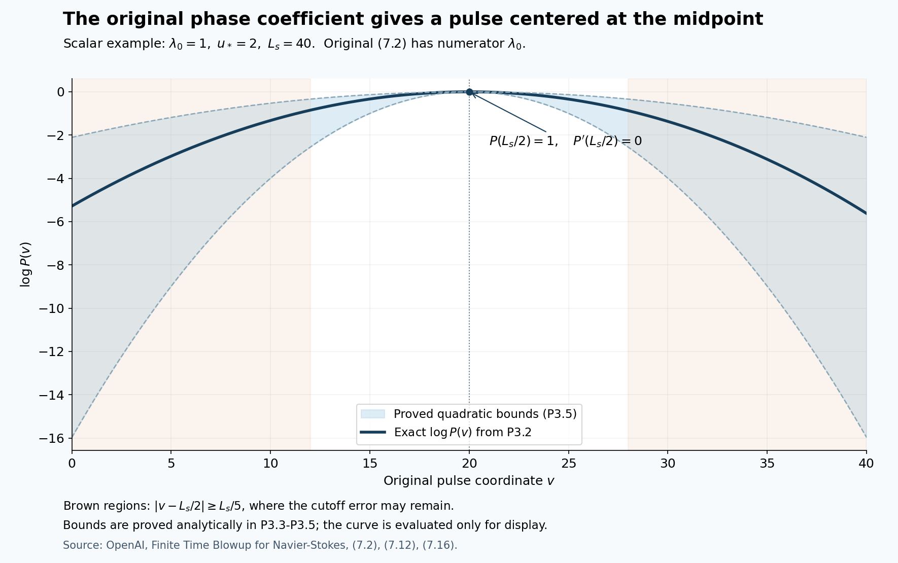

# The pulse inverse and its actual linear residual

The complete theorem and its proof dependencies are stated in the [theorem construction](theorem-audit-conclusion.md). This note derives the local operator estimates in original Lemma 7.1, Proposition 7.2, Corollary 7.3, Lemmas 7.4 and 7.7, and Proposition 9.1. It keeps the phase, moving plane, pressure, viscosity, curl terms and endpoint residuals. The actual global base construction is supplied by [Z0–Z8](base-field-realization-audit.md). The companion stress and cycle proofs supply their local operations; their existence is not inferred from the pulse calculation alone.

Source: OpenAI, *Finite Time Blowup for Navier–Stokes*, [original PDF](https://cdn.openai.com/pdf/32d9f210-8b73-45e0-91bc-82a30aef8a9a/navier-stokes.pdf), frozen SHA-256 `0e779481c4da40bd28d1e642e1d8ca57447d129610df28dfa5a11e9af8ae228f`. Source locators: pages 74–81, 85–87 and 101–102; pages 63–70 give the coordinate and class definitions used below.

The scalar example keeps the original pulse coordinate and displays (P3.2) between the analytically proved bounds (P3.5), at the stated values \(\lambda_0=1,u_*=2,L_s=40\). It does not instantiate a global flow or supply numerical evidence for the estimates. The shaded endpoint regions contain the possible cutoff error in P6. [Reproducible figure source](assets/pulse-envelope-audit.py); original source locators: (7.2), (7.12), (7.16).

## P0. The original pulse coefficient and midpoint envelope

Original (7.2), page 74, reads
\[
B_s^2=\frac{\lambda_0}{\varepsilon k^2(1+u_*^2)^{3/2}}.
\tag{P0.1}
\]
The interaction estimates in W3 use the coefficient bounds in (P0.1).

The distinction matters in the pulse calculation. With \(s(L_s/2)=\sigma u_*\), original \(d_{\rm ref}=\varepsilon k^2B_s^2(1+s^2)\) gives
\[
d_{\rm ref}(L_s/2)=\frac{\lambda_0}{\sqrt{1+u_*^2}}=\lambda(L_s/2).
\tag{P0.2}
\]
Doubling the numerator would instead give \(\lambda-d_{\rm ref}=-\lambda_0/\sqrt{1+u_*^2}\) at that point. Its envelope defined by (7.12), with value one there, would have a negative derivative there and values greater than one immediately to the left. Thus the doubled version cannot support the stated midpoint envelope bound. The original numerator gives the zero midpoint derivative used in the envelope bound.

## P1. Original input data and a fixed band threshold

Keep the original \(0<h<1/100\), \(A=1/2+h\), \(D=1/2-h\), \(Q=2^{-\ell}\), \(\varepsilon=Q^h\), \(S_*=\ell^2\), \(R=r/\sqrt Q\), \(Z=z/Q^D\), \(T=(1-t)/Q\), \(X=r^2/(2q)\), and the original auxiliary map \(Y=v_rr^{d_r}+v_tt\). The matrices, vectors, \(d_r\), \(\kappa_s=10^{-5}\), covering indices, chain-rule operators and weighted classes are defined with full factors in the [wave-interaction audit](wave-interaction-audit.md), W1–W3. In particular,
\[
D_r=\partial_R+M_id_rR^{d_r-1}\mathcal L_i,\quad
D_z=\varepsilon\partial_Z,\quad
\mathfrak t_*=-\varepsilon\partial_T+c_iN_i,
\quad T_g^{-1}S_*^{-1}<c_i\le S_*^{-1}.
\tag{P1.1}
\]
The pulse coordinates on each lifted rectangle satisfy
\[
v=(\eta_g+r_0)/c_i,\quad L_s=2r_0/c_i,\quad
2r_0S_*\le L_s<2r_0T_gS_*,\quad
D_rv=D_zv=0,\quad c_iN_iv=1.
\tag{P1.2}
\]
Band and label choices, including the representative, are fixed before any coefficient derivative.

The source uses the smooth slow base column \((b,V,G)\), independent of the auxiliary variable, with \(b=O(\varepsilon)\) in every fixed slow derivative. The tangential base differs from its fixed order-zero profiles by \(O(\varepsilon^2)\), with all fixed slow derivatives. The boxes and their fixed enlargements have diameter at most \(C S_*^{-3}\). At the fixed representative put
\[
F=V/R,\quad g=(RF_R,G_R),\quad N=g_0/|g_0|,\quad K=(-N_z,N_\theta),
\]
\[
\lambda_0^2=-2F_0N_\theta(2F_0N_\theta+|g_0|)>0,
\qquad c_0=\frac{\lambda_0}{2F_0N_\theta}<0.
\tag{P1.3}
\]
Here subscript zero means the order-zero quantity at the representative; \(\lambda_0>0\). These are precisely the base properties supplied to Section 7 by Theorem 4.6 and Proposition 5.5. Their actual global construction is supplied by V and Z, and the exact base-to-chart derivative map and positive shear bounds are proved in [I1–I2](local-construction-assembly-audit.md). The calculation below proves the pulse operation with those same input fields.

Write \(0<\lambda_-\le\lambda_0\le\lambda_+\) and \(|g_0|\le g_+\) for the fixed uniform input bounds. They already imply the relevant nonzero shear and frame factors. Indeed, with \(a=2F_0N_\theta\), the relation \(-a(a+|g_0|)>0\) gives \(-|g_0|<a<0\). Moreover
\[
\lambda_0^2=|a|(|g_0|-|a|)\le |a|g_+,
\quad |a|\ge\lambda_-^2/g_+,
\quad |g_0|\ge2\lambda_-,
\]
\[
\frac{\lambda_-}{g_+}\le |c_0|
\le\frac{\lambda_+g_+}{\lambda_-^2}.
\tag{P1.4}
\]
The inequality \(|g_0|\ge2\lambda_-\) follows from \(x(g-x)\le g^2/4\), whose difference from \(g^2/4\) is \((x-g/2)^2\). Thus the denominators used below have stated lower bounds, rather than implicit nonvanishing assumptions.

Keep \(u_*>0\) chosen by the original strict stress-cone condition, and retain
\[
\begin{gathered}
k=\lceil\varepsilon^{-1/2}\rceil,\quad
B_s^2=\frac{\lambda_0}{\varepsilon k^2(1+u_*^2)^{3/2}},\quad
s(v)=\sigma\left(\frac{u_*}{2}+\frac{u_*v}{L_s}\right),
\\(\widetilde p/R_0,p_z)=B_s\left(K-\frac{\sigma u_*g_0}{L_s|g_0|^2}\right),
\quad x_0=\sigma B_su_*/2,
\\ kp\text{ is a nearest nonzero integer to }k\widetilde p,\qquad
\Phi=p\theta+p_zZ/\varepsilon+x_0R-v(pF+p_zG).
\end{gathered}
\tag{P1.5}
\]
The fixed tie rule is not differentiated. For \(\varepsilon\le1\),
\[
1\le\varepsilon k^2\le4,\quad |p-\widetilde p|\le k^{-1},\quad
B_-\le B_s\le B_+,
\]
\[
B_-^2=\frac{\lambda_-}{4(1+u_*^2)^{3/2}},\qquad
B_+^2=\frac{\lambda_+}{(1+u_*^2)^{3/2}}.
\tag{P1.6}
\]
For rounding, any real number has a nonzero integer within distance one: ordinary nearest-integer rounding has error at most one half except when it selects zero, in which case one of \(1,-1\) is within distance one. This proves the displayed error without using the incorrect one-half bound near zero.

Put \(H_\Phi=pF+p_zG\). The entire phase gradient is
\[
n=\nabla_*\Phi=(x_0-v(H_\Phi)_R,\ p/R,\ p_z-\varepsilon v(H_\Phi)_Z).
\tag{P1.7}
\]
This follows by differentiating (P1.5) with (P1.1) and \(D_rv=D_zv=0\). Before rounding, at the representative,
\[
(\widetilde p/R_0,p_z)\cdot g_0=-\sigma B_su_*/L_s,
\]
since \(K\cdot g_0=0\). Uniform first slow derivative bounds, the box diameter, the \(O(\varepsilon^2)\) base comparison, and rounding therefore give
\[
(H_\Phi)_R=-\sigma B_su_*/L_s+\mathcal E_R,
\qquad |\mathcal E_R|\le C(S_*^{-3}+\varepsilon^2+k^{-1}).
\tag{P1.8}
\]
Consequently \(n_r=B_ss(v)-v\mathcal E_R\). The exact tangential wave-number formula gives
\[
|(p/R,p_z)-B_sK|\le C(S_*^{-1}+S_*^{-3}+k^{-1});
\]
here \(R_0/R-1=O(S_*^{-3})\), using the positive lower bound on \(R\). The remaining axial term in (P1.7) is bounded by \(C\varepsilon S_*\). Since \(n'=(-(H_\Phi)_R,0,-\varepsilon(H_\Phi)_Z)\), these estimates prove
\[
|n-B_s(s,K)|+|n'|\le C/S_*
\tag{P1.9}
\]
once \(S_*^2(\varepsilon+\varepsilon^2+k^{-1})\le1\). This one condition holds for all sufficiently large \(\ell\): \(S_*^2=\ell^4\), \(k^{-1}\le2^{-h\ell/2}\), and every fixed power of \(\ell\) times a decreasing exponential tends to zero, as follows by taking its logarithm \(4\log\ell-(h\log2)\ell/2\).

Increase this lower band threshold finitely so that the error in (P1.9) is at most \(B_-/2\). Then
\[
|n_{\rm tan}|\ge B_-/2,\qquad |n|\ge B_-/2,
\tag{P1.10}
\]
uniformly. All fixed mixed derivatives in the slow, transverse and pulse coordinates have polynomial bounds in \(S_*\), directly from (P1.5)–(P1.7) and the fixed-derivative bounds of the base. Discrete data are fixed; higher derivatives do not differentiate rounding or the representative choice. Product and quotient rules, together with (P1.10), give polynomial bounds for every smooth rational expression in these coefficients whose denominators have the displayed lower bounds. This requires no new smallness condition for a higher derivative order.

The same denominator argument applies on the enlarged lifted rectangle: its pulse coordinate ranges over \(-L_s/2<v<3L_s/2\), so \(|v|\le3L_s/2\) and \(|s(v)|\le2u_*\). The error estimates above change only their fixed constants. Include this finite enlargement in the choice of the lower band threshold. Then \(|n_{\rm tan}|\ge B_-/2\) there as well, while the base is evaluated on its prescribed smooth enlarged slow box. This supplies the smooth coefficients needed for local continuation past the pulse endpoints. The envelope and propagator bounds below are asserted on \(0\le v\le L_s\).

The full transport defect is also explicit:
\[
\begin{aligned}
\mathfrak t_*\Phi&=-H_\Phi+\varepsilon v(H_\Phi)_T,\\
F\partial_\theta\Phi+GD_z\Phi&=H_\Phi-\varepsilon vG(H_\Phi)_Z,\\
E_{ik}:=(\mathfrak t_*+bD_r+F\partial_\theta+GD_z)\Phi
&=\varepsilon v((H_\Phi)_T-G(H_\Phi)_Z)+bn_r.
\end{aligned}
\tag{P1.11}
\]
Every fixed coefficient derivative of the last line has a factor \(\varepsilon\) and a polynomial in \(S_*\), because every such derivative of \(b\) is \(O(\varepsilon)\). Finally \(kp\ne0\) is an integer, so all \(e^{ikm\Phi}\), \(m\ne0\), have nonzero integer angular frequency.

Choose a lower band index \(\ell_*\) satisfying these finitely many value conditions and set \(q_*\le\min(q_{\rm big},2^{-\ell_*-1})\). For \(q<q_*\) and \(q/Q\in[1/2,2]\), \(Q\le2q<2^{-\ell_*}\), so all relevant bands satisfy the chosen threshold. The choice has no dependence on the harmonic bound, derivative order or correction stage.

## P2. Exact moving-plane equation, frame and pressure

Retain the original matrix and projection:
\[
\mathcal K=\begin{pmatrix}0&-2F&0\\2F+RF_R&0&0\\G_R&0&0\end{pmatrix},
\quad \Pi_n f=f-\frac{n(n\cdot f)}{|n|^2},\quad
\mathcal A=-\mathcal K+\frac{n(n^T\mathcal K-(n')^T)}{|n|^2},
\]
\[
d=\varepsilon k^2|n|^2>0.
\tag{P2.1}
\]
Dot products here are bilinear extensions of the real Euclidean dot product; \(n\) and all these coefficients are real. In particular \(n^T\mathcal A=-(n')^T\) and \(n\cdot\Pi_nf=0\).

The three-dimensional initial-value equation
\[
t_m'=\mathcal A t_m-m^2dt_m-\Pi_nf_m,\qquad t_m(0)=0
\tag{P2.2}
\]
preserves the constraint exactly:
\[
(n\cdot t_m)'=-m^2d(n\cdot t_m),\qquad n(0)\cdot t_m(0)=0.
\tag{P2.3}
\]
Multiplication by \(\exp(m^2\int_0^v d)\) proves that the scalar in (P2.3) is zero. Rearranging (P2.2) gives
\[
t_m'+\mathcal Kt_m+m^2dt_m+f_m
=\frac n{|n|^2}(n\cdot\mathcal Kt_m-n'\cdot t_m+n\cdot f_m).
\]
Therefore the original pressure, including its complex sign, is
\[
\pi_m=\frac{i}{km}\frac{n\cdot\mathcal Kt_m-n'\cdot t_m+n\cdot f_m}{|n|^2},
\tag{P2.4}
\]
and multiplication by \(ikmn\) cancels the preceding normal vector because \(i^2=-1\). Thus
\[
t_m'+\mathcal Kt_m+m^2dt_m+ikmn\pi_m=-f_m,\qquad n\cdot t_m=0.
\tag{P2.5}
\]
This includes the normal component of the source. Conversely any solution of (P2.5) with the constraint has (P2.4), by taking its dot product with \(n\), and then satisfies (P2.2). Thus uniqueness for (P2.2) proves uniqueness for the constrained amplitude and its pressure.

Define the actual frame without replacing the phase normal:
\[
K_a=n_{\rm tan}/|n_{\rm tan}|,\quad N_a=((K_a)_z,-(K_a)_\theta),\quad
s_a=n_r/|n_{\rm tan}|,\quad U=[e_r-s_aK_a,N_a],
\]
\[
c(v)=c_0\sqrt{1+s(v)^2},\quad
M=\begin{pmatrix}1&1\\c&-c\end{pmatrix},\quad
B=UM,\quad M^{-1}=\frac12\begin{pmatrix}1&c^{-1}\\1&-c^{-1}\end{pmatrix},
\]
\[
B^\ell=M^{-1}\begin{pmatrix}e_r^T\\N_a^T\end{pmatrix}.
\tag{P2.6}
\]
The columns of \(U\) lie in \(n^\perp\), are independent, and \((e_r^T;N_a^T)U=I_2\). Since \(c\ne0\) by (P1.4), \(B^\ell B=I_2\), and \(BB^\ell t=t\) for \(t\in n^\perp\). We only assert this last identity on that plane: \(BB^\ell\) need not be the orthogonal projection on all of \(\mathbb C^3\). Equations (P1.9)–(P1.10) and (P1.4) bound \(B,B^\ell\) uniformly and bound every fixed derivative polynomially.

At the reference normal \(n_0=B_s(s,K)\), let \(e=e_r-sK\) and write \(t=xe+yN\). The frozen \(\mathcal K_0\) uses \(F_0\) and \(g_0=|g_0|N\). Direct multiplication gives
\[
-\mathcal K_0e=(-2F_0sK_\theta,-2F_0e_\theta-g_0),\qquad
-\mathcal K_0N=(2F_0N_\theta,0),
\]
where each pair lists its radial and tangential parts. Consequently
\[
e\cdot(-\mathcal K_0e)=sK\cdot g_0=0,\quad
e\cdot(-\mathcal K_0N)=2F_0N_\theta,\quad
N\cdot(-\mathcal K_0e)=-(2F_0N_\theta+|g_0|),
\]
and \(N\cdot(-\mathcal K_0N)=0\). The normal projection contributes zero to these dot products. Since \(|e|^2=1+s^2\), \(|N|^2=1\), and \(e\cdot N=0\), the exact two-dimensional reference matrix is
\[
L_0=\begin{pmatrix}0&2F_0N_\theta/(1+s^2)\\-(2F_0N_\theta+|g_0|)&0\end{pmatrix}.
\tag{P2.7}
\]
Its eigenvectors are \((1,c)^T,(1,-c)^T\). Indeed, writing \(a=2F_0N_\theta\), the first component of \(L_0(1,c)^T\) is \(ac/(1+s^2)=\lambda_0/\sqrt{1+s^2}\), and its second is \(-(a+|g_0|)=\lambda_0^2/a=\lambda c\). Thus
\[
M^{-1}L_0M=\operatorname{diag}(\lambda,-\lambda),\qquad
\lambda(v)=\lambda_0/\sqrt{1+s^2}>0.
\tag{P2.8}
\]

For the actual coefficients, the algebraic projection \(-\mathcal K+nn^T\mathcal K/|n|^2\) differs from its frozen counterpart by \(O(S_*^{-1})\), by (P1.8)–(P1.10), the base comparison and the box diameter. The actual \(K_a,N_a,s_a\) differ from \(K,N,s\) by that order. The moving-normal term \(-n(n')^T/|n|^2\) is also \(O(S_*^{-1})\). Finally \(K_a',N_a',s_a'=O(S_*^{-1})\) by differentiating their exact quotients and using (P1.9), while \(s'=\sigma u_*/L_s=O(S_*^{-1})\). Hence \(B'=O(S_*^{-1})\). Substituting all these differences, using the uniform matrix bounds, proves
\[
B^\ell(\mathcal AB-B')=\operatorname{diag}(\lambda,-\lambda)+E,
\qquad \|E\|\le C_E/S_*.
\tag{P2.9}
\]
All fixed derivatives of \(E\) are polynomially bounded; they are not asserted to be \(O(S_*^{-1})\). Similarly, with the original reference damping,
\[
d_{\rm ref}=\varepsilon k^2B_s^2(1+s^2)
=\frac{\lambda_0(1+s^2)}{(1+u_*^2)^{3/2}},\qquad
|d-d_{\rm ref}|\le C_d/S_*.
\tag{P2.10}
\]
For the last inequality use \(\big||n|^2-|n_0|^2\big|\le|n-n_0|(|n|+|n_0|)\), (P1.6), and the uniform bounds already proved.

Because \(n^T(\mathcal AB-B')=-(n')^TB-n^TB'=0\), this matrix maps into the moving plane. Consequently the exact correspondence \(t_m=Bz_m\) turns (P2.2) into
\[
z_m'=A_mz_m+g_m,\quad
A_m=\operatorname{diag}(\lambda,-\lambda)+E-m^2dI_2,
\quad g_m=-B^\ell\Pi_nf_m,\quad z_m(0)=0.
\tag{P2.11}
\]
The verified identities for \(BB^\ell\) prove both directions of this correspondence; no normal component has been removed without recovering its pressure.

## P3. Exact envelope and forward propagator

Use the original envelope
\[
P(v)=\exp\left(\int_{L_s/2}^{v}(\lambda(w)-d_{\rm ref}(w))\,dw\right).
\tag{P3.1}
\]
Write \(y=|s(v)|=u_*/2+u_*v/L_s\), retaining the original \(v\) and \(L_s\). Direct integration gives the exact identity
\[
\begin{aligned}
\log P(v)=\frac{\lambda_0L_s}{u_*}\bigg[&\operatorname{arsinh}y-\operatorname{arsinh}u_*
\\&-\frac{y+y^3/3-u_*-u_*^3/3}{(1+u_*^2)^{3/2}}\bigg].
\end{aligned}
\tag{P3.2}
\]
To verify it, differentiate \(\operatorname{arsinh}y\) to obtain \((1+y^2)^{-1/2}\), differentiate \(y+y^3/3\) to obtain \(1+y^2\), and use \(y'=u_*/L_s\). Both sides vanish at \(v=L_s/2\).

Let
\[
a(v)=\lambda(v)-d_{\rm ref}(v)
=\frac{\lambda_0}{\sqrt{1+y^2}}-\frac{\lambda_0(1+y^2)}{(1+u_*^2)^{3/2}}.
\]
Then \(a(L_s/2)=0\) and exactly
\[
a'(v)=-\frac{u_*\lambda_0 y}{L_s}
\left((1+y^2)^{-3/2}+2(1+u_*^2)^{-3/2}\right).
\tag{P3.3}
\]
Since \(u_*/2\le y\le3u_*/2\), define the fixed positive constants
\[
c_- =\frac{\lambda_-u_*^2}{2}
\left((1+9u_*^2/4)^{-3/2}+2(1+u_*^2)^{-3/2}\right),
\]
\[
c_+ =\frac{3\lambda_+u_*^2}{2}
\left((1+u_*^2/4)^{-3/2}+2(1+u_*^2)^{-3/2}\right).
\tag{P3.4}
\]
Each positive factor in (P3.3) is bounded by its respective endpoint bounds, proving \(-c_+/L_s\le a'(v)\le-c_-/L_s\). Taylor's integral formula about the midpoint, applied to \(\log P\) whose value and first derivative vanish there, now gives on both sides
\[
\exp\left(-\frac{c_+(v-L_s/2)^2}{2L_s}\right)
\le P(v)\le
\exp\left(-\frac{c_-(v-L_s/2)^2}{2L_s}\right)\le1.
\tag{P3.5}
\]
For the left side of the midpoint, substitute \(v=L_s/2-x\) in Taylor's integral formula; the same nonnegative triangular kernel integrates \((\log P)''\). Thus no sign is changed by integrating backward. These are analytic bounds, not numerical enclosures.

For completeness, the fundamental matrix of a continuous matrix coefficient \(A_m\) on a fixed finite interval is obtained by the series
\[
V_m(v,w)=I_2+\sum_{n\ge1}
\int_{w\le a_n\le\cdots\le a_1\le v}
A_m(a_1)\cdots A_m(a_n)\,da_n\cdots da_1.
\tag{P3.6}
\]
If \(\|A_m\|\le K\) there, the \(n\)-th term is bounded by \(K^n(v-w)^n/n!\). Uniform absolute convergence, and the same estimate for the differentiated integral series, prove \(\partial_vV_m=A_mV_m\), \(V_m(w,w)=I_2\). A difference of two solutions with zero initial value satisfies \(u(v)=\int_w^v A_m(a)u(a)\,da\); iterating this identity and letting \(n\to\infty\) with the same factorial bound proves uniqueness. Thus this construction supplies the finite-interval existence and uniqueness used in P2, rather than assuming a solution with the desired bound.

For a complex solution of \(z'=A_1z\), using the Hermitian norm only in this norm estimate,
\[
\frac12(|z|^2)'=\operatorname{Re}(z^*A_1z)
\le\left(\lambda-d_{\rm ref}+\frac{C_E+C_d}{S_*}\right)|z|^2.
\tag{P3.7}
\]
Multiply by the exponential of minus twice the integral of the scalar coefficient to obtain a nonincreasing quantity. Taking square roots and the supremum over initial vectors proves
\[
\|V_1(v,w)\|\le
e^{(C_E+C_d)(v-w)/S_*}\frac{P(v)}{P(w)}
\le C_V\frac{P(v)}{P(w)},\quad
C_V=e^{2r_0T_g(C_E+C_d)}.
\tag{P3.8}
\]
The scalar damping commutes with every matrix, so direct differentiation and uniqueness in (P3.6) prove the exact identity
\[
V_m(v,w)=\exp\left(-(m^2-1)\int_w^v d(a)\,da\right)V_1(v,w).
\tag{P3.9}
\]
Since \(d>0\) and \(m\in\mathbb Z\setminus\{0\}\), its scalar factor is at most one. Therefore (P3.8) holds for every nonzero integer \(m\), with the same constant and the same domain. This is why higher harmonics do not require another smallness threshold.

## P4. Source inverse, derivatives and the exact common-torus path

Let \(f_m\) have exactly the support, smooth-extension and fixed-derivative bounds of original Proposition 7.2: for each fixed multi-index \(I\) in \((R,Z,T,H)\),
\[
|\partial^I f_m|\le C_I\varepsilon^\alpha S_*^{b_I}
\sqrt\zeta\,\delta^{-a_I}P(v),\qquad 0\le v\le L_s,
\tag{P4.1}
\]
with fixed closed slow support inside the label support, compact transverse support inside \(\operatorname{supp}\chi_g\), and zero extension at the shell edges. The full weights are
\[
\zeta(X)=\exp\left(-\frac{a_a}{\log^2(X/X_a)}-\frac{a_b}{\log^2(X_b/X)}\right),\quad
\delta(X)=\min\{1,\log(X/X_a),\log(X_b/X)\},\quad a_a,a_b>0.
\tag{P4.2}
\]
The source may depend on the common torus without descending to the finer band torus; its values on different preimages are not averaged or identified. It need not be transverse to \(n\). No divisibility by a cutoff is assumed.

The actual solution is
\[
z_m(v)=\int_0^v V_m(v,w)g_m(w)\,dw,\qquad t_m(v)=B(v)z_m(v),
\tag{P4.3}
\]
with pressure (P2.4). Inserting (P3.8) and the source bound cancels \(P(w)\) exactly. The path fixes \((R,Z,T)\), hence \(\zeta,\delta\), and its length is at most \(2r_0T_gS_*\). This gives
\[
|z_m(v)|\le C\varepsilon^\alpha S_*^{b_0+1}\sqrt\zeta\delta^{-a_0}P(v),
\tag{P4.4}
\]
enlarging the constant or polynomial degree for the bounded frame factors if needed.

First differentiate in slow variables and the initial transverse coordinate, holding \(v\) fixed. The labels and \(L_s\) are constants in these derivatives. They commute with \(\partial_v\). The differentiated equation is exactly
\[
(\partial^I z_m)'=A_m\partial^I z_m+\partial^Ig_m
+\sum_{0<J\le I}\binom IJ(\partial^JA_m)\partial^{I-J}z_m,
\quad \partial^Iz_m(0)=0.
\tag{P4.5}
\]
The coefficient derivatives \(\partial^JA_m\) are bounded by \(C_{J,M}S_*^{c_J}\) for a fixed finite harmonic set \(0<|m|\le M\); the factor \(m^2\) is retained in the constant. At derivative order \(I\), Leibniz' formula bounds \(\partial^Ig_m\) by a polynomial in \(S_*\) times the same \(\varepsilon^\alpha\sqrt\zeta\delta^{-a}P\) weight. Inductively every other source in (P4.5) has this weight too. Applying (P3.8) again increases its polynomial degree by one from the interval length. More explicitly, if the source term for \(\partial^Ig_m\) has degree \(b_I^g\) and the previously proved solution degrees are \(b'_{I-J}\), choose
\[
b'_I=1+\max\left\{b_I^g,\max_{0<J\le I}(c_J+b'_{I-J})\right\},
\quad
a'_I=\max\left\{a_I^g,\max_{0<J\le I}a'_{I-J}\right\}.
\tag{P4.6}
\]
These choices prove the induction for every fixed multi-index. No additional power of \(\varepsilon\) is lost. Pulse derivatives follow by repeatedly differentiating \(z'_m=A_mz_m+g_m\); each derivative is a finite sum of products already bounded, so it has the same envelope with enlarged polynomial degree. Applying product rules to \(t_m=Bz_m\) proves its corresponding estimates. The pressure formula (P2.4), (P1.10), and \(|km|^{-1}\le\varepsilon^{1/2}\) give the full bounds
\[
t_m\in\mathsf W_\alpha\text{ on the labelled interval},\qquad
\pi_m\in\mathsf W_{\alpha+1/2}\text{ there}.
\tag{P4.7}
\]
All source and solution derivatives have their own estimates (P4.1); this argument does not infer derivative bounds by differentiating a pointwise inequality for the envelope.

Here is the precise map on the common torus. For \(H=J_g^{i_0}Y\), \(\Delta=i-i_0\in\{0,\ldots,\Delta_{\max}\}\), define
\[
\lambda_t(w)=\frac{v_t\cdot w}{1+b_g^2},\quad
\lambda_r(w)=\frac{v_r\cdot w}{1+b_g^2}.
\]
On a chosen lift, \(\eta_g(H)=\lambda_t(J_g^\Delta H-c_\gamma-k_{\rm copy})\), and the source in (P4.3) is evaluated at
\[
H_w=H+T_g^{-\Delta}c_i(w-v(H))v_t.
\tag{P4.8}
\]
Because \(\lambda_tJ_g^\Delta=T_g^\Delta\lambda_t\),
\[
D_HH_w=I_2-v_t\lambda_t,\quad D_H^aH_w=0\ (a\ge2),\quad
D_Hv=T_g^\Delta\lambda_t/c_i,
\quad D_H\xi_g=\Lambda_g^\Delta\lambda_r.
\tag{P4.9}
\]
The derivative of the first path map is bounded independently of the band; the derivative of \(v\) costs only a factor \(C S_*\). Differentiating a coefficient expressed in \((\xi_g,v)\) thus introduces fixed powers of these constant linear maps. Conversely the initial transverse and pulse directions in \(H\) are \(J_g^{-\Delta}v_r\) and \(T_g^{-\Delta}c_iv_t\) on this local lift; these are legitimate linear maps in the covering chart, not an asserted global inverse to a torus covering. They have bounded coefficients. These identities prove (P4.7) in exactly the original \((R,Z,T,H)\) coefficient variables.

The path fixes the slow and transverse point. If that point is outside the prescribed support, its source is zero for the entire interval, and (P4.3) makes the solution zero there. Its derivatives extend by zero across those boundaries by (P4.5), or directly by solving the equation for the given smooth source extension. At shell edges, \(\sqrt\zeta\delta^{-a}\) tends to zero with every fixed derivative; the estimates in P4 and the zero-extension argument of W3 therefore prove smooth extension for the solution and pressure. There is no claimed temporal zero extension before the pulse cutoff. Smooth coefficients on the enlarged rectangle provide a local extension of the initial-value solution past each endpoint; the bounds above concern the closed interval itself.

Deck translations preserving \(H\) translate (P4.8) and reindex its lift by the same integer vector. The source values agree under those translations, and uniqueness proves the same for the solution. Distinct preimages of a finer band-torus point remain distinct points of \(H\), with their actual source data. On overlapping common-torus neighborhoods, pull everything to the absolute torus. The path is \(Y_w=Y+T_g^{-i}c_i(w-v(Y))v_t\) in both descriptions. Compatible source data and uniqueness then prove compatibility of the output. On compact sets with \(q>0\), uniform one-sided slow derivatives at \(\tau=0\) pass through the same differentiated equations and their integrals, proving the stated one-sided derivative property. The number of derivatives and the finite harmonic set change constants and degrees only, not the previously chosen \(q_*\).

## P5. The homogeneous pulse and its momentum flux direction

The primary stress construction needs a nonzero homogeneous solution, not the zero-data sourced solution. Use the original initial data in the growing coordinate:
\[
z_+(0)=P(0)>0,\qquad z_-(0)=0,\qquad
t^h=B(z_+,z_-)^T,\qquad (t^h)'=\mathcal A t^h-dt^h.
\tag{P5.1}
\]
All coefficients and data are real. On any interval with \(z_+>0\), put \(r=z_-/z_+\). Subtracting the two quotient terms from (P2.11) gives exactly
\[
r'=E_{21}+(-2\lambda+E_{22}-E_{11})r-E_{12}r^2,\qquad r(0)=0.
\tag{P5.2}
\]
Let \(c_\lambda=\lambda_-/\sqrt{1+9u_*^2/4}>0\), and retain \(|E_{ab}|\le C_E/S_*\). Choose \(K_b=2C_E/c_\lambda+1\), and include \(S_*\ge4K_b\) among the finite value conditions defining the common threshold in P1. At either boundary \(r=\pm K_b/S_*\),
\[
\pm r'\le\frac{C_E-2c_\lambda K_b+2C_EK_b/S_*+C_EK_b^2/S_*^2}{S_*}
\le\frac{25C_E/16-2c_\lambda K_b}{S_*}<0.
\tag{P5.3}
\]
A differentiable function starting inside this interval cannot first cross its upper boundary with strictly negative derivative, or its lower boundary with strictly positive derivative. Hence \(|r|\le K_b/S_*\le1/4\) while the ratio exists. Also
\[
\left(\log\frac{z_+}{P}\right)'=-(d-d_{\rm ref})+E_{11}+E_{12}r,
\]
so, with \(C_h=C_d+5C_E/4\),
\[
\left|\log\frac{z_+(v)}{P(v)}\right|
\le C_hv/S_*\le2r_0T_gC_h=:C_{h,0}.
\tag{P5.4}
\]
For any fixed band, the positive continuous \(P\) has positive minimum on \([0,L_s]\). The lower bound in (P5.4) therefore prevents \(z_+\) from reaching zero. The ratio and its bound extend to the entire interval.

In the actual \(U\) coordinates, write \(t^h=x(e_r-s_aK_a)+yN_a\). The full matrix \(M\) gives
\[
x=z_+(1+r),\qquad y=c_0\sqrt{1+s^2}\,z_+(1-r),
\]
\[
\frac34e^{-C_{h,0}}P(v)\le x(v)\le\frac54e^{C_{h,0}}P(v),
\quad
\frac yx-c_0\sqrt{1+s^2}
=-\frac{2c_0\sqrt{1+s^2}\,r}{1+r}.
\tag{P5.5}
\]
The last expression is bounded by \((8/3)\sup|c_0\sqrt{1+s^2}|K_b/S_*\). This proves the full source direction estimate (7.21), including its sign and radial lower bound.

The value estimate also follows from \(V_1(v,0)(P(0),0)^T\), using (P3.8). Initial data \(P(0)\) are fixed with the label, so their slow and transverse derivatives vanish. Repeating (P4.5) for this homogeneous solution proves \(|\partial^I t^h|\le C_IS_*^{b_I}P(v)\) at every fixed derivative order; pulse derivatives again follow from the equation. Its pressure is (P2.4) with \(f_m=0,m=1\), and has the factor \(\varepsilon^{1/2}\). These are estimates for the pulse before multiplying by the radial, transverse and slow amplitude factors used in stress realization. No shell weight or compact shell support is asserted for this unweighted homogeneous pulse itself.

Its energy identity retains the original shear and viscosity contributions. Because \(n\cdot t^h=0\), the normal term in \(\mathcal A t^h\) has zero dot product with \(t^h\). For any real \(t=(t_r,t_\theta,t_z)\), direct multiplication gives
\[
t\cdot\mathcal Kt=-2Ft_rt_\theta+(2F+RF_R)t_rt_\theta+G_Rt_rt_z
=g\cdot(t_r(t_\theta,t_z)).
\]
Thus the exact homogeneous identity is
\[
\frac12\frac d{dv}|t^h|^2
=-g\cdot(t_r^h(t_\theta^h,t_z^h))
-\varepsilon k^2|n|^2|t^h|^2.
\tag{P5.6}
\]
The stress map must match both components of this radial momentum flux. The map is constructed in [C1–C9](stress-covariance-audit.md).

## P6. Actual compact velocity, pressure, and every endpoint term

Let \(\psi(v)\) be the original smooth pulse cutoff, equal to one on \(|v-L_s/2|\le L_s/5\), supported in \(|v-L_s/2|<L_s/3\), rescaled from a fixed function. For the sourced solution set
\[
\widehat t_m=\psi t_m,\qquad \widehat\pi_m=\psi\pi_m,\qquad
C_m=\frac{i\,n\times t_m}{km|n|^2},\qquad \widehat C_m=\psi C_m.
\tag{P6.1}
\]
The exact actual velocity amplitude, rather than just its transverse part, is
\[
\operatorname{curl}_*(\widehat C_me^{ikm\Phi})
=(\widehat t_m+\widehat r_m)e^{ikm\Phi},
\]
\[
\widehat r_m=
\big(-D_z(\widehat C_m)_\theta,
\ D_z(\widehat C_m)_r-D_r(\widehat C_m)_z,
\ (D_r+R^{-1})(\widehat C_m)_\theta\big).
\tag{P6.2}
\]
The curl formula and its exact divergence are proved by all component terms in W4.1–W4.5. Now (P1.10) supplies the uniform denominator bound needed for this particular potential. The factor \((km)^{-1}\) increases the exponent by one half; one \(D_r\) can cost at most \(\kappa_s\). Hence, with all fixed coefficient derivatives and the original supports,
\[
\widehat C_m\in\mathsf W_{\alpha+1/2},\quad
\widehat r_m\in\mathsf W_{\alpha+1/2-\kappa_s},\quad
\widehat t_m+\widehat r_m\in\mathsf W_\alpha,
\quad\widehat\pi_m\in\mathsf W_{\alpha+1/2}.
\tag{P6.3}
\]
These class bounds follow by Leibniz' rule with (P4.7); derivatives of the quotient \(n/|n|^2\) are polynomially bounded by P1. All spatial derivatives of the temporal cutoff actually vanish here: \(D_r\psi=D_z\psi=\partial_\theta\psi=0\). Thus \(\widehat r_m=\psi r_m\) for the uncut remainder defined by (P6.2) with \(C_m\). Time derivatives of this product still contain \(\psi' r_m\); none are deleted. Both the potential and pressure vanish on open neighborhoods of the pulse endpoints, which supplies their smooth zero extensions there. P4 proves smooth zero extension at the other support boundaries.

The complete principal cutoff identity is
\[
\widehat t_m'+\mathcal K\widehat t_m+m^2d\widehat t_m
+ikmn\widehat\pi_m+f_m
=(1-\psi)f_m+\psi't_m.
\tag{P6.4}
\]
It follows by multiplying (P2.5) by \(\psi\), retaining the derivative \((\psi t_m)'\), and adding \(f_m\). Where either right-hand term is nonzero, \(|v-L_s/2|\ge L_s/5\), so (P3.5) and (P1.2) give
\[
P(v)\le e^{-c_-L_s/50}\le e^{-(c_-r_0/25)S_*}.
\tag{P6.5}
\]
Every fixed derivative of these terms has this same exponential smallness, times a permitted polynomial in \(S_*\) and shell factors, because the solution and source have their differentiated envelope bounds. The cutoff derivatives themselves obey \(|\psi^{(j)}|\le C_jL_s^{-j}\), and conversion to \(H\) multiplies only by powers of \(S_*\).

For the global assertion in original Proposition 9.1, the incoming source harmonic has its stated smooth zero extension across the entire fixed rectangle, including the temporal endpoints. This additional source property makes (P6.4) a global residual identity after the supported fields are extended by zero. Proposition 7.2 by itself did not impose that property on an arbitrary uncut source, and the present calculation does not add it silently. The actual source containment is proved in [S1–S5](source-containment-audit.md), and the four updates preserving it are proved in [K0–K8](correction-cycle-audit.md).

Real fields use conjugate harmonic pairs. Since \(A_m\) depends on \(m^2\) and is real, uniqueness gives \(t_{-m}=\overline{t_m}\) for \(f_{-m}=\overline{f_m}\). The factors \(i/(km)\) in the pressure and potential give \(\pi_{-m}=\overline{\pi_m}\), \(C_{-m}=\overline{C_m}\). The real cosine velocity \(t\cos(k\Phi)\) therefore has amplitudes \(t/2\) at both \(m=1,-1\), with their actual conjugate pressures and potentials. No factor two is suppressed in assembling the real velocity.

## P7. Physical factors and infinite-order cutoff decay

At viscosity one the physical potential, velocity, pressure and residual corresponding to chart fields have the factors
\[
Q^{1/2-A},\qquad Q^{-A},\qquad Q^{-2A},\qquad Q^{-2A-1/2},
\tag{P7.1}
\]
respectively. Their physical derivatives use the original evaluation map and chain-rule operators (P1.1). At any fixed derivative order and finite stage, each conversion contributes only a fixed power of \(Q^{-1}\) and a polynomial in \(S_*\): the radial factor is \(Q^{-1/2}\), the axial factor \(Q^{-D}\), the slow time factor \(Q^{-1}\), and the auxiliary factors come from \(T_g^i\) and \(\Lambda_g^i\), bounded by fixed powers of \(Q^{-1}\) using their explicit covering-index formula. Derivatives of the oscillatory exponential retain their finite factors \(km\) and the displayed phase derivatives; \(k\le2Q^{-h/2}\), \(\varepsilon^{-1}=Q^{-h}\). Derivatives of the cylindrical frame introduce only finite powers of \(r^{-1}\), with \(r=\sqrt Q R\) and \(R\) bounded away from zero. All remaining fixed coefficient derivatives have already been bounded.

The edge factors \(\sqrt\zeta\delta^{-a}\) are bounded uniformly on the shell, since they vanish at both edges and are continuous on its interior. Taking any fixed physical space-time derivative of a cutoff term from (P6.4) thus gives a bound
\[
CQ^{-M}S_*^B e^{-cS_*},\qquad c=c_-r_0/25>0,
\tag{P7.2}
\]
for fixed finite \(M,B\), allowing them to include the fixed factor \(\varepsilon^\alpha\). Since \(q\ge Q/2\), for every fixed \(N\ge0\),
\[
q^{-N}Q^{-M}S_*^B e^{-cS_*}
\le2^N\exp\big(-c\ell^2+(M+N)\ell\log2+2B\log\ell\big)\longrightarrow0.
\tag{P7.3}
\]
The limit follows because the negative quadratic term dominates the linear and logarithmic terms; for large \(\ell\) their sum is at most \(-c\ell^2/2\). The finitely many remaining bands enlarge the bound's constant. This proves the all-order \(O(q^N)\) assertion for each fixed physical derivative, uniformly over the bands and labels. Fixed-stage label sums add at most a polynomial mesh factor, absorbed into \(S_*^B\). These residuals remain actual additive terms; flatness does not mean they are zero.

For the original arbitrary \(\nu>0\), keep the exact map of the moment audit M2.4–M2.7:
\[
y=x/\sqrt\nu,\qquad u_\nu=\sqrt\nu\,u_1(y,t),\quad
p_\nu=\nu p_1(y,t),\quad f_\nu=\sqrt\nu f_1(y,t).
\]
Thus the four factors in (P7.1) become, in the same order,
\[
\nu Q^{1/2-A},\qquad\sqrt\nu Q^{-A},\qquad
\nu Q^{-2A},\qquad\sqrt\nu Q^{-2A-1/2}.
\tag{P7.4}
\]
The original coordinates are \(R=r_\nu/\sqrt{\nu Q}\), \(Z=z_\nu/(\sqrt\nu Q^D)\), \(T=(1-t)/Q\), with \(q_\nu-(z_\nu^2/\nu)q_\nu^{2h}=1-t\), \(X=r_\nu^2/(2\nu q_\nu)\), and \(Y=v_r(r_\nu/\sqrt\nu)^{d_r}+v_tt\). A fixed number of spatial derivatives adds a fixed power of \(\nu^{-1/2}\), absorbed only into the constant for that fixed original viscosity. In particular \(\nu\Delta_xu_\nu=\sqrt\nu\Delta_yu_1\); the factor \(\varepsilon k^2|n|^2\) in the pulse damping is unchanged by this exact map. All factors are retained, and the same all-order cutoff conclusion follows for each \(\nu>0\).

## P8. Full linearized residual after the curl

The principal amplitude-pressure operator is
\[
\mathscr L_m(a,\pi)=c_{i_0}N_{i_0}a+\mathcal Ka
+\varepsilon k^2m^2|n|^2a+ikmn\pi.
\tag{P8.1}
\]
On each lifted rectangle \(c_{i_0}N_{i_0}=\partial_v\) with the slow and transverse coordinates held fixed, including for sources that only descend to the common torus. The full linearization of the Navier–Stokes residual about \((b,V,G)\), on the harmonic \(ae^{ikm\Phi}\) with pressure \(\pi e^{ikm\Phi}\), has coefficient \(\mathscr L_m(a,\pi)+\mathscr L_m^{\rm rem}(a,\pi)\), where
\[
\begin{aligned}
\mathscr L_m^{\rm rem}(a,\pi)={}&
(-\varepsilon\partial_T+bD_r+GD_z)a+ikmE_{ik}a
\\&+a_r(\partial_Rb)e_r+a_zD_z(b,V,G)+(b/R)a_\theta e_\theta
+(D_r\pi,0,D_z\pi)
\\&-\varepsilon\big\{(D_r^2+R^{-1}D_r+D_z^2)a
-R^{-2}(a_r,a_\theta,0)
\\&\hspace{27mm}+2ikm(n_rD_r+n_zD_z)a
\\&\hspace{27mm}+ikm(D_rn_r+n_r/R+D_zn_z)a
\\&\hspace{27mm}+2ikm(n_\theta/R)(-a_\theta,a_r,0)\big\}.
\end{aligned}
\tag{P8.2}
\]
Here is a component derivation. The two transports use the exact cylindrical formula W1.6. Their frame terms sum to \((-2Va_\theta/R,Va_r/R+ba_\theta/R,0)\). The radial derivatives of the tangential base add \((0,\partial_RV\,a_r,\partial_RG\,a_r)\); because \(\partial_RV=F+RF_R\), their sum gives the full \(\mathcal K a\) and the remaining \((b/R)a_\theta e_\theta\). The other base derivatives are exactly \(a_r(\partial_Rb)e_r+a_zD_z(b,V,G)\). Phase transport gives \(ikmE_{ik}a\) after the cancellation in (P1.11). The pressure gradient is \(ikmn\pi+(D_r\pi,0,D_z\pi)\).

For the scalar Laplacian applied componentwise, the product rule gives its amplitude part \((D_r^2+R^{-1}D_r+D_z^2)a\), phase-quadratic part \(-k^2m^2|n|^2a\), mixed part \(2ikm(n_rD_r+n_zD_z)a\), and phase divergence \(ikm(D_rn_r+n_r/R+D_zn_z)a\). The angular derivative of \(n_\theta=p/R\) is zero. The cylindrical vector Laplacian adds \(-R^{-2}(a_r,a_\theta,0)\) and \(2R^{-2}\partial_\theta(-a_\theta,a_r,0)e^{ikm\Phi}\), which gives the last line in (P8.2). Multiplication by the residual sign \(-\varepsilon\) places the phase-quadratic part in (P8.1) with its positive sign. This accounts for every term in original (9.2).

For \(a\in\mathsf W_\alpha\), \(\pi\in\mathsf W_{\alpha+1/2}\), the gains over \(\alpha\), with all coefficient derivatives, are as follows:

| Full group in (P8.2) | Lower gain |
|---|---|
| \(-\varepsilon\partial_Ta+bD_ra+GD_za\) | \(1-\kappa_s\) |
| \(ikmE_{ik}a\) | \(1/2\) |
| \(a_r(\partial_Rb)e_r+a_zD_z(b,V,G)+(b/R)a_\theta e_\theta\) | \(1\) |
| \((D_r\pi,0,D_z\pi)\) | \(1/2-\kappa_s\) |
| \(-\varepsilon(D_r^2+R^{-1}D_r+D_z^2)a+\varepsilon R^{-2}(a_r,a_\theta,0)\) | \(1-2\kappa_s\) |
| \(-2\varepsilon ikm(n_rD_r+n_zD_z)a\) | \(1/2-\kappa_s\) |
| \(-\varepsilon ikm(D_rn_r+n_r/R+D_zn_z)a\) | \(1/2-\kappa_s\) |
| \(-2\varepsilon ikm(n_\theta/R)(-a_\theta,a_r,0)\) | \(1/2\) |

The rules behind the table are the exact class maps of W3: one explicit \(D_r\) costs at most \(\kappa_s\), \(D_z\) adds one, \(k\) costs one half, and the displayed \(b\) or its fixed slow derivatives add one. The multiplier \(n\) has polynomial coefficient bounds, as do its derivatives before the possible one \(D_r\) loss; (P1.11) retains the full \(\varepsilon\) in the transport defect. Every remaining factor \(R^{-1}\) is bounded on the original annulus, with bounded derivatives. Thus Leibniz' formula proves the table for every fixed coefficient derivative, retaining the shell weight and envelope from the amplitude or pressure factor.

The actual amplitude in (P6.2) is \(a=\widehat t_m+\widehat r_m\). The exact residual after adding the prescribed source is
\[
\begin{aligned}
\mathscr L_m(a,\widehat\pi_m)+\mathscr L_m^{\rm rem}(a,\widehat\pi_m)+f_m
={}&(1-\psi)f_m+\psi't_m
\\&+\mathscr L_m(\widehat r_m,0)
+\mathscr L_m^{\rm rem}(\widehat t_m+\widehat r_m,\widehat\pi_m).
\end{aligned}
\tag{P8.3}
\]
No curl term is absent here. The first line is the actual additive flat source from P6–P7. In the second line, \(c_{i_0}N_{i_0}\) preserves the coefficient exponent, \(\mathcal K\) has bounded coefficients, and \(\varepsilon k^2m^2|n|^2\) has polynomial coefficient bounds for each fixed harmonic set. Hence \(\mathscr L_m(\widehat r_m,0)\in\mathsf W_{\alpha+1/2-\kappa_s}\). The table and (P6.3) give the same bound for the last term, because \(1-2\kappa_s\ge1/2-\kappa_s\). Consequently
\[
\text{supported linear remainder}\in\mathsf W_{\alpha+1/2-\kappa_s}
\subset\mathsf W_{\alpha+1/2-3\kappa_s}.
\tag{P8.4}
\]
The inclusion uses \(0<\varepsilon\le1\). This proves the source Proposition 9.1, and the full term table yields the stated local strengthening by \(2\kappa_s\). No improvement of the complete correction cycle is inferred; other steps still determine its gain. Supports and torus compatibility follow from the exact products and derivatives in (P8.3), with smooth temporal extension supplied by the cutoff. The flat source is retained separately and is not fed back as a source requiring a new pulse solve. For a homogeneous supported amplitude in the stated wave class, the identical calculation applies with \(f_m=0\), leaving its actual cutoff term \(\psi't_m\).

## P9. What has been connected to the iteration

P1–P4 establish the source's local phase/frame comparison, constrained initial-value inverse, normal pressure cancellation, all fixed coefficient derivatives and compatibility on the actual common tori. They give one threshold independent of the finite harmonic set and derivative order. P5 establishes the homogeneous pulse and the original momentum-flux direction and energy identities. P6–P8 turn these amplitudes into compact, exactly divergence-free velocities with their retained curl remainders, pressure and the complete linearized Navier–Stokes residual. The physical cutoff errors have all-order decay proved in P7; they remain in the residual.

This supplies the pulse operation used by the [nonlinear interaction audit](wave-interaction-audit.md), W4–W7, whenever the original preceding construction supplies its stated base and source inputs. The [stress covariance audit](stress-covariance-audit.md), C1–C9, supplies the positive primary amplitudes, signed linear inverse and actual curl covariance errors. The [source-containment audit](source-containment-audit.md), S1–S5, proves the finite-stage closure and exact conservative means. The [initialization and complete cycle audit](correction-cycle-audit.md), K0–K8, proves the actual four updates, their simultaneous gains, accumulated-field bounds and common finite-stage domain. The [physical derivative and realization audit](physical-realization-audit.md), L0–L7, derives the stage-independent derivative loss, exact potential summation, retained cutoff curls, full nonlinear residual comparison, one-sided endpoint limits and preservation of the exterior and inner fields. The actual leading profile and complete base field are supplied by [V0–V7](shear-realization-audit.md) and [Z0–Z8](base-field-realization-audit.md). The complete theorem and its proof dependencies are stated in the [theorem construction](theorem-audit-conclusion.md).

The local stronger linear exponent (P8.4) is an underclaim of Proposition 9.1 under its existing hypotheses. It affects that operator estimate and can be substituted in the later cycle inequalities, and [K3–K7](correction-cycle-audit.md) proves all four steps while preserving the source's stage definitions. No novelty claim is made. P0 proves the envelope estimate with the original pulse coefficient.

Source/proof locators: original pages 74–77, (7.2)–(7.11), for P1–P2; pages 77–80, (7.12)–(7.20), for P3–P4; pages 80–81, (7.21)–(7.22), for P5; pages 85–87, (7.37)–(7.40), for P6; page 87 for P7; pages 101–102, (9.1)–(9.2), for P8. Supporting original-coordinate proofs are the [moment audit](mean-moment-correction-audit.md), M2, the [temporal audit](temporal-mean-correction-audit.md), T1–T2, and the [wave-interaction audit](wave-interaction-audit.md), W1–W4. The source is [OpenAI's original 166-page PDF](https://cdn.openai.com/pdf/32d9f210-8b73-45e0-91bc-82a30aef8a9a/navier-stokes.pdf), with the hash stated above. The independent authored audit is CC0; original sources retain their attribution and rights.
