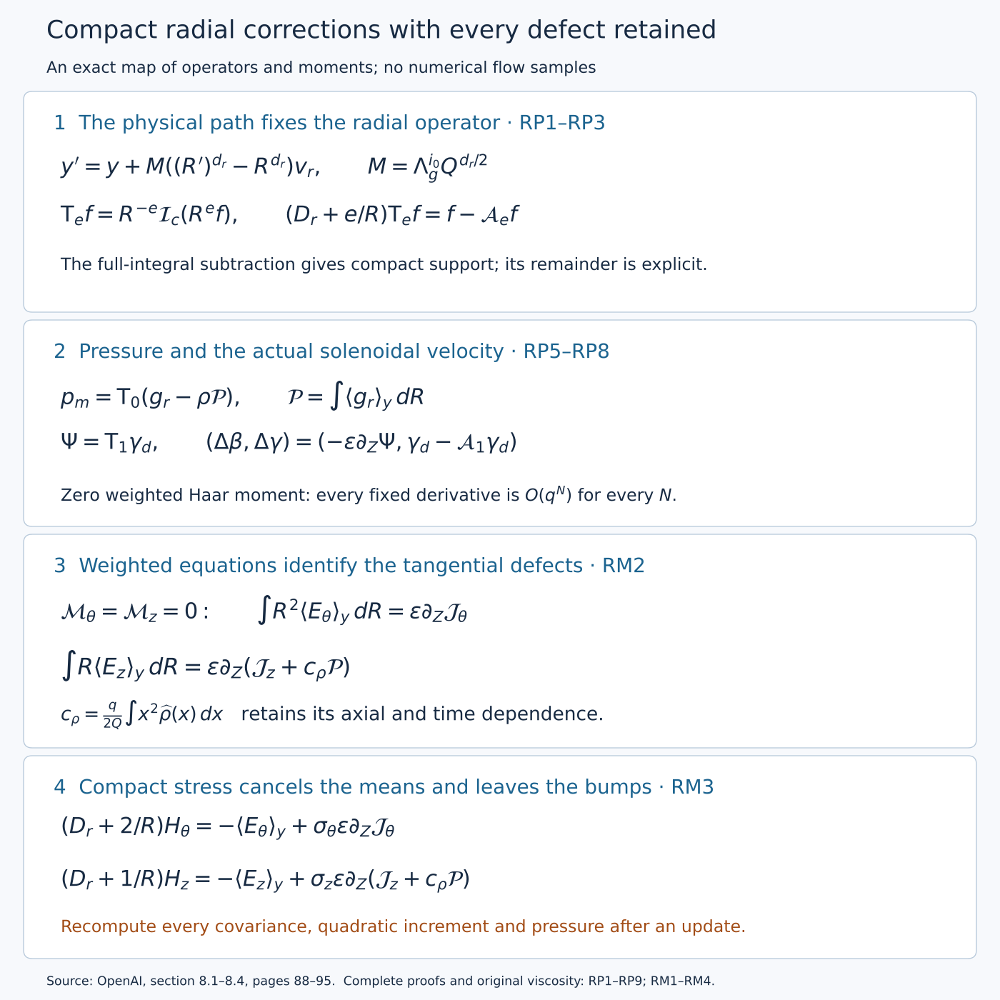

# Radial primitives and the complete mean equations

The mean correction needs a compact pressure and an actual divergence-free velocity. A radial integral alone is insufficient: its source depends on a torus coordinate that changes along a physical radius, and its full radial integral can leave a nonzero tail. This lesson constructs the original radial operator, retains its tail exactly, proves all its derivative estimates, and derives the three scalar defects that the later mean operations must remove.

The complete component covers original section 8.1–8.4, through Corollary 8.5: the conservative equations, weighted primitives, pressure, axial potential, integrated identities and compact tangential stress. RM4 retains the exact map back to the original viscosity. The auxiliary-time inverse and the five-profile moment solve are subsequent components. The preceding [pulse lesson](../src/constructing-the-pulses-and-their-velocities.md), [stress lesson](../src/realizing-stress-and-controlling-interactions.md) and [actual base construction](../src/constructing-the-actual-base-field.md) supply their complete input fields.

This lesson gives separate mathematical exposition of the radial operators and mean equations. The original source passages and the preceding constructions are cited below.

The diagram displays the maps proved in RP1–RP8 and RM1–RM4. The [editable diagram source](../assets/radial-mean-corrections.py) uses the exact formulas, without numerical flow samples.

## RP1. The physical map and every scale factor

Keep the original constants and coordinates
\[
0<h<\frac1{100},\quad A=\frac12+h,\quad D=\frac12-h,
\quad \tau=1-t=q(1-\eta^2),\quad z=q^D\eta,
\quad X=\frac{r^2}{2q}.
\tag{RP1.1}
\]
For a dyadic band and its auxiliary covering, the source uses
\[
\begin{gathered}
Q=2^{-\ell},\quad \varepsilon=Q^h,\quad S_*=\ell^2,
\quad R=\frac r{\sqrt Q},\quad Z=\frac z{Q^D},\quad T=\frac{1-t}{Q},\\
J_g=\begin{pmatrix}3&1\\1&5\end{pmatrix},\quad
\Lambda_g=4-\sqrt2,\quad T_g=4+\sqrt2,\quad b_g=\sqrt2-1,\\
v_r=(1,-b_g),\quad v_t=(b_g,1),\quad
\rho_g=\frac{\log\Lambda_g}{\log T_g},\quad
\kappa_s=10^{-5},\quad d_r=2((1+h)\rho_g-h\kappa_s),\\
i(\ell)=\left\lfloor\log_{T_g}\frac{Q^{-1-h}}{S_*}\right\rfloor.
\end{gathered}
\tag{RP1.2}
\]
Only sufficiently large \(\ell\), for which \(i\geq0\), are used. The physical evaluation is
\[
Y(r,t)=v_rr^{d_r}+v_tt\pmod{\mathbb Z^2},\qquad
Y_i=J_g^iY.
\tag{RP1.3}
\]
Direct multiplication gives \(J_gv_r=\Lambda_gv_r\) and \(J_gv_t=T_gv_t\). Before evaluating a coefficient at (RP1.3), its physical derivatives are consequently
\[
\mathfrak r=\partial_r+d_rr^{d_r-1}v_r\cdot\partial_Y,
\qquad
\mathfrak t=\partial_t+v_t\cdot\partial_Y.
\tag{RP1.4}
\]
Both derivatives on the right hold the independent \(Y\) fixed. Physical axial differentiation is \(\partial_z\), since \(Y\) does not depend on \(z\).

Fix a common covering index \(i_0\) on a neighborhood and write \(y=J_g^{i_0}Y\). All discrete indices and \(Q\) remain fixed during differentiation there. Put
\[
\mathcal L=v_r\cdot\partial_y,\quad N=v_t\cdot\partial_y,
\quad M=\Lambda_g^{i_0}Q^{d_r/2},\quad c=T_g^{i_0}Q^{1+h}.
\tag{RP1.5}
\]
The exact evaluated chart operators are
\[
\begin{aligned}
D_r&=\sqrt Q\,\mathfrak r
 =\partial_R+Md_rR^{d_r-1}\mathcal L,\\
D_z&=\sqrt Q\,\partial_z=\varepsilon\partial_Z,\\
\mathfrak t_*&=Q^{1+h}\mathfrak t
 =-\varepsilon\partial_T+cN.
\end{aligned}
\tag{RP1.6}
\]
For example, \(\sqrt Q\,d_rr^{d_r-1}\Lambda_g^{i_0}
=d_r\Lambda_g^{i_0}Q^{d_r/2}R^{d_r-1}\), proving the first line with every factor retained. The minus sign in the last line comes from \(T=(1-t)/Q\).

At the band index \(i\), the floor in (RP1.2) gives the explicit bounds
\[
\begin{aligned}
\Lambda_g^{-1}\varepsilon^{-\kappa_s}S_*^{-\rho_g}
 &<\Lambda_g^iQ^{d_r/2}
 \leq\varepsilon^{-\kappa_s}S_*^{-\rho_g},\\
T_g^{-1}S_*^{-1}&<T_g^iQ^{1+h}\leq S_*^{-1}.
\end{aligned}
\tag{RP1.7}
\]
Indeed \(T_g^{-1}Q^{-1-h}/S_*<T_g^i\leq Q^{-1-h}/S_*\), and \(\Lambda_g^i=(T_g^i)^{\rho_g}\). Substituting the full definition of \(d_r\) gives (RP1.7). If \(|i_0-i|\leq C_0\), for a fixed integer \(C_0\), then
\[
M^{-1}\leq\Lambda_g^{C_0+1}\varepsilon^{\kappa_s}S_*^{\rho_g},
\quad
M\leq\Lambda_g^{C_0}\varepsilon^{-\kappa_s}S_*^{-\rho_g},
\quad c\leq T_g^{C_0}S_*^{-1}.
\tag{RP1.8}
\]
No limit of the covering index has been substituted for its integer value.

## RP2. The exact path and a comparison of radial scales

For fixed \((z,t)\), the radial path from \(r\) to \(r'\) changes the absolute coordinate by
\[
Y' =Y+((r')^{d_r}-r^{d_r})v_r.
\]
Applying \(J_g^{i_0}\) and then substituting \(r=\sqrt Q R\), \(r'=\sqrt Q R'\), gives
\[
y'=y+\Lambda_g^{i_0}Q^{d_r/2}
       ((R')^{d_r}-R^{d_r})v_r.
\tag{RP2.1}
\]
Thus the original coefficient is exactly \(M\) in (RP1.5). To examine how its full exponent controls the inverse, compare the explicitly different coefficient
\[
\widetilde M=\frac{\Lambda_g^{i_0}Q^{d_r}}2
            =\frac{Q^{d_r/2}}2 M.
\tag{RP2.2}
\]
These are different for every band \(0<Q\leq1\), since \(d_r>0\).

The change of coefficient changes the estimate used for the inverse. In fact \(\rho_g>1/2\): both eigenvalues exceed one, and
\[
\Lambda_g^2-T_g=14-9\sqrt2>0,
\]
where the last inequality follows by squaring the positive numbers, \(14^2>81\cdot2\). Hence
\[
\frac{d_r}{2}=(1+h)\rho_g-h\kappa_s>\frac12,
\qquad
\theta:=(1+h)\rho_g-2h\kappa_s>\frac12.
\tag{RP2.3}
\]
For \(i_0=i\), (RP1.7) gives
\[
\frac1{2\Lambda_g}Q^\theta S_*^{-\rho_g}
 <\widetilde M\leq\frac12Q^\theta S_*^{-\rho_g}.
\tag{RP2.4}
\]
Thus \(\widetilde M\to0\) as \(\ell\to\infty\), whereas \(M\to\infty\). The latter assertion follows from \(Q^{-h\kappa_s}S_*^{-\rho_g}=2^{\ell h\kappa_s}\ell^{-2\rho_g}\to\infty\); taking logarithms reduces it to \(\ell h\kappa_s\log2-2\rho_g\log\ell\to\infty\). More particularly,
\[
\frac{\widetilde M^{-1}}{\varepsilon^{\kappa_s}S_*^{\rho_g}}
 \geq 2Q^{-d_r/2}\longrightarrow\infty.
\tag{RP2.5}
\]
The small inverse-coefficient estimate cannot hold with the literal \(\widetilde M\). Sections RP3–RP6 establish it with the uniquely determined physical coefficient \(M\), without changing the original physical path.

## RP3. The compact primitive in physical variables

Choose the original active shell \(X_a<X<X_b\), with \(0<X_a<X_b\). Let \(\chi_m(X)\) be a fixed smooth function equal to zero near and below its inner boundary and to one near and above its outer boundary. Its derivative is supported in a fixed interior subinterval. Let \(g(r,z,t,Y)\) be smooth, periodic in \(Y\), and smoothly zero outside the active shell. All radial integrations below hold \((z,t)\) fixed.

Define the original physical operations
\[
\begin{aligned}
\mathcal I_{\rm phys}g(r,Y)
 &=\int_0^r g(r',Y+((r')^{d_r}-r^{d_r})v_r)\,dr',\\
\mathcal J_{\rm phys}g(r,Y)
 &=\int_0^\infty g(r',Y+((r')^{d_r}-r^{d_r})v_r)\,dr',\\
\mathcal I_{c,\rm phys}g
 &=\mathcal I_{\rm phys}g-\chi_m(X)\mathcal J_{\rm phys}g.
\end{aligned}
\tag{RP3.1}
\]
Below the shell both the first integral and \(\chi_m\) vanish. Above it the first integral equals the full integral and \(\chi_m=1\). Their difference is therefore zero on both sides. Smooth zero extension follows by differentiating the smooth integrands with compact radial support; the support stays away from the axis at each fixed \(q>0\).

For \(e=0,1,2\), set
\[
\begin{aligned}
\mathsf T_{e,\rm phys}f&=r^{-e}\mathcal I_{c,\rm phys}(r^ef),\\
\mathcal A_{e,\rm phys}f&=r^{-e}(\partial_r\chi_m)
                              \mathcal J_{\rm phys}(r^ef).
\end{aligned}
\tag{RP3.2}
\]
Here and below \(r^ef\) inside an integral is evaluated at its integration variable. The exact identity is
\[
(\mathfrak r+e/r)\mathsf T_{e,\rm phys}f
 =f-\mathcal A_{e,\rm phys}f.
\tag{RP3.3}
\]
To prove it, differentiate (RP3.1). Differentiating the shift with respect to the endpoint \(r\) gives \(-d_rr^{d_r-1}v_r\cdot\partial_Y\) of the integrand. This cancels the added torus derivative in \(\mathfrak r\). The upper endpoint contributes \(g(r,Y)\) to \(\mathfrak r\mathcal I_{\rm phys}g\), while \(\mathfrak r\mathcal J_{\rm phys}g=0\). The product rule then gives
\[
\mathfrak r\mathcal I_{c,\rm phys}g
 =g-(\partial_r\chi_m)\mathcal J_{\rm phys}g.
\]
Multiplying by \(r^{-e}\) and adding \(e/r\) cancels the derivative of that weight, proving (RP3.3). The cutoff term remains part of the answer.

For the chart operations, replace the shift in (RP3.1) by
\(y+M((R')^{d_r}-R^{d_r})v_r\), replace \(r,r'\) by \(R,R'\), and use \(\chi_m(QR^2/(2q))\). Denote these operations by \(\mathcal I_M,\mathcal J_M,\mathcal I_{c,M}\), and define
\[
\mathsf T_{e,M}f_*=R^{-e}\mathcal I_{c,M}(R^ef_*),\qquad
\mathcal A_{e,M}f_*=R^{-e}(\partial_R\chi_m)\mathcal J_M(R^ef_*).
\tag{RP3.4}
\]
For any specified physical exponent \(a\), put \(f_*=Q^af_{\rm phys}\) at corresponding physical and chart points. Substitution, including the radial measure, proves
\[
\begin{aligned}
Q^{a-1/2}\mathsf T_{e,\rm phys}f_{\rm phys}
 &=\mathsf T_{e,M}f_*,\\
Q^a\mathcal A_{e,\rm phys}f_{\rm phys}
 &=\mathcal A_{e,M}f_*,\\
(D_r+e/R)\mathsf T_{e,M}f_*
 &=f_*-\mathcal A_{e,M}f_*.
\end{aligned}
\tag{RP3.5}
\]
For the first equality, the factors are \(r^{-e}=Q^{-e/2}R^{-e}\), \((r')^e=Q^{e/2}(R')^e\), \(dr'=Q^{1/2}dR'\), and \(f_{\rm phys}=Q^{-a}f_*\). For the second, the additional derivative contributes \(\partial_r\chi_m=Q^{-1/2}\partial_R\chi_m\). These calculations prove the complete comparison with the physical operators.

The formulas are also compatible with the integer coverings. If \(y'=J_g^sy\), \(M'=\Lambda_g^sM\), and \(f(R,y)=f'(R,J_g^sy)\), then each of \(\mathcal I,\mathcal J,\mathsf T_e,\mathcal A_e\) applied to \(f\) is the pullback under \(J_g^s\) of the corresponding operation with \(M'\) applied to \(f'\). This follows directly from \(J_g^sv_r=\Lambda_g^sv_r\) inside every integrand. Thus the physical operation is preserved when a source is expressed on another applicable covering. No inverse of the many-to-one torus covering is assumed.

Using \(\widetilde M\) instead gives a precise additional term in the actual chart equation:
\[
\begin{aligned}
(D_r+e/R)\mathsf T_{e,\widetilde M}f
={}&f-\mathcal A_{e,\widetilde M}f\\
 &+(M-\widetilde M)d_rR^{d_r-1}
       \mathcal L\mathsf T_{e,\widetilde M}f.
\end{aligned}
\tag{RP3.6}
\]
Indeed the operator with \(\widetilde M\) satisfies (RP3.5) with \(D_r\) replaced by \(\partial_R+\widetilde Md_rR^{d_r-1}\mathcal L\). Subtract those two derivatives. Equation (RP3.6) identifies the exact missing contribution rather than inferring failure from different notation alone.

## RP4. Support and all coefficient derivatives

We now prove the estimate required for the original mean class. On the active shell define the original weights
\[
\zeta(X)=\exp\!\left(-\frac{a_a}{\log^2(X/X_a)}
                    -\frac{a_b}{\log^2(X_b/X)}\right),
\quad
\delta(X)=\min\{1,\log(X/X_a),\log(X_b/X)\},
\tag{RP4.1}
\]
where \(a_a,a_b>0\) are fixed. A coefficient in \(\mathsf M_\alpha\) is independent of the physical angle, has the smooth shell extensions and covering compatibility described above, and satisfies, for every fixed multi-index \(I\) in \((R,Z,T,y_1,y_2)\),
\[
|\partial^I f_*|\leq C_I\varepsilon^\alpha S_*^{B_I}
                         \zeta(X)\delta(X)^{-D_I}.
\tag{RP4.2}
\]
Constants and nonnegative powers may depend on the finite construction and \(I\), but not on the band or point. The displayed weights are bounds; differentiability of the minimum defining \(\delta\) is not required.

Assume \(q/Q\) lies in a fixed positive compact interval, as in a chart. Every shell radius \(R\) then lies in a fixed compact subset of \((0,\infty)\). All fixed coefficient derivatives of \(q/Q\) are bounded there: the exact equation
\[
\frac qQ-Z^2\left(\frac qQ\right)^{2h}=T
\tag{RP4.3}
\]
comes from the original \(q-z^2q^{2h}=1-t\), and its derivative in \(q/Q\) is \(1-2h\eta^2\geq1-2h\). Repeated implicit differentiation on this compact region proves the claim. Thus the moving support and the cutoff have bounded coefficient derivatives.

Let \(g=R^ef_*\), \(U=R^{d_r}\), and define the zero-extended function
\[
F(U,Z,T,y)=\frac{g(R,Z,T,y)}{d_rR^{d_r-1}}.
\tag{RP4.4}
\]
The change between \(R\) and \(U\) and all its fixed derivatives are bounded on the shell. The exact half-line formulas are
\[
\begin{aligned}
A_-(U,y)&=\int_{-\infty}^0 F(U+u,y+Muv_r)\,du,\\
A_+(U,y)&=\int_0^\infty F(U+u,y+Muv_r)\,du,\\
\mathcal J_Mg&=A_-+A_+,\qquad
\mathcal I_{c,M}g=(1-\chi_m)A_- -\chi_m A_+.
\end{aligned}
\tag{RP4.5}
\]
At fixed \(u\), the shift depends on neither \(U\) nor \((Z,T)\). Coefficient differentiation therefore acts only on \(F\) and \(\chi_m\), and introduces no power of \(M\). The full half-lines have fixed endpoints; smooth zero extension permits differentiation under the integral without a moving-boundary term. For any fixed compact set of slow parameters the integrands have support in a uniformly bounded interval in \(u\), so dominated differentiation follows from (RP4.2).

Near the inner shell boundary, \(\chi_m=0\), so only the left integral occurs. Set \(s=\log(X'/X_a)\) along that segment. For each finite \(B\geq0\),
\[
\frac{d}{ds}\log(e^{-a_a/s^2}s^{-B})
 =\frac{2a_a}{s^3}-\frac Bs>0
\]
for sufficiently small \(s>0\). This bounds the weight at each integration point by the weight of the same type at the endpoint. The opposite-edge factor has upper and lower positive bounds in this collar. The integration length and Jacobian are bounded. Near the outer edge use the right integral and \(s=\log(X_b/X')\) with the same argument. On the remaining interior region, \(\zeta\) and \(\delta\) have positive lower bounds. Applying these estimates after any fixed derivative in (RP4.5), and restoring \(R^{-e}\), proves
\[
\mathsf T_{e,M}:\mathsf M_\alpha\longrightarrow\mathsf M_\alpha.
\tag{RP4.6}
\]
The operation preserves the projection of the source support to \((Z,T)\) because it holds these variables fixed. Every bound includes the original \(\varepsilon^\alpha\). The factors \(\zeta\delta^{-B}\) tend to zero with all needed powers at either edge: this follows by substituting \(s^{-1}\) into the exponential estimate in N6.1, S4. Thus the derivative bounds give smooth zero extensions as asserted.

## RP5. The full radial integral and its cutoff remainder

Let \(\langle\cdot\rangle_y\) be the Haar average on \(\mathbb T^2=\mathbb R^2/\mathbb Z^2\), with total mass one. Suppose the weighted mean integral vanishes:
\[
\int_0^\infty R^e\langle f_*\rangle_y\,dR=0.
\tag{RP5.1}
\]
Translation invariance of this average gives
\[
\langle\mathcal J_M(R^ef_*)\rangle_y=0,
\qquad \langle\mathcal A_{e,M}f_*\rangle_y=0.
\tag{RP5.2}
\]
It does not usually make either unaveraged function zero.

We need an inverse for \(\mathcal L=v_r\cdot\partial_y\) on zero-mean functions. For \(k=(k_1,k_2)\in\mathbb Z^2\setminus\{0\}\), put \(n=\max(|k_1|,|k_2|)\). The exact algebraic identity
\[
(v_r\cdot k)\bigl((k_1+k_2)+\sqrt2k_2\bigr)
 =(k_1+k_2)^2-2k_2^2
\tag{RP5.3}
\]
has a nonzero integer on the right. If it were zero and \(k_2\ne0\), \(\sqrt2\) would be rational; if \(k_2=0\), it would force \(k_1=0\). The second factor has absolute value at most \((2+\sqrt2)n\), hence
\[
|v_r\cdot k|\geq\frac1{(2+\sqrt2)n}.
\tag{RP5.4}
\]

For a smooth zero-mean function \(H(y)\), define
\[
\widehat H(k)=\int_{[0,1]^2}H(y)e^{-2\pi i k\cdot y}\,dy,
\qquad
\mathcal L^{-p}H
 =\sum_{k\ne0}(2\pi i v_r\cdot k)^{-p}\widehat H(k)e^{2\pi i k\cdot y}.
\tag{RP5.5}
\]
All factors of \(2\pi\) are retained. The Fourier series of a smooth periodic function represents that function: here is the needed inversion argument. The one-dimensional kernels
\[
K_n(s)=\frac1n\left|\sum_{j=0}^{n-1}e^{2\pi i js}\right|^2
\]
are nonnegative, have integral one, and satisfy \(K_n(s)\leq[n\sin^2(\pi\delta)]^{-1}\) when the distance from \(s\) to an integer is at least \(\delta>0\). The bound follows from the finite geometric sum. The product kernels \(K_n(y_1)K_n(y_2)\) therefore form an approximate identity: uniform continuity controls the convolution error where both coordinates have distance below \(\delta\), and the complement has kernel mass at most \(2/[n\sin^2(\pi\delta)]\). First choosing \(\delta\) and then letting \(n\to\infty\) proves uniform convergence of the convolutions to the function. Expanding the finite sums shows their Fourier coefficients are multiplied by \((1-|k_1|/n)_+(1-|k_2|/n)_+\). For an absolutely summable Fourier series these weighted sums also converge uniformly to that series. Integration by parts, as follows, proves absolute summability for smooth functions. This proves inversion and also uniqueness from Fourier coefficients.

Integrating \(N\) times in a coordinate with \(|k_j|=n\) gives
\[
|\widehat H(k)|\leq(2\pi n)^{-N}\|H\|_{C^N},
\]
where \(\|H\|_{C^N}\) is the maximum supremum norm of its derivatives through order \(N\). Periodicity cancels every boundary term. For \(N=m+p+3\), (RP5.4) bounds every derivative through order \(m\) of (RP5.5) by
\[
\|\mathcal L^{-p}H\|_{C^m}
 \leq\frac{16(2+\sqrt2)^p}{(2\pi)^{2p+3}}
                  \|H\|_{C^{m+p+3}}.
\tag{RP5.6}
\]
Indeed the shell \(\max(|k_1|,|k_2|)=n\) has \(8n\) points, and \(\sum_{n\geq1}n^{-2}\leq2\). This proves uniform convergence of every required differentiated series. Applying \(\mathcal L^p\) recovers \(H\); uniqueness among zero-mean smooth functions follows because every nonzero Fourier multiplier is nonzero. The operation commutes with parameter derivatives, by the same estimates applied to those derivatives.

Let \(F\) be (RP4.4) and \(F^\circ=F-\langle F\rangle_y\). The zero Fourier mode of its full \(U\) integral vanishes by (RP5.1). Thus
\[
\mathcal J_Mg
 =(-M^{-1})^p\int_{\mathbb R}
       \partial_U^p\mathcal L^{-p}F^\circ(U+u,y+Muv_r)\,du
\quad(p\geq1).
\tag{RP5.7}
\]
For \(p=1\), integrate the full derivative
\[
\frac d{du}\mathcal L^{-1}F^\circ(U+u,y+Muv_r)
 =\partial_U\mathcal L^{-1}F^\circ+MF^\circ.
\]
Its integral is zero because \(F\), and also \(\mathcal L^{-1}F^\circ\), have compact support in \(U\). Rearrangement proves the case \(p=1\); iteration proves (RP5.7), with the indicated sign at every step.

Further coefficient derivatives can again be taken in the fixed-shift formula. Derivatives through \(I_R+p\) in the radial variable and through \(|I_y|+p+3\) in the torus variables suffice, together with the requested slow derivatives. Combining (RP5.6)–(RP5.7) with (RP1.8) proves
\[
|\partial^I\mathcal A_{e,M}f_*|
 \leq C_{I,p}\varepsilon^{\alpha+p\kappa_s}S_*^{B_{I,p}}
                         \zeta\delta^{-D_{I,p}}.
\tag{RP5.8}
\]
The derivative of the cutoff is supported in a fixed interior part of the shell, where the weights have positive lower bounds; this is why the full-integral estimate yields the displayed weighted bound. All constants are uniform in the band and point. Only finitely many source derivatives are used for each \(I,p\). No uniformity as \(p\to\infty\) is asserted or needed.

## RP6. Physical flatness and the effect of a different coefficient

Restore the physical factor in (RP3.5). For any fixed Cartesian space–time derivative order \(m\), each physical differentiation costs at most \(Q^{-(1+h)}\) times a fixed power of \(S_*\). To check this, the radial operator costs \(Q^{-1/2}\) times at most \(M\), axial differentiation costs \(Q^{-D}\), and time differentiation costs \(Q^{-1}\) or \(Q^{-1-h}c\), by (RP1.6). The Cartesian cylindrical-frame factors cost \(r^{-1}=Q^{-1/2}R^{-1}\). On the shell \(R^{-1}\) and its fixed derivatives are bounded; \(1/2+h\kappa_s<1+h\) and \(D<1+h\). Repeated product rules give the same bound for each of the finitely many resulting terms. The loss depends on \(m\), not on \(p\).

Thus, for the original physical source exponent \(a\), (RP5.8) implies
\[
|\partial_{x,t}^I\mathcal A_{e,\rm phys}f_{\rm phys}|
 \leq C_{I,p}Q^{h(\alpha+p\kappa_s)-a-m(1+h)}S_*^{B_{I,p}}
\quad(|I|\leq m).
\tag{RP6.1}
\]
Choose an integer \(p\) so that
\[
h(\alpha+p\kappa_s)-a-m(1+h)>N.
\tag{RP6.2}
\]
It exists because \(h\kappa_s>0\). Then keep \(p\) fixed. The strict positive excess absorbs every fixed power of \(S_*=\ell^2\), since \(Q=2^{-\ell}\). Since \(q/Q\) is bounded above and below, (RP6.1) is bounded by \(C_{I,N}q^N\). This proves physical flatness for every prescribed derivative and decay order, with its full quantifiers. It is an analytic argument, not a computation of many increasingly accurate approximations.

The different coefficient in (RP2.2) does not have this property. Work on the slice \(z=0\), \(\tau=Q\), so \(q=Q\). Choose a nonnegative smooth \(\varphi(R)\), compactly supported in the interior shell, with \(\int\varphi\,dR=1\), and set
\[
f(R,y)=\varphi(R)\cos(2\pi y_1),\qquad e=0.
\tag{RP6.3}
\]
Its auxiliary mean is zero at each \(R\), so (RP5.1) holds. On a slow neighborhood define the source exactly by \(\varphi(R\sqrt{Q/q})\cos(2\pi y_1)\). It agrees with (RP6.3) on the selected slice and has uniform \(\mathsf M_0\) bounds, because its support stays in a fixed interior part of the shell and the derivatives of \(q/Q\) are bounded. The auxiliary mean remains zero at every slow point.

At \(y=0\), the full integral with \(\widetilde M\) is
\[
\mathcal J_{\widetilde M}f(R,0)
 =\int\varphi(R')\cos\bigl(2\pi\widetilde M((R')^{d_r}-R^{d_r})\bigr)\,dR'
 \longrightarrow1.
\tag{RP6.4}
\]
The convergence is uniform on the compact shell: the argument of the cosine tends uniformly to zero by (RP2.4), and \(\varphi\) is integrable. Choose \(R\) at a point where \(\partial_R\chi_m\ne0\), which exists because the cutoff changes from zero to one. Then \(\mathcal A_{0,\widetilde M}f(R,0)\) tends to this nonzero derivative. Thus the remainder for \(\widetilde M\) does not tend to zero in coefficient norm. The original physical coefficient \(M\) satisfies the estimate (RP5.8). The exact difference of these two operators is derived in Exercise 1.

## RP7. Pressure and the actual axial vector potential

Choose a fixed smooth bump \(\widehat\rho\) supported in the reserved interval \(I_m=\{\sqrt{2X}:X\in I_{\rm mean}\}\) from Theorem 4.6(vi), with \(\int\widehat\rho(x)\,dx=1\), and retain its physical scaling
\[
\rho_{\rm phys}(r,z,t)=q^{-1/2}\widehat\rho(r/\sqrt q),
\qquad \int\rho_{\rm phys}\,dr=1.
\tag{RP7.1}
\]
Such a bump is obtained by dividing any nonnegative nonzero smooth interior bump by its positive integral. Let \(g_{r,\rm phys}\) be the complete radial source to be integrated, including every time, transport, covariance and viscous term that defines that source. Define
\[
\mathcal P_{\rm phys}=\int\langle g_{r,\rm phys}\rangle_Y\,dr,
\qquad
p_{m,\rm phys}=\mathsf T_{0,\rm phys}
                    (g_{r,\rm phys}-\rho_{\rm phys}\mathcal P_{\rm phys}).
\tag{RP7.2}
\]
The argument of \(\mathsf T_0\) has zero radial integral of its auxiliary mean. Equations (RP3.3) and (RP5.2) therefore give the exact identities
\[
\begin{aligned}
\mathfrak r p_{m,\rm phys}-g_{r,\rm phys}
 &=-\rho_{\rm phys}\mathcal P_{\rm phys}
   -\mathcal A_{0,\rm phys}(g_{r,\rm phys}-\rho_{\rm phys}\mathcal P_{\rm phys}),\\
\partial_r\langle p_{m,\rm phys}\rangle_Y
 &=\langle g_{r,\rm phys}\rangle_Y-\rho_{\rm phys}\mathcal P_{\rm phys}.
\end{aligned}
\tag{RP7.3}
\]
The pressure is compactly supported in the shell, and its cutoff remainder is flat whenever the source has the bounds of RP4–RP5. No part of the nonzero defect \(\rho_{\rm phys}\mathcal P_{\rm phys}\) has been discarded.

For this pressure source, the original scaling is
\[
g_{r,*}=Q^{2A+1/2}g_{r,\rm phys},\quad
\rho_*=Q^{1/2}\rho_{\rm phys},\quad
\mathcal P_*=Q^{2A}\mathcal P_{\rm phys},\quad
p_{m,*}=Q^{2A}p_{m,\rm phys}.
\tag{RP7.4}
\]
Using (RP3.5) with \(a=2A+1/2\) proves \(p_{m,*}=\mathsf T_{0,M}(g_{r,*}-\rho_*\mathcal P_*)\) and the full chart version of (RP7.3). The factors in the product \(\rho_*\mathcal P_*\) multiply to \(Q^{2A+1/2}\), as required.

Now let \(\gamma_{d,\rm phys}\) be the desired axial increment, with
\[
\int r\langle\gamma_{d,\rm phys}\rangle_Y\,dr=0.
\tag{RP7.5}
\]
With the source's stated curl convention the physical potential must be
\[
\Psi_{\rm phys}=+r^{-1}\mathcal I_{c,\rm phys}(r\gamma_{d,\rm phys}),
\qquad \mathcal A=\Psi_{\rm phys}e_\theta.
\tag{RP7.6}
\]
Indeed the Cartesian expression is \(\mathcal A=(\Psi_{\rm phys}/r)(-x_2,x_1,0)\). Direct differentiation, or differentiating these three displayed components, gives
\[
\operatorname{curl}\mathcal A
 =(-\partial_z\Psi_{\rm phys})e_r
   +((\mathfrak r+r^{-1})\Psi_{\rm phys})e_z.
\tag{RP7.7}
\]
Here differentiation of a coefficient along the physical graph is \(\mathfrak r\); the independent torus has no axial dependence. The radial and axial operators commute, so the divergence is
\[
(\mathfrak r+r^{-1})(-\partial_z\Psi_{\rm phys})
 +\partial_z((\mathfrak r+r^{-1})\Psi_{\rm phys})=0.
\tag{RP7.8}
\]
There are no axis terms: the potential vanishes in a neighborhood of the axis for every fixed \(q>0\). The actual axial increment is exactly
\[
\Delta\gamma_{\rm phys}
 =\gamma_{d,\rm phys}-\mathcal A_{1,\rm phys}\gamma_{d,\rm phys},
\quad
\langle\Delta\gamma_{\rm phys}\rangle_Y
 =\langle\gamma_{d,\rm phys}\rangle_Y.
\tag{RP7.9}
\]
If the desired increment is independent of \(Y\), its weighted integral in (RP7.5) makes \(\mathcal J_{\rm phys}(r\gamma_{d,\rm phys})=0\) identically. Then the cutoff remainder is exactly zero and \(\Delta\gamma_{\rm phys}=\gamma_{d,\rm phys}\) pointwise, the case used by the five-equation moment correction.

The complete chart comparison uses
\[
\gamma_{d,*}=Q^A\gamma_{d,\rm phys},\quad
\Psi_*=Q^{A-1/2}\Psi_{\rm phys},\quad
\Delta\beta_*=Q^A\Delta\beta_{\rm phys},\quad
\Delta\gamma_*=Q^A\Delta\gamma_{\rm phys}.
\]
Equations (RP3.5) and (RP7.7) give
\[
\Psi_*=\mathsf T_{1,M}\gamma_{d,*},\qquad
\Delta\beta_*=-\varepsilon\partial_Z\Psi_*,\qquad
\Delta\gamma_*=(D_r+1/R)\Psi_*
               =\gamma_{d,*}-\mathcal A_{1,M}\gamma_{d,*}.
\tag{RP7.10}
\]
The extra radial factor is \(Q^{1/2-D}=Q^h=\varepsilon\), with its sign unchanged. Thus a source in \(\mathsf M_\alpha\) gives \(\Psi_*,\Delta\gamma_*\in\mathsf M_\alpha\) and \(\Delta\beta_*\in\mathsf M_{\alpha+1}\). These follow from RP4 and coefficient differentiation; all supports remain inside the shell.

## RP8. Pressure moments and the receiving correction cycle

The compact pressure in (RP7.2) satisfies an exact moment identity with both boundary terms present before evaluation:
\[
\begin{aligned}
\int_0^\infty r\langle p_{m,\rm phys}\rangle_Y\,dr
 &=[r^2\langle p_{m,\rm phys}\rangle_Y/2]_0^\infty
     -\frac12\int_0^\infty r^2\partial_r\langle p_{m,\rm phys}\rangle_Y\,dr\\
 &=-\frac12\int_0^\infty r^2\langle g_{r,\rm phys}\rangle_Y\,dr
       +c_{\rho,\rm phys}\mathcal P_{\rm phys},\\
c_{\rho,\rm phys}&=\frac12\int_0^\infty r^2\rho_{\rm phys}\,dr
 =\frac q2\int_0^\infty x^2\widehat\rho(x)\,dx.
\end{aligned}
\tag{RP8.1}
\]
The endpoint bracket is zero by compact support and zero near the axis. Both the factor \(1/2\) and the dependence of \(c_\rho\) on the original \(q\) remain. In particular,
\[
\partial_z(c_{\rho,\rm phys}\mathcal P_{\rm phys})
 =\frac12\left(\int x^2\widehat\rho(x)\,dx\right)
   (q_z\mathcal P_{\rm phys}+q\partial_z\mathcal P_{\rm phys}),
\quad q_z=\frac{2\eta q^{1-D}}{1-2h\eta^2}.
\tag{RP8.2}
\]
The comparison with the chart pressure moment is
\[
\int R\langle p_{m,*}\rangle_y\,dR
 =Q^{2A-1}\int r\langle p_{m,\rm phys}\rangle_Y\,dr,
\qquad c_{\rho,*}=Q^{-1}c_{\rho,\rm phys}.
\tag{RP8.3}
\]
This supplies the complete pressure contribution to the source's axial flux defect and its term \(\partial_Z(c_\rho\mathcal P)\).

The original radial inverse supplies pressure after each correction and the potential used in both the temporal mean update and the five-equation moment update. RP5–RP6 prove that its retained cutoff remainder is flat; RP7 proves the actual divergence-free velocity and its sign, including the exact auxiliary-independent case. The finite-stage residual must still be recomputed from these full velocities, not just their prescribed axial components.

## RM1. The three conservative mean equations

Write the complete current chart velocity as
\[
u_*=(b+\beta,V+v,G+\gamma)+w,\qquad
\langle w\rangle_\theta=0,\qquad W_{ab}=\langle w_aw_b\rangle_\theta,
\quad
\Delta_0=D_r^2+R^{-1}D_r+D_z^2.
\tag{RM1.1}
\]
Here \((b,V,G)\) is the actual base constructed in Z0–Z9. The mean correction and every wave are divergence free. The covariance uses each complete curled wave from PU7, including its lower order components. Angular averaging and auxiliary Haar averaging are different integrals. All chart operators, their fixed covering index and their factors are those of RP1.

The full base stress is denoted by \(\Sigma^B=(\Sigma^B_\theta,\Sigma^B_z)\). At viscosity one it equals \(Q^{2A}\mathcal T_{\rm phys}\), with \(\mathcal T_{\rm phys}\) the full base stress in original (5.41). Its residual is the negative radial divergence of this stress plus the retained flat base residual. No leading-profile substitution is made here.

For a divergence-free field, product differentiation gives the conservative transport formulas
\[
\begin{aligned}
(u\cdot\nabla_*u)_r
 &=(D_r+R^{-1})u_r^2+R^{-1}\partial_\theta(u_\theta u_r)
   +D_z(u_zu_r)-u_\theta^2/R,\\
(u\cdot\nabla_*u)_\theta
 &=(D_r+2/R)(u_ru_\theta)+R^{-1}\partial_\theta(u_\theta^2)
   +D_z(u_zu_\theta),\\
(u\cdot\nabla_*u)_z
 &=(D_r+R^{-1})(u_ru_z)+R^{-1}\partial_\theta(u_\theta u_z)
   +D_z(u_z^2).
\end{aligned}
\tag{RM1.2}
\]
Indeed the scalar product rule creates the additional factor
\((D_ru_r+u_r/R+R^{-1}\partial_\theta u_\theta+D_zu_z)u_a\), which is zero. Differentiating the frame gives \(\partial_\theta e_r=e_\theta\) and \(\partial_\theta e_\theta=-e_r\). The resulting radial term is \(-u_\theta^2/R\); the resulting azimuthal term is \(u_ru_\theta/R\), giving the second occurrence of \(1/R\) in the middle line.

Twice differentiating that frame also gives the full vector Laplacian:
\[
\begin{aligned}
(\Delta_*u)_r&=\Delta_{\rm sc}u_r-u_r/R^2-2\partial_\theta u_\theta/R^2,\\
(\Delta_*u)_\theta&=\Delta_{\rm sc}u_\theta-u_\theta/R^2+2\partial_\theta u_r/R^2,\\
(\Delta_*u)_z&=\Delta_{\rm sc}u_z,\qquad
\Delta_{\rm sc}=\Delta_0+R^{-2}\partial_\theta^2.
\end{aligned}
\tag{RM1.3}
\]
The two mixed terms come from the two ways one angular derivative can hit the coefficient and the other the frame. Angular derivatives integrate to zero over a period, as do terms linear in \(w\). Quadratic terms retain all of \(W\). Subtract the base equation, retain its full stress, and write the radial source with the sign appropriate for \(D_rp_m=g_r\). The result is
\[
\begin{aligned}
g_r={}&-\mathfrak t_*\beta
 -(D_r+R^{-1})(2b\beta+\beta^2+W_{rr})\\
 &-D_z(b\gamma+G\beta+\beta\gamma+W_{zr})
 +(2Vv+v^2+W_{\theta\theta})/R
 +\varepsilon(\Delta_0-R^{-2})\beta,\\
E_\theta={}&\mathfrak t_*v
 +(D_r+2/R)(bv+V\beta+\beta v+W_{r\theta})\\
 &+D_z(Gv+V\gamma+\gamma v+W_{z\theta})
 -\varepsilon(\Delta_0-R^{-2})v
 -(D_r+2/R)\Sigma^B_\theta,\\
E_z={}&\mathfrak t_*\gamma
 +(D_r+1/R)(b\gamma+\beta G+\beta\gamma+W_{rz})\\
 &+D_z(2G\gamma+\gamma^2+W_{zz}+p_m)
 -\varepsilon\Delta_0\gamma-(D_r+1/R)\Sigma^B_z.
\end{aligned}
\tag{RM1.4}
\]
These are the original equations (8.3). RP7 constructs the pressure from this entire \(g_r\). Thus the complete angular mean residual, after removing the retained base residual, is
\[
(D_rp_m-g_r,E_\theta,E_z),\qquad
D_rp_m-g_r=-\rho\mathcal P-\mathcal A_0(g_r-\rho\mathcal P).
\tag{RM1.5}
\]
The second term in the radial equation is flat by RP5–RP6; its exact formula remains present. The first term is a scalar defect multiplied by a prescribed bump.

### Every term after a new correction

Fix the original coordinates, cutoffs and base. Let
\((d_\beta,d_v,d_\gamma)\) be a new mean increment and put
\(\delta W=W'-W\), where \(W'\) is recomputed from the new full waves. This notation does not discard the cross terms in a change of waves: if \(w'=w+d_w\), then
\[
\delta W_{ab}
=\langle w_a(d_w)_b+(d_w)_aw_b+(d_w)_a(d_w)_b\rangle_\theta.
\tag{RM1.6}
\]
Expansion of the three polynomials in RM1.4 gives the exact changes
\[
\begin{aligned}
\delta g_r={}&-\mathfrak t_*d_\beta
 -(D_r+R^{-1})\{2(b+\beta)d_\beta+d_\beta^2+\delta W_{rr}\}\\
 &-D_z\{(b+\beta)d_\gamma+(G+\gamma)d_\beta
                +d_\beta d_\gamma+\delta W_{zr}\}\\
 &+\{2(V+v)d_v+d_v^2+\delta W_{\theta\theta}\}/R
 +\varepsilon(\Delta_0-R^{-2})d_\beta,\\
\delta\mathcal P&=\int\langle\delta g_r\rangle_y\,dR,\qquad
\delta p_m=\mathsf T_0(\delta g_r-\rho\,\delta\mathcal P),\\
\delta E_\theta={}&\mathfrak t_*d_v
 +(D_r+2/R)\{(b+\beta)d_v+(V+v)d_\beta
                  +d_\beta d_v+\delta W_{r\theta}\}\\
 &+D_z\{(G+\gamma)d_v+(V+v)d_\gamma
                  +d_\gamma d_v+\delta W_{z\theta}\}
 -\varepsilon(\Delta_0-R^{-2})d_v,\\
\delta E_z={}&\mathfrak t_*d_\gamma
 +(D_r+1/R)\{(b+\beta)d_\gamma+(G+\gamma)d_\beta
                  +d_\beta d_\gamma+\delta W_{rz}\}\\
 &+D_z\{2(G+\gamma)d_\gamma+d_\gamma^2+\delta W_{zz}+\delta p_m\}
 -\varepsilon\Delta_0d_\gamma.
\end{aligned}
\tag{RM1.7}
\]
For example, \((b+\beta+d_\beta)(v+d_v)-(b+\beta)v\) equals
\((b+\beta)d_v+vd_\beta+d_\beta d_v\); the separately present \(V\beta\) contributes \(Vd_\beta\). This proves the radial azimuthal flux line. The other products expand in the same displayed manner, and the pressure identity follows from the linearity of the fixed radial operators. The base stress does not change. All quadratic increments, mixed increments and the new pressure are explicit, so the identities also apply to a finite update.

## RM2. The weighted integrated equations

All integrals in this section are from zero to infinity. Smooth zero extension in the shell, proved in RP4, justifies differentiation under the integral and all endpoint evaluations. Define
\[
\begin{aligned}
\mathcal M_\theta&=\int R^2\langle v\rangle_y\,dR,
 &\mathcal M_z&=\int R\langle\gamma\rangle_y\,dR,\\
\mathcal J_\theta&=\int R^2
       \langle Gv+V\gamma+\gamma v+W_{z\theta}\rangle_y\,dR,\\
\mathcal J_z&=\int R
       \langle 2G\gamma+\gamma^2+W_{zz}\rangle_y\,dR
       -\frac12\int R^2\langle g_r\rangle_y\,dR,\\
c_\rho&=\frac12\int R^2\rho\,dR.
\end{aligned}
\tag{RM2.1}
\]
For every smooth periodic coefficient \(f\), periodic integration gives
\(\langle D_rf\rangle_y=\partial_R\langle f\rangle_y\) and
\(\langle\mathfrak t_*f\rangle_y=-\varepsilon\partial_T\langle f\rangle_y\).
For \(e=1,2\), direct integration gives
\[
\int R^e\langle(D_r+e/R)f\rangle_y\,dR
 =[R^e\langle f\rangle_y]_0^\infty=0.
\tag{RM2.2}
\]
This cancels each corresponding radial transport and base-stress term in RM1.4. The radial parts of viscosity cancel with all their cylindrical terms retained:
\[
\begin{aligned}
\int R^2(\partial_R^2+R^{-1}\partial_R-R^{-2})
               \langle v\rangle_y\,dR
 &=[R^2\partial_R\langle v\rangle_y-R\langle v\rangle_y]_0^\infty=0,\\
\int R(\partial_R^2+R^{-1}\partial_R)
               \langle\gamma\rangle_y\,dR
 &=[R\partial_R\langle\gamma\rangle_y]_0^\infty=0.
\end{aligned}
\tag{RM2.3}
\]
Haar averaging \(D_r^2f\) equals \(\partial_R^2\langle f\rangle_y\): apply the first identity twice, retaining the derivative of the radial coefficient before its directional derivative has zero mean. Thus RM2.3 applies to the actual \(D_r^2\).

The time and axial viscosity terms remain derivatives of the two moments. The pressure identity RP8 gives
\[
\begin{aligned}
\int R^2\langle E_\theta\rangle_y\,dR
 &=-\varepsilon\partial_T\mathcal M_\theta
   -\varepsilon D_z^2\mathcal M_\theta+D_z\mathcal J_\theta,\\
\int R\langle E_z\rangle_y\,dR
 &=-\varepsilon\partial_T\mathcal M_z
   -\varepsilon D_z^2\mathcal M_z+D_z(\mathcal J_z+c_\rho\mathcal P).
\end{aligned}
\tag{RM2.4}
\]
Here \(D_z=\varepsilon\partial_Z\), so each axial viscous contribution is
\(-\varepsilon^3\partial_Z^2\mathcal M\). In particular, on the original zero-moment domain
\[
\mathcal M_\theta=\mathcal M_z=0
\quad\Longrightarrow\quad
\begin{cases}
\displaystyle\int R^2\langle E_\theta\rangle_y\,dR
        =\varepsilon\partial_Z\mathcal J_\theta,\\
\displaystyle\int R\langle E_z\rangle_y\,dR
        =\varepsilon\partial_Z(\mathcal J_z+c_\rho\mathcal P).
\end{cases}
\tag{RM2.5}
\]
These are Proposition 8.4. Equation RM2.4 proves the full identity before restricting to that domain; it does not assume the vanishing of a moment produced by an unspecified correction.

The coefficient \(c_\rho\) depends on \(Z,T\). With
\(\mu_2=\int x^2\widehat\rho(x)\,dx\) and \(\xi=q/Q\), RP8 gives
\[
c_\rho=\frac{\mu_2}2\xi,\qquad
\xi-Z^2\xi^{2h}=T,\qquad
\partial_Z\xi=\frac{2Z\xi^{2h}}{1-2h\eta^2}.
\tag{RM2.6}
\]
Consequently
\(D_z(c_\rho\mathcal P)
=\varepsilon\mu_2((\partial_Z\xi)\mathcal P+\xi\partial_Z\mathcal P)/2\).
Both terms enter RM2.4 and RM2.5.

## RM3. Compact tangential stress and its exact remaining bumps

Let \(I_{\rm mean}\) be the reserved interior interval from Theorem 4.6(vi), and let
\(I_m=\{\sqrt{2X}:X\in I_{\rm mean}\}\).
Choose nonnegative nonzero smooth bumps \(\phi_\theta,\phi_z\) supported there. Their weighted integrals are positive because the interval is separated from zero. Set
\[
\begin{aligned}
\widehat\sigma_\theta(x)&=\phi_\theta(x)\big/\int s^2\phi_\theta(s)\,ds,
 &\widehat\sigma_z(x)&=\phi_z(x)\big/\int s\phi_z(s)\,ds,\\
\sigma_{\theta,\rm phys}&=q^{-3/2}\widehat\sigma_\theta(r/\sqrt q),
 &\sigma_{z,\rm phys}&=q^{-1}\widehat\sigma_z(r/\sqrt q),\\
\sigma_\theta&=Q^{3/2}\sigma_{\theta,\rm phys},
 &\sigma_z&=Q\sigma_{z,\rm phys}.
\end{aligned}
\tag{RM3.1}
\]
The substitutions \(r=\sqrt q\,x\) and \(r=\sqrt Q\,R\) give
\(\int r^2\sigma_{\theta,\rm phys}\,dr=\int R^2\sigma_\theta\,dR=1\) and
\(\int r\sigma_{z,\rm phys}\,dr=\int R\sigma_z\,dR=1\).
These are physical bumps whose representatives agree on chart overlaps.

Assume the two moments in RM2.5 vanish, as in Proposition 8.4. Define the actual linear sources and their compact primitives:
\[
\begin{aligned}
F_\theta&=\langle E_\theta\rangle_y-\sigma_\theta D_z\mathcal J_\theta,
 &H_\theta&=-\mathsf T_{2,M}F_\theta,\\
F_z&=\langle E_z\rangle_y-\sigma_zD_z(\mathcal J_z+c_\rho\mathcal P),
 &H_z&=-\mathsf T_{1,M}F_z.
\end{aligned}
\tag{RM3.2}
\]
By RM2.5 and the two integrals of the bumps,
\(\int R^2F_\theta\,dR=0\) and \(\int RF_z\,dR=0\).
Each \(F\) is auxiliary independent, so its shifted full radial integral is precisely this zero integral. Hence both \(\mathcal A\) remainders vanish identically, not only to all orders. RP3 now proves
\[
\begin{aligned}
(D_r+2/R)H_\theta
 &=-\langle E_\theta\rangle_y+\sigma_\theta\varepsilon\partial_Z\mathcal J_\theta,\\
(D_r+1/R)H_z
 &=-\langle E_z\rangle_y+\sigma_z\varepsilon\partial_Z(\mathcal J_z+c_\rho\mathcal P).
\end{aligned}
\tag{RM3.3}
\]
These are Corollary 8.5. Each \(H\) is smooth, auxiliary independent and compactly supported in the shell. At a fixed \(Z,T\), if its entire radial source vanishes, both defining integrals vanish. Therefore the operation does not enlarge its source's axial support. If \(\langle E_\theta\rangle_y\), respectively \(\langle E_z\rangle_y\), vanishes on an axial region for every radius, RM2.5 makes the corresponding defect derivative zero there, so this assertion also applies directly to the corresponding \(E\).

For coefficient estimates, integrating a source in \(\mathsf M_\alpha\) on the fixed compact chart interval bounds every slow derivative by
\(C_I\varepsilon^\alpha S_*^{B_I}\): its factor
\(\zeta\delta^{-D_I}\) is integrable and bounded after zero extension by RP4. The fixed interior bump restores the \(\zeta\delta^{-D}\) bounds on its support, where those weights are bounded away from zero. RM2.5 therefore puts \(F_\theta,F_z\) in \(\mathsf M_\alpha\) whenever the corresponding \(E\)'s are in that class. RP4 puts \(H_\theta,H_z\) in the same class. Exactly this argument applied to \(\mathcal P=\int\langle g_r\rangle_y\,dR\) proves all slow estimates on \(\mathcal P\), and then \(g_r-\rho\mathcal P,p_m\in\mathsf M_\alpha\) for \(g_r\in\mathsf M_\alpha\).

The source terms that remain after the stress cancellation are
\(-\rho\mathcal P\), \(\sigma_\theta\varepsilon\partial_Z\mathcal J_\theta\), and
\(\sigma_z\varepsilon\partial_Z(\mathcal J_z+c_\rho\mathcal P)\), together with the retained flat radial remainder and the auxiliary-mean-zero part of the tangential residual. The next two mean operations address these explicitly. A stress realization also changes the waves and their other covariances; RM1.6–RM1.7 specify how to recompute the complete equations after that realization.

## RM4. The original viscosity and every moment measure

Retain the original viscosity \(\nu>0\), and use the explicit comparison
\[
x_\nu=\sqrt\nu\,x_1,\qquad
u_\nu(x_\nu,t)=\sqrt\nu\,u_1(x_1,t),\quad
p_\nu(x_\nu,t)=\nu p_1(x_1,t),\quad
f_\nu(x_\nu,t)=\sqrt\nu\,f_1(x_1,t).
\tag{RM4.1}
\]
The time derivative, transport, pressure gradient and \(\nu\Delta u_\nu\) each equal \(\sqrt\nu\) times their viscosity-one expressions. Divergence equals the viscosity-one divergence. This proves the exact map of equations. In the original variables,
\[
\begin{gathered}
q_\nu-\frac{z_\nu^2}{\nu}q_\nu^{2h}=1-t,\quad
\eta=\frac{z_\nu}{\sqrt\nu\,q_\nu^D},\quad
X=\frac{r_\nu^2}{2\nu q_\nu},\\
R=\frac{r_\nu}{\sqrt{\nu Q}},\quad
Z=\frac{z_\nu}{\sqrt\nu Q^D},\quad T=\frac{1-t}{Q},\\
Y_\nu=v_r(r_\nu/\sqrt\nu)^{d_r}+v_tt,\qquad
\mathfrak r_\nu=\partial_{r_\nu}
 +d_r\nu^{-d_r/2}r_\nu^{d_r-1}v_r\cdot\partial_Y.
\end{gathered}
\tag{RM4.2}
\]
Thus \(\sqrt{\nu Q}\mathfrak r_\nu=D_r\),
\(\sqrt{\nu Q}\partial_{z_\nu}=D_z\), and the time operator is still RP1.6.

Define the physical primitive in these variables with shift
\(\nu^{-d_r/2}((r_\nu')^{d_r}-r_\nu^{d_r})v_r\) and cutoff \(\chi_m(X)\).
For any exponent \(a\) and viscosity exponent \(b_\nu\), if
\(f_*=Q^a\nu^{-b_\nu}f_\nu\), substitution of
\(r_\nu=\sqrt{\nu Q}\,R\) gives, with every weight included,
\[
\begin{aligned}
\mathsf T_{e,M}f_*
 &=Q^{a-1/2}\nu^{-b_\nu-1/2}\mathsf T_{e,\nu}f_\nu,\\
\mathcal A_{e,M}f_*
 &=Q^a\nu^{-b_\nu}\mathcal A_{e,\nu}f_\nu,\\
\int R^e\langle f_*\rangle_y\,dR
 &=Q^{a-(e+1)/2}\nu^{-b_\nu-(e+1)/2}
      \int r_\nu^e\langle f_\nu\rangle_Y\,dr_\nu.
\end{aligned}
\tag{RM4.3}
\]
In the first line, the exterior \(R^{-e}\), interior \((R')^e\) and radial measure leave one factor \((\nu Q)^{-1/2}\). In the second line the derivative of the cutoff supplies its reciprocal length, cancelling the integral's length. The last line is the radial change of measure. Haar means agree under each covering because a Fourier frequency \(k\) pulls back to \((J_g^s)^Tk\), which vanishes exactly for \(k=0\); the convergent series in RP5 justifies integration term by term.

For the present fields, the exact representatives are
\[
\begin{aligned}
u_*&=Q^A\nu^{-1/2}u_\nu,
 &g_{r,*}&=Q^{2A+1/2}\nu^{-1/2}g_{r,\nu},\\
p_{m,*}&=Q^{2A}\nu^{-1}p_{m,\nu},
 &\mathcal P_*&=Q^{2A}\nu^{-1}\mathcal P_\nu,\\
\rho_*&=(\nu Q)^{1/2}\rho_\nu,
 &\rho_\nu&=(\nu q_\nu)^{-1/2}
             \widehat\rho(r_\nu/\sqrt{\nu q_\nu}),\\
\Psi_*&=Q^{A-1/2}\nu^{-1}\Psi_\nu,
 &\Sigma^B_*&=Q^{2A}\nu^{-1}\mathcal T_\nu.
\end{aligned}
\tag{RM4.4}
\]
Every residual component has the multiplier
\(\nu^{-1/2}Q^{2A+1/2}\). For example, multiplying
\(\nu\partial_{z_\nu}^2(Q^{-A}\sqrt\nu\,u_*)\) by this multiplier leaves
\(Q^{A-1/2}D_z^2u_*=\varepsilon D_z^2u_*\), as in RM1.4.
The potential satisfies
\(\operatorname{curl}_{x_\nu}(\Psi_\nu e_\theta)
=(-\partial_{z_\nu}\Psi_\nu)e_r
+(\mathfrak r_\nu+r_\nu^{-1})\Psi_\nu e_z\).
Its divergence is exactly zero by the same commuting derivatives as RP7.

Define \(\mathcal M_{\theta,\nu},\mathcal M_{z,\nu},
\mathcal J_{\theta,\nu},\mathcal J_{z,\nu}\) by the physical versions of the integrals in RM2.1, with each field at viscosity \(\nu\) and \(r_\nu\) as the radial variable. Then
\[
\begin{aligned}
\mathcal M_{\theta,*}&=Q^{A-3/2}\nu^{-2}\mathcal M_{\theta,\nu},&
\mathcal M_{z,*}&=Q^{A-1}\nu^{-3/2}\mathcal M_{z,\nu},\\
\mathcal J_{\theta,*}&=Q^{2A-3/2}\nu^{-5/2}\mathcal J_{\theta,\nu},&
\mathcal J_{z,*}&=Q^{2A-1}\nu^{-2}\mathcal J_{z,\nu},\\
c_{\rho,*}&=(\nu Q)^{-1}c_{\rho,\nu},&
c_{\rho,\nu}&=\frac{\nu q_\nu}{2}\mu_2.
\end{aligned}
\tag{RM4.5}
\]
In the axial defect, the first quadratic integral has multiplier
\(Q^{2A}\nu^{-1}(\nu Q)^{-1}\). The radial source integral has multiplier
\(Q^{2A+1/2}\nu^{-1/2}(\nu Q)^{-3/2}\), the same number. This proves that both summands in \(\mathcal J_z\) and the product \(c_\rho\mathcal P\) keep their exact relative coefficients.

The bumps for the two tangential moments have the full original definitions
\[
\begin{aligned}
\sigma_{\theta,\nu}&=(\nu q_\nu)^{-3/2}
             \widehat\sigma_\theta(r_\nu/\sqrt{\nu q_\nu}),&
\sigma_{\theta,*}&=(\nu Q)^{3/2}\sigma_{\theta,\nu},\\
\sigma_{z,\nu}&=(\nu q_\nu)^{-1}
             \widehat\sigma_z(r_\nu/\sqrt{\nu q_\nu}),&
\sigma_{z,*}&=\nu Q\,\sigma_{z,\nu}.
\end{aligned}
\tag{RM4.6}
\]
Their physical weighted integrals are one. Equations RM4.3–RM4.6 prove the correspondence for both complete primitives, all defects, the pressure and the solenoidal velocity at every \(\nu>0\).

## RP9. Five solved exercises

### Exercise 1. The exact difference between the two primitives

 For any two positive coefficients \(M_1,M_2\), express \(\mathcal I_{c,M_1}g-\mathcal I_{c,M_2}g\) without dropping either radial integral.

**Solution.** Let \(\Delta=(R')^{d_r}-R^{d_r}\), and put
\[
H(R',R,y)=\Delta\int_0^1
 \mathcal Lg(R',y+(M_2+s(M_1-M_2))\Delta v_r)\,ds.
\]
The fundamental theorem of calculus in \(s\) gives
\[
\mathcal I_{c,M_1}g-\mathcal I_{c,M_2}g
 =(M_1-M_2)\left[\int_0^R H\,dR'
                         -\chi_m\int_0^\infty H\,dR'\right].
\]
Multiplication by \(R^{-e}\), with \(g=(R')^ef\), gives the difference of the weighted inverses. This formula retains the change of both the interior primitive and its full-integral subtraction.

### Exercise 2. A nonzero zero-flux axial increment

 Construct a smooth compactly supported desired axial field with \(\int r\gamma_d\,dr=0\), and compare the two potential signs.

**Solution.** Take a nonconstant smooth bump \(H(r)\) supported in an annulus away from zero and put \(\gamma_d(r)=H'(r)/r\). Then \(\int r\gamma_d\,dr=H(\infty)-H(0)=0\), and \(\gamma_d\) is not identically zero. Its weighted primitive is \(H(r)\), so the positive potential is \(H(r)/r\) and its axial curl is \(H'(r)/r=\gamma_d\). The negative potential has axial curl \(-\gamma_d\). Smooth dependence on \((z,t)\) can be included by multiplying by any smooth factor; the same radial identity holds at each slow point.

### Exercise 3. Why the zero mode must be removed

 What fails if \(H\) in (RP5.5) has nonzero mean?

**Solution.** A periodic directional derivative has zero integral: integrate each coordinate derivative over its unit period. Therefore \(\mathcal L U=H\) cannot hold if \(\int H\ne0\). In Fourier terms the multiplier at \(k=0\) is zero and cannot be inverted. In (RP5.7) the zero mode is not inverted; its full radial integral vanishes by the explicit weighted condition (RP5.1). Without that condition the full integral retains its zero mode and the cutoff remainder need not be small.

### Exercise 4. The pressure scaling

 Recover the exponent on \(\mathcal P\) from the physical definition, rather than from the dimensions of pressure alone.

**Solution.** At viscosity one, with \(g_{r,*}=Q^{2A+1/2}g_{r,\rm phys}\) and \(dr=Q^{1/2}dR\),
\[
\int\langle g_{r,*}\rangle_y\,dR
 =Q^{2A+1/2}Q^{-1/2}\int\langle g_{r,\rm phys}\rangle_Y\,dr
 =Q^{2A}\mathcal P_{\rm phys}.
\]
The torus averages agree under a covering: a Fourier mode pulled back by \(J_g^s\) has frequency \((J_g^s)^Tk\), which is zero exactly when \(k=0\). Uniform Fourier convergence extends this observation to smooth periodic functions. The radial measure is essential to the exponent.

At the original viscosity, RM4.3 gives
\[
\mathcal P_*=Q^{2A}\nu^{-1}\mathcal P_\nu,\qquad
c_{\rho,*}\mathcal P_*
=Q^{2A-1}\nu^{-2}c_{\rho,\nu}\mathcal P_\nu.
\tag{RP9.4a}
\]
The latter is exactly the multiplier on both terms in \(\mathcal J_z\).
If the velocity moments are not zero, the correct integrated residuals are
RM2.4. The additional terms are \(-\varepsilon\partial_T\mathcal M\) and
\(-\varepsilon^3\partial_Z^2\mathcal M\); these vanish on the original
zero-moment domain. Their derivation in RM2.2–RM2.4 evaluates every boundary
bracket before cancelling it.

### Exercise 5. How many source derivatives does a requested remainder estimate use?

 Specify a finite choice for a physical derivative order \(m\), power \(N\), source exponent \(a\) and class exponent \(\alpha\).

**Solution.** Choose any integer
\[
p\geq1,\qquad p>\frac{N+a+m(1+h)-h\alpha}{h\kappa_s}.
\]
For each coefficient derivative created by the physical product rules, (RP5.7) uses at most \(p\) additional radial derivatives and \(p+3\) additional torus derivatives beyond that derivative's own indices. There are finitely many physical product-rule terms, so the largest of these finite requirements suffices. The number may be large; the proof needs their existence and the already quantified smooth coefficient bounds, not a numerical computation of all of them. Fixing this \(p\) before taking small \(q\) makes (RP6.1) an \(O(q^N)\) bound.

## Sources and proof locations

OpenAI, *Finite Time Blowup for Navier–Stokes*, section 8.1–8.4, pages 88–95, Proposition 8.1, Lemma 8.2, Propositions 8.3–8.4 and Corollary 8.5, in the [original 166-page paper](https://cdn.openai.com/pdf/32d9f210-8b73-45e0-91bc-82a30aef8a9a/navier-stokes.pdf). The source identifier is SHA-256 0e779481c4da40bd28d1e642e1d8ca57447d129610df28dfa5a11e9af8ae228f. Page 95 also begins the subsequent auxiliary-time construction, which is outside this component's coverage.

The [coordinate and summation proof](../src/summing-the-correction-fields.md), S1, establishes the original coordinate map. The [complete base construction](../src/constructing-the-actual-base-field.md), Z0–Z9, supplies the actual base and stress. The [stress and transport proof](../src/realizing-stress-and-controlling-interactions.md), SC11.11–SC11.16, derives the cylindrical formulas also proved in RM1. RP1–RP8, RM1–RM4 and RP9 give all the radial and mean arguments in this component. The complete [theorem audit](theorem-audit-conclusion.md) states the full theorem and its proof dependencies.