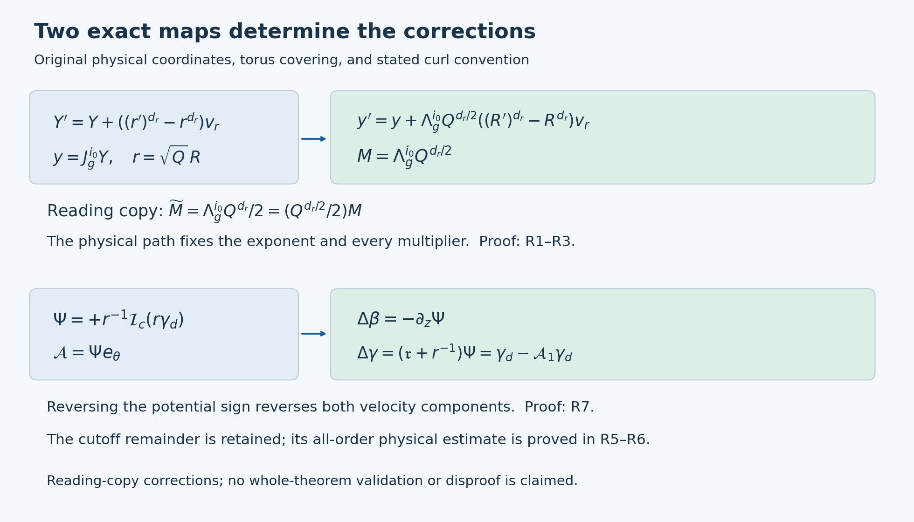

# Radial primitives and compact mean corrections

*The radial operators below use the physical coordinate conventions of OpenAI, Section 8. The [theorem construction](../../theorem-audit-conclusion.md) gives their full mathematical context.*

The correction cycle needs a radial integration operator that produces a compactly supported pressure and a compactly supported vector potential. The source depends on an auxiliary torus, and the physical radial derivative also differentiates that torus coordinate. An ordinary radial integral would therefore solve the wrong equation.

This construction constructs the required operator in the original physical variables, proves its exact change to the source's charts, retains its cutoff remainder, and proves the remainder estimate at every derivative order. It then constructs pressure and a divergence-free axial correction. These are the operators used in the mean-correction steps of the blowup construction.

Section R2 compares the distinct coefficient \(\Lambda_g^{i_0}Q^{d_r}/2\) with the physical radial coefficient \(\Lambda_g^{i_0}Q^{d_r/2}\) and proves their different inverse estimates. Section R7 derives the positive scalar potential from the curl convention. The original formulas are on pages 90 and 93.

Fourier coefficients and all Fourier estimates used here are derived in R5. The original \(q,\eta\) coordinate calculation is proved in [N6.1, S1](https://github.com/KokunoYumeto/open-math-courses-public-public/blob/main/docs/courses/NS-BLOWUP/src/summing-the-correction-fields.md).

## R1. The physical map and every scale factor

Keep the original constants and coordinates
\[
0<h<\frac1{100},\quad A=\frac12+h,\quad D=\frac12-h,
\quad \tau=1-t=q(1-\eta^2),\quad z=q^D\eta,
\quad X=\frac{r^2}{2q}.
\tag{R1.1}
\]
For a dyadic band and its auxiliary covering, the source uses
\[
\begin{gathered}
Q=2^{-\ell},\quad \varepsilon=Q^h,\quad S_*=\ell^2,
\quad R=\frac r{\sqrt Q},\quad Z=\frac z{Q^D},\quad T=\frac{1-t}{Q},\\
J_g=\begin{pmatrix}3&1\\1&5\end{pmatrix},\quad
\Lambda_g=4-\sqrt2,\quad T_g=4+\sqrt2,\quad b_g=\sqrt2-1,\\
v_r=(1,-b_g),\quad v_t=(b_g,1),\quad
\rho_g=\frac{\log\Lambda_g}{\log T_g},\quad
\kappa_s=10^{-5},\quad d_r=2((1+h)\rho_g-h\kappa_s),\\
i(\ell)=\left\lfloor\log_{T_g}\frac{Q^{-1-h}}{S_*}\right\rfloor.
\end{gathered}
\tag{R1.2}
\]
Only sufficiently large \(\ell\), for which \(i\geq0\), are used. The physical evaluation is
\[
Y(r,t)=v_rr^{d_r}+v_tt\pmod{\mathbb Z^2},\qquad
Y_i=J_g^iY.
\tag{R1.3}
\]
Direct multiplication gives \(J_gv_r=\Lambda_gv_r\) and \(J_gv_t=T_gv_t\). Before evaluating a coefficient at (R1.3), its physical derivatives are consequently
\[
\mathfrak r=\partial_r+d_rr^{d_r-1}v_r\cdot\partial_Y,
\qquad
\mathfrak t=\partial_t+v_t\cdot\partial_Y.
\tag{R1.4}
\]
Both derivatives on the right hold the independent \(Y\) fixed. Physical axial differentiation is \(\partial_z\), since \(Y\) does not depend on \(z\).

Fix a common covering index \(i_0\) on a neighborhood and write \(y=J_g^{i_0}Y\). All discrete indices and \(Q\) remain fixed during differentiation there. Put
\[
\mathcal L=v_r\cdot\partial_y,\quad N=v_t\cdot\partial_y,
\quad M=\Lambda_g^{i_0}Q^{d_r/2},\quad c=T_g^{i_0}Q^{1+h}.
\tag{R1.5}
\]
The exact evaluated chart operators are
\[
\begin{aligned}
D_r&=\sqrt Q\,\mathfrak r
 =\partial_R+Md_rR^{d_r-1}\mathcal L,\\
D_z&=\sqrt Q\,\partial_z=\varepsilon\partial_Z,\\
\mathfrak t_*&=Q^{1+h}\mathfrak t
 =-\varepsilon\partial_T+cN.
\end{aligned}
\tag{R1.6}
\]
For example, \(\sqrt Q\,d_rr^{d_r-1}\Lambda_g^{i_0}
=d_r\Lambda_g^{i_0}Q^{d_r/2}R^{d_r-1}\), proving the first line with every factor retained. The minus sign in the last line comes from \(T=(1-t)/Q\).

At the band index \(i\), the floor in (R1.2) gives the explicit bounds
\[
\begin{aligned}
\Lambda_g^{-1}\varepsilon^{-\kappa_s}S_*^{-\rho_g}
 &<\Lambda_g^iQ^{d_r/2}
 \leq\varepsilon^{-\kappa_s}S_*^{-\rho_g},\\
T_g^{-1}S_*^{-1}&<T_g^iQ^{1+h}\leq S_*^{-1}.
\end{aligned}
\tag{R1.7}
\]
Indeed \(T_g^{-1}Q^{-1-h}/S_*<T_g^i\leq Q^{-1-h}/S_*\), and \(\Lambda_g^i=(T_g^i)^{\rho_g}\). Substituting the full definition of \(d_r\) gives (R1.7). If \(|i_0-i|\leq C_0\), for a fixed integer \(C_0\), then
\[
M^{-1}\leq\Lambda_g^{C_0+1}\varepsilon^{\kappa_s}S_*^{\rho_g},
\quad
M\leq\Lambda_g^{C_0}\varepsilon^{-\kappa_s}S_*^{-\rho_g},
\quad c\leq T_g^{C_0}S_*^{-1}.
\tag{R1.8}
\]
No limit of the covering index has been substituted for its integer value.

## R2. The physical radial scale and comparison of inverse estimates

For fixed \((z,t)\), the radial path from \(r\) to \(r'\) changes the absolute coordinate by
\[
Y' =Y+((r')^{d_r}-r^{d_r})v_r.
\]
Applying \(J_g^{i_0}\) and then substituting \(r=\sqrt Q R\), \(r'=\sqrt Q R'\), gives
\[
y'=y+\Lambda_g^{i_0}Q^{d_r/2}
       ((R')^{d_r}-R^{d_r})v_r.
\tag{R2.1}
\]
Thus the coefficient determined by the physical path is exactly \(M\) in (R1.5). Compare it with the distinct coefficient
\[
\widetilde M=\frac{\Lambda_g^{i_0}Q^{d_r}}2
            =\frac{Q^{d_r/2}}2 M.
\tag{R2.2}
\]
These are different for every band \(0<Q\leq1\), since \(d_r>0\).

The discrepancy changes the estimate used for the inverse. In fact \(\rho_g>1/2\): both eigenvalues exceed one, and
\[
\Lambda_g^2-T_g=14-9\sqrt2>0,
\]
where the last inequality follows by squaring the positive numbers, \(14^2>81\cdot2\). Hence
\[
\frac{d_r}{2}=(1+h)\rho_g-h\kappa_s>\frac12,
\qquad
\theta:=(1+h)\rho_g-2h\kappa_s>\frac12.
\tag{R2.3}
\]
For \(i_0=i\), (R1.7) gives
\[
\frac1{2\Lambda_g}Q^\theta S_*^{-\rho_g}
 <\widetilde M\leq\frac12Q^\theta S_*^{-\rho_g}.
\tag{R2.4}
\]
Thus \(\widetilde M\to0\) as \(\ell\to\infty\), whereas \(M\to\infty\). The latter assertion follows from \(Q^{-h\kappa_s}S_*^{-\rho_g}=2^{\ell h\kappa_s}\ell^{-2\rho_g}\to\infty\); taking logarithms reduces it to \(\ell h\kappa_s\log2-2\rho_g\log\ell\to\infty\). More particularly,
\[
\frac{\widetilde M^{-1}}{\varepsilon^{\kappa_s}S_*^{\rho_g}}
 \geq 2Q^{-d_r/2}\longrightarrow\infty.
\tag{R2.5}
\]
The small inverse-coefficient estimate cannot hold with the literal \(\widetilde M\). Sections R3–R6 establish it with the uniquely determined physical coefficient \(M\), without changing the original physical path.

## R3. The compact primitive in physical variables

Choose the original active shell \(X_a<X<X_b\), with \(0<X_a<X_b\). Let \(\chi_m(X)\) be a fixed smooth function equal to zero near and below its inner boundary and to one near and above its outer boundary. Its derivative is supported in a fixed interior subinterval. Let \(g(r,z,t,Y)\) be smooth, periodic in \(Y\), and smoothly zero outside the active shell. All radial integrations below hold \((z,t)\) fixed.

Define the original physical operations
\[
\begin{aligned}
\mathcal I_{\rm phys}g(r,Y)
 &=\int_0^r g(r',Y+((r')^{d_r}-r^{d_r})v_r)\,dr',\\
\mathcal J_{\rm phys}g(r,Y)
 &=\int_0^\infty g(r',Y+((r')^{d_r}-r^{d_r})v_r)\,dr',\\
\mathcal I_{c,\rm phys}g
 &=\mathcal I_{\rm phys}g-\chi_m(X)\mathcal J_{\rm phys}g.
\end{aligned}
\tag{R3.1}
\]
Below the shell both the first integral and \(\chi_m\) vanish. Above it the first integral equals the full integral and \(\chi_m=1\). Their difference is therefore zero on both sides. Smooth zero extension follows by differentiating the smooth integrands with compact radial support; the support stays away from the axis at each fixed \(q>0\).

For \(e=0,1,2\), set
\[
\begin{aligned}
\mathsf T_{e,\rm phys}f&=r^{-e}\mathcal I_{c,\rm phys}(r^ef),\\
\mathcal A_{e,\rm phys}f&=r^{-e}(\partial_r\chi_m)
                              \mathcal J_{\rm phys}(r^ef).
\end{aligned}
\tag{R3.2}
\]
Here and below \(r^ef\) inside an integral is evaluated at its integration variable. The exact identity is
\[
(\mathfrak r+e/r)\mathsf T_{e,\rm phys}f
 =f-\mathcal A_{e,\rm phys}f.
\tag{R3.3}
\]
To prove it, differentiate (R3.1). Differentiating the shift with respect to the endpoint \(r\) gives \(-d_rr^{d_r-1}v_r\cdot\partial_Y\) of the integrand. This cancels the added torus derivative in \(\mathfrak r\). The upper endpoint contributes \(g(r,Y)\) to \(\mathfrak r\mathcal I_{\rm phys}g\), while \(\mathfrak r\mathcal J_{\rm phys}g=0\). The product rule then gives
\[
\mathfrak r\mathcal I_{c,\rm phys}g
 =g-(\partial_r\chi_m)\mathcal J_{\rm phys}g.
\]
Multiplying by \(r^{-e}\) and adding \(e/r\) cancels the derivative of that weight, proving (R3.3). The cutoff term remains part of the answer.

For the chart operations, replace the shift in (R3.1) by
\(y+M((R')^{d_r}-R^{d_r})v_r\), replace \(r,r'\) by \(R,R'\), and use \(\chi_m(QR^2/(2q))\). Denote these operations by \(\mathcal I_M,\mathcal J_M,\mathcal I_{c,M}\), and define
\[
\mathsf T_{e,M}f_*=R^{-e}\mathcal I_{c,M}(R^ef_*),\qquad
\mathcal A_{e,M}f_*=R^{-e}(\partial_R\chi_m)\mathcal J_M(R^ef_*).
\tag{R3.4}
\]
For any specified physical exponent \(a\), put \(f_*=Q^af_{\rm phys}\) at corresponding physical and chart points. Substitution, including the radial measure, proves
\[
\begin{aligned}
Q^{a-1/2}\mathsf T_{e,\rm phys}f_{\rm phys}
 &=\mathsf T_{e,M}f_*,\\
Q^a\mathcal A_{e,\rm phys}f_{\rm phys}
 &=\mathcal A_{e,M}f_*,\\
(D_r+e/R)\mathsf T_{e,M}f_*
 &=f_*-\mathcal A_{e,M}f_*.
\end{aligned}
\tag{R3.5}
\]
For the first equality, the factors are \(r^{-e}=Q^{-e/2}R^{-e}\), \((r')^e=Q^{e/2}(R')^e\), \(dr'=Q^{1/2}dR'\), and \(f_{\rm phys}=Q^{-a}f_*\). For the second, the additional derivative contributes \(\partial_r\chi_m=Q^{-1/2}\partial_R\chi_m\). These calculations prove the complete comparison with the physical operators.

The formulas are also compatible with the integer coverings. If \(y'=J_g^sy\), \(M'=\Lambda_g^sM\), and \(f(R,y)=f'(R,J_g^sy)\), then each of \(\mathcal I,\mathcal J,\mathsf T_e,\mathcal A_e\) applied to \(f\) is the pullback under \(J_g^s\) of the corresponding operation with \(M'\) applied to \(f'\). This follows directly from \(J_g^sv_r=\Lambda_g^sv_r\) inside every integrand. Thus the physical operation is preserved when a source is expressed on another applicable covering. No inverse of the many-to-one torus covering is assumed.

Using \(\widetilde M\) instead gives a precise additional term in the actual chart equation:
\[
\begin{aligned}
(D_r+e/R)\mathsf T_{e,\widetilde M}f
={}&f-\mathcal A_{e,\widetilde M}f\\
 &+(M-\widetilde M)d_rR^{d_r-1}
       \mathcal L\mathsf T_{e,\widetilde M}f.
\end{aligned}
\tag{R3.6}
\]
Indeed the operator with \(\widetilde M\) satisfies (R3.5) with \(D_r\) replaced by \(\partial_R+\widetilde Md_rR^{d_r-1}\mathcal L\). Subtract those two derivatives. Equation (R3.6) identifies the exact missing contribution rather than inferring failure from different notation alone.

*The upper path is the exact coordinate comparison in R1–R3. The lower path is the potential-to-velocity map proved in R7. Both retain the original cutoff remainder. The two reading-copy expressions and their corrections are given explicitly in R2 and R7.*

## R4. Support and all coefficient derivatives

We now prove the estimate required for the original mean class. On the active shell define the original weights
\[
\zeta(X)=\exp\!\left(-\frac{a_a}{\log^2(X/X_a)}
                    -\frac{a_b}{\log^2(X_b/X)}\right),
\quad
\delta(X)=\min\{1,\log(X/X_a),\log(X_b/X)\},
\tag{R4.1}
\]
where \(a_a,a_b>0\) are fixed. A coefficient in \(\mathsf M_\alpha\) is independent of the physical angle, has the smooth shell extensions and covering compatibility described above, and satisfies, for every fixed multi-index \(I\) in \((R,Z,T,y_1,y_2)\),
\[
|\partial^I f_*|\leq C_I\varepsilon^\alpha S_*^{B_I}
                         \zeta(X)\delta(X)^{-D_I}.
\tag{R4.2}
\]
Constants and nonnegative powers may depend on the finite construction and \(I\), but not on the band or point. The displayed weights are bounds; differentiability of the minimum defining \(\delta\) is not required.

Assume \(q/Q\) lies in a fixed positive compact interval, as in a chart. Every shell radius \(R\) then lies in a fixed compact subset of \((0,\infty)\). All fixed coefficient derivatives of \(q/Q\) are bounded there: the exact equation
\[
\frac qQ-Z^2\left(\frac qQ\right)^{2h}=T
\tag{R4.3}
\]
comes from the original \(q-z^2q^{2h}=1-t\), and its derivative in \(q/Q\) is \(1-2h\eta^2\geq1-2h\). Repeated implicit differentiation on this compact region proves the claim. Thus the moving support and the cutoff have bounded coefficient derivatives.

Let \(g=R^ef_*\), \(U=R^{d_r}\), and define the zero-extended function
\[
F(U,Z,T,y)=\frac{g(R,Z,T,y)}{d_rR^{d_r-1}}.
\tag{R4.4}
\]
The change between \(R\) and \(U\) and all its fixed derivatives are bounded on the shell. The exact half-line formulas are
\[
\begin{aligned}
A_-(U,y)&=\int_{-\infty}^0 F(U+u,y+Muv_r)\,du,\\
A_+(U,y)&=\int_0^\infty F(U+u,y+Muv_r)\,du,\\
\mathcal J_Mg&=A_-+A_+,\qquad
\mathcal I_{c,M}g=(1-\chi_m)A_- -\chi_m A_+.
\end{aligned}
\tag{R4.5}
\]
At fixed \(u\), the shift depends on neither \(U\) nor \((Z,T)\). Coefficient differentiation therefore acts only on \(F\) and \(\chi_m\), and introduces no power of \(M\). The full half-lines have fixed endpoints; smooth zero extension permits differentiation under the integral without a moving-boundary term. For any fixed compact set of slow parameters the integrands have support in a uniformly bounded interval in \(u\), so dominated differentiation follows from (R4.2).

Near the inner shell boundary, \(\chi_m=0\), so only the left integral occurs. Set \(s=\log(X'/X_a)\) along that segment. For each finite \(B\geq0\),
\[
\frac{d}{ds}\log(e^{-a_a/s^2}s^{-B})
 =\frac{2a_a}{s^3}-\frac Bs>0
\]
for sufficiently small \(s>0\). This bounds the weight at each integration point by the weight of the same type at the endpoint. The opposite-edge factor has upper and lower positive bounds in this collar. The integration length and Jacobian are bounded. Near the outer edge use the right integral and \(s=\log(X_b/X')\) with the same argument. On the remaining interior region, \(\zeta\) and \(\delta\) have positive lower bounds. Applying these estimates after any fixed derivative in (R4.5), and restoring \(R^{-e}\), proves
\[
\mathsf T_{e,M}:\mathsf M_\alpha\longrightarrow\mathsf M_\alpha.
\tag{R4.6}
\]
The operation preserves the projection of the source support to \((Z,T)\) because it holds these variables fixed. Every bound includes the original \(\varepsilon^\alpha\). The factors \(\zeta\delta^{-B}\) tend to zero with all needed powers at either edge: this follows by substituting \(s^{-1}\) into the exponential estimate in N6.1, S4. Thus the derivative bounds give smooth zero extensions as asserted.

## R5. The full radial integral and its cutoff remainder

Let \(\langle\cdot\rangle_y\) be the Haar average on \(\mathbb T^2=\mathbb R^2/\mathbb Z^2\), with total mass one. Suppose the weighted mean integral vanishes:
\[
\int_0^\infty R^e\langle f_*\rangle_y\,dR=0.
\tag{R5.1}
\]
Translation invariance of this average gives
\[
\langle\mathcal J_M(R^ef_*)\rangle_y=0,
\qquad \langle\mathcal A_{e,M}f_*\rangle_y=0.
\tag{R5.2}
\]
It does not usually make either unaveraged function zero.

We need an inverse for \(\mathcal L=v_r\cdot\partial_y\) on zero-mean functions. For \(k=(k_1,k_2)\in\mathbb Z^2\setminus\{0\}\), put \(n=\max(|k_1|,|k_2|)\). The exact algebraic identity
\[
(v_r\cdot k)\bigl((k_1+k_2)+\sqrt2k_2\bigr)
 =(k_1+k_2)^2-2k_2^2
\tag{R5.3}
\]
has a nonzero integer on the right. If it were zero and \(k_2\ne0\), \(\sqrt2\) would be rational; if \(k_2=0\), it would force \(k_1=0\). The second factor has absolute value at most \((2+\sqrt2)n\), hence
\[
|v_r\cdot k|\geq\frac1{(2+\sqrt2)n}.
\tag{R5.4}
\]

For a smooth zero-mean function \(H(y)\), define
\[
\widehat H(k)=\int_{[0,1]^2}H(y)e^{-2\pi i k\cdot y}\,dy,
\qquad
\mathcal L^{-p}H
 =\sum_{k\ne0}(2\pi i v_r\cdot k)^{-p}\widehat H(k)e^{2\pi i k\cdot y}.
\tag{R5.5}
\]
All factors of \(2\pi\) are retained. The Fourier series of a smooth periodic function represents that function: here is the needed inversion argument. The one-dimensional kernels
\[
K_n(s)=\frac1n\left|\sum_{j=0}^{n-1}e^{2\pi i js}\right|^2
\]
are nonnegative, have integral one, and satisfy \(K_n(s)\leq[n\sin^2(\pi\delta)]^{-1}\) when the distance from \(s\) to an integer is at least \(\delta>0\). The bound follows from the finite geometric sum. The product kernels \(K_n(y_1)K_n(y_2)\) therefore form an approximate identity: uniform continuity controls the convolution error where both coordinates have distance below \(\delta\), and the complement has kernel mass at most \(2/[n\sin^2(\pi\delta)]\). First choosing \(\delta\) and then letting \(n\to\infty\) proves uniform convergence of the convolutions to the function. Expanding the finite sums shows their Fourier coefficients are multiplied by \((1-|k_1|/n)_+(1-|k_2|/n)_+\). For an absolutely summable Fourier series these weighted sums also converge uniformly to that series. Integration by parts, as follows, proves absolute summability for smooth functions. This proves inversion and also uniqueness from Fourier coefficients.

Integrating \(N\) times in a coordinate with \(|k_j|=n\) gives
\[
|\widehat H(k)|\leq(2\pi n)^{-N}\|H\|_{C^N},
\]
where \(\|H\|_{C^N}\) is the maximum supremum norm of its derivatives through order \(N\). Periodicity cancels every boundary term. For \(N=m+p+3\), (R5.4) bounds every derivative through order \(m\) of (R5.5) by
\[
\|\mathcal L^{-p}H\|_{C^m}
 \leq\frac{16(2+\sqrt2)^p}{(2\pi)^{2p+3}}
                  \|H\|_{C^{m+p+3}}.
\tag{R5.6}
\]
Indeed the shell \(\max(|k_1|,|k_2|)=n\) has \(8n\) points, and \(\sum_{n\geq1}n^{-2}\leq2\). This proves uniform convergence of every required differentiated series. Applying \(\mathcal L^p\) recovers \(H\); uniqueness among zero-mean smooth functions follows because every nonzero Fourier multiplier is nonzero. The operation commutes with parameter derivatives, by the same estimates applied to those derivatives.

Let \(F\) be (R4.4) and \(F^\circ=F-\langle F\rangle_y\). The zero Fourier mode of its full \(U\) integral vanishes by (R5.1). Thus
\[
\mathcal J_Mg
 =(-M^{-1})^p\int_{\mathbb R}
       \partial_U^p\mathcal L^{-p}F^\circ(U+u,y+Muv_r)\,du
\quad(p\geq1).
\tag{R5.7}
\]
For \(p=1\), integrate the full derivative
\[
\frac d{du}\mathcal L^{-1}F^\circ(U+u,y+Muv_r)
 =\partial_U\mathcal L^{-1}F^\circ+MF^\circ.
\]
Its integral is zero because \(F\), and also \(\mathcal L^{-1}F^\circ\), have compact support in \(U\). Rearrangement proves the case \(p=1\); iteration proves (R5.7), with the indicated sign at every step.

Further coefficient derivatives can again be taken in the fixed-shift formula. Derivatives through \(I_R+p\) in the radial variable and through \(|I_y|+p+3\) in the torus variables suffice, together with the requested slow derivatives. Combining (R5.6)–(R5.7) with (R1.8) proves
\[
|\partial^I\mathcal A_{e,M}f_*|
 \leq C_{I,p}\varepsilon^{\alpha+p\kappa_s}S_*^{B_{I,p}}
                         \zeta\delta^{-D_{I,p}}.
\tag{R5.8}
\]
The derivative of the cutoff is supported in a fixed interior part of the shell, where the weights have positive lower bounds; this is why the full-integral estimate yields the displayed weighted bound. All constants are uniform in the band and point. Only finitely many source derivatives are used for each \(I,p\). No uniformity as \(p\to\infty\) is asserted or needed.

## R6. Physical flatness, and what the wrong coefficient would do

Restore the physical factor in (R3.5). For any fixed Cartesian space–time derivative order \(m\), each physical differentiation costs at most \(Q^{-(1+h)}\) times a fixed power of \(S_*\). To check this, the radial operator costs \(Q^{-1/2}\) times at most \(M\), axial differentiation costs \(Q^{-D}\), and time differentiation costs \(Q^{-1}\) or \(Q^{-1-h}c\), by (R1.6). The Cartesian cylindrical-frame factors cost \(r^{-1}=Q^{-1/2}R^{-1}\). On the shell \(R^{-1}\) and its fixed derivatives are bounded; \(1/2+h\kappa_s<1+h\) and \(D<1+h\). Repeated product rules give the same bound for each of the finitely many resulting terms. The loss depends on \(m\), not on \(p\).

Thus, for the original physical source exponent \(a\), (R5.8) implies
\[
|\partial_{x,t}^I\mathcal A_{e,\rm phys}f_{\rm phys}|
 \leq C_{I,p}Q^{h(\alpha+p\kappa_s)-a-m(1+h)}S_*^{B_{I,p}}
\quad(|I|\leq m).
\tag{R6.1}
\]
Choose an integer \(p\) so that
\[
h(\alpha+p\kappa_s)-a-m(1+h)>N.
\tag{R6.2}
\]
It exists because \(h\kappa_s>0\). Then keep \(p\) fixed. The strict positive excess absorbs every fixed power of \(S_*=\ell^2\), since \(Q=2^{-\ell}\). Since \(q/Q\) is bounded above and below, (R6.1) is bounded by \(C_{I,N}q^N\). This proves physical flatness for every prescribed derivative and decay order, with its full quantifiers. It is an analytic argument, not a computation of many increasingly accurate approximations.

The incorrect coefficient in (R2.2) can actually destroy this property. Work on the slice \(z=0\), \(\tau=Q\), so \(q=Q\). Choose a nonnegative smooth \(\varphi(R)\), compactly supported in the interior shell, with \(\int\varphi\,dR=1\), and set
\[
f(R,y)=\varphi(R)\cos(2\pi y_1),\qquad e=0.
\tag{R6.3}
\]
Its auxiliary mean is zero at each \(R\), so (R5.1) holds. On a slow neighborhood define the source exactly by \(\varphi(R\sqrt{Q/q})\cos(2\pi y_1)\). It agrees with (R6.3) on the selected slice and has uniform \(\mathsf M_0\) bounds, because its support stays in a fixed interior part of the shell and the derivatives of \(q/Q\) are bounded. The auxiliary mean remains zero at every slow point.

At \(y=0\), the full integral with \(\widetilde M\) is
\[
\mathcal J_{\widetilde M}f(R,0)
 =\int\varphi(R')\cos\bigl(2\pi\widetilde M((R')^{d_r}-R^{d_r})\bigr)\,dR'
 \longrightarrow1.
\tag{R6.4}
\]
The convergence is uniform on the compact shell: the argument of the cosine tends uniformly to zero by (R2.4), and \(\varphi\) is integrable. Choose \(R\) at a point where \(\partial_R\chi_m\ne0\), which exists because the cutoff changes from zero to one. Then \(\mathcal A_{0,\widetilde M}f(R,0)\) tends to this nonzero derivative. The erroneous operator has a cutoff remainder that does not even tend to zero. This is a counterexample to the literal coefficient-level remainder claim with \(\widetilde M\), not a counterexample to the proposed Navier–Stokes theorem. The physically correct \(M\) satisfies the proved estimate (R5.8).

## R7. Pressure and the axial vector potential

Choose a fixed smooth interior bump \(\widehat\rho\) with \(\int\widehat\rho(x)\,dx=1\), and retain its physical scaling
\[
\rho_{\rm phys}(r,z,t)=q^{-1/2}\widehat\rho(r/\sqrt q),
\qquad \int\rho_{\rm phys}\,dr=1.
\tag{R7.1}
\]
Such a bump is obtained by dividing any nonnegative nonzero smooth interior bump by its positive integral. Let \(g_{r,\rm phys}\) be the complete radial source to be integrated, including every time, transport, covariance and viscous term that defines that source. Define
\[
\mathcal P_{\rm phys}=\int\langle g_{r,\rm phys}\rangle_Y\,dr,
\qquad
p_{m,\rm phys}=\mathsf T_{0,\rm phys}
                    (g_{r,\rm phys}-\rho_{\rm phys}\mathcal P_{\rm phys}).
\tag{R7.2}
\]
The argument of \(\mathsf T_0\) has zero radial integral of its auxiliary mean. Equations (R3.3) and (R5.2) therefore give the exact identities
\[
\begin{aligned}
\mathfrak r p_{m,\rm phys}-g_{r,\rm phys}
 &=-\rho_{\rm phys}\mathcal P_{\rm phys}
   -\mathcal A_{0,\rm phys}(g_{r,\rm phys}-\rho_{\rm phys}\mathcal P_{\rm phys}),\\
\partial_r\langle p_{m,\rm phys}\rangle_Y
 &=\langle g_{r,\rm phys}\rangle_Y-\rho_{\rm phys}\mathcal P_{\rm phys}.
\end{aligned}
\tag{R7.3}
\]
The pressure is compactly supported in the shell, and its cutoff remainder is flat whenever the source has the bounds of R4–R5. No part of the nonzero defect \(\rho_{\rm phys}\mathcal P_{\rm phys}\) has been discarded.

For this pressure source, the original scaling is
\[
g_{r,*}=Q^{2A+1/2}g_{r,\rm phys},\quad
\rho_*=Q^{1/2}\rho_{\rm phys},\quad
\mathcal P_*=Q^{2A}\mathcal P_{\rm phys},\quad
p_{m,*}=Q^{2A}p_{m,\rm phys}.
\tag{R7.4}
\]
Using (R3.5) with \(a=2A+1/2\) proves \(p_{m,*}=\mathsf T_{0,M}(g_{r,*}-\rho_*\mathcal P_*)\) and the full chart version of (R7.3). The factors in the product \(\rho_*\mathcal P_*\) multiply to \(Q^{2A+1/2}\), as required.

Now let \(\gamma_{d,\rm phys}\) be the desired axial increment, with
\[
\int r\langle\gamma_{d,\rm phys}\rangle_Y\,dr=0.
\tag{R7.5}
\]
With the source's stated curl convention the physical potential must be
\[
\Psi_{\rm phys}=+r^{-1}\mathcal I_{c,\rm phys}(r\gamma_{d,\rm phys}),
\qquad \mathcal A=\Psi_{\rm phys}e_\theta.
\tag{R7.6}
\]
Indeed the Cartesian expression is \(\mathcal A=(\Psi_{\rm phys}/r)(-x_2,x_1,0)\). Direct differentiation, or differentiating these three displayed components, gives
\[
\operatorname{curl}\mathcal A
 =(-\partial_z\Psi_{\rm phys})e_r
   +((\mathfrak r+r^{-1})\Psi_{\rm phys})e_z.
\tag{R7.7}
\]
Here differentiation of a coefficient along the physical graph is \(\mathfrak r\); the independent torus has no axial dependence. The radial and axial operators commute, so the divergence is
\[
(\mathfrak r+r^{-1})(-\partial_z\Psi_{\rm phys})
 +\partial_z((\mathfrak r+r^{-1})\Psi_{\rm phys})=0.
\tag{R7.8}
\]
There are no axis terms: the potential vanishes in a neighborhood of the axis for every fixed \(q>0\). The actual axial increment is exactly
\[
\Delta\gamma_{\rm phys}
 =\gamma_{d,\rm phys}-\mathcal A_{1,\rm phys}\gamma_{d,\rm phys},
\quad
\langle\Delta\gamma_{\rm phys}\rangle_Y
 =\langle\gamma_{d,\rm phys}\rangle_Y.
\tag{R7.9}
\]
If the desired increment is independent of \(Y\), its weighted integral in (R7.5) makes \(\mathcal J_{\rm phys}(r\gamma_{d,\rm phys})=0\) identically. Then the cutoff remainder is exactly zero and \(\Delta\gamma_{\rm phys}=\gamma_{d,\rm phys}\) pointwise, the case used by the five-equation moment correction.

The complete chart comparison uses
\[
\gamma_{d,*}=Q^A\gamma_{d,\rm phys},\quad
\Psi_*=Q^{A-1/2}\Psi_{\rm phys},\quad
\Delta\beta_*=Q^A\Delta\beta_{\rm phys},\quad
\Delta\gamma_*=Q^A\Delta\gamma_{\rm phys}.
\]
Equations (R3.5) and (R7.7) give
\[
\Psi_*=\mathsf T_{1,M}\gamma_{d,*},\qquad
\Delta\beta_*=-\varepsilon\partial_Z\Psi_*,\qquad
\Delta\gamma_*=(D_r+1/R)\Psi_*
               =\gamma_{d,*}-\mathcal A_{1,M}\gamma_{d,*}.
\tag{R7.10}
\]
The extra radial factor is \(Q^{1/2-D}=Q^h=\varepsilon\), with its sign unchanged. Thus a source in \(\mathsf M_\alpha\) gives \(\Psi_*,\Delta\gamma_*\in\mathsf M_\alpha\) and \(\Delta\beta_*\in\mathsf M_{\alpha+1}\). These follow from R4 and coefficient differentiation; all supports remain inside the shell.

A negative sign in the scalar potential would replace \(\Psi_{\rm phys}\) by \(-\Psi_{\rm phys}\) and reverse both velocity increments in (R7.7). For a nonzero auxiliary-independent desired increment satisfying (R7.5), it gives \(\Delta\gamma_{\rm phys}=-\gamma_{d,\rm phys}\), contrary to the displayed (8.14). The positive potential in (R7.6) agrees with (8.14), the later cycle's positive \(\mathsf T_1\) formula, and its explicit curl formula. An equivalent change of notation would keep the negative scalar potential but define the vector potential as its negative times \(e_\theta\); the physical vector field is then precisely (R7.6). The formulas use the positive curl convention in (R7.6).

## R8. Pressure moments and the receiving correction cycle

The compact pressure in (R7.2) satisfies an exact moment identity with both boundary terms present before evaluation:
\[
\begin{aligned}
\int_0^\infty r\langle p_{m,\rm phys}\rangle_Y\,dr
 &=[r^2\langle p_{m,\rm phys}\rangle_Y/2]_0^\infty
     -\frac12\int_0^\infty r^2\partial_r\langle p_{m,\rm phys}\rangle_Y\,dr\\
 &=-\frac12\int_0^\infty r^2\langle g_{r,\rm phys}\rangle_Y\,dr
       +c_{\rho,\rm phys}\mathcal P_{\rm phys},\\
c_{\rho,\rm phys}&=\frac12\int_0^\infty r^2\rho_{\rm phys}\,dr
 =\frac q2\int_0^\infty x^2\widehat\rho(x)\,dx.
\end{aligned}
\tag{R8.1}
\]
The endpoint bracket is zero by compact support and zero near the axis. Both the factor \(1/2\) and the dependence of \(c_\rho\) on the original \(q\) remain. In particular,
\[
\partial_z(c_{\rho,\rm phys}\mathcal P_{\rm phys})
 =\frac12\left(\int x^2\widehat\rho(x)\,dx\right)
   (q_z\mathcal P_{\rm phys}+q\partial_z\mathcal P_{\rm phys}),
\quad q_z=\frac{2\eta q^{1-D}}{1-2h\eta^2}.
\tag{R8.2}
\]
The comparison with the chart pressure moment is
\[
\int R\langle p_{m,*}\rangle_y\,dR
 =Q^{2A-1}\int r\langle p_{m,\rm phys}\rangle_Y\,dr,
\qquad c_{\rho,*}=Q^{-1}c_{\rho,\rm phys}.
\tag{R8.3}
\]
This supplies the complete pressure contribution to the source's axial flux defect and its term \(\partial_Z(c_\rho\mathcal P)\).

The original radial inverse supplies pressure after each correction and the potential used in both the temporal mean update and the five-equation moment update. R5–R6 prove that its retained cutoff remainder is flat; R7 proves the actual divergence-free velocity and its sign, including the exact auxiliary-independent case. The finite-stage residual must still be recomputed from these full velocities, not just their prescribed axial components.

The pulse inverse is proved in [P0–P8](../../pulse-inverse-audit.md), the stress-amplitude map in [C1–C9](../../stress-covariance-audit.md), and the complete nonlinear cycle in [K0–K8](../../correction-cycle-audit.md). Their actual local-field receiver is [I0–I7](../../local-construction-assembly-audit.md), followed by the final force and blowup argument [F0–F8](../../terminal-force-and-blowup-audit.md). The complete theorem and its proof dependencies are stated in the [theorem construction](../../theorem-audit-conclusion.md).

## R9. Retained worked checks from the withheld draft

**Exercise 1. The exact difference between the two primitives.** For any two positive coefficients \(M_1,M_2\), express \(\mathcal I_{c,M_1}g-\mathcal I_{c,M_2}g\) without dropping either radial integral.

**Solution.** Let \(\Delta=(R')^{d_r}-R^{d_r}\), and put
\[
H(R',R,y)=\Delta\int_0^1
 \mathcal Lg(R',y+(M_2+s(M_1-M_2))\Delta v_r)\,ds.
\]
The fundamental theorem of calculus in \(s\) gives
\[
\mathcal I_{c,M_1}g-\mathcal I_{c,M_2}g
 =(M_1-M_2)\left[\int_0^R H\,dR'
                         -\chi_m\int_0^\infty H\,dR'\right].
\]
Multiplication by \(R^{-e}\), with \(g=(R')^ef\), gives the difference of the weighted inverses. This is the exact relation between the erroneous and corrected operators.

**Exercise 2. A nonzero zero-flux axial increment.** Construct a smooth compactly supported desired axial field with \(\int r\gamma_d\,dr=0\), and compare the two potential signs.

**Solution.** Take a nonconstant smooth bump \(H(r)\) supported in an annulus away from zero and put \(\gamma_d(r)=H'(r)/r\). Then \(\int r\gamma_d\,dr=H(\infty)-H(0)=0\), and \(\gamma_d\) is not identically zero. Its weighted primitive is \(H(r)\), so the positive potential is \(H(r)/r\) and its axial curl is \(H'(r)/r=\gamma_d\). The negative potential has axial curl \(-\gamma_d\). Smooth dependence on \((z,t)\) can be included by multiplying by any smooth factor; the same radial identity holds at each slow point.

**Exercise 3. Why the zero mode must be removed.** What fails if \(H\) in (R5.5) has nonzero mean?

**Solution.** A periodic directional derivative has zero integral: integrate each coordinate derivative over its unit period. Therefore \(\mathcal L U=H\) cannot hold if \(\int H\ne0\). In Fourier terms the multiplier at \(k=0\) is zero and cannot be inverted. In (R5.7) the zero mode is not inverted; its full radial integral vanishes by the explicit weighted condition (R5.1). Without that condition the full integral retains its zero mode and the cutoff remainder need not be small.

**Exercise 4. The pressure scaling.** Recover the exponent on \(\mathcal P\) from the physical definition, rather than from the dimensions of pressure alone.

**Solution.** With \(g_{r,*}=Q^{2A+1/2}g_{r,\rm phys}\) and \(dr=Q^{1/2}dR\),
\[
\int\langle g_{r,*}\rangle_y\,dR
 =Q^{2A+1/2}Q^{-1/2}\int\langle g_{r,\rm phys}\rangle_Y\,dr
 =Q^{2A}\mathcal P_{\rm phys}.
\]
The torus averages agree under a covering: a Fourier mode pulled back by \(J_g^s\) has frequency \((J_g^s)^Tk\), which is zero exactly when \(k=0\). Uniform Fourier convergence extends this observation to smooth periodic functions. The radial measure is essential to the exponent.

**Exercise 5. How many source derivatives does a requested remainder estimate use?** Specify a finite choice for a physical derivative order \(m\), power \(N\), source exponent \(a\) and class exponent \(\alpha\).

**Solution.** Choose any integer
\[
p\geq1,\qquad p>\frac{N+a+m(1+h)-h\alpha}{h\kappa_s}.
\]
For each coefficient derivative created by the physical product rules, (R5.7) uses at most \(p\) additional radial derivatives and \(p+3\) additional torus derivatives beyond that derivative's own indices. There are finitely many physical product-rule terms, so the largest of these finite requirements suffices. The number may be large; the proof needs their existence and the already quantified smooth coefficient bounds, not a numerical computation of all of them. Fixing this \(p\) before taking small \(q\) makes (R6.1) an \(O(q^N)\) bound.

## Sources

Source: OpenAI, [*Finite Time Blowup for Navier–Stokes*](https://cdn.openai.com/pdf/32d9f210-8b73-45e0-91bc-82a30aef8a9a/navier-stokes.pdf), Section 8, pages 90–93, equations (8.4)–(8.14). The original radial phase has the exponent one half of the radial power, and the scalar potential before (8.14) has positive sign. The derivations above use these conventions.

- [Physical evaluation and chart derivatives, (6.1)–(6.7)](https://cdn.openai.com/pdf/32d9f210-8b73-45e0-91bc-82a30aef8a9a/navier-stokes.pdf#page=63).
- [Mean classes and original edge weights, (6.23)–(6.26)](https://cdn.openai.com/pdf/32d9f210-8b73-45e0-91bc-82a30aef8a9a/navier-stokes.pdf#page=68).
- [Physical radial primitive (8.4), coefficient before (8.5), and Lemma 8.2](https://cdn.openai.com/pdf/32d9f210-8b73-45e0-91bc-82a30aef8a9a/navier-stokes.pdf#page=90).
- [The radial-inverse proof, pressure, potential, (8.14), and pressure moment](https://cdn.openai.com/pdf/32d9f210-8b73-45e0-91bc-82a30aef8a9a/navier-stokes.pdf#page=91).
- [The later cycle's positive-potential formula](https://cdn.openai.com/pdf/32d9f210-8b73-45e0-91bc-82a30aef8a9a/navier-stokes.pdf#page=110) and [its explicit curl convention](https://cdn.openai.com/pdf/32d9f210-8b73-45e0-91bc-82a30aef8a9a/navier-stokes.pdf#page=110).

The radial primitives, compact corrections and their coordinate maps above supply the mean-correction construction. The [full lesson](../../../src/radial-primitives-and-the-mean-equations.md) includes the complete mean equations and solved exercises.
