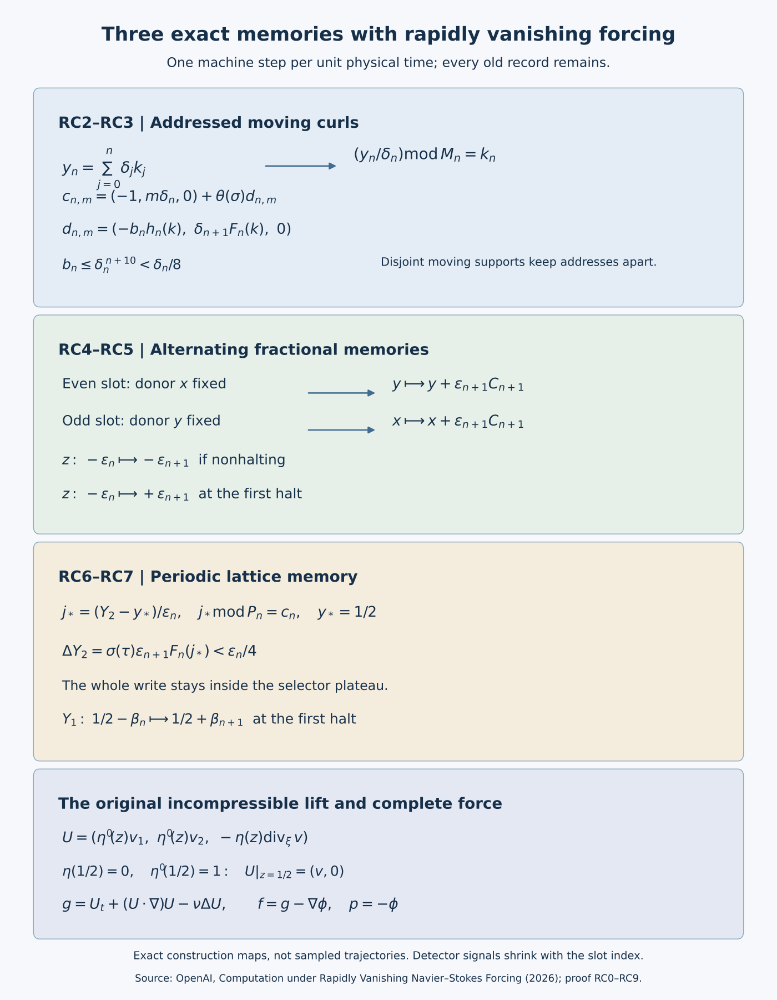

# Rapidly vanishing forcing and three exact fluid memories

*Mathematical exposition by GPT-6 Astra (OpenAI).*

This note derives the four experiments in OpenAI's [*Computation under Rapidly Vanishing Navier–Stokes Forcing*](https://github.com/openai/math/blob/adc7f1241b42e322a6451854ab7e4b4c146bf78a/preprints/Computation-under-Rapidly-Vanishing-Navier-Stokes-Forcing-September-27-2026/build/main.tex). It retains all three memory mechanisms, their original scales, particle labels, detectors, viscosity and force formulas. The complete author TeX consists of main.tex, addressed.tex, alternating.tex, lattice.tex and references.tex. This exposition is editorial; it does not replace or amend the author's text.

## RC0. The exact statements

Fix \(\nu>0\), computable for the algorithmic claims. On the indicated flat domain use
\[
\partial_tU+(U\cdot\nabla)U=-\nabla p+\nu\Delta U+f,
\qquad \nabla\cdot U=0,\qquad U(0)=0.
\tag{RC0.1}
\]
Each finite deterministic machine and finite input determine an effective force and a global smooth solution. Every mixed derivative of both velocity and force satisfies, for every nonnegative integer \(J\),
\[
\sup_{t\ge0,x}(1+t)^J
\left|\partial_t^l\partial_x^\alpha U(t,x)\right|<\infty,
\qquad
\sup_{t\ge0,x}(1+t)^J
\left|\partial_t^l\partial_x^\alpha f(t,x)\right|<\infty.
\tag{RC0.2}
\]
The Euclidean fields have fixed compact support, so the same statements hold with \((1+t+|x|)^J\). The following events are each equivalent to machine halting:

| Construction | Domain and initial label | Fixed open detector |
|---|---|---|
| Addressed compact curls | \(\mathbb R^3,\ a_*=0\) | \(X_1<-1\) |
| Addressed chart image | \(\mathbb T^3,\ a_*=(1/2,1/4,1/2)\) | \(1/4<X_1<3/8\) |
| Alternating memories | \(\mathbb R^3,\ a_*=(-1,0,0)\) | \(X_1>0\) |
| Periodic lattice memory | \(\mathbb T^3,\ a_*=(1/4,1/2,1/2)\) | \(1/2<X_1<1\pmod1\) |

Euclidean pressure is zero. The torus residual forces have pressure zero; their solenoidal projections have pressure specified in RC1. Torus pressure has spatial mean zero. The Euclidean uniqueness class on each \([0,T]\) is
\[
U\in C([0,T];H^2)\cap C^1([0,T];L^2),\qquad
p\in C([0,T];H^1),\qquad
\sup_{[0,T]\times\mathbb R^3}(|U|+|\nabla U|)<\infty.
\tag{RC0.3}
\]
In both domains a classical solution also has continuous velocity, time derivative, spatial derivatives through order two, pressure and pressure gradient on each closed finite cylinder. The competitor's gradient bound in RC0.3 can be omitted. The reference gradient bound remains.

Every transition occupies a unit physical interval after a unit loading interval. The fields evaluate a local instruction at an arbitrary spatial code; constructing them does not require running the distinguished computation.

The [figure generator](rapid-forcing-memories.py) retains editable diagram sources. Its arrows describe proved maps, not numerical particle samples.

## RC1. Smooth profiles, the full residual and uniqueness

Keep the source profiles
\[
\rho(r)=\begin{cases}e^{-1/r},&r>0,\\0,&r\le0,\end{cases}
\quad H(r)=\frac{\rho(r)}{\rho(r)+\rho(1-r)},
\quad\theta(r)=H(2r-1/2).
\tag{RC1.1}
\]
The polynomial recursion \(P_0(y)=1\), \(P_{j+1}(y)=y^2(P_j(y)-P_j'(y))\) gives
\(\rho^{(j)}(r)=P_j(1/r)e^{-1/r}\) on the positive half-line. The exponential series gives \(y^me^{-y}\le(m+k)!y^{-k}\) and \(y^me^{-y}\le m!\). These prove flatness at zero, effective error estimates there and global derivative bounds. At least one of \(r,1-r\) is at least \(1/2\), so the denominator of \(H\) is at least \(e^{-2}\). Quotient differentiation gives bounds for every derivative. Thus \(H\) is zero below zero and one above one; \(\theta\) is zero through \(1/4\) and one from \(3/4\), with fixed zero collars for its derivative. Rational translates and rescalings produce all cutoffs used below.

For a smooth divergence-free reference \(U\), define the actual force
\[
\mathcal R_\nu[U]=U_t+(U\cdot\nabla)U-\nu\Delta U.
\tag{RC1.2}
\]
Substitution proves the PDE with pressure zero. For component \(i\), every derivative is exactly
\[
\begin{aligned}
\partial_t^l\partial_x^\alpha(\mathcal R_\nu[U])_i
={}&\partial_t^{l+1}\partial_x^\alpha U_i
-\nu\sum_{j=1}^3\partial_t^l\partial_x^{\alpha+2e_j}U_i\\
&+\sum_{j=1}^3\sum_{h=0}^l\sum_{\gamma\le\alpha}
\binom lh\binom\alpha\gamma
(\partial_t^h\partial_x^\gamma U_j)
(\partial_t^{l-h}\partial_x^{\alpha-\gamma+e_j}U_i).
\end{aligned}
\tag{RC1.3}
\]
Here \(\binom\alpha\gamma=\prod_j\binom{\alpha_j}{\gamma_j}\). In particular all original viscous factors and nonlinear contributions remain. Rapid bounds for \(U\) imply those for the residual: put any requested time weight on the first factor of each product and use the unweighted bound on the second. Support is preserved because differentiation and products do not enlarge the support of a smooth field. The force is affine in viscosity, with coefficient fields \(U_t+(U\cdot\nabla)U\) and \(-\Delta U\).

For completeness, compare a reference solution \((U,P)\) with a competitor \((v,p)\) for the same force and data. Set \(w=v-U,\ q=p-P\). Then
\[
w_t+(v\cdot\nabla)w+(w\cdot\nabla)U=-\nabla q+\nu\Delta w,
\qquad \nabla\cdot w=0.
\tag{RC1.4}
\]
On \(\mathbb R^3\), take a smooth compact cutoff \(0\le\zeta\le1\), equal to one on the unit ball, and \(\zeta_R(x)=\zeta(x/R)\). The exact integrated identity is
\[
\begin{aligned}
\frac12\frac d{dt}\int\zeta_R|w|^2
+\nu\int\zeta_R|\nabla w|^2
={}&-\int\zeta_R w_iw_j\partial_jU_i
+\frac12\int |w|^2v\cdot\nabla\zeta_R\\
&+\int q\,w\cdot\nabla\zeta_R
-\nu\int w_i\partial_jw_i\,\partial_j\zeta_R .
\end{aligned}
\tag{RC1.5}
\]
Repeated indices are summed from one to three. The last three terms have absolute bounds
\[
\frac{\|\nabla\zeta\|_\infty}{2R}\|v\|_\infty\|w\|_2^2,\qquad
\frac{\|\nabla\zeta\|_\infty}{R}\|q\|_2\|w\|_2,\qquad
\frac{\nu\|\nabla\zeta\|_\infty}{R}\|w\|_2\|\nabla w\|_2.
\tag{RC1.6}
\]
The Sobolev continuity in RC0.3 bounds all these norms uniformly on a finite interval and justifies the time derivative. Integrate first in time, then let \(R\) tend to infinity. Dominated convergence applies to each remaining quadratic term; the three errors tend to zero. On the torus the same calculation has no cutoff errors. Hence in either domain
\[
\frac12\frac d{dt}\|w\|_2^2+\nu\|\nabla w\|_2^2
\le\|\nabla U\|_{\mathrm{op},\infty}\|w\|_2^2.
\tag{RC1.7}
\]
The integrating factor \(\exp(-2\int_0^t\|\nabla U(s)\|_{\mathrm{op},\infty}\,ds)\) and zero initial difference give \(w=0\). Then \(\nabla q=0\); mean zero on the torus or \(H^1(\mathbb R^3)\) fixes \(q=0\). No bound on the competitor's gradient was used. Smooth bounded reference velocities with bounded gradient on finite cylinders have unique material paths through every finite time: local Lipschitz existence and uniqueness apply, and bounded speed prevents finite-time escape. Backward solution gives the inverse finite-time flow.

The torus projection also has a complete effective proof. For mean-zero \(g\), use the Fourier basis \(e^{2\pi i k\cdot x}\) and set
\[
\widehat\phi(k)=-\frac{ik\cdot\widehat g(k)}{2\pi|k|^2}\quad(k\ne0),
\qquad \widehat\phi(0)=0.
\tag{RC1.8}
\]
The gradient multiplier is \(kk^{\mathsf T}/|k|^2\), of operator norm one. For \(r=|\alpha|\), integrate by parts \(r+5\) times in a coordinate with \(|k_i|\ge |k|/\sqrt3\). Every differentiated gradient coefficient is bounded by
\[
(2\pi)^{-5}3^{(r+5)/2}|k|^{-5}
\max_i\|\partial_t^l\partial_{x_i}^{r+5}g(t)\|_\infty.
\tag{RC1.9}
\]
The shell \(\|k\|_\infty=j\) has \(24j^2+2\) points. The tail beyond \(M\ge1\) is bounded by the factor preceding \(|k|^{-5}\) in RC1.9 times
\[
\sum_{j>M}(24j^2+2)j^{-5}\le26\sum_{j>M}j^{-3}\le13M^{-2}.
\tag{RC1.10}
\]
The full sum is at most \(26(1+\int_1^\infty x^{-3}dx)=39\). Thus every differentiated series converges absolutely, with effective tails; the series for \(\phi\) has an additional inverse frequency factor. Fourier coefficients are effectively integrated by Riemann sums using a bound on one more derivative. Reality follows by conjugating the coefficients.

To identify the functions, the one-dimensional Fejér kernel
\[
F_N(s)=\frac1N\left|\sum_{j=0}^{N-1}e^{2\pi ijs}\right|^2
\tag{RC1.11}
\]
is nonnegative, has integral one by orthogonality, and Fourier coefficients \((1-|k|/N)_+\) by expanding the square. Away from the integers, the geometric sum gives \(F_N(s)\le[N\sin^2(\pi s)]^{-1}\). Its threefold product has mass outside any fixed coordinate neighborhood of zero tending to zero: use the union of the three coordinate complements and integrate the other factors to one. Uniform continuity therefore gives uniform convergence of convolution to any continuous periodic function. A function with every Fourier coefficient zero is zero. Applying this fact after termwise differentiation proves \(\Delta\phi=\operatorname{div}g\) and uniqueness of its mean-zero solution.

Consequently the exact force and pressure map is
\[
f=g-\nabla\phi,\qquad p=P-\phi,\qquad
-\nabla(P-\phi)+(g-\nabla\phi)=-\nabla P+g.
\tag{RC1.12}
\]
Every time weight passes through the pointwise bound RC1.9–RC1.10 at the finitely many specified higher spatial orders. The velocity and event are unchanged. Conversely a competitor pressure \(q\) for \(f\) becomes \(q+\phi\) for \(g\), preserving the normalized periodic class. Projection thus also preserves uniqueness. No Euclidean compact-support assertion is made for this projection.

## RC2. Addressed memory: complete finite codes and scale arithmetic

Use the original tape on \(\mathbb Z\), head initially zero and input in cells \(0,\ldots,B-1\), where \(B\) is the input length. Add a fresh terminal state for a missing transition, with no move or symbol change; terminal states have no outgoing transitions. This explicit conversion preserves halting in both directions. Number states and symbols from zero, with blank symbol zero, and retain
\[
A=2^{r_A}\ge|\Gamma|,\quad S=2^{r_Q}\ge|Q|,\quad r_A,r_Q\ge1,
\quad P_n=2^{n+2},
\]
\[
M_n=SP_nA^{2n+B+1}=2^{L_n},\qquad
L_n=r_Q+n+2+r_A(2n+B+1).
\tag{RC2.1}
\]
After \(n\) transitions the head \(i\) satisfies \(|i|\le n\), and the finite window \([-n,n+B]\) contains every nonblank cell. Its full code is
\[
T=\sum_{v=-n}^{n+B}\operatorname{id}(\tau(v))A^{v+n},
\qquad j=i+n,\qquad
k_n=\operatorname{id}(q)+S(j+P_nT).
\tag{RC2.2}
\]
Since \(0\le j\le2n<P_n\), the code is in \([0,M_n)\). Integer division and remainders recover the state, absolute head and every tape symbol, with blank continuation outside the window.

At every padded integer \(0\le k<M_n\), extract
\[
r=k\bmod S,\quad j=\lfloor k/S\rfloor\bmod P_n,\quad
T=\lfloor k/(SP_n)\rfloor.
\tag{RC2.3}
\]
Let \(h_n(k)=1\) exactly when \(r\) names a terminal state. If \(r\) is a valid nonterminal state, \(j\le2n\), and \(z=\lfloor T/A^j\rfloor\bmod A\) is a valid symbol, look up \((q,z)\mapsto(q',z',d)\) and define
\[
F_n(k)=\operatorname{id}(q')+
S\big(j+d+1+P_{n+1}A(T+(z'-z)A^j)\big).
\tag{RC2.4}
\]
In all other cases put \(F_n(k)=0\). The replaced digit stays in \(\{0,\ldots,A-1\}\); the resulting tape number remains below \(A^{2n+B+1}\). Multiplication by \(A\) inserts the new left blank, and the next window also has a new right blank. The new head index is between zero and \(2n+2<P_{n+1}\). Thus \(0\le F_n(k)<M_{n+1}\) for every padded code, even when unscanned digits are not actual alphabet symbols. At a genuine nonterminal configuration \(F_n(k_n)=k_{n+1}\).

Keep exactly
\[
C=\max\{1,L_0,1+2r_A\},\quad
s_n=C2^{(n+2)^2},\quad
\delta_n=2^{-s_n},\quad D_n=2^{s_n},\quad
b_n=\delta_{n+1}M_{n+1}.
\tag{RC2.5}
\]
The affine formula for \(L_n\) gives \(L_n\le C(n+1)\). Also
\(s_n\ge16C(n+1)\) and
\(s_{n+1}/s_n=2^{2n+5}=32\,4^n\ge32(n+1)\).
It follows that
\[
\sum_{n\ge0}\delta_nM_n\le\sum_{n\ge0}2^{-15(n+1)}<1,
\qquad b_n\le\delta_n^{\,n+10}<\delta_n/8,
\tag{RC2.6}
\]
\[
0\le j<n\quad\Longrightarrow\quad M_n\mid\delta_j/\delta_n.
\tag{RC2.7}
\]
For the small displacement, \(s_{n+1}-L_{n+1}\ge(15/16)s_{n+1}\ge30(n+1)s_n\ge(n+10)s_n\). For divisibility, \(s_n-L_n\ge(15/16)s_n\ge30s_{n-1}\ge s_j\), so the integer power \(2^{s_n-s_j}\) contains the full factor \(2^{L_n}\). The strict part of RC2.6 uses \(\delta_n\le2^{-16}\).

The intended history, only used in proving the trajectory, is
\[
y_n=\sum_{j=0}^n\delta_jk_j\in[0,1),\qquad
m=y_n/\delta_n\in\{0,\ldots,D_n-1\},\qquad
m\bmod M_n=k_n.
\tag{RC2.8}
\]
Every older record remains present. RC2.7 removes it from the residue used to read the current record. The compiler does not compute this sequence.

## RC3. Addressed curls, exact paths and the torus map

Set
\[
\zeta(v)=\prod_{\ell=1}^3H(16(v_\ell+1/8))H(16(1/8-v_\ell)).
\tag{RC3.1}
\]
Its support is in \([-1/8,1/8]^3\), and it equals one on \([-1/16,1/16]^3\). For a center path \(c\) and positive scale \(\delta\), define the full vector field
\[
\mathcal V(\sigma,x)=\nabla_x\times
\left[\zeta\!\left(\frac{x-c(\sigma)}{\delta}\right)
\frac{\dot c(\sigma)\times(x-c(\sigma))}{2}\right].
\tag{RC3.2}
\]
The divergence of a curl is zero. Direct component differentiation gives
\(\nabla_x\times(a\times(x-c))=2a\), so this field equals \(\dot c\) near its center. The center curve solves its ODE exactly.

During loading use \(\delta=1,\ c(t)=\theta(t)(-1,y_0,0)\). On the next slot \(t\in[1+n,2+n]\), with \(\sigma=t-1-n\), use every \(0\le m\le D_n\):
\[
\begin{aligned}
k&=m\bmod M_n,&a_{n,m}&=(-1,m\delta_n,0),\\
d_{n,m}&=(-b_nh_n(k),\,\delta_{n+1}F_n(k),\,0),&
c_{n,m}(\sigma)&=a_{n,m}+\theta(\sigma)d_{n,m},\\
W(t,x)&=\sum_{m=0}^{D_n}\mathcal V_{n,m}(\sigma,x).
\end{aligned}
\tag{RC3.3}
\]
Here each summand uses \(\delta=\delta_n\). Since \(|d_{n,m}|_\infty\le b_n<\delta_n/8\), its support lies inside
\(|x_2-m\delta_n|<\delta_n/4\). These strips are pairwise disjoint. At every point at most one summand contributes, including its derivatives. All pieces vanish on quarter-unit time collars. Every bounded time interval meets finitely many finite sums, proving global smoothness and zero initial velocity. Loading lies within a \(1/8\)-enlargement of the segment from zero to \((-1,y_0,0)\); later centers and supports obey the same fixed interior containment
\[
\operatorname{supp} W(t)\subset\operatorname{int}K,\qquad
K=[-2,1]\times[-1,2]\times[-1,1].
\tag{RC3.4}
\]

The derivative estimate retains the original scale factors. Put
\(\bar x=(x-a_{n,m})/\delta_n,\ \eta=d_{n,m}/\delta_n,\ \xi=d_{n,m}/b_n\).
The exact identity, in the original field, is
\[
\mathcal V_{n,m}(\sigma,x)=
b_n\nabla_{\bar x}\times
\left[\zeta(\bar x-\theta(\sigma)\eta)
\frac{\theta'(\sigma)\xi\times(\bar x-\theta(\sigma)\eta)}2\right].
\tag{RC3.5}
\]
Both parameter vectors lie in \([-1,1]^3\). The bracket and all its derivatives have uniform compact spatial support and effective bounds over this compact parameter set. Returning each spatial derivative to \(x\) contributes exactly \(\delta_n^{-1}\). Time derivatives differentiate the fixed profile with bounded parameter \(\eta\); they have no additional inverse scale. Therefore
\[
\|\partial_t^l\partial_x^\alpha W(t)\|_\infty
\le C_{l,\alpha}b_n\delta_n^{-|\alpha|}.
\tag{RC3.6}
\]
Disjoint supports remove any factor counting addresses. RC1.3 gives the more explicit force bound, with \(k=|\alpha|\),
\[
\begin{aligned}
\|\partial_t^l\partial_x^\alpha f(t)\|_\infty
\le{}&C_{l+1,\alpha}b_n\delta_n^{-k}
+\nu\sum_{j=1}^3C_{l,\alpha+2e_j}b_n\delta_n^{-k-2}\\
&+\sum_{j=1}^3\sum_{h=0}^l\sum_{\gamma\le\alpha}
\binom lh\binom\alpha\gamma
C_{h,\gamma}C_{l-h,\alpha-\gamma+e_j}
b_n^2\delta_n^{-k-1}.
\end{aligned}
\tag{RC3.7}
\]
The constants bound all components. RC2.6 bounds the linear terms by powers \(\delta_n^{n+10-k}\) and \(\delta_n^{n+8-k}\), and the product by \(\delta_n^{2n+19-k}\). For \(n\ge k\) all are at most \(\delta_n\). Since \(\delta_n\le2^{-n}\) and \(1+t\le n+3\), every time weight is bounded. For an explicit tail cutoff for integer \(J\), take \(n+3\ge4J\): the successive ratio of \((n+3)^J2^{-n}\) is at most \(e^{1/4}/2<3/4\). The case \(J=0\) is immediate. The preceding finite slots and loading have effective individual bounds. This proves RC0.2 for \(W\) and its full residual. Compact support and finite-cylinder derivative bounds give every Sobolev condition in RC0.3, so RC1 proves the stated unique solution.

Loading takes the origin to \((-1,y_0,0)\) without crossing \(X_1=-1\). At time \(1+n\), before a halt, RC2.8 puts the particle exactly at \(a_{n,m}\) with residue \(k_n\). RC3.2–RC3.3 show that its entire next curve is \(c_{n,m}\), since all other supports are disjoint. For a nonterminal state the first coordinate stays exactly \(-1\) and the next memory is \(y_n+\delta_{n+1}F_n(k_n)=y_{n+1}\). In a terminal state the endpoint is \(-1-b_n<-1\). This handles immediate halting too. No intermediate false positive occurs.

For effective evaluation, a rational enclosure of time of radius less than \(1/32\) either identifies a slot or places the argument within \(1/16\) of an integer, where the field is zero. In a selected slot an enclosure of \(x_2\) of radius less than \(\delta_n/32\) either selects the nearest grid address or meets a midpoint. In the latter case the true coordinate lies within \(\delta_n/16\) of the midpoint, outside every supporting strip. Address indices outside \([0,D_n]\) contribute zero. Alternatively the finite sum can be evaluated in full. Integer arithmetic and one transition lookup at the address suffice; no actual orbit is needed. Effective derivative bounds control every requested rational error at flat boundaries.

For the source's torus corollary retain
\[
\lambda=1/8,\quad c=(1/2,1/4,1/2),\quad
v(t,x)=\lambda W\!\left(t,\frac{x-c}{\lambda}\right).
\tag{RC3.8}
\]
The image \(c+\lambda K=[1/4,5/8]\times[1/8,1/2]\times[3/8,5/8]\) lies inside the unit cube. Zero extension and periodization are smooth. If \(W=\nabla_y\times A\), the actual periodic potential is \(\lambda^2A(t,(x-c)/\lambda)\), whose curl is \(v\); hence \(v\) is mean zero. Its force at the specified original viscosity is
\[
g(t,x)=
\lambda W_t(t,y)+\lambda(W\cdot\nabla_y)W(t,y)
-\nu\lambda^{-1}\Delta_yW(t,y),\qquad y=(x-c)/\lambda.
\tag{RC3.9}
\]
Thus every mixed derivative has the full factor \(\lambda^{1-|\alpha|}\) in the first two terms and \(\nu\lambda^{-1-|\alpha|}\) in the viscous term. No viscosity invariance has been assumed. The divergence-form nonlinear term, time derivative and Laplacian all have zero spatial integral. Apply RC1.8–RC1.12 to obtain the solenoidal force and pressure \(-\phi\), retaining rapid bounds.

The particle is \(c+\lambda X^W(t,0)\) through the first signal and for every nonhalting run, by the chain rule and ODE uniqueness. Its first coordinate is at least \(3/8\) during loading, exactly \(3/8\) on nonterminal slots, and \(3/8-b_n/8\in(1/4,3/8)\) at a terminal endpoint. RC2.6 and the support bounds keep the other coordinates in the same chart. This proves the precise torus event without wrapping ambiguity.

## RC4. Alternating memory: complete blocks and a smooth decoder

For this separate construction retain the machine's state set \(Q\), halting subset \(H_Q\), alphabet \(\Gamma\), and input length \(N\). A missing transition enters a new halting state without moving or changing the symbol. Extend halting instructions by \((q,a)\mapsto(q,a,0)\), which freezes the halted configuration. Set
\[
b=2(1+\max(|Q|,|\Gamma|)),\qquad
m=\frac{b-2}{b-1}<1,\qquad
J_s=[g_s/b,(g_s+1)/b],
\tag{RC4.1}
\]
where the state digits and symbol digits are distinct even numbers within their respective families, from \(0,2,\ldots,b-2\), and the blank symbol has digit zero. Choose smooth selectors \(\phi_s\) equal to one near \(J_s\), with disjoint supports within each family. The gaps between the closed intervals are at least \(1/b\), so rational enlargements of width less than \(1/(3b)\) and RC1.1 provide such selectors with effective derivative bounds.

Use the right-handed cyclic coordinates \((x,y,z)=(X_2,X_3,X_1)\). Let \(\xi_n,\eta_n\) be the fractional tape codes left of the head and from the head rightward, nearest symbol first. All nonblank symbols fit in
\[
K_n=N+2n+2,\qquad
C_n=\frac{g_{q_n}+\xi_n+b^{-K_n}\eta_n}{b},\qquad
s_n=(N+1)2^{(n+3)^2},\qquad \epsilon_n=b^{-s_n}.
\tag{RC4.2}
\]
Indeed the head moves at most \(n\) cells and nonblank cells are either initially present or visited. Both stacks can be padded with zeros to \(K_n\) digits. Every fractional tail lies in \([0,m]\), since \(\sum_{j\ge1}(b-2)b^{-j}=m\); \(b^{1+2K_n}C_n\) is an integer.

The exact scale relations are
\[
s_n>1+2K_n,\qquad s_{n+1}/s_n=2^{2n+7},\qquad
s_{n+1}>s_n+1+2K_n.
\tag{RC4.3}
\]
For the first inequality, \(s_n\ge8(N+1)(n+1)\), whereas \(1+2K_n=2N+4n+5\); their difference is at least \(6N+4n+3\). The ratio is at least \(128\), which proves the third inequality. At time \(1+n\) the proposed histories are
\[
x_n=\sum_{\substack{0\le j\le n\\ j\ {\rm even}}}\epsilon_jC_j,
\qquad
y_n=\sum_{\substack{0\le j\le n\\ j\ {\rm odd}}}\epsilon_jC_j.
\tag{RC4.4}
\]

Choose rationals \(m<a_P<b_P<1\), and extend
\[
P(v)=v-H((v-a_P)/(b_P-a_P))\quad(0\le v\le1)
\tag{RC4.5}
\]
periodically. Near zero it is \(v\), near one it is \(v-1\), so the values and every derivative match across the join. It is smooth and bounded, and it equals the fractional part whenever that fractional part lies in \([0,m]\).

In slot \(n\), the donor \(D\) is \(x\) for even \(n\), \(y\) for odd \(n\). Define on every real donor value
\[
C=P(b^{s_n}D),\qquad B=P(b^{s_n+1+K_n}D),\qquad
A=P(b^{s_n+1}D)-b^{-K_n}B.
\tag{RC4.6}
\]
At the proposed history, an earlier block \(j<n\) has denominator \(b^{s_j+1+2K_j}\), and RC4.3 makes it an integer after multiplication by \(b^{s_n}\). The remaining fractional part is \(C_n\). Multiplication by \(b\) removes the state digit, leaving \(\xi_n+b^{-K_n}\eta_n\); this is a concatenation of allowed tape digits and lies in \([0,m]\). Multiplication by another \(b^{K_n}\) removes the finite left stack and leaves \(\eta_n\). Therefore RC4.6 gives exactly \(C=C_n,\ B=\eta_n,\ A=\xi_n\), with no discontinuous equality test.

List every table branch \(i:(q,a)\mapsto(p_i,b_i,d_i)\), including frozen halting rules; split left moves by the left-top symbol \(\ell\). Put
\[
\Psi_i(D)=\phi_q(C)\phi_a(B)
\begin{cases}1,&d_i=0,1,\\\phi_\ell(A),&d_i=-1,\end{cases}
\quad R=bB-g_a,
\tag{RC4.7}
\]
\[
(T_i^1,T_i^2)=
\begin{cases}
((g_{b_i}+A)/b,R),&d_i=1,\\
(A,(g_{b_i}+R)/b),&d_i=0,\\
(bA-g_\ell,(g_\ell+(g_{b_i}+R)/b)/b),&d_i=-1.
\end{cases}
\tag{RC4.8}
\]
At a true donor the state and top-symbol codes lie in their correct selector plateaus, so precisely one branch has weight one. Removing or prefixing each first base-\(b\) digit gives exactly the three displayed push/pop formulas. Their outputs are \(\xi_{n+1},\eta_{n+1}\), fitting the enlarged \(K_{n+1}\) places. Retain the full writing and signal functions
\[
\begin{aligned}
L_n(D)&=\frac{\epsilon_{n+1}}b\sum_i\Psi_i(D)
(g_{p_i}+T_i^1+b^{-K_{n+1}}T_i^2),\\
E_n(D)&=\epsilon_n-\epsilon_{n+1}
+2\epsilon_{n+1}\sum_{q\in H_Q}\phi_q(C).
\end{aligned}
\tag{RC4.9}
\]
Thus \(L_n=\epsilon_{n+1}C_{n+1}\) at the intended donor. The old memory is retained; no disjointness of the machine's transition images is required.

## RC5. Alternating curls, signal and all derivative costs

Choose a fixed compact smooth \(\chi\) equal to one near \([0,1]^2\times[-1,1]\). An explicit permissible choice is the product of
\(H(2(x+1))H(2(2-x))\), the same factors for \(y\), and \(H(2(z+2))H(2(2-z))\). Its support lies in \([-1,2]^2\times[-2,2]\), and its plateau contains the required box with a positive margin.

On slot \([1+n,2+n]\), set
\[
U(t)=\theta'(t-1-n)V_n,\qquad
V_n=
\begin{cases}
\operatorname{curl}(\chi(zL_n(x)-yE_n(x)),0,0),&n\text{ even},\\
\operatorname{curl}(0,\chi(xE_n(y)-zL_n(y)),0),&n\text{ odd}.
\end{cases}
\tag{RC5.1}
\]
On the plateau direct curl differentiation gives respectively \((0,L_n,E_n)\) and \((L_n,0,E_n)\). The donor coordinate is exactly stationary throughout its slot. For loading use
\[
d=(\epsilon_0C_0,0,1-\epsilon_0),\qquad
U(t,x,y,z)=\theta'(t)\operatorname{curl}
\left[\frac12\chi(x,y,z)(d\times(x,y,z))\right].
\tag{RC5.2}
\]
The initial point is \((x,y,z)=(0,0,-1)\). Its loading curve is \((0,0,-1)+\theta(t)d\), entirely in the plateau, ending at \((\epsilon_0C_0,0,-\epsilon_0)\).

Assuming RC4.4 at a slot start, RC4.6 and the stationary donor make \(L_n,E_n\) constant along the proposed segment. The recipient memory gains \(\theta L_n\), and the signal gains \(\theta E_n\). Both memories remain between zero and \(\sum_j\epsilon_j\le2\epsilon_0<1/4\). Indeed \(s_{j+1}-s_j\ge1\) and \(b\ge4\) give a geometric majorant with ratio at most \(1/4\). The signal increment is between zero and \(\epsilon_n+\epsilon_{n+1}\), so its total displacement is less than \(2\sum_j\epsilon_j<1/2\). All proposed segments therefore stay in the cutoff plateau, even after halting. They solve the actual ODE, and uniqueness proves the full trajectory induction.

Before the first halting slot, \(z=-\epsilon_n\) at its start and interpolates monotonically to \(-\epsilon_{n+1}\). At the first halting slot the endpoint is \(+\epsilon_{n+1}\). Loading stays negative. Since \(z=X_1\), this proves precisely the fixed open event, including immediate halting and every intermediate time.

For derivatives put \(\Lambda_n=b^{s_n+1+K_n}\). Each derivative of order \(r\) of the three decoder functions is bounded by a fixed constant times \(\Lambda_n^r\): their coefficients are bounded, and the greatest frequency is the displayed one. In a chain-rule term of total order \(r\), the orders of differentiated decoder factors sum to \(r\), so their frequency factors multiply to \(\Lambda_n^r\). The finite branch list and fixed selectors then give
\[
\|L_n/\epsilon_{n+1}\|_{C^r}
+\left\|\sum_{q\in H_Q}\phi_q(C)\right\|_{C^r}
\le C_r b^{r(s_n+1+K_n)}.
\tag{RC5.3}
\]
The factors \(b^{-K_n}\) and \(b^{-K_{n+1}}\) are bounded by one. For \(E_n\), retain its constant part \(\epsilon_n-\epsilon_{n+1}\) separately from its variable part. One curl derivative and the fixed cutoff give
\[
\|V_n\|_{C^r}\le C_r'
\left(b^{-s_n}+b^{-s_{n+1}+(r+1)(s_n+1+K_n)}\right).
\tag{RC5.4}
\]
Since \(K_n+1<s_n\), the second exponent is at most \(-s_n\) whenever \(2^{2n+7}\ge2r+3\). This is an explicit finite tail threshold. Time derivatives differentiate only the fixed pulse. The zero collars give smooth gluing, and \(s_n\ge n\) makes every weighted tail bounded as in RC3. RC1.3 then proves the full force bounds, including its viscosity factors and all product terms. Fixed support gives RC0.3 and the stronger spatial weight. The cyclic coordinate permutation has determinant one; the divergence, curl construction, componentwise Laplacian and prescribed physical event retain their original orientation and meaning.

Evaluation uses the finite branch list and integer scales. The periodic \(P\) is evaluated from neighboring translates or its affine formula near an integer, without deciding a real fractional-part boundary. Certified enclosures and the zero time collars select a finite set of slots; the derivative bounds control all requested errors. Only \(C_0\) uses the initial word's actual symbols. Later formulas act on their spatial donor arguments.

## RC6. Periodic lattice: complete integer codes and exact divisibility

For the third construction, add a read-only bit track with a single marked bit at the original origin. Every transition preserves and ignores that bit when choosing its instruction. A missing instruction enters a fresh halting state without moving or changing the symbol. Let \(\omega\) be the transformed input, containing the marked origin even for an empty original input; let \(\Gamma\) be this transformed alphabet, with all-blank digit zero. Set
\[
b=\max(2,|\Gamma|,|Q|),\quad
d_n=|\omega|+1+2n,\quad p_n=2d_n+1,\quad P_n=b^{p_n}.
\tag{RC6.1}
\]
Symbols and states have distinct digits within their families in \(\{0,\ldots,b-1\}\). In each head-relative stack the nearest cell is the least significant digit. All nonblank cells fit within the left and right \(d_n\)-cell stacks, whose integer codes are \(L,R\). The exact complete configuration code is
\[
c_n=L+b^{d_n}R+b^{2d_n}s,\qquad 0\le c_n<P_n.
\tag{RC6.2}
\]
The unique origin bit recovers the head's absolute position from those relative stacks. Thus no tape information is lost.

Square brackets with a positive integer subscript denote the least nonnegative residue modulo that subscript. For every integer address \(j\), reduce \(c=[j]_{P_n}\) and extract
\[
L=[c]_{b^{d_n}},\quad
R=[\lfloor c/b^{d_n}\rfloor]_{b^{d_n}},\quad
s=\lfloor c/b^{2d_n}\rfloor,\quad l=[L]_b,\quad a=[R]_b.
\tag{RC6.3}
\]
Let \(h_n(j)\) test whether \(s\) is a halting-state index. At a valid nonhalting state and valid scanned symbol, look up \((s,a)\mapsto(s',a',m)\) and use
\[
\begin{aligned}
(L',R')&=
\begin{cases}
(a'+bL,(R-a)/b),&m=1,\\
((L-l)/b,l+ba'+b(R-a)),&m=-1,\\
(L,R-a+a'),&m=0,
\end{cases}\\
F_n(j)&=L'+b^{d_{n+1}}R'+b^{2d_{n+1}}s'.
\end{aligned}
\tag{RC6.4}
\]
Otherwise \(F_n(j)=0\). Both functions are \(P_n\)-periodic. For the left branch,
\[
R-a\le b^{d_n}-b,\qquad
l+ba'+b(R-a)\le(b-1)+b(b-1)+b(b^{d_n}-b)=b^{d_n+1}-1.
\tag{RC6.5}
\]
The other outputs also lie in \([0,b^{d_n+1})\). Since \(d_{n+1}=d_n+2\) and \(s'<b\), every padded output satisfies \(0\le F_n(j)<P_{n+1}\). The formulas remove and prefix the exact least-significant digits. In particular the left branch has the old left top, the just-written symbol and the old right tail, with both shifts retained. Hence \(F_n(j)=c_{n+1}\) whenever \(j\equiv c_n\pmod{P_n}\) at an actual nonterminal configuration.

Keep the source scales and the exceptional initial signal distance:
\[
K_n=(p_0+10)2^{n(n+1)},\quad \epsilon_n=b^{-K_n},\qquad
\beta_0=1/4,\quad\beta_n=\epsilon_n\ (n\ge1).
\tag{RC6.6}
\]
Here \(p_n=p_0+4n,\ K_{n+1}=2^{2n+2}K_n\). Starting with \(K_0=p_0+10\ge p_1\), induction gives \(K_n\ge p_{n+1}\). Indeed the next factor is at least four, whereas \(p_{n+2}=p_{n+1}+4\) and \(p_{n+1}\ge3\). For \(k<n\),
\(K_n-K_k\ge K_n-K_{n-1}\ge3K_{n-1}\ge p_n\).
Therefore
\[
P_n\mid\epsilon_n^{-1},\qquad
P_n\mid\epsilon_k/\epsilon_n\ (k<n),\qquad
P_{n+1}\epsilon_{n+1}
\le\epsilon_n^{\,2^{2n+2}-1}\le\epsilon_n^3<\epsilon_n/4.
\tag{RC6.7}
\]
The last strict inequality uses \(b\ge2,\ K_0\ge13\). Both scale sequences decrease strictly after their specified initial values; \(\epsilon_n\le2^{-n}\).

## RC7. Periodic selectors, the whole particle path and incompressible lift

Put \(y_*=1/2,\ \sigma(t)=H(3t-1)\). It is zero through \(1/3\) and one from \(2/3\). Choose a smooth effective bump \(\psi=1\) on \([-1/4,1/4]\), zero outside \([-3/8,3/8]\), and set
\[
J_{n,j}(y)=\psi((y-y_*)/\epsilon_n-j).
\tag{RC7.1}
\]
Their supports are pairwise disjoint. On planar coordinates \(\xi=(\xi_1,\xi_2)\) retain
\[
\begin{aligned}
v_{\mathrm{in}}(t,\xi)&=\sigma'(t)(0,\epsilon_0c_0),\\
v_n(t,\xi)&=\sigma'(t-1-n)
\begin{pmatrix}
\beta_n-\beta_{n+1}+2\beta_{n+1}\sum_{j\in\mathbb Z}h_n(j)J_{n,j}(\xi_2)\\
\epsilon_{n+1}\sum_{j\in\mathbb Z}F_n(j)J_{n,j}(\xi_2)
\end{pmatrix},\\
v&=v_{\mathrm{in}}+\sum_{n\ge0}v_n.
\end{aligned}
\tag{RC7.2}
\]
Translation of \(\xi_2\) by one shifts \(j\) by the integer \(\epsilon_n^{-1}\), a multiple of \(P_n\); RC6.7 and coefficient periodicity prove that \(v\) is well-defined on \(\mathbb T^2\). It is independent of \(\xi_1\). At each time only the loader or one slot is active, with fixed zero collars at the joins. Thus it is smooth and initially zero.

The real lift \(Y\) from \((1/4,y_*)\) is \((1/4,y_*+\sigma(t)\epsilon_0c_0)\) during loading. At \(t_n=1+n\), before the first halt, the exact invariant is
\[
Y_1(t_n)=1/2-\beta_n,\qquad
Y_2(t_n)=y_*+\sum_{k=0}^n\epsilon_kc_k.
\tag{RC7.3}
\]
The quotient \(j_*=(Y_2(t_n)-y_*)/\epsilon_n\) is an integer congruent to \(c_n\) modulo \(P_n\). Changing the torus lift by an integer changes \(j_*\) by a multiple of \(P_n\), so the read instruction is intrinsic to the torus. Throughout the next slot the proposed full path is
\[
\begin{aligned}
Y_2(t_n+\tau)&=Y_2(t_n)+\sigma(\tau)\epsilon_{n+1}F_n(j_*),\\
Y_1(t_n+\tau)&=Y_1(t_n)+\sigma(\tau)
(\beta_n-\beta_{n+1}+2\beta_{n+1}h_n(j_*)),
\qquad 0\le\tau\le1.
\end{aligned}
\tag{RC7.4}
\]
Its memory displacement is less than \(\epsilon_n/4\) by RC6.7, so the whole path remains where \(J_{n,j_*}=1\) and all other selectors vanish. Differentiation proves the actual ODE; uniqueness identifies the path. For a nonterminal state it gives the next invariant and keeps the first coordinate strictly below \(1/2\). A terminal slot ends at \(1/2+\beta_{n+1}\in(1/2,1)\). Loading remains at \(1/4\), and the first coordinate cannot wrap before detection. This proves the event at every real time, not merely at the endpoints.

At most one lattice bump contributes at any spatial point. If \(k=|\alpha|\), every time derivative and spatial derivative therefore obeys
\[
\|\partial_t^r\partial_\xi^\alpha v_n\|_\infty
\le C_{r,k}\left(\mathbf1_{k=0}\beta_n+
P_{n+1}\epsilon_{n+1}\epsilon_n^{-k}\right).
\tag{RC7.5}
\]
The constant drift disappears when \(k>0\), while each bump derivative contributes its exact \(\epsilon_n^{-1}\). For \(n\ge\max(1,k)\), \(2^{2n+2}-1-k\ge1\); RC6.7 bounds the second term by \(\epsilon_n\), and the first by \(\epsilon_n\) when present. The effective exponential-tail argument of RC3 proves every polynomial time weight. There is no factor counting lattice cells. Earlier slots, including the exceptional \(\beta_0=1/4\), are finitely many bounded terms.

Choose the source's periodic function \(\eta\) with \(\eta(1/2)=0,\ \eta'(1/2)=1\): take \((z-1/2)\) times a smooth cutoff supported in \((1/2-3/16,1/2+3/16)\), equal to one near \(1/2\), and extend periodically. The full three-dimensional lift is
\[
U(t,\xi,z)=
(\eta'(z)v_1(t,\xi),\eta'(z)v_2(t,\xi),
-\eta(z)\operatorname{div}_\xi v(t,\xi)).
\tag{RC7.6}
\]
Its divergence is \(\eta'\operatorname{div}_\xi v-\eta'\operatorname{div}_\xi v=0\). The first two mean integrals vanish because \(\int_{\mathbb T}\eta'=0\); the third because \(\int_{\mathbb T^2}\operatorname{div}_\xi v=0\). On \(z=1/2\) the field is exactly \((v,0)\), so ODE uniqueness makes that plane invariant. Its particle from \((1/4,1/2,1/2)\) is \((Y,1/2)\) modulo integers. This is the exact map preserving the event.

For every planar multi-index \(\alpha\) and nonnegative integer \(a\), the differentiated lift is
\[
\partial_t^r\partial_\xi^\alpha\partial_z^a U
=\left(
\eta^{(a+1)}\partial_t^r\partial_\xi^\alpha v_1,\,
\eta^{(a+1)}\partial_t^r\partial_\xi^\alpha v_2,\,
-\eta^{(a)}\sum_{j=1}^2\partial_t^r\partial_\xi^{\alpha+e_j}v_j
\right).
\tag{RC7.7}
\]
Thus at most one additional planar derivative is needed. With
\(g=U_t+(U\cdot\nabla)U-\nu\Delta U\), RC1.3 requires at most three additional planar derivatives and one additional time derivative relative to a requested spatial order of the force. RC7.5 supplies all of them. The mean of \(g\) vanishes by integrating its time derivative, Laplacian and divergence-form nonlinear term. RC1 proves uniqueness and gives the effective solenoidal alternative \(f=g-\nabla\phi,\ p=-\phi\), with the same rapid bounds, velocity and event.

For finite evaluation, enclose a lift of \(\xi_2\) in a rational interval of length at most \(\epsilon_n/2\). Every potentially contributing center lies in its enlargement by \(3\epsilon_n/8\) at each end, of total length at most \(5\epsilon_n/4\). At most two lattice centers occur, so a finite candidate sum contains every nonzero term. Each coefficient uses integer arithmetic and one table lookup. The fixed time collars and RC1 profile bounds avoid real-equality tests. Only \(c_0\) uses the input symbols; subsequent fields use the table and transformed input length. This completes all claims of the periodic lattice theorem.

## RC8. What the effective programs decide

All three constructions are finite algorithms for fields on every spatial argument, not recorded executions. The integer scales may be extremely large; no complexity bound is asserted. Their construction uses only the machine table, input length and initial configuration. At a queried time, certified rational enclosures select finitely many candidate slots. The addressed model selects finitely many grid cells, the alternating model evaluates a fixed branch list, and the lattice model selects at most two possible bumps. Finite differentiation and the effective tail bounds give values and constants for every specified mixed order and polynomial time weight. For a noncomputable fixed positive viscosity, these same formulas have their relative evaluation meaning given a name for that parameter.

Suppose an algorithm decided one of the fixed detector events for every force program produced by its construction. Compose the finite compiler with that algorithm. The proved event equivalence would decide machine halting. To see the contradiction directly, if a total algorithm \(H(e,w)\) decided halting, build a program \(D\) which on input \(e\) loops when \(H(e,e)\) says “halts” and halts otherwise. Applying it to its own code contradicts either possible answer. Hence each experiment is undecidable, including the two projected torus versions, which have exactly the same velocities.

The conclusion concerns exact open tests. In the addressed experiment a nonhalting particle stays on \(X_1=-1\) after loading, and a terminal slot moves it by \(b_n\). Its chart image has boundary \(3/8\) and signal \(b_n/8\). Alternating nonhalting signals approach zero from below; a first halt ends at \(+\epsilon_{n+1}\). Lattice nonhalting signals approach \(1/2\) from below; a first halt ends at \(1/2+\beta_{n+1}\). These positive signals shrink with the slot index. The proved equivalences supply no uniform positive observation margin or robustness under a fixed field perturbation.

There is no finite-time accumulation of instructions. Each step occupies its full original unit slot. The infinite information is kept in retained spatial records, and the displacement for the next write absorbs every fixed cost of differentiation.

## RC9. Consequences of the actual rapid bounds

These are editorial consequences of the constructions, not replacements for source statements and not novelty claims.

First, every mixed derivative has finite time-space integrability at all finite time exponents. Let \(A_{J,l,\alpha}\) be a proved constant in RC0.2. On a fixed spatial support of volume \(V\), or on the unit torus with \(V=1\), for \(1\le p\le\infty,\ 1\le q<\infty,\ Jq>1\),
\[
\|\partial_t^l\partial_x^\alpha U\|_{L^q_tL^p_x}
\le\frac{V^{1/p}A_{J,l,\alpha}}{(Jq-1)^{1/q}}.
\tag{RC9.1}
\]
Use the separate force constant for the identical force estimate. This follows by the spatial support bound and the exact integral
\(\int_0^\infty(1+t)^{-Jq}dt=(Jq-1)^{-1}\), with \(V^{1/\infty}=1\). In the addressed construction \(V=18\) is available from the original \(K\); for the explicit alternating cutoff above \(V=36\) is available. Torus projection retains all these estimates, although its force need not stay inside the chart.

Second, the actual particle maps converge uniformly at a quantitative rate, without collapsing distinct initial points. Set
\[
A_J=\sup_{t\ge0}(1+t)^J\|U(t)\|_\infty,\qquad
\mathcal L=\int_0^\infty\|\nabla U(t)\|_{\mathrm{op},\infty}\,dt<\infty.
\tag{RC9.2}
\]
For \(J>1\) and \(t\ge s\), direct integration of the trajectory equation gives
\[
\sup_a|\Phi_t(a)-\Phi_s(a)|
\le\int_s^t\|U(r)\|_\infty\,dr
\le\frac{A_J}{J-1}(1+s)^{1-J}.
\tag{RC9.3}
\]
On the torus use the periodic lift with initial lift \(a\); bounded displacements make the same expression meaningful. Thus \(\Phi_\infty\) exists uniformly. For two Euclidean initial points, or their periodic lifts, the difference equation and the operator gradient bound give
\[
e^{-\mathcal L}|a-b|
\le|\Phi_t(a)-\Phi_t(b)|
\le e^{\mathcal L}|a-b|.
\tag{RC9.4}
\]
For the lower bound integrate the inequality \(d|\Delta|/dt\ge-\|\nabla U\|_{\mathrm{op},\infty}|\Delta|\); finite-time uniqueness keeps a nonzero difference nonzero. Passing to the uniform limit proves the same two bounds for \(\Phi_\infty\). Periodic translation equivariance lets one take the infimum over integer translates, giving the corresponding torus distance bounds.

The limit is onto. For a Euclidean target \(x\), let \(a_t=\Phi_t^{-1}(x)\). Equation RC9.3 with \(s=0\) bounds \(|a_t-x|\) uniformly, so a sequence tending to infinite time has a convergent subsequence \(a_{t_j}\to a\). Uniform convergence and the uniform Lipschitz bound imply \(\Phi_\infty(a)=x\). On the torus compactness supplies the same subsequence. The lower bound then gives a Lipschitz inverse; hence \(\Phi_\infty\) is a homeomorphism with both Lipschitz constants at most \(e^{\mathcal L}\). In particular the limiting memory does not rely on identifying distinct initial points.

Finally, the nonhalting boundary limits and arbitrarily small halting signals are compatible with RC9.3–RC9.4. A finite path length and a limiting map with finite two-sided Lipschitz bounds do not give an algorithm for deciding equality to a detector boundary. The exact geometric and algorithmic results above coexist without assuming an unproved discontinuity of the fluid flow.

## RC10. Sources and mathematical dependencies

OpenAI's *Computation under Rapidly Vanishing Navier–Stokes Forcing* gives the [common equations and theorem statements](https://github.com/openai/math/blob/adc7f1241b42e322a6451854ab7e4b4c146bf78a/preprints/Computation-under-Rapidly-Vanishing-Navier-Stokes-Forcing-September-27-2026/build/main.tex), the [addressed construction](https://github.com/openai/math/blob/adc7f1241b42e322a6451854ab7e4b4c146bf78a/preprints/Computation-under-Rapidly-Vanishing-Navier-Stokes-Forcing-September-27-2026/build/addressed.tex), the [alternating construction](https://github.com/openai/math/blob/adc7f1241b42e322a6451854ab7e4b4c146bf78a/preprints/Computation-under-Rapidly-Vanishing-Navier-Stokes-Forcing-September-27-2026/build/alternating.tex), and the [periodic lattice construction](https://github.com/openai/math/blob/adc7f1241b42e322a6451854ab7e4b4c146bf78a/preprints/Computation-under-Rapidly-Vanishing-Navier-Stokes-Forcing-September-27-2026/build/lattice.tex). RC0–RC8 give the four complete constructions and their detector equivalences. RC9 proves the time-space integrability and limiting-flow consequences for those same fields.

The analytical tools are also developed in OpenAI's *A Fixed Particle Test for Computation in a Forced Viscous Flow*: [analytic-tools.tex](https://github.com/openai/math/blob/adc7f1241b42e322a6451854ab7e4b4c146bf78a/preprints/A-Fixed-Particle-Test-for-Computation-in-a-Forced-Viscous-Flow-September-27-2026/build/analytic-tools.tex) and [analytic-appendix.tex](https://github.com/openai/math/blob/adc7f1241b42e322a6451854ab7e4b4c146bf78a/preprints/A-Fixed-Particle-Test-for-Computation-in-a-Forced-Viscous-Flow-September-27-2026/build/analytic-appendix.tex). RC1 proves the noncompact comparison, Fourier identification and effective projection used in this construction.

The [original bibliography](https://github.com/openai/math/blob/adc7f1241b42e322a6451854ab7e4b4c146bf78a/preprints/Computation-under-Rapidly-Vanishing-Navier-Stokes-Forcing-September-27-2026/build/references.tex) credits Turing's undecidability argument, Landauer and Bennett's information retention, Moore's generalized shifts, Leray's difference-energy method and earlier fluid-computation work.
