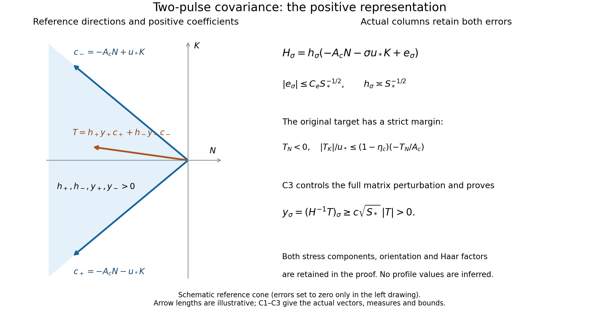

# Two-pulse stress realization and the signed covariance inverse

The complete theorem and its proof dependencies are stated in the [theorem construction](theorem-audit-conclusion.md). The calculations below verify the operations in original Propositions 7.5–7.6 and Corollary 7.8, including their measures, support, edge division and actual curl remainders. The actual leading profile and complete base field are supplied by [V0–V7](shear-realization-audit.md) and [Z0–Z8](base-field-realization-audit.md). The complete theorem and its proof dependencies are stated in the [theorem construction](theorem-audit-conclusion.md).

Source: OpenAI, *Finite Time Blowup for Navier–Stokes*, original [PDF](https://cdn.openai.com/pdf/32d9f210-8b73-45e0-91bc-82a30aef8a9a/navier-stokes.pdf), SHA256 `0e779481c4da40bd28d1e642e1d8ca57447d129610df28dfa5a11e9af8ae228f`. The relevant source passages are pages 25, 27, 30, 33, 74, 82–85 and 87–88. In particular, original (7.2) has numerator \(\lambda _0\); [P0–P5](pulse-inverse-audit.md#p0-correction-established-from-the-original-page) use this coefficient.

The complete local inputs and their derivations are in the [pulse audit, P1–P6](pulse-inverse-audit.md#p1-original-input-data-and-a-fixed-band-threshold), and the [wave interaction audit, W1–W4](wave-interaction-audit.md#w1-original-coordinates-operators-and-angular-averaging). The following construction supplies the scalar stress amplitudes. All differentiation fixes the band, representative, labels and integer frequencies first. Constants may depend on a fixed derivative order and finite correction stage, but are uniform over bands, labels and rectangle copies.

## C1. Exact average and the two columns

The tangential component order is \((\theta,z)\). For real cylindrical-component fields on the extended domain, let
\[
\mathcal C(w)=\int_{\mathbb T^2}\frac1{2\pi}\int_0^{2\pi}w_r w_{\rm tan}\,d\theta\,d\mu(Y),\qquad
\mathcal B(w,v)=\int_{\mathbb T^2}\frac1{2\pi}\int_0^{2\pi}
(w_rv_{\rm tan}+v_rw_{\rm tan})\,d\theta\,d\mu(Y),
\tag{C1.1}
\]
where Haar measure has mass one. These are a quadratic map and its symmetric bilinear cross map; \(D\mathcal C(w)[v]=\mathcal B(w,v)\). The symbol \(\mathcal B\) here denotes the covariance map (original (7.23)), not the differential transport map in W1. The averages act on cylindrical components, with the basis vectors held in that component convention.

A common torus maps onto each band torus by the integer matrix \(J^d\), where
\[
J=\begin{pmatrix}3&1\\1&5\end{pmatrix},\quad \det J=14,
\quad v_r=(1,-b_g),\quad v_t=(b_g,1),\quad b_g=\sqrt2-1.
\]
For \(d\ge0\), partition a fundamental domain of the covering torus into the \(14^d\) inverse-image sheets of a fundamental domain of the band torus, ignoring boundaries of measure zero. Change of variables on each sheet contributes \(14^{-d}\). Their sum proves
\(\int f(J^dY)\,d\mu(Y)=\int f(Y_i)\,d\mu(Y_i)\).
Thus no covering degree multiplies (C1.1). Smooth periodic integrands allow differentiation under this integral. Common-cover compatibility follows by applying this equality twice.

Fix a slow box \(\beta=(\ell,a)\). Its two labels are \((\beta,\sigma)\), \(\sigma=\pm1\), with the same slow cutoff \(\eta_\beta\). Put
\[
Q=2^{-\ell},\quad \varepsilon=Q^h,\quad S_*=\ell^2,
\quad A=\tfrac12+h,\quad D=\tfrac12-h,\quad 0<h<\tfrac1{100}.
\]
With \(T_g=4+\sqrt2\), the original band choice gives
\[
\frac1{T_gS_*}<c_i\le\frac1{S_*},\qquad L_s=\frac{2r_0}{c_i},
\qquad 2r_0S_*\le L_s<2r_0T_gS_*.
\tag{C1.2}
\]
The positive constant \(r_0\) and the transverse cutoffs are fixed before bands are chosen. The unweighted, uncurled local basis waves are exactly
\[
b_\sigma=\chi_g(\xi_g)\psi(v)t^h_\sigma\cos(k\Phi_\sigma),\qquad
\mathsf H=[\mathcal C(b_+)\mid\mathcal C(b_-)].
\tag{C1.3}
\]
Here \(k=\lceil\varepsilon^{-1/2}\rceil\), \(kp\in\mathbb Z\setminus\{0\}\), and the pulse cutoff satisfies \(0\le\psi\le1\), \(\psi=1\) for \(|v-L_s/2|\le L_s/5\), with support in \(|v-L_s/2|<L_s/3\). Neither \(\eta_\beta\) nor a scalar stress amplitude is in \(b_\sigma\). Their auxiliary supports are disjoint, including the closed support neighborhoods used for derivatives, as constructed in W2.

For every fixed slow and auxiliary point, write \(k\Phi_\sigma=kp\theta+\omega\). Then
\[
\frac1{2\pi}\int_0^{2\pi}\cos^2(kp\theta+\omega)\,d\theta
=\frac12+\left[\frac{\sin(2kp\theta+2\omega)}{8\pi kp}\right]_0^{2\pi}
=\frac12.
\tag{C1.4}
\]
This equality remains exact after every slow derivative; differentiating its right side creates no frequency factor. On the band rectangle the area element is
\(\det(v_r,v_t)d\xi_gd\eta_g=(1+b_g^2)c_i\,d\xi_gdv\).
The homogeneous amplitude is independent of \(\xi_g\); write \(x_\sigma=(t^h_\sigma)_r\). Hence
\[
\mathsf H_\sigma=\frac{1+b_g^2}{2}
\left(\int\chi_g^2\,d\xi_g\right)c_i
\int_0^{L_s}\psi^2x_\sigma(t^h_\sigma)_{\rm tan}\,dv,
\qquad
h_\sigma=\frac{1+b_g^2}{2}
\left(\int\chi_g^2\,d\xi_g\right)c_i
\int_0^{L_s}\psi^2x_\sigma^2\,dv.
\tag{C1.5}
\]
The subscript \(g\) retains the cutoff belonging to the sign's own rectangle. Its squared integral is positive and bounded above and below uniformly, since these are fixed nonzero cutoffs from finitely many shapes. The determinant, \(c_i\), the cosine factor \(1/2\), and both stress components have all been retained. For real coefficients independent of both averaging variables, disjointness gives
\[
\mathcal C(a_+b_++a_-b_-)=\mathsf H(a_+^2,a_-^2)^T.
\tag{C1.6}
\]

## C2. Covariance size and direction from the exact pulse

P3.5 and P5.5 establish fixed constants \(c_-,c_+,c_x,C_x>0\), independent of the band, with
\[
e^{-c_+(v-L_s/2)^2/(2L_s)}\le P(v)\le
e^{-c_-(v-L_s/2)^2/(2L_s)},\qquad
c_xP(v)\le x_\sigma(v)\le C_xP(v).
\tag{C2.1}
\]
These bounds use the original \(B_s^2=\lambda_0/[\varepsilon k^2(1+u_*^2)^{3/2}]\). Set
\(I_{0,\sigma}=\int\psi^2x_\sigma^2\,dv\) and
\(I_{1,\sigma}=\int |v-L_s/2|\psi^2x_\sigma^2/L_s\,dv\), each on \([0,L_s]\).
Choose the one band threshold large enough that \(L_s\ge25\). On \(|v-L_s/2|\le\sqrt{L_s}\), the cutoff equals one. Integrating the lower bound there and enlarging the upper integrals to the real line proves
\[
2c_x^2e^{-c_+}\sqrt{L_s}\le I_{0,\sigma}
\le C_x^2\sqrt{\frac\pi{c_-}}\sqrt{L_s},\qquad
I_{1,\sigma}\le \frac{C_x^2}{c_-}.
\tag{C2.2}
\]
For the last integral, \(2L_s^{-1}\int_0^\infty s e^{-c_-s^2/L_s}\,ds=1/c_-\). The Gaussian integral in the preceding bound follows by squaring the positive integral and using polar coordinates: \(\int_{\mathbb R^2}e^{-c_-(x^2+y^2)}dxdy=2\pi\int_0^\infty r e^{-c_-r^2}dr=\pi/c_-\). Thus these are analytic inequalities, not numerical enclosures. Equations (C1.2), (C1.5) and (C2.2) yield
\[
0<h_-^*S_*^{-1/2}\le h_\sigma\le h_+^*S_*^{-1/2},\qquad
\frac{I_{1,\sigma}}{I_{0,\sigma}}\le C S_*^{-1/2}.
\tag{C2.3}
\]
For clarity, \(h_-^*,h_+^*\) are fixed bounds applying to both signs, not the two different numbers \(h_-\) and \(h_+\).

In the frozen orthonormal tangential frame of P1,
\[
N=\frac{g_0}{|g_0|},\quad K=(-N_z,N_\theta),\quad
c_0=\frac{\lambda_0}{2F_0N_\theta}<0,\quad
s_\sigma(v)=\sigma\left(\frac{u_*}{2}+\frac{u_*v}{L_s}\right),
\]
P1 and P5 prove, uniformly throughout the enlarged slow box,
\[
\frac{(t^h_\sigma)_{\rm tan}}{x_\sigma}
=-s_\sigma(v)K+c_0\sqrt{1+s_\sigma(v)^2}\,N+e^{\rm loc}_\sigma(v),
\qquad |e^{\rm loc}_\sigma(v)|\le C S_*^{-1}.
\tag{C2.4}
\]
This uses the actual formula \((t^h)_{\rm tan}=-s_axK_a+yN_a\), including its moving-frame error. The derivative of \(s\mapsto-sK+c_0\sqrt{1+s^2}N\) has norm at most \(1+|c_0|\). Since
\(|s_\sigma(v)-\sigma u_*|=u_*|v-L_s/2|/L_s\), averaging (C2.4) with the positive probability density \(\psi^2x_\sigma^2/I_{0,\sigma}\) gives the exact representation
\[
\mathsf H_\sigma=h_\sigma(-A_cN-\sigma u_*K+e_\sigma),\qquad
A_c=-c_0\sqrt{1+u_*^2}>0,\qquad |e_\sigma|\le C_eS_*^{-1/2}.
\tag{C2.5}
\]
The error is explicitly the average of \(e^{\rm loc}_\sigma\) plus the difference between the displayed reference direction and its midpoint value. Thus it includes both the moving-frame and finite-width contributions. P1 supplies fixed \(0<A_-\le A_c\le A_+\). All fixed derivatives of \(\mathsf H\) have polynomial bounds in \(S_*\): apply Leibniz to the exact integral (C1.5), use the P5 bounds for each differentiated pulse, and integrate on an interval of length \(L_s\le2r_0T_gS_*\). The limits, cutoffs and \(c_i\) are fixed under slow differentiation. No derivative of a pointwise error estimate is being assumed.

## C3. The original cone margin and an explicit inverse estimate

Original (4.20) defines \(t_s=-b_s/a\) and \(v_s=a(1+t_s^2)\). Original (7.1) uses \(g=F(-a,b_s)\), with \(F,a,v_s-2\) bounded below positively. Before freezing the point,
\[
N=-\frac{(1,t_s)}{\sqrt{1+t_s^2}},\qquad
K=\frac{(t_s,-1)}{\sqrt{1+t_s^2}},\qquad
c_0^2=\frac{v_s-2}{2}.
\tag{C3.1}
\]
Indeed \(2FN_\theta=-2F/\sqrt{1+t_s^2}\), \(|g|=Fa\sqrt{1+t_s^2}\), so
\(\lambda_0^2=-2FN_\theta(2FN_\theta+|g|)=2aF^2(1-2/v_s)\); dividing by \((2FN_\theta)^2\) proves the last identity. Here is the full profile-to-chart comparison behind this calculation. Original (4.3)–(4.4) give \(u_\theta^{(0)}=q^{-A}E\), \(u_z^{(0)}=q^{-A}U\), \(E=\sqrt{2X}F_{\rm prof}\), \(F_{\rm prof}=\phi/\mathsf C\). With \(\xi=q/Q\), their chart values are \(V^{(0)}=\xi^{-A}E\), \(G^{(0)}=\xi^{-A}U\), and
\[
F_{\rm chart}^{(0)}=V^{(0)}/R=\xi^{-A-1/2}F_{\rm prof},\quad
R\partial_RF_{\rm chart}^{(0)}=\xi^{-A-1/2}2X(F_{\rm prof})_X=-aF_{\rm chart}^{(0)},\quad
\partial_RG^{(0)}=\xi^{-A-1/2}\sqrt{2X}U_X=b_sF_{\rm chart}^{(0)}.
\tag{C3.1a}
\]
These identities use \(X=R^2/(2\xi)\), with \(\xi,\eta\) fixed under \(\partial_R\), and the full original (4.11) definitions \(a=1-2X\partial_X\log E\), \(b_s=2XU_X/E\). Thus \(F\), \(g\), \(\lambda_0\) and the target stress each retain their displayed positive factor \(\xi^{-A-1/2}\); that factor cancels only in the explicitly computed frame and in the ratio defining \(c_0\). No amplitude normalization \(\mathsf C\) or physical stress factor has been discarded.

Write \(\kappa_c\in(0,2)\) for the constant called \(\kappa\) in original (4.26), to distinguish it from the derivative-loss constant \(\kappa_s=10^{-5}\). For the original unit stress direction \(n=\mathcal T_0/|\mathcal T_0|\), that equation is
\[
n_\theta+t_sn_z\ge\kappa_c,\qquad
(v_s-2)(n_z-t_sn_\theta)^2\le(2-\kappa_c)(n_\theta+t_sn_z)^2.
\tag{C3.2}
\]
For \(T=\mathcal T_{0,*}=(Q/q)^{A+1/2}\mathcal T_0\), (C3.1) gives
\[
T_N=-\frac{T_\theta+t_sT_z}{\sqrt{1+t_s^2}}<0,\quad
T_K=-\frac{T_z-t_sT_\theta}{\sqrt{1+t_s^2}},\quad
\left|c_0\frac{T_K}{T_N}\right|\le\sqrt{1-\kappa_c/2}<1.
\tag{C3.3}
\]
At either edge use the smooth unit direction in (C3.2), not the undefined quotient of two zero stress components. Its denominator stays uniformly away from zero, since \(t_s\) is bounded on the closed annulus. This proves continuity of the directional quotient there.

Let \(m_c\) be its supremum on the closed annulus. The original choice of the single constant \(u_*>0\) satisfies \(r_u=u_*/\sqrt{1+u_*^2}>m_c\). Such a choice exists because \(m_c<1\) and \(r_u\to1\) as \(u_*\to\infty\). All frozen frames and coefficients range over a compact set with the positive denominators in P1. For each actual point of the closed shell, hold its unit stress direction fixed while comparing the frame at that point to the frame at the representative; only the frame and its growth coefficient are frozen. The frame is defined on the fixed enlarged annulus even when the representative lies outside the shell. The smooth profile-to-chart map and frame have bounded first derivatives; the enlarged slow box has diameter at most \(CS_*^{-3}\). The mean-value formula along a segment in its fixed enlarged neighborhood therefore bounds the change of the numerator and denominator of this quotient by \(C'S_*^{-3}\). For a positive denominator bounded below by \(d_0\), the quotient difference is at most \(2C'S_*^{-3}(d_0^{-1}+M_0d_0^{-2})\) once its change is at most \(d_0/2\), with \(M_0\) a fixed numerator bound. Choose the band threshold so this difference is at most \((r_u-m_c)/2\). The frozen frame then satisfies
\[
T_N<0,\qquad \frac{|T_K|}{u_*}\le(1-\eta_c)\frac{-T_N}{A_c},\qquad
\eta_c=\frac{r_u-m_c}{2r_u}\in(0,1).
\tag{C3.4}
\]
The argument covers the shell edges using their unit directions. It is a value estimate, not smallness of arbitrarily high derivatives. One finite band threshold suffices for this margin and for the pulse estimates.

Put \(F_{NK}=[N\mid K]\); this orthogonal matrix has determinant \(+1\) in the original \((\theta,z)\) orientation. Set
\[
C_0=\begin{pmatrix}-A_c&-A_c\\-u_*&u_*\end{pmatrix},\quad
E_c=[F_{NK}^Te_+\mid F_{NK}^Te_-],\quad D_h=\operatorname{diag}(h_+,h_-).
\]
Then the actual covariance matrix, including its error, factors exactly as
\[
\mathsf H=F_{NK}(C_0+E_c)D_h,
\quad C_0^{-1}=\frac12\begin{pmatrix}-A_c^{-1}&-u_*^{-1}\\-A_c^{-1}&u_*^{-1}\end{pmatrix},
\quad \det C_0=-2A_cu_*.
\tag{C3.5}
\]
In the induced infinity norm, \(\|C_0^{-1}\|_\infty\le M_c=\tfrac12(A_-^{-1}+u_*^{-1})\) and \(\|E_c\|_\infty\le2C_eS_*^{-1/2}\). Enlarge the single threshold so
\[
\vartheta:=\|C_0^{-1}E_c\|_\infty\le2M_cC_eS_*^{-1/2}\le\frac{\eta_c}{4+\eta_c}<1.
\tag{C3.6}
\]
The geometric series \(\sum_{j\ge0}(-C_0^{-1}E_c)^j\) converges absolutely in this matrix norm and its product with \(I+C_0^{-1}E_c\) is \(I\), by cancellation of partial sums and a remainder tending to zero. This proves invertibility and the inverse norm bound \((1-\vartheta)^{-1}\).

For the target set \(s_T=-T_N/A_c>0\), \(t_T=T_K/u_*\). The reference vector is
\[
z^0=C_0^{-1}(T_N,T_K)^T
=\tfrac12(s_T-t_T,s_T+t_T)^T,
\qquad \eta_cs_T/2\le z^0_\sigma\le s_T.
\]
The actual vector \(z=D_h\mathsf H^{-1}T\) equals \((I+C_0^{-1}E_c)^{-1}z^0\), whence
\[
\|z-z^0\|_\infty\le\frac{\vartheta}{1-\vartheta}s_T\le\eta_cs_T/4,
\qquad \eta_cs_T/4\le z_\sigma\le(1+\eta_c/4)s_T.
\tag{C3.7}
\]
Also \(|T|^2=A_c^2s_T^2+u_*^2t_T^2\), so
\[
\frac{|T|}{\sqrt{A_+^2+u_*^2(1-\eta_c)^2}}\le s_T\le\frac{|T|}{A_-}.
\tag{C3.8}
\]
Divide (C3.7) by (C2.3). This proves the positive, two-sided amplitude bounds, with every component retained:
\[
c\sqrt{S_*}|T|\le y_\sigma:=(\mathsf H^{-1}T)_\sigma\le C\sqrt{S_*}|T|,
\qquad \|\mathsf H^{-1}\|_\infty\le C\sqrt{S_*}.
\tag{C3.9}
\]
For completeness, every complex eigenvalue of \(C_0^{-1}E_c\) has modulus at most \(\vartheta\): apply the eigenvector equation to a component of maximum modulus. Thus \(|\det(I+C_0^{-1}E_c)|\ge(1-\vartheta)^2\). Along the path multiplying this error matrix by \(t\in[0,1]\), this real determinant cannot vanish and starts at one. It is therefore positive. Consequently
\[
\det\mathsf H<0,\qquad
|\det\mathsf H|\ge 2A_-u_*(h_-^*)^2(1-\vartheta)^2S_*^{-1}.
\tag{C3.10}
\]
This retains the orientation of both original covariance columns.

The left drawing shows the reference cone in the original oriented \((N,K)\) frame; arrow lengths are schematic. The actual error terms and the proved positive-amplitude bound are displayed on the right. Proof: C1–C3; source: original (7.23)–(7.29). The [reproducible figure source](assets/stress-cone-audit.py) and [SVG](assets/stress-cone-audit.svg) are included. No profile parameter or numerical proof evidence is inferred from the drawing.

## C4. Every derivative and both shell boundaries

The exact chart variables are
\[
\xi=q/Q,\quad \xi-Z^2\xi^{2h}=T_{\rm time},\quad
X=R^2/(2\xi),\quad \eta=Z\xi^{-D}.
\]
Here \(R=r/\sqrt Q\), \(Z=z/Q^D\), \(T_{\rm time}=(1-t)/Q\). On the original chart, \(\xi\) is bounded above and below and \(|\eta|\le1\). The derivative in \(\xi\) of its defining equation is \(1-2h\eta^2\ge1-2h>0\). Repeated implicit differentiation, dividing only by this denominator, bounds every fixed derivative of \(\xi,X,\eta\) and \(\xi^{-A-1/2}\). Apply this chain rule to original (4.27), on page 33:
\[
|\mathcal T_0|\ge c\zeta,\qquad
|\partial_X^{j_1}\partial_\eta^{j_2}\mathcal T_0|\le C_j\zeta\delta^{-m_j},\qquad
\delta=\min\{1,\log(X/X_a),\log(X_b/X)\}.
\]
It gives \(|T|\ge c'\zeta\) and \(|\partial^IT|\le C_I\zeta\delta^{-a_I}\). These are the precise leading-profile assertions consumed here. V5–V7 construct them, and [I1–I2](local-construction-assembly-audit.md) proves the complete receiving maps with the actual base and its fixed margins.

For every nonzero multi-index \(I\), differentiating \(\mathsf H\mathsf H^{-1}=I_2\) gives the recursion
\[
\partial^I\mathsf H^{-1}
=-\mathsf H^{-1}\sum_{0<J\le I}\binom IJ
(\partial^J\mathsf H)(\partial^{I-J}\mathsf H^{-1}).
\tag{C4.1}
\]
Induction using C2 and (C3.9) bounds each derivative by a finite polynomial in \(S_*\). Multiplying by the full derivatives of \(T\) proves
\[
y_\sigma\ge c\sqrt{S_*}\zeta,\qquad
|\partial^Iy_\sigma|\le C_IS_*^{b_I}\zeta\delta^{-a_I}.
\tag{C4.2}
\]
Set \(a_\sigma=\sqrt{y_\sigma}\) in the open shell. For \(|I|>0\), repeated chain and product rules give a finite sum
\[
\partial^Ia_\sigma=
\sum_{n=1}^{|I|}\ 
\sum_{I_1+\cdots+I_n=I,\ |I_j|>0}
c_{I_1,\ldots,I_n}y_\sigma^{1/2-n}\prod_{j=1}^n\partial^{I_j}y_\sigma.
\tag{C4.3}
\]
Every term has weight \(\zeta^{1/2-n}\zeta^n=\sqrt\zeta\); all powers of \(S_*\) and \(\delta^{-1}\) remain in finite order-dependent bounds. For \(I=0\), take the square root of the upper bound in (C4.2). Therefore
\[
|\partial^Ia_\sigma|\le C_IS_*^{b'_I}\sqrt\zeta\delta^{-a'_I}.
\tag{C4.4}
\]
The fixed source weight is smooth and flat at each radial edge. Taylor's formula with integral remainder, using its vanishing jets, gives \(0\le\zeta\le C_Nd^N\) near either edge for every integer \(N\), where \(d\) is the distance to that edge. The logarithmic distances in \(\delta\) are comparable to \(d\) there, since \(0<X_a<X_b<\infty\). Given any fixed power in (C4.4), choose \(N\) more than twice that power. Then \(\sqrt\zeta\delta^{-a'_I}\to0\). Extend every derivative by zero. Difference quotients in a smooth boundary coordinate, followed by induction on derivative order, show that these extended derivatives are derivatives of the zero-extended function. Thus \(a_\sigma\) extends smoothly by zero; no value of \(1/a_\sigma\) at an edge is being assigned. This argument uses the original flat weight and does not require replacing it by a special exponential formula.

Define
\[
W_0=\sqrt\varepsilon\sum_{\sigma=\pm1}a_\sigma b_\sigma.
\tag{C4.5}
\]
The coefficients of \(e^{\pm ik\Phi_\sigma}\) are each \(\sqrt\varepsilon a_\sigma\chi_g\psi t^h_\sigma/2\). P5 bounds each fixed derivative of \(t^h_\sigma\) by a polynomial in \(S_*\) times the original envelope \(P(v)\). Thus the coefficients obey \(\varepsilon^{1/2}S_*^{b_I}\sqrt\zeta\delta^{-a_I}P(v)\) bounds. With the slow cutoff, \(\eta_\beta W_0\in\mathsf W_{1/2}\), including all support and common-torus requirements. Without that cutoff the same local coefficient bounds hold, and (C1.6) gives
\[
\mathcal C(W_0)=\varepsilon\mathsf H y=\varepsilon T.
\tag{C4.6}
\]

## C5. Signed increments and the exact retained quadratic term

Keep the positive coefficients \(a_\sigma\) just constructed fixed at all later stages. Let \(\Sigma(R,Z,T_{\rm time})\) be the real two-component stress supplied to this operator, independent of both \(\theta\) and the auxiliary variables, with the original \(\mathsf M_\alpha\) estimates
\[
|\partial^I\Sigma|\le C_I\varepsilon^\alpha S_*^{b_I}\zeta\delta^{-a_I}.
\]
Auxiliary independence is a required input property of this particular map; membership in \(\mathsf M_\alpha\) alone does not assert it. Define in the open shell
\[
d_\Sigma=\mathsf H^{-1}(\Sigma/\varepsilon),\qquad
\delta a_\sigma=\frac{(d_\Sigma)_\sigma}{2a_\sigma},\qquad
\mathcal L_\beta\Sigma=\sqrt\varepsilon\sum_{\sigma=\pm1}\delta a_\sigma b_\sigma.
\tag{C5.1}
\]
The inverse bounds give
\(|\partial^I(d_\Sigma)_\sigma|\le C_I\varepsilon^{\alpha-1}S_*^{b'_I}\zeta\delta^{-a'_I}\).
Derivatives of \(y_\sigma^{-1/2}\) are finite sums of
\(C y_\sigma^{-k-1/2}\prod_{j=1}^k\partial^{I_j}y_\sigma\), including \(k=0\) at order zero. Their weights are \(\zeta^{-k-1/2}\zeta^k=\zeta^{-1/2}\). The extra \(\zeta\) from \(d_\Sigma\) is therefore sufficient for every term in the product rule, giving
\[
|\partial^I\delta a_\sigma|\le C_I\varepsilon^{\alpha-1}S_*^{b''_I}\sqrt\zeta\delta^{-a''_I}.
\tag{C5.2}
\]
C4's boundary argument proves smooth zero extension. The pulse bounds then prove
\(\eta_\beta\mathcal L_\beta\Sigma\in\mathsf W_{\alpha-1/2}\).
Linearity in \(\Sigma\) follows because \(\mathsf H\), \(a_\sigma\), and \(b_\sigma\) are fixed, also at the boundary after extension. No sign or relative-size condition on \(\Sigma\) has been introduced.

The coefficients can be moved outside both averages. Cross-label products are zero. Equations (C1.5) and (C5.1) now give
\[
\mathcal B(W_0,\mathcal L_\beta\Sigma)
=\varepsilon\mathsf H(2a\odot\delta a)
=\varepsilon\mathsf H d_\Sigma=\Sigma.
\tag{C5.3}
\]
Here \(\odot\) denotes componentwise multiplication. The cosine factor \(1/2\) is already in each column of \(\mathsf H\). The cross term has the separate factor two because differentiating \(a_\sigma^2\) gives \(2a_\sigma\delta a_\sigma\). In particular the full change is
\[
\mathcal C(W_0+\mathcal L_\beta\Sigma)
=\varepsilon T+\Sigma+\mathcal C(\mathcal L_\beta\Sigma),\qquad
\mathcal C(\mathcal L_\beta\Sigma)
=\varepsilon\mathsf H((\delta a_+)^2,(\delta a_-)^2)^T.
\tag{C5.4}
\]
Thus the map in (C5.1) is a right inverse of the derivative of the covariance map. It does not drop the last quadratic term. Its angularly averaged products have the weight \(\varepsilon^{2\alpha-1}\zeta\delta^{-a}P^2\), with \(P^2\le1\), and finite polynomial factors. Averaging over the mass-one auxiliary torus preserves this bound. Therefore \(\mathcal C(\eta_\beta\mathcal L_\beta\Sigma)\in\mathsf M_{2\alpha-1}\). These statements hold for every real \(\alpha\); later improvement of an iterative error additionally depends on its actual exponent.

## C6. Squared partition, chart transitions, and physical assembly

At each fixed \(q>0\), the slow partition has bounded local overlap and \(\sum_\beta\eta_\beta^2=1\), counting each box once, not once for each sign. Define exactly as in original (7.35), with \(Q_\beta=2^{-\ell_\beta}\),
\[
W_{0,\rm phys}^{\rm as}=\sum_\beta Q_\beta^{-A}\eta_\beta W_{0,\beta},\qquad
\mathcal L_{\rm phys}^{\rm as}\sigma
=\sum_\beta Q_\beta^{-A}\eta_\beta\mathcal L_\beta(Q_\beta^{2A}\sigma).
\tag{C6.1}
\]
Here \(\sigma(r,z,t)\) is the physical stress input, independent of the averaging variables; it is distinct from the sign label. A common torus can be chosen for all summands active at that point. Their cross-label products vanish on it by W2, even where their slow supports overlap. Then
\[
\begin{split}
\mathcal C(W_{0,\rm phys}^{\rm as})
&=\sum_\beta Q_\beta^{-2A}\eta_\beta^2\varepsilon_\beta
(Q_\beta/q)^{A+1/2}\mathcal T_0
=q^{-A-1/2}\mathcal T_0,\\
\mathcal B(W_{0,\rm phys}^{\rm as},\mathcal L_{\rm phys}^{\rm as}\sigma)
&=\sum_\beta Q_\beta^{-2A}\eta_\beta^2Q_\beta^{2A}\sigma=\sigma.
\end{split}
\tag{C6.2}
\]
The scale identity in the first line is
\(Q^{-2A}Q^h(Q/q)^{A+1/2}=Q^{-A+h+1/2}q^{-A-1/2}=q^{-A-1/2}\), since \(A=1/2+h\). There is no missing count of two from the sign labels.

In a receiving chart of scale \(Q\), the representatives are
\[
W_0^{\rm as}=Q^AW_{0,\rm phys}^{\rm as},\qquad
\Sigma=Q^{2A}\sigma,\qquad
\mathcal L^{\rm as}\Sigma=Q^A\mathcal L_{\rm phys}^{\rm as}(Q^{-2A}\Sigma).
\tag{C6.3}
\]
An overlapping band has \(|\ell_\beta-\ell|\le4\). The ratios of its scales \(Q_\beta/Q\), \(\varepsilon_\beta/\varepsilon\) and \(S_{*,\beta}/S_*\) are bounded above and below by constants independent of the band. The exact coordinate transition is
\[
R_\beta=(Q/Q_\beta)^{1/2}R,\quad
Z_\beta=(Q/Q_\beta)^DZ,\quad
T_{{\rm time},\beta}=(Q/Q_\beta)T_{\rm time},
\]
and the common-to-band torus maps are the fixed powers of \(J\) with bounded exponent difference from W2. Each fixed derivative of a coefficient after these linear maps has the same class estimate with a changed finite constant and polynomial power. The profile \(X\), its edge weight and the label's own pulse envelope are retained. Collect coefficients having the same label and harmonic before testing membership. Bounded local overlap then proves
\[
W_0^{\rm as}\in\mathsf W_{1/2},\qquad
\mathcal L^{\rm as}\Sigma\in\mathsf W_{\alpha-1/2},\qquad
\mathcal B(W_0^{\rm as},\mathcal L^{\rm as}\Sigma)=\Sigma.
\tag{C6.4}
\]
The equalities are compatible on chart overlaps because they arise from the same physical fields in (C6.1). Local finiteness for \(q>0\) suffices here. No extension at the singular terminal point is asserted by this assembly.

## C7. Full curls and the stress of the actual velocity

For each harmonic \(t_me^{ikm\Phi}\) of the assembled primary or signed field, \(m\ne0\), let \(n=\nabla_*\Phi\). Its full coefficient is transverse: \(n\cdot t_m=0\). P1 proves a uniform positive lower bound for \(|n|\). The exact potential and remainder from P6 are
\[
C_m=\frac{i\,n\times t_m}{km|n|^2},\qquad
r_m=(-D_z(C_m)_\theta,\ D_z(C_m)_r-D_r(C_m)_z,\ (D_r+R^{-1})(C_m)_\theta).
\tag{C7.1}
\]
The curl of \(C_me^{ikm\Phi}\) is \((t_m+r_m)e^{ikm\Phi}\), since \(ikm n\times C_m=t_m\). Its divergence is exactly zero, including the cylindrical connection terms, by W4. For a signed amplitude in \(\mathsf W_{\alpha-1/2}\), P6 gives \(C_m\in\mathsf W_\alpha\) and \(r_m\in\mathsf W_{\alpha-\kappa_s}\). It preserves all closed support restrictions. The \(m=+1,-1\) coefficients are conjugates, including their potentials: the sign of \(i/m\) changes on conjugation. The assembled curl field is therefore real.

In particular the initial actual wave produced by the primary amplitudes is
\[
U_0=W_0^{\rm as}+R_0,\qquad R_0\in\mathsf W_{1-\kappa_s},\qquad U_0\in\mathsf W_{1/2}.
\tag{C7.2}
\]
Its covariance in any chart is the exact expression
\[
\mathcal C(U_0)=Q^{2A}q^{-A-1/2}\mathcal T_0
+\mathcal B(W_0^{\rm as},R_0)+\mathcal C(R_0),
\tag{C7.3}
\]
where the two additional terms are in \(\mathsf M_{3/2-\kappa_s}\) and \(\mathsf M_{2-2\kappa_s}\), respectively. The target in this receiving chart is the physical one from (C6.2), not a target frozen at a different box. Since \(\kappa_s<1/2\), their sum is in \(\mathsf M_{3/2-\kappa_s}\). This supplies the primary stress wave and its actual curl defect to the iteration, retaining the global-base status stated at the start.

At a later stage write the actual current wave as \(U=W_0^{\rm as}+E\), with its original recorded classes \(U\in\mathsf W_{1/2}\), \(E\in\mathsf W_\rho\). For a signed increment let
\(V=\mathcal L^{\rm as}\Sigma+R\), where \(R\in\mathsf W_{\alpha-\kappa_s}\) is its full curl remainder. Direct expansion, with no discarded cross term, gives
\[
\begin{split}
\mathcal C(U+V)-\mathcal C(U)
&=\mathcal B(U,V)+\mathcal C(V)\\
&=\Sigma+\mathcal B(E,\mathcal L^{\rm as}\Sigma)
+\mathcal B(U,R)+\mathcal C(V).
\end{split}
\tag{C7.4}
\]
All of \(\mathcal C(\mathcal L^{\rm as}\Sigma)\), \(\mathcal B(\mathcal L^{\rm as}\Sigma,R)\) and \(\mathcal C(R)\) remain inside \(\mathcal C(V)\). The product estimates give respectively
\[
\mathcal B(E,\mathcal L^{\rm as}\Sigma)\in\mathsf M_{\rho+\alpha-1/2},\qquad
\mathcal B(U,R)\in\mathsf M_{\alpha+1/2-\kappa_s},\qquad
\mathcal C(V)\in\mathsf M_{2\alpha-1}.
\tag{C7.5}
\]
For the last bound use \(\alpha-\kappa_s>\alpha-1/2\), so \(V\in\mathsf W_{\alpha-1/2}\). To justify these product statements at every derivative order, angular averaging of a same-label pair retains only harmonics with \(m+m'=0\), because \(kp\ne0\); their exponential phases cancel exactly. Cross-label products are identically zero. Each derivative of the remaining coefficient products has weight \(\varepsilon^{\mu+\mu'}S_*^b\zeta\delta^{-a}P^2\), and \(P^2\le1\). Integrating these finite sums over a mass-one common torus proves the displayed mean estimates with all derivatives. This verifies original (7.41)–(7.42) for the actual curl velocities.

## C8. Radial divergence after both averages

There is a small stronger estimate at this exact receiver. The three expressions in (C7.5) have already been averaged over both the angle and the auxiliary torus. For any same-label zero-harmonic product coefficient \(f\), on a fixed common torus with index \(i_0\), holding the receiving scale \(Q\) fixed,
\[
\partial_R\langle f\rangle_H=\langle\partial_R f\rangle_H,\qquad
\langle\mathcal L_{i_0}f\rangle_H=0,
\quad D_r=\partial_R+M_{i_0} d_rR^{d_r-1}\mathcal L_{i_0},\qquad M_{i_0}=\Lambda_g^{i_0}Q^{d_r/2}.
\tag{C8.1}
\]
The second equality is integration by parts on the periodic torus; boundary faces cancel. Consequently \(D_r\langle f\rangle_H=\partial_R\langle f\rangle_H=\langle D_rf\rangle_H\). Differentiating the surviving coefficient products by ordinary \(\partial_R\) uses their coefficient bounds and introduces no \(\varepsilon^{-\kappa_s}\) factor. The derivative of the cancelled exponential is zero; it must not be estimated separately before cancellation.

For a two-component auxiliary-averaged radial stress \(S=(S_\theta,S_z)\), define its cylindrical tangential divergence
\[
\mathfrak D_r S=((D_r+2/R)S_\theta,(D_r+1/R)S_z).
\tag{C8.2}
\]
The shell has \(R\) bounded above and bounded away from zero. The zero-order factors and all their derivatives are therefore bounded. Equations (C8.1)–(C8.2) prove that the divergences of the three terms in (C7.5) retain precisely the exponents displayed there. Original Corollary 7.8 allows a further loss of at most \(\kappa_s\); it is unnecessary after this full auxiliary average. The stronger claim does not apply to an angular mean still depending on the auxiliary variable, for which the fast derivative remains. It also does not remove the \(\kappa_s\) already paid when taking a curl.

This local refinement is recorded as `OAI-COVARIANCE-AVERAGED-DIVERGENCE-20261015`. Its receiving terms are the three explicitly averaged remainders in original (7.41), including the primary terms in (C7.3). The [cycle audit](correction-cycle-audit.md), K4.7–K4.10 and K7.1–K7.2, now applies this estimate to the complete four-step cycle and proves the common gain 17999/100000 under the original finite-state bounds. No novelty claim is made.

## C9. All original viscosity factors and the next receiving calculation

For every fixed original viscosity \(\nu>0\), let \(y=x/\sqrt\nu\), with time unchanged. The exact change of fields from M2 is
\[
u_\nu(x,t)=\sqrt\nu\,u_1(y,t),\quad
p_\nu(x,t)=\nu p_1(y,t),\quad
f_\nu(x,t)=\sqrt\nu\,f_1(y,t),\quad
\mathcal A_\nu(x,t)=\nu\mathcal A_1(y,t).
\tag{C9.1}
\]
The last formula gives \(\operatorname{curl}_x\mathcal A_\nu=\sqrt\nu\operatorname{curl}_y\mathcal A_1\), because each spatial derivative contributes \(\nu^{-1/2}\). It applies to every potential in (C7.1), including all cutoffs and remainders.

The angles and auxiliary torus measures in (C1.1) do not change under this dilation. There is no physical-space volume integral in that definition. Throughout this note, a covariance of a field in physical units is still the average on the extended domain before evaluating the auxiliary variable at the physical phase map. No equality with the unaveraged pointwise velocity product is inferred. Thus for any two fields \(w,v\),
\[
\mathcal C_\nu(\sqrt\nu\,w(y,t))=\nu\mathcal C_1(w)(y,t),\qquad
\mathcal B_\nu(\sqrt\nu\,w(y,t),\sqrt\nu\,v(y,t))=\nu\mathcal B_1(w,v)(y,t).
\tag{C9.2}
\]
For a physical input \(\sigma_\nu(x,t)\), set \(\sigma_1(y,t)=\nu^{-1}\sigma_\nu(\sqrt\nu y,t)\), and define
\[
W_{0,\nu}^{\rm as}(x,t)=\sqrt\nu W_{0,1}^{\rm as}(y,t),\qquad
\mathcal L_{\nu,\rm phys}^{\rm as}\sigma_\nu(x,t)
=\sqrt\nu(\mathcal L_{1,\rm phys}^{\rm as}\sigma_1)(y,t).
\tag{C9.3}
\]
Apply (C6.2) and (C9.2) to get the exact identities
\[
\mathcal B_\nu(W_{0,\nu}^{\rm as},\mathcal L_{\nu,\rm phys}^{\rm as}\sigma_\nu)=\sigma_\nu,\qquad
\mathcal C_\nu(W_{0,\nu}^{\rm as})=\nu q_\nu^{-A-1/2}\mathcal T_0(X_\nu,\eta_\nu).
\tag{C9.4}
\]
Here all original coordinates are
\[
q_\nu-(z_\nu^2/\nu)q_\nu^{2h}=1-t,\quad
X_\nu=\frac{r_\nu^2}{2\nu q_\nu},\quad
\eta_\nu=\frac{z_\nu}{\sqrt\nu q_\nu^D},\quad
R=\frac{r_\nu}{\sqrt{\nu Q}},\quad Z=\frac{z_\nu}{\sqrt\nu Q^D}.
\tag{C9.5}
\]
In a chart the stress input is \(\Sigma=\nu^{-1}Q^{2A}\sigma_\nu\); physical velocity, potential and covariance carry factors \(\sqrt\nu Q^{-A}\), \(\nu Q^{1/2-A}\) and \(\nu Q^{-2A}\), respectively. Applying a physical radial divergence multiplies the last factor by \(\nu^{-1/2}Q^{-1/2}\), giving \(\sqrt\nu Q^{-2A-1/2}\), with both cylindrical terms in (C8.2) preserved. These are exactly the physical residual factors in M2 and P7. Thus (C7.3)–(C8.2) transfer to every \(\nu>0\) without dropping a viscosity factor or an auxiliary average.

The operations proved here are the positive primary stress representation, its fixed linear signed inverse, smooth zero extension of all amplitudes, physical assembly, exact curls and all three covariance remainders. These supply the stress-amplitude part of Proposition 9.3. The companion [source-containment proof, S1–S5](source-containment-audit.md), derives the full finite-stage closure, including exact pressure and conservative means. The [initialization and complete cycle audit](correction-cycle-audit.md), K0–K8, proves the actual four updates, their simultaneous gains, accumulated-field bounds and common finite-stage domain. The [physical derivative and realization audit](physical-realization-audit.md), L0–L7, derives the stage-independent derivative loss, exact potential summation, retained cutoff curls, full nonlinear residual comparison, one-sided endpoint limits and preservation of the exterior and inner fields. The actual leading profile and complete base field are supplied by [V0–V7](shear-realization-audit.md) and [Z0–Z8](base-field-realization-audit.md). The complete theorem and its proof dependencies are stated in the [theorem construction](theorem-audit-conclusion.md). The actual base is supplied by Z0–Z8, its local assembly by [I0–I7](local-construction-assembly-audit.md), and the compact-force and blowup argument by [F0–F8](terminal-force-and-blowup-audit.md).

## Exact finite changes and auxiliary-dependent inputs

The [complete stress and interaction derivation](stress-and-interaction-audit.md), SC11.1–SC11.10, proves the exact positive finite-amplitude domain, both variations, the auxiliary averaging projection and all five curled covariance remainders. SC10 retains the actual-shear remainder and explicit positive-production thresholds. These identities preserve the original covariance definition and its domain; no original-source defect or novelty is claimed.
