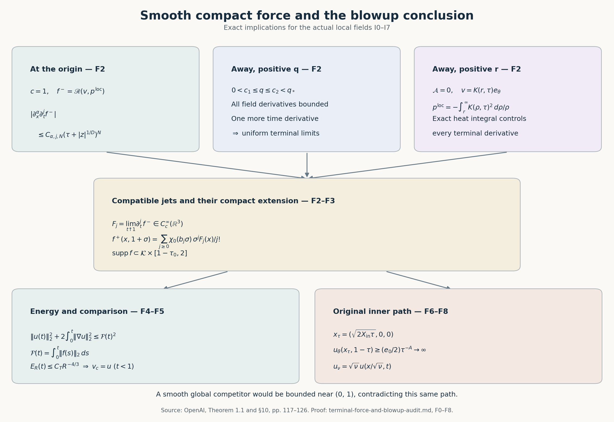

# Compact forcing, energy and the final blowup argument

This note derives the final whole-space and periodic conclusions from the actual local fields constructed in [I0–I7](local-construction-assembly-audit.md). It proves the localization and smooth force extension with every cutoff term, obtains the uniform energy and dissipation bounds from the equation, supplies the actual inputs to the whole-space comparison argument, and preserves the original growth path and viscosity. The underlying profile and correction proofs are the included suppliers of I0–I7. 

Source: OpenAI, *Finite Time Blowup for Navier–Stokes*, [original PDF](https://cdn.openai.com/pdf/32d9f210-8b73-45e0-91bc-82a30aef8a9a/navier-stokes.pdf), Theorem 1.1 on page 1, Proposition 10.1, Lemmas 10.2–10.5, the proof of Theorem 1.1 and Corollary 10.6 on pages 117–126. SHA256: 0e779481c4da40bd28d1e642e1d8ca57447d129610df28dfa5a11e9af8ae228f. In particular original (10.20) is the three-component Cartesian point \((\sqrt{2X_{\rm in}\tau},0,0)\).

The diagram shows the three terminal regions and the exact estimates receiving their limits. The energy inequality is written at viscosity one; F7 gives every factor for arbitrary positive viscosity. This is a diagram of the proof, without numerical samples. [Reproducible source](assets/terminal-force-and-blowup.py) · [Vector figure](assets/terminal-force-and-blowup.svg). Proof locators: F0–F8 and the comparison audit, equations (1)–(64).

## F0. The exact local input and a compact cutoff inside its domain

Use the actual viscosity-one fields of I:
\[
v=\operatorname{curl}\mathcal A+\mathcal B e_\theta,\qquad p^{\rm loc},
\qquad \Omega_*=\{(x,t):\tau=1-t>0,\ q<q_*\}.
\tag{F0.1}
\]
The scalar \(\mathcal B\) is axisymmetric. The actual Cartesian representatives, compatible one-sided derivatives for q bounded below, flat residual on every bounded profile interval, exact heat exterior, and positive inner-growth path are I4–I6. Keep the original \(0<h<1/100\), \(A=1/2+h\), \(D=1/2-h\), \(\tau=q(1-\eta^2)\), \(z=q^D\eta\), \(X=r^2/(2q)\), and \(L=1-2h\eta^2\).

If \(1-\eta^2\ge1/2\), then \(q\le2\tau\). Otherwise \(|\eta|>2^{-1/2}\) and \(q\le(\sqrt2|z|)^{1/D}\). Consequently the original (10.3) holds with the explicit admissible constant
\[
q\le C_0(\tau+|z|^{1/D}),\qquad
C_0=\max\{2,2^{1/(2D)}\}.
\tag{F0.2}
\]
This estimate is uniform in r. Fix
\[
\tau_0=\frac{q_*}{8C_0}<\frac12,\qquad
z_0=\left(\frac{q_*}{8C_0}\right)^D,
\qquad C_0(\tau_0+z_0^{1/D})=q_*/4.
\tag{F0.3}
\]
Take any fixed \(r_0>0\). Let \(\sigma\) be the smooth step used in O0, zero on \((-\infty,0]\) and one on \([1,\infty)\). Set
\[
\begin{split}
\chi_x(x)&=\left[1-\sigma\!\left(2r^2/r_0^2-\tfrac12\right)\right]
 \left[1-\sigma\!\left(2z^2/z_0^2-\tfrac12\right)\right],\\
\chi_t(t)&=1-\sigma(2\tau/\tau_0-1),\qquad c(x,t)=\chi_x(x)\chi_t(t).
\end{split}
\tag{F0.4}
\]
Thus \(\chi_x=1\) for \(r\le r_0/2,\ |z|\le z_0/2\), and its support is contained in \(r<r_0,\ |z|<z_0\). It is a smooth function of \(r^2,z\), including the Cartesian axis. The time cutoff is zero for \(\tau\ge\tau_0\) and one for \(0\le\tau\le\tau_0/2\). Its derivatives are flat at its endpoints. For t<1, the support of c and all its derivatives lies in \(q\le q_*/4<q_*/2\), by F0.2–F0.3. Let \(\mathcal K=\operatorname{supp}\chi_x\); it is a fixed compact subset of \(\mathbb R^3\).

Define on the local domain and extend by zero elsewhere
\[
u=\operatorname{curl}(c\mathcal A)+c\mathcal B e_\theta,\qquad
p=cp^{\rm loc}.
\tag{F0.5}
\]
There is a positive margin in q between the support and the outer boundary of \(\Omega_*\), so the zero extension is smooth. The original Cartesian axis representatives give smoothness at r=0. Commuting Cartesian mixed derivatives gives zero divergence for the curl. Since c and \(\mathcal B\) are independent of θ, the divergence of the other term is \(r^{-1}\partial_\theta(c\mathcal B)=0\), with its continuous Cartesian interpretation at the axis. Hence u is exactly divergence-free.

Both u and p are smooth on \(\mathbb R^3\times[0,1)\), supported in \(\mathcal K\) at every time, and identically zero for \(0\le t\le1-\tau_0\). They agree with the original local fields whenever \(r<r_0/2,\ |z|<z_0/2,\ \tau<\tau_0/2\). This proves every assertion of Proposition 10.1 for the supplied fields.

## F1. The complete localized momentum residual

Keep the full curl correction \(a=\nabla c\times\mathcal A\), so \(u=cv+a\). For t<1 set
\[
f^-=\partial_tu-\Delta u+(u\cdot\nabla)u+\nabla p.
\tag{F1.1}
\]
Every term is smooth before terminal time and has spatial support in \(\mathcal K\). The exact expansion is
\[
\begin{split}
f^-={}&c\,\mathscr R(v,p^{\rm loc})
+(\partial_tc-\Delta c)v-2\sum_{i=1}^3(\partial_i c)(\partial_i v)
+p^{\rm loc}\nabla c+(\partial_t-\Delta)a\\
&+(c^2-c)(v\cdot\nabla)v
+c(v\cdot\nabla c)v+c(v\cdot\nabla)a\\
&+(a\cdot\nabla c)v+c(a\cdot\nabla)v+(a\cdot\nabla)a .
\end{split}
\tag{F1.2}
\]
To verify it, expand the time derivative and Laplacian of cv, the gradient of \(cp^{\rm loc}\), and all four products in \((cv+a)\cdot\nabla(cv+a)\). Subtract the single \(c(v\cdot\nabla)v\) already contained in \(c\mathscr R(v,p^{\rm loc})\). This leaves the coefficient \(c^2-c\), not zero. The displayed \(a\cdot\nabla c\) term is identically zero by \((\nabla c\times\mathcal A)\cdot\nabla c=0\), but it has been retained in the full expansion. No other cutoff term has been suppressed.

Taking divergence of F1.1, using \(\operatorname{div}u=0\), gives exactly
\[
-\Delta p=\sum_{i,j=1}^3\partial_i\partial_j(u_i u_j)-\operatorname{div}f^-.
\tag{F1.3}
\]
The force need not be divergence-free; the target theorem imposes no such condition. The compactly supported pressure and this force satisfy the full pressure equation.

## F2. Uniform terminal limits of every force derivative

First consider a compact spatial region with q bounded below and bounded away from q_* near t=1. I5 supplies bounded derivatives of the actual \(\mathcal A,\mathcal B e_\theta,p^{\rm loc}\) of every order there. F1.2 is a finite differential polynomial in these fields and the fixed cutoffs, so the same holds for \(f^-\). One additional time derivative gives
\[
\sup_{x\in K_0}
|\partial_x^\alpha\partial_t^j f^-(x,t_2)
 -\partial_x^\alpha\partial_t^j f^-(x,t_1)|
\le C_{\alpha,j,K_0}|t_2-t_1|.
\tag{F2.1}
\]
Thus every derivative is uniformly Cauchy on that compact region.

The other region away from the origin has r bounded below and q small enough that \(X\ge X_{\rm ext}\). There \(\mathcal A=0\), \(v=K(r,\tau)e_\theta\), and the exact fields are
\[
K(r,\tau)=c_\infty s^{-A}\mathcal H(2\tau/s),\quad s=r^2/2,\qquad
p^{\rm loc}(r,\tau)=-\int_r^\infty K(\rho,\tau)^2\,\frac{d\rho}{\rho}.
\tag{F2.2}
\]
The original heat integral and its full derivative bounds were proved in L6/I6. In particular, for every j,
\[
|\partial_\tau^jK(r,\tau)|\le C_jr^{-1-2h-2j},\qquad
\left|\partial_\tau^j(K(\rho,\tau)^2/\rho)\right|
\le C_j\rho^{-3-4h-2j}.
\tag{F2.3}
\]
The second estimate contains every product-rule summand
\(\sum_{i=0}^j\binom ji(\partial_\tau^iK)(\partial_\tau^{j-i}K)/\rho\).
On a positive-radius interval the majorant is integrable from its lower endpoint to infinity. Dominated convergence gives all one-sided time derivatives of the pressure with its original integral. Each subsequent radial derivative differentiates the lower-endpoint expression; L6.9 supplies the full radial derivatives of K, including all factors of \(\tau/r^2\). For r bounded below these give smooth Cartesian derivatives as well, since the cylindrical frame and each fixed derivative of it are bounded. All limits are uniform on compact positive-radius sets.

In this exterior a=0, and F1.2 involves just these smooth quantities and fixed cutoffs. Its full nonlinear term \((c^2-c)(v\cdot\nabla)v\) remains. It too has all uniform derivative limits. The uncut residual is exactly zero, by the swirl heat equation and centrifugal pressure cancellation proved in I6.

These two cases cover the terminal slice away from the origin. At z≠0, \(q\ge|z|^{1/D}>0\). At z=0 but x≠0, r>0; choosing a small neighborhood and t sufficiently close to one gives q small by F0.2 and hence \(X\ge X_{\rm ext}\). A finite cover therefore gives uniform convergence on every compact spatial set avoiding the origin. The support margin from F0.3 keeps the positive-q part away from q_*.

Near the origin and for t sufficiently close to one, both cutoffs equal one. Thus \(f^-=\mathscr R(v,p^{\rm loc})\). On \(X\le X_{\rm ext}\), I4.9 gives arbitrary-order flatness; on \(X\ge X_{\rm ext}\), the residual is identically zero. With F0.2 this proves, for every α,j,N on one fixed neighborhood of (0,1),
\[
|\partial_x^\alpha\partial_t^j f^-(x,t)|
\le C_{\alpha,j,N}(\tau+|z|^{1/D})^N.
\tag{F2.4}
\]
To obtain uniform convergence on all of \(\mathbb R^3\), fix α,j and a tolerance. Choose a ball inside that neighborhood so small that its \(|z|^{1/D}\) contribution in F2.4 is below the tolerance, then take τ small enough for its other contribution. Inside the ball, both members of a time difference are small. On the compact remainder of \(\mathcal K\), F2.1 and the exterior argument give a uniformly Cauchy family. Outside \(\mathcal K\), all derivatives vanish. These three estimates prove the global uniform Cauchy property.

Define \(F_j(x)=\lim_{t\uparrow1}\partial_t^j f^-(x,t)\). Its support is contained in \(\mathcal K\). Passing to the uniform limit in the fundamental theorem of calculus along a spatial coordinate segment proves
\[
\lim_{t\uparrow1}\partial_x^\alpha\partial_t^j f^-(x,t)
=\partial_x^\alpha F_j(x),\qquad
F_j\in C_c^\infty(\mathbb R^3;\mathbb R^3),\qquad
\partial_x^\alpha F_j(0)=0.
\tag{F2.5}
\]
The last equality follows by putting x=0 in F2.4 and taking τ↓0, for each derivative separately. Passing to the time limit in the corresponding integral identity gives
\[
\partial_x^\alpha\partial_t^j f^-(x,t)
=\partial_x^\alpha F_j(x)
-\int_t^1\partial_x^\alpha\partial_t^{j+1}f^-(x,s)\,ds.
\tag{F2.6}
\]
This proves the full compatibility of the terminal jets, not just the existence of pointwise limits. It establishes Lemma 10.2 for the actual localized residual.

## F3. A compact smooth extension with every prescribed jet

Choose the original type of cutoff \(\chi_0\in C_c^\infty(\mathbb R)\), equal to one near zero and zero for arguments at least one. It may be taken to be an even smooth function supported in [-1,1]. For σ=t−1≥0 use the original series
\[
f^+(x,1+\sigma)=\sum_{j=0}^\infty
\chi_0(b_j\sigma)\frac{\sigma^j}{j!}F_j(x).
\tag{F3.1}
\]
For a spatial multi-index α and a nonnegative integer m, the exact derivative of its j-th term is
\[
\partial_x^\alpha\partial_\sigma^m
\left(\chi_0(b_j\sigma)\frac{\sigma^j}{j!}F_j\right)
=\sum_{\substack{0\le a\le m\\j-m+a\ge0}}
\binom ma b_j^a\chi_0^{(a)}(b_j\sigma)
\frac{\sigma^{j-m+a}}{(j-m+a)!}\partial_x^\alpha F_j.
\tag{F3.2}
\]
Terms with a negative remaining monomial degree are absent. On the support of each term \(0\le\sigma\le b_j^{-1}\). Define the finite constant
\[
C_{j,m}=\sum_{\substack{0\le a\le m\\j-m+a\ge0}}
\binom ma\,\frac{\|\chi_0^{(a)}\|_\infty}{(j-m+a)!}.
\]
The full derivative is bounded in the global supremum norm by
\[
C_{j,m}b_j^{m-j}\|F_j\|_{C^{|\alpha|}}.
\tag{F3.3}
\]
Set b_0=1 and retain the source's exact integer choice for j≥1:
\[
b_j=\min\left\{b\in\mathbb N:\ b>b_{j-1},\
\max_{\substack{a,m\ge0\\a+m\le\lfloor j/2\rfloor}}
C_{j,m}b^{m-j}\|F_j\|_{C^a}\le2^{-j}\right\}.
\tag{F3.4}
\]
Every F_j norm is finite by F2.5. The maximum has finitely many entries, and in each m−j<0. Taking b sufficiently large makes all of them at most \(2^{-j}\). Thus the defining set is nonempty and its least integer exists at every stage. This constructs the original sequence from the actual jets without any coefficient-growth assumption or numerical run.

For fixed α,m, all sufficiently large j obey \(|\alpha|+m\le\lfloor j/2\rfloor\), so F3.3 is at most \(2^{-j}\). The differentiated tails consequently converge uniformly, together with every fixed mixed derivative. The finitely many initial terms are smooth. At σ=0, each fixed cutoff is constant on a neighborhood; its m-th time derivative contributes only when j=m, with value F_m. Uniform differentiated convergence therefore proves
\[
\partial_x^\alpha\partial_\sigma^m f^+(x,1)
=\partial_x^\alpha F_m(x).
\tag{F3.5}
\]
Join \(f^-\) for t<1 to \(f^+\) for t≥1. Equations F2.6 and F3.5 give matching derivatives of every order. The fundamental theorem of calculus across t=1, followed by induction on derivative order, shows that the joined function is \(C^\infty\) in all space-time variables.

Every summand has spatial support in \(\mathcal K\) and vanishes for σ≥1, since b_j≥1. Uniform convergence of every derivative also gives the smooth zero extension at the support boundary. On the left, F0 makes the residual zero for \(t\le1-\tau_0>0\). Hence
\[
f\in C_c^\infty(\mathbb R^3\times(0,\infty);\mathbb R^3),\qquad
\operatorname{supp}f\subset\mathcal K\times[1-\tau_0,2],\qquad
\mathscr R(u,p)=f\quad(0\le t<1).
\tag{F3.6}
\]
In particular this has the original weaker support bound \(\mathcal K\times[0,2]\). If \(\mathcal K\subset B(0,R)\) and \(M_{\alpha,m}=\|\partial_x^\alpha\partial_t^m f\|_\infty\), compact support gives, for every integer k≥0,
\[
|\partial_x^\alpha\partial_t^m f(x,t)|
\le M_{\alpha,m}(3+R)^k(1+|x|+t)^{-k}.
\tag{F3.7}
\]
Inside the support this follows from \(1+|x|+t\le3+R\); outside it the left side is zero. This proves the force's exact regularity, support and all decay conditions in Lemma 10.3.

## F4. Uniform energy and total dissipation

For each T<1, u,p are smooth on \([0,T]\) with the same compact spatial support. Integration against u has no boundary term. The nonlinear term is the integral of \(\operatorname{div}(|u|^2u/2)\), pressure integrates to \(\operatorname{div}(pu)\), and the Laplacian contributes \(-\|\nabla u\|_2^2\). Thus
\[
\frac12\frac d{dt}\|u(t)\|_2^2+\|\nabla u(t)\|_2^2
=\langle f(t),u(t)\rangle.
\tag{F4.1}
\]
Keep \(\mathcal F(t)=\int_0^t\|f(s)\|_2\,ds\), \(0\le t\le1\). Its value at one is finite because f is smooth with fixed compact support. For δ>0, divide F4.1 by \((\|u\|_2^2+\delta^2)^{1/2}\). The dissipation is nonnegative and Cauchy–Schwarz gives
\[
\frac d{dt}(\|u(t)\|_2^2+\delta^2)^{1/2}\le\|f(t)\|_2.
\]
Since u(0)=0, integration gives the upper bound \(\delta+\mathcal F(t)\). Taking δ↓0 yields \(\|u(t)\|_2\le\mathcal F(t)\). Integrate the full identity F4.1 again to retain dissipation:
\[
\|u(t)\|_2^2+2\int_0^t\|\nabla u(s)\|_2^2\,ds
\le2\int_0^t\mathcal F'(s)\mathcal F(s)\,ds
=\mathcal F(t)^2.
\tag{F4.2}
\]
The nonnegative dissipation integrals increase to their value on [0,1), bounded by \(\mathcal F(1)^2/2\). This proves Lemma 10.4, including uniform energy and finite total dissipation, using the actual force and all spatial boundary terms. No estimate of the sum's individual high-frequency energies is needed.

## F5. The actual whole-space comparison inputs

The full comparison proof is [the re-audit of Lemma 10.5](lemma_10_5_reaudit.md), equations (1)–(49), with its analytical tools proved in §5. It includes pressure-gradient recovery, the exact Riesz commutator, every cutoff power, the full difference-energy identity, and an \(R^{-4/3}\) remainder. Section 5 proves both the homogeneous Sobolev inequality and the required \(L^{3/2}\) double-Riesz bound, retaining the distributional local term and explicit admissible constants. This is classical singular-integral theory (Calderón–Zygmund theory); no novelty is claimed. The source comparison on original pages 121–123 confirms that no pressure-growth hypothesis is assumed.

For clarity, here are the actual inputs and their receiving estimates. Fix T<1 and let \(v_c,P_c\) be any smooth solution with the same force and initial velocity and with \(v_c\in L^\infty(0,T;L^2(\mathbb R^3))\). The constructed u has its \(L^\infty_tL^2_x\) bound from F4.2. Its fixed compact support and smoothness on \(\mathcal K\times[0,T]\) give
\[
\sup_{0\le t\le T}\|u(t)\|_6<\infty,\qquad
\sup_{0\le t\le T}\|\nabla u(t)\|_\infty<\infty.
\tag{F5.1}
\]
Thus every hypothesis of the comparison note's statement (1) is supplied. No regularity at t=1 for u is used.

Set w=v_c−u, π=P_c−p and retain all three terms
\[
g_{ij}=w_iw_j+w_i u_j+u_iw_j,\qquad
\|g_{ij}\|_1\le\|w_i\|_2\|w_j\|_2+
\|w_i\|_2\|u_j\|_2+\|u_i\|_2\|w_j\|_2.
\tag{F5.2}
\]
These are uniformly bounded in time on [0,T]. The exact difference equation is
\(\partial_tw+\operatorname{div}g=\Delta w-\nabla\pi\).
With \(R_i\) having multiplier \(i\xi_i/|\xi|\), let
\(\pi_*=\sum_{i,j}R_iR_jg_{ij}\). The comparison proof gives \(\pi_*\in L^\infty_tH^{-2}_x\). For a compactly supported smooth time test a(t),
\[
\int_0^T a\nabla\pi\,dt
=\Delta\int_0^T aw\,dt+\int_0^T a'w\,dt
-\operatorname{div}\int_0^T ag\,dt.
\tag{F5.3}
\]
The right side is in \(H^{-3}\); so is the time integral of \(\nabla\pi_*\). Their difference is harmonic because the two scalar pressures have the same Laplacian. Its Fourier transform is a weighted \(L^2\) function supported at \(\{0\}\), so is zero. Testing in time and space gives \(\nabla\pi=\nabla\pi_*\). This establishes the needed pressure-gradient identification without a spatial growth assumption on \(P_c\).

For the original cutoff \(\chi_R=\varphi(x/R)^8\), keep
\[
E_R=\int\chi_R|w|^2,\qquad
A_R^2=\int\chi_R|\nabla w|^2,\qquad
B_R=\|\varphi(x/R)^4w\|_6.
\]
The full comparison note proves, with constants depending on T and these supplied bounds but not R,
\[
B_R\le C(A_R+R^{-1}\|w\|_2),\qquad
\left|\int\pi w\cdot\nabla\chi_R\right|
\le C_T\{R^{-1}(B_R+1)B_R^{1/2}+R^{-7/4}B_R^{3/4}\}.
\tag{F5.4}
\]
Its commutator kernel is bounded by
\(C|y|^{-3}\min\{|y|/R,1\}\), whose \(L^{4/3}\) norm is \(O(R^{-3/4})\). This is the full outer contribution; it is not discarded because the original pressure is unknown at infinity. Pairing the difference equation with \(\chi_Rw\) and retaining transport, pressure and Laplacian fluxes then gives
\[
\frac12E_R'+\frac12A_R^2
\le\|\nabla u(t)\|_\infty E_R+C_TR^{-4/3}.
\tag{F5.5}
\]
Equations (34)–(44) of that note prove every term in this inequality. The Young remainders are \(R^{-4}\), \(R^{-4/3}\), \(R^{-14/5}\); all other displayed remainders decay faster. The original \(R^{-1}\) bound follows too.

Since E_R(0)=0, multiply F5.5 by
\(\exp(-2\int_0^t\|\nabla u(s)\|_\infty ds)\), integrate, and use F5.1. This yields \(E_R(t)\le C_T'R^{-4/3}\), uniformly for \(0\le t\le T\). Every fixed spatial ball has \(\chi_R=1\) when R is sufficiently large. Letting R→∞ makes the \(L^2\) norm of w on that ball zero. Smoothness gives \(v_c=u\) pointwise on \(\mathbb R^3\times[0,T]\). Thus the actual constructed field satisfies the precise comparison conclusion of Lemma 10.5.

## F6. The original growth path and exclusion of a global competitor

Use the original Cartesian point from (10.20),
\[
x_\tau=(\sqrt{2X_{\rm in}\tau},0,0),\qquad t_\tau=1-\tau.
\tag{F6.1}
\]
It tends to (0,1). For sufficiently small τ, it lies where both cutoffs in F0.4 equal one. I6.2 then gives
\[
u_\theta(x_\tau,1-\tau)
=\tau^{-A}\{e_0+O(\tau^{2h})\}\longrightarrow+\infty,
\qquad e_0>0.
\tag{F6.2}
\]
For example, choose τ so the finite remainder bound is at most e_0/2; the component is then at least \(e_0\tau^{-A}/2\). At this point θ=0 and \(e_\theta=(0,1,0)\), so it is an actual Cartesian component of u. Hence the spatial \(L^\infty\) norm is unbounded as t↑1. The original summation cutoffs and their remainder are included in I6.2, and every annular correction vanishes on this inner path.

Suppose a global smooth whole-space solution \(v_c,P_c\) had the same datum and force and uniformly bounded kinetic energy. For every T<1 it has the \(L^\infty_tL^2_x\) input required in F5, so \(v_c=u\) on [0,T]. Since T is arbitrary this equality holds before time one. Smoothness of \(v_c\) bounds it on a compact neighborhood of (0,1), contradicting the component growth F6.2. This proves precisely the global-comparison conclusion in Theorem 1.1. The force is nonzero: if f were identically zero, F4.2 would give u=0, contradicting F6.2.

For completeness the stated classical \(H^3\) lifespan also follows. Fixed compact support and smoothness give \(u\in C([0,T];H^3)\) for every T<1, by dominated convergence of each derivative through order three. Use the precise Fourier norm \(\|u\|_{H^3}^2=\int(1+|\xi|^2)^3|\widehat u(\xi)|^2\,d\xi\), with the Euclidean sum over vector components. The unitary Fourier formula and Cauchy–Schwarz give, for \(|\alpha|\le1\),
\[
\|\partial^\alpha u\|_\infty
\le(2\pi)^{-3/2}
\left(\int_{\mathbb R^3}|\xi|^{2|\alpha|}(1+|\xi|^2)^{-3}d\xi\right)^{1/2}
\|u\|_{H^3}.
\tag{F6.3}
\]
The integrals converge at zero and at infinity: their radial powers at infinity are \(2|\alpha|-4\le-2\). Thus \(H^3\) controls both the velocity and its first derivatives. A continuation continuous in \(H^3\) through time one would make the left side with α=0 uniformly bounded near one, contrary to F6.2. Uniqueness on shorter classical \(H^3\) intervals follows by the same difference energy calculation. The velocity bound just proved and \(w\in L^2\) place each component of \(g=v_c\otimes v_c-u\otimes u\) in \(L^2\). Thus \(\pi_*\in L^2\) by Plancherel, and the pressure-gradient recovery in F5 remains valid. Integrate first against the compact field \(\chi_Rw\). The transport boundary error is at most \(CR^{-1}\|v_c\|_\infty\|w\|_2^2\), and the pressure boundary error is at most \(CR^{-1}\|\pi_*\|_2\|w\|_2\); both tend to zero. The Laplacian boundary error also tends to zero and the main gradient integral converges because \(w\in H^3\). The remaining term is bounded by \(\|\nabla u\|_\infty\|w\|_2^2\). The classical time regularity permits the integrated energy identity; multiplying by the same integrating factor gives w=0. This identifies the maximal interval of this classical solution as [0,1).

## F7. Every original viscosity factor

For any prescribed \(\nu>0\), retain the source map with unchanged time:
\[
u_\nu(x,t)=\sqrt\nu\,u(x/\sqrt\nu,t),\quad
p_\nu(x,t)=\nu p(x/\sqrt\nu,t),\quad
f_\nu(x,t)=\sqrt\nu\,f(x/\sqrt\nu,t).
\tag{F7.1}
\]
With y=x/√ν, the time, convection, viscosity and pressure-gradient terms all have the common factor √ν:
\[
\partial_tu_\nu+(u_\nu\cdot\nabla_x)u_\nu-\nu\Delta_xu_\nu+\nabla_xp_\nu
=\sqrt\nu\{\partial_tu+(u\cdot\nabla_y)u-\Delta_yu+\nabla_yp\}
=f_\nu.
\tag{F7.2}
\]
Divergence is unchanged by its velocity and derivative factors. The datum stays zero, and the common spatial support is \(\mathcal K_\nu=\sqrt\nu\,\mathcal K\). The force is smooth and compactly supported in \(\mathcal K_\nu\times[1-\tau_0,2]\), with
\[
\partial_x^\alpha\partial_t^m f_\nu
=\nu^{(1-|\alpha|)/2}
(\partial_y^\alpha\partial_t^m f)(x/\sqrt\nu,t).
\tag{F7.3}
\]
The energy and full dissipation retain the factors from original (10.23):
\[
\|u_\nu(t)\|_2^2=\nu^{5/2}\|u(t)\|_2^2,\qquad
\nu\int_0^1\|\nabla_xu_\nu\|_2^2dt
=\nu^{5/2}\int_0^1\|\nabla_yu\|_2^2dt.
\tag{F7.4}
\]
The growth point is √ν x_τ and its growing component is √ν times F6.2. A hypothetical bounded-energy global competitor maps back by
\(v_c(y,t)=\nu^{-1/2}v_\nu(\sqrt\nu y,t)\),
\(P_c(y,t)=\nu^{-1}P_\nu(\sqrt\nu y,t)\).
Its energy is \(\nu^{-5/2}\|v_\nu(t)\|_2^2\), still uniformly bounded. F6 excludes it. This proves every quantified viscosity assertion of Theorem 1.1 without changing its original singular time.

## F8. The periodic construction with the same viscosity

Keep the original torus \(\mathbb T^3=\mathbb R^3/\mathbb Z^3\) and fundamental cube \(Q_0=(-1/2,1/2)^3\). Fix ν and choose λ>1 so large that \(\lambda^{-1}\mathcal K_\nu\) lies strictly inside Q_0. For example λ larger than \(4\sup_{x\in\mathcal K_\nu}\max_i|x_i|\) as well as one places the support in \((-1/4,1/4)^3\). Set \(t_0=1-\lambda^{-2}>0\) and retain the source scaling
\[
\begin{split}
\widetilde u(x,t)&=\lambda u_\nu(\lambda x,\lambda^2(t-t_0)),\\
\widetilde p(x,t)&=\lambda^2p_\nu(\lambda x,\lambda^2(t-t_0)),\\
\widetilde f(x,t)&=\lambda^3f_\nu(\lambda x,\lambda^2(t-t_0)).
\end{split}
\tag{F8.1}
\]
The first two fields are used for \(t_0\le t<1\), and the force for \(t\ge t_0\); extend them by zero for \(t<t_0\). Their original counterparts vanish on an initial interval, so these zero extensions are smooth. Each momentum term has factor λ³ and divergence has factor λ²; the viscosity remains ν. Original time one is reached exactly at t=1.

Periodize all three full fields:
\[
U(x,t)=\sum_{k\in\mathbb Z^3}\widetilde u(x+k,t),\quad
P_{\rm per}(x,t)=\sum_{k\in\mathbb Z^3}\widetilde p(x+k,t),\quad
F_{\rm per}(x,t)=\sum_{k\in\mathbb Z^3}\widetilde f(x+k,t).
\tag{F8.2}
\]
The translates have disjoint closed supports with a positive gap. The sums are locally finite and periodic, including their pressures and all derivatives. At any point at most one translate can be nonzero; derivatives vanish outside the same closed supports. Therefore every cross term between distinct translates is zero and
\[
(U\cdot\nabla)U=\sum_k(\widetilde u\cdot\nabla)\widetilde u(x+k,t).
\tag{F8.3}
\]
The periodized fields satisfy the exact Navier–Stokes equation with viscosity ν, periodic pressure and zero initial velocity.

The force has time support contained in \([t_0,1+\lambda^{-2}]\), is smooth, and satisfies every required temporal decay bound by compact support. Before time one, velocity and pressure are supported in the same fixed compact subset of the interior of Q_0. On the original path,
\[
\widetilde x_\tau=\lambda^{-1}\sqrt\nu\,x_\tau,\qquad
\widetilde t_\tau=1-\lambda^{-2}\tau,\qquad
U_\theta(\widetilde x_\tau,\widetilde t_\tau)
=\lambda\sqrt\nu\,\tau^{-A}\{e_0+O(\tau^{2h})\}\longrightarrow+\infty.
\tag{F8.4}
\]
The point stays inside Q_0 near (0,1), where its zeroth translate is the only nonzero one. In particular the periodic \(L^\infty\) norm diverges. The construction also retains
\(\|U(t)\|_{L^2(\mathbb T^3)}^2
=\lambda^{-1}\|u_\nu(\lambda^2(t-t_0))\|_{L^2(\mathbb R^3)}^2\)
whenever \(t\ge t_0\), by the exact volume change and absence of overlapping copies.

If a global smooth periodic competitor has the same datum and force, its difference w from U on any [0,T], T<1, satisfies
\[
\frac12\frac d{dt}\|w\|_{L^2(\mathbb T^3)}^2
+\nu\|\nabla w\|_{L^2(\mathbb T^3)}^2
\le\|\nabla U\|_\infty\|w\|_{L^2(\mathbb T^3)}^2.
\tag{F8.5}
\]
Periodic integration removes transport and pressure boundary terms. The coefficient is bounded on the compact torus and finite time interval. The zero datum and integrating factor imply w=0. As T is arbitrary, a global competitor would coincide with U before time one, contradicting smooth boundedness near the growth path F8.4. This proves every assertion of Corollary 10.6.

F0–F8 supply the final localization, all force jets and their compact extension, exact equation and initial datum, uniform energy and dissipation, whole-space comparison, original blowup path, every viscosity factor and the periodic conclusion. Together with the actual local construction I0–I7 and its included suppliers, this gives an end-to-end derivation of the stated forced theorem. It makes no assertion about zero forcing, no novelty claim, and no claim of independent or formal verification.
