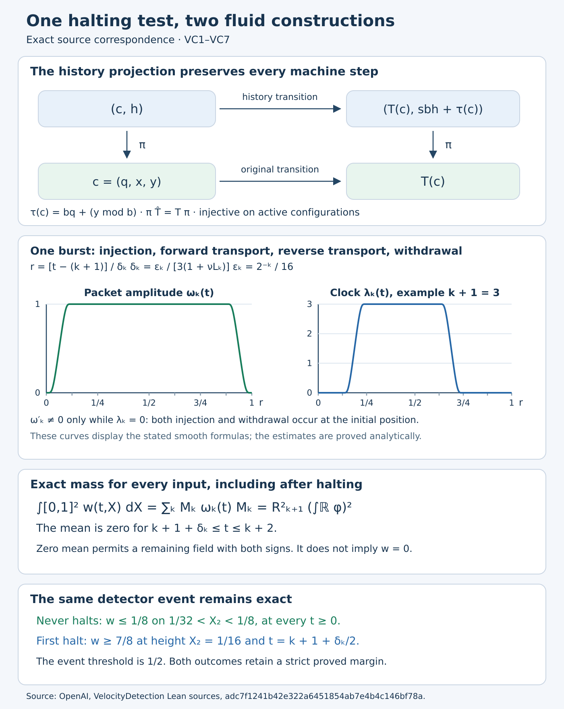

# Two constructions for the same torus velocity test

This note compares the torus construction in OpenAI's *Velocity-Field Detection of Computation in Forced Navier–Stokes Flows* with the construction in its supplied `VelocityDetection` Lean sources. It proves the history projection, the finite-prefix transport and diffusion estimates, and the exact mass identity for the latter construction. Both constructions detect the same machine-halting event, but they prescribe different forces. In particular, the persistent positive mass of the paper's construction is not a property that can be transferred to the supplied Lean construction.

The source edition is [openai/math, commit adc7f1241b42e322a6451854ab7e4b4c146bf78a](https://github.com/openai/math/tree/adc7f1241b42e322a6451854ab7e4b4c146bf78a). The [velocity construction](velocity-field-detection-audit.md), VD3, supplies the periodic scalar existence argument used below; its VD4 supplies the paper's torus detector argument. The present text is a separate mathematical exposition and source comparison. The cylinder construction and the other computation developments have their own arguments and are outside the correspondence proved here.

The diagram retains the history radix, the amplitude and transport clock, and the original detector strip. The clock curves show the specified example prefix length three, using the exact smooth step; they illustrate the formulas and are not numerical evidence for the theorem. The mass identity holds for every input, including after halting. Proofs: VC1–VC7. [Editable figure source](torus-computation-correspondence.py).

## VC1. From the original tape to an injective transition

Fix an alphabet with \(b\geq1\) symbols, numbered \(0,\ldots,b-1\), with blank symbol \(0\), and a machine with \(N\geq1\) states. For a finite word \(w=(w_0,\ldots,w_{m-1})\), the source uses

\[
\operatorname{word}(w)=\sum_{j=0}^{m-1}w_jb^j,
\qquad \operatorname{word}(a::w)=a+b\operatorname{word}(w).
\tag{VC1.1}
\]

Appending blank symbols leaves this integer unchanged. For an eventually blank half-tape \(L\), write \(H(L)\) for this integer; then

\[
H(L)=L_0+bH(\operatorname{tail}L),\quad
H(L)\bmod b=L_0,\quad
\left\lfloor H(L)/b\right\rfloor=H(\operatorname{tail}L).
\tag{VC1.2}
\]

These identities follow by division with remainder, since \(0\leq L_0<b\). They also hold for \(b=1\): the only symbol is zero, and every encoded half-tape is zero. A tape configuration is encoded as \(c=(q,x,y)\), where \(x\) encodes the symbols to the left of the head, nearest first, and \(y\) encodes the head and the right half-tape, head first. The current symbol is \(\alpha=y\bmod b\).

For a rule writing \(\beta<b\) and taking direction \(d\), the source's exact stack update is

\[
\begin{aligned}
T_{\mathrm{right},\beta}(x,y)&=(bx+\beta,\lfloor y/b\rfloor),\\
T_{\mathrm{stay},\beta}(x,y)&=(x,y-(y\bmod b)+\beta),\\
T_{\mathrm{left},\beta}(x,y)&=(\lfloor x/b\rfloor,
 x\bmod b+b\beta+b^2\lfloor y/b\rfloor).
\end{aligned}
\tag{VC1.3}
\]

For a move instruction, \(\beta\) is the old head symbol; for a write instruction the direction is stay. Applying (VC1.2) to the head and two half-tapes proves that (VC1.3) is exactly the encoding of each of the three original tape operations. An undefined table entry is undefined in both presentations. Consequently the encoding commutes with every defined step and preserves, in both directions, the existence of a finite computation ending at an undefined entry. This is the map in [TapeCodes.lean, `apply_rule` and `step_config`](https://github.com/openai/math/blob/adc7f1241b42e322a6451854ab7e4b4c146bf78a/lean/OAI/MathematicalPhysics/NavierStokes/VelocityDetection/TapeCodes.lean#L74).

The supplied construction begins execution in the additional state \(N\) before entering the original states \(0,\ldots,N-1\). In that state, on symbol \(\alpha\), it writes \(\alpha\), stays in place and enters the old initial state \(0\). The first step therefore preserves both integers. Every subsequent step is the embedded original step. This adds exactly one step and makes the initial configuration active, including when the original machine halts immediately. These are the actual last-state convention and embedding of [Prelude.lean, lines 19–82](https://github.com/openai/math/blob/adc7f1241b42e322a6451854ab7e4b4c146bf78a/lean/OAI/MathematicalPhysics/NavierStokes/VelocityDetection/Prelude.lean#L19).

Put \(s=N+1\) for the resulting number of states. Attach a history integer \(h\geq0\) and set

\[
r=sb,\qquad \tau(q,x,y)=bq+(y\bmod b),\qquad
\widehat T(c,h)=(T(c),rh+\tau(c))
\tag{VC1.4}
\]

on an active configuration; at an undefined entry, both \(T\) and \(\widehat T\) fix the configuration. On active configurations \(0\leq\tau<r\), so the new history \(h'\) determines

\[
\tau=h'\bmod r,\quad h=\lfloor h'/r\rfloor,\quad
q=\lfloor\tau/b\rfloor,\quad \alpha=\tau\bmod b.
\tag{VC1.5}
\]

The pair \((q,\alpha)\) determines the old rule, hence its direction and written symbol. From the updated stacks \((x',y')\), the inverse formulas are

\[
\begin{aligned}
\mathrm{right}:&\quad (x,y)=(\lfloor x'/b\rfloor,by'+\alpha),\\
\mathrm{stay}:&\quad (x,y)=(x',b\lfloor y'/b\rfloor+\alpha),\\
\mathrm{left}:&\quad (x,y)=(bx'+y'\bmod b,
 b\lfloor y'/b^2\rfloor+\alpha).
\end{aligned}
\tag{VC1.6}
\]

For right and stay, substitute (VC1.3) and use \(\beta<b\). For left, the two lower digits of \(y'\) are \(x\bmod b\) and \(\beta\), so \(y'\bmod b=x\bmod b\) and \(\lfloor y'/b^2\rfloor=\lfloor y/b\rfloor\). Division with remainder then restores both \(x\) and \(y\). Thus two active configurations with equal images under \(\widehat T\) have identical histories, states, read symbols, rules and stacks. The active transition is injective. We make no claim that adjoining all the fixed halting configurations makes the entire total map injective.

The projection \(\pi(c,h)=c\) is an exact semiconjugacy:

\[
\pi\widehat T=T\pi,\qquad
\pi(\widehat T^{\,n}(c_0,0))=T^n(c_0),\qquad
\widehat T^{\,n}(c_0,0)\text{ is halted}\iff T^n(c_0)\text{ is halted}.
\tag{VC1.7}
\]

The first identity follows separately at defined and undefined entries; induction proves the second, and the table lookup ignores \(h\), proving the third. This proves precisely how the additional history relates to the original computation. See [History.lean, `applyRule_injective`, `next_tape`, `orbit_tape`](https://github.com/openai/math/blob/adc7f1241b42e322a6451854ab7e4b4c146bf78a/lean/OAI/MathematicalPhysics/NavierStokes/VelocityDetection/History.lean#L82).

## VC2. Finite addresses, with every history factor retained

Keep \(m=|w|\). The source's level-\(n\) bounds and address are

\[
\begin{aligned}
B_n&=b^{m+1+n},& H_n&=(sb)^n,\\
0\leq x,y&<B_n,&0\leq h&<H_n,\\
p(q,h)&=sh+q,&
A_n(q,x,y,h)&=1+x+B_ny+B_n^2(sh+q).
\end{aligned}
\tag{VC2.1}
\]

Initially \(x=0\), \(y=\operatorname{word}(w)<b^m\leq B_0\) and \(h=0<H_0=1\). Suppose the bounds hold at level \(n\). Right motion gives \(bx+\beta<bB_n\) and \(\lfloor y/b\rfloor<bB_n\). Stay motion gives \(x<bB_n\) and \(b\lfloor y/b\rfloor+\beta<B_n\leq bB_n\). For left motion, use \(b\mid B_n\), \(\lfloor y/b\rfloor<B_n/b\) and \(x\bmod b+b\beta<b^2\) to get the second updated stack strictly below \(bB_n\); the first is also below \(bB_n\). The history satisfies \(rh+\tau<rH_n\). A frozen configuration continues to satisfy the enlarged bounds because \(b,r\geq1\). Induction proves (VC2.1) for the whole orbit.

If \(a=A_n(q,x,y,h)\), its exact inverse on this finite box is

\[
\begin{aligned}
x&=(a-1)\bmod B_n,&
y&=\lfloor(a-1)/B_n\rfloor\bmod B_n,\\
p&=\lfloor(a-1)/B_n^2\rfloor,&
q&=p\bmod s,&h&=\lfloor p/s\rfloor.
\end{aligned}
\tag{VC2.2}
\]

In particular the address is injective, and its bound is

\[
1\leq A_n\leq sH_nB_n^2=KD^n,
\qquad K=sb^{2(m+1)},\qquad D=b^2(sb).
\tag{VC2.3}
\]

Indeed \(p<sH_n\), so the maximum of \(x+B_ny+B_n^2p\) is \(sH_nB_n^2-1\). Expanding the powers in (VC2.1) proves the equality in (VC2.3). The factor \(sb\) in \(D\) records the history; it must not be dropped by importing the paper's different address bound.

For each \(n\), enumerate every active configuration in this finite box. Its source is \(A_n(c,h)\) and its target is \(A_{n+1}(\widehat T(c,h))\). Source addresses are injective by (VC2.2), and target addresses are injective by (VC1.5)–(VC1.6). Give an instruction sign \(+1\) if its target has no outgoing rule, and \(-1\) otherwise. This enumeration uses only finite table lookups and integer arithmetic. It does not ask whether the initial machine will ever halt. These are the data in [HistoryRouting.lean](https://github.com/openai/math/blob/adc7f1241b42e322a6451854ab7e4b4c146bf78a/lean/OAI/MathematicalPhysics/NavierStokes/VelocityDetection/HistoryRouting.lean#L19).

## VC3. A finite computation prefix inside the original torus chart

Let \(\ell\geq1\) be a prefix length. It is the argument called `N` in `ChartRouting`, distinct from the machine's number of states. Retain the source's coordinates and scales:

\[
\sigma_\ell=\frac1{1024(KD^{\ell+1}+4)},\qquad
R_\ell=\frac{\sigma_\ell}{16},\qquad o=(1/4,1/2),
\quad \mathcal K=[1/8,3/8]\times[1/32,3/4].
\tag{VC3.1}
\]

Write \(S(t)=\operatorname{smoothTransition}(t)\). Explicitly, \(S(t)=E(t)/(E(t)+E(1-t))\), where \(E(t)=0\) for \(t\leq0\) and \(E(t)=e^{-1/t}\) for \(t>0\). The denominator is positive everywhere. Derivatives of \(E\) on \(t>0\) are polynomials in \(1/t\) times \(e^{-1/t}\), and tend to zero as \(t\downarrow0\); hence this defines a smooth function. It is increasing, equals zero on \((-\infty,0]\) and one on \([1,\infty)\). On \((0,1)\), the ratio \(E(t)/E(1-t)\) is increasing because the derivative of its logarithm is \(t^{-2}+(1-t)^{-2}>0\). This proves the asserted monotonicity without changing the source's profile. The expression identity is explicit in [ExpressionAlgebra.lean, lines 189–205](https://github.com/openai/math/blob/adc7f1241b42e322a6451854ab7e4b4c146bf78a/lean/OAI/MathematicalPhysics/NavierStokes/VelocityDetection/ExpressionAlgebra.lean#L189).

For a level-\(n\) instruction with source \(a\), target \(a'\) and sign \(e\), put

\[
\begin{aligned}
\theta_j(s)&=S\bigl(2(3(s-n)-j)-1/2\bigr),\quad j=0,1,2,\\
Y_e&=\begin{cases}-7/16&e=+1,\\-\sigma_\ell&e=-1,\end{cases}\\
c_1(s)&=1/4+(1-\theta_1(s))\sigma_\ell a
                  +\theta_1(s)\sigma_\ell a',\\
c_2(s)&=1/2-(1-\theta_0(s))\sigma_\ell
 -(\theta_0(s)-\theta_2(s))(a+2)\sigma_\ell
 +\theta_2(s)Y_e.
\end{aligned}
\tag{VC3.2}
\]

These are the source's three successive motions, including its negative parking row. Before the stage, \(c=o+(\sigma_\ell a,-\sigma_\ell)\); after it, \(c=o+(\sigma_\ell a',Y_e)\). The path is constant on neighborhoods of \(s=n,n+1\). In the first third of the stage, its first coordinate is the source column; in the middle third its second coordinate is the source's parking row; in the final third its first coordinate is the target column. For two distinct instructions, injectivity of sources and targets therefore gives a coordinate separation at least \(\sigma_\ell=16R_\ell\) at every time. This argument also covers times before and after the stage.

All source and target integers for \(n<\ell\) are at most \(KD^{\ell+1}\). Thus

\[
0<\sigma_\ell\leq1/4096,\quad
\sigma_\ell(a+2),\sigma_\ell(a'+2)\leq1/1024,
\quad R_\ell\leq1/65536.
\tag{VC3.3}
\]

The first coordinate of (VC3.2) lies in \([1/4,1/4+1/1024]\). The second is a convex combination of \(1/2-\sigma_\ell\), \(1/2-(a+2)\sigma_\ell\) and \(1/2+Y_e\): the coefficients are \(1-\theta_0\), \(\theta_0-\theta_2\), \(\theta_2\), all nonnegative and summing to one. It lies in \([1/16,1/2]\). When \(e=-1\), it is at least \(1/2-1/1024\). Its closed coordinate neighborhood of radius \(3R_\ell\) is inside \(\mathcal K\), because

\[
1/16-3/65536>1/32,\quad 1/2+3/65536<3/4,
\quad 1/4-3/65536>1/8,
\quad 1/4+1/1024+3/65536<3/8.
\tag{VC3.4}
\]

The actual translation gate is defined by

\[
\begin{aligned}
W(z)&=S(z+3)S(3-z),\\
\Psi_{R,c,G}(X)&=W((X_1-c_1)/R)W((X_2-c_2)/R)
 [G_1(X_2-c_2)-G_2(X_1-c_1)],\\
V_{R,c,G}&=(\partial_2\Psi_{R,c,G},-\partial_1\Psi_{R,c,G}).
\end{aligned}
\tag{VC3.5}
\]

Mixed derivatives commute, so \(\operatorname{div}V=0\). On the coordinate square of radius \(2R\), both windows are one and their derivatives vanish; hence \(V=G\). If any coordinate distance is at least \(3R\), the corresponding window and derivative vanish, so \(V=0\). These statements include equality at the boundaries. For \(G=c'(s)\), sum this gate over the finitely many level-\(n\) instructions. In a square of radius \(R_\ell\) around one path, all other gates vanish: their separating coordinate has distance at least \(16R_\ell-R_\ell=15R_\ell>3R_\ell\). The sum there is exactly \(c'(s)\).

Sum the stages \(0\leq n<\ell\) to obtain \(F_\ell(s,X)\) and periodize in \(X\) over \(\mathbb Z^2\) to obtain \(P_\ell(s,X)\). The compact chart lies strictly inside the unit square. Periodization is locally finite, agrees with \(F_\ell\) in that square, preserves divergence zero and smoothness, and has support in the image of \(\mathcal K\). Different stages are active only in their respective intervals \((n,n+1)\), and vanish on neighborhoods of the endpoints. Thus no extra stage acts on the transported square. This verifies the force-building geometry of [ChartRouting.lean](https://github.com/openai/math/blob/adc7f1241b42e322a6451854ab7e4b4c146bf78a/lean/OAI/MathematicalPhysics/NavierStokes/VelocityDetection/ChartRouting.lean#L167) and [TranslationGates.lean](https://github.com/openai/math/blob/adc7f1241b42e322a6451854ab7e4b4c146bf78a/lean/OAI/MathematicalPhysics/NavierStokes/VelocityDetection/TranslationGates.lean#L60).

For the actual orbit, as long as configurations \(0,\ldots,\ell-1\) are active, concatenate the installed paths to obtain \(C_\ell(s)\). It is constant before zero and after \(\ell\), and smooth at every integer because the paths have constant endpoint collars. Its starting point is \(o+(\sigma_\ell A_0,-\sigma_\ell)\). If the first halt occurs at \(\ell\), its final second coordinate is \(1/16\). If the orbit is still active at \(\ell\), its entire path has second coordinate at least \(1/2-1/1024\). On the coordinate square of radius \(R_\ell\) around it,

\[
P_\ell(s,X)=C_\ell'(s),\qquad 0\leq s\leq\ell.
\tag{VC3.6}
\]

This proves the orbit-to-path relation, including its endpoints. The Lean source writes the same concatenation as a telescoping sum of segments; see [ChartTrace.lean, `route`, `route_eq_segment`, `route_plateau`](https://github.com/openai/math/blob/adc7f1241b42e322a6451854ab7e4b4c146bf78a/lean/OAI/MathematicalPhysics/NavierStokes/VelocityDetection/ChartTrace.lean#L82).

## VC4. The source's signed burst and its reversed clock

The transported bump is not the cylinder's unit-mass pulse. It is

\[
\phi(z)=W(3z),\qquad Q_R(X)=\phi(X_1/R)\phi(X_2/R).
\tag{VC4.1}
\]

Here \(0\leq\phi\leq1\), \(\phi(0)=1\), and \(\phi\) vanishes when \(|z|\geq1\). Choose the positive integer \(B_*\) used by the source, with \(|\phi''|\leq B_*\) everywhere. Such an integer exists because \(\phi''\) is continuous and compactly supported. Retain its two-coordinate Laplacian formula:

\[
\Delta Q_R(X)=\frac{\phi''(X_1/R)\phi(X_2/R)+
 \phi(X_1/R)\phi''(X_2/R)}{R^2},
\qquad |\Delta Q_R|\leq\frac{2B_*}{R^2}.
\tag{VC4.2}
\]

For \(k\geq0\), set \(\ell=k+1\) and retain every source factor:

\[
\begin{aligned}
\varepsilon_k&=\frac1{16}\left(\frac12\right)^k,&
L_k&=\frac{2B_*}{R_{k+1}^2},&
\delta_k&=\frac{\varepsilon_k}{3(1+\nu L_k)},\\
r_k(t)&=\frac{t-(k+1)}{\delta_k},&
\alpha(r)&=S(8r)-S(8r-7),&
\gamma_\ell(r)&=\ell[S(8r-1)-S(8r-5)],\\
\omega_k(t)&=\alpha(r_k(t)),&
\lambda_k(t)&=\gamma_{k+1}(r_k(t)).
\end{aligned}
\tag{VC4.3}
\]

For \(\nu>0\), \(0<\delta_k\leq1/48\). The amplitude rises from zero to one on \([0,1/8]\), stays one through \(7/8\), and falls to zero on \([7/8,1]\). The clock rises from zero to \(\ell\) on \([1/8,1/4]\), stays \(\ell\) through \(5/8\), and returns to zero on \([5/8,3/4]\). Both are flat at the stated endpoints. Their full derivatives are

\[
\begin{aligned}
\omega_k'(t)&=\frac8{\delta_k}
 [S'(8r_k(t))-S'(8r_k(t)-7)],\\
\lambda_k'(t)&=\frac{8(k+1)}{\delta_k}
 [S'(8r_k(t)-1)-S'(8r_k(t)-5)].
\end{aligned}
\tag{VC4.4}
\]

In particular \(\omega_k'(t)\ne0\) implies \(\lambda_k(t)=0\). The negative term in \(\omega_k'\) is essential: the source withdraws a bump at its original location after the reverse transport. See [BurstSchedule.lean, lines 13–106 and 146–235](https://github.com/openai/math/blob/adc7f1241b42e322a6451854ab7e4b4c146bf78a/lean/OAI/MathematicalPhysics/NavierStokes/VelocityDetection/BurstSchedule.lean#L13).

Writing \(\mathcal P\) for periodization in the horizontal coordinates and \(I_k=o+(\sigma_{k+1}A_0,-\sigma_{k+1})\), define the prescribed fields

\[
\begin{aligned}
a_k(t,X)&=\lambda_k'(t)P_{k+1}(\lambda_k(t),X),\\
g_k(t,X)&=\omega_k'(t)\,\mathcal P[Q_{R_{k+1}}(\,\cdot-I_k)](X),\\
a(t,X)&=\sum_{k\geq0}a_k(t,X),&
g(t,X)&=\sum_{k\geq0}g_k(t,X).
\end{aligned}
\tag{VC4.5}
\]

Each summand vanishes outside \([k+1,k+1+\delta_k]\). The intervals are disjoint and locally finite, and flatness makes their endpoint extensions smooth. Thus \(a,g\) are smooth, periodic, zero for \(t\leq1\) and supported in the fixed horizontal chart. Every derivative is bounded on each finite time cylinder by compactness. The construction enumerates finite boxes, not the initial orbit, so (VC4.5) is defined whether or not the input halts.

For each prefix before the first halt, define the comparison function

\[
c_k(t)=C_{k+1}(\lambda_k(t)),\qquad
\psi_k(t,X)=\omega_k(t)\,
 \mathcal P[Q_{R_{k+1}}(\,\cdot-c_k(t))](X).
\tag{VC4.6}
\]

The chain rule and (VC3.6) give \(a_k=c_k'\) on the bump support. Elsewhere the bump and its spatial derivatives vanish. Consequently its moving center terms cancel exactly. Where \(\omega_k'\ne0\), \(c_k=I_k\). Hence

\[
(\partial_t+a\cdot\nabla)\psi_k=g_k.
\tag{VC4.7}
\]

The total drift may replace \(a_k\) here because other blocks are zero when \(\psi_k\) is nonzero; at the remaining times all spatial derivatives of \(\psi_k\) vanish. Periodization commutes with these derivatives and products with periodic \(a\). The argument proves (VC4.7) also on the block endpoints. It matches [BurstBlock.lean, `source_match` and `reference_transport`](https://github.com/openai/math/blob/adc7f1241b42e322a6451854ab7e4b4c146bf78a/lean/OAI/MathematicalPhysics/NavierStokes/VelocityDetection/BurstBlock.lean#L163).

## VC5. The exact diffusion budget and both detector directions

Let \(w\) be the smooth periodic solution with zero initial data of

\[
\partial_t w+a\cdot\nabla w-\nu\Delta w=g.
\tag{VC5.1}
\]

Existence for this particular \(a,g\) follows from the Fourier–Galerkin proof in VD3 of the linked velocity construction: on every finite time interval they are smooth periodic functions with bounded derivatives, and \(\operatorname{div}a=0\). Its energy estimates and compactness construction apply at the unchanged coefficient \(\nu>0\), give every Sobolev order, and give smoothness by the equation. The intervals agree on overlap by the energy identity for their difference, producing a global solution. Zero coefficients for \(t\leq1\) give \(w=0\) there and smooth extension through the initial endpoint. The proof does not require \(g\geq0\).

The source's comparison barrier uses the following \(C^2\) function, which is distinct from the smooth function \(S\):

\[
J(z)=\begin{cases}0&z\leq0,\\10z^3-15z^4+6z^5&0<z<1,\\1&z\geq1.\end{cases}
\quad
\beta_k(t)=\varepsilon_kJ\bigl((r_k(t)+1)/3\bigr).
\tag{VC5.2}
\]

Its first derivative on \((0,1)\) is \(30z^2(1-z)^2\), and its first and second derivatives match zero at both endpoints. Thus \(0\leq J\leq1\) and \(J'\geq0\). On \([1/3,2/3]\), \(z(1-z)\geq2/9\), giving \(J'(z)\geq40/27>1\). Therefore

\[
\begin{aligned}
0\leq\beta_k(t)&\leq\varepsilon_k,\\
\beta_k'(t)&=\frac{\varepsilon_k}{3\delta_k}
 J'\bigl((r_k(t)+1)/3\bigr)\geq0,\\
0\leq r_k(t)\leq1&\ \Longrightarrow\
\beta_k'(t)\geq\frac{\varepsilon_k}{3\delta_k}
 =1+\nu L_k\geq\nu|\Delta\psi_k(t,X)|.
\end{aligned}
\tag{VC5.3}
\]

Outside that time interval \(\Delta\psi_k=0\), so the last required inequality holds there as well. This retains the source's extra \(1\) and factor \(3\) rather than replacing its duration by an asymptotic estimate.

Suppose that the first \(L\) configurations, numbered \(0,\ldots,L-1\), are active. Put \(\Psi_L=\sum_{k<L}\psi_k\) and \(\mathcal B_L=\sum_{k<L}\beta_k\). Through time \(L+1\), the forcing from every \(k\geq L\) is zero, including at equality. Thus

\[
\begin{aligned}
(\partial_t+a\cdot\nabla-\nu\Delta)(w-\Psi_L)&=\nu\Delta\Psi_L,\\
\nu|\Delta\Psi_L|&\leq\mathcal B_L',\\
0\leq\mathcal B_L(t)&\leq
 \sum_{k=0}^{L-1}\varepsilon_k
 =\frac18(1-2^{-L})\leq\frac18.
\end{aligned}
\tag{VC5.4}
\]

For completeness, the comparison principle used here has a direct proof. If a smooth periodic function \(v\) has \((\partial_t+a\cdot\nabla-\nu\Delta)v\leq0\) and \(v(0)\leq0\), apply the inequality to \(v-\eta t-\eta\) for \(\eta>0\). A positive maximum on a finite time cylinder cannot occur initially. At a spatial maximum the gradient is zero and the Laplacian nonpositive; at its maximal time the left time derivative is nonnegative. These facts contradict the strict residual \(-\eta\). Let \(\eta\downarrow0\). Apply this to \((w-\Psi_L)-\mathcal B_L\) and its negative counterpart; the initial differences are zero and \(\mathcal B_L(0)\geq0\). This proves

\[
|w(t,X)-\Psi_L(t,X)|\leq\mathcal B_L(t)\leq1/8,
\qquad 0\leq t\leq L+1.
\tag{VC5.5}
\]

If the machine never halts, every prefix is available. Given any \(t\geq0\), choose \(L\) with \(t\leq L+1\). Every comparison bump is centered at height at least \(1/2-1/1024\) and has coordinate radius at most \(1/65536\). It vanishes in \(1/32<X_2<1/8\), including after reduction of \(X_1\) modulo one. Hence in that detector strip

\[
w(t,X)\leq1/8<1/2\qquad\text{for every }t\geq0.
\tag{VC5.6}
\]

If the first halt occurs at step \(\ell=k+1\), choose \(t_*=k+1+\delta_k/2\). Then \(r_k(t_*)=1/2\), \(\omega_k(t_*)=1\), \(\lambda_k(t_*)=k+1\), and \(c_k(t_*)\) has height \(1/16\). At this point the periodized bump is one. Every earlier comparison bump is zero in time; \(t_*<k+2=\ell+1\). Applying (VC5.5) with \(L=\ell\) proves

\[
w(t_*,c_k(t_*))\geq7/8>3/4>1/2,
\qquad 1/32<1/16<1/8.
\tag{VC5.7}
\]

Only prefixes through the first halt are used in this direction; no unproved continuation of a halted path is needed. Together with (VC1.7) and the initial extra step, this proves the original machine's halting equivalence for this construction. It is exactly the logic of [BurstTotalReferenceSum.lean, `scalar_prefix_error`, `nonterminal_small`, `terminal_large`, `detection`](https://github.com/openai/math/blob/adc7f1241b42e322a6451854ab7e4b4c146bf78a/lean/OAI/MathematicalPhysics/NavierStokes/VelocityDetection/BurstTotalReferenceSum.lean#L98).

## VC6. The unchanged viscosity and the force representation

On \(\mathbb T^3\), with horizontal coordinate \(X=(x_1,x_2)\), the supplied construction is

\[
\begin{aligned}
U(t,x)&=(a_1(t,X),a_2(t,X),w(t,X)),&p(t,x)&=0,\\
f_1&=\partial_ta_1+a_1\partial_1a_1+a_2\partial_2a_1
       -\nu(\partial_1^2a_1+\partial_2^2a_1),\\
f_2&=\partial_ta_2+a_1\partial_1a_2+a_2\partial_2a_2
       -\nu(\partial_1^2a_2+\partial_2^2a_2),&f_3&=g.
\end{aligned}
\tag{VC6.1}
\]

All vertical derivatives vanish. The first two Navier–Stokes equations are the defining residual identities, the third is (VC5.1), and the divergence is \(\partial_1a_1+\partial_2a_2=0\). All initial components vanish. Thus \(U\) solves the forced equations at the actual \(\nu\), with the prescribed zero pressure. Every derivative of \(f\) is bounded on each finite time cylinder, and its horizontal support is inside the image of \(\mathcal K\): derivatives of the smooth functions in (VC4.5) vanish on the open complement of that closed set. This is [BurstTotalForce.lean, lines 13–89](https://github.com/openai/math/blob/adc7f1241b42e322a6451854ab7e4b4c146bf78a/lean/OAI/MathematicalPhysics/NavierStokes/VelocityDetection/BurstTotalForce.lean#L13).

The detector is

\[
\exists t\geq0,\ \exists x\in\mathbb T^3:
\quad 1/32<x_2<1/8,\qquad U_3(t,x)>1/2.
\tag{VC6.2}
\]

The strip is interpreted using the indicated chart representative. Equation (VC5.6) excludes it for every nonhalting input, and (VC5.7) supplies it for every halting input.

For smooth periodic competitors with the same zero initial data and force, uniqueness follows directly. Let \(e=v-U\) and \(q=p_v-p\). Subtract the equations, write the nonlinear difference as \((v\cdot\nabla)e+(e\cdot\nabla)U\), multiply by \(e\) and integrate over the unit torus. Periodicity, divergence zero and integration by parts give

\[
\frac12\frac d{dt}\int_{[0,1]^3}|e|^2
 +\nu\int_{[0,1]^3}|\nabla e|^2
 =-\int_{[0,1]^3}\sum_{i,j=1}^3e_i e_j\partial_jU_i.
\tag{VC6.3}
\]

If \(|\partial_jU_i|\leq C_T\) on \([0,T]\), the absolute right side is at most \(3C_T\int|e|^2\), since \((\sum_i|e_i|)^2\leq3\sum_i e_i^2\). Multiplying the resulting differential inequality by \(e^{-6C_Tt}\) and using zero initial difference gives \(e=0\). The equations then give \(\nabla q=0\); a zero spatial mean fixes \(q=0\). The same calculation is valid in the source's classical comparison class because its stated continuous derivatives and periodic slices justify each integral and derivative on the compact cylinder. There is no uniqueness assertion for arbitrary weak solutions here.

The prescription is effective in the source's sense of rational approximation to the force and its mixed derivatives, including derivatives in viscosity. On a bounded time interval only finitely many blocks occur; each block uses finitely many finite-box instructions. Periodization requires finitely many translates near a bounded spatial set. The remaining expressions are rational operations, positive denominators and derivatives of \(E\) and \(S\). At zero, derivatives of \(E\) have the explicit flat continuation already proved in VC3; rational Taylor bounds for the exponential and polynomial bounds for these derivatives give convergent rational enclosures. Interval refinement therefore evaluates each expression to any positive rational error. On a compact rational box with viscosity bounded away from zero, denominators have a positive minimum. A finite subdivision eventually certifies their nonvanishing on every cell and bounds every requested derivative. No halting test appears in this algorithm.

The actual source's residual expression keeps the five variables \((\nu,t,x_1,x_2,x_3)\) in that order; see [ForceExpressions.lean, `residualCode`, `force_germ`, `runTrial_correct`](https://github.com/openai/math/blob/adc7f1241b42e322a6451854ab7e4b4c146bf78a/lean/OAI/MathematicalPhysics/NavierStokes/VelocityDetection/ForceExpressions.lean#L12), and [EffectivePrescriptions.lean, `Program.Represents`](https://github.com/openai/math/blob/adc7f1241b42e322a6451854ab7e4b4c146bf78a/lean/OAI/MathematicalPhysics/NavierStokes/VelocityDetection/EffectivePrescriptions.lean#L162). The evaluation procedure here is the finite mathematical prescription proved in VC6. The fixed integer \(B_*\) is a parameter in the finite prescription. Its existence before the machine and input quantifiers is exactly the order in [MainResult.lean](https://github.com/openai/math/blob/adc7f1241b42e322a6451854ab7e4b4c146bf78a/lean/OAI/MathematicalPhysics/NavierStokes/VelocityDetection/MainResult.lean#L11).

## VC6a. Derivative bounds and effective evaluation at the flat endpoints

The cutoff formulas above also give explicit bounds and approximation procedures. This supplies the evaluation step at the endpoints where a test of the sign of an arbitrary real number would be invalid. It leaves the source's chosen integer \(B_*\) in (VC4.3) unchanged.

For \(t>0\), put \(y=1/t\) and define integer polynomials by
\[
P_0(y)=1,\qquad P_{j+1}(y)=y^2(P_j(y)-P_j'(y)),\qquad
E^{(j)}(t)=e^{-y}P_j(y).
\tag{VC6a.1}
\]
Differentiation gives the recurrence, since \(dy/dt=-y^2\). Write \(P_j(y)=\sum_p c_{j,p}y^p\), including its zero coefficients, and set
\[
C_j=\sum_p|c_{j,p}|p!,\qquad
A_j=\sum_p|c_{j,p}|2^p p!.
\tag{VC6a.2}
\]
Both are finite integers obtained by the recurrence. The exponential series gives \(y^p e^{-y}\le p!\) for \(y\ge0\). Applying the same inequality at \(y/2\), and then using \(e^{y/2}\ge(y/2)^N/N!\), proves
\[
|E^{(j)}(t)|\le C_j,\qquad
|E^{(j)}(t)|\le A_jN!(2t)^N\quad(t>0,\ N\ge0).
\tag{VC6a.3}
\]
All derivatives tend to zero at \(t=0\). Extending them by zero to \(t\le0\), the fundamental theorem of calculus proves inductively that these are the actual derivatives of the globally smooth \(E\). The second bound is an effective, integer-coefficient bound for every derivative near the joining point.

Let \(D_S(t)=E(t)+E(1-t)\). At least one of \(t,1-t\) is at least \(1/2\); monotonicity of \(E\) gives \(D_S(t)\ge e^{-2}>1/9\). The final inequality follows from \(e<3\): in \(\sum_{n\ge0}1/n!\), the sum from \(n=2\) is strictly less than \(\sum_{n\ge2}2^{1-n}=1\). Also
\[
|D_S^{(j)}|\le2C_j.
\tag{VC6a.4}
\]
Define nonnegative rational bounds \(R_j\) for the derivatives of \(D_S^{-1}\) by
\[
R_0=9,\qquad
R_j=9\sum_{\ell=1}^j\binom j\ell\,2C_\ell R_{j-\ell}
\quad(j\ge1).
\tag{VC6a.5}
\]
Differentiate \(D_S D_S^{-1}=1\) exactly \(j\) times and isolate the term \(D_S(D_S^{-1})^{(j)}\). Induction proves \(|(D_S^{-1})^{(j)}|\le R_j\). The product formula \(S=E D_S^{-1}\) therefore yields the explicit bound
\[
|S^{(j)}|\le\sum_{\ell=0}^j\binom j\ell C_\ell R_{j-\ell}.
\tag{VC6a.6}
\]
This bound retains both summands in \(D_S\) and every term of the reciprocal derivative.

For an explicit admissible second-derivative bound on the very same bump, \(P_1=y^2\) and \(P_2=y^4-2y^3\) give \(|E'|\le2\), \(|E''|\le36\), \(|D_S'|\le4\) and \(|D_S''|\le72\). Keep all terms in
\[
\begin{aligned}
S'&=E'/D_S-ED_S'/D_S^2,\\
S''&=E''/D_S-2E'D_S'/D_S^2
      -ED_S''/D_S^2+2E(D_S')^2/D_S^3 .
\end{aligned}
\tag{VC6a.7}
\]
Using \(0\le E\le1\) and \(D_S^{-1}\le9\) gives
\[
\begin{aligned}
|S'|&\le18+324=342,\\
|S''|&\le324+1296+5832+23328=30780,\\
|W''|&\le2(30780)+2(342)^2=295488,\\
|\phi''|&=9|W''(3\,\cdot)|\le2659392.
\end{aligned}
\tag{VC6a.8}
\]
Thus \(2659392\) is one explicit admissible positive integer for the bump bound. It is not an identification of the natural number selected by SmoothBump.bound. Equations (VC4.2)–(VC7.2) concern the original chosen \(B_*\); they use its proved bound, not its numerical value. If an explicit implementation instead chooses the displayed admissible integer, its durations must still be defined by the full formula (VC4.3) with that choice. All preceding proofs then apply with those durations.

Here is the approximation procedure, including the endpoint case. At a positive rational argument, (VC6a.1) reduces evaluation of \(E^{(j)}\) to integer polynomials and an exponential. To enclose \(e^x\) for rational \(x\ge0\), sum through degree \(n\) with \(n+2>x\). The omitted series is nonnegative and bounded by
\[
0\le e^x-\sum_{p=0}^{n}\frac{x^p}{p!}
 \le \frac{x^{n+1}}{(n+1)!}\,
       \frac{1}{1-x/(n+2)}.
\tag{VC6a.9}
\]
The ratio of each subsequent term to its predecessor is at most \(x/(n+2)<1\), which proves the geometric bound. The right side tends to zero for fixed \(x\), for example after successive ratios become at most \(1/2\). A positive lower bound on the partial sum permits reciprocal intervals for \(e^{-x}\). A negative rational exponential is evaluated by that reciprocal rule. All these enclosures are rational.

For an argument given by converging rational intervals, retain the entire interval during evaluation. If it is strictly negative, every derivative of \(E\) is zero. If it is bounded away from zero on the positive side, the polynomial and exponential enclosures converge by the preceding formulas and elementary interval arithmetic. If an interval straddles zero, (VC6a.3) bounds the whole derivative by \(A_jN!(2u)^N\), where \(u\) is its positive upper endpoint. Taking \(N=1\) already makes this bound tend to zero as such intervals shrink. Thus no decision of equality to zero is required. On a positive interval, the bound \(C_{j+1}\) gives a computable Lipschitz bound for \(E^{(j)}\); it controls variation between rational samples as well. These observations prove convergence of the interval procedure for every actual argument.

For \(S\), the fixed lower bound \(D_S>1/9\) makes reciprocal evaluation safe. Equations (VC6a.5)–(VC6a.6), followed by finite product and chain rules, handle every derivative of \(W,\phi\), the gates and the schedules. For a compact rational box in \((\nu,t,X)\) with \(\nu\ge\nu_->0\), retain all integers \(k\ge0\) with \(k+1\le T_+\), where \(T_+\) is the upper time endpoint. All other blocks and every derivative vanish there. This is a finite list obtained from \(T_+\) alone. Each block enumerates a finite box of configurations. For a spatial box \(\prod_i[L_i,U_i]\), it suffices in each horizontal coordinate to retain integer translates
\[
z_i\in[\lceil-U_i\rceil,\ \lfloor1-L_i\rfloor]\cap\mathbb Z.
\tag{VC6a.10}
\]
Any nonzero gate at \(X+z\) has both coordinates in \((0,1)\), so every possible nonzero term is on this finite list; endpoints have zero derivatives and may be included. This proves an explicit finite truncation of periodization.

All remaining denominators in a fixed block are the positive constants \(R_{k+1}\), \(\varepsilon_k\), the denominator \(D_S\), and the positive expression \(1+\nu L_k\), or products of these. The duration is \(\varepsilon_k/[3(1+\nu L_k)]\); both it and its reciprocal have positive finite bounds on the specified viscosity interval. Repeated quotient and product rules therefore give convergent rational enclosures for the force and every mixed derivative, including viscosity derivatives. The same bounds give a rational uniform upper bound for each requested derivative on the compact box. A finite subdivision and refinement terminates for any prescribed positive rational error: the bounds on one additional derivative control spatial and parameter variation, and the rational evaluation errors tend to zero. This proves the mathematical effectiveness claim made in VC6 for the original expressions, without assuming a halting oracle.

## VC7. The exact mass identity and what passes between the constructions

There is a further identity that makes the difference between the two torus constructions precise. It holds for every input, including after it halts. Let

\[
I_\phi=\int_{\mathbb R}\phi(z)\,dz>0,\qquad
M_k=R_{k+1}^2 I_\phi^2.
\tag{VC7.1}
\]

Positivity follows because \(\phi\) equals one near zero; finiteness follows from its compact support. Fubini and the changes of variables \(z_i=(X_i-I_{k,i})/R_{k+1}\) give the full integral of the translated packet as \(M_k\). Integrating its periodization over the unit square gives the same value, since the translated unit squares partition \(\mathbb R^2\) up to sets of measure zero. Therefore

\[
\int_{[0,1]^2}g_k(t,X)\,dX=M_k\omega_k'(t),\qquad
\boxed{\displaystyle
\int_{[0,1]^2}w(t,X)\,dX=\sum_{k\geq0}M_k\omega_k(t)}.
\tag{VC7.2}
\]

To prove the second identity, integrate (VC5.1). The integral of its Laplacian is zero by periodicity. The advection integral is zero because \(a\) is periodic and divergence free. The time derivative is integrable on each compact time cylinder, so differentiation under the integral is justified. The block sum is locally finite, and both sides of (VC7.2) vanish initially. Integrating their identical derivatives proves equality. This proof uses the prescribed source directly and does not require a nonhalting comparison path.

In particular the scalar has zero spatial mean throughout every interval

\[
k+1+\delta_k\leq t\leq k+2,
\tag{VC7.3}
\]

and it also has zero mean before the first burst. At the middle of block \(k\) the mean is \(M_k>0\). Zero mean does not say that the scalar field is zero. The withdrawn source and diffusion can leave a nonzero field with positive and negative parts. We do not infer positivity of this torus scalar from the cylinder's positive-source argument.

For comparison, the original paper's torus construction injects nonnegative mass and retains it. The positive first injection gives the time-independent positive lower mass bound used in VD9 of the velocity construction to prove divergence of every finite-exponent time norm. Equations (VC7.2)–(VC7.3) show exactly why that proof does not apply to the supplied Lean witness. They do not assert convergence or divergence of those norms for this different witness.

There is nonetheless an exact common map. To the same finite input \((M,w)\), assign the paper's force \(f^{\mathrm{paper}}_{M,w}\) and the supplied source's force \(f^{\mathrm{source}}_{M,w}\) of (VC6.1). Their respective unique classical solutions satisfy

\[
\mathbf1_{\mathrm{event}}(U^{\mathrm{paper}}_{M,w})
 =\mathbf1_{\mathrm{halts}}(M,w)
 =\mathbf1_{\mathrm{event}}(U^{\mathrm{source}}_{M,w}).
\tag{VC7.4}
\]

The left equality is the original paper's detector derivation, supplied in VD4; the right equality is proved in VC1–VC6a. This identity is an equality of predicates on the set of finite inputs, not an algorithm deciding either predicate. It retains the exact decision problem while allowing different fluid realizations. At the discrete level (VC1.7) is the stronger step-by-step projection; at the fluid level (VC7.2) records information specific to the supplied realization that is absent from the common event predicate.

Thus the alternate source construction supports the same torus detector statement. Its different force formula is not an error in the paper, and it is not a transcription correction. The mass identity (VC7.2) is an editorial consequence with the complete proof above; no novelty claim is made.
