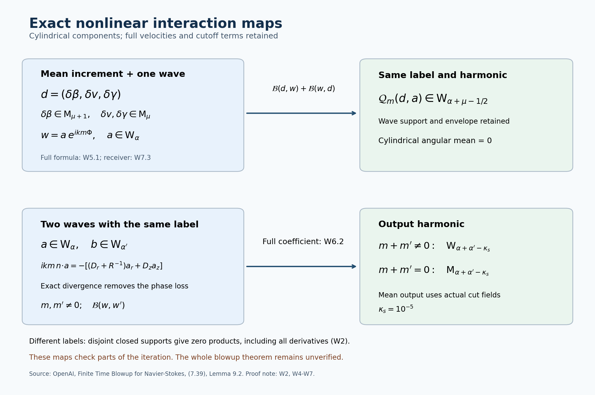

# Nonlinear wave interactions

The complete theorem and its proof dependencies are stated in the [theorem construction](theorem-audit-conclusion.md). This note proves the nonlinear interaction map used after the two mean corrections, the exact incompressibility cancellation for actual waves, and the separation of distinct labels. The companion pulse audit supplies the local pulse inverse and its full linear residual.

The source is OpenAI, *Finite Time Blowup for Navier–Stokes*, [original PDF](https://cdn.openai.com/pdf/32d9f210-8b73-45e0-91bc-82a30aef8a9a/navier-stokes.pdf), SHA-256 `0e779481c4da40bd28d1e642e1d8ca57447d129610df28dfa5a11e9af8ae228f`. The relevant source pages are 65–66, 70–74, 85–86 and 102–104. Source locators are (6.1)–(6.16), Definition 6.5, Proposition 6.6, (7.2)–(7.4), (7.37)–(7.39), Lemma 9.2 and the product part of Proposition 9.3.

This diagram displays the coefficient maps proved in W4–W7. It is a schematic of exact identities and class estimates, not sampled flow data. Both inputs to the lower map use one label and the complete divergence-free amplitudes. The cylinder-frame terms remain in (W5.1) and (W6.2). [Reproducible figure source](assets/wave-interaction-maps.py). Human-source locators: original (7.39) and Lemma 9.2; the full proofs and support construction are below.

## W1. Original coordinates, operators and angular averaging

Keep the original parameters and coordinates
\[
0<h<1/100,\quad A=1/2+h,\quad D=1/2-h,\quad
Q=2^{-\ell},\quad\varepsilon=Q^h,\quad S_*=\ell^2,
\quad R=r/\sqrt Q,\quad Z=z/Q^D,\quad T=(1-t)/Q.
\tag{W1.1}
\]
The original variables satisfy \(z=q^D\eta\), \(1-t=q(1-\eta^2)\), \(X=r^2/(2q)\). On a band, \(q/Q\in[1/2,2]\); the active radial shell has \(X_a\le X\le X_b\) with \(X_a>0\). Thus \(R^2=2(q/Q)X\), and
\[
\sqrt{X_a}\le R\le2\sqrt{X_b}.
\tag{W1.2}
\]
The bounds may be enlarged by fixed amounts inside the coordinate domain. No term involving \(R^{-1}\) or \(R^{-2}\) is suppressed.

Retain the actual auxiliary torus and its covering maps:
\[
J_g=\begin{pmatrix}3&1\\1&5\end{pmatrix},\quad
\Lambda_g=4-\sqrt2,\quad T_g=4+\sqrt2,\quad b_g=\sqrt2-1,
\]
\[
v_r=(1,-b_g),\quad v_t=(b_g,1),\quad
\rho_g=\frac{\log\Lambda_g}{\log T_g},\quad
\kappa_s=10^{-5},\quad d_r=2((1+h)\rho_g-h\kappa_s),
\]
\[
Y=v_r r^{d_r}+v_t t\pmod{\mathbb Z^2},\quad
Y_i=J_g^iY,\quad
i=i(\ell)=\left\lfloor\frac{(1+h)\ell\log2-2\log\ell}{\log T_g}\right\rfloor.
\tag{W1.3}
\]
Only large bands with \(i\ge0\) are used. On a band representative set
\[
\mathcal L_i=v_r\cdot\partial_{Y_i},\quad N_i=v_t\cdot\partial_{Y_i},\quad
M_i=\Lambda_g^iQ^{d_r/2},\quad c_i=T_g^iQ^{1+h}.
\]
The full physical chain rule is
\[
D_r=\partial_R+M_id_rR^{d_r-1}\mathcal L_i,\quad
D_z=\varepsilon\partial_Z,\quad D_\theta=R^{-1}\partial_\theta,
\quad\mathfrak t_*=-\varepsilon\partial_T+c_iN_i.
\tag{W1.4}
\]
These operators have not replaced the physical ones: \(D_r=\sqrt Q\,\mathfrak r\), \(D_z=\sqrt Q\partial_z\), and \(\mathfrak t_*=Q^{1+h}(\partial_t+N_{\rm abs})\) before evaluation, where \(\mathfrak r=\partial_r+d_rr^{d_r-1}\mathcal L_{\rm abs}\). In particular
\[
[D_r,D_z]=[D_r,\partial_\theta]=[D_z,\partial_\theta]=0,
\qquad D_r(R^{-1})=-R^{-2},\quad D_z(R^{-1})=0.
\tag{W1.5}
\]
They follow directly because the only nonconstant coefficient of the auxiliary part of \(D_r\) depends on \(R\) alone. Constant-coefficient auxiliary derivatives commute.

All vector components below are in the original orthonormal cylindrical frame \((e_r,e_\theta,e_z)\). Its derivatives are \(\partial_\theta e_r=e_\theta\), \(\partial_\theta e_\theta=-e_r\), \(\partial_\theta e_z=0\). For component columns \(u,v\), the exact transport is
\[
\mathcal B(u,v)=u_rD_rv+u_\theta R^{-1}\partial_\theta v+u_zD_zv
 +R^{-1}(-u_\theta v_\theta,u_\theta v_r,0).
\tag{W1.6}
\]
The last column comes from differentiating the frame and is part of transport. The dot products of complex harmonic coefficients used below are bilinear, not Hermitian.

Here \(\langle\cdot\rangle_\theta\) averages the cylindrical component columns over \(0\le\theta\le2\pi\), exactly as in the source mean equations. It is not the operation of averaging the Cartesian components while keeping a fixed Cartesian frame. It also differs from auxiliary Haar averaging. For a fixed label with
\[
\Phi=p\theta+\varphi(R,Z,T,H),\qquad kp\in\mathbb Z\setminus\{0\},
\]
and a \(\theta\)-independent column \(a\), direct integration gives
\[
\langle ae^{ikm\Phi}\rangle_\theta=0\quad(m\ne0),\qquad
\langle ab\,e^{ik(m+m')\Phi}\rangle_\theta=
\begin{cases}ab,&m+m'=0,\\0,&m+m'\ne0.\end{cases}
\tag{W1.7}
\]
Indeed the integral of \(e^{in\theta}\) is \((e^{2\pi in}-1)/(in)=0\) for a nonzero integer \(n\). The frame terms in (W1.6) have already been expressed in component columns, so this calculation applies to them too.

## W2. Separation on the absolute torus, including closed boundaries

This supplies the distinct-label part of Lemma 9.2 rather than discarding those products by an assumption. The labels are \(\gamma=(\ell,a,\sigma)\), \(\sigma\in\{+,-\}\). The slow cutoff is the original \(\eta_\gamma=\chi_\ell(q)\chi_{\ell,a}(R,Z,T)\), and \(K_\gamma\) is its closed physical slow support. Mesh lengths in chart coordinates are \(S_*^{-3}=\ell^{-6}\); each original box extends at most one mesh length from its grid center in each direction.

Enlarge the boxes by a fixed factor, writing \(L\ge1\) for their half-width in mesh units. Join distinct labels whenever the enlarged physical boxes meet and \(|\ell-\ell'|\le4\). Opposite signs at one box are joined. If the original slow supports meet, both \(q/Q\) and \(q/Q'\) belong to \([1/2,2]\), hence \(|\ell-\ell'|\le2\); this pair is therefore joined.

The physical mesh lengths in the three directions are
\[
d_{\ell,r}=2^{-\ell/2}\ell^{-6},\qquad
d_{\ell,z}=2^{-D\ell}\ell^{-6},\qquad
d_{\ell,t}=2^{-\ell}\ell^{-6}.
\]
For \(\ell,\ell'\ge\ell_0\ge1\) and \(|\ell-\ell'|\le4\), every ratio in either direction is at most
\[
M_{\rm mesh}=2^{4\max\{1/2,|D|,1\}}(1+4/\ell_0)^6.
\tag{W2.1}
\]
To meet a fixed box, a grid center in the other band must be within \(L(d_{\ell,j}+d_{\ell',j})\) in coordinate \(j\). The number of admissible grid points in that coordinate is at most
\(N_{\rm mesh}=2\lceil L(1+M_{\rm mesh})\rceil+1\).
There are at most nine bands and two signs. Consequently the graph degree is at most \(18N_{\rm mesh}^3-1\). This bound includes the opposite-sign pair. Restricting the grid to boxes meeting the active set only reduces the number.

Enumerate the countable labels and assign each the first of \(18N_{\rm mesh}^3\) colors absent from its already colored neighbors. The degree bound leaves a color at every step. An edge has unequal colors once its later endpoint is colored. This constructs the required finite coloring also for the infinite set of bands.

For the covering indices, the mean value theorem applied to \(\log\ell\), followed by the floor inequality \(|\lfloor x\rfloor-\lfloor y\rfloor|\le|x-y|+1\), gives
\[
|i(\ell)-i(\ell')|\le
1+\frac{4(1+h)\log2+8/\ell_0}{\log T_g}\le\Delta_{\max}
\tag{W2.2}
\]
for one fixed integer \(\Delta_{\max}\). This is the original (6.14), with its logarithmic and floor contributions retained.

Choose a torus center \(c_\nu\) for each color, subject to every ordered inequality
\[
c_\mu\ne J_g^\Delta c_\nu\pmod{\mathbb Z^2},\quad
0\le\Delta\le\Delta_{\max},
\quad(\Delta,\nu,\mu)\ne(0,\nu,\nu).
\tag{W2.3}
\]
There are finitely many constraints. For unequal colors, an excluded equality has empty interior: vary \(c_\mu\) while fixing the other coordinates. For equal colors and \(\Delta>0\), the eigenvalues of \(J_g^\Delta-I\) are \(\Lambda_g^\Delta-1\) and \(T_g^\Delta-1\), both nonzero. Its torus kernel is finite: in a bounded fundamental square the integer vector \((J_g^\Delta-I)c\) has only finitely many possible values, each with at most one preimage there. Thus that excluded set too is closed with empty interior. The finite union cannot contain an open set: successively remove each closed set from a nonempty open subset. The complement is open and dense, and contains a rational tuple since rational coordinate points are dense. Fix such a tuple and let \(s_0>0\) be the smallest distance of the finitely many forbidden differences in (W2.3) to \(\mathbb Z^2\).

Set \(C_e=2\sqrt{2(1+b_g^2)}\). A closed enlarged rectangle centered at \(c_\nu\) has displacements \(e=\xi v_r+\eta v_t\), \(|\xi|,|\eta|\le2r_0\), hence \(|e|\le C_e r_0\), since the two eigenvectors are orthogonal with norm \(\sqrt{1+b_g^2}\). Choose
\[
0<r_0<\min\left\{\frac1{4C_e},\frac{s_0}{2C_e(T_g^{\Delta_{\max}}+1)}\right\}.
\tag{W2.4}
\]
The diameter of an enlarged rectangle is less than one, so distinct points in its parameter square cannot differ by a nonzero integer vector; its torus parametrization is injective. Also \(J_g\) is symmetric positive definite, so \(\|J_g^\Delta\|_2=T_g^\Delta\). If a point of the absolute torus belonged to closed enlarged preimages for two joined labels at levels \(i\) and \(i+\Delta\), then
\[
c_\mu-J_g^\Delta c_\nu=J_g^\Delta e_\nu-e_\mu\pmod{\mathbb Z^2},
\]
whose right side has norm at most \(C_er_0(T_g^\Delta+1)<s_0/2\), contradicting the definition of \(s_0\). At \(\Delta=0\) the colors are unequal, so the forbidden constraint is among those imposed. This proves the original closed-support separation (6.13).

If two labels have disjoint slow supports their field products vanish there. If their slow supports meet, their closed enlarged auxiliary supports have just been proved disjoint on the absolute torus. Thus the product is zero at every extended-space point. A derivative of a smooth field has support contained in the original closed support: on the open complement the field and all derivatives are identically zero. This proves zero products for every pair of derivatives, including derivatives of the cylindrical frame. Restriction to the physical map \(Y=v_rr^{d_r}+v_tt\) preserves the exact zero identity. No inverse of a torus covering is used in this argument.

The complete [support construction](oscillatory-supports-audit.md), OS0–OS7, supplies the original slow partitions, common-torus sheets, Haar identities, pulse paths and coefficient algebra. OS7.6–OS7.7 gives a finite rational selection of every color center with an explicit admissible radius. OS7.3 proves the precise directional inverse comparison; OS7.13 retains every band and viscosity factor in the actual angular covariance.

## W3. Coefficient bounds and the phase factors that enter transport

The mean class \(\mathsf M_\beta\) has, for every fixed multi-index \(I\) in \((R,Z,T,H_1,H_2)\), bounds
\[
|\partial^I f|\le C_I\varepsilon^\beta S_*^{B_I}\zeta\delta^{-D_I}.
\tag{W3.1}
\]
The wave class \(\mathsf W_\alpha\) has the original local support, torus compatibility and bounds
\[
|\partial^I a_{\gamma,m}|\le C_{j,I}\varepsilon^\alpha
 S_*^{B_{j,I}}\sqrt\zeta\delta^{-D_{j,I}}P_v,
\quad 0\le v\le L_s,\quad0<P_v\le1.
\tag{W3.2}
\]
Retain the full source weight and edge variable from (6.23):
\[
\zeta(X)=\exp\left(-\frac{a_a}{\log^2(X/X_a)}-\frac{a_b}{\log^2(X_b/X)}\right),\quad
\delta(X)=\min\{1,\log(X/X_a),\log(X_b/X)\},\quad a_a,a_b>0.
\]
The weight is zero outside \((X_a,X_b)\), and \(0\le\zeta\le1\). The envelope is a pointwise factor; we do not differentiate an assumed estimate for \(P_v\). Instead each differentiated amplitude has its own bound (W3.2). The constants and polynomial degrees may depend on the fixed derivative order and the finite stage, but not on the label or band. Harmonics are in a fixed finite set \(\mathscr H_j\subset\mathbb Z\setminus\{0\}\).

The support in the label domain is \(x_*\in K_\gamma^*\), \(\xi_g(H)\in\operatorname{supp}\chi_g\), \(X_a\le X\le X_b\). Actual velocities also have \(v(H)\in\operatorname{supp}\psi\), compactly inside \((0,L_s)\), and smooth zero extension. Uncut pulse coefficients have no temporal zero-extension requirement. All global mean-output assertions below concern actual cut fields.

The floor bounds for (W1.3) give
\[
T_g^{-1}S_*^{-1}<c_i\le S_*^{-1},\qquad
\Lambda_g^{-1}\varepsilon^{-\kappa_s}S_*^{-\rho_g}
 <M_i\le\varepsilon^{-\kappa_s}S_*^{-\rho_g}.
\tag{W3.3}
\]
For the second bound use \(\Lambda_g^i=(T_g^i)^{\rho_g}\) and retain
\(Q^{d_r/2-(1+h)\rho_g}=Q^{-h\kappa_s}=\varepsilon^{-\kappa_s}\).
Consequently \(D_r\) costs at most \(\kappa_s\), \(D_z=\varepsilon\partial_Z\) adds one, and coefficient derivatives themselves do not change the exponent. Further fixed derivatives of these estimates differentiate only the displayed coefficients and the amplitude; the single explicit \(D_r\) does not cost another \(\kappa_s\) each time the estimate is differentiated.

These assertions also hold on a common torus \(H=J_g^{i_0}Y\). A band function there is the composition with \(J_g^{i-i_0}\), not with a purported inverse covering. For bands meeting a fixed neighborhood the integer differences are bounded by (W2.2). Repeated chain rules therefore introduce only fixed powers of matrices from a finite set. In the following comparison the physical band scale \(Q\) stays fixed while the torus index changes. On a pullback,
\[
M_{i_0}\mathcal L_{i_0}(f\circ J_g^{i-i_0})
=M_{i_0}\Lambda_g^{i-i_0}(\mathcal L_i f)\circ J_g^{i-i_0}
=M_i(\mathcal L_i f)\circ J_g^{i-i_0}.
\tag{W3.4}
\]
The corresponding identity for \(c_iN_i\) uses \(T_g^{i-i_0}\). Multiplication, differentiation and the formulas below are thus compatible with the original physical fields.

Leibniz' formula has finitely many terms at each fixed derivative order. Multiplication of (W3.1) and (W3.2) retains \(\zeta^{3/2}P_v\le\sqrt\zeta P_v\); two wave bounds retain \(\zeta P_v^2\le\sqrt\zeta P_v\) for a nonzero output, and \(\zeta P_v^2\le\zeta\) for a mean output. Polynomial powers add, as do the allowed powers of \(\delta^{-1}\). This proves the product bounds with all fixed derivatives. Smooth zero extensions at a shell edge follow because every inverse power of the edge distance times \(e^{-a/s^2}\), for fixed \(a>0\), tends to zero, also after any fixed number of derivatives: substituting \(y=1/s\) reduces this to \(y^M e^{-ay^2}\to0\). Inductively the derivatives extend continuously by zero and are derivatives of the extended function, by the one-dimensional difference quotient at each boundary in a smooth edge chart.

For precision about the phase multiplier in mean transport, retain its entire formula:
\[
\begin{gathered}
k=\lceil\varepsilon^{-1/2}\rceil,\quad
B_s^2=\frac{\lambda_0}{\varepsilon k^2(1+u_*^2)^{3/2}},\quad
(\widetilde p/R_0,p_z)=B_s\left(K-\frac{\sigma u_*g_0}{L_s|g_0|^2}\right),
\\ kp\text{ is a nearest nonzero integer to }k\widetilde p,
\quad x_0=\sigma B_su_*/2,\quad L_s=2r_0/c_i,
\\ \Phi=p\theta+p_zZ/\varepsilon+x_0R-v(pF+p_zG),
\\ n=\nabla_*\Phi=
\left(x_0-v(pF_R+p_zG_R),\ p/R,\ p_z-\varepsilon v(pF_Z+p_zG_Z)\right).
\end{gathered}
\tag{W3.5}
\]
Here \(F=V/R\), \(g=(RF_R,G_R)\), \(N=g_0/|g_0|\), \(K=(-N_z,N_\theta)\), and \(\lambda_0^2=-2F_0N_\theta(2F_0N_\theta+|g_0|)\). The subscript zero is the fixed slow representative of that label. The growth and nonzero-shear bounds are supplied by the actual leading profile [V5–V7](shear-realization-audit.md), the realized base [Z6](base-field-realization-audit.md), and the exact chart receiver [I1–I2](local-construction-assembly-audit.md). Those supplying arguments establish the coefficient bounds used in this operator calculation.

Here are the bounds obtained directly from that displayed phase, rather than from a pulse approximation. Since \(0<\varepsilon\le1\),
\[
1\le\varepsilon k^2\le4,\quad
\varepsilon^{-1/2}\le k\le2\varepsilon^{-1/2},\quad
|p-\widetilde p|\le k^{-1}.
\tag{W3.6}
\]
The last error is at most one, rather than one half, before division by \(k\), because zero is excluded in the rounding. Fixed bounds on \(\lambda_0\), \(|g_0|^{-1}\), \(R_0\), and \(u_*\) give fixed bounds on \(B_s,p,p_z,x_0\) by the exact formulas, since \(L_s\ge2r_0S_*\). On the lifted rectangle \(v=(\eta_g+r_0)/c_i\); its first auxiliary derivatives are bounded by a fixed multiple of \(S_*\), its higher such derivatives vanish, and its slow derivatives vanish within a fixed chart. In the dual eigenvector coordinates \(\mathcal L_i\eta_g=0\), \(N_i\eta_g=1\), so \(D_rv=D_zv=0\), as required to derive (W3.5). The base coefficients have fixed slow derivative bounds and no auxiliary dependence. Thus (W3.5) and Leibniz' formula give a polynomial in \(S_*\) bound for every fixed coefficient derivative of \(n\). The same holds on common tori by (W3.4). No bound for \(n^{-1}\) and no pulse-growth estimate is required for the transport estimate below.

## W4. The exact curl identity used by the nonlinear terms

For a smooth potential column \(C\), the full source curl is
\[
\operatorname{curl}_* C=
\big(R^{-1}\partial_\theta C_z-D_zC_\theta,\quad
D_zC_r-D_rC_z,\quad
(D_r+R^{-1})C_\theta-R^{-1}\partial_\theta C_r\big).
\tag{W4.1}
\]
The divergence is \((D_r+R^{-1})u_r+R^{-1}\partial_\theta u_\theta+D_zu_z\). Inserting (W4.1) yields all six terms
\[
\begin{aligned}
\operatorname{div}_*\operatorname{curl}_* C={}&
R^{-1}D_r\partial_\theta C_z-(D_r+R^{-1})D_zC_\theta
\\&+R^{-1}D_z\partial_\theta C_r-R^{-1}\partial_\theta D_rC_z
\\&+D_z(D_r+R^{-1})C_\theta-R^{-1}D_z\partial_\theta C_r=0.
\end{aligned}
\tag{W4.2}
\]
For the first term we used \((D_r+R^{-1})(R^{-1}f)=R^{-1}D_rf\). The three pairs cancel by (W1.5), including the \(R^{-1}\) contributions.

For a \(\theta\)-independent potential amplitude \(C_m\), expand the actual full curl as
\[
\operatorname{curl}_*(C_me^{ikm\Phi})=a_me^{ikm\Phi},
\]
\[
a_m=ikm\,n\times C_m+
\big(-D_z(C_m)_\theta,\ D_z(C_m)_r-D_r(C_m)_z,
\ (D_r+R^{-1})(C_m)_\theta\big).
\tag{W4.3}
\]
All potential derivatives, including derivatives of its slow and transverse cutoffs, remain in this expression. A cutoff in \(v\) also remains inside the potential. In the original coordinates \(D_rv=D_zv=0\), so its spatial derivative terms vanish for that exact reason, not because the cutoff is omitted.

Where the source writes \(C_m=i(n\times t_m)/(km|n|^2)\), \(n\cdot t_m=0\), the first term in (W4.3) equals
\[
-\frac{n\times(n\times t_m)}{|n|^2}
=t_m-\frac{n(n\cdot t_m)}{|n|^2}=t_m.
\tag{W4.4}
\]
This is a pointwise identity for the original potential wherever it is defined. The uniform denominator estimate and the potential class bounds for the original phase are now derived in the [pulse audit](pulse-inverse-audit.md), P1 and P6, retaining the source base inputs. The nonlinear cancellation in this section uses (W4.2), and therefore holds for every smooth potential coefficient, independently of that particular formula or of any pulse solution.

Expansion of the zero divergence in (W4.2) now proves, for the full actual amplitude,
\[
ikm\,n\cdot a_m=-\mathfrak d a_m,
\qquad \mathfrak d a=(D_r+R^{-1})a_r+D_za_z.
\tag{W4.5}
\]
If \(a_m\in\mathsf W_\alpha\), (W3.3) gives \(\mathfrak d a_m\in\mathsf W_{\alpha-\kappa_s}\). Since \(|m|\ge1\) and \(k^{-1}\le\varepsilon^{1/2}\), division in the exact identity proves
\[
n\cdot a_m\in\mathsf W_{\alpha+1/2-\kappa_s}.
\tag{W4.6}
\]
This remains true for all fixed coefficient derivatives because \(k,m\) are constant within the label and the bound for \(\mathfrak d a_m\) holds at those orders. Using only the transverse leading amplitude while omitting the remainder in (W4.3) would not justify (W4.5) for the actual velocity.

Conversely, any exactly divergence-free harmonic \(a_me^{ikm\Phi}\) with a \(\theta\)-independent amplitude satisfies (W4.5) simply by expanding its divergence. Thus the nonlinear estimates below need exact divergence, not a particular choice of vector potential. The actual source waves satisfy the identity through the full curl construction (W4.2).

## W5. Complete mean–wave interaction and its output support

Write the actual mean increment as \(d=(d^{r},d^{\theta},d^{z})\), avoiding a replacement by its tangential leading part. It is independent of \(\theta\); it may depend on the full auxiliary torus. For \(w=ae^{ikm\Phi}\), (W1.6) gives exactly
\[
\mathcal B(d,w)+\mathcal B(w,d)=e^{ikm\Phi}\,\mathcal Q_m(d,a),
\]
\[
\begin{aligned}
\mathcal Q_m(d,a)={}&ikm(d^{r}n_r+d^{\theta} n_\theta+d^{z}n_z)a
\\&+d^{r}D_ra+d^{z}D_za+a_rD_rd+a_zD_zd
\\&+R^{-1}(-2d^{\theta} a_\theta,\ d^{\theta} a_r+a_\theta d^{r},\ 0).
\end{aligned}
\tag{W5.1}
\]
To obtain it, the derivative on the wave exponential contributes \(ikm n\) in all three spatial directions. The mean amplitude has no angular component derivative, while each transport contributes its own frame term. Their sum is the last line; in particular its radial coefficient is \(-2\), not \(-1\). No divergence identity is needed for (W5.1).

The source mean increments have \(d^{\theta},d^{z}\in\mathsf M_\mu\) and \(d^{r}\in\mathsf M_{\mu+1}\). For \(a\in\mathsf W_\alpha\), each complete group in (W5.1) has the following lower exponent, with all powers of \(S_*\), \(\delta^{-1}\), weights and fixed derivatives handled by W3:

| Exact group | Lower exponent |
|---|---|
| \(ikm(d^{\theta} n_\theta+d^{z}n_z)a\) | \(\alpha+\mu-1/2\) |
| \(ikm d^{r}n_ra\) | \(\alpha+\mu+1/2\) |
| \(d^{r}D_ra\) | \(\alpha+\mu+1-\kappa_s\) |
| \(d^{z}D_za\) | \(\alpha+\mu+1\) |
| \(a_rD_r(d^{\theta},d^{z})\) and \(a_rD_rd^{r}\) | \(\alpha+\mu-\kappa_s\) and \(\alpha+\mu+1-\kappa_s\) |
| \(a_zD_z(d^{\theta},d^{z})\) and \(a_zD_zd^{r}\) | \(\alpha+\mu+1\) and \(\alpha+\mu+2\) |
| \(R^{-1}(-2d^{\theta} a_\theta,d^{\theta} a_r,0)\) | \(\alpha+\mu\) |
| \(R^{-1}(0,a_\theta d^{r},0)\) | \(\alpha+\mu+1\) |

Since \(\kappa_s=10^{-5}<1/2\) and \(\varepsilon\le1\), every group belongs to \(\mathsf W_{\alpha+\mu-1/2}\). Addition proves the first part of original Lemma 9.2, without discarding any cylindrical term.

Multiplication by a mean, regardless of the extent of its auxiliary support, cannot enlarge the wave support. The derivative of a smoothly extended wave still has its original closed support. The term differentiating the mean contains the undifferentiated wave. Every term in (W5.1) therefore keeps the prescribed slow support, transverse support, enlarged rectangle, shell and actual temporal cutoff support. Its bounds retain the factor \(P_v\). There is no division by \(\chi_g\), \(\eta_\gamma\) or \(\psi\). The smooth mean multiplied into the smoothly extended wave has the same zero extensions. The result retains precisely the original label and nonzero integer \(m\), so (W1.7) gives zero angular mean.

For a finite or locally finite wave sum, first collect equal \((\gamma,m)\) pairs as in Definition 6.5. Formula (W5.1) is linear in each collected wave coefficient. Hence its bound uses the already uniform bound for that coefficient, without a factor counting its original representations. Fixed-stage finite harmonic sets remain unchanged under this operation. Local finiteness in \(q>0\) permits the equality to be summed locally. These observations prove the asserted map on the actual sums, not just on one exponential.

There is a limited strengthening of the source statement. The same output exponent holds when the radial mean belongs only to \(\mathsf M_\mu\). In the four groups involving \(d^{r}\) or its derivatives, lower the listed exponent by one. Their new lower exponents are respectively \(\alpha+\mu-1/2\), \(\alpha+\mu-\kappa_s\), \(\alpha+\mu-\kappa_s\) or \(\alpha+\mu+1\), and \(\alpha+\mu\); all are at least \(\alpha+\mu-1/2\). All other groups and support arguments are unchanged. Thus the extra radial smallness is unnecessary for this particular interaction estimate. It remains available and important in other mean equations; this calculation changes no hypothesis elsewhere in the iteration and claims no novelty.

## W6. Same-label wave interactions, with the phase contraction evaluated exactly

Take two actual harmonics of one label,
\(w=ae^{ikm\Phi}\), \(w'=be^{ikm'\Phi}\), where \(m,m'\ne0\), and use their full exactly divergence-free amplitudes. Before invoking divergence, exact transport is
\[
\mathcal B(w,w')=e^{ik(m+m')\Phi}
\left[a_rD_rb+a_zD_zb+ikm'(a\cdot n)b
+R^{-1}(-a_\theta b_\theta,a_\theta b_r,0)\right].
\tag{W6.1}
\]
By (W4.5), its complete coefficient is instead the equal expression
\[
\mathcal U_{m,m'}(a,b)=a_rD_rb+a_zD_zb
-\frac{m'}m(\mathfrak d a)b
+R^{-1}(-a_\theta b_\theta,a_\theta b_r,0).
\tag{W6.2}
\]
The factor \(m'/m\), the sign and the \(a_r/R\) term inside \(\mathfrak d a\) are retained. It is an identity, not a projection or an approximate cancellation. The coefficient of the symmetrized expression is
\[
\begin{aligned}
\mathcal U_{m,m'}(a,b)+\mathcal U_{m',m}(b,a)={}&
a_rD_rb+a_zD_zb+b_rD_ra+b_zD_za
\\&-\frac{m'}m(\mathfrak d a)b-\frac m{m'}(\mathfrak d b)a
\\&+R^{-1}(-2a_\theta b_\theta,a_\theta b_r+b_\theta a_r,0).
\end{aligned}
\tag{W6.3}
\]
If the input exponents are \(\alpha,\alpha'\), every radial derivative term in (W6.2) has exponent at least \(\alpha+\alpha'-\kappa_s\), every axial derivative term at least \(\alpha+\alpha'+1\), and every undifferentiated connection at least \(\alpha+\alpha'\). The same bounds apply to \(\mathfrak d a\) expanded as \(D_ra_r+a_r/R+D_za_z\). The finite nonzero harmonic sets bound \(|m'/m|\) by \(\max_{n\in\mathscr H_j'}|n|\), and the reverse ratio similarly. These constants may depend on the fixed stage, as the class definitions allow. This proves the exponent \(\alpha+\alpha'-\kappa_s\), with no half-power loss.

If \(m+m'\ne0\), the output has that nonzero integer harmonic and belongs to \(\mathsf W_{\alpha+\alpha'-\kappa_s}\) by W3. If \(m+m'=0\), the exponential is exactly one and the product weight is \(\zeta P_v^2\le\zeta\). The actual temporal cutoffs give a smooth field on the full auxiliary torus, so this output belongs to \(\mathsf M_{\alpha+\alpha'-\kappa_s}\), not merely to a class on an unextended rectangle. Its auxiliary Haar average may be nonzero and is retained by the mean equations. Before cutoff the corresponding assertion is only local on the labelled rectangle.

The support of every product lies in the intersection of the two input supports. Its extension and all fixed derivative bounds follow as in W5. Distinct-label products and all their derivative terms are exactly zero by W2. Thus there are no additional cross-label frequencies, even if angular frequencies of different labels happen to coincide. Within a label the new finite harmonic set is contained in \((\mathscr H_j+\mathscr H_j')\setminus\{0\}\), with zero outputs assigned to the mean. Collect the finitely many pairs giving the same output integer; their number is at most \(|\mathscr H_j||\mathscr H_j'|\), independent of the band. This proves the map for the actual locally finite sums.

In particular the unsymmetrized transport (W6.2) has the same bound. For a residual update \(w\mapsto w+\delta w\) the exact quadratic change is
\[
\mathcal B(w,\delta w)+\mathcal B(\delta w,w)+\mathcal B(\delta w,\delta w).
\tag{W6.4}
\]
The final term has coefficient one. Treating it as the symmetrized expression with identical arguments would introduce an erroneous factor two. Equations (W6.2) and (W6.3) bound the three terms in (W6.4) with their actual multiplicities.

## W7. Receiver of the two mean updates and return to physical viscosity

Let the current full field be \(U=(b+\beta,V+v,G+\gamma)+w\). The earlier [moment audit](mean-moment-correction-audit.md), M4–M8, and [temporal audit](temporal-mean-correction-audit.md), T3–T4, supply the actual mean increments
\[
d=(\delta\beta,\delta v,\delta\gamma),\qquad
\delta\beta\in\mathsf M_{H+1},\quad
\delta v,\delta\gamma\in\mathsf M_H,
\quad H=C_*-2\kappa_s
\tag{W7.1}
\]
in Steps 3 and 4 of Proposition 9.6. In the temporal update, \(\delta\gamma=\gamma_d-\mathsf A_1\gamma_d\) is the full compactly realized axial field. The term \(-\mathsf A_1\gamma_d\), although flat after the established scaling, remains in (W7.1) and in every occurrence of \(d^{z}\) in (W5.1). The compact radial field \(\delta\beta=-\varepsilon\partial_Z\Psi\) also remains. The moment update has its complete supported potential and exact auxiliary-independent increments. No cutoff remainder is removed in applying this note.

For the full residual \(\mathscr R(U,P)=\mathfrak t_*U+\mathcal B(U,U)+\nabla_*P-\varepsilon\Delta_*U\), with the full cylindrical vector Laplacian, a mean update \((d,\delta P)\) has exact change
\[
\mathfrak t_*d+\mathcal B(U,d)+\mathcal B(d,U)+\mathcal B(d,d)
+\nabla_*\delta P-\varepsilon\Delta_*d.
\tag{W7.2}
\]
Every term except \(\mathcal B(w,d)+\mathcal B(d,w)\) is angularly constant in cylindrical components: the full vector Laplacian maps a mean column to
\[
\big((D_r^2+R^{-1}D_r+D_z^2-R^{-2})d^{r},
(D_r^2+R^{-1}D_r+D_z^2-R^{-2})d^{\theta},
(D_r^2+R^{-1}D_r+D_z^2)d^{z}\big),
\]
and the other linear terms and mean products also have no angular coefficient dependence. Thus, denoting removal of the cylindrical angular mean by \(\mathsf P_{\ne0}\),
\[
\mathsf P_{\ne0}\big(\mathscr R(U+d,P+\delta P)-\mathscr R(U,P)\big)
=\mathcal B(w,d)+\mathcal B(d,w).
\tag{W7.3}
\]
This is the exact map between the mean update proved above and its nonzero-harmonic receiver. For the source iteration's incoming wave class \(\mathsf W_{1/2}\), W5 gives an added nonzero source in \(\mathsf W_H\), with all the supports and envelope bounds required for the next pulse source. It has zero angular mean, so it adds no omitted term to the previously computed mean defects. The [pulse audit](pulse-inverse-audit.md), P1–P8, derives the local pulse operation and its full linearized residual. The [stress covariance audit](stress-covariance-audit.md), C1–C9, supplies the positive primary amplitudes, signed linear inverse and actual curl covariance errors. The [source-containment audit](source-containment-audit.md), S1–S5, proves the finite-stage closure and exact conservative means. The [initialization and complete cycle audit](correction-cycle-audit.md), K0–K8, proves the actual four updates, their simultaneous gains, accumulated-field bounds and common finite-stage domain. The [physical derivative and realization audit](physical-realization-audit.md), L0–L7, derives the stage-independent derivative loss, exact potential summation, retained cutoff curls, full nonlinear residual comparison, one-sided endpoint limits and preservation of the exterior and inner fields. The actual leading profile and complete base field are supplied by [V0–V7](shear-realization-audit.md) and [Z0–Z8](base-field-realization-audit.md). The complete theorem and its proof dependencies are stated in the [theorem construction](theorem-audit-conclusion.md).

The physical conversion retains every scale. At viscosity one, \(u_*=Q^Au\) and \(\mathscr R_*=Q^{2A+1/2}\mathscr R\); hence the physical mixed transport is \(Q^{-2A-1/2}\) times the right side of (W7.3), evaluated at the original auxiliary map. For any original \(\nu>0\), use the exact map already proved in M2.4–M2.7:
\[
y=x/\sqrt\nu,\quad u_\nu(x,t)=\sqrt\nu\,u_1(y,t),\quad
p_\nu(x,t)=\nu p_1(y,t),\quad f_\nu(x,t)=\sqrt\nu f_1(y,t).
\tag{W7.4}
\]
Each spatial derivative contributes \(\nu^{-1/2}\); consequently
\[
(d_\nu\cdot\nabla_x)w_\nu+(w_\nu\cdot\nabla_x)d_\nu
=\sqrt\nu\big((d_1\cdot\nabla_y)w_1+(w_1\cdot\nabla_y)d_1\big),
\tag{W7.5}
\]
while \(\nu\Delta_xu_\nu=\sqrt\nu\Delta_yu_1\). The physical receiver of (W5.1) is therefore \(\sqrt\nu Q^{-2A-1/2}\mathcal Q_m(d_*,a_*)e^{ikm\Phi}\), with
\[
R=r_\nu/\sqrt{\nu Q},\quad Z=z_\nu/(\sqrt\nu Q^D),\quad
q_\nu-(z_\nu^2/\nu)q_\nu^{2h}=1-t,\quad
Y=v_r(r_\nu/\sqrt\nu)^{d_r}+v_t t.
\tag{W7.6}
\]
The angle and time remain unchanged. A chart potential has physical factor \(\nu Q^{1/2-A}\), since its curl contributes \((\nu Q)^{-1/2}\); a chart pressure has physical factor \(\nu Q^{-2A}\). Thus exact divergence, support separation and all the displayed nonlinear identities survive this map with their full factors. This does not remove viscosity from the original theorem.

The arguments above prove the mean–wave receiver, the divergence cancellation for full actual curls, the same-label nonlinear map, and the closed-support separation used to eliminate distinct-label products. The full statement of Proposition 9.3 also requires the pulse inverse, stress-amplitude map, weighted radial integrations and propagation of additive flat errors. The [pulse initial-value inverse and actual linear residual](pulse-inverse-audit.md) are derived with the original phase, pressure, envelope and endpoint bounds. The stress amplitudes and full finite-stage source containment are derived in the companion audits. K0–K8 of the [cycle audit](correction-cycle-audit.md) supplies the initialization, all four updates and the common domain. The physical derivative estimate and summation are derived in [L0–L7](physical-realization-audit.md). The original leading profile and all-order base are supplied by V0–V7 and [Z0–Z8](base-field-realization-audit.md). The receiving maps and final theorem assembly are proved in [I0–I7](local-construction-assembly-audit.md) and [F0–F8](terminal-force-and-blowup-audit.md).

## W8. Scope of the strengthenings and source comparison

Two local strengthenings have complete proofs above: W5 removes the extra radial power from the mean–wave estimate; W4.5 and W6 establish the wave–wave estimate for any exactly divergence-free harmonics in the stated coefficient classes, whether or not a particular vector potential was chosen. Their hypotheses, support conditions, finite harmonic sets and full cylindrical connection terms remain explicit. The original actual increments and curl-generated waves are included, so the statements do not alter or weaken the source comparison. No gain in the complete iteration, no new global construction and no novelty claim follows. These findings are recorded for later synthesis after the core audit.

Original pages 85–86 contain the complete curl, positive \(i\) in the potential coefficient, and the negative divergence identity used in W4. Original pages 102–103 contain the interaction exponents used here.

The full arguments are preserved here as audit material under CC0; original sources retain their authorship and rights.

Formula (W3.5) uses the original numerator \(\lambda_0\) in \(B_s^2\), as printed in original (7.2), page 74. The interaction estimates use only the displayed positive bounded phase scale and its coefficient bounds; those estimates hold for the original coefficient. The pulse-envelope calculation must use the original value: at its midpoint it gives \(\lambda-d_{\rm ref}=0\), whereas the erroneous doubled coefficient would give \(-\lambda_0/\sqrt{1+u_*^2}\).

## Conservative means and exact divergence defects

The [complete stress and interaction derivation](stress-and-interaction-audit.md), SC11.11–SC11.16, derives every conservative cylindrical mean term and the exact transport identity with a nonzero divergence coefficient. For unsymmetrized transport the advecting wave alone needs zero divergence; the target wave can be arbitrary in its stated class. Symmetrization retains both divergence defects. These statements include the full actual curls and all support restrictions; no complete-cycle gain or novelty is claimed.
