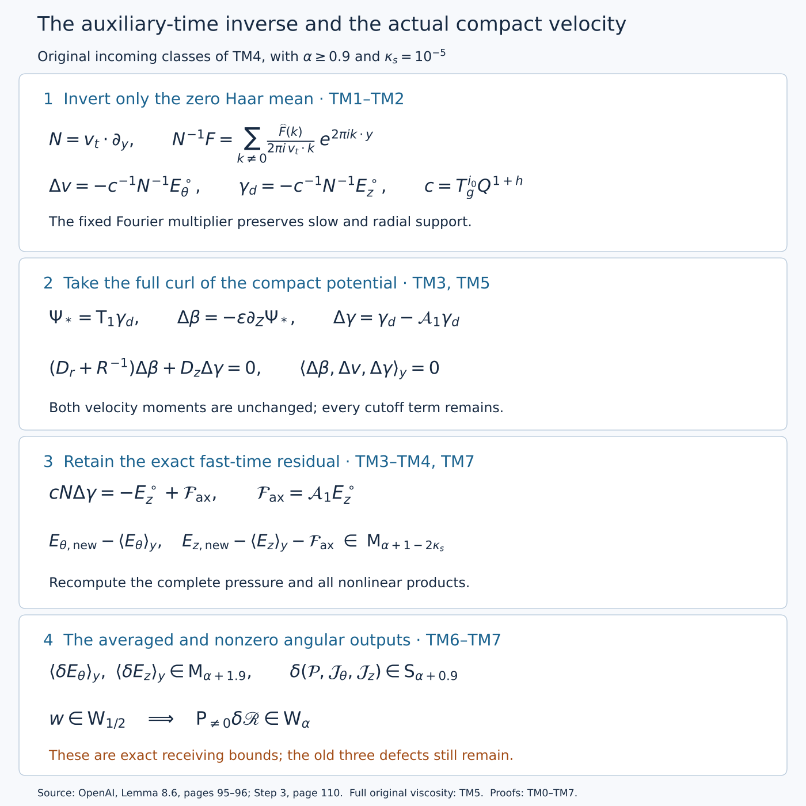

# Cancelling the nonconstant auxiliary means

*NS-BLOWUP N5.2. Exposition by GPT-6 Astra (OpenAI). This independent exposition is dedicated to CC0.*

The radial construction leaves a tangential residual depending on an auxiliary torus. This lesson constructs the inverse of its fast time derivative on zero-mean functions. The resulting velocity is compact and divergence free, preserves both velocity moments, and cancels the nonconstant part of that residual. We retain the compact axial remainder, the slow time derivative, the new pressure and every nonlinear product.

The source scope is OpenAI's Lemma 8.6, (8.19)–(8.23), on pages 95–96, together with its Step 3 receiver on page 110. The [radial lesson](radial-primitives-and-the-mean-equations.md) supplies the complete compact operators and conservative equations. The [stress and interaction lesson](realizing-stress-and-controlling-interactions.md) supplies the wave classes and complete interaction maps. This is separate editorial mathematics; diplomatic transcription is governed by the original source text.

The [editable diagram source](../assets/auxiliary-time-correction.py) displays the formulas proved below. It depicts operators and bounds, without numerical flow samples.

## TM0. Original coordinates and the input spaces

On a fixed dyadic chart retain
\[
\begin{gathered}
0<h<1/100,\quad A=1/2+h,\quad D=1/2-h,\quad
Q=2^{-\ell},\quad\varepsilon=Q^h,\quad S_*=\ell^2,\\
\tau=1-t=q(1-\eta^2),\quad z=q^D\eta,\quad X=r^2/(2q),\\
R=r/\sqrt Q,\quad Z=z/Q^D,\quad T=(1-t)/Q,\\
\kappa_s=10^{-5},\quad
\rho_g=\log\Lambda_g/\log T_g,\quad d_r=2((1+h)\rho_g-h\kappa_s),\\
M=\Lambda_g^{i_0}Q^{d_r/2},\quad c=T_g^{i_0}Q^{1+h},\quad
\mathcal L=v_r\cdot\partial_y,\\
D_r=\partial_R+Md_rR^{d_r-1}\mathcal L,\quad
D_z=\varepsilon\partial_Z,\quad
\mathfrak t_*=-\varepsilon\partial_T+cN,\quad
\Delta_0=D_r^2+R^{-1}D_r+D_z^2.
\end{gathered}
\tag{TM0.1}
\]
The matrix, eigenvalues and two vectors are displayed in TM1.1. The common torus coordinate is \(y=J_g^{i_0}Y\); the original physical phase is \(Y=v_rr^{d_r}+v_tt\). The index and \(Q\) are held fixed under chart differentiation. RP1 proves these exact maps and their bounded covering differences.

The mean space \(\mathsf M_\alpha\) consists of the original angle-independent smooth shell coefficients, with their prescribed smooth zero extensions, chart compatibility and estimates
\[
|\partial^I f_*|\le C_I\varepsilon^\alpha S_*^{B_I}
                   \zeta(X)\delta(X)^{-D_I}.
\tag{TM0.2}
\]
The weights \(\zeta,\delta\), their original edge constants and all derivative and support properties are given and proved in RP4.1–RP4.6. Derivatives in TM0.2 are coefficient derivatives in \((R,Z,T,y)\), not derivatives after physical evaluation. The slow defect space \(\mathsf S_\alpha\) has the corresponding bounds
\(|\partial_{Z,T}^I f|\le C_I\varepsilon^\alpha S_*^{B_I}\), with the prescribed slow support and compatibility; its actual physical representatives keep the moment factors in RM4.5. This space has no radial variable. The wave space \(\mathsf W_\lambda\) retains the source's labels, nonzero harmonics, support and envelope bounds from OS5–OS7 and NI1–NI5; TM6 uses that exact space.

Angular averaging \(\langle\cdot\rangle_\theta\) and auxiliary Haar averaging \(\langle\cdot\rangle_y\) are distinct. Write \(E^\circ=E-\langle E\rangle_y\). The velocity and defects used below are those of RM1.1 and RM2.1, with the full current curl covariance.

## TM1. The exact inverse and its domain

The original torus is \(\mathbb T^2=\mathbb R^2/\mathbb Z^2\), with Haar mass one. Retain
\[
\begin{gathered}
J_g=\begin{pmatrix}3&1\\1&5\end{pmatrix},\qquad
T_g=4+\sqrt2,\quad\Lambda_g=4-\sqrt2,\\
v_t=(\sqrt2-1,1),\quad v_r=(1,1-\sqrt2),\qquad N=v_t\cdot\partial_y.
\end{gathered}
\tag{TM1.1}
\]
For \(k\in\mathbb Z^2\setminus\{0\}\), let \(n=\max(|k_1|,|k_2|)\geq1\). Then
\[
(v_t\cdot k)((k_2-k_1)-\sqrt2k_1)
=(k_2-k_1)^2-2k_1^2\in\mathbb Z\setminus\{0\}.
\]
If this integer were zero, irrationality of \(\sqrt2\) would force \(k_1=0\), then \(k_2=0\). The conjugate's magnitude is at most \((2+\sqrt2)n\), proving
\[
|v_t\cdot k|^{-1}\leq(2+\sqrt2)n.
\tag{TM1.2}
\]
For a smooth real or complex function \(F\) with \(\int_{\mathbb T^2}F=0\), define
\[
\widehat F(k)=\int_{[0,1]^2}F(y)e^{-2\pi i k\cdot y}\,dy,\qquad
\varphi(y)=\sum_{k\ne0}\frac{\widehat F(k)}{2\pi i\,v_t\cdot k}e^{2\pi i k\cdot y}.
\tag{TM1.3}
\]
Let the \(C^m\) norm be the maximum of the suprema of all coordinate derivatives of total order at most \(m\). For a coordinate with \(|k_j|=n\), periodic integration by parts \(m+4\) times gives
\[
|\widehat F(k)|\leq\frac{\|F\|_{C^{m+4}}}{(2\pi n)^{m+4}}.
\]
For each derivative of order at most \(m\), its summand in (TM1.3) is consequently bounded by
\((2+\sqrt2)(2\pi)^{-5}n^{-3}\|F\|_{C^{m+4}}\). Exactly \(8n\) integer vectors have maximum norm \(n\), and \(\sum_{n\geq1}n^{-2}\leq1+\int_1^\infty x^{-2}dx=2\). Hence all these differentiated series converge absolutely and uniformly and
\[
\|\varphi\|_{C^m}\leq\frac{16(2+\sqrt2)}{(2\pi)^5}\|F\|_{C^{m+4}}.
\tag{TM1.4}
\]
Applying this at every \(m\) proves smoothness and termwise differentiation. The Fourier coefficients of \(N\varphi\) equal those of \(F\), including the zero coefficient. For completeness, equality of all Fourier coefficients determines a continuous function: its convolution with the product of the two Fejér kernels
\[
K_L(s)=\frac1{L+1}\left|\sum_{j=0}^{L}e^{2\pi ijs}\right|^2
\]
is the corresponding finite Fourier sum. The kernel is nonnegative and has integral one by orthogonality of the exponentials. Outside any fixed neighborhood of the integers it is at most \(((L+1)\sin^2(\pi\delta))^{-1}\), where \(\delta\) is the distance of that neighborhood's boundary to the integers. Uniform continuity therefore proves uniform convergence of the product-kernel convolution to the function: split the integral into the small neighborhood, where the function oscillation is small, and its complement, whose kernel mass tends to zero. A function with all coefficients zero is thus zero. This proves \(N\varphi=F\). If \(N\psi=0\), its nonzero Fourier coefficients vanish by (TM1.2); requiring zero mean removes its constant coefficient. This proves uniqueness. For real \(F\), the coefficients at \(k\) and \(-k\) in (TM1.3) are complex conjugates, so \(\varphi\) is real.

Thus (TM1.3) is an actual map
\[
N^{-1}:C^\infty_0(\mathbb T^2)\longrightarrow C^\infty_0(\mathbb T^2),
\tag{TM1.5}
\]
where the subscript denotes zero Haar mean, with the finite derivative bound (TM1.4). It is not defined on a nonzero constant: integrating \(N\varphi=F\) proves the necessary condition \(\int F=0\). All slow and radial coefficient derivatives commute with this fixed Fourier multiplier. It acts at each fixed \((R,Z,T)\), so it preserves their support and smooth zero extensions. It need not preserve a subset of the auxiliary torus, and no such support condition is imposed on mean coefficients.

## TM2. Original physical scaling and covering compatibility

Put \(P_iF(Y)=F(J_g^iY)\). The identity \(J_gv_t=T_gv_t\) gives, by differentiating the composition,
\[
N_{\rm abs}P_i=T_g^iP_iN_i,
\qquad N_{\rm abs}^{-1}P_i=T_g^{-i}P_iN_i^{-1}.
\tag{TM2.1}
\]
For the inverse identity, the proposed right side is a zero-mean solution of the left side's defining equation, so uniqueness from TM1 proves it. The covering preserves Haar mean: the pullback of the \(k\)-th exponential has frequency \((J_g^i)^Tk\), which is nonzero whenever \(k\ne0\), since \(\det J_g=14\). The identity follows first for trigonometric polynomials, then for smooth functions by their uniform Fourier convergence. No inverse of the many-to-one covering is used.

At viscosity one, retain the physical velocity and residual factors. Their complete extension to every original viscosity is proved in TM5 below:
\[
u_*=Q^Au_{\rm phys},\qquad E_*=Q^{2A+1/2}E_{\rm phys},\quad
A=1/2+h,\quad Q=2^{-\ell},\quad \varepsilon=Q^h.
\]
The physical update is \(-N_{\rm abs}^{-1}E_{\rm phys}^\circ\), where \(E^\circ=E-\langle E\rangle_Y\). On a common torus \(y=J_g^{i_0}Y\), (TM2.1) gives exactly
\[
\begin{aligned}
Q^A[-N_{\rm abs}^{-1}E_{\rm phys}^\circ]
 &=-Q^{A-(2A+1/2)}T_g^{-i_0}N_{i_0}^{-1}E_*^\circ\\
 &=-c_{i_0}^{-1}N_{i_0}^{-1}E_*^\circ,\qquad
c_{i_0}=T_g^{i_0}Q^{1+h}.
\end{aligned}
\tag{TM2.2}
\]
The band integer is \(i=\lfloor\log_{T_g}(Q^{-1-h}/S_*)\rfloor\), with \(S_*=\ell^2\). Thus
\[
T_g^{-1}S_*^{-1}<T_g^iQ^{1+h}\leq S_*^{-1}.
\]
If the common index satisfies \(|i_0-i|\leq C_0\), the explicit bound is
\[
c_{i_0}^{-1}<T_g^{C_0+1}S_*.
\tag{TM2.3}
\]
Indices and \(Q\) remain fixed during differentiation on a chart. The multiplier therefore costs a polynomial in \(S_*\) and four additional torus derivatives, not a power of \(\varepsilon\). Original common-torus compatibility (6.20), its bounded index difference, and (TM2.1) prove agreement on overlaps of the same physical update.

Use the full \(\mathsf M_\alpha\) definition and original weights in RP4.1–RP4.2 of the radial lesson. Haar averaging and subtraction preserve it. Applying (TM1.4) after each fixed slow derivative, at each radial point, retains the factors \(\varepsilon^\alpha\zeta\delta^{-D_I}\). The weights have no auxiliary dependence, so they are unchanged by the torus supremum. Equations (TM2.2)–(TM2.3) therefore prove
\[
\Delta v=-c^{-1}N^{-1}E_\theta^\circ\in\mathsf M_\alpha,
\qquad\gamma_d=-c^{-1}N^{-1}E_z^\circ\in\mathsf M_\alpha.
\tag{TM2.4}
\]
Both have zero auxiliary mean at every radial and slow point. The support, derivative and overlap conclusions also hold up to one-sided endpoints on any closed region \(q\geq c_0>0\). They require no target smallness and no stage-dependent reduction of the domain.

## TM3. Compact realization, exact moments and the retained error

Use the original positive vector potential
\[
\Psi_*=\mathsf T_1\gamma_d,\qquad
\Delta\beta=-\varepsilon\partial_Z\Psi_*,\qquad
\Delta\gamma=(D_r+R^{-1})\Psi_*=\gamma_d-\mathcal A_1\gamma_d.
\tag{TM3.1}
\]
The compact-primitive identity and estimates are proved in RP3–RP6 of the radial lesson from original (8.4)–(8.8). Since \(\langle\gamma_d\rangle_Y=0\) at every radius, its required weighted mean integral is zero. The result is
\[
\Psi_*,\Delta\gamma\in\mathsf M_\alpha,\quad
\Delta\beta\in\mathsf M_{\alpha+1},\qquad
a=-\mathcal A_1\gamma_d.
\tag{TM3.2}
\]
The complete \(a\) is part of the actual axial velocity. Here it need not vanish pointwise, unlike the auxiliary-independent moment correction.

Translation invariance of Haar measure gives \(\langle\mathcal I g\rangle=\int_0^R\langle g\rangle\,dR'\) and the corresponding identity for \(\mathcal J\); the torus translations in (8.5) do not affect the averages. Applied to \(g=R\gamma_d\), both averages are zero. The torus-independent cutoff and factor \(R^{-1}\) then give \(\langle\Psi_*\rangle=0\). Consequently \(\langle\Delta\beta\rangle=\langle\Delta\gamma\rangle=0\), and \(\langle\Delta v\rangle=0\) was already known. Both moments in (8.2) remain exactly unchanged. The full physical divergence vanishes because
\[
(D_r+R^{-1})(-\varepsilon\partial_Z\Psi_*)
+\varepsilon\partial_Z(D_r+R^{-1})\Psi_*=0:
\]
the coefficients of \(D_r\) depend only on \(R\) on a fixed chart. The azimuthal component is independent of \(\theta\). All components have the smooth shell zero extensions supplied by the compact inverse.

The operator \(N\) commutes with both translated radial integrals and their cutoff, since it is a constant derivative in the translation variable and the cutoff has no torus dependence. With \(c=c_{i_0}\), the exact fast-time equations are therefore
\[
cN\Delta v=-E_\theta^\circ,\qquad
cN\Delta\gamma=-E_z^\circ+\mathcal F_{\rm ax},\qquad
\mathcal F_{\rm ax}=cNa.
\tag{TM3.3}
\]
For every fixed coefficient multi-index \(I\) and integer \(p\geq1\), the compact remainder estimate gives
\[
|\partial^I\mathcal F_{\rm ax}|
\leq C_{I,p}\varepsilon^{\alpha+p\kappa_s}S_*^{B_{I,p}}
\zeta\delta^{-D_{I,p}}.
\tag{TM3.4}
\]
One additional torus derivative is enough to account for \(N\); multiplying by \(c\leq T_g^{C_0}S_*^{-1}\) changes no \(\varepsilon\) power. The physical chain rule has a finite loss for each fixed derivative, independent of \(p\). Choosing \(p\) large enough that \(hp\kappa_s\) exceeds that loss and the requested power, and only then taking \(q\) small, makes every physical derivative of \(\mathcal F_{\rm ax}\) of order \(O(q^L)\) for every prescribed \(L\). Polynomial logarithmic factors are absorbed by the strict exponent excess, as proved in RP6 of the radial lesson. This proves flatness with the actual physical factors retained. It does not identify \(a\) or \(\mathcal F_{\rm ax}\) with zero.

## TM4. The pressure and exact nonlinear receiver

Keep the base and actual wave velocity fixed. The full radial source and defects are RM1.4 and RM2.1 of the radial lesson. Its exact finite difference RM1.7 applies to this auxiliary-dependent update, with \(\delta W=0\). Write
\[
\begin{aligned}
\Delta g_r&=(2V/R)\Delta v+\mathcal R_g,\\
\Delta\mathcal P&=\int\langle\Delta g_r\rangle_Y\,dR,\\
\Delta p_m&=\mathsf T_0(\Delta g_r-\rho\Delta\mathcal P).
\end{aligned}
\tag{TM4.1}
\]

For clarity, every term in this exact difference is
\[
\begin{aligned}
\mathcal R_g={}&-\mathfrak t_*\Delta\beta
 -(D_r+R^{-1})\{2b\Delta\beta+2\beta\Delta\beta+(\Delta\beta)^2\}\\
 &-D_z\{b\Delta\gamma+G\Delta\beta+\beta\Delta\gamma
             +\gamma\Delta\beta+\Delta\beta\Delta\gamma\}\\
 &+\{2v\Delta v+(\Delta v)^2\}/R
   +\varepsilon(\Delta_0-R^{-2})\Delta\beta.
\end{aligned}
\tag{TM4.1a}
\]
It follows by expanding the products in the full radial source RM1.4.
The wave covariance cancels exactly because the full wave field is fixed;
the actual \(\Delta\gamma=\gamma_d-\mathcal A_1\gamma_d\) remains in every term.

This is the full pressure recomputation. Its cutoff error is retained by the exact identity
\[
D_r\Delta p_m-\Delta g_r=-\rho\Delta\mathcal P
-\mathcal A_0(\Delta g_r-\rho\Delta\mathcal P).
\tag{TM4.2}
\]
Assume the incoming classes of the source's finite-state definition: \(v,\gamma\in\mathsf M_{0.9}\), \(\beta\in\mathsf M_{1.9}\), \(\alpha\geq0.9\). The source's fixed base has coefficient bounds \(b=O(\varepsilon S_*^B)\), \(V,G=O(S_*^B)\) on the enlarged shell. These are the actual base bounds proved in Z0–Z9; that constructed field is used throughout. Products add exponents with the full edge weights, since \(\zeta^2\leq\zeta\) and powers of \(\delta^{-1}\) add. The original radial operator loses at most \(\kappa_s\), \(D_z\) adds one, and the fast term \(cN\) has no \(\varepsilon\) loss, with a finite extra coefficient derivative.

For \(\mathcal R_g\) in (TM4.1a), the fast-time part of \(-\mathfrak t_*\Delta\beta\) has exponent \(\alpha+1\), its slow part has exponent \(\alpha+2\); the base-linear radial part has \(\alpha+2-\kappa_s\); the remaining radial products have \(\alpha+2.9-\kappa_s\) or \(2\alpha+2-\kappa_s\). The base-linear axial terms have \(\alpha+2\), the remaining axial terms \(\alpha+2.9\) or \(2\alpha+2\). The angular products have \(\alpha+0.9\) and \(2\alpha\). The viscous term has exponent at least \(\alpha+2-2\kappa_s\). All are at least \(\alpha+0.9\). Thus
\[
\mathcal R_g\in\mathsf M_{\alpha+0.9},\quad
\Delta g_r\in\mathsf M_\alpha,\quad
\Delta p_m\in\mathsf M_\alpha.
\tag{TM4.3}
\]
The last conclusion uses the proved compact primitive after subtracting its actual moment, with \(\rho\Delta\mathcal P\) retained.

Unlike the moment solve, this temporal solve does not cancel the old three defects. Its base-linear changes have zero auxiliary average because \(V,G\) are slow and all increments have zero auxiliary mean. Expanding the three integrals in RM2.1 therefore gives the exact *changes*
\[
\begin{aligned}
\Delta\mathcal P&=\int\langle\mathcal R_g\rangle_Y\,dR,\\
\Delta\mathcal J_\theta&=\int R^2\langle\gamma\Delta v+v\Delta\gamma+\Delta\gamma\Delta v\rangle_Y\,dR,\\
\Delta\mathcal J_z&=\int R\langle2\gamma\Delta\gamma+(\Delta\gamma)^2\rangle_Y\,dR
-\frac12\int R^2\langle\mathcal R_g\rangle_Y\,dR.
\end{aligned}
\tag{TM4.4}
\]
Their class is \(\mathsf S_{\alpha+0.9}\) by (TM4.3), products and the full moment factors RM4.3–RM4.5. Thus incoming defects of order \(\mathsf S_\alpha\) remain of that order. They are not assumed to vanish.

The full tangential differences are exactly RM1.7. Substituting (TM3.3) into their time terms gives
\[
\begin{aligned}
E_{\theta,\rm new}-\langle E_\theta\rangle_Y
={}&-\varepsilon\partial_T\Delta v-\varepsilon(\Delta_0-R^{-2})\Delta v\\
&+(D_r+2/R)(b\Delta v+V\Delta\beta+\beta\Delta v+v\Delta\beta+\Delta\beta\Delta v)\\
&+D_z(G\Delta v+V\Delta\gamma+\gamma\Delta v+v\Delta\gamma+\Delta\gamma\Delta v),\\
E_{z,\rm new}-\langle E_z\rangle_Y
={}&-\varepsilon\partial_T\Delta\gamma-\varepsilon\Delta_0\Delta\gamma+\mathcal F_{\rm ax}\\
&+(D_r+1/R)(b\Delta\gamma+G\Delta\beta+\beta\Delta\gamma+\gamma\Delta\beta+\Delta\beta\Delta\gamma)\\
&+D_z(2G\Delta\gamma+2\gamma\Delta\gamma+(\Delta\gamma)^2+\Delta p_m).
\end{aligned}
\tag{TM4.5}
\]
Every occurrence of \(\Delta\gamma\) means \(\gamma_d+a\). In particular all products with \(a\) remain. The slow time terms have exponent \(\alpha+1\); the radial base-linear fluxes \(\alpha+1-\kappa_s\); radial products with old means \(\alpha+1.9-\kappa_s\); radial new-new products \(2\alpha+1-\kappa_s\). Axial base-linear and pressure terms have \(\alpha+1\), the remaining axial products \(\alpha+1.9\) or \(2\alpha+1\). Viscosity has exponent at least \(\alpha+1-2\kappa_s\). Therefore
\[
\begin{aligned}
E_{\theta,\rm new}-\langle E_\theta\rangle_Y
 &\in\mathsf M_{\alpha+1-2\kappa_s},\\
E_{z,\rm new}-\langle E_z\rangle_Y-\mathcal F_{\rm ax}
 &\in\mathsf M_{\alpha+1-2\kappa_s}.
\end{aligned}
\tag{TM4.6}
\]

## TM5. The correction at every original viscosity

Keep the physical viscosity \(\nu>0\). The original coordinates and representatives are
\[
\begin{gathered}
q_\nu-(z_\nu^2/\nu)q_\nu^{2h}=1-t,\qquad
R=\frac{r_\nu}{\sqrt{\nu Q}},\quad
Z=\frac{z_\nu}{\sqrt\nu Q^D},\quad T=\frac{1-t}{Q},\\
Y=v_r(r_\nu/\sqrt\nu)^{d_r}+v_tt,\quad y=J_g^{i_0}Y,\qquad
u_*=Q^A\nu^{-1/2}u_\nu,\quad
E_*=Q^{2A+1/2}\nu^{-1/2}E_\nu.
\end{gathered}
\tag{TM5.1}
\]
Here \(D=1/2-h\), and the original \(q_\nu,\eta,X\) and every radial measure are as proved in RM4 of the preceding radial lesson. Time and angle are unchanged by the viscosity comparison. Define the physical tangential prescription by
\[
(\Delta v_\nu,\gamma_{d,\nu})
=-N_{\rm abs}^{-1}(E_{\theta,\nu}^{\circ},E_{z,\nu}^{\circ}),
\qquad N_{\rm abs}=v_t\cdot\partial_Y.
\tag{TM5.2}
\]
The Haar projection is taken at fixed physical radius, axial coordinate and time. Since its factors have no auxiliary dependence, multiplication by the factors in TM5.1 commutes with this projection. Applying TM2.1 gives
\[
\begin{aligned}
Q^A\nu^{-1/2}[-N_{\rm abs}^{-1}E_\nu^\circ]
 &=-Q^{A-(2A+1/2)}T_g^{-i_0}N^{-1}E_*^\circ\\
 &=-c^{-1}N^{-1}E_*^\circ,\qquad c=T_g^{i_0}Q^{1+h}.
\end{aligned}
\tag{TM5.3}
\]
The two viscosity factors cancel exactly; both \(Q\) factors and the covering factor remain.

Use the physical compact primitive \(\mathsf T_{1,\nu}\) defined in RM4.3, with the original shifted radial path and cutoff. The actual physical potential and velocity are
\[
\begin{aligned}
\Psi_\nu&=\mathsf T_{1,\nu}\gamma_{d,\nu},&
\Psi_*&=Q^{A-1/2}\nu^{-1}\Psi_\nu=\mathsf T_{1,M}\gamma_d,\\
\Delta u_\nu
 &=\operatorname{curl}_{x_\nu}(\Psi_\nu e_\theta)
       +\Delta v_\nu e_\theta,\\
\Delta\beta_\nu&=-\partial_{z_\nu}\Psi_\nu,&
\Delta\gamma_\nu&=(\mathfrak r_\nu+r_\nu^{-1})\Psi_\nu,
\end{aligned}
\tag{TM5.4}
\]
where
\(\mathfrak r_\nu=\partial_{r_\nu}
+d_r\nu^{-d_r/2}r_\nu^{d_r-1}v_r\cdot\partial_Y\).
Since \(\Psi_\nu\) and \(\Delta v_\nu\) are angle independent, this field is divergence free. In Cartesian coordinates the potential is
\((\Psi_\nu/r_\nu)(-x_{\nu,2},x_{\nu,1},0)\); its shell support keeps it away from the axis at every fixed \(q_\nu>0\). The compact primitive's smooth zero extension therefore proves smoothness of this Cartesian potential and curl. Direct multiplication by the velocity factor in TM5.1 recovers
\[
(\Delta\beta,\Delta v,\Delta\gamma)
=(-\varepsilon\partial_Z\Psi_*,-c^{-1}N^{-1}E_\theta^\circ,
   \gamma_d-\mathcal A_{1,M}\gamma_d).
\tag{TM5.5}
\]
All three Haar averages vanish. In particular both physical moments
\(\int r_\nu^2\langle v_\nu\rangle_Y\,dr_\nu\) and
\(\int r_\nu\langle\gamma_\nu\rangle_Y\,dr_\nu\) are unchanged. Their exact chart multipliers are \(Q^{A-3/2}\nu^{-2}\) and \(Q^{A-1}\nu^{-3/2}\); no radial measure has been suppressed.

The recomputed physical pressure has representative
\(\Delta p_{m,*}=Q^{2A}\nu^{-1}\Delta p_{m,\nu}\).
Its radial source, all tangential residuals and the physical axial remainder have the residual multiplier in TM5.1. In particular
\[
\mathcal F_{{\rm ax},\nu}
=\sqrt\nu\,Q^{-2A-1/2}\mathcal F_{\rm ax},
\qquad
\Delta p_{m,\nu}=\nu Q^{-2A}\Delta p_{m,*}.
\tag{TM5.6}
\]
These representatives are evaluated at the actual phase map in TM5.1. For each fixed \(\nu>0\), physical differentiation of order \(m\) costs at most \(Q^{-m(1+h)}\) times a fixed polynomial in \(S_*\), with constants allowed to depend on \(\nu,m\). RP6 proves this bound by the original chain rule. Combining it with TM3.4 gives
\[
|\partial_{x_\nu,t}^{I}\mathcal F_{{\rm ax},\nu}|
\le C_{\nu,I,p}
 Q^{h(\alpha+p\kappa_s)-(2A+1/2)-m(1+h)}S_*^{B_{\nu,I,p}},
\qquad |I|\le m.
\tag{TM5.7}
\]
Given a desired power \(L\), choose an integer \(p\ge1\) with the displayed exponent strictly larger than \(L\), then fix that \(p\). Its excess absorbs the finite logarithmic power because \(S_*=\ell^2\), \(Q=2^{-\ell}\). Since \(q_\nu/Q\) lies between fixed positive chart constants, the result is \(O(q_\nu^L)\). This proves the physical statement for every fixed derivative order and every \(L\); neither the potential's remainder nor the residual's remainder is replaced by zero.

## TM6. The nonzero angular residual of this same velocity

Write \(d=(\Delta\beta,\Delta v,\Delta\gamma)\) for the actual increment above and \(w\) for the unchanged full wave velocity. Let \(\mathcal B(a,b)\) denote \((a\cdot\nabla_*)b\) with its cylindrical frame terms. The complete residual difference is
\[
\delta\mathscr R
=\mathfrak t_*d+\mathcal B(U,d)+\mathcal B(d,U)+\mathcal B(d,d)
 +\nabla_*\Delta p_m-\varepsilon\Delta_*d.
\tag{TM6.1}
\]
The term \(\mathcal B(d,d)\) has coefficient one. The base, old mean, \(d\), \(\Delta p_m\), their time derivatives and the vector Laplacian all have angle-independent cylindrical components. Consequently removal of their angular mean gives exactly
\[
\mathsf P_{\ne0}\delta\mathscr R=\mathcal B(w,d)+\mathcal B(d,w).
\tag{TM6.2}
\]
For one full wave \(w=ae^{ikm\Phi}\), let \(n=\nabla_*\Phi\), with the original phase, \(k\) and nonzero harmonic \(m\) from the pulse lesson. Product differentiation and the frame identities in RM1 give
\[
\begin{aligned}
\mathcal B(w,d)+\mathcal B(d,w)
 &=e^{ikm\Phi}\mathcal Q_m(d,a),\\
\mathcal Q_m(d,a)
 &=ikm(d^rn_r+d^\theta n_\theta+d^zn_z)a\\
 &\quad+d^rD_ra+d^zD_za+a_rD_rd+a_zD_zd\\
 &\quad+R^{-1}(-2d^\theta a_\theta,d^\theta a_r+a_\theta d^r,0).
\end{aligned}
\tag{TM6.3}
\]
The first line of \(\mathcal Q_m\) differentiates the exponential, the next differentiates its two coefficient fields, and the last is the sum of their two frame derivatives. This proves the equality with the radial coefficient \(-2\), without assuming that the prescribed axial component equals the actual one.

For \(a\in\mathsf W_\lambda\), \(d^\theta,d^z\in\mathsf M_\alpha\), \(d^r\in\mathsf M_{\alpha+1}\), the complete groups have the following lower exponents. The original class definitions and phase estimates, including \(k|n|\) with its half-power cost, are proved in OS5–OS7 and NI1–NI5.

| Group in the exact coefficient | Lower exponent |
|---|---|
| \(ikm(d^\theta n_\theta+d^zn_z)a\) | \(\lambda+\alpha-\tfrac12\) |
| \(ikm d^rn_ra\) | \(\lambda+\alpha+\tfrac12\) |
| \(d^rD_ra\) | \(\lambda+\alpha+1-\kappa_s\) |
| \(d^zD_za\) | \(\lambda+\alpha+1\) |
| \(a_rD_r(d^\theta,d^z)\), \(a_rD_rd^r\) | \(\lambda+\alpha-\kappa_s\), \(\lambda+\alpha+1-\kappa_s\) |
| \(a_zD_z(d^\theta,d^z)\), \(a_zD_zd^r\) | \(\lambda+\alpha+1\), \(\lambda+\alpha+2\) |
| \(R^{-1}(-2d^\theta a_\theta,d^\theta a_r,0)\) | \(\lambda+\alpha\) |
| \(R^{-1}(0,a_\theta d^r,0)\) | \(\lambda+\alpha+1\) |

The coefficient product rule retains every shell weight, power of \(S_*\), edge factor and fixed derivative. Since \(\kappa_s<1/2\), all rows belong to \(\mathsf W_{\lambda+\alpha-1/2}\). Every term contains the wave or one of its derivatives, so it retains its closed slow, transverse, auxiliary and temporal supports and its envelope; no cutoff is divided out. The harmonic remains the same nonzero \(m\). A finite or locally finite sum is treated after collecting equal label-harmonic pairs, as in OS6; linearity in each collected coefficient uses its existing bound, with no count of earlier representations. Thus
\[
w\in\mathsf W_{1/2}\quad\Longrightarrow\quad
\mathsf P_{\ne0}\delta\mathscr R\in\mathsf W_\alpha.
\tag{TM6.4}
\]
Here \(d^z=\gamma_d-\mathcal A_1\gamma_d\) throughout. Its flat summand still appears in every occurrence of \(d^z\) and its derivatives in TM6.3. At the original viscosity, the complete physical mixed transport is
\(\sqrt\nu Q^{-2A-1/2}e^{ikm\Phi}\mathcal Q_m(d,a)\), by TM5.1. It has zero angular mean, so it adds no missing term to the defects in TM4.

At Step 3 on original page 110, put
\[
\alpha=H=C_*-2\kappa_s.
\]
The incoming auxiliary-averaged mean residual has order \(C_*+0.17\), while the full mean residual and three defects have order \(H\). Equations TM4.6 and TM6.4 give the exact receiving orders
\[
\begin{gathered}
E_{\theta,\rm new},\
E_{z,\rm new}-\mathcal F_{\rm ax}
\in\mathsf M_{\min(C_*+0.17,H+1-2\kappa_s)},\\
(\mathcal P_{\rm new},\mathcal J_{\theta,\rm new},\mathcal J_{z,\rm new})
\in\mathsf S_H,\qquad
\mathsf P_{\ne0}\delta\mathscr R\in\mathsf W_H.
\end{gathered}
\tag{TM6.5}
\]
The additive flat residual includes \(\mathcal F_{\rm ax}\), and the actual velocity includes its full compact-potential remainder. The three old defects have not been cancelled by this operation. The subsequent five-profile correction is applied to their recomputed values.

## TM7. Five solved exercises

### Exercise 1. A real Fourier source and its actual compact curl

Let \(k\in\mathbb Z^2\setminus\{0\}\), \(\omega=v_t\cdot k\), and let \(b_\theta(R,Z,T)\), \(b_z(R,Z,T)\) be smooth shell-supported amplitudes with the required coefficient bounds. Use
\(E_\theta^\circ=b_\theta\cos(2\pi k\cdot y)\) and
\(E_z^\circ=b_z\cos(2\pi k\cdot y)\).
Compute the temporal prescription, potential and axial residual without discarding either radial integral.

**Solution.** TM1 proves \(\omega\ne0\), and direct differentiation gives
\[
\Delta v=-\frac{b_\theta\sin(2\pi k\cdot y)}{2\pi c\omega},\qquad
\gamma_d=-\frac{b_z\sin(2\pi k\cdot y)}{2\pi c\omega}.
\tag{TM7.1}
\]
Set
\[
\vartheta(R',R,y)=2\pi k\cdot
 \{y+M((R')^{d_r}-R^{d_r})v_r\}.
\]
At fixed \(Z,T\), the actual scalar potential is
\[
\Psi_*=-\frac{R^{-1}}{2\pi c\omega}
\left\{\int_0^R R'b_z(R')\sin\vartheta\,dR'
       -\chi_m\int_0^\infty R'b_z(R')\sin\vartheta\,dR'\right\}.
\tag{TM7.2}
\]
Arguments \(Z,T\) on \(b_z,\chi_m\) have only been suppressed typographically inside the integrals; they stay fixed during radial integration. Its axial correction and fast residual are
\[
\begin{aligned}
a&=\frac{R^{-1}\partial_R\chi_m}{2\pi c\omega}
       \int_0^\infty R'b_z(R')\sin\vartheta\,dR',\\
\Delta\gamma&=-\frac{b_z\sin(2\pi k\cdot y)}{2\pi c\omega}+a,\\
\mathcal F_{\rm ax}&=R^{-1}\partial_R\chi_m
       \int_0^\infty R'b_z(R')\cos\vartheta\,dR'.
\end{aligned}
\tag{TM7.3}
\]
The last line follows by applying \(cN\) to the preceding integral: the phase derivative is exactly \(2\pi\omega\). The radial component is the full \(-\varepsilon\partial_Z\Psi_*\), including differentiation of \(\chi_m\). The two component derivatives commute, proving zero divergence. Haar averaging either sine integral gives zero, so both mean velocity moments are preserved. All constants, phases, radial measures and cutoff terms are explicit.

### Exercise 2. What the covering preserves and which functions descend

For an integer \(s\ge0\), let \(J=J_g^s\), \(P_sF(y)=F(Jy)\), and let \(K_s\) be the kernel of \(J:\mathbb T^2\to\mathbb T^2\). Characterize the image of \(P_s\), and prove the temporal inverse identity on it without inverting the many-to-one map.

**Solution.** The integer matrix has determinant \(14^s\); the covering has exactly \(14^s\) elements in each fiber, as proved by the integer lattice quotient in OS1–OS2. Define
\[
\Pi_s f(y)=\frac1{14^s}\sum_{\eta\in K_s}f(y+\eta).
\tag{TM7.4}
\]
Reindexing this finite sum by each kernel translation proves that \(\Pi_sf\) is \(K_s\)-invariant. If \(f\) is already invariant then \(\Pi_sf=f\); hence \(\Pi_s^2=\Pi_s\). Every \(P_sF\) is invariant because \(J\eta=0\) in the torus. Conversely, if \(f\) is invariant, define \(F(x)=f(y)\) for any \(Jy=x\). Two such \(y\)'s differ by an element of \(K_s\), so this definition is single valued. The map \(J\) is locally invertible with its actual constant derivative matrix \(J\); using any local inverse proves smoothness of \(F\), and the definitions agree on overlaps. Thus
\[
\operatorname{ran}P_s=\operatorname{ran}\Pi_s
=\{f:f(y+\eta)=f(y)\ \hbox{for every }\eta\in K_s\}.
\tag{TM7.5}
\]
The source and target are the smooth functions on their respective tori. Translations commute with \(N\) and with its zero-mean inverse by uniqueness, so \(\Pi_s\) commutes with both on that domain. From \(J_gv_t=T_gv_t\),
\[
NP_s=T_g^sP_sN,\qquad N^{-1}P_s=T_g^{-s}P_sN^{-1}.
\tag{TM7.6}
\]
For the second equality apply \(N\) to the proposed right side, and use Haar preservation and uniqueness. This proves the exact correspondence on the covering's image and its projection, with no global inverse of \(J\).

### Exercise 3. Compute the retained fast residual directly from the old source

Prove a formula for \(\mathcal F_{\rm ax}\) that contains no temporal inverse, and state precisely why it has the compact remainder estimates.

**Solution.** On a fixed chart, \(c\) is constant and the translations defining the radial integrals commute with the constant torus derivative \(N\). Both the cutoff and radial weights are auxiliary independent, so \([N,\mathcal A_1]=0\). Therefore
\[
\begin{aligned}
a&=-\mathcal A_1\gamma_d
   =c^{-1}\mathcal A_1N^{-1}E_z^\circ,\\
\mathcal F_{\rm ax}=cNa
 &=-\mathcal A_1(cN\gamma_d)=\mathcal A_1E_z^\circ.
\end{aligned}
\tag{TM7.7}
\]
This is an equality of the full functions. The input \(E_z^\circ\) has zero Haar mean at every radius, so \(\int R\langle E_z^\circ\rangle_y\,dR=0\). Apply RP5.8 directly with \(e=1\):
\[
|\partial^I\mathcal F_{\rm ax}|
\le C_{I,p}\varepsilon^{\alpha+p\kappa_s}S_*^{B_{I,p}}
          \zeta\delta^{-D_{I,p}}\qquad(p\ge1).
\tag{TM7.8}
\]
For this identity the estimate uses the radial inverse's source derivatives directly, without first estimating \(N^{-1}E_z^\circ\) and then differentiating it by \(N\). Formula TM5.7 gives its full physical conversion. The remainder has zero Haar mean, but its pointwise value need not be zero, as the cosine integral in TM7.3 shows.

### Exercise 4. The exact slow derivative commutator

For \(s=Z\) or \(s=T\), compute \([\partial_s,\mathsf T_{e,M}]f\) and
\([\partial_s,\mathcal A_{e,M}]f\), keeping the original moving cutoff and fixed \(M,Q,i_0\).

**Solution.** In the fixed chart, the phase shift \(M((R')^{d_r}-R^{d_r})v_r\) has no \(s\) dependence. Smooth zero extension permits differentiation of the fixed-limit radial integrals. Only the cutoff supplies an additional derivative:
\[
\begin{aligned}
\bigl[\partial_s,\mathsf T_{e,M}\bigr]f
 &=-R^{-e}(\partial_s\chi_m)\mathcal J_M(R^ef),\\
\bigl[\partial_s,\mathcal A_{e,M}\bigr]f
 &=R^{-e}(\partial_R\partial_s\chi_m)\mathcal J_M(R^ef).
\end{aligned}
\tag{TM7.9}
\]
In particular the product rule gives the complete radial velocity formula
\[
-\varepsilon\partial_Z\mathsf T_{1,M}\gamma_d
=-\varepsilon\mathsf T_{1,M}\partial_Z\gamma_d
 +\varepsilon R^{-1}(\partial_Z\chi_m)\mathcal J_M(R\gamma_d).
\tag{TM7.10}
\]
Here \(X=R^2/(2\xi)\), \(\xi=q/Q\). Both cutoff derivatives remain explicit:
\[
\partial_s\chi_m(X)
=-\chi_m'(X)\frac{X}{\xi}\partial_s\xi,\quad
\partial_T\xi=\frac1{1-2h\eta^2},\quad
\partial_Z\xi=\frac{2Z\xi^{2h}}{1-2h\eta^2}.
\tag{TM7.11}
\]
The implicit coordinate equation is \(\xi-Z^2\xi^{2h}=T\). Differentiating it proves the last two expressions, with the same positive denominator as RP4.3. Derivatives of \(\chi_m\) vanish outside a fixed interior part of the shell. If the weighted Haar integral of \(f\) vanishes, the integration-by-parts argument RP5.7 gives the factor \(\varepsilon^{\alpha+p\kappa_s}\) for the full integral in each commutator. All derivatives of these cutoff factors have polynomial chart bounds, so both commutators have the same all-order remainder estimate. Their identities remain part of the answer. For comparison, \([N,\mathsf T_{e,M}]=[N,\mathcal A_{e,M}]=0\) exactly because the cutoff has no torus dependence.

### Exercise 5. The exact change of the auxiliary averages

The temporal increment has zero Haar mean in each velocity component. Derive the complete change of the auxiliary-averaged pressure and tangential equations, and retain the strongest estimate supplied by the given incoming classes.

**Solution.** Put \(d_\beta=\Delta\beta\), \(d_v=\Delta v\), \(d_\gamma=\Delta\gamma\), and use a bar for Haar averaging at fixed \(R,Z,T\). Define all six quadratic expressions
\[
\begin{aligned}
A_{\beta\beta}&=\overline{2\beta d_\beta+d_\beta^2},\\
A_{\beta\gamma}&=\overline{\beta d_\gamma+\gamma d_\beta+d_\beta d_\gamma},\\
A_{vv}&=\overline{2v d_v+d_v^2},\\
A_{\beta v}&=\overline{\beta d_v+v d_\beta+d_\beta d_v},\\
A_{\gamma v}&=\overline{\gamma d_v+v d_\gamma+d_\gamma d_v},\\
A_{\gamma\gamma}&=\overline{2\gamma d_\gamma+d_\gamma^2}.
\end{aligned}
\tag{TM7.12}
\]
The base is auxiliary independent, \(\overline d=0\), and the wave covariance is unchanged. Thus every base-linear, time and viscous term in the averaged differences vanishes. Haar averaging \(D_r\) gives \(\partial_R\), so the exact radial difference is
\[
\begin{aligned}
\overline{\delta g_r}
 &=-(\partial_R+R^{-1})A_{\beta\beta}
      -D_zA_{\beta\gamma}+A_{vv}/R,\\
\delta\mathcal P&=\int\overline{\delta g_r}\,dR,\qquad
\overline{\delta p_m}
 =\mathsf T_{0,M}(\overline{\delta g_r}-\rho\,\delta\mathcal P).
\end{aligned}
\tag{TM7.13}
\]
The pressure equality follows because Haar averaging commutes with the translated radial integrals. Its source is auxiliary independent and has zero radial integral; hence its cutoff remainder is identically zero. The corresponding exact tangential differences are
\[
\begin{aligned}
\overline{\delta E_\theta}
 &=(\partial_R+2/R)A_{\beta v}+D_zA_{\gamma v},\\
\overline{\delta E_z}
 &=(\partial_R+1/R)A_{\beta\gamma}
      +D_z(A_{\gamma\gamma}+\overline{\delta p_m}).
\end{aligned}
\tag{TM7.14}
\]
These formulas follow by averaging every term of RM1.7 with \(\delta W=0\). They include every old-new and new-new product and the full pressure; the axial cutoff remainder is already part of \(d_\gamma\). Also \(\overline{\mathcal F_{\rm ax}}=0\) by TM7.7.

Under \(v,\gamma\in\mathsf M_{0.9}\), \(\beta\in\mathsf M_{1.9}\),
\(d_v,d_\gamma\in\mathsf M_\alpha\), \(d_\beta\in\mathsf M_{\alpha+1}\), \(\alpha\ge0.9\), the product bounds give
\[
\begin{aligned}
A_{\beta\beta}&\in\mathsf M_{\alpha+2.9},&
A_{\beta\gamma},A_{\beta v}&\in\mathsf M_{\alpha+1.9},\\
A_{vv},A_{\gamma v},A_{\gamma\gamma}
 &\in\mathsf M_{\alpha+0.9}.
\end{aligned}
\tag{TM7.15}
\]
For each new-new term use \(2\alpha\ge\alpha+0.9\), retaining its additional one or two radial-component powers where present. Haar averaging preserves all coefficient bounds and shell weights. Each expression is now auxiliary independent, so its radial derivative has no \(\kappa_s\) loss. Equation TM7.13, \(D_z=\varepsilon\partial_Z\), and the compact pressure bound prove
\[
\overline{\delta g_r},\ \overline{\delta p_m}
 \in\mathsf M_{\alpha+0.9},\qquad
\overline{\delta E_\theta},\ \overline{\delta E_z}
 \in\mathsf M_{\alpha+1.9}.
\tag{TM7.16}
\]
All three defect changes still have order \(\mathsf S_{\alpha+0.9}\), with the exact integrals in TM4.4. This sharper estimate concerns the auxiliary-averaged residual change, not the whole residual in TM4.6. At \(\alpha=H=C_*-2\kappa_s\) it propagates the previous averaged order \(C_*+0.17\), since \(H+1.9>C_*+0.17\). It therefore preserves that receiving statement and does not by itself improve the complete iteration rate. No novelty claim is made.

## Sources and proof locations

OpenAI, *Finite Time Blowup for Navier–Stokes*, [original 166-page paper](https://cdn.openai.com/pdf/32d9f210-8b73-45e0-91bc-82a30aef8a9a/navier-stokes.pdf), SHA-256 0e779481c4da40bd28d1e642e1d8ca57447d129610df28dfa5a11e9af8ae228f. Original pages 95–96 supply Lemma 8.6 and (8.19)–(8.23); page 110 supplies the exact Step 3 equations and receiving bounds. 

TM0–TM6 prove the full temporal operation, physical viscosity map and both residual receivers. TM7 proves the explicit real mode, covering projection, direct remainder identity, slow commutators and exact quadratic change of the auxiliary averages. These extend the exposition and do not claim novelty or an improved complete iteration rate.

The [radial proof](radial-primitives-and-the-mean-equations.md), RP1–RP9 and RM1–RM4, supplies every compact operator, moment and full mean equation. The [interaction proof](realizing-stress-and-controlling-interactions.md), NI1 and NI4–NI7, supplies the exact wave spaces and transport maps. The [base construction](constructing-the-actual-base-field.md), Z0–Z9, supplies the actual background. The [complete theorem audit](../audits/theorem-audit-conclusion.md) states the whole theorem's proof connections. The five-profile correction of the three recomputed defects is the next lesson component.