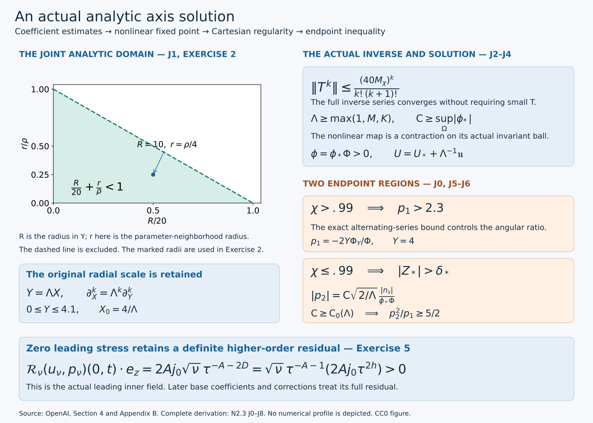

# Constructing the analytic axis profile

**NS-BLOWUP N2.3.** The outer construction fixes an analytic pressure value at the axis. We now use that actual datum to solve the nonlinear inner equations. The solution is analytic in its scalar profile variables, gives a smooth Cartesian velocity field, has exactly zero leading tangential stress, and satisfies the strict endpoint inequality needed for its continuation.

The difficulty is concrete. The equations contain parameter derivatives as well as radial derivatives, and the radial inverse degenerates at the axis. A derivative in the parameter cannot simply be treated as a bounded operation in the coefficient norm. We prove the full mixed estimate after radial integration, construct the inverse of the leading angular operator, and then prove convergence of the actual nonlinear iteration.

The complete [outer-profile lesson](constructing-the-outer-profile-and-heat-exterior.md), O0–H7, supplies the prescribed pressure and exterior. The [stress and moment lesson](from-velocity-profiles-to-stress-and-moments.md), P0–P6, supplies the original-coordinate equations, physical residual and exact comparison maps. Both are included in this reader. Here all original factors, including \(\Lambda\), \(\mathsf C\), the weights \(20^{-\alpha}\rho^{-\beta}\), viscosity and the pressure datum, remain explicit.

The source is OpenAI, *Finite Time Blowup for Navier–Stokes*, [original paper](https://cdn.openai.com/pdf/32d9f210-8b73-45e0-91bc-82a30aef8a9a/navier-stokes.pdf), pages 26–27 and 144–150: equations (4.7)–(4.13), (B.1)–(B.21), Lemma B.1 and Propositions B.2–B.3. The source version and mathematical locators are recorded in [SOURCES.json](../SOURCES.json). This is a separate derivation and teaching text, not a diplomatic transcription.

*Figure. The domain \(R/20+r/\rho<1\) is the exact convergence domain used for the joint coefficient bound. Its coordinates are ratios of the original radii; neither original radius is removed from the proof. The two endpoint alternatives use the original \(\chi\), \(Z_*\), \(p_1\) and \(p_2\). The last panel records the actual positive axial residual of the leading field, with its full viscosity factor, proved in Exercise 5. It is not a residual of the final corrected field.*

## Why the proof has this order

First choose the axis data using the pressure already supplied by the outer field. Their two complementary parameter regions will later give the endpoint inequality. Then construct a coefficient space that represents actual analytic functions and prove its multiplication and integrated derivative estimates. These estimates control every term of the original nonlinear equations.

The leading angular operator need not be small. Its repeated inverse integrations increase the radial degree, producing factorial denominators. That supplies a bounded inverse without an unsupported smallness assumption. Only the remaining nonlinear map carries \(1/\Lambda\). We choose \(\Lambda\) large enough to make that map contractive, and then choose \(\mathsf C\) large enough to control the original amplitude on a complex neighborhood. The resulting bounds hold for every subsequent admissible amplitude.

Finally, positivity permits division by the actual angular profile. We recover the smooth Cartesian field, prove the source lower bound, and check both endpoint regions. Zero leading stress retains the axial-viscosity and radial parts of the full residual; Exercise 5 computes one such term exactly.

## J0. Actual axis data and their parameter domains

The pressure datum is already fixed. We choose the remaining axis data so that either the angular contribution or the axial contribution can give a strict endpoint margin. The location where \(H_*\) vanishes is central to that division of the parameter interval.

Keep the original fixed choices \(0<h<1/100\), \(A=1/2+h\), \(D=1/2-h\), \(d=1-\eta^2\), \(L=1-2h\eta^2\). The analytic pressure \(\Pi_0\) constructed in O4 is even, obeys \(\Pi_0\le-(5/2)P_*^2(1+\eta^2)^{-2}\), and has \(\eta\Pi_{0\eta}>0\) for nonzero real \(\eta\in[-1,1]\). Choose \(0<j_0\le1/20\) and set exactly
\[
\begin{aligned}
U_*&=4\eta+j_0,& H_*&=D\eta+dU_*,\\
W_*&=1-dU_{*\eta}-2D\eta U_*,\\
Z_*&=-A(1-2\eta U_*)U_*-H_*U_{*\eta}-d\Pi_{0\eta}+4A\eta\Pi_0.
\end{aligned}
\tag{J0.1}
\]
On \((-1,1)\), \(H_*/d=D\eta/d+4\eta+j_0\) has derivative \(D(1+\eta^2)/d^2+4>0\) and ranges from minus infinity to plus infinity. Its unique zero \(\eta_0\) lies in \((-1,0)\). Writing \(x=-\eta_0\), its equation is
\[
j_0=x\left(4+\frac D{1-x^2}\right),\qquad
\frac{j_0}{5}<x<\frac{j_0}{4},\qquad
-W_*=3-8h\eta^2+(1-2h)j_0\eta\ge2.87>2.8.
\tag{J0.2}
\]
For the bounds on x, the equation first gives \(x<j_0/4\le1/80\); its parenthesis is then less than 5 and greater than 4. At \(\eta_0\), \(H_*=0\), \(-d\Pi_{0\eta}\ge0\), and \(U_*=Dx/d\). The first term of \(Z_*\) has absolute value at most \(j_0\): use \(x<1/80\), \(D\le1/2\), \(A\le.51\), and the displayed formula for \(U_*\). The last term satisfies
\[
4A\eta_0\Pi_0(\eta_0)
\ge10A xP_*^2(1+x^2)^{-2}
>\tfrac9{10}j_0P_*^2.
\tag{J0.3}
\]
The original choice \(P_*>e^{T_d}>10\) therefore gives \(Z_*(\eta_0)>\tfrac12j_0P_*^2>0\). This proves the required positivity from the actual datum.

Choose a neighborhood of \(\eta_0\) on which \(Z_*\) has a positive lower bound. A positive \(\delta_*\) smaller than that bound makes the compact set \(\{|Z_*|\le\delta_*\}\) avoid that neighborhood. On this set \(|H_*|\) has a positive minimum. Choose \(\sigma_*>0\) small enough that
\[
\chi=\frac{H_*^2}{H_*^2+\sigma_*^2}>.99
\quad\hbox{where }|Z_*|\le\delta_*.
\tag{J0.4}
\]
If the set is empty any sufficiently small positive \(\sigma_*\) works. The strict inequalities persist on a slightly larger real compact interval \(I\supset[-1,1]\), chosen so \(H_*\) has no additional zero there. Choose a bounded simply connected complex neighborhood \(\Omega\) of I, symmetric about the real axis, with closure in a domain where \(\Pi_0\) is holomorphic and L and \(H_*^2+\sigma_*^2\) do not vanish. Compactness supplies such a neighborhood.

For \(\Lambda\ge1\) retain the original functions and amplitude order:
\[
\zeta_*=-\frac{LH_*}{H_*^2+\sigma_*^2},\qquad
\widetilde\zeta_0=\Lambda\zeta_*,\qquad
\phi_*(\eta)=\exp\!\left(\Lambda\int_0^\eta\zeta_*(w)dw\right).
\tag{J0.5}
\]
The holomorphic primitive exists on \(\Omega\); it is real on I, so \(\phi_*>0\) there. The amplitude \(\mathsf C\) will be chosen after \(\Lambda\). None of these choices alters the outer pressure datum.

## J1. The original coefficient space and exact radial maps

The norm controls every coefficient and every parameter derivative at once. We must prove both completeness and convergence to actual functions. The variable \(Y=\Lambda X\) records a change of radial coordinate; the original \(X\) and its derivative factors are recovered explicitly.

Use the scalar radial variable \(Y=\Lambda X\). For a small fixed \(\rho>0\), retain the weights and norm
\[
\begin{gathered}
\mathfrak a_{\alpha\beta}
=\frac{20^{-\alpha}\rho^{-\beta}\beta!\binom{\alpha+\beta}{\beta}}
{(\alpha+1)^2(\beta+1)^2},\\
\|F\|_\rho=\sup_{\alpha,\beta\ge0}\sup_{\eta\in I}
\frac{|\partial_\eta^\beta F_\alpha(\eta)|}{\mathfrak a_{\alpha\beta}},
\qquad F=\sum_{\alpha\ge0}F_\alpha(\eta)Y^\alpha.
\end{gathered}
\tag{J1.1}
\]
The space \(\mathcal B_\rho\) consists of smooth coefficient sequences with finite norm. It is complete. Indeed a norm-Cauchy sequence converges uniformly at each coefficient and each derivative order; the fundamental theorem of calculus identifies the successive derivative limits. Passing to the limit in every weighted inequality gives a limit in the space and norm convergence.

This coefficient space represents actual analytic functions, not just formal series. At a real center \(\eta_0\), divide the derivative estimate by \(\beta!\) and sum the joint Taylor series. For \(|Y|\le R<20\) and \(|\eta-\eta_0|\le r\) with \(R/20+r/\rho<1\), its absolute sum is bounded by
\[
\|F\|_\rho\sum_{\alpha,\beta\ge0}
\binom{\alpha+\beta}{\beta}(R/20)^\alpha(r/\rho)^\beta
=\frac{\|F\|_\rho}{1-R/20-r/\rho}.
\tag{J1.2}
\]
The identity follows by expanding \(\sum_{n\ge0}(R/20+r/\rho)^n\). Taylor's remainder estimate proves equality with the original smooth coefficients on the real interval. Local extensions agree on overlaps and supply a common holomorphic neighborhood, including the endpoints of I. The denominator factors in J1.1 have been retained in the norm; discarding them only in this upper bound does not change the represented function.

Write \(\mathcal I F=\int_0^YF(Y',\eta)dY'\), \(\mathcal A F=Y^{-1}\mathcal I F\), and \(\mathcal D_X=Y\partial_Y=X\partial_X\). The identity \(\mathcal A_X(F)=\int_0^1F(\Lambda aX,\eta)da=\mathcal A(F)(Y,\eta)\) proves the exact radial-average comparison. In the next radial inverse, \(\nu\in\{1,2\}\) is an integration index; the physical viscosity is restored separately in J7. For \(\nu=1,2\), the unique smooth solution of \(YG_{YY}+\nu G_Y=F\), \(G(0)=0\), is \(G=\mathcal J_\nu F\), with
\[
(\mathcal J_\nu F)_{\alpha+1}=\frac{F_\alpha}{(\alpha+1)(\alpha+\nu)},\qquad
(\mathcal J_\nu F)_0=0.
\tag{J1.3}
\]
One can integrate \((Y^\nu G_Y)'=Y^{\nu-1}F\); smoothness removes the singular homogeneous derivative and the zero value removes the constant. Expanding that integral gives every divisor in J1.3.

## J2. Multiplication and the mixed derivative estimate

The squared denominators in the coefficient weights make the two convolutions summable. The binomial factor connects radial degree to parameter derivatives. We calculate the weight ratios before using any nonlinear estimate, including the case where a parameter derivative and a radial derivative act on different factors.

Keep the exact finite constant \(C_{\rm sq}=8\sum_{i=1}^\infty i^{-2}\). Splitting a sum at \(N/2\) gives
\[
\sum_{i=0}^N\frac{(N+1)^2}{(i+1)^2(N-i+1)^2}\le C_{\rm sq}.
\tag{J2.1}
\]
On the first half the ratio \((N+1)^2/(N-i+1)^2\) is at most 4; reverse the indices on the other half. The product Leibniz factor \(\binom\beta k\) cancels the two derivative factorials against \(\beta!\). The remaining binomial ratio is at most one because
\[
\binom{i+k}{k}\binom{\alpha-i+\beta-k}{\beta-k}
\le\binom{\alpha+\beta}{\beta}.
\tag{J2.2}
\]
The left side counts the subsets with exactly k elements in the first of two disjoint blocks of sizes \(i+k\) and \(\alpha-i+\beta-k\). Summing the resulting weight ratio in the radial and derivative indices and applying J2.1 proves
\[
\|FG\|_\rho\le C_{\rm sq}^2\|F\|_\rho\|G\|_\rho.
\tag{J2.3}
\]

The exact ratios for increasing a radial degree are
\[
\frac{\mathfrak a_{\alpha\beta}}{\mathfrak a_{\alpha+1,\beta}}
=20\frac{(\alpha+2)^2}{(\alpha+1)^2}\frac{\alpha+1}{\alpha+\beta+1}\le80,
\quad
\frac{\mathfrak a_{i,k+1}}{\mathfrak a_{i+1,k}}
=\frac{20}{\rho}(i+1)\frac{(i+2)^2(k+1)^2}{(i+1)^2(k+2)^2}
\le\frac{80}{\rho}(i+1).
\tag{J2.4}
\]
Together with J1.3, these bound multiplication by Y, \(\mathcal I\) and \(\mathcal J_\nu\). The average divides the radial degree \(\alpha\) coefficient by \(\alpha+1\), so its norm is at most one. The second ratio, with the integration divisor \(i+1\), proves \(\|\partial_\eta\mathcal I F\|_\rho\le(80/\rho)\|F\|_\rho\).

For the differentiated product inside \(\mathcal J_\nu\), let the output radial degree be \(N=\alpha+1\), and let the differentiated F have degree i and G degree \(\alpha-i\). Allocate the added radial degree to F, writing \(I_1=i+1\), \(J_1=\alpha-i\). J2.4, the full Leibniz rule, and J2.2 bound its \(\beta\)-derivative divided by \(\mathfrak a_{N\beta}\) by
\[
\frac{80}{\rho}\|F\|_\rho\|G\|_\rho
\sum_{i=0}^{\alpha}\sum_{k=0}^{\beta}
\frac{I_1J_1}{N(\alpha+\nu)}
\frac{(N+1)^2}{(I_1+1)^2(J_1+1)^2}
\frac{(\beta+1)^2}{(k+1)^2(\beta-k+1)^2}.
\tag{J2.5}
\]
Here the numerator \(J_1\) is the logarithmic radial derivative and \(I_1\) is the parameter-derivative weight from J2.4. Since \(I_1+J_1=N\) and \(\nu\ge1\), the first fraction is at most one. Extending the first sum to all splittings of N and applying J2.1 twice proves
\[
\|\mathcal J_\nu[(\partial_\eta F)(\mathcal D_XG)]\|_\rho
\le\frac{80}{\rho}C_{\rm sq}^2\|F\|_\rho\|G\|_\rho.
\tag{J2.6}
\]
With an average on F its divisor \(i+1\) cancels \(I_1\). Omitting the radial derivative replaces \(J_1\) by 1, again leaving a fraction at most one. Without the parameter derivative use the first ratio of J2.4 and the radial coefficient at most \(\alpha\), divided by \((\alpha+1)(\alpha+\nu)\); J2.1 again applies. Omitting both derivatives follows directly from J2.3 and boundedness of \(\mathcal J_\nu\). Additional undifferentiated factors leave their radial indices unaltered. The same allocation of one degree to the parameter-differentiated factor and the same inverse divisor bound apply, while each additional convolution contributes \(C_{\rm sq}^2\). These arguments include zero indices and every \(\beta\). They prove the full Lemma B.1 needed below.

## J3. Original nonlinear equations and every remainder

We substitute into the actual equations and display every remainder. The pressure is recovered by its original integral, so it contributes a known nonlinear function of the two unknown profiles. Complex control of the amplitude is what keeps all parameter derivatives bounded as the large parameters vary.

The original angular and axial equations for zero leading stress, and radial pressure balance, are
\[
-2L\frac{X\phi_{XX}+2\phi_X}{\phi}=S_q,\qquad
-2L(XU_{XX}+U_X)=S_n,\qquad \Pi_X=\phi^2/\mathsf C^2.
\tag{J3.1}
\]
Their complete source formulas are P1.1. Make the exact substitutions, retaining the amplitude and radial factors,
\[
\phi=\phi_*\Phi(Y,\eta),\quad U=U_*+\Lambda^{-1}\mathfrak u(Y,\eta),\quad
\Pi=\Pi_0+\Lambda^{-1}\mathfrak p,\quad
g=\phi_*/\mathsf C,\quad\mathfrak p=\mathcal I(g^2\Phi^2).
\tag{J3.2}
\]
The intended axis values are \(\Phi(0,\eta)=1\), \(\mathfrak u(0,\eta)=0\). In particular \(\Pi_X=\partial_Y\mathfrak p=g^2\Phi^2=\phi^2/\mathsf C^2\). Define
\[
B=-2D\eta\mathcal A(\mathfrak u)-d\partial_\eta\mathcal A(\mathfrak u),\quad
W=W_*+\Lambda^{-1}B,\quad H_c=H_*+d\Lambda^{-1}\mathfrak u.
\tag{J3.3}
\]
Direct substitution into J3.1 gives
\[
\begin{aligned}
2(Y\Phi_{YY}+2\Phi_Y)&=-\chi\Phi+\Lambda^{-1}R_1,\\
2(Y\mathfrak u_{YY}+\mathfrak u_Y)&=-Z_*/L+\Lambda^{-1}R_2.
\end{aligned}
\tag{J3.4}
\]
with all terms
\[
\begin{split}
LR_1={}&[W+h(1-2\eta U)+d\mathfrak u\zeta_*]\Phi
+W\mathcal D_X\Phi+H_c\Phi_\eta,\\
LR_2={}&[A(1-4\eta U_*)+dU_{*\eta}]\mathfrak u
-2A\eta\Lambda^{-1}\mathfrak u^2+W\mathcal D_X\mathfrak u
+H_*\mathfrak u_\eta+d\Lambda^{-1}\mathfrak u\mathfrak u_\eta\\
&-4A\eta\mathfrak p+d\partial_\eta\mathfrak p-2\eta\mathcal D_X\mathfrak p.
\end{split}
\tag{J3.5}
\]
The terms contain the products \(A\eta\), not a derivative \(A_\eta\); the original page 147 has those products. To check the angular leading sign, \(H_*\zeta_*/L=-\chi\), while \(H_c\Lambda\zeta_*=-\Lambda L\chi+d\mathfrak u\zeta_*\). For the axial equation, expand its negative source before dividing by L:
\[
A(1-2\eta U)U+W\mathcal D_XU+H_cU_\eta-4A\eta\Pi+d\Pi_\eta-2\eta\mathcal D_X\Pi.
\tag{J3.6}
\]
Its constant part is \(-Z_*\). Expanding the first term about \(U_*\) gives exactly \(\Lambda^{-1}A(1-4\eta U_*)\mathfrak u-2A\eta\Lambda^{-2}\mathfrak u^2\); expanding \(H_cU_\eta\) gives the two linear terms and the mixed quadratic term in J3.5. Pressure contributes the last three displayed terms after multiplication by \(\Lambda\). This verifies the full substitution, rather than replacing the original equations by a different model.

Choose \(\rho\) strictly below a common complex-neighborhood distance from I to the boundary of \(\Omega\). For each \(\Lambda\), impose
\[
\mathsf C\ge\sup_{\eta\in\Omega}|\phi_*(\eta)|.
\tag{J3.7}
\]
The supremum is finite by the choice of closure. Then \(|g|\le1\) on \(\Omega\). Cauchy's estimate gives \(|\partial_\eta^\beta g|\le\beta!r_0^{-\beta}\) on a smaller neighborhood for some fixed \(r_0>\rho\). At radial degree zero its norm ratio is bounded by \((\beta+1)^2(\rho/r_0)^\beta\), uniformly in \(\beta,\Lambda,\mathsf C\). All fixed coefficients in J3.5 have finite norms by the same estimate. This complex bound is essential: real bounds on \(\phi_*\) alone would not control its large-parameter derivatives.

The maps \((\Phi,\mathfrak u)\mapsto\mathcal J_\nu R_i\) are consequently bounded and locally Lipschitz on any fixed ball in \(\mathcal B_\rho^2\), uniformly for \(\Lambda\ge1\) and amplitudes satisfying J3.7. Here is the full derivative check. In \(W\mathcal D_X\Phi\) and \(W\mathcal D_X\mathfrak u\), the only double differentiated products are \((\partial_\eta\mathcal A\mathfrak u)\mathcal D_X\Phi\) and \((\partial_\eta\mathcal A\mathfrak u)\mathcal D_X\mathfrak u\); J2.6 handles them. The factors B without a radial derivative use its omitted-derivative case. The terms \(H_c\Phi_\eta\), \(H_*\mathfrak u_\eta\) and \(\mathfrak u\mathfrak u_\eta\) use the same case, with extra undifferentiated factors. Finally \(\partial_\eta\mathfrak p=\partial_\eta\mathcal I(g^2\Phi^2)\) is bounded by J2.4, and \(\mathcal D_X\mathfrak p=Yg^2\Phi^2\) is bounded by multiplication and the Y operator. All other factors use J2.3. For Lipschitz bounds, subtract each monomial as a sum with one differing factor; the same estimates apply to each term. No unbounded parameter derivative is treated as a bounded operator by itself.

## J4. Actual inverse, contraction and analytic solution

The operator inverse is built first, using its full sequence of powers. We then iterate one explicit nonlinear map in the complete coefficient space. Its fixed point is an actual analytic solution, and positivity is proved before dividing by the angular profile.

Let \(M_\chi\) bound multiplication by \(\chi\) in \(\mathcal B_\rho\), and let \(T=\mathcal J_2\chi/2\), with multiplication first. If the input has no radial coefficient below degree b, J2.4 gives
\[
\|\mathcal J_2F\|_\rho\le\frac{80}{(b+1)(b+2)}\|F\|_\rho,
\qquad
\|T^k\|\le\frac{(40M_\chi)^k}{k!(k+1)!}.
\tag{J4.1}
\]
Multiplication by \(\chi(\eta)\) preserves the minimum degree and \(\mathcal J_2\) increases it by one, proving the second inequality by iteration. It includes all parameter derivatives through the norm. The series \(\sum_{k\ge0}(-T)^k\) converges in operator norm by its factorial bound. Multiplication of its finite partial sums by \(1+T\) leaves a remainder of norm tending to zero, on either side. Thus it is a two-sided inverse without any assumption that \(\chi\) or \(\|T\|\) is small.

The exact unperturbed solution is
\[
\Phi^0=(1+T)^{-1}1=f_0(Y\chi),\qquad
\mathfrak u^0=-\frac{YZ_*}{2L},\qquad
f_0(z)=\sum_{\alpha\ge0}\frac{(-z/2)^\alpha}{\alpha!(\alpha+1)!}.
\tag{J4.2}
\]
Indeed the series converges everywhere and its coefficients solve \(2(zf_0''+2f_0')=-f_0\), \(f_0(0)=1\); J1.3 then gives the first identity. The axial identity follows since \(\mathcal J_1\) applied to a constant equals that constant times Y.

Use the actual map
\[
(\Phi,\mathfrak u)\longmapsto
\left(\Phi^0+\frac{(1+T)^{-1}\mathcal J_2R_1}{2\Lambda},\quad
\mathfrak u^0+\frac{\mathcal J_1R_2}{2\Lambda}\right).
\tag{J4.3}
\]
On the closed ball of radius 1 about the center, in the maximum of the two coefficient norms, J3 supplies finite uniform bounds M and K for the numerator map and its Lipschitz constant, including \((1+T)^{-1}\). Choose \(\Lambda\ge\max(1,M,K)\), increasing it if needed. The map stays within radius \(1/2\) of the center and has Lipschitz constant at most \(1/2\). Iteration from the center is Cauchy, its limit lies in the ball by completeness, and continuity proves that it is a fixed point. The same bound proves uniqueness in the ball. It has distance at most \(M/(2\Lambda)\) from the center. All output corrections vanish at Y zero, so the intended axis values hold exactly. Choose \(\mathsf C_0(\Lambda)\) after \(\Lambda\) to include J3.7. The estimates hold for every subsequent \(\mathsf C\ge\mathsf C_0(\Lambda)\).

Choose any fixed \(4.1<R<20\) in J1.2 and then a smaller common complex neighborhood. Cauchy estimates for the actual difference from the center give, for every fixed r and s,
\[
\sup_{[0,4.1]\times I}
\left|\partial_Y^r\partial_\eta^s
\left(\Phi-f_0(Y\chi),\ \mathfrak u+\frac{YZ_*}{2L}\right)\right|
\le\frac{K_{r,s}}\Lambda.
\tag{J4.4}
\]
The constants and neighborhood are independent of sufficiently large \(\Lambda\) and of subsequent \(\mathsf C\). The original derivatives satisfy \(\partial_X^r=\Lambda^r\partial_Y^r\), so their bound is \(K_{r,s}\Lambda^{r-1}\), with the original scale retained. Reality follows either from the real iteration or from conjugation and uniqueness.

For positivity on the actual real rectangle, put \(t=z/2\) with \(0\le z\le41/10\). The alternating series after its cubic term has decreasing magnitudes and positive first remaining term. Thus
\[
f_0(z)\ge1-\frac t2+\frac{t^2}{12}-\frac{t^3}{144}
\ge\frac{305719}{1152000}>.265,
\qquad f_0(z)\le1.
\tag{J4.5}
\]
The cubic derivative is \(-[(t-4)^2+8]/48<0\), so its minimum for \(0\le t\le41/20\) is the displayed exact endpoint value. For the upper bound group the alternating series after its constant term into negative-positive pairs; magnitudes decrease from the linear term onward because their successive ratio is \(t/[(\alpha+1)(\alpha+2)]\le(41/20)/6<1\) for \(\alpha\ge1\). Since \(0\le\chi\le1\) on I, J4.4 and J4.5 give \(\Phi\ge c_0>0\) on the full real rectangle after increasing \(\Lambda\). Consequently \(\phi=\phi_*\Phi>0\), and division by \(\phi\) in the original J3.1 is valid. This proves the nonlinear equations themselves, not just their multiplied version.

The analytic scalar profiles give a smooth Cartesian axis field by P0.4–P0.7. Explicitly retain \(F=\phi/\mathsf C\), \(E=\sqrt{2X}F\), and the actual radial average in \(V_0=Xv_0\). Then
\[
\begin{gathered}
u_1=\frac{v_0x_1}{2q}-q^{-A-1/2}Fx_2,\qquad
u_2=\frac{v_0x_2}{2q}+q^{-A-1/2}Fx_1,\\
u_3=q^{-A}U,\qquad p=q^{-2A}\Pi.
\end{gathered}
\tag{J4.6}
\]
Here X is \((x_1^2+x_2^2)/(2q)\) and q is positive and smooth for \(t<1\). Every scalar coefficient is smooth in X, so these products extend smoothly across the axis. P1.3 and P1.7 identify their zero leading stress, including the zero axis integration constants. This completes Proposition B.2 on its stated interval.

## J5. Positive angular source and the actual stress coefficients

The construction must control the source even where \(\chi=0\). We use a bound involving \(\sqrt\chi\) and Young’s inequality without dividing by \(\chi\). The original radial primitive then transfers that source bound to the actual stress coefficients.

The source inequalities in this section and J6 use the original real parameter interval \([-1,1]\); the larger I remains available for analytic neighborhoods and derivative bounds.

The identity
\[
|H_*\chi'|=\left|\frac{2H_*^2H_*'\sigma_*^2}{(H_*^2+\sigma_*^2)^2}\right|
\le2\|H_*'\|_\infty\chi
\tag{J5.1}
\]
and the positivity of \(f_0\) show that \(\mathcal D_X\log f_0(Y\chi)=O(\chi)\) and \(H_*\partial_\eta\log f_0(Y\chi)=O(\chi)\). J4.4, with the positive lower bounds, therefore gives
\[
|\mathcal D_X\log\Phi|+|H_*\partial_\eta\log\Phi|
\le K\chi+K/\Lambda.
\tag{J5.2}
\]
The original logarithmic derivative contains \(\Lambda\zeta_*\), so
\[
-H_c\Lambda\zeta_*
=\Lambda L\chi-d\mathfrak u\zeta_*,\qquad
|\zeta_*|\le\frac{L}{\sigma_*}\sqrt\chi.
\tag{J5.3}
\]
Also \(H_c-H_*=O(\Lambda^{-1})\), and the unweighted derivative \(\Phi_\eta/\Phi\) is uniformly bounded. The complete source \(S_q=-W(1+\mathcal D_X\log\Phi)-h(1-2\eta U)-H_c(\log\phi)_\eta\), J5.2–J5.3 and \(W-W_*=O(\Lambda^{-1})\) imply
\[
S_q\ge\Lambda L\chi-W_*-10h-K\chi-K_{\sigma_*}\sqrt\chi-K/\Lambda.
\tag{J5.4}
\]
Here \(|U|\le4.1\) follows from J4.4 for large \(\Lambda\), and hence \(|h(1-2\eta U)|\le10h\). First increase \(\Lambda\) so \(K\chi\le.025\Lambda L\chi\); then Young's inequality gives \(K_{\sigma_*}\sqrt\chi\le.025\Lambda L\chi+K'_{\sigma_*}/\Lambda\). Since \(-W_*>2.8\), \(10h\le.1\), increase \(\Lambda\) once more so the remaining constant error is at most .2. This proves the original full bound
\[
S_q\ge2.5+.95\Lambda L\chi.
\tag{J5.5}
\]
No division by \(\chi\) has occurred, so the proof includes its zero at \(\eta_0\).

The actual axis-regular integral P1.3 reads
\[
Q_s(X,\eta)=\frac{\int_0^X X'\Phi(\Lambda X',\eta)S_q(X',\eta)dX'}{X^2\Phi(\Lambda X,\eta)}.
\tag{J5.6}
\]
Its smooth extension is obtained by setting \(X'=aX\). A uniform lower bound \(c_0\) and upper bound \(C_\Phi\) for \(\Phi\), and J5.5, give \(Q_s\ge(5/4)c_0/C_\Phi\). Retain the original coefficients
\[
p_1=\frac{XQ_s}L=a=-\frac{2Y\Phi_Y}{\Phi},\quad
n_s=\frac{N_s}L=-2U_X=-2\mathfrak u_Y=\frac{Z_*}L+O(\Lambda^{-1}),\quad
p_2=\frac{Xn_s}E.
\tag{J5.7}
\]
The equalities with a and \(-2U_X\) follow from the actual zero-stress solution and its axis constants, as proved in P1.7. Thus, for \(0<X\le4.1/\Lambda\),
\[
p_1/X\ge c_1>0,\qquad 0<p_1\le C_1.
\tag{J5.8}
\]
The upper bound follows from J4.4 and the positive \(\Phi\) lower bound. Each fixed parameter derivative of \(\Phi,\log\Phi,\mathfrak u,p_1,n_s\) is bounded uniformly in subsequent \(\mathsf C\). For \(\log\Phi\), the uniform derivative bound and positivity give a smaller common complex neighborhood without zeros, on which its logarithm is chosen from the positive real values. The explicit formulas and Cauchy estimates then give all these bounds. Original radial derivatives retain their powers of \(\Lambda\).

## J6. The strict endpoint inequality, in both parameter regions

The endpoint proof covers every parameter value. On \(\chi>.99\), the angular ratio gives the margin. On \(\chi\le.99\), the chosen axis data force \(Z_*\) away from zero and the original amplitude makes the axial ratio large. We prove the two bounds with compatible parameter choices.

At \(X_0=4/\Lambda\), \(Y=4\). First suppose \(\chi>.99\). Put \(z=4\chi\), \(t=z/2\), so \(1.98<t\le2\). The exact series is \(f_0(z)+zf_0'(z)=\sum_{\alpha\ge0}(-t)^\alpha/(\alpha!)^2\). The alternating remainder after its fourth term is negative, with decreasing magnitudes, hence
\[
f_0(z)+zf_0'(z)
\le1-t+t^2/4-t^3/36+t^4/576<-.18.
\tag{J6.1}
\]
The polynomial derivative is \(-1+t/2-t^2/12+t^3/144\). On \([1.98,2]\) its first pair is nonpositive and the other terms equal \(-t^2(1/12-t/144)<0\). Thus its maximum is at \(t=99/50\), where its exact value is \(-75535511/400000000<-.188\). Using \(0<f_0\le1\),
\[
-\frac{2zf_0'(z)}{f_0(z)}
=2-2\frac{f_0(z)+zf_0'(z)}{f_0(z)}>2.36.
\tag{J6.2}
\]
The actual ratio in J5.7 differs by \(O(\Lambda^{-1})\), uniformly on this region. Choose the error below .06. Then \(p_1>2.3\) at \(X_0\).

On the complementary region \(\chi\le.99\), the actual choice J0.4 gives \(|Z_*|>\delta_*\). Since \(L\le1\), J5.7 gives \(|n_s|\ge\delta_*/2\) after increasing \(\Lambda\). At the same original radius,
\[
|p_2|=\mathsf C\sqrt{2/\Lambda}\,\frac{|n_s|}{\phi_*\Phi}.
\tag{J6.3}
\]
This retains \(E=\sqrt{2X}\phi_*\Phi/\mathsf C\) and every factor of two. For the now-fixed \(\Lambda\), let \(M_\Lambda=(\max_I\phi_*)C_\Phi\), a finite bound independent of subsequent \(\mathsf C\). Enlarge its threshold to include \(\mathsf C_0(\Lambda)\ge\sqrt{5\Lambda C_1}\,M_\Lambda/\delta_*\). J5.8 and J6.3 then give
\[
\frac{p_2^2}{p_1}\ge
\frac{\mathsf C^2\delta_*^2}{2\Lambda M_\Lambda^2 C_1}\ge\frac52>2.3.
\tag{J6.4}
\]
There is no circular amplitude bound: \(C_\Phi,C_1\) came from estimates uniform for every amplitude already meeting J3.7. Taking the maximum of that threshold and the displayed one preserves all prior bounds. On the first parameter region \(p_1>2.3\); on the second \(p_2^2/p_1>2.3\), with \(p_1>0\). Both prove, for the actual analytic inner profile,
\[
p_1+\frac{p_2^2}{p_1}>2+c_{\rm ex}\quad\hbox{at }X_0=4/\Lambda,
\qquad c_{\rm ex}=.2.
\tag{J6.5}
\]
Together with J5, this proves Proposition B.3, including its parameter order and all fixed parameter-derivative assertions.

## J7. What the actual axis solution supplies

The constructed profile has the original prescribed pressure at the axis, positive \(\phi\), all analytic scalar profiles, a smooth Cartesian field, exactly zero leading stress, positive \(S_q\), and the strict endpoint inequality. The maps J3.2 and J4.6 retain the original X and physical fields; \(\partial_X=\Lambda\partial_Y\) retains their derivative scales. For original viscosity \(\nu>0\), use the exact map in P1 and H7.1–H7.2: \(u_\nu=\sqrt\nu u(x_\nu/\sqrt\nu,t)\), \(p_\nu=\nu p(x_\nu/\sqrt\nu,t)\), \(T_\nu=\nu T(x_\nu/\sqrt\nu,t)=0\), with \(X_\nu=r_\nu^2/(2\nu q_\nu)\). The full momentum residual retains the axial-viscosity and radial remainder terms in P1.5–P1.6; zero leading stress does not set those terms to zero.

## J8. Five worked exercises

### Exercise 1. Recover the actual radial inverse kernels

Derive integral formulas for both operators \(\mathcal J_1,\mathcal J_2\), including their axis values and original radial scale.

**Solution.** For \(YG_{YY}+\nu G_Y=F\), multiply by \(Y^{\nu-1}\). The left side is \((Y^\nu G_Y)'\). Smoothness at zero sets the lower integration constant to zero, and \(G(0)=0\) sets the remaining constant. Hence
\[
G(Y)=\int_0^Ys^{-\nu}\left(\int_0^st^{\nu-1}F(t)\,dt\right)ds.
\tag{J8.1}
\]
For \(Y>0\), the inner integral is \(O(s^\nu)\), so the integrand is bounded at zero. Set \(s=Yb\), \(t=Ya\) and change the order on \(0\le a\le b\le1\). This gives
\[
\begin{split}
\mathcal J_1F(Y)&=Y\int_0^1(-\log a)F(aY)\,da,\\
\mathcal J_2F(Y)&=Y\int_0^1(1-a)F(aY)\,da.
\end{split}\tag{J8.2}
\]
The weights are integrable and nonnegative. Differentiation under these fixed integrals proves smoothness and
\((\mathcal J_\nu F)(0)=0\), \((\mathcal J_\nu F)'(0)=F(0)/\nu\).
Integrating \(a^\alpha\) against the two weights gives exactly
\(1/(\alpha+1)^2\) and \(1/[(\alpha+1)(\alpha+2)]\), recovering J1.3 without discarding either divisor.

For the original \(X\)-equation with right side \(F(\Lambda X,\eta)\), put
\[
G_X(X,\eta)=\Lambda^{-1}(\mathcal J_\nu F)(\Lambda X,\eta).
\]
Then \(X\partial_X^2G_X+\nu\partial_XG_X=F(\Lambda X,\eta)\), and \(G_X(0,\eta)=0\). The derivative is \(\partial_XG_X=(\mathcal J_\nu F)_Y\), while the second derivative is \(\Lambda(\mathcal J_\nu F)_{YY}\). These identities prove the complete radial scaling of the inverse.

### Exercise 2. Give explicit derivative bounds on a common complex domain

Starting from the coefficient-norm bound in J4, give a concrete family of bounds for all fixed derivatives of the actual difference from the comparison pair. Then retain the original radial factors in the axial profile U.

**Solution.** Write the two-component difference as
\(\Delta=(\Phi-\Phi^0,\mathfrak u-\mathfrak u^0)\).
J4.3 gives \(\|\Delta\|_\rho\le M/(2\Lambda)\), using the maximum norm on the pair. J1.2 implies that \(|\Delta|\le4\|\Delta\|_\rho\) on every joint disk with \(|Y|\le10\) and \(|\eta-\eta_c|\le\rho/4\), where \(\eta_c\in I\). The original radius condition is \(10/20+(\rho/4)/\rho=3/4<1\).

For every real \(Y_c\in[0,4.1]\), the disk \(|Y-Y_c|\le5\) lies in \(|Y|<10\). Cauchy’s formula on the two circles therefore yields
\[
|\partial_Y^r\partial_\eta^s\Delta(Y_c,\eta_c)|
\le\frac{2M\,r!\,s!}{\Lambda\,5^r}
\left(\frac4\rho\right)^s.
\tag{J8.3}
\]
The same domains and constants work for the whole real rectangle and every subsequent \(\mathsf C\) admitted by J3.7. This proves a concrete version of the fixed-order estimates; it does not require a single bound independent of r and s.

The original axial comparison is \(U_* -XZ_*/(2L)\), because
\(\Lambda^{-1}\mathfrak u^0=-XZ_*/(2L)\). Thus the actual original-coordinate estimates are
\[
\begin{split}
\left|\partial_X^r\partial_\eta^s
[\Phi(\Lambda X,\eta)-f_0(\Lambda X\chi)]\right|
&\le\frac{2M\,r!\,s!}{5^r}\left(\frac4\rho\right)^s\Lambda^{r-1},\\
\left|\partial_X^r\partial_\eta^s
\left[U-U_*+\frac{XZ_*}{2L}\right]\right|
&\le\frac{2M\,r!\,s!}{5^r}\left(\frac4\rho\right)^s\Lambda^{r-2}.
\end{split}\tag{J8.4}
\]
Every bound applies on \(0\le X\le4.1/\Lambda\). The extra inverse power in the second line comes from the actual prefactor in U; it is not a change of the original profile.

### Exercise 3. Compute the exact first axis derivatives

Evaluate the angular source, \(\phi_X\), \(U_X\), \(\Pi_X\) and the first stress-coefficient limits at \(X=0\). Determine which expressions depend on \(\Lambda\) and \(\mathsf C\).

**Solution.** At the axis, \(U=U_*\), \(\phi=\phi_*\), \(l=1\), \(W=W_*\), \(H_c=H_*\), and
\((\log\phi)_\eta=\Lambda\zeta_*\). Write
\[
\mathcal S_*(\eta)
=-W_*-h(1-2\eta U_*)+\Lambda L\chi.
\tag{J8.5}
\]
This is exactly \(S_q(0,\eta)\), since \(-H_*\Lambda\zeta_*=\Lambda L\chi\). Evaluation of J3.1 at \(X=0\), with no limiting approximation, gives
\[
\begin{gathered}
\phi_X(0,\eta)=-\frac{\phi_*\mathcal S_*}{4L},\qquad
U_X(0,\eta)=-\frac{Z_*}{2L},\\
\Pi_X(0,\eta)=\frac{\phi_*^2}{\mathsf C^2},\qquad
\Phi_Y(0,\eta)=-\frac{\chi}{4}
+\frac{W_*+h(1-2\eta U_*)}{4\Lambda L}.
\end{gathered}\tag{J8.6}
\]
For the axial identity, \(S_n(0,\eta)=Z_*\): the terms containing \(\mathcal D_XU\) or \(\mathcal D_X\Pi\) vanish, and the remaining source is precisely J0.1. Thus \(\mathfrak u_Y(0,\eta)=-Z_*/(2L)\) exactly, strengthening the approximation at this one radius.

J5.6 gives \(Q_s(0,\eta)=\mathcal S_*/2\), while \(n_s(0,\eta)=Z_*/L\). Consequently
\[
\begin{gathered}
\lim_{X\downarrow0}\frac{p_1}{X}=\frac{\mathcal S_*}{2L},\qquad
\lim_{X\downarrow0}\frac{p_2}{\sqrt X}
=\frac{\mathsf C Z_*}{\sqrt2 L\phi_*}.
\end{gathered}\tag{J8.7}
\]
The second equality retains \(E=\sqrt{2X}\phi/\mathsf C\).
The data \(U_*,Z_*,L,\chi\) precede \(\Lambda\). The derivative \(U_X(0,\eta)\) is therefore independent of both subsequent large parameters. In contrast \(\mathcal S_*\) and \(\phi_*\) retain their \(\Lambda\)-dependence, and \(\Pi_X\) and the second coefficient limit retain their original amplitude factors.

### Exercise 4. Quantify the actual inverse and fixed-point iteration

Give a tail bound for the inverse series even when \(\|T\|\) exceeds one. Also bound the error of the actual nonlinear iterates starting from the comparison pair.

**Solution.** Set \(a=40M_\chi\) and let \(S_N=\sum_{k=0}^N(-T)^k\). From J4.1,
\[
\|(1+T)^{-1}-S_N\|
\le\sum_{k=N+1}^\infty\frac{a^k}{k!(k+1)!}.
\]
If \(a/[(N+2)(N+3)]\le1/2\), each ratio of successive terms in this tail is at most \(1/2\). Hence
\[
\|(1+T)^{-1}-S_N\|
\le\frac{2a^{N+1}}{(N+1)!(N+2)!}.
\tag{J8.8}
\]
For every fixed finite \(a\), such an N exists. This proves the inverse approximation directly from the degree gain, without an assumption \(\|T\|<1\).

Let \(\mathcal F\) denote the full nonlinear map J4.3, \(z_0=(\Phi^0,\mathfrak u^0)\), and \(z_{n+1}=\mathcal F(z_n)\). Its invariant ball has Lipschitz constant at most \(1/2\), and \(\|z_1-z_0\|\le M/(2\Lambda)\). Induction gives
\(\|z_{n+1}-z_n\|\le2^{-n}M/(2\Lambda)\).
Summing all remaining increments proves
\[
\|z-z_n\|\le 2^{-n}\frac M\Lambda.
\tag{J8.9}
\]
The limit z is the actual fixed point because the map is continuous on the complete ball. Both estimates hold in the full coefficient norm, including all weighted parameter derivatives. They are analytic bounds on a construction, not numerical evidence for existence.

### Exercise 5. Does zero leading stress solve the full momentum equation?

Compute the axial component of the full residual at the spatial origin for the actual leading inner field. Retain the original viscosity \(\nu>0\) and identify its exact order relative to the leading equations.

**Solution.** First use viscosity one. On the axis \(r=0\), the actual axial velocity is
\[
u_z(0,z,t)=q(z,t)^{-A}[4\eta(z,t)+j_0],
\qquad q-z^2q^{2h}=\tau=1-t,\quad \eta=z/q^D.
\tag{J8.10}
\]
At \(z=0\), implicit differentiation or P0.2 gives
\[
q=\tau,\quad q_z=0,\quad q_{zz}=2\tau^{1-2D},
\qquad\eta_z=\tau^{-D},\quad\eta_{zz}=0.
\]
The last equality also follows from the fact that q is even in z and \(\eta\) is odd. The source data \(4\eta+j_0\) have zero second derivative in \(\eta\). Applying the product and chain rules, every term but the one containing \(q_{zz}j_0\) vanishes. Thus
\[
\partial_z^2u_z(0,0,t)=-2Aj_0\tau^{-A-2D}.
\tag{J8.11}
\]
The exact physical residual identity P1.5 is
\(\mathcal R_1(u,p)\cdot e_z=-(\partial_r+1/r)T_z-\partial_z^2u_z\).
The constructed stress is identically zero on this inner region. All fields are smooth in Cartesian coordinates, so the identity on \(r>0\) extends to the axis. Therefore
\[
\mathcal R_1(u,p)(0,t)\cdot e_z=2Aj_0\tau^{-A-2D}>0.
\tag{J8.12}
\]
The viscosity map is \(u_\nu(x_\nu,t)=\sqrt\nu\,u(x_\nu/\sqrt\nu,t)\), \(p_\nu=\nu p(x_\nu/\sqrt\nu,t)\). Each term in the full momentum residual then has the factor \(\sqrt\nu\). At the spatial origin the exact original-viscosity identity is
\[
\mathcal R_\nu(u_\nu,p_\nu)(0,t)\cdot e_z
=2Aj_0\sqrt\nu\,\tau^{-A-2D}
=\sqrt\nu\,\tau^{-A-1}(2Aj_0\tau^{2h}).
\tag{J8.13}
\]
Here \(2D=1-2h\). The final equality proves the precise \(q^{2h}\) relative factor at this point; the absolute residual is still nonzero. This is the leading inner field. The subsequent base coefficients and corrections address its full residual before the theorem’s final smooth forcing is obtained.

## The continuation receives an actual solution

The inner profile now exists with the prescribed outer pressure datum. The complete proof gives its analytic domain, Cartesian regularity, positive angular source, zero leading stress and strict endpoint inequality, with all parameter choices in their stated order. The exercises compute exact axis derivatives, quantify the analytic estimates and identify the remaining physical residual.

The next teaching component is the [continuation and exact joining Q0–Q9](../audits/inner-outer-joining-audit.md), including stress activation, the analytic collar, the amplitude-independent transition and all five restored moments. The [shear realization V0–V7](../audits/shear-realization-audit.md) then completes the leading profile, and the [base construction Z0–Z8](../audits/base-field-realization-audit.md) treats the higher-order residual. Their lesson treatments are [joining](joining-the-analytic-axis-to-the-outer-field.md), [shear](realizing-the-admissible-shear.md) and the [actual base field](constructing-the-actual-base-field.md).

The [final theorem lesson](energy-comparison-and-the-final-blowup-conclusions.md), EC0–EC5, uses these constructions to prove Theorem 1.1 and Corollary 10.6.

Authored lesson text and diagram are CC0. Mathematical source: OpenAI, *Finite Time Blowup for Navier–Stokes*, Section 4 and Appendix B. Exposition: GPT-6 Astra (OpenAI). Original sources retain their attribution and rights.