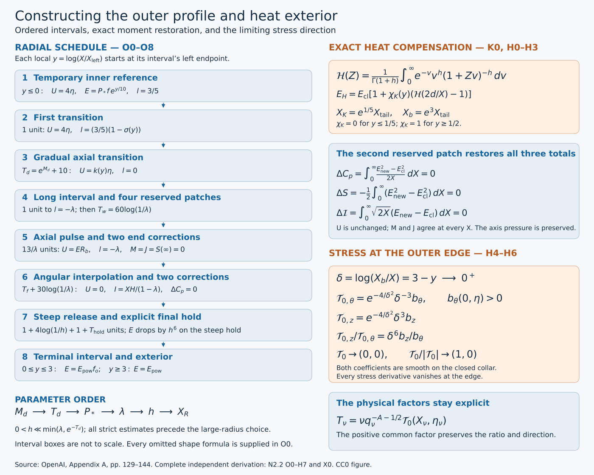

# Constructing the outer profile and its heat exterior

The five moments from [N2.1](from-velocity-profiles-to-stress-and-moments.md) give us a way to change a velocity profile while controlling its stress. We now use that method to construct a profile. We choose every radial interval, solve the moment equations, determine the pressure needed at the axis, and prove the strict stress inequalities. We then replace the distant power law by a heat flow and prove that the stress goes smoothly to zero at the outer edge.

This lesson supplies the outer part of the leading-profile construction: a complete reference family and its heat modification. Its temporary inner reference is explicitly given and has integrable boundary traces, but is not a smooth Cartesian axis field. The analytic axis, its exact join, and the shear realization have separate complete proofs linked at the end. They are the subsequent teaching components of N2. The final assembly appears in the [energy and comparison lesson](energy-comparison-and-the-final-blowup-conclusions.md).

Read N1 for the original coordinates and N2.1 P0–P6 for the full stress, moments, bump-matrix inverse, nonlinear solve and cone criterion. Those proofs are included in this cumulative reader. Here \(q-z^2q^{2h}=1-t\), \(X=r^2/(2q)\), \(\eta=z/q^D\), \(A=1/2+h\), \(D=1/2-h\). We keep every original physical factor. Scalar changes of variable in integrals are always accompanied by their Jacobians and the factors needed to recover the original quantity.

The source is OpenAI, *Finite Time Blowup for Navier–Stokes*, [original paper](https://cdn.openai.com/pdf/32d9f210-8b73-45e0-91bc-82a30aef8a9a/navier-stokes.pdf), pages 129–144, Proposition A.4 through Proposition A.10, equations (A.5)–(A.56). The source version and mathematical locators are in [SOURCES.json](../SOURCES.json). The exposition below is a separate derivation and teaching text; it does not rewrite the diplomatic transcription.

*Figure. The schedule is a diagram of ordered intervals, not a plot of a sampled velocity or a scale drawing. The four reserved patches lie in the long interval before the pulse. The heat change begins at \(X_K=e^{1/5}X_{\rm tail}\); its three changed moments are restored in the second reserved patch. At \(X_b=e^3X_{\rm tail}\), both stress components vanish, while their quotient has the exact sixth-order factor proved in H6. All interval lengths and full formulas appear below.*

## How the construction fits together

The construction has three jobs. First, the inner reference and the gradual axial transition produce a positive angular stress. The long interval then makes the accumulated axial moments small relative to the local moment scales. A pulse and two tiny end corrections set both axial moments and the quadratic stress moment to zero. These are exact equations, not numerical approximations.

Second, after the pulse, the angular profile is made independent of \(\eta\). Two more bumps restore its angular integral without changing the total pressure increment. A steep interval reduces its amplitude enough to offset the small parameter \(h\) in the later estimates. A final holding time is chosen by an explicit formula; it makes the subtracted angular moment exactly zero.

Third, the heat integral supplies an actual exterior solution. Replacing the power law changes three moments. The three-bump nonlinear system restores them, preserves the pressure datum and keeps the stress cone strict. Backward integration then proves compact support of the stress and its direction at the outer edge. The sections follow these dependencies, so each use of a small or large parameter comes after the estimates that justify choosing it.

## O0. The complete reference schedule and the order of choices

Retain \(A=1/2+h,D=1/2-h,d=1-\eta^2,L=1-2h\eta^2\), \(f=(1+\eta^2)^{-1}\), \(J_0=\log(1+\eta^2)\), \(H=\sqrt{2X}E\), \(l=X\partial_X\log H\). All profiles have \(-1\le\eta\le1\). For each interval the coordinate \(y\) starts at its left endpoint and satisfies \(dX=X\,dy\). Hence prescribing l means solving \((\log E)'=l-1/2\), with the preceding endpoint value of E. Every prime on a radial profile below is a y derivative unless otherwise indicated.

Use the source's smooth step
\[
\sigma(y)=\frac{e^{-1/y^2}}{e^{-1/y^2}+e^{-1/(1-y)^2}}\ (0<y<1),\quad
\sigma(y)=0\ (y\le0),\quad \sigma(y)=1\ (y\ge1).
\tag{O0.1}
\]
It is increasing and smooth, flat at its endpoints. Indeed the logarithmic derivative of the ratio of the second exponential to the first is \(-2(1-y)^{-3}-2y^{-3}<0\); endpoint smoothness follows from \(y^{-n}e^{-1/y^2}\to0\) for every n. Positive correcting bumps are fixed translates or rescalings of \(\sigma'\), with the supports stated below. Their fixed derivative norms are finite.

The parameter order is
\[
M_d,\qquad T_d=e^{M_d}+10,\qquad P_*>e^{T_d},\qquad
0<\lambda\ll1,\qquad 0<h\ll\min\{\lambda,e^{-T_d}\},\qquad X_R.
\tag{O0.2}
\]
We always take \(h<1/100\). Fixed shape constants, including the interpolation length \(T_f\) and terminal constant \(c_o\), are chosen independently of the later small parameters. Below, \(C_{\rm pre}\) denotes finite constants depending only on those shapes, \(M_d,T_d,P_*\) and a specified finite derivative order, uniformly for sufficiently small \(\lambda\) and then sufficiently small h. No such constant depends on \(X_R\) or the amplitude factor \(\mathsf C\). Constants denoted C before the choice of \(M_d\) depend only on the fixed shapes. Estimates below justify this order rather than assuming its compatibility.

The entire schedule is as follows.

1. For \(X=X_Re^y\), \(y\le0\), set \(U=4\eta\), \(E=P_*fe^{y/10}\), so \(l=3/5\). This is the temporary inner reference, not a regular physical axis.
2. For one unit of logarithmic length keep \(U=4\eta\), and set \(l=(3/5)(1-\sigma(y))\).
3. On \(0\le y\le T_d\), set \(l=0\), \(E=P_1fe^{-y/2}\), and
\[
U=k(y)\eta,\quad k(y)=4[1-\sigma(\log(1+y)/M_d)],\qquad
|k'(y)|\le\frac{e_d}{1+y},\quad e_d=4\|\sigma'\|_\infty/M_d.
\tag{O0.3}
\]
Here \(e^{-1/2}P_*\le P_1\le e^{1/10}P_*\). The function k is zero on the last eleven units, since it is zero for \(y\ge e^{M_d}-1=T_d-11\).
4. With \(U=0\), move l from zero to \(-\lambda\) by \(l=-\lambda\sigma(y)\) on a unit interval. Keep \(l=-\lambda\) for \(T_w=60\log(1/\lambda)\). Reserve, in this latter local coordinate, the four intervals
\[
(T_w-25,T_w-20),\quad(T_w-20,T_w-15),\quad
(T_w-14,T_w-9),\quad(T_w-8,T_w-3).
\tag{O0.4}
\]
For sufficiently small \(\lambda\), all are nonempty, ordered and inside this interval. None of the reference-profile corrections below touches them. On them \(U=0\), \(E\) is the same positive multiple of \(fX^{-1/2-\lambda}\).
5. Let \(X_p\) be the end radius and \(E(X_p,\eta)=e_bf\). For \(0\le y\le13/\lambda\), retain \(l=-\lambda\), so \(E=e_bfe^{-(1/2+\lambda)y}\), and put
\[
\begin{gathered}
\zeta_b=\lambda y,\quad
\varphi_b(\zeta)=\int_0^\zeta\sigma(v/.02)\,dv,\quad
R_0(\zeta)=\varphi_b(\zeta)[1-\sigma(\zeta-10)],\\
R_b=\operatorname{Amp}(\eta)R_0(\lambda y)+c_1(\eta)\beta_1(y)+c_2(\eta)\beta_2(y),\qquad U=ER_b.
\end{gathered}
\tag{O0.5}
\]
Extend \(\varphi_b\) by zero on negative arguments. The \(\beta_j\) are identical width-.3 bumps centered at \(13/\lambda-3\) and \(13/\lambda-1\). Their coefficients restore M and J; Amp restores S. These choices are made in O1–O3.
6. After the pulse put \(U=0\) permanently. Writing \(E(X_{\rm end},\eta)=e_{\rm end}f\), prescribe
\[
\log E=\log e_{\rm end}-(1/2+\lambda)y-\vartheta_f(y)J_0-(1-\vartheta_f(y))\log2,
\quad \vartheta_f(y)=1-\sigma(y/T_f).
\tag{O0.6}
\]
Choose the fixed \(T_f\ge10\|\sigma'\|_\infty\log2\), so \(-\lambda-.1\le l\le-\lambda\). This also satisfies the source's weaker lower bound \(-\lambda-1\). Continue the resulting \(\eta\)-independent exponential for \(30\log(1/\lambda)\). Two relative E bumps of width .3, centered three and one units before that interval ends, impose
\[
I=\frac{XH}{1-\lambda}\quad\hbox{at the endpoint},\qquad
\int_{\text{two bumps}}(E^2-E_{\rm unedited}^2)\,dy=0.
\tag{O0.7}
\]
These bumps have zero endpoint values and leave all later E values unchanged.
7. At radius \(X_{\rm rel}\), with common value \(e_{\rm rel}\), move l from \(-\lambda\) to \(-1\) on a unit interval, hold \(-1\) for \(4\log(1/h)\), and move from \(-1\) to \(-h\) on a unit interval. Every transition uses \(\sigma\). Then hold \(-h\) for the finite length selected in O2.
8. On the final interval \(0\le y\le3\), use
\[
\psi_o=1-\sigma((y-1)/2),\quad f_o=1-\rho_o\psi_o,\quad
\rho_o=c_oh,\quad l=-h+f_o'/f_o.
\tag{O0.8}
\]
Choose \(c_o>0\) so small that \(0\le f_o'/f_o\le h/4\). For example \(c_o\le[16(1+\|\psi_o'\|_\infty)]^{-1}\) suffices for \(h<1/100\). Extend \(f_o\) constantly on the left and by one on the right. Thereafter \(E=E_{\rm pow}=c_\infty X^{-A}\), with \(c_\infty>0\) independent of \(\eta\).

Smooth flat endpoint matching of the step functions and bumps makes this schedule smooth for \(X>0\); solving the logarithmic equation gives E positive before its small relative corrections. Positivity after those corrections is proved below. All stage lengths are finite after the parameter choices. Their endpoint radii divided by \(X_R\) are fixed.

## O1. The actual axial correction and the initial moment bounds

The first correction acts on U, with E already prescribed on the pulse. Its two moment rows are linear, so we can solve them exactly before choosing the pulse amplitude. The nearby exponents cost an inverse factor \(1/\lambda\); we retain that loss and show why the long separation of supports pays for it.

Use the five original integrals \((M,I,J,S,C_p)\) from P2.1. Before the long intermediate interval all dimensionless profiles and their fixed \(\eta\) derivatives have finite bounds depending only on the preceding choices. Radial integration over this finite logarithmic interval, and over the inner reference where the powers are integrable, gives finite bounds on \(M/X_R\), \(J/X_R^{3/2}\), \(S/X_R\), and the corresponding parameter derivatives. On the intermediate interval \(U=0\), so M and J remain constant. The exact multiplicative changes in its denominators are
\[
\begin{gathered}
E/E(0)=e^{-(1/2+\lambda)y},\qquad
XE/[XE](0)=e^{(1/2-\lambda)y},\\
XHE/[XHE](0)=e^{(1/2-2\lambda)y},\qquad
XE^2/[XE^2](0)=e^{-2\lambda y}.
\end{gathered}
\tag{O1.1}
\]
The entering unit transition has uniformly bounded factors. At \(T_w=60\log(1/\lambda)\), take \(\lambda<1/120\). Then \(e^{-(1/2-2\lambda)T_w}=\lambda^{30-120\lambda}\le\lambda^{29}\); the analogous M bound is no larger. The factor \(e^{2\lambda T_w}=e^{120\lambda\log(1/\lambda)}\) stays bounded as \(\lambda\downarrow0\). Integrating \(dS/dy=-XE^2/2\) over this interval and retaining the incoming S yields
\[
\begin{gathered}
e_b\le C_{\rm pre}\lambda^{30},\\
\left\|\frac{M(X_p)}{X_pe_bf}\right\|_{C^k_\eta}
+\left\|\frac{J(X_p)}{X_pH(X_p)e_bf}\right\|_{C^k_\eta}
\le C_{{\rm pre},k}\lambda^{29},\\
\left\|\frac{S(X_p)}{X_pe_b^2f^2}\right\|_{C^k_\eta}
\le C_{{\rm pre},k}(1+\log(1/\lambda)).
\end{gathered}
\tag{O1.2}
\]
Every fixed k is allowed here. The factors f and its reciprocal have bounded derivatives on [-1,1]. The preceding estimates follow from exact integrals of the stated powers; they introduce no dependence on h through a divergent exterior integral.

On the pulse, the two original axial moment rows for a relative bump \(c\beta\) are exactly
\[
\delta M=X_pe_bf\,c\int e^{s_1y}\beta(y)\,dy,\qquad
\delta J=X_pH(X_p)e_bf\,c\int e^{s_2y}\beta(y)\,dy,
\quad s_1=1/2-\lambda,\quad s_2=1/2-2\lambda.
\tag{O1.3}
\]
This includes the Jacobian \(dX=X_pe^y\,dy\). Let \(y_1=13/\lambda-3\), \(y_2=y_1+2\). After dividing each row by its displayed physical factor and then by \(e^{s_iy_1}\), its two entries are \(b(s_i),e^{2s_i}b(s_i)\), with \(b(s)=\int e^{st}\beta(t)\,dt>0\). The determinant is \(b(s_1)b(s_2)(e^{2s_2}-e^{2s_1})\). P4.4 proves an inverse bound \(C/\lambda\), retaining the exact row factors to recover the original moments.

The main pulse ends by \(11/\lambda\), and \(R_0\le11\) on its support. For small \(\lambda\), \(s_i\ge2/5\). Its first-center-weighted moment has magnitude at most
\[
11|\operatorname{Amp}|e^{-s_iy_1}\int_0^{11/\lambda}e^{s_iy}\,dy
\le(55/2)|\operatorname{Amp}|e^{-2s_i/\lambda+3s_i}.
\tag{O1.4}
\]
The incoming moments in O1.2 gain the factor \(e^{-s_iy_1}\). Multiplication by the inverse loss \(1/\lambda\) is absorbed by a smaller positive exponential rate: for every \(a>0,n\), \(\lambda^{-n}e^{-a/\lambda}\le C_{a,n}e^{-a/(2\lambda)}\), since \(v^ne^{-av/2}\) is bounded for \(v\ge1\). Therefore the exact linear solve gives affine functions of Amp with
\[
c_i=c_{i,0}(\eta)+\operatorname{Amp}\,c_{i,1}(\eta),\qquad
\|c_{i,0}\|_{C^k_\eta}+\|c_{i,1}\|_{C^k_\eta}\le C_{{\rm pre},k}e^{-c/\lambda},\qquad
M=J=0\quad\hbox{after the pulse}.
\tag{O1.5}
\]
The same statement holds for fixed radial bump derivatives; a \(\zeta_b\) derivative adds a power of \(\lambda^{-1}\), which remains exponentially small. No quadratic term was dropped: M and J are exactly linear in U for the fixed E used here.

## O2. Angular moment restoration and the complete terminal schedule

The next correction acts on E after U has become zero. One equation is linear in E; the pressure equation is quadratic. We solve both, then choose the terminal holding time from the angular equation itself. This is what will make a backward stress integral possible later.

The identity \(I'=XH\) gives, for \(r_I=I/(XH)\),
\[
r_I'+(1+l)r_I=1.
\tag{O2.1}
\]
Before interpolation, \(1+l\) has a fixed positive lower bound. The inner reference has \(r_I=5/8\); variation of constants bounds it and every fixed parameter derivative through the subsequent intervals. During interpolation, our choice in O0.6 keeps \(1+l\ge1-\lambda-.1>1/2\). Thus at its end \(r_I\) and its fixed parameter derivatives are bounded by \(C_{{\rm pre},k}\). On the following constant-slope interval the exact discrepancy is
\[
r_I(y)-(1-\lambda)^{-1}
=e^{-(1-\lambda)y}\,[r_I(0)-(1-\lambda)^{-1}].
\tag{O2.2}
\]
At the first angular bump center \(30\log(1/\lambda)-3\), its \(C^k_\eta\) norm is at most \(C_{{\rm pre},k}\lambda^{28}\) for sufficiently small \(\lambda\).

Write the relative change as \(E\mapsto E(1+v)\), \(v=d_1\beta_1+d_2\beta_2\). The two exact rows are
\[
\delta I=\int XHv\,dy,\qquad
\delta C_p=\int E^2(v+v^2/2)\,dy.
\tag{O2.3}
\]
Divide by \(XH\) and \(E^2\) at the first center, respectively. Their linear weights have exponents \(1-\lambda\) and \(-1-2\lambda\), separated by \(2+\lambda\). P4.4 gives a uniformly bounded inverse. The quadratic pressure term in O2.3 has uniformly bounded bilinear norms on these two fixed supports. The desired first-row discrepancy is O2.2 transported to the endpoint; equivalently, undoing that transport gives an \(O_{C^k}(C_{{\rm pre},k}\lambda^{28})\) discrepancy at the first center. The pressure discrepancy is zero. The actual finite solve P5.6–P5.8 therefore applies for sufficiently small \(\lambda\), giving
\[
\|(d_1,d_2)\|_{C^k_\eta}\le C_{{\rm pre},k}\lambda^{28},\qquad
I=XH/(1-\lambda)\text{ at the endpoint},\qquad \delta C_p=0.
\tag{O2.4}
\]
Only a specified finite k must have a small bound; smoothness of all orders follows from the same fixed branch. Taking k at least one gives \(|v|+|v'|\le C_{\rm pre}\lambda^{28}\). Thus \(1+v>0\) and the slope change \(v'/(1+v)\) is smaller than \(\lambda/2\). On the bumps, \(l\le-\lambda/2\). All earlier and later E values are unchanged. These choices involve E only and are independent of Amp.

At the exterior-transition start, \(U=M=J=0\), E and I are independent of \(\eta\), and P2.5 gives exactly
\[
Q_s=-1+(1-h)I/(XH)=\frac{\lambda-h}{1-\lambda},\qquad
Q_s'+(1+l)Q_s=-l-h.
\tag{O2.5}
\]
The first transition keeps a positive lower bound \(c\lambda\) when \(h\ll\lambda\). On the hold with \(l=-1\), \(Q_s'=1-h\); its length \(4\log(1/h)\) gives a value comparable to \(\log(1/h)\). The next unit transition changes that value by bounded positive factors and bounded terms, since its coefficients are bounded and its source is nonnegative. Call its final value \(Q_{\rm in}\).

For the terminal profile O0.8 define the source's exact value
\[
Q_p=\int_0^3\exp\!\left(\int_0^v(1+l(s))\,ds\right)\frac{f_o'(v)}{f_o(v)}\,dv.
\tag{O2.6}
\]
On this interval \(1+l\) is bounded above and below by positive constants. Also \(\int_0^3f_o'/f_o=-\log(1-c_oh)\), between \(c_oh\) and \(2c_oh\) for the stated small h. Thus \(c h\le Q_p\le C h\), with fixed positive constants. Consequently \(Q_{\rm in}>Q_p>0\) for sufficiently small h. The additional hold at \(l=-h\) has the explicitly positive finite length
\[
T_{\rm hold}=(1-h)^{-1}\log(Q_{\rm in}/Q_p).
\tag{O2.7}
\]
It decreases Q exactly to \(Q_p\). On the terminal interval, variation of constants with final value zero gives
\[
Q_s(y)=\int_y^3\exp\!\left(\int_y^v(1+l(s))\,ds\right)\frac{f_o'(v)}{f_o(v)}\,dv.
\tag{O2.8}
\]
Indeed differentiation gives \(Q_s'+(1+l)Q_s=-f_o'/f_o=-l-h\), and its initial value is O2.6. It is positive for every \(y<3\), vanishes at 3, and is zero thereafter. Its lower bound on \(0\le y\le1/2\) is \(ch\), because the integral over the fixed portion where \(f_o'>0\) remains present.

Beyond the terminal interval, \(H=H_{\rm pow}=\sqrt2c_\infty X^{-h}\) and \(I=XH/(1-h)\). But \(\int_0^XH_{\rm pow}\,dx=XH_{\rm pow}/(1-h)\), since \(h<1\). Therefore
\[
\int_0^\infty(H-H_{\rm pow})\,dX=0.
\tag{O2.9}
\]
This integral converges at zero and has identically zero integrand sufficiently far out. All exterior lengths and \(c_\infty\) are independent of Amp and \(\eta\).

## O3. Closing S with the actual amplitude

We still have one scalar equation: the total stress moment S must vanish. The pulse amplitude is its remaining free variable. The following analytic bracket proves that an actual smooth amplitude exists, with the parameter derivatives required by the cone estimate.

The integral after the pulse must be bounded uniformly as h becomes small. On the steep hold \(l=-1\), the exact changes are
\[
\frac{(XE^2)_{\rm end}}{(XE^2)_{\rm start}}=h^8,\qquad
\frac{E_{\rm end}}{E_{\rm start}}=h^6.
\tag{O3.1}
\]
The first follows from \((\log XE^2)'=2l=-2\); the second from \((\log E)'=-3/2\), each over \(4\log(1/h)\). The first unit transition and steep hold contribute at most \(CX_{\rm rel}e_{\rm rel}^2\) to \(\int XE^2dy\). After the steep hold, \(l\le-3h/4\) at every point. Thus the rest is bounded by
\(CX_{\rm rel}e_{\rm rel}^2h^8\int_0^\infty e^{-3hy/2}dy\le CX_{\rm rel}e_{\rm rel}^2h^7\). In particular the complete exterior release, regardless of its hold length, satisfies
\[
\int_{\rm release}XE^2\,dy\le CX_{\rm rel}e_{\rm rel}^2.
\tag{O3.2}
\]
Interpolation and the subsequent uniform interval have length \(T_f+30\log(1/\lambda)\), nonincreasing \(XE^2\) before the small bumps, and bounded relative bump factors. Their contribution, together with O3.2, is at most \(C(1+\log(1/\lambda))X_{\rm end}e_{\rm end}^2\). Fixed parameter derivatives obey the same estimate: f, its powers with exponents in [0,1], and the small angular coefficients have bounded derivatives; the release itself is independent of \(\eta\).

On the pulse the exact identity is \(XE^2=X_pe_b^2f^2e^{-2\lambda y}\). The pulse contribution to S, including its two end bumps, is therefore
\[
\frac{\lambda S(\infty)}{X_pe_b^2f^2}
=\operatorname{Amp}^2K_b-\frac{1-e^{-26}}4+\mathcal E(\operatorname{Amp},\eta),\qquad
K_b=\int_0^{13}e^{-2\zeta}R_0(\zeta)^2\,d\zeta.
\tag{O3.3}
\]
To justify every part of the error bound, the incoming S gives \(O_{C^k_\eta}(C_{{\rm pre},k}\lambda(1+\log(1/\lambda)))\) by O1.2. The post-pulse E integral has the same bound by O3.2 and
\(X_{\rm end}e_{\rm end}^2=X_pe_b^2e^{-26}\), with \(f^{-2}\) retained in the displayed denominator. The extra U terms are exactly \(2\operatorname{Amp}R_0(c_1\beta_1+c_2\beta_2)+(c_1\beta_1+c_2\beta_2)^2\). In fact the first term is zero because the end bumps lie after the main pulse; even its absolute bound from O1.5 is exponentially small. On the bounded amplitude bracket \([.9,1.2]\), the second term and all its fixed parameter derivatives are exponentially small too. The original coefficients are affine in Amp; differentiating them with respect to Amp uses their equally small linear coefficients. Thus
\[
\|\mathcal E\|_{C^1(\operatorname{Amp},\eta)}\le C_{\rm pre}\lambda(1+\log(1/\lambda)).
\tag{O3.4}
\]
All constants are uniform for the subsequently small h. This supplies the amplitude derivative estimate as well as the parameter estimate needed to infer a unique root.

Here are exact bounds on \(K_b\). Since \(0\le R_0\le\zeta\), \(K_b\le1/4\). On \(1/50\le\zeta\le9\), \(R_0\ge\zeta-1/50\). Direct integration gives
\[
K_b\ge\frac{e^{-1/25}}4-\frac{225301}{5000}e^{-18}>\frac15.
\tag{O3.5}
\]
For the strict last inequality, \(e^{-1/25}\ge24/25\) gives a first term at least \(6/25\), and \(e^{18}>18^4/24=4374\) gives a second term smaller than \(1/25\). These are exact analytic inequalities, not quadrature.

For \(F_0(a)=a^2K_b-(1-e^{-26})/4\), it follows that
\[
F_0(.9)<-.047,\qquad F_0(1.2)>.038,\qquad F_0'(a)>.36\quad(.9\le a\le1.2).
\tag{O3.6}
\]
The first follows from \(-19/400+e^{-26}/4<-47/1000\), using \(e^{26}>500\). The second is \((36/25)(1/5)-1/4=19/500\), and the derivative is larger than \(2(9/10)(1/5)=9/25\). Choose \(\lambda\) so that O3.4 is smaller than \(.01\), for example. Then the complete expression is negative and positive at the respective endpoints and has derivative greater than \(.35\). The intermediate value theorem and this derivative bound give exactly one root Amp in the bracket at each \(\eta\). The implicit function theorem gives a smooth root, including endpoint derivatives, with
\[
|\partial_\eta\operatorname{Amp}|\le C_{\rm pre}\lambda(1+\log(1/\lambda)).
\tag{O3.7}
\]
Implicit differentiation gives finite higher derivatives, and any finite set of small derivative bounds can be secured before choosing the parameters. Consequently the actual constructed profile has \(S(\infty)=0\), as well as O2.9 and \(M=J=0\) after the pulse. The integrals converge because U is compactly supported and \(E^2\) has the exterior power \(X^{-1-2h}\).

## O4. The analytic pressure supplied to the inner construction

The inner analytic construction needs its pressure before that construction starts. We therefore derive the datum from the complete outer schedule. The important identity is zero total pressure change: it lets smooth moment corrections preserve an analytic datum exactly.

Before the two pressure-preserving angular bumps, the complete schedule has the form \(E_{\rm id,sched}(y,\eta)=c(y)f(\eta)^{\vartheta(y)}\), with \(0\le\vartheta\le1\). Here use the global coordinate \(y=\log(X/X_R)\). The coefficient c and all interval lengths are independent of \(\eta\); O2 shows that the later lengths are independent of Amp as well. In the interpolation, c includes \(2^{-(1-\vartheta)}\), exactly as in O0.6. The exponent is one through the pulse, decreases to zero during interpolation, and is zero afterwards.

Choose a bounded simply connected complex neighborhood of [-1,1] whose closure avoids \(\pm i\). The function \(f(\eta)=(1+\eta^2)^{-1}\) is holomorphic and nonvanishing there, so choose an analytic logarithm. The functions \(\exp(2\vartheta\log f)\) are uniformly bounded on the closure for \(0\le\vartheta\le1\). At the two infinite ends c squared is a fixed multiple of \(e^{y/5}\) and \(e^{-(1+2h)y}\); the intervening interval is finite. Dominated integration and Morera's theorem therefore prove holomorphy on one common neighborhood of
\[
\Pi_0(\eta)=-\frac12\int_{-\infty}^\infty c(y)^2f(\eta)^{2\vartheta(y)}\,dy.
\tag{O4.1}
\]
For completeness, Morera applies because the uniform integrable majorant permits interchanging each triangular contour integral with the y integral, and each interior contour integral is zero. Continuity follows from the same majorant.

The function is even, and for real \(\eta\)
\[
\Pi_0'=J_0'\int c(y)^2\vartheta(y)f^{2\vartheta(y)}\,dy,\qquad
J_0'=\frac{2\eta}{1+\eta^2},\qquad
\Pi_0\le-\frac52P_*^2f^2.
\tag{O4.2}
\]
The integral in the derivative is strictly positive, since the inner reference has \(\vartheta=1,c>0\). This proves the required strict sign of \(\Pi_0'\) for \(\eta\ne0\). Its inner contribution is exactly \(-\frac12P_*^2f^2\int_{-\infty}^0e^{y/5}dy=-(5/2)P_*^2f^2\); all others are nonpositive. Independence of \(X_R\) follows from \(dX/X=dy\). Restoring the angular bumps leaves the total pressure integral exactly unchanged by O2.4. Thus for the actual reference profile
\[
\Pi(X,\eta)=\Pi_0+\int_0^X\frac{E(x,\eta)^2}{2x}\,dx
=-\frac12\int_{\log(X/X_R)}^\infty E(v,\eta)^2\,dv.
\tag{O4.3}
\]
Later smooth edits need not be analytic to preserve this already fixed analytic datum: exact zero total pressure increment is the sufficient identity, proved by splitting the last integral. This proves Lemma A.5 for the actual constructed reference family.

## O5. The cone through the reference and axial transitions

Having solved the moments is not enough. The stress must lie in the required cone at every radius, including inside each correction. We first prove bounds independent of the final radius. Only after those bounds hold do we enlarge \(X_R\).

Keep the source test, with \(w=N_s/(EQ_s)\),
\[
a-b_sw>0,\qquad 2b_sw+b_s^2/a+(a-2)w^2<2,
\quad a=2-2l,\quad b_s=2U'/E.
\tag{O5.1}
\]
P6 proves how these inequalities imply the relaxed cone once \(p_{s,1}=XQ_s/L\) is large enough, and the admissible cone when also \(v_s=a+b_s^2/a>2\). We first prove the two strict inequalities and \(Q_s>0\), before choosing \(X_R\).

On the reference inner interval \(\mathcal A_XU=4\eta\), \(W=1-4L\), \(l=3/5\), \((\log E)_\eta=-J_0'\). The regular radial primitive for its constant angular source gives exactly
\[
Q_s=\frac{(3/5)(4L-1)-h(1-8\eta^2)+(D+4d)\eta J_0'}{8/5}.
\tag{O5.2}
\]
For \(h<1/100\), \(L\ge.98\), and \(\eta J_0'=2\eta^2/(1+\eta^2)\ge0\), the numerator is at least \((3/5)(4\cdot.98-1)-.01>8/5\). Hence \(Q_s>1\). Here \(a=4/5\), \(b_s=0\), so O5.1 holds for every finite w. On any fixed \(x=X/X_R\ge x_*>0\), E is positive and all quantities are bounded.

During the first unit transition U and W retain these values, \(0\le l\le3/5\), and the angular source \(-Wl-h(1-8\eta^2)+(D+4d)\eta J_0'\) is at least \(-h\). Variation of constants in \(Q_s'+(1+l)Q_s=S_q\) gives at its end
\(Q_s\ge e^{-8/5}-h>1/10\). One may use \(e^2<9\) to verify the last inequality. The same formula gives a positive bound throughout this unit. Since \(b_s=0\) and \(4/5\le a\le2\), O5.1 continues to hold.

On the axial transition, \(l=0\) and the original source is
\[
S_q=-h(1-2k\eta^2)+(D+dk)\eta J_0',\qquad
Q_s(y)\ge\tfrac1{10}e^{-y}+D\eta^2(1-e^{-y})-h(1-e^{-y}).
\tag{O5.3}
\]
The inequality uses \(k\ge0\) and \(\eta J_0'\ge\eta^2\). Take \(h\le e^{-T_d}/20\). The negative h term is then at most \(e^{-y}/20\). Splitting at \(y=\log2\), using \(D\ge.49\), proves for example
\[
Q_s(y)\ge\tfrac1{100}(\eta^2+e^{-y}),\qquad 0\le y\le T_d.
\tag{O5.4}
\]
For \(y\le\log2\), \(\eta^2+e^{-y}\le3e^{-y}\), while the retained exponential term is \(e^{-y}/20\). For \(y\ge\log2\), the two positive terms dominate \(e^{-y}/20+.245\eta^2\). Thus the constant here is independent of \(M_d\).

We need a uniform axial-source bound to justify choosing \(M_d\) first. Write \(\mathcal A_XU=\bar k\eta\); then \(0\le k,\bar k\le4\) and \(W=1-L\bar k\) is bounded by fixed constants. Choose \(M_d\) large enough that \(e_d\le1\). The geometric portion
\(-Wk'\eta-A(1-2k\eta^2)k\eta-(D+dk)\eta k\)
is bounded by \(C|\eta|\), with C independent of \(M_d,T_d,P_*\). For the pressure portion use O4.3. Every unedited later E is bounded by \(E(y)e^{-(v-y)/2}\) for \(v\ge y\), and its logarithmic parameter derivative has magnitude at most \(|J_0'|\). The full future angular correction may be omitted in this backward pressure integral because its total pressure increment is zero. Thus
\[
|\Pi|\le E^2/2,\quad |\Pi_\eta|\le |J_0'|E^2,
\qquad |-d\Pi_\eta+4A\eta\Pi+2\eta\mathcal D_X\Pi|\le C|\eta|E^2.
\tag{O5.5}
\]
The last term is exactly \(\eta E^2\). At the start of the first unit transition the radial formula \(N_s=X^{-1}\int_0^XS_n\,dx\) gives \(|N_s|\le C|\eta|(1+P_*^2)\): its geometric terms are bounded odd functions of \(\eta\), and its pressure terms are bounded by \(CP_*^2|\eta|\). Integrability of the inner powers and the fixed first transition preserve this bound to the axial start. The pressure bound is independent of the later transition length, by the exponential estimate just used. Solving \(N_s'+N_s=S_n\) on the axial interval, with \(E^2=P_1^2f^2e^{-y}\), gives
\[
|N_s|\le C|\eta|\{1+P_1^2(1+y)e^{-y}\},\qquad
\frac{|N_s|}{E^2}\le C|\eta|\left(\frac{e^{T_d}}{P_*^2}+1+y\right)
\le C|\eta|(1+y).
\tag{O5.6}
\]
We used \(f\ge1/2\), \(P_1\asymp P_*\) with fixed comparison constants, and \(P_*>e^{T_d}\). This proves the stated C can be chosen independently of \(M_d\).

Since \(b_s=2k'\eta/E\), O5.4–O5.6 yield
\[
|b_sw|\le C e_d\frac{\eta^2}{\eta^2+e^{-y}}\le C e_d,
\qquad b_s^2\le C e_d^2e^{T_d}/P_*^2.
\tag{O5.7}
\]
Here \(a=2\). Choose \(M_d\) first so \(Ce_d<1/8\), and \(P_*\) later sufficiently large that the second bound is less than \(1/4\). Then \(a-b_sw>15/8\) and \(2b_sw+b_s^2/a<3/8<2\). This proves both strict cone tests throughout the axial interval without a circular parameter choice.

## O6. The intermediate interval and the pulse cone

The long waiting interval and the pulse have different roles. Waiting gives decay of the old axial stress. On the pulse, both shear components vary, so we retain the next term in the convolution formula and prove the quantitative cone margins.

The equation \(\bar k'=k-\bar k\) and the last eleven units with k zero give \(\bar k(T_d)\le4e^{-11}\), so \(L\bar k<1/2\). On the next unit transition U is zero and \(W=1-L\bar k\ge1/2\). Set
\[
c_\eta=D\eta J_0'=\frac{2D\eta^2}{1+\eta^2}.
\tag{O6.1}
\]
On that transition \(S_q=(-l)W-h+c_\eta\). The positive incoming value in O5.4 and variation of constants retain a positive lower bound depending only on the preceding choices, uniformly for small \(\lambda\) and h. On this finite interval w is bounded by \(C_{\rm pre}\); hence \(\sqrt\lambda|w|\) is small after choosing \(\lambda\). With \(b_s=0\) and \(2\le a\le2+2\lambda\), O5.1 follows. The admissible cone applies wherever \(l<0\), and the relaxed cone at its initial endpoint.

On the constant-slope interval let \(\alpha=1-\lambda\) and \(\bar k=\bar k_0e^{-y}\). The angular equation is exactly
\[
Q_s'+\alpha Q_s=\lambda-h+c_\eta-\lambda L\bar k_0e^{-y}.
\tag{O6.2}
\]
The incoming value has a lower bound \(c_{\rm pre}(1+\eta^2)\). Since \(L\bar k_0<1/2\) and \(h<\lambda/4\), the right side is at least \(\lambda/4+c_\eta\). Its positive convolution proves the first of the following bounds; direct integration proves the second:
\[
\begin{split}
Q_s&\ge c_{\rm pre}(\eta^2+\lambda+e^{-\alpha y}),\\
Q_s-\frac{\lambda-h+c_\eta}{\alpha}
&=e^{-\alpha y}\left[Q_s(0)-\frac{\lambda-h+c_\eta}{\alpha}-L\bar k_0(1-e^{-\lambda y})\right]
=O_{C^1_\eta}(C_{\rm pre}(1+y)e^{-\alpha y}),\\
|N_s/E|&\le C_{\rm pre}|\eta|(1+y)e^{-(1/2-\lambda)y}.
\end{split}
\tag{O6.3}
\]
For the last line, U zero removes every geometric axial-source term. O5.5 bounds the pressure source by \(C|\eta|E^2\). Its convolution with \(e^{-y}\), and \(E^2=E(0)^2e^{-(1+2\lambda)y}\), gives \(C_{\rm pre}|\eta|(1+y)e^{-y}\) for N. Divide by the exact E. One parameter derivative gives the same bound with the \(|\eta|\) factor removed. Since \(|\eta|/(\eta^2+e^{-\alpha y})\le\frac12e^{\alpha y/2}\),
\[
\sqrt\lambda|w|\le C_{\rm pre}\sqrt\lambda(1+y)e^{\lambda y/2}=o(1),
\qquad 0\le y\le60\log(1/\lambda).
\tag{O6.4}
\]
The last limit is uniform on that interval: its right side is at most \(C_{\rm pre}\sqrt\lambda(1+60\log(1/\lambda))e^{30\lambda\log(1/\lambda)}\), which tends to zero. Thus \(a=2+2\lambda,b_s=0\) satisfy both cone tests there.

For the pulse retain \(m=\mathcal A_XU/E\), \(\beta=1/2-\lambda\), and the actual R in O0.5, including both end bumps. Differentiating the radial average gives the exact equation
\[
m'+\beta m=R_b.
\tag{O6.5}
\]
Extend R by zero to negative y. The main pulse is flat at its start; the later bumps have exponentially small fixed \(\zeta_b\) derivatives. Its convolution solution and Taylor's formula give
\[
\begin{split}
m(y)&=m(0)e^{-\beta y}+\int_0^\infty e^{-\beta v}R_b(y-v)\,dv\\
&=\frac{R_b}{\beta}-\frac{\lambda\partial_{\zeta_b}R_b}{\beta^2}
+O(C_{\rm pre}\lambda^2)+m(0)e^{-\beta y}.
\end{split}
\tag{O6.6}
\]
The remainder is bounded by \(\frac12\lambda^2\|\partial_{\zeta_b}^2R_b\|_\infty\int_0^\infty e^{-\beta v}v^2dv\). The same argument works after one \(\eta\) derivative. The initial m and its derivative are \(O(C_{\rm pre}\lambda^{29})\) by O1.2. The fixed point amplitude estimate O3.7 and O1.5 give \(\|m_\eta\|_\infty\le C_{\rm pre}\lambda(1+\log(1/\lambda))\).

On the pulse, \(W=1-2D\eta Em-d(Em)_\eta\). Since \((\log E)_\eta=-J_0'\), the angular source is \(\lambda-h+c_\eta+O(C_{\rm pre}E)\). The initial angular discrepancy is bounded by O6.3 at \(T_w\); \(E\le C_{\rm pre}\lambda^{30}\) throughout the pulse. Convolution with \(e^{-(1-\lambda)y}\) therefore proves
\[
Q_s=\frac{\lambda-h+c_\eta}{1-\lambda}+O(C_{\rm pre}\lambda^{28}).
\tag{O6.7}
\]
The weakened power 28 retains the source's estimate. To bound all terms of N, integrate the original S: \(dS/dy=XE^2(R_b^2-1/2)\). The ratio \(XE^2/(X_pe_b^2f^2)\) is between \(e^{-26}\) and one on the pulse. Its length is \(13/\lambda\), R and its first parameter derivative are bounded, and O1.2 controls the incoming moment. Thus
\[
\left\|S/(XE^2)\right\|_{C^1_\eta}\le C_{\rm pre}e^{26}/\lambda.
\tag{O6.8}
\]
The canonical pressure and its parameter derivative are \(O(E^2)\) by O4.3, omitting the complete later pressure-preserving correction. Substitute \(M/X=Em\), \(U=ER_b\) into the complete formula P2.5. In particular \((M-\eta M_\eta)/(XE)=m-\eta m_\eta+\eta J_0'm\). The S and pressure terms are \(O(C_{\rm pre}E/\lambda)\), and \((1-W)R_b=O(C_{\rm pre}E)\). This proves the full source formula
\[
N_s/E=-R_b+(D+c_\eta)m-D\eta m_\eta+O(C_{\rm pre}\lambda^{27}).
\tag{O6.9}
\]
All pressure and moment contributions have thus been bounded rather than omitted.

Divide O6.9 by O6.7. The factor \(|\eta|/(\lambda+c_\eta)\le C/\sqrt\lambda\) and the m derivative bound make its parameter term \(o(1)\). The Taylor remainder divided by Q is \(O(\lambda)\); the incoming exponential term and angular error give smaller powers. Since \(D+c_\eta-\beta=\lambda-h+c_\eta\), the coefficient of R is \((1-\lambda)/\beta=2+O(\lambda)\). Therefore, uniformly on the whole pulse,
\[
w=2R_b-C_d\partial_{\zeta_b}R_b+o(1),\qquad
C_d=\frac{\lambda(D+c_\eta)(1-\lambda)}{\beta^2(\lambda-h+c_\eta)},\qquad
0\le C_d\le2+o(1).
\tag{O6.10}
\]
The quotient \((D+c)/(\lambda-h+c)\) decreases for \(c\ge0\), because its derivative has numerator \(\lambda-h-D=\lambda-1/2<0\). Its maximum occurs at zero; taking \(\lambda\downarrow0\) and then \(h/\lambda\downarrow0\) gives the stated upper limit. This is compatible with O0.2.

The exact other shear is
\[
a=2+2\lambda,\qquad b_s=-(1+2\lambda)R_b+2\lambda\partial_{\zeta_b}R_b=-R_b+O(\lambda).
\tag{O6.11}
\]
Apart from exponentially small end bumps, R is nonnegative and \(\partial_{\zeta_b}R_b\le1.2\): the derivative of \(\varphi_b\) is at most one, and differentiating its terminal cutoff gives a nonpositive term. Both R and every fixed shape derivative have finite uniform bounds. Choose \(\lambda,h\) small enough that \(1.2C_d\le2.41\). The exact quadratic maxima then give
\[
\begin{split}
b_sw&\le\sup_{R\ge0}(-2R^2+2.41R)+o(1)
=\frac{58081}{80000}+o(1)<.74,\\
2b_sw+b_s^2/a+(a-2)w^2
&\le\sup_{R\ge0}(-3.5R^2+4.82R)+o(1)
=\frac{58081}{35000}+o(1)<1.68.
\end{split}
\tag{O6.12}
\]
The rational gaps to the stated upper bounds are \(1119/80000\) and \(719/35000\). Choose the finitely many uniform o(1) terms smaller than half these gaps. This is possible by the explicit preceding bounds, involving \(\lambda\), \(\sqrt\lambda\log(1/\lambda)\), exponentially small terms and \(h/\lambda\). Negative shape derivatives only decrease the cross terms, so no lower bound on that derivative is needed. Consequently \(a-b_sw>1\), the second expression is less than 2, and \(v_s\ge a>2\). This proves the admissible cone test throughout the actual pulse, including its correcting bumps.

## O7. Interpolation, the steep hold and the terminal half-interval

After the pulse, the vanishing total moments turn the remaining stress into tail integrals. The steep hold is essential: its \(h^6\) amplitude reduction compensates for the angular-stress lower bound of order h near the terminal interval.

After the pulse \(U=M=J=0\) exactly, hence \(W=1\). Before the angular bumps the interpolation source is \(-l-h+\vartheta_fc_\eta\), at least \(\lambda-h\). Its integrating coefficient \(1+l\) has fixed bounds, and the pulse endpoint Q is bounded below by \(c\lambda\). Thus \(Q_s\ge c\lambda\) through interpolation and the uniform interval. On the two bumps the perturbations of l and \((\log E)_\eta\) are \(O(C_{\rm pre}\lambda^{28})\), by O2.4, and their total logarithmic length is fixed. Variation of constants changes Q by that same order. It therefore remains at least \(c\lambda\) there, with a smaller fixed c.

The already established \(S(\infty)=0\), together with U zero, gives the exact backward identity
\[
S(X)/X=\frac1{2X}\int_X^\infty E(X',\eta)^2\,dX'.
\tag{O7.1}
\]
Before the exterior release, \(l\le-\lambda/2\), including the angular bumps, so the remaining pre-release integral is bounded by \(CXE^2/\lambda\). The release contribution is bounded by O3.2 and is no larger than another \(CXE^2\), since \(XE^2\) decreases before release up to bounded bump factors. The same proof after a parameter derivative uses the bounded logarithmic parameter derivatives and small angular-coefficient derivatives. Also O4.3 gives \(|\Pi|+|\Pi_\eta|\le CE^2\). Thus
\[
\frac{|S|+|S_\eta|}{X}\le CE^2/\lambda,\quad
|N_s|\le CE^2/\lambda,\quad |w|\le CE/\lambda^2=o(1).
\tag{O7.2}
\]
The last statement uses \(E\le C_{\rm pre}\lambda^{30}e^{-13/(2\lambda)-13}\) at pulse end, with a nonincreasing unedited profile and small relative bumps thereafter. Here \(b_s=0\), and \(2<a\le2+2\lambda+.2+O(C_{\rm pre}\lambda^{28})\). The two cone margins are positive; \(v_s=a>2\).

From the release start onward E is independent of \(\eta\), as are its remaining moment integrals. Equations O4.3, O7.1 and P2.5 therefore give the exact formula
\[
N_s=2\eta\int_y^\infty(he^{v-y}-A)E(v)^2\,dv.
\tag{O7.3}
\]
Every subsequent slope satisfies \(l\le-3h/4\). Hence
\[
E(v)^2\le E(y)^2e^{-(1+3h/2)(v-y)},\quad
h\int_y^\infty e^{v-y}E(v)^2dv\le\tfrac23E(y)^2,\quad
\int_y^\infty E(v)^2dv\le\frac{E(y)^2}{1+3h/2}.
\tag{O7.4}
\]
Thus \(|N_s|\le CE^2\) with a constant independent of h. Before and during the steep hold Q is at least \(c\lambda\); during that hold it increases by O2.5. Hence \(|w|\le Ce_{\rm rel}/\lambda=o(1)\) there. After the steep hold, its next transition retains a large positive Q, the \(-h\) hold decreases it only to \(Q_p\asymp h\), and O2.8 gives \(Q_s\ge ch\) on the first half-unit of the terminal interval. The exact \(h^6\) amplitude drop in O3.1 yields
\[
E\le Ce_{\rm rel}h^6,\qquad |w|\le Ce_{\rm rel}h^5=o(1)
\tag{O7.5}
\]
on that latter range. This remains small even if h is much smaller than \(e_{\rm rel}\); no reversed parameter order is used. Throughout the release range in question \(b_s=0\), \(2<a\le4\), so O5.1 holds and \(v_s=a>2\). The endpoint collar after terminal coordinate \(1/2\) is intentionally not included in this conclusion: it is the source's separate heat and endpoint-stress construction.

## O8. One finite parameter choice and the resulting reference profile

We now collect the inequalities in their logical order. This step proves that all choices can be satisfied by one finite profile; it does not assume that independently stated smallness conditions are automatically compatible.

Choose the fixed shapes, \(T_f\), and \(c_o\) as in O0. Select \(M_d\) to meet O5.7, define \(T_d\), then choose \(P_*\) as there. All constants denoted \(C_{\rm pre}\) are now fixed. Select \(\lambda>0\) sufficiently small to meet the finite list of moment-solve conditions O2.4, the root bracket O3.4–O3.7, the bounds O6.4, and the parts of O6.12 and O7.2 depending on \(\lambda\). All their controlling quantities tend to zero. Finally select h sufficiently small relative to this \(\lambda\) and \(e^{-T_d}\) to meet O5.4, O6.2, O6.10–O6.12 and the positive holding-length condition O2.7. Include also the finite outer heat-stress requirement of [H5.5](#h5-positive-angular-stress-and-the-strict-cone-on-the-terminal-interval), with its constant uniform for small h and the already fixed amplitude \(e_{\rm rel}\). The h-uniform bounds in O3.2 and O7.4 ensure that making h smaller does not undo any preceding smallness condition. This proves existence of a single finite parameter choice for the entire schedule.

For any fixed \(x_*\in(0,1]\), the remaining radial range from \(X=x_*X_R\) through terminal coordinate \(1/2\) is a compact interval in \(x=X/X_R\), after these choices. The proof gives positive Q and strict O5.1 throughout it. All a, \(b_s\), w are continuous and bounded there. Their image is therefore a compact subset of the strict set in P6.4–P6.5, with positive minimum gaps. The exact comparison P3.7 proves that these quantities are independent of \(X_R\), while
\[
p_{s,1}=X_R\frac{xQ_s(x,\eta)}{L},\qquad
\min_{x,\eta}\frac{xQ_s(x,\eta)}L>0.
\tag{O8.1}
\]
Choose \(X_R\) large enough that the left side exceeds the finite threshold \(P_K\) of P6.5 everywhere. The relaxed cone follows on the entire specified compact interval. The admissible cone follows wherever \(v_s>2\), in particular throughout the intermediate power-law interval, pulse, interpolation and exterior release, and at every point with \(l<0\) in the transition into the intermediate interval. This is precisely the range in Proposition A.4. All stage boundaries divided by \(X_R\) are independent of \(X_R\) and \(\eta\).

The reference profile has positive E, smooth U and E for \(X>0\), \(M=J=U=0\) after the pulse, \(S(\infty)=0\), \(\int_0^\infty(H-H_{\rm pow})\,dX=0\), and the four unchanged reserved patches. Beyond the terminal interval it equals the stated \(\eta\)-independent power law. Its canonical pressure has the analyticity, sign, size and scale-independence properties of Lemma A.5. These conclusions establish those two source components. The heat replacement and endpoint stress are constructed next. The regular axis and its exact join remain separate components of the leading-profile theorem.

## K0. The original heat integral solves the exterior equation

We now construct the exact exterior heat field from its original integral. The power law alone has a viscous residual. This calculation supplies the replacement, including the pressure and every viscosity factor. Original (A.32) defines
\[
a_K=1+h,\qquad
\mathcal H(Z)=\frac1{\Gamma(1+h)}\int_0^\infty e^{-v}v^h(1+Zv)^{-h}\,dv,
\qquad Z\ge0.
\tag{K0.1}
\]
Here \(\Gamma(1+h)=\int_0^\infty e^{-v}v^h\,dv\); neither its argument nor the exponent of \(1+Zv\) is altered. For the full rising factorial \((b)_m=b(b+1)\cdots(b+m-1)\), with \((b)_0=1\), differentiating under this integral yields exactly
\[
\mathcal H^{(m)}(Z)=\frac{(-1)^m(h)_m}{\Gamma(1+h)}
\int_0^\infty e^{-v}v^{h+m}(1+Zv)^{-h-m}\,dv,
\quad
\sup_{Z\ge0}|\mathcal H^{(m)}(Z)|\le(h)_m(1+h)_m.
\tag{K0.2}
\]
The dominating function is the displayed integrand with its last factor replaced by one; it is integrable at zero since \(h+m>-1\) and at infinity by exponential decay. Gamma integration by parts gives \(\Gamma(1+h+m)/\Gamma(1+h)=(1+h)_m\). Dominated convergence proves smooth right derivatives at zero of all orders, where equality is \(\mathcal H^{(m)}(0)=(-1)^m(h)_m(1+h)_m\). No convergent Taylor series is asserted.

Multiplying the derivative of \(e^{-v}v^{1+h}(1+Zv)^{-1-h}\) by \(h\), and expressing the result with the common factor \(e^{-v}v^h(1+Zv)^{-h-2}\), gives the polynomial \(h(1+h-v-Zv^2)\). Substituting (K0.1)–(K0.2) into the following left side gives that same integrand. Both endpoint terms vanish, so
\[
Z^2\mathcal H''+(1+2a_KZ)\mathcal H'+a_K(a_K-1)\mathcal H=0.
\tag{K0.3}
\]
This verifies the integral identity in original (A.37) with its boundary terms.

Retain \(s=r^2/2\) and the original positive coefficient \(c_\infty\). The physical exterior field is
\[
K(r,\tau)=c_\infty s^{-A}\mathcal H(2\tau/s)
=r^{-1-2h}\mathcal H_{\rm ext}(\tau/r^2),\qquad
\mathcal H_{\rm ext}(\omega)=2^Ac_\infty\mathcal H(4\omega).
\tag{K0.4}
\]
All constants in this comparison remain explicit. Direct differentiation with \(Z=2\tau/s\) gives
\[
\begin{split}
\partial_tK&=-2c_\infty s^{-A-1}\mathcal H',\\
(\partial_r^2+r^{-1}\partial_r-r^{-2})K
&=2c_\infty s^{-A-1}
\{Z^2\mathcal H''+(2A+1)Z\mathcal H'+(A^2-1/4)\mathcal H\}.
\end{split}
\tag{K0.5}
\]
Since \(2A+1=2a_K\) and \(A^2-1/4=a_K(a_K-1)\), (K0.3) makes these two quantities equal. Thus the exact swirl heat equation, including \(-r^{-2}K\), holds. Equation (K0.2) also gives the original uniform bound
\[
\sup_{\omega\ge0}|\mathcal H_{\rm ext}^{(m)}(\omega)|
\le2^Ac_\infty4^m(h)_m(1+h)_m.
\tag{K0.6}
\]
It applies on the full nonnegative half-line.

The exterior pressure is exactly
\[
p_{\rm ext}(r,\tau)=-\int_r^\infty\frac{K(\rho,\tau)^2}{\rho}\,d\rho.
\tag{K0.7}
\]
The integral converges because \(0<\mathcal H\le1\) and its integrand is bounded by \((2^Ac_\infty)^2\rho^{-3-4h}\). Its radial derivative is \(+K(r,\tau)^2/r\), cancelling the centrifugal component \(-K^2/r\) of \((Ke_\theta\cdot\nabla)(Ke_\theta)\). The other pressure components vanish. Together with (K0.5), this proves the full momentum residual is identically zero in the exterior.

For completeness, every derivative of the pressure is controlled without discarding its endpoint. Put \(\omega=\tau/r^2\), retaining the radial exponent \(1+2h\). Differentiation gives the exact finite formula
\[
\partial_r^a\partial_\tau^bK
=r^{-1-2h-a-2b}\sum_{k=0}^a c_{a,b,k}\omega^k\mathcal H_{\rm ext}^{(b+k)}(\omega),
\tag{K0.8}
\]
where \(c_{0,b,0}=1\), coefficients outside \(0\le k\le a\) are zero, and
\(c_{a+1,b,k}=(-1-2h-a-2b-2k)c_{a,b,k}-2c_{a,b,k-1}\).
In the exterior \(X\ge X_{\rm ext}\), \(\omega=(1-\eta^2)/(2X)\le1/(2X_{\rm ext})\). Equations (K0.6)–(K0.8) bound every term. Time differentiation of (K0.7) retains the full sum \(\sum_{i=0}^b\binom bi(\partial_\tau^iK)(\partial_\tau^{b-i}K)/\rho\), bounded by \(C_b\rho^{-3-4h-2b}\); it is integrable. Each subsequent radial derivative differentiates its lower-endpoint value. This proves all fixed exterior derivative bounds and right limits for \(r\) bounded away from zero, including the pressure.

For the original viscosity, the exact exterior formulas are
\[
\begin{split}
K_\nu(r_\nu,\tau)&=\sqrt\nu\,K(r_\nu/\sqrt\nu,\tau)
=\nu^{1+h}r_\nu^{-1-2h}\mathcal H_{\rm ext}(\nu\tau/r_\nu^2),\\
p_{{\rm ext},\nu}(r_\nu,\tau)&=\nu p_{\rm ext}(r_\nu/\sqrt\nu,\tau)
=-\int_{r_\nu}^\infty K_\nu(\rho,\tau)^2\,\frac{d\rho}{\rho}.
\end{split}
\tag{K0.9}
\]
The exact derivative factors are \(\partial_{r_\nu}^a\partial_\tau^bK_\nu=\nu^{(1-a)/2}(\partial_r^a\partial_\tau^bK)(r_\nu/\sqrt\nu,\tau)\) and \(\partial_{r_\nu}^a\partial_\tau^bp_{{\rm ext},\nu}=\nu^{1-a/2}(\partial_r^a\partial_\tau^bp_{\rm ext})(r_\nu/\sqrt\nu,\tau)\), and the heat equation is \(-\partial_\tau K_\nu=\nu(\partial_{r_\nu}^2+r_\nu^{-1}\partial_{r_\nu}-r_\nu^{-2})K_\nu\). The same exact centrifugal cancellation gives \(\mathscr R_\nu=0\).

## H0. The original heat factor and its exact comparison with the power

Retain \(0<h<1/100\), \(A=1/2+h\), \(D=1/2-h\), \(d=1-\eta^2\), \(L=1-2h\eta^2\), and all fixed reference-profile choices. The heat factor is
\[
\mathcal H(Z)=\frac1{\Gamma(1+h)}\int_0^\infty e^{-v}v^h(1+Zv)^{-h}\,dv,\qquad Z\ge0.
\tag{H0.1}
\]
The complete derivative and heat-equation proof is in K0 above. In particular
\[
\mathcal H^{(m)}(Z)=\frac{(-1)^m(h)_m}{\Gamma(1+h)}\int_0^\infty e^{-v}v^{h+m}(1+Zv)^{-h-m}dv,
\quad |\mathcal H^{(m)}(Z)|\le(h)_m(1+h)_m.
\tag{H0.2}
\]
Here every factor in the rising factorial is retained and \((h)_0=(1+h)_0=1\). The same integrable majorant works at zero, so all right derivatives extend continuously there. The mean value theorem and the bound for \(m=2\) give
\[
\begin{gathered}
\mathcal H(0)=1,\qquad \mathcal H'(0)=-h(1+h),\\
\mathcal H(Z)=1-h(1+h)Z+O_h(Z^2),\\
|\mathcal H(Z)-1|+|Z\mathcal H'(Z)|\le C hZ.
\end{gathered}
\tag{H0.3}
\]
on a fixed bounded nonnegative interval, uniformly for \(0<h\le h_0<1/2\). For each fixed positive m, the derivative bound in H0.2 is at most \(C_mh\). This uses a finite Taylor formula, not a convergent series.

Let \(E_{\rm pow}(X)=c_\infty X^{-A}\), \(H_{\rm pow}=\sqrt{2X}E_{\rm pow}\), \(s=r^2/2\), \(\tau=1-t\). The physical heat swirl is exactly
\[
K(r,t)=c_\infty s^{-A}\mathcal H(2\tau/s),\quad
\partial_tK=(\partial_{rr}+r^{-1}\partial_r-r^{-2})K,\quad
q^AK=E_{\rm pow}(X)\mathcal H(2d/X).
\tag{H0.4}
\]
It is independent of z. To check the sign used below, \(-Z\mathcal H'/\mathcal H\) is the average of \(hZv/(1+Zv)\) against the positive probability measure obtained by dividing the integrand of H0.1 by its integral. Consequently
\[
0\le-\frac{Z\mathcal H'}{\mathcal H}<h,\qquad
\frac{rK_r}{2K}=-A-\frac{Z\mathcal H'}{\mathcal H}<-1/2.
\tag{H0.5}
\]
In particular K is positive and strictly decreasing in r. Composition with \(Z=2(1-\eta^2)/X\) uses only \(Z\ge0\). Every parameter derivative is a finite chain-rule sum involving powers of \(2/X\), \(-2\eta\), \(-2\), and derivatives in H0.2. No division by d occurs, including at \(\eta=\pm1\).

## H1. The actual heat change and its three full moment changes

The heat change is small at large X, but its integral effects have different sizes. We compute all three full discrepancies, including both quadratic terms and the angular row’s \(1/h\) factor, before solving for compensating bumps.

Use the source terminal coordinate \(y=\log(X/X_{\rm tail})\), \(X_b=e^3X_{\rm tail}\), and
\[
X_K=e^{.2}X_{\rm tail},\qquad 0\le\chi_K\le1,\qquad
\chi_K=0\ (y\le.2),\quad\chi_K=1\ (y\ge.5).
\tag{H1.1}
\]
The actual terminal replacement is
\[
E_H=E_{\rm cl}\{1+\chi_K(y)[\mathcal H(2d/X)-1]\},\qquad \Delta E=E_H-E_{\rm cl},
\tag{H1.2}
\]
where \(E_{\rm cl}\) is the full reference profile, including its moment corrections. The factor in braces is a convex combination of 1 and the strictly positive heat factor; hence \(E_H>0\) everywhere. On this tail \(E_{\rm cl}=E_{\rm pow}f_o(y)\), and U is zero.

Set \(x=X/X_K\), and let \(e_K=E_{\rm cl}(X_K)\). All logarithmic derivatives of \(f_o\) and \(\chi_K\) are bounded after the preceding choices. H0.2–H0.3 and the chain rule therefore give, for every fixed \(j,m\),
\[
|(X\partial_X)^j\partial_\eta^m\Delta E|
\le C_{j,m,h}e_KX_K^{-1}x^{-A-1},\qquad x\ge1.
\tag{H1.3}
\]
For \(m=0\), the factor \(X^{-1}\) follows from \(\mathcal H-1\); every differentiated heat term also contains at least one factor \(X^{-1}\). Derivatives of the switch are supported in a fixed bounded x interval and obey the same bound. Thus H1.3 holds uniformly at both parameter endpoints.

Keep the original pressure moment \(C_p=\int E^2/(2X)\,dX\), stress moment \(S=\int(U^2-E^2/2)\,dX\), and subtracted angular moment \(\mathcal I=\int(H-H_{\rm pow})\,dX\). The exact discrepancies caused by H1.2 alone are
\[
\begin{split}
\Delta C_p(\infty)&=\int_{X_K}^\infty\frac{E_{\rm cl}\Delta E+(\Delta E)^2/2}{X}\,dX,\\
\Delta S(\infty)&=-\int_{X_K}^\infty[E_{\rm cl}\Delta E+(\Delta E)^2/2]\,dX,\\
\Delta\mathcal I&=\int_{X_K}^\infty\sqrt{2X}\,\Delta E\,dX.
\end{split}
\tag{H1.4}
\]
The subtracted power is unchanged. All quadratic terms and the factor \(1/2\) are present. Since \(\mathcal H\le1\), \(\Delta E\le0\) and \(0<E_H\le E_{\rm cl}\). Accordingly the three displayed discrepancies have signs nonpositive, nonnegative and nonpositive, respectively. The functions M and J are unchanged pointwise in X, because both their affected integrands contain U, which is zero on the edited tail.

For every fixed m, differentiating H1.4 under its absolutely convergent integrals is justified by H1.3 and its product-rule bounds. Keeping the radial factors explicitly gives
\[
\begin{split}
|\partial_\eta^m\Delta C_p(\infty)|&\le C_{m,h}\frac{e_K^2}{X_K}\int_1^\infty x^{-2A-2}dx
=C_{m,h}\frac{e_K^2}{X_K(2A+1)},\\
|\partial_\eta^m\Delta S(\infty)|&\le C_{m,h}e_K^2\int_1^\infty x^{-2A-1}dx
=C_{m,h}\frac{e_K^2}{2A},\\
|\partial_\eta^m\Delta\mathcal I|&\le C_{m,h}e_KX_K^{1/2}\int_1^\infty x^{-A-1/2}dx
=C_{m,h}\frac{e_KX_K^{1/2}}h.
\end{split}
\tag{H1.5}
\]
The \(1/h\) in the last row remains explicit. It is finite because h was fixed before the large-radius choice; no uniform limit as h tends to zero is used here.

## H2. Three additive bumps, their exact nonlinear system and preservation

Use the second reserved patch so the heat correction has its own unchanged reference interval. The exact map below sends three bump coefficients to the three original moment changes. The nonlinear solve is the one already proved in N2.1, with its hypotheses checked here.

Use only the second reserved interval \(\mathcal I_2\). At its start \(X_*\), set \(x_*=X/X_*\). There the unmodified field is \(U=0\), \(E_0=e_*f(\eta)x_*^{-1/2-\lambda}\), \(f=(1+\eta^2)^{-1}\ge1/2\). Choose three fixed nonnegative smooth bumps \(\beta_i\) with ordered disjoint compact supports inside this patch and put
\[
v(x_*,\eta)=\sum_{i=1}^3c_i(\eta)\beta_i(x_*),\qquad \delta E=e_*v.
\tag{H2.1}
\]
The tail and this patch are disjoint, so their moment changes add exactly. Divide the three original patch rows by \(e_*^2,X_*e_*^2,X_*^{3/2}e_*\), respectively. The resulting complete map is
\[
\begin{pmatrix}\delta C_p/e_*^2\\\delta S/(X_*e_*^2)\\\delta\mathcal I/(X_*^{3/2}e_*)\end{pmatrix}
=\begin{pmatrix}
\int[fx_*^{-3/2-\lambda}v+v^2/(2x_*)]dx_*\\
\int[-fx_*^{-1/2-\lambda}v-v^2/2]dx_*\\
\sqrt2\int x_*^{1/2}v\,dx_*
\end{pmatrix}=B(\eta)c+\mathscr Q_\eta(c,c).
\tag{H2.2}
\]
Every sign, Jacobian and row factor is fixed by H1.4 applied to the patch. Recovering the original rows means multiplying by precisely those three factors; none is discarded. The linear weights are \(fx_*^{-3/2-\lambda},-fx_*^{-1/2-\lambda},\sqrt2x_*^{1/2}\). Their three exponents are distinct. P4 proves invertibility of the power-moment matrix. The row factors f, -f and \(\sqrt2\) give a uniformly invertible B on [-1,1], with bounded derivatives of each fixed order. The first two quadratic integrals remain in \(\mathscr Q\); the last row is exactly linear.

The desired vector is minus the three full discrepancies H1.4 divided by the corresponding original row factors. The ratios \(X_*/X_K\) and \(e_*/e_K\) are positive fixed numbers after the reference schedule is chosen. Thus H1.5 proves
\[
\|d_{\rm mom}\|_{C^m_\eta}\le C_{m,h}X_K^{-1}
\tag{H2.3}
\]
for each fixed m. In the angular row the constant includes the retained \(1/h\) and the fixed factor \((X_K/X_*)^{3/2}(e_K/e_*)\). The pressure and S rows retain their respective fixed amplitude ratios as well.

Apply the actual iteration P5.6 with this d, this B and both quadratic rows in H2.2. Since B and \(\mathscr Q\) are independent of \(X_R\), their \(C^0\) operator norms are fixed. For sufficiently large \(X_K\), the contraction condition holds and gives the unique small solution \(c=O(X_K^{-1})\). Its differential \(B+\mathscr Q(c,\cdot)+\mathscr Q(\cdot,c)\) has a uniformly bounded inverse, by the same Neumann-series estimate. Differentiate H2.2 m times: the terms containing \(c^{(m)}\) are exactly this differential times \(c^{(m)}\). All remaining terms contain either \(d_{\rm mom}^{(m)}=O(X_K^{-1})\), one lower derivative of c times a fixed derivative of B, or a product of two lower c derivatives and fixed derivatives of \(\mathscr Q\). Induction therefore proves
\[
\|\partial_\eta^mc\|_\infty\le C_{m,h}X_K^{-1}\qquad\text{for every fixed }m.
\tag{H2.4}
\]
A single sufficiently large radius for the \(C^0\) solve suffices for these all-fixed-order estimates, with order-dependent constants. Only the finite small bounds needed below require prescribed thresholds. No smallness of infinitely many derivative norms is assumed.

The corrected E is positive on the patch: its reference lower bound on this fixed compact \(x_*\) interval is \(e_*c_*>0\), while \(|\delta E|\le e_*C_h/X_K\). Choose the radius so the latter is smaller than \(e_*c_*/2\). It is positive elsewhere by H1.2. The solve proves exactly
\[
\Delta M(X)=\Delta J(X)=0\text{ for every }X,\qquad
\Delta S(\infty)=\Delta C_p(\infty)=\Delta\mathcal I=0.
\tag{H2.5}
\]
In particular the actual profile still has \(M(\infty)=J(\infty)=S(\infty)=\mathcal I=0\). The pressure is integrated forward from the unchanged analytic datum \(\Pi_0\). Its total increment is unchanged, so it still vanishes at infinity. Before the compensation patch all profiles and the forward pressure are unchanged. Because U is unchanged everywhere, P0.7 also proves that \(V_0\) is unchanged everywhere.

There is an additional exact endpoint fact. At \(\eta=\pm1\), d is zero and \(\mathcal H(0)=1\), so all three tail discrepancies vanish. The zero coefficient vector solves H2.2 there, and uniqueness in the same small ball gives \(c(\pm1)=0\). Thus the entire modified E agrees with the reference E at both parameter endpoints. Moreover \(c=(1-\eta^2)\widetilde c\) with \(\widetilde c\) smooth on the closed interval: near an endpoint, the fundamental theorem of calculus writes c as its distance from that endpoint times the integral of its first derivative; the other linear factor is nonzero. The tail change has the same factor directly from
\[
\mathcal H(2d/X)-1=\frac{2d}{X}\int_0^1\mathcal H'(2sd/X)\,ds.
\tag{H2.6}
\]
This endpoint equality does not set parameter derivatives of the changes to zero; those derivatives enter the stress and are controlled by H2.4.

## H3. Preservation of the actual stress cone before the terminal collar

The three total moments now match. Inside the region where the field changed, their partial integrals need not match. We bound those partial changes and both shear variables to prove the actual cone survives everywhere in that region.

The compact interval from \(\mathcal I_2\) to terminal coordinate \(y=.5\) is fixed in \(x=X/X_R\). On it the reference E, Q and \(v_s-2\), and both sufficient cone gaps in O5.1, have positive minima. Every fixed radial and parameter derivative of the heat change and the compensating bumps is \(O_h(X_K^{-1})\) in these x coordinates. This follows from H1.3 on the tail, H2.1–H2.4 on the compact patch, and the fixed ratios of radii. In particular the needed radial shear derivatives are included.

For the cumulative moments retain exactly
\[
M=X_R\widehat M,\quad I=X_R^{3/2}\widehat I,\quad J=X_R^{3/2}\widehat J,
\quad S=X_R\widehat S,\quad C_p=\widehat C_p,
\quad H=\sqrt{X_R}\widehat H.
\tag{H3.1}
\]
Partial integrals of the absolute moment changes satisfy the same \(O_h(X_K^{-1})\) bounds after these divisions: on the patch use H2.2 with absolute values and the fixed supports, and on the tail use the majorants H1.5. Thus every required parameter derivative of \(\Delta\widehat{\mathbf m}\) is \(O_h(X_K^{-1})\). P3.4–P3.6, with the unchanged axis pressure, gives \(\Delta Q_s,\Delta N_s=O_h(X_K^{-1})\), using one additional parameter derivative. Directly differentiating \(a=1-2X\partial_X\log E\) and \(b_s=2XU_X/E\), with the positive reference E bound, gives the same bound for their differences. Division by the positive reference \(EQ_s\) gives it for \(w=N_s/(EQ_s)\) too.

These estimates preserve the positive lower bounds and strict O5.1 gaps for sufficiently large \(X_R\). The image of the perturbed \((a,b_s,w)\) lies in one fixed compact subset of those strict inequalities. P6.5 supplies a common finite threshold \(P_K\), while \(p_{s,1}=X_RxQ_s/L\) grows at least linearly with \(X_R\). Choose the radius also to exceed that threshold. Then the actual stress is admissible throughout the stated interval. This argument retains the full scaling: \(\widehat p_s=X_R^{-1}p_s\) is close, whereas an absolute small bound on \(\Delta p_s\) is not asserted. This completes the construction and cone assertion of Proposition A.7.

## H4. Backward stress from the constructed profile and the boundary traces

The sign of the backward integral comes from a zero total weighted residual. We prove that identity, with every axis and infinity boundary term. The temporary axis has weaker powers than the eventual regular field, so its traces are checked directly rather than assigned regularity it does not have.

The profile now constructed has a temporary inner reference rather than a regular axis. We can nevertheless compute its backward stress directly; this avoids assuming the still-unconstructed inner field. For fixed \((z,t)\) with \(t<1\), its exact inner powers are
\[
u_\theta=C_\theta(z,t)r^{1/5},\qquad
u_z=C_z(z,t),\qquad u_r=C_r(z,t)r,\qquad
p=p_{\rm ax}(z,t)+C_p^{\rm loc}(z,t)r^{2/5}.
\tag{H4.1}
\]
They follow from \(U=4\eta\), \(E=P_*f(X/X_R)^{1/10}\), P0.7 and the pressure integral. The coefficients are smooth on compact sets with \(t<1\). In particular all time and axial derivatives preserve these radial powers. They are not a claim of Cartesian smoothness at the axis.

For the physical leading tangential residuals, retaining radial viscosity and omitting axial viscosity exactly as in original (4.12), incompressibility gives the conservative identities
\[
\begin{split}
r^2\mathscr R_\theta^{(0)}&=\partial_t(r^2u_\theta)
+\partial_r(r^2u_ru_\theta)+\partial_z(r^2u_zu_\theta)
-\partial_r(r^2\partial_ru_\theta-ru_\theta),\\
r\mathscr R_z^{(0)}&=\partial_t(ru_z)+\partial_r(ru_ru_z)
+\partial_z[r(u_z^2+p)]-\partial_r(r\partial_ru_z).
\end{split}
\tag{H4.2}
\]
For example, the first transport divergence has an extra coefficient \((2ru_r+r^2\partial_ru_r+r^2\partial_zu_z)u_\theta=ru_ru_\theta\), exactly the cylindrical angular transport term. No angular term has been lost.

At zero, H4.1 gives
\[
r^2u_ru_\theta=O(r^{16/5}),\quad
r^2\partial_ru_\theta-ru_\theta=-\tfrac45C_\theta r^{6/5},\quad
ru_ru_z=O(r^2),\quad r\partial_ru_z=0.
\tag{H4.3}
\]
All four boundary traces vanish. The leading angular viscous term is a constant times \(r^{-9/5}\), whose weighted integral against \(r^2dr\) converges at zero. The other terms of H4.2 are also integrable there. Thus the forthcoming integrations are valid for the actual temporary reference. For a smooth axis field, the standard axis powers \(u_\theta,u_r=O(r)\), \(u_z=O(1)\), \(\partial_ru_z=O(r)\) give the same vanishing traces; the argument also verifies the receiving identity in Lemma A.8 once the inner field is supplied.

In the exterior \(u_\theta=K\), \(u_r=u_z=0\). Write \(K_{\rm pow}=c_\infty s^{-A}\), which is independent of t and z. H0.2–H0.3 give, locally uniformly in nonnegative bounded \(\tau\),
\[
K-K_{\rm pow}=O_h(\tau r^{-3-2h}),\quad
\partial_tK=O_h(r^{-3-2h}),\quad
r^2K_r-rK=O_h(r^{-2h}).
\tag{H4.4}
\]
For \(R_*\ge1\), both the subtracted angular moment and its time derivative have the common weighted majorant
\[
\int_{R_*}^\infty r^2\bigl(|K-K_{\rm pow}|+|\partial_tK|\bigr)dr
\le C_h(1+\tau)\int_{R_*}^\infty r^{-1-2h}dr
=\frac{C_h(1+\tau)}{2h}R_*^{-2h}.
\tag{H4.5}
\]
The \(r^2\) weight multiplies both terms, as in the original page. Near zero the subtracted power has weighted size \(r^{1-2h}\), integrable since \(h<1\), and its time derivative is zero. These bounds justify differentiation of the convergent subtracted moment and its change of variable:
\[
\int_0^\infty r^2(u_\theta-K_{\rm pow})dr
=q^{3/2-A}\int_0^\infty(H-H_{\rm pow})dX=0,
\quad \int_0^\infty r^2u_zu_\theta dr=q^{3/2-2A}J(\infty)=0.
\tag{H4.6}
\]
The second integral is supported in a bounded radial region; its z derivative is justified by H4.1 at zero and local boundedness elsewhere. Exterior radial transport vanishes because \(U=M=0\) gives \(V_0=0\) exactly. H4.3–H4.6 in the first conservative identity prove \(\int_0^\infty r^2\mathscr R_\theta^{(0)}dr=0\).

For the axial identity, \(\int_0^\infty ru_zdr=q^{1-A}M(\infty)=0\). The exact pressure calculation, justified by absolute convergence or Tonelli applied to its negative, is
\[
\begin{split}
\int_0^\infty rp(r)dr
&=-\int_0^\infty\frac{u_\theta(r')^2}{r'}\left(\int_0^{r'}r\,dr\right)dr'
=-\tfrac12\int_0^\infty r'u_\theta(r')^2dr',\\
\int_0^\infty r(u_z^2+p)dr&=q^{1-2A}S(\infty)=0.
\end{split}
\tag{H4.7}
\]
At infinity \(p=O(r^{-2-4h})\) and \(r^2p\to0\); near zero H4.1 suffices. The axial flux derivative is justified locally in z by the same bounds, and its exterior pressure is z independent. Radial transport and viscosity traces vanish at both ends. Thus \(\int_0^\infty r\mathscr R_z^{(0)}dr=0\).

The original forward primitives can therefore be written with the positive backward sign:
\[
T_\theta(r)=\frac1{r^2}\int_r^\infty r'^2\mathscr R_\theta^{(0)}(r')dr',\qquad
T_z(r)=\frac1r\int_r^\infty r'\mathscr R_z^{(0)}(r')dr',\qquad
T=q^{-A-1/2}\mathcal T_0.
\tag{H4.8}
\]
The forward primitives here equal P1.5: their lower boundary constants vanish by H4.3, and their radial integrating factors are the same \(r^2,r\). Both residuals vanish beyond \(X_b\), by the exact swirl heat equation and its z-independent canonical pressure. Hence \(\mathcal T_0=0\) for \(X\ge X_b\).

This calculation proves the outer stress for the actual reference, with its weaker axis powers. It also gives the exact transfer to the future regular inner construction: P3.1 shows that matching the five cumulative moments and common axis pressure at a radius where the profiles rejoin makes all outer \(Q_s,N_s,p_s,a,b_s,\mathcal T_0\) identical. The actual regular matching is constructed in [Q0–Q9](../audits/inner-outer-joining-audit.md); this reference calculation uses its stated temporary axis powers.

## H5. Positive angular stress and the strict cone on the terminal interval

The terminal stress is positive in its angular component. Its axial component is smaller by a controlled factor. The exact physical formulas prove both assertions and produce a strict cone margin before the stress vanishes.

On \(1/2\le y<3\), the switch is identically one. Write \(f=f_o(y)\), \(f'=\partial_y f\). Then \(u_\theta=Kf\), \(u_r=u_z=0\), and K is independent of z. The original coordinate derivatives are
\[
y_t=\frac1{qL},\qquad y_z=-\frac{2\eta}{q^DL},\qquad y_r=\frac2r.
\tag{H5.1}
\]
Apply the product rule to the original radial swirl operator, and use its exact heat equation H0.4. Differentiating the canonical pressure at fixed r gives
\[
\begin{split}
\mathscr R_\theta^{(0)}&=\frac{Kf'}{qL}-K(f_{rr}+r^{-1}f_r)-2K_rf_r,\\
\mathscr R_z^{(0)}=p_z(r)&=\frac{2\eta}{q^DL}\int_y^3K(v)^2f(v)f'(v)\,dv.
\end{split}
\tag{H5.2}
\]
For the second identity start with \(p=-\int_r^\infty K(r')^2f(y(r'))^2dr'/r'\). Its z derivative is \(4\eta(q^DL)^{-1}\int K^2ff'\,dr'/r'\), and \(dr'/r'=dv/2\) gives exactly H5.2. The integrand vanishes beyond the terminal endpoint. This also proves the differentiation directly on its bounded support.

Integrating the viscous terms of H5.2 by parts in H4.8 yields
\[
T_\theta=Kf_r+\frac1{r^2}\int_r^\infty(r'K-r'^2K_{r'})f_{r'}\,dr'
+\frac1{qLr^2}\int_r^\infty r'^2Kf'\,dr'.
\tag{H5.3}
\]
Indeed the integral of \(-r'^2Kf_{r'r'}\) has lower boundary \(+r^2Kf_r\); its remaining coefficient is \(2r'K+r'^2K_{r'}\). Combining it with \(-r'Kf_{r'}-2r'^2K_{r'}f_{r'}\) leaves \((r'K-r'^2K_{r'})f_{r'}\). The upper boundary is zero because f is constant there. Thus the boundary sign and all three terms in H5.3 are fixed.

Each term is nonnegative by H0.5 and \(f'\ge0\). The remaining y interval has length at most \(5/2\); hence \(1\le r'/r\le e^{5/4}\). H0.5 bounds the logarithmic derivative of K between \(-1-2h\) and \(-1\), so \(K(r')/K(r)\) is bounded above and below by positive constants independent of small h and large \(X_R\) on this interval. Since \(\int_y^3f'(v)dv=\rho_o\psi_o(y)\), the last term of H5.3, with \(dr'=r'dv/2\), gives
\[
T_\theta\ge c\frac{rK}{qL}\rho_o\psi_o(y)>0\qquad (y<3).
\tag{H5.4}
\]
Use \(|\eta|\le1\), \(L\ge1-2h\), \(0<f\le1\), and monotonic decrease of K and \(\psi_o\) in H5.2 and then H4.8. The finite length and radius ratio just bounded give
\[
|p_z|\le Cq^{-D}K^2\rho_o\psi_o,
\quad |T_z|\le Crq^{-D}K^2\rho_o\psi_o,
\quad \left|\frac{T_z}{T_\theta}\right|\le Cq^{1-D}K
=CE_{\rm pow}(X)\mathcal H(2d/X).
\tag{H5.5}
\]
The last equality retains \(1-D=A\). The constants can be chosen uniformly for \(0<h\le1/100\) and sufficiently large radius. By the exact amplitude reduction O3.1 and the bounded factor \(f_o^{-1}\), the last expression is at most \(C e_{\rm rel}h^6\). Here \(e_{\rm rel}\) was fixed before h. Include the finite requirement \(Ce_{\rm rel}h^6\le1\) among the small-h choices of O8, before choosing \(X_R\). This is compatible with the earlier choices: it is one further upper bound on h, not a lower bound or a change of h after the profile is chosen. We henceforth use that common choice.

The original shear variables now obey
\[
b_s=0,\qquad
a=2+2h+2Z\frac{\mathcal H'(Z)}{\mathcal H(Z)}-2\frac{f'}f,
\qquad Z=\frac{2d}{X}.
\tag{H5.6}
\]
The reference step has \(f'/f<h/4\). H0.3 and positivity of \(\mathcal H\) give \(-Z\mathcal H'/\mathcal H<h/4\) after increasing \(X_R\). Thus \(2+h<a\le2+2h\). In P6, \(t_s=0\), \(v_s=a>2\), \(P_c-v_s=\mathcal T_{0,\theta}/F>0\), and \(J_c=\mathcal T_{0,z}/F\). Its exact cone criterion becomes
\[
(a-2)\left(\frac{T_z}{T_\theta}\right)^2<2,
\qquad
2-(a-2)\left(\frac{T_z}{T_\theta}\right)^2\ge2-2h>1.
\tag{H5.7}
\]
This proves admissibility at every point of the terminal interval before its outer endpoint, with fixed directional slack. It uses the actual stress calculated in H4, not an independent replacement for it.

## H6. Full flat factors and the smooth limiting direction

A nonzero direction can have a smooth limit even when the vector itself becomes zero. To prove it here, we factor both components from their integral formulas. The two different powers of the distance to the edge, not a numerical plot, determine the limiting direction.

First prove the integral identity used at the edge. For \(c>0\), a fixed integer \(j\ge0\), and b smooth on \([0,\delta_0]\) times a compact parameter interval,
\[
\int_0^\delta e^{-c/u^2}u^{-j}b(u,\eta)du
=\tfrac12e^{-c/\delta^2}\delta^{3-j}B(\delta,\eta),
\tag{H6.1}
\]
where the substitution \(u=\delta(1+\delta^2v)^{-1/2}\) gives exactly
\[
B(\delta,\eta)=\int_0^\infty e^{-cv}(1+\delta^2v)^{(j-3)/2}
b\!\left(\frac{\delta}{\sqrt{1+\delta^2v}},\eta\right)dv,
\qquad B(0,\eta)=\frac{b(0,\eta)}c.
\tag{H6.2}
\]
The Jacobian is \(-\tfrac12\delta^3(1+\delta^2v)^{-3/2}\), and \(c/u^2=c/\delta^2+cv\). These give both the factor \(1/2\) and every power in H6.1. Each fixed mixed derivative of the last integrand is bounded by \(e^{-cv}\) times a polynomial in v, uniformly on the closed parameter rectangle: the denominator \(1+\delta^2v\) is at least one, its numerator factors are polynomially bounded in v, and all derivatives of b on its compact domain are bounded. The same holds for derivatives of its composed argument. Dominated differentiation proves smoothness through \(\delta=0\) and all fixed derivative bounds; dominated convergence gives the displayed endpoint value. The proof also permits any finite collection of extra compact smooth parameters.

Put \(\delta=3-y=\log(X_b/X)\). The specific step in O0 has, for sufficiently small nonnegative \(\delta\),
\[
\psi_o=e^{-4/\delta^2}g(\delta),\qquad
g(\delta)=\frac1{e^{-(1-\delta/2)^{-2}}+e^{-4/\delta^2}},\qquad g(0)=e.
\tag{H6.3}
\]
Extend \(e^{-4/\delta^2}\) by zero at zero; its derivatives of every order are a polynomial in \(1/\delta\) times the same exponential and tend to zero. The denominator defining g has a positive value at zero, so g is smooth on a closed small collar. With \(f=1-\rho_o\psi_o\) and \(\partial_y=-\partial_\delta\),
\[
f'=\rho_oe^{-4/\delta^2}\delta^{-3}[8g(\delta)+\delta^3g'(\delta)].
\tag{H6.4}
\]

To retain every scale and integration weight, set \(R(v)=\sqrt{2X_{\rm tail}e^v}\) and \(\mathcal E(v,\eta)=E_{\rm pow}(X_{\rm tail}e^v)\mathcal H(2d/(X_{\rm tail}e^v))\). Thus \(r'=\sqrt qR(v)\) and \(K(r',t)=q^{-A}\mathcal E(v,\eta)\). Multiplying H5.3 and H4.8 by the original \(q^{A+1/2}\) gives the exact profile formulas
\[
\begin{split}
\mathcal T_{0,\theta}(y,\eta)
={}&\frac{2\mathcal E(y,\eta)}{R(y)}f'(y)\\
&+\frac1{R(y)^2}\int_y^3R(v)\,[\mathcal E(v,\eta)-2\partial_v\mathcal E(v,\eta)]f'(v)\,dv\\
&+\frac1{2LR(y)^2}\int_y^3R(v)^3\mathcal E(v,\eta)f'(v)\,dv,\\
\mathcal T_{0,z}(y,\eta)
={}&\frac{\eta}{LR(y)}\int_y^3R(v)^2\left[\int_v^3\mathcal E(w,\eta)^2 f(w)f'(w)\,dw\right]dv.
\end{split}
\tag{H6.5}
\]
For the second angular term use \(K_{r'}=q^{-A-1/2}\partial_{R}\mathcal E\), \(R\partial_R\mathcal E=2\partial_v\mathcal E\), and \(f_{r'}dr'=f'dv\). For the last angular term, \(r'^2Kdr'=q^{3/2-A}R(v)^3\mathcal E\,dv/2\), while its denominator is \(qLr^2=q^2LR(y)^2\). Both have physical factor \(q^{-A-1/2}\). For the axial term, \(r'dr'=qR(v)^2dv/2\) cancels the 2 in H5.2, leaving physical factor \(q^{1/2-D-2A}\). The additional profile factor cancels it exactly because \(q^{A+1/2}q^{1/2-D-2A}=q^{1-D-A}=1\). Hence H6.5 retains the original physical factors and contains no hidden dependence on q.

All remaining coefficients of these integrals are smooth on the closed \((\delta,\eta)\) collar: \(X=X_be^{-\delta}\) is positive there, \(L\ge1-2h>0\), and the heat derivatives are smooth for the full closed interval \(-1\le\eta\le1\). The first angular term, using H6.4, is already \(e^{-4/\delta^2}\delta^{-3}\) times a smooth coefficient. Apply H6.1 with \(j=3,c=4\) to each remaining angular integral. Each becomes \(e^{-4/\delta^2}\) times a smooth function, and hence contributes \(\delta^3\) times a smooth function to that coefficient. This proves
\[
\mathcal T_{0,\theta}=e^{-4/\delta^2}\delta^{-3}b_\theta(\delta,\eta),
\quad
b_\theta(0,\eta)=\frac{16\rho_oE_{\rm pow}(X_b)\mathcal H(2d/X_b)g(0)}{\sqrt{2X_b}}>0.
\tag{H6.6}
\]
Positivity is uniform in \(\eta\), since the heat factor has a positive minimum on \([0,2/X_b]\). Continuity and compactness give a common closed collar where \(b_\theta\) has a positive lower bound.

The inner axial integral in H6.5 has one factor f'; H6.1 with \(j=3,c=4\) writes it as \(e^{-4/u^2}\) times a smooth coefficient. The outer integral then uses H6.1 with \(j=0,c=4\). Consequently
\[
\mathcal T_{0,z}=e^{-4/\delta^2}\delta^3b_z(\delta,\eta),\qquad
\frac{\mathcal T_{0,z}}{\mathcal T_{0,\theta}}=\delta^6\frac{b_z}{b_\theta}.
\tag{H6.7}
\]
Both coefficients are smooth on the closed collar. One can retain also the exact first axial coefficient. Set \(\mathcal E_b=E_{\rm pow}(X_b)\mathcal H(2d/X_b)\), \(R_b=\sqrt{2X_b}\). The inner integral coefficient at zero is \(\rho_og(0)\mathcal E_b^2\): its input coefficient is \(8\rho_og(0)\mathcal E_b^2\), and H6.1–H6.2 divide it by \(2c=8\). The outer integration divides by 8 once more. Thus
\[
b_z(0,\eta)=\frac{\eta\rho_og(0)R_b\mathcal E_b^2}{8L},\qquad
\left.\frac{b_z}{b_\theta}\right|_{\delta=0}=\frac{\eta X_b\mathcal E_b}{64L}.
\tag{H6.8}
\]
This is an explicit consequence of the same source integrals, not an assumption about their leading term. H6.5 also shows that the axial stress has the sign of \(\eta\) on the open collar and is zero at \(\eta=0\).

Write \(\mathcal R=\delta^6b_z/b_\theta\). Since \(\mathcal T_{0,\theta}>0\) before the edge, the unit direction is exactly
\[
\frac{\mathcal T_0}{|\mathcal T_0|}=\frac{(1,\mathcal R)}{\sqrt{1+\mathcal R^2}}
\longrightarrow(1,0).
\tag{H6.9}
\]
The expression extends smoothly to the closed collar. It is a direction extension; the stress itself is zero at the endpoint. H5.7 and continuity show that \(2-(a-2)\mathcal R^2\) remains uniformly positive, with endpoint value 2.

Finally, differentiating H6.6–H6.7 any fixed number of times in X and \(\eta\) introduces only finitely many inverse powers of \(\delta\). Indeed \(\delta_X=-1/X\) is smooth on the collar and the coefficient derivatives are bounded there. Therefore for every fixed mixed derivative I there are finite profile-dependent constants with
\[
|\partial^I\mathcal T_0|\le C_Ie^{-4/\delta^2}\delta^{-N_I},\qquad
|\mathcal T_0|\ge c e^{-4/\delta^2}\delta^{-3}.
\tag{H6.10}
\]
The upper bounds tend to zero to every order, proving that the stress extends smoothly by zero to \(X\ge X_b\), as H4 already requires. Neither constant depends on physical q. These calculations complete the outer-edge assertions of Proposition A.10 and the flat integral lemma A.9.

## H7. The original viscosity and physical stress

For any original viscosity \(\nu>0\), use the exact spatial map, with t unchanged:
\[
x=x_\nu/\sqrt\nu,\quad u_\nu(x_\nu,t)=\sqrt\nu\,u(x,t),\quad
p_\nu(x_\nu,t)=\nu p(x,t),\quad T_\nu(x_\nu,t)=\nu T(x,t).
\tag{H7.1}
\]
The full coordinates, with the original physical r and z now denoted \(r_\nu,z_\nu\), are
\[
q_\nu-\frac{z_\nu^2}{\nu}q_\nu^{2h}=1-t,\quad
X_\nu=\frac{r_\nu^2}{2\nu q_\nu},\quad
\eta_\nu=\frac{z_\nu}{\sqrt\nu q_\nu^D},\quad
T_\nu=\nu q_\nu^{-A-1/2}\mathcal T_0(X_\nu,\eta_\nu).
\tag{H7.2}
\]
Each physical leading residual scales by \(\sqrt\nu\): time, transport, pressure gradient and \(\nu\) times the radial viscous operator all do so. The stress divergence scales by the same factor, since one radial derivative of \(\nu T(x_\nu/\sqrt\nu,t)\) contributes \(1/\sqrt\nu\). Equivalently, substitution \(r'_\nu=\sqrt\nu r'\) into the two backward integrals gives \(T_{\nu,\theta}=\nu T_\theta\) and \(T_{\nu,z}=\nu T_z\), with their respective weights \(r'^2\) and \(r'\) retained. The stress ratio and its direction therefore agree exactly with H6.7–H6.9 at the mapped point. No viscosity factor is removed from the physical fields or their bounds.

## X0. Five worked exercises

These exercises make explicit the finite-derivative argument, the parameter order, the endpoint correction, the boundary traces and the edge coefficient. Each uses the constructed fields above.

### Exercise 1. What exactly does Taylor's formula give for the heat factor?

For \(n\ge0\), derive a remainder valid for every \(Z\ge0\), retaining its full coefficient. Show that differentiability at zero does not justify using an infinite power series here.

**Solution.** K0.2 gives derivatives on the closed nonnegative half-line. Repeated use of the fundamental theorem of calculus on \([0,Z]\) therefore gives
\[
\begin{split}
\mathcal H(Z)
&=\sum_{m=0}^n\frac{(-1)^m(h)_m(1+h)_m}{m!}Z^m+R_n(Z),\\
R_n(Z)&=\frac1{n!}\int_0^Z(Z-s)^n\mathcal H^{(n+1)}(s)\,ds,\\
|R_n(Z)|&\le
\frac{(h)_{n+1}(1+h)_{n+1}}{(n+1)!}Z^{n+1}.
\end{split}\tag{X0.1}
\]
The integral formula K0.2 shows that \(R_n\) has sign \((-1)^{n+1}\) for \(Z>0\). Thus finite even and odd truncations also give one-sided bounds with the displayed error. Every step used finitely many integrations of continuous derivatives.

For \(h>0\), let \(a_m=(h)_m(1+h)_m/m!\). All these coefficients are positive, and
\[
\frac{a_{m+1}|Z|^{m+1}}{a_m|Z|^m}
=|Z|\frac{(h+m)(1+h+m)}{m+1}\longrightarrow\infty
\qquad (Z\ne0).\tag{X0.2}
\]
The terms of the formal Taylor series therefore fail even to tend to zero at every nonzero argument. Its radius of convergence is zero. The heat factor is smooth from the right at zero and has no analytic extension through zero. This conclusion concerns this heat factor; the axis datum in O4 is a different integral and has its own proved holomorphic extension. Neither result replaces the other.

### Exercise 2. Why must h be chosen before the large radius?

Calculate the angular discrepancy bound in its original units and after the correction-row division. Then show explicitly how the steep interval prevents a divergent exterior stress-moment estimate as h becomes small.

**Solution.** With \(A=1/2+h\), the tail integral is
\[
\int_1^\infty x^{-A-1/2}\,dx
=\int_1^\infty x^{-1-h}\,dx=\frac1h.
\]
Write \(r_*=X_*/X_K>0\) and \(e_*/e_K=\gamma_*>0\). These are fixed once the reference schedule is fixed. Dividing the last row of H1.5 by the original angular row factor gives
\[
\frac{C_{m,h}e_KX_K^{1/2}/h}{X_*^{3/2}e_*}
=\frac{C_{m,h}}{h\,\gamma_*r_*^{3/2}X_K}.
\tag{X0.3}
\]
For each fixed h this tends to zero as \(X_R\), and hence \(X_K\), grows. The argument does not assert uniform smallness when h tends to zero with \(X_K\) fixed. It also retains both fixed ratios rather than treating the two patch amplitudes or radii as equal.

On the steep interval \(l=-1\), its length is \(4\log(1/h)\). Because \(d\log(XE^2)/dy=2l\) and \(d\log E/dy=l-1/2\), integration gives exactly the factors \(h^8\) and \(h^6\). After that interval \(l\le-3h/4\), so the remaining original stress-moment integral is bounded by
\[
C X_{\rm rel}e_{\rm rel}^2 h^8
\int_0^\infty e^{-3hy/2}\,dy
=\frac23 C X_{\rm rel}e_{\rm rel}^2h^7.
\tag{X0.4}
\]
The earlier transition and steep interval have bound \(C X_{\rm rel}e_{\rm rel}^2\), as in O3.2. The complete bound is consequently uniform for small h. At the terminal half-interval, division of \(E\le C e_{\rm rel}h^6\) by \(Q_s\ge ch\) leaves \(C'e_{\rm rel}h^5\). Both estimates justify decreasing h after \(\lambda\), and neither requires increasing h to offset a later choice.

### Exercise 3. What is preserved at the two parameter endpoints?

Prove that every heat-correction coefficient is divisible by \(1-\eta^2\) as a smooth function on the closed interval. Determine the endpoint values of the quotient and explain why the stress still needs derivative estimates.

**Solution.** At \(\eta=\pm1\), the heat factor is one. All three tail moment discrepancies are zero. The exact nonlinear map H2.2 has zero as a solution, and the contraction branch is unique in its fixed small ball. Hence every coefficient \(c_i\) is zero at both endpoints.

Near \(\eta=1\), the fundamental theorem of calculus gives
\[
c_i(\eta)=(\eta-1)\int_0^1c_i'(1+s(\eta-1))\,ds.
\]
Dividing by \((1-\eta)(1+\eta)\) proves a smooth quotient there. The same argument at \(-1\), and ordinary division on the open interval, yields a single smooth function \(\widetilde c_i\) with
\[
c_i=(1-\eta^2)\widetilde c_i,\qquad
\widetilde c_i(1)=-\tfrac12c_i'(1),\qquad
\widetilde c_i(-1)=\tfrac12c_i'(-1).
\tag{X0.5}
\]
The expressions agree on the overlapping open intervals because they all equal the same quotient. The tail itself has the factor in H2.6. Its first parameter derivative can be nonzero at an endpoint: the derivative of \(1-\eta^2\) is \(-2\eta\). Thus equality of endpoint values alone gives no equality of the stress, whose moment formulas contain parameter derivatives. The complete estimates H2.4 and H3 are needed.

### Exercise 4. Why may the temporary axis be used in the backward formula?

Check the four boundary terms and weighted integrability directly from H4.1. Decide whether those facts make this axis a smooth Cartesian velocity field.

**Solution.** Put \(\alpha=1/5\) in \(u_\theta=C_\theta r^\alpha\). Direct differentiation gives
\[
(\partial_{rr}+r^{-1}\partial_r-r^{-2})u_\theta
=(\alpha^2-1)C_\theta r^{\alpha-2}
=-\frac{24}{25}C_\theta r^{-9/5}.
\tag{X0.6}
\]
Multiplication by the angular weight \(r^2\) leaves \(r^{1/5}\), integrable at zero. The angular transport boundary is \(C_rC_\theta r^{16/5}\). The viscous boundary is
\(r^2\partial_ru_\theta-ru_\theta=-\frac45C_\theta r^{6/5}\).
Both vanish. The axial boundaries are \(ru_ru_z=C_rC_zr^2\) and \(r\partial_ru_z=0\), and vanish as well. Time and axial derivatives of the smooth coefficients preserve the powers. For the subtracted exterior power, \(r^2K_{\rm pow}=2^Ac_\infty r^{1-2h}\) is integrable at zero because \(h<1\). At infinity, H4.5 supplies the integrable majorant and its time derivative. These are precisely the facts needed to integrate both conservative residual equations and obtain the positive backward sign.

They do not establish a regular axis. Along the positive Cartesian x-axis, the azimuthal velocity contributes \(u_y=C_\theta x^{1/5}\). Since \(C_\theta>0\), its derivative is \(C_\theta x^{-4/5}/5\), which is unbounded as \(x\downarrow0\). A smooth Cartesian field cannot have this restriction. The subsequent analytic inner construction replaces this temporary field and matches all five moments and the common pressure datum; P3 then preserves the outer stress exactly.

### Exercise 5. Recover the exact leading direction and its viscosity dependence

Derive the first coefficient of the stress ratio at the edge directly from the double integral H6.5. Keep the original \(X_b\), L and heat amplitude, and transfer the result to viscosity \(\nu>0\).

**Solution.** Let \(\mathcal E_b=E_{\rm pow}(X_b)\mathcal H(2d/X_b)\), \(R_b=\sqrt{2X_b}\), and \(g(0)=e\). The first angular boundary term has coefficient
\[
b_\theta(0,\eta)=\frac{16\rho_og(0)\mathcal E_b}{R_b}.
\]
The inner axial integral has input coefficient \(8\rho_og(0)\mathcal E_b^2\). Applying H6.1 with \(c=4,j=3\) divides that coefficient by \(2c=8\) and removes its inverse cubic power. The outer integral has weight \(R_b^2\); applying H6.1 with \(c=4,j=0\) divides by 8 again and adds the factor \(\delta^3\). Multiplication by \(\eta/(LR_b)\) yields
\[
\begin{gathered}
b_z(0,\eta)=\frac{\eta\rho_og(0)R_b\mathcal E_b^2}{8L},\\
\lim_{\delta\downarrow0}\delta^{-6}\frac{T_z}{T_\theta}
=\frac{\eta X_b\mathcal E_b}{64L}.
\end{gathered}
\tag{X0.7}
\]
The limit is uniform in \(\eta\), because the smooth coefficient quotient in H6.7 is continuous on a compact collar with a positive denominator. For \(\eta=0\), the axial integral is identically zero. For either nonzero sign of \(\eta\), its sign is that sign, while \(T_\theta>0\). Thus the unit direction tends smoothly to \((1,0)\) from the corresponding side.

For the original viscosity, set \(\delta_\nu=\log(X_b/X_\nu)\), with \(X_\nu,\eta_\nu\) as in H7.2. Both stresses are multiplied by the same positive factor \(\nu q_\nu^{-A-1/2}\). Their ratio and direction are therefore the same profile functions evaluated at \((X_\nu,\eta_\nu)\). In particular the coefficient in X0.7 is evaluated at \(\eta_\nu\), retaining \(X_b\), \(L(\eta_\nu)\), and \(\mathcal H(2(1-\eta_\nu^2)/X_b)\). There is no extra multiplicative viscosity factor in the ratio. The physical stresses themselves retain the full displayed factor.

## What this construction supplies to the leading profile

We have constructed the full reference schedule and solved its actual moment equations. Its pressure datum is holomorphic on a common neighborhood of the closed parameter interval. The heat replacement and three-bump correction preserve that datum and every required total moment. The complete leading residual has zero weighted totals, its outer stress has compact support, and the original strict cone and smooth endpoint direction hold on the stated outer range. The stress estimates retain all physical and viscosity factors.

The remaining leading-profile components have complete separate proofs: the [analytic axis J0–J7](../audits/analytic-axis-profile-audit.md), the [continuation and exact joining Q0–Q9](../audits/inner-outer-joining-audit.md), and the [admissible shear and full leading profile V0–V7](../audits/shear-realization-audit.md). The [positive-order base Z0–Z8](../audits/base-field-realization-audit.md) receives that actual leading profile. The corresponding lessons are [analytic axis](constructing-the-analytic-axis-profile.md), [joining](joining-the-analytic-axis-to-the-outer-field.md), [admissible shear](realizing-the-admissible-shear.md) and [base field](constructing-the-actual-base-field.md).

Authored lesson text and the accompanying diagram are CC0. Mathematical source: OpenAI, *Finite Time Blowup for Navier–Stokes*, Appendix A and the exact coordinate and stress formulas cited above. Exposition: GPT-6 Astra (OpenAI). The original source retains its attribution and rights.