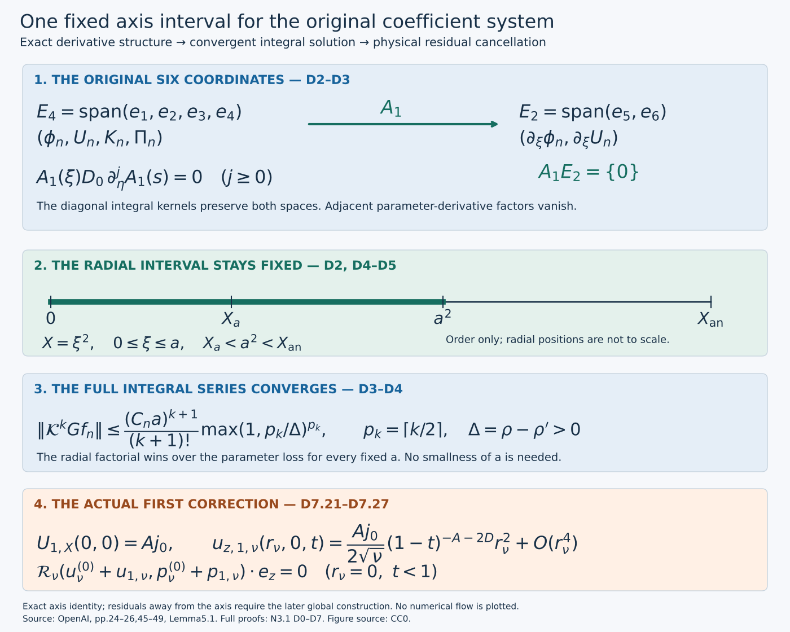

# Correcting the coefficients on one fixed axis interval

**NS-BLOWUP N3.1.** The completed leading profile leaves axial-viscosity and radial momentum terms in the full residual. This lesson derives every coefficient equation that treats those terms, constructs the actual first correction, and proves the linear solution step for each later order on the same radial interval.

The [leading-profile lessons](realizing-the-admissible-shear.md), ending in V7, supply the actual input, including one common parameter-analytic axis rectangle. The [stress and moment lesson](from-velocity-profiles-to-stress-and-moments.md), P0–P7, gives the exact physical operators. The [axis lesson](constructing-the-analytic-axis-profile.md), J8, computes a nonzero axial residual of the leading field. Exercise 5 below proves exactly how the first correction cancels that residual at the axis, without changing its growing axial velocity trace.

At each positive order the current unknowns satisfy a linear system with six components. One coefficient differentiates in the parameter. That derivative is unbounded on a fixed holomorphic supremum norm, so an ordinary bounded-operator argument would miss the difficulty. We prove a special matrix identity: two adjacent parameter-derivative factors vanish, even when a derivative strikes a variable coefficient. The number of surviving parameter derivatives is therefore at most half the number of integrations. The factorial from the ordered radial integrals then proves convergence for the entire fixed radial interval.

The original source is OpenAI, *Finite Time Blowup for Navier–Stokes*, [pages 45–49](https://cdn.openai.com/pdf/32d9f210-8b73-45e0-91bc-82a30aef8a9a/navier-stokes.pdf#page=45), (5.1)–(5.8) and Lemma 5.1, together with the physical coordinate formulas on [pages 24–26](https://cdn.openai.com/pdf/32d9f210-8b73-45e0-91bc-82a30aef8a9a/navier-stokes.pdf#page=24). [SOURCES.json](../SOURCES.json) gives the bibliography and mathematical locators. This is separate teaching and editorial mathematics; the diplomatic transcription retains OpenAI's text.

*Figure. The two coordinate spaces retain the original six unknowns. Their derivative map gives the exact vanishing composition used in D3. The lower panels show the convergence bound and the physical residual cancellation in Exercise 5. Radial positions indicate order, not scale; no numerical solution is plotted.*

## From the original residual to an actual correction

First retain the physical powers of \(q\), the pressure and both viscosity contributions. The spacing \(2h\) arises from their exact relative powers. Radial incompressibility determines the radial velocity coefficient, including its axis integration constant.

Next write the original equations as a six-component system, listing every nonzero matrix entry. Its diagonal radial singularity has an exact integral inverse. The sparse derivative structure and a shared parameter-domain loss give a convergent series and uniqueness in the stated holomorphic class.

Finally recover smoothness in \(X\), the original radial average, pressure and physical fields. The first correction uses only the already constructed leading profile. Later orders use the same solution operator after the preceding coefficients have been globally extended and their moments corrected; that global step is the next lesson. This local construction alone does not yet supply the full base field.

## D0. Original physical coefficients and differential operators

The subscript now records expansion order. Keep the full leading pressure distinct from its axis trace, and include the change of physical power after each axial derivative.

Keep \(A=1/2+h,D=1/2-h,d=1-\eta^2,L=1-2h\eta^2\), with the already fixed \(0<h<1/100\). Use \(z=q^D\eta\), \(1-t=q(1-\eta^2)\), \(X=r^2/(2q)\), and the original amplitude \(\mathsf C\). For \(\lambda_n=2nh\), the physical coefficients are exactly
\[
\begin{gathered}
u_{\theta,n}=q^{-A+\lambda_n}E_n
=r q^{-A-1/2+\lambda_n}\phi_n/\mathsf C,
\qquad E_n=\sqrt{2X}\phi_n/\mathsf C,\\
u_{z,n}=q^{-A+\lambda_n}U_n,\qquad
ru_{r,n}=q^{\lambda_n}V_n,\qquad
p_n=q^{-2A+\lambda_n}\Pi_n.
\end{gathered}
\tag{D0.1}
\]
Here \(\Pi_0(X,\eta)\) is the full leading pressure; its axis trace is the pressure datum previously denoted \(\Pi_0(\eta)\). The subscript in this section is expansion order. No pressure constant is discarded by this notation.

For a real exponent \(\beta\), retain the original operators
\[
T_\beta f=\frac{-\beta f+D\eta f_\eta+Xf_X}{L},\qquad
Z_\beta f=\frac{2\beta\eta f+df_\eta-2\eta Xf_X}{L},
\tag{D0.2}
\]
so \(\partial_t(q^\beta f)=q^{\beta-1}T_\beta f\) and \(\partial_z(q^\beta f)=q^{\beta-D}Z_\beta f\). P0.2–P0.3 prove these by differentiation of the actual coordinate map. Write
\[
T_{\beta,n}=T_{\beta+\lambda_n},\qquad
Z_{\beta,n}=Z_{\beta+\lambda_n},\qquad
Z_{\beta,n}^{[2]}=Z_{\beta+\lambda_n-D}Z_{\beta+\lambda_n}.
\tag{D0.3}
\]
The composition order in the last expression retains the change in physical power after the first derivative. Negative-index fields are zero.

Incompressibility at order n gives
\(q^{\lambda_n-1}[\partial_XV_n+Z_{-A,n}U_n]=0\), because A+D=1. The regular-axis condition fixes V_n(0)=0. Integrating the displayed equation, with \(\int_0^XxU_{n,X}dx=XU_n-\int_0^XU_n dx\), proves
\[
\partial_XV_n=-Z_{-A,n}U_n,\qquad
\frac{V_n}{X}
=\frac{2\eta U_n-2\eta(D+\lambda_n)\mathcal A_XU_n-d\partial_\eta\mathcal A_XU_n}{L},
\quad \mathcal A_XU_n=\int_0^1U_n(sX,\eta)ds.
\tag{D0.4}
\]
The integral formula retains its smooth value at X=0 and fixes the integration constant uniquely.

## D1. Every term of the coefficient equations

Collect terms only after computing the full cylindrical momentum equation. The angular connection term, radial pressure equation and two different viscous order shifts all remain in the equations below.

Set \(b=-A-1/2\), \(c=-A\). For angular transport, the cylindrical connection term is part of \(u_r(\partial_r+r^{-1})u_\theta\). Substitution of D0.1 yields exactly
\[
u_{r,i}(\partial_r+r^{-1})u_{\theta,j}
=\frac r{\mathsf C}q^{b-1+\lambda_i+\lambda_j}
V_i(\phi_{j,X}+\phi_j/X).
\tag{D1.1}
\]
Indeed \((\partial_r+r^{-1})(r\phi_j)=2\phi_j+2X\phi_{j,X}\), and \(r^2=2qX\) gives the stated factor. The angular axial transport is
\((r/\mathsf C)q^{b-1+\lambda_i+\lambda_j}U_iZ_{b,j}\phi_j\), because \(-A-D=-1\). The vector radial Laplacian satisfies
\[
(\partial_{rr}+r^{-1}\partial_r-r^{-2})(r\phi(X))
=\frac r q\,2(X\phi_{XX}+2\phi_X).
\tag{D1.2}
\]
This follows from \(X_r=r/q\) by two ordinary derivatives, including the two cylindrical terms. Two axial derivatives introduce \(q^{-2D}=q^{-1}q^{2h}\), so they move order n−1 to order n. Equating the complete order-n angular residual to zero gives
\[
2(X\phi_n''+2\phi_n')=T_{b,n}\phi_n
+\sum_{i+j=n}\{V_i(\phi_j'+\phi_j/X)+U_iZ_{b,j}\phi_j\}
-Z_{b,n-1}^{[2]}\phi_{n-1}.
\tag{D1.3}
\]
Primes here and in D1.4–D1.6 mean \(\partial_X\) at fixed η.

For the axial component the scalar radial Laplacian is \(2q^{-1}(XU''+U')\). Radial transport contributes \(V_iU_j'\), and axial transport contributes \(U_iZ_{c,j}U_j\), each with factor \(q^{c-1+\lambda_i+\lambda_j}\). The pressure derivative has the same power because \(-2A-D=c-1\). Thus its full equation is
\[
2(XU_n''+U_n')=T_{c,n}U_n
+\sum_{i+j=n}\{V_iU_j'+U_iZ_{c,j}U_j\}
+Z_{-2A,n}\Pi_n-Z_{c,n-1}^{[2]}U_{n-1}.
\tag{D1.4}
\]

For the radial equation multiply the physical momentum equation by r first. The pressure and centrifugal terms at order n are
\(q^{-2A+\lambda_n}[2X\Pi_n'-2X\mathsf C^{-2}\sum_{i+j=n}\phi_i\phi_j]\).
The time and transport terms have power \(q^{-1+\lambda_k}\), with exact coefficients
\(T_{0,k}V_k\), \(V_i(V_j'-V_j/(2X))\) and \(U_iZ_{0,j}V_j\). The vector radial Laplacian of V(X)/r is \(2XV''/(qr)\), so after multiplying by r its contribution is \(-2XV_k''\). The axial-viscosity term at that power is \(-Z_{0,k-1}^{[2]}V_{k-1}\). Since \(-1+\lambda_k=-2A+\lambda_{k+1}\), the result is exactly
\[
\Pi_n'=\mathsf C^{-2}\sum_{i+j=n}\phi_i\phi_j-\frac{\Omega_{n-1}}{2X},
\tag{D1.5}
\]
where
\[
\Omega_k=T_{0,k}V_k
+\sum_{i+j=k}\{V_i(V_j'-V_j/(2X))+U_iZ_{0,j}V_j\}
-2XV_k''-Z_{0,k-1}^{[2]}V_{k-1}.
\tag{D1.6}
\]
These computations retain all physical powers and all radial and axial viscous terms in original (5.2)–(5.6).

The quotient in D1.5 is regular, with an explicit full formula. Write V_j=Xv_j using D0.4. Direct substitution in D0.2 gives \(T_\beta(Xf)=XT_{\beta-1}f\), \(Z_\beta(Xf)=XZ_{\beta-1}f\). Consequently
\[
\frac{\Omega_k}{X}=T_{-1,k}v_k
+\sum_{i+j=k}\{v_i(v_j/2+Xv_j')+U_iZ_{-1,j}v_j\}
-4v_k'-2Xv_k''-Z_{-1,k-1}^{[2]}v_{k-1}.
\tag{D1.7}
\]
Every coefficient is smooth at the axis and holomorphic on a suitable parameter neighborhood whenever the preceding profiles and their needed derivatives are. The factor 1/2 in the quadratic radial term and both radial derivatives remain visible.

## D2. The full six-component system

The current order is linear because every middle-index product uses previously constructed coefficients. A radial-average variable makes the system local in the radial coordinate; its defining relation will be recovered exactly.

Fix \(a>0\) with \(X_a<a^2<X_{\rm an}\), inside the common analytic rectangle proved in V7. The radius a is fixed independently of the correction order. In this paragraph use the concise symbols \(\phi=\phi_0,U=U_0,V=V_0\) for the actual leading functions and put
\[
\begin{gathered}
\ell=\lambda_n,\quad \beta_n=b+\ell,\quad \gamma_n=c+\ell,\quad \pi_n^{\rm exp}=-2A+\ell,\\
v_0=V_0/X,\quad W=1+Lv_0-2\eta U_0,\quad H_c=D\eta+dU_0,\quad
S_\phi=\phi_0+X\phi_{0,X}.
\end{gathered}
\tag{D2.1}
\]
The W here equals the original transport coefficient in P1.1 by D0.4. The superscript on \(\pi_n^{\rm exp}\) distinguishes a scalar exponent from the pressure profile.

At positive order all middle-index terms are already of lower order. Write them, without omission, as
\[
\begin{split}
R_{\phi,n}&=\sum_{i=1}^{n-1}\{V_i(\phi_{n-i}'+\phi_{n-i}/X)+U_iZ_{b,n-i}\phi_{n-i}\}
-Z_{b,n-1}^{[2]}\phi_{n-1},\\
R_{U,n}&=\sum_{i=1}^{n-1}\{V_iU_{n-i}'+U_iZ_{c,n-i}U_{n-i}\}
-Z_{c,n-1}^{[2]}U_{n-1},\\
P_n&=\mathsf C^{-2}\sum_{i=1}^{n-1}\phi_i\phi_{n-i}-\Omega_{n-1}/(2X).
\end{split}
\tag{D2.2}
\]
For n=1 these sums are empty. The factors V_i=Xv_i cancel the apparent 1/X in R_φ,n. D1.7 handles the remaining quotient. These are actual finite source expressions, not new free data.

Let \(\xi=\sqrt X\), \(K_n=\mathcal A_XU_n-U_n\), and
\[
\mathbf W_n=(\phi_n,U_n,K_n,\Pi_n,\partial_\xi\phi_n,\partial_\xi U_n)^T,
\qquad C_d=\operatorname{diag}(0,0,2,0,3,1).
\tag{D2.3}
\]
The use of ξ retains X=ξ² and all resulting derivative factors. D0.4 is equivalently
\[
\frac{V_n}{X}=\frac{2\eta(A-\ell)U_n-2\eta(D+\ell)K_n-d\partial_\eta U_n-d\partial_\eta K_n}{L}.
\tag{D2.4}
\]
The second-order operators are exactly
\(2(X\partial_{XX}+2\partial_X)=\tfrac12(\partial_{\xi\xi}+3\xi^{-1}\partial_\xi)\)
and
\(2(X\partial_{XX}+\partial_X)=\tfrac12(\partial_{\xi\xi}+\xi^{-1}\partial_\xi)\).
Also \(\partial_\xi K_n+2K_n/\xi=-\partial_\xi U_n\). Thus the exact system is
\[
\partial_\xi\mathbf W_n+\xi^{-1}C_d\mathbf W_n
=A_0\mathbf W_n+A_1\partial_\eta\mathbf W_n+f_n,\qquad \mathbf W_n(0)=0.
\tag{D2.5}
\]
Here are every nonzero entry of the matrices; all unlisted entries vanish:
\[
\begin{gathered}
(A_0)_{15}=1,\quad (A_0)_{26}=1,\quad (A_0)_{36}=-1,\quad
(A_0)_{41}=4\xi\phi_0/\mathsf C^2,\\
(A_0)_{51}=2[\beta_n(-1+2\eta U_0)/L+v_0],\\
(A_0)_{52}=2Z_b\phi_0+4\eta(A-\ell)S_\phi/L,\qquad
(A_0)_{53}=-4\eta(D+\ell)S_\phi/L,\qquad (A_0)_{55}=\xi W/L,\\
(A_0)_{61}=-8\eta X\phi_0/(L\mathsf C^2),\\
(A_0)_{62}=2[\gamma_n(-1+2\eta U_0)/L+Z_cU_0]+4\eta(A-\ell)XU_{0,X}/L,\\
(A_0)_{63}=-4\eta(D+\ell)XU_{0,X}/L,\qquad
(A_0)_{64}=4\pi_n^{\rm exp}\eta/L,\qquad (A_0)_{66}=\xi W/L.
\end{gathered}
\tag{D2.6}
\]
The parameter-derivative matrix is
\[
\begin{gathered}
(A_1)_{51}=2H_c/L,\qquad
(A_1)_{52}=(A_1)_{53}=-2dS_\phi/L,\\
(A_1)_{62}=2(H_c-dXU_{0,X})/L,\qquad
(A_1)_{63}=-2dXU_{0,X}/L,\qquad
(A_1)_{64}=2d/L.
\end{gathered}
\tag{D2.7}
\]
The complete source vector is
\[
f_n=(0,0,0,2\xi P_n,2R_{\phi,n},2R_{U,n}-4\eta XP_n/L)^T.
\tag{D2.8}
\]
To verify these rows, the linear angular equation before the ξ conversion is
\[
\begin{split}
2(X\phi_n''+2\phi_n')={}&[\beta_n(-1+2\eta U_0)/L+v_0]\phi_n
+(XW/L)\phi_n'+(H_c/L)\phi_{n,\eta}\\
&+S_\phi(V_n/X)+U_nZ_b\phi_0+R_{\phi,n}.
\end{split}
\tag{D2.9}
\]
Insert D2.4 and multiply by two; \(X\phi_n'=\xi\partial_\xi\phi_n/2\) gives (A_0)55. The axial row has the same derivative coefficients with U_n, together with \(XU_{0,X}(V_n/X)+U_nZ_cU_0+Z_{-2A,n}\Pi_n+R_{U,n}\). Use the already derived pressure row
\(\Pi_n'=2\phi_0\phi_n/\mathsf C^2+P_n\)
inside \(Z_{-2A,n}\Pi_n=(2\pi_n^{\rm exp}\eta\Pi_n+d\Pi_{n,\eta}-2\eta X\Pi_n')/L\).
This supplies (A_0)61, (A_0)64, (A_1)64 and the last term in D2.8. The first four equations then follow from the definitions and the pressure row. This proves the full matrix system, including the terms not printed explicitly in the source.

## D3. Exact integral inverse and the sparse derivative structure

Invert the diagonal singular part with its actual zero-axis conditions. Then follow the two coordinate spaces through every factor to prove the vanishing composition before estimating derivatives.

For \(c_i=(C_d)_{ii}\), define
\[
(Gg)_i(\xi,\eta)=\int_0^\xi(s/\xi)^{c_i}g_i(s,\eta)ds
=\xi\int_0^1t^{c_i}g_i(t\xi,\eta)dt.
\tag{D3.1}
\]
For positive ξ, differentiating the first expression gives
\((Gg)_i'+c_i(Gg)_i/\xi=g_i\). The second expression extends continuously by zero at ξ=0. Conversely multiplication of a regular solution of that scalar equation by ξ^{c_i}, integration from zero, and its zero axis value recover D3.1. For c_i>0 a nonzero homogeneous integration constant is singular; for c_i=0 it violates the prescribed zero value. Thus G is the exact inverse with these boundary conditions.

Let \(E_4=\operatorname{span}(e_1,e_2,e_3,e_4)\), \(E_2=\operatorname{span}(e_5,e_6)\). D2.7 proves that A_1 maps E_4 into E_2 and annihilates E_2. Every η derivative of A_1 has the identical support pattern. All G kernels are diagonal and independent of η, so they preserve both spaces. For any such diagonal kernel D_0 and any radii ξ,s,
\[
A_1(\xi)D_0A_1(s)=0,\qquad
A_1(\xi)D_0\partial_\eta^jA_1(s)=0\quad(j\ge0).
\tag{D3.2}
\]
In particular, composing two adjacent factors of the type \(A_1\partial_\eta\) vanishes, including the term where the left derivative strikes the right coefficient. These are exact matrix identities on the original six coordinates.

Put \(\mathcal K=G(A_0+A_1\partial_\eta)\). In the expansion of \(\mathcal K^kG\), there are at most 2^k choices of the two operator types. A nonzero choice cannot contain adjacent parameter-derivative types by D3.2. Hence it has at most
\[
p_k=\lceil k/2\rceil
\tag{D3.3}
\]
parameter derivatives. This count concerns differential-operator compositions, so it already includes the product-rule terms on variable coefficients. No coefficient is treated as constant in η.

## D4. Convergence on the whole fixed radial interval

Allocate the available parameter-domain loss only to the derivatives that survive. Ordered radial integration supplies a full factorial. This proves convergence without a smallness requirement on the chosen radial interval.

For the current order choose a bounded complex neighborhood
\(S_\rho=\{\eta:\operatorname{dist}(\eta,[-1,1])<\rho\}\)
with no zero of L, on which all current coefficients and sources are bounded and holomorphic, uniformly for \(0\le\xi\le a\). Its radius may depend on n. Such a neighborhood exists for n=1 by V7 and for the induction receiver from the finitely many lower profiles and derivatives that enter D2.2. Take a smaller radius than those available for those finitely many data, so the suprema are finite on its closure. No bound uniform in n is assumed.

For \(0<\rho'<\rho\), set \(\Delta=\rho-\rho'\). Cauchy's integral formula on a disk of radius ε inside the larger domain gives \(\|\partial_\eta f\|_{S_{r-\varepsilon}}\le\varepsilon^{-1}\|f\|_{S_r}\). In a word with p derivatives allocate loss Δ/p to each derivative; coefficient multiplications need no radius loss. For p=0 the derivative factor is one. This bounds the full operator word by a coefficient factor times \((p/\Delta)^p\), without expanding all product-rule terms separately.

Each diagonal integration kernel has norm at most one since c_i≥0 and the nested radii are ordered. Its k+1 integrations range over a simplex of volume \(\xi^{k+1}/(k+1)!\). Choose C_n≥1 bounding the matrices, source and the factor from at most 2^k words. D3.3 then gives the complete estimate
\[
\|\mathcal K^kGf_n\|_{[0,a]\times S_{\rho'}}
\le\frac{C_n^{k+1}a^{k+1}}{(k+1)!}
\left(\max\{1,p_k/\Delta\}\right)^{p_k}.
\tag{D4.1}
\]
The convention at p_k=0 is one. The simplex and radius-loss estimates can be applied simultaneously: before taking suprema, each integrand has exactly the same ordered radial variables and parameter-domain losses, and all coefficient bounds are uniform in those radial variables.

The root of the right side tends to zero. For example \((k+1)!\ge((k+1)/e)^{k+1}\), from summing \(\log j\ge\int_{j-1}^j\log x\,dx\) for j≥2, while p_k≤(k+1)/2. The kth root is bounded by a fixed multiple of \((k+1)^{-1/2}\), with fixed a,C_n,Δ. Thus the actual series
\[
\mathbf W_n=\sum_{k=0}^{\infty}\mathcal K^kGf_n
\tag{D4.2}
\]
converges uniformly on the whole fixed interval and every smaller parameter neighborhood. Uniform convergence preserves holomorphy in η. On a further smaller domain Cauchy's bound also gives convergence of the parameter derivative series, so bounded radial integration passes through the series. Consequently \(\mathbf W_n=G(A_0\mathbf W_n+A_1\partial_\eta\mathbf W_n+f_n)\), and D3.1 proves D2.5. No infinite-frequency or numerical approximation is used.

For uniqueness take two bounded holomorphic solutions on a common parameter neighborhood; their difference H satisfies H=\(\mathcal K^kH\) for every k. The same argument, with k integrations, bounds it by
\[
\|H\|_{[0,a]\times S_{\rho'}}
\le\frac{(C_na)^k}{k!}
\left(\max\{1,p_k/\Delta\}\right)^{p_k}
\|H\|_{[0,a]\times S_\rho}.
\tag{D4.3}
\]
The right side tends to zero. A common larger domain with finite suprema is obtained by first shrinking the intersection of the two solutions' domains. Hence H=0. This is exactly the stated holomorphic uniqueness class, not a uniqueness assertion for arbitrary smooth parameter dependence.

The chosen a did not enter any smallness condition. Increasing C_n or decreasing the parameter neighborhood still gives convergence by D4.1. Therefore the radial interval stays fixed at every application of this solution operator.

## D5. Smoothness, parity and recovery of the original unknowns

Recover radial smoothness through a nonsingular integral identity. Reflection gives the exact parity needed to return from the square-root radial coordinate to the original \(X\).

For continuous g the inverse formula has the nonsingular derivative
\[
\partial_\xi(Gg)_i=g_i(\xi,\eta)-c_i\int_0^1t^{c_i}g_i(t\xi,\eta)dt.
\tag{D5.1}
\]
It follows either by differentiating the first integral away from zero and passing to zero in the second expression, or by its scalar equation and continuous quotient. Thus continuous g gives one continuous radial derivative. Apply this to \(g=A_0\mathbf W_n+A_1\partial_\eta\mathbf W_n+f_n\); the parameter derivative is continuous on a smaller neighborhood by Cauchy's formula. Once \(\mathbf W_n\) is C^r in ξ, the same formula and product differentiation give C^{r+1} on a smaller parameter domain.

Here is the common-domain conclusion required by the next coefficient construction. At this fixed order n, take the parameter neighborhood \(S_\rho\) on which the input coefficients, source and all their radial derivatives are holomorphic. For n=1 it is supplied by the common analytic rectangle of V7; for the induction it is the intersection of the finitely many neighborhoods of the completed lower coefficients. The source formulas D2.2 use only finitely many derivatives of those fields. On any smaller closed neighborhood, each fixed radial derivative of these data is bounded uniformly on the compact radial interval. The bounds may depend on its derivative order.

Choose once \(0<\rho_2<\rho_1<\rho\). For any prescribed integer r, perform the r applications of D5.1 on the nested neighborhoods with radii
\(\rho_1-j(\rho_1-\rho_2)/(r+1)\), \(j=0,\ldots,r\).
Each application uses a positive radius difference, so Cauchy's formula controls the one additional parameter derivative. Radial differentiation of the integral in D5.1 introduces the factor \(t^k\) for a k-th radial derivative of its integrand; this is bounded by one on \(0\le t\le1\), so the same differentiated integral formula remains valid at the axis. Induction therefore supplies all radial derivatives through r, continuous and holomorphic on a neighborhood strictly larger than \(S_{\rho_2}\). Every occurrence is a derivative of the one D4.2 solution, by uniqueness, not a new solution chosen with r. Since r was arbitrary, all radial derivatives are holomorphic on this same fixed \(S_{\rho_2}\); their bounds can grow with r. Further parameter derivatives follow from Cauchy's formula on the positive remaining margin. This proves the common parameter neighborhood for all mixed derivatives at this fixed n. Its radius may decrease with n, while the radial interval \([0,a]\) stays unchanged.

For the parity argument extend the original coefficients to negative ξ by X=ξ². Set \(S=\operatorname{diag}(1,1,1,1,-1,-1)\). Inspection of every entry in D2.6–D2.8 gives
\[
A_j(-\xi)=-SA_j(\xi)S\quad(j=0,1),\qquad f_n(-\xi)=-Sf_n(\xi).
\tag{D5.2}
\]
For example (A_0)41 is odd, (A_0)15 is even, and A_1 has only last-two-row, first-four-column entries, all even. The lower source profiles are functions of X; f_n's fourth component is odd and its last two are even. The extended G formula in D3.1 and the same absolute estimates construct a unique smooth solution on [-a,a]. Reflection \(\widetilde{\mathbf W}_n(\xi)=S\mathbf W_n(-\xi)\) obeys the same integral equation and axis data by D5.2, so uniqueness gives equality. The first four components are therefore even and the last two odd.

An even smooth function of ξ is smooth as a function of X=ξ² on the half interval. Here is the boundary check with its derivative content. For each integer M, Taylor's formula at zero has only even coefficients through degree 2M, with remainder \(\xi^{2M+2}R_M(\xi)\) whose needed derivatives are bounded. Applying \(\partial_X=(2\xi)^{-1}\partial_\xi\) k times to this remainder gives a finite sum bounded by a constant times \(\xi^{2M+2-2k}\) for M≥k. The polynomial terms give the required limits of each derivative. Taking larger M for each k proves the smooth extension; parameter derivatives and their holomorphy obey the same argument on the smaller neighborhoods already supplied above.

The first two rows recover the derivative coordinates. The third row also recovers the original radial average exactly, rather than a replacement variable. Indeed
\[
\xi^2K_n=-\int_0^\xi s^2\partial_sU_n(s^2,\eta)ds
=-\xi^2U_n(\xi^2,\eta)+2\int_0^\xi sU_n(s^2,\eta)ds,
\tag{D5.3}
\]
where \(\partial_sU_n(s^2,\eta)\) denotes the derivative of the composed function. Changing variables x=s² gives \(K_n=\mathcal A_XU_n-U_n\). Formula D2.4 then reconstructs V_n and D0.4, with V_n(0)=0. The fourth row reconstructs D1.5 with \(\Pi_n(0)=0\); the last two rows, by D2.9 and the pressure substitution, reconstruct D1.3–D1.4. Thus the integral solution solves all original equations, with \(\phi_n(0)=U_n(0)=\Pi_n(0)=0\). Conversely any solution in the source's regular holomorphic class gives this six-component solution and is unique by D4.3.

## D6. The actual first correction and the induction receiver

At the first order every source is already an explicit function of the leading profile. The solution series therefore constructs an actual correction. Its complete physical factors are retained when transporting to viscosity \(\nu\).

At n=1 all inputs are already supplied by the verified leading profile. Specifically,
\[
R_{\phi,1}=-Z_{b,0}^{[2]}\phi_0,\qquad
R_{U,1}=-Z_{c,0}^{[2]}U_0,\qquad
P_1=-\Omega_0/(2X),
\tag{D6.1}
\]
with the full \(\Omega_0/X\) given by D1.7 using only v_0,U_0 and their derivatives; its negative-index term is zero. Put these actual functions, \(\ell=2h\), and the actual leading coefficients into D2.6–D2.8. The convergent series D4.2 is therefore an explicit exact construction of \((\phi_1,U_1,V_1,\Pi_1)\) on \([0,a^2]\), not an existence statement depending on an unspecified source. Its zero axis values preserve all leading traces. Its original physical fields are D0.1 with \(\lambda_1=2h\), and the preceding identities cancel every order-one residual on this interval.

For higher orders D2.2 displays precisely the finite receiving map from previously completed coefficients. D1.7 proves that its axis source is regular; D4 proves that its size never forces the radial interval to shrink; D5 proves the regularity needed to form the next source. This establishes the full linear solution step of original Lemma 5.1. The actual global extension in [Y0–Y7](../audits/positive-order-extension-audit.md) completes original Lemma 5.2: it extends each current solution, imposes the five actual residual moments and finishes that order before using it at the next. Together these constructions supply the entire global coefficient sequence; its summation into the actual base field is derived in [Z0–Z8](../audits/base-field-realization-audit.md).

For the original viscosity \(\nu>0\), retain the exact map proved in P1 and H7, with \(r_\nu=\sqrt\nu r,z_\nu=\sqrt\nu z\) and time unchanged. The physical coefficient fields become
\[
\begin{gathered}
u_{\theta,n,\nu}=\sqrt\nu q^{-A+\lambda_n}E_n
=r_\nu q^{-A-1/2+\lambda_n}\phi_n/\mathsf C,\qquad
u_{z,n,\nu}=\sqrt\nu q^{-A+\lambda_n}U_n,\\
r_\nu u_{r,n,\nu}=\nu q^{\lambda_n}V_n,\qquad
p_{n,\nu}=\nu q^{-2A+\lambda_n}\Pi_n,\\
X=\frac{r_\nu^2}{2\nu q},\quad \eta=\frac{z_\nu}{\sqrt\nu q^D},\quad
q-\frac{z_\nu^2}{\nu}q^{2h}=1-t.
\end{gathered}
\tag{D6.2}
\]
Each full physical momentum term has the same additional factor \(\sqrt\nu\): one spatial derivative contributes \(\nu^{-1/2}\), the pressure has factor ν, and the two derivatives in νΔ cancel their ν^{-1} with the original viscosity. Thus the coefficient cancellations hold at the unchanged target viscosity with every field factor retained.

## D7. Five worked exercises

### Exercise 1. Prove the exact composition rules for the physical operators

Explain why the two axial derivatives in D0.3 have different subscripts. Prove the corresponding mixed time–axial identity and the rules involving the original radial variable \(X\).

**Solution.** Let \(f(X,\eta)\) be smooth on the profile rectangle, and let \(\beta\) be a real physical exponent. D0.2 gives
\[
\partial_{zz}(q^\beta f)
=q^{\beta-2D}Z_{\beta-D}Z_\beta f,\qquad
\partial_t\partial_z(q^\beta f)
=q^{\beta-D-1}T_{\beta-D}Z_\beta f.
\tag{D7.1}
\]
Applying the same identities in the opposite order gives
\(\partial_z\partial_t(q^\beta f)=q^{\beta-1-D}Z_{\beta-1}T_\beta f\).
The original smooth coordinate map has \(q>0\), \(L>0\), so physical mixed derivatives commute and their common scalar factor is nonzero. Each \((X,\eta)\) with \(X\ge0,|\eta|<1\) is reached by taking any positive \(q\) and setting \(r=\sqrt{2qX},z=q^D\eta,t=1-q(1-\eta^2)\). Thus
\[
T_{\beta-D}Z_\beta f=Z_{\beta-1}T_\beta f.
\tag{D7.2}
\]
This proves an identity on the original profile domain, not merely on one coordinate trajectory. Continuity gives the one-sided identities at \(\eta=\pm1\) and \(X=0\).

Direct substitution into the full formulas D0.2 gives
\[
\begin{gathered}
T_\beta(Xf)=XT_{\beta-1}f,\qquad
Z_\beta(Xf)=XZ_{\beta-1}f,\\
\partial_XT_\beta f=T_{\beta-1}\partial_Xf,\qquad
\partial_XZ_\beta f=Z_{\beta-1}\partial_Xf.
\end{gathered}
\tag{D7.3}
\]
For instance, \(X\partial_X(Xf)=Xf+X^2f_X\) changes the time coefficient from \(-\beta\) to \(1-\beta\), while \(-2\eta X\partial_X(Xf)\) changes the axial coefficient from \(2\beta\eta\) to \(2(\beta-1)\eta\). Differentiating the original operators gives the last two identities by the same product rule; \(L\) has no \(X\)-dependence.

The order spacing is also exact:
\[
q^{-2D}=q^{-1}q^{2h},\qquad
q^{-1+\lambda_k}=q^{-2A+\lambda_{k+1}},\qquad
\lambda_k=2kh.
\tag{D7.4}
\]
The first identity accounts for axial viscosity relative to radial viscosity. The second accounts for the remaining radial momentum terms relative to centrifugal pressure. Neither permits replacing \(Z_{\beta-D}Z_\beta\) by \(Z_\beta^2\).

### Exercise 2. Give a finite remainder bound for the convergent integral series

Turn D4.1 into an explicit tail estimate without shrinking \(a\). Retain both parity classes of the summation index.

**Solution.** Let \(z=C_na>0\), \(\Delta=\rho-\rho'>0\), and retain the actual majorants
\[
t_k=\frac{z^{k+1}}{(k+1)!}
\big(\max\{1,p_k/\Delta\}\big)^{p_k},\qquad
p_k=\lceil k/2\rceil.
\tag{D7.5}
\]
For \(m\ge\max\{1,\lceil\Delta\rceil\}\), put \(B_m=(m/\Delta)^m\). Then
\[
t_{2m-1}=\frac{z^{2m}}{(2m)!}B_m,\qquad
t_{2m}=\frac{z^{2m+1}}{(2m+1)!}B_m,\qquad
\frac{B_{m+1}}{B_m}
=\frac{m+1}{\Delta}(1+1/m)^m
\le\frac{e(m+1)}{\Delta}.
\tag{D7.6}
\]
The last bound follows by integrating \(1/(1+s)\le1\) on \([0,1/m]\), giving \(m\log(1+1/m)\le1\). Hence the two exact adjacent-parity comparisons are
\[
\frac{t_{2m+1}}{t_{2m-1}}\le
\frac{ez^2}{2\Delta(2m+1)},\qquad
\frac{t_{2m+2}}{t_{2m}}\le
\frac{ez^2}{2\Delta(2m+3)}.
\tag{D7.7}
\]
Choose any integer
\[
M\ge \max\left\{1,\lceil\Delta\rceil,
\left\lceil\frac{ez^2}{2\Delta}\right\rceil\right\}.
\tag{D7.8}
\]
Both ratios in D7.7 are then at most \(1/2\) for every \(m\ge M\). Summing each parity class as a geometric majorant proves the actual remainder bound
\[
\left\|\mathbf W_n-\sum_{k=0}^{2M-2}\mathcal K^kGf_n\right\|_{[0,a]\times S_{\rho'}}
\le 2\big(t_{2M-1}+t_{2M}\big).
\tag{D7.9}
\]
All constants in this formula are those from the already established coefficient and source bounds. Increasing \(M\) makes the right side tend to zero by D7.7. The radius \(a\), parameter margin \(\Delta\), source and physical coordinates remain unchanged. This is an analytic error estimate for the actual infinite integral series.

### Exercise 3. Compute the first radial coefficients at the axis

Find the exact axis slopes of \(\phi_1,U_1,\Pi_1\), retaining the full original pressure datum. Determine the axis slopes of \(\phi_n,U_n\) at every later positive order.

**Solution.** For an axis trace \(f(\eta)\), define the restrictions of the original operators by
\[
\mathscr T_\beta f=\frac{-\beta f+D\eta f'}L,\qquad
\mathscr Z_\beta f=\frac{2\beta\eta f+df'}L.
\tag{D7.10}
\]
Here primes mean parameter derivatives. At \(X=0\), the term \(Xf_X\) in D0.2 vanishes for each smooth profile. This remains true after either operator is applied, so taking the axis trace of their composition gives precisely the composition in D7.10.

At each positive order all three prescribed axis traces \(\phi_n,U_n,\Pi_n\) vanish identically in \(\eta\), as do their parameter derivatives. D0.4 then gives \(V_n/X=0\) at the axis. Evaluating D1.3–D1.5 there gives
\[
4\phi_{n,X}(0,\eta)=R_{\phi,n}(0,\eta),\qquad
2U_{n,X}(0,\eta)=R_{U,n}(0,\eta),\qquad
\Pi_{n,X}(0,\eta)=P_n(0,\eta).
\tag{D7.11}
\]
In the angular current-order terms, \(V_0(\phi_n'+\phi_n/X)\) tends to zero because \(V_0=O(X)\) and \(\phi_n=O(X)\); the term \(V_n\phi_0/X\) tends to zero because \(V_n/X=0\) at the axis. All other current-order terms vanish from their zero traces or explicit \(X\) factors. This verifies the limits rather than cancelling a singular expression formally.

For \(n=1\) use D6.1 and the actual traces \(\phi_*,U_*=4\eta+j_0\):
\[
\phi_{1,X}(0,\eta)=-\frac14\mathscr Z_{b-D}\mathscr Z_b\phi_*,
\qquad
U_{1,X}(0,\eta)=-\frac12\mathscr Z_{c-D}\mathscr Z_cU_*.
\tag{D7.12}
\]
In particular the complete \(\Lambda\)-dependent function \(\phi_*\) is retained in the first expression.

To compute the pressure slope, retain \(g(\eta)=U_{0,X}(0,\eta)=-Z_*/(2L)\) from J8.6. The full source \(Z_*\), including the actual axis pressure \(\Pi_0(0,\eta)\), is J0.1. Expanding the exact radial-average formula D0.4 gives
\[
v_*=\left.\frac{V_0}X\right|_0
=\frac{2A\eta U_*-dU_*'}L,\qquad
w_*=\left.\partial_X\frac{V_0}X\right|_0
=\frac{(2-D)\eta g-\frac12d g'}L.
\tag{D7.13}
\]
Indeed \(\mathcal A_XU_0=U_*+gX/2+O(X^2)\), and \(1-D=A\). D1.7 at \(k=0\) now gives the entire finite value
\[
\Pi_{1,X}(0,\eta)=
-\frac12\left[
\mathscr T_{-1}v_*+\frac12v_*^2
+U_*\mathscr Z_{-1}v_*-4w_*
\right].
\tag{D7.14}
\]
The terms with an explicit \(X\) and the negative-index axial-viscosity term vanish at this endpoint. The remaining radial derivative \(-4w_*\), the quadratic factor \(1/2\) and the original pressure inside \(g\) have not been discarded.

For \(n\ge2\), all middle-index terms in \(R_{\phi,n}\) and \(R_{U,n}\) vanish at the axis: every positive-order field has zero trace and \(V_i/X\) has zero trace. The final axial-viscosity terms have the zero trace of the \((n-1)\)-st field and all its parameter derivatives. Therefore
\[
\phi_{n,X}(0,\eta)=U_{n,X}(0,\eta)=0\qquad(n\ge2).
\tag{D7.15}
\]
This conclusion concerns these two slopes; it does not assert that every pressure slope or higher radial derivative vanishes.

Finally, writing \(\alpha(\eta)=U_{1,X}(0,\eta)\), the exact reconstruction gives
\[
K_1=-\frac{\alpha X}{2}+O(X^2),\qquad
V_1=\frac{(2-D-\lambda_1)\eta\alpha-\frac12d\alpha'}L\,X^2+O(X^3).
\tag{D7.16}
\]
Every fixed parameter derivative has the same remainder order on a smaller common domain, by D5 and Taylor's integral remainder. These formulas describe the actual first correction, not a separately chosen axis polynomial.

### Exercise 4. Prove a quantitative source-to-solution map

For the actual fixed matrices \(A_0,A_1\), prove linearity and a finite bound for the solution map on two parameter neighborhoods. State the norms, domains and all radius dependence.

**Solution.** Use the maximum norm on the original six coordinates and its induced matrix norm. Let \(\mathcal H_\rho\) be the normed space of continuous functions on \([0,a]\times S_\rho\), holomorphic in \(\eta\), with finite supremum norm \(\|\cdot\|_\rho\). We use only bounded holomorphic data; taking uniform limits makes this a Banach space. The actual matrices are bounded on this domain after the prior shrinking in D4. Put
\[
\mathsf M=\max\{1,\|A_0\|_\rho,\|A_1\|_\rho\},\qquad
\Delta=\rho-\rho'>0,\qquad
\mathfrak S(z,\Delta)=
\sum_{k=0}^{\infty}\frac{z^k}{(k+1)!}
\big(\max\{1,p_k/\Delta\}\big)^{p_k}.
\tag{D7.17}
\]
The same root estimate as D4, or the two parity estimates in Exercise 2, proves that this series is finite for every finite \(z\ge0\) and every \(\Delta>0\).

The word proof in D3–D4 applies to any \(f\in\mathcal H_\rho\). Separate the source norm from the coefficient norms. There are at most \(2^k\) words, each coefficient multiplication costs at most \(\mathsf M\), and the full simplex has volume \(a^{k+1}/(k+1)!\). Thus
\[
\|\mathcal K^kGf\|_{\rho'}
\le\|f\|_\rho\,
\frac{a(2\mathsf M a)^k}{(k+1)!}
\big(\max\{1,p_k/\Delta\}\big)^{p_k}.
\tag{D7.18}
\]
Consequently the actual integral solution operator is the bounded linear map
\[
\begin{split}
\mathcal S_n:\mathcal H_\rho&\longrightarrow\mathcal H_{\rho'},&
\mathcal S_nf&=\sum_{k=0}^{\infty}\mathcal K^kGf,\\
\|\mathcal S_nf\|_{\rho'}&\le
a\,\mathfrak S(2\mathsf M a,\Delta)\|f\|_\rho .
\end{split}
\tag{D7.19}
\]
Linearity follows term by term and passes through uniform convergence. On an intermediate parameter neighborhood the series converges with its first parameter derivative on a smaller neighborhood. D3.1 then proves the integral equation, the differential equation and the zero-axis value. The uniqueness argument D4.3 applies to this same bounded holomorphic class.

For two source vectors in the stated space, subtracting the convergent series gives the exact difference map
\[
\mathcal S_nf-\mathcal S_ng=\mathcal S_n(f-g),\qquad
\|\mathcal S_nf-\mathcal S_ng\|_{\rho'}
\le a\,\mathfrak S(2\mathsf M a,\Delta)\|f-g\|_\rho.
\tag{D7.20}
\]
The actual smooth source \(f_n\) belongs to the domain; D5 gives the extra smoothness and parity needed to recover its original fields. An arbitrary source in \(\mathcal H_\rho\) need not have that parity, so the map just proved is a six-component solution map, with original-field recovery asserted for the already verified source \(f_n\). The factor \(a\), coefficient norm and full parameter margin remain explicit. No source smallness or radial shrinking is required.

### Exercise 5. Show exactly how the first correction removes the axial residual at the axis

Compute \(U_{1,X}(0,0)\) for the actual leading trace, then prove cancellation of the entire axial momentum residual at every point of the physical axis. Retain the original viscosity.

**Solution.** The actual leading axial trace is \(U_*=4\eta+j_0\), and \(c=-A\). Its first restricted axial derivative is
\[
\mathscr Z_cU_*=
\frac{4+2cj_0\eta+(8c-4)\eta^2}{1-2h\eta^2}.
\tag{D7.21}
\]
At zero the next operator \(\mathscr Z_{c-D}\) acts by parameter differentiation. The derivative of the denominator is zero there, so
\[
(\mathscr Z_{c-D}\mathscr Z_cU_*)(0)=2cj_0=-2Aj_0,\qquad
U_{1,X}(0,0)=Aj_0>0.
\tag{D7.22}
\]
This value follows from the complete coefficient equations and is independent of the later moment extensions, whose supports lie away from this axis interval.

Let \((u_\nu^{(0)},p_\nu^{(0)})\) be the actual leading physical field and \((u_{1,\nu},p_{1,\nu})\) the actual first coefficient from D6.2. Use the original physical \(q_\nu,\eta_\nu\) there. The leading tangential equations cancel time, convection, axial pressure and radial viscosity on the axis interval. Its remaining axial residual at the axis is therefore exactly
\[
\mathcal R_\nu(u_\nu^{(0)},p_\nu^{(0)})\cdot e_z
=-\sqrt\nu\,q_\nu^{c-2D}
(\mathscr Z_{c-D}\mathscr Z_cU_*)(\eta_\nu),
\qquad r_\nu=0.
\tag{D7.23}
\]
The factor comes from \(\nu\partial_{z_\nu z_\nu}
[\sqrt\nu\,q_\nu^cU_*]\): each spatial derivative contributes \(\nu^{-1/2}\), leaving exactly \(\sqrt\nu\). This is the same full axial-viscosity term retained in the original residual.

The first correction has zero axial velocity and pressure traces for every \(\eta\), and \(V_1=O(X^2)\), \(\phi_1=O(X)\). In Cartesian coordinates its horizontal velocity is \(O(r_\nu^3)\) and its axial velocity is \(O(r_\nu^2)\) at fixed \(z_\nu,t\). Thus its time derivatives, axial derivatives and axial pressure derivative vanish on the axis. All extra axial convection terms vanish there too: both fields have zero horizontal velocity on the axis, and the correction's axial trace and axial derivative are zero.

Only its radial viscous term contributes to the axial residual at the axis. Since
\(X=r_\nu^2/(2\nu q_\nu)\), direct radial differentiation gives
\[
\left.\nu(\partial_{r_\nu r_\nu}
+r_\nu^{-1}\partial_{r_\nu})u_{z,1,\nu}\right|_{r_\nu=0}
=2\sqrt\nu\,q_\nu^{c+\lambda_1-1}U_{1,X}(0,\eta_\nu).
\tag{D7.24}
\]
The displayed axis value is the smooth Cartesian limit. Now
\(\lambda_1-1=2h-1=-2D\), and D7.12 gives twice the slope as the negative restricted second axial derivative. Combining D7.23–D7.24 in the momentum residual therefore yields the exact identity
\[
\mathcal R_\nu(u_\nu^{(0)}+u_{1,\nu},
p_\nu^{(0)}+p_{1,\nu})\cdot e_z=0
\qquad(r_\nu=0,\ t<1).
\tag{D7.25}
\]
This is cancellation for the actual first correction throughout the axis, not only cancellation of a formal coefficient at the origin.

At \(z_\nu=0\), put \(\tau=1-t\). The unchanged leading residual from J8 is
\(2Aj_0\sqrt\nu\,\tau^{-A-2D}\). The first correction's original near-axis expansion is
\[
u_{z,1,\nu}(r_\nu,0,t)
=\frac{Aj_0}{2\sqrt\nu}\tau^{-A-2D}r_\nu^2+O(r_\nu^4).
\tag{D7.26}
\]
At each fixed \(t<1,\nu>0\), the radial Laplacian of its displayed quadratic term, multiplied by \(\nu\), is exactly \(2Aj_0\sqrt\nu\,\tau^{-A-2D}\). Its negative sign in the momentum residual cancels the positive leading residual.

The velocity trace itself stays
\[
(u_\nu^{(0)}+u_{1,\nu})\cdot e_z
=\sqrt\nu\,q_\nu^{-A}(4\eta_\nu+j_0)
\qquad(r_\nu=0).
\tag{D7.27}
\]
Thus cancellation of the residual does not remove the prescribed growth of the axial trace. D7.15 also shows that later constructed positive orders have zero first radial slope and cannot change this exact axial cancellation. Residuals away from the axis, global moment conditions and the summation into a base field still require their subsequent constructions.

## What this fixed-interval solution supplies

D0–D6 prove the complete coefficient equations, all matrix entries, the convergent solution operator, uniqueness, common parameter regularity, parity and recovery of the original fields. They construct the actual first positive-order correction and the full local solution step of Lemma 5.1 on the chosen interval. D7 supplies explicit remainder and stability bounds, exact axis coefficients and the physical residual cancellation.

The next lesson extends each coefficient globally and restores its five original residual moments before it is used at the next order. Those complete derivations are already supplied in the [separate extension audit](../audits/positive-order-extension-audit.md), followed by the [actual base-field realization](../audits/base-field-realization-audit.md). The [global extension lesson](extending-coefficients-and-cancelling-moments.md) proves the extension and moment correction; the [base-field lesson](constructing-the-actual-base-field.md) constructs their actual sum.

Authored exposition and figure source: CC0.