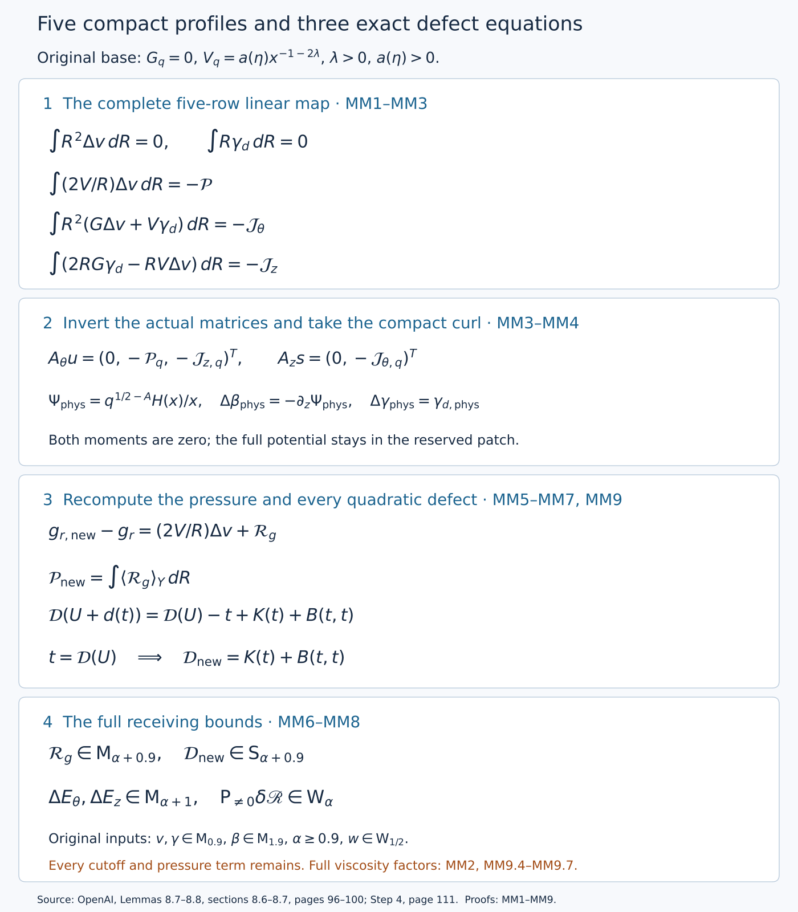

# Correcting the three defects with five compact profiles

*NS-BLOWUP N5.3. Exposition by GPT-6 Astra (OpenAI). This independent exposition is dedicated to CC0.*

The preceding corrections leave three integral defects that prevent the remaining stresses from having compact support. The source's next operation chooses three azimuthal profiles and two axial profiles. Their coefficients preserve both velocity moments and cancel the base-linear contributions to those three defects. The actual compact curl, its pressure, and every quadratic term then determine the new defects.

This lesson proves that complete operation and its receiving estimates. It uses OpenAI's Lemmas 8.7–8.8, sections 8.6–8.7 on original pages 96–100, and Step 4 on page 111. The [radial lesson](radial-primitives-and-the-mean-equations.md), RP1–RP9 and RM1–RM4, supplies the full compact operators and conservative equations. The [temporal lesson](cancelling-the-nonconstant-auxiliary-means.md), TM0–TM7, supplies the preceding update. The [stress and interaction lesson](realizing-stress-and-controlling-interactions.md), NI1–NI7, supplies the actual wave spaces and cylindrical interaction formulas.

The [editable diagram source](../assets/five-profile-moment-correction.py) records the exact maps below. Its nodes and arrows describe algebraic operations, without numerical flow samples. Mathematical derivations are separate from the diplomatic transcription of OpenAI's text.

## MM1. Original objects, maps and support

Retain
\[
0<h<1/100,\quad A=1/2+h,\quad D=1/2-h,\quad
1-t=q(1-\eta^2),\quad z=q^D\eta,\quad X=r^2/(2q),
\]
with \(q>0\), \(-1\leq\eta\leq1\). On a fixed dyadic chart put
\[
Q=2^{-\ell},\quad\varepsilon=Q^h,\quad S_*=\ell^2,\quad
R=r/\sqrt Q,\quad Z=z/Q^D,\quad T=(1-t)/Q,\quad \xi=q/Q.
\tag{MM1.1}
\]
Here \(\xi\) ranges over a fixed positive compact interval. It is the original ratio, not a replacement for the physical variable. Its exact defining equation and its derivative are
\[
\xi-Z^2\xi^{2h}=T,\qquad
\partial_\xi(\xi-Z^2\xi^{2h})=1-2h\eta^2\geq1-2h>0,
\quad \eta=Z\xi^{-D}.
\tag{MM1.2}
\]
Repeated implicit differentiation expresses every fixed derivative of \(\xi\) as a finite sum of products of derivatives of \(\xi-Z^2\xi^{2h}-T\), divided by powers of the displayed positive derivative. Since \(\xi\) and \(Z=\xi^D\eta\) range over compact sets, every such derivative is bounded. The same holds for \(\eta\), every fixed power of \(\xi\), and \(x=r/\sqrt q=R/\sqrt\xi\) on an annulus. This proves the coefficient bounds needed below, including one-sided bounds at \(\eta=\pm1\).

The reserved physical patch is \(x\in I_m=\{\sqrt{2X}:X\in\mathcal I_{\rm mean}\}\). On it the source prescribes, in (4.30) and (5.44),
\[
G_q=q^Au_{z,B}=0,\qquad
V_q=q^Au_{\theta,B}=a(\eta)x^{-1-2\lambda},\qquad
a(\eta)=2^{1/2+\lambda}c_{\rm patch}(1+\eta^2)^{-1},
\tag{MM1.3}
\]
where \(\lambda>0\) and \(c_{\rm patch}>0\) are fixed. In particular
\[
2^{-1/2+\lambda}c_{\rm patch}\leq a(\eta)
\leq2^{1/2+\lambda}c_{\rm patch}.
\tag{MM1.4}
\]
The factor \(2^{1/2+\lambda}\) is required because \(X=x^2/2\). There is no limit \(\lambda\downarrow0\) in this audit.

The support mechanism behind the exact patch identity is visible in (5.18): each positive-order \(E_n,U_n\) is supported to the left of the mean patch, and its zero axial integral makes \(F_n(X)=\int_0^X U_n(s)\,ds\) zero there as well. Its streamfunction is \(\mathcal S_n=q^{1-A+\lambda_n}F_n\), and its vector potential is \((\mathcal S_n/r)e_\theta\), as in (5.27). On the open mean patch both this potential and the azimuthal increment vanish identically. Multiplying by \(\chi(c_nq)\), then differentiating, still gives zero there: every product-rule term contains the vanished potential or one of its derivatives. Thus potential cutoffs cannot change (MM1.3). This verifies preservation of the patch by the specified summation. The actual leading and higher profiles and their common mean patch are constructed in the [shear lesson](realizing-the-admissible-shear.md), V0–V8, and the [base-field lesson](constructing-the-actual-base-field.md), Z0–Z9. Their retained compact supports prove the exact patch identity used here.

The radial leading velocity is \(u_{r,B}=q^{-1/2}V_0(X,\eta)/\sqrt{2X}\). Consequently on the patch
\[
b=Q^Au_{r,B}=\varepsilon\xi^{-1/2}\frac{V_0(X,\eta)}x,
\qquad V=\xi^{-A}a(\eta)x^{-1-2\lambda},\qquad G=0.
\tag{MM1.5}
\]
Every fixed derivative of the smooth fixed profile on a compact subinterval is bounded. Formula (MM1.2) therefore gives \(|\partial^I b|\leq C_I\varepsilon\), \(|\partial^I V|+|\partial^I G|\leq C_I\) there. The larger allowed factors \(S_*^{B_I}\) in Lemma 8.8 are harmless. These bounds apply on the entire compact subinterval, not only on the bump supports.

## MM2. Every radial measure and row factor

For any physical coefficient \(f_{\rm phys}\) with chart representative \(f_*=Q^{a_f}f_{\rm phys}\), substitution \(r=\sqrt Q R\), \(dr=\sqrt Q\,dR\), gives exactly
\[
\int R^e\langle f_*\rangle_Y\,dR
=Q^{a_f-(e+1)/2}\int r^e\langle f_{\rm phys}\rangle_Y\,dr.
\tag{MM2.1}
\]
The Haar measure has total mass one. Both sides integrate the same auxiliary-independent quantity when no auxiliary variable occurs. In particular the five original rows have the following multipliers:

| Physical row | Multiplier for its \(Q\)-chart row |
|---|---|
| \(\int r^2\Delta v_{\rm phys}\,dr\) | \(Q^{A-3/2}\) |
| \(\int r\gamma_{d,\rm phys}\,dr\) | \(Q^{A-1}\) |
| \(\int (2V_{\rm phys}/r)\Delta v_{\rm phys}\,dr\) | \(Q^{2A}\) |
| \(\int r^2(G_{\rm phys}\Delta v_{\rm phys}+V_{\rm phys}\gamma_{d,\rm phys})\,dr\) | \(Q^{2A-3/2}\) |
| \(\int (2rG_{\rm phys}\gamma_{d,\rm phys}-rV_{\rm phys}\Delta v_{\rm phys})\,dr\) | \(Q^{2A-1}\) |

For the third row the factor \(1/r\) cancels the radial measure's \(\sqrt Q\), leaving the two velocity factors \(Q^{-2A}\). For the fourth row \(r^2dr\) contributes \(Q^{3/2}\); for the fifth \(rdr\) contributes \(Q\). This proves each nonzero factor separately, including its sign. The corresponding target multipliers are exactly (8.17):
\[
\mathcal P_*=Q^{2A}\mathcal P_{\rm phys},\quad
\mathcal J_{\theta,*}=Q^{2A-3/2}\mathcal J_{\theta,\rm phys},\quad
\mathcal J_{z,*}=Q^{2A-1}\mathcal J_{z,\rm phys}.
\tag{MM2.2}
\]
The same identities with \(q\) in place of \(Q\) define the three inputs to the finite matrices:
\[
\mathcal P_q=\xi^{2A}\mathcal P_*,\quad
\mathcal J_{\theta,q}=\xi^{2A-3/2}\mathcal J_{\theta,*},\quad
\mathcal J_{z,q}=\xi^{2A-1}\mathcal J_{z,*}.
\tag{MM2.3}
\]
No row uses another row's multiplier.

The equations being audited in Section 8 are the source's physical construction with viscosity one. The original target allows every fixed viscosity \(\nu>0\). Their exact connection retains the physical coordinates: from fields \((u_1,p_1,f_1)\) at viscosity one define
\[
y=x/\sqrt\nu,\qquad u_\nu(x,t)=\sqrt\nu\,u_1(y,t),\quad
p_\nu(x,t)=\nu p_1(y,t),\quad f_\nu(x,t)=\sqrt\nu f_1(y,t).
\tag{MM2.4}
\]
Direct differentiation gives
\[
\begin{aligned}
&\partial_tu_\nu+(u_\nu\cdot\nabla_x)u_\nu-\nu\Delta_xu_\nu+\nabla_xp_\nu\\
&\qquad=\sqrt\nu[\partial_tu_1+(u_1\cdot\nabla_y)u_1-\Delta_yu_1+\nabla_yp_1](y,t),\\
&\operatorname{div}_xu_\nu=\operatorname{div}_yu_1.
\end{aligned}
\tag{MM2.5}
\]
In particular this is an exact invertible map of equations with their forces, not a claim that a field solving them has already been constructed. Its inverse evaluates at \(x=\sqrt\nu y\) and divides the velocity and force by \(\sqrt\nu\), and the pressure by \(\nu\). Time, initial zero velocity, and the terminal time one are unchanged. A spatial support \(K\) becomes \(\sqrt\nu K\); a compact space–time force support is sent by the same spatial dilation. Smoothness follows from the invertible linear change. The norms satisfy \(\|u_\nu(t)\|_{L^2_x}^2=\nu^{5/2}\|u_1(t)\|_{L^2_y}^2\) and \(\|u_\nu(t)\|_\infty=\sqrt\nu\|u_1(t)\|_\infty\). The inverse sends a global smooth finite-uniform-energy competitor with the same data and force to one at viscosity one.

For the actual viscosity-\(\nu\) physical coordinates, write \(r_\nu,z_\nu\) and retain
\[
q_\nu-(z_\nu^2/\nu)q_\nu^{2h}=1-t,\quad
X_\nu=r_\nu^2/(2\nu q_\nu),\quad
R=r_\nu/\sqrt{\nu Q},\quad Z=z_\nu/(\sqrt\nu Q^D).
\tag{MM2.6}
\]
These are precisely the pullbacks of the source coordinates; they are not \(q(r_\nu,z_\nu,t)\) with a suppressed factor. The corresponding chart factors are \(u_*=Q^A\nu^{-1/2}u_\nu\), \(g_*=Q^{2A+1/2}\nu^{-1/2}g_\nu\), \(p_*=Q^{2A}\nu^{-1}p_\nu\). A vector potential has \(\Psi_\nu(x,t)=\nu\Psi_1(y,t)\), giving \(\Psi_*=Q^{A-1/2}\nu^{-1}\Psi_\nu\). Each of the five multipliers in the table above acquires, in its displayed row order, the factors
\[
\nu^{-2},\quad\nu^{-3/2},\quad\nu^{-1},\quad\nu^{-5/2},\quad\nu^{-2}.
\tag{MM2.7}
\]
To check them, use \(dr_\nu=\sqrt\nu\,dr_1\), each velocity factor \(\sqrt\nu\), and each radial factor \(r_\nu=\sqrt\nu r_1\). The third row has two velocities and one inverse radius followed by the radial measure, hence scales by \(\nu\). The fourth has two velocities and \(r_\nu^2dr_\nu\), hence \(\nu^{5/2}\); the fifth has two velocities and \(r_\nu dr_\nu\), hence \(\nu^2\). Its radial-source contribution scales by the same \(\nu^2\), since \(g_\nu=\sqrt\nu g_1\). The first two rows follow from one velocity factor. Also \(c_{\rho,*}=(\nu Q)^{-1}c_{\rho,\nu}\) for \(\rho_\nu(r_\nu)=\nu^{-1/2}\rho_1(r_\nu/\sqrt\nu)\). This accounts for the arbitrary-viscosity target without discarding any factor from the source's audited equations.

## MM3. Construction and exact inverse of the five-profile map

Choose \(0<L<U\) with \([L,U]\subset I_m\). Set \(d=\log(U/L)/8\), \(x_0=Le^{2d}\), \(\sigma=d/4\), and
\[
\begin{gathered}
\eta_0(x)=\begin{cases}
\exp[-1/(\sigma^2-\log^2(x/x_0))],&|\log(x/x_0)|<\sigma,\\
0,&\text{otherwise},
\end{cases}\\
a_j=e^{jd},\qquad\eta_j(x)=a_j^{-1}\eta_0(x/a_j),\qquad j=0,1,2.
\end{gathered}
\tag{MM3.1}
\]
The letter \(\eta_j\) here denotes the source's bump profiles, not the slow coordinate \(\eta\). The exponent's derivatives produce only finite powers of the positive denominator; \(e^{-1/s}s^{-N}\to0\) as \(s\downarrow0\) for every \(N\). One proof is \(e^{1/s}\geq s^{-m}/m!\) with \(m>N\). Thus these are smooth zero extensions. Their logarithmic supports are centered at \(\log L+(2+j)d\) and have half-width \(d/4\); they are disjoint and their closed hull
\[
K=[x_0e^{-\sigma},x_0e^{2d+\sigma}]
\tag{MM3.2}
\]
lies in \((L,U)\). For every real \(p\), define the positive, finite exact constant
\[
\mu_p=\int_0^\infty x^p\eta_0(x)\,dx>0.
\]
Changing variables \(x=a_js\) gives
\[
\int_0^\infty x^p\eta_j(x)\,dx=\mu_p e^{jdp}.
\tag{MM3.3}
\]
All moments remain these exact integrals; no numerical values are needed.

Using the original \(a=a(\eta)\), define the matrices exactly as on original page 98:
\[
\begin{gathered}
A_\theta=
\begin{pmatrix}
\mu_2&\mu_2e^{2d}&\mu_2e^{4d}\\
2a\mu_{-2-2\lambda}&2a\mu_{-2-2\lambda}e^{d(-2-2\lambda)}&2a\mu_{-2-2\lambda}e^{2d(-2-2\lambda)}\\
-a\mu_{-2\lambda}&-a\mu_{-2\lambda}e^{-2d\lambda}&-a\mu_{-2\lambda}e^{-4d\lambda}
\end{pmatrix},\\
A_z=\begin{pmatrix}
\mu_1&\mu_1e^d\\
a\mu_{1-2\lambda}&a\mu_{1-2\lambda}e^{d(1-2\lambda)}
\end{pmatrix}.
\end{gathered}
\tag{MM3.4}
\]
For explicit determinants put \(z_0=e^{2d}\), \(z_1=e^{d(-2-2\lambda)}\), \(z_2=e^{-2d\lambda}\), \(y_0=e^d\), \(y_1=e^{d(1-2\lambda)}\). Then
\[
\det A_\theta=-2a^2\mu_2\mu_{-2-2\lambda}\mu_{-2\lambda}
(z_1-z_0)(z_2-z_0)(z_2-z_1),
\]
\[
\det A_z=a\mu_1\mu_{1-2\lambda}(y_1-y_0).
\tag{MM3.5}
\]
To verify the first determinant, factor the three displayed row factors from (MM3.4), subtract its first remaining row from the other two, and factor \(z_i-z_0\). The residual two-by-two determinant is \((z_2+z_0)-(z_1+z_0)=z_2-z_1\). The second determinant follows by expanding its two products. For \(\lambda>0\), \(z_1<z_2<1<z_0\) and \(y_1<y_0\). Every factor is therefore nonzero. Formula (MM1.4) gives lower bounds on the determinant magnitudes uniform in the slow point and band. Constants can depend on the fixed \(\lambda,d,\eta_0,c_{\rm patch}\).

Here is the full inverse without an unevaluated matrix inversion. Define polynomials \(U(t)=u_0+u_1t+u_2t^2\) and \(S(t)=s_0+s_1t\) by
\[
\begin{aligned}
U(t)={}&-\frac{\mathcal P_q}{2a\mu_{-2-2\lambda}}
\frac{(t-z_0)(t-z_2)}{(z_1-z_0)(z_1-z_2)}\\
&+\frac{\mathcal J_{z,q}}{a\mu_{-2\lambda}}
\frac{(t-z_0)(t-z_1)}{(z_2-z_0)(z_2-z_1)}.
\end{aligned}
\tag{MM3.6}
\]
\[
S(t)=-\frac{\mathcal J_{\theta,q}}{a\mu_{1-2\lambda}}
\frac{t-y_0}{y_1-y_0}.
\tag{MM3.7}
\]
Evaluating these polynomials at their three or two nodes verifies every row of
\[
A_\theta u=(0,-\mathcal P_q,-\mathcal J_{z,q})^T,
\qquad A_zs=(0,-\mathcal J_{\theta,q})^T.
\tag{MM3.8}
\]
Their coefficient vectors are the unique vectors solving these systems, because the determinants are nonzero. This uniqueness is within the specified five-profile space, not among all compactly supported velocity fields.

Set, in physical variables,
\[
\Delta v_{\rm phys}=q^{-A}\sum_{j=0}^2u_j\eta_j(r/\sqrt q),
\qquad \gamma_{d,\rm phys}=q^{-A}\sum_{j=0}^1s_j\eta_j(r/\sqrt q).
\tag{MM3.9}
\]
The five integrals of these fields are exactly the five rows of (MM3.8): the angular block tests powers \(2,-2-2\lambda,-2\lambda\) with factors \(1,2a,-a\), and the axial block tests \(1,1-2\lambda\) with factors \(1,a\). Section MM2 then gives, in every fixed chart,
\[
\begin{gathered}
\int R^2\Delta v\,dR=0,\qquad\int R\gamma_d\,dR=0,\\
\int(2V/R)\Delta v\,dR=-\mathcal P,\\
\int R^2(G\Delta v+V\gamma_d)\,dR=-\mathcal J_\theta,\\
\int(2RG\gamma_d-RV\Delta v)\,dR=-\mathcal J_z.
\end{gathered}
\tag{MM3.10}
\]
Here and below unsuffixed fields and targets are the \(Q\)-chart representatives. The terms containing \(G\) are retained: their vanishing in this solve follows from the exact patch value (MM1.3).

## MM4. The actual compact potential and coefficient estimates

Define
\[
H_j(x)=\int_0^x s\eta_j(s)\,ds,\qquad H(x,z,t)=\sum_{j=0}^1s_j(z,t)H_j(x),
\qquad \Psi_{\rm phys}=q^{1/2-A}\frac{H(r/\sqrt q,z,t)}{r/\sqrt q}.
\tag{MM4.1}
\]
Below \(K\), both \(H_j\) vanish. Above \(K\), their sum is
\(\mu_1(s_0+e^ds_1)=0\), by the first row of \(A_z\). Hence \(H\), and therefore \(\Psi\), vanish outside the whole closed hull \(K\). They can be nonzero between the two axial bump supports. This entire hull is contained in the reserved patch. Slow derivatives preserve that support: the constant expression beyond the hull is identically zero as a function of the slow variables, so all its derivatives vanish there as well.

The original positive potential gives the physical velocity
\[
\Delta\beta_{\rm phys}=-\partial_z\Psi_{\rm phys},\qquad
\Delta\gamma_{\rm phys}=(\partial_r+r^{-1})\Psi_{\rm phys}=\gamma_{d,\rm phys}.
\tag{MM4.2}
\]
The last identity follows from \(H_x=x\sum s_j\eta_j(x)\) and \(\partial_rx=q^{-1/2}\), with \(q,z,t\) held in their indicated roles. It is exact; no radial cutoff remainder survives. Indeed the full weighted integral \(\int r\gamma_{d,\rm phys}\,dr\) is zero, and the source is independent of the auxiliary variable, so the subtracted full radial integral in (8.4) vanishes identically.

For clarity the slow differentiation in the radial component retains both the changing scale and the changing coefficients. At fixed \(r,t\),
\[
\begin{aligned}
\partial_z\Psi_{\rm phys}=q^{1/2-A}\Bigg[
&\sum_{j=0}^1(\partial_zs_j)\frac{H_j(x)}x\\
&+\frac{q_z}{q}\left\{(1/2-A)\frac{H(x)}x
-\frac x2\partial_x\left(\frac{H(x)}x\right)\right\}\Bigg],\\
q_z&=\frac{2\eta q^{1-D}}{1-2h\eta^2}.
\end{aligned}
\tag{MM4.3}
\]
In the first sum only the coefficient is differentiated. This formula includes every term from \(x_z=-xq_z/(2q)\); dropping it would change the actual velocity.

The chart potential is
\[
\Psi_*=Q^{A-1/2}\Psi_{\rm phys}
=\xi^{1/2-A}\frac{H(R/\sqrt\xi,z,t)}{R/\sqrt\xi},\quad
\Delta\beta=-\varepsilon\partial_Z\Psi_*,\quad
\Delta\gamma=(\partial_R+R^{-1})\Psi_*.
\tag{MM4.4}
\]
Consequently
\[
(\partial_R+R^{-1})\Delta\beta+\varepsilon\partial_Z\Delta\gamma=0
\tag{MM4.5}
\]
by commuting \(\partial_Z\) with \(\partial_R+R^{-1}\). The angular field \(\Delta v e_\theta\) is divergence-free because it is independent of \(\theta\). All fields vanish near the axis for each \(q>0\), so their cylindrical expressions have smooth Cartesian zero extensions there. Both original radial moments remain exactly zero after addition to a state satisfying (8.2).

Use the original classes (6.23)–(6.25):
\[
\zeta(X)=\exp\left[-\frac{a_a}{\log^2(X/X_a)}-\frac{a_b}{\log^2(X_b/X)}\right],\quad
\delta(X)=\min\{1,\log(X/X_a),\log(X_b/X)\},
\]
\[
|\partial^If|\leq C_I\varepsilon^\alpha S_*^{B_I}\zeta\delta^{-D_I}
\quad(f\in\mathsf M_\alpha),\qquad
|\partial_{Z,T}^IF|\leq C_I\varepsilon^\alpha S_*^{B_I}
\quad(F\in\mathsf S_\alpha).
\tag{MM4.6}
\]
The \(\mathsf M\) functions have smooth shell zero extensions and common-torus compatibility. The derivative indices in \(\mathsf M\) run over all five coefficient variables. For this correction all auxiliary derivatives vanish.

By (MM2.3), the three \(q\)-targets inherit every \(\mathsf S_\alpha\) estimate from the chart targets. The explicit coefficients in (MM3.6)–(MM3.7) are fixed multiples of these targets and of \(1/a=(1+\eta^2)/(2^{1/2+\lambda}c_{\rm patch})\). Every fixed slow derivative has the same \(\varepsilon^\alpha\) factor, by (MM1.2) and the product rule. The chart velocities are \(\xi^{-A}\sum u_j\eta_j(R/\sqrt\xi)\) and \(\xi^{-A}\sum s_j\eta_j(R/\sqrt\xi)\). Their derivatives and those of (MM4.4) have that same factor. On the fixed compact \(X\)-set \(K^2/2\), both \(\zeta\) and \(\delta\) have positive lower bounds; outside it the corrections vanish smoothly. Thus the full weighted bounds are
\[
\Delta v,\Delta\gamma,\Psi_*\in\mathsf M_\alpha,
\qquad \Delta\beta\in\mathsf M_{\alpha+1}.
\tag{MM4.7}
\]
The slow support of the target functions is preserved because the operation uses their values and derivatives at the same \((z,t)\). It does not change \(q\), hence creates no new dyadic band. The physical definitions (MM3.9), (MM4.1) are independent of a chart: uniqueness of (MM3.8), together with the exact row factors, proves agreement on chart overlaps. The fields have no auxiliary dependence, so every integer covering pulls them back to themselves. All arguments preserve one-sided source derivatives on closed sets \(q\geq c>0\), including \(\eta=\pm1\). No smallness of the three target values is needed to define this linear map, and no stage-dependent domain reduction is used.

## MM5. Complete nonlinear recomputation

Keep the actual base \((b,V,G)\) and full wave field \(w\) fixed. Write \(W_{ab}=\langle w_aw_b\rangle_\theta\). The old means \((\beta,v,\gamma)\) may depend on the auxiliary torus. With
\[
D_r=\partial_R+Md_rR^{d_r-1}\mathcal L,\quad
D_z=\varepsilon\partial_Z,\quad
\mathfrak t_*=-\varepsilon\partial_T+c\mathcal N,\quad
\Delta_0=D_r^2+R^{-1}D_r+D_z^2,
\tag{MM5.1}
\]
the original radial source, including its complete covariance, is
\[
\begin{aligned}
g_r={}&-\mathfrak t_*\beta-(D_r+R^{-1})(2b\beta+\beta^2+W_{rr})\\
&-D_z(b\gamma+G\beta+\beta\gamma+W_{zr})\\
&+(2Vv+v^2+W_{\theta\theta})/R
+\varepsilon(\Delta_0-R^{-2})\beta.
\end{aligned}
\tag{MM5.2}
\]
Here \(M=\Lambda_g^{i_0}Q^{d_r/2}\), \(\mathcal L=v_r\cdot\partial_y\), \(c=T_g^{i_0}Q^{1+h}\), \(\mathcal N=v_t\cdot\partial_y\), with all original phase data fixed on a chart. RP1–RP4 of the [radial lesson](radial-primitives-and-the-mean-equations.md) prove \(M\leq C\varepsilon^{-\kappa_s}S_*^{-\rho_g}\), \(\kappa_s=10^{-5}\), at the fixed common index. Every fixed derivative of its \(R\)-coefficient obeys the same bound on the patch. Only this precise radial loss is used below.

The exact old defects are
\[
\mathcal P=\int\langle g_r\rangle_Y\,dR,\quad
\mathcal J_\theta=\int R^2\langle Gv+V\gamma+\gamma v+W_{z\theta}\rangle_Y\,dR,
\]
\[
\mathcal J_z=\int R\langle2G\gamma+\gamma^2+W_{zz}\rangle_Y\,dR
-\frac12\int R^2\langle g_r\rangle_Y\,dR.
\tag{MM5.3}
\]
Apply (MM3.9)–(MM4.4) to these actual defects, and form the new fields by addition of all three actual velocity increments. Define \(\mathcal R_g=g_{r,\rm new}-g_r-(2V/R)\Delta v\). Expanding each product in (MM5.2) yields exactly
\[
\begin{aligned}
\mathcal R_g={}&-\mathfrak t_*\Delta\beta
-(D_r+R^{-1})(2b\Delta\beta+2\beta\Delta\beta+(\Delta\beta)^2)\\
&-D_z(b\Delta\gamma+G\Delta\beta+\beta\Delta\gamma
+\gamma\Delta\beta+\Delta\beta\Delta\gamma)\\
&+(2v\Delta v+(\Delta v)^2)/R
+\varepsilon(\Delta_0-R^{-2})\Delta\beta.
\end{aligned}
\tag{MM5.4}
\]
For instance, the two quadratic radial terms subtract to \(2\beta\Delta\beta+(\Delta\beta)^2\), and the mixed term subtracts to \(\beta\Delta\gamma+\gamma\Delta\beta+\Delta\beta\Delta\gamma\). The time and viscous operators are linear. Every \(W\) term cancels because the wave velocity has been held fixed, including its curl remainders; none has been approximated.

Integrating (MM5.4) and using the third row of (MM3.10) gives \(\mathcal P_{\rm new}=\mathcal P-\mathcal P+\int\langle\mathcal R_g\rangle\). Expanding \(\mathcal J_\theta\), its change linear in the base is precisely the fourth row. Expanding \(\mathcal J_z\), its base-linear part is the fifth row, since
\(-\tfrac12R^2(2V/R)\Delta v=-RV\Delta v\). The remaining terms are therefore
\[
\begin{aligned}
\mathcal P_{\rm new}&=\int\langle\mathcal R_g\rangle_Y\,dR,\\
\mathcal J_{\theta,\rm new}&=\int R^2\langle\gamma\Delta v+v\Delta\gamma+\Delta\gamma\Delta v\rangle_Y\,dR,\\
\mathcal J_{z,\rm new}&=\int R\langle2\gamma\Delta\gamma+(\Delta\gamma)^2\rangle_Y\,dR
-\frac12\int R^2\langle\mathcal R_g\rangle_Y\,dR.
\end{aligned}
\tag{MM5.5}
\]
These are (8.26)–(8.27), with every quadratic term retained and \(\Delta\gamma=\gamma_d\) established for the actual compact potential.

## MM6. Every derivative estimate and the resulting defect bound

Use the original iteration bounds \(v,\gamma\in\mathsf M_{0.9}\), \(\beta\in\mathsf M_{1.9}\), and targets in \(\mathsf S_\alpha\) with \(\alpha\geq0.9\). All products in (MM5.4) are supported in the fixed compact patch hull. There the edge factors in (MM4.6) are bounded above and below. The product rule consequently adds the two class exponents, coefficient differentiation preserves them, multiplication by \(R^{-j}\) preserves them, and \(D_z\) adds one. Applying \(D_r\) to a function that depends on \(y\) loses at most \(\kappa_s\), by the full formula (MM5.1). Applying it to a function independent of \(y\) is exactly \(\partial_R\), with no loss. These statements hold after every fixed coefficient derivative by the finite product rule and the derivative bounds on the coefficients of (MM5.1).

Every new increment and each base coefficient is independent of \(y\). In particular \(\mathfrak t_*\Delta\beta=-\varepsilon\partial_T\Delta\beta\), and \(\Delta_0\Delta\beta=(\partial_R^2+R^{-1}\partial_R+\varepsilon^2\partial_Z^2)\Delta\beta\). The following table includes every term of (MM5.4):

| Term, with its displayed derivative | Class exponent at least |
|---|---|
| \(-\mathfrak t_*\Delta\beta\) | \(\alpha+2\) |
| \((D_r+R^{-1})(2b\Delta\beta)\) | \(\alpha+2\) |
| \((D_r+R^{-1})(2\beta\Delta\beta)\) | \(\alpha+2.9-\kappa_s\) |
| \((D_r+R^{-1})(\Delta\beta)^2\) | \(2\alpha+2\) |
| \(D_z(b\Delta\gamma)\) | \(\alpha+2\) |
| \(D_z(G\Delta\beta)\) | \(\alpha+2\) |
| \(D_z(\beta\Delta\gamma)\) | \(\alpha+2.9\) |
| \(D_z(\gamma\Delta\beta)\) | \(\alpha+2.9\) |
| \(D_z(\Delta\beta\Delta\gamma)\) | \(2\alpha+2\) |
| \(2v\Delta v/R\) | \(\alpha+0.9\) |
| \((\Delta v)^2/R\) | \(2\alpha\) |
| \(\varepsilon(\partial_R^2+R^{-1}\partial_R-R^{-2})\Delta\beta\) | \(\alpha+2\) |
| \(\varepsilon^3\partial_Z^2\Delta\beta\) | \(\alpha+4\) |

All exponents are at least \(\alpha+0.9\): the possibly smaller comparisons reduce to \(2\alpha\geq\alpha+0.9\) and \(2.9-\kappa_s>0.9\). For \(0<\varepsilon\leq1\), a larger exponent gives the required bound with the smaller exponent without changing the constant. Thus this exact map satisfies the stronger local conclusion
\[
\mathcal R_g\in\mathsf M_{\alpha+0.9},\qquad
(\mathcal P_{\rm new},\mathcal J_{\theta,\rm new},\mathcal J_{z,\rm new})
\in\mathsf S_{\alpha+0.9}.
\tag{MM6.1}
\]
For the second assertion, each product in (MM5.5) has exponent at least \(\alpha+0.9\). Radial integration has bounded length and bounded \(R,R^2\) factors on the patch. Each fixed slow derivative can be passed under the integral after the smooth zero extension, on a common compact radial interval. Haar averaging has operator norm one. These facts prove the \(\mathsf S\) bounds with no hidden radial-measure factor; the physical factors are precisely MM2.

The original assertion \(\mathsf M_{\alpha+0.9-2\kappa_s}\), \(\mathsf S_{\alpha+0.9-2\kappa_s}\) therefore follows. The stronger conclusion uses the same hypotheses and the already stated auxiliary independence, not an added smallness condition. It is a local sharpening of this step, not a claim of a stronger blowup theorem or a novelty claim. The old field bounds are preserved after addition because \(\alpha\geq0.9\) and \(\alpha+1\geq1.9\); constants may depend on the fixed finite stage.

## MM7. Pressure and the full tangential-mean receiver

Let the unchanged bump \(\rho\) satisfy \(\int\rho\,dR=1\), and use the original compact operator \(\mathsf T_0\). Set \(p_m=\mathsf T_0(g_r-\rho\mathcal P)\) at both states. Linearity and (MM5.5) give the full pressure change
\[
\Delta p_m=
\mathsf T_0\bigl((2V/R)\Delta v+\rho\mathcal P\bigr)
+\mathsf T_0\bigl(\mathcal R_g-\rho\mathcal P_{\rm new}\bigr).
\tag{MM7.1}
\]
Both sources have zero radial auxiliary-mean integral. The first is auxiliary independent, so its cutoff remainder is identically zero. The second may depend on the torus; its cutoff remainder must remain in the actual radial residual. The exact radial identity is
\[
D_r\Delta p_m-(g_{r,\rm new}-g_r)
=-\rho(\mathcal P_{\rm new}-\mathcal P)
-\mathcal A_0\bigl(\mathcal R_g-\rho\mathcal P_{\rm new}\bigr).
\tag{MM7.2}
\]
The all-order compact-primitive estimates in original Lemma 8.2, proved in RP3–RP6 of the radial lesson, apply to both sources. The first belongs to \(\mathsf M_\alpha\), and the second to \(\mathsf M_{\alpha+0.9}\); hence \(\Delta p_m\in\mathsf M_\alpha\). The retained \(\mathcal A_0\) term has all physical derivatives flat at \(q=0\) by the weighted-mean condition and that lemma. It has not been set to zero or removed from future products. The full compact-primitive estimates supply this pressure bound.

Subtracting the first two equations of original (8.3), while keeping the entire wave covariance and stress fixed, gives
\[
\begin{aligned}
\Delta E_\theta={}&\mathfrak t_*\Delta v
+(D_r+2/R)(b\Delta v+V\Delta\beta+\beta\Delta v+v\Delta\beta+\Delta\beta\Delta v)\\
&+D_z(G\Delta v+V\Delta\gamma+\gamma\Delta v+v\Delta\gamma+\Delta\gamma\Delta v)
-\varepsilon(\Delta_0-R^{-2})\Delta v,\\
\Delta E_z={}&\mathfrak t_*\Delta\gamma
+(D_r+1/R)(b\Delta\gamma+G\Delta\beta+\beta\Delta\gamma+\gamma\Delta\beta+\Delta\beta\Delta\gamma)\\
&+D_z(2G\Delta\gamma+2\gamma\Delta\gamma+(\Delta\gamma)^2+\Delta p_m)
-\varepsilon\Delta_0\Delta\gamma.
\end{aligned}
\tag{MM7.3}
\]
For both lines the time and viscous terms have exponent at least \(\alpha+1\), because the increments are auxiliary independent. The base-linear radial terms have exponent \(\alpha+1\) and no fast radial loss. The radial products involving old means have exponent at least \(\alpha+1.9-\kappa_s\). The new-new radial products have exponent \(2\alpha+1\). The base-linear axial terms and the pressure term have exponent at least \(\alpha+1\); the remaining axial products have exponents \(\alpha+1.9\) or \(2\alpha+1\). Since \(\alpha\geq0.9\), every one is at least \(\alpha+1\). Therefore
\[
\Delta E_\theta,\Delta E_z\in\mathsf M_{\alpha+1}.
\tag{MM7.4}
\]
The pressure term can extend farther within the active shell than the compact patch hull. Its bound uses the full weighted primitive estimate, and \(D_z=\varepsilon\partial_Z\) preserves that estimate with the extra factor \(\varepsilon\). All other terms are patch supported. This distinction ensures (MM7.4) does not incorrectly assume that the pressure has the same support as the velocity bumps.

Finally the axial integrated residual is \(\varepsilon\partial_Z(\mathcal J_z+c_\rho\mathcal P)\), not \(\varepsilon\partial_Z\mathcal J_z\) alone. The fixed physical bump is \(\rho_{\rm phys}=q^{-1/2}\widehat\rho(r/\sqrt q)\), so
\[
c_{\rho,*}=\frac12\int R^2\rho_*\,dR
=\frac{q}{2Q}\int x^2\widehat\rho(x)\,dx.
\tag{MM7.5}
\]
Its fixed slow derivatives are bounded by (MM1.2). Thus the new axial integrated residual is in \(\mathsf S_{\alpha+1.9}\) with its complete product derivative retained. The angular integrated residual \(\varepsilon\partial_Z\mathcal J_{\theta,\rm new}\) has the same bound. These conclusions include every physical multiplier in MM2 and the \(q/Q\) factor in (MM7.5).

## MM8. The full wave residual and the fourth iteration step

The correction just constructed has actual components
\(d=(d^r,d^\theta,d^z)=(\Delta\beta,\Delta v,\Delta\gamma)\).
Its pressure is the complete pressure in MM7, and the old full wave velocity
\(w\) is unchanged. For the cylindrical convection map
\(\mathcal B(a,b)=(a\cdot\nabla_*)b\), including its frame derivatives,
the complete residual difference is
\[
\delta\mathscr R=\mathfrak t_*d+
\mathcal B(U,d)+\mathcal B(d,U)+\mathcal B(d,d)
+\nabla_*\Delta p_m-\varepsilon\Delta_*d.
\tag{MM8.1}
\]
Here \(U\) is the full old velocity, including its base, old means and full
curl-built waves. The quadratic term has coefficient one. All terms except
the two interactions with \(w\) have angle-independent cylindrical components.
Consequently
\[
\mathsf P_{\ne0}\delta\mathscr R
=\mathcal B(w,d)+\mathcal B(d,w).
\tag{MM8.2}
\]
For one actual wave \(w=a e^{ikm\Phi}\), retain its original phase, label,
nonzero harmonic \(m\), frequency \(k\), and \(n=\nabla_*\Phi\).
Direct differentiation gives
\[
\begin{aligned}
\mathcal B(w,d)+\mathcal B(d,w)&=e^{ikm\Phi}\mathcal Q_m(d,a),\\
\mathcal Q_m(d,a)&=ikm(d^rn_r+d^\theta n_\theta+d^zn_z)a\\
&\quad+d^rD_ra+d^zD_za+a_rD_rd+a_zD_zd\\
&\quad+R^{-1}(-2d^\theta a_\theta,d^\theta a_r+a_\theta d^r,0).
\end{aligned}
\tag{MM8.3}
\]
The exponential derivative gives the first line. The next line differentiates
the amplitudes, and the last line is the sum of the two cylindrical frame
derivatives. Thus it includes the radial coefficient \(-2\), as well as both
angular frame terms. Here \(D_rd=\partial_Rd\), since all correction components
are auxiliary independent. The derivative of the old wave still contains
the full original fast radial term.

In this estimate, \(\lambda_w\) is the wave-class exponent; the fixed base exponent remains \(\lambda\). The original wave spaces, phases, supports and harmonic sums are proved in
OS5–OS7 and NI1–NI5. If \(a\in\mathsf W_{\lambda_w}\),
\(d^\theta,d^z\in\mathsf M_\alpha\) and
\(d^r\in\mathsf M_{\alpha+1}\), the groups in (MM8.3) have these exponents:

| Group in the actual coefficient | Lower exponent |
|---|---|
| \(ikm(d^\theta n_\theta+d^zn_z)a\) | \(\lambda_w+\alpha-1/2\) |
| \(ikm d^rn_ra\) | \(\lambda_w+\alpha+1/2\) |
| \(d^rD_ra\) | \(\lambda_w+\alpha+1-\kappa_s\) |
| \(d^zD_za\) | \(\lambda_w+\alpha+1\) |
| \(a_r\partial_R(d^\theta,d^z)\) | \(\lambda_w+\alpha\) |
| \(a_r\partial_Rd^r\) | \(\lambda_w+\alpha+1\) |
| \(a_zD_z(d^\theta,d^z)\), \(a_zD_zd^r\) | \(\lambda_w+\alpha+1\), \(\lambda_w+\alpha+2\) |
| Both tangential frame products; the product with \(d^r\) | \(\lambda_w+\alpha\); \(\lambda_w+\alpha+1\) |

The half-power loss is the original bound for \(|kn|\), with its harmonic
factor retained. Every other exponent is at least
\(\lambda_w+\alpha-1/2\). The finite product rule proves the same statement
after each fixed coefficient derivative; the original harmonic decay absorbs
each fixed additional power of \(|m|\). Products retain the old wave label
and phase, and their supports are contained in the old wave support intersected
with the correction support. Summing in the original wave class therefore gives
\[
w\in\mathsf W_{1/2}
\quad\Longrightarrow\quad
\mathsf P_{\ne0}\delta\mathscr R\in\mathsf W_\alpha.
\tag{MM8.4}
\]
At viscosity \(\nu\), the actual physical expression for each term is
\(\sqrt\nu Q^{-2A-1/2}e^{ikm\Phi}\mathcal Q_m(d,a)\), evaluated at the
physical coordinate and phase map in MM2. No radial measure, viscosity factor
or phase contribution has been suppressed. Its angular average is zero, so
it creates no additional term in the defects (MM5.5).

At Step 4 on original page 111, the incoming defects have order
\(\mathsf S_H\), where \(H=C_*-2\kappa_s\). The preceding step supplies
the full tangential residual after its retained flat axial term with exponent
\(\min(C_*+0.17,H+1-2\kappa_s)\). Applying the actual correction above yields
\[
\begin{gathered}
(\mathcal P,\mathcal J_\theta,\mathcal J_z)_{\rm new}
 \in\mathsf S_{H+0.9},\\
\Delta E_\theta,\Delta E_z\in\mathsf M_{H+1},\qquad
\mathsf P_{\ne0}\delta\mathscr R\in\mathsf W_H.
\end{gathered}
\tag{MM8.5}
\]
Adding the tangential changes preserves the preceding smaller exponent.
The defect bound implies the original weaker exponent
\(H+0.9-2\kappa_s=C_*+0.9-4\kappa_s\). The radial residual is exactly
(MM7.2), including the defect bump and compact remainder. These are the
outputs of this step; the gains of a whole cycle also depend on the preceding
three operations, which are treated in the cycle lesson. The field bounds
\(v,\gamma\in\mathsf M_{0.9}\), \(\beta\in\mathsf M_{1.9}\) persist
because \(H=B+1/2-2\kappa_s\geq1.19998>0.9\), using the source's
\(B\geq0.7\), and a finite sum preserves the
corresponding estimates, with finite-stage constants.

The order of recomputation is part of the operation. First use the actual
full wave velocities to form \(W_{ab}=\langle w_aw_b\rangle_\theta\) and
the radial source (MM5.2). Then form \(\mathcal P\) and
\(p_m=\mathsf T_0(g_r-\rho\mathcal P)\). With that pressure, evaluate the
two conservative tangential equations RM1.1. Finally form both flux defects
from (MM5.3), using the same radial source and velocity. After adding the
full correction, apply all four definitions again. Formula (MM5.4) is their
exact radial difference, (MM5.5) gives the resulting defects, (MM7.1) is
their pressure difference, and (MM7.3) is their tangential difference. Thus
no old pressure or prescribed axial component is substituted for its actual
new value.

These definitions agree on chart overlaps. The physical profile formulas
(MM3.9), the exact five physical row factors in MM2, and uniqueness in the
specified five-profile space define one physical velocity. Every compact
radial integral fixes \((z,t)\), hence fixes \(q\), and is the same physical
integral in each chart. The pressure primitives agree by RP1–RP3. For the
auxiliary-dependent old field, the bounded covering shifts and the exact
Fourier covariance TM2.1 give the same function on a common torus; the
new moment increments themselves have no torus dependence. Every subsequent
product is taken there before evaluation at the physical phase. The
integer covering indices are fixed during differentiation. All slow
coordinate maps have the derivative bounds in (MM1.2). On a closed region
\(q\geq c>0\), only finitely many bands occur; the original smooth
zero extensions and these finite, fixed-coordinate operations preserve
every one-sided derivative, including at \(\eta=\pm1\). This proves the
recomputation and compatibility statement of original section 8.7 for the
actual correction, on the same source domain.

## MM9. Five solved exercises

### Exercise 1. All five coefficients and all five rows

Expand the polynomials (MM3.6)–(MM3.7) into their coefficient vectors and
verify the five constraints, retaining every factor and sign.

**Solution.** Use the exact nodes and moments of MM3, and put
\[
\begin{gathered}
C_P=-\frac{\mathcal P_q}{2a\mu_{-2-2\lambda}},\qquad
C_z=\frac{\mathcal J_{z,q}}{a\mu_{-2\lambda}},\\
C_\theta=-\frac{\mathcal J_{\theta,q}}{a\mu_{1-2\lambda}},\\
D_1=(z_1-z_0)(z_1-z_2),\qquad D_2=(z_2-z_0)(z_2-z_1).
\end{gathered}
\tag{MM9.1}
\]
Every denominator is nonzero under the original \(\lambda>0\) hypothesis.
Polynomial multiplication gives the complete coefficients
\[
\begin{aligned}
u_0&=C_P\frac{z_0z_2}{D_1}+C_z\frac{z_0z_1}{D_2},\\
u_1&=-C_P\frac{z_0+z_2}{D_1}-C_z\frac{z_0+z_1}{D_2},\\
u_2&=C_P/D_1+C_z/D_2,\\
s_0&=-C_\theta y_0/(y_1-y_0),\qquad s_1=C_\theta/(y_1-y_0).
\end{aligned}
\tag{MM9.2}
\]
Substitution gives \(U(z_0)=0\), \(U(z_1)=C_P\),
\(U(z_2)=C_z\), \(S(y_0)=0\), \(S(y_1)=C_\theta\).
Multiplying these five equalities by their actual row factors gives
\[
\begin{gathered}
\mu_2U(z_0)=0,\qquad \mu_1S(y_0)=0,\\
2a\mu_{-2-2\lambda}U(z_1)=-\mathcal P_q,\\
a\mu_{1-2\lambda}S(y_1)=-\mathcal J_{\theta,q},\qquad
-a\mu_{-2\lambda}U(z_2)=-\mathcal J_{z,q}.
\end{gathered}
\tag{MM9.3}
\]
The exact integrals (MM3.3), followed by the five distinct row multipliers
in MM2, turn these into (MM3.10) in each physical chart. This verifies the
constraints on the fields, as well as the finite matrices.

### Exercise 2. The compact potential at the original viscosity

Write the entire velocity correction at arbitrary \(\nu>0\), including its
radial component and both viscosity factors in its potential and pressure.

**Solution.** Retain
\(q_\nu-(z_\nu^2/\nu)q_\nu^{2h}=1-t\),
\(x=r_\nu/\sqrt{\nu q_\nu}\) and
\(\eta=z_\nu/(\sqrt\nu q_\nu^D)\). The matrices use the actual targets
\[
\begin{gathered}
\mathcal P_q=q_\nu^{2A}\nu^{-1}\mathcal P_\nu,\\
\mathcal J_{\theta,q}=q_\nu^{2A-3/2}\nu^{-5/2}\mathcal J_{\theta,\nu},\qquad
\mathcal J_{z,q}=q_\nu^{2A-1}\nu^{-2}\mathcal J_{z,\nu}.
\end{gathered}
\tag{MM9.4}
\]
Use their coefficients (MM9.2), now functions of \((z_\nu,t)\), and let
\(H=\sum_{j=0}^1s_jH_j(x)\). The physical correction is
\[
\begin{gathered}
\Delta v_\nu=\sqrt\nu q_\nu^{-A}\sum_{j=0}^2u_j\eta_j(x),\qquad
\Psi_\nu=\nu q_\nu^{1/2-A}H/x,\\
\Delta\gamma_\nu=(\partial_{r_\nu}+r_\nu^{-1})\Psi_\nu
=\sqrt\nu q_\nu^{-A}\sum_{j=0}^1s_j\eta_j(x),\qquad
\Delta\beta_\nu=-\partial_{z_\nu}\Psi_\nu.
\end{gathered}
\tag{MM9.5}
\]
The full last derivative is
\[
\begin{aligned}
\Delta\beta_\nu=-\nu q_\nu^{1/2-A}\Bigg[
 &\sum_{j=0}^1(\partial_{z_\nu}s_j)\frac{H_j(x)}x\\
 &+\frac{\partial_{z_\nu}q_\nu}{q_\nu}
 \left\{(1/2-A)\frac Hx-\frac x2\partial_x(H/x)\right\}\Bigg],\\
\partial_{z_\nu}q_\nu&=\frac{2\eta q_\nu^{1-D}}{\sqrt\nu(1-2h\eta^2)}.
\end{aligned}
\tag{MM9.6}
\]
The derivative of each \(s_j\) includes every slow target and background
derivative in (MM9.2); the displayed scale derivative accounts for the
independent change of \(x\). Since \(\int x\sum s_j\eta_j\,dx=0\),
the full potential vanishes above and below the fixed hull \(K\).
Consequently its curl is compact in the original mean patch. Commuting
\(\partial_{z_\nu}\) with \(\partial_{r_\nu}+r_\nu^{-1}\) proves its
divergence is zero. The azimuthal part is angle independent and also has
zero divergence. The first two rows of (MM9.3), multiplied back by their
nonzero factors \(q_\nu^{A-3/2}\nu^{-2}\) and
\(q_\nu^{A-1}\nu^{-3/2}\), give both physical velocity moments exactly.
Finally the full pressure is
\[
\Delta p_{m,\nu}=\nu Q^{-2A}\Delta p_{m,*},
\tag{MM9.7}
\]
where \(\Delta p_{m,*}\) is the sum of both terms in (MM7.1).
This also retains its radial cutoff remainder (MM7.2).

### Exercise 3. Exactly when the same five-profile matrix loses rank

As a local algebraic extension, retain the matrices (MM3.4), the same compact
bumps and \(a\ne0\), but allow a real exponent \(\lambda\). Determine all
singular values, their full ranges, and the restrictions on zero-moment
targets. This question does not change the exponent in the constructed base
field or assert a different global blowup theorem.

**Solution.** Every \(\mu_p\) remains strictly positive and finite for real
\(p\), because the bumps have compact support away from zero. The determinant
formulas (MM3.5) therefore vanish precisely when two relevant exponential
nodes agree. Since \(d>0\), exponentiation is injective on the real line.
The angular powers \(2,-2-2\lambda,-2\lambda\) coincide precisely at
\(\lambda=-2,-1\); their last two powers always differ by \(2\).
The axial powers \(1,1-2\lambda\) coincide precisely at \(\lambda=0\).
Thus the full five-profile map is invertible exactly for
\[
\lambda\in\mathbb R\setminus\{-2,-1,0\},\qquad a\ne0.
\tag{MM9.8}
\]
Let \((b_1,b_2,b_3,b_4,b_5)\) denote its full output in the original row
order: angular moment, axial moment, pressure row, angular flux row, axial
flux row. At the three exceptional exponents its image is exactly
\[
\begin{array}{c|c|c}
\lambda&\text{image constraint}&\text{zero-moment target constraint}\\\hline
0&b_4=a b_2&\mathcal J_{\theta,q}=0\\
-1&b_5=-a b_1&\mathcal J_{z,q}=0\\
-2&b_3=2a b_1&\mathcal P_q=0.
\end{array}
\tag{MM9.9}
\]
These equalities follow directly from the identical powers in the complete
matrix rows, including their displayed signs and factors. To prove they
describe the entire images, remove the repeated row. Each remaining block
has distinct nodes. Its two-by-two or three-by-three Vandermonde minor is
nonzero by the determinant calculation in MM3. Thus the total rank is four,
and the displayed codimension-one relation is the only one.

The kernels can also be given exactly. At \(\lambda=0\), the angular
block is invertible and its kernel is zero; the axial kernel is spanned by
\((s_0,s_1)=(-e^d,1)\). At \(\lambda=-1\), the axial block is invertible
and the angular kernel is the coefficient vector of
\((t-e^{2d})(t-1)\), namely \((e^{2d},-e^{2d}-1,1)\).
At \(\lambda=-2\), the angular kernel is the coefficient vector of
\((t-e^{2d})(t-e^{4d})\), namely
\((e^{6d},-e^{2d}-e^{4d},1)\); the axial kernel is again zero.
Substitution in every original row verifies each kernel vector. Hence each
attainable target has exactly an affine line of coefficient solutions at an
exceptional exponent. Each target outside the displayed image is impossible
for this five-profile map. In the original region \(\lambda>0\), there is
no exception and (MM9.2) is the unique solution.

On a compact set of parameters disjoint from these three exponents with
\(|a|\) bounded below, the same explicit inverse and all its fixed parameter
derivatives are bounded. Differentiating \(\mu_p\) under its compact integral
gives \(\partial_p^j\mu_p=\int x^p(\log x)^j\eta_0(x)\,dx\), so these
constants are smooth as well. The physical maps are still the five distinct
nonzero row multipliers of MM2; a row relation is transported with those
factors, not asserted unchanged between coordinates. In particular each
zero target restriction in (MM9.9) is equivalent to its physical counterpart.
This is a statement about the local finite map, with no novelty claim.

### Exercise 4. The exact quadratic map of the three defects

Freeze the old base, means and full wave velocity. For an arbitrary smooth
slow target triple \(t=(t_P,t_\theta,t_z)\), let \(d(t)\) be the full linear
velocity correction (MM3)–(MM4). Express the new defect triple as an exact
quadratic function of \(t\), and compute its first and second variations.

**Solution.** All operations defining \(d(t)\), including slow
differentiation of the potential, are linear in the target functions.
Retain the full linear radial remainder
\[
\begin{aligned}
L_g(t)={}&-\mathfrak t_*d^r(t)
-(D_r+R^{-1})(2b\,d^r(t)+2\beta d^r(t))\\
&-D_z(b\,d^z(t)+Gd^r(t)+\beta d^z(t)+\gamma d^r(t))\\
&+2v d^\theta(t)/R+\varepsilon(\Delta_0-R^{-2})d^r(t).
\end{aligned}
\tag{MM9.10}
\]
For two target triples \(t,s\), define the symmetric bilinear radial term
\[
\begin{aligned}
B_g(t,s)={}&-(D_r+R^{-1})(d^r(t)d^r(s))\\
&-\tfrac12D_z(d^r(t)d^z(s)+d^r(s)d^z(t))
+d^\theta(t)d^\theta(s)/R.
\end{aligned}
\tag{MM9.11}
\]
Then the exact remainder is \(\mathcal R_g(t)=L_g(t)+B_g(t,t)\).
With \(\overline{\cdot}\) denoting Haar average, set
\[
\begin{aligned}
K_P(t)&=\int\overline{L_g(t)}\,dR,\\
K_\theta(t)&=\int R^2\overline{\gamma d^\theta(t)+v d^z(t)}\,dR,\\
K_z(t)&=\int2R\overline{\gamma d^z(t)}\,dR
-\tfrac12\int R^2\overline{L_g(t)}\,dR,
\end{aligned}
\tag{MM9.12}
\]
and retain the complete symmetric bilinear defect term
\[
\begin{aligned}
B_P(t,s)&=\int\overline{B_g(t,s)}\,dR,\\
B_\theta(t,s)&=\tfrac12\int R^2
\overline{d^z(t)d^\theta(s)+d^z(s)d^\theta(t)}\,dR,\\
B_z(t,s)&=\int R\overline{d^z(t)d^z(s)}\,dR
-\tfrac12\int R^2\overline{B_g(t,s)}\,dR.
\end{aligned}
\tag{MM9.13}
\]
The map \(K\) is linear on smooth target triples, including their derivatives;
\(B\) is symmetric bilinear. The three base-linear rows equal \(-t\) by
(MM3.10). Expansion of every remaining product in (MM5.3) now proves
\[
\mathcal D(U+d(t))=\mathcal D(U)-t+K(t)+B(t,t),
\quad \mathcal D=(\mathcal P,\mathcal J_\theta,\mathcal J_z).
\tag{MM9.14}
\]
In particular the actual choice \(t=\mathcal D(U)\) leaves exactly
\(K(t)+B(t,t)\), rather than zero. Since the formula is polynomial, its
variations on smooth triples follow by subtracting it at \(t+hs\):
\[
\begin{aligned}
D\mathcal D_t[s]&=-s+K(s)+2B(t,s),\\
D^2\mathcal D_t[s_1,s_2]&=2B(s_1,s_2),\qquad
D^j\mathcal D_t=0\quad(j\geq3).
\end{aligned}
\tag{MM9.15}
\]
These are exact variations with the old field frozen, not the derivative of
the repeated iteration in which that field changes. The estimates in MM6
give \(K:\mathsf S_\alpha^3\to\mathsf S_{\alpha+0.9}^3\) and
\(B:\mathsf S_\alpha^3\times\mathsf S_\beta^3
\to\mathsf S_{\alpha+\beta}^3\). To check the latter, each tangential
product in (MM9.11) has order \(\alpha+\beta\); its two other products
have order at least \(\alpha+\beta+2\), because both increments are
auxiliary independent. Each remaining bilinear defect product has order
\(\alpha+\beta\), and compact radial integration preserves it. The same
proof holds after every fixed slow derivative. The three physical outputs
retain exactly the inverse row factors in MM2.

### Exercise 5. Why the averaged tangential change has a different leading term

Compute the entire auxiliary average of the tangential residual changes
for this moment correction. Compare its guaranteed exponent with the
averaged temporal correction in TM7, retaining the full pressure.

**Solution.** Write \(d_\beta=\Delta\beta\), \(d_v=\Delta v\),
\(d_\gamma=\Delta\gamma\), and let a bar denote Haar average. All three
increments and the base are auxiliary independent, so their averages are
themselves. Define the exact flux changes
\[
\begin{aligned}
F_{\beta v}&=b d_v+Vd_\beta+\bar\beta d_v+\bar v d_\beta+d_\beta d_v,\\
F_{\gamma v}&=Gd_v+Vd_\gamma+\bar\gamma d_v+\bar v d_\gamma+d_\gamma d_v,\\
F_{\beta\gamma}&=b d_\gamma+Gd_\beta+\bar\beta d_\gamma
+\bar\gamma d_\beta+d_\beta d_\gamma,\\
F_{\gamma\gamma}&=2Gd_\gamma+2\bar\gamma d_\gamma+d_\gamma^2.
\end{aligned}
\tag{MM9.16}
\]
Haar integration kills the constant torus derivatives in \(D_r\) and
\(\mathfrak t_*\). Set
\(\Delta_s=\partial_R^2+R^{-1}\partial_R+\varepsilon^2\partial_Z^2\).
Averaging every term of (MM7.3) gives
\[
\begin{aligned}
\overline{\Delta E_\theta}={}&-\varepsilon\partial_Td_v
-\varepsilon(\Delta_s-R^{-2})d_v\\
&+(\partial_R+2/R)F_{\beta v}+\varepsilon\partial_ZF_{\gamma v},\\
\overline{\Delta E_z}={}&-\varepsilon\partial_Td_\gamma
-\varepsilon\Delta_s d_\gamma\\
&+(\partial_R+1/R)F_{\beta\gamma}
+\varepsilon\partial_Z(F_{\gamma\gamma}+\overline{\Delta p_m}).
\end{aligned}
\tag{MM9.17}
\]
The exact pressure average is
\[
\begin{aligned}
\overline{\Delta p_m}={}&
\mathsf T_{0,M}\bigl((2V/R)d_v+\rho\mathcal P\bigr)\\
&+\mathsf T_{0,M}\bigl(\overline{\mathcal R_g}-\rho\mathcal P_{\rm new}\bigr).
\end{aligned}
\tag{MM9.18}
\]
This follows from translation invariance of Haar measure in the compact
radial integrals. Both averaged sources have zero radial integral, so
their own compact remainders vanish exactly. This does not discard the
nonaveraged remainder in (MM7.2).

The time, viscous and base-linear terms in (MM9.17) have order at least
\(\alpha+1\). The products with old means have order at least
\(\alpha+1.9\), the new quadratic flux terms have order at least
\(2\alpha+1\), and the full averaged pressure has order \(\alpha\)
before its slow derivative. All radial derivatives here have no fast loss.
Thus the result is
\[
\overline{\Delta E_\theta},\overline{\Delta E_z}
\in\mathsf M_{\alpha+1}.
\tag{MM9.19}
\]
In the temporal correction, the increments have zero Haar mean, so its
time, viscous and base-linear contributions vanish on averaging; its
remaining products give the stronger \(\alpha+1.9\) bound in TM7.16.
Here those contributions are explicitly present. The two exact formulas
explain why that argument cannot simply be transferred to this operation.
They establish the stated bound without a claim that no sharper bound
could hold for particular targets.

## Sources and proof locations

OpenAI, *Finite Time Blowup for Navier–Stokes*, [original 166-page paper](https://cdn.openai.com/pdf/32d9f210-8b73-45e0-91bc-82a30aef8a9a/navier-stokes.pdf), SHA-256 0e779481c4da40bd28d1e642e1d8ca57447d129610df28dfa5a11e9af8ae228f. The source passages are on pages 96–100 and 111. Lemma 8.7 gives the five-profile map; Lemma 8.8 gives its nonlinear recomputation; section 8.7 fixes the update order and chart compatibility; Step 4 receives the resulting fields.

MM1–MM8 prove the actual moment correction with its complete compact velocity, original viscosity, pressure and mean/wave residuals. MM9 supplies five complete worked exercises. Its exact rank classification and quadratic variations concern this local finite map; they make no novelty claim or assertion of a different global blowup theorem.

The [radial proof](radial-primitives-and-the-mean-equations.md), RP1–RP9 and RM1–RM4; the [temporal proof](cancelling-the-nonconstant-auxiliary-means.md), TM0–TM7; the [interaction proof](realizing-stress-and-controlling-interactions.md), NI1–NI7; and the [actual base](constructing-the-actual-base-field.md), Z0–Z9, provide the preceding constructions. The [complete theorem audit](../audits/theorem-audit-conclusion.md) states the whole theorem's proof connections. The full correction cycle is treated in the next lesson component.