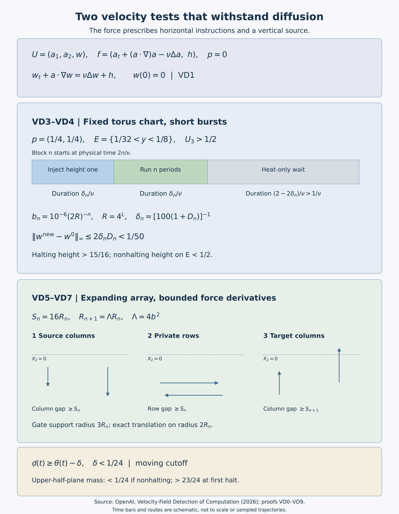

# Detecting computation in the velocity of a viscous fluid

*NS-BLOWUP N8.3. Exposition by GPT-6 Astra (OpenAI). This independent exposition is dedicated to CC0.*

The two preceding lessons observe a material particle. Here the observation is made directly on the velocity field. A planar incompressible processor transports a scalar, and that scalar becomes the third component of a three-dimensional velocity. Prescribing the horizontal residual and the scalar source gives the full force without using the unknown scalar solution.

Diffusion creates the main difficulty. On the torus, short injections and increasingly fast bursts keep one scalar peak near an exact processor orbit; heat-only intervals control the older scalar. On the expanding domain, a broad region of exact translation carries almost all of a nonnegative scalar mass along an integer address path. A moving cutoff bounds the total mass lost to diffusion at every time. These two arguments prove the fixed pointwise and integral detection events in VD0, with every viscosity factor retained.

The [stationary computation lesson](computation-with-eventually-stationary-forcing.md), ST2–ST5, proves the finite recorder and planar processor used in VD2. The [rapid-forcing lesson](computation-with-rapidly-decreasing-forcing.md) gives the contrasting construction in which both velocity and force decrease rapidly. VD1–VD8 below contain the receiving maps, scalar existence, all quantitative estimates and both detector proofs. VD9 gives the energy and integrability consequences; VD11 contains five solved exercises on observation margins, physical viscosity, the exact stack map, scalar error norms and reading a completed configuration.

The source is OpenAI's [*Velocity-Field Detection of Computation in Forced Navier–Stokes Flows*](https://github.com/openai/math/blob/adc7f1241b42e322a6451854ab7e4b4c146bf78a/preprints/Velocity-Field-Detection-of-Computation-in-Forced-Navier-Stokes-Flows-September-27-2026/build/main.tex), with the two full constructions linked in VD10.

## VD0. The two exact claims

Fix a positive computable viscosity \(\nu\). On \(\Omega=\mathbb T^3\) or \(\mathbb R^2\times\mathbb T\), with \(\mathbb T=\mathbb R/\mathbb Z\), the equation is
\[
 U_t+(U\cdot\nabla)U=-\nabla p+\nu\Delta U+f,
 \qquad\nabla\cdot U=0,\qquad U(0)=0.
 \tag{VD0.1}
\]
Torus integration uses periods of length one. Every machine and finite input effectively give each of the following prescribed forces, with a unique global smooth solution in the class specified below. The first event is
\[
 \exists t\ge0\ \exists(x,y,z)\in\mathbb T^3:
 \quad 1/32<y<1/8,\qquad U_3(t,x,y,z)>1/2.
 \tag{VD0.2}
\]
Its force is supported in \(K\times\mathbb T\), where \(K\subset(0,1)^2\) is compact, fixed in time and allowed to depend on the instance. Every force derivative is bounded on each finite time interval; no bound uniform over all time is asserted for this force.

The second event is
\[
 \exists t\ge0:\quad
 \int_{\{X_2>0\}\times\mathbb T}U_3(t,X,z)\,dX\,dz>1/2.
 \tag{VD0.3}
\]
Here every mixed force derivative is globally bounded. Its horizontal support is compact on each finite interval, with no single compact support required for all time. The third velocity component is nonnegative and integrable. Each event is equivalent to the input machine halting. The observation sets and threshold are fixed independently of that input.

A classical competitor has continuous velocity, time derivative, spatial derivatives through order two, pressure and pressure gradient on each closed finite cylinder, and satisfies VD0.1 pointwise. Torus pressure is periodic with mean zero. On \(\mathbb R^2\times\mathbb T\), retain, for every finite \(T\),
\[
 U\in C([0,T];H^2)\cap C^1([0,T];L^2),\qquad
 p\in C([0,T];H^1),\qquad
 \sup_{[0,T]\times\Omega}(|U|+|\nabla U|)<\infty.
 \tag{VD0.4}
\]
The noncompact pressure condition fixes the additive spatial constant. Smoothness at zero is one-sided. The construction gives pressure zero in both cases. Its force is computed from horizontal instructions and a prescribed vertical source, without using the unknown vertical velocity or first executing the selected machine.

The [figure generator](../assets/velocity-detection-mechanisms.py) retains the reproducible diagram. The time bars and gate routes are labeled schematics; the proof retains their actual durations and separations.

## VD1. The scalar receiver and three-dimensional comparison

For \(Y\in\mathbb T^2\) or \(\mathbb R^2\), prescribe a smooth planar divergence-free field \(a(t,Y)\) and a scalar source \(h\). Set
\[
 F_i=\partial_t a_i+\sum_{j=1}^2a_j\partial_j a_i
             -\nu\sum_{j=1}^2\partial_j^2 a_i,
 \qquad f=(F_1,F_2,h),
 \qquad w_t+a\cdot\nabla_Yw=\nu\Delta_Yw+h.
 \tag{VD1.1}
\]
If \(a(0)=0\) and \(w(0)=0\), then \(U=(a_1,a_2,w)\), independent of \(z\), satisfies VD0.1 with \(p=0\). Indeed \(\partial_z w=0\), the divergence is \(\nabla_Y\cdot a\), and \(U\cdot\nabla=a\cdot\nabla_Y\) on every component. All factors of viscosity remain in VD1.1. For a multi-index \(\alpha\in\mathbb N^2\) and integer \(l\ge0\), the full residual derivative is
\[
 \begin{aligned}
 \partial_t^l\partial_Y^\alpha F_i
 ={}&\partial_t^{l+1}\partial_Y^\alpha a_i
       -\nu\sum_{j=1}^2\partial_t^l\partial_Y^{\alpha+2e_j}a_i\\
 &+\sum_{j=1}^2\sum_{r=0}^l\sum_{\beta\le\alpha}
 {l\choose r}{\alpha\choose\beta}
 (\partial_t^r\partial_Y^\beta a_j)
 (\partial_t^{l-r}\partial_Y^{\alpha-\beta+e_j}a_i).
 \end{aligned}\tag{VD1.2}
\]
Here \({\alpha\choose\beta}=\prod_j{\alpha_j\choose\beta_j}\). Thus the support and each required mixed bound follow from the actual displayed horizontal field, with the extra two spatial derivatives and viscosity retained.

Let \((v,p)\) be any competitor and let \((U,P)\) be the constructed solution with the same force and initial datum. Put \(e=v-U\), \(q=p-P\). Their exact difference equation is
\[
 e_t+(v\cdot\nabla)e+(e\cdot\nabla)U=-\nabla q+\nu\Delta e,
 \qquad\nabla\cdot e=0.
 \tag{VD1.3}
\]
On the noncompact domain take a smooth compact horizontal cutoff \(0\le\zeta\le1\), equal to one on the unit disk, and \(\zeta_R(Y)=\zeta(Y/R)\). Integrating over both horizontal coordinates and one vertical period gives, with indices summed from one to three,
\[
 \begin{aligned}
 \frac12\frac d{dt}\int\zeta_R|e|^2
 +\nu\int\zeta_R|\nabla e|^2
 ={}&-\int\zeta_Re_i e_j\partial_j U_i
 +\frac12\int|e|^2v\cdot\nabla\zeta_R\\
 &+\int q e\cdot\nabla\zeta_R
 -\nu\int e_i\partial_j e_i\partial_j\zeta_R.
 \end{aligned}\tag{VD1.4}
\]
There are no vertical boundary terms. The last three terms have absolute bounds
\[
 \frac{\|\nabla\zeta\|_\infty}{2R}\|v\|_\infty\|e\|_2^2,
 \quad\frac{\|\nabla\zeta\|_\infty}{R}\|q\|_2\|e\|_2,
 \quad\frac{\nu\|\nabla\zeta\|_\infty}{R}\|e\|_2\|\nabla e\|_2.
 \tag{VD1.5}
\]
The time continuity in VD0.4 bounds these on each finite interval and justifies the differentiated energy. Integrate in time before letting \(R\to\infty\). Dominated convergence applies to the remaining quadratic integrands; the three errors vanish. On the torus periodic integration gives the same result without cutoffs:
\[
 \frac12\frac d{dt}\|e\|_2^2+\nu\|\nabla e\|_2^2
 \le\|\nabla U\|_{\mathrm{op},\infty}\|e\|_2^2.
 \tag{VD1.6}
\]
The integrating factor \(\exp(-2\int_0^t\|\nabla U(s)\|_{\mathrm{op},\infty}\,ds)\) and zero initial difference prove \(e=0\). The equation then gives \(\nabla q=0\). Mean zero on the torus, or membership in \(H^1(\mathbb R^2\times\mathbb T)\), gives \(q=0\). The competitor's gradient bound was not used; the displayed comparison also proves uniqueness if that one requirement is dropped while the other conditions remain. The constructed reference gradient still has to be bounded on finite intervals. This argument compares all three-dimensional competitors, including those with vertical dependence.

## VD2. The exact computational suppliers

The complete finite recorder and planar processor are proved in [SC2–SC5 of the stationary computation construction](../audits/eventually-stationary-computation-audit.md). Their original supplier is [Sections 3–4 of OpenAI's stationary-forcing paper](https://github.com/openai/math/blob/adc7f1241b42e322a6451854ab7e4b4c146bf78a/preprints/Universal-Computation-with-Eventually-Stationary-Navier-Stokes-Forcing-September-27-2026/build/main.tex). The following are the precise receiving maps; the complete seven-row table and its proof remain available at the first link.

The compiled alphabet consists of the data, marker and history tracks. The initial tape differs from its full blank at finitely many cells. A preliminary nonterminal instruction handles an originally halted input. The initialized run reaches its unique designated terminal state exactly when the original machine halts, and otherwise has a defined next instruction forever. On the entire domain of the partial table, the target state fixes the incoming displacement, and that state together with the full written symbol recovers the incoming rule and its old read symbol. SC2 proves this for every row, including the scan loops, and proves continuation by the history-frontier invariant. This full-domain property, rather than only injectivity along one orbit, is used in VD5.

The Hamiltonian processor \(V(s,Y)\) is smooth, one-periodic in phase, zero in neighborhoods of integer phases and supported in a compact subset of the open unit square. It is divergence free and has effective global bounds of every derivative. Its distinguished point is exactly \(p=(1/4,1/4)\). Write \(\Psi_s\) for its flow from phase zero and
\[
 E=\{(x,y)\in\mathbb T^2:1/32<y<1/8\}.
 \tag{VD2.1}
\]
SC3–SC5 prove the following using the full closed branch rectangles and all intermediate parking motions. If the run halts, an integer-phase point lies in \(E\), at distance at least \(1/32\) from its boundary. If it never halts, the whole phase trajectory lies in \(3/16\le y\le7/8\). On the circle the distance of this corridor from \(E\) is at least \(1/16\). Thus no intermediate segment of a nonhalting transition can create a false entry.

There is also an exact comparison between the integer-stack coordinates used below and the processor's positional coordinates. Let \(b=|\Sigma|\), let \(d: \Sigma\to\{0,\ldots,b-1\}\) send the full blank to zero, and let the original processor use \(B=2b+2\) and distinct odd digits \(c(\alpha)\in\{1,3,\ldots,2b-1\}\). For a nonnegative integer \(x\), denote its base-\(b\) digit in place \(j\) by \(d_j(x)\), including its infinite zero tail. Define
\[
 J(x)=\frac{c(\mathrm{blank})}{B-1}
 +\sum_{j\ge0}\frac{c(d^{-1}(d_j(x)))-c(\mathrm{blank})}{B^{j+1}}.
 \tag{VD2.2}
\]
The sum has only finitely many nonzero terms; the first term retains the full blank tail. This is exactly the fractional code of the same eventually blank stack. Its separated digit intervals recover every symbol, so the map is injective. In particular
\[
 J(bx+d_\beta)=\frac{c(\beta)+J(x)}B,
 \qquad J(\lfloor x/b\rfloor)=BJ(x)-c(d^{-1}(d_0(x))).
 \tag{VD2.3}
\]
Applying these identities to both stacks proves that every row of VD5.1 is carried to the corresponding fractional branch in SC3.5. Composing \((J(x),J(y))\) with the original state embedding \(\Psi_i\) of SC3.3–SC3.4 gives the exact state-coordinate map. No blank contribution or state offset is removed. The two fluid constructions need different spatial realizations, but their compiled instruction maps are related by these proved identities.

## VD3. Scalar existence on the two-torus

We first prove the scalar construction used by the bursts. For smooth \(a,h\) on a finite cylinder, with \(\nabla_Y\cdot a=0\), and smooth initial data, solve
\[
 w_t+a\cdot\nabla_Yw=\kappa\Delta_Yw+h,
 \qquad\kappa>0.
 \tag{VD3.1}
\]
Let \(P_J\) project onto modes \(|k|_\infty\le J\) in the original basis \(e^{2\pi i k\cdot Y}\). The finite linear ODE is
\[
 \partial_t w_J=\kappa\Delta w_J+P_J(-a\cdot\nabla w_J+h),
 \qquad w_J(0)=P_Jw(0).
 \tag{VD3.2}
\]
Its coefficients are smooth, so the finite system exists on the whole interval. Put \(E_m=\sum_{|\alpha|\le m}\|\partial^\alpha w_J\|_2^2\). Differentiation gives the exact commutator
\[
 \partial^\alpha(a\cdot\nabla w_J)-a\cdot\nabla\partial^\alpha w_J
 =\sum_{j=1}^2\sum_{0<\beta\le\alpha}{\alpha\choose\beta}
 (\partial^\beta a_j)\partial^{\alpha-\beta+e_j}w_J.
 \tag{VD3.3}
\]
Every derivative of \(w_J\) on the right has order at most \(m\). The leading transport has zero inner product; projection drops out because \(w_J\) is in its range. With
\[
 A_m(t)=\sum_{|\alpha|\le m}\sum_{j=1}^2
       \sum_{0<\beta\le\alpha}{\alpha\choose\beta}
          \|\partial^\beta a_j(t)\|_\infty,
 \qquad H_m(t)=\sum_{|\alpha|\le m}\|\partial^\alpha h(t)\|_2^2,
\]
Cauchy–Schwarz and \(2rs\le r^2+s^2\) give
\[
 E_m'+2\kappa\sum_{|\alpha|\le m}\|\nabla\partial^\alpha w_J\|_2^2
 \le(2A_m+1)E_m+H_m.
 \tag{VD3.4}
\]
Multiplication by \(\exp(-\int_0^t(2A_m+1))\) bounds \(E_m\) independently of \(J\). The exact Fourier weight for this norm is
\(W_m(k)=\sum_{|\alpha|\le m}(2\pi)^{2|\alpha|}k_1^{2\alpha_1}k_2^{2\alpha_2}\).
For \(|\gamma|\le\ell\), Cauchy–Schwarz bounds the derivative tail by
\[
 E_{\ell+2}^{1/2}
 \left(\sum_{|k|_\infty>K}
 \frac{(2\pi)^{2|\gamma|}|k_1^{\gamma_1}k_2^{\gamma_2}|^2}
 {W_{\ell+2}(k)}\right)^{1/2}.
 \tag{VD3.5}
\]
The shell \(|k|_\infty=j\) has \(8j\) points. Since one coordinate has absolute value \(j\), the denominator contains \((2\pi j)^{2(\ell+2)}\); the numerator is at most \((2\pi)^{2|\gamma|}j^{2|\gamma|}\). Thus the sum is bounded by an explicit constant times \(\sum_{j>K}8j^{-3}\), tending to zero. No Fourier scale factor is suppressed.

The equations uniformly bound the time derivative of each fixed coefficient. Extract coefficientwise uniformly convergent subsequences on the compact time interval and then a diagonal subsequence. VD3.5 promotes convergence to every \(C([0,T];C^\ell)\) norm. The same tail argument controls products and projections in the integrated equation. Its limit solves VD3.1 with all spatial derivatives. That equation supplies a continuous time derivative, and repeated differentiation supplies every time derivative. This proves existence up to time zero.

For comparison subtract a proposed scalar upper barrier, then a strictly positive initial gap and \(\varepsilon t\). A first zero maximum has nonnegative time derivative, zero gradient and nonpositive Laplacian, contradicting the resulting strict negative source. Let the gaps tend to zero. Applying the argument to a difference, to its negative, and to \(-w\), proves uniqueness, nonnegativity for nonnegative data and source, supremum contraction for homogeneous evolution, and the bound \(\|w(t)\|_\infty\le A(t-t_0)\) for zero initial data and source of absolute value at most \(A\). These comparisons also apply to a bounded time-dependent scalar source majorant by integrating that majorant.

## VD4. The complete torus burst estimate, with physical viscosity

Use the source profiles
\[
 b(r)=\begin{cases}e^{-1/r},&r>0,\\0,&r\le0,\end{cases}
 \qquad\theta(r)=\frac{b(r)}{b(r)+b(1-r)},\qquad
 g(Z)=\prod_{j=1}^2\theta(2(Z_j+1))\theta(2(1-Z_j)).
 \tag{VD4.1}
\]
The denominator is at least \(e^{-2}\). Successive derivatives of \(b\) on the positive half-line are explicit polynomials in \(1/r\) times \(e^{-1/r}\); the estimate \(s^m e^{-s}\le(m+j)!s^{-j}\) proves flatness and effective error bounds. Differentiating the quotient gives effective derivative bounds for \(\theta\), which is nondecreasing, zero below zero and one above one. Thus \(0\le g\le1\), it is one near zero and supported in \([-1,1]^2\). Choose an effective integer \(C\ge1\) bounding its first two derivative operator norms. Choose an effective integer \(L\ge1\) bounding those of \(V\), and retain
\[
 R=4^L,\quad b_n=10^{-6}(2R)^{-n},\quad
 D_n=2Cb_n^{-2}(1+nL)R^{3n},\quad
 \delta_n=\frac1{100(1+D_n)},\quad t_n=2n,
 \qquad n\ge1.
 \tag{VD4.2}
\]
The auxiliary phase-time variable used in the original construction is \(\tau=\nu t\); physical block starts are \(t_n/\nu\), and both active durations are \(\delta_n/\nu\). Define the periodized small-square bump \(g_n(Y)=g((Y-p)/b_n)\). Its copies are disjoint and
\[
 \|Dg_n\|_\infty\le Cb_n^{-1},\quad
 \|D^2g_n\|_\infty\le Cb_n^{-2},\quad
 \int g_n\le4b_n^2.
 \tag{VD4.3}
\]
Let \(V_0\) be one period of \(V\), extended by zero. Phase collars make the extension smooth. Keep the full auxiliary formulas
\[
 \begin{aligned}
 s_n(\tau)&=n(\tau-t_n-\delta_n)/\delta_n,\\
 a(\tau,Y)&=\sum_{n\ge1}\frac n{\delta_n}
          \sum_{j=0}^{n-1}V_0(s_n(\tau)-j,Y),\\
 h(\tau,Y)&=\sum_{n\ge1}\delta_n^{-1}
       \theta'((\tau-t_n)/\delta_n)g_n(Y),\\
 F&=a_\tau+(a\cdot\nabla_Y)a-\Delta_Ya.
 \end{aligned}\tag{VD4.4}
\]
These are locally finite smooth sums with zero endpoint derivatives. Solve \(w_\tau+a\cdot\nabla w=\Delta w+h\) by VD3. The actual physical solution and force, without dropping any viscosity factor, are
\[
 U_\nu(t,Y,z)=(\nu a(\nu t,Y),w(\nu t,Y)),\qquad
 f_\nu(t,Y,z)=(\nu^2F(\nu t,Y),\nu h(\nu t,Y)),\qquad p=0.
 \tag{VD4.5}
\]
Substitution in VD1.1 makes each horizontal term acquire \(\nu^2\) and each vertical term \(\nu\). More generally \(\partial_t^l\partial_Y^\alpha f_{\nu,h}=\nu^{l+2}(\partial_\tau^l\partial_Y^\alpha F)(\nu t,Y)\) and \(\partial_t^l\partial_Y^\alpha f_{\nu,3}=\nu^{l+1}(\partial_\tau^l\partial_Y^\alpha h)(\nu t,Y)\). These identities prove finite-time smooth bounds at the original viscosity and preserve the threshold. The horizontal support is the union of the fixed support of \(V\) and one small square about \(p\), contained in a compact subset of the open unit square.

Nonnegativity and integrating the scalar equation give
\[
 0\le\int w(\tau,Y)\,dY\le
 M_0=\sum_{n\ge1}4b_n^2
 =\frac{4\cdot10^{-12}}{4R^2-1}<10^{-11}.
 \tag{VD4.6}
\]
We need an all-time heat bound away from a source point. For either
\((d,H)=(1/32,10^9)\) or \((1/16,10^8)\), the auxiliary torus heat kernel is
\[
 K(\sigma,Z)=\frac1{4\pi\sigma}\sum_{k\in\mathbb Z^2}
                  e^{-|Z+k|^2/(4\sigma)}.
 \tag{VD4.7}
\]
Periodized Gaussian convolution solves the heat equation and approaches smooth initial data uniformly, so VD3 uniqueness identifies the kernel. Choose \(Z\in[-1/2,1/2]^2\). The shell \(|k|_\infty=j\) has \(8j\) points and \(|Z+k|\ge j/2\). Hence
\[
 \sum_k e^{-|Z+k|^2/8}
 \le1+8\sum_{j\ge1}j e^{-j/32}
 \le1+8\cdot1056<10^4.
 \tag{VD4.8}
\]
The middle estimate uses \(e^{-1/32}\le32/33\) and \(\sum_{j\ge1}jq^j=q/(1-q)^2\). If \(0<\sigma\le1\) and the torus distance of \(Z\) from zero is at least \(d\), split each exponential in VD4.7 in half. One half, together with \(\sigma^{-1}\), is at most \(8/d^2\), since \(u e^{-u}\le1\). The sum of the other halves is bounded by VD4.8. Consequently
\[
 K(\sigma,Z)\le\frac{8\cdot10^4}{4\pi d^2}<H.
 \tag{VD4.9}
\]
At \(\sigma=1\), VD4.8 also bounds the kernel everywhere by \(10^4/(4\pi)<H\); supremum contraction extends that bound to \(\sigma\ge1\). Thus \(K\le H\) whenever the distance is at least \(d\) or the heat duration is at least one. The physical kernel at viscosity \(\nu\) is \(K(\nu\Delta t,Z)\), so the waiting condition is exactly \(\Delta t\ge1/\nu\).

Before every block after the first, the heat-only wait has auxiliary length \(2-2\delta_{n-1}>1\). Its old scalar is therefore at most \(HM_0\). In the first block it is zero. Split the scalar during block \(n\) into this homogeneous old contribution and a new contribution starting at zero with only the current source. The old part stays between zero and \(HM_0\).

The first and second variational equations of the processor, including the reversed-time inverse flow, give for \(0\le s\le n\)
\[
 \|D\Psi_s^{\pm1}\|_\infty\le e^{Ln}\le R^n,
 \qquad\|D^2\Psi_s^{\pm1}\|_\infty
 \le\int_0^s e^{L(s-r)}L e^{2Lr}\,dr
 \le nLR^{3n}.
 \tag{VD4.10}
\]
The inverse is the flow of \(-V(s-r,\cdot)\) over the reversed interval, so it has the same bounds. Define the undiffused current contribution by
\[
 w^0(\tau,Y)=
 \begin{cases}
 \theta((\tau-t_n)/\delta_n)g_n(Y),&t_n\le\tau\le t_n+\delta_n,\\
 g_n(\Psi_{s_n(\tau)}^{-1}(Y)),&t_n+\delta_n\le\tau\le t_n+2\delta_n.
 \end{cases}\tag{VD4.11}
\]
Flat endpoints and phase collars give smooth joining. Direct differentiation gives \(w^0_\tau+a\cdot\nabla w^0=h\). The Hessian chain rule costs
\(Cb_n^{-2}R^{2n}+Cb_n^{-1}nLR^{3n}\); taking the two-dimensional trace costs at most two. Because \(b_n<1\), this bounds \(\|\Delta w^0\|_\infty\) by \(D_n\), also during injection. The difference between the new diffusive scalar and VD4.11 has source \(\Delta w^0\), hence
\[
 \|w^{\mathrm{new}}-w^0\|_\infty
 \le2\delta_nD_n<1/50<1/16.
 \tag{VD4.12}
\]
Equivalently, in physical time its source is \(\nu\Delta w^0\) for at most \(2\delta_n/\nu\), giving exactly the same error. This checks the diffusion scale against the actual viscosity.

If \(\Psi_k(p)\in E\) at an integer \(k\), choose \(n\ge\max(1,k)\). At phase \(s_n=k\), the reference height at that point is one. The old contribution is nonnegative, so the actual height is greater than \(15/16\). If the complete processor orbit stays at distance at least \(2d\) from \(E\), the reference support stays within
\[
 \sqrt2\,b_n R^n=\sqrt2\,10^{-6}2^{-n}<1/32\le d
 \tag{VD4.13}
\]
of its center and therefore at distance at least \(d\) from \(E\). During active intervals its reference vanishes on \(E\), so \(w\le HM_0+1/16\) there. During the wait, heat evolution of the reference contributes at most \(H\int g_n\), and its error remains below \(1/16\). Thus at every physical time in a nonhalting run,
\[
 w|_E\le2HM_0+1/16<1/2.
 \tag{VD4.14}
\]
For the larger \(H=10^9\), the right side is less than \(1/50+1/16<1/2\); the smaller choice also works. Before the first block the scalar is zero. Endpoint continuity covers every join. VD2 supplies \(d=1/32\), proving exactly VD0.2. The source's second choice also applies to a nonhalting corridor \(1/8<x<3/8\) and target \(2/3<x<5/6\), since their infimum circle separation is \(\min(2/3-3/8,1+1/8-5/6)=7/24>1/4\). This arithmetic checks that specialization without claiming to validate a different companion processor.

For effective evaluation at computable \(\tau\), take rational \(q\) with \(|q-\tau|\le1\) and use only \(n\le\max(1,\lceil(q+1)/2\rceil)\). All later summands and derivatives vanish. Each retained term uses finitely many translates of \(V_0\); smooth endpoint estimates from VD4.1 handle uncertain equalities without a discontinuous comparison. The same finite sums and derivative bounds evaluate all force derivatives. The scalar is not an input to this prescription. VD3 and VD1 give existence and uniqueness on each finite interval and hence globally.

## VD5. Integer addresses and the expanding translation field

Use the compiled table of VD2, now with states \(i=1,\ldots,N\), alphabet size \(b\), and digits \(d_\alpha\). A nonnegative integer encodes a stack least significant digit first, with its zero tail interpreted as full blanks. Let \(x\) encode cells strictly left of the head, nearest first, and \(y\) the head cell and cells to its right. For a rule reading \(\alpha\), writing \(\beta\) and entering \(i'\), the exact updates are
\[
 \begin{array}{c|cc}
 &x'&y'\\\hline
 \mathsf R&bx+d_\beta&\lfloor y/b\rfloor\\
 \mathsf N&x&y-d_\alpha+d_\beta\\
 \mathsf L&\lfloor x/b\rfloor&d_\gamma+bd_\beta+b^2\lfloor y/b\rfloor,
 \quad d_\gamma=x\bmod b.
 \end{array}\tag{VD5.1}
\]
The target state determines the row. Its written symbol is the lowest digit of \(x'\) in the right row, the lowest digit of \(y'\) in the stationary row, and the second lowest digit of \(y'\) in the left row. The compiler then recovers the unique old state and read symbol. The three inverse formulas are
\[
 \begin{aligned}
 \mathsf R:&\quad(x,y)=((x'-d_\beta)/b,\ by'+d_\alpha),\\
 \mathsf N:&\quad(x,y)=(x',\ y'-d_\beta+d_\alpha),\\
 \mathsf L:&\quad(x,y)=(bx'+d_\gamma,\ b\lfloor y'/b^2\rfloor+d_\alpha),
 \quad d_\gamma=y'\bmod b.
 \end{aligned}\tag{VD5.2}
\]
This proves injectivity on every defined address, not only the selected run. Choose \(m\ge1\) so both initial stacks are smaller than \(b^m\), and retain
\[
 B_n=b^{m+n},\quad K_n=NB_n^2=K_0D^n,\quad D=b^2,
 \qquad k=1+x+B_ny+B_n^2(i-1).
 \tag{VD5.3}
\]
For \(0\le x,y<B_n\), the address is in \(\{1,\ldots,K_n\}\) and integer division recovers all three entries. Every defined target lies at level \(n+1\). The largest expression is bounded by
\((b-1)+b(b-1)+b^2(B_n/b-1)=bB_n-1\); the other stack bounds follow directly from VD5.1. Distinct defined source addresses therefore have distinct target addresses \(k'\).

Keep all source scales, including their dependence on the original viscosity:
\[
 \begin{aligned}
 C_*&=3000,&\Lambda&=4D,&
 R_0&=1024C_*(1+\nu)\Lambda(K_0D+2),\\
 R_n&=R_0\Lambda^n,&S_n&=16R_n,&
 T_n&=S_{n+1}(K_{n+1}+2),\\
 t_0&=1,&t_{n+1}&=t_n+T_n.
 \end{aligned}\tag{VD5.4}
\]
Let \(s_i=1\) for the terminal state and \(-1\) otherwise, and \(p_{n,k}=(S_nk,s_iS_n)\). The known initial address has center \(p_*\) on the negative row. For a defined source \(k\) with target \(k'\) in state \(i'\), set
\[
 \Theta(r)=\theta(2r-1/2),\quad Y_k=-(k+2)S_n,\quad
 \theta_j(t)=\Theta(3(t-t_n)/T_n-(j-1)),\quad j=1,2,3.
 \tag{VD5.5}
\]
The exact center path is
\[
 \begin{aligned}
 c_1&=(1-\theta_2)S_nk+\theta_2S_{n+1}k',\\
 c_2&=-(1-\theta_1)S_n+(\theta_1-\theta_3)Y_k
                      +\theta_3s_{i'}S_{n+1}.
 \end{aligned}\tag{VD5.6}
\]
The three active derivative supports are successive disjoint slots. In the first, different centers are separated in their source first coordinates by at least \(S_n\). In the second, the private heights differ by at least \(S_n\). In the third, injectivity separates target first coordinates by at least \(S_{n+1}\). These separations persist through the stationary collars. For a nonterminal target, all vertical path segments have \(c_2\le-S_n\).

For \(\xi=X-c(t)\), \(G=\dot c\), and
\(\chi(z)=\prod_{j=1}^2\theta(z_j+3)\theta(3-z_j)\), install
\[
 W_{n,k}(t,X)=(\partial_{X_2},-\partial_{X_1})
 \left[\chi(\xi/R_n)(G_1\xi_2-G_2\xi_1)\right].
 \tag{VD5.7}
\]
It is divergence free, equals \(G\) on \(|\xi|_\infty\le2R_n\), and vanishes outside \(|\xi|_\infty<3R_n\). The supports of simultaneously installed gates are disjoint since \(16R_n>6R_n\). Sum over every defined source at level \(n\) on its stage, and put \(W=0\) on \([0,1]\). The endpoint collars make this a globally smooth field. Since \(t_n\ge n+1\), only finitely many levels occur on a finite time interval, each with finitely many gates and a compact swept support.

There is no factor counting addresses in a supremum derivative bound. To check all derivative orders explicitly, write VD5.7 as \(A((X-c)/R_n)\dot c\), with
\[
 A(z)=\begin{pmatrix}
 \chi+z_2\partial_2\chi&-z_1\partial_2\chi\\
 -z_2\partial_1\chi&\chi+z_1\partial_1\chi
 \end{pmatrix}.
 \tag{VD5.8}
\]
Each path coefficient has absolute value at most \(2T_n\); more precisely the three changing coefficients in VD5.6 have bounds \(T_n,T_n,2T_n\). Hence, for \(j\ge1\),
\[
 |c^{(j)}|\le C_jT_n^{1-j},\qquad
 C_j=4\cdot3^j\|\Theta^{(j)}\|_\infty.
 \tag{VD5.9}
\]
For integers \(l\ge0\), let \(\Pi(r)\) be the set of partitions of \(\{1,\ldots,r\}\), including the empty partition when \(r=0\). The full time and space chain rule is
\[
 \begin{aligned}
 \partial_t^l\partial_X^\alpha W_{n,k}
 =R_n^{-|\alpha|}\sum_{j=0}^l{l\choose j}
 \sum_{\pi\in\Pi(l-j)}
 D^{|\pi|}(\partial^\alpha A)(\xi/R_n)
 \left[\left(-\frac{c^{(|B|)}}{R_n}\right)_{B\in\pi}\right]
 c^{(j+1)}.
 \end{aligned}\tag{VD5.10}
\]
The empty brackets mean the matrix itself. Each summand is bounded by
\[
 {l\choose j}\|D^{|\pi|}\partial^\alpha A\|_\infty
 C_{j+1}\prod_{B\in\pi}C_{|B|}\,
 R_n^{-|\alpha|-|\pi|}T_n^{|\pi|-l}.
 \tag{VD5.11}
\]
Both scale exponents are nonpositive, since \(|\pi|\le l-j\), and \(R_n,T_n\ge1\). The finite sum of these bounds is independent of the stage and address. At any point at most one gate contributes, so it bounds every mixed derivative of the actual \(W\). VD1.2 now supplies globally bounded derivatives of its horizontal residual, with every nonlinear factor and \(\nu\) retained.

## VD6. The scalar on the unbounded horizontal domain

Prescribe, independently of the unknown scalar,
\[
 \begin{aligned}
 G(X)&=\prod_{j=1}^2\theta'(X_j-(p_*)_j+1/2),\qquad g(t,X)=\theta'(t)G(X),\\
 f_h&=W_t+(W\cdot\nabla_X)W-\nu\Delta_XW,\qquad f=(f_h,g),\\
 \rho_t+W\cdot\nabla_X\rho&=\nu\Delta_X\rho+g,\qquad\rho(0)=0.
 \end{aligned}\tag{VD6.1}
\]
Here \(g\ge0\), its support has \(0\le t\le1\) and \(|X-p_*|_\infty\le1/2\), and \(\int G=1\), so \(\int g(t)=\theta'(t)\). All force derivatives are globally bounded, and their horizontal support is compact on each finite interval.

For \(s>0\), keep the physical heat kernel
\[
 H_s(X)=(4\pi\nu s)^{-1}e^{-|X|^2/(4\nu s)},\quad
 \|H_s\|_1=1,\quad
 \|\partial_jH_s\|_1=(\pi\nu s)^{-1/2}.
 \tag{VD6.2}
\]
The last identity follows by integrating \(|X_j|H_s/(2\nu s)\); its one-dimensional Gaussian absolute first moment is \(2\sqrt{\nu s/\pi}\). With \(\nabla_X\cdot W=0\), the mild equation is
\[
 \rho(t)=\int_0^tH_{t-r}*g(r)\,dr
 -\sum_{j=1}^2\int_0^t(\partial_jH_{t-r})*(W_j(r)\rho(r))\,dr.
 \tag{VD6.3}
\]
For \(a\ge0\), let \(E_a\) consist of \(C^a\) functions with every derivative through order \(a\) in \(C_0(\mathbb R^2)\cap L^1\), with norm
\[
 \|v\|_{E_a}=\sum_{|\alpha|\le a}
       (\|\partial^\alpha v\|_\infty+\|\partial^\alpha v\|_1).
 \tag{VD6.4}
\]
This is complete: a Cauchy sequence has uniformly convergent continuous derivatives and convergent \(L^1\) derivatives; distributional testing identifies these limits and gives the stated classical derivatives. Heat convolution contracts each derivative norm and is strongly continuous, by translation continuity in \(C_0\) and \(L^1\) and the Gaussian approximate identity. Products by \(W_j\) are bounded on \(E_a\): the product rule gives an effective bound from the finite sum of \({\alpha\choose\beta}\|\partial^\beta W_j\|_\infty\) over \(\beta\le\alpha\), \(|\alpha|\le a\). Denote a common upper bound by \(M_a\). It can be uniform in time by VD5.11. Higher time derivative bounds imply operator-norm continuity in time on finite intervals.

On an interval of length \(h\), the second term of VD6.3 has operator norm at most
\[
 q=\frac{4M_a}{\sqrt{\pi\nu}}\sqrt h.
 \tag{VD6.5}
\]
Choose \(h\) so \(q\le1/2\). The convergent Neumann series solves the equation in \(C_tE_a\). The integrable \((t-r)^{-1/2}\) bound also proves continuity at the upper endpoints. On the next interval add the heat evolution of the previous endpoint value; the same bound applies. Finitely many steps cover each finite \([0,T]\). Uniqueness in \(E_0\) identifies the solutions for different \(a\), proving all spatial regularity.

Set \(F=g-\nabla_X\cdot(W\rho)\). It is continuous into every \(E_a\). For \(v\in E_{a+2}\), \(d(H_s*v)/ds=\nu H_s*\Delta v\), continuously through \(s=0\) in \(E_a\). Applying this to \(\rho=\int H_{t-r}*F(r)\,dr\) gives \(\rho_t=F+\nu\Delta\rho\) in every \(E_a\). Repeated time differentiation proves that every mixed derivative is continuous into \(C_0\cap L^1\), including at zero.

All terms of VD6.3 are absolutely integrable. Since \(\int\partial_jH_s=0\),
\[
 \mathcal M(t)=\int\rho(t,X)\,dX=\theta(t)\le1.
 \tag{VD6.6}
\]
For positivity use \(\rho+\varepsilon(1+t)\). On a finite time interval, continuity into \(C_0\) implies uniform spatial decay: the compact image of the time interval is covered by finitely many small supremum balls, each centered at a function decaying at infinity. Thus this perturbed function is positive outside a fixed compact set and initially positive. At a first zero minimum inside it, its time derivative is nonpositive, its gradient zero and its Laplacian nonnegative, contradicting source \(g+\varepsilon>0\). Let \(\varepsilon\to0\). This proves \(\rho\ge0\).

Now \(U=(W,\rho)\), \(p=0\), satisfies VD0.1 by VD1.1. For every derivative, \(\|v\|_2^2\le\|v\|_1\|v\|_\infty\), also applied to differences at two times, gives \(L^2\) continuity from the established \(E_a\) continuity. Spatial derivatives through order two and the time derivative therefore give exactly VD0.4. The horizontal field has a common compact support on every finite interval. The scalar need not have compact support; its proved tails supply the required spaces. VD1 proves uniqueness in the complete three-dimensional class.

## VD7. The moving cutoff and every-time detection

Only for the proof of the event equivalence, follow the initialized run. During loading let \(c(t)=p_*\); then concatenate the installed paths VD5.6 until the first terminal endpoint, if any. The integer-stack bounds ensure every required gate exists, and the compiler ensures continuation for a nonhalting run. Adjacent centers and stationary collars agree.

Use the original \(C^2\) cutoff polynomial, extended by zero to the left and one to the right:
\[
 \begin{aligned}
 P(s)&=10s^3-15s^4+6s^5\quad(0\le s\le1),\\
 A_*(s)&=P(2(1+s))P(2(1-s)),\\
 \varphi_R(a)&=A_*(a_1/R)A_*(a_2/R).
 \end{aligned}
 \tag{VD7.1}
\]
The endpoint first and second derivatives vanish, \(P'=30s^2(1-s)^2\ge0\), and the coefficient bound gives \(|P''|\le360\). The transition intervals of the two factors in \(A_*\) are disjoint; the other factor is one on either transition. Thus \(|A_*''|\le1440\),
\[
 0\le\varphi_R\le1,\quad
 \varphi_R=1\text{ on }|a|_\infty\le R/2,\quad
 \varphi_R=0\text{ on }|a|_\infty\ge R,\quad
 \|\Delta\varphi_R\|_\infty\le2880R^{-2}\le C_*R^{-2}.
 \tag{VD7.2}
\]
Use \(R_0\) during loading and \(R_n\) in stage \(n\), and set \(\mathcal I(t)=\int\varphi_R(X-c(t))\rho(t,X)\,dX\). The compact \(C^2\) cutoff and proved scalar regularity justify differentiation and integration by parts:
\[
 \begin{aligned}
 \mathcal I'(t)={}&\int\big[(W(t,X)-\dot c(t))\cdot\nabla\varphi_R(X-c(t))
                  +\nu\Delta\varphi_R(X-c(t))\big]\rho(t,X)\,dX\\
 &+\int\varphi_R(X-c(t))g(t,X)\,dX.
 \end{aligned}
 \tag{VD7.3}
\]
The transport term is exactly zero: the cutoff derivative is supported where the installed field equals \(\dot c\); during loading both vanish. Positivity and mass at most one bound the diffusion term below by \(-\nu C_*R^{-2}\). The loading source lies in the cutoff's one-plateau because \(R_0\ge1\), and contributes \(\mathcal M'\). After time one it is zero.

At a stage join the center is unchanged and \(R_{n+1}\ge2R_n\); the new cutoff is one on the entire support of the preceding one. Hence the weighted mass cannot decrease at the radius change. Starting with zero, integrating VD7.3 gives at all times through the first halt
\[
 \mathcal I(t)\ge\mathcal M(t)-\delta,\qquad
 \delta=\nu C_*\left(R_0^{-2}+\sum_{n\ge0}\frac{T_n}{R_n^2}\right).
 \tag{VD7.4}
\]
Retaining both summands from the address count, the exact series is
\[
 \begin{aligned}
 \frac{T_n}{R_n^2}
 &=\frac{16\Lambda}{R_0}
       \left[K_0D(D/\Lambda)^n+2\Lambda^{-n}\right],\\
 \delta&=\frac{\nu C_*}{R_0^2}
 +\frac{16\nu C_*\Lambda}{R_0}
       \left[\frac{4K_0D}{3}+\frac{2\Lambda}{\Lambda-1}\right].
 \end{aligned}\tag{VD7.5}
\]
Since \(D/\Lambda=1/4\) and \(\Lambda\ge4\), both geometric sums are at most \(4/3\). The chosen original \(R_0\) therefore gives
\[
 \nu C_*\sum_n\frac{T_n}{R_n^2}
 \le\frac{\nu}{1+\nu}\frac{64}{3\cdot1024}<1/48,
 \qquad
 \frac{\nu C_*}{R_0^2}
 \le\frac{\nu}{1024^2C_*(1+\nu)^2}<1/48.
 \tag{VD7.6}
\]
Thus \(\delta<1/24\). These are symbolic bounds on the exact scales, requiring no trajectory simulation or numerical quadrature.

If there is no halt, the loading center and every selected transition lie at or below \(-S_n=-16R_n\). The cutoff is entirely in \(X_2<0\), so at every time
\[
 \int_{X_2>0}\rho\le\mathcal M-\mathcal I\le\delta<1/24.
 \tag{VD7.7}
\]
At a terminal arrival of level \(n\), its center height is \(S_n=16R_n\). The preceding cutoff radius is at most \(R_n\), so its entire support lies in \(X_2>0\), and its mass is at least \(1-\delta>23/24\). The arrival time is finite. This includes an originally halted input because the compiled initial state is nonterminal. No statement about mass after the first terminal arrival is needed. The vertical period has length one, so these are exactly the integrals in VD0.3. The threshold \(1/2\) separates the two cases.

At any completed nonterminal level, the correct address square of radius \(R_n\) contains mass greater than \(23/24\). Every other address square is disjoint and can contain less than \(1/24\), because total mass is one. At a terminal level the arriving smaller cutoff gives the same conclusion for the larger address square. Thus the original construction also detects each completed configuration uniquely by its mass, with all address coordinates retained.

## VD8. Effective force and scalar evaluation

The finite table, both initial stacks and the single-rule maps determine all addresses and scales. On \([0,T]\), choose an integer \(Q>T\); since \(t_n\ge n+1\), only \(0\le n<Q\) can contribute. Evaluate the finite sum over every defined address at these levels, extending each gate by zero through its collars. Uncertain comparison with a computable switching time causes no problem because the endpoint functions are flat and have the effective derivative bounds in VD4.1. Thus the force and every mixed derivative have finite evaluation programs and computable bounds. No selected execution is used to decide which gates to install.

For completeness the noncompact scalar also has an effective finite-time representation including its tails. On a step satisfying VD6.5, write the mild equation as \(\rho=y+B\rho\), where \(y\) includes the heat evolution of the previous datum and the source term. Then
\[
 \left\|\rho-\sum_{j=0}^N B^jy\right\|_{C_tE_a}
 \le\frac{q^{N+1}}{1-q}\|y\|_{C_tE_a}.
 \tag{VD8.1}
\]
An initial-data error \(\varepsilon_0\) and equation error \(\varepsilon_1\) change the solution by at most \((\varepsilon_0+\varepsilon_1)/(1-q)\). These estimates give finite backwards error budgets for all steps covering \([0,T]\).

Here is the tail construction needed to use those norms on an unbounded domain. Every source and product \(W_jv\) has known compact support on \([0,T]\). In a derivative-kernel integral split the lag at \(\eta>0\). For \(\|v\|_{C_tE_a}\le A\), its short-lag part has norm at most \(4M_aA\sqrt{\eta}/\sqrt{\pi\nu}\). For lags in \([\eta,T]\), every Gaussian derivative is an explicit polynomial times that Gaussian, with computable supremum and \(L^1\) tails uniform on the interval. Convolving with data of known compact support and bounded \(E_a\) norm gives a computable tail outside that support radius plus a chosen radius. For the source term, heat convolution has norm one and the short-lag contribution is bounded by its duration times the source norm.

At a restart, keep the previous approximant and its certified \(E_a\) error. Its derivative tails permit multiplication by a smooth cutoff equal to one on a large ball: the product rule bounds the lost tail and every cutoff-derivative contribution. Heat convolution contracts that error; the retained compact datum has Gaussian tails uniformly for lag from zero through the new step. Starting from zero, induction supplies both supremum and \(L^1\) tails for every finite approximant. On the remaining compact space-time sets, finite derivative bounds give effective integration error; a uniform spatial error bounds its \(L^1\) contribution by the retained area times that error. Time derivatives follow from VD6.1. This proves the source's stronger scalar computability assertion without using it to define the force.

Finally, an algorithm deciding either event for every produced force would decide whether any machine halts on its input by composing it with the finite construction. If a total halting decider existed, the program that halts exactly when that decider says its own code does not halt would contradict either answer. This proves the decision obstruction for both exact force families. The strict signal margins above are estimates for those exact forces; no stability under replacing the force by a finite-precision description has been assumed.

## VD9. Further consequences in the original variables

The following consequences are editorial, with no novelty claim. First, the preceding bounded-force construction also has globally bounded velocity, and its vertical component has a global energy and dissipation bound. Let \(G_* =\|G\|_\infty\). Scalar comparison, justified by the same compact-at-infinity argument as in VD6, with the time-dependent barrier \(G_*\theta(t)\), gives
\[
 0\le\rho(t,X)\le G_*\theta(t)\le G_*.
 \tag{VD9.1}
\]
VD5.11 supplies a uniform bound for \(W\), so \(U=(W,\rho)\) is uniformly bounded pointwise. This does not assert a uniform horizontal \(L^2\) bound on the expanding support.

The \(E_a\) regularity just proved justifies the scalar energy identity by spatial cutoffs and passage to the limit, with vanishing transport and viscous boundary errors bounded by the same \(R^{-1}\) estimates as in VD1. Since \(\int g(t)=\theta'(t)\), positivity and VD9.1 give, for every finite \(t\),
\[
 \begin{aligned}
 \|\rho(t)\|_2^2+2\nu\int_0^t\|\nabla_X\rho(s)\|_2^2\,ds
 &=2\int_0^t\int\rho g\,dX\,ds\\
 &\le2G_*\int_0^t\theta(s)\theta'(s)\,ds
 =G_*\theta(t)^2\le G_*.
 \end{aligned}\tag{VD9.2}
\]
Monotone convergence in the nonnegative dissipation integral yields the same finite upper bound through infinite time. This exact vertical-energy estimate is compatible with the expanding horizontal geometry and makes no claim about the total kinetic energy of \(U\).

Second, the torus scalar also stays uniformly bounded, although its horizontal bursts need not. The new scalar has supremum at most one: during injection compare with the injected fraction, and during stirring and waiting use homogeneous contraction. The old part is at most \(HM_0\), so
\[
 0\le U_{\nu,3}(t,Y,z)\le1+HM_0.
 \tag{VD9.3}
\]
Its nonzero retained mass prevents finite time-integrability of that velocity component over the entire half-line. Indeed, after the first injection, its mass is at least \(m_1=\int g_1>0\), since \(g_1=1\) on a nonempty open square. On the unit torus, Hölder gives \(\|U_{\nu,3}(t)\|_{L^p}\ge m_1\) for every \(1\le p\le\infty\). Therefore \(\|U_{\nu,3}\|_{L^q_tL^p_x}=\infty\) for every finite \(q\ge1\). This is an exact distinction from the earlier rapidly vanishing velocity family, not an obstruction to either detection theorem.

## VD10. Sources and mathematical dependencies

OpenAI's *Velocity-Field Detection of Computation in Forced Navier–Stokes Flows* contains the [common theorem statements and scalar receiver](https://github.com/openai/math/blob/adc7f1241b42e322a6451854ab7e4b4c146bf78a/preprints/Velocity-Field-Detection-of-Computation-in-Forced-Navier-Stokes-Flows-September-27-2026/build/main.tex), the [compact torus construction](https://github.com/openai/math/blob/adc7f1241b42e322a6451854ab7e4b4c146bf78a/preprints/Velocity-Field-Detection-of-Computation-in-Forced-Navier-Stokes-Flows-September-27-2026/build/compact.tex), and the [bounded-force construction on the expanding domain](https://github.com/openai/math/blob/adc7f1241b42e322a6451854ab7e4b4c146bf78a/preprints/Velocity-Field-Detection-of-Computation-in-Forced-Navier-Stokes-Flows-September-27-2026/build/bounded.tex). VD1 proves the full three-dimensional comparison; VD3–VD4 prove scalar existence, heat estimates and torus detection at the prescribed viscosity; VD5–VD8 prove integer-address transport, scalar tails, the moving-cutoff estimate and the expanding-domain detector equivalence. VD9 derives the stated velocity and scalar bounds.

The finite recorder and planar processor are proved in [SC2–SC5 of the stationary computation construction](../audits/eventually-stationary-computation-audit.md). VD2 supplies their exact receiving maps. The [original bibliography](https://github.com/openai/math/blob/adc7f1241b42e322a6451854ab7e4b4c146bf78a/preprints/Velocity-Field-Detection-of-Computation-in-Forced-Navier-Stokes-Flows-September-27-2026/build/references.bib) credits Turing, Landauer, Bennett, Moore, Leray, Aronson and earlier fluid-computation works. The two theorems here concern the specified torus processor and expanding address construction.

## VD11. Five worked exercises

### Exercise 1. Thresholds and observation errors

Find an interval of thresholds that can replace \(1/2\) in each of VD0.2 and VD0.3. Give a positive error tolerance for the observed scalar that works uniformly over all machine inputs. Distinguish an error in reading the exact solution from a change to its prescribed force.

**Solution.** Use the torus estimates with \(H=10^9\). VD4.6 gives \(M_0<10^{-11}\), so VD4.14 implies, at every time and every point of the observation strip in a nonhalting run,
\[
w<\frac1{50}+\frac1{16}=\frac{33}{400}.
\tag{VD11.1}
\]
At the point and time supplied by a halting run, VD4 gives \(w>15/16\). Thus every threshold \(\vartheta\) with
\[
\frac{33}{400}<\vartheta<\frac{15}{16}
\tag{VD11.2}
\]
has the same event equivalence. At threshold \(1/2\), a reading \(\widehat w\) satisfying \(|\widehat w-w|<167/400\) at each observed point cannot give a false positive in a nonhalting run, since \(33/400+167/400=1/2\). At the halting witness it is greater than \(15/16-167/400=13/25>1/2\).

For the expanding-domain construction, write \(m_+(t)=\int_{\{X_2>0\}\times\mathbb T}U_3\). VD7 gives \(m_+<1/24\) throughout a nonhalting run and \(m_+>23/24\) at the first terminal arrival. Every threshold in \((1/24,23/24)\) therefore works. At threshold \(1/2\), an absolute reading error less than \(11/24\) preserves both strict inequalities.

These statements concern readings of the exact solutions. They do not estimate the change in a solution when the force changes. Nor does an unknown finite observation horizon decide the absence of every future event. The event still quantifies over all time, and VD8 proves its undecidability for the specified effective force families.

### Exercise 2. Energy and duration at the prescribed viscosity

Retain the exact map \(\tau=\nu t\) and the fields in VD4.5. Express their kinetic energy, force norm and time-integrated dissipation in terms of the auxiliary fields \(a,w,F,h\). Compute the injected vertical mass in one physical burst.

**Solution.** The vertical period and both horizontal periods have length one. The horizontal and vertical components are orthogonal in the Euclidean norm, so at \(\tau=\nu t\),
\[
\begin{aligned}
\|U_\nu(t)\|_{L^2(\mathbb T^3)}^2
&=\nu^2\|a(\tau)\|_{L^2(\mathbb T^2)}^2
+\|w(\tau)\|_{L^2(\mathbb T^2)}^2,\\
\|f_\nu(t)\|_{L^2(\mathbb T^3)}^2
&=\nu^4\|F(\tau)\|_{L^2(\mathbb T^2)}^2
+\nu^2\|h(\tau)\|_{L^2(\mathbb T^2)}^2.
\end{aligned}
\tag{VD11.3}
\]
There are no vertical derivatives. The substitution \(d\tau=\nu\,dt\) therefore gives the full dissipation identity
\[
2\nu\int_0^T\|\nabla U_\nu(t)\|_2^2\,dt
=2\int_0^{\nu T}
\left(\nu^2\|\nabla_Ya(\tau)\|_2^2
+\|\nabla_Yw(\tau)\|_2^2\right)\,d\tau.
\tag{VD11.4}
\]
In particular, this construction does not scale all three velocity components by the same factor.

During the injection in block \(n\), the physical third force component is
\[
f_{\nu,3}(t,Y)
=\frac{\nu}{\delta_n}
\theta'\!\left(\frac{\nu t-t_n}{\delta_n}\right)g_n(Y),
\qquad \frac{t_n}{\nu}\le t\le\frac{t_n+\delta_n}{\nu}.
\tag{VD11.5}
\]
With \(r=(\nu t-t_n)/\delta_n\), its time integral at fixed \(Y\) is exactly \(g_n(Y)\), because \(\theta(1)-\theta(0)=1\). Its total injected mass is consequently \(\int_{\mathbb T^2}g_n\), independent of \(\nu\). The subsequent stirring duration is also \(\delta_n/\nu\); multiplying this time by the vertical diffusion coefficient \(\nu\) gives the same auxiliary diffusion duration \(\delta_n\). These identities account for the viscosity independence of the detection estimates while preserving the original physical force and time.

### Exercise 3. Integer stacks and the full blank tail

Take an alphabet of size \(b=3\), digits \(d=0,1,2\), \(B=2b+2=8\), and odd fractional digits \(c(d)=2d+1\). Compute \(J(5)\). Starting from \(x=y=5\), compute the stack pair after each possible displacement of a rule that reads digit two and writes digit one. Compare every result with the fractional-stack formulas, retaining the infinite blank tail.

**Solution.** Here \(c(\mathrm{blank})=1\). The base-three expansion of five has lowest digits \(2,1\) and all later digits zero, so VD2.2 gives
\[
J(5)=\frac17+\frac{5-1}{8}+\frac{3-1}{8^2}
=\frac{151}{224}.
\tag{VD11.6}
\]
The \(1/7\) term is the sum of all the blank fractional digits before the finite replacements. Omitting it changes the represented stack.

For each displacement, provided that rule belongs to the instruction table, VD5.1 gives respectively
\[
\begin{aligned}
\mathsf R:&\quad(x',y')=(3\cdot5+1,\lfloor5/3\rfloor)=(16,1),\\
\mathsf N:&\quad(x',y')=(5,5-2+1)=(5,4),\\
\mathsf L:&\quad(x',y')=(\lfloor5/3\rfloor,2+3\cdot1+9\lfloor5/3\rfloor)=(1,14).
\end{aligned}
\tag{VD11.7}
\]
These are the three algebraic alternatives, not three simultaneous rules for the same state. Applying VD2.3 and the unchanged digit values gives
\[
\begin{aligned}
J(16)&=\frac{3+J(5)}8=\frac{823}{1792},\\
J(1)&=8J(5)-5=\frac{11}{28},\\
J(4)&=J(5)+\frac{3-5}{8}=\frac{95}{224},\\
J(14)&=\frac{5}{8}+\frac{3}{8^2}+\frac{J(1)}{8^2}
=\frac{1215}{1792}.
\end{aligned}
\tag{VD11.8}
\]
Thus the right move pushes the written digit on the left stack and pops the read digit from the right stack; the stationary move changes only that first right digit; and the left move pops the left stack and places its old first digit, the written digit and the old right tail in precisely that order. The full state-coordinate map also retains the target state and its embedding \(\Psi_{i'}\) from VD2; this exercise changes neither of them.

### Exercise 4. Scalar stability and the norm needed for mass observations

On a finite time interval, let two scalars in the regularity class of VD6 solve the scalar equation with the same prescribed horizontal field \(W\), the same viscosity \(\nu\), and possibly different initial data and sources. Prove an energy estimate for their difference. Determine what it implies for a bounded observation square and why it does not alone control the integral over the entire upper half-plane.

**Solution.** Let \(e=\widetilde\rho-\rho\), let \(r=\widetilde g-g\), and suppose \(r\) is continuous into \(L^2\). The difference equation is
\[
e_t+W\cdot\nabla e=\nu\Delta e+r.
\tag{VD11.9}
\]
Spatial cutoffs followed by passage to infinity are justified by the stated regularity, boundedness of \(W\) on the finite interval and the \(L^2\) integrability of \(e,\nabla e\). Incompressibility removes the transport term. Thus
\[
\frac d{dt}\|e(t)\|_2^2+2\nu\|\nabla e(t)\|_2^2
=2\langle e(t),r(t)\rangle.
\tag{VD11.10}
\]
For \(\varepsilon>0\), differentiation of \((\|e(t)\|_2^2+\varepsilon^2)^{1/2}\), Cauchy–Schwarz and nonnegativity of the dissipation give an upper derivative bound \(\|r(t)\|_2\). Integrating and letting \(\varepsilon\downarrow0\) proves
\[
\|e(t)\|_2\le A(t):=\|e(0)\|_2+\int_0^t\|r(s)\|_2\,ds.
\tag{VD11.11}
\]
Integrating VD11.10 and then using \(A'=\|r\|_2\) gives the stronger cumulative estimate
\[
\|e(t)\|_2^2+2\nu\int_0^t\|\nabla e(s)\|_2^2\,ds
\le\|e(0)\|_2^2+2\int_0^tA(s)A'(s)\,ds=A(t)^2.
\tag{VD11.12}
\]
An address square \(Q=\{|X-p_{n,k}|_\infty<R_n\}\) has area \(4R_n^2\). Cauchy–Schwarz therefore bounds its scalar mass error by \(2R_nA(t)\); the third period has length one and adds no factor.

For the unbounded upper half-plane there is no finite area factor. To see the actual failure of such a norm bound, take a nonnegative smooth \(\psi\) of compact support in \(\{X_2>1\}\) with integral one, and retain the explicit family
\[
e_R(X)=R^{-2}\psi(X/R),\qquad R>0.
\tag{VD11.13}
\]
The substitution \(X=RY\), with Jacobian \(R^2\), gives \(\int_{X_2>0}e_R=1\) but \(\|e_R\|_2=R^{-1}\|\psi\|_2\to0\). Thus small global \(L^2\) error alone does not control the unbounded mass observation. VD6–VD8 supply the additional \(L^1\) information and tails for the actual construction.

### Exercise 5. Reading a completed configuration from its mass

At a completed level \(n\), show how finitely many mass readings identify the unique encoded configuration. Allow an absolute error less than \(1/4\) in each reading. Explain why this finite procedure is consistent with the undecidable event in VD0.3.

**Solution.** The level has exactly \(K_n=NB_n^2\) address squares of radius \(R_n\), centered at the original \(p_{n,k}\). Distinct first coordinates differ by at least \(S_n=16R_n\), so the squares are disjoint. The completed level occurs after loading, when the total scalar mass is one. VD7 puts more than \(23/24\) in the correct square. Positivity and total mass one imply that each other square has mass less than \(1/24\).

An approximate reading of the correct mass is greater than \(23/24-1/4=17/24>1/2\). Every other reading is less than \(1/24+1/4=7/24<1/2\). Thus testing the finite list for the unique value exceeding \(1/2\) identifies its address \(k\).

To recover its complete state and stacks, put \(q=k-1\) and perform the original integer divisions:
\[
i=1+\left\lfloor\frac q{B_n^2}\right\rfloor,\qquad
y=\left\lfloor\frac{q-B_n^2(i-1)}{B_n}\right\rfloor,\qquad
x=q-B_n^2(i-1)-B_ny.
\tag{VD11.14}
\]
The ranges \(0\le x,y<B_n\) and \(1\le i\le N\) follow from \(0\le q<NB_n^2\). Base-\(b\) digits recover both stacks with their full blank tails. The selected run is always defined until it halts, by the recorder invariant in VD2, so this argument applies at every such completed level, including the first terminal arrival.

There are finitely many readings for a specified level, and VD8 gives finite-time scalar approximations with \(L^1\) error control. This does not supply a finite bound on the first terminal level. Reading arbitrarily many finite nonterminal configurations therefore does not decide whether a terminal one will ever occur. The finite reconstruction and the infinite-time event theorem are consistent.
