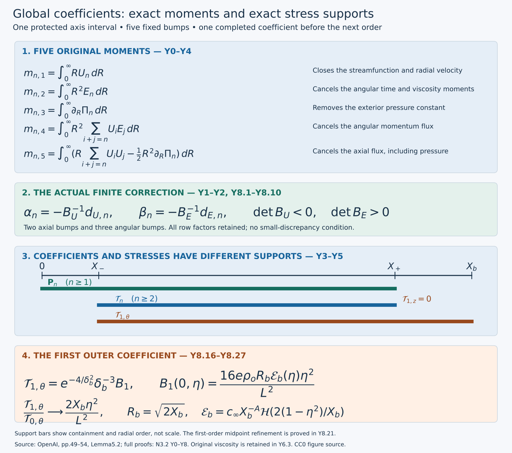

# Extending every coefficient and cancelling its five moments

**NS-BLOWUP N3.2.** A local coefficient cannot simply be cut off and used at the next order. Radial integration can leave a velocity tail, a pressure constant and two stress tails. This lesson constructs the global coefficients, cancels all five original moments exactly, proves their support and retains the common parameter regularity needed for the next coefficient.

The [fixed-interval lesson](correcting-coefficients-on-the-axis.md), D0–D7, supplies the actual inner solution. The [completed leading profile](realizing-the-admissible-shear.md), V0–V8, supplies two protected patches, the exact heat exterior and the original flat stress weight. The [outer-profile lesson](constructing-the-outer-profile-and-heat-exterior.md), O0–H7, supplies the smooth cutoff, heat integrals and convergent subtracted moment used below.

The current-order correction is an exact finite linear solve, with no small-discrepancy condition. We prove the two matrix inverses for actual smooth bumps, then prove the radial boundary terms and all integration constants vanish. The exceptional first-order outer stress receives its own endpoint calculation. The final induction constructs every positive-order coefficient; summing them into a base field is the following lesson.

The original source is OpenAI, *Finite Time Blowup for Navier–Stokes*, [pages 49–54](https://cdn.openai.com/pdf/32d9f210-8b73-45e0-91bc-82a30aef8a9a/navier-stokes.pdf#page=49), (5.9)–(5.22) and the full proof of Lemma 5.2. [SOURCES.json](../SOURCES.json) records the source identity and mathematical locators. This is separate teaching and editorial mathematics; the diplomatic transcription retains OpenAI's text.

*Figure. The diagram retains the original moments, patch order and stress supports. The lower formula is the exact first-order endpoint coefficient proved in Exercise 4. Positions show radial order, not scale; no numerical field is sampled.*

## Y0. Fixed geometry, data and original moments

Choose the radial geometry once. The five moments have different jobs: they remove radial integration constants and the total tangential residuals. Keep their original weights and pressure derivative until compact pressure has been proved.

Keep all notation and physical fields of D0–D1: \(A=1/2+h,D=1/2-h,d=1-\eta^2,L=1-2h\eta^2\), \(\lambda_n=2nh\), \(R=\sqrt{2X}\), \(r=\sqrt qR\), \(b=-A-1/2,c=-A\), and the original amplitude \(\mathsf C\). Thus \(E_n=R\phi_n/\mathsf C\). The actual leading profile has stress endpoints \(X_a,X_b\), analytic interval \([0,X_{\rm an}]\), and ordered unused patches \(\mathcal I_{\rm pos},\mathcal I_{\rm mean}\) from V7.4. Its leading \(U_0\text{ and }V_0\) vanish after \(X_v<X_b\). Choose, once for all orders,
\[
X_a<X_-<X_{\rm keep}<X_{\rm cut}<a^2<X_{\rm an}<\inf\mathcal I_{\rm pos},
\qquad
\max\{X_v,\sup\mathcal I_{\rm mean}\}<X_+<X_b.
\tag{Y0.1}
\]
The first four radii are inside the positive-length analytic inner collar retained in Q5 and V7; D2 permits this same a. The outer radius can be chosen before the terminal outer collar, because the original schedule places \(X_v\) and both patches strictly before it. The subscripts here label the positive-order construction, not the distinct shear-modification interval in V0. No support radius depends on n.

Let σ be the exact smooth step O0.1 and set
\[
\kappa(X)=1-\sigma\!\left(\frac{X-X_{\rm keep}}{X_{\rm cut}-X_{\rm keep}}\right).
\tag{Y0.2}
\]
This gives the required values one and zero with smooth flat transitions. At order n the five original moments are
\[
\begin{split}
m_{n,1}&=\int_0^\infty RU_n\,dR,\\
m_{n,2}&=\int_0^\infty R^2E_n\,dR,\\
m_{n,3}&=\int_0^\infty\partial_R\Pi_n\,dR,\\
m_{n,4}&=\int_0^\infty R^2\sum_{i+j=n}U_iE_j\,dR,\\
m_{n,5}&=\int_0^\infty\left(R\sum_{i+j=n}U_iU_j-\tfrac12R^2\partial_R\Pi_n\right)dR.
\end{split}
\tag{Y0.3}
\]
Each sum includes both endpoint terms and all middle terms. The pressure derivative, rather than an a priori compact pressure, appears in the last moment. This distinction is retained until compactness has actually been proved.

## Y1. Cutoff, five explicit bumps and reconstruction

Cutting off the two freely chosen profiles creates a smooth extension, but it does not yet close the reconstructed radial velocity and pressure. Five disjoint bumps supply the missing degrees of freedom.

Start at n=1 with the actual solution D6.1; for subsequent n use D2.2 with the preceding completed global coefficients. Write its inner solution as \(\phi_n^{\rm in},U_n^{\rm in},V_n^{\rm in},\Pi_n^{\rm in}\). The initial extension is
\[
\widetilde\phi_n=\kappa\phi_n^{\rm in},\qquad
\widetilde U_n=\kappa U_n^{\rm in},\qquad
\widetilde E_n=R\widetilde\phi_n/\mathsf C,
\tag{Y1.1}
\]
extended by zero beyond a². Since κ is already zero on a neighborhood of a², all radial derivatives match there.

Choose a closed interval \([R_p,R_q]\) inside \(\{R:R^2/2\in\mathcal I_{\rm pos}\}\). Set \(r_j=R_p+j(R_q-R_p)/6\), \(\omega=(R_q-R_p)/20\), and define
\[
\begin{gathered}
w_j(R)=\begin{cases}\exp[-1/(1-((R-r_j)/\omega)^2)],&|R-r_j|<\omega,\\0,&|R-r_j|\ge\omega,\end{cases}\\
I_j=\int_0^\infty w_j(R)dR>0,\qquad b_j=w_j/I_j,\\
(b^U_1,b^U_2)=(b_1,b_2),\qquad(b^E_1,b^E_2,b^E_3)=(b_3,b_4,b_5).
\end{gathered}
\tag{Y1.2}
\]
The spacing is \((R_q-R_p)/6\) and the sum of two widths is \((R_q-R_p)/10\), so the five compact supports are disjoint and ordered. Each is smooth and has exactly integral one; the defining integrals \(I_j\) are retained. For coefficients \(\alpha_{n,j}(\eta)\), \(\beta_{n,j}(\eta)\), put
\[
U_n=\widetilde U_n+\sum_{j=1}^2\alpha_{n,j}b_j^U(R),\qquad
E_n=\widetilde E_n+\sum_{j=1}^3\beta_{n,j}b_j^E(R),\qquad
\phi_n=\mathsf C E_n/R.
\tag{Y1.3}
\]
The last quotient is smooth at X=0: every added bump vanishes near that point and the remaining quotient equals \(\widetilde\phi_n\).

Define the other fields by the exact forward integrals
\[
\begin{split}
F_n(X,\eta)&=\int_0^XU_n(x,\eta)dx,\\
V_n(X,\eta)&=-\int_0^X(Z_{-A,n}U_n)(x,\eta)dx,\\
\Pi_n(X,\eta)&=\int_0^X\left[\mathsf C^{-2}\sum_{i+j=n}\phi_i\phi_j-\frac{\Omega_{n-1}}{2x}\right](x,\eta)dx.
\end{split}
\tag{Y1.4}
\]
\(F_n\) is the indexed streamfunction coefficient, not the leading angular ratio denoted F in V. The full expression for Ω is D1.6–D1.7; in particular \(\Omega_{n-1}\) contains only already constructed lower orders. D1.7 proves regularity of \(\Omega_{n-1}/x\) at zero. Thus these equations impose original (5.2) and (5.5) globally, with exactly the source's zero axis values.

For \(X\le X_{\rm keep}\) the original inner functions and Y1.3 coincide. Their forward equations and axis values coincide as well, so Y1.4 gives equality of all four inner profiles there. On all of \([0,a^2]\), the cutoff is independent of η and the five bumps vanish. Each fixed radial derivative therefore retains the holomorphic parameter neighborhood obtained in D5; products, finite integrals and the lower source retain it after a finite intersection of neighborhoods. Global correction coefficients need only be smooth in η because they do not enter any of these inner forward integrals.

## Y2. The complete affine moment map

At one positive order, the current unknown appears only once in each product. This makes the five equations affine with all earlier orders held fixed. The original patch separates them into two constant invertible matrices.

On the unchanged positive-order patch, V7.4 gives the exact expression
\[
U_0=0,\qquad E_0=e_*f(\eta)R^{-1-2\lambda},\quad
e_*=2^{1/2+\lambda}c_{\rm patch}>0,\quad f(\eta)=(1+\eta^2)^{-1},\quad\lambda>0.
\tag{Y2.1}
\]
The factor \(2^{1/2+\lambda}\) follows from \(X=R^2/2\) in V7.4; λ here is the fixed profile slope, distinct from \(\lambda_n=2nh\). All lower-order terms remain fixed when solving the current five equations.

The pressure equation in Y1.4 gives, with no dropped middle terms,
\[
\partial_R\Pi_n=\frac{2E_0E_n}{R}
+\frac1R\left(\sum_{i=1}^{n-1}E_iE_{n-i}-\Omega_{n-1}\right).
\tag{Y2.2}
\]
Using \(dX=R\,dR\) in the fifth moment gives exactly
\[
m_{n,5}=\int_0^\infty\left(\sum_{i+j=n}U_iU_j-\tfrac12\sum_{i+j=n}E_iE_j+\tfrac12\Omega_{n-1}\right)dX.
\tag{Y2.3}
\]
For a current perturbation \((\delta U_n,\delta E_n)\) on the patch, the five changes are consequently
\[
\begin{split}
\Delta m_{n,1}&=\int R\,\delta U_n\,dR,\\
\Delta m_{n,2}&=\int R^2\,\delta E_n\,dR,\\
\Delta m_{n,3}&=2e_*f\int R^{-2-2\lambda}\delta E_n\,dR,\\
\Delta m_{n,4}&=e_*f\int R^{1-2\lambda}\delta U_n\,dR,\\
\Delta m_{n,5}&=-e_*f\int R^{-2\lambda}\delta E_n\,dR.
\end{split}
\tag{Y2.4}
\]
For the fourth row \(U_0\delta E_n=0\); for the fifth \(2U_0\delta U_n=0\), whereas the two E endpoints cancel the factor 1/2. No product of two current coefficients occurs: that product has order 2n rather than n. \(\Omega_{n-1}\) is unchanged. This proves affine dependence, for arbitrary finite sizes of the current discrepancies.

Keep the exact constant matrices
\[
\begin{gathered}
(B_U)_{ij}=\int_0^\infty R^{p_i}b_j^U(R)dR,\quad(p_1,p_2)=(1,1-2\lambda),\\
(B_E)_{ij}=\int_0^\infty R^{s_i}b_j^E(R)dR,\quad(s_1,s_2,s_3)=(2,-2-2\lambda,-2\lambda).
\end{gathered}
\tag{Y2.5}
\]
Let \(m_{n,j}^0\) denote Y0.3 after setting the five bump coefficients to zero and reconstructing Y1.4. The solution is the explicit pair
\[
\begin{gathered}
d_{U,n}=\begin{pmatrix}m_{n,1}^0\\m_{n,4}^0/(e_*f)\end{pmatrix},\qquad
d_{E,n}=\begin{pmatrix}m_{n,2}^0\\m_{n,3}^0/(2e_*f)\\-m_{n,5}^0/(e_*f)\end{pmatrix},\\
\alpha_n=-B_U^{-1}d_{U,n},\qquad\beta_n=-B_E^{-1}d_{E,n}.
\end{gathered}
\tag{Y2.6}
\]
These divisions are only the displayed representation of the full rows Y2.4; multiplying back by \(e_*f\), \(2e_*f\) and \(-e_*f\) recovers exactly every original moment, with its sign.

Here is a direct invertibility proof. A nonzero sum of k distinct real powers of R has at most k−1 distinct positive zeros. Substitute \(R=e^t\), divide by the exponential of the least exponent, and differentiate. The derivative has at most k−1 nonzero exponential terms; induction and Rolle's theorem give the assertion, starting with one term. A zero determinant of \((R_j^{s_i})\) at k ordered positive points would contradict that assertion. Hence this determinant never vanishes on the connected region \(R_1<\cdots<R_k\), and its sign is constant there. Multilinearity and Fubini give
\[
\det\left(\int R^{s_i}b_j(R)dR\right)
=\int\cdots\int\det(R_j^{s_i})\prod_{j=1}^k b_j(R_j)\,dR_1\cdots dR_k\ne0.
\tag{Y2.7}
\]
The ordered supports make the integrand have one fixed nonzero sign wherever the bump product is positive. The powers in both lists Y2.5 are distinct because λ>0. Thus both actual matrices are invertible, independently of n and η; their numerical values need not be estimated by sampling. The full moment-map inverse also contains the retained row factors. Since f≥1/2 and \(e_*>0\) is fixed, it and each fixed parameter derivative are bounded on [-1,1]. No bound uniform as λ or \(e_*\) tends to zero is claimed.

The discrepancies are smooth: the current \(U_n,E_n\) have compact support, all prior positive-order factors have the common support proved below, and \(\Omega_0\) has compact support because \(U_0,V_0\) do. The moments contain no current \(V_n\) or its derivatives; \(\Omega_{n-1}\) uses only completed lower orders. Thus each integral defining a discrepancy has a fixed bounded integration region with smooth integrand, regular at zero by D1.7. Differentiation under these integrals is legitimate for every fixed derivative. Equation Y2.6 then gives smooth coefficients and proves
\[
m_{n,j}(\eta)=0\qquad(j=1,\ldots,5,\quad -1\le\eta\le1).
\tag{Y2.8}
\]

## Y3. Exact exterior closure and the reserved mean patch

Use the solved moments to prove compact support. The pressure constant disappears only after the third moment is imposed; its support can extend farther than the velocity correction patch.

For \(X\ge X_+\), the current \(U_n\) and \(E_n\) vanish by construction and
\[
F_n(X,\eta)=\int_0^\infty U_n(x,\eta)dx=m_{n,1}(\eta)=0.
\tag{Y3.1}
\]
D0.4, with \(\mathcal A_XU_n=F_n/X\), gives \(V_n=0\) there, including all parameter derivatives. The leading \(U_0,V_0\) vanish there by \(X_+>X_v\). Each term of \(\Omega_{n-1}\) contains a V field or its derivative; from D1.6 these are \(T V\), \(V_i(V_j'-V_j/(2X))\), \(U_i ZV_j\), \(-2XV''\) and the lower axial viscous term. All therefore vanish in this exterior. Each product \(\phi_i\phi_j\) of positive total order has at least one positive-order factor, also zero. Equation Y1.4 now yields \(\Pi_{n,X}=0\) there. Finally
\[
\Pi_n(X,\eta)=\Pi_n(0,\eta)+\int_0^\infty\partial_R\Pi_n\,dR=m_{n,3}(\eta)=0
\quad(X\ge X_+).
\tag{Y3.2}
\]
Both constants of radial integration have been removed by their exact moments, rather than by imposing an additional exterior boundary datum.

At zero,
\[
F_n/X=\int_0^1U_n(sX,\eta)ds,\qquad
V_n/X=\frac{2\eta U_n-2\eta(D+\lambda_n)F_n/X-d\partial_\eta(F_n/X)}{L}.
\tag{Y3.3}
\]
These formulas are smooth through the axis. The resulting original tuple
\[
\mathbf P_n=(\phi_n,U_n,V_n/X,\Pi_n,F_n/X),\qquad
\operatorname{supp}_X\mathbf P_n\subset[0,X_+],\qquad
\max_{k+\ell\le m}\sup_{X\ge0,|\eta|\le1}|\partial_X^k\partial_\eta^\ell\mathbf P_n|=C_{n,m}<\infty
\tag{Y3.4}
\]
has finite constants by smoothness and compactness; they may grow with n and m. The construction does not assert convergence of the unrestricted coefficient series.

The current \(E_n,U_n\) already vanish after the positive-order bump patch. Their total axial moment has vanished too, so Y3.1 and Y3.3 show that \(F_n,V_n\) vanish after that patch. In particular
\[
E_n=U_n=F_n=V_n=0\quad\hbox{on }\mathcal I_{\rm mean},\qquad n\ge1.
\tag{Y3.5}
\]
This does not set \(\Pi_n\) to zero on that earlier patch: \(\Omega_0\) can extend to \(X_v\). Choosing \(X_+\) beyond \(X_v\) was necessary for the pressure-support proof. All original patch and support distinctions are retained.

## Y4. Residuals, radial boundary terms and total integrals

Convert the full cylindrical equations to conservative form, keeping every radial boundary term. The five moments then cancel the integrated residuals. At first order the angular viscosity uses a convergent subtracted leading moment.

The actual order-n tangential residuals, retaining every source term, are
\[
\begin{split}
\mathfrak r_{\theta,n}={R\over\mathsf C}\bigg[
T_{b,n}\phi_n+\sum_{i+j=n}\{V_i(\phi_j'+\phi_j/X)+U_iZ_{b,j}\phi_j\}
-2(X\phi_n''+2\phi_n')-Z_{b,n-1}^{[2]}\phi_{n-1}\bigg],\\
\mathfrak r_{z,n}=T_{c,n}U_n+\sum_{i+j=n}\{V_iU_j'+U_iZ_{c,j}U_j\}
+Z_{-2A,n}\Pi_n-2(XU_n''+U_n')-Z_{c,n-1}^{[2]}U_{n-1}.
\end{split}
\tag{Y4.1}
\]
Primes mean \(\partial_X\) at fixed η. These are D1.3–D1.4 with the full residual signs; their physical factors are \(q^{-A-1+\lambda_n}\). They vanish on \([0,X_-]\) by the inner equations and Y1.4. The stress is defined exactly as in original (5.9):
\[
\mathcal T_{n,\theta}=-R^{-2}\int_0^R\rho^2\mathfrak r_{\theta,n}(\rho,\eta)d\rho,
\qquad
\mathcal T_{n,z}=-R^{-1}\int_0^R\rho\mathfrak r_{z,n}(\rho,\eta)d\rho.
\tag{Y4.2}
\]
Differentiation gives \((\partial_R+2/R)\mathcal T_{n,\theta}=-\mathfrak r_{\theta,n}\) and \((\partial_R+1/R)\mathcal T_{n,z}=-\mathfrak r_{z,n}\). The physical stress factor is \(q^{-A-1/2+\lambda_n}\), so the radial derivative contributes exactly \(q^{-1/2}\), yielding the required physical residual factor. These higher stresses are signed; no positivity is imposed on them.

To prove their total source integrals vanish, use the exact conservative equations for a smooth axisymmetric divergence-free field:
\[
\begin{split}
r^2\mathcal R_\theta={}&\partial_t(r^2u_\theta)+\partial_r(r^2u_ru_\theta)+\partial_z(r^2u_zu_\theta)
-\partial_r(r^2\partial_ru_\theta-ru_\theta)-\partial_{zz}(r^2u_\theta),\\
r\mathcal R_z={}&\partial_t(ru_z)+\partial_r(ru_ru_z)+\partial_z(r(u_z^2+p))
-\partial_r(r\partial_ru_z)-\partial_{zz}(ru_z).
\end{split}
\tag{Y4.3}
\]
Expanding the transport derivatives and inserting \(\partial_ru_r+u_r/r+\partial_zu_z=0\) recovers the original angular connection term \(u_ru_\theta/r\) and the axial transport. Expanding the two radial viscous derivatives gives exactly \(r^2(u_{\theta,rr}+u_{\theta,r}/r-u_\theta/r^2)\) and \(r(u_{z,rr}+u_{z,r}/r)\). Thus no cylindrical term is omitted.

At the axis each \(u_{\theta,n}\) is r times a smooth function of r², \(u_{z,n}\) is smooth in r², and \(u_{r,n}\) is r times such a function, by D5 and Y3.3. Hence the radial angular transport boundary is \(O(r^4)\), the axial one \(O(r^2)\), and
\(r^2\partial_ru_{\theta,n}-ru_{\theta,n}=O(r^4)\), \(r\partial_ru_{z,n}=O(r^2)\). All vanish at zero. At infinity the positive-order fields and their radial derivatives are compactly supported; the order-n transport products each contain such a factor. All radial boundary terms therefore vanish there as well.

At fixed physical z,t, the substitution \(r=\sqrt q R\) gives the exact undifferentiated moments
\[
\begin{split}
\int_0^\infty r^2u_{\theta,n}dr&=q^{3/2-A+\lambda_n}m_{n,2}=0,\\
\int_0^\infty r^2\sum_{i+j=n}u_{z,i}u_{\theta,j}dr&=q^{3/2-2A+\lambda_n}m_{n,4}=0,\\
\int_0^\infty ru_{z,n}dr&=q^{1-A+\lambda_n}m_{n,1}=0,\\
\int_0^\infty r\left(\sum_{i+j=n}u_{z,i}u_{z,j}+p_n\right)dr
&=q^{1-2A+\lambda_n}\int_0^\infty R\left(\sum_{i+j=n}U_iU_j+\Pi_n\right)dR
=q^{1-2A+\lambda_n}m_{n,5}=0.
\end{split}
\tag{Y4.4}
\]
For the last equality \(\Pi_n\) is now known to be compact and bounded at zero. Integration by parts gives \(\int R\Pi_n dR=[R^2\Pi_n/2]_0^\infty-\frac12\int R^2\partial_R\Pi_n dR\), with both boundary values zero. This use of compact pressure follows Y3, rather than preceding its proof. All product powers depend only on i+j=n. Positive-order integrals and all their fixed physical derivatives have locally bounded compact support for t<1, which justifies their differentiation.

For axial viscosity at n≥2, the analogous order-(n−1) angular and axial moments vanish by Y2.8. At n=1 the leading axial moment vanishes by V7 and P2. The leading angular moment requires its actual subtracted form, proved in H4.6 and preserved by the exact joining and shear moments:
\[
P(r)=c_\infty(r^2/2)^{-A},\qquad
\int_0^\infty r^2[u_{\theta,0}(r,z,t)-P(r)]dr
=q^{3/2-A}\int_0^\infty[\sqrt{2X}E_0-\sqrt{2X}c_\infty X^{-A}]dX=0.
\tag{Y4.5}
\]
Near zero the subtracted power has integrable weight \(r^{1-2h}\); the actual field is regular. At infinity H0.2–H0.4 give \(K-P=O(r^{-3-2h})\) for fixed t<1, so its weighted difference is integrable because h>0. On any compact neighborhood of physical (z,t) with t<1, the exterior starts before one finite radius and \(u_{\theta,0}=K(r,t)\) is z-independent beyond it. The same is true of P. Thus the first and second z derivatives of the difference have compact exterior support and are locally bounded at the axis; differentiation under Y4.5 is justified. It proves the vanishing order-one axial-viscosity angular moment without differentiating a divergent un-subtracted integral.

Integrating Y4.3 at order n, the first two moments in Y4.4 cancel the angular time and axial transport terms, and the last two cancel the axial time and flux terms. The preceding paragraph cancels both lower axial-viscosity moments. Removing the nonzero physical factors gives
\[
\int_0^\infty R^2\mathfrak r_{\theta,n}dR=0,\qquad
\int_0^\infty R\mathfrak r_{z,n}dR=0.
\tag{Y4.6}
\]
Explicitly the physical weighted factors are \(q^{1/2-A+\lambda_n}\) and \(q^{-A+\lambda_n}\), respectively. These follow from the residual factor and \(r^2dr=q^{3/2}R^2dR\) or \(r\,dr=qR\,dR\). Time differentiation loses one power of q, axial differentiation loses D, and the order-(n−1) second axial derivative uses \(\lambda_n-\lambda_{n-1}=2h=1-2D\); each term in the respective integrated equation has exactly that same power.

## Y5. Full stress support and the exceptional first-order term

The backward stress integral identifies the exact support. All later orders stop before the outer collar. The first order still sees the axial derivative of the leading heat multiplier, so its full flat factor must be calculated.

Equation Y4.6 converts the exact forward integrals into backward ones:
\[
\mathcal T_{n,\theta}=R^{-2}\int_R^\infty\rho^2\mathfrak r_{\theta,n}d\rho,
\qquad
\mathcal T_{n,z}=R^{-1}\int_R^\infty\rho\mathfrak r_{z,n}d\rho.
\tag{Y5.1}
\]
For n≥2, every same-order exterior residual term has a positive-order factor, and the axial-viscosity term acts on order n−1≥1. All are zero beyond \(X_+\) by Y3. On the inner interval the residuals vanish and the forward integrals are zero. Consequently
\[
\operatorname{supp}_X\mathcal T_n\subset[X_-,X_+]\quad(n\ge2).
\tag{Y5.2}
\]
At n=1 the only possible exterior term is the angular \(-\partial_{zz}u_{\theta,0}\); the leading axial field is already zero there. For \(X\ge X_b\), \(u_{\theta,0}=K(r,t)\) is independent of z. Thus
\[
\operatorname{supp}_X\mathcal T_1\subset[X_-,X_b],\qquad
\mathcal T_{1,z}=0\quad(X\ge X_+).
\tag{Y5.3}
\]

Retain the full original terminal multiplier. In \(y=\log(X/X_{\rm tail})\), with \(X_b=e^3X_{\rm tail}\) and \(\delta_b=3-y\), it is
\[
\begin{gathered}
f_o(y)=1-\rho_o[1-\sigma((y-1)/2)],\qquad \rho_o=c_oh,\\
1-f_o=\rho_o e^{-4/\delta_b^2}g(\delta_b),\qquad
g(\delta)=\big[e^{-(1-\delta/2)^{-2}}+e^{-4/\delta^2}\big]^{-1},\qquad g(0)=e.
\end{gathered}
\tag{Y5.4}
\]
This is O0 and H6.3, including its denominator and amplitude. On a sufficiently small closed terminal collar, g is positive and smooth, with every fixed derivative bounded. The actual physical field there is
\[
u_{\theta,0}=K(r,t)f_o(y),\quad
K=c_\infty(r^2/2)^{-A}\mathcal H(2(1-t)/(r^2/2)),\quad
q^AK=c_\infty X^{-A}\mathcal H(2d/X).
\tag{Y5.5}
\]
The heat factor and all of its needed derivatives are the convergent integrals H0.1–H0.2, including the value at d=0. The factor 2 in its argument is retained.

At fixed physical r,t the coordinate identities P0 give
\[
\begin{gathered}
\partial_zy=q^{-D}a_z,\quad a_z=-2\eta/L,\quad \partial_z\eta=q^{-D}d/L,\\
b_z=\frac{-2D\eta a_z+d\partial_\eta a_z}{L},\\
\partial_{zz}(Kf_o)=Kq^{-2D}(a_z^2\partial_{yy}f_o+b_z\partial_yf_o).
\end{gathered}
\tag{Y5.6}
\]
K has no z dependence. Differentiating \(q^{-D}a_z\) gives \(q^{-2D}b_z\), which proves the last formula and retains its exponent derivative. Both \(a_z\) and \(b_z\) and their fixed derivatives are bounded because \(L\ge1-2h>0\). For \(\delta=\delta_b\) and g as in Y5.4 the exact multiplier derivatives are
\[
\begin{split}
\partial_y f_o&=\rho_o e^{-4/\delta^2}(8\delta^{-3}g+g'),\\
\partial_{yy}f_o&=\rho_o e^{-4/\delta^2}
\big[(24\delta^{-4}-64\delta^{-6})g-16\delta^{-3}g'-g''\big].
\end{split}
\tag{Y5.7}
\]
Hence the first is bounded by \(C e^{-4/\delta^2}\delta^{-3}\) and the second by \(C e^{-4/\delta^2}\delta^{-6}\) on a short collar. After multiplying the physical source by \(q^{A+1-\lambda_1}\), the power cancels exactly: \(\lambda_1=2h\) and \(1-\lambda_1-2D=0\). Thus its coefficient is the bounded smooth heat factor from Y5.5 times the two full expressions in Y5.6–Y5.7; no q-dependent constant remains.

For completeness, the radial integration gains exactly the three powers needed at this edge. For any smooth bounded \(B(s,\eta)\) on a small collar and fixed j≥0, the substitution \(s=\delta(1+\delta^2v)^{-1/2}\) gives
\[
\begin{split}
\int_0^\delta e^{-4/s^2}s^{-j}B(s,\eta)ds
={}&\tfrac12e^{-4/\delta^2}\delta^{3-j}
\int_0^\infty e^{-4v}(1+\delta^2v)^{(j-3)/2}
B\!\left(\frac{\delta}{\sqrt{1+\delta^2v}},\eta\right)dv.
\end{split}
\tag{Y5.8}
\]
Its Jacobian is \(-\delta^3(1+\delta^2v)^{-3/2}/2\). Each fixed derivative of the final integrand is bounded by \(e^{-4v}\) times a polynomial in v, uniformly on the compact parameter rectangle. Dominated differentiation proves that the last integral is smooth through δ=0, with every fixed derivative finite. This also proves its endpoint value \(B(0,\eta)/4\).

In the backward angular integral Y5.1, \(R=\sqrt{2X_b}e^{-\delta/2}\) and \(dR=-R\,d\delta/2\); all these weights, including the exterior \(R^{-2}\), are smooth and bounded on the fixed collar. Applying Y5.8 to the finite terms of Y5.7, with j≤6, yields the actual smooth representation and bounds
\[
\mathcal T_{1,\theta}=e^{-4/\delta_b^2}\delta_b^{-3}B_1(\delta_b,\eta),\qquad
|\mathcal T_1|\le Ce^{-4/\delta_b^2}\delta_b^{-3},\qquad
|\partial_X^k\partial_\eta^\ell\mathcal T_1|\le C_{k,\ell}e^{-4/\delta_b^2}\delta_b^{-N_{k,\ell}}.
\tag{Y5.9}
\]
Here \(B_1\) is smooth; no nonzero endpoint value or sign for it is required. Terms with smaller j acquire the nonnegative powers \(\delta^{6-j}\) in \(B_1\). Each radial derivative of the exponential or the factor \(\delta^{-3}\) introduces only finitely many additional inverse powers; \(\partial_X\delta=-1/X\) and its derivatives are bounded on this collar. Thus every derivative tends to zero at \(X_b\) and the stress extends smoothly by zero there.

## Y6. Original flat weight, all fixed derivatives and viscosity

Combine the actual support and endpoint calculation with the same weight used by the leading profile. Restore the original viscosity in both the physical stress and the residual.

Retain V6's actual common weight and the source distance:
\[
\zeta(X)=\exp\!\left[-\frac{t_1^2}{\log(X/X_a)^2}-\frac4{\log(X_b/X)^2}\right],\qquad
\delta(X)=\min\{1,\log(X/X_a),\log(X_b/X)\}.
\tag{Y6.1}
\]
For n≥2, Y5.2 puts every stress and derivative in a fixed compact subinterval of \((X_a,X_b)\), where ζ has a positive minimum. Smoothness then gives Y6.2 below with \(N_{n,k,\ell}=0\). For n=1, the stress is zero on \([0,X_-]\), while near \(X_b\) the inner factor \(\exp(-t_1^2/\log(X/X_a)^2)\) and its reciprocal are smooth and bounded. Equation Y5.9 supplies Y6.2 on that outer collar. On the remaining compact middle interval, smoothness and the positive minimum of ζ supply it as well. Therefore
\[
|\partial_X^k\partial_\eta^\ell\mathcal T_n(X,\eta)|
\le C_{n,k,\ell}\zeta(X)\delta(X)^{-N_{n,k,\ell}}
\quad(X_a<X<X_b,\ |\eta|\le1),
\qquad N_{n,k,\ell}=0\quad(n\ge2).
\tag{Y6.2}
\]
This proves original (5.13) for every fixed derivative; all constants may depend on n,k,ℓ and the already fixed profile parameters. No simultaneous derivative smallness or uniform bound over all orders has been used.

For the original viscosity ν>0 retain D6.2 and the stress map
\[
x_\nu=\sqrt\nu x,\quad t_\nu=t,\quad
u_{n,\nu}(x_\nu,t)=\sqrt\nu u_n(x_\nu/\sqrt\nu,t),\quad
p_{n,\nu}=\nu p_n(x_\nu/\sqrt\nu,t),\quad
T_{n,\nu}=\nu q^{-A-1/2+\lambda_n}\mathcal T_n.
\tag{Y6.3}
\]
The last expression is evaluated at \(X=r_\nu^2/(2\nu q),\eta=z_\nu/(\sqrt\nu q^D)\), in the original cylindrical components. Spatial differentiation contributes \(\nu^{-1/2}\); hence divergence of this stress and every term of the momentum residual have the same factor \(\sqrt\nu\). Incompressibility is preserved by the same exact derivative map. The five profile moments and all fixed profile bounds above are unchanged statements in their original variables, with these physical factors explicitly restored. This does not change the target viscosity.

## Y7. Actual induction and its precise endpoint

Start with the actual first coefficient, complete its global extension, and only then form the source for the next coefficient. The construction uses the same radii, cutoff and bumps at every order.

At n=1, D6 supplies the actual inner solution using only the already constructed leading profile. Equations Y1.1–Y1.4 define its tentative global extension; Y2.6 supplies all five actual smooth correction functions without a small-discrepancy requirement. Y3–Y6 prove its complete support, moments, retained analytic interval and stress bounds, including its exceptional outer heat term.

Suppose the construction has completed the finite orders 1 through n−1. Their full sources in D2.2 are then defined and smooth; D1.7 proves axis regularity, and Y1 preserves their fixed-derivative holomorphic parameter domains on \([0,a^2]\). The D3–D5 series therefore constructs the actual next inner coefficient on that same interval. Apply the explicit Y1 and Y2 formulas to it. Their lower sources are the completed fields, and all integrals are finite by the support argument in Y2–Y3. The constant matrices are the same as before. Y3–Y6 then prove exactly the properties needed at order n. This induction constructs a single sequence at every positive integer order, with one set of radii, one cutoff and one set of bumps.

Every finite order now satisfies original (5.2) and (5.5) globally, the full equations (5.3)–(5.4) on the common inner interval, all five moment identities, the tuple support (5.12), the stress support and derivative estimate (5.13), the profile bounds (5.17), and the reserved-mean-patch equalities (5.18). The coefficient values are given by the convergent integral solution followed by finite explicit integrals and the two fixed matrix inverses. No coefficient or missing source has been assumed into existence.

## Y8. Five worked exercises

### Exercise 1. Prove determinant signs and explicit lower bounds for the actual bump matrices

Use the five smooth bumps in Y1.2, with their original integrals \(I_j\), to give positive lower bounds for \(|\det B_U|\) and \(\det B_E\). Retain every power of the patch endpoints and the profile slope.

**Solution.** Put \(H=R_q-R_p>0\) and \(g=H/15\). Consecutive support centers are separated by \(H/6\); the sum of their two widths is \(H/10\). Therefore any points in consecutive bump supports differ by at least \(g\). Every point lies between \(R_p\) and \(R_q\). Each actual density is \(b_j=w_j/I_j\) and has integral one.

For the two axial columns at \(r_1<r_2\), retain the exact determinant
\[
\det\begin{pmatrix}
r_1&r_2\\
r_1^{1-2\lambda}&r_2^{1-2\lambda}
\end{pmatrix}
=r_1r_2(r_2^{-2\lambda}-r_1^{-2\lambda})
=-2\lambda r_1r_2\int_{r_1}^{r_2}s^{-2\lambda-1}\,ds.
\tag{Y8.1}
\]
The integrand is positive. Since \(\lambda>0\), its value is at least \(R_q^{-2\lambda-1}\), while \(r_1r_2\ge R_p^2\). Integrate the determinant against the two actual bump densities as in Y2.7. Their product integral is one. This proves
\[
\det B_U<0,\qquad
|\det B_U|\ge
2\lambda R_p^2R_q^{-2\lambda-1}g>0.
\tag{Y8.2}
\]

For the three angular columns use points \(r_1<r_2<r_3\) in their ordered supports, and put \(x_j=r_j^2\) only for this determinant calculation. Factoring the indicated powers from each column, without discarding them, gives
\[
\begin{split}
\det(r_j^{s_i})_{i,j=1}^3
&=\left(\prod_{j=1}^3r_j^{-2-2\lambda}\right)
\det\begin{pmatrix}
x_1^{2+\lambda}&x_2^{2+\lambda}&x_3^{2+\lambda}\\
1&1&1\\
x_1&x_2&x_3
\end{pmatrix}\\
&=\left(\prod_{j=1}^3r_j^{-2-2\lambda}\right)
\prod_{i<j}(x_j-x_i)\,F[x_1,x_2,x_3],
\qquad F(x)=x^{2+\lambda}.
\end{split}
\tag{Y8.3}
\]
The cyclic row permutation has positive sign. Subtracting the first column from the other two proves the divided-difference formula displayed here. Its last factor is at least half the minimum of \(F''\) on the interval: if \(c=\min F''\), then \(F-cx^2/2\) is convex, its second divided difference is nonnegative by increasing secant slopes, and that of \(cx^2/2\) is \(c/2\). In this case
\[
F[x_1,x_2,x_3]\ge
\tfrac12(2+\lambda)(1+\lambda)R_p^{2\lambda}.
\tag{Y8.4}
\]
The two consecutive differences in \(x\) are at least \(2R_pg\), and the remaining difference is at least \(4R_pg\). The column factor is at least \(R_q^{-6-6\lambda}\). Integrating Y8.3 against all three actual densities therefore proves
\[
\det B_E\ge
8(2+\lambda)(1+\lambda)
R_p^{3+2\lambda}g^3R_q^{-6-6\lambda}>0.
\tag{Y8.5}
\]
These bounds prove invertibility for the finite-width smooth bumps themselves. They use neither point-mass replacement nor numerical determinant sampling. The factor \(\lambda\) in Y8.2 is retained; no bound uniform as \(\lambda\) tends to zero is asserted.

### Exercise 2. Bound the full moment correction in every fixed parameter norm

Prove an explicit \(C^m([-1,1])\) bound for the five actual correction functions. Retain the row factors \(e_*f\), \(2e_*f\), and \(-e_*f\).

**Solution.** For a vector function \(v\), use
\(\|v\|_{C^m}=\max_{0\le j\le m,\,|\eta|\le1}|v^{(j)}(\eta)|_\infty\),
and use the induced maximum matrix norm. Since the original \(f=(1+\eta^2)^{-1}\), Y2.6 is exactly
\[
\begin{split}
\alpha_n&=-B_U^{-1}
\begin{pmatrix}m_{n,1}^0\\(1+\eta^2)m_{n,4}^0/e_*\end{pmatrix},\\
\beta_n&=-B_E^{-1}
\begin{pmatrix}
m_{n,2}^0\\
(1+\eta^2)m_{n,3}^0/(2e_*)\\
-(1+\eta^2)m_{n,5}^0/e_*
\end{pmatrix}.
\end{split}
\tag{Y8.6}
\]
The exact product rule, with terms of negative derivative order omitted, is
\[
\partial_\eta^j[(1+\eta^2)v]
=(1+\eta^2)v^{(j)}+2j\eta v^{(j-1)}
+j(j-1)v^{(j-2)}.
\tag{Y8.7}
\]
Thus \(P_m=m^2+m+2\) bounds the multiplier in every derivative through \(m\). Keeping the three rows visible gives
\[
\begin{split}
\|\alpha_n\|_{C^m}
&\le\|B_U^{-1}\|
\max\{\|m_{n,1}^0\|_{C^m},(P_m/e_*)\|m_{n,4}^0\|_{C^m}\},\\
\|\beta_n\|_{C^m}
&\le\|B_E^{-1}\|
\max\{\|m_{n,2}^0\|_{C^m},
(P_m/(2e_*))\|m_{n,3}^0\|_{C^m},
(P_m/e_*)\|m_{n,5}^0\|_{C^m}\}.
\end{split}
\tag{Y8.8}
\]
These are finite constants for the fixed original patch. The inverse norms can also be bounded explicitly by the adjugate formula, Y8.2 and Y8.5, since every entry of Y2.5 is bounded by the supremum of its retained power on \([R_p,R_q]\).

For example, with the exact bump derivatives
\[
M_{U,k}=\sup_{X\ge0}\sum_{j=1}^2
|\partial_X^k b_j^U(\sqrt{2X})|,\qquad
M_{E,k}=\sup_{X\ge0}\sum_{j=1}^3
|\partial_X^k b_j^E(\sqrt{2X})|,
\tag{Y8.9}
\]
all of which are finite because their supports stay away from the axis, the actual added profiles satisfy
\[
\|\partial_X^k\partial_\eta^\ell(U_n-\widetilde U_n)\|_\infty
\le M_{U,k}\|\alpha_n\|_{C^\ell},\qquad
\|\partial_X^k\partial_\eta^\ell(E_n-\widetilde E_n)\|_\infty
\le M_{E,k}\|\beta_n\|_{C^\ell}.
\tag{Y8.10}
\]
For \(\phi_n\), replace the angular bump in \(M_{E,k}\) by its full factor \(\mathsf C b_j^E(\sqrt{2X})/\sqrt{2X}\). Its support still stays away from zero. For two discrepancy vectors with the lower profiles fixed, subtract Y8.6: the same bounds hold for their differences. This proves a bounded linear correction map on each stated norm, with the actual row factors and supports. The discrepancies can be arbitrarily large and finite; no smallness is needed at this coefficient order.

### Exercise 3. Identify the exterior defects that the five moments remove

Before imposing the moments, calculate the exterior radial velocity and pressure. After the first and third moments are zero, express both total tangential residuals in terms of the remaining moments, and recover their physical stress tails.

**Solution.** Keep the lower global coefficients fixed, and take a tentative smooth current \(U_n,E_n\) supported to the left of \(X_+\), with \(V_n,\Pi_n\) defined by Y1.4. The lower fields already have the support proved in the induction. The moments \(m_{n,j}\) are those of this tentative extension.

For \(X\ge X_+\), the forward formulas give exactly
\[
F_n=m_{n,1},\qquad
V_n=-\frac{2\eta(D+\lambda_n)m_{n,1}
+d\,\partial_\eta m_{n,1}}{L},\qquad
\Pi_n=m_{n,3}.
\tag{Y8.11}
\]
Indeed \(U_n=0\), \(\mathcal A_XU_n=m_{n,1}/X\), and D0.4 gives the middle formula. The pressure derivative vanishes there because all its products have a positive-order angular factor and \(\Omega_{n-1}\) contains only the completed lower radial fields. Its axis value is zero, so its exterior constant is the third moment. Consequently the full tuple \(\mathbf P_n\) has zero exterior precisely when \(m_{n,1}=m_{n,3}=0\). Necessity uses \(F_n/X\) and \(\Pi_n\), not a claim that the equation \(V_n=0\) alone forces \(m_{n,1}=0\).

Now impose those two moments, so all current velocity and pressure fields are compactly supported. Define the original operators on functions of \(\eta\) alone,
\[
\mathscr T_\beta v=\frac{-\beta v+D\eta v'}L,\qquad
\mathscr Z_\beta v=\frac{2\beta\eta v+dv'}L.
\tag{Y8.12}
\]
Write \(I_{\theta,n}=\int_0^\infty R^2\mathfrak r_{\theta,n}\,dR\) and
\(I_{z,n}=\int_0^\infty R\mathfrak r_{z,n}\,dR\). Apply the exact conservative equations Y4.3 and the undifferentiated moments Y4.4. The lower axial-viscosity moments are zero, including the subtracted first-order angular moment Y4.5. Hence
\[
\begin{split}
I_{\theta,n}
&=\mathscr T_{3/2-A+\lambda_n}m_{n,2}
+\mathscr Z_{3/2-2A+\lambda_n}m_{n,4},\\
I_{z,n}
&=\mathscr T_{1-A+\lambda_n}m_{n,1}
+\mathscr Z_{1-2A+\lambda_n}m_{n,5}
=\mathscr Z_{1-2A+\lambda_n}m_{n,5}.
\end{split}
\tag{Y8.13}
\]
The angular common power is \(q^{1/2-A+\lambda_n}\); the axial common power is \(q^{-A+\lambda_n}\). In the flux terms these follow from \(A+D=1\). The second axial derivative from order \(n-1\) uses \(2h=1-2D\), exactly as in Y4.6.

Let \(X_e=X_+\) for \(n\ge2\), and \(X_e=X_b\) for \(n=1\). Beyond that radius the residual sources vanish, while their forward stress integrals need not. Their full tails are
\[
\mathcal T_{n,\theta}=-\frac{I_{\theta,n}}{R^2},
\qquad
\mathcal T_{n,z}=-\frac{I_{z,n}}R
\qquad(X\ge X_e).
\tag{Y8.14}
\]
This follows directly from Y4.2, including its negative sign. In the original viscosity variables \(R=r_\nu/\sqrt{\nu q}\), Y6.3 gives
\[
\begin{split}
T_{n,\nu,\theta}
&=-\frac{\nu^2 q^{1/2-A+\lambda_n}}{r_\nu^2}I_{\theta,n},\\
T_{n,\nu,z}
&=-\frac{\nu^{3/2}q^{-A+\lambda_n}}{r_\nu}I_{z,n}.
\end{split}
\tag{Y8.15}
\]
The first and third moments remove the radial integration defects; the other three make Y8.13 zero and hence remove both stress tails. This proves the exact map from the five original moments to the exterior defects. It does not claim that five zero moments are necessary for the two differential combinations in Y8.13 alone to vanish.

### Exercise 4. Compute the actual first-order outer stress coefficient

Find the endpoint value of \(B_1\) in Y5.9, retaining the full heat factor. At \(\eta=0\), determine the sharper leading term that survives when this endpoint value vanishes.

**Solution.** Set
\[
R_b=\sqrt{2X_b},\qquad R(s)=R_be^{-s/2},\qquad
\mathcal E(s,\eta)=c_\infty(X_be^{-s})^{-A}
\mathcal H\!\left(\frac{2(1-\eta^2)}{X_be^{-s}}\right),\qquad
\mathcal E_b(\eta)=\mathcal E(0,\eta)>0.
\tag{Y8.16}
\]
These are exactly the heat factors in Y5.5, with every constant and argument retained. Put \(\delta=\log(X_b/X)\). The coefficient of the physical first-order residual on the terminal collar is
\[
\mathfrak r_{\theta,1}
=-\mathcal E(\delta,\eta)
\big(a_z^2 f_{o,yy}+b_zf_{o,y}\big),
\qquad
\mathfrak r_{z,1}=0.
\tag{Y8.17}
\]
The physical power cancels because \(1-\lambda_1-2D=0\). Substituting the exact multiplier derivatives Y5.7 gives the full expression
\[
\begin{split}
\mathfrak r_{\theta,1}
=\rho_o\mathcal E e^{-4/\delta^2}
\big[&
64a_z^2g\,\delta^{-6}-24a_z^2g\,\delta^{-4}
+16a_z^2g'\,\delta^{-3}+a_z^2g''\\
&-8b_zg\,\delta^{-3}-b_zg'\big].
\end{split}
\tag{Y8.18}
\]
Here \(a_z,b_z\) retain their full functions of \(\eta\) from Y5.6. The backward integral is exactly
\[
\mathcal T_{1,\theta}(\delta,\eta)
=\frac1{2R(\delta)^2}
\int_0^\delta R(s)^3\mathfrak r_{\theta,1}(s,\eta)\,ds.
\tag{Y8.19}
\]
Apply Y5.8 term by term. The coefficient of \(s^{-6}\) in the integrand, including its factor \(1/2\), is
\(32\rho_o R(s)^3\mathcal E(s,\eta)a_z^2g(s)\).
Y5.8 divides its endpoint value by \(8\); the outside \(R(\delta)^{-2}\) is retained. Every other term acquires a strictly positive power of \(\delta\) after extracting \(e^{-4/\delta^2}\delta^{-3}\). Thus the actual smooth coefficient obeys
\[
\begin{split}
B_1(0,\eta)
&=4\rho_o R_b\mathcal E_b(\eta)a_z(\eta)^2g(0)\\
&=\frac{16e\rho_o R_b\mathcal E_b(\eta)\eta^2}{L(\eta)^2}.
\end{split}
\tag{Y8.20}
\]
It is positive for every fixed \(\eta\ne0\), including the one-sided parameter endpoints, and zero at \(\eta=0\). No factor from the heat profile or radial measure has been absorbed.

At \(\eta=0\), the exact values are \(a_z=0\), \(b_z=-2\). Y8.18 becomes
\(2\rho_o\mathcal E(\delta,0)e^{-4/\delta^2}(8\delta^{-3}g+g')\).
The same integral identity, now with \(j=3\) and \(j=0\), proves
\[
\mathcal T_{1,\theta}(\delta,0)
=e^{-4/\delta^2}B_{\rm eq}(\delta),\qquad
B_{\rm eq}\in C^\infty([0,\delta_0]),\qquad
B_{\rm eq}(0)=e\rho_oR_b\mathcal E_b(0)>0.
\tag{Y8.21}
\]
The \(j=0\) term contributes three additional powers and has zero endpoint coefficient. This explains the exact improvement at the parameter midpoint without discarding the first-order outer term.

### Exercise 5. Prove sharp derivative powers and the exact comparison with the leading stress

Give explicit powers in Y6.2 for \(n=1\), and compare the first correction with the original leading angular stress at the outer edge. Prove the resulting endpoint statement for every actual finite coefficient stress sum.

**Solution.** The representation in Y5.9 is an actual smooth factorization:
\(\mathcal T_{1,\theta}=e^{-4/\delta^2}\delta^{-3}B_1(\delta,\eta)\).
All fixed derivatives of \(B_1\) are bounded on a common closed collar. Since \(\partial_X\delta=-1/X\),
\[
\partial_X e^{-4/\delta^2}
=-\frac8{X\delta^3}e^{-4/\delta^2}.
\tag{Y8.22}
\]
Each radial derivative falling on the exponential therefore costs at most three inverse powers; derivatives of a remaining power cost one, and all derivatives of \(X^{-1}\) and the smooth factors are bounded. Parameter derivatives act only on the smooth coefficient. Induction and the product rule prove
\[
|\partial_X^k\partial_\eta^\ell\mathcal T_1|
\le C_{k,\ell}\zeta(X)\delta(X)^{-(3k+3)}
\qquad(X_a<X<X_b,\ |\eta|\le1).
\tag{Y8.23}
\]
Near the outer edge, the inner exponential factor in \(\zeta\) and its reciprocal are bounded. On the remaining compact middle interval use smoothness and a positive minimum of \(\zeta\); near the inner edge the stress is zero. This proves the whole-annulus estimate with the original weight.

For fixed \(\eta\ne0\), the unique most singular derivative term is obtained by putting every radial derivative on the exponential. Every other product-rule term has a smaller inverse power. Hence
\[
\lim_{\delta\downarrow0}
\delta^{3k+3}e^{4/\delta^2}\partial_X^k
\mathcal T_{1,\theta}
=(-8/X_b)^kB_1(0,\eta)\ne0.
\tag{Y8.24}
\]
Thus the radial exponent \(3k+3\) cannot be reduced uniformly over parameters containing such a point. At \(\eta=0\), Y8.21 instead gives
\[
\lim_{\delta\downarrow0}
\delta^{3k}e^{4/\delta^2}\partial_X^k
\mathcal T_{1,\theta}(\delta,0)
=(-8/X_b)^k e\rho_oR_b\mathcal E_b(0).
\tag{Y8.25}
\]
This midpoint refinement concerns radial derivatives at that fixed parameter; it does not assert the same power for arbitrary parameter derivatives there.

The complete leading stress, unchanged by the joining and shear moments, satisfies H6.6–H6.8:
\[
\mathcal T_{0,\theta}=e^{-4/\delta^2}\delta^{-3}b_\theta,\quad
b_\theta(0,\eta)=\frac{16e\rho_o\mathcal E_b(\eta)}{R_b}>0,\quad
\mathcal T_{0,z}=e^{-4/\delta^2}\delta^3b_z.
\tag{Y8.26}
\]
Both coefficients are smooth on a closed collar and \(b_\theta\) has a positive lower bound. Therefore the exact quotient of the original stresses extends smoothly, with
\[
\frac{\mathcal T_{1,\theta}}{\mathcal T_{0,\theta}}
=\frac{B_1}{b_\theta}
\longrightarrow\frac{2X_b\eta^2}{L^2},\qquad
\lim_{\delta\downarrow0}\delta^{-3}
\frac{\mathcal T_{1,\theta}(\delta,0)}
{\mathcal T_{0,\theta}(\delta,0)}
=\frac{X_b}{8}.
\tag{Y8.27}
\]
These are exact comparisons; Y8.20 and Y8.26 retain the full factors before taking their quotient. In particular \(\mathcal T_{1,\theta}/\zeta\) is unbounded like \(\delta^{-3}\) at every fixed nonzero \(\eta\), even though its ratio to the leading angular stress has a finite limit. The different weights must not be substituted for each other.

For any fixed \(q>0\) and integer \(N\ge1\), use the actual finite stress
\[
\widehat T^{[N]}=\mathcal T_0+\sum_{n=1}^Nq^{2nh}\mathcal T_n.
\tag{Y8.28}
\]
On \(X>X_+\), every \(n\ge2\) term is identically zero and \(\mathcal T_{1,z}=0\). Thus throughout the outer collar
\[
\begin{split}
\widehat T^{[N]}_\theta
&=e^{-4/\delta^2}\delta^{-3}
(b_\theta+q^{2h}B_1),\\
\widehat T^{[N]}_z
&=e^{-4/\delta^2}\delta^3b_z,\\
\left.\frac{b_\theta+q^{2h}B_1}{b_\theta}\right|_{\delta=0}
&=1+q^{2h}\frac{2X_b\eta^2}{L^2}>0.
\end{split}
\tag{Y8.29}
\]
For fixed \(q\), compactness gives a common smaller collar where the angular coefficient is positive. The exact direction is
\[
\frac{\widehat T^{[N]}}{|\widehat T^{[N]}|}
=\frac{(1,\ \delta^6 b_z/(b_\theta+q^{2h}B_1))}
{\sqrt{1+\delta^{12}[b_z/(b_\theta+q^{2h}B_1)]^2}}
\longrightarrow(1,0).
\tag{Y8.30}
\]
It extends smoothly to the endpoint. The original physical stress is
\(\nu q^{-A-1/2}\widehat T^{[N]}\), evaluated at the original viscosity coordinates of Y6.3. Its positive scalar factor preserves this direction and retains every physical scale. These finite sums use the already constructed coefficients. Their convergence without cutoffs is not asserted; the subsequent base construction supplies the actual infinite sum.

## What the global coefficient construction supplies

Y0–Y7 construct the entire actual coefficient sequence, with one fixed radial geometry, the full original equations on the protected axis interval, all five exact moments, compact coefficient support and the two required stress supports. The first-order outer term is retained with the same flat weight as the leading profile. Y8 proves quantitative matrix bounds, the exact exterior-defect map, sharp first-order edge powers and its smooth comparison with the leading stress.

The next lesson constructs the actual base field from this sequence, using cutoffs of the full vector potentials and both stress components. Its complete proof is supplied in the [separate base-field audit](../audits/base-field-realization-audit.md), Z0–Z8. The [actual base-field lesson](constructing-the-actual-base-field.md), Z0–Z9, gives that construction and its consequences.

Authored lesson text and figure source: CC0.