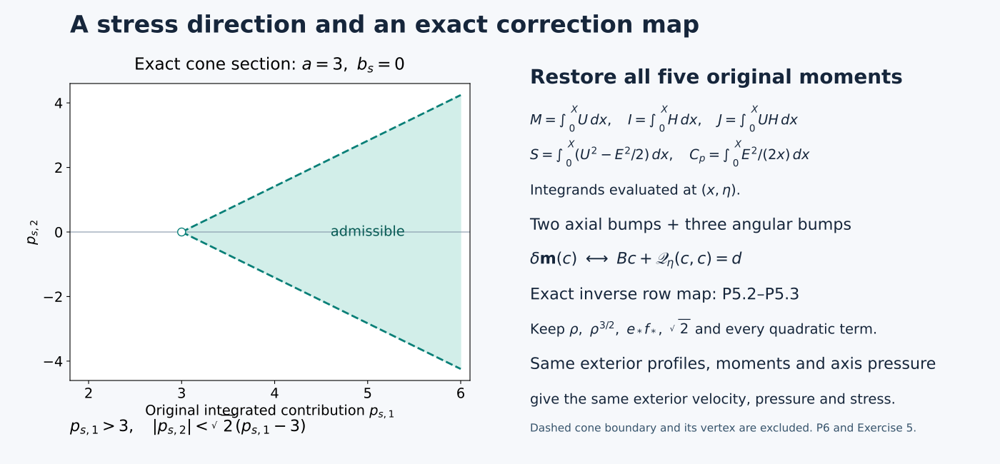

# From velocity profiles to stress and five exact moments

**NS-BLOWUP N2.1.** A leading velocity field is useful only if its full residual has the form needed by the later corrections. This lesson derives that form and proves how to alter the profiles without disturbing their exterior.

We answer three concrete questions:

- How does the velocity profile determine the radial stress, with pressure and both viscous contributions retained?
- Which five moments must be restored after changing a profile, and how can their nonlinear correction equations actually be solved?
- Which stress directions can be supplied by positive wave covariances?

The [opening lesson](the-forced-blowup-theorem-and-its-geometry.md) supplies the exact target theorem and its geometry. We recall the needed coordinates here, and give the complete calculations for the stress and finite correction mechanisms. These are tools for the actual outer, axis, joining and shear constructions; the complete leading-profile existence proof is supplied by the linked construction papers and is developed further in N2. This lesson does not replace those constructions with an assumption.

The original formulas come from OpenAI's *Finite Time Blowup for Navier–Stokes*, Sections 4.1–4.3, Lemma 4.7 and Appendix A.1. All arguments here are editorial exposition, separate from the diplomatic transcription. Original mathematical irregularities, if found, belong in separate editorial discussion.

## P0. Coordinates, regularity and incompressibility
The starting data are velocity profiles \(E,U\) and one prescribed pressure value \(\Pi_{\rm ax}(\eta)\). They determine the radial velocity and pressure by exact integration. The angular profile contains a square root at the axis, so we work with its actual smooth coefficient \(F=\phi/\mathsf C\) when testing Cartesian regularity. The factor \(\mathsf C\) remains fixed and visible.

Keep the original parameters and variables
\[
\begin{gathered}
0<h<\tfrac12,\quad A=\tfrac12+h,\quad D=\tfrac12-h,\quad \tau=1-t,\\
z=q^D\eta,\quad \tau=q(1-\eta^2),\quad
d=1-\eta^2,\quad L=1-2h\eta^2,\\
s=r^2/2,\qquad X=s/q.
\end{gathered}
\tag{P0.1}
\]
For each \(\tau>0,z\in\mathbb R\), the equation \(q-z^2q^{2h}=\tau\) has exactly one solution \(q>|z|^{1/D}\). Indeed its left side vanishes at the lower endpoint, tends to infinity, and has derivative \(L\ge1-2h>0\) on that half-line. When \(z=0\), the endpoint is zero and the same argument applies. Thus \(|\eta|<1\). The implicit function theorem gives smooth \(q,\eta\) at every \(t<1\). Differentiation gives
\[
q_t=-L^{-1},\quad \eta_t=\frac{D\eta}{qL},\quad X_t=\frac X{qL},
\qquad q_z=\frac{2\eta q^{1-D}}L,\quad
\eta_z=\frac d{q^DL},\quad X_z=-\frac{2\eta X}{q^DL}.
\tag{P0.2}
\]
The identity \(L-2D\eta^2=d\) proves the middle axial formula. For \(\mathcal D_X=X\partial_X\), any real \(b\), and a smooth profile \(f\), the chain rule therefore gives
\[
\begin{split}
\partial_t(q^bf)&=q^{b-1}T_bf,&T_bf&=L^{-1}(-bf+D\eta f_\eta+\mathcal D_Xf),\\
\partial_z(q^bf)&=q^{b-D}Z_bf,&Z_bf&=L^{-1}(2b\eta f+df_\eta-2\eta\mathcal D_Xf).
\end{split}
\tag{P0.3}
\]
All endpoint statements in \(\eta\) mean continuous one-sided derivatives.

Retain the fixed amplitude factor \(\mathsf C>1\) and set
\[
\begin{gathered}
E=\mathsf C^{-1}\sqrt{2X}\phi=\sqrt{2X}F,\quad
H=\sqrt{2X}E=2XF,\quad V_0=Xv_0,\\
(u_\theta^{(0)},u_z^{(0)},ru_r^{(0)},p^{(0)})
=(q^{-A}E,q^{-A}U,V_0,q^{-2A}\Pi).
\end{gathered}
\tag{P0.4}
\]
The axis data are the smooth functions \(F=\phi/\mathsf C,U,v_0,\Pi\), with \(\phi>0\), on each finite closed \((X,\eta)\) rectangle. This does not require \(E\) to be smooth as a function of \(X\) at zero. In Cartesian coordinates the exact field is
\[
u_1^{(0)}=\frac{v_0x_1}{2q}-q^{-A-1/2}Fx_2,\qquad
u_2^{(0)}=\frac{v_0x_2}{2q}+q^{-A-1/2}Fx_1,\qquad
u_3^{(0)}=q^{-A}U,\qquad p^{(0)}=q^{-2A}\Pi.
\tag{P0.5}
\]
These expressions prove smoothness across the axis for \(t<1\).

The radial average is \(\mathcal A_Xf=\int_0^1f(aX,\eta)\,da\). Differentiation under this fixed finite integral proves its smooth extension with value \(f(0,\eta)\). Since \(A+D=1\), incompressibility is exactly
\[
0=\partial_sV_0+\partial_z(q^{-A}U)
=q^{-1}\left[(V_0)_X+L^{-1}(-2A\eta U+dU_\eta-2\eta XU_X)\right].
\tag{P0.6}
\]
Integrate from zero, use \(V_0(0,\eta)=0\) and \(\int_0^XxU_X\,dx=XU-\int_0^XU\,dx\). This gives the original formula, including its sign,
\[
V_0=\frac X L\left(2\eta U-2D\eta\mathcal A_XU-d\partial_\eta\mathcal A_XU\right).
\qquad \Pi_X=\frac{E^2}{2X}=F^2.
\tag{P0.7}
\]
The second identity equates the coefficients \(\sqrt{2X}\Pi_X\) and \(E^2/\sqrt{2X}\) of \(\partial_rp^{(0)}\) and \((u_\theta^{(0)})^2/r\), both with factor \(q^{-2A-1/2}\). It cancels precisely those radial terms. The remaining radial terms are retained in P1.6 below.

## P1. Exact stress, including both kinds of viscosity
The momentum residual is \(\mathcal R_\nu(u,p)=\partial_tu+(u\cdot\nabla)u-\nu\Delta u+\nabla p\). Its cylindrical components contain curvature terms. Angular momentum \(ru_\theta\) absorbs the angular transport curvature, while the radial viscous operators still retain their \(1/r\) terms. We first calculate the source's \(\nu=1\) field and then prove the full map for every original \(\nu>0\).

Define the original quantities
\[
\begin{gathered}
l=\mathcal D_X\log H=1+XF_X/F,\qquad
W=1-2D\eta\mathcal A_XU-d\partial_\eta\mathcal A_XU,\qquad H_c=D\eta+dU,\\
S_q=-Wl-h(1-2\eta U)-H_cF_\eta/F,\\
S_n=-W\mathcal D_XU-A(1-2\eta U)U-H_cU_\eta-d\Pi_\eta+4A\eta\Pi+2\eta\mathcal D_X\Pi.
\end{gathered}
\tag{P1.1}
\]
Using P0.3 and \(V_0L=X(2\eta U+W-1)\), direct collection of the three derivatives proves the complete material-derivative formula
\[
(\partial_t+u_r^{(0)}\partial_r+u_z^{(0)}\partial_z)(q^bf)
=\frac{q^{b-1}}L\left[b(-1+2\eta U)f+W\mathcal D_Xf+H_cf_\eta\right].
\tag{P1.2}
\]

Here is the collection of terms in detail. At fixed \(z,t\), \(\partial_rX=r/q\), so
\[
u_r^{(0)}\partial_r(q^bf)=q^{b-1}\frac{V_0}{X}\mathcal D_Xf.
\]
Also \(A+D=1\), and hence
\[
u_z^{(0)}\partial_z(q^bf)
=\frac{q^{b-1}}L U(2b\eta f+df_\eta-2\eta\mathcal D_Xf).
\]
The time derivative contributes \(q^{b-1}(-bf+D\eta f_\eta+\mathcal D_Xf)/L\).
Thus the three coefficients are
\[
-b+2b\eta U,\qquad D\eta+dU,\qquad
1+LV_0/X-2\eta U=W.
\]
This proves P1.2 term by term, including the radial transport.

For \(b=-h,f=H\), this is \(-q^{-h-1}HS_q/L\). For \(b=-A,f=U\), adding \(\partial_zp^{(0)}=q^{-A-1}Z_{-2A}\Pi\) gives \(-q^{-A-1}S_n/L\). The equality of pressure powers uses \(2A+D=A+1\).

The two radial equations have the unique axis-regular solutions
\[
\begin{gathered}
\mathcal D_XQ_s+(1+l)Q_s=S_q,\qquad \mathcal D_XN_s+N_s=S_n,\\
Q_s=\frac{\int_0^XHS_q\,dx}{XH}
=\frac1{F(X,\eta)}\int_0^1aF(aX,\eta)S_q(aX,\eta)\,da,\\
N_s=\frac1X\int_0^XS_n\,dx=\int_0^1S_n(aX,\eta)\,da.
\end{gathered}
\tag{P1.3}
\]
Indeed the integrating factors are \(XH\) and \(X\). Their homogeneous constants would give \(X^{-2}\) and \(X^{-1}\) singularities, since \(H=2X\phi/\mathsf C\) and \(\phi(0,\eta)>0\). The displayed integrals are smooth and have values \(S_q(0,\eta)/2\) and \(S_n(0,\eta)\) at zero.

For \(r>0\), write \(D_\theta=\partial_r+2/r\), \(D_z=\partial_r+1/r\). The inviscid angular residual is \(-q^{-A-1}ES_q/L\), because angular momentum must first be divided by \(r\). Its negative radial primitive is
\[
\frac1{r^2}\int_0^r\rho^2q^{-A-1}\frac{E S_q}L\,d\rho
=q^{-A-1/2}F\frac{XQ_s}L.
\tag{P1.4}
\]
Here \(\rho\,d\rho=q\,dx\), \(\rho=\sqrt{2qx}\), and \(\int_0^X\sqrt{2x}ES_q\,dx=XHQ_s\); thus all powers and factors of two are retained. The axial calculation similarly gives
\(r^{-1}\int_0^r\rho q^{-A-1}S_n/L\,d\rho=q^{-A-1/2}XN_s/(L\sqrt{2X})\).

Put
\[
\begin{gathered}
p_s=\left(\frac{XQ_s}L,\frac{XN_s}{LE}\right),\quad
a=1-2\mathcal D_X\log E=2-2l,\quad b_s=\frac{2\mathcal D_XU}E,\quad
\mathfrak s=(a,-b_s),\quad \mathcal T_0=F(p_s-\mathfrak s),\quad T=q^{-A-1/2}\mathcal T_0,\\
(\partial_ru_\theta^{(0)}-u_\theta^{(0)}/r,\partial_ru_z^{(0)})=-q^{-A-1/2}F\mathfrak s,\\
\mathcal R_1(u^{(0)},p^{(0)})\cdot e_j=-D_jT_j-\partial_z^2u_j^{(0)},\qquad j\in\{\theta,z\}.
\end{gathered}
\tag{P1.5}
\]
The radial viscous operators are exactly \(D_\theta(\partial_ru_\theta-u_\theta/r)\) and \(D_z\partial_ru_z\). Subtracting them from the inviscid residual proves the last line and the stress sign. In particular, \(p_s\) is the integrated inviscid contribution, not the pressure. Axial viscosity has not vanished: its exact profile is \(\partial_z^2(q^{-A}f)=q^{-A-2D}Z_{-A-D}Z_{-A}f\), for \(f=E,U\).

For completeness set \(B_r=V_0/\sqrt{2X}\), so \(u_r^{(0)}=q^{-1/2}B_r\). After the centrifugal-pressure cancellation, the full radial residual is
\[
\begin{split}
\mathcal R_1(u^{(0)},p^{(0)})\cdot e_r
={}&q^{-3/2}\left\{\frac{\frac12(1-2\eta U)B_r+W\mathcal D_XB_r+H_c(B_r)_\eta}{L}
-2X(B_r)_{XX}-2(B_r)_X+\frac{B_r}{2X}\right\}\\
&-q^{-3/2+2h}Z_{-1/2-D}Z_{-1/2}B_r.
\end{split}
\tag{P1.6}
\]
This follows from P1.2 and \((\partial_{rr}+r^{-1}\partial_r-r^{-2})(q^{-1/2}B_r)=q^{-3/2}(2X(B_r)_{XX}+2(B_r)_X-B_r/(2X))\). It retains every radial term. Its first power is larger than the cancelled leading power \(q^{-3/2-2h}\) by \(q^{2h}\); its axial-viscosity power differs by \(q^{4h}\). In P1.5 the axial viscosity differs from the leading tangential power \(q^{-A-1}\) by \(q^{2h}\). These are exact fixed-profile comparisons, not physical derivative estimates.

The stress vanishes exactly when \(Q_s=-2LF_X/F\) and \(N_s=-2LU_X\). Substitution in P1.3 gives
\[
-2L\frac{X\phi_{XX}+2\phi_X}{\phi}=S_q,\qquad
-2L(XU_{XX}+U_X)=S_n.
\tag{P1.7}
\]
Conversely these equations make the displayed expressions for \(Q_s,N_s\) solve their radial equations and be smooth at the axis. Uniqueness in P1.3 then proves zero stress. Thus the equivalence uses the actual axis constants.

For any original viscosity \(\nu>0\), retain \(y=x_\nu/\sqrt\nu\), \(u_\nu(x_\nu,t)=\sqrt\nu u(y,t)\), \(p_\nu=\nu p(y,t)\), and \(T_\nu=\nu T(y,t)\). Direct differentiation gives \(\mathcal R_\nu(u_\nu,p_\nu)=\sqrt\nu\mathcal R_1(u,p)(y,t)\), \(D_{j,\nu}T_{j,\nu}=\sqrt\nu D_jT_j\), and \(\nu\partial_{z_\nu}^2u_{j,\nu}=\sqrt\nu\partial_z^2u_j\). P1.5 therefore retains exactly the same physical stress identity at every \(\nu\). The original coordinates are \(X_\nu=r_\nu^2/(2\nu q_\nu)\), \(\eta_\nu=z_\nu/(\sqrt\nu q_\nu^D)\), with \(q_\nu-z_\nu^2q_\nu^{2h}/\nu=\tau\). No viscosity factor is discarded.

## P2. All five cumulative moments and the pressure datum
Changing a profile inside an annulus can change the stress beyond that annulus: the formulas in P1 integrate from the axis. We now identify exactly which accumulated data determine the exterior. The five entries below have different weights, and the pressure has an additional axis datum. Their distinct roles will matter when we restore them.

Use the original moments and prescribed axis pressure:
\[
\begin{gathered}
M=\int_0^XU\,dx,\quad I=\int_0^XH\,dx,\quad J=\int_0^XUH\,dx,\\
S=\int_0^X(U^2-E^2/2)\,dx,\quad C_p=\int_0^X\frac{E^2}{2x}\,dx,
\qquad \Pi=\Pi_{\rm ax}(\eta)+C_p.
\end{gathered}
\tag{P2.1}
\]
The factor \(1/2\) in \(S\) and the weight \(1/(2x)\) in \(C_p\) remain distinct. Since \(XW=X-2D\eta M-dM_\eta\),
\(\partial_X(XW)=1-2D\eta U-dU_\eta\). Integration by parts in \(-WXH_X\) yields
\[
\begin{split}
\int_0^XHS_q\,dx
={}&-XWH+I-2D\eta J-d\int_0^XU_\eta H\,dx-hI+2h\eta J\\
&-D\eta I_\eta-d\int_0^XUH_\eta\,dx\\
={}&-XWH+(1-h)I-D\eta I_\eta-dJ_\eta+2(h-D)\eta J.
\end{split}
\tag{P2.2}
\]
The lower boundary vanishes because \(XWH=O(X^2)\). For the axial terms other than pressure, the identical integration by parts gives
\[
-XWU+D(M-\eta M_\eta)+4h\eta\int_0^XU^2\,dx-d\partial_\eta\int_0^XU^2\,dx.
\tag{P2.3}
\]
Indeed the coefficient of \(M\) is \(1-A=D\), that of \(\int U^2\) is \(2(A-D)\eta=4h\eta\), and the two copies of \(-d\int UU_\eta\) combine to the derivative shown. No axial boundary value has been omitted: \(XWU=O(X)\) at zero.

Writing \(K_E=\int_0^XE^2/2\,dx\), integration of \(x\Pi_x=E^2/2\) gives \(\int_0^X\Pi\,dx=X\Pi-K_E\). Hence the entire pressure contribution is
\[
\begin{split}
\int_0^X(-d\Pi_\eta+4A\eta\Pi+2\eta x\Pi_x)\,dx
&=X(4A\eta\Pi-d\Pi_\eta)+d(K_E)_\eta+(2-4A)\eta K_E\\
&=X(4A\eta\Pi-d\Pi_\eta)+d(K_E)_\eta-4h\eta K_E.
\end{split}
\tag{P2.4}
\]
The axis pressure is included in \(X\Pi\). Combining P2.2–P2.4 and dividing by the exact integrating factors proves
\[
\begin{split}
Q_s&=-W+\frac{(1-h)I-D\eta I_\eta-dJ_\eta+2(h-D)\eta J}{XH},\\
N_s&=-WU+\frac{D(M-\eta M_\eta)+4h\eta S-dS_\eta}{X}
+4A\eta\Pi-d\Pi_\eta.
\end{split}
\tag{P2.5}
\]
These are original (4.16), derived without discarding pressure or an integration constant.

## P3. Exact exterior preservation and stability without radial derivative loss
There are two useful conclusions. Exact agreement of five moments preserves the exterior fields. Small differences of moments control the integrated inviscid vector without requiring small radial derivatives. The second fact allows a later construction to change the shear substantially while controlling the remaining part of the stress. Both conclusions are proved below with their domains.

For two profiles write \(\Delta f=f_2-f_1\) and \(\mathbf m_i=(M_i,I_i,J_i,S_i,C_{p,i})\). Their exact moment differences are
\[
\Delta\mathbf m=
\begin{pmatrix}
\displaystyle\int_0^X\Delta U\,dx\\
\displaystyle\int_0^X\Delta H\,dx\\
\displaystyle\int_0^X(U_2H_2-U_1H_1)\,dx\\
\displaystyle\int_0^X[U_2^2-U_1^2-(E_2^2-E_1^2)/2]\,dx\\
\displaystyle\int_0^X\frac{E_2^2-E_1^2}{2x}\,dx
\end{pmatrix},
\tag{P3.1}
\]
where every integral has measure \(dx\) and parameter \(\eta\) fixed. If the profiles agree for \(X\ge X_h>0\), all these integrands vanish there. Thus \(\Delta\mathbf m(X,\eta)=\Delta\mathbf m(X_h,\eta)\). When this latter function is zero for every \(\eta\), all its parameter derivatives vanish too. With the same \(\Pi_{\rm ax}\), P0.7 and P2.5 give equality of \(\Pi,V_0,Q_s,N_s\) on the entire exterior. Equality of the profiles on that interval also gives equality of their radial derivatives, including their common one-sided value at \(X_h\). P1.5 then proves equality of \(p_s,a,b_s,\mathcal T_0\) there. This proves the full preservation statement of Lemma 4.4(i).

The pressure datum is essential in this calculation. If instead its difference is \(g(\eta)\) while the five moments and exterior profiles agree, then
\[
\Delta\Pi=g,\qquad \Delta Q_s=0,\qquad
\Delta N_s=4A\eta g-dg',\qquad
\Delta\mathcal T_0=\left(0,\frac{X}{L\sqrt{2X}}(4A\eta g-dg')\right).
\tag{P3.2}
\]
These exact terms identify what preservation requires; there is no inference that the source neglects them.

On \(\mathcal R=[X_0,X_1]\times[-1,1]\), with \(0<X_0<X_1\), set \(\|f\|_j=\max_{0\le r\le j}\sup_{\mathcal R}|\partial_\eta^rf|\), using the componentwise maximum for tuples. Assume the source bounds \(E_i\ge e_{\min}>0\) and finite common \(k+1\) norms. The exact difference expressions are
\[
\begin{gathered}
\Delta H=\sqrt{2X}\Delta E,\qquad
\Delta W=-\frac{2D\eta\Delta M+d\partial_\eta\Delta M}{X},\\
\Delta\Pi=\Delta C_p,\qquad
\Delta(H^{-1})=-\frac{\Delta H}{H_1H_2},\qquad
\Delta(E^{-1})=-\frac{\Delta E}{E_1E_2}.
\end{gathered}
\tag{P3.3}
\]
For clarity, let \(A_I=(1-h)I-D\eta I_\eta-dJ_\eta+2(h-D)\eta J\) and \(A_M=D(M-\eta M_\eta)+4h\eta S-dS_\eta\), retaining every summand. Then
\[
\begin{split}
\Delta Q_s&=-\Delta W+\frac{\Delta A_I}{XH_2}-\frac{A_{I,1}\Delta H}{XH_1H_2},\\
\Delta N_s&=-U_2\Delta W-W_1\Delta U+\frac{\Delta A_M}{X}
+4A\eta\Delta C_p-d\partial_\eta\Delta C_p,\\
\Delta p_{s,1}&=X\Delta Q_s/L,\qquad
\Delta p_{s,2}=\frac X L\left(\frac{\Delta N_s}{E_2}-\frac{N_{s,1}\Delta E}{E_1E_2}\right).
\end{split}
\tag{P3.4}
\]
This exposes the one differentiated moment in each term. To bound the other factors explicitly, use
\(\partial_\eta^r(fg)=\sum_{a=0}^r\binom ra f^{(a)}g^{(r-a)}\), giving \(\|fg\|_r\le2^r\|f\|_r\|g\|_r\). If \(|f|\ge c>0\), its reciprocal derivatives are recursively
\[
(f^{-1})^{(r)}=-f^{-1}\sum_{a=1}^r\binom ra f^{(a)}(f^{-1})^{(r-a)},\qquad r\ge1.
\tag{P3.5}
\]
Start with \(\|f^{-1}\|_0\le c^{-1}\); this recursion gives a finite polynomial bound in \(c^{-1}\) and \(\|f\|_r\) for every \(r\). Apply it to \(E_i,H_i,L\), whose lower bounds are \(e_{\min},\sqrt{2X_0}e_{\min},1-2h\). Product differentiation of P3.4 therefore proves, with exactly the source dependence,
\[
\|\Delta(Q_s,N_s,p_s)\|_k
\le C_k\left(\|\Delta(U,E)\|_{k+1}+\|\Delta\mathbf m\|_{k+1}\right).
\tag{P3.6}
\]
Here \(C_k\) depends only on \(k,h,X_0,X_1,e_{\min}\), the common input bounds, and \(\|\Pi_{\rm ax}\|_{k+1}\). No radial derivative of a difference occurs. This estimate does not control the changes of \(a,b_s\) without the corresponding radial derivatives; P1.5 retains that dependence in the full stress.

For the original joining radius \(\rho>0\), the exact comparison, not a replacement of the original objects, is
\[
\begin{gathered}
X=\rho x,\quad \widehat U(x,\eta)=U(\rho x,\eta),\quad \widehat E(x,\eta)=E(\rho x,\eta),\quad H(\rho x,\eta)=\sqrt\rho\widehat H(x,\eta),\\
(M,I,J,S,C_p)(\rho x,\eta)
=(\rho\widehat M,\rho^{3/2}\widehat I,\rho^{3/2}\widehat J,\rho\widehat S,\widehat C_p),\\
(\widehat Q_s,\widehat N_s)(x,\eta)=(Q_s,N_s)(\rho x,\eta),\quad
\widehat p_s(x,\eta)=\rho^{-1}p_s(\rho x,\eta).
\end{gathered}
\tag{P3.7}
\]
Changing the integration variable in each of P2.1 proves the five factors. Substitution in P2.5 and P1.5 cancels the same factors, so P3.6 holds in a fixed \(x\) rectangle with a constant independent of \(\rho\) whenever the listed hatted bounds are uniform. The shears obey \(a(\rho x)=\widehat a(x)\), \(b_s(\rho x)=\widehat b_s(x)\), whereas the full stress obeys
\[
\mathcal T_0(\rho x,\eta)=\rho^{1/2}\widehat F\widehat p_s-\rho^{-1/2}\widehat F\widehat{\mathfrak s}.
\tag{P3.8}
\]
Both different powers are necessary and are retained.

## P4. Invertibility and the approaching-exponent bound
To change several moments independently, place smooth corrections on several disjoint radial intervals. The resulting matrix consists of weighted bump integrals. Its invertibility follows from the zero count of a sum of distinct powers. The proof also shows why a bound can deteriorate when two exponents approach each other.

Let distinct real \(\alpha_1,\ldots,\alpha_m\) and nonnegative nonzero smooth \(\beta_j\) have supports in ordered disjoint compact subintervals \(I_1<\cdots<I_m\) of \((0,\infty)\). Define the actual matrix
\[
B_{ij}=\int_0^\infty x^{\alpha_i}\beta_j(x)\,dx.
\tag{P4.1}
\]
A nonzero combination of \(n\) distinct powers has at most \(n-1\) distinct positive zeros. Here is the induction: divide by its least power, which does not change positive zeros. If \(n\) zeros exist, Rolle's theorem gives \(n-1\) zeros of the derivative. Unless that derivative is zero identically, it is a combination of at most \(n-1\) distinct powers and so has at most \(n-2\) zeros by induction. If it is zero identically, the divided function is a nonzero constant and has no zeros. The induction starts with one nonzero monomial. Consequently the evaluation determinant \(\det[x_j^{\alpha_i}]\) is nonzero when \(0<x_1<\cdots<x_m\). It has a constant sign on this connected domain. Expanding the determinant by permutations and applying finite Fubini gives
\[
\det B=\int_{I_1\times\cdots\times I_m}\det[x_j^{\alpha_i}]\prod_{j=1}^m\beta_j(x_j)\,dx_1\cdots dx_m\ne0.
\tag{P4.2}
\]
There is no cancellation: the product is positive on a product of open sets of positive measure. This proves the matrix assertion of Lemmas 4.7 and A.1.

For a smooth compact family preserving these hypotheses, the determinant has a positive absolute minimum. The cofactor formula bounds \(B^{-1}\); all fixed parameter derivatives follow recursively from
\[
\partial_\eta^r B^{-1}
=-\sum_{a=0}^{r-1}\binom ra(\partial_\eta^aB^{-1})(\partial_\eta^{r-a}B)B^{-1}.
\tag{P4.3}
\]
The assertion requires smooth dependence of the integrals, as in the source's smooth compact family. It supplies no uniform inverse at colliding exponents. For logarithmic coordinates the exact substitution is
\(\int e^{\alpha_i y}\gamma_j(y)\,dy=\int x^{\alpha_i}\gamma_j(\log x)x^{-1}\,dx\). The Jacobian is part of the bump and does not change the ordering or sign.

The loss needed later is explicit. For fixed translated logarithmic bumps \(\beta(y-c_1),\beta(y-c_2)\), let \(\Delta=c_2-c_1>0\) and \(b(s)=\int e^{st}\beta(t)\,dt>0\). The original matrix and its determinant are
\[
B_{ij}^{\rm orig}=e^{s_ic_j}b(s_i),\qquad
\det B^{\rm orig}=e^{(s_1+s_2)c_1}b(s_1)b(s_2)(e^{s_2\Delta}-e^{s_1\Delta}).
\tag{P4.4}
\]
The matrix displayed in original (A.1) is obtained by multiplying row \(i\) by \(e^{-s_ic_1}\); recovering the original inverse multiplies by this same diagonal factor on the right. For slopes in a fixed compact interval, those factors and the positive \(b(s_i)\) have two-sided bounds. The mean value theorem gives \(|e^{s_2\Delta}-e^{s_1\Delta}|=\Delta e^{\xi\Delta}|s_2-s_1|\). Cofactors are bounded, hence the original inverse is \(O(|s_2-s_1|^{-1})\).

For weights \(1,x^{-\lambda}\) and fixed ordered bumps \(\beta_1,\beta_2\), set \(m_j=\int\beta_j>0\) and \(\mu_j=m_j^{-1}\int\log x\,\beta_j(x)\,dx\). Separation gives \(\mu_1<\mu_2\). Taylor's formula on their compact positive supports, with its bounded second derivative \((\log x)^2x^{-\lambda}\), gives
\[
\det\begin{pmatrix}\int\beta_1&\int\beta_2\\\int x^{-\lambda}\beta_1&\int x^{-\lambda}\beta_2\end{pmatrix}
=-m_1m_2(\mu_2-\mu_1)\lambda+O(\lambda^2).
\tag{P4.5}
\]
The remainder constant is finite on a fixed bounded \(\lambda\) interval. For sufficiently small positive \(\lambda\) it is at most half the magnitude of the displayed linear term, proving the required inverse bound \(O(\lambda^{-1})\). This is an analytic bound, with no numerical matrix sampling.

## P5. Exact five-moment correction and the nonlinear solve
The matrix from P4 is the derivative of the moment map. The actual map also contains quadratic terms, which must be solved rather than dropped. We retain the complete original increments, give an invertible comparison map on their five rows, and solve the resulting finite equation. The parameter \(\rho\) remains in every original moment and in the support derivative estimates.

On a correction patch in \(X=\rho x\), keep the source base \(U_0=u_c(\eta)\), \(E_0=e_*f_*(\eta)x^\alpha\), where \(e_*>0\), \(f_*>0\). Use two fixed ordered axial bumps and three fixed ordered angular bumps, with additive perturbations
\(u=\sum_{i=1}^2c_i\beta_i\), \(e=\sum_{j=1}^3c_{j+2}\gamma_j\). Each block has ordered disjoint supports inside the patch. The original five moment increments, integrated over the entire patch, are exactly
\[
\begin{split}
\delta M&=\rho\int u\,dx,&\delta I&=\sqrt2\rho^{3/2}\int\sqrt x\,e\,dx,\\
\delta J&=\sqrt2\rho^{3/2}\int\sqrt x\,(u_ce+E_0u+ue)\,dx,\\
\delta S&=\rho\int(2u_cu+u^2-E_0e-e^2/2)\,dx,\\
\delta C_p&=\int(E_0e/x+e^2/(2x))\,dx.
\end{split}
\tag{P5.1}
\]
In particular \(ue,u^2,e^2\) remain in the actual moment map. Introduce the explicitly invertible row map \(\mathscr L_\eta\) by
\[
\mathscr L_\eta(\delta\mathbf m)=
\begin{pmatrix}
\delta M/\rho\\
(\delta J-u_c\delta I)/(\sqrt2\rho^{3/2}e_*f_*)\\
\delta I/(\sqrt2\rho^{3/2})\\
-(\delta S-2u_c\delta M)/(\rho e_*f_*)\\
\delta C_p/(e_*f_*)
\end{pmatrix}.
\tag{P5.2}
\]
Every factor is retained. Its inverse sends \(d=(d_1,\ldots,d_5)\) to
\[
\begin{gathered}
\delta M=\rho d_1,\quad \delta I=\sqrt2\rho^{3/2}d_3,\quad
\delta J=\sqrt2\rho^{3/2}(e_*f_*d_2+u_cd_3),\\
\delta S=2u_c\rho d_1-\rho e_*f_*d_4,\qquad \delta C_p=e_*f_*d_5.
\end{gathered}
\tag{P5.3}
\]
Thus solving the transformed equation is proved equivalent to restoring the original moments; it does not replace them. The linear map is block diagonal with the actual entries
\[
B_U=\begin{pmatrix}\int\beta_1&\int\beta_2\\
\int x^{\alpha+1/2}\beta_1&\int x^{\alpha+1/2}\beta_2\end{pmatrix},\qquad
(B_E)_{ij}=\int x^{a_i}\gamma_j\,dx,\quad (a_1,a_2,a_3)=(1/2,\alpha,\alpha-1).
\tag{P5.4}
\]
The exact remainder in the same row order is
\[
\mathscr Q_\eta(c,c)=\left(0,\frac{\int\sqrt x\,ue\,dx}{e_*f_*},0,
\frac{-\int u^2\,dx+\frac12\int e^2\,dx}{e_*f_*},
\frac{\int e^2/(2x)\,dx}{e_*f_*}\right).
\tag{P5.5}
\]
Polarization supplies a smooth bilinear map with this diagonal. P4 proves invertibility precisely when \(\alpha\notin\{-1/2,1/2,3/2\}\): the two axial exponents and the three angular exponents are then distinct. At an excluded value the indicated block actually has equal rows, so this particular additive Jacobian is singular. No conclusion about other constructions is inferred. If \(u_c=0\) and \(u=0\), then P5.1 gives exactly \(\delta M=\delta J=0\), while the three angular coefficients control \((I,S,C_p)\).

Here is the full quantitative solve of Lemmas 4.7 and A.2. In \(C^j([-1,1];\mathbb R^m)\), use the source maximum norm, let \(\nu_j\) be the multiplication norm of \(B^{-1}\), and let \(q_j\) be the bilinear norm of \(\mathscr Q\), including all product-rule constants. For a prescribed smooth discrepancy \(d\), set \(r_j=2\nu_j\|d\|_{C^j}\). The iteration
\[
c_0=0,\qquad c_{n+1}=B^{-1}(d-\mathscr Q(c_n,c_n))
\tag{P5.6}
\]
maps the closed ball of radius \(r_j\) into itself and has Lipschitz constant at most \(1/2\) whenever \(8\nu_j^2q_j\|d\|_{C^j}\le1\). In fact
\[
\begin{aligned}
\|B^{-1}(d-\mathscr Q(c,c))\|_{C^j}
&\le r_j/2+\nu_jq_jr_j^2\le3r_j/4,\\
\|\Phi(c)-\Phi(\widetilde c)\|_{C^j}
&\le2\nu_jq_jr_j\|c-\widetilde c\|_{C^j}\\
&\le\tfrac12\|c-\widetilde c\|_{C^j}.
\end{aligned}
\tag{P5.7}
\]
The case \(r_j=0\) gives the exact zero solution. Completeness and the geometric bound on successive differences give convergence and uniqueness in the specified ball. Applying this for \(j=0\) and one preselected finite \(j=k\) gives the same limit: the iterates are literally identical and convergence in \(C^k\) implies convergence in \(C^0\). Therefore \(\|c\|_{C^k}\le2\nu_k\|d\|_{C^k}\).

Smoothness requires no simultaneous smallness of every derivative norm. At the obtained solution the exact differential is
\(D_cF=B+\mathscr Q(c,\cdot)+\mathscr Q(\cdot,c)\). Its product with \(B^{-1}\) differs from the identity by an operator of norm at most \(2\nu_0q_0r_0\le1/2\); the Neumann series converges, so it is invertible. The pointwise implicit function theorem gives a smooth branch, equal to the continuous fixed-point branch by local uniqueness. One-sided endpoint derivatives follow either by smooth local extension of the finite-dimensional data or from successive differentiation and continuity up to the endpoints. The first derivative is exactly
\[
c'=(D_cF)^{-1}\left[d'-B'c-(\partial_\eta\mathscr Q)(c,c)\right].
\tag{P5.8}
\]
For order \(r\), differentiate \(Bc+\mathscr Q(c,c)=d\) using the finite binomial and multinomial product rules. The terms with \(c^{(r)}\) are exactly \(D_cF\,c^{(r)}\). Every other term uses derivatives of \(c\) of order at most \(r-1\) and derivatives of the given smooth data through order \(r\). The inverse bound and induction give finite continuous derivatives of every order on the compact parameter interval. This proves the claimed smoothness without a hidden all-orders smallness assumption. When \(\mathscr Q=0\), the exact solution is \(B^{-1}d\) with no smallness requirement.

The actual support-scale derivative bound is also retained. For a fixed family \(\delta V=v_*\sum c_j(\eta)\beta_j(X/\rho)\),
\[
\partial_X^r\partial_\eta^k\delta V
=v_*\rho^{-r}\sum c_j^{(k)}(\eta)\beta_j^{(r)}(X/\rho),\qquad
\|\partial_X^r\partial_\eta^k\delta V\|_\infty
\le |v_*|\rho^{-r}\sum_j\|\beta_j^{(r)}\|_\infty\|c\|_{C^k}.
\tag{P5.9}
\]
For fixed-width logarithmic bumps, \(X\partial_X=\partial_{\log X}\) gives the analogous formula with the logarithmic bump derivatives. Each later preservation of a strict inequality must compare this bound with its actual positive margin. This general solve does not certify any unexamined application margin.

In the source's two applications the exponents are explicit. At \(\alpha=1/10\), the blocks have powers \((0,3/5)\) and \((1/2,1/10,-9/10)\). At \(\alpha=-1/2-\lambda\), they have powers \((0,-\lambda)\) and \((1/2,-1/2-\lambda,-3/2-\lambda)\). P4.5 gives the possible \(\lambda^{-1}\) loss in the first block; the second stays separated near zero. The source fixes positive \(\lambda\) before selecting the later radial frequency. The actual comparisons are derived in O, H and Q for the outer and joining constructions, and in [V4](../audits/shear-realization-audit.md) for the final shear correction, with positive lambda fixed before the radial frequency.

## P6. The exact stress-cone test
The waves used later must have real amplitudes; their squared amplitudes are positive. This restricts the allowable stress direction. Here we prove the exact algebraic test in the original shear and stress coordinates and its connection to the covariance construction. The positive profile \(F\) and the lengths of the coordinate vectors are retained.

For \(a>0\), set \(t_s=-b_s/a\), \(v_s=a(1+t_s^2)\), \(P_c=p_{s,1}+t_sp_{s,2}\), \(J_c=p_{s,2}-t_sp_{s,1}\). These are the original coordinates, with no unit-vector factors suppressed. Define
\[
\mathcal U(P,J)=P+J^2/4-|J|\sqrt{(P-2)/2+J^2/16}.
\tag{P6.1}
\]
For \(P>2\), the roots in \(v\) of \(2(P-v)^2-(v-2)J^2\) are \(v_\pm=P+J^2/4\pm|J|\sqrt{(P-2)/2+J^2/16}\). To check their location, put \(x=P-2>0\). The inequality \(\sqrt{x/2+J^2/16}\ge|J|/4\) gives \(v_-\le P\); and
\((x+J^2/4)^2-J^2(x/2+J^2/16)=x^2>0\) gives \(v_->2\). The quadratic is positive below the smaller root and above the larger root. Since \(v_+\ge P\), on \(2<v<P\) positivity is exactly \(v<v_-\). This also covers \(J=0\), where both roots equal \(P\). Therefore, for \(v_s>2\), the source's admissible condition is exactly
\[
P_c>v_s,\qquad (v_s-2)J_c^2<2(P_c-v_s)^2.
\tag{P6.2}
\]
Its map to the physical stress is exact:
\[
\mathcal T_{0,\theta}+t_s\mathcal T_{0,z}=F(P_c-v_s),\qquad
\mathcal T_{0,z}-t_s\mathcal T_{0,\theta}=FJ_c.
\tag{P6.3}
\]
Thus, where \(F>0\), P6.2 is precisely the positive stress-cone inequality used in [the covariance derivation C1–C9](../audits/stress-covariance-audit.md). This proves the coordinate connection to that receiving argument, without asserting that the complete profile meets the inequality.

Finally retain the source's compact-set sufficient condition. For a nonempty compact \(K\subset\{(a,b_s,w):a>0\}\), suppose its listed pointwise quantities satisfy \(a-b_sw>0\) and \(2b_sw+b_s^2/a+(a-2)w^2<2\). Set \(c=1-b_sw/a\), \(j=w+b_s/a\), \(v=a+b_s^2/a\). Expansion gives the exact identity
\[
(v-2)j^2-2c^2=(1+b_s^2/a^2)\left[(a-2)w^2+2b_sw+b_s^2/a-2\right].
\tag{P6.4}
\]
Hence choose \(c_K,\gamma_K>0\), \(B_K\ge1\) with \(c\ge c_K\), \(G:=2c^2-(v-2)j^2\ge\gamma_K\), \(v\le B_K\) and \(cv\le B_K\) on \(K\). Let
\[
P_K=\max\{(B_K+2)/c_K,\ 8B_K/\gamma_K\}.
\tag{P6.5}
\]
For \(p_{s,1}=p\ge P_K\), \(p_{s,2}=wp\), one has \(P_c=pc\ge B_K+2>\max(2,v)\), \(J_c=pj\), and
\[
\frac{2(P_c-v)^2-(v-2)J_c^2}{p^2}
=G-4cv/p+2v^2/p^2\ge\gamma_K/2>0.
\tag{P6.6}
\]
For \(v>2\) the equivalence already proved gives admissibility. For \(v\le2\), the inequality \(\mathcal U(P_c,J_c)>2\) proves the relaxed condition directly. This completes Lemma 4.5, including its original threshold.

The figure uses the exact section \(a=3,b_s=0\) of P6.2. It is a diagram of the proved inequalities, not a numerical sample of the constructed velocity. The second panel records the five-moment correction map; its full bump integrals and support factors are given in P5.1–P5.9.

## P7. Five worked exercises

**Exercise 1. Identify the exact exterior stress tails.** Fix the axial variable and time. Let smooth angular and axial residuals \(R_\theta(r),R_z(r)\) vanish outside \(0<r<R_*\), and suppose they vanish near the axis. Solve
\[
(\partial_r+2/r)T_\theta=-R_\theta,\qquad
(\partial_r+1/r)T_z=-R_z
\]
with regular axis behavior. Determine exactly when the stresses vanish for \(r\ge R_*\).

**Solution.** Multiplication by \(r^2\) and \(r\), respectively, gives
\[
\partial_r(r^2T_\theta)=-r^2R_\theta,\qquad
\partial_r(rT_z)=-rR_z.
\]
Regularity at zero makes both integration constants zero. Therefore
\[
T_\theta(r)=-r^{-2}\int_0^r \rho^2R_\theta(\rho)\,d\rho,\qquad
T_z(r)=-r^{-1}\int_0^r \rho R_z(\rho)\,d\rho.
\tag{P7.1}
\]
They vanish near zero because the residuals do. On the exterior the integrals are the constants
\[
M_\theta^R=\int_0^{R_*}\rho^2R_\theta(\rho)\,d\rho,\qquad
M_z^R=\int_0^{R_*}\rho R_z(\rho)\,d\rho.
\]
Thus the exterior stresses are exactly \(-M_\theta^Rr^{-2}\) and \(-M_z^Rr^{-1}\). They both vanish there if and only if both weighted moments vanish. A nonnegative, nonzero smooth bump supported in \((R_*/3,2R_*/3)\), used as either residual, has a strictly positive corresponding moment and a nonzero tail. This proves why vanishing exterior residual alone is insufficient. The full construction arranges its total moments to eliminate these actual constants.

**Exercise 2. Can a different smooth axis pressure preserve the same exterior stress?** Suppose the two exterior profiles and all five moments agree as in P3, but the two axis pressure data differ by \(g\in C^\infty([-1,1])\). If their full stresses agree on a nonempty radial exterior interval for every \(\eta\), prove that \(g=0\).

**Solution.** P3.2, with \(X>0\) and \(L>0\), gives
\[
(1-\eta^2)g'(\eta)=4A\eta g(\eta),\qquad -1<\eta<1.
\]
Direct product differentiation, without division by \(g\), gives
\[
\frac{d}{d\eta}\bigl[(1-\eta^2)^{2A}g(\eta)\bigr]
=(1-\eta^2)^{2A-1}
\bigl[(1-\eta^2)g'-4A\eta g\bigr]=0.
\]
Thus \(g(\eta)=c(1-\eta^2)^{-2A}\) on the connected open interval. Since \(A>0\) and \(g\) is bounded up to \(\eta=1\), the constant \(c\) is zero. Conversely \(g=0\) preserves the stress by P3.

The endpoint hypothesis matters. On the open interval, a nonzero \(c\) would give the physical pressure difference
\[
q^{-2A}g(\eta)=c[q(1-\eta^2)]^{-2A}
=c(1-t)^{-2A},
\tag{P7.2}
\]
which is spatially constant for each \(t<1\) and therefore changes no pressure gradient. Its profile fails the stipulated bounded endpoint condition. This identifies the exact pressure-gauge freedom and why it is absent from the smooth closed profile class used here.

**Exercise 3. Compute the first radial coefficients at a zero-stress axis.** Write
\[
\phi(X,\eta)=\phi_0(\eta)+X\phi_1(\eta)+O(X^2),\quad
U(X,\eta)=U_0(\eta)+XU_1(\eta)+O(X^2),
\]
with \(\phi_0>0\) and \(\Pi(0,\eta)=\Pi_{\rm ax}(\eta)\). Derive the coefficients forced by P1.7. All remainders here are the ordinary local Taylor remainders of smooth functions on a fixed compact parameter interval.

**Solution.** At the axis,
\[
W_0=1-2D\eta U_0-dU_0',\qquad H_{c,0}=D\eta+dU_0,\qquad l(0,\eta)=1.
\]
Both \(XU_X\) and \(X\Pi_X\) vanish there. Hence
\[
\begin{aligned}
\phi_1
&=\frac{\phi_0}{4L}
\left[
W_0+h(1-2\eta U_0)+(D\eta+dU_0)\frac{\phi_0'}{\phi_0}
\right],\\
U_1
&=\frac1{2L}\left[
A(1-2\eta U_0)U_0
+(D\eta+dU_0)U_0'
+d\Pi_{\rm ax}'-4A\eta\Pi_{\rm ax}
\right].
\end{aligned}
\tag{P7.3}
\]
The factors \(4L\) and \(2L\) arise from \(X\phi_{XX}+2\phi_X\) and \(XU_{XX}+U_X\), respectively, at zero. The pressure coefficient is also fixed:
\[
\Pi_X(0,\eta)=\phi_0(\eta)^2/\mathsf C^2.
\]
These are necessary first-coefficient identities and follow from an actual zero-stress solution. Constructing the convergent axis solution requires the full analytic argument in [J0–J6](../audits/analytic-axis-profile-audit.md); these two coefficients alone do not establish that existence.

**Exercise 4. Retain the support scale in an actual moment correction.** For the five coefficients in P5, suppose \(\|c\|_{C^k}\le2\nu_k\|d\|_{C^k}\). Give explicit bounds for the original increments \(u(X/\rho,\eta)\) and \(e(X/\rho,\eta)\), and determine the original change in \(J\) from transformed data \(d_2,d_3\).

**Solution.** The coefficients may depend on \(\eta\), but \(\rho>0\) is fixed. Repeated differentiation gives
\[
\begin{aligned}
\|\partial_X^r\partial_\eta^k u(X/\rho,\eta)\|_\infty
&\le 2\nu_k\rho^{-r}\|d\|_{C^k}
\sum_{i=1}^2\|\beta_i^{(r)}\|_\infty,\\
\|\partial_X^r\partial_\eta^k e(X/\rho,\eta)\|_\infty
&\le 2\nu_k\rho^{-r}\|d\|_{C^k}
\sum_{j=1}^3\|\gamma_j^{(r)}\|_\infty.
\end{aligned}
\tag{P7.4}
\]
The correction coefficients are the actual nonlinear solution, so its moment change is the target, including every quadratic contribution. Applying the inverse row map P5.3 yields
\[
\delta J(\eta)=\sqrt2\,\rho^{3/2}
\bigl[e_*f_*(\eta)d_2(\eta)+u_c(\eta)d_3(\eta)\bigr].
\tag{P7.5}
\]
The second term cannot be discarded when \(u_c\ne0\). A finite positive margin involving \(r\) radial and \(k\) parameter derivatives is preserved by choosing the discrepancy small compared with the right sides of P7.4 and the actual margin. There is no bound uniform in \(\rho\downarrow0\) for fixed nonzero coefficients and \(r>0\); the displayed \(\rho^{-r}\) remains.

**Exercise 5. Invert the stress-cone coordinates exactly.** For \(a>0,F>0\), recover \(p_s\) and \(\mathcal T_0\) from \(P_c,J_c\). Then describe the section \(a=3,b_s=0\) and its boundary.

**Solution.** The matrix taking \(p_s\) to \((P_c,J_c)\) is
\[
\begin{pmatrix}1&t_s\\-t_s&1\end{pmatrix},
\qquad \det=1+t_s^2>0.
\]
Its exact inverse gives
\[
p_{s,1}=\frac{P_c-t_sJ_c}{1+t_s^2},\qquad
p_{s,2}=\frac{t_sP_c+J_c}{1+t_s^2}.
\]
Since \(a=v_s/(1+t_s^2)\) and \(-b_s=at_s\), the stress is
\[
\begin{aligned}
\mathcal T_{0,\theta}
&=\frac F{1+t_s^2}(P_c-v_s-t_sJ_c),\\
\mathcal T_{0,z}
&=\frac F{1+t_s^2}\bigl[t_s(P_c-v_s)+J_c\bigr].
\end{aligned}
\tag{P7.6}
\]
For the stated section \(t_s=0,v_s=3,P_c=p_{s,1},J_c=p_{s,2}\). The admissible set is exactly
\[
p_{s,1}>3,\qquad
|p_{s,2}|<\sqrt2(p_{s,1}-3).
\tag{P7.7}
\]
Its two boundary rays have \(p_{s,2}=\pm\sqrt2(p_{s,1}-3)\) for \(p_{s,1}\ge3\), with vertex \((3,0)\). The stress components there are \(F(p_{s,1}-3),Fp_{s,2}\). The boundary and vertex are excluded by the strict inequalities. Every compact subset of the open cone has positive minimum values of its two continuous defining gaps. This is the exact margin used when choosing sufficiently small later corrections.

## Sources and the next construction

The original [OpenAI paper](https://cdn.openai.com/pdf/32d9f210-8b73-45e0-91bc-82a30aef8a9a/navier-stokes.pdf), pages 24–32, 34–35 and 126–128, supplies the source formulas and arguments: the cone comparison on page 32, Lemma 4.7 and the moment identities in Appendix A. The source identity and hash are in [SOURCES.json](../SOURCES.json).

The complete editorial calculations are [G0–G6 of the profile and moment audit](../audits/profile-stress-moment-audit.md). This lesson retains those proofs and develops their transport, pressure-gauge, support and cone consequences. It makes no novelty claim.

The actual next construction begins with [O0–O8](../audits/outer-profile-audit.md), which fixes the outer profile and pressure datum, and [H0–H7](../audits/heat-exterior-stress-audit.md), which inserts the exact heat exterior and restores the moments. [J0–J6](../audits/analytic-axis-profile-audit.md), [Q0–Q9](../audits/inner-outer-joining-audit.md) and [V0–V7](../audits/shear-realization-audit.md) then provide the axis solution, join and actual admissible shear. These proofs supply the existence inputs for the full theorem; N2 continues by developing them as lessons with all their choices and estimates.
