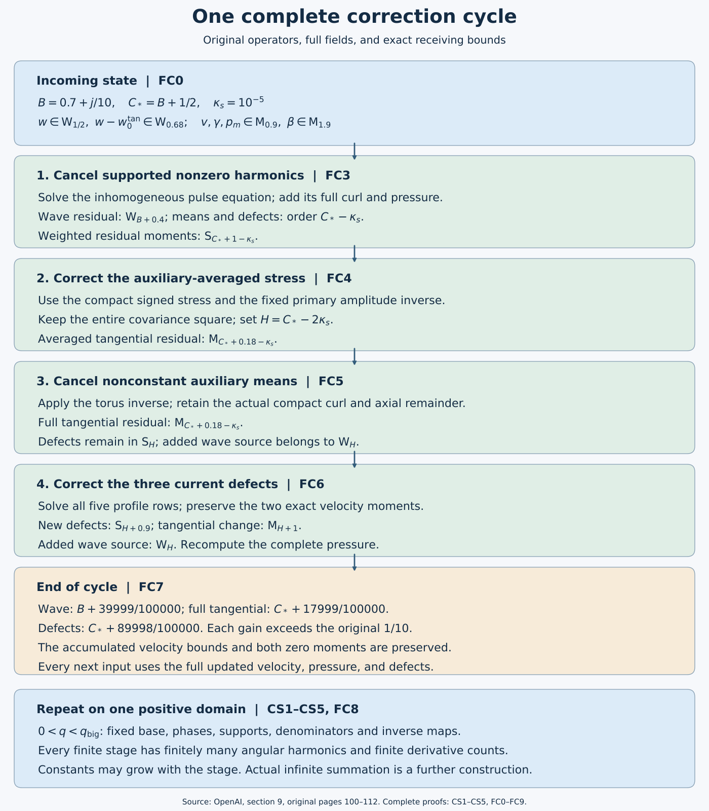

# Initializing and repeating the complete correction cycle

*NS-BLOWUP N6.2. Exposition by GPT-6 Astra (OpenAI). This independent exposition is dedicated to CC0.*

The individual operators now have to work together. A wave correction changes the means; a mean correction changes the wave residual; every pressure and every moment must be recomputed from the actual new velocity. This lesson proves that the original four operations preserve a complete finite state and improve all three residual orders. The same fixed inverses remain available on one positive domain at every finite stage.

CS1–CS5 prove the support, harmonic, edge and exact-residual closure needed by the next pulse solve. FC0–FC8 construct the initial state, apply all four updates, retain their nonlinear terms, prove the simultaneous bounds and establish the common domain. FC9 gives five worked exercises, including all physical viscosity factors, a bound on harmonic growth and the exact mixed term omitted by using a stale field.

The supplying lessons are the [actual base](constructing-the-actual-base-field.md), Z0–Z9; [support construction](separating-the-oscillatory-supports.md), OS0–OS7; [pulse construction](constructing-the-pulses-and-their-velocities.md), PU0–PU9; [stress and interactions](realizing-stress-and-controlling-interactions.md), SC1–SC11 and NI1–NI7; [radial mean equations](radial-primitives-and-the-mean-equations.md), RP1–RP9 and RM1–RM4; [temporal means](cancelling-the-nonconstant-auxiliary-means.md), TM0–TM7; and [five compact profiles](correcting-the-three-defects-with-five-profiles.md), MM1–MM9. References P,W,C,R,T,M in the proof retain their precise locations in the linked supplying audits; these are the same operators developed in those lessons.

The [editable drawing source](../assets/finite-correction-cycle.py) depicts the actual maps and estimates. It is an algebraic construction diagram. The original OpenAI transcription remains separate from this exposition and its proved refinements.

## CS1. The actual support invariant and harmonic sets

Keep the original band, phase and class definitions in W1–W3 and C1. In particular the band \(Q=2^{-\ell}\), \(\varepsilon=Q^h\), \(S_*=\ell^2\) and the integer \(kp_\gamma\ne0\) are fixed before coefficient differentiation. Original (6.28), checked on page 70, prescribes
\[
\begin{split}
\mathcal E_\gamma&=\{(x_*,H):H\in\overline{\mathcal R_\gamma^H}\},\\
\Omega_\gamma&=\{(x_*,H)\in\mathcal E_\gamma:
x_*\in K_\gamma^*,\ \xi_g(H)\in\operatorname{supp}\chi_g,\ X_a\le X\le X_b\},\\
\Omega_\gamma^{\rm cut}&=\Omega_\gamma\cap\{v(H)\in\operatorname{supp}\psi\}.
\end{split}
\tag{CS1.1}
\]
Here \(x_*=(R,Z,T)\), \(K_\gamma^*\) is the prescribed slow support, and \(\mathcal E_\gamma^+\) replaces the closed rectangle by its fixed open enlargement. The coefficient is independent of \(\theta\), smooth on that open domain, and extends by zero across the slow, transverse and radial shell boundaries. On \(0\le v\le L_s\), its bound is
\[
|\partial^Ia_{\gamma,m}|\le C_{j,I}\varepsilon^\alpha S_*^{b_{j,I}}
\sqrt\zeta\delta^{-d_{j,I}}P(v),\qquad
0<P(v)\le1.
\tag{CS1.2}
\]
Actual cut velocities have support in \(\Omega_\gamma^{\rm cut}\) and a smooth zero extension in \(v\). The uncut local initial-value solution has no temporal zero-extension requirement. The source entering that solve is an actual supported coefficient; it need not be divisible by \(\eta_\beta\chi_g\psi\).

The primary amplitudes have these properties by C4 and C7. Differentiating an identically zero smooth function outside a closed support leaves it zero there. Applying a smooth local differential operator therefore preserves the support in (CS1.1). Explicit \(D_r\) occurrences cost at most \(\kappa_s=10^{-5}\) each, as proved in W3; further coefficient derivatives of the resulting estimate only change its fixed constants and polynomial degrees. The full linearized residual, including phase derivatives and all cylindrical terms, is expanded in P8, so its class estimate does not omit derivatives falling on an exponential.

For products, the full unsymmetrized formulas in W5–W6 give the following exhaustive possibilities. A mean coefficient times a nonzero harmonic retains that harmonic and its support. Two waves with the same label have integer multiplier \(m+m'\); if this is nonzero they retain the wave weight since \(P^2\le P\) and \(\zeta\le\sqrt\zeta\). If it is zero, the phases cancel and the result has the mean weight \(\zeta\). Angular averaging removes every other integer multiplier because \(kp_\gamma\ne0\). Products of different labels, including derivatives and curls, vanish on their closed supports by W2. Thus no mixed phase has to be inverted. Products involving exactly one wave and any mean generated earlier inherit the wave's support even if that mean now occupies the entire auxiliary torus.

Starting with multipliers \(\{-1,1\}\), the set after one update is contained in
\[
\mathscr H_{j+1}\subset
\bigl(\mathscr H_j\cup\{-1,1\}\cup
\{m+m':m,m'\in\mathscr H_j\cup\{-1,1\}\}\bigr)\setminus\{0\}.
\tag{CS1.3}
\]
A pulse solve, curl, pressure coefficient or coefficient derivative preserves its multiplier; the signed stress map introduces only \(\pm1\); means introduce zero only. Formula (CS1.3) is a finite set at every finite stage and does not depend on a band. For example, if all old multipliers have modulus at most \(M_j\ge1\), all newly formed ones have modulus at most \(2M_j\). This supplies a finite stage-dependent harmonic bound rather than presupposing one.

Finally P4 gives the particular pulse by an integral along the original auxiliary path, holding all slow and transverse coordinates fixed. If that fixed pair is outside its prescribed support, the source vanishes along the entire path, so the integral and all its derivatives vanish. Inside it the P3 forward propagator cancels the source envelope exactly and yields (CS1.2) with a polynomial factor from the length \(L_s=O(S_*)\). P4's differentiated integral equation proves every fixed derivative estimate. Multiplying by the original \(\psi\) restores \(\Omega_\gamma^{\rm cut}\); taking the full curl preserves it. This proves the inverse's incoming support property at every finite update, without a cutoff-division assumption.

## CS2. Mean operations, edge integration and stress input

The mean class allows full auxiliary dependence. Its exact bound is
\[
|\partial^If|\le C_{j,I}\varepsilon^\mu S_*^{b_{j,I}}
\zeta(X)\delta(X)^{-d_{j,I}},\qquad
\zeta(X)=\exp\left(-\frac{a_a}{\log^2(X/X_a)}-
\frac{a_b}{\log^2(X_b/X)}\right),\quad a_a,a_b>0.
\tag{CS2.1}
\]
Radial integration follows the original shifted auxiliary path and retains its full cutoff remainder; the exact operator and all its coefficient derivatives are proved in R3–R6. Its domain and output are \(\mathsf M_\mu\), with the original physical measures in R1 and M2. The pressure uses the same operator, the axial velocity uses the full compact curl in R7, and the temporal mean inverse is the exact Fourier operator with its finite derivative bound in T1–T3. The five-profile operation has the explicit inverse in M3 and the complete nonlinear recomputation in M5–M7. These mean operations preserve angular independence. They can enlarge auxiliary support; they cannot create a new nonzero angular harmonic. W5 treats their next interaction with each wave using the full resulting mean, including all cutoff remainders.

For the auxiliary-independent stress passed to C5, fix \(e\in\{1,2\}\). Given its radial source \(f(R,Z,T)\), put
\[
\begin{gathered}
M_e=\int_0^\infty R^ef\,dR,\qquad f_0=f-\rho_eM_e,\qquad
\int_0^\infty R^e\rho_e\,dR=1,\\
\Sigma_e(R)=R^{-e}\int_0^R s^ef_0(s)\,ds
=-R^{-e}\int_R^\infty s^ef_0(s)\,ds.
\end{gathered}
\tag{CS2.2}
\]
The prescribed smooth bump \(\rho_e\) has compact interior support in the shell and is independent of the auxiliary variable. Its chart representative includes the original radial moment normalization in (CS2.2); any slow dependence of this representative is retained under differentiation and has the uniform bounds in R4 and M2. The equality of the two integrals follows from the exact zero total moment of \(f_0\). In the original correction it is the auxiliary average of the tangential residual that supplies \(f\); this is precisely why the input here is auxiliary independent. Its moment is retained as a separate mean defect, not discarded. Both formulas vanish outside the closed shell. They show \((\partial_R+e/R)\Sigma_e=f_0\), including its sign and radial weight.

Here is an explicit estimate for the edge integral used in original pages 104–105. For \(a>0\), \(M\ge0\), put \(p=(M-3)/2\) and \(v_0=a/\delta^2\). Substitution gives
\[
\int_0^\delta s^{-M}e^{-a/s^2}\,ds
=\tfrac12a^{(1-M)/2}\int_{v_0}^\infty v^pe^{-v}\,dv.
\tag{CS2.3}
\]
For \(p\le0\), the final integral is at most \(v_0^pe^{-v_0}\). For \(p>0\) and \(v_0\ge2p\), write \(v=v_0+w\) and use \(\log(1+w/v_0)\le w/v_0\) to obtain \((v_0+w)^p\le v_0^pe^{w/2}\). Integration then gives at most \(2v_0^pe^{-v_0}\). Hence, in both cases for sufficiently small \(\delta>0\),
\[
\int_0^\delta s^{-M}e^{-a/s^2}\,ds
\le a^{-1}\delta^{3-M}e^{-a/\delta^2}.
\tag{CS2.4}
\]
All fixed derivatives of \(e^{-a/s^2}\) are a finite linear combination of powers \(s^{-j}e^{-a/s^2}\) with \(0\le j\le3k\) at derivative order \(k\): differentiate each term, producing exponents \(j+1\) and \(j+3\), and induct. On \(0<s\le1\) this bounds them by \(C_{k,a}s^{-3k}e^{-a/s^2}\). The other edge factor and its derivatives are bounded in a sufficiently small collar and its value is bounded below positively there.

Use the forward integral in (CS2.2) at the inner edge and the backward integral at the outer edge. The bump vanishes in both collars; all radial Jacobians and powers of \(R\) are bounded there. Equation (CS2.4), after each allowed coefficient derivative, retains \(\zeta\delta^{-M'}\). Moving-boundary terms vanish because the integrand has every zero edge jet; equivalently differentiate its zero extension on a fixed half-line as in R4. In the remaining compact interior, \(\zeta\) is bounded below positively. Thus a source in \(\mathsf M_\mu\) yields \(\Sigma_e\in\mathsf M_\mu\), with smooth edge extension. The same reasoning applies to the two stress components with \(e=2,1\), respectively. C5 then proves the signed amplitude division and wave class \(\mathsf W_{\mu-1/2}\) at every derivative order. Those are coefficient bounds: one must retain the carrier exponential separately when differentiating an actual velocity field.

The common band set is unchanged by a radial path because \(q\) depends on \((z,t)\), which the path holds fixed. Temporal inversion and pulse propagation fix all slow coordinates. For each of the boundedly many active bands, a radial segment of bounded chart length meets at most \(C S_*^3\) radial mesh boxes: their chart widths are comparable to \(S_*^{-3}\). At fixed \((Z,T)\) there are boundedly many transverse/time mesh choices. Thus radial aggregation introduces at most a fixed polynomial factor in \(S_*\); any finite composition still has a finite polynomial factor. The common-torus degree differences depend on the bounded band range, not on the number of radial boxes. At a point, wave labels have bounded slow overlap and the disjoint auxiliary supports of W2. These facts justify the uniform-in-band estimates after aggregation.

## CS3. Exact residual decomposition and every flat term

For the original viscosity define
\[
\mathscr R_\nu(u,p)=\partial_tu-\nu\Delta u+(u\cdot\nabla)u+\nabla p.
\]
For any actual increment \((w,\pi)\), componentwise expansion gives exactly
\[
\mathscr R_\nu(u+w,p+\pi)=\mathscr R_\nu(u,p)
+\partial_tw-\nu\Delta w+\nabla\pi
+(u\cdot\nabla)w+(w\cdot\nabla)u+(w\cdot\nabla)w.
\tag{CS3.1}
\]
All velocities in this equation are the full fields, including the curl remainders, compact-primitive remainders and earlier corrections. If \(\mathscr R_\nu(u,p)=\mathcal G+\mathcal F\), the old \(\mathcal F\) enters additively. It is a residual field, not an omitted part of \(u\).

The finite-stage split starts with the original base error \(\mathcal E_{B,\nu}\) in \(\mathcal F\), together with the generated pulse endpoint and primitive cutoff errors. P6 proves the exact pulse error \((1-\psi)f_m+\psi't_m\). On its support the Gaussian estimate gives, after any fixed physical derivative, \(C Q^{-M}S_*^B e^{-cS_*}\). Since \(S_*=\ell^2\), \(Q=2^{-\ell}\) and \(q\) is comparable to \(Q\),
\[
q^{-N}Q^{-M}S_*^B e^{-cS_*}
\le C_N\exp[-c\ell^2+(M+N)\ell\log2+2B\log\ell]\longrightarrow0.
\tag{CS3.2}
\]
R5–R6 prove the exact primitive cutoff error is \(O(q^N)\) in every prescribed physical derivative, using finitely many extra coefficient derivatives for each prescribed \(N\). Thus a polynomial count of labels and finitely many error types at a fixed stage preserve these estimates: for the primitive bound first choose the power \(N+1\), and use the boundedness of \(S_*^Bq\); for the Gaussian use (CS3.2) with the larger polynomial. Every fixed \(\nu>0\) has the unchanged factors in C9 and M2, so constants may depend on \(\nu\), but no viscosity is omitted.

The actual \(\mathcal E_B\) has the original all-order flat bound in Proposition 5.5 by [Z5](../audits/base-field-realization-audit.md); [I1](../audits/local-construction-assembly-audit.md) identifies that same base and residual in the chart construction. The proof here establishes that the subsequent operators preserve this supplied property and do not require any stronger uniform-in-stage version of it.

At each update expand (CS3.1) first. Keep its newly identified endpoint errors and uncompensated primitive cutoff errors in \(\mathcal F\); all remaining terms form \(\mathcal G\) and have the supported coefficient estimates in CS1–CS2. Nonzero-harmonic Gaussian endpoint errors are not fed into a new forward pulse solve. A mean operation can cancel an explicit old flat mean term because the exact conservative residual includes it. If its actual residual change has the form \(-H+G_{\rm new}+F_{\rm new}\), where \(H\) is that canceled contribution of old \(\mathcal F\), the new split is exactly
\[
\mathcal G'=\mathcal G+G_{\rm new},\qquad
\mathcal F'=\mathcal F-H+F_{\rm new}.
\tag{CS3.3}
\]
The compact-primitive estimates put this specific \(H\) in every required mean class and give its physical flat bounds. Thus subtraction preserves the finite-stage flat estimate. No inference that every physically flat function has every coefficient-class bound is needed. Formula (CS3.3) prevents double counting a canceled contribution. The exact velocities remain unchanged by how their residual terms are assigned.

After each finite stage, therefore,
\[
\mathscr R_\nu(u^{[j]},p^{[j]})=\mathcal G^{[j]}+\mathcal F^{[j]},\qquad
|\mathcal F^{[j]}|_m\le C_{j,m,N,\nu}q^N
\tag{CS3.4}
\]
for every fixed derivative order \(m\) and power \(N\). Its supported part has the finite locally supported harmonic expansion in CS1, and its angular mean is in the mean class furnished by the actually applied estimates. This statement does not sum \(\mathcal F^{[j]}\) over infinitely many \(j\).

## CS4. Exact mean equations after every update

Use the exact chart from M2, with the original viscosity retained by that map. Its representative has viscosity coefficient \(\varepsilon\). Write the full velocity as
\[
u_*=(b+\beta,V+v,G+\gamma)+w,\qquad \langle w\rangle_\theta=0,
\qquad W_{ab}=\langle w_aw_b\rangle_\theta.
\]
The base and mean correction are divergence free and every wave is an actual curl. Put
\(\Delta_0=D_r^2+R^{-1}D_r+D_z^2\) and
\(\mathfrak t_*=-\varepsilon\partial_T+c_i\mathcal N_i\).
To keep its role distinct from the signed increment of C5, denote the original base stress by
\(\Sigma^B=(\Sigma^B_\theta,\Sigma^B_z)=Q^{2A}\mathcal T_{\rm phys}\) at viscosity one; at the original viscosity its representative is \(\nu^{-1}Q^{2A}\mathcal T_{\rm phys,\nu}\). This is the full base stress of (5.41), not only its order-zero part.

The conservative transport identity follows directly from divergence zero. For example
\((D_r+R^{-1})(u_ru_\theta)+R^{-1}\partial_\theta(u_\theta^2)+D_z(u_zu_\theta)\)
equals the scalar transport of \(u_\theta\), because the extra factor multiplying \(u_\theta\) is the divergence. The cylindrical component equation additionally has \(u_ru_\theta/R\), giving \(D_r+2/R\). The same argument for \(u_r\) adds the centrifugal term \(-u_\theta^2/R\); for \(u_z\) there is no additional connection term. Hence the exact three transport components are
\[
\begin{split}
(u\cdot\nabla_*u)_r&=(D_r+R^{-1})u_r^2+R^{-1}\partial_\theta(u_\theta u_r)+D_z(u_zu_r)-u_\theta^2/R,\\
(u\cdot\nabla_*u)_\theta&=(D_r+2/R)(u_ru_\theta)+R^{-1}\partial_\theta(u_\theta^2)+D_z(u_zu_\theta),\\
(u\cdot\nabla_*u)_z&=(D_r+R^{-1})(u_ru_z)+R^{-1}\partial_\theta(u_\theta u_z)+D_z(u_z^2).
\end{split}
\tag{CS4.1}
\]
Angular derivatives integrate to zero. Terms with exactly one factor of \(w\) have zero average; terms with two retain the entire \(W\). The cylindrical vector Laplacian has components
\(\Delta_{\rm sc}u_r-u_r/R^2-2\partial_\theta u_\theta/R^2\),
\(\Delta_{\rm sc}u_\theta-u_\theta/R^2+2\partial_\theta u_r/R^2\),
\(\Delta_{\rm sc}u_z\), where \(\Delta_{\rm sc}=\Delta_0+R^{-2}\partial_\theta^2\).
After averaging it is \(\Delta_0-R^{-2}\) on the first two components and \(\Delta_0\) on the third. These formulas follow by twice differentiating \(\partial_\theta e_r=e_\theta\), \(\partial_\theta e_\theta=-e_r\), retaining the two cross derivatives. Subtracting the pure base, whose nonflat tangential residual is minus the radial divergence of \(\Sigma^B\), now gives
\[
\begin{split}
g_r={}&-\mathfrak t_*\beta-(D_r+R^{-1})(2b\beta+\beta^2+W_{rr})
-D_z(b\gamma+G\beta+\beta\gamma+W_{zr})\\
&+(2Vv+v^2+W_{\theta\theta})/R+\varepsilon(\Delta_0-R^{-2})\beta,\\
E_\theta={}&\mathfrak t_*v+(D_r+2/R)(bv+V\beta+\beta v+W_{r\theta})
+D_z(Gv+V\gamma+\gamma v+W_{z\theta})\\
&-\varepsilon(\Delta_0-R^{-2})v-(D_r+2/R)\Sigma^B_\theta,\\
E_z={}&\mathfrak t_*\gamma+(D_r+1/R)(b\gamma+\beta G+\beta\gamma+W_{rz})
+D_z(2G\gamma+\gamma^2+W_{zz}+p_m)\\
&-\varepsilon\Delta_0\gamma-(D_r+1/R)\Sigma^B_z.
\end{split}
\tag{CS4.2}
\]
These are original (8.3) with every term retained, checked directly on original page 89. Reconstruct the pressure after each update using the full new \(g_r\):
\[
\mathcal P=\int_0^\infty\langle g_r\rangle_Y\,dR,\qquad
\int_0^\infty\rho\,dR=1,\qquad
p_m=\mathsf T_0(g_r-\rho\mathcal P).
\tag{CS4.3}
\]
The exact compact-primitive identity from R7 gives
\(D_rp_m-g_r=-\rho\mathcal P-\mathcal A_0(g_r-\rho\mathcal P)\).
Thus neither the radial defect nor the cutoff remainder is silently set to zero. The nonzero-harmonic pulse pressures and their endpoint residuals have zero angular average. Recalling the exact split (CS3.4), we obtain at every finite stage
\[
\left\langle\mathcal G_*^{[j]}+\mathcal F_*^{[j]}-\mathcal E_{B,*}\right\rangle_\theta
=(D_rp_m^{[j]}-g_r^{[j]},E_\theta^{[j]},E_z^{[j]}),
\tag{CS4.4}
\]
where all three physical residual representatives have the factor
\(\nu^{-1/2}Q^{2A+1/2}\). This is original (9.6) at \(\nu=1\), with its exact extension to every original viscosity. The pressure and flux derivatives in (CS4.2) use the complete current state, so (CS4.4) holds irrespective of whether a cancelable flat mean term is presently recorded in \(\mathcal F\).

## CS5. What the finite induction establishes

At stage zero C1–C7 supply the primary amplitudes, supports, real curls and their covariance errors; CS4 supplies the exact mean identities after pressure reconstruction. Suppose a finite list of operators has been applied. CS1 handles each differential, pulse and wave-product operation, gives its finite harmonic set, and proves the next pulse source has its prescribed support. CS2 handles each mean operation and its next auxiliary-independent signed stress input. CS3 updates the full residual by equality and preserves the all-order physical flat bound. CS4 recomputes pressure and the conservative means from the full new fields. This covers every operator listed in original Proposition 9.3 and proves its finite-stage closure by induction, with the source base's stated input properties left visible.

## FC0. The original finite state and all receiving quantities

Keep the original constants and coordinates
\[
0<h<1/100,\quad A=1/2+h,\quad D=1/2-h,\quad
Q=2^{-\ell},\quad\varepsilon=Q^h,\quad S_*=\ell^2,\quad\kappa_s=10^{-5}.
\]
The complete chart velocity and pressure are
\[
u_*=(b+\beta,V+v,G+\gamma)+w,\qquad
p_*=p_{B,*}+p_m+p_w,\qquad
\langle w\rangle_\theta=\langle p_w\rangle_\theta=0.
\tag{FC0.1}
\]
Every wave is an actual curl, including its lower-order curl terms. The mean is the curl of an azimuthal potential plus a direct azimuthal field. Write \(w_0^{\rm tan}=W_0^{\rm as}\) for the fixed assembled primary transverse field before its curl remainder. It remains fixed throughout the iteration.

Original Definition 9.4 requires
\[
\begin{gathered}
\sigma_j=\tfrac15+\tfrac j{10},\qquad B_j=\tfrac12+\sigma_j,\qquad C_j^*=1+\sigma_j,\\
\mathcal G_{\rm wave}^{[j]}\in\mathsf W_{B_j},\qquad
E_\theta,E_z\in\mathsf M_{C_j^*},\qquad
(\mathcal P,\mathcal J_\theta,\mathcal J_z)\in\mathsf S_{C_j^*},\\
w\in\mathsf W_{1/2},\qquad w-w_0^{\rm tan}\in\mathsf W_{0.68},\qquad
v,\gamma,p_m\in\mathsf M_{0.9},\qquad\beta\in\mathsf M_{1.9},\\
\int_0^\infty R^2\langle v\rangle_Y\,dR=0,\qquad
\int_0^\infty R\langle\gamma\rangle_Y\,dR=0.
\end{gathered}
\tag{FC0.2}
\]
These are the original (9.8)–(9.10); the decimal constants are retained. The wave class concerns each collected label and nonzero harmonic, with bounds \(\varepsilon^a S_*^b\sqrt\zeta\delta^{-d}P(v)\) for every fixed coefficient derivative. The mean class has \(\varepsilon^aS_*^b\zeta\delta^{-d}\) bounds and no auxiliary-support restriction. The moment class \(\mathsf S_a\) has \(\varepsilon^aS_*^b\) bounds for every fixed \((Z,T)\) derivative, after including its original radial measure. The supports, phases, weight, envelope and covering maps are those explicitly specified in W1–W3 and CS1–CS2. Constants may depend on the finite stage and derivative order. The bound with a larger exponent implies that with a smaller one since \(0<\varepsilon\le1\); it does not assert a smaller stage-dependent constant.

Let \(W_{ab}=\langle w_aw_b\rangle_\theta\). The radial source is the entire expression CS4.2 or M5.2. Reconstruct pressure after each update using
\[
\mathcal P=\int\langle g_r\rangle_Y\,dR,\qquad
p_m=\mathsf T_0(g_r-\rho\mathcal P),\qquad
\int\rho\,dR=1.
\tag{FC0.3}
\]
The two other defects and the moving pressure-moment coefficient are
\[
\begin{split}
\mathcal J_\theta&=\int R^2\langle Gv+V\gamma+\gamma v+W_{z\theta}\rangle_Y\,dR,\\
\mathcal J_z&=\int R\langle2G\gamma+\gamma^2+W_{zz}\rangle_Y\,dR
-\tfrac12\int R^2\langle g_r\rangle_Y\,dR,\qquad
c_\rho=\tfrac12\int R^2\rho\,dR.
\end{split}
\tag{FC0.4}
\]
Unspecified radial integrals in this note run from zero to infinity. The radial residual is exactly
\[
D_rp_m-g_r=-\rho\mathcal P-\mathcal A_0(g_r-\rho\mathcal P).
\tag{FC0.5}
\]
The compact-primitive remainder \(\mathcal A_0\) is retained. Its all-order physical flatness is proved in R5–R6, not inferred from a finite numerical check.

The original base inputs consumed by the cycle are (5.41)–(5.44): divergence zero, residual equal to minus the cylindrical radial divergence of its full tangential stress plus \(\mathcal E_B\), flatness of every fixed derivative of \(\mathcal E_B\), \(b=O(\varepsilon)\) with all fixed coefficient derivatives, bounded tangential coefficients and their derivatives, and the exact reserved mean patch from M1. The order-zero tangential fields differ from the full ones by \(O(\varepsilon^2)\). For the stress, original (5.43) gives, with \(\widehat{\mathcal T}=q^{A+1/2}\mathcal T_{\rm phys}\),
\[
|\mathcal D^I(\widehat{\mathcal T}-\mathcal T_0)|
\le C_Iq^{2h}\zeta\delta^{-N_I}\le C_Iq^h\zeta\delta^{-N_I}.
\tag{FC0.6}
\]
Both powers are retained. With \(\xi=q/Q\), the exact chart difference is
\[
\Sigma^B-\Sigma^{(0)}=Q^{2A}q^{-A-1/2}(\widehat{\mathcal T}-\mathcal T_0),\qquad
Q^{2A}q^{-A-1/2}q^{2h}
=Q^{3h}\xi^{-A-1/2+2h}.
\tag{FC0.7}
\]
Thus this input gives \(\Sigma^B-\Sigma^{(0)}\in\mathsf M_3\subset\mathsf M_2\), retaining the smooth \(\xi\) factor. Every fixed derivative follows from the profile-to-chart chain rule C4 and the original \(q\partial_q,\partial_X,\partial_\eta\) bounds. These calculations identify exactly which base assertions the cycle uses. The actual supplying fields and these exact bounds are derived in [Z0–Z8](../audits/base-field-realization-audit.md), especially Z6.2–Z6.4.

## FC1. Exact wave-update receiver and weighted mean identities

First keep \(\beta,v,\gamma\) fixed and add an actual wave increment \(s\). Set
\[
\Delta W_{ab}=\langle w_as_b+s_aw_b+s_as_b\rangle_\theta.
\tag{FC1.1}
\]
Subtract the two full conservative equations CS4.2. No base or mean field has changed, so all its terms cancel, leaving
\[
\begin{split}
\Delta g_r&=-(D_r+R^{-1})\Delta W_{rr}-D_z\Delta W_{zr}+\Delta W_{\theta\theta}/R,\\
\Delta\mathcal P&=\int\langle\Delta g_r\rangle_Y\,dR,\qquad
\Delta p_m=\mathsf T_0(\Delta g_r-\rho\Delta\mathcal P),\\
\Delta E_\theta&=(D_r+2/R)\Delta W_{r\theta}+D_z\Delta W_{z\theta},\\
\Delta E_z&=(D_r+1/R)\Delta W_{rz}+D_z(\Delta W_{zz}+\Delta p_m),\\
\Delta\mathcal J_\theta&=\int R^2\langle\Delta W_{z\theta}\rangle_Y\,dR,\\
\Delta\mathcal J_z&=\int R\langle\Delta W_{zz}\rangle_Y\,dR
-\tfrac12\int R^2\langle\Delta g_r\rangle_Y\,dR.
\end{split}
\tag{FC1.2}
\]
These equations include the square of the new wave, its entire curl remainder, every pressure change and the pressure contribution to the axial flux defect. The harmonic pressure increment has zero angular mean, so it adds no term to (FC1.2). A mean pressure change adds no nonzero angular harmonic.

Next derive the exact weighted identities needed to remove a compact residual by stress. Average CS4.2 over the auxiliary torus. The fast torus derivatives integrate to zero, so \(D_r\) becomes \(\partial_R\), \(D_z=\varepsilon\partial_Z\), and \(\mathfrak t_*\) becomes \(-\varepsilon\partial_T\). Multiply the azimuthal equation by \(R^2\) and the axial equation by \(R\). The radial divergences become endpoint terms, all zero by smooth compact shell support, including the base stress. The radial viscous terms give exactly
\[
\begin{aligned}
\int R^2(f_{RR}+R^{-1}f_R-R^{-2}f)\,dR
&=(2-1-1)\int f\,dR=0,\\
\int R(g_{RR}+R^{-1}g_R)\,dR
&=-\int g_R\,dR+\int g_R\,dR=0.
\end{aligned}
\tag{FC1.3}
\]
The time and axial viscosity contributions are derivatives of the two zero integrals in (FC0.2). The Haar average of the compact remainder in (FC0.5) is zero: R3's full radial integral, after Haar averaging, is the zero total integral of \(g_r-\rho\mathcal P\); its cutoff is auxiliary independent. Integration by parts therefore yields the exact pressure moment
\[
\int R\langle p_m\rangle_Y\,dR
=-\tfrac12\int R^2\partial_R\langle p_m\rangle_Y\,dR
=-\tfrac12\int R^2\langle g_r\rangle_Y\,dR+c_\rho\mathcal P.
\tag{FC1.4}
\]
Combining the surviving axial fluxes proves original (8.16), with no remainder omitted:
\[
\int R^2\langle E_\theta\rangle_Y\,dR=\varepsilon\partial_Z\mathcal J_\theta,
\qquad
\int R\langle E_z\rangle_Y\,dR=\varepsilon\partial_Z(\mathcal J_z+c_\rho\mathcal P).
\tag{FC1.5}
\]
The \(q\)-scaled original bump gives
\(c_\rho=(q/(2Q))\int x^2\widehat\rho(x)\,dx\), so all fixed \((Z,T)\) derivatives are bounded, but it need not be constant. Its full product with \(\mathcal P\) stays inside \(\partial_Z\). Consequently defects of class \(\mathsf S_a\) give the two weighted residual moments in \(\mathsf S_{a+1}\).

## FC2. Initialization from the actual primary curls

Start with \(v=\gamma=\beta=0\). C7 gives the exact primary wave
\[
w=w_0^{\rm tan}+R_0,\qquad
w\in\mathsf W_{1/2},\qquad R_0\in\mathsf W_{1-\kappa_s}.
\tag{FC2.1}
\]
Here \(R_0\) is the actual primary curl remainder from C7. The linear residual bound P8 implies the original conservative exponent \(1-3\kappa_s\), and W6 gives the quadratic wave exponent \(1-\kappa_s\). Thus the supported nonzero harmonic residual is in \(\mathsf W_{1-3\kappa_s}\). The excluded Gaussian tails remain additive flat residuals. At zero means, the exact radial source is
\(g_r=-(D_r+R^{-1})W_{rr}-D_zW_{zr}+W_{\theta\theta}/R\).
Since every \(W_{ab}\in\mathsf M_1\), (FC0.3), CS4.2 and FC0.7 show
\[
g_r,p_m,E_\theta,E_z\in\mathsf M_{1-\kappa_s},\qquad
(\mathcal P,\mathcal J_\theta,\mathcal J_z)\in\mathsf S_{1-\kappa_s}.
\tag{FC2.2}
\]
All moment measures in (FC0.4) are bounded on the shell; the class estimates hold after each slow derivative by smooth zero extension and differentiation under the integral.

The auxiliary-averaged tangential residual has a better order. Let \(\Sigma^{(0)}\) be the assembled leading stress and \(\Sigma^B\) the full base stress. With zero means, the exact equations are
\[
\begin{split}
\langle E_\theta\rangle_Y
&=(\partial_R+2/R)(\langle W_{r\theta}\rangle_Y-\Sigma^{(0)}_\theta)
-(\partial_R+2/R)(\Sigma^B_\theta-\Sigma^{(0)}_\theta)
+\varepsilon\partial_Z\langle W_{z\theta}\rangle_Y,\\
\langle E_z\rangle_Y
&=(\partial_R+1/R)(\langle W_{rz}\rangle_Y-\Sigma^{(0)}_z)
-(\partial_R+1/R)(\Sigma^B_z-\Sigma^{(0)}_z)
+\varepsilon\partial_Z\langle W_{zz}+p_m\rangle_Y.
\end{split}
\tag{FC2.3}
\]
C6 proves cancellation of the leading covariance with the exact squared partition, including derivatives of its sum. C7 proves the first differences in (FC2.3) have class \(\mathsf M_{3/2-\kappa_s}\); their quadratic curl part has the still higher exponent \(2-2\kappa_s\). C8 allows the same exponent after full auxiliary averaging and radial divergence. Even using the source's weaker allowance of an additional \(\kappa_s\) gives \(3/2-2\kappa_s\). The remaining terms have exponents at least \(2-\kappa_s\): the axial covariance has exponent two, axial pressure has \(2-\kappa_s\), and FC0.7 supplies the higher base stress. Since \(3/2-2\kappa_s=1.49998>1.49\),
\[
\langle E_\theta\rangle_Y,\langle E_z\rangle_Y\in\mathsf M_{1.49}.
\tag{FC2.4}
\]

Set \(H_0=1-\kappa_s\). Apply the actual temporal mean map T1–T4 to the zero-auxiliary-average parts of the residual. Its increments satisfy
\(\Delta v,\Delta\gamma,\Delta p_m\in\mathsf M_{H_0}\),
\(\Delta\beta\in\mathsf M_{H_0+1}\). They preserve both moments exactly. Its full tangential change after cancellation, apart from the explicitly retained axial reconstruction term, has exponent \(H_0+1-2\kappa_s\); that reconstruction term belongs to every required mean class by T3.4. Thus the exact tangential residuals retain order \(1.49\). Defects remain in \(\mathsf S_{H_0}\), because T4 computes their changes in \(\mathsf S_{H_0+0.9}\). Their old values are not set to zero by this step. W5 and W7 give the added nonzero harmonic residual in \(\mathsf W_{H_0}\).

Recompute all three defects and apply the five-profile correction M3–M7 at order \(H_0\). Its first two rows preserve the two moments; its other three rows cancel the linear parts of the current defects. Its complete nonlinear recomputation gives defects in \(\mathsf S_{H_0+0.9}\), which implies the weaker bound used in original Proposition 9.5. Its tangential changes have exponent \(H_0+1\) and its wave interaction exponent \(H_0\), so they preserve the tangential order \(1.49\) and the supported wave order \(1-3\kappa_s\). These operator proofs apply here because \(H_0>0.9\), all means before the temporal step are zero, and after it they satisfy the \(0.9,1.9\) bounds required by M6.

The initialized bounds are consequently
\[
\mathcal G_{\rm wave}^{[0]}\in\mathsf W_{1-3\kappa_s}\subset\mathsf W_{0.7},\qquad
E_\theta,E_z\in\mathsf M_{1.49}\subset\mathsf M_{1.2},\qquad
(\mathcal P,\mathcal J_\theta,\mathcal J_z)\in\mathsf S_{1.9-\kappa_s}\subset\mathsf S_{1.2}.
\tag{FC2.5}
\]
The wave itself is unchanged by these mean operations; (FC2.1) gives \(w-w_0^{\rm tan}\in\mathsf W_{1-\kappa_s}\subset\mathsf W_{0.68}\). All mean velocities and reconstructed mean pressure have exponent at least \(H_0>0.9\), and radial mean velocity at least \(H_0+1>1.9\). This proves every part of (FC0.2) at \(j=0\), with pressure recomputed before and after both updates. Flat residuals and support remain as proved in CS1–CS4. This establishes the initialization of original Proposition 9.5 with its actual global-base supplier in [Z0–Z8](../audits/base-field-realization-audit.md).

## FC3. Cycle step 1: the inhomogeneous pulse update

Fix a finite state and abbreviate \(B=B_j\ge0.7\), \(C_*=C_j^*=B+1/2\). Group each current supported source coefficient as in CS1. Apply the zero-initial-data solve P4 with its full pressure, and form the actual increment
\[
s_m=\operatorname{curl}_*\left(\frac{i n_\Phi\times(\psi t_m)}{km|n_\Phi|^2}e^{ikm\Phi}\right),\qquad
\pi_{w,m}=\psi\pi_m e^{ikm\Phi},\qquad
\mathscr L_m(t_m,\pi_m)=-f_m.
\tag{FC3.1}
\]
Sum with the original physical factors and conjugate pairs. The full velocity increment is in \(\mathsf W_B\); its harmonic pressure is in \(\mathsf W_{B+1/2}\). The exact expansion of the residual is CS3.1, with the old supported harmonic canceled by the principal solve and the complete curl retained. The bounds on the remaining nonzero harmonics are

| Term in the exact residual change | Class exponent at least | Complete supplying calculation |
|---|---:|---|
| Linear pulse/curl residual, apart from its retained flat tails | \(B+1/2-3\kappa_s\) | P8; its proved stronger bound also implies this original exponent |
| Cross interaction with the current full wave | \(B+1/2-\kappa_s\) | W6 and \(w\in\mathsf W_{1/2}\) |
| Square of the particular increment | \(2B-\kappa_s\) | W6, with coefficient one on the square |
| Cross interaction with the total mean correction | \(B+0.4\) | W5 with \(0.9\) tangential mean exponent and \(1.9\) radial exponent |

The old exact wave may include every earlier correction; its total bound is the one in (FC0.2). Subtracting \(B\), the four lower gains are \(1/2-3\kappa_s,1/2-\kappa_s,B-\kappa_s,0.4\), whose minimum is \(0.4\). Thus the new supported harmonic residual is in \(\mathsf W_{B+0.4}\).

The entire covariance change (FC1.1) has mean class \(\mathsf M_{C_*}\): its cross terms have exponent \(B+1/2=C_*\), while its square has exponent \(2B\ge C_*\). The complete receiver (FC1.2), including pressure, gives
\[
\Delta g_r,\Delta p_m,E_{\theta,\rm new},E_{z,\rm new}\in\mathsf M_{C_*-\kappa_s},\qquad
(\mathcal P,\mathcal J_\theta,\mathcal J_z)_{\rm new}\in\mathsf S_{C_*-\kappa_s}.
\tag{FC3.2}
\]
The statements about \(g_r,p_m\) are changes, not an assertion that their old leading parts have disappeared. Old tangential residuals and defects had exponent \(C_*\), so adding these changes gives (FC3.2). The zero mean-velocity moments are unchanged, and the pressure has been recomputed. Apply (FC1.5) to this new complete state:
\[
m_2:=\int R^2\langle E_\theta\rangle_Y\,dR\in\mathsf S_{C_*+1-\kappa_s},\qquad
m_1:=\int R\langle E_z\rangle_Y\,dR\in\mathsf S_{C_*+1-\kappa_s}.
\tag{FC3.3}
\]
This is the extra power required for the retained moment term in the next step. In the axial identity it comes from \(\varepsilon\partial_Z(\mathcal J_z+c_\rho\mathcal P)\), with the full product derivative retained.

## FC4. Cycle step 2: signed stress, its physical sign and complete covariance

This operation is defined in physical coordinates so that the fields agree on chart overlaps. Retain an arbitrary original viscosity \(\nu>0\) using the exact bridge C9. Define the physical averaged tangential residuals by
\[
F_{2,\nu}=\sqrt\nu Q^{-2A-1/2}\langle E_\theta\rangle_Y,
\qquad F_{1,\nu}=\sqrt\nu Q^{-2A-1/2}\langle E_z\rangle_Y.
\tag{FC4.1}
\]
They are the same physical functions in every chart. The two prescribed interior profiles satisfy \(\int_0^\infty x^e\widehat b_e(x)\,dx=1\), \(e\in\{1,2\}\). Set
\[
\begin{split}
b_{e,\nu}(r_\nu,z_\nu,t)&=(\nu q_\nu)^{-(e+1)/2}\widehat b_e(r_\nu/\sqrt{\nu q_\nu}),\\
M_{e,\nu}&=\int_0^\infty r_\nu^eF_{e,\nu}(r_\nu)\,dr_\nu,\\
\sigma_{e,\nu}(r_\nu)&=-r_\nu^{-e}\int_0^{r_\nu}(r')^e
[F_{e,\nu}(r')-b_{e,\nu}(r')M_{e,\nu}]\,dr'.
\end{split}
\tag{FC4.2}
\]
Time and \(z_\nu\) are fixed along these integrals; \(q_\nu\) is independent of the radial coordinate. Changing variable \(r_\nu=\sqrt{\nu q_\nu}\,x\) shows \(\int r_\nu^eb_{e,\nu}\,dr_\nu=1\). Hence the integrand in the last line has zero total weighted moment. The primitive vanishes on both sides of its shell, with its lower endpoint fixing the integration constant. Its exact divergence, including the minus sign, is
\[
(\partial_{r_\nu}+e/r_\nu)\sigma_{e,\nu}=-F_{e,\nu}+b_{e,\nu}M_{e,\nu}.
\tag{FC4.3}
\]
At \(\nu=1\) these are exactly the physical formulas printed on original page 109.

With \(R=r_\nu/\sqrt{\nu Q}\), the complete moment and bump factors are
\[
\begin{split}
M_{e,\nu}&=\nu^{(e+2)/2}Q^{e/2-2A}m_e,\\
\rho_{e,*}&=(\nu Q)^{(e+1)/2}b_{e,\nu}
=(Q/q_\nu)^{(e+1)/2}\widehat b_e(\sqrt{Q/q_\nu}\,R),\\
\int R^e\rho_{e,*}\,dR&=1,
\qquad \Sigma=(\Sigma_\theta,\Sigma_z)=\nu^{-1}Q^{2A}(\sigma_{2,\nu},\sigma_{1,\nu}).
\end{split}
\tag{FC4.4}
\]
Substitution into (FC4.2) gives exactly, with \(\overline E_2=\langle E_\theta\rangle_Y\), \(\overline E_1=\langle E_z\rangle_Y\),
\[
\Sigma_e=-R^{-e}\int_0^R s^e(\overline E_e(s)-\rho_{e,*}(s)m_e)\,ds,
\qquad
(\partial_R+e/R)\Sigma_e=-\overline E_e+\rho_{e,*}m_e.
\tag{FC4.5}
\]
Here \(\Sigma_2\) means \(\Sigma_\theta\), and \(\Sigma_1\) means \(\Sigma_z\). The physical stress factor is \(\nu Q^{-2A}\), and its radial divergence factor is \(\sqrt\nu Q^{-2A-1/2}\), as required by (FC4.1). Every slow derivative of \(\rho_{e,*}\) is bounded by the implicit-coordinate estimates C4. CS2 proves all edge derivatives of the zero-moment primitive. Equations (FC3.2)–(FC3.3) therefore give \(\Sigma\in\mathsf M_{C_*-\kappa_s}\); the retained source \(\rho_{e,*}m_e\) has the higher class \(\mathsf M_{C_*+1-\kappa_s}\). These are auxiliary-independent stresses because (FC4.1) uses the full Haar average, even when the unaveraged residual depends on that torus.

Apply the fixed signed operator of C5–C6. Its transverse field and actual curl increment satisfy
\[
t_s=\mathcal L^{\rm as}\Sigma\in\mathsf W_{B-\kappa_s},\qquad
s=t_s+r_s,\qquad r_s\in\mathsf W_{C_*-2\kappa_s}.
\tag{FC4.6}
\]
In each box it divides by the fixed primary \(2a_\sigma=2\sqrt{y_\sigma}\); no current-covariance square root is taken. The uncut coefficient is a slow scalar times a transverse cutoff times the homogeneous pulse. The principal pulse derivative leaves the slow scalar and transverse cutoff fixed, so its homogeneous equation has source zero. Use its full homogeneous pressure and then the original pulse cutoff and curl. All slow derivatives of the scalars and cutoffs enter the P8 remainder; its endpoint term remains flat.

The four newly introduced nonzero harmonic errors have the original bounds

| Term | Class exponent at least |
|---|---:|
| Linear homogeneous pulse/curl error | \(B+1/2-4\kappa_s\) |
| Interaction with total mean correction | \(B+0.4-\kappa_s\) |
| Cross term with current exact waves | \(B+1/2-2\kappa_s\) |
| Square of the signed increment | \(2B-3\kappa_s\) |

These follow by inserting \(B-\kappa_s\) into P8 and W5–W6. The four gains over \(B\) are at least \(0.4-\kappa_s\), because \(B\ge0.7\). The old residual after step 1 was in \(\mathsf W_{B+0.4}\). Their sum is therefore in \(\mathsf W_{B+0.4-\kappa_s}\).

For the averaged stress, retain the full tensor, not only the two prescribed components. Define
\(\mathscr B(a,b)=\langle\langle a\otimes b+b\otimes a\rangle_\theta\rangle_Y\).
Equation (FC1.1) becomes exactly
\[
\langle\Delta W\rangle_Y
=\mathscr B(w_0^{\rm tan},t_s)
+\mathscr B(w-w_0^{\rm tan},t_s)
+\mathscr B(w,r_s)
+\langle\langle s\otimes s\rangle_\theta\rangle_Y.
\tag{FC4.7}
\]
The radial–tangential components of the first tensor equal \(\Sigma\), by the exact linear covariance inverse C6. Its divergence cancels \(-\overline E_e\) with the sign in (FC4.5), leaving \(\rho_{e,*}m_e\). The three remaining tensor terms have respective classes
\[
\mathsf M_{C_*+0.18-\kappa_s},\qquad
\mathsf M_{C_*+1/2-2\kappa_s},\qquad
\mathsf M_{C_*+\sigma_j-2\kappa_s}.
\tag{FC4.8}
\]
The first uses the actual accumulated bound \(w-w_0^{\rm tan}\in\mathsf W_{0.68}\), still valid after step 1 since its increment had exponent \(B\ge0.7\). The second uses the full \(w\in\mathsf W_{1/2}\). The third keeps the entire square of \(s\) and uses \(2B-2\kappa_s=C_*+\sigma_j-2\kappa_s\). No sign condition on the input stress was imposed.

All unprojected tensor changes have mean class \(\mathsf M_{C_*-\kappa_s}\), including their nonconstant auxiliary parts. Equation (FC1.2) gives changes \(\Delta g_r,\Delta p_m\in\mathsf M_H\), where
\[
H=C_*-2\kappa_s.
\tag{FC4.9}
\]
Thus the axial pressure effect has exponent \(H+1\), and the other axial tensor divergences have exponent \(C_*+1-\kappa_s\). The full residuals and all three defects have order at least \(H\).

For the fully auxiliary-averaged radial divergences of (FC4.8), C8 proves that there is no further fast radial loss. In fact their exact coefficient derivative is \(\partial_R\), because the torus derivative has zero Haar integral. Combined with the retained moment term and axial terms just listed, the exact averaged tangential residuals have the stronger estimate
\[
\overline E_\theta,\overline E_z\in\mathsf M_{C_*+0.18-\kappa_s}.
\tag{FC4.10}
\]
To verify the minimum, subtract \(0.18-\kappa_s\) from the other gains: they are at least \(0.32-\kappa_s\), \(\sigma_j-0.18-\kappa_s\ge0.02-\kappa_s\), \(0.82\), and \(0.82-\kappa_s\), all positive. Using instead the original allowance of an extra \(\kappa_s\) still gives \(0.18-2\kappa_s>0.17\) and \(\sigma_j-3\kappa_s>0.17\). Thus (FC4.10) implies every original assertion in (9.14): averaged order \(C_*+0.17\), full order \(H\), and defects in \(\mathsf S_H\). It is important here that (FC4.10) concerns the complete Haar average, while the unaveraged angular mean still only has the bound \(H\).

## FC5. Cycle step 3: temporal mean inverse and its actual axial field

For the current exact residual put \(E_a^\circ=E_a-\langle E_a\rangle_Y\), \(a=\theta,z\), and apply the original operation
\[
\begin{gathered}
\Delta v=-c_{i_0}^{-1}N_{i_0}^{-1}E_\theta^\circ,\qquad
\gamma_d=-c_{i_0}^{-1}N_{i_0}^{-1}E_z^\circ,\\
\Psi_*=\mathsf T_1\gamma_d,\qquad
\Delta\beta=-\varepsilon\partial_Z\Psi_*,\qquad
\Delta\gamma=(D_r+R^{-1})\Psi_*.
\end{gathered}
\tag{FC5.1}
\]
The torus inverse is the zero-mean inverse with its exact finite derivative estimate in T1–T2. The compact primitive has its original sign and full remainder. Therefore
\[
\Delta v,\Delta\gamma\in\mathsf M_H,\quad\Delta\beta\in\mathsf M_{H+1},\quad
\Delta\gamma=\gamma_d-\mathcal A_1\gamma_d,
\tag{FC5.2}
\]
and the actual fast-time identities are
\[
c_{i_0}N_{i_0}\Delta v=-E_\theta^\circ,\qquad
c_{i_0}N_{i_0}\Delta\gamma=-E_z^\circ+\mathcal F_{\rm ax},\qquad
\mathcal F_{\rm ax}=c_{i_0}N_{i_0}(\Delta\gamma-\gamma_d).
\tag{FC5.3}
\]
For every fixed coefficient derivative \(I\) and integer \(p\ge1\), T3.4 proves
\( |\partial^I\mathcal F_{\rm ax}|\le C_{I,p}\varepsilon^{H+p\kappa_s}S_*^{b_{I,p}}\zeta\delta^{-d_{I,p}}\).
Thus it belongs to every required mean class by choosing a finite \(p\) for that class. All physical derivatives are also flat, with the original viscosity factors. Its actual contribution is retained in both (FC5.2) and (FC5.3); no inference from physical flatness alone to a coefficient estimate is being used.

Recompute the radial source from the complete new means. Its exact change is
\[
\Delta g_r=(2V/R)\Delta v+\mathcal R_g,
\tag{FC5.4}
\]
where \(\mathcal R_g\) is the full expression (FC6.2) below, with the actual torus-dependent increments in this step. T4 proves \(\mathcal R_g\in\mathsf M_{H+0.9}\), \(\Delta g_r,\Delta p_m\in\mathsf M_H\). The linear term is present in the pressure change even though its auxiliary average is zero. Subtracting the two versions of the exact tangential equations yields
\[
\begin{split}
E_{\theta,\rm new}-\overline E_\theta={}&-\varepsilon\partial_T\Delta v-\varepsilon(\Delta_0-R^{-2})\Delta v\\
&+(D_r+2/R)((b+\beta)\Delta v+(V+v)\Delta\beta+\Delta\beta\Delta v)\\
&+D_z((G+\gamma)\Delta v+(V+v)\Delta\gamma+\Delta\gamma\Delta v),\\
E_{z,\rm new}-\overline E_z={}&-\varepsilon\partial_T\Delta\gamma-\varepsilon\Delta_0\Delta\gamma+\mathcal F_{\rm ax}\\
&+(D_r+1/R)((b+\beta)\Delta\gamma+(G+\gamma)\Delta\beta+\Delta\beta\Delta\gamma)\\
&+D_z(2(G+\gamma)\Delta\gamma+(\Delta\gamma)^2+\Delta p_m).
\end{split}
\tag{FC5.5}
\]
The wave covariance is unchanged by a mean update. The four nonflat types of terms in (FC5.5) have the following bounds, using \(b\) of order one in \(\varepsilon\), old radial mean order \(1.9\), and the new radial order \(H+1\):

| Type | Class exponent at least |
|---|---:|
| Slow-time derivative | \(H+1\) |
| Radial flux, including every old-new and new-new product | \(H+1-\kappa_s\) |
| Axial flux, including the full pressure change | \(H+1\) |
| Viscosity with at most two fast radial derivatives | \(H+1-2\kappa_s\) |

For example the new-new radial product has exponent \(2H+1-\kappa_s\), above the displayed bound since \(H\ge1.2-2\kappa_s>0\). Every remaining product is included explicitly in (FC5.5); the termwise all-derivative estimates are T4. As \(H+1-2\kappa_s=C_*+1-4\kappa_s>C_*+0.18-\kappa_s\), (FC4.10) gives the full, exact residual estimate
\[
E_{\theta,\rm new},E_{z,\rm new}\in\mathsf M_{C_*+0.18-\kappa_s}.
\tag{FC5.6}
\]
This includes \(\mathcal F_{\rm ax}\) using its coefficient bounds above. It can simultaneously be recorded as an additive flat residual with the exact decomposition CS3.3. Its velocity contribution continues to enter all later products.

The increments have zero auxiliary average, including the complete axial reconstruction, by Haar translation invariance in T3. Thus both moments in (FC0.2) are unchanged. T4.4 gives the exact defect changes in \(\mathsf S_{H+0.9}\); it does not cancel the old defects, so they remain in \(\mathsf S_H\). The only new nonzero harmonic terms are the interactions of this mean increment with the current exact wave. W7 gives class \(\mathsf W_H\). All supports and envelopes required for the next pulse solve are preserved by CS1.

## FC6. Cycle step 4: the five exact rows and all nonlinear terms

Use the current three defects after step 3. The fixed moment inverse M3 supplies auxiliary-independent increments solving the original five equations
\[
\begin{gathered}
\int R^2\Delta v\,dR=0,\qquad\int R\gamma_d\,dR=0,\\
\int (2V/R)\Delta v\,dR=-\mathcal P,\\
\int R^2(G\Delta v+V\gamma_d)\,dR=-\mathcal J_\theta,\\
\int(2RG\gamma_d-RV\Delta v)\,dR=-\mathcal J_z.
\end{gathered}
\tag{FC6.1}
\]
All terms are retained, including the occurrences of \(G\), which are identically zero on the prescribed mean patch by original (5.44)/(8.24). M2 gives the physical measure and viscosity factor for every row. M3 proves invertibility from the fixed profiles and \(\lambda>0\), with no smallness condition on the target triple. M4 proves that the actual potential has \(\Delta\gamma=\gamma_d\) exactly and \(\Delta\beta\in\mathsf M_{H+1}\), because the second row makes its total weighted axial moment zero. The tangential increments are in \(\mathsf M_H\), all supported in the fixed interior patch. The first two rows preserve the two zero moments.

Keep the actual wave fixed and expand the radial source. Its complete remainder beyond \((2V/R)\Delta v\) is
\[
\begin{split}
\mathcal R_g={}&-\mathfrak t_*\Delta\beta
-(D_r+R^{-1})(2b\Delta\beta+2\beta\Delta\beta+(\Delta\beta)^2)\\
&-D_z(b\Delta\gamma+G\Delta\beta+\beta\Delta\gamma+\gamma\Delta\beta+\Delta\beta\Delta\gamma)\\
&+(2v\Delta v+(\Delta v)^2)/R+\varepsilon(\Delta_0-R^{-2})\Delta\beta.
\end{split}
\tag{FC6.2}
\]
This equality also applies to step 3 before invoking auxiliary independence. All \(W\) terms cancel here because the wave field is unchanged, not because its remainders are ignored. In the present step \(\mathfrak t_*\Delta\beta=-\varepsilon\partial_T\Delta\beta\), and all derivatives of new increments in \(D_r\) are ordinary radial derivatives. The table in M6 covers every term in (FC6.2), with lower bounds
\[
H+2,\ H+2.9-\kappa_s,\ 2H+2,\ H+2.9,
\ H+0.9,\ 2H,\ H+4.
\]
All are at least \(H+0.9\), because \(H>0.9\). These estimates apply after every fixed derivative by the finite product rule. Thus \(\mathcal R_g\in\mathsf M_{H+0.9}\).

The three base-linear changes cancel the old defects by the last three rows in (FC6.1). The exact remaining values are
\[
\begin{split}
\mathcal P_{\rm new}&=\int\langle\mathcal R_g\rangle_Y\,dR,\\
\mathcal J_{\theta,\rm new}&=\int R^2\langle\gamma\Delta v+v\Delta\gamma+\Delta\gamma\Delta v\rangle_Y\,dR,\\
\mathcal J_{z,\rm new}&=\int R\langle2\gamma\Delta\gamma+(\Delta\gamma)^2\rangle_Y\,dR
-\tfrac12\int R^2\langle\mathcal R_g\rangle_Y\,dR.
\end{split}
\tag{FC6.3}
\]
In the fifth row, the pressure contribution is exactly \(-\tfrac12R^2(2V/R)\Delta v=-RV\Delta v\), with its minus sign. Every product in (FC6.3) has exponent at least \(H+0.9\), using the old \(0.9\) tangential means and \(H\ge0.9\). Radial integration and its differentiated forms preserve this exponent on the fixed shell. Therefore
\[
(\mathcal P,\mathcal J_\theta,\mathcal J_z)_{\rm new}
\in\mathsf S_{H+0.9}=\mathsf S_{C_*+0.9-2\kappa_s}.
\tag{FC6.4}
\]
This is the proved M6 refinement of the original weaker \(C_*+0.9-4\kappa_s\), now propagated through the actual complete cycle.

Recompute pressure from \(g_{r,\rm new}\). The full change is \(\mathsf T_0(\Delta g_r-\rho\Delta\mathcal P)\), retaining the compact remainder in (FC0.5), and is in \(\mathsf M_H\). The exact tangential change is M7.3, or (FC5.5) with the original fast-time cancellation removed and \(-\varepsilon\partial_T\) acting on the new means. M7 proves class \(\mathsf M_{H+1}\). It preserves (FC5.6). W7 again gives a nonzero harmonic change in \(\mathsf W_H\). Every full current quantity, rather than its previous value or just its principal term, has thus been used for the final state.

## FC7. Simultaneous improvement and preservation of the accumulated fields

The exact operations give the following end-of-cycle bounds:
\[
\begin{split}
\mathcal G_{\rm wave,new}&\in\mathsf W_{B+0.4-\kappa_s},\\
E_{\theta,\rm new},E_{z,\rm new}&\in\mathsf M_{C_*+0.18-\kappa_s},\\
(\mathcal P,\mathcal J_\theta,\mathcal J_z)_{\rm new}&\in\mathsf S_{C_*+0.9-2\kappa_s}.
\end{split}
\tag{FC7.1}
\]
For the wave bound, steps 3–4 add only order \(H\), and
\(H-(B+0.4-\kappa_s)=0.1-\kappa_s>0\).
For the full tangential mean bound, the step 3 changes have gain \(1-4\kappa_s\) over \(C_*\), the step 4 changes gain \(1-2\kappa_s\), and both exceed \(0.18-\kappa_s\). The flat axial reconstruction has every required coefficient class, as shown in FC5. The defect bound is the full nonlinear equality FC6.3 and its estimate FC6.4.

Since \(\kappa_s=1/100000\), the three guaranteed gains in (FC7.1) are exactly
\[
\frac{39999}{100000},\qquad\frac{17999}{100000},\qquad\frac{89998}{100000}.
\tag{FC7.2}
\]
Every one exceeds the original required \(1/10=10000/100000\). Their smallest value is \(17999/100000\). Thus (FC7.1) proves the original \(B_{j+1}=B_j+1/10\), \(C_{j+1}^*=C_j^*+1/10\), with the exact original \(\sigma_j\) left unchanged. Even the source's unrevised bounds close directly: its two wave minima are \(0.4\) and \(0.4-\kappa_s\), its later wave gain is \(H-B=1/2-2\kappa_s>0.1\), its tangential minimum is \(\min(0.17,1-4\kappa_s)=0.17>0.1\), and its defect gain \(0.9-4\kappa_s>0.1\). The strengthened bounds are therefore additional consequences of the checked operations, not repairs needed to make the original numerical margins positive.

It remains to verify every accumulated-field assertion, because improving a residual alone would not establish the next finite state. The two wave-velocity increments have exponents \(B\) and \(B-\kappa_s\), respectively. Their minima over all incoming stages are \(0.7\) and \(0.69999\), both above \(0.68\), and therefore above \(1/2\). Adding them to the full old wave proves both \(w_{\rm new}\in\mathsf W_{1/2}\) and \(w_{\rm new}-w_0^{\rm tan}\in\mathsf W_{0.68}\). The mean operations change no wave velocity. All harmonic coefficients of an equal label are collected before making these assertions; the number is finite at each stage by CS1.

Only steps 3–4 add mean velocities. Their tangential exponent is \(H\ge1.2-2\kappa_s=1.19998>0.9\) and radial exponent \(H+1>1.9\). Mean-pressure changes have exponents \(C_*-\kappa_s\) in step 1 and at least \(H\) in each other step, all greater than \(0.9\). The old mean pressure is not replaced by these changes in estimating its total. Finite addition consequently preserves \(v,\gamma,p_m\in\mathsf M_{0.9}\) and \(\beta\in\mathsf M_{1.9}\). Constants may grow with this finite stage, as allowed by the definition.

The two wave updates leave mean velocities and their moments unchanged. The temporal update has zero auxiliary average in every complete mean component. The moment update preserves the two integrals by the first two exact rows of (FC6.1). Hence (9.10) holds exactly in the new state. Every velocity increment is the original full potential curl or direct azimuthal field, so incompressibility and reality are exact. Every pressure was reconstructed from the current radial source. CS1–CS5 prove the source support, finite harmonic set, all fixed derivative bounds, torus compatibility and the exact flat-residual decomposition needed for another cycle. These checks supply every item in the finite-state definition, not only the exponent comparisons.

Equations (FC7.1)–(FC7.2) also prove the following refinement: the same four operations improve all three decay exponents by at least \(0.18-\kappa_s=0.17999\), whereas the original proposition states the common gain \(0.1\). Its proof uses the already derived disappearance of the fast radial derivative after full Haar averaging in C8, now applied in FC4, and the complete moment remainder in M6, now applied in FC6. No state definition, original coordinate, operation, source object or target theorem is changed. This is a lower bound on this cycle's gain; no optimality, novelty or stronger global blowup theorem is asserted.

The opening diagram gives the four operations and the three exact gains in (FC7.2). Their complete proofs are FC1–FC7.

## FC8. A common positive domain for every finite stage

Original Lemma 9.7 requires one \(q_{\rm big}>0\), independent of the finite stage and derivative order. The local derivations already identify the finite list of value conditions needed to choose it: the source base's fixed enlarged annulus and mean patch, the pulse's positive denominators and frame comparison from P1, the homogeneous-pulse radial lower bound from P5, and the positive primary covariance margin and invertibility in C3. Choose \(0<q_{\rm big}\le q_*\) satisfying those conditions and \(q_{\rm big}<1\). V0–V7 and [Z0–Z8](../audits/base-field-realization-audit.md) supply the actual original input properties for this choice. The base cutoff sequence is fixed first. Its finite value comparisons in Z6.2–Z6.4 have constants independent of the later correction stage; decreasing q_big to meet the finite pulse and cone conditions therefore does not change the constructed base or its coefficients.

No later step changes the base, primary amplitudes, phases, compact supports or inverse matrices. The inhomogeneous pulse equation is linear with these fixed coefficients. P3 proves the exact propagator relation for every nonzero integer harmonic,
\[
V_m(v,w)=\exp\left[-(m^2-1)\int_w^v d(s)\,ds\right]V_1(v,w),
\qquad 0\le w\le v\le L_s,\qquad d(s)=\varepsilon k^2|n_\Phi(s)|^2>0.
\tag{FC8.1}
\]
The scalar factor is at most one; the same value threshold works for every harmonic. Differentiation introduces powers of \(m\) into constants for the finite harmonic set and polynomial factors in \(S_*\), not a new smallness requirement. The signed inverse always divides by the original \(2a_\sigma\), whose vanishing at the shell edge is handled by the exact weighted division C5. It never divides by an accumulated amplitude. The five-profile inverse is fixed and linear for arbitrary real targets. Pressure reconstruction, temporal inversion and modified radial integration are fixed linear maps. Their estimates are homogeneous in the source norms. Large finite constants near the upper end of the domain do not prevent any of these operations from being defined.

All higher derivative estimates permit constants depending on that fixed order. The source's unweighted asymptotic derivative bounds can be used on this same \(q_{\rm big}\) interval: for a derivative whose asymptotic bound initially uses a smaller threshold, smoothness on the intervening compact region gives a finite larger constant. The weighted shell estimates are the original (5.43) and the proved weighted operator estimates, retaining their exact edge factors; this argument does not replace them with an unweighted compactness claim at a vanishing edge. The only estimates required to be small are the finite value comparisons already used in choosing the domain.

For completeness, each fixed output order uses finitely many input derivatives. Represent a finite construction by its actual finite graph of sums, products, explicit derivatives and these inverse maps. For a source vertex \(a\), let \(D_{v,a}(m)\) be a sufficient input order at \(a\) to control derivatives through order \(m\) at vertex \(v\). If the operation at \(v\) uses an input \(w\) through order \(m+d_{v,w}\), set
\[
D_{v,a}(m)=\max_{w\to v}D_{w,a}(m+d_{v,w}),\qquad
D_{a,a}(m)=m,\qquad D_{b,a}(m)=0\quad(b\ne a\text{ a source vertex}).
\tag{FC8.2}
\]
Explicit differential operators have finite order; product rules use finite sums through order \(m\); T1's torus inverse uses four additional derivatives in its displayed bound; R4's primitive preserves coefficient derivative order; P4's differentiated initial-value equation uses derivatives through order \(m\) and lower solution derivatives already controlled by induction. To request a particular flat-error power, R5–R6 use a finite number of integrations by parts, fixed for that output order and power, and hence a finite additional input order in (FC8.2). Because the graph is finite and has no cycles in its dependence on already constructed quantities, (FC8.2) is finite at each vertex. Exponent losses from explicit \(D_r\) operators are counted where those operators occur; they are not repeated every time an already established coefficient estimate is differentiated.

Thus every finite corrected state is defined on the same \(0<q<q_{\rm big}\), with its entire finite collection of derivative estimates. This proves the local common-domain statement of Lemma 9.7. The companion [physical-realization audit](../audits/physical-realization-audit.md), L0–L7, now derives the stage-independent physical derivative loss and the actual summation, using the exact potentials and pressures in original (9.15). The actual global leading profile and base are supplied by V0–V7 and [Z0–Z8](../audits/base-field-realization-audit.md). Their complete receiving maps and all assertions of Theorem 3.1 are assembled in [I0–I7](../audits/local-construction-assembly-audit.md). Final localization and the force argument are derived in [F0–F8](../audits/terminal-force-and-blowup-audit.md), with the actual fields supplied by I0–I7. 
## FC9. Five worked exercises

### Exercise 1. The physical stress, all moments, and the original viscosity

Carry the complete finite state and the signed-stress operation back to the original viscosity \(\nu>0\). Keep every coordinate, velocity, pressure, residual and moment factor, and verify the sign of the compact stress.

**Solution.** Use the exact coordinates and original auxiliary phase
\[
\begin{gathered}
A=\tfrac12+h,\quad D=\tfrac12-h,\quad Q=2^{-\ell},\quad\varepsilon=Q^h,\\
R=\frac{r_\nu}{\sqrt{\nu Q}},\quad
Z=\frac{z_\nu}{\sqrt\nu Q^D},\quad T=\frac{1-t}{Q},\\
q_\nu-\frac{z_\nu^2}{\nu}q_\nu^{2h}=1-t,\quad
X=\frac{r_\nu^2}{2\nu q_\nu},\quad
\eta=\frac{z_\nu}{\sqrt\nu q_\nu^D},\\
Y=v_r(r_\nu/\sqrt\nu)^{d_r}+v_t t\pmod{\mathbb Z^2}.
\end{gathered}
\tag{FC9.1}
\]
The angle and time are unchanged. All the constants defining \(v_r,v_t,d_r\), the integer covering indices, and the original labelled phases are those of OS1–OS3 in the support lesson. Every field below is evaluated at that same auxiliary map. The full physical fields and residual are
\[
\begin{gathered}
u_\nu=\sqrt\nu Q^{-A}u_*,\qquad
p_\nu=\nu Q^{-2A}p_*,\\
\mathscr R_\nu(u_\nu,p_\nu)
=\sqrt\nu Q^{-2A-1/2}\mathscr R_*(u_*,p_*),\\
\mathscr R_*=\mathfrak t_*u_*+\mathcal B(u_*,u_*)
-\varepsilon\Delta_*u_*+\nabla_*p_*.
\end{gathered}
\tag{FC9.2}
\]
To verify the time factor, \(2A+1/2=A+1+h\); therefore division of \(\partial_tu_\nu\) by the residual factor gives \(Q^{1+h}\partial_t\), whose complete chain rule is \(\mathfrak t_*=-\varepsilon\partial_T+c_iN_i\). A spatial derivative has factor \((\nu Q)^{-1/2}\), with the axial part represented by \(D_z=\varepsilon\partial_Z\). The coefficient of the vector Laplacian is consequently
\(\nu\sqrt\nu Q^{-A}(\nu Q)^{-1}/(\sqrt\nu Q^{-2A-1/2})=Q^h\).
Both transport and pressure have the common factor in (FC9.2). The full cylindrical connection and vector-Laplacian terms are retained in CS4.

A chart vector potential has physical factor \(\nu Q^{1/2-A}\), so its full physical curl has velocity factor \(\sqrt\nu Q^{-A}\). For the direct azimuthal mean and the axial mean, changing the radial variable gives
\[
\begin{aligned}
\int r_\nu^2\langle v_\nu\rangle_Y\,dr_\nu
&=\nu^2Q^{3/2-A}\int R^2\langle v\rangle_Y\,dR,\\
\int r_\nu\langle\gamma_\nu\rangle_Y\,dr_\nu
&=\nu^{3/2}Q^{1-A}\int R\langle\gamma\rangle_Y\,dR.
\end{aligned}
\tag{FC9.3}
\]
These two nonzero multipliers preserve both exact zero moments. The three physical defects, defined from the physical radial source and the physical flux integrals with their original measures, obey
\[
\begin{gathered}
\mathcal P_\nu=\nu Q^{-2A}\mathcal P,\\
\mathcal J_{\theta,\nu}=\nu^{5/2}Q^{3/2-2A}\mathcal J_\theta,\qquad
\mathcal J_{z,\nu}=\nu^2Q^{1-2A}\mathcal J_z.
\end{gathered}
\tag{FC9.4}
\]
Indeed the physical radial source has factor \(\sqrt\nu Q^{-2A-1/2}\); one radial integration supplies \(\sqrt{\nu Q}\), while its second moment supplies \((\nu Q)^{3/2}\). The quadratic velocity flux has factor \(\nu Q^{-2A}\); its second and first radial moments respectively supply \((\nu Q)^{3/2}\) and \(\nu Q\). These are precisely the three factors in (FC9.4), including the axial pressure moment with coefficient \(-1/2\).

For \(e=2,1\), retain \(F_{e,\nu},b_{e,\nu},M_{e,\nu}\) from FC4.1–FC4.2. Their full conversion is
\[
\begin{aligned}
F_{e,\nu}&=\sqrt\nu Q^{-2A-1/2}\overline E_e,\\
b_{e,\nu}&=(\nu q_\nu)^{-(e+1)/2}
\widehat b_e(r_\nu/\sqrt{\nu q_\nu}),\\
M_{e,\nu}&=\nu^{(e+2)/2}Q^{e/2-2A}m_e,\\
\sigma_{e,\nu}&=\nu Q^{-2A}\Sigma_e.
\end{aligned}
\tag{FC9.5}
\]
Differentiate the defining lower-endpoint integral, including its minus sign. The two product-rule terms give
\[
\begin{aligned}
\partial_{r_\nu}\sigma_{e,\nu}
&=-\frac e{r_\nu}\sigma_{e,\nu}-F_{e,\nu}
+b_{e,\nu}M_{e,\nu},\\
(\partial_{r_\nu}+e/r_\nu)\sigma_{e,\nu}
&=\sqrt\nu Q^{-2A-1/2}
(-\overline E_e+\rho_{e,*}m_e).
\end{aligned}
\tag{FC9.6}
\]
The integral vanishes below the source, and its total weighted moment is zero, so it vanishes above it as well. CS2 proves every edge derivative. This proves compact support, the sign, and every factor for the operation actually used in the cycle.

### Exercise 2. How many angular harmonics can one cycle create?

Keep the full velocities and supported residuals separate when counting harmonics. Prove a bound for each after \(j\) complete cycles, starting from the initialized primary curls. Include signed updates, means, and zero harmonics.

**Solution.** For each label, let \(\mathscr V_j\) be the nonzero integers appearing in its full wave velocity and \(\mathscr H_j\) those appearing in its supported nonzero residual. Take unions over labels; the source classes require finite sets independent of band. Let \(v_j\) and \(g_j\) be the maximum absolute integer in these sets, or zero for an empty set. The primary curls have multipliers \(\pm1\). Their linear residual has those multipliers, their quadratic residual has only \(0,\pm2\), and the initial mean operations add only interactions with the primary waves. Thus
\[
v_0\le1,\qquad g_0\le2.
\tag{FC9.7}
\]
In step 1 the pulse inverse and full curl preserve each incoming source multiplier. Put \(M_j=\max\{1,v_j,g_j\}\). The updated velocity therefore has integers of modulus at most \(M_j\). Linear operations preserve that bound; the exact quadratic expansion adds at most two such integers, giving \(2M_j\) for the supported residual. Its zero sums are assigned to the exact mean equations.

Step 2 adds only \(\pm1\), because the fixed signed map changes the fundamental primary amplitudes. It leaves the velocity bound \(M_j\) valid and the residual bound \(2M_j\) valid. Steps 3 and 4 add only angularly independent means. Their linear and mean–mean terms have multiplier zero. Each nonzero output contains exactly one unchanged wave, so its multiplier has modulus at most \(M_j\). No product between distinct labels survives, by the closed-support proof CS1. Consequently
\[
v_{j+1}\le\max\{1,v_j,g_j\},\qquad
g_{j+1}\le2\max\{1,v_j,g_j\}.
\tag{FC9.8}
\]
Induction from (FC9.7) proves
\[
v_j\le2^j,\qquad g_j\le2^{j+1},\qquad
|\mathscr V_j|\le2^{j+1},\quad|\mathscr H_j|\le2^{j+2}.
\tag{FC9.9}
\]
The cardinality bounds count all nonzero integers in the corresponding symmetric interval; actual sets can be smaller. Conjugate pairing preserves reality. Auxiliary inversion may enlarge auxiliary Fourier support, but creates no angular harmonic, so it does not alter this argument. The bounds are independent of band and are finite for every finite stage. They assert no uniform bound as \(j\to\infty\).

### Exercise 3. The exact covariance left by the signed correction

Derive the full covariance change in step 2 and the combined cycle gain. Identify the term that limits the proved common gain, keeping every old and new curl remainder.

**Solution.** Write the current wave as \(w=w_0^{\rm tan}+r\) and the actual signed increment as \(s=t_s+r_s\). Bilinearity of the two averages gives
\[
\begin{aligned}
\overline{\Delta W}
={}&\mathscr B(w_0^{\rm tan},t_s)+\mathscr B(r,t_s)
+\mathscr B(w,r_s)\\
&+\overline{\langle t_s\otimes t_s+t_s\otimes r_s
+r_s\otimes t_s+r_s\otimes r_s\rangle_\theta}.
\end{aligned}
\tag{FC9.10}
\]
Here \(\mathscr B(a,b)=\overline{\langle a\otimes b+b\otimes a\rangle_\theta}\). The final four terms together are the square of the full increment, with coefficient one. The fixed inverse prescribes only the radial–tangential components of the first tensor. Their radial divergence is \(-\overline E_e+\rho_{e,*}m_e\); the remaining components and all other tensors remain in the residual.

The exact bounds \(r\in\mathsf W_{0.68}\), \(t_s\in\mathsf W_{B-\kappa_s}\), \(r_s\in\mathsf W_{C_*-2\kappa_s}\), and \(w\in\mathsf W_{1/2}\) give the respective tensor exponents
\[
\begin{gathered}
C_*+0.18-\kappa_s,\qquad C_*+1/2-2\kappa_s,\\
2B-2\kappa_s=C_*+\sigma_j-2\kappa_s.
\end{gathered}
\tag{FC9.11}
\]
The square bound follows by treating the full \(s\) as \(\mathsf W_{B-\kappa_s}\); its higher curl terms remain included. Haar averaging commutes with \(\partial_R\) and kills the constant auxiliary derivative in \(D_r\). Therefore the averaged radial divergences incur no fast radial loss. FC4.10 compares these terms with the retained moment and axial-pressure terms and gives the first exponent in (FC9.11) for the entire averaged tangential residual.

The temporal operation has increments of order \(H=C_*-2\kappa_s\), retains its exact axial remainder, and makes the full tangential residual have that same improved averaged order. The moment operation changes it only by \(\mathsf M_{H+1}\). Their wave effects are \(\mathsf W_H\), and their final exact defects have exponent \(H+0.9\). Combining these with the two preceding wave updates gives
\[
\begin{aligned}
\text{wave gain}&\ge 0.4-\kappa_s=39999/100000,\\
\text{full tangential gain}&\ge0.18-\kappa_s=17999/100000,\\
\text{defect gain}&\ge0.9-2\kappa_s=89998/100000.
\end{aligned}
\tag{FC9.12}
\]
The smallest proved gain comes from the cross tensor \(\mathscr B(r,t_s)\). This identifies the limiting estimate in this proof; it does not prove that this tensor is nonzero or saturates its bound for every state, or that no sharper theorem is possible. All three gains exceed the original \(1/10\). Keeping the original sequence \(\sigma_j=1/5+j/10\) consequently gives the complete stated iteration without changing any construction.

### Exercise 4. Why each increment must use the updated full field

Take two fixed, actual increments \((s,\pi_s)\) and \((d,\pi_d)\) at one chart. Derive the difference between applying the exact residual increment twice to the old field and applying it sequentially. Then compute the pressure error made by retaining the old mean pressure after a wave update.

**Solution.** Let
\[
\mathcal L(d,\pi)=\mathfrak t_*d-\varepsilon\Delta_*d+\nabla_*\pi,
\quad
I_U(d,\pi)=\mathcal L(d,\pi)+\mathcal B(U,d)
+\mathcal B(d,U)+\mathcal B(d,d).
\tag{FC9.13}
\]
This is the full exact residual change. Expanding the four occurrences of \(\mathcal B\) gives
\[
\begin{aligned}
I_U(s,\pi_s)+I_{U+s}(d,\pi_d)
&=I_U(s+d,\pi_s+\pi_d),\\
I_{U+s}(d,\pi_d)-I_U(d,\pi_d)
&=\mathcal B(s,d)+\mathcal B(d,s).
\end{aligned}
\tag{FC9.14}
\]
Thus two changes both evaluated at \(U\) omit exactly the displayed mixed transport. Every frame term is included in \(\mathcal B\). For an angularly independent mean \(d\) and \(s=ae^{ikm\Phi}\), its coefficient is explicitly
\[
\begin{aligned}
\mathcal Q_m(d,a)={}&ikm(d^rn_r+d^\theta n_\theta+d^zn_z)a\\
&+d^rD_ra+d^zD_za+a_rD_rd+a_zD_zd\\
&+R^{-1}(-2d^\theta a_\theta,
d^\theta a_r+a_\theta d^r,0).
\end{aligned}
\tag{FC9.15}
\]
Directly applying the cylindrical transport formula to both terms proves this identity; in particular both radial connection terms remain. If \(a\in\mathsf W_{\lambda_w}\), \(d^\theta,d^z\in\mathsf M_\mu\), and \(d^r\in\mathsf M_{\mu+1}\), its lowest term has exponent \(\lambda_w+\mu-1/2\); every other group has at least that exponent by the phase, derivative and weight estimates in NI5. The actual cycle uses this receiver, rather than dropping the mixed terms.

For the pressure calculation keep the mean velocities fixed, add the full wave \(s\), and use \(\Delta W\) and \(\Delta g_r\) from FC1.1–FC1.2. Put
\[
\Delta\mathcal P=\int\overline{\Delta g_r}\,dR,
\qquad \Delta p_m=\mathsf T_0(\Delta g_r-\rho\Delta\mathcal P).
\tag{FC9.16}
\]
The correct change in the radial residual is
\[
D_r\Delta p_m-\Delta g_r
=-\rho\Delta\mathcal P
-\mathcal A_0(\Delta g_r-\rho\Delta\mathcal P).
\tag{FC9.17}
\]
Keeping the old pressure would give \(-\Delta g_r\) instead. Its residual differs from the correct one by \(-D_r\Delta p_m\) radially and \(-D_z\Delta p_m\) axially; the azimuthal difference is zero. In physical units this complete difference is
\[
-\nabla_x(\nu Q^{-2A}\Delta p_m)
=-\sqrt\nu Q^{-2A-1/2}
(D_r\Delta p_m,0,D_z\Delta p_m).
\tag{FC9.18}
\]
This calculation retains the cutoff remainder in (FC9.17). It proves the exact role of recomputation; it does not assert that every possible pressure increment is nonzero.

### Exercise 5. Finite stages, a fixed domain, and derivative counts

For prescribed coefficient exponents \(a,b,c\), give a finite stage that supplies wave order \(a\), tangential order \(b\), and defect order \(c\), using the original stage sequence. Explain precisely why increasing that finite stage or a derivative order does not shrink the domain, and why this statement alone is not an infinite sum.

**Solution.** Choose
\[
j_* =\max\left\{0,
\left\lceil10(a-7/10)\right\rceil,
\left\lceil10(b-6/5)\right\rceil,
\left\lceil10(c-6/5)\right\rceil\right\}.
\tag{FC9.19}
\]
The initialization gives \(B_0=7/10\), \(C_0^*=6/5\). FC7 proves all hypotheses for the next state as well as the gains, so induction gives \(B_j=7/10+j/10\) and \(C_j^*=6/5+j/10\) on the same domain. The definition of the ceiling and monotonicity of coefficient classes for \(0<\varepsilon\le1\) prove all three requested bounds at \(j_*\), with the actual finite constants permitted by those classes.

For a derivative order \(m\), follow the actual finite graph of operations. Along a path from source \(a_0\) to output \(v\), add the finite input orders \(d_{v,w}\) used by its operations. Repeated substitution in FC8.2 gives, for a source with at least one such path,
\[
D_{v,a_0}(m)
=m+\max_{a_0\leadsto v}\sum_{(w\to z)\text{ on path}}d_{z,w}.
\tag{FC9.20}
\]
If no path exists, its sufficient order is zero. To prove the formula, it is true at the source; at each next vertex, taking the maximum over its incoming edges concatenates each source path with that final edge. This induction is valid because the graph is finite and acyclic. A request for a particular flat-error power inserts only the finite number of integrations by parts specified in RP5–RP6; those extra derivative counts are included before applying (FC9.20).

For example \(N_i^{-1}D_rf\) uses one derivative for \(D_r\) and four more in the displayed torus-inverse estimate, so order \(m+5\) of \(f\) suffices, with the fixed coefficients differentiated through the needed finite orders. There is one explicit \(D_r\), hence one possible loss \(\kappa_s\) in its exponent. Asking for more coefficient derivatives changes the finite derivative count and its constants; it does not repeat that loss once per derivative.

FC8 fixes \(q_{\rm big}\) using only the already constructed base, pulse denominators, primary covariance and fixed mean profiles. Every subsequent inverse is defined for arbitrary finite source size. Harmonic differentiation changes constants, and the exact forward damping factor in FC8.1 permits the same threshold for every nonzero harmonic. No later operation divides by an accumulated amplitude. The weighted edge estimates of CS2 retain their weights on this fixed domain. These facts prove the same \(q_{\rm big}>0\) works for \(j_*\) and every fixed derivative order.

This is a sequence of finite states with stage-dependent constants. It does not provide a summable majorant in \(j\), and (FC9.19) does not imply convergence of the uncut series. The summation lesson constructs the required cutoffs at the level of potentials and proves its full nonlinear remainder estimate. The following [physical construction lesson](constructing-the-actual-local-field.md) supplies the stage-independent loss for physical derivatives and the actual inputs to that construction.

## Sources and exact scope

OpenAI, *Finite Time Blowup for Navier–Stokes*, [original 166-page paper](https://cdn.openai.com/pdf/32d9f210-8b73-45e0-91bc-82a30aef8a9a/navier-stokes.pdf), SHA-256 0e779481c4da40bd28d1e642e1d8ca57447d129610df28dfa5a11e9af8ae228f. The source passages are on pages 100–112. Section 9.1 gives the full curl residual and interactions; Proposition 9.3 gives finite-stage closure; Definition 9.4 and Propositions 9.5–9.6 give the state, initialization and complete cycle; Lemma 9.7 gives the common domain. The opening potential identities (9.15) on page 112 introduce the following physical-realization step.

The supplying [source-containment derivation](../audits/source-containment-audit.md), S1–S5, and [complete cycle derivation](../audits/correction-cycle-audit.md), K0–K8, supply the corresponding arguments. The [wave derivation](../audits/wave-interaction-audit.md), W1–W8, supplies the exact cylindrical interactions. CS1–CS5 and FC0–FC9 retain every term needed for the finite construction. FC9.7–FC9.9 give an explicit finite harmonic bound, and FC9.13–FC9.18 give the exact update and pressure comparisons; no novelty is claimed.

This lesson completes the finite-state part of N6. The [summation lesson](summing-the-correction-fields.md) proves the potential-summation mechanism. The [physical construction lesson](constructing-the-actual-local-field.md) supplies its actual physical inputs, derivative losses, endpoint extensions and preserved inner/exterior fields. The [whole-theorem audit](../audits/theorem-audit-conclusion.md) contains those supplying arguments and identifies the exact mathematical statements. Together, N6.1–N6.3 give the complete correction cycle and local-field construction.