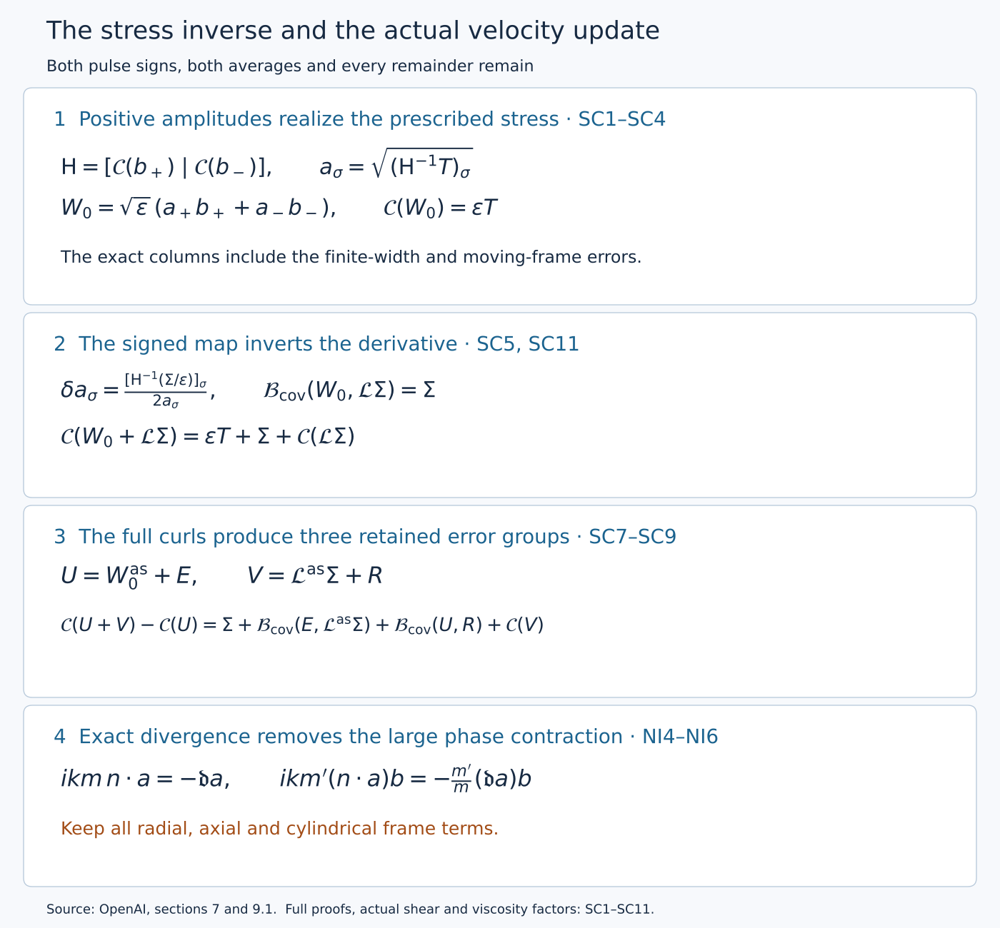

# Realizing the stress and controlling nonlinear interactions

The [pulse lesson](constructing-the-pulses-and-their-velocities.md) constructed actual velocities, their pressures and their complete residuals. We now choose the two pulse amplitudes to produce the prescribed two-component stress. The signed map used later in the iteration inverts the derivative of this covariance. Its finite update also has a quadratic term, which we keep throughout.

The [support lesson](separating-the-oscillatory-supports.md), OS0–OS7, supplies the original slow partition, disjoint closed auxiliary supports, all covering maps and weighted coefficient classes. A wave coefficient in \(\mathsf W_\alpha\) has, at every fixed derivative order, a bound of the form \(\varepsilon^\alpha S_*^{b_I}\sqrt{\zeta}\delta^{-a_I}P(v)\), with its original support, envelope and finite nonzero harmonic set. A mean in \(\mathsf M_\mu\) has the corresponding bound \(\varepsilon^\mu S_*^{b_I}\zeta\delta^{-a_I}\), may depend on the auxiliary torus and is independent of the cylindrical angle. The actual definitions and zero extensions are those proved in OS5. Products, full coefficient derivatives and chart changes use those proofs. In particular, \(D_r\) costs at most \(\kappa_s=10^{-5}\), \(D_z\) gains one power of \(\varepsilon\), and \(k\) costs one half power. No support or weight is removed here.

The leading stress is the actual one constructed in [V0–V8](realizing-the-admissible-shear.md); the background is [Z0–Z9](constructing-the-actual-base-field.md). This lesson supplies the positive amplitude inverse, its fixed signed derivative inverse, smooth extension at both radial boundaries, full curled covariance and nonlinear transport. It also derives positive energy production using the actual shear, retaining its difference from the frozen leading shear and the viscous damping.

The diagram records exact maps proved below. It contains no sampled flow data. [Editable diagram source](../assets/stress-and-interactions.py).

Original source: OpenAI, *Finite Time Blowup for Navier–Stokes*, [sections 7.3–7.4 and Lemma 9.2](https://cdn.openai.com/pdf/32d9f210-8b73-45e0-91bc-82a30aef8a9a/navier-stokes.pdf), pages 81–88 and 102–103. The source remains identifiable in the separate transcription. The actual-shear calculation is also developed in the workbench pulse derivation, identified in the accompanying source record.

The citations W2–W3 below refer to the full support and coefficient proof also supplied as OS0–OS7 in the preceding support lesson. Covariance uses \(\mathcal B_{\rm cov}\); differential transport uses \(\mathcal T_{\rm adv}\). Their definitions are displayed separately.

## NI1. Original coordinates, operators and angular averaging

Keep the original parameters and coordinates
\[
\begin{gathered}
0<h<1/100,\quad A=1/2+h,\quad D=1/2-h,\\
Q=2^{-\ell},\quad\varepsilon=Q^h,\quad S_*=\ell^2,\\
R=r/\sqrt Q,\quad Z=z/Q^D,\quad T=(1-t)/Q.
\end{gathered}
\tag{NI1.1}
\]
The original variables satisfy \(z=q^D\eta\), \(1-t=q(1-\eta^2)\), \(X=r^2/(2q)\). On a band, \(q/Q\in[1/2,2]\); the active radial shell has \(X_a\le X\le X_b\) with \(X_a>0\). Thus \(R^2=2(q/Q)X\), and
\[
\sqrt{X_a}\le R\le2\sqrt{X_b}.
\tag{NI1.2}
\]
The bounds may be enlarged by fixed amounts inside the coordinate domain. No term involving \(R^{-1}\) or \(R^{-2}\) is suppressed.

Retain the actual auxiliary torus and its covering maps:
\[
J_g=\begin{pmatrix}3&1\\1&5\end{pmatrix},\quad
\Lambda_g=4-\sqrt2,\quad T_g=4+\sqrt2,\quad b_g=\sqrt2-1,
\]
\[
v_r=(1,-b_g),\quad v_t=(b_g,1),\quad
\rho_g=\frac{\log\Lambda_g}{\log T_g},\quad
\kappa_s=10^{-5},\quad d_r=2((1+h)\rho_g-h\kappa_s),
\]
\[
Y=v_r r^{d_r}+v_t t\pmod{\mathbb Z^2},\quad
Y_i=J_g^iY,\quad
i=i(\ell)=\left\lfloor\frac{(1+h)\ell\log2-2\log\ell}{\log T_g}\right\rfloor.
\tag{NI1.3}
\]
Only large bands with \(i\ge0\) are used. On a band representative set
\[
\mathcal L_i=v_r\cdot\partial_{Y_i},\quad N_i=v_t\cdot\partial_{Y_i},\quad
M_i=\Lambda_g^iQ^{d_r/2},\quad c_i=T_g^iQ^{1+h}.
\]
The full physical chain rule is
\[
D_r=\partial_R+M_id_rR^{d_r-1}\mathcal L_i,\quad
D_z=\varepsilon\partial_Z,\quad D_\theta=R^{-1}\partial_\theta,
\quad\mathfrak t_*=-\varepsilon\partial_T+c_iN_i.
\tag{NI1.4}
\]
These operators have not replaced the physical ones: \(D_r=\sqrt Q\,\mathfrak r\), \(D_z=\sqrt Q\partial_z\), and \(\mathfrak t_*=Q^{1+h}(\partial_t+N_{\rm abs})\) before evaluation, where \(\mathfrak r=\partial_r+d_rr^{d_r-1}\mathcal L_{\rm abs}\). In particular
\[
[D_r,D_z]=[D_r,\partial_\theta]=[D_z,\partial_\theta]=0,
\qquad D_r(R^{-1})=-R^{-2},\quad D_z(R^{-1})=0.
\tag{NI1.5}
\]
They follow directly because the only nonconstant coefficient of the auxiliary part of \(D_r\) depends on \(R\) alone. Constant-coefficient auxiliary derivatives commute.

All vector components below are in the original orthonormal cylindrical frame \((e_r,e_\theta,e_z)\). Its derivatives are \(\partial_\theta e_r=e_\theta\), \(\partial_\theta e_\theta=-e_r\), \(\partial_\theta e_z=0\). For component columns \(u,v\), the exact transport is
\[
\mathcal T_{\rm adv}(u,v)=u_rD_rv+u_\theta R^{-1}\partial_\theta v+u_zD_zv
 +R^{-1}(-u_\theta v_\theta,u_\theta v_r,0).
\tag{NI1.6}
\]
The last column comes from differentiating the frame and is part of transport. The dot products of complex harmonic coefficients used below are bilinear, not Hermitian.

Here \(\langle\cdot\rangle_\theta\) averages the cylindrical component columns over \(0\le\theta\le2\pi\), exactly as in the source mean equations. It is not the operation of averaging the Cartesian components while keeping a fixed Cartesian frame. It also differs from auxiliary Haar averaging. For a fixed label with
\[
\Phi=p\theta+\varphi(R,Z,T,H),\qquad kp\in\mathbb Z\setminus\{0\},
\]
and a \(\theta\)-independent column \(a\), direct integration gives
\[
\langle ae^{ikm\Phi}\rangle_\theta=0\quad(m\ne0),\qquad
\langle ab\,e^{ik(m+m')\Phi}\rangle_\theta=
\begin{cases}ab,&m+m'=0,\\0,&m+m'\ne0.\end{cases}
\tag{NI1.7}
\]
Indeed the integral of \(e^{in\theta}\) is \((e^{2\pi in}-1)/(in)=0\) for a nonzero integer \(n\). The frame terms in (NI1.6) have already been expressed in component columns, so this calculation applies to them too.

## SC1. Exact average and the two columns

The tangential component order is \((\theta,z)\). For real cylindrical-component fields on the extended domain, let
\[
\mathcal C(w)=\int_{\mathbb T^2}\frac1{2\pi}\int_0^{2\pi}w_r w_{\rm tan}\,d\theta\,d\mu(Y),\qquad
\mathcal B_{\rm cov}(w,v)=\int_{\mathbb T^2}\frac1{2\pi}\int_0^{2\pi}
(w_rv_{\rm tan}+v_rw_{\rm tan})\,d\theta\,d\mu(Y),
\tag{SC1.1}
\]
where Haar measure has mass one. These are a quadratic map and its symmetric bilinear cross map; \(D\mathcal C(w)[v]=\mathcal B_{\rm cov}(w,v)\). The symbol \(\mathcal B_{\rm cov}\) here denotes the covariance map (original (7.23)), not the differential transport map in NI1. The averages act on cylindrical components, with the basis vectors held in that component convention.

A common torus maps onto each band torus by the integer matrix \(J^d\), where
\[
J=\begin{pmatrix}3&1\\1&5\end{pmatrix},\quad \det J=14,
\quad v_r=(1,-b_g),\quad v_t=(b_g,1),\quad b_g=\sqrt2-1.
\]
For \(d\ge0\), partition a fundamental domain of the covering torus into the \(14^d\) inverse-image sheets of a fundamental domain of the band torus, ignoring boundaries of measure zero. Change of variables on each sheet contributes \(14^{-d}\). Their sum proves
\(\int f(J^dY)\,d\mu(Y)=\int f(Y_i)\,d\mu(Y_i)\).
Thus no covering degree multiplies (SC1.1). Smooth periodic integrands allow differentiation under this integral. Common-cover compatibility follows by applying this equality twice.

Fix a slow box \(\beta=(\ell,a)\). Its two labels are \((\beta,\sigma)\), \(\sigma=\pm1\), with the same slow cutoff \(\eta_\beta\). Put
\[
Q=2^{-\ell},\quad \varepsilon=Q^h,\quad S_*=\ell^2,
\quad A=\tfrac12+h,\quad D=\tfrac12-h,\quad 0<h<\tfrac1{100}.
\]
With \(T_g=4+\sqrt2\), the original band choice gives
\[
\frac1{T_gS_*}<c_i\le\frac1{S_*},\qquad L_s=\frac{2r_0}{c_i},
\qquad 2r_0S_*\le L_s<2r_0T_gS_*.
\tag{SC1.2}
\]
The positive constant \(r_0\) and the transverse cutoffs are fixed before bands are chosen. The unweighted, uncurled local basis waves are exactly
\[
b_\sigma=\chi_g(\xi_g)\psi(v)t^h_\sigma\cos(k\Phi_\sigma),\qquad
\mathsf H=[\mathcal C(b_+)\mid\mathcal C(b_-)].
\tag{SC1.3}
\]
Here \(k=\lceil\varepsilon^{-1/2}\rceil\), \(kp\in\mathbb Z\setminus\{0\}\), and the pulse cutoff satisfies \(0\le\psi\le1\), \(\psi=1\) for \(|v-L_s/2|\le L_s/5\), with support in \(|v-L_s/2|<L_s/3\). Neither \(\eta_\beta\) nor a scalar stress amplitude is in \(b_\sigma\). Their auxiliary supports are disjoint, including the closed support neighborhoods used for derivatives, as constructed in W2.

For every fixed slow and auxiliary point, write \(k\Phi_\sigma=kp\theta+\omega\). Then
\[
\frac1{2\pi}\int_0^{2\pi}\cos^2(kp\theta+\omega)\,d\theta
=\frac12+\left[\frac{\sin(2kp\theta+2\omega)}{8\pi kp}\right]_0^{2\pi}
=\frac12.
\tag{SC1.4}
\]
This equality remains exact after every slow derivative; differentiating its right side creates no frequency factor. On the band rectangle the area element is
\(\det(v_r,v_t)d\xi_gd\eta_g=(1+b_g^2)c_i\,d\xi_gdv\).
The homogeneous amplitude is independent of \(\xi_g\); write \(x_\sigma=(t^h_\sigma)_r\). Hence
\[
\mathsf H_\sigma=\frac{1+b_g^2}{2}
\left(\int\chi_g^2\,d\xi_g\right)c_i
\int_0^{L_s}\psi^2x_\sigma(t^h_\sigma)_{\rm tan}\,dv,
\qquad
h_\sigma=\frac{1+b_g^2}{2}
\left(\int\chi_g^2\,d\xi_g\right)c_i
\int_0^{L_s}\psi^2x_\sigma^2\,dv.
\tag{SC1.5}
\]
The subscript \(g\) retains the cutoff belonging to the sign's own rectangle. Its squared integral is positive and bounded above and below uniformly, since these are fixed nonzero cutoffs from finitely many shapes. The determinant, \(c_i\), the cosine factor \(1/2\), and both stress components have all been retained. For real coefficients independent of both averaging variables, disjointness gives
\[
\mathcal C(a_+b_++a_-b_-)=\mathsf H(a_+^2,a_-^2)^T.
\tag{SC1.6}
\]

## SC2. Covariance size and direction from the exact pulse

PU3.5 and PU5.5 establish fixed constants \(c_-,c_+,c_x,C_x>0\), independent of the band, with
\[
e^{-c_+(v-L_s/2)^2/(2L_s)}\le P(v)\le
e^{-c_-(v-L_s/2)^2/(2L_s)},\qquad
c_xP(v)\le x_\sigma(v)\le C_xP(v).
\tag{SC2.1}
\]
These bounds use the original \(B_s^2=\lambda_0/[\varepsilon k^2(1+u_*^2)^{3/2}]\). Set
\(I_{0,\sigma}=\int\psi^2x_\sigma^2\,dv\) and
\(I_{1,\sigma}=\int |v-L_s/2|\psi^2x_\sigma^2/L_s\,dv\), each on \([0,L_s]\).
Choose the one band threshold large enough that \(L_s\ge25\). On \(|v-L_s/2|\le\sqrt{L_s}\), the cutoff equals one. Integrating the lower bound there and enlarging the upper integrals to the real line proves
\[
2c_x^2e^{-c_+}\sqrt{L_s}\le I_{0,\sigma}
\le C_x^2\sqrt{\frac\pi{c_-}}\sqrt{L_s},\qquad
I_{1,\sigma}\le \frac{C_x^2}{c_-}.
\tag{SC2.2}
\]
For the last integral, \(2L_s^{-1}\int_0^\infty s e^{-c_-s^2/L_s}\,ds=1/c_-\). The Gaussian integral in the preceding bound follows by squaring the positive integral and using polar coordinates: \(\int_{\mathbb R^2}e^{-c_-(x^2+y^2)}dxdy=2\pi\int_0^\infty r e^{-c_-r^2}dr=\pi/c_-\). Thus these are analytic inequalities, not numerical enclosures. Equations (SC1.2), (SC1.5) and (SC2.2) yield
\[
0<h_-^*S_*^{-1/2}\le h_\sigma\le h_+^*S_*^{-1/2},\qquad
\frac{I_{1,\sigma}}{I_{0,\sigma}}\le C S_*^{-1/2}.
\tag{SC2.3}
\]
For clarity, \(h_-^*,h_+^*\) are fixed bounds applying to both signs, not the two different numbers \(h_-\) and \(h_+\).

In the frozen orthonormal tangential frame of PU1,
\[
N=\frac{g_0}{|g_0|},\quad K=(-N_z,N_\theta),\quad
c_0=\frac{\lambda_0}{2F_0N_\theta}<0,\quad
s_\sigma(v)=\sigma\left(\frac{u_*}{2}+\frac{u_*v}{L_s}\right),
\]
PU1 and PU5 prove, uniformly throughout the enlarged slow box,
\[
\frac{(t^h_\sigma)_{\rm tan}}{x_\sigma}
=-s_\sigma(v)K+c_0\sqrt{1+s_\sigma(v)^2}\,N+e^{\rm loc}_\sigma(v),
\qquad |e^{\rm loc}_\sigma(v)|\le C S_*^{-1}.
\tag{SC2.4}
\]
This uses the actual formula \((t^h)_{\rm tan}=-s_axK_a+yN_a\), including its moving-frame error. The derivative of \(s\mapsto-sK+c_0\sqrt{1+s^2}N\) has norm at most \(1+|c_0|\). Since
\(|s_\sigma(v)-\sigma u_*|=u_*|v-L_s/2|/L_s\), averaging (SC2.4) with the positive probability density \(\psi^2x_\sigma^2/I_{0,\sigma}\) gives the exact representation
\[
\mathsf H_\sigma=h_\sigma(-A_cN-\sigma u_*K+e_\sigma),\qquad
A_c=-c_0\sqrt{1+u_*^2}>0,\qquad |e_\sigma|\le C_eS_*^{-1/2}.
\tag{SC2.5}
\]
The error is explicitly the average of \(e^{\rm loc}_\sigma\) plus the difference between the displayed reference direction and its midpoint value. Thus it includes both the moving-frame and finite-width contributions. PU1 supplies fixed \(0<A_-\le A_c\le A_+\). All fixed derivatives of \(\mathsf H\) have polynomial bounds in \(S_*\): apply Leibniz to the exact integral (SC1.5), use the PU5 bounds for each differentiated pulse, and integrate on an interval of length \(L_s\le2r_0T_gS_*\). The limits, cutoffs and \(c_i\) are fixed under slow differentiation. No derivative of a pointwise error estimate is being assumed.

## SC3. The original cone margin and an explicit inverse estimate

Original (4.20) defines \(t_s=-b_s/a\) and \(v_s=a(1+t_s^2)\). Original (7.1) uses \(g=F(-a,b_s)\), with \(F,a,v_s-2\) bounded below positively. Before freezing the point,
\[
N=-\frac{(1,t_s)}{\sqrt{1+t_s^2}},\qquad
K=\frac{(t_s,-1)}{\sqrt{1+t_s^2}},\qquad
c_0^2=\frac{v_s-2}{2}.
\tag{SC3.1}
\]
Indeed \(2FN_\theta=-2F/\sqrt{1+t_s^2}\), \(|g|=Fa\sqrt{1+t_s^2}\), so
\(\lambda_0^2=-2FN_\theta(2FN_\theta+|g|)=2aF^2(1-2/v_s)\); dividing by \((2FN_\theta)^2\) proves the last identity. Here is the full profile-to-chart comparison behind this calculation. Original (4.3)–(4.4) give \(u_\theta^{(0)}=q^{-A}E\), \(u_z^{(0)}=q^{-A}U\), \(E=\sqrt{2X}F_{\rm prof}\), \(F_{\rm prof}=\phi/\mathsf C\). With \(\xi=q/Q\), their chart values are \(V^{(0)}=\xi^{-A}E\), \(G^{(0)}=\xi^{-A}U\), and
\[
\begin{aligned}
F_{\rm chart}^{(0)}&=V^{(0)}/R=\xi^{-A-1/2}F_{\rm prof},\\
R\partial_RF_{\rm chart}^{(0)}
&=\xi^{-A-1/2}2X(F_{\rm prof})_X=-aF_{\rm chart}^{(0)},\\
\partial_RG^{(0)}&=\xi^{-A-1/2}\sqrt{2X}U_X=b_sF_{\rm chart}^{(0)}.
\end{aligned}
\tag{SC3.1a}
\]
These identities use \(X=R^2/(2\xi)\), with \(\xi,\eta\) fixed under \(\partial_R\), and the full original (4.11) definitions \(a=1-2X\partial_X\log E\), \(b_s=2XU_X/E\). Thus \(F\), \(g\), \(\lambda_0\) and the target stress each retain their displayed positive factor \(\xi^{-A-1/2}\); that factor cancels only in the explicitly computed frame and in the ratio defining \(c_0\). No amplitude normalization \(\mathsf C\) or physical stress factor has been discarded.

Write \(\kappa_c\in(0,2)\) for the constant called \(\kappa\) in original (4.26), to distinguish it from the derivative-loss constant \(\kappa_s=10^{-5}\). For the original unit stress direction \(n=\mathcal T_0/|\mathcal T_0|\), that equation is
\[
n_\theta+t_sn_z\ge\kappa_c,\qquad
(v_s-2)(n_z-t_sn_\theta)^2\le(2-\kappa_c)(n_\theta+t_sn_z)^2.
\tag{SC3.2}
\]
For \(T=\mathcal T_{0,*}=(Q/q)^{A+1/2}\mathcal T_0\), (SC3.1) gives
\[
T_N=-\frac{T_\theta+t_sT_z}{\sqrt{1+t_s^2}}<0,\quad
T_K=-\frac{T_z-t_sT_\theta}{\sqrt{1+t_s^2}},\quad
\left|c_0\frac{T_K}{T_N}\right|\le\sqrt{1-\kappa_c/2}<1.
\tag{SC3.3}
\]
At either edge use the smooth unit direction in (SC3.2), not the undefined quotient of two zero stress components. Its denominator stays uniformly away from zero, since \(t_s\) is bounded on the closed annulus. This proves continuity of the directional quotient there.

Let \(m_c\) be its supremum on the closed annulus. The original choice of the single constant \(u_*>0\) satisfies \(r_u=u_*/\sqrt{1+u_*^2}>m_c\). Such a choice exists because \(m_c<1\) and \(r_u\to1\) as \(u_*\to\infty\). All frozen frames and coefficients range over a compact set with the positive denominators in PU1. For each actual point of the closed shell, hold its unit stress direction fixed while comparing the frame at that point to the frame at the representative; only the frame and its growth coefficient are frozen. The frame is defined on the fixed enlarged annulus even when the representative lies outside the shell. The smooth profile-to-chart map and frame have bounded first derivatives; the enlarged slow box has diameter at most \(CS_*^{-3}\). The mean-value formula along a segment in its fixed enlarged neighborhood therefore bounds the change of the numerator and denominator of this quotient by \(C'S_*^{-3}\). For a positive denominator bounded below by \(d_0\), the quotient difference is at most \(2C'S_*^{-3}(d_0^{-1}+M_0d_0^{-2})\) once its change is at most \(d_0/2\), with \(M_0\) a fixed numerator bound. Choose the band threshold so this difference is at most \((r_u-m_c)/2\). The frozen frame then satisfies
\[
T_N<0,\qquad \frac{|T_K|}{u_*}\le(1-\eta_c)\frac{-T_N}{A_c},\qquad
\eta_c=\frac{r_u-m_c}{2r_u}\in(0,1).
\tag{SC3.4}
\]
The argument covers the shell edges using their unit directions. It is a value estimate, not smallness of arbitrarily high derivatives. One finite band threshold suffices for this margin and for the pulse estimates.

Put \(F_{NK}=[N\mid K]\); this orthogonal matrix has determinant \(+1\) in the original \((\theta,z)\) orientation. Set
\[
C_0=\begin{pmatrix}-A_c&-A_c\\-u_*&u_*\end{pmatrix},\quad
E_c=[F_{NK}^Te_+\mid F_{NK}^Te_-],\quad D_h=\operatorname{diag}(h_+,h_-).
\]
Then the actual covariance matrix, including its error, factors exactly as
\[
\mathsf H=F_{NK}(C_0+E_c)D_h,
\quad C_0^{-1}=\frac12\begin{pmatrix}-A_c^{-1}&-u_*^{-1}\\-A_c^{-1}&u_*^{-1}\end{pmatrix},
\quad \det C_0=-2A_cu_*.
\tag{SC3.5}
\]
In the induced infinity norm, \(\|C_0^{-1}\|_\infty\le M_c=\tfrac12(A_-^{-1}+u_*^{-1})\) and \(\|E_c\|_\infty\le2C_eS_*^{-1/2}\). Enlarge the single threshold so
\[
\vartheta:=\|C_0^{-1}E_c\|_\infty\le2M_cC_eS_*^{-1/2}\le\frac{\eta_c}{4+\eta_c}<1.
\tag{SC3.6}
\]
The geometric series \(\sum_{j\ge0}(-C_0^{-1}E_c)^j\) converges absolutely in this matrix norm and its product with \(I+C_0^{-1}E_c\) is \(I\), by cancellation of partial sums and a remainder tending to zero. This proves invertibility and the inverse norm bound \((1-\vartheta)^{-1}\).

For the target set \(s_T=-T_N/A_c>0\), \(t_T=T_K/u_*\). The reference vector is
\[
z^0=C_0^{-1}(T_N,T_K)^T
=\tfrac12(s_T-t_T,s_T+t_T)^T,
\qquad \eta_cs_T/2\le z^0_\sigma\le s_T.
\]
The actual vector \(z=D_h\mathsf H^{-1}T\) equals \((I+C_0^{-1}E_c)^{-1}z^0\), whence
\[
\|z-z^0\|_\infty\le\frac{\vartheta}{1-\vartheta}s_T\le\eta_cs_T/4,
\qquad \eta_cs_T/4\le z_\sigma\le(1+\eta_c/4)s_T.
\tag{SC3.7}
\]
Also \(|T|^2=A_c^2s_T^2+u_*^2t_T^2\), so
\[
\frac{|T|}{\sqrt{A_+^2+u_*^2(1-\eta_c)^2}}\le s_T\le\frac{|T|}{A_-}.
\tag{SC3.8}
\]
Divide (SC3.7) by (SC2.3). This proves the positive, two-sided amplitude bounds, with every component retained:
\[
c\sqrt{S_*}|T|\le y_\sigma:=(\mathsf H^{-1}T)_\sigma\le C\sqrt{S_*}|T|,
\qquad \|\mathsf H^{-1}\|_\infty\le C\sqrt{S_*}.
\tag{SC3.9}
\]
For completeness, every complex eigenvalue of \(C_0^{-1}E_c\) has modulus at most \(\vartheta\): apply the eigenvector equation to a component of maximum modulus. Thus \(|\det(I+C_0^{-1}E_c)|\ge(1-\vartheta)^2\). Along the path multiplying this error matrix by \(t\in[0,1]\), this real determinant cannot vanish and starts at one. It is therefore positive. Consequently
\[
\det\mathsf H<0,\qquad
|\det\mathsf H|\ge 2A_-u_*(h_-^*)^2(1-\vartheta)^2S_*^{-1}.
\tag{SC3.10}
\]
This retains the orientation of both original covariance columns.

## SC4. Every derivative and both shell boundaries

The exact chart variables are
\[
\xi=q/Q,\quad \xi-Z^2\xi^{2h}=T_{\rm time},\quad
X=R^2/(2\xi),\quad \eta=Z\xi^{-D}.
\]
Here \(R=r/\sqrt Q\), \(Z=z/Q^D\), \(T_{\rm time}=(1-t)/Q\). On the original chart, \(\xi\) is bounded above and below and \(|\eta|\le1\). The derivative in \(\xi\) of its defining equation is \(1-2h\eta^2\ge1-2h>0\). Repeated implicit differentiation, dividing only by this denominator, bounds every fixed derivative of \(\xi,X,\eta\) and \(\xi^{-A-1/2}\). Apply this chain rule to original (4.27), visually checked on page 33:
\[
|\mathcal T_0|\ge c\zeta,\qquad
|\partial_X^{j_1}\partial_\eta^{j_2}\mathcal T_0|\le C_j\zeta\delta^{-m_j},\qquad
\delta=\min\{1,\log(X/X_a),\log(X_b/X)\}.
\]
It gives \(|T|\ge c'\zeta\) and \(|\partial^IT|\le C_I\zeta\delta^{-a_I}\). These are the precise leading-profile assertions consumed here. V5–V7 construct them, and [I1–I2](../audits/local-construction-assembly-audit.md) proves the complete receiving maps with the actual base and its fixed margins.

For every nonzero multi-index \(I\), differentiating \(\mathsf H\mathsf H^{-1}=I_2\) gives the recursion
\[
\partial^I\mathsf H^{-1}
=-\mathsf H^{-1}\sum_{0<J\le I}\binom IJ
(\partial^J\mathsf H)(\partial^{I-J}\mathsf H^{-1}).
\tag{SC4.1}
\]
Induction using SC2 and (SC3.9) bounds each derivative by a finite polynomial in \(S_*\). Multiplying by the full derivatives of \(T\) proves
\[
y_\sigma\ge c\sqrt{S_*}\zeta,\qquad
|\partial^Iy_\sigma|\le C_IS_*^{b_I}\zeta\delta^{-a_I}.
\tag{SC4.2}
\]
Set \(a_\sigma=\sqrt{y_\sigma}\) in the open shell. For \(|I|>0\), repeated chain and product rules give a finite sum
\[
\partial^Ia_\sigma=
\sum_{n=1}^{|I|}\ 
\sum_{I_1+\cdots+I_n=I,\ |I_j|>0}
c_{I_1,\ldots,I_n}y_\sigma^{1/2-n}\prod_{j=1}^n\partial^{I_j}y_\sigma.
\tag{SC4.3}
\]
Every term has weight \(\zeta^{1/2-n}\zeta^n=\sqrt\zeta\); all powers of \(S_*\) and \(\delta^{-1}\) remain in finite order-dependent bounds. For \(I=0\), take the square root of the upper bound in (SC4.2). Therefore
\[
|\partial^Ia_\sigma|\le C_IS_*^{b'_I}\sqrt\zeta\delta^{-a'_I}.
\tag{SC4.4}
\]
The fixed source weight is smooth and flat at each radial edge. Taylor's formula with integral remainder, using its vanishing jets, gives \(0\le\zeta\le C_Nd^N\) near either edge for every integer \(N\), where \(d\) is the distance to that edge. The logarithmic distances in \(\delta\) are comparable to \(d\) there, since \(0<X_a<X_b<\infty\). Given any fixed power in (SC4.4), choose \(N\) more than twice that power. Then \(\sqrt\zeta\delta^{-a'_I}\to0\). Extend every derivative by zero. Difference quotients in a smooth boundary coordinate, followed by induction on derivative order, show that these extended derivatives are derivatives of the zero-extended function. Thus \(a_\sigma\) extends smoothly by zero; no value of \(1/a_\sigma\) at an edge is being assigned. This argument uses the original flat weight and does not require replacing it by a special exponential formula.

Define
\[
W_0=\sqrt\varepsilon\sum_{\sigma=\pm1}a_\sigma b_\sigma.
\tag{SC4.5}
\]
The coefficients of \(e^{\pm ik\Phi_\sigma}\) are each \(\sqrt\varepsilon a_\sigma\chi_g\psi t^h_\sigma/2\). PU5 bounds each fixed derivative of \(t^h_\sigma\) by a polynomial in \(S_*\) times the original envelope \(P(v)\). Thus the coefficients obey \(\varepsilon^{1/2}S_*^{b_I}\sqrt\zeta\delta^{-a_I}P(v)\) bounds. With the slow cutoff, \(\eta_\beta W_0\in\mathsf W_{1/2}\), including all support and common-torus requirements. Without that cutoff the same local coefficient bounds hold, and (SC1.6) gives
\[
\mathcal C(W_0)=\varepsilon\mathsf H y=\varepsilon T.
\tag{SC4.6}
\]

## SC5. Signed increments and the exact retained quadratic term

Keep the positive coefficients \(a_\sigma\) just constructed fixed at all later stages. Let \(\Sigma(R,Z,T_{\rm time})\) be the real two-component stress supplied to this operator, independent of both \(\theta\) and the auxiliary variables, with the original \(\mathsf M_\alpha\) estimates
\[
|\partial^I\Sigma|\le C_I\varepsilon^\alpha S_*^{b_I}\zeta\delta^{-a_I}.
\]
Auxiliary independence is a required input property of this particular map; membership in \(\mathsf M_\alpha\) alone does not assert it. Define in the open shell
\[
d_\Sigma=\mathsf H^{-1}(\Sigma/\varepsilon),\qquad
\delta a_\sigma=\frac{(d_\Sigma)_\sigma}{2a_\sigma},\qquad
\mathcal L_\beta\Sigma=\sqrt\varepsilon\sum_{\sigma=\pm1}\delta a_\sigma b_\sigma.
\tag{SC5.1}
\]
The inverse bounds give
\(|\partial^I(d_\Sigma)_\sigma|\le C_I\varepsilon^{\alpha-1}S_*^{b'_I}\zeta\delta^{-a'_I}\).
Derivatives of \(y_\sigma^{-1/2}\) are finite sums of
\(C y_\sigma^{-k-1/2}\prod_{j=1}^k\partial^{I_j}y_\sigma\), including \(k=0\) at order zero. Their weights are \(\zeta^{-k-1/2}\zeta^k=\zeta^{-1/2}\). The extra \(\zeta\) from \(d_\Sigma\) is therefore sufficient for every term in the product rule, giving
\[
|\partial^I\delta a_\sigma|\le C_I\varepsilon^{\alpha-1}S_*^{b''_I}\sqrt\zeta\delta^{-a''_I}.
\tag{SC5.2}
\]
SC4's boundary argument proves smooth zero extension. The pulse bounds then prove
\(\eta_\beta\mathcal L_\beta\Sigma\in\mathsf W_{\alpha-1/2}\).
Linearity in \(\Sigma\) follows because \(\mathsf H\), \(a_\sigma\), and \(b_\sigma\) are fixed, also at the boundary after extension. No sign or relative-size condition on \(\Sigma\) has been introduced.

The coefficients can be moved outside both averages. Cross-label products are zero. Equations (SC1.5) and (SC5.1) now give
\[
\mathcal B_{\rm cov}(W_0,\mathcal L_\beta\Sigma)
=\varepsilon\mathsf H(2a\odot\delta a)
=\varepsilon\mathsf H d_\Sigma=\Sigma.
\tag{SC5.3}
\]
Here \(\odot\) denotes componentwise multiplication. The cosine factor \(1/2\) is already in each column of \(\mathsf H\). The cross term has the separate factor two because differentiating \(a_\sigma^2\) gives \(2a_\sigma\delta a_\sigma\). In particular the full change is
\[
\mathcal C(W_0+\mathcal L_\beta\Sigma)
=\varepsilon T+\Sigma+\mathcal C(\mathcal L_\beta\Sigma),\qquad
\mathcal C(\mathcal L_\beta\Sigma)
=\varepsilon\mathsf H((\delta a_+)^2,(\delta a_-)^2)^T.
\tag{SC5.4}
\]
Thus the map in (SC5.1) is a right inverse of the derivative of the covariance map. It does not drop the last quadratic term. Its angularly averaged products have the weight \(\varepsilon^{2\alpha-1}\zeta\delta^{-a}P^2\), with \(P^2\le1\), and finite polynomial factors. Averaging over the mass-one auxiliary torus preserves this bound. Therefore \(\mathcal C(\eta_\beta\mathcal L_\beta\Sigma)\in\mathsf M_{2\alpha-1}\). These statements hold for every real \(\alpha\); later improvement of an iterative error additionally depends on its actual exponent.

## SC6. Squared partition, chart transitions, and physical assembly

At each fixed \(q>0\), the slow partition has bounded local overlap and \(\sum_\beta\eta_\beta^2=1\), counting each box once, not once for each sign. Define exactly as in original (7.35), with \(Q_\beta=2^{-\ell_\beta}\),
\[
W_{0,\rm phys}^{\rm as}=\sum_\beta Q_\beta^{-A}\eta_\beta W_{0,\beta},\qquad
\mathcal L_{\rm phys}^{\rm as}\sigma
=\sum_\beta Q_\beta^{-A}\eta_\beta\mathcal L_\beta(Q_\beta^{2A}\sigma).
\tag{SC6.1}
\]
Here \(\sigma(r,z,t)\) is the physical stress input, independent of the averaging variables; it is distinct from the sign label. A common torus can be chosen for all summands active at that point. Their cross-label products vanish on it by W2, even where their slow supports overlap. Then
\[
\begin{split}
\mathcal C(W_{0,\rm phys}^{\rm as})
&=\sum_\beta Q_\beta^{-2A}\eta_\beta^2\varepsilon_\beta
(Q_\beta/q)^{A+1/2}\mathcal T_0
=q^{-A-1/2}\mathcal T_0,\\
\mathcal B_{\rm cov}(W_{0,\rm phys}^{\rm as},\mathcal L_{\rm phys}^{\rm as}\sigma)
&=\sum_\beta Q_\beta^{-2A}\eta_\beta^2Q_\beta^{2A}\sigma=\sigma.
\end{split}
\tag{SC6.2}
\]
The scale identity in the first line is
\(Q^{-2A}Q^h(Q/q)^{A+1/2}=Q^{-A+h+1/2}q^{-A-1/2}=q^{-A-1/2}\), since \(A=1/2+h\). There is no missing count of two from the sign labels.

In a receiving chart of scale \(Q\), the representatives are
\[
W_0^{\rm as}=Q^AW_{0,\rm phys}^{\rm as},\qquad
\Sigma=Q^{2A}\sigma,\qquad
\mathcal L^{\rm as}\Sigma=Q^A\mathcal L_{\rm phys}^{\rm as}(Q^{-2A}\Sigma).
\tag{SC6.3}
\]
An overlapping band has \(|\ell_\beta-\ell|\le4\). The ratios of its scales \(Q_\beta/Q\), \(\varepsilon_\beta/\varepsilon\) and \(S_{*,\beta}/S_*\) are bounded above and below by constants independent of the band. The exact coordinate transition is
\[
R_\beta=(Q/Q_\beta)^{1/2}R,\quad
Z_\beta=(Q/Q_\beta)^DZ,\quad
T_{{\rm time},\beta}=(Q/Q_\beta)T_{\rm time},
\]
and the common-to-band torus maps are the fixed powers of \(J\) with bounded exponent difference from W2. Each fixed derivative of a coefficient after these linear maps has the same class estimate with a changed finite constant and polynomial power. The profile \(X\), its edge weight and the label's own pulse envelope are retained. Collect coefficients having the same label and harmonic before testing membership. Bounded local overlap then proves
\[
W_0^{\rm as}\in\mathsf W_{1/2},\qquad
\mathcal L^{\rm as}\Sigma\in\mathsf W_{\alpha-1/2},\qquad
\mathcal B_{\rm cov}(W_0^{\rm as},\mathcal L^{\rm as}\Sigma)=\Sigma.
\tag{SC6.4}
\]
The equalities are compatible on chart overlaps because they arise from the same physical fields in (SC6.1). Local finiteness for \(q>0\) suffices here. No extension at the singular terminal point is asserted by this assembly.

## SC7. Full curls and the stress of the actual velocity

For each harmonic \(t_me^{ikm\Phi}\) of the assembled primary or signed field, \(m\ne0\), let \(n=\nabla_*\Phi\). Its full coefficient is transverse: \(n\cdot t_m=0\). PU1 proves a uniform positive lower bound for \(|n|\). The exact potential and remainder from PU6 are
\[
C_m=\frac{i\,n\times t_m}{km|n|^2},\qquad
r_m=(-D_z(C_m)_\theta,\ D_z(C_m)_r-D_r(C_m)_z,\ (D_r+R^{-1})(C_m)_\theta).
\tag{SC7.1}
\]
The curl of \(C_me^{ikm\Phi}\) is \((t_m+r_m)e^{ikm\Phi}\), since \(ikm n\times C_m=t_m\). Its divergence is exactly zero, including the cylindrical connection terms, by NI4. For a signed amplitude in \(\mathsf W_{\alpha-1/2}\), PU6 gives \(C_m\in\mathsf W_\alpha\) and \(r_m\in\mathsf W_{\alpha-\kappa_s}\). It preserves all closed support restrictions. The \(m=+1,-1\) coefficients are conjugates, including their potentials: the sign of \(i/m\) changes on conjugation. The assembled curl field is therefore real.

In particular the initial actual wave produced by the primary amplitudes is
\[
U_0=W_0^{\rm as}+R_0,\qquad R_0\in\mathsf W_{1-\kappa_s},\qquad U_0\in\mathsf W_{1/2}.
\tag{SC7.2}
\]
Its covariance in any chart is the exact expression
\[
\mathcal C(U_0)=Q^{2A}q^{-A-1/2}\mathcal T_0
+\mathcal B_{\rm cov}(W_0^{\rm as},R_0)+\mathcal C(R_0),
\tag{SC7.3}
\]
where the two additional terms are in \(\mathsf M_{3/2-\kappa_s}\) and \(\mathsf M_{2-2\kappa_s}\), respectively. The target in this receiving chart is the physical one from (SC6.2), not a target frozen at a different box. Since \(\kappa_s<1/2\), their sum is in \(\mathsf M_{3/2-\kappa_s}\). This supplies the primary stress wave and its actual curl defect to the iteration, using the complete actual base in Z0–Z9.

At a later stage write the actual current wave as \(U=W_0^{\rm as}+E\), with its original recorded classes \(U\in\mathsf W_{1/2}\), \(E\in\mathsf W_\rho\). For a signed increment let
\(V=\mathcal L^{\rm as}\Sigma+R\), where \(R\in\mathsf W_{\alpha-\kappa_s}\) is its full curl remainder. Direct expansion, with no discarded cross term, gives
\[
\begin{split}
\mathcal C(U+V)-\mathcal C(U)
&=\mathcal B_{\rm cov}(U,V)+\mathcal C(V)\\
&=\Sigma+\mathcal B_{\rm cov}(E,\mathcal L^{\rm as}\Sigma)
+\mathcal B_{\rm cov}(U,R)+\mathcal C(V).
\end{split}
\tag{SC7.4}
\]
All of \(\mathcal C(\mathcal L^{\rm as}\Sigma)\), \(\mathcal B_{\rm cov}(\mathcal L^{\rm as}\Sigma,R)\) and \(\mathcal C(R)\) remain inside \(\mathcal C(V)\). The product estimates give respectively
\[
\mathcal B_{\rm cov}(E,\mathcal L^{\rm as}\Sigma)\in\mathsf M_{\rho+\alpha-1/2},\qquad
\mathcal B_{\rm cov}(U,R)\in\mathsf M_{\alpha+1/2-\kappa_s},\qquad
\mathcal C(V)\in\mathsf M_{2\alpha-1}.
\tag{SC7.5}
\]
For the last bound use \(\alpha-\kappa_s>\alpha-1/2\), so \(V\in\mathsf W_{\alpha-1/2}\). To justify these product statements at every derivative order, angular averaging of a same-label pair retains only harmonics with \(m+m'=0\), because \(kp\ne0\); their exponential phases cancel exactly. Cross-label products are identically zero. Each derivative of the remaining coefficient products has weight \(\varepsilon^{\mu+\mu'}S_*^b\zeta\delta^{-a}P^2\), and \(P^2\le1\). Integrating these finite sums over a mass-one common torus proves the displayed mean estimates with all derivatives. This verifies original (7.41)–(7.42) for the actual curl velocities.

## SC8. Radial divergence after both averages

There is a small stronger estimate at this exact receiver. The three expressions in (SC7.5) have already been averaged over both the angle and the auxiliary torus. For any same-label zero-harmonic product coefficient \(f\), on a fixed common torus with index \(i_0\), holding the receiving scale \(Q\) fixed,
\[
\partial_R\langle f\rangle_H=\langle\partial_R f\rangle_H,\qquad
\langle\mathcal L_{i_0}f\rangle_H=0,
\quad D_r=\partial_R+M_{i_0} d_rR^{d_r-1}\mathcal L_{i_0},\qquad M_{i_0}=\Lambda_g^{i_0}Q^{d_r/2}.
\tag{SC8.1}
\]
The second equality is integration by parts on the periodic torus; boundary faces cancel. Consequently \(D_r\langle f\rangle_H=\partial_R\langle f\rangle_H=\langle D_rf\rangle_H\). Differentiating the surviving coefficient products by ordinary \(\partial_R\) uses their coefficient bounds and introduces no \(\varepsilon^{-\kappa_s}\) factor. The derivative of the cancelled exponential is zero; it must not be estimated separately before cancellation.

For a two-component auxiliary-averaged radial stress \(S=(S_\theta,S_z)\), define its cylindrical tangential divergence
\[
\mathfrak D_r S=((D_r+2/R)S_\theta,(D_r+1/R)S_z).
\tag{SC8.2}
\]
The shell has \(R\) bounded above and bounded away from zero. The zero-order factors and all their derivatives are therefore bounded. Equations (SC8.1)–(SC8.2) prove that the divergences of the three terms in (SC7.5) retain precisely the exponents displayed there. Original Corollary 7.8 allows a further loss of at most \(\kappa_s\); it is unnecessary after this full auxiliary average. The stronger claim does not apply to an angular mean still depending on the auxiliary variable, for which the fast derivative remains. It also does not remove the \(\kappa_s\) already paid when taking a curl.

## SC9. All original viscosity factors

For every fixed original viscosity \(\nu>0\), let \(y=x/\sqrt\nu\), with time unchanged. The exact change of fields from M2 is
\[
u_\nu(x,t)=\sqrt\nu\,u_1(y,t),\quad
p_\nu(x,t)=\nu p_1(y,t),\quad
f_\nu(x,t)=\sqrt\nu\,f_1(y,t),\quad
\mathcal A_\nu(x,t)=\nu\mathcal A_1(y,t).
\tag{SC9.1}
\]
The last formula gives \(\operatorname{curl}_x\mathcal A_\nu=\sqrt\nu\operatorname{curl}_y\mathcal A_1\), because each spatial derivative contributes \(\nu^{-1/2}\). It applies to every potential in (SC7.1), including all cutoffs and remainders.

The angles and auxiliary torus measures in (SC1.1) do not change under this dilation. There is no physical-space volume integral in that definition. Throughout this note, a covariance of a field in physical units is still the average on the extended domain before evaluating the auxiliary variable at the physical phase map. No equality with the unaveraged pointwise velocity product is inferred. Thus for any two fields \(w,v\),
\[
\mathcal C_\nu(\sqrt\nu\,w(y,t))=\nu\mathcal C_1(w)(y,t),\qquad
\mathcal B_{{\rm cov},\nu}(\sqrt\nu\,w(y,t),\sqrt\nu\,v(y,t))=\nu\mathcal B_{{\rm cov},1}(w,v)(y,t).
\tag{SC9.2}
\]
For a physical input \(\sigma_\nu(x,t)\), set \(\sigma_1(y,t)=\nu^{-1}\sigma_\nu(\sqrt\nu y,t)\), and define
\[
W_{0,\nu}^{\rm as}(x,t)=\sqrt\nu W_{0,1}^{\rm as}(y,t),\qquad
\mathcal L_{\nu,\rm phys}^{\rm as}\sigma_\nu(x,t)
=\sqrt\nu(\mathcal L_{1,\rm phys}^{\rm as}\sigma_1)(y,t).
\tag{SC9.3}
\]
Apply (SC6.2) and (SC9.2) to get the exact identities
\[
\mathcal B_{{\rm cov},\nu}(W_{0,\nu}^{\rm as},\mathcal L_{\nu,\rm phys}^{\rm as}\sigma_\nu)=\sigma_\nu,\qquad
\mathcal C_\nu(W_{0,\nu}^{\rm as})=\nu q_\nu^{-A-1/2}\mathcal T_0(X_\nu,\eta_\nu).
\tag{SC9.4}
\]
Here all original coordinates are
\[
q_\nu-(z_\nu^2/\nu)q_\nu^{2h}=1-t,\quad
X_\nu=\frac{r_\nu^2}{2\nu q_\nu},\quad
\eta_\nu=\frac{z_\nu}{\sqrt\nu q_\nu^D},\quad
R=\frac{r_\nu}{\sqrt{\nu Q}},\quad Z=\frac{z_\nu}{\sqrt\nu Q^D}.
\tag{SC9.5}
\]
In a chart the stress input is \(\Sigma=\nu^{-1}Q^{2A}\sigma_\nu\); physical velocity, potential and covariance carry factors \(\sqrt\nu Q^{-A}\), \(\nu Q^{1/2-A}\) and \(\nu Q^{-2A}\), respectively. Applying a physical radial divergence multiplies the last factor by \(\nu^{-1/2}Q^{-1/2}\), giving \(\sqrt\nu Q^{-2A-1/2}\), with both cylindrical terms in (SC8.2) preserved. These are exactly the physical residual factors in M2 and PU7. Thus (SC7.3)–(SC8.2) transfer to every \(\nu>0\) without dropping a viscosity factor or an auxiliary average.

## SC10. Production with the actual shear and all damping

Here the flux is denoted \(T\) within this section; the time coordinate remains \(T_{\rm time}\). The constants \(c_-,c_+\) in this section bound \(|c_0|\), independently of the Gaussian constants used in SC2. The symbol \(p\) in the slow-box comparison is the slow point, not the angular phase coefficient.

For the real homogeneous amplitude \(t\), \(n_\Phi\cdot t=0\) makes the normal component of \(\mathcal A_\Phi t\) perpendicular to \(t\). Direct multiplication, keeping both cylindrical \(2F\) terms, gives
\[
t\cdot\mathcal Kt
=-2Ft_rt_\theta+(2F+RF_R)t_rt_\theta+G_Rt_rt_z
=g\cdot(t_r(t_\theta,t_z)).

\tag{SC10.1}
\]
Taking \(t\cdot t'\) therefore proves the exact identity
\[
\frac12\frac{d}{dv}|t|^2
=-g\cdot(t_r(t_\theta,t_z))-\varepsilon k^2|n_\Phi|^2|t|^2.

\tag{SC10.2}
\]
For the flux \(T=t_r(t_\theta,t_z)=T_NN+T_KK\), the exact
production is
\[
-g\cdot T=-|g_0|T_N-\Delta g\cdot T,\qquad \Delta g=g-g_0.

\tag{SC10.3}
\]
Here \(g_0\) is the leading shear frozen at the representative;
it is not identified with the actual shear even there. To keep both
sources of its difference, let \(V^{(0)},G^{(0)}\) denote the exact
leading chart fields, put \(\delta V=V-V^{(0)}\),
\(\delta G=G-G^{(0)}\), and write
\[
g^{(0)}=(\partial_RV^{(0)}-V^{(0)}/R,\partial_RG^{(0)}),
\quad g_0=g^{(0)}(p_0),

\tag{SC10.4}
\]
\[
\Delta g=(\partial_R\delta V-\delta V/R,\partial_R\delta G)
+g^{(0)}(p)-g^{(0)}(p_0).

\tag{SC10.5}
\]
The leading and actual fields here are the constructed backgrounds.
Their proved chart estimates give
\(|\partial^I\delta V|\le C_{V,I}\varepsilon^2\) and
\(|\partial^I\delta G|\le C_{G,I}\varepsilon^2\).
Let \(R_->0\) be the minimum radius on the compact enlarged chart,
\(L_g\) bound \(D_pg^{(0)}\), and
\(|p-p_0|\le C_{\rm box}S_*^{-3}\), with the connecting segment
in that chart. Set
\[
C_B=\left[(C_{V,e_R}+R_-^{-1}C_{V,0})^2+C_{G,e_R}^2\right]^{1/2}.

\tag{SC10.6}
\]
The product rule and segment integration give the actual bound
\[
|\Delta g|\le C_B\varepsilon^2+L_gC_{\rm box}S_*^{-3}
=C_B2^{-2h\ell}+L_gC_{\rm box}\ell^{-6}.

\tag{SC10.7}
\]
At \(p_0\) only the segment term is zero. The Borel term remains.
For a vector in the prescribed compact stress cone, retain its margin
\(-T_N\ge c_T|T|\), \(c_T>0\), and \(|g_0|\ge g_->0\).
Then Cauchy--Schwarz proves
\[
-g\cdot T\ge
[g_-c_T-C_B2^{-2h\ell}-L_gC_{\rm box}\ell^{-6}]|T|.

\tag{SC10.8}
\]
One sufficient additional integer threshold is
\[
\ell\ge\left\lceil\max\left\{
1,\left(\frac{4L_gC_{\rm box}}{g_-c_T}\right)^{1/6},
\frac{\log\max\{1,4C_B/(g_-c_T)\}}{2h\log2}
\right\}\right\rceil.

\tag{SC10.9}
\]
Each error is then at most \(g_-c_T/4\), so the lower bound is
\((g_-c_T/2)|T|\), including \(T=0\).

For the actual homogeneous pulse, positivity follows directly from its
proved polarization. This requires no assertion that its instantaneous
flux lies in the prescribed target cone. Retain
\[
t=x(e_r-s_aK_a)+yN_a,\quad
s_{\max}=3u_*/2,\quad \gamma_0=c_0\sqrt{1+s^2},

\tag{SC10.10}
\]
and choose the constants in the already proved estimates as
\[
|n_\Phi-B_s(s,K)|\le E_n/S_*,\quad B_s\ge B_->0,
\quad |y/x-\gamma_0|\le E_\gamma/S_*,\quad c_xP\le x\le C_xP.

\tag{SC10.11}
\]
The quantities \(g_-,g_+,c_-,c_+\) denote positive uniform bounds
\(g_-\le|g_0|\le g_+\), \(c_-\le|c_0|\le c_+\), with
\(c_0<0\). Choose \(S_*\ge2E_n/B_-\). Then
\(|n_{\Phi,\tan}|\ge B_-/2\). For nonzero vectors \(a,b\),
addition and subtraction of \(a/|b|\), followed by
\(\big||a|-|b|\big|\le|a-b|\), gives
\(|a/|a|-b/|b||\le2|a-b|/|b|\). Therefore
\[
|K_a-K|=|N_a-N|\le\frac{2E_n}{B_-S_*},\qquad
|s_a-s|\le\frac{2(1+s_{\max})E_n}{B_-S_*}.

\tag{SC10.12}
\]
The last estimate follows by writing
\(n_{\Phi,r}-s|n_{\Phi,\tan}|
=(n_{\Phi,r}-B_ss)+s(B_s-|n_{\Phi,\tan}|)\)
and dividing by the actual tangential norm.
Define
\[
\Gamma_{\max}=c_+\sqrt{1+s_{\max}^2},\qquad
C_T=\frac{2E_n}{B_-}(1+2s_{\max}+\Gamma_{\max})+E_\gamma.

\tag{SC10.13}
\]
The exact flux and its exact remainder are
\[
T=x^2[-sK+\gamma_0N+e_T],\qquad
e_T=-(s_aK_a-sK)+(y/x)N_a-\gamma_0N.

\tag{SC10.14}
\]
Expand the first difference as
\((s_a-s)K_a+s(K_a-K)\) and the second as
\((y/x-\gamma_0)N_a+\gamma_0(N_a-N)\).
The preceding bounds give \(|e_T|\le C_T/S_*\), with all four
terms retained. Hence
\[
\frac{-g\cdot T}{x^2}=-|g_0|\gamma_0-g_0\cdot e_T
-\Delta g\cdot(-sK+\gamma_0N+e_T).

\tag{SC10.15}
\]
The absolute value of the last two terms is at most
\[
\mathcal E_\ell=g_+C_T\ell^{-2}
+(C_B2^{-2h\ell}+L_gC_{\rm box}\ell^{-6})
(s_{\max}+\Gamma_{\max}+C_T\ell^{-2}).

\tag{SC10.16}
\]
Set \(W=s_{\max}+\Gamma_{\max}+C_T>0\). In addition to all
previous phase and invariant-band thresholds, it suffices to choose
\[
\ell\ge\left\lceil\max\left\{
1,\left(\frac{2E_n}{B_-}\right)^{1/2},
\left(\frac{4g_+C_T}{g_-c_-}\right)^{1/2},
\left(\frac{8WL_gC_{\rm box}}{g_-c_-}\right)^{1/6},
\frac{\log\max\{1,8WC_B/(g_-c_-)\}}{2h\log2}
\right\}\right\rceil.

\tag{SC10.17}
\]
For \(\ell\ge1\), the last factor in \(\mathcal E_\ell\) is at
most \(W\). The three error contributions are then at most
\(g_-c_-/4,g_-c_-/8,g_-c_-/8\), respectively.
Since \(-|g_0|\gamma_0\ge g_-c_-\), this proves
\[
\tfrac12g_-c_-c_x^2P(v)^2\le-g\cdot T
\le(g_+\Gamma_{\max}+\tfrac12g_-c_-)C_x^2P(v)^2.

\tag{SC10.18}
\]
All constants concern the same selected \(h\), fixed profiles and
original compact label family. The displayed thresholds are finite and
are added to the finite value thresholds in PU1–PU5; no uniformity as
\(h\downarrow0\) is asserted. The exact actual-frame norm is
\[
|t|^2=(1+s_a^2)x^2+y^2.

\tag{SC10.19}
\]
The damping \(\varepsilon k^2|n_\Phi|^2|t|^2\) remains in the
energy equation, so positive production is not a claim of positive total
energy derivative. Covariance mass uses the proved positive \(x\) and
the original positive integral of \(\psi^2x^2\); its argument does
not omit this damping. The carrier physical wavelength is \(\sqrt Q/k\asymp Q^{1/2+h/2}\), while the leading physical wave amplitude has power \(Q^{-A}\sqrt\varepsilon=Q^{-1/2-h/2}\), up to polynomial factors in \(S_*\). Their product has power \(Q^0\); this agrees with the retained leading damping \(\varepsilon k^2\asymp1\).

## NI4. The exact curl identity used by the nonlinear terms

For a smooth potential column \(C\), the full source curl is
\[
\operatorname{curl}_* C=
\big(R^{-1}\partial_\theta C_z-D_zC_\theta,\quad
D_zC_r-D_rC_z,\quad
(D_r+R^{-1})C_\theta-R^{-1}\partial_\theta C_r\big).
\tag{NI4.1}
\]
The divergence is \((D_r+R^{-1})u_r+R^{-1}\partial_\theta u_\theta+D_zu_z\). Inserting (NI4.1) yields all six terms
\[
\begin{aligned}
\operatorname{div}_*\operatorname{curl}_* C={}&
R^{-1}D_r\partial_\theta C_z-(D_r+R^{-1})D_zC_\theta
\\&+R^{-1}D_z\partial_\theta C_r-R^{-1}\partial_\theta D_rC_z
\\&+D_z(D_r+R^{-1})C_\theta-R^{-1}D_z\partial_\theta C_r=0.
\end{aligned}
\tag{NI4.2}
\]
For the first term we used \((D_r+R^{-1})(R^{-1}f)=R^{-1}D_rf\). The three pairs cancel by (NI1.5), including the \(R^{-1}\) contributions.

For a \(\theta\)-independent potential amplitude \(C_m\), expand the actual full curl as
\[
\operatorname{curl}_*(C_me^{ikm\Phi})=a_me^{ikm\Phi},
\]
\[
a_m=ikm\,n\times C_m+
\big(-D_z(C_m)_\theta,\ D_z(C_m)_r-D_r(C_m)_z,
\ (D_r+R^{-1})(C_m)_\theta\big).
\tag{NI4.3}
\]
All potential derivatives, including derivatives of its slow and transverse cutoffs, remain in this expression. A cutoff in \(v\) also remains inside the potential. In the original coordinates \(D_rv=D_zv=0\), so its spatial derivative terms vanish for that exact reason, not because the cutoff is omitted.

Where the source writes \(C_m=i(n\times t_m)/(km|n|^2)\), \(n\cdot t_m=0\), the first term in (NI4.3) equals
\[
-\frac{n\times(n\times t_m)}{|n|^2}
=t_m-\frac{n(n\cdot t_m)}{|n|^2}=t_m.
\tag{NI4.4}
\]
This is a pointwise identity for the original potential wherever it is defined. The uniform denominator estimate and the potential class bounds for the original phase are now derived in the [pulse audit](../audits/pulse-inverse-audit.md), PU1 and PU6, retaining the source base inputs. The nonlinear cancellation in this section uses (NI4.2), and therefore holds for every smooth potential coefficient, independently of that particular formula or of any pulse solution.

Expansion of the zero divergence in (NI4.2) now proves, for the full actual amplitude,
\[
ikm\,n\cdot a_m=-\mathfrak d a_m,
\qquad \mathfrak d a=(D_r+R^{-1})a_r+D_za_z.
\tag{NI4.5}
\]
If \(a_m\in\mathsf W_\alpha\), (W3.3) gives \(\mathfrak d a_m\in\mathsf W_{\alpha-\kappa_s}\). Since \(|m|\ge1\) and \(k^{-1}\le\varepsilon^{1/2}\), division in the exact identity proves
\[
n\cdot a_m\in\mathsf W_{\alpha+1/2-\kappa_s}.
\tag{NI4.6}
\]
This remains true for all fixed coefficient derivatives because \(k,m\) are constant within the label and the bound for \(\mathfrak d a_m\) holds at those orders. Using only the transverse leading amplitude while omitting the remainder in (NI4.3) would not justify (NI4.5) for the actual velocity.

Conversely, any exactly divergence-free harmonic \(a_me^{ikm\Phi}\) with a \(\theta\)-independent amplitude satisfies (NI4.5) simply by expanding its divergence. Thus the nonlinear estimates below need exact divergence, not a particular choice of vector potential. The actual source waves satisfy the identity through the full curl construction (NI4.2).

## NI5. Complete mean–wave interaction and its output support

Write the actual mean increment as \(d=(d^{r},d^{\theta},d^{z})\), avoiding a replacement by its tangential leading part. It is independent of \(\theta\); it may depend on the full auxiliary torus. For \(w=ae^{ikm\Phi}\), (NI1.6) gives exactly
\[
\mathcal T_{\rm adv}(d,w)+\mathcal T_{\rm adv}(w,d)=e^{ikm\Phi}\,\mathcal Q_m(d,a),
\]
\[
\begin{aligned}
\mathcal Q_m(d,a)={}&ikm(d^{r}n_r+d^{\theta} n_\theta+d^{z}n_z)a
\\&+d^{r}D_ra+d^{z}D_za+a_rD_rd+a_zD_zd
\\&+R^{-1}(-2d^{\theta} a_\theta,\ d^{\theta} a_r+a_\theta d^{r},\ 0).
\end{aligned}
\tag{NI5.1}
\]
To obtain it, the derivative on the wave exponential contributes \(ikm n\) in all three spatial directions. The mean amplitude has no angular component derivative, while each transport contributes its own frame term. Their sum is the last line; in particular its radial coefficient is \(-2\), not \(-1\). No divergence identity is needed for (NI5.1).

The source mean increments have \(d^{\theta},d^{z}\in\mathsf M_\mu\) and \(d^{r}\in\mathsf M_{\mu+1}\). For \(a\in\mathsf W_\alpha\), each complete group in (NI5.1) has the following lower exponent, with all powers of \(S_*\), \(\delta^{-1}\), weights and fixed derivatives handled by W3:

| Exact group | Lower exponent |
|---|---|
| \(ikm(d^{\theta} n_\theta+d^{z}n_z)a\) | \(\alpha+\mu-1/2\) |
| \(ikm d^{r}n_ra\) | \(\alpha+\mu+1/2\) |
| \(d^{r}D_ra\) | \(\alpha+\mu+1-\kappa_s\) |
| \(d^{z}D_za\) | \(\alpha+\mu+1\) |
| \(a_rD_r(d^{\theta},d^{z})\) and \(a_rD_rd^{r}\) | \(\alpha+\mu-\kappa_s\) and \(\alpha+\mu+1-\kappa_s\) |
| \(a_zD_z(d^{\theta},d^{z})\) and \(a_zD_zd^{r}\) | \(\alpha+\mu+1\) and \(\alpha+\mu+2\) |
| \(R^{-1}(-2d^{\theta} a_\theta,d^{\theta} a_r,0)\) | \(\alpha+\mu\) |
| \(R^{-1}(0,a_\theta d^{r},0)\) | \(\alpha+\mu+1\) |

Since \(\kappa_s=10^{-5}<1/2\) and \(\varepsilon\le1\), every group belongs to \(\mathsf W_{\alpha+\mu-1/2}\). Addition proves the first part of original Lemma 9.2, without discarding any cylindrical term.

Multiplication by a mean, regardless of the extent of its auxiliary support, cannot enlarge the wave support. The derivative of a smoothly extended wave still has its original closed support. The term differentiating the mean contains the undifferentiated wave. Every term in (NI5.1) therefore keeps the prescribed slow support, transverse support, enlarged rectangle, shell and actual temporal cutoff support. Its bounds retain the factor \(P_v\). There is no division by \(\chi_g\), \(\eta_\gamma\) or \(\psi\). The smooth mean multiplied into the smoothly extended wave has the same zero extensions. The result retains precisely the original label and nonzero integer \(m\), so (NI1.7) gives zero angular mean.

For a finite or locally finite wave sum, first collect equal \((\gamma,m)\) pairs as in Definition 6.5. Formula (NI5.1) is linear in each collected wave coefficient. Hence its bound uses the already uniform bound for that coefficient, without a factor counting its original representations. Fixed-stage finite harmonic sets remain unchanged under this operation. Local finiteness in \(q>0\) permits the equality to be summed locally. These observations prove the asserted map on the actual sums, not just on one exponential.

There is a limited strengthening of the source statement. The same output exponent holds when the radial mean belongs only to \(\mathsf M_\mu\). In the four groups involving \(d^{r}\) or its derivatives, lower the listed exponent by one. Their new lower exponents are respectively \(\alpha+\mu-1/2\), \(\alpha+\mu-\kappa_s\), \(\alpha+\mu-\kappa_s\) or \(\alpha+\mu+1\), and \(\alpha+\mu\); all are at least \(\alpha+\mu-1/2\). All other groups and support arguments are unchanged. Thus the extra radial smallness is unnecessary for this particular interaction estimate. It remains available and important in other mean equations; this calculation changes no hypothesis elsewhere in the iteration and claims no novelty.

## NI6. Same-label wave interactions, with the phase contraction evaluated exactly

Take two actual harmonics of one label,
\(w=ae^{ikm\Phi}\), \(w'=be^{ikm'\Phi}\), where \(m,m'\ne0\), and use their full exactly divergence-free amplitudes. Before invoking divergence, exact transport is
\[
\mathcal T_{\rm adv}(w,w')=e^{ik(m+m')\Phi}
\left[a_rD_rb+a_zD_zb+ikm'(a\cdot n)b
+R^{-1}(-a_\theta b_\theta,a_\theta b_r,0)\right].
\tag{NI6.1}
\]
By (NI4.5), its complete coefficient is instead the equal expression
\[
\mathcal U_{m,m'}(a,b)=a_rD_rb+a_zD_zb
-\frac{m'}m(\mathfrak d a)b
+R^{-1}(-a_\theta b_\theta,a_\theta b_r,0).
\tag{NI6.2}
\]
The factor \(m'/m\), the sign and the \(a_r/R\) term inside \(\mathfrak d a\) are retained. It is an identity, not a projection or an approximate cancellation. The coefficient of the symmetrized expression is
\[
\begin{aligned}
\mathcal U_{m,m'}(a,b)+\mathcal U_{m',m}(b,a)={}&
a_rD_rb+a_zD_zb+b_rD_ra+b_zD_za
\\&-\frac{m'}m(\mathfrak d a)b-\frac m{m'}(\mathfrak d b)a
\\&+R^{-1}(-2a_\theta b_\theta,a_\theta b_r+b_\theta a_r,0).
\end{aligned}
\tag{NI6.3}
\]
If the input exponents are \(\alpha,\alpha'\), every radial derivative term in (NI6.2) has exponent at least \(\alpha+\alpha'-\kappa_s\), every axial derivative term at least \(\alpha+\alpha'+1\), and every undifferentiated connection at least \(\alpha+\alpha'\). The same bounds apply to \(\mathfrak d a\) expanded as \(D_ra_r+a_r/R+D_za_z\). The finite nonzero harmonic sets bound \(|m'/m|\) by \(\max_{n\in\mathscr H_j'}|n|\), and the reverse ratio similarly. These constants may depend on the fixed stage, as the class definitions allow. This proves the exponent \(\alpha+\alpha'-\kappa_s\), with no half-power loss.

If \(m+m'\ne0\), the output has that nonzero integer harmonic and belongs to \(\mathsf W_{\alpha+\alpha'-\kappa_s}\) by W3. If \(m+m'=0\), the exponential is exactly one and the product weight is \(\zeta P_v^2\le\zeta\). The actual temporal cutoffs give a smooth field on the full auxiliary torus, so this output belongs to \(\mathsf M_{\alpha+\alpha'-\kappa_s}\), not merely to a class on an unextended rectangle. Its auxiliary Haar average may be nonzero and is retained by the mean equations. Before cutoff the corresponding assertion is only local on the labelled rectangle.

The support of every product lies in the intersection of the two input supports. Its extension and all fixed derivative bounds follow as in NI5. Distinct-label products and all their derivative terms are exactly zero by W2. Thus there are no additional cross-label frequencies, even if angular frequencies of different labels happen to coincide. Within a label the new finite harmonic set is contained in \((\mathscr H_j+\mathscr H_j')\setminus\{0\}\), with zero outputs assigned to the mean. Collect the finitely many pairs giving the same output integer; their number is at most \(|\mathscr H_j||\mathscr H_j'|\), independent of the band. This proves the map for the actual locally finite sums.

In particular the unsymmetrized transport (NI6.2) has the same bound. For a residual update \(w\mapsto w+\delta w\) the exact quadratic change is
\[
\mathcal T_{\rm adv}(w,\delta w)+\mathcal T_{\rm adv}(\delta w,w)+\mathcal T_{\rm adv}(\delta w,\delta w).
\tag{NI6.4}
\]
The final term has coefficient one. Treating it as the symmetrized expression with identical arguments would introduce an erroneous factor two. Equations (NI6.2) and (NI6.3) bound the three terms in (NI6.4) with their actual multiplicities.

## NI7. Receiver of the two mean updates and return to physical viscosity

Let the current full field be \(U=(b+\beta,V+v,G+\gamma)+w\). The earlier [moment audit](../audits/mean-moment-correction-audit.md), M4–M8, and [temporal audit](../audits/temporal-mean-correction-audit.md), T3–T4, supply the actual mean increments
\[
d=(\delta\beta,\delta v,\delta\gamma),\qquad
\delta\beta\in\mathsf M_{H+1},\quad
\delta v,\delta\gamma\in\mathsf M_H,
\quad H=C_*-2\kappa_s
\tag{NI7.1}
\]
in Steps 3 and 4 of Proposition 9.6. In the temporal update, \(\delta\gamma=\gamma_d-\mathsf A_1\gamma_d\) is the full compactly realized axial field. The term \(-\mathsf A_1\gamma_d\), although flat after the established scaling, remains in (NI7.1) and in every occurrence of \(d^{z}\) in (NI5.1). The compact radial field \(\delta\beta=-\varepsilon\partial_Z\Psi\) also remains. The moment update has its complete supported potential and exact auxiliary-independent increments. No cutoff remainder is removed in applying this note.

For the full residual \(\mathscr R(U,P)=\mathfrak t_*U+\mathcal T_{\rm adv}(U,U)+\nabla_*P-\varepsilon\Delta_*U\), with the full cylindrical vector Laplacian, a mean update \((d,\delta P)\) has exact change
\[
\mathfrak t_*d+\mathcal T_{\rm adv}(U,d)+\mathcal T_{\rm adv}(d,U)+\mathcal T_{\rm adv}(d,d)
+\nabla_*\delta P-\varepsilon\Delta_*d.
\tag{NI7.2}
\]
Every term except \(\mathcal T_{\rm adv}(w,d)+\mathcal T_{\rm adv}(d,w)\) is angularly constant in cylindrical components: the full vector Laplacian maps a mean column to
\[
\big((D_r^2+R^{-1}D_r+D_z^2-R^{-2})d^{r},
(D_r^2+R^{-1}D_r+D_z^2-R^{-2})d^{\theta},
(D_r^2+R^{-1}D_r+D_z^2)d^{z}\big),
\]
and the other linear terms and mean products also have no angular coefficient dependence. Thus, denoting removal of the cylindrical angular mean by \(\mathsf P_{\ne0}\),
\[
\mathsf P_{\ne0}\big(\mathscr R(U+d,P+\delta P)-\mathscr R(U,P)\big)
=\mathcal T_{\rm adv}(w,d)+\mathcal T_{\rm adv}(d,w).
\tag{NI7.3}
\]
This is the exact map between the already checked mean update and its nonzero-harmonic receiver. For the source iteration's incoming wave class \(\mathsf W_{1/2}\), NI5 gives an added nonzero source in \(\mathsf W_H\), with all the supports and envelope bounds required for the next pulse source. It has zero angular mean, so it adds no omitted term to the previously computed mean defects.

The physical conversion retains every scale. At viscosity one, \(u_*=Q^Au\) and \(\mathscr R_*=Q^{2A+1/2}\mathscr R\); hence the physical mixed transport is \(Q^{-2A-1/2}\) times the right side of (NI7.3), evaluated at the original auxiliary map. For any original \(\nu>0\), use the exact map already proved in M2.4–M2.7:
\[
y=x/\sqrt\nu,\quad u_\nu(x,t)=\sqrt\nu\,u_1(y,t),\quad
p_\nu(x,t)=\nu p_1(y,t),\quad f_\nu(x,t)=\sqrt\nu f_1(y,t).
\tag{NI7.4}
\]
Each spatial derivative contributes \(\nu^{-1/2}\); consequently
\[
(d_\nu\cdot\nabla_x)w_\nu+(w_\nu\cdot\nabla_x)d_\nu
=\sqrt\nu\big((d_1\cdot\nabla_y)w_1+(w_1\cdot\nabla_y)d_1\big),
\tag{NI7.5}
\]
while \(\nu\Delta_xu_\nu=\sqrt\nu\Delta_yu_1\). The physical receiver of (NI5.1) is therefore \(\sqrt\nu Q^{-2A-1/2}\mathcal Q_m(d_*,a_*)e^{ikm\Phi}\), with
\[
R=r_\nu/\sqrt{\nu Q},\quad Z=z_\nu/(\sqrt\nu Q^D),\quad
q_\nu-(z_\nu^2/\nu)q_\nu^{2h}=1-t,\quad
Y=v_r(r_\nu/\sqrt\nu)^{d_r}+v_t t.
\tag{NI7.6}
\]
The angle and time remain unchanged. A chart potential has physical factor \(\nu Q^{1/2-A}\), since its curl contributes \((\nu Q)^{-1/2}\); a chart pressure has physical factor \(\nu Q^{-2A}\). Thus exact divergence, support separation and all the displayed nonlinear identities survive this map with their full factors. This does not remove viscosity from the original theorem.

## SC11. Five worked exercises

### Exercise 1. An exact finite amplitude change

For the local waves in SC4–SC5, determine exactly which signed changes admit positive real squared amplitudes. Compare the finite map with its derivative and second derivative.

**Solution.** Keep the slow point and both averaging operations fixed. Put \(d=\mathsf H^{-1}(\Sigma/\varepsilon)\), and let
\[
I=\{s\in\mathbb R:a_\sigma^2+s d_\sigma>0
\text{ for both }\sigma\},\qquad
a_\sigma(s)=\sqrt{a_\sigma^2+s d_\sigma}.
\tag{SC11.1}
\]
This is the intersection of two open half-lines or whole lines; it contains zero. For \(s\in I\), disjointness and the exact covariance integral give
\[
W(s)=\sqrt{\varepsilon}\sum_\sigma a_\sigma(s)b_\sigma,\qquad
\mathcal C(W(s))=\varepsilon T+s\Sigma.
\tag{SC11.2}
\]
Conversely, any field with positive real amplitudes in this fixed two-pulse basis has squared amplitudes \(\mathsf H^{-1}(T+s\Sigma/\varepsilon)=a^2+sd\), because \(\mathsf H\) is invertible. Thus \(I\) is the exact domain for positive amplitudes in this basis. Allowing a zero amplitude changes the strict inequalities to non-strict inequalities; smooth dependence at such a zero is not asserted.

At zero, direct differentiation gives
\[
a'_\sigma(0)=\frac{d_\sigma}{2a_\sigma},\qquad
a''_\sigma(0)=-\frac{d_\sigma^2}{4a_\sigma^3},\qquad
W'(0)=\mathcal L_\beta\Sigma.
\tag{SC11.3}
\]
Differentiating SC11.2 twice, or substituting these expressions in the covariance integral, proves
\[
\mathcal B_{\rm cov}(W(0),W''(0))
   +2\mathcal C(\mathcal L_\beta\Sigma)=0.
\tag{SC11.4}
\]
Indeed the coefficients inside \(\varepsilon\mathsf H\) are respectively
\(-d_\sigma^2/(2a_\sigma^2)\) and \(d_\sigma^2/(2a_\sigma^2)\).
For a finite \(s\), rationalizing the square root gives the exact increment
\[
a_\sigma(s)-a_\sigma
=\frac{s d_\sigma}{\sqrt{a_\sigma^2+s d_\sigma}+a_\sigma}.
\tag{SC11.5}
\]
On any parameter range with \(a_\sigma^2+s d_\sigma\ge c a_\sigma^2\), \(c>0\), and bounded \(s\), every differentiated numerator has the original \(\zeta\) weight and every inverse square-root derivative has weight \(\zeta^{-1/2}\) times finite powers of \(\delta^{-1}\) and \(S_*\). The chain rule in SC4 therefore proves the same smooth zero extension for this finite increment. This is an identity for the leading pulse field. Taking its actual curl adds the terms in SC7; those terms are not cancelled by SC11.2.

### Exercise 2. What the signed map does to an auxiliary-dependent input

Show exactly why auxiliary independence is required in SC5. Determine the map obtained by applying the same amplitude formula to an auxiliary-dependent stress.

**Solution.** At a fixed slow point in the open shell define the matrix-valued function
\[
\mathsf K(Y)=
\left[
\left\langle (b_+)_r(b_+)_{\rm tan}\right\rangle_\theta
\ \middle|\
\left\langle (b_-)_r(b_-)_{\rm tan}\right\rangle_\theta
\right],\qquad \mathsf H=\int\mathsf K(Y)\,d\mu(Y).
\tag{SC11.6}
\]
Suppose the same formula is used with
\(\delta a_\sigma(Y)=(\mathsf H^{-1}\Sigma(Y))_\sigma/(2\varepsilon a_\sigma)\).
Coefficients can leave the angular average, but they cannot leave the auxiliary integral. Direct substitution gives exactly
\[
\mathcal B_{\rm cov}
\left(W_0,\sqrt{\varepsilon}\sum_\sigma\delta a_\sigma(Y)b_\sigma\right)
=\mathsf P\Sigma
:=\int\mathsf K(Y)\mathsf H^{-1}\Sigma(Y)\,d\mu(Y).
\tag{SC11.7}
\]
Regarding the result as a constant function of \(Y\), \(\mathsf P\) is a projection onto the two-dimensional space of constant vectors:
\[
\mathsf P c=c,\qquad
\mathsf P^2\Sigma=\mathsf P\Sigma,\qquad
\ker\mathsf P=
\left\{\Sigma:\int\mathsf K\mathsf H^{-1}\Sigma\,d\mu=0\right\}.
\tag{SC11.8}
\]
The first equality follows from \(\int\mathsf K=\mathsf H\), the second applies the first to \(\mathsf P\Sigma\), and the displayed kernel is the defining equality.

This projection is not the ordinary Haar average. The two pulse supports are nonempty disjoint closed rectangles. Their union cannot be the connected torus: a union of two disjoint nonempty closed sets covering the torus would disconnect it. Its complement is a nonempty open set. Choose a nonnegative nonzero smooth bump \(\beta\) with support there and a nonzero constant vector \(c\). For \(\Sigma(Y)=\beta(Y)c\), \(\mathsf K\Sigma=0\) pointwise, so \(\mathsf P\Sigma=0\), while \(\int\Sigma\,d\mu=c\int\beta\,d\mu\ne0\). A supported slow scalar factor with the original edge weight can be included in both expressions. The actual iteration uses the auxiliary-independent stress supplied by its averaged equations; SC5 inverts precisely that domain.

### Exercise 3. All terms in a finite curled covariance update

For \(U=W_0^{\rm as}+E\), put \(L=\mathcal L^{\rm as}\Sigma\) and \(V=L+R\), as in SC7. Expand the covariance of \(U+sV\) and retain the exponent of every term.

**Solution.** Bilinearity and symmetry give the exact polynomial
\[
\begin{aligned}
\mathcal C(U+sV)-\mathcal C(U)
={}&s\Sigma+s\mathcal B_{\rm cov}(E,L)
 +s\mathcal B_{\rm cov}(U,R)\\
&+s^2\mathcal C(L)
 +s^2\mathcal B_{\rm cov}(L,R)
 +s^2\mathcal C(R).
\end{aligned}
\tag{SC11.9}
\]
The five remainders, in their displayed order, belong to
\[
\mathsf M_{\rho+\alpha-1/2},\quad
\mathsf M_{\alpha+1/2-\kappa_s},\quad
\mathsf M_{2\alpha-1},\quad
\mathsf M_{2\alpha-1/2-\kappa_s},\quad
\mathsf M_{2\alpha-2\kappa_s}.
\tag{SC11.10}
\]
To verify them, multiply the exponents of \(E\in\mathsf W_\rho\),
\(U\in\mathsf W_{1/2}\), \(L\in\mathsf W_{\alpha-1/2}\), and
\(R\in\mathsf W_{\alpha-\kappa_s}\). The two square-root edge weights multiply to \(\zeta\); the envelopes multiply to \(P^2\le1\). Opposite harmonics cancel their phases before any coefficient derivative is taken, and distinct-label products vanish. Leibniz' rule and the mass-one auxiliary integral give every derivative estimate. On a bounded interval of \(s\), its powers change only constants.

After both averages, SC8 proves that \(\mathfrak D_r\) retains each of these exponents. In physical units the covariance factor is \(\nu Q^{-2A}\), and
\(\partial_{r_\nu}=(\nu Q)^{-1/2}D_r\) on the evaluated chart; the two connection coefficients scale by the same factor. Thus the physical tangential stress divergence has factor \(\sqrt\nu Q^{-2A-1/2}\), with all five remainders retained. No complete-cycle gain is inferred from this single update.

### Exercise 4. The conservative mean of a real harmonic

Let \(w=ae^{ikm\Phi}+\overline a e^{-ikm\Phi}\) be an actual real divergence-free harmonic pair. Compute its full angularly averaged nonlinear transport.

**Solution.** Define the symmetric real matrix
\[
W_{ij}=\langle w_iw_j\rangle_\theta
=a_i\overline a_j+\overline a_i a_j
=2\operatorname{Re}(a_i\overline a_j).
\tag{SC11.11}
\]
The nonzero double harmonics integrate to zero because \(kp m\) is a nonzero integer. For each component \(j\), the product rule gives
\[
\begin{aligned}
&(D_r+R^{-1})(w_rw_j)
+R^{-1}\partial_\theta(w_\theta w_j)+D_z(w_zw_j)\\
&\quad=w_rD_rw_j+w_\theta R^{-1}\partial_\theta w_j+w_zD_zw_j
+w_j\operatorname{div}_*w.
\end{aligned}
\tag{SC11.12}
\]
The last term is zero. Add the cylindrical frame column
\(R^{-1}(-w_\theta^2,w_\theta w_r,0)\), then take the angular average. Periodicity removes the angular derivative and the slow operators commute with that average. The result, component by component, is
\[
\begin{aligned}
\langle\mathcal T_{\rm adv}(w,w)\rangle_{\theta,r}
  &=(D_r+R^{-1})W_{rr}+D_zW_{zr}-R^{-1}W_{\theta\theta},\\
\langle\mathcal T_{\rm adv}(w,w)\rangle_{\theta,\theta}
  &=(D_r+2R^{-1})W_{r\theta}+D_zW_{z\theta},\\
\langle\mathcal T_{\rm adv}(w,w)\rangle_{\theta,z}
  &=(D_r+R^{-1})W_{rz}+D_zW_{zz}.
\end{aligned}
\tag{SC11.13}
\]
These are the original conservative mean terms. They include every part of \(a=t+r\), hence every cutoff and curl remainder. An auxiliary average may now be taken separately; it has not been included in \(W\).

### Exercise 5. The exact transport defect without incompressibility

For two same-label harmonics, determine which divergence identities are needed for the unsymmetrized estimate and retain the error when a divergence is nonzero.

**Solution.** For the advecting coefficient \(a\), define its actual divergence coefficient by
\[
\omega_a=\mathfrak d a+ikm\,n\cdot a,\qquad
\mathfrak d a=(D_r+R^{-1})a_r+D_za_z.
\tag{SC11.14}
\]
Multiplying this identity by \(m'/m\) gives
\(ikm'n\cdot a=(m'/m)(\omega_a-\mathfrak d a)\).
Substitute it into the complete transport formula NI6.1:
\[
\begin{aligned}
e^{-ik(m+m')\Phi}\mathcal T_{\rm adv}
(ae^{ikm\Phi},be^{ikm'\Phi})
={}&a_rD_rb+a_zD_zb-\frac{m'}m(\mathfrak d a)b\\
&+\frac{m'}m\omega_a b
+R^{-1}(-a_\theta b_\theta,a_\theta b_r,0).
\end{aligned}
\tag{SC11.15}
\]
This identity is valid for arbitrary smooth coefficients with the stated angle independence. If \(a\in\mathsf W_\alpha\), \(b\in\mathsf W_{\alpha'}\) and
\(\omega_a\in\mathsf W_\gamma\), the exact output has exponent at least
\[
\min\{\alpha+\alpha'-\kappa_s,\ \gamma+\alpha'\}.
\tag{SC11.16}
\]
All radial derivative terms use the first exponent; the extra divergence product uses the second. The finite harmonic ratios, supports and zero-harmonic mean receiver are exactly those in NI6. If the advecting wave is divergence free, \(\omega_a=0\), the target coefficient \(b\) need not be divergence free for this unsymmetrized estimate. For the symmetrized estimate, retain also \((m/m')\omega_ba\), or impose both zero divergences.

For a transverse leading coefficient \(t\), \(n\cdot t=0\) gives
\(\omega_t=\mathfrak d t\). Substitution in SC11.15 cancels the two ratio terms exactly. Its remaining transport terms obey the same class estimate, since \(\mathfrak d t\in\mathsf W_{\alpha-\kappa_s}\). This gives the exact relationship between transversality and the nonlinear bound. The constructed Navier–Stokes velocity still requires its full curl to have zero divergence; no leading field is substituted for it.

The five exercises are analytic identities and estimates for the specified objects. They introduce no numerical validation, new original-source defect or claim of novelty. The next lesson constructs the mean corrections that receive these stresses and conservative mean terms.
