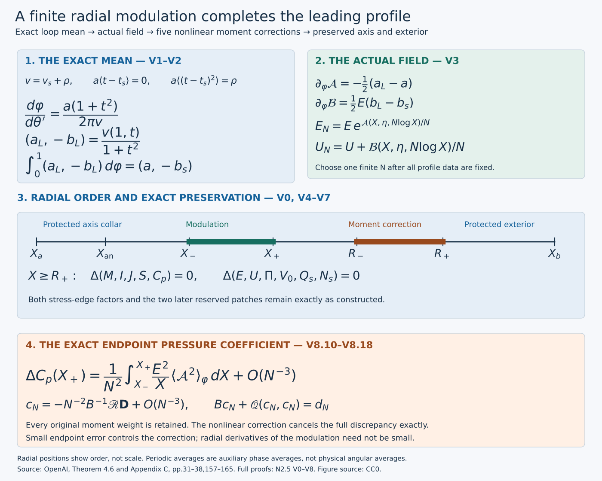

# Realizing the admissible shear and completing the leading profile

**NS-BLOWUP N2.5.** The joined field now has the required axis, pressure and exterior. A part of its connecting interval still has shear below the threshold required by the later viscous waves. We construct one smooth field that satisfies the stronger cone everywhere, then prove all six conclusions of the leading-profile theorem.

The construction changes radial derivatives by an amount of order one while changing field values by an amount of order \(N^{-1}\). Here \(N\) is one sufficiently large, finite integer. A periodic family of admissible shears has exactly the original mean. Its periodic primitives produce the actual field. Five subsequent corrections restore the original cumulative moments exactly, so the axis and exterior retain their entire previous constructions.

The [stress and moment lesson](from-velocity-profiles-to-stress-and-moments.md), P0–P7, supplies the full operators and nonlinear moment inverse. The [outer lesson](constructing-the-outer-profile-and-heat-exterior.md), O0–H7, supplies the four reserved patches, heat field and outer stress factor. The [axis lesson](constructing-the-analytic-axis-profile.md), J0–J8, and [joining lesson](joining-the-analytic-axis-to-the-outer-field.md), Q0–Q10, supply the regular axis, exact connection and inner stress factor. All four are included in the cumulative reader.

The source is OpenAI, *Finite Time Blowup for Navier–Stokes*, [Theorem 4.6, pages 32–34](https://cdn.openai.com/pdf/32d9f210-8b73-45e0-91bc-82a30aef8a9a/navier-stokes.pdf#page=32), the cone formulas on pages 31 and 38, and [Appendix C, pages 157–165](https://cdn.openai.com/pdf/32d9f210-8b73-45e0-91bc-82a30aef8a9a/navier-stokes.pdf#page=157), (C.1)–(C.19). This is independent teaching and editorial mathematics; the diplomatic transcription continues to reproduce what OpenAI wrote. [SOURCES.json](../SOURCES.json) records the source identity and mathematical locators.

*Figure. The upper panels show the exact averaging map and actual field formulas. The radial diagram records order, with both endpoint collars protected. The lower panel displays the leading endpoint pressure-moment change proved in Exercise 2 and cancelled by the exact correction in Exercise 3. It shows no sampled fluid flow.*

## Why a small field change can supply the required shear

The shear uses a radial derivative; the five moments use field values. Evaluating a periodic primitive at \(N\log X\) and dividing its amplitude by \(N\) makes the field difference small while leaving the derivative of its fast phase at order one. The two shear components must be integrated with their exact different factors. In particular, changing the angular field exponentially produces an exponential denominator in the axial shear.

The periodic family must have the exact prescribed mean and depend smoothly on both profile coordinates, even where the axial stress coefficient vanishes. V1–V2 prove those properties. V3 constructs the finite-frequency field and controls every quantity needed by the cone. V4 cancels the five nonlinear moment differences. V5–V7 then carry the two endpoint factorizations through all six conclusions of Theorem 4.6.

The exercises give exact formulas at zero axial stress, sharper moment and correction estimates, explicit endpoint derivative powers and the original physical phase at every viscosity. These are proved consequences of the same construction. They do not allege an error in the source's sufficient bounds.

## V0. The actual input and the interval of modification

Keep the actual joined input fixed. The radial interval below contains every place that still needs the stronger cone, and the following moment patch is already reserved by the outer construction.

Fix the entire profile constructed in Q, including its finite parameters, common axis pressure and exact exterior matching. Keep
\[
A=1/2+h,\quad D=1/2-h,\quad d=1-\eta^2,\quad L=1-2h\eta^2,
\quad 0<h<1/100,\quad -1\le\eta\le1.
\tag{V0.1}
\]
Its inner stress endpoint is \(X_a=X_0=4/\Lambda\); its outer stress endpoint \(X_b\) is the endpoint of the actual H exterior. These are not the local continuation radius 100. The original functions are
\[
\begin{gathered}
F=E/\sqrt{2X},\quad H=\sqrt{2X}E,\quad
a=1-2X\partial_X\log E,\quad b_s=2XU_X/E,\\
p_s=\frac X L(Q_s,N_s/E),\quad
\mathcal T_0=F[p_s-(a,-b_s)].
\end{gathered}
\tag{V0.2}
\]
All five cumulative integrals \(\mathbf m=(M,I,J,S,C_p)\), their integration constants and \(\Pi=\Pi_0+C_p\) remain those of P2. The input has \(a>0\), the strict relaxed cone on \((X_a,X_b)\), an admissible inner collar and the admissible outer portion beginning in the intermediate power-law interval. These properties were derived in Q9, O8 and H5, rather than assumed for a nonexistent profile.

Choose \(X_{\rm an}\) strictly inside the analytic admissible inner collar of Q5. Then choose \(X_-\) beyond \(X_{\rm an}\), still inside that collar, and \(X_+\) inside the admissible intermediate power-law interval, before the first reserved patch. This is possible by the positive lengths established in Q5 and O0.4. Set \(\mathcal I=[X_-,X_+]\). The compact interval contains every point where the input need not be admissible; the input is admissible near both endpoints. Retain shorter endpoint collars outside its support. The first reserved patch will restore moments; the third and fourth remain available for later positive-order and mean corrections. The second was already used for the heat compensation, which will be preserved exactly.

For any \(a>0,b\in\mathbb R,p\in\mathbb R^2\), keep the original gap map
\[
\begin{gathered}
v=a+b^2/a,\quad c=p_1-(b/a)p_2,\quad j=p_2+(b/a)p_1,\\
\Psi(a,b,p)=(a,v-2,c-v,2(c-v)^2-(v-2)j^2).
\end{gathered}
\tag{V0.3}
\]
It is smooth on its stated domain. P6 proves that positivity of all four components is exactly the admissible cone. With \(t_s=-b_s/a\), its c and j are \(P_c(t_s)\) and \(J_c(t_s)\), where
\[
P_c(t)=p_{s,1}+p_{s,2}t,\qquad J_c(t)=p_{s,2}-p_{s,1}t.
\tag{V0.4}
\]

## V1. A smooth variance family, including zero axial stress

Vary the ratio of the two shear components while keeping its average fixed. The exponential distribution makes the stress projection remain above two. Its variance can reach every finite positive target, including when the axial stress coefficient is zero.

On the compact rectangle \(\mathcal I\times[-1,1]\), choose
\(0<d_0<\tfrac12\min(P_c(t_s)-2)\). This minimum is positive by the already constructed strict relaxed cone. With the separate auxiliary angle \(\theta'\), define
\[
M_e(z)=\frac1{2\pi}\int_0^{2\pi}e^{z\sin\theta'}\,d\theta',\qquad
t(\theta';\mu)=t_s+d_0\frac{e^{\mu p\sin\theta'}/M_e(\mu p)-1}{p},
\quad p=p_{s,2},\quad \mu\ge0.
\tag{V1.1}
\]
This auxiliary average is not the physical angular or wave-torus average. Differentiation under the integral on compact z intervals proves smoothness, and \(M_e>0\). The change \(\theta'\mapsto\theta'+\pi\) proves evenness. The numerator in the quotient vanishes at p=0. Writing it as \(p\int_0^1\partial_pG(up)du\) proves a joint smooth extension in \((\theta',\mu,p)\), with value \(t=t_s+d_0\mu\sin\theta'\) at zero. Direct integration gives
\[
\langle t\rangle=t_s,\qquad
P_c(t)=P_c(t_s)+d_0[e^{\mu p\sin\theta'}/M_e(\mu p)-1]>P_c(t_s)-d_0>2,
\tag{V1.2}
\]
and the exact variance
\[
V(\mu,p)=\langle(t-t_s)^2\rangle
=\frac{d_0^2}{p^2}\left[\frac{M_e(2\mu p)}{M_e(\mu p)^2}-1\right],
\qquad V(\mu,0)=d_0^2\mu^2/2.
\tag{V1.3}
\]
The integral of the squared smoothly extended quotient is also a direct proof of smoothness at p=0.

For \(g=\log M_e\), differentiating the quotient for \(g'\) gives exactly the variance of \(\sin\theta'\) under density \(e^{z\sin\theta'}/(2\pi M_e(z))\). It is strictly positive: the density is positive everywhere and \(\sin\theta'\) is not constant on any full-measure set. Thus \(g''>0\). For p nonzero and \(\mu>0\),
\[
\partial_\mu[g(2\mu p)-2g(\mu p)]
=2p[g'(2\mu p)-g'(\mu p)]>0.
\tag{V1.4}
\]
For negative p both factors in brackets and outside are negative; for positive p both are positive. This proves strict increase of V for \(\mu>0\); the p=0 formula does so there as well.

The unbounded range can be proved with explicit analytic estimates. For \(|u|\le\pi\),
\(1-u^2/2\le\cos u\le1-2u^2/\pi^2\). The lower bound follows by integrating \(1-\cos u\le u^2/2\); the upper follows from \(\sin(|u|/2)\ge |u|/\pi\), the chord inequality for the concave sine on \([0,\pi/2]\), in \(1-\cos u=2\sin^2(u/2)\). Centering the angle at its maximum and integrating over \(|u|\le z^{-1/2}\) for the lower bound, and over the whole real Gaussian for the upper, yields for \(z\ge1\)
\[
\frac{e^{-1/2}}\pi\frac{e^z}{\sqrt z}
\le M_e(z)\le\frac{\sqrt\pi}{2\sqrt2}\frac{e^z}{\sqrt z}.
\tag{V1.5}
\]
Evenness supplies the same bounds for negative z with \(|z|\). Consequently the ratio in V1.3 is bounded below by a positive constant times \(\sqrt{|\mu p|}\) when \(|\mu p|\ge1\). For each fixed nonzero p this tends to infinity as \(\mu\to\infty\); for p=0 use V1.3. Given any finite target, continuity gives for each p an open neighborhood and one finite \(\mu_p\) exceeding the target there. A finite subcover of the compact p range and monotonicity give one finite \(\mu_{\max}\) such that
\[
V(\mu_{\max},p)>3/a_{\min},\qquad a_{\min}=\min_{\mathcal I\times[-1,1]}a>0.
\tag{V1.6}
\]
No uniform large-z estimate near p=0 was assumed in this compactness step.

The original upper cone bound is
\[
\mathcal U(P,J)=P+J^2/4-|J|\sqrt{(P-2)/2+J^2/16}.
\tag{V1.7}
\]
P6 proves \(2<\mathcal U(P,J)\le P\) for P>2, including J=0. Continuity suffices here; no derivative of \(|J|\) is taken. The entire compact family in V1.1 with \(0\le\mu\le\mu_{\max}\) has P>2 by V1.2. Choose \(0<\delta_L<1\) below the minimum of \(\mathcal U-2\) on that family and below the positive minimum of \(v_s-2\) on fixed smaller radial boundary neighborhoods. The order is \(d_0,\mu_{\max},\delta_L\).

## V2. The variance choice and the exact prescribed mean

Choose the variance only where the original shear is too small. Then change the speed with which the loop is traversed. The exact Jacobian gives both required component averages.

Using the smooth step of O0.1, take
\(\zeta_L(w)=1-\sigma((w-2-\delta_L/8)/(\delta_L/8))\).
It lies in [0,1], is one below \(2+\delta_L/8\) and zero above \(2+\delta_L/4\). Set exactly
\[
v_*=2+\delta_L/2,\qquad
\rho=\zeta_L(v_s)^2(v_*-v_s),\qquad v=v_s+\rho.
\tag{V2.1}
\]
Define \(\rho=0\) where the cutoff vanishes. On its possible nonzero support, \(v_*-v_s\ge\delta_L/4\); hence
\(\sqrt\rho=\zeta_L(v_s)\sqrt{v_*-v_s}\), extended by zero, is smooth. Since \(v_s=a+b_s^2/a>0\) and \(v_*<5/2\), one has \(0\le\rho<3\). There is a unique \(0\le\mu<\mu_{\max}\) solving
\[
V(\mu,p)=\rho/a.
\tag{V2.2}
\]
Existence follows from V1.6 and the intermediate value theorem; strict monotonicity proves uniqueness.

Here is the smooth dependence at zero, which the ordinary derivative of V alone would not justify. Taylor expansion under the defining integral gives \(M_e(z)=1+z^2/4+O(z^4)\). Thus
\[
\frac{M_e(2z)}{M_e(z)^2}-1=z^2F_e(z),\quad F_e(0)=1/2,
\qquad V(\mu,p)=d_0^2\mu^2F_e(\mu p),
\tag{V2.3}
\]
where \(F_e\) is smooth and even near zero. This is an exact factorization, obtained by the twice-integrated Taylor remainder; the displayed value follows from the second derivative. In a fixed neighborhood it is positive. Therefore the signed square root \(d_0\mu\sqrt{F_e(\mu p)}\) is smooth, odd in \(\mu\), and has derivative \(d_0/\sqrt2\) at zero. Its implicit equation with smooth right side \(\sqrt\rho/\sqrt a\) gives a unique smooth \(\mu\) through zero. Away from zero use the strictly positive derivative V1.4. Local solutions agree by uniqueness, including at \(\eta=\pm1\), by smooth local extension or one-sided implicit differentiation. No cusp in \(\sqrt\rho\) is introduced.

If \(v_s\le2+\delta_L/8\), then v=v_*>2. In the transition zone, \(2<v_s\le v\le v_*\). Off the cutoff, v=v_s>2 and \(\mu=0\). Thus where the loop changes, \(2<v\le2+\delta_L/2<\mathcal U(P_c(t),J_c(t))\). Where it does not change, the original relaxed inequality and v_s>2 give the same conclusion. Every vector \(v(1,t)/(1+t^2)\) is therefore admissible.

To obtain the original average, define the lift
\[
\varphi(\theta')=\int_0^{\theta'}\frac{a(1+t(s)^2)}{2\pi v}\,ds,
\qquad (a_L,-b_L)(\varphi)=\frac{v(1,t(\theta'))}{1+t(\theta')^2}.
\tag{V2.4}
\]
V1.2–V1.3 and V2.2 give \(a\langle1+t^2\rangle=a(1+t_s^2)+aV=v_s+\rho=v\). Consequently the lift increases by exactly one as \(\theta'\) increases by \(2\pi\). Its derivative is bounded below by a positive constant on the compact family, so it has a smooth parameter-dependent inverse. For completeness, the derivative of the inverse is \((\partial_{\theta'}\varphi)^{-1}\), while any parameter derivative is \(-\varphi_{\rm parameter}/\varphi_{\theta'}\); iterating these identities proves all mixed derivative bounds. The exact two averages are
\[
\int_0^1a_L\,d\varphi=a,\qquad
\int_0^1(-b_L)\,d\varphi=a\langle t\rangle=at_s=-b_s.
\tag{V2.5}
\]
They follow by substituting the full Jacobian in V2.4. On the radial boundary neighborhoods \(\zeta_L=0\), so \(\mu=0,t=t_s,v=v_s\), the lift is \(\theta'/(2\pi)\), and the loop equals the original shear. Positivity of all four components of \(\Psi(a_L,b_L,p_s)\) and compactness yield a common minimum \(\kappa_L>0\). The fixed neighborhoods yield \(\delta_\partial>0\). This establishes every assertion of Lemma C.1, with the exact period-one mean and boundary equalities.

## V3. The actual radial modulation and its moment estimates

Integrate the two mean-zero shear differences in the periodic variable, then insert their primitives into the original fields. Differentiate the actual formulas before estimating; this retains the factors needed by the cone.

For any smooth period-one zero-mean f, the unique zero-mean primitive is
\[
(\mathcal P f)(\varphi)=\int_0^\varphi f(s)ds-
\int_0^1\int_0^u f(s)ds\,du.
\tag{V3.1}
\]
Its periodicity follows from \(\int_0^1f=0\), its derivative is f, and its mean is zero by construction. A constant is the only difference between primitives, proving uniqueness. Every fixed parameter derivative commutes with these bounded integrals. Define
\[
\partial_\varphi\mathcal A=-\tfrac12(a_L-a),\qquad
\partial_\varphi\mathcal B=\tfrac12E(b_L-b_s),\qquad
\langle\mathcal A\rangle_\varphi=\langle\mathcal B\rangle_\varphi=0.
\tag{V3.2}
\]
V2.5 proves compatibility. Both primitives vanish identically on the radial boundary neighborhoods, so extension by zero is smooth. For an integer N≥1 prescribe the actual fields
\[
E_N=E\exp[\mathcal A(X,\eta,N\log X)/N],\qquad
U_N=U+\mathcal B(X,\eta,N\log X)/N.
\tag{V3.3}
\]
Positivity of E_N and exact agreement outside \(\mathcal I\) follow immediately. Let \(\mathcal D_X=X\partial_X\) hold the independent \(\varphi\) fixed. Differentiation after substitution is \(\mathcal D_X+N\partial_\varphi\). Thus the original shears, with every amplitude factor, are exactly
\[
a_N=a_L-\frac{2\mathcal D_X\mathcal A}N,\qquad
b_N=e^{-\mathcal A/N}\left(b_L+\frac{2\mathcal D_X\mathcal B}{NE}\right),
\qquad \varphi=N\log X.
\tag{V3.4}
\]
In the second formula the numerator is \(2\mathcal D_XU+2\partial_\varphi\mathcal B+2\mathcal D_X\mathcal B/N=Eb_L+2\mathcal D_X\mathcal B/N\), and the denominator is \(Ee^{\mathcal A/N}\). This proves the exponential factor as well as both signs.

All coefficients and derivatives are bounded on the fixed compact radial range from \(X_-\) through the first reserved patch, with E and X bounded below. The phase is independent of \(\eta\). The identity \(e^z-1=z\int_0^1e^{sz}ds\), followed by parameter differentiation, proves for each fixed m
\[
\|E_N-E\|_{C^m_\eta}+\|U_N-U\|_{C^m_\eta}
+\|a_N-a_L\|_{C^m_\eta}+\|b_N-b_L\|_{C^m_\eta}
\le C_m/N.
\tag{V3.5}
\]
The norms include a radial supremum, and loop values are evaluated at the actual phase. Constants depend on the fixed loop and profile, never on N. Each radial differentiation of the composed primitives contributes at most one N, while the original perturbation has factor N^{-1}. Repeated product and chain differentiation therefore gives
\[
\|\partial_X^r\partial_\eta^m(E_N-E,U_N-U)\|_\infty
\le C_{r,m}N^{r-1}\quad(r\ge1).
\tag{V3.6}
\]
Terms differentiating the exponential k times carry N^{-k} and at most N^r, with k≥1; hence they obey the same bound for N≥1. This is not smallness of radial derivatives.

Compute the actual moments from E_N,U_N, keeping the same \(\Pi_0\). For any field increments e,u, their integrand changes are exactly
\[
u,\quad \sqrt{2X}e,\quad \sqrt{2X}(Ue+Eu+ue),\quad
2Uu+u^2-Ee-e^2/2,\quad Ee/X+e^2/(2X),
\tag{V3.7}
\]
in the original order (M,I,J,S,C_p). All changes vanish before \(X_-\), so their denominators are bounded away from zero wherever integrated. V3.5 and product differentiation give \(O_m(N^{-1})\) bounds for all five partial integrals, uniformly through the correction interval. The same holds for \(\Pi_N-\Pi=C_{p,N}-C_p\). P2.5 and P3.4 then give
\[
\|\mathbf m_N-\mathbf m\|_{C^m_\eta}
+\|\Pi_N-\Pi\|_{C^m_\eta}\le C_m/N,\qquad
\|p_{s,N}-p_s\|_{C^m_\eta}\le C'_m/N.
\tag{V3.8}
\]
For the last estimate use the first bound through order m+1, positive E_N, and the full multiplier X/L. The multiplier is fixed, although possibly large. None of these formulas differentiates the oscillating fields radially.

There is a compact neighborhood of the loop values with a positive lower bound for a; the smooth gap map has a finite Lipschitz constant there. V3.4–V3.8 therefore preserve every gap by at least \(\kappa_L/2\) on \(\mathcal I\) for sufficiently large N. Between \(X_+\) and the reserved patch, fields and shears equal the input, while p_s differs by \(O(N^{-1})\). The input gap has a positive minimum on this compact interval, so the same choice, enlarged if necessary, preserves it. All frequency lower bounds are finite and are chosen after the entire input profile.

## V4. Restoring the five original moments on the first reserved patch

The moment mismatch reaches a patch on which the fields still have their exact original power law. The full nonlinear five-moment map is invertible there, and its small solution preserves the cone throughout the patch.

Let the first patch be \((R_-,R_+)\), with its actual radii from O0.4. There the unchanged input is
\[
U=0,\qquad E=K(\eta)X^{-1/2-\lambda},\qquad
K(\eta)=c_{\rm patch}(1+\eta^2)^{-1}>0.
\tag{V4.1}
\]
Fix five centers \(r_j=R_-+j(R_+-R_-)/6\) and width \(\omega=(R_+-R_-)/20\). Let \(\beta_j(X)=\exp[-1/(1-((X-r_j)/\omega)^2)]\) on \(|X-r_j|<\omega\), and zero otherwise. They are smooth, positive on their interiors, and have ordered disjoint compact supports inside the original patch. Put \(u=c_1\beta_1+c_2\beta_2\), \(e=\sum_{j=3}^5c_j\beta_j\), and add them to the fields after modulation.

At the patch entrance the fields themselves are exactly V4.1; the accumulated moment discrepancy is \(O_m(N^{-1})\). The correction map, in row order (M,J,I,S,C_p), has the full increments
\[
\left(
\int u,\ \int\sqrt{2X}(Eu+ue),\ \int\sqrt{2X}e,
\ \int(u^2-Ee-e^2/2),\ \int(Ee/X+e^2/(2X))
\right).
\tag{V4.2}
\]
Every integral here is in dX over the patch. At zero coefficients its matrix B is block diagonal. Its U rows have weights \(1,\sqrt2KX^{-\lambda}\); its E rows have weights \(\sqrt2X^{1/2},-KX^{-1/2-\lambda},KX^{-3/2-\lambda}\). Removing these nonzero row factors for the purpose of the determinant, while retaining them in B and its inverse, gives the exact power lists
\[
(0,-\lambda),\qquad(1/2,-1/2-\lambda,-3/2-\lambda).
\tag{V4.3}
\]
The fixed positive \(\lambda\) makes both lists distinct. P4's determinant-integral proof applies to the specified bumps, so B is invertible on the closed parameter interval. Its inverse and every fixed parameter derivative are bounded. Its constants may depend on \(\lambda\), K and the original patch radii; no uniformity as \(\lambda\downarrow0\) is asserted or needed.

The exact quadratic remainder is
\[
\mathscr Q(c,c)=\left(0,\int\sqrt{2X}ue,0,
\int(u^2-e^2/2),\int e^2/(2X)\right).
\tag{V4.4}
\]
Take target d to be minus the preexisting moment discrepancy in that same row order. With \(\nu_m\) the multiplication norm of B^{-1} and q_m the quadratic bilinear norm, including product-rule constants, the iteration
\[
c_{n+1}=B^{-1}(d-\mathscr Q(c_n,c_n)),\quad c_0=0,
\qquad 8\nu_m^2q_m\|d\|_{C^m_\eta}\le1
\tag{V4.5}
\]
is a contraction by P5.6–P5.8, provided also the same condition in C^0. Choose N so those finitely many inequalities hold. It yields smooth coefficients with the selected finite norm \(O_m(N^{-1})\), solving the original five equations exactly. All further fixed parameter derivatives exist by the invertible finite-dimensional derivative. They are also \(O_m(N^{-1})\) as N grows: differentiation of the equation gives B times the highest derivative plus terms containing c or a lower derivative of c, while every derivative of d is \(O_m(N^{-1})\) by V3.8. The inverse derivative is uniformly bounded for the small C^0 branch; induction proves the assertion. This requires no simultaneous smallness threshold for every m.

The fixed bumps bound the corrections and their first radial derivatives by a finite multiple of the selected coefficient norm. Partial moment increments obey the same bound, using V4.2 with the upper integration endpoint inside the patch. P3 therefore retains the \(O(N^{-1})\) p_s bound throughout that patch. Comparing these three finite bounds with the positive input E and the four positive input gap minima on its closed rectangle gives a further finite lower bound for N that preserves positivity and the cone everywhere, including within each bump. This comparison uses actual partial integrals, not only their endpoint values.

Let \(X_{\rm rep}=R_+\). The bumps vanish on neighborhoods of both boundaries. At its right endpoint,
\[
\widetilde{\mathbf m}(X_{\rm rep},\eta)=\mathbf m(X_{\rm rep},\eta),\qquad
(\widetilde E,\widetilde U)=(E,U)\quad(X\ge X_{\rm rep}).
\tag{V4.6}
\]
The forward integrals propagate equality of all five moments, and the common \(\Pi_0\) gives equality of the complete pressure. P3 proves equality of \(V_0,Q_s,N_s,p_s\) and every parameter derivative there; field equality gives all radial derivatives and shears. This preserves the previously performed terminal compensation, heat exterior and outer endpoint. At the inner endpoint both modifications are supported later, and the same forward integration preserves the analytic rectangle and inner collar exactly. The two unused reserved patches are also unchanged. Fix one integer N satisfying the finite requirements before any physical q or later iteration stage is chosen. This proves Proposition C.2.

## V5. Nonzero stress and the direction on the closed annulus

The stress vanishes at both radial edges. Divide by each proved scalar flat factor to extend its direction smoothly, then use the interior cone to obtain a uniform margin on the closed annulus.

Use E,U,Π now for the corrected fields. The leading stress vanishes on \([0,X_a]\) by J and Q3, and on \([X_b,\infty)\) by H4. These intervals are exactly preserved by V4.6 and the unchanged inner construction. In the open annulus admissibility gives \(P_c>v_s\), so
\(\mathcal T_{0,\theta}+t_s\mathcal T_{0,z}=F(P_c-v_s)>0\).
Thus the stress cannot vanish anywhere there.

Define \(n=\mathcal T_0/|\mathcal T_0|\) in the interior. At the inner edge Q3 supplies the exact factor
\[
\mathcal T_0=e^{-t_1^2/y_a^2}g_a(y_a)B_0(y_a,\eta),\quad
y_a=\log(X/X_a),\quad g_a(0)>0,\quad B_0(0,\eta)=F(X_a,\eta)p_s(X_a,\eta)\ne0.
\tag{V5.1}
\]
Hence n extends smoothly there as \(B_0/|B_0|\). At \(X_a\), zero leading stress gives \(p_s=(a,-b_s)=a(1,t_s)\). The limiting direction is a positive multiple of this vector. Consequently \(n_z-t_sn_\theta=0\) and \(n_\theta+t_sn_z=\sqrt{1+t_s^2}>0\) there.

At the outer edge the exact H6 factors give
\[
\mathcal T_0=e^{-4/y_b^2}y_b^{-3}(b_\theta(y_b,\eta),y_b^6b_z(y_b,\eta)),
\quad y_b=\log(X_b/X),\quad b_\theta(0,\eta)>0,
\tag{V5.2}
\]
and therefore
\[
n=\frac{(b_\theta,y_b^6b_z)}{\sqrt{b_\theta^2+y_b^{12}b_z^2}}
\longrightarrow(1,0).
\tag{V5.3}
\]
This is smooth up to the closed edge, including \(\eta=\pm1\), and b_s=0 there because U=0 in the whole outer collar. F remains positive at both edges. At the inner edge a>0 and \(v_s-2>.2\) by J6; at the outer edge H5 gives \(a=v_s\ge2+h\). Interior admissibility and compactness now give positive lower bounds for F,a,v_s−2 on the full closed annulus.

In the interior, division by the actual nonzero stress gives
\[
u_n:=n_\theta+t_sn_z=\frac{P_c-v_s}{|p_s-(a,-b_s)|}>0,
\qquad
n_z-t_sn_\theta=\frac{J_c}{|p_s-(a,-b_s)|}.
\tag{V5.4}
\]
The quantity
\(r_n=2-(v_s-2)(n_z-t_sn_\theta)^2/u_n^2\)
is positive by the cone test. Both u_n and r_n extend continuously to the edges by V5.1–V5.3, with positive u_n and r_n=2 there. Let their minima on the closed rectangle be u_*>0 and r_*>0. Choose
\[
0<\kappa=\tfrac12\min\{1,u_*,r_*\}<2.
\tag{V5.5}
\]
Then everywhere on that rectangle
\[
n_\theta+t_sn_z\ge\kappa,\qquad
(v_s-2)(n_z-t_sn_\theta)^2
\le(2-\kappa)(n_\theta+t_sn_z)^2.
\tag{V5.6}
\]
This proves the precise directional margin of Theorem 4.6(iii), including both specified endpoint directions. A uniform raw stress-gap minimum at the zero-stress endpoints was not assumed.

## V6. The common flat weight and all fixed derivatives

The common weight contains both endpoint exponentials. Near either edge the other factor is bounded above and below; on the remaining interior interval the fixed smooth field has ordinary compact bounds.

Use exactly the original weight and endpoint distances
\[
\delta=\min\{1,y_a,y_b\},\qquad
\zeta(X)=\exp[-t_1^2/y_a^2-4/y_b^2]\quad(X_a<X<X_b),
\tag{V6.1}
\]
extended by zero outside the annulus. The two positive logarithmic distances have sum \(\log(X_b/X_a)>0\). Near either endpoint the other distance is bounded below; its exponential is a smooth positive factor bounded above and below. Derivatives of the vanishing factor are its exponential times finite sums of inverse powers of the vanishing distance, because \(y_{a,X}=1/X\) and \(y_{b,X}=-1/X\) have bounded derivatives on the fixed annulus. The exponential dominates each inverse power as its distance tends to zero. This proves smoothness and flatness of ζ at both edges.

V5.1 with Q3 gives a positive constant times \(e^{-t_1^2/y_a^2}\) as a stress lower bound near the inner edge and the same exponential times finite inverse powers as each derivative upper bound. V5.2 and H6 give \(ce^{-4/y_b^2}y_b^{-3}\) as the outer lower bound and its exponential times finite inverse powers for every derivative. On a collar with y_b≤1 the lower polynomial factor is at least one. Dividing each estimate by the bounded positive factor from the opposite endpoint proves the required comparison with ζ. On the remaining closed interior interval both ζ and |T_0| have positive minima; every fixed derivative is bounded because the frequency N has already been fixed. Taking the minimum of the three positive lower constants and, for each derivative, the maximum of the three upper constants yields
\[
|\mathcal T_0|\ge c\zeta,\qquad
|\partial_X^{\alpha_1}\partial_\eta^{\alpha_2}\mathcal T_0|
\le C_\alpha\zeta\delta^{-m_\alpha}
\quad(X_a<X<X_b,\ -1\le\eta\le1).
\tag{V6.2}
\]
The lower c is independent of α. Each m_α is a finite nonnegative integer; enlarge it if necessary to cover both endpoint powers. These estimates also prove smooth extension of the stress by zero. All constants depend on fixed profile choices and derivative orders, and none on physical q or later bands and correction stages.

## V7. Every conclusion of the leading-profile theorem

The exact moment identities preserve pressure and the heat exterior. Together with the protected axis, stress direction and flat weight, they give every assertion of the leading-profile theorem.

The common analytic axis rectangle and smooth Cartesian axis follow from J4 and Q5; V3–V4 leave them unchanged. On every finite closed radial interval, the constructed fields and all fixed mixed derivatives are finite: the only rapid radial frequency is the one fixed finite N, the later corrections have fixed smooth compact supports, and the heat factor is smooth for its full nonnegative argument range by K0/H0. No analyticity of that heat factor at zero is assumed. Positivity of E on X>0 implies positivity of \(\phi=\mathsf C E/\sqrt{2X}\); at zero it follows from J. The quantities F,U,V_0/X and Π extend smoothly through the axis by Q5.1.

The original pressure identity is preserved exactly. The input pressure was canonical, and both the joining and the shear correction restored C_p with the same axis datum. Therefore
\[
\Pi_0=-\int_0^\infty\frac{E(x,\eta)^2}{2x}\,dx,\qquad
\Pi(X,\eta)=\Pi_0+\int_0^X\frac{E(x,\eta)^2}{2x}\,dx
=-\int_X^\infty\frac{E(x,\eta)^2}{2x}\,dx.
\tag{V7.1}
\]
These integrals converge: near zero E=\(\sqrt{2X}F\) with smooth F, and at infinity the unchanged heat exterior decays like \(X^{-A}\), with A>0 and bounded heat factor. Differentiating gives \(\Pi_X=E^2/(2X)=F^2\), including its smooth limit at zero. P1's exact tangential residual identities apply to these actual fields; the physical leading stress is \(q^{-A-1/2}\mathcal T_0\). The full momentum residual still includes the axial-viscosity and radial remainder terms of P1.5–P1.6: completing the leading profile does not solve the entire equation. On \(0<X\le X_a\) the original equations (4.13) hold because that analytic solution is unchanged. This proves parts (i)–(ii); V5 proves (iii) and V6 proves (iv).

For part (v), all original convergent total moments remain exactly
\[
M(\infty,\eta)=J(\infty,\eta)=S(\infty,\eta)=0,\qquad
\int_0^\infty(H-H_{\rm pow})\,dX=0,
\quad H_{\rm pow}=\sqrt{2X}\,c_\infty X^{-A}.
\tag{V7.2}
\]
They were established in O/H, transferred through the exact Q join, and preserved by V4.6. In particular the convergence of the subtracted angular moment and its exact value are retained, not replaced by an un-subtracted divergent integral. The original heat exterior is
\[
U=V_0=0,\qquad E=c_\infty X^{-A}\mathcal H(2d/X),\qquad
\mathcal H(Z)=\frac1{\Gamma(1+h)}\int_0^\infty e^{-v}v^h(1+Zv)^{-h}dv
\quad(X\ge X_b).
\tag{V7.3}
\]
K0/H0 supply its positive smooth heat solution, including Z=0. In original physical coordinates s=r²/2, its swirl is exactly \(c_\infty s^{-A}\mathcal H(2\tau/s)\); the argument equals \(4\tau/r^2\). For the earlier radius \(X_v=X_{\rm end}\) at the end of the pulse, the input has U=M=0 by O1 and O0.6. The correction patch lies before that radius and restores M exactly, so these equalities hold for all X≥X_v. P0's radial-average formula gives V_0=0 there, proving the whole outer-collar assertion.

For part (vi), retain exactly the third and fourth intervals of O0.4, in their original radii, as \(\mathcal I_{\rm pos},\mathcal I_{\rm mean}\). They are ordered, disjoint, lie in \((X_a,X_v)\), and were untouched by the Q join, the heat compensation on the second patch, and the V4 correction on the first. They therefore retain
\[
U=0,\qquad E=c_{\rm patch}(1+\eta^2)^{-1}X^{-1/2-\lambda},\qquad
\sup\mathcal I_{\rm pos}<\inf\mathcal I_{\rm mean}.
\tag{V7.4}
\]
The positive c_patch is independent of X and η, as required. These are the actual intervals receiving the later corrections, not newly chosen substitutes.

Finally, for each original viscosity \(\nu>0\), the exact H7 map retains \(u_\nu(x_\nu,t)=\sqrt\nu u(x_\nu/\sqrt\nu,t)\), \(p_\nu=\nu p\) and \(T_\nu=\nu T\) at that same mapped point. Its coordinates satisfy
\[
q_\nu-(z_\nu^2/\nu)q_\nu^{2h}=1-t,\qquad
X_\nu=r_\nu^2/(2\nu q_\nu),\qquad
\eta_\nu=z_\nu/(\sqrt\nu q_\nu^D).
\tag{V7.5}
\]
All original viscosity factors remain in the physical equations; the spatial derivative contributes \(\nu^{-1/2}\), so divergence of the physical stress has the same \(\sqrt\nu\) factor as the other momentum terms. The positive scalar stress factor preserves its direction. This is the proved comparison with the source's displayed coefficient-one construction, not a change of the target viscosity.

## V8. Five worked exercises

### Exercise 1. Write the complete loop map at zero axial stress

At a fixed profile point with \(p_{s,2}=0\), compute the variance parameter, the loop and its lifted circle coordinate. Check its period, inverse and both component means without dividing by \(p_{s,2}\).

**Solution.** Retain \(a>0,t_s,v_s=a(1+t_s^2)\), the actual cutoff value \(\rho\), and \(v=v_s+\rho\) from V2. The removable value in V1 gives
\[
\mu=\frac{\sqrt{2\rho/a}}{d_0},\qquad
w=d_0\mu=\sqrt{2\rho/a},\qquad
t(\theta')=t_s+w\sin\theta'.
\tag{V8.1}
\]
The square root is smooth as a function of the profile coordinates by the specific squared cutoff in V2.1. Thus these formulas include \(\rho=0\). Integrating \(1+t^2\) exactly gives
\[
\varphi(\theta')=\frac{\theta'}{2\pi}
+\frac{a}{2\pi v}
\left[2t_sw(1-\cos\theta')-\frac{w^2}{4}\sin(2\theta')\right].
\tag{V8.2}
\]
The coefficient of \(\theta'\) is exactly \(1/(2\pi)\), since
\(a(1+t_s^2+w^2/2)=v_s+\rho=v\). In particular,
\(\varphi(0)=0\) and \(\varphi(\theta'+2\pi)=\varphi(\theta')+1\).
Differentiating retains the positive Jacobian
\[
\frac{d\varphi}{d\theta'}=\frac{a[1+(t_s+w\sin\theta')^2]}{2\pi v}>0,\qquad
\frac{d\theta'}{d\varphi}=
\frac{2\pi v}{a[1+(t_s+w\sin\theta')^2]}.
\tag{V8.3}
\]
On the fixed compact family both derivatives have finite positive bounds. The lift is strictly increasing and has the stated degree one, so it is a bijection of the circles. The local inverse derivative in V8.3 and its parameter derivatives give its smooth inverse globally by uniqueness.

With \(\theta'=\theta'(\varphi)\), the loop is exactly
\[
(a_L,-b_L)=
\frac{v}{1+(t_s+w\sin\theta')^2}(1,t_s+w\sin\theta').
\tag{V8.4}
\]
Multiplying by the full Jacobian gives the first component average \(a\), and the second \(a t_s=-b_s\), since the integral of \(\sin\theta'\) is zero. If \(\rho=0\), the lift is \(\theta'/(2\pi)\) and the loop is the original shear. All factors \(a,v,d_0\) remain identified. The parameter \(d_0\) cancels from the zero-axial-stress loop itself, while it still determines \(\mu\) and the common compact family used in V1.

### Exercise 2. Compute the leading changes of all five endpoint moments

Improve the moment estimates using the zero means of \(\mathcal A,\mathcal B\). Give the actual leading coefficient at \(X_+\) in the original order \((M,I,J,S,C_p)\), including every radial weight. State what can and cannot be improved in the integrated stress estimate.

**Solution.** All profiles and the loop are now fixed; only the positive integer \(N\) varies. Constants below may depend on these fixed objects and on the specified derivative orders. For a smooth period-one function \(f(X,\eta,\varphi)\) with zero periodic mean and compact radial support inside \((X_-,X_+)\), write \(f_N(X,\eta)=f(X,\eta,N\log X)\). Let \(\mathcal P\) be V3.1, and let \(\mathcal D_X=X\partial_X\) hold the independent phase fixed. Direct differentiation gives the exact formula
\[
\begin{split}
\int_{X_-}^{x} f_N(X,\eta)\,dX
&=\frac{x}{N}(\mathcal P f)(x,\eta,N\log x)\\
&\quad-\frac1N\int_{X_-}^{x}
\big[(1+\mathcal D_X)\mathcal P f\big](X,\eta,N\log X)\,dX .
\end{split}
\tag{V8.5}
\]
The lower boundary term is zero because \(f\), and therefore its periodic primitive, vanishes on a radial neighborhood of \(X_-\). The formula is also valid at either endpoint by continuity. It proves a uniform \(O_m(N^{-1})\) bound for partial integrals in every fixed \(C^m_\eta\) norm.

At \(x=X_+\) the upper boundary term vanishes too. The operator
\(\mathcal K=(1+\mathcal D_X)\mathcal P\) preserves zero periodic mean and compact radial support: differentiation and the bounded phase integrals commute. Repeated use of V8.5 therefore gives, for every integer \(k\ge1\),
\[
\int_{X_-}^{X_+} f_N\,dX
=\frac{(-1)^k}{N^k}
\int_{X_-}^{X_+}(\mathcal K^k f)(X,\eta,N\log X)\,dX,\qquad
\left\|\int_{X_-}^{X_+}f_N\,dX\right\|_{C^m_\eta}
\le \frac{C_{k,m}}{N^k}.
\tag{V8.6}
\]
Every integrand on the right is a fixed smooth function on a compact set, so its integral and each of its finitely many parameter derivatives are bounded. This proves the estimate directly, with no cancellation assumption at a sampled phase.

Put \(A_N=\mathcal A(X,\eta,N\log X)\), \(B_N=\mathcal B(X,\eta,N\log X)\). The original increments are \(u=B_N/N\) and \(e=E(e^{A_N/N}-1)\). Taylor's integral identity
\[
e^z=1+z+\frac{z^2}{2}
+\frac{z^3}{2}\int_0^1(1-s)^2e^{sz}\,ds
\tag{V8.7}
\]
holds for every real \(z\). Boundedness of \(\mathcal A,\mathcal B\) and their fixed parameter derivatives makes the remainders below \(O_m(N^{-3})\), uniformly in \(X\). Substituting into all five original moment integrands yields
\[
\begin{array}{c|c|c}
\text{moment}&N^{-1}\text{ coefficient}&N^{-2}\text{ coefficient}\\ \hline
M&B_N&0\\
I&H A_N& H A_N^2/2\\
J&H(UA_N+B_N)&H(UA_N^2/2+A_NB_N)\\
S&2UB_N-E^2 A_N&B_N^2-E^2 A_N^2\\
C_p&E^2 A_N/X&E^2 A_N^2/X
\end{array}
\tag{V8.8}
\]
Here \(H=\sqrt{2X}E\), and every coefficient is integrated with the original \(dX\). For the last two rows one can check the factors directly from
\[
\Delta S'=2Uu+u^2-\frac{E^2}{2}(e^{2A_N/N}-1),\qquad
\Delta C_p'=\frac{E^2}{2X}(e^{2A_N/N}-1).
\tag{V8.9}
\]
Primes in this display mean derivatives in \(X\). Both first-order rows in V8.8 have zero periodic mean, as do all the other first-order rows. Formula V8.5 bounds their partial integrals by \(O_m(N^{-1})\), and the extra prefactor gives \(O_m(N^{-2})\). The quadratic terms and their partial integrals are already \(O_m(N^{-2})\). Thus the actual stronger partial-moment and pressure estimates are
\[
\sup_{x\in[X_-,X_+]}
\|\mathbf m_N(x,\cdot)-\mathbf m(x,\cdot)\|_{C^m_\eta}
+\sup_{x\in[X_-,X_+]}
\|\Pi_N(x,\cdot)-\Pi(x,\cdot)\|_{C^m_\eta}
\le C_mN^{-2}.
\tag{V8.10}
\]
At the upper endpoint use V8.6 with \(k=2\) on the first-order coefficients. On each second-order coefficient subtract its periodic mean; V8.6 with \(k=1\) bounds the remaining integral. Consequently
\[
\mathbf m_N(X_+,\eta)-\mathbf m(X_+,\eta)
=N^{-2}\mathbf D(\eta)+O_{C^m_\eta}(N^{-3}),
\tag{V8.11}
\]
where the entire original coefficient vector is
\[
\mathbf D=\int_{X_-}^{X_+}
\begin{pmatrix}
0\\
H\langle\mathcal A^2\rangle_\varphi/2\\
H\big(U\langle\mathcal A^2\rangle_\varphi/2+
\langle\mathcal A\mathcal B\rangle_\varphi\big)\\
\langle\mathcal B^2\rangle_\varphi-E^2\langle\mathcal A^2\rangle_\varphi\\
(E^2/X)\langle\mathcal A^2\rangle_\varphi
\end{pmatrix}\,dX .
\tag{V8.12}
\]
The original \(M\) discrepancy is even smaller: it is \(N^{-1}\int B_N\,dX\), so V8.6 bounds it by every prescribed inverse power of \(N\). This statement concerns its endpoint value; the partial integral can have a nonzero \(N^{-2}\) boundary term in V8.5.

For each fixed \(\eta\), \(D_{C_p}\ge0\), with equality exactly when \(\mathcal A(X,\eta,\varphi)=0\) for every \(X,\varphi\). Indeed \(E^2/X>0\); a continuous square with zero weighted integral must vanish everywhere. If \(\rho>0\) at some radial point for that \(\eta\), the variance gives a nonconstant continuous \(t\) there. The function \(v/(1+t^2)\) cannot then be constant, since a nonconstant continuous real function cannot have constant square. Thus \(a_L-a\) is not identically zero in phase, \(\mathcal A\) is not identically zero, and by continuity \(D_{C_p}>0\). For that fixed parameter the uncorrected endpoint pressure difference is positive for all sufficiently large \(N\), by V8.11. V4 cancels it exactly afterward.

The bound for \(p_{s,N}-p_s\) on the modulation interval remains \(O_m(N^{-1})\): its original formulas also contain the field values \(E_N,U_N\), whose changes have that order. Between \(X_+\) and the correction patch those fields agree exactly with the input, so the improved moment estimate through order \(m+1\) gives \(O_m(N^{-2})\) for \(p_{s,N}-p_s\) there. No small radial-derivative bound has been asserted.

### Exercise 3. Propagate the sharper moment estimate through the exact correction

Find the leading coefficient of the actual five bump amplitudes and prove their stronger size estimate. Preserve the row order of the correction map and every quadratic term.

**Solution.** Let \(\mathscr R\) denote the exact permutation
\[
\mathscr R(x_M,x_I,x_J,x_S,x_{C_p})^T
=(x_M,x_J,x_I,x_S,x_{C_p})^T.
\tag{V8.13}
\]
No moment changes between the end of modulation and the first patch, so V8.11 makes the actual correction target
\[
d_N=-N^{-2}\mathscr R\mathbf D+O_{C^m_\eta}(N^{-3}).
\tag{V8.14}
\]
The fixed original matrix \(B\) in V4.2–V4.3 includes its factors \(\sqrt2,K(\eta)\) and both patch radii. The actual equation is
\[
Bc_N+\mathscr Q(c_N,c_N)=d_N.
\tag{V8.15}
\]
Choose \(N\) above the finite smallness thresholds for \(C^0\) and the required \(C^m\) norm in V4.5. The same contraction then gives
\(\|c_N\|_{C^m_\eta}\le2\nu_m\|d_N\|_{C^m_\eta}=O_m(N^{-2})\).
For any further fixed derivative order, differentiating V8.15 gives the invertible linear operator \(B+2\mathscr Q(c_N,\cdot)\) on its highest derivative. Its inverse stays bounded on the small \(C^0\) branch; all lower derivative terms contain a derivative of \(c_N\) or of \(d_N\). Induction gives \(O_m(N^{-2})\) for every fixed \(m\), with constants and sufficiently large \(N\) allowed to depend on \(m\).

Substitute the established bound into the exact quadratic term:
\(\mathscr Q(c_N,c_N)=O_{C^m_\eta}(N^{-4})\). Multiplication by the original \(B^{-1}\) in V8.15 gives
\[
c_N=-N^{-2}B^{-1}\mathscr R\mathbf D+
O_{C^m_\eta}(N^{-3}).
\tag{V8.16}
\]
All five bump coefficients occur here in their original units. The distinct powers in V4.3 and their actual factors remain in the matrix; no bound uniform as \(\lambda\) tends to zero is used.

For the specified disjoint supports, define
\[
A_i=\int\beta_i^2\,dX\quad(i=1,2),\qquad
B_j=\int\beta_{j+2}^2\,dX,\qquad
D_j=\int\frac{\beta_{j+2}^2}{X}\,dX\quad(j=1,2,3).
\tag{V8.17}
\]
All these integrals are finite and positive. With \(c_N=(a_1,a_2,b_1,b_2,b_3)^T\), the retained quadratic vector is exactly
\[
\mathscr Q(c_N,c_N)=
\begin{pmatrix}
0\\
0\\
0\\
\sum_{i=1}^2 A_i a_i^2-\frac12\sum_{j=1}^3 B_j b_j^2\\
\frac12\sum_{j=1}^3 D_j b_j^2
\end{pmatrix}.
\tag{V8.18}
\]
The second component vanishes because \(ue=0\) pointwise; the square terms have the displayed signs from V4.2. This is the exact nonlinear map used in V8.15, not a linearized replacement.

Since the bumps are fixed, the field correction and every fixed radial and parameter derivative are \(O_m(N^{-2})\), with the derivative order included in the constant. Its partial moment increments have the same order by V4.2. Thus the cone estimates on the correction patch can use \(N^{-2}\) in place of the sufficient \(N^{-1}\) bound. The modulation interval still requires the \(N^{-1}\) field and shear comparisons. After the patch all five moments, the pressure and the entire exterior agree exactly, for the fixed selected \(N\), as proved in V4.6.

### Exercise 4. Give explicit endpoint powers and a smooth stress amplitude

In V6.2, give a single explicit exponent for a fixed number of radial derivatives. Then prove that the scalar amplitude \(|\mathcal T_0|^{1/2}\), extended by zero, is smooth at both edges.

**Solution.** Put \(r=\alpha_1,m=\alpha_2\). On the inner collar the stress is
\(e^{-t_1^2/y_a^2}g_aB_0\), with \(g_aB_0\) smooth and nonzero at the edge. On the outer collar it is
\(e^{-4/y_b^2}y_b^{-3}(b_\theta,y_b^6b_z)\), with the vector in parentheses smooth and nonzero at the edge. Shrink the fixed collars so these nonvanishing properties hold throughout them.

Each \(y\)-derivative of \(e^{-c/y^2}\) contributes a polynomial in \(y^{-1}\) whose greatest power increases by at most three: the exponential derivative is \(2cy^{-3}e^{-c/y^2}\), while differentiating a previous inverse power increases its degree by one. Induction therefore bounds its \(j\)-th derivative by \(C_j e^{-c/y^2}y^{-3j}\) for \(0<y\le1\). The derivatives of \(y_a,y_b\) with respect to \(X\) are bounded on the fixed positive annulus. The full product and chain rules, retaining the outer factor \(y_b^{-3}\), give
\[
\left|\partial_X^r\partial_\eta^m\mathcal T_0\right|
\le C_{r,m}\zeta\,\delta^{-(3r+3)}.
\tag{V8.19}
\]
Parameter derivatives fall only on smooth coefficient functions; the endpoint distances and their exponentials are independent of \(\eta\). The opposite endpoint exponential is bounded above and below on each chosen collar. On the remaining compact interval the same estimate follows by increasing \(C_{r,m}\), since \(\zeta,\delta>0\). Thus \(m_\alpha=3\alpha_1+3\) is an explicit admissible integer, independent of \(\alpha_2\).

For completeness the original weight has the exact logarithmic derivative
\[
\frac{\zeta_X}{\zeta}
=\frac1X\left(\frac{2t_1^2}{y_a^3}-\frac8{y_b^3}\right).
\tag{V8.20}
\]
The second sign comes from \(y_{b,X}=-1/X\). This identity also directly verifies the power three at each differentiated endpoint.

Define \(\gamma=|\mathcal T_0|^{1/2}\) inside the annulus. Its exact collar formulas are
\[
\begin{split}
\gamma&=e^{-t_1^2/(2y_a^2)}\,g_a^{1/2}|B_0|^{1/2}
&&\text{on the inner collar},\\
\gamma&=e^{-2/y_b^2}y_b^{-3/2}
(b_\theta^2+y_b^{12}b_z^2)^{1/4}
&&\text{on the outer collar}.
\end{split}
\tag{V8.21}
\]
Every coefficient after the displayed scalar powers is smooth and positive, with bounded fixed mixed derivatives on its collar. The fractional factor \(y_b^{-3/2}\) is kept explicitly. Its \(j\)-th derivative is a constant times \(y_b^{-3/2-j}\); the exponential supplies decay exceeding every such power. The product rule gives
\[
\gamma\ge\sqrt c\,\zeta^{1/2},\qquad
|\partial_X^r\partial_\eta^m\gamma|
\le C_{r,m}\zeta^{1/2}\delta^{-(3r+2)}.
\tag{V8.22}
\]
The lower bound is the square root of V6.2. For the upper bound the outer exponent \(3r+3/2\) is bounded by the displayed integer \(3r+2\) when \(\delta\le1\); the inner exponent is \(3r\). The interior is compact and \(\gamma>0\) there. Every derivative tends to zero at either edge, so extension by zero is smooth with all radial and mixed derivatives zero. This gives a precise smooth scalar magnitude for later amplitude constructions; it does not supply their separate wave equations or covariance identities.

### Exercise 5. Recover the exact radial phase and supports at viscosity \(\nu\)

Express the actual fast phase in the original physical variables. Compute its radial, axial and time derivatives, and give its exact radial period ratio. Locate the modulation and moment correction supports.

**Solution.** Keep \(\nu>0\), the original physical coordinates \((r_\nu,z_\nu,t)\) with \(t<1\), and V7.5:
\[
q_\nu-\frac{z_\nu^2}{\nu}q_\nu^{2h}=1-t,\qquad
X_\nu=\frac{r_\nu^2}{2\nu q_\nu},\qquad
\eta_\nu=\frac{z_\nu}{\sqrt\nu\,q_\nu^D},\qquad
L_\nu=1-2h\eta_\nu^2.
\tag{V8.23}
\]
The coefficient of the \(q_\nu\) derivative in the implicit equation is \(L_\nu\), because \(2D=1-2h\). It is positive on the parameter domain. Differentiating the original equation at fixed other physical coordinates gives
\[
\partial_tq_\nu=-L_\nu^{-1},\qquad
\partial_{z_\nu}q_\nu=\frac{2z_\nu q_\nu^{2h}}{\nu L_\nu},\qquad
\partial_{r_\nu}q_\nu=0.
\tag{V8.24}
\]
The actual phase is \(\Phi_\nu=N\log X_\nu\), considered modulo one when evaluating the period-one primitives. Its three derivatives are therefore
\[
\partial_{r_\nu}\Phi_\nu=\frac{2N}{r_\nu},\qquad
\partial_{z_\nu}\Phi_\nu=-\frac{2N\eta_\nu}{\sqrt\nu\,L_\nu q_\nu^D},\qquad
\partial_t\Phi_\nu=\frac{N}{L_\nu q_\nu}.
\tag{V8.25}
\]
In the axial identity, the exact comparison
\(z_\nu q_\nu^{2h-1}/\nu=\eta_\nu/(\sqrt\nu q_\nu^D)\)
uses \(D+2h-1=-D\), retaining the viscosity factor. At fixed \(z_\nu,t\), one complete increase of the phase by one changes \(X_\nu\) by the ratio \(e^{1/N}\) and \(r_\nu\) by the ratio \(e^{1/(2N)}\). Starting at radius \(r_\nu\), the exact radial distance for one phase period is
\[
\Delta r_\nu=r_\nu(e^{1/(2N)}-1).
\tag{V8.26}
\]
This is the period of the fast phase; the full field also has slowly varying coefficients, so it need not itself repeat after that radial shift.

The primitives vanish outside the original interval \((X_-,X_+)\) and on neighborhoods of both boundaries. Their physical support is accordingly contained in
\[
\sqrt{2\nu q_\nu X_-}<r_\nu<\sqrt{2\nu q_\nu X_+}.
\tag{V8.27}
\]
The five moment bumps are supported in the distinct later interval
\[
\sqrt{2\nu q_\nu R_-}<r_\nu<\sqrt{2\nu q_\nu R_+}.
\tag{V8.28}
\]
These formulas retain the fixed original endpoints, every \(\nu,q_\nu\) factor and the protected collars. The selected finite \(N\) is independent of physical \(q_\nu\), viscosity transport and later iteration stages. No infinite-frequency limiting field is used.

## What the completed leading profile supplies

The five parts of N2 now construct the actual leading profile from its original moment operators through its axis, outer field, exact connection and admissible shear. V7 verifies every conclusion of Theorem 4.6, with the full source parameters and both preserved endpoint collars. The actual perturbation has one fixed finite radial frequency.

The field still has the axial-viscosity and radial residual terms retained in P1 and J8. The [axis-coefficient lesson](correcting-coefficients-on-the-axis.md), [global extension](extending-coefficients-and-cancelling-moments.md) and [base-field construction](constructing-the-actual-base-field.md) treat these terms. The following wave, mean-correction, iteration and terminal-force lessons complete the construction. The [summation lesson](summing-the-correction-fields.md) proves the common summation mechanism.

Authored exposition and figure source: CC0.