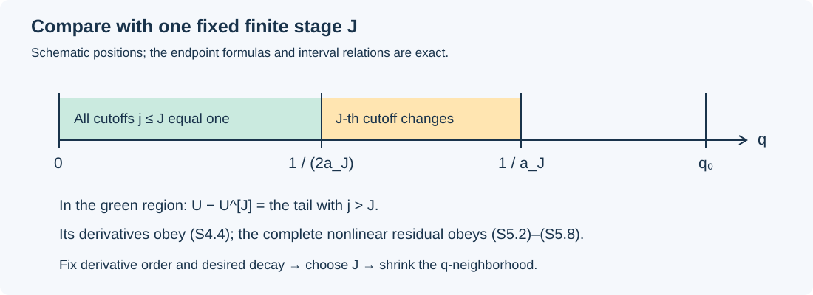

# Summing the correction fields without losing the equation

*NS-BLOWUP N6.1. Exposition by GPT-6 Astra (OpenAI). This independent exposition is dedicated to the public domain under CC0.*

The proposed blowup construction first produces a sequence of finite corrections. Each finite state has a smaller momentum residual near the terminal point. An infinite sum still needs a proof: the uncut series need not converge, cutting off velocities can destroy incompressibility, and adding infinitely many individually negligible errors can produce a nonnegligible error.

This lesson proves the summation operation needed in that argument. It retains the actual velocity, pressure, viscosity, cylindrical geometry and every term of the nonlinear residual. It also proves the derivative bounds for the original variable \(q\). These are structural calculations; no numerical approximation is used.

The source comparison is Lemma 5.4, equations (5.28)–(5.39), in the [independent transcription, pp. 57–59](https://github.com/KokunoYumeto/yang-mills-interacting-workbench/blob/e672c8021820af39df19eb0bb1fdfa5ceb990751/navier-stokes/sources/openai-source-faithful-20260920/upstream/reconstruction/sections/pp055-060.tex#L176). This is an independent transcription of OpenAI's *Finite Time Blowup for Navier–Stokes*, not author LaTeX. The proof below establishes the Navier–Stokes summation lemma. The actual correction cycle and its inputs are supplied by the [complete construction audit](../audits/theorem-audit-conclusion.md), Sections 2–3. This lesson proves the summation map; S6 identifies its exact constructed inputs.

Prerequisites are the product and chain rules, smooth functions, the Cartesian curl and divergence, and convergence of a geometric series. All arguments used below are given explicitly.

## S1. The original coordinates and their derivatives

Write \(x=(x_1,x_2,z)\), \(r=(x_1^2+x_2^2)^{1/2}\), and retain
\[
0<h<\frac1{100},\qquad A=\frac12+h,\qquad D=\frac12-h,
\qquad \tau=1-t>0.
\tag{S1.1}
\]
The original coordinates are
\[
\tau=q(1-\eta^2),\qquad z=q^D\eta,\qquad
X=\frac{r^2}{2q},\qquad q>0,\quad -1<\eta<1.
\tag{S1.2}
\]
In particular, \(q\) is independent of \(x_1,x_2\). Eliminating \(\eta\), without replacing these coordinates, gives
\[
q-z^2q^{2h}=\tau.
\tag{S1.3}
\]
For each \(z\in\mathbb R\) and \(\tau>0\), (S1.3) has exactly one positive solution. Indeed, any solution satisfies
\[
q\geq\tau,\qquad q>|z|^{1/D}.
\tag{S1.4}
\]
The second inequality follows from \(q-z^2q^{2h}>0\). On \(q\geq |z|^{1/D}\), the function on the left of (S1.3) has derivative
\[
1-2hz^2q^{2h-1}\geq1-2h>0,
\]
starts at zero when \(z\ne0\), and tends to infinity. When \(z=0\), the solution is \(q=\tau\). Continuity and strict monotonicity prove existence and uniqueness. The derivative is nonzero at every solution, so the implicit function theorem gives smoothness for \(\tau>0\).

Let
\[
L(\eta)=1-2h\eta^2\geq1-2h>0.
\tag{S1.5}
\]
Differentiating (S1.2)–(S1.3) gives all four identities
\[
q_z=\frac{2\eta q^{1-D}}{L},\qquad q_t=-\frac1L,
\qquad \eta_z=\frac{q^{-D}(1-\eta^2)}L,
\qquad \eta_t=\frac{D\eta}{qL}.
\tag{S1.6}
\]
Consequently, for every real \(\lambda\) and every smooth function \(F\) of \(\eta\),
\[
\begin{aligned}
\partial_z\{q^\lambda F(\eta)\}
 &=q^{\lambda-D}\frac{2\lambda\eta F+(1-\eta^2)F'}{L},\\
\partial_t\{q^\lambda F(\eta)\}
 &=q^{\lambda-1}\frac{-\lambda F+D\eta F'}{L}.
\end{aligned}
\tag{S1.7}
\]
Starting from \(q=q^1\cdot1\), induction using these two formulas proves
\[
\partial_z^a\partial_t^b q=q^{1-aD-b}F_{a,b}(\eta),
\qquad
|\partial_z^a\partial_t^bq|\leq C_{a,b}q^{1-aD-b}.
\tag{S1.8}
\]
Here each \(F_{a,b}\) is obtained by the displayed differentiations and is smooth on the closed interval \([-1,1]\): its denominators are powers of \(L\), which never vanishes there. Its supremum on that interval is the finite constant \(C_{a,b}\). This proves every derivative bound, including the signs in the first derivatives, directly from the original coordinates. On a compact subset of \(t<1\), (S1.4) bounds \(q\) below by a positive number.

## S2. The fields to be summed

Fix \(\nu>0\). In Cartesian coordinates define the full momentum residual
\[
\mathscr R_\nu(u,p)=\partial_tu-\nu\Delta u+(u\cdot\nabla)u+\nabla p.
\tag{S2.1}
\]
Let \(\Omega\) be an open region of \(\mathbb R^3\times\{t<1\}\) on which \(0<q<q_0\leq1\). For a tuple \(V\) of scalar or vector fields, let \(|V|_m\) be the sum of the absolute values of all its Cartesian components and all their space–time derivatives of total order at most \(m\), at the point under consideration. Thus time derivatives count in \(m\). Write \(\Lambda(q)=1+|\log q|\).

The input data for the summation operation are a smooth pair \(U_0=(u_0,p_0)\), with \(\operatorname{div}u_0=0\), and smooth tuples
\[
Z_j=(A_j,B_j,p_j),\qquad
B_j=b_j(r,z,t)e_\theta,\qquad
U_j=(\operatorname{curl}A_j+B_j,p_j),\quad j\geq1,
\tag{S2.2}
\]
where \(e_\theta=(-x_2/r,x_1/r,0)\) for \(r>0\). The complete vector fields, including \(B_j\), have smooth Cartesian extensions at the axis. Each representative has a smooth extension by zero across the lateral boundary of its spatial support. All representatives are defined on the same \(\Omega\).

The estimates to be preserved are as follows. The base has, for every \(m\), finite constants such that
\[
|U_0|_m\leq C_m^0q^{-K_m^0}\Lambda(q)^{P_m^0}.
\tag{S2.3}
\]
There are nonnegative nondecreasing numbers \(\ell_m\), independent of \(j\), and positive nondecreasing orders \(g_j\to\infty\), such that
\[
|Z_j|_m\leq C_{j,m}q^{g_j-\ell_m}\Lambda(q)^{P_{j,m}}.
\tag{S2.4}
\]
The constants and logarithmic powers may grow with \(j\). All powers of \(\Lambda\) and all \(K\)'s may be taken nonnegative by increasing them, since \(0<q\leq1\) and \(\Lambda\geq1\).

For the actual uncut finite pair
\[
U^{[J]}=(u^{[J]},p^{[J]})=U_0+\sum_{j=1}^J U_j,
\tag{S2.5}
\]
the residual estimate is
\[
|\mathscr R_\nu(U^{[J]})|_m
 \leq C^R_{J,m}q^{\rho_J-K_m^R}\Lambda(q)^{P^R_{J,m}}
       +E_{J,m},\qquad \rho_J\longrightarrow\infty,
\tag{S2.6}
\]
where \(K_m^R\) does not depend on \(J\), and, for each fixed \(J,m,N\),
\[
0\leq E_{J,m}\leq C^E_{J,m,N}q^N.
\tag{S2.7}
\]
Every estimate here is uniform on its stated domain. Equation (S2.7) means that a fixed finite-stage remainder vanishes faster than every prescribed power of \(q\). It imposes no uniform bound as \(J\to\infty\).

**Summation lemma.** These data admit a sequence \(a_{j+1}\geq2a_j>0\), with \(a_1^{-1}<q_0\), for which
\[
\begin{aligned}
u&=u_0+\sum_{j\geq1}\{
 \operatorname{curl}(\chi(a_jq)A_j)+\chi(a_jq)B_j\},\\
p&=p_0+\sum_{j\geq1}\chi(a_jq)p_j
\end{aligned}
\tag{S2.8}
\]
is smooth on \(\Omega\), is exactly divergence-free, and has residual
\[
\forall m,N\in\mathbb N_0\quad\exists\delta,C>0:
\quad |\mathscr R_\nu(u,p)|_m\leq Cq^N
\quad(0<q<\delta).
\tag{S2.9}
\]
The added terms extend smoothly by zero at \(q=q_0\). The cutoff \(\chi\) is fixed, smooth, equals one on \([0,1/2]\), and equals zero on \([1,\infty)\). Sections S3–S5 prove this statement.

## S3. Cut the potential before taking its curl

A suitable cutoff exists explicitly. Set \(\psi(s)=e^{-1/s}\) for \(s>0\) and zero for \(s\leq0\), and put
\[
\chi(s)=\frac{\psi(1-s)}{\psi(1-s)+\psi(s-1/2)}.
\tag{S3.1}
\]
The denominator is positive for every real \(s\). Every right derivative of \(\psi\) at zero is zero, because differentiation gives a polynomial in \(1/s\) times \(e^{-1/s}\), which tends to zero. Thus \(\psi\) and \(\chi\) are smooth, and \(\chi\) has the stated constant values.

For a derivative of positive order of \(\chi(aq)\), the chain rule produces a finite sum of terms
\[
c\,a^k\chi^{(k)}(aq)
 \prod_{i=1}^k\partial_z^{\alpha_i}\partial_t^{\beta_i}q,
\qquad
\sum_i\alpha_i=\alpha,\quad\sum_i\beta_i=\beta,
\quad\alpha_i+\beta_i\geq1.
\tag{S3.2}
\]
The positive integer coefficients \(c\) depend on the derivative, not on \(a\). Each such term is supported where \(1/2\leq aq\leq1\). By (S1.8), its absolute value is bounded by a constant times
\[
a^kq^{k-\alpha D-\beta}
 =(aq)^kq^{-\alpha D-\beta}
 \leq q^{-\alpha D-\beta}.
\tag{S3.3}
\]
Consequently the cutoff derivative constants are independent of its scale \(a\). Derivatives in \(x_1,x_2\) are zero. Since \(0<D<1\), a derivative of total order at most \(m\) costs at most \(q^{-m}\).

The exact velocity increment contains the term
\[
\operatorname{curl}(\chi(aq)A_j)
 =\chi(aq)\operatorname{curl}A_j
   +a\chi'(aq)\nabla q\times A_j.
\tag{S3.4}
\]
The second term is retained. Applying the product rule through order \(m+1\) to the potential, and through order \(m\) to \(B_j,p_j\), gives
\[
|W_j(a)|_m\leq\widehat C_{j,m}
 q^{g_j-\ell'_m}\Lambda(q)^{\widehat P_{j,m}},\qquad
\ell'_m=\ell_{m+1}+m+1,
\tag{S3.5}
\]
where
\[
W_j(a)=\bigl(\operatorname{curl}(\chi(aq)A_j)+\chi(aq)B_j,
                  \chi(aq)p_j\bigr).
\]
The constants in (S3.5) are independent of \(a\). For example, any term in a derivative of the cut potential is bounded by \(q^{-m-1}q^{g_j-\ell_{m+1}}\) times its finite coefficient and logarithmic factor. This also bounds the lower derivative orders because \(q\leq1\) and the losses are nondecreasing.

For completeness, the divergence assertion is exact. Cartesian mixed derivatives commute, hence \(\operatorname{div}\operatorname{curl}C=0\). For \(r>0\), the components of \(b(r,z,t)e_\theta\) are \((-bx_2/r,bx_1/r,0)\); differentiating their first two components makes both the \(b_r\) terms and the derivatives of \(1/r\) cancel. Also \(\nabla\chi(aq)\) is parallel to the \(z\) axis, so
\[
\operatorname{div}(\chi(aq)B_j)
 =\chi(aq)\operatorname{div}B_j+\nabla\chi(aq)\cdot B_j=0.
\tag{S3.6}
\]
The identity holds at the axis by the assumed smooth Cartesian extension and continuity. It therefore holds on all of \(\Omega\), without dropping a boundary or axis term.

## S4. One sequence of cutoffs works for every derivative

For \(\gamma>0\) and finite \(P\geq0\),
\[
q^\gamma(1+|\log q|)^P\longrightarrow0\quad(q\downarrow0).
\tag{S4.1}
\]
To see this, put \(y=-\log q\). The expression is \(e^{-\gamma y}(1+y)^P\). For an integer \(n>P\), the exponential series gives \(e^{\gamma y/2}\geq(\gamma y/2)^n/n!\) for \(y>0\). This bounds the expression by a constant times \(e^{-\gamma y/2}y^{P-n}\) for \(y\geq1\), which tends to zero.

Choose \(a_j\) recursively. At step \(j\), impose \(a_j\geq2a_{j-1}\), \(a_j^{-1}<q_0\), and the finite list
\[
\widehat C_{j,m}\Lambda(q)^{\widehat P_{j,m}}q^{g_j/2}
 \leq2^{-j}
\quad(0<q\leq a_j^{-1},\quad 0\leq m\leq j).
\tag{S4.2}
\]
For \(j=1\) only the latter two requirements apply. Each list can be met by (S4.1), because \(g_j>0\); increasing \(a_j\) meets all its entries at once. Define \(W_j=W_j(a_j)\). On its support, (S3.5) and (S4.2) give
\[
|W_j|_m\leq2^{-j}q^{g_j/2-\ell'_m}\qquad(m\leq j).
\tag{S4.3}
\]
Off the support the same bound holds because \(W_j=0\).

On any compact subset of \(\Omega\), there is a number \(c>0\) with \(q\geq c\). Since \(a_j\geq2^{j-1}a_1\), all sufficiently large \(j\) have \(a_jc\geq1\); their increments vanish there. Thus (S2.8) is locally a finite sum of smooth fields. It is smooth and divergence-free by S3. The complete added sum is zero when \(q\geq a_1^{-1}\), which is a neighborhood inside the outer boundary \(q=q_0\). The support and zero-extension assertions follow as well.

Fix \(m\) and \(J\geq\max(1,m)\). If \(q<(2a_J)^{-1}\), all the first \(J\) cutoffs are identically one in a neighborhood of the point. Their derivatives vanish, so their velocity increments are exactly the uncut increments. The tail is therefore
\[
U-U^{[J]}=\sum_{j>J}W_j,
\]
and, using \(q<1\), the monotonicity of \(g_j\), and the geometric series,
\[
|U-U^{[J]}|_m
 \leq\sum_{j>J}2^{-j}q^{g_j/2-\ell'_m}
 \leq2^{-J}q^{g_{J+1}/2-\ell'_m}.
\tag{S4.4}
\]
Every exponent loss here depends on the derivative order, not on the length of the finite construction.

*The intervals are schematic; their order and the factors \(1/2\) and \(2\) are exact. Formula (S4.4) compares the actual fields in the region \(q<(2a_J)^{-1}\). It does not compare the entire sum with a finite stage on the transition annuli.*

## S5. The nonlinear residual also vanishes to every order

We first bound each finite uncut state with an exponent independent of its length. From (S2.3)–(S2.5), taking one extra derivative for the curl, one obtains
\[
|U^{[J]}|_r\leq C^U_{J,r}q^{-K_r}\Lambda(q)^{P^U_{J,r}},
\qquad K_r=\max\{K_r^0,\ell_{r+1}\}.
\tag{S5.1}
\]
Indeed \(q^{g_j}\leq1\) for every increment. The finite sum changes the coefficient and the maximum logarithmic power, but never this \(K_r\). Increasing the base exponents to nonnegative numbers in S2 ensures \(K_r\geq0\).

Put \(v=u^{[J]}\), \(p_*=p^{[J]}\), \(e=u-v\), and \(\pi=p-p_*\). Direct expansion gives
\[
\begin{aligned}
\mathscr R_\nu(u,p)-\mathscr R_\nu(v,p_*)
={}&\partial_te-\nu\Delta e+\nabla\pi\\
 &+(v\cdot\nabla)e+(e\cdot\nabla)v+(e\cdot\nabla)e.
\end{aligned}
\tag{S5.2}
\]
In particular, the quadratic term in the tail has not disappeared. For a space–time multi-index \(I\), each convective component is differentiated by
\[
\partial^I(v_k\partial_ke_i)
 =\sum_{L\leq I}\binom IL(\partial^Lv_k)
                     (\partial^{I-L}\partial_ke_i),
\tag{S5.3}
\]
with the same formula for \(e_k\partial_kv_i\) and \(e_k\partial_ke_i\), for every \(1\leq i,k\leq3\). Thus a finite constant \(C_m\), depending only on \(m\) and the three spatial components, satisfies
\[
\begin{aligned}
|\mathscr R_\nu(u,p)-\mathscr R_\nu(v,p_*)|_m
\leq C_m\bigl[&(1+\nu)|e|_{m+2}+|\pi|_{m+1}\\
 &+|v|_{m+1}|e|_{m+1}+|e|_{m+1}^2\bigr].
\end{aligned}
\tag{S5.4}
\]
All terms on the right follow from (S5.2)–(S5.3); there is no unestimated pressure, viscous or nonlinear contribution.

Now fix the desired derivative order \(m\) and power \(N\geq0\). Let \(r=m+2\) and \(K=K_r\). Choose a single integer \(J\geq\max(1,r)\), large enough that
\[
\alpha:=\frac{g_{J+1}}2-\ell'_r\geq N+K+1,
\qquad \rho_J-K_m^R\geq N+1.
\tag{S5.5}
\]
Such a \(J\) exists because both sequences of decay orders tend to infinity. Keep this \(J\) fixed from now on.

Choose \(\delta<(2a_J)^{-1}\) small enough that, on \(0<q<\delta\),
\[
C^U_{J,r}\Lambda(q)^{P^U_{J,r}}\leq q^{-1},
\qquad
C^R_{J,m}\Lambda(q)^{P^R_{J,m}}\leq q^{-1}.
\tag{S5.6}
\]
These are two applications of (S4.1). Equations (S4.4), (S5.1) and (S5.6) give
\[
|(e,\pi)|_{m+2}\leq2^{-J}q^\alpha,\qquad
|v|_{m+1}\leq q^{-K-1}.
\tag{S5.7}
\]
The linear terms in (S5.4) are bounded by constants times \(q^\alpha\); the mixed terms by \(q^{\alpha-K-1}\); and the quadratic tail term by \(q^{2\alpha}\). By (S5.5), every exponent is at least \(N\). The finite-stage residual, including its full remainder, satisfies
\[
|\mathscr R_\nu(U^{[J]})|_m
 \leq q^{\rho_J-K_m^R-1}+C^E_{J,m,N}q^N
 \leq (1+C^E_{J,m,N})q^N.
\tag{S5.8}
\]
Combining (S5.4), (S5.7) and (S5.8) proves (S2.9). The order of choices is \((m,N)\), then one finite \(J\), then \(\delta\) and the final constant. No sum over the remainders \(E_{J,m}\) has been taken. This completes the proof of the summation lemma.

## S6. Its exact place in the theorem audit

In the source's final correction sequence, the inputs proved in K0–K8 and L0–L7 of the construction audit are
\[
g_j=\frac{hj}{10},\qquad
\sigma_j=\frac15+\frac j{10},\qquad
\rho_j=h\sigma_j,\qquad
\ell_m=2A+(m+1)\left(1+\frac{3h}{2}\right).
\tag{S6.1}
\]
The field representatives are \(A_j=A_j^w+\Psi_je_\theta\), \(B_j=b_je_\theta\), and \(p_j=p^{[j]}-p^{[j-1]}\). These are the actual potentials and pressure increments in equations (9.15)–(9.18), not a new replacement field. The source initially uses \(\mathscr R_1\); the argument of this lesson retains any fixed \(\nu>0\).

For these exponents, the finite choice in (S5.5) is met by any integer \(J\) satisfying all three explicit inequalities
\[
\begin{aligned}
J&\geq m+2,\\
J&\geq\frac{20}{h}\bigl(N+K_{m+2}+1+\ell'_{m+2}\bigr)-1,\\
J&\geq\frac{10}{h}\bigl(N+1+K_m^R\bigr)-2,
\qquad
\ell'_{m+2}=2A+(m+4)\left(1+\frac{3h}{2}\right)+m+3.
\end{aligned}
\tag{S6.2}
\]
This is an existence argument for every prescribed finite derivative order. It needs no numerical approximation of the fields and no estimate of a limiting decimal constant. It does require that the finite-stage construction and the derivative losses have already been proved as stated.

The summation implication is proved completely in S1–S5. The [finite correction cycle, K0–K8](../audits/correction-cycle-audit.md), supplies the actual states and one common domain; the [physical realization proof, L0–L7](../audits/physical-realization-audit.md), supplies the stage-independent losses and exact potential representatives. The [local-field assembly, I0–I7](../audits/local-construction-assembly-audit.md), applies this summation map to those actual fields, retaining the positive inner profile and exact heat exterior. The [final argument, F0–F8](../audits/terminal-force-and-blowup-audit.md), proves every terminal force derivative, compact extension, energy bound and comparison statement. These supplying proofs use the original profiles, supports, pressure and viscosity. The [opening lesson](the-forced-blowup-theorem-and-its-geometry.md) presents the theorem and its geometry.

## S7. Exercises with complete solutions

**Exercise 1. Why not cut off the velocity directly?** Compute the divergence of \(\chi(aq)u\) for a divergence-free field \(u\). Give a field for which the result is nonzero.

**Solution.** The product rule gives
\[
\operatorname{div}(\chi(aq)u)=a\chi'(aq)q_z u_3.
\]
For the constant divergence-free field \(u=(0,0,1)\), this is nonzero at a point with \(z\ne0\) and \(aq\) in the interior of the transition interval where \(\chi'\ne0\). Such points exist: choose \(0<|\eta|<1\), choose \(q\) in that interval divided by \(a\), and set \(z=q^D\eta\), \(t=1-q(1-\eta^2)\). Formula (S1.6) makes \(q_z\ne0\). Cutting the potential as in (S3.4) supplies exactly the additional velocity needed for zero divergence.

**Exercise 2. Check the axial coordinate derivative.** Derive \(\eta_z\) without suppressing either term from differentiating \(\eta=zq^{-D}\).

**Solution.** Both terms are
\[
\eta_z=q^{-D}-Dzq^{-D-1}q_z
 =q^{-D}\left(1-\frac{2D\eta^2}{L}\right)
 =q^{-D}\frac{1-(2h+2D)\eta^2}{L}
 =q^{-D}\frac{1-\eta^2}{L},
\]
because \(2h+2D=1\). The original \(D=1/2-h\) and the factor \(2h\) in \(L\) both contribute.

**Exercise 3. Why are logarithmic powers harmless after fixing a stage?** Prove that any finite \(C,P\geq0\) admit \(\delta>0\) with \(C\Lambda(q)^P\leq q^{-1}\) for \(0<q<\delta\). Explain why this does not give a single \(\delta\) for arbitrary stage-dependent constants.

**Solution.** Apply (S4.1) with \(\gamma=1\): \(Cq\Lambda(q)^P\to0\), so it is at most one on some such interval. There is no uniform statement for an unrestricted family of \(C\)'s. For example, with \(P=0\) and \(C_j=2^j\), any fixed \(q>0\) violates \(C_j\leq q^{-1}\) for all sufficiently large \(j\). The proof first fixes \(J\) and only then chooses \(\delta\).

**Exercise 4. Individually flat errors need not have a flat sum.** Construct a smooth, locally finite sum on \(q>0\) whose individual terms vanish near zero but whose sum does not tend to zero there.

**Solution.** Define
\[
\phi(s)=
\begin{cases}
\exp\!\left(16-\dfrac1{(s-1/2)(1-s)}\right),&1/2<s<1,\\
0,&\text{otherwise}.
\end{cases}
\]
It is smooth with all derivatives zero at both endpoints, by the same exponential estimate used for \(\psi\). Also \(\phi(3/4)=1\). Set \(E_j(q)=\phi(2^jq)\), \(j\geq1\). Each term is identically zero for \(0<q\leq2^{-j-1}\), hence vanishes to every order at zero. The support intervals \((2^{-j-1},2^{-j})\) are disjoint. The sum is locally finite and smooth for \(q>0\), but equals one at \(q_j=3\cdot2^{-j}/4\to0\). It does not tend to zero. This is why (S5.8) uses one fixed finite-stage remainder instead of summing all of them.

**Exercise 5. Smoothness away from the terminal set.** Let a compact set have \(q\geq c>0\). Give a finite cutoff index after which every summand and all its derivatives vanish on that set.

**Solution.** Choose an integer \(J_c\geq0\) with \(2^{J_c}a_1c\geq1\). For \(j\geq J_c+1\),
\[
a_jq\geq2^{j-1}a_1c\geq1.
\]
Thus \(\chi(a_jq)=0\); all its derivatives at and above one are zero as well. Every term in the product and curl formulas vanishes. There are at most \(J_c\) remaining terms. This proves local smoothness without assuming that the uncut series converges.

## Sources and proof locators

The exact source edition is the independent transcription frozen at workbench commit `e672c8021820af39df19eb0bb1fdfa5ceb990751`. The source paper is attributed to OpenAI. No original author TeX availability is asserted. This lesson uses the following parts; reading them does not certify the entire paper.

- [Original coordinates, pp. 7–12](https://github.com/KokunoYumeto/yang-mills-interacting-workbench/blob/e672c8021820af39df19eb0bb1fdfa5ceb990751/navier-stokes/sources/openai-source-faithful-20260920/upstream/reconstruction/sections/pp007-012.tex): the coordinates in S1 and their exact derivative calculation.
- [Lemma 5.4 and equations (5.28)–(5.39), lines 176–442](https://github.com/KokunoYumeto/yang-mills-interacting-workbench/blob/e672c8021820af39df19eb0bb1fdfa5ceb990751/navier-stokes/sources/openai-source-faithful-20260920/upstream/reconstruction/sections/pp055-060.tex#L176): the summation operation independently proved in S2–S5.
- [Proposition 9.6, statement and first step](https://github.com/KokunoYumeto/yang-mills-interacting-workbench/blob/e672c8021820af39df19eb0bb1fdfa5ceb990751/navier-stokes/sources/openai-source-faithful-20260920/upstream/reconstruction/sections/pp103-108.tex#L405), and [its remaining steps, Lemmas 9.7–9.8, equations (9.15)–(9.18), and the start of Proposition 9.9](https://github.com/KokunoYumeto/yang-mills-interacting-workbench/blob/e672c8021820af39df19eb0bb1fdfa5ceb990751/navier-stokes/sources/openai-source-faithful-20260920/upstream/reconstruction/sections/pp109-114.tex): the original finite construction whose full proofs and receiving maps are linked in S6.
- [Proposition 9.9 and the final localization argument](https://github.com/KokunoYumeto/yang-mills-interacting-workbench/blob/e672c8021820af39df19eb0bb1fdfa5ceb990751/navier-stokes/sources/openai-source-faithful-20260920/upstream/reconstruction/sections/pp115-120.tex): where summation is used to obtain the local field before constructing the final force.

This is a complete proof of the stated summation lemma and coordinate calculation, with five solved exercises. Its actual inputs are supplied by the complete constructions linked in S6. No novelty claim is made.
