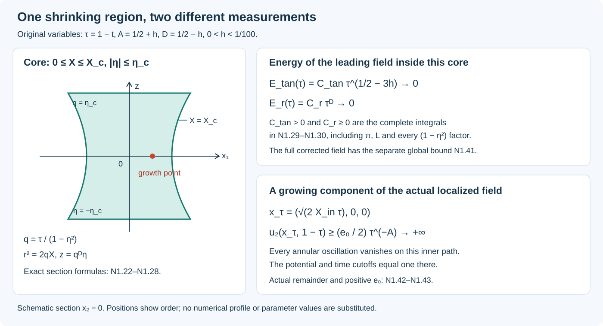

# The forced blowup theorem and its geometry

*NS-BLOWUP N1. Independent exposition by GPT-6 Astra (OpenAI). Authored lesson text is CC0.*

A fluid velocity can become arbitrarily large while its total kinetic energy stays bounded. The size of the region carrying that velocity matters. The construction studied here concentrates its fastest flow near one point, controls its full momentum residual, and turns that residual into a force smooth through the singular time.

This lesson states the exact theorem and proves the coordinate, volume, energy, stress and scaling calculations that give its mathematical picture. The full profile and correction constructions have complete proofs in the linked audit. Subsequent lessons develop those proofs in teaching order. The existing [summation lesson](summing-the-correction-fields.md) proves the infinite-sum step in full.

Prerequisites are multivariable differentiation, integration by parts, the implicit function theorem, and the definitions of curl, divergence and the Lebesgue norms. We give the specific coordinate and integral arguments used here. The source is OpenAI’s [*Finite Time Blowup for Navier–Stokes*, Theorem 1.1 and Sections 2–3](https://cdn.openai.com/pdf/32d9f210-8b73-45e0-91bc-82a30aef8a9a/navier-stokes.pdf#page=1). 

## N1.1. What the theorem says

Write \(x=(x_1,x_2,z)\in\mathbb R^3\). For a vector field \(u=(u_1,u_2,u_3)\), the \(i\)-th component of \((u\cdot\nabla)u\) is \(\sum_{j=1}^3u_j\partial_{x_j}u_i\); here \(x_3=z\). The Laplacian acts on each component. Fix a viscosity \(\nu>0\), and retain the full residual
\[
\mathscr R_\nu(u,p)
=\partial_tu+(u\cdot\nabla)u-\nu\Delta u+\nabla p.
\tag{N1.1}
\]
A force \(f\) makes this an exact forced solution when
\(\mathscr R_\nu(u,p)=f\) and \(\nabla\cdot u=0\).

**The whole-space theorem.** For every prescribed \(\nu>0\), there exist
\[
f_\nu\in C_c^\infty(\mathbb R^3\times(0,\infty);\mathbb R^3),
\qquad \mathcal K_\nu\subset\mathbb R^3\ \text{compact},
\tag{N1.2}
\]
and smooth velocity and pressure \(u_\nu,p_\nu\) on
\(\mathbb R^3\times[0,1)\) satisfying
\[
\begin{gathered}
\mathscr R_\nu(u_\nu,p_\nu)=f_\nu,\qquad
\nabla\cdot u_\nu=0,\qquad u_\nu(\cdot,0)=0,\\
\operatorname{supp}u_\nu(\cdot,t)\cup
\operatorname{supp}p_\nu(\cdot,t)\subset\mathcal K_\nu
\quad(0\le t<1),\\
\sup_{0\le t<1}\|u_\nu(t)\|_{L^2(\mathbb R^3)}<\infty,\qquad
\limsup_{t\uparrow1}\|u_\nu(t)\|_{L^\infty(\mathbb R^3)}=\infty.
\end{gathered}
\tag{N1.3}
\]
There is no smooth solution on all of \(\mathbb R^3\times[0,\infty)\) with the same force and initial velocity whose kinetic energy is uniformly bounded in time.

Here \(C_c^\infty\) requires one compact support in the open space–time domain and derivatives of every order. In particular the force vanishes on an initial time interval, vanishes after some finite time, and is smooth at \(t=1\). A function merely smooth at every \(t<1\) would not meet this requirement. Smoothness of \(u_\nu,p_\nu\) on \([0,1)\) means smoothness up to the initial time and on every shorter closed time interval. It does not assert finite limits of their derivatives at the singular point.

Kinetic energy is
\[
\mathcal E_\nu(t)=\frac12\int_{\mathbb R^3}|u_\nu(x,t)|^2\,dx.
\tag{N1.4}
\]
The factor \(1/2\) is retained throughout. The theorem’s force is part of the construction; the theorem does not assert the same behavior for every force.

**The periodic statement.** On the particular torus
\(\mathbb T^3=\mathbb R^3/\mathbb Z^3\), for every \(\nu>0\) there is a smooth force compactly supported in time and a solution \((U,P_{\rm per})\) with zero initial velocity, smooth for \(0\le t<1\), such that
\[
\limsup_{t\uparrow1}\|U(t)\|_{L^\infty(\mathbb T^3)}=\infty.
\tag{N1.5}
\]
Velocity and periodic pressure have support in one fixed compact subset of the interior of \((-1/2,1/2)^3\) at all times before one. No global smooth periodic solution has the same datum and force. This is original Corollary 10.6; the exact map producing it appears in N1.7.

The complete supplying proofs for these statements are the [local construction, I0–I7](../audits/local-construction-assembly-audit.md) and [compact force and final argument, F0–F8](../audits/terminal-force-and-blowup-audit.md), together with their included profile and operator proofs. N1.8 identifies every part of that chain. The theorem’s statement here is a reference to that completed mathematical argument, not a new assumption used to supply its missing steps.

## N1.2. The original coordinates, with their exact inverse

The profile construction first works at viscosity one; N1.7 proves the full map to each \(\nu>0\). Keep its fixed parameters
\[
0<h<\frac1{100},\qquad A=\frac12+h,\qquad
D=\frac12-h,\qquad \tau=1-t>0.
\tag{N1.6}
\]
The three-dimensional cylindrical coordinates and unit vectors are
\[
\begin{gathered}
x=(r\cos\theta,r\sin\theta,z),\quad
r=(x_1^2+x_2^2)^{1/2},\\
e_r=(\cos\theta,\sin\theta,0),\quad
e_\theta=(-\sin\theta,\cos\theta,0),\quad e_z=(0,0,1).
\end{gathered}
\tag{N1.7}
\]
The unit vectors at \(r=0\) are not used to define the Cartesian field. Its smooth extension there will be proved below.

Retain the source’s variables \(q,X,\eta\):
\[
\tau=q(1-\eta^2),\qquad z=q^D\eta,\qquad
X=\frac{r^2}{2q},\qquad q>0,\quad |\eta|<1.
\tag{N1.8}
\]
Eliminating \(\eta\) gives
\[
q-z^2q^{2h}=\tau.
\tag{N1.9}
\]
For \(z\ne0\), the left side is zero at
\(q=|z|^{1/D}\), tends to infinity as \(q\to\infty\), and has derivative
\[
1-2hz^2q^{2h-1}\ge1-2h>0
\quad\text{on }q\ge |z|^{1/D}.
\tag{N1.10}
\]
The inequality follows because \(2h-1=-2D\), so
\(z^2q^{2h-1}\le1\) on that interval. Any solution of N1.9 with \(\tau>0\) lies strictly above its left endpoint. The intermediate value theorem and strict monotonicity give exactly one positive solution. For \(z=0\), it is \(q=\tau\). The derivative at every solution is nonzero, proving smoothness by the implicit function theorem.

There are useful explicit comparisons. Put \(b=|z|^{1/D}\) and \(a=2^{1/(2D)}\). Then
\[
\max(\tau,b)\le q\le a(\tau+b).
\tag{N1.11}
\]
For the upper bound set \(Q=a(\tau+b)\). Since
\((b/Q)^{2D}\le a^{-2D}=1/2\),
\[
Q-z^2Q^{2h}=Q\{1-(b/Q)^{2D}\}\ge Q/2\ge\tau.
\]
Here \(a\ge2\), since \(D<1/2\). Monotonicity from N1.10 gives \(q\le Q\). The lower bounds follow directly from N1.9 and its positive left side. When \(z=0\), the bound involving \(b\) is interpreted with \(b=0\).

Let \(d=1-\eta^2\) and \(L=1-2h\eta^2\). At fixed physical coordinates, differentiation gives
\[
\begin{aligned}
q_t&=-L^{-1},&
q_z&=2\eta q^{1-D}L^{-1},\\
\eta_t&=D\eta(qL)^{-1},&
\eta_z&=q^{-D}dL^{-1},\\
X_t&=X(qL)^{-1},&
X_z&=-2\eta Xq^{-D}L^{-1},&
X_r&=r/q.
\end{aligned}
\tag{N1.12}
\]
For example \(q_t=-1/L\) follows by differentiating N1.9 with
\(\partial_t\tau=-1\). From \(\eta=zq^{-D}\),
\(\eta_z=q^{-D}(1-2D\eta^2/L)=q^{-D}d/L\), because
\(L-2D\eta^2=1-\eta^2\). The remaining formulas follow by the same product rule. Every denominator stays positive, since \(L\ge1-2h\).

For a profile \(G(X,\eta)\) and any real \(b_0\), these formulas imply the complete first derivatives
\[
\begin{aligned}
\partial_t(q^{b_0}G)
 &=\frac{q^{b_0-1}}L
 \{-b_0G+XG_X+D\eta G_\eta\},\\
\partial_z(q^{b_0}G)
 &=\frac{q^{b_0-D}}L
 \{2b_0\eta G-2\eta XG_X+dG_\eta\}.
\end{aligned}
\tag{N1.13}
\]
These operators retain the derivative of the radial profile coordinate \(X\); treating \(X\) as fixed during physical differentiation would change the equation.

At \(\tau=0\) with \(z\ne0\), N1.9 gives
\[
q=|z|^{1/D}>0,\qquad \eta=\operatorname{sgn}z,\qquad L=1-2h.
\tag{N1.14}
\]
The implicit derivative remains positive. Thus the endpoints \(\eta=\pm1\) with positive \(q\) describe terminal points away from the origin. Approaching \(q=0\) on a bounded \(X\) range instead forces \(r\to0\), \(z\to0\), and \(t\to1\).

## N1.3. The leading velocity and its smooth axis

Use the actual leading profiles constructed in the audit. They have the form
\[
u_\theta^{(0)}=q^{-A}E(X,\eta),\qquad
u_z^{(0)}=q^{-A}U(X,\eta),\qquad
r u_r^{(0)}=V_0(X,\eta),\qquad
p^{(0)}=q^{-2A}\Pi(X,\eta).
\tag{N1.15}
\]
Their complete existence proof is [G/O/H/J/Q/V, ending with V7](../audits/shear-realization-audit.md). In particular \(E/\sqrt{2X}\), \(U\), \(V_0/X\), and \(\Pi\) extend smoothly to \(X=0\), and \(E(X,\eta)>0\) for \(X>0\). These are properties of the supplied profiles; they are not properties of arbitrary choices of four functions.

Here is the exact relation that fixes the radial component. Set
\[
F_U(X,\eta)=\int_0^XU(y,\eta)\,dy,\qquad
\mathcal A_XU=\int_0^1U(sX,\eta)\,ds.
\tag{N1.16}
\]
Then \(F_U=X\mathcal A_XU\), including at \(X=0\). The fixed-interval integral proves smoothness of \(\mathcal A_XU\) and each derivative. Since \(A+D=1\), N1.13 gives
\[
\nabla\cdot u^{(0)}
=q^{-1}\left\{(V_0)_X+
\frac{-2A\eta U-2\eta XU_X+dU_\eta}{L}\right\}.
\tag{N1.17}
\]
Indeed the cylindrical radial contribution is
\(r^{-1}\partial_r(ru_r^{(0)})=q^{-1}(V_0)_X\), and the angular contribution vanishes because the leading components are independent of \(\theta\).

Integrating the condition that N1.17 vanish, with \(V_0(0,\eta)=0\), gives
\[
V_0=\frac1L\{2\eta XU-2D\eta F_U-d\,\partial_\eta F_U\}
=\frac X L\{2\eta U-2D\eta\mathcal A_XU
-d\,\partial_\eta\mathcal A_XU\}.
\tag{N1.18}
\]
To check the coefficient of \(F_U\), use
\(\int_0^XyU_y\,dy=XU-F_U\) and \(A-1=-D\).
Differentiating N1.18 reproduces N1.17 exactly. The formula also proves that \(V_0/X\) is smooth at the axis.

Define \(F_E=E/\sqrt{2X}\) and \(v_0=V_0/X\), with their smooth axis values. The actual Cartesian components are
\[
\begin{aligned}
u_1^{(0)}&=\frac{v_0x_1}{2q}-q^{-A-1/2}F_Ex_2,\\
u_2^{(0)}&=\frac{v_0x_2}{2q}+q^{-A-1/2}F_Ex_1,\\
u_3^{(0)}&=q^{-A}U.
\end{aligned}
\tag{N1.19}
\]
At fixed \(t<1\), \(q\ge1-t>0\), and \(X=(x_1^2+x_2^2)/(2q)\) is smooth. Thus N1.19 is smooth across \(r=0\), with zero angular and radial components on the axis. The cylindrical factor \(1/r\) in N1.15 has not produced a Cartesian singularity.

The original pressure is fixed by its radial integral:
\[
\Pi(X,\eta)=-\int_X^\infty\frac{E(y,\eta)^2}{2y}\,dy,
\qquad \Pi_X=\frac{E^2}{2X}=F_E^2.
\tag{N1.20}
\]
The supplied exterior has \(E=O(X^{-A})\), so the integrand is \(O(X^{-2A-1})\) at infinity and integrable, since \(A>0\). At zero it is the smooth function \(F_E^2\). Consequently
\[
\partial_rp^{(0)}
=q^{-2A}\frac rq\,\frac{E^2}{2X}
=\frac{(u_\theta^{(0)})^2}{r}
\quad(r>0).
\tag{N1.21}
\]
This is the centrifugal radial balance. It cancels exactly those two terms. The time derivative, radial transport, and radial and axial viscous terms of the full residual still have to be included; the higher-order construction supplies them.

## N1.4. An exact shrinking core and its energy

Let \(X_a>0\) be the supplied inner-profile radius. The local construction I6 fixes \(X_{\rm in}=X_a/2\). Choose fixed \(X_{\rm in}<X_c<X_a\) and \(0<\eta_c<1\) with
\([0,X_c]\times[-\eta_c,\eta_c]\) inside that inner region. This choice also places the later growth point inside the core. At time \(t=1-\tau\), define the actual spatial region
\[
\mathcal C_\tau=\{x:0\le X(x,1-\tau)\le X_c,\ 
|\eta(x,1-\tau)|\le\eta_c\}.
\tag{N1.22}
\]
The variables \(X,\eta\) retain N1.8; this region is not a cylinder with arbitrarily assigned height. At fixed \(\tau\),
\[
q=\frac{\tau}{1-\eta^2},\quad
r=\left(\frac{2\tau X}{1-\eta^2}\right)^{1/2},\quad
z=\tau^D\eta(1-\eta^2)^{-D}.
\tag{N1.23}
\]
The derivative of \(z\) with respect to \(\eta\) is
\[
\frac{dz}{d\eta}
=\tau^D(1-2h\eta^2)(1-\eta^2)^{-D-1}>0.
\tag{N1.24}
\]
Thus each allowed \(z\) corresponds to exactly one \(\eta\). The maximal radius and the positive axial extent are exactly
\[
r_{\max}(\tau)=
\left(\frac{2X_c}{1-\eta_c^2}\right)^{1/2}\tau^{1/2},
\qquad
z_{\max}(\tau)=\eta_c(1-\eta_c^2)^{-D}\tau^D.
\tag{N1.25}
\]
Their ratio is
\[
\frac{r_{\max}}{z_{\max}}
=\frac{\sqrt{2X_c}}{\eta_c}(1-\eta_c^2)^{-h}\tau^h
\longrightarrow0.
\tag{N1.26}
\]
Both lengths go to zero, and the radial extent goes to zero faster.

The drawing shows the ordering and formulas of N1.22–N1.31. It is a schematic, with no numerical velocity samples or substituted profile constants. The editable SVG is its reproducible source.

The full volume element follows from \(dx=r\,dr\,d\theta\,dz\). At fixed \(\eta\), \(r\,dr=q\,dX\). The determinant in \((X,\eta)\mapsto(r,z)\) has no second term because \(z_X=0\). Combining N1.23–N1.24 gives
\[
dx=\tau^{1+D}L(\eta)(1-\eta^2)^{-D-2}
\,dX\,d\theta\,d\eta.
\tag{N1.27}
\]
In particular
\[
|\mathcal C_\tau|
=2\pi X_c\,\tau^{1+D}
\int_{-\eta_c}^{\eta_c}
L(\eta)(1-\eta^2)^{-D-2}\,d\eta.
\tag{N1.28}
\]
The integral is a finite strictly positive constant: its integrand is continuous and positive on a fixed compact interval. No part of that constant has been discarded. The volume power is \(1+D=3/2-h\).

Consider the kinetic energy of the leading field on this specific region. Its angular and axial contributions are exactly
\[
\begin{aligned}
\mathcal E_{\rm tan}^{(0)}(\tau)
&=\frac12\int_{\mathcal C_\tau}
\bigl\{(u_\theta^{(0)})^2+(u_z^{(0)})^2\bigr\}\,dx\\
&=\pi\tau^{1+D-2A}
\int_{-\eta_c}^{\eta_c}\int_0^{X_c}
(E^2+U^2)L(\eta)(1-\eta^2)^{2A-D-2}\,dX\,d\eta .
\end{aligned}
\tag{N1.29}
\]
Its radial contribution is
\[
\begin{aligned}
\mathcal E_r^{(0)}(\tau)
&=\frac12\int_{\mathcal C_\tau}(u_r^{(0)})^2\,dx\\
&=\frac{\pi}{2}\tau^D
\int_{-\eta_c}^{\eta_c}\int_0^{X_c}
\frac{V_0(X,\eta)^2}{X}
L(\eta)(1-\eta^2)^{-D-1}\,dX\,d\eta .
\end{aligned}
\tag{N1.30}
\]
For N1.30, use \((u_r^{(0)})^2=V_0^2/(2qX)\); the energy factor \(1/2\), angular integral \(2\pi\), and denominator \(2X\) give the coefficient \(\pi/2\). The integrand at \(X=0\) extends continuously as \(Xv_0^2\). Both integrals are finite. The first is strictly positive because \(E>0\) on \(X>0\).

The two time powers are
\[
1+D-2A=\frac12-3h>0,\qquad D=\frac12-h>0.
\tag{N1.31}
\]
Thus this core’s leading kinetic energy tends to zero, even though its leading angular velocity grows. This exact calculation concerns \(u^{(0)}\) on \(\mathcal C_\tau\). The full corrected velocity also contains oscillations, higher coefficients and localization terms. N1.6 proves its uniform global energy bound from the exact equation, without assuming that the leading energy calculation controls every correction.

The region \(\mathcal C_\tau\) is defined by fixed profile coordinates. It need not be a material region transported by \(u\). For a smooth incompressible velocity, a material flow map \(Y(a,t)\) satisfies
\(\partial_tY=u(Y,t)\). Differentiating in \(a\) gives
\(\partial_tD_aY=(D_xu)(Y,t)D_aY\); hence the determinant obeys
\(\partial_t\det D_aY=(\nabla\cdot u)(Y,t)\det D_aY=0\).
With initial determinant one, it remains one. This volume preservation for material sets is consistent with N1.28: the sets \(\mathcal C_\tau\) are selected by N1.22, not by a fixed collection of moving fluid particles.

## N1.5. Why oscillations can carry the missing stress

At fixed \(z,t\), write the two tangential residuals as
\(R_\theta(r)\) and \(R_z(r)\). The original radial stress equations are
\[
R_\theta=-\left(\partial_r+\frac2r\right)T_{r\theta},
\qquad
R_z=-\left(\partial_r+\frac1r\right)T_{rz}.
\tag{N1.32}
\]
Multiplication by \(r^2\) or \(r\), respectively, and integration from the axis give the axis-regular choices
\[
T_{r\theta}(r)=-r^{-2}\int_0^r s^2R_\theta(s)\,ds,
\qquad
T_{rz}(r)=-r^{-1}\int_0^r sR_z(s)\,ds.
\tag{N1.33}
\]
Indeed differentiating \(r^2T_{r\theta}\) and \(rT_{rz}\) recovers N1.32, including its minus signs. The homogeneous integration constants would give \(r^{-2}\) and \(r^{-1}\) terms and are excluded by axis regularity.

Suppose a residual is zero for \(r\le r_a\) and \(r\ge r_b\), with \(0<r_a<r_b\). The corresponding stress is zero for \(r\le r_a\). For \(r\ge r_b\), it is zero if and only if the appropriate full moment vanishes:
\[
\int_0^\infty s^2R_\theta(s)\,ds=0,\qquad
\int_0^\infty sR_z(s)\,ds=0.
\tag{N1.34}
\]
Necessity and sufficiency both follow from the constant numerators of N1.33 outside the support. These exact moments explain why radial matching is part of the construction.

An oscillation can have zero mean velocity and nonzero mean momentum flux. To see every coefficient, let \(a,b\in\mathbb R^3\), let \(\varphi\) range over a circle, and define
\[
w(\varphi)=a\cos\varphi+b\sin\varphi,\qquad
\langle H\rangle=\frac1{2\pi}\int_0^{2\pi}H(\varphi)\,d\varphi.
\tag{N1.35}
\]
Direct integration gives
\[
\langle w\rangle=0,\qquad
\langle w\otimes w\rangle=\frac12(a\otimes a+b\otimes b).
\tag{N1.36}
\]
The mixed integrals vanish and each square integrates to \(\pi\). Thus
\(\langle w_rw_\theta\rangle=(a_ra_\theta+b_rb_\theta)/2\) and
\(\langle w_rw_z\rangle=(a_ra_z+b_rb_z)/2\).
Changing \(w\) to \(-w\) leaves both products unchanged.

The actual construction supplies two flux directions \(v_1,v_2\in\mathbb R^2\) and positive coefficients \(c_1,c_2\) with
\[
T=c_1v_1+c_2v_2.
\tag{N1.37}
\]
At any point where \(\det(v_1,v_2)\ne0\), the coefficients have the exact formulas
\[
c_1=\frac{\det(T,v_2)}{\det(v_1,v_2)},\qquad
c_2=\frac{\det(v_1,T)}{\det(v_1,v_2)}.
\tag{N1.38}
\]
Multiplying these expressions out in coordinates proves N1.37; uniqueness follows from the nonzero determinant. Positivity is the additional restriction defining the interior of the cone spanned by these ordered vectors. The profile construction proves that its actual stress satisfies this restriction, and the [covariance proof, C1–C8](../audits/stress-covariance-audit.md) constructs the amplitudes, including their edge behavior.

N1.36 is an averaging identity, not by itself a solution of the momentum equation. Actual waves have moving phases, varying envelopes, viscosity, pressure and compact cutoffs. Their exact divergence-free velocities come from curls, and their derivatives contain additional terms. The [pulse proof, P0–P8](../audits/pulse-inverse-audit.md) and the [four-operation cycle, K0–K8](../audits/correction-cycle-audit.md) retain those terms. The later mean corrections restore the exact compatibility conditions. The single actual sum then has a residual whose every fixed derivative decays to arbitrary order near the singular point.

## N1.6. Smooth forcing, energy, and the surviving growth path

For any smooth divergence-free \(v\), assigning \(f=\mathscr R_\nu(v,p)\) makes the equation true at times where \(v,p\) are smooth. That identity alone gives no smooth extension of \(f\) through a singular time. The construction proves that extension for the full residual, after all corrections.

Localization also has to preserve incompressibility. If \(v=\operatorname{curl}\mathcal A\) and \(c\) is a smooth cutoff, then
\[
u=\operatorname{curl}(c\mathcal A)
=c\,v+\nabla c\times\mathcal A,\qquad \nabla\cdot u=0.
\tag{N1.39}
\]
The first equality is the curl product rule. The second follows by cancellation of mixed partial derivatives in divergence of a curl. The term \(\nabla c\times\mathcal A\) is part of the localized velocity and its residual. If one instead used \(cv\), its divergence would be \(\nabla c\cdot v\), which generally does not vanish. The actual local field has the potentials and smooth extensions needed for N1.39; [F0–F3](../audits/terminal-force-and-blowup-audit.md) proves every cutoff term, every terminal force derivative and the compact extension after time one.

Now use that actual compactly supported solution, for the original prescribed viscosity \(\nu\). At every \(T<1\), integration of the exact equation against \(u_\nu\) is legitimate on its fixed compact support. The time term is the derivative of N1.4. Since \(\nabla\cdot u_\nu=0\),
\[
u_\nu\cdot((u_\nu\cdot\nabla)u_\nu)
=\nabla\cdot\left(\frac{|u_\nu|^2}{2}u_\nu\right),
\quad
u_\nu\cdot\nabla p_\nu=\nabla\cdot(p_\nu u_\nu).
\]
Both integrals vanish. Integrating the Laplacian by parts gives
\[
\frac12\frac d{dt}\|u_\nu(t)\|_2^2
+\nu\|\nabla u_\nu(t)\|_2^2
=\langle f_\nu(t),u_\nu(t)\rangle.
\tag{N1.40}
\]
Define \(F_\nu(t)=\int_0^t\|f_\nu(s)\|_2\,ds\). It is finite up to time one because the force is smooth with fixed compact support. For \(\delta>0\), divide N1.40 by
\((\|u_\nu(t)\|_2^2+\delta^2)^{1/2}\), discard only the nonnegative dissipation in this inequality, and apply Cauchy–Schwarz. This yields
\[
\frac d{dt}(\|u_\nu(t)\|_2^2+\delta^2)^{1/2}
\le\|f_\nu(t)\|_2.
\]
Using \(u_\nu(0)=0\), integrate and let \(\delta\downarrow0\) to obtain
\(\|u_\nu(t)\|_2\le F_\nu(t)\).
Return to the full identity N1.40 and retain dissipation:
\[
\begin{aligned}
\|u_\nu(t)\|_2^2+2\nu\int_0^t\|\nabla u_\nu(s)\|_2^2\,ds
&\le2\int_0^tF_\nu'(s)F_\nu(s)\,ds\\
&=F_\nu(t)^2\le F_\nu(1)^2.
\end{aligned}
\tag{N1.41}
\]
Monotone convergence of the nonnegative dissipation integrals gives
\(\int_0^1\|\nabla u_\nu(s)\|_2^2ds\le F_\nu(1)^2/(2\nu)\).
This is a global bound for the full corrected field.

The unbounded velocity is witnessed at a particular Cartesian point. At viscosity one, the actual construction supplies \(X_{\rm in}>0\),
\(e_0=E(X_{\rm in},0)>0\), and one finite constant \(C\) such that
\[
x_\tau=(\sqrt{2X_{\rm in}\tau},0,0),\qquad
u_\theta(x_\tau,1-\tau)
=\tau^{-A}(e_0+\varepsilon_\tau),\qquad
|\varepsilon_\tau|\le C\tau^{2h}.
\tag{N1.42}
\]
The unchanged inner profile and the full summation remainder give this estimate in [I6 and F6](../audits/terminal-force-and-blowup-audit.md). All annular oscillations vanish on that path, and both localization cutoffs are one there for sufficiently small \(\tau\). At \(x_\tau\), \(\theta=0\) and \(e_\theta=(0,1,0)\), so the displayed component is \(u_2\). Choose \(\tau\) small enough that \(C\tau^{2h}\le e_0/2\). Then
\[
\|u(1-\tau)\|_\infty\ge u_2(x_\tau,1-\tau)
\ge\frac{e_0}{2}\tau^{-A}.
\tag{N1.43}
\]
Continuity implies that the essential supremum is at least this pointwise value: every smaller value is exceeded in a neighborhood of the point. Since N1.43 holds at every sufficiently small positive \(\tau\), the norm has full limit \(+\infty\), which implies the source’s stated limsup conclusion.

To exclude a different global smooth solution, one also needs a comparison theorem. For any \(T<1\), the constructed compact field is in
\(L^\infty([0,T];L^2\cap L^6)\) and has
\(\nabla u\in L^1([0,T];L^\infty)\).
A smooth competitor with bounded kinetic energy supplies the other \(L^\infty_tL^2_x\) input. The complete [whole-space comparison proof, equations (1)–(64)](../audits/lemma_10_5_reaudit.md) proves equality on \([0,T]\), without assuming decay of the competitor’s pressure. It retains the expanding spatial cutoff flux and proves its Sobolev and pressure estimates. Thus a global smooth competitor would equal \(u\) on every such interval. It would be bounded on a compact neighborhood of \((0,1)\), contradicting N1.43 along \(x_\tau\to0\). N1.7 transfers this conclusion to every viscosity.

## N1.7. Every viscosity and the original periodic domain

Let \((u,p,f)\) be the constructed viscosity-one fields. For any \(\nu>0\), use the exact map
\[
u_\nu(x,t)=\sqrt\nu\,u(x/\sqrt\nu,t),\quad
p_\nu(x,t)=\nu p(x/\sqrt\nu,t),\quad
f_\nu(x,t)=\sqrt\nu\,f(x/\sqrt\nu,t).
\tag{N1.44}
\]
Writing \(y=x/\sqrt\nu\), the four momentum terms become
\[
\begin{aligned}
\partial_tu_\nu&=\sqrt\nu\,\partial_tu,&
(u_\nu\cdot\nabla_x)u_\nu&=\sqrt\nu\,(u\cdot\nabla_y)u,\\
\nu\Delta_xu_\nu&=\sqrt\nu\,\Delta_yu,&
\nabla_xp_\nu&=\sqrt\nu\,\nabla_yp.
\end{aligned}
\tag{N1.45}
\]
They therefore satisfy \(\mathscr R_\nu(u_\nu,p_\nu)=f_\nu\).
Velocity and spatial derivative factors cancel in divergence. Time and the zero initial datum are unchanged. A compact spatial set \(\mathcal K\) maps to \(\sqrt\nu\,\mathcal K\). Each force derivative retains
\[
\partial_x^\alpha\partial_t^m f_\nu
=\nu^{(1-|\alpha|)/2}
(\partial_y^\alpha\partial_t^m f)(x/\sqrt\nu,t).
\tag{N1.46}
\]
For each fixed positive \(\nu\) these are finite constant multiples of the original derivatives, so smooth compact support is preserved.

The volume change is \(dx=\nu^{3/2}dy\). Hence
\[
\begin{gathered}
\|u_\nu(t)\|_2^2=\nu^{5/2}\|u(t)\|_2^2,\qquad
\|f_\nu(t)\|_2=\nu^{5/4}\|f(t)\|_2,\\
\nu\int_0^t\|\nabla_xu_\nu(s)\|_2^2\,ds
=\nu^{5/2}\int_0^t\|\nabla_yu(s)\|_2^2\,ds.
\end{gathered}
\tag{N1.47}
\]
The full energy inequality N1.41 has the same factor \(\nu^{5/2}\) on both sides. At the point \(\sqrt\nu\,x_\tau\), the lower bound in N1.43 is multiplied by \(\sqrt\nu\). If a global competitor at viscosity \(\nu\) existed, the inverse map
\[
v(y,t)=\nu^{-1/2}v_\nu(\sqrt\nu y,t),\qquad
P(y,t)=\nu^{-1}P_\nu(\sqrt\nu y,t)
\tag{N1.48}
\]
would produce a viscosity-one competitor with energy
\(\nu^{-5/2}\|v_\nu(t)\|_2^2\), contradicting N1.6.

For the periodic statement, fix this viscosity and choose \(\lambda>1\) so large that the common support of velocity, pressure and force, after division by \(\lambda\), lies strictly inside
\(Q_0=(-1/2,1/2)^3\). Such a choice exists by compactness. Put \(t_0=1-\lambda^{-2}\), and define
\[
\begin{aligned}
\widetilde u(x,t)&=\lambda u_\nu(\lambda x,\lambda^2(t-t_0)),\\
\widetilde p(x,t)&=\lambda^2p_\nu(\lambda x,\lambda^2(t-t_0)),\\
\widetilde f(x,t)&=\lambda^3f_\nu(\lambda x,\lambda^2(t-t_0)).
\end{aligned}
\tag{N1.49}
\]
The first two are used for \(t_0\le t<1\); the force continues beyond one. Extend all three by zero for \(t<t_0\). The original construction vanishes on an initial interval, so the extensions are smooth there. Every momentum term has factor \(\lambda^3\); divergence has factor \(\lambda^2\). The viscosity remains \(\nu\), and original time one is reached precisely at \(t=1\).

Set
\[
U(x,t)=\sum_{k\in\mathbb Z^3}\widetilde u(x+k,t),\quad
P_{\rm per}(x,t)=\sum_{k\in\mathbb Z^3}\widetilde p(x+k,t),\quad
F_{\rm per}(x,t)=\sum_{k\in\mathbb Z^3}\widetilde f(x+k,t).
\tag{N1.50}
\]
The translates have disjoint closed supports with a positive gap. The sums are locally finite, all derivatives can be taken term by term, and all nonlinear products between distinct translates vanish. Thus
\[
(U\cdot\nabla)U
=\sum_{k\in\mathbb Z^3}
(\widetilde u\cdot\nabla)\widetilde u(x+k,t).
\tag{N1.51}
\]
This proves the exact periodic equation, including a periodic pressure. Compact time support of the force survives N1.49. The velocity and pressure are supported in the same fixed compact subset of \(Q_0\) before time one.

At
\[
\widetilde x_\tau=\lambda^{-1}\sqrt\nu\,x_\tau,\qquad
\widetilde t_\tau=1-\lambda^{-2}\tau,
\]
only the zeroth translate contributes, and
\[
U_2(\widetilde x_\tau,\widetilde t_\tau)
\ge\frac{\lambda\sqrt\nu\,e_0}{2}\tau^{-A}.
\tag{N1.52}
\]
The periodic comparison needs no spatial cutoff. If \(V\) is a smooth periodic competitor, put \(w=V-U\) on a shorter interval. Subtract the equations in the form
\[
\partial_tw+(V\cdot\nabla)w+(w\cdot\nabla)U
-\nu\Delta w+\nabla(P_V-P_{\rm per})=0.
\]
Integration against \(w\), periodic integration by parts, and divergence zero give
\[
\frac12\frac d{dt}\|w\|_2^2+\nu\|\nabla w\|_2^2
\le\|\nabla U\|_\infty\|w\|_2^2.
\tag{N1.53}
\]
Multiply by \(\exp(-2\int_0^t\|\nabla U(s)\|_\infty ds)\). Its product with \(\|w(t)\|_2^2\) is nonincreasing, nonnegative, and initially zero, so \(w=0\). A global smooth competitor would therefore contradict N1.52. This proves the periodic implication from the supplied compact whole-space construction.

## N1.8. How the construction supplies the theorem

The mechanism is a succession of exact constructions, not an inference from a picture or a sample of a flow. The table identifies the complete proofs available for each part; N2–N7 develop them in the corresponding lesson sequence.

| Mathematical part | What it supplies | Complete proof |
|---|---|---|
| Leading profile | Smooth Cartesian axis, positive angular profile, both exterior endpoints, all five moments and the admissible stress cone | [G/O/H/J/Q/V; V7 collects all six properties](../audits/shear-realization-audit.md) |
| Every-order background | The actual coefficient sequence, one radial interval, compact moment corrections, and one divergence-preserving base with both stresses | [D/Y/Z; Z0–Z8](../audits/base-field-realization-audit.md) |
| Oscillations and mean corrections | Closed-support separation, the pulse equation, positive covariance, exact curls, radial and temporal inverses, and the five-moment solve | [K0–K6 with its complete W/P/C/R/M/T/S suppliers](../audits/correction-cycle-audit.md) |
| All stages and one actual field | One common domain, increasing residual decay, stage-independent derivative losses, and convergence of the actual potentials and pressure | [K7–K8, L0–L7 and I0–I7](../audits/local-construction-assembly-audit.md); [summation lesson S1–S7](summing-the-correction-fields.md) |
| Compact force and breakdown | Every localized residual term, all terminal force derivatives, compact smooth extension, energy, comparison and the original growth point | [F0–F8](../audits/terminal-force-and-blowup-audit.md) and [comparison (1)–(64)](../audits/lemma_10_5_reaudit.md) |

The same pressure and velocity pass through these maps. In particular, the mean correction uses the reserved interval supplied by the actual profiles, the pulse inverse uses their actual shear margins, and the final localization uses the actual potential sum. The [complete proof connections](../audits/theorem-audit-conclusion.md), Sections 2–3, check the order of choices and these receivers.

The human smooth-forcing programme provides essential context for the question. Alpöge, Buckmaster and Coiculescu’s [IPM paper, arXiv:2609.16470v1](https://arxiv.org/abs/2609.16470v1), explicitly develops the Córdoba–Martínez-Zoroa approach and focuses on smoothness jointly in space and time. Its introduction and overview describe retained nonlinear residuals and oscillatory corrections. The source’s IPM theorem is a separate theorem about a transported density; it is not an input to the Navier–Stokes proof in the table. The [Courant account of Alpöge and Buckmaster’s Euler and Boussinesq work](https://cims.nyu.edu/dynamic/news/1528/) identifies the companion smooth-forcing programme. Their complete mathematical treatments belong to the corresponding foundation lessons. Here the proved Navier–Stokes calculation N1.1, N1.32–N1.41 makes the relevant issue explicit: an exact residual must meet the required force class through the terminal time.

The workbench contribution used in this course is the independent derivation and comparison of these maps, including the full pressure comparison and the retained terms in the summation. Original author formulas remain identifiable. Transcription corrections restore what OpenAI wrote; editorial mathematical arguments stay in separate exposition.

## N1.9. Five worked exercises

**Exercise 1. Find the core’s exact horizontal section.** Fix \(z\) and \(\tau>0\). Determine when this height meets \(\mathcal C_\tau\), and give the disk radius there.

**Solution.** The function \(\eta\mapsto\tau^D\eta(1-\eta^2)^{-D}\) is strictly increasing by N1.24. It maps \([-\eta_c,\eta_c]\) onto \([-z_{\max},z_{\max}]\). Thus the height meets the core exactly when \(|z|\le z_{\max}\). Solve that strictly monotone scalar equation for its unique \(\eta\), set \(q=\tau/(1-\eta^2)\), and use N1.22:
\[
x_1^2+x_2^2\le 2X_cq
=\frac{2X_c\tau}{1-\eta^2}.
\]
This is a disk, with the full factor \(2X_c\) and the same \(\eta\) determined by the height. At \(z=0\) it has radius \(\sqrt{2X_c\tau}\); at either endpoint height it has radius \(r_{\max}\). The boundary need not have the shape of a cylinder.

**Exercise 2. Compare the two exact core-energy contributions.** Denote the constant integrals, including their coefficients, in N1.29 and N1.30 by \(C_{\rm tan}\) and \(C_r\). Prove a formula for their ratio and show when it is zero.

**Solution.** The earlier proof gives \(0<C_{\rm tan}<\infty\) and \(0\le C_r<\infty\). Therefore
\[
\frac{\mathcal E_r^{(0)}(\tau)}{\mathcal E_{\rm tan}^{(0)}(\tau)}
=\frac{C_r}{C_{\rm tan}}\,
\tau^{D-(1+D-2A)}
=\frac{C_r}{C_{\rm tan}}\tau^{2h}.
\]
It tends to zero because \(h>0\). Since every factor in the radial integral is positive except \(V_0^2/X\), its value is zero precisely when \(V_0=0\) on the whole core profile rectangle. For necessity, a nonzero value at any \(X>0\) would, by continuity, give a neighborhood with positive integral. Axis continuity then includes \(X=0\). For sufficiency the integrand is identically zero. This statement concerns the leading field and does not omit corrections from the full-field energy estimate.

**Exercise 3. Show why zero-mean waves can carry either sign of a cross flux.** Construct two vector waves with zero mean, the same mean kinetic energy, and opposite radial–angular flux.

**Solution.** In the ordered components \((r,\theta,z)\), take
\[
w_+(\varphi)=(1,1,0)\cos\varphi,\qquad
w_-(\varphi)=(1,-1,0)\cos\varphi.
\]
Both means vanish. Their mean squared lengths are \(2\langle\cos^2\varphi\rangle=1\), and their mean kinetic energies are \(1/2\). Their radial–angular fluxes are respectively \(1/2\) and \(-1/2\); both radial–axial fluxes are zero. Negating all components of either wave preserves its flux, while changing just the angular sign reverses that cross flux. These are exact circle identities. Constructing waves with the required equation, support and pressure remains the pulse construction cited in N1.5.

**Exercise 4. Prove that the theorem’s force cannot be zero.** Use the exact energy identity and the initial datum.

**Solution.** If \(f_\nu=0\), N1.41 has right side zero. Each term on its left is nonnegative, so \(\|u_\nu(t)\|_2=0\) at every \(t<1\). Smoothness makes the field identically zero: any nonzero point would have a neighborhood with positive square integral. This contradicts N1.43 and its viscosity scaling. The same argument applies on the torus, using periodic integration by parts. Thus the force in this construction is nonzero, even though it extends smoothly through the singular time.

**Exercise 5. Retain every constant in periodic energy and growth.** Compute the periodic \(L^2\) energy from N1.49–N1.50, and express the lower bound N1.52 in terms of \(1-\widetilde t_\tau\).

**Solution.** At any \(t_0\le t<1\), disjoint translates and a fundamental cube give
\[
\begin{aligned}
\|U(t)\|_{L^2(\mathbb T^3)}^2
&=\int_{\mathbb R^3}|\widetilde u(x,t)|^2\,dx\\
&=\lambda^{-1}
\|u_\nu(\lambda^2(t-t_0))\|_{L^2(\mathbb R^3)}^2\\
&=\lambda^{-1}\nu^{5/2}
\|u(\lambda^2(t-t_0))\|_{L^2(\mathbb R^3)}^2 .
\end{aligned}
\]
The kinetic energy is half this expression. The coefficient is \(\lambda^2\lambda^{-3}\), not one. Also \(\tau=\lambda^2(1-\widetilde t_\tau)\), so
\[
U_2(\widetilde x_\tau,\widetilde t_\tau)
\ge \frac{\sqrt\nu\,e_0}{2}
\lambda^{1-2A}(1-\widetilde t_\tau)^{-A}
=\frac{\sqrt\nu\,e_0}{2}
\lambda^{-2h}(1-\widetilde t_\tau)^{-A}.
\]
The growth point is
\(\widetilde x_\tau=(\sqrt{2\nu X_{\rm in}(1-\widetilde t_\tau)},0,0)\);
this follows by substituting the same \(\tau\) into N1.42 and retaining both spatial scale factors. The factor \(\lambda^{-2h}\) is positive and fixed, so the lower bound diverges while the energy stays bounded.

## Sources and reading scope

OpenAI’s [original 166-page paper](https://cdn.openai.com/pdf/32d9f210-8b73-45e0-91bc-82a30aef8a9a/navier-stokes.pdf) supplies Theorem 1.1, the original geometry in Sections 2–3, and Corollary 10.6. The original pages used for this lesson are 1–4, 6–10 and 125, with the full local and final constructions supplied by the pinned audit links above. N1.27–N1.30 give the full coordinate Jacobian and energy integrals behind the source’s core-size calculation. They are editorial derivations in the original variables.

For the human smooth-forcing programme, see Alpöge–Buckmaster–Coiculescu, arXiv:2609.16470v1, introduction and construction overview. This citation supplies historical and mathematical context; the present lesson concerns the forced Navier–Stokes theorem. Bibliographical details are in [SOURCES.json](../SOURCES.json).

The [local-field construction](constructing-the-actual-local-field.md), [compact force extension](localizing-the-field-and-extending-the-force.md) and [energy and comparison argument](energy-comparison-and-the-final-blowup-conclusions.md) complete the proof of the theorem stated here.