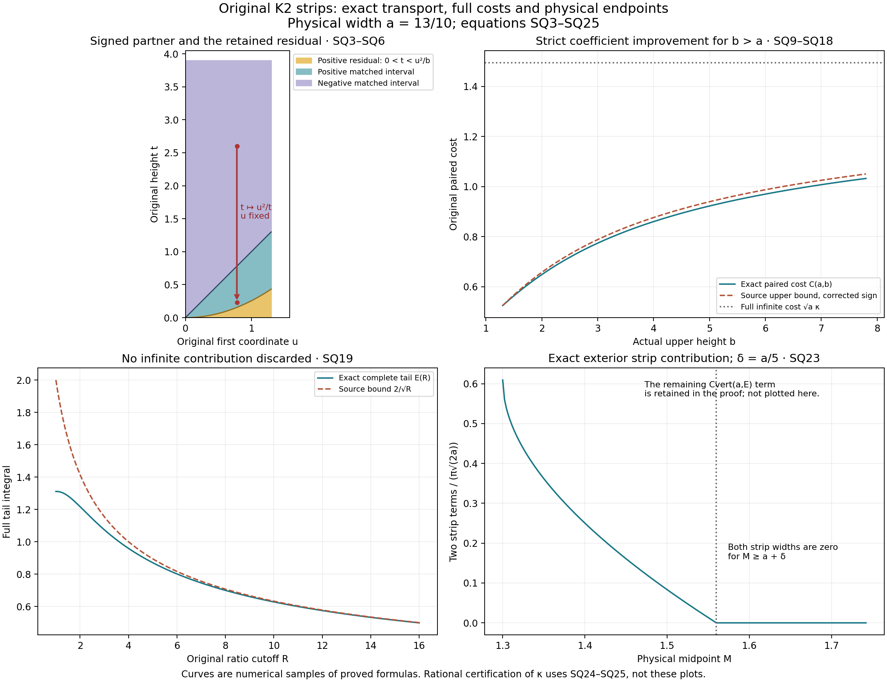
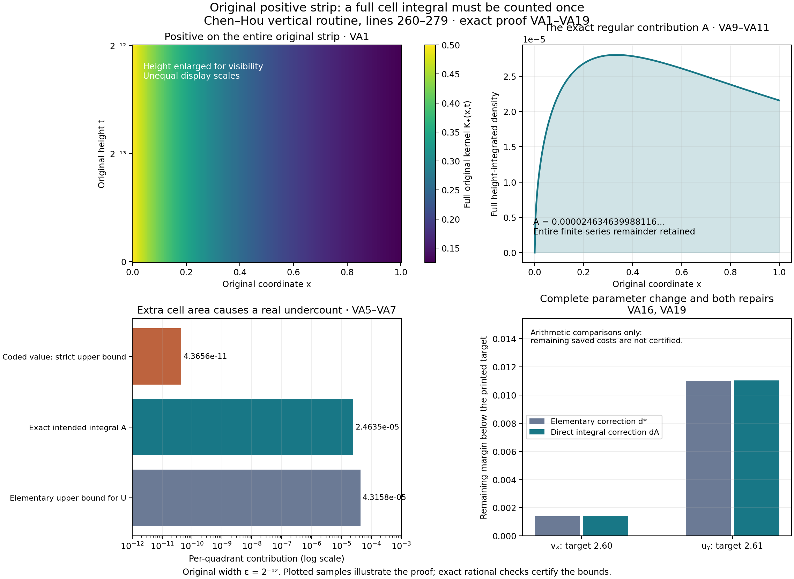
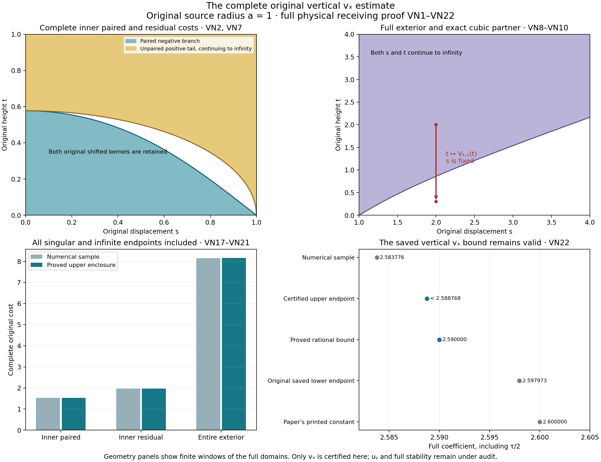
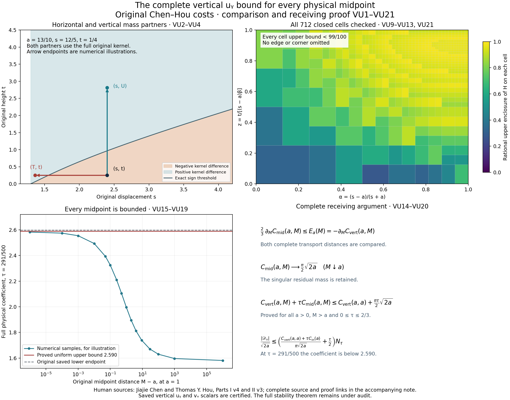
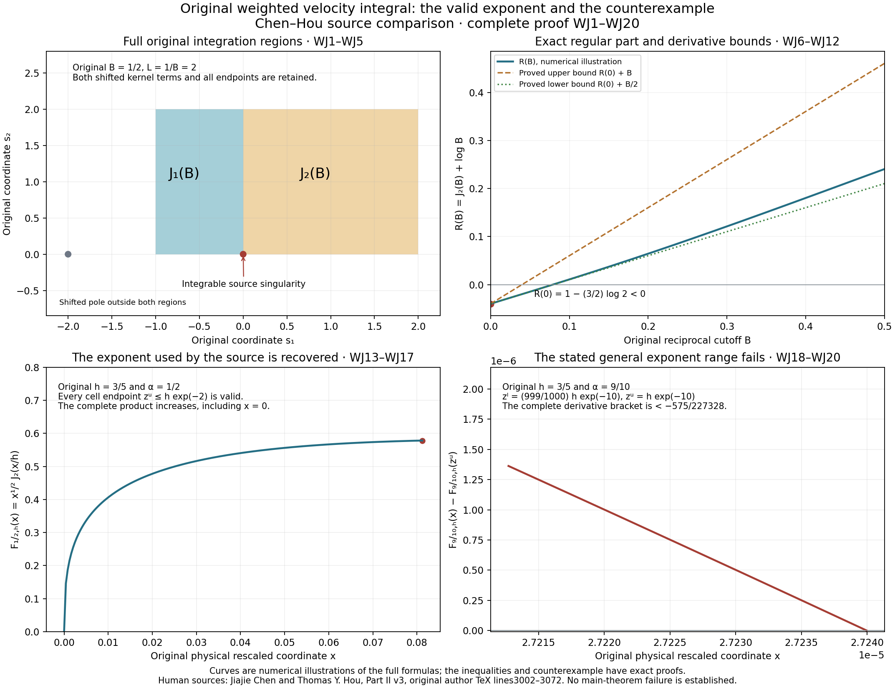
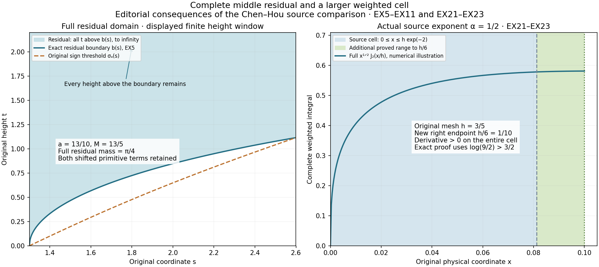

# Complete vertical certificates and weighted velocity cells

This lesson completes the two vertical off-diagonal derivative bounds
developed in lessons52–53. Both saved scalars remain valid. A local
regular-cell formula does contain an extra area factor, but a new
enclosure of the complete original costs proves enough margin to
recover both full bounds without increasing the saved numbers.

Part 1 evaluates the complete finite and infinite strips. Part 2
identifies the regular-cell error and constructs its exact correction.
Part 3 encloses every original vertical vₓ contribution, including
singular endpoints and infinite tails. Part 4 proves the full vertical
uᵧ bound at every midpoint through both original transport partners
and a complete closed-square interval certificate.

Part 5 reconstructs the original weighted velocity integral. The
source's endpoint selector is false when asserted for every exponent,
but its actual exponent one-half is valid. The five solved exercises
differentiate the complete strip cost, integrate the full middle
residual, quantify the midpoint gain, store an exact regular-cell
repair, and enlarge the valid actual-exponent cell.

The human sources are Jiajie Chen and Thomas Y. Hou. Source errors,
their corrections and the remaining conclusions are identified beside
complete proofs. Historical scope statements in the supporting notes
are followed by current lesson notes. All prerequisites, interval certificates and reproducible check programs accompany both downloads.
This certifies the stated derivative bounds, not the full stability
calculation or the main theorem. Review is author self-review.

## Part 1. Original finite and infinite K2 strips
This note proves the exact strip identities used in Chen and Hou's numerical supplement, corrects its intermediate sign, and evaluates the complete infinite-strip coefficient. It also gives a smaller exact finite-strip coefficient. These are local analytic results; they do not certify the remaining directional arrays or the stability theorem.

Human source: Jiajie Chen and Thomas Y. Hou, Part II, version 3, original author source [2305.05660v3](https://arxiv.org/abs/2305.05660v3), file euler_supp_Part2.tex. The retained source SHA-256 is `91fbe8b67384412903f851ccaeaa541cfe1f9658122e0f438d3ba064054dfc1b`. Exact source locators are lines 2382–2490 (the strip), 2027–2028 and 2291–2299 (the exterior receiver), and 2174–2187, 2229–2236 and 2274–2280 (finite receivers). The unchanged original source archive is retained separately.

The already proved physical K2 calculation, PV30–PV43 evaluates both singular-square constants and proves the height-subtracted physical strip. The argument here supplies the general finite strip, its exact transport cost and the original infinite strip, without replacing that prior calculation. No novelty is claimed.

### SQ1. Original kernel, actual data and the full signed identity

Let \(0<a\le b<\infty\). Retain

\[
 K_2(u,t)=\frac{u^2-t^2}{2(u^2+t^2)^2},\qquad
 Q=[0,a]^2,\qquad
 I_{a,b}=\lim_{\epsilon\downarrow0}
       \int_\epsilon^a\int_0^b K_2(u,t)f(u,t)\,dt\,du.
 \tag{SQ1}
\]

It suffices that \(f\) is measurable on \((0,a)\times[0,b]\), that for almost every \(u\) its height fiber has a representative with
\[
 |f(u,t)-f(u,v)|\le H_y\sqrt{|t-v|}\quad(0\le t,v\le b),
 \qquad |f|\le Q_0\quad\hbox{on }Q
 \tag{SQ2}
\]
for finite \(H_y,Q_0\ge0\). Essential bounds suffice with these fiber representatives. No horizontal continuity is needed. The square bound and SQ2 give the global bound \(Q_0+H_y\sqrt b\) on the actual rectangle. Thus every integral with \(\epsilon>0\) in SQ1 is absolutely convergent.

For each fixed \(u>0\), the original partner is the decreasing bijection
\[
 T_u:(u,b)\longrightarrow(u^2/b,u),\qquad
 T_u(t)=\frac{u^2}{t},\qquad T'_u(t)=-\frac{u^2}{t^2}.
 \tag{SQ3}
\]
When \(u=b\) both intervals are empty. Direct differentiation and substitution give
\[
 \partial_t\frac{t}{2(u^2+t^2)}=K_2(u,t),\qquad
 K_2(u,T_u(t))\,\frac{u^2}{t^2}=-K_2(u,t).
 \tag{SQ4}
\]
The first kernel is positive below \(u\) and negative above \(u\). Changing variables in the lower matched interval, with its reversed endpoints, proves the full identity
\[
\begin{aligned}
 \int_0^b K_2(u,t)f(u,t)\,dt
 &=\int_u^b K_2(u,t)
       \bigl(f(u,t)-f(u,u^2/t)\bigr)\,dt\\
 &\quad+\int_0^{u^2/b}K_2(u,t)f(u,t)\,dt .
\end{aligned}\tag{SQ5}
\]
The residual has not been subtracted from the data or discarded.

Define its complete nonnegative mass and the complete paired cost by
\[
\begin{aligned}
 R(a,b)&=\int_0^a\int_0^{u^2/b}K_2(u,t)\,dt\,du
       =\frac12\int_0^a\frac{b}{u^2+b^2}\,du
       =\frac12\arctan(a/b),\\
 C(a,b)&=\int_0^a\int_u^b
       \frac{t^2-u^2}{2(u^2+t^2)^2}
       \sqrt{t-u^2/t}\,dt\,du .
\end{aligned}\tag{SQ6}
\]
Here \(0\le t\le u^2/b\le a\) in the residual, so the data bound is exactly \(Q_0\) on the original square. Sections SQ2–SQ3 below prove \(C(a,b)<\infty\). Consequently both right-hand terms of SQ5, integrated over \(0<u<a\), converge absolutely. Taking the cutoff limit proves existence of SQ1 and
\[
 |I_{a,b}|\le Q_0\,\frac12\arctan(a/b)+H_y C(a,b).
 \tag{SQ7}
\]
In particular, the absolute value on the left follows from the actual signed identity, not an assumption that the data or the integral is positive.

For \(0<b\le a\), define the source's other strip by cutting off \(t\):
\[
\begin{aligned}
 J_{a,b}&=\lim_{\epsilon\downarrow0}
       \int_\epsilon^b\int_0^a K_2(u,t)f(u,t)\,du\,dt,\\
 |J_{a,b}|&\le Q_0\,\frac12\arctan(b/a)+H_x C(b,a),
       \qquad Q_0=\|f\|_{L^\infty([0,b]^2)} .
\end{aligned}\tag{SQ8}
\]
Indeed, \(K_2(t,u)=-K_2(u,t)\); applying SQ5 to \(g(t,u)=f(u,t)\) proves \(J_{a,b}=-I_{b,a}(g)\), including the minus sign. Fixed reflections \((u,t)\mapsto(\sigma_1u,\sigma_2t)\), \(\sigma_i\in\{-1,1\}\), preserve the kernel and the positive area measure and replace the data by its reflected fiber. SQ7–SQ8 therefore hold on each reflected rectangle. A union of rectangles requires the sum of their contributions. The square endpoint \(a=b\) is included.

### SQ2. Correct the intermediate sign and recover the source bound

The second integrand in source line 2416 uses \(K_2\) on \(u<t<a\), where it is strictly negative. Its integral is \(-C(a,a)\), whereas source line 2420 evaluates it as the positive upper-square constant. The corrected split, obtained directly from SQ6, is
\[
\begin{aligned}
 C(a,b)
 &= C(a,a)+\int_0^a\int_a^b
        |K_2(u,t)|\sqrt{t-u^2/t}\,dt\,du\\
 &\le \sqrt a\left(\frac\pi2-\frac{\pi}{2\sqrt2}\right)
       +\sqrt a\left(f_s(\sqrt{b/a})-f_s(1)\right),\\
 f_s(v)&=\int_0^v\frac{w^2}{1+w^4}\,dw .
\end{aligned}\tag{SQ9}
\]
The square value will also be proved independently below. For the upper rectangle, \(t\ge a\ge u\), so
\[
\begin{aligned}
 \int_0^a|K_2(u,t)|\,du&=\frac{a}{2(a^2+t^2)},\\
 \int_a^b\frac{a\sqrt t}{2(a^2+t^2)}\,dt
 &=\sqrt a\left(f_s(\sqrt{b/a})-f_s(1)\right).
\end{aligned}\tag{SQ10}
\]
The first formula follows from the full primitive
\(\partial_u[u/(2(u^2+t^2))]=-K_2(u,t)\).
The second uses \(t=aw^2\), \(dt=2aw\,dw\), with both original endpoints retained.

This proves exactly the final bounds at source lines 2434–2436 and 2446–2448, with \(C_{K_2,\mathrm{up}}=\pi/2-\pi/(2\sqrt2)\). The erroneous intermediate sign is repairable without increasing either final coefficient. For \(b>a\), the bound on the second line of SQ9 is strict: on the open upper rectangle \(0<u<a<t<b\), the positive kernel multiplies \(\sqrt{t-u^2/t}<\sqrt t\). Thus SQ7 supplies a strictly smaller coefficient of \(H_y\); it is not a claim of the optimal operator norm, or of strict data-bound improvement when \(H_y=0\).

### SQ3. Exact finite-strip cost

Set \(r=a/b\in(0,1]\) and introduce the integration variable \(q=u/t\). This changes no physical cutoff. Its map is \(u=qt\), \(du\,dt=t\,dq\,dt\), and its exact domain is
\[
 0<q<1,\qquad 0<t<\min(b,a/q).
 \tag{SQ11}
\]
Consequently Tonelli's theorem, first for the nonnegative integrand, gives
\[
\begin{aligned}
 \phi(q)&=\frac{(1-q^2)^{3/2}}{(1+q^2)^2},\\
 |K_2(qt,t)|\sqrt{t-q^2t}\,t
      &=\frac{\phi(q)}{2\sqrt t},\\
 C(a,b)&=\sqrt b\int_0^r\phi(q)\,dq
             +\sqrt a\int_r^1\frac{\phi(q)}{\sqrt q}\,dq .
\end{aligned}\tag{SQ12}
\]
Both integrals are finite: \(0\le\phi\le1\), and \(q^{-1/2}\) is integrable at zero. This also supplies the convergence required in SQ7.

The first integral has the elementary primitive
\[
\begin{aligned}
 A(r)&=\arcsin r-\frac1{\sqrt2}
       \arcsin\!\left(\frac{\sqrt2\,r}{\sqrt{1+r^2}}\right)
       +\frac{r\sqrt{1-r^2}}{1+r^2},\\
 A(0)&=0,\qquad A'(r)=\phi(r)\ (0<r<1),\\
 A(1)&=\frac\pi2-\frac{\pi}{2\sqrt2}.
\end{aligned}\tag{SQ13}
\]
Both inverse sines take their values in \([0,\pi/2]\). The derivative follows using
\(1-2r^2/(1+r^2)=(1-r^2)/(1+r^2)\); all denominators are positive on \(0<r<1\). The continuous endpoint values follow from the displayed formula. In particular, SQ12 at \(a=b\) proves the square term in SQ9 with its factor \(\sqrt a\).

For an exact evaluation of the second integral, define, for \(p,q>0\) and \(0\le x\le1\),
\[
 B_x(p,q)=\int_0^x v^{p-1}(1-v)^{q-1}\,dv,\qquad
 B(p,q)=B_1(p,q),\qquad x_r=\frac{4r^2}{(1+r^2)^2}.
 \tag{SQ14}
\]
Section SQ4 proves the remaining conversion. Its result is the exact full formula
\[
 C(a,b)=\sqrt b\,A(a/b)
  +\frac{\sqrt a}{2\sqrt2}
       \left[B(5/4,1/4)-B_{x_{a/b}}(1/4,5/4)\right].
 \tag{SQ15}
\]
The two original physical square roots and both beta contributions remain. At \(a=b\), symmetry of the beta integral makes the bracket zero. At \(b\to\infty\), \(\sqrt b A(a/b)\le a/\sqrt b\to0\), and \(x_{a/b}\to0\). Thus the limit of SQ15 is the infinite-strip cost proved next. The representation SQ12 directly proves monotonic increase in \(b\), because it equals the original positive integral with increasing upper endpoint.

### SQ4. Evaluate the complete infinite-strip coefficient and its tail

For actual \(0\le a<b<\infty\), retain the source quantity
\[
\begin{aligned}
 I_{K_2,\infty}(a,b)
 &=\int_a^b\int_u^\infty
       \frac{t^2-u^2}{2(u^2+t^2)^2}
       \sqrt{t-u^2/t}\,dt\,du\\
 &=(\sqrt b-\sqrt a)\,\kappa,\\
 \kappa&=\int_1^\infty
       \frac{s^2-1}{(s^2+1)^2}\sqrt{s-1/s}\,ds .
\end{aligned}\tag{SQ16}
\]
The substitution \(t=us\), \(dt=u\,ds\) gives the inner factor \(1/(2\sqrt u)\); integrating it from \(a\) to \(b\) gives precisely \(\sqrt b-\sqrt a\). When \(a=0\), this means the convergent improper integral, not division by zero on the fiber \(u=0\).

Use the strictly increasing bijection \(z=s-1/s\) from \([1,\infty)\) to \([0,\infty)\). Its inverse is
\(s=(z+\sqrt{z^2+4})/2\), and
\[
\begin{aligned}
 \frac{s}{s^2+1}&=\frac1{\sqrt{z^2+4}},\\
 \frac{s^2-1}{(s^2+1)^2}\,ds
       &=\frac{z}{(z^2+4)^{3/2}}\,dz,\\
 \kappa&=\int_0^\infty\frac{z^{3/2}}{(z^2+4)^{3/2}}\,dz
       =\frac1{2\sqrt2}B(5/4,1/4).
\end{aligned}\tag{SQ17}
\]
For the last equality put \(w=z^2/(z^2+4)\). Then
\(z=2\sqrt{w/(1-w)}\) and
\(dz=w^{-1/2}(1-w)^{-3/2}\,dw\).
The complete transformed density is
\((2\sqrt2)^{-1}w^{1/4}(1-w)^{-3/4}\,dw\).
It is integrable at both endpoints, proving every improper convergence in SQ16–SQ17.

This constant also has the exact special-function value
\[
 \kappa=\frac{\Gamma(1/4)^2}{4\sqrt{2\pi}},
 \qquad
 \Gamma(p)=\int_0^\infty v^{p-1}e^{-v}\,dv\quad(p>0).
 \tag{SQ18}
\]
Here is a derivation of the conversion. Apply Tonelli to the positive double integral defining \(\Gamma(p)\Gamma(q)\), then set \(v=\rho x,\ w=\rho(1-x)\), with Jacobian \(\rho\), to obtain
\(\Gamma(p)\Gamma(q)=\Gamma(p+q)B(p,q)\).
Integration by parts, whose endpoint terms vanish for \(p>0\), gives \(\Gamma(p+1)=p\Gamma(p)\). Finally, \(\Gamma(1/2)=2\int_0^\infty e^{-t^2}\,dt=\sqrt\pi\): square the integral over the real line and use polar coordinates, whose integral is \(2\pi\int_0^\infty r e^{-r^2}\,dr=\pi\). Substitution of \(p=5/4,q=1/4\) in SQ17 proves SQ18 with every factor.

The entire tail beyond an actual \(R\ge1\) is
\[
\begin{aligned}
 E(R)&=\int_R^\infty
       \frac{s^2-1}{(s^2+1)^2}\sqrt{s-1/s}\,ds\\
 &=\frac1{2\sqrt2}
       B_{\,4R^2/(R^2+1)^2}(1/4,5/4)
       \le \frac2{\sqrt R}.
\end{aligned}\tag{SQ19}
\]
To prove the equality, use SQ17 and then \(v=4/(z^2+4)\), whose decreasing endpoints are \(4R^2/(R^2+1)^2\) and zero. The full density is
\(-(2\sqrt2)^{-1}v^{-3/4}(1-v)^{1/4}\,dv\).
For the inequality, the original integrand is bounded by \(s^{-3/2}\): \((s^2-1)/(s^2+1)^2\le s^{-2}\) and \(\sqrt{s-1/s}\le\sqrt s\). Integrating retains the source tail \(2R^{-1/2}\).

Putting \(q=1/s\) gives
\(\int_0^r\phi(q)/\sqrt q\,dq=E(1/r)\) and
\(\int_0^1\phi(q)/\sqrt q\,dq=\kappa\).
Subtracting these two finite integrals proves SQ15.

### SQ5. Actual data on the infinite strip

Suppose \(f\) has the fiber property SQ2 on \(0<u<b,\ 0\le t<\infty\), with \(|f(u,0)|\le Q_0\). For each \(\epsilon>0\), the integral over \(\epsilon<u<b,\ 0<t<\infty\) is absolutely convergent. Indeed \(|f(u,t)|\le Q_0+H_y\sqrt t\), and the full kernel is bounded away from its origin and has an integrable height tail after either weight.

For each \(u>0\), SQ3 now maps \((u,\infty)\) bijectively onto \((0,u)\). The same complete mass identity yields
\[
\begin{aligned}
 I_{b,\infty}(f)
 &=\lim_{\epsilon\downarrow0}
      \int_\epsilon^b\int_0^\infty K_2(u,t)f(u,t)\,dt\,du\\
 &=\int_0^b\int_u^\infty K_2(u,t)
              \bigl(f(u,t)-f(u,u^2/t)\bigr)\,dt\,du,\\
 |I_{b,\infty}(f)-I_{a,\infty}(f)|
 &\le(\sqrt b-\sqrt a)\kappa H_y
       \qquad(0\le a\le b),\qquad I_{0,\infty}=0 .
\end{aligned}\tag{SQ20}
\]
The paired integral is absolutely convergent by SQ16. Thus taking the horizontal cutoff limit is justified without assuming an unlocalized operator, horizontal continuity, or a limit of the trace at the origin. The two strip integrals on the last line use the same data on their nested domains; subtracting their convergent paired representations leaves exactly \(a<u<b\).

There is also direct control of the infinite height limit, retaining the entire trace contribution. For \(L\ge b>0\), let \(I_{b,L}\) mean SQ1 with first width \(b\) and second width \(L\). The original negative tail gives
\[
\begin{aligned}
 I_{b,\infty}-I_{b,L}
 &=\int_0^b\int_L^\infty K_2(u,t)
       \bigl(f(u,0)+f(u,t)-f(u,0)\bigr)\,dt\,du,\\
 |I_{b,\infty}-I_{b,L}|
 &\le \frac{Q_0}{2}\arctan(b/L)
       +H_y\sqrt b\left(f_s(\infty)-f_s(\sqrt{L/b})\right).
\end{aligned}\tag{SQ21}
\]
For the trace, \(\int_L^\infty K_2(u,t)\,dt=-L/(2(u^2+L^2))\); integrating its magnitude gives the first term. For the height difference, integration in \(u\) gives the first formula of SQ10 with \(a=b\), and then its second formula with upper endpoint infinity gives the second term. Both terms tend to zero because their defining positive tails are integrable. This proves the infinite-limit passage while retaining the source's finite residual.

For constant data \(f\equiv c\), SQ5 gives exactly \(I_{a,b}=(c/2)\arctan(a/b)\), while SQ20 gives \(I_{b,\infty}=0\). These values check the sign and residual; no local principal-value correction is silently changed. If radial rather than strip cutoffs are wanted for jointly Hölder data, the separate PV1–PV3 quadrant correction must still be applied.

### SQ6. Carry the exact coefficient into the original exterior receiver

The source at lines 2027–2028 uses auxiliary half-separation one. In those original source coordinates, let \(m\ge1\), \(\epsilon>0\), and \(\epsilon_m=\max(m,1+\epsilon)\). Inserting SQ16 gives exactly
\[
\begin{aligned}
 C_{\mathrm{out}}(m,\epsilon)
 &=C_{\mathrm{mid},2}(\epsilon_m-1)\\
 &\quad+4\kappa\left[
       \sqrt{\epsilon_m+1}-\sqrt{m+1}
      +\sqrt{\epsilon_m-1}-\sqrt{m-1}\right],\\
 C_{\mathrm{out}}(1,\epsilon)
 &=C_{\mathrm{mid},2}(\epsilon)
       +4\kappa\left[\sqrt{2+\epsilon}-\sqrt2+\sqrt\epsilon\right].
\end{aligned}\tag{SQ22}
\]
Every endpoint, both strip contributions, the factor four and the remaining middle integral are retained. The actual equality of the last two strip endpoints for \(m\ge1+\epsilon\) makes those terms zero; they are not discarded for smaller \(m\).

The source's monotonicity in \(m\) now follows explicitly. For \(1<m<1+\epsilon\), \(\epsilon_m\) is constant, the middle integral is constant, and the bracket has derivative
\(-1/(2\sqrt{m+1})-1/(2\sqrt{m-1})<0\).
For \(m\ge1+\epsilon\), the bracket is zero and \(C_{\mathrm{mid},2}(m-1)\) is an integral of a fixed nonnegative density over a decreasing domain. At \(m=1+\epsilon\), both formulas agree, and at \(m=1\) the displayed square-root limit is continuous. Thus the original lower-cell-endpoint bound is valid.

For the actual physical half-separation \(a_0>0\), physical midpoint \(M\ge a_0\), and physical strip width \(\delta>0\), set \(E=\max(M,a_0+\delta)\). The original-coordinate exterior integral is
\[
\begin{aligned}
 C_{\mathrm{vert}}(a_0,E)
 &=4\int_E^\infty\int_{\sigma_{a_0}(s)}^\infty
       \Delta_{a_0}(s,t)\sqrt{t-V_{a_0,s}(t)}\,dt\,ds,\\
 \mathcal C_{\mathrm{out}}(a_0,M,\delta)
 &=C_{\mathrm{vert}}(a_0,E)\\
 &\quad+4\kappa\left[
       \sqrt{E+a_0}-\sqrt{M+a_0}
      +\sqrt{E-a_0}-\sqrt{M-a_0}\right].
\end{aligned}\tag{SQ23}
\]
Here \(\Delta_{a_0}=K_2(s+a_0,t)-K_2(s-a_0,t)\), and \(\sigma_{a_0},V_{a_0,s}\) are precisely the threshold and positive cubic partner of RV12–RV14. Those formulas prove that this is a finite nonnegative integral.

To verify the full comparison with SQ22, use \(s=a_0y_1,\ t=a_0y_2\): the kernel contributes \(a_0^{-2}\), area contributes \(a_0^2\), the partner-distance square root contributes \(\sqrt{a_0}\), and the lower endpoint becomes \(E/a_0\). The exact threshold and cubic scale under this same map, as proved in PV14–PV19. Consequently \(C_{\mathrm{vert}}(a_0,E)=\sqrt{a_0}C_{\mathrm{mid},2}(E/a_0-1)\), and multiplying each endpoint square root in SQ22 by \(\sqrt{a_0}\) gives SQ23. The contribution to the full velocity quotient remains
\(\mathcal C_{\mathrm{out}}(a_0,M,\delta)H_x/(\pi\sqrt{2a_0})\).
All inner and middle contributions and any local correction in the receiving velocity formula remain separate terms. This calculation exactly evaluates the two strip pieces; it does not certify the remaining middle integral numerically.

The finite receivers at source 2184–2185, 2232–2233 and 2279–2280 retain their residual mass coefficients and factors two. Their paired factors
\(\sqrt\epsilon[f_s(\sqrt{A/\epsilon})-f_s(1)+C_{K_2,\mathrm{up}}]\)
may be replaced by the proved smaller \(C(\epsilon,A)\) for \(A\ge\epsilon\), with \(A=1\), \(m-1\), or \(A=\epsilon=m-1\) as appropriate. This follows by applying the exact reflected identity SQ8 to each original data difference; its horizontal Hölder constant is still at most twice the original one by the triangle inequality. At the square endpoint the two coefficients agree. No residual, reflection multiplicity, data seminorm or physical \(1/(\pi\sqrt{2a_0})\) factor is removed.

### SQ7. Rational certification of the newly evaluated constant

The special-function expression need not be trusted as a floating-point oracle. Split the beta integral at \(1/2\), reflecting the upper half. For \(p,q>0\),
\[
\begin{aligned}
 B_{1/2}(p,q)
 &=2^{-p}\sum_{n=0}^\infty
       \frac{(1-q)_n}{n!(p+n)\,2^n},\\
 B(5/4,1/4)
 &=B_{1/2}(1/4,5/4)+B_{1/2}(5/4,1/4),\\
 \kappa&=\frac{2^{-1/4}}{2\sqrt2}
    \left[
       \sum_{n=0}^\infty\frac{(-1/4)_n}{n!(n+1/4)\,2^n}
       +\frac12\sum_{n=0}^\infty\frac{(3/4)_n}{n!(n+5/4)\,2^n}
    \right].
\end{aligned}\tag{SQ24}
\]
The rising factorial is \((c)_0=1\) and \((c)_n=\prod_{j=0}^{n-1}(c+j)\). To prove the series, its coefficients satisfy the differential equation for \((1-x)^{q-1}\), with initial value one. The ratio test gives uniform absolute convergence on \([0,1/2]\), so multiplying by \(x^{p-1}\) and integrating term by term is valid. This yields the first formula; reflection and SQ17 give the other two.

The terms of the first sum are negative from \(n=1\), and those of the second sum are positive. For either sum, at every \(n\ge1\), the ratio of absolute consecutive terms is
\[
 \frac{n+1-q}{2(n+1)}\,\frac{p+n}{p+n+1}<\frac12 .
 \tag{SQ25}
\]
Thus after terms \(0,\ldots,N-1\), \(N\ge1\), the magnitude of the omitted tail is at most twice the magnitude of term \(N\). Its sign is known. Every coefficient and tail bound is rational. Integer-square-root and fourth-root inequalities enclose \(\sqrt2\) and \(2^{1/4}\); interval multiplication then certifies the original \(\kappa\). The accompanying exact checker records its outward rational enclosure and all derivation identities. Numerical quadrature is used only as a separate diagnostic, never as the proof of this constant.

With 120 terms in each sum and root denominators \(10^{60}\), the exact rational comparisons give
\[
 \frac{131102877714605990523}{10^{20}}
 <\kappa<
 \frac{131102877714605990524}{10^{20}} .
 \tag{SQ26}
\]
A second calculation with 160 terms and root denominators \(10^{80}\) gives an interval strictly contained in the first. Both use the proved tail signs and SQ25; no decimal approximation supplies an endpoint.

The first panel keeps the physical rectangle a=13/10, b=39/10 and its full residual support. The second compares the exact paired coefficient with the corrected source upper bound, retaining the infinite limit. The third shows the complete tail and the source bound. The fourth retains both original exterior strip terms with the physical divisor; its caption explicitly identifies the remaining exterior integral. These are samples of the proved formulas, not a numerical certificate. Source and proof locators: SQ3–SQ25 and the Chen–Hou original author TeX cited above.

### SQ8. What this proves and what comes next

SQ5–SQ10 proves that the source's strip sign mistake does not invalidate its final estimate. SQ12–SQ19 computes the entire finite paired cost and the infinite coefficient, and SQ22–SQ23 carries the latter through the two original exterior terms with every physical factor. The original singular-square proof and all prior local corrections remain valid.

The next calculation is to combine these exact strip coefficients with the remaining source inner, middle and exterior quadrature cells and enclose the complete directional sums, before assessing their stability margins. The original saved MATLAB/INTLAB arrays and the full source stability theorem are not certified by this local result. No fatal main-theorem failure or novelty is asserted.

**Current lesson note.** The preceding text preserves the scope of this supporting calculation when it was written. Parts 3 and 4 below complete the two saved vertical scalar bounds; Part 2 identifies a local code error that those independent complete-cost proofs overcome. The remaining directional arrays and the full stability theorem are still under audit.

## Part 2. The regular positive strip contribution in the original vertical routine
This is a local source-code audit and an exact receiving correction. It establishes an undercount in one displayed real-arithmetic formula. It does not establish failure of the saved directional arrays or of the main theorem: the saved data, other slack and final stability margins still require a complete audit.

Human source: Chen and Hou's original `Holder_const/Holder_vx_const_Y_simp_itl.m`, SHA-256 `9c82e162ff5369079e0d821fe154396811a8cc55dabcb55dee16464989bfea66`. All 478 lines are now read. The bounded original-code package is retained unchanged. The definitions are lines 49–58 and 81–86, the actual call is126, the regular-strip calculation is260–279, and its receivers are148–170. `Holder_Mesh_x.m`, lines 1–23, and `Linear_nhol_step0.m`, all 116 lines, are also read. The original numerical supplement `euler_supp_Part2.tex`, version 3, lines 2154–2187, supplies the intended integral and its full factors.

Human paper: Jiajie Chen and Thomas Y. Hou, [Part I, version 4](https://arxiv.org/abs/2210.07191v4), original author TeX `arXiv_Euler_P1_v2026.tex`, lines 3367–3378. The exact original operator and physical local terms are proved in the retained PV1–PV43 prerequisite.

### VA1. What the primitive already contains

Keep the actual source width \(\epsilon=2^{-12}\), the source height mesh \(t_j=j\epsilon/256\), and any increasing horizontal mesh \(0=x_0<\cdots<x_N=1\). These are the mathematical partitions constructed by source lines 90–99 and 260–264; no binary rounding or INTLAB execution is assumed here. Put
\[
\begin{aligned}
 K_+(x,t)&=\frac{(x+1)^2-t^2}{2((x+1)^2+t^2)^2},\\
 F(x,t)&=-\frac12\arctan\!\frac{t}{x+1},
       \qquad \partial_x\partial_t F=K_+,\\
 J_{ij}&=F(x_{i-1},t_{j-1})+F(x_i,t_j)
              -F(x_{i-1},t_j)-F(x_i,t_{j-1})\\
       &=\int_{x_{i-1}}^{x_i}\int_{t_{j-1}}^{t_j}
                 K_+(x,t)\,dt\,dx>0 .
\end{aligned}\tag{VA1}
\]
The derivative follows directly from
\(\partial_tF=-(x+1)/(2((x+1)^2+t^2))\).
The kernel is positive because \(x+1\ge1>\epsilon\ge t\). The four-corner difference called Ing_f in source line 86 therefore already is the full cell integral. It is not its area average.

Source lines 272–273 compute the real formula
\[
\begin{aligned}
 P_{\mathrm{code}}&=\frac12\sum_{i=1}^N\sum_{j=1}^{256}
        J_{ij}(x_i-x_{i-1})(t_j-t_{j-1})\sqrt{2x_i},\\
 U&=\frac12\sum_{i=1}^N\sum_{j=1}^{256}J_{ij}\sqrt{2x_i}.
\end{aligned}\tag{VA2}
\]
The second expression is the correct elementary upper bound for the intended per-quadrant contribution
\[
 A=\frac12\int_0^1\int_0^\epsilon K_+(x,t)\sqrt{2x}\,dt\,dx
       \le U .
 \tag{VA3}
\]
The leading one-half is retained: the source full regular term has both height signs, giving twice the integral without that half; the code stores one quarter of that full term. The weight bound \(\sqrt{2x}\le\sqrt{2x_i}\) proves VA3 on each cell. The extra area in VA2 has no corresponding operation in this receiving map.

### VA2. The coded real formula is smaller than the intended contribution

The entire unweighted positive integral is
\[
\begin{aligned}
 J&=\sum_{i,j}J_{ij}
 =\frac12\int_0^1\frac{\epsilon}{(x+1)^2+\epsilon^2}\,dx\\
 &=\frac12\left[\arctan(2/\epsilon)-\arctan(1/\epsilon)\right]
 =\frac12\left[\arctan\epsilon-\arctan(\epsilon/2)\right].
\end{aligned}\tag{VA4}
\]
The first equality integrates the full height primitive. The last equality uses
\(\arctan r+\arctan(1/r)=\pi/2\) for \(r>0\); both original endpoints remain.

Since every horizontal cell width is at most one and every height cell width is \(\epsilon/256\),
\[
\begin{aligned}
 0<P_{\mathrm{code}}&\le\frac{\epsilon}{256}U,\\
 U&\le\frac{\sqrt2}{4}
       \left[\arctan\epsilon-\arctan(\epsilon/2)\right]
       \le\frac{\sqrt2\,\epsilon}{8},\\
 P_{\mathrm{code}}&<\frac{3\epsilon^2}{4096}.
\end{aligned}\tag{VA5}
\]
For the last step use \(\sqrt2<3/2\). The arctangent difference is the integral of \(1/(1+s^2)\) from \(\epsilon/2\) to \(\epsilon\), at most \(\epsilon/2\).

On the full subrectangle \(1/2\le x\le1,\ 0\le t\le\epsilon\), retain both numerator and denominator bounds:
\[
\begin{aligned}
 K_+(x,t)&\ge
       \frac{9/4-\epsilon^2}{2(4+\epsilon^2)^2},\\
 A&\ge\frac{\epsilon(9/4-\epsilon^2)}
                  {8(4+\epsilon^2)^2}
       \ge\frac{\epsilon}{160}.
\end{aligned}\tag{VA6}
\]
Indeed \(\sqrt{2x}\ge1\) on this rectangle; its area is \(\epsilon/2\), and VA3 has another factor one-half. The last inequality holds for \(0<\epsilon\le1\), since \(9/4-\epsilon^2\ge5/4\) and \((4+\epsilon^2)^2\le25\).
For the actual \(\epsilon=2^{-12}<1\),
\(3\epsilon^2/4096<\epsilon/160\), because \(480\epsilon<4096\).
Combining VA5–VA6 proves
\[
                     P_{\mathrm{code}}<A\le U .
 \tag{VA7}
\]
This is a strict defect in the real expression, not just a failure to prove that expression optimal.

The intended positive contribution is realized by admissible directional data. On the relevant strip set
\(g(s)=\operatorname{sgn}(s)\sqrt{|s|}/\sqrt2\), \(g(0)=0\), and let the data be independent of height. Its one-half Hölder seminorm is exactly one. For equal signs this follows from \(|\sqrt r-\sqrt q|\le\sqrt{|r-q|}\); for opposite signs use
\((\sqrt r+\sqrt q)^2\le2(r+q)\). Equality is achieved by the pair \(r,-r\).
The reflected difference is \(g(x)-g(-x)=\sqrt{2x}\), giving exactly the weight in VA3. For a physical midpoint \(M>1\), it comes from upper-half-plane data
\(\omega(p,h)=g(M-h)\) for \(h\ge0\) on the entire required local interval \(M-1\le h\le M+1\). Thus the defect is relevant to the stated data class. No claim is made that it defeats the full sum of all other source estimates.

### VA3. Complete correction at both physical receivers

Replacing the line-272 expression by its actual primitive integral changes this stored per-quadrant term by exactly \(U-P_{\mathrm{code}}>0\). At source lines 152–153 it enters both Bulk and Bulk_m1 outside the middle minimum. Lines 165 and 170 put these into both original vertical-data costs. The source explicitly reserves its single \(1/\pi\) division for Linear_nhol_step0 at line 163. Therefore the resulting additive correction to each physical \(H_y(\omega)\) coefficient is
\[
\begin{aligned}
 \Delta_Y&=\frac{2\sqrt2}{\pi}(U-P_{\mathrm{code}})>0,\\
 \Delta_Y&\le\frac1\pi
       \left[\arctan\epsilon-\arctan(\epsilon/2)\right]
       \le\frac{\epsilon}{2\pi}=\frac1{8192\pi}.
\end{aligned}\tag{VA8}
\]
The factor \(2\sqrt2=4/\sqrt2\) is the original quadrant sum divided by the square root of the physical pair distance; it is not applied again elsewhere. In an actual \(N_\tau=\max(H_x,\tau^{-1}H_y)\) receiver, this contribution is at most \(\tau\Delta_Y N_\tau\); for \(\tau=291/500\) the sufficient additive coefficient is \(291/(4096000\pi)\). All other terms, the middle minimum, the local \(\pi/2\) term and the exterior contribution stay in place.

VA8 is a proved correction budget. It does not determine whether existing saved bounds already have enough excess, whether their source-to-data identity matches this version, or whether the final stability margin changes sign. VA9–VA11 below enclose the entire regular contribution directly, without requiring the historical mesh bits. The complete remaining costs and final receiving margins still require calculation. Original MATLAB/INTLAB has not been executed, and no fatal main-theorem failure is established.

### VA4. Enclose the entire intended contribution with its original width

The contribution \(A\) in VA3 can be calculated independently of any mesh. Integrating its complete original kernel in height gives
\[
\begin{aligned}
 A&=\frac{\epsilon\sqrt2}{4}
           \int_0^1\frac{\sqrt x}{(1+x)^2+\epsilon^2}\,dx,\\
 M_n&=\int_0^1\frac{\sqrt x}{(1+x)^{2n+2}}\,dx
       =2\int_0^1\frac{y^2}{(1+y^2)^{2n+2}}\,dy .
\end{aligned}\tag{VA9}
\]
The last substitution is \(x=y^2,\ dx=2y\,dy\); the physical \(\epsilon=2^{-12}\) is unchanged. Define
\[
\begin{aligned}
 J_1&=\frac\pi4,\qquad
 J_m=\frac{1}{2(m-1)2^{m-1}}+
                 \frac{2m-3}{2m-2}J_{m-1}\quad(m\ge2),\\
 M_n&=2(J_{2n+1}-J_{2n+2}),\qquad
 M_0=\frac\pi4-\frac12 .
\end{aligned}\tag{VA10}
\]
To prove the recurrence, integrate the derivative of
\(y/[2(m-1)(1+y^2)^{m-1}]\) over \(0\le y\le1\).
Adding \((2m-3)/(2m-2)\) times the integral of \((1+y^2)^{-(m-1)}\) gives exactly the integral of \((1+y^2)^{-m}\). The endpoint term is the first displayed rational number. Subtracting the two adjacent integrands gives \(y^2/(1+y^2)^{2n+2}\), proving the full moment formula.

For every integer \(N\ge1\), the finite geometric identity gives, without removing a remainder,
\[
\begin{aligned}
 A&=\frac{\epsilon\sqrt2}{4}
       \sum_{n=0}^{N-1}(-\epsilon^2)^n M_n+R_N,\\
 R_N&=(-1)^N\frac{\epsilon\sqrt2}{4}\epsilon^{2N}
    \int_0^1\frac{\sqrt x}
       {(1+x)^{2N+2}\bigl(1+\epsilon^2/(1+x)^2\bigr)}\,dx,\\
 0&\le(-1)^N R_N
       \le\frac{\epsilon\sqrt2}{4}\epsilon^{2N}M_N .
\end{aligned}\tag{VA11}
\]
Every moment and the sign of the entire tail is retained. Thus exact rational enclosures of \(\pi\) and \(\sqrt2\), together with the finite recurrence, enclose \(A\). No MATLAB mesh identity or implementation of linspace is needed for this calculation of the actual integral.

The accompanying checker uses the finite arctangent identity
\(\pi=16\arctan(1/5)-4\arctan(1/239)\), with the alternating series and its first omitted term, and integer-square-root inequalities for \(\sqrt2\). These formulas and the angle choice are proved in PV43. Taking \(N=8\) in VA11 and retaining its entire tail gives a rational interval for \(A\); a separate higher-precision calculation with \(N=10\) gives a contained interval. This computes the original contribution rather than replacing it by a unit-width integral.

### VA5. Exact saved endpoints and the limits of their comparison

The retained `Input_data/Est_hol_const_itl.mat` has SHA-256
`c02c90a99cb3a557d55398396c4f28559581aac0c1436456230dffac508ee303`.
Its two vertical entries are scalar real intervals, not midpoint-dependent arrays. Reading their original binary64 endpoints as exact rationals gives
\[
\begin{aligned}
 V_-&=\frac{1462528955430077}{562949953421312},
 &V_+&=\frac{2925058673014367}{1125899906842624},
       &&\text{for holc.y\{3,1\}, }v_x,\\
 W_-&=\frac{5850945274287295}{2251799813685248},
 &W_+&=\frac{5850946798595723}{2251799813685248},
       &&\text{for holc.y\{1,3\}, }u_y,\\
 r_-&=\frac{1310240283489471}{2251799813685248},
 &r_+&=\frac{20472504429523}{35184372088832}.
\end{aligned}\tag{VA12}
\]
Here \([r_-,r_+]\) is the saved ratio tau(2)/tau(1); both original first components are five. Its complete comparison to the printed parameter and physical anisotropic norm is in AN1–AN17. In particular \(r_+<291/500\).

The full conservative correction from VA8, at the printed \(\tau=291/500\), and the exact saved numbers satisfy
\[
\begin{aligned}
 d_*&=\frac{291}{4096000\pi},\\
 V_++d_*&<\frac{13}{5},\\
 W_++d_*&<\frac{261}{100}.
\end{aligned}\tag{VA13}
\]
These are inequalities between explicitly given real numbers. The checker proves them with outward rational bounds on \(\pi\). The targets are precisely the separate printed constants \(2.60\) for \(v_x\) and \(2.61\) for \(u_y\), from Part I lines 3371–3378; they are not interchanged.

VA13 quantifies the available numerical room below the paper's stated constants. It is not a proof that \(V_+\) or \(W_+\) bounds the complete original integral. Such a conclusion would require the other terms, their numerical enclosures and the actual saved-data provenance. Nor can a larger printed constant silently replace a smaller saved value used in a stability calculation.

The saved anisotropy is also distinct from the printed one and must be carried through. For any original nonnegative cost pair \(X,Y\) and \(0<r\le\tau\), the full cost map satisfies
\[
\begin{aligned}
 \frac{\tau}{r}\frac{X+rY}{\pi}
       -\frac{X+\tau Y}{\pi}
 &=\frac{(\tau/r-1)X}{\pi}\ge0,\\
 \widehat V&=\frac{291/500}{r_-}\,V_++d_*<\frac{13}{5},\\
 \widehat W&=\frac{291/500}{r_-}\,W_++d_*<\frac{261}{100}.
\end{aligned}\tag{VA16}
\]
The first identity proves the comparison, retaining both directional contributions, their original \(1/\pi\), and the actual parameter change. Taking a maximum over original cost pairs preserves it. The last two inequalities, checked with exact rational arithmetic, include the complete worst-case saved-to-printed anisotropy conversion as well as the regular-strip correction. They are still comparisons of explicit coefficient values, not a certificate of the remaining original cost integrals.

The distinction can also be measured locally. Let
\[
\begin{aligned}
 d_{\mathrm{miss}}&=
 r_-\,\frac{2\sqrt2}{\pi}
       \left(A-\frac{3\epsilon^2}{4096}\right)>0 .
\end{aligned}\tag{VA14}
\]
VA5 and VA7 show that this is a lower bound on the missing weighted contribution in the real regular-strip formula at any saved ratio in \([r_-,r_+]\). The checker proves
\(d_{\mathrm{miss}}>V_+-V_-\) and
\(d_{\mathrm{miss}}>W_+-W_-\).
Thus the width of those stored intervals alone cannot cover the local defect. This does not remove the possibility of excess in other terms of their full upper-bound sums.

### VA6. The actual downstream addition and what remains to be computed

Linear_nhol_step0 lines 64–76 forms
\(C_{vx}=X_{vx3}+rY_{vx3}\) and
\(C_{uy}=X_{tr3}+rY_{tr3}\), then takes the maximum and divides by \(\pi\) once. The regular-strip correction is independent of the midpoint, so it passes through each maximum as the same additive constant. This proves the coefficient map in VA8 directly through the original receiving code.

The subsequent Est_hol_profi routine forms
\[
 H_{\max}=\max(H_x,\tau_C(1)H_y/\tau_C(2)).
 \tag{VA15}
\]
Its singular contribution is Holder_C_main multiplied by \(H_{\max}\), then added to the previously computed regular term. It receives no further division by \(\pi\). Therefore increasing the affected coefficient by an actual number \(d\ge0\) increases that stage by exactly \(dH_{\max}\). This is a calculation about that original addition; later minima, covering and stability operations still need their own exact propagation.

The selection is confirmed directly in `Lip/Holder_C_main.m`, lines 19–21, and `Lip/Holder_C.m`, lines 8–15: for the two off-diagonal derivatives in direction 2, the latter takes the maximum of the corresponding holc.y entry, and the former replicates it for each distance. No window rescaling or second kernel factor occurs on this path. The two saved entries in VA12 are scalars, so these selections do not alter their values.

Before the later covering routine, the exact componentwise minimum with the separate \(L^\infty\) estimate obeys
\[
 0\le \min(U+dH_{\max},L)-\min(U,L)\le dH_{\max}.
 \tag{VA17}
\]
For \(U\ge L\) both minima equal \(L\). For \(U<L\), either \(U+dH_{\max}\le L\), when the difference is exactly \(dH_{\max}\), or the difference is \(L-U<dH_{\max}\). This proves the actual next receiving inequality, including every case. It does not replace the subsequent original covering map by an identity.

The original generator also compares a newly calculated coefficient against the saved one. That comparison is an output check after its full calculation, not a source-to-data certificate for the retained MAT file. No original MATLAB/INTLAB run, reconstruction of its exact historical mesh bits, or complete vertical-array certificate is claimed here.

The next calculation is to independently enclose the complete original vertical costs, use the repaired regular contribution and exact strip coefficient, and propagate the resulting actual constants through Holder_C_main, the subsequent minima and covering, and the full stability margins. The local code defect is proved and has an explicit correction. Its effect on the main theorem remains unresolved.

### VA7. A direct certified replacement for the whole regular contribution

The exact integral calculation also removes this regular term's dependence on the mesh. Its complete rational enclosure, obtained by VA9–VA11 and the retained remainder, is
\[
 \frac{24634639988116009633073579}{10^{30}}
 < A <
 \overline A:=\frac{24634639988116009633073580}{10^{30}}.
 \tag{VA18}
\]
Replacing the original real regular term by \(\overline A\) is therefore sufficient for the full intended positive contribution. VA7 proves \(P_{\mathrm{code}}<A<\overline A\), so the exact coefficient increase and a sufficient uniform increase satisfy
\[
\begin{aligned}
 0<\Delta_{Y,A}
 &=\frac{2\sqrt2}{\pi}(\overline A-P_{\mathrm{code}})
 <\frac{2\sqrt2}{\pi}\overline A,\\
 d_A&:=\frac{291}{500}\frac{2\sqrt2}{\pi}\overline A
 <\frac{12909}{10^9}
 <d_*,\\
 \frac{291/500}{r_-}V_++d_A&<\frac{13}{5},\\
 \frac{291/500}{r_-}W_++d_A&<\frac{261}{100}.
\end{aligned}\tag{VA19}
\]
The checker encloses every factor by exact rational interval arithmetic. In particular, the first strict bound uses \(P_{\mathrm{code}}>0\); the second line retains the printed weighting parameter and the entire physical divisor. The final two comparisons include the full anisotropy change proved in VA16. They concern explicit numbers, with the same limits as VA13 and VA16.

This gives a concrete corrected calculation for this whole regular term: use the rational \(\overline A\) as its per-quadrant upper bound, and apply the existing factors and receivers without another area multiplier. For an interval implementation, that rational must itself be enclosed outward; rounding it to the nearest binary number is not a certified upper bound. This repair covers this term for every horizontal partition in VA1. It does not certify the other terms or retrospectively identify the provenance of the saved MAT endpoints.

The figure uses the original width \(\epsilon=2^{-12}\). The rectangle has unequal display scales so its height remains visible; its axes retain the original coordinates. The density and cost curves are numerical samples of VA1–VA11. The coefficient comparisons retain the original saved endpoints, the full parameter change and the physical factors in VA16 and VA19. Exact certification comes from the rational calculations in the proof and checker, not from the plotted samples. Human sources: Chen and Hou, Part II v3, equations with labels int_holy_vx_in0–int_holy_vx_in2; original vertical routine lines 260–279; and Part I v4, lines 3367–3378.

**Current lesson note.** The preceding text preserves the scope of this supporting calculation when it was written. Parts 3 and 4 below complete the two saved vertical scalar bounds; Part 2 identifies a local code error that those independent complete-cost proofs overcome. The remaining directional arrays and the full stability theorem are still under audit.

## Part 3. Complete original vertical costs: exact integration maps
This continues RV10–RV14, the complete physical increments and VA1–VA19, the regular-cell correction. It gives an independent enclosure of the complete original vertical vₓ coefficient. The exact coordinate identities and outward derivative bounds provide the certificate; numerical samples alone do not. The original kernel, transport and physical pair distance are retained.

The full horizontal partner proof is KX1–KX15. All these prerequisites are included in the accompanying collection.

Human source: Jiajie Chen and Thomas Y. Hou, original numerical supplement to Part II v3, `euler_supp_Part2.tex`, sections with labels `sec:holy_vx` and `sec:holy_vx_mo`; complete physical derivation and source locators in the included RV proof. Use the original
\[
 K_2(s,t)=\frac{s^2-t^2}{2(s^2+t^2)^2},\qquad
 \Delta_a(s,t)=K_2(s+a,t)-K_2(s-a,t),\quad a>0.
 \tag{VN1}
\]
All costs here are the full original integrals, including the singular limit and infinite tails. In particular
\[
\begin{aligned}
 C_{\rm in}(a)&=4\int_0^{a/\sqrt3}\int_0^{h_-(a,t)}
 |\Delta_a(s,t)|\sqrt{\mathcal T_{a,t}(s)-s}\,ds\,dt\\
 &\quad+2\int_0^\infty\int_{\sqrt{\max(a^2-3t^2,0)}}^a
 \Delta_a(s,t)\sqrt{2s}\,ds\,dt,\\
 C_{\rm vert}(a,a)&=4\int_a^\infty\int_{\sigma_a(s)}^\infty
 \Delta_a(s,t)\sqrt{t-V_{a,s}(t)}\,dt\,ds.
\end{aligned}\tag{VN2}
\]
The threshold, horizontal partner and vertical partner are exactly RV10–RV12 and KX3–KX8. Their existence, signs, mass maps and convergence were proved there. Thus Tonelli applies to each positive cost before the changes of variables below.

### VN1. Retain the complete shifted kernel near either singular side

For either \(0<s<a\) or \(s>a\), set \(u=|s-a|\), \(t=uq\), and define
\[
\begin{aligned}
 \alpha&=\frac{u}{s+a},&
 \gamma&=\frac{2(s^2+a^2)}{(s+a)^2},\\
 \beta_a(s)&=\frac{s+a}
 {\sqrt{s^2+a^2+2\sqrt{s^4-a^2s^2+a^4}}},\\
 D_a(s,q)&=\frac{2as}{(s+a)^2}
 \frac{\gamma q^2+3\alpha^2q^4-1}
 {(1+q^2)^2(1+\alpha^2q^2)^2}.
\end{aligned}\tag{VN3}
\]
Direct subtraction of both fractions in VN1, with both original denominators, gives
\[
\begin{aligned}
 \Delta_a(s,t)&=
 \frac{2as\{3t^4+2t^2(s^2+a^2)-(s^2-a^2)^2\}}
 {((s-a)^2+t^2)^2((s+a)^2+t^2)^2},\\
 u^2\Delta_a(s,uq)&=D_a(s,q),\qquad
 \sigma_a(s)=u\beta_a(s).
\end{aligned}\tag{VN4}
\]
The last equality rationalizes the exact threshold from RV12: the product of its radical difference and sum is \(3(s^2-a^2)^2\). The positive radical sum gives the denominator in VN3. In the inner paired domain \(0<q<\beta_a(s)\), \(D_a<0\); in the vertical upper domain \(q>\beta_a(s)\), \(D_a>0\). Both inequalities follow from the strictly increasing polynomial \(3u^2q^4+2(s^2+a^2)q^2-(s+a)^2\).

For \(0<s<a\), the exact horizontal partner satisfies
\[
\begin{aligned}
 T^2-s^2
 &=u\frac{(s+a)^2-2q^2(s^2+a^2)-3u^2q^4}{s+a+uq^2},\\
 d_a(s,q):=\frac{T-s}{u}
 &=\frac{(s+a)^2-2q^2(s^2+a^2)-3u^2q^4}
 {(s+a+uq^2)(T+s)}.
\end{aligned}\tag{VN5}
\]
This follows by subtracting \(s^2\) from the original rational expression for \(T^2\) in KX4, then using \(s^2-a^2=-u(s+a)\). Since \(T+s>0\) on the open integration domain, division retains equality. It avoids cancellation in a difference of nearby square roots without changing that difference.

Put \(u=av^2\), so \(s=a-av^2\), \(|ds|=2av\,dv\), \(dt=u\,dq\) at fixed \(s\), and \(\sqrt{T-s}=\sqrt u\sqrt{d_a}\). The full paired inner cost becomes
\[
 C_{{\rm in},p}(a)=8\sqrt a\int_0^1
 \int_0^{\beta_a(a-av^2)}
 [-D_a(a-av^2,q)]\sqrt{d_a(a-av^2,q)}\,dq\,dv.
 \tag{VN6}
\]
Indeed the product of the Jacobian and original kernel factor is
\(4u^{-2}u\sqrt u\,2av=8\sqrt a\). The original factor four, half in the kernel and physical \(a\) all survive.

### VN2. The full residual and the complete exterior integral

For the inner residual, reverse the integration order in VN2. For each \(0<s<a\), its lower height is
\(b_a(s)=\sqrt{(a^2-s^2)/3}\). Integrate the full height primitive of VN1 to infinity. Its limit is zero, giving
\[
 C_{{\rm in},r}(a)=
 \int_0^a\sqrt{2s}\,b_a(s)
 \left[\frac1{(s-a)^2+b_a(s)^2}
       -\frac1{(s+a)^2+b_a(s)^2}\right]ds.
 \tag{VN7}
\]
No far-height remainder was discarded: both upper endpoint values of the primitive are zero, and both lower endpoint terms appear in VN7. The same substitution \(s=a-av^2\) uses \(|ds|=2av\,dv\).

For \(s>a\), write the exact positive cubic partner as \(V_{a,s}(uq)=uw\). Its original equation RV12 becomes
\[
 q w\left[\alpha^2(w^2+qw+q^2)+\gamma\right]=1.
 \tag{VN8}
\]
This identity retains the original right side \((s^2-a^2)^2=u^2(s+a)^2\): both sides were divided by this same positive number. For \(q\ge\beta_a(s)>0\), the left side is zero at \(w=0\), strictly increasing for \(w\ge0\), and at least one at \(w=q\), with equality precisely at the threshold. Thus the unique root lies in \((0,q]\). This gives a rigorous bracket for later outward arithmetic; floating-point bisection alone is only a diagnostic.

Now put
\[
 u=a\left(\frac v{1-v}\right)^2,\quad s=a+u,
 \quad q=\frac{\beta_a(s)}{(1-z)^2},\quad 0<v,z<1.
 \tag{VN9}
\]
These are increasing bijections onto the two original integration ranges. Their complete Jacobians are
\(du/\sqrt u=2\sqrt a\,(1-v)^{-2}dv\) and
\(dq=2\beta_a(s)(1-z)^{-3}dz\). Since \(dt=u\,dq\) and \(\sqrt{t-V}=\sqrt u\sqrt{q-w}\),
\[
 C_{\rm vert}(a,a)=16\sqrt a\int_0^1\int_0^1
 \frac{\beta_a(s)D_a(s,q)\sqrt{q-w}}
 {(1-v)^2(1-z)^3}\,dz\,dv.
 \tag{VN10}
\]
Here \(s,q,w\) retain exactly their definitions in VN8–VN9. Both infinite ranges are retained as limits at the open square's boundary. The formula does not delete a neighborhood of any endpoint, and its finiteness is already supplied by RV14 and the local integrability proof preceding it.

Finally the original vertical \(v_x\) estimate RV9 and RV13 gives the coefficient
\[
 C_{v_x,y}(a,\tau)=
 \frac{C_{\rm vert}(a,a)+\tau\{C_{{\rm in},p}(a)+C_{{\rm in},r}(a)\}}
 {\pi\sqrt{2a}}+\frac\tau2.
 \tag{VN11}
\]
For the local term, \(|d_\eta|\le H_y\sqrt{2a}\), so its original one-half becomes exactly \(\tau/2\) after division by the pair-distance factor. The two nonlocal terms retain their distinct seminorms. Source evaluation uses the original \(a=1\); numerical exploration of VN6–VN11 at that value does not prove a certified inequality. The following calculation supplies a rigorous quadrature enclosure, including every transformed endpoint.

### VN3. An explicit upper integrand without solving the cubic numerically

For fixed original \(s>a\) and \(q\ge\beta_a(s)\), write \(h=w/q\). Equation VN8 and its interval \(0<h\le1\) give
\[
 \Phi(h)=\frac1{q^2\{\alpha^2q^2(h^2+h+1)+\gamma\}},\qquad
 h=\Phi(h).
 \tag{VN12}
\]
The function \(\Phi\) is positive and decreasing on the nonnegative real axis. Consequently, with all factors unchanged,
\[
 L_1=\Phi(1)\le h,\qquad H_1=\Phi(L_1)\ge h,
 \qquad L_2=\Phi(H_1)\le h.
 \tag{VN13}
\]
Both lower bounds are positive and at most one. Either one therefore gives a valid upper bound for the entire factor \(\sqrt{q-w}=\sqrt q\sqrt{1-h}\) by replacing \(h\) with that lower bound. No approximate cubic root enters this bound.

For numerical integration retain \(r=1-z\), \(b=\beta_a(s)^2\), and
\[
\begin{aligned}
 A_0&=3\alpha^2b^2,&B_0&=\gamma b,&A_0+B_0&=1,\\
 N&=A_0+B_0r^4-r^8\\
  &=z(1+r+r^2+r^3)\{A_0(1+r^4)+B_0r^4\},\\
 \Phi(h)&=\frac{r^8}{b\{\alpha^2b(h^2+h+1)+\gamma r^4\}},\\
 1-L_1&=\frac{N}{A_0+B_0r^4}.
\end{aligned}\tag{VN14}
\]
The identity \(A_0+B_0=1\) is exactly the threshold polynomial in VN4. Substitution and multiplication by its positive denominator prove every equality in VN14. Factoring \(1-r^4=z(1+r+r^2+r^3)\) retains its zero at the threshold and avoids subtracting two nearly equal positive numbers.

At the source's original \(a=1\), set
\[
 P(v)=\frac{2\{v^2+(1-v)^2\}}{\{v^2+2(1-v)^2\}^2}.
 \tag{VN15}
\]
It is exactly \(2s/((s+1)^2(1-v)^2)\) after VN9. The full transformed exterior integrand is
\[
 G(v,z)=16P(v)\beta^{3/2}
 \frac{Nr^4}{(r^4+b)^2(r^4+\alpha^2b)^2}\sqrt{1-h}.
 \tag{VN16}
\]
Use \(L_1\) on \(0<z<1/16\) and \(L_2\) on \(1/16\le z<1\) to define the upper integrand \(\overline G\). This fixed division has measure-zero interface and preserves both pieces in the integral. Each piece is a twice continuously differentiable expression on its open rectangle. Its nonnegative square-root argument is strictly positive for \(z>0\): the threshold equality occurs only at \(z=0\), and the true root has \(h<1\) otherwise.

### VN4. Full endpoint bounds and a certified finite integration rule

The original exterior parameters satisfy
\(1/\sqrt3\le\beta\le1\), \(1\le\gamma\le2\), and \(0\le\alpha\le1\). For the lower bound on \(\beta\), its denominator squared in VN3 is at most \(3(s+a)^2\); for the upper bound, \(\sqrt{s^4-a^2s^2+a^4}\ge as\). The bounds on \(\gamma,\alpha\) follow directly from their positive formulas. Also
\(P(v)\le2/(v^2+(1-v)^2)\le4\).
Since \(N\le3b(r^4+\alpha^2b)\), VN16 gives
\[
 0\le G\le\overline G
 \le48P(v)\beta^{7/2}
 \frac{r^4}{(r^4+b)^2(r^4+\alpha^2b)}
 \le\frac{192}{\sqrt\beta}<256.
 \tag{VN17}
\]
The final strict bound follows from \(3^{1/4}<4/3\). This bound is uniform even when both original coordinates approach the singularity or either infinite endpoint. It does not require a continuous extension at the square's corners.

For the inner paired cost, substitute \(q=\beta_a(s)z\) in VN6. At \(a=1\), its full transformed nonnegative density is at most four: \(\beta\le1\), \(T\le1\) gives \(d_1\le1\), and VN3 gives \(-D_1\le 2s/(s+1)^2\le1/2\). For the residual cost VN7, its full transformed density is
\[
 R(v)=2\sqrt{2(1-v^2)}\,c
 \left[\frac1{v^2+c^2}
 -\frac{v^2}{(2-v^2)^2+v^2c^2}\right],
 \qquad c=\sqrt{\frac{2-v^2}{3}}.
 \tag{VN18}
\]
This is the full substitution in VN7, with both terms and its Jacobian retained. It obeys \(0\le R(v)\le3\sqrt2<5\), because \(c\le1\), \(v^2+c^2\ge2/3\), and the subtracted term is nonnegative.

Set \(\delta=2^{-20}\). Integrate each two-dimensional density on \([\delta,1-\delta]^2\), and the residual on \([\delta,1-\delta]\). The complementary square area is \(4\delta-4\delta^2<4\delta\), while the complementary interval length is \(2\delta\). Thus adding respectively \(16\delta\), \(1024\delta\) and \(10\delta\) encloses the entire omitted inner, exterior and residual contributions. These explicit endpoint terms cover all original near-singularity and infinite ranges.

On a finite rectangle of widths \(d_1,d_2\), let \(m\) be its center and let \(M_{11},M_{22}\) bound the absolute pure second derivatives throughout the rectangle. Iterated midpoint integration gives
\[
 \left|\int_Q f-|Q|f(m)\right|
 \le\frac{|Q|}{24}(d_1^2M_{11}+d_2^2M_{22}).
 \tag{VN19}
\]
For completeness, the one-dimensional Taylor identity with integral remainder is

\[
f(c+h)=f(c)+hf'(c)+\int_0^h(h-t)f''(c+t)\,dt.
\]
The formula uses the oriented integral when \(h<0\). Its remainder has absolute value at most \(M h^2/2\). Integrating over the symmetric interval cancels the first derivative and gives \(Md^3/24\). Apply this first in the first coordinate for every fixed second coordinate, then to the central slice in the second coordinate. Adding the resulting two bounds proves VN19 without any mixed-derivative assumption.

The accompanying outward-arithmetic calculation evaluates the center value and both derivative bounds using real balls. It stores the value, both first derivatives and both pure second derivatives. For each coordinate, the product rule is \((fg)''=f''g+2f'g'+fg''\); the chain rule is \((F\circ f)''=F''(f)(f')^2+F'(f)f''\). For the reciprocal, the two derivatives are \(-x^{-2},2x^{-3}\); for the square root they are \(1/(2\sqrt x),-1/(4x\sqrt x)\). These rules prove all derivative enclosures inductively over the expression. A cell whose derivative expression cannot be bounded receives its proved global bound from VN17 or VN18, or the inner density bound four; it is not dropped. An adaptive subdivision chooses cells for efficiency only. Every final leaf is summed again outward, then every explicit endpoint term above is added. The implementation checks every dyadic width and center exactly, so floating-point subdivision does not change the rectangle or its midpoint.

The checker uses the exact positive threshold root and factored inner numerator
\[
\begin{aligned}
 b&=\frac{2}{\gamma+\sqrt{\gamma^2+12\alpha^2}},\\
 P_{\rm in}(s,z)&=(1-z^2)
 \{3u^2\beta^4(1+z^2)+2(s^2+a^2)\beta^2\},
 \quad q=\beta z.
\end{aligned}\tag{VN20}
\]
The first formula is the positive solution of \(3\alpha^2b^2+\gamma b-1=0\), including \(\alpha=0\). For the second, multiply that threshold equation by \((s+a)^2\) and subtract the full numerator in VN5 at \(q=\beta z\). Factoring both differences gives exactly VN20. These are equalities of the original integrands, retaining their threshold zeros.

### VN5. The complete vertical bound and the saved coefficient

The complete calculation, including VN17–VN20 and every omitted endpoint contribution, gives
\[
 \frac{C_{\rm vert}(1,1)+(291/500)C_{\rm in}(1)}{\pi\sqrt2}
       +\frac{291}{1000}
 <\frac{259}{100}.
 \tag{VN21}
\]
The accompanying 128-bit and 256-bit real-ball certificates enclose each entire integral and prove this rational comparison. The rule is VN19 with interval derivative bounds, not an inference from agreement of numerical samples. Each certificate keeps the full inner paired, inner residual, exterior near-threshold and remaining exterior contributions. The latter two bound the original exterior from above by VN12–VN16. Their outer endpoint correction is added once for the full square. The final arithmetic retains the exact \(291/500\), one \(\pi\sqrt2\) divisor and the local \(291/1000\). The exact check also compares each resulting upper endpoint with the original saved lower endpoint in VA12.

Here is the full physical receiving statement. Let \(a>0\), \(M>a\), \(c\in\mathbb R\), \(x=(c,M-a)\), \(z=(c,M+a)\), and let \(\omega\) on \(\mathbb R\times[0,\infty)\) have finite directional half-Hölder seminorms \(H_x,H_y\). Keep the original odd extension, expanding-square operators and their local terms from RV1–RV2. Their difference has the limit \(\mathscr D_v\) proved in RV3–RV9. Set \(N_\tau=\max(H_x,\tau^{-1}H_y)\), with \(\tau=291/500\). Then
\[
 |\mathscr D_v|
 \le\frac{259}{100}\,N_\tau\sqrt{2a}.
 \tag{VN22}
\]
To prove the full scale comparison rather than substitute a different operator, retain the map \((\xi,\theta)\mapsto(s,t)=(a\xi,a\theta)\). Its Jacobian is \(a^2\), the full kernel identity is \(\Delta_a(a\xi,a\theta)=a^{-2}\Delta_1(\xi,\theta)\), and the partners obey \(\mathcal T_{a,a\theta}(a\xi)=a\mathcal T_{1,\theta}(\xi)\) and \(V_{a,a\xi}(a\theta)=aV_{1,\xi}(\theta)\). The first follows from the complete rational formula VN5, and the second from substituting into the original cubic and using uniqueness of its positive root. The thresholds and every endpoint in VN2 map to their stated values under the same bijection. Thus each full cost is \(\sqrt a\) times its radius-one cost, from \(a^{-2}a^2\sqrt a\), including its singular and infinite limits by the positive integral convergence already proved. Substitution into the full VN11, retaining its \(\pi\sqrt{2a}\) divisor and local term, proves VN22 from VN21. This keeps the original physical coordinates and actual pair distance explicit.

The original saved parameter satisfies \(0<r\le r_+<291/500\), by VA12. Hence \(N_\tau\le N_r\). The exact inequalities
\(259/100<V_-\le V_+<13/5\), with \(V_-,V_+\) from VA12, show that the original saved vertical \(v_x\) coefficient still bounds this complete physical increment. No increase to that scalar is required for this estimate. This independently proves the validity of its use as an upper bound; it does not reconstruct the original generator's historical output or excuse the extra-area error in VA2.

The conclusion concerns the complete vertical \(v_x\) coefficient only. The separate \(u_y\) estimate includes the midpoint-dependent middle cost and requires its own full calculation. Nor does VN22 certify the other stability estimates or the full theorem. Original MATLAB/INTLAB was not executed. The proof and implementation receive author self-review; no independent or formal verification or novelty is claimed.

The first two panels show finite windows of the original inner and exterior domains at source radius one. The plotted exterior partner is a numerical sample of the full cubic in VN8. The cost and coefficient panels distinguish numerical samples from proved upper enclosures, including every endpoint contribution. VN21–VN22 supplies the complete physical receiving map. Human sources: Jiajie Chen and Thomas Y. Hou, original author TeX of Part II v3, vertical transport and inner/exterior cost formulas, and Part I v4, lines3367–3378. The full source identities and original factors are retained in the linked prerequisites.

**Current lesson note.** The preceding text preserves the scope of this supporting calculation when it was written. Parts 3 and 4 below complete the two saved vertical scalar bounds; Part 2 identifies a local code error that those independent complete-cost proofs overcome. The remaining directional arrays and the full stability theorem are still under audit.

## Part 4. The complete vertical \(u_y\) bound at every midpoint
Human source: Jiajie Chen and Thomas Y. Hou, [Part II v3](https://arxiv.org/abs/2305.05660v3), original author file euler_supp_Part2.tex, SHA-256 `91fbe8b67384412903f851ccaeaa541cfe1f9658122e0f438d3ba064054dfc1b`, lines 2005–2140, especially eq:holy_vx_est, eq:holy_vx, eq:holy_vx_dom and lem:map_vx_cy. The original physical receiving formulas are proved with their cutoff bands and local terms in RV1–RV22. The horizontal partner, its full residual mass and endpoint concentration are proved in KX1–KX15.

This editorial calculation proves a comparison between the two original transport costs. It supplies the midpoint-uniform vertical \(u_y\) estimate from the complete vertical \(v_x\) certificate VN1–VN22. Those complete prerequisites accompany this note. The finite-square comparison below uses outward real-ball arithmetic; the subsequent differentiation, integration and physical receiving maps are proved explicitly. Numerical midpoint samples are not used as a uniform bound.

### VU section 1. Keep the two partners and the physical costs

Let \(a>0\), \(s>a\), \(t>0\), and keep the original half-kernel and difference:

\[
K_2(s,t)=\frac{s^2-t^2}{2(s^2+t^2)^2},\qquad
\Delta_a(s,t)=K_2(s+a,t)-K_2(s-a,t).
\tag{VU1}
\]

Write \(\sigma_a(s)\) for its positive height root. The kernel is negative for \(0<t<\sigma_a(s)\) and positive for \(t>\sigma_a(s)\). On the lower branch define the original horizontal partner \(T=\mathcal T_{a,t}(s)\) and the upper vertical partner \(U=U_{a,s}(t)\) by

\[
\begin{aligned}
T^2&=\frac{(a^2+t^2)(s^2-a^2+3t^2)}
                 {s^2-a^2-t^2},\qquad a<T<s,\\
tU(U^2+tU+t^2+2s^2+2a^2)&=(s^2-a^2)^2,
\qquad U>\sigma_a(s)>t .
\end{aligned}\tag{VU2}
\]

The positive root \(U\) is unique because the left side is strictly increasing from zero to infinity in \(U>0\). The original threshold equation gives the self root \(U=t\) precisely at \(t=\sigma_a(s)\). The increasing polynomial has value below its right side when \(0<t<\sigma_a(s)\), so its positive root lies above \(t\); the decreasing involution and full mass identity in PV14–PV19 locate it above \(\sigma_a(s)\) and give

\[
\Delta_a(s,U)|\partial_t U|=-\Delta_a(s,t).
\tag{VU3}
\]

The horizontal partner and its domains are KX3–KX6, including \(\Delta_a(T,t)\partial_sT=\Delta_a(s,t)\) and \(\partial_sT<0\). Both maps refer to the same original \(\Delta_a\); their directions and weights remain distinct.

For \(M>a\), put \(h_+(a,t)=\sqrt{a^2+t^2+2t\sqrt{a^2+t^2}}\), and set \(z_M(t)=T_{a,t}(M)\) when \(M>h_+(a,t)\), and \(z_M(t)=M\) otherwise. Define the complete middle and exterior costs, including all positive heights:

\[
\begin{aligned}
C_{\rm mid}(a,M)
 &=4\int_a^M\int_0^{\sigma_a(s)}
       [-\Delta_a(s,t)]\sqrt{s-\mathcal T_{a,t}(s)}\,dt\,ds\\
 &\quad+2\int_0^\infty\int_a^{z_M(t)}
                   \Delta_a(s,t)\sqrt{2s}\,ds\,dt,\\
E_a(s)
 &=4\int_{\sigma_a(s)}^\infty
       \Delta_a(s,t)\sqrt{t-V_{a,s}(t)}\,dt\\
 &=4\int_0^{\sigma_a(s)}
       [-\Delta_a(s,t)]\sqrt{U_{a,s}(t)-t}\,dt,\\
C_{\rm vert}(a,M)&=\int_M^\infty E_a(s)\,ds.
\end{aligned}\tag{VU4}
\]

Here \(V\) is the lower vertical partner, the inverse of \(U\). VU3 proves the second expression for \(E_a\) by a change of variables on the entire positive branch; all four factors in VU4 remain. RV14 proves finite costs, the full infinite tail and the improper endpoint at \(s=a\).

### VU section 2. Differentiate the complete middle cost

For every fixed \(s>a\), direct integration of the original two kernels in height gives

\[
\int_0^\infty\Delta_a(s,t)\,dt=0,\qquad
\int_{\sigma_a(s)}^\infty\Delta_a(s,t)\,dt
=\int_0^{\sigma_a(s)}[-\Delta_a(s,t)]\,dt .
\tag{VU5}
\]

Indeed each kernel has height primitive \(t/[2((s\pm a)^2+t^2)]\), which vanishes at both endpoints. Neither shifted term has been suppressed.

The derivative of the paired term in VU4 is its integrand at \(s=M\), integrated in \(t\). For the residual, its moving upper endpoint has derivative \(1\) when \(M<h_+(a,t)\). When \(M>h_+(a,t)\), the full horizontal mass identity gives
\(\Delta_a(z_M,t)\partial_M z_M=\Delta_a(M,t)\).
At \(M=h_+\), both kernel differences vanish, so the two residual derivatives agree at zero. With \(T=\mathcal T_{a,t}(M)\), this gives

\[
\begin{aligned}
\partial_M C_{\rm mid}(a,M)
 &=4\int_0^{\sigma_a(M)}
       [-\Delta_a(M,t)]\sqrt{M-T}\,dt\\
 &\quad-2\int_0^{\sigma_a(M)}
       [-\Delta_a(M,t)]\sqrt{2T}\,dt
       +2\sqrt{2M}\int_{\sigma_a(M)}^\infty\Delta_a(M,t)\,dt\\
 &=4\int_0^{\sigma_a(M)}[-\Delta_a(M,t)]
       \left(\sqrt{M-T}+\frac{\sqrt{2M}-\sqrt{2T}}2\right)dt
 >0.
\end{aligned}\tag{VU6}
\]

These are derivatives of ordinary finite costs on \(M>a\), not a differentiation at the singular endpoint \(M=a\). Here are the needed convergence details. On a compact interval \(a<m_0\le M\le m_1\), the paired height domain lies in \(0\le t\le \sigma_a(m_1)\). The kernel there is bounded because \(M-a\ge m_0-a>0\); the partner and all square-root weights remain bounded by \(m_1\). Its endpoint-integrated derivative is therefore bounded and continuous by dominated convergence, including its vanishing threshold weight. The residual derivative has magnitude at most \(2\sqrt{2m_1}|\Delta_a(M,t)|\). On finite heights the same positive distance from \(s=a\) bounds this kernel. At large height, the full numerator formula in KX2 has degree four in \(t\) and the denominator degree eight; uniformly for \(M\) in this compact interval it is bounded by a constant times \(t^{-4}\). This is an integrable bound. The residual at one \(M\) is finite by KX12 and its weight bound. Apply the fundamental theorem on each side of \(M=h_+\), join there at the continuous residual value, and then Fubini with the stated derivative majorant. This proves differentiation under the residual integral and VU6. The same large-height argument, using \(\sqrt{t-V}\le\sqrt t\), proves continuity and finiteness of \(E_a(M)\) away from \(a\). Hence

\[
\partial_M C_{\rm vert}(a,M)=-E_a(M)<0 .
\tag{VU7}
\]

### VU section 3. Compare the entire transport distances

For all \(a>0\), \(s>a\), \(0<t<\sigma_a(s)\), the comparison to be proved is

\[
\frac23\left(\sqrt{s-T}+
                    \frac{\sqrt{2s}-\sqrt{2T}}2\right)
       \le \sqrt{U-t}.
\tag{VU8}
\]

Retain \(u=s-a>0\) and use the exact coordinate map

\[
\begin{aligned}
\alpha&=\frac{u}{s+a}\in(0,1),\quad q=\frac tu,\quad
\gamma=\frac{2(s^2+a^2)}{(s+a)^2}=1+\alpha^2,\\
b&=\frac{2}{\gamma+\sqrt{\gamma^2+12\alpha^2}},
\quad \beta=\sqrt b,\quad z=q/\beta\in(0,1),\\
a&=\frac{u(1-\alpha)}{2\alpha},\qquad
s=\frac{u(1+\alpha)}{2\alpha},\qquad t=u\beta z,\\
3\alpha^2b^2+\gamma b&=1,\qquad
\sigma_a(s)=u\beta.
\end{aligned}\tag{VU9}
\]

For each \(u>0\) this is a bijection between the stated physical negative branch and \(0<\alpha,z<1\), with the displayed inverse. The threshold identity follows from the full numerator of KX2, after retaining its positive factors. The map is used to certify an inequality; it does not replace the original kernel, physical scale or receiving divisor.

Define

\[
\begin{aligned}
F&=1-\gamma q^2-3\alpha^2q^4\\
 &=(1-z^2)\{3\alpha^2b^2(1+z^2)+\gamma b\},\\
W&=\frac{2\alpha T}{u}
  =\sqrt{\frac{\{(1-\alpha)^2+4\alpha^2q^2\}(1+3\alpha q^2)}
                      {1-\alpha q^2}},\\
d_0&=\frac{2}{(1-\alpha q^2)(1+\alpha+W)},\qquad
\frac{s-T}{u}=Fd_0,\\
\frac1{\sqrt u}\left(\sqrt{s-T}
               +\frac{\sqrt{2s}-\sqrt{2T}}2\right)
 &=\sqrt{Fd_0}+\frac{Fd_0\sqrt\alpha}
                         {\sqrt{1+\alpha}+\sqrt W}.
\end{aligned}\tag{VU10}
\]

For the second form of \(F\), subtract its threshold equation at \(q=\beta\) and factor \(1-z^2\) and \(1-z^4\). Substituting VU9 in the full formula for \(T^2\) gives the formula for \(W\). Direct cross multiplication in that same formula gives
\((s^2-T^2)/u^2=F/[\alpha(1-\alpha q^2)]\).
Dividing by \((s+T)/u=(1+\alpha+W)/(2\alpha)\) proves the distance formula. Finally rationalize \(\sqrt s-\sqrt T=(s-T)/(\sqrt s+\sqrt T)\); substitution of the two complete squares in VU9–VU10 proves the last line, including its factor \(1/2\).

All displayed denominators extend positively to the closed square \(0\le\alpha,z\le1\). In detail \(0<b\le1\), and \(\alpha b\le1/3\): for \(\alpha>0\), the increasing polynomial \(3\alpha^2x^2+(1+\alpha^2)x-1\) at \(x=1/(3\alpha)\) equals \((1-\alpha)^2/(3\alpha)\ge0\), while its root is \(b\). The endpoint \(\alpha=0\) is immediate. Thus \(1-\alpha q^2\ge2/3\); \(1+\alpha+W\ge1\); and \(\sqrt{1+\alpha}+\sqrt W\ge1\). Every radicand is nonnegative. These assertions include the corner \(\alpha=1,z=0\), where \(W=0\).

Put \(g=(U-t)/u>0\). Substituting \(U=u(q+g)\) into its original cubic gives exactly

\[
qg\{\gamma+\alpha^2(g^2+4qg+6q^2)\}=F .
\tag{VU11}
\]

To check every coefficient, the equation before subtraction is
\[
q(q+g)[\gamma+\alpha^2((q+g)^2+q(q+g)+q^2)]=1.
\]
Its constant term is \(q^2(\gamma+3\alpha^2q^2)=1-F\); the remaining terms are precisely VU11. Its left side is strictly increasing in \(g\ge0\) when \(q>0\).

Define the nonnegative trial value \(g_*=Fk\), where

\[
\begin{aligned}
k&=\frac49d_0\left(1+
       \frac{\sqrt{Fd_0}\sqrt\alpha}{\sqrt{1+\alpha}+\sqrt W}\right)^2,\\
H(\alpha,z)&=qk\{\gamma+\alpha^2(F^2k^2+4qFk+6q^2)\}.
\end{aligned}\tag{VU12}
\]

The complete outward enclosure implemented in the accompanying
certify_chen_hou_vertical_uy_comparison.py proves

\[
H(\alpha,z)<\frac{99}{100}<1
\quad\text{on the entire closed square }[0,1]^2.
\tag{VU13}
\]

Here is the full certification rule. Start with the entire closed square. A binary address successively bisects the \(\alpha\) and \(z\) coordinates, alternating them starting with \(\alpha\); the address therefore determines exact dyadic endpoints and center. Evaluate VU9–VU12 using outward Arb balls at the recorded precision. Before a square root, intersect its ball with the nonnegative half-line, justified by the radicand signs just proved. A cell is accepted only when the entire resulting ball lies below \(99/100\). A nonfinite evaluation or an undecided comparison causes subdivision, never acceptance. No root is inferred from floating-point samples. The saved certificate contains every accepted binary address and its exact rational upper bound. Collapse sibling addresses to their parent until the single empty address remains; this verifies coverage of the closed square and disjoint cell interiors. Thus every physical input belongs to an accepted cell, with all four edges and corners included. The code has explicit cell and depth limits that raise an error rather than silently omit a region. Both complete runs, at 128 and 256 bits, are retained. They use the same implementation and are not independent reviews.

An additional implementation, replay_chen_hou_vertical_uy_rational.py, re-evaluates every accepted cell using rational interval endpoints and integer square roots, without importing Arb or its evaluator. Each operation is rounded outward to the dyadic lattice with denominator \(2^{96}\). Addition uses endpoint sums, multiplication all four endpoint products, reciprocal reverses two endpoints of an interval avoiding zero, and squaring includes zero precisely when the interval crosses zero. For a nonnegative rational \(x\), its lower square-root lattice endpoint is
\[
\frac{\left\lfloor\sqrt{\left\lfloor 2^{192}x\right\rfloor}\right\rfloor}{2^{96}}.
\tag{VU21}
\]
Its upper endpoint is this value plus \(2^{-96}\), except when its square equals \(x\), in which case the same value suffices. The inner floor and the integer square root are exact integer operations; squaring each computed endpoint verifies the direction of its bound. Intersecting a radicand enclosure with the nonnegative half-line is valid by the preceding sign proof. The replay verifies every prefix cell, exact total area one and an upper bound below \(99/100\) in all 712 cells. This is a separate arithmetic implementation of the same comparison, with the same author review.

For the physical open square, \(F>0\). VU13 says that the left side of VU11 at \(g_*=Fk\) is strictly smaller than \(F\). Strict increase proves \(g>g_*\). Take nonnegative square roots and use VU10 and VU12, retaining the factor \(\sqrt u\). This proves VU8, strictly on the open branch. The compactified edges \(\alpha=0,1\) are certification boundaries, not additional finite physical points.

### VU section 4. Every midpoint and the complete physical coefficient

Multiply VU8 by \(4[-\Delta_a(s,t)]\), integrate the whole negative branch, and apply VU4 and VU6. This proves the exact receiving comparison

\[
\frac23\partial_M C_{\rm mid}(a,M)\le E_a(M)
                   =-\partial_M C_{\rm vert}(a,M)\qquad(M>a).
\tag{VU14}
\]

Let \(0\le\tau\le2/3\). The complete weighted cost therefore satisfies, for every \(a<M_1<M_2<\infty\),

\[
\begin{aligned}
& C_{\rm vert}(a,M_2)+\tau C_{\rm mid}(a,M_2)
 -C_{\rm vert}(a,M_1)-\tau C_{\rm mid}(a,M_1)\\
&\qquad\le
 -\left(1-\frac{3\tau}{2}\right)\int_{M_1}^{M_2}E_a(s)\,ds
 \le0.
\end{aligned}\tag{VU15}
\]

Both derivatives are integrable on this compact interval by the preceding proof, so the fundamental theorem applies. The source cost retains its nonzero right limit:
\(C_{\rm mid}(a,M)\to(\pi/2)\sqrt{2a}\) as \(M\downarrow a\), by RV17 and KX12–KX14. The exterior tends to \(C_{\rm vert}(a,a)\) by monotone convergence and its proved finite integral. Consequently

\[
C_{\rm vert}(a,M)+\tau C_{\rm mid}(a,M)
 \le C_{\rm vert}(a,a)+\frac{\pi\tau}{2}\sqrt{2a}
\quad(a>0,\ M>a,\ 0\le\tau\le2/3).
\tag{VU16}
\]

This is a statement about the full original costs. At literal \(M=a\) the middle integration region is empty and its value is zero; VU16 uses its right limit, not that endpoint value. For \(\tau<2/3\), VU15 is strictly negative when \(M_2>M_1\), because \(E_a(s)>0\).

For the original physical data let \(H_x,H_y\) be the two half-Hölder seminorms and \(N_\tau=\max(H_x,\tau^{-1}H_y)\), with \(\tau>0\). Retain physical midpoint \(M\), horizontal coordinate \(c\), and the two evaluation points \((c,M-a),(c,M+a)\). RV19, with every local term and expanding-square band already accounted for, now gives

\[
\begin{aligned}
\frac{|\mathscr D_u|}{\sqrt{2a}}
&\le
 \frac{C_{\rm vert}(a,M)+\tau\{C_{\rm in}(a)+C_{\rm mid}(a,M)\}}
      {\pi\sqrt{2a}}\,N_\tau\\
&\le
 \left(\frac{C_{\rm vert}(a,a)+\tau C_{\rm in}(a)}
                  {\pi\sqrt{2a}}+\frac{\tau}{2}\right)N_\tau .
\end{aligned}\tag{VU17}
\]

The quantity in the last parentheses is exactly the certified vertical \(v_x\) coefficient in VN11, not a modified operator. VN22 proves it is below \(259/100\) for \(\tau=291/500<2/3\), at every \(a>0\); that proof retains the scale map, all \(\sqrt a\) cost factors, infinite tails and the original \(\pi\sqrt{2a}\) divisor. Therefore

\[
|\mathscr D_u|\le\frac{259}{100}N_{291/500}\sqrt{2a}
\quad\text{for all original data with finite seminorm, }a>0,\ M>a.
\tag{VU18}
\]

As in RV19, this denotes the limit of the original velocity differences with the prescribed expanding-square cutoffs. It does not assume that both separate infinite operators exist on every Hölder datum.

The original saved anisotropy ratio obeys \(0<r\le r_+<291/500\), as proved in AN. Hence \(N_{291/500}\le N_r\). The saved vertical \(u_y\) interval has exact lower endpoint

\[
\frac{5850945274287295}{2251799813685248}>\frac{259}{100};
\tag{VU19}
\]

its saved upper endpoint is larger still and the printed bound \(261/100\) is larger. VU18 proves the saved scalar is a valid upper bound for the original data norm, without increasing it. The local regular-cell undercount in VA remains a genuine code error; this independent complete-cost proof supplies enough margin to validate the scalar itself. It does not reconstruct the historical MATLAB/INTLAB output or prove that each intermediate interval in that run enclosed its intended quantity.

### VU section 5. Consequences, exact scope and illustration

VU14–VU16 hold on the larger interval \(0\le\tau\le2/3\), not merely at the source ratio. They prove monotonicity of the complete combined cost and its supremum at the singular right endpoint, while retaining the singular residual mass. Taking increasing finite \(M\) in VU14 also gives the proved bound

\[
\lim_{M\to\infty}C_{\rm mid}(a,M)
\le\frac\pi2\sqrt{2a}+\frac32 C_{\rm vert}(a,a)<\infty.
\tag{VU20}
\]

Indeed \(C_{\rm mid}\) increases by VU6. Integrating VU14 from a positive-distance midpoint and then sending that midpoint down to \(a\), using the two established limits, bounds each middle value by the right side of VU20. Monotone convergence gives its finite limit. No novelty is claimed.

The reproducible accompanying figure keeps both partners at an explicitly specified physical \(a,s,t\). Its parameter-square panel distinguishes the accepted interval partition from sampled values. The receiving diagram identifies the full derivative comparison, the singular residual mass and the \(\pi\sqrt{2a}\) divisor, with VU8, VU14 and VU17–VU18 as proof locators.

This result certifies the complete saved vertical \(u_y\) scalar and extends the already certified vertical \(v_x\) result. The other directional arrays, weighted receiving operations, remeshing, full stability calculation and main theorem remain under audit. Original MATLAB/INTLAB was not executed. The proof and implementation receive author self-review; neither an independent reviewer nor formal verification is claimed.

## Part 5. Original weighted velocity integral: logarithmic part and exponent range
Human source: Jiajie Chen and Thomas Y. Hou, [Part II v3](https://arxiv.org/abs/2305.05660v3), original author euler_supp_Part2.tex, SHA-256 `91fbe8b67384412903f851ccaeaa541cfe1f9658122e0f438d3ba064054dfc1b`, the subsection “Estimate of \(u(x)/x_1^{1/2}\)” at lines 3000–3072. The source defines the two original integrals, gives a formula for \(J_1\), describes a regular part of \(J_2\) with inconsistent logarithm signs, and uses it in an endpoint selection bound for general \(0<\alpha<1\). It then states that the actual application uses \(\alpha=1/2\). Original code implementing this selector has not yet been located in the bounded downloaded code collection.

This note reconstructs the complete original integrals. It proves the correct logarithmic decomposition, global bounds on the regular-part derivative, and the selector inequality for the actual exponent. It also gives an explicit interval on which the source's general-exponent selector fails. That failure concerns the generality of this intermediate statement; it is not a counterexample to the actual \(\alpha=1/2\) estimate or the main theorem. The proof receives author self-review; no independent or formal verification or novelty is claimed.

### WJ section 1. The complete integrals and their primitives

For \(B>0\) retain the source kernel and both regions:

\[
\begin{aligned}
K_s(s_1,s_2)
 &=\frac{2(s_1+1)s_2}
  {(s_1^2+s_2^2)((s_1+2)^2+s_2^2)}\\
 &=\frac12\left(\frac{s_2}{s_1^2+s_2^2}
       -\frac{s_2}{(s_1+2)^2+s_2^2}\right),\\
J_1(B)&=\int_{-1}^0\int_0^{1/B}K_s(s_1,s_2)\,ds_2\,ds_1,\\
J_2(B)&=\int_0^{1/B}\int_0^{1/B}K_s(s_1,s_2)\,ds_2\,ds_1.
\end{aligned}\tag{WJ1}
\]

The equality follows by subtracting the two complete rational terms; their numerator difference is \(4(s_1+1)s_2\), retaining the half factor. On both stated regions \(K_s\ge0\). Near their only singular point \((0,0)\), its absolute value is bounded by a constant times \((s_1^2+s_2^2)^{-1/2}\): the shifted denominator stays bounded away from zero and \(|s_2|\le\sqrt{s_1^2+s_2^2}\). This is integrable in two dimensions. The integral exists, with no principal-value convention required. Increasing \(B\) shrinks each region, so both integrals decrease, strictly when \(B\) increases.

Set \(L=1/B\). For \(x\ge0\), define the complete primitives

\[
\begin{aligned}
A_L(x)&=x\log(x^2+L^2)-2x+2L\arctan(x/L),\\
A_0(x)&=2x\log x-2x\quad(x>0),\qquad A_0(0)=0.
\end{aligned}\tag{WJ2}
\]

Differentiation gives \(A_L'(x)=\log(x^2+L^2)\) and \(A_0'(x)=\log x^2\) for \(x>0\). The value \(A_0(0)=0\) is its continuous limit. Height integration of each original term in WJ1 gives

\[
\begin{aligned}
\int_0^L K_s(x,t)\,dt
 &=\frac14\Bigl\{\log(x^2+L^2)-\log x^2\\
 &\qquad-\log((x+2)^2+L^2)+\log((x+2)^2)\Bigr\}.
\end{aligned}
\tag{WJ3}
\]

for \(x>0\), with an integrable logarithmic singularity at zero. Thus

\[
\begin{aligned}
J_2(B)=\frac14\{&
 A_L(L)-A_L(L+2)+A_L(2)\\
 &-A_0(L)+A_0(L+2)-A_0(2)\}.
\end{aligned}\tag{WJ4}
\]

All six primitive values remain, including the shifted lower endpoint \(2\). Formula WJ4 follows first on an interval avoiding zero and then by the proved integrability and the continuous primitive limits.

For \(J_1\), use \(x=-s_1\) in the first logarithm and \(x=s_1+2\) in the shifted one. Keeping both endpoints gives

\[
\begin{aligned}
J_1(B)
 &=\frac14\{2A_L(1)-A_L(2)+A_0(2)-2A_0(1)\}\\
 &=\frac12\log\frac{1+B^2}{1+4B^2}
       +\log2+\frac{2\arctan B-\arctan(2B)}{2B},\\
\lim_{B\downarrow0}J_1(B)&=\log2.
\end{aligned}\tag{WJ5}
\]

For the limit, the logarithm tends to zero. The numerator of the last term vanishes at zero and has derivative zero there, since \(2/(1+B^2)-2/(1+4B^2)\to0\); the fundamental theorem bounds its quotient by the supremum of that derivative. The source's final \(J_1\) limit is correct. The intervening display changing a prefactor \(1/2\) to \(1/4\) before taking the limit does not preserve the original expression.

### WJ section 2. The exact regular part, its value and derivative

Define the regular part with its correct sign:

\[
R(B)=J_2(B)+\log B,\qquad J_2(B)=R(B)-\log B.
\tag{WJ6}
\]

The source notation \(J_{21}\) must equal this \(R\) for its displayed decomposition and derivative to hold. Its prose definition \(J_{21}=J_2-\log B\) has the opposite sign.

Here is the complete formula obtained by substituting WJ2 into WJ4. Put \(D_0(B)=2+4B+4B^2\); then

\[
\begin{aligned}
4R(B)
={}&\frac{\log2-\log D_0(B)+2\log(1+2B)}B\\
&+\frac2B\left(\frac\pi4-\arctan(1+2B)+\arctan(2B)\right)\\
&-2\log D_0(B)+2\log(1+4B^2)
       +4\log(1+2B)-4\log2.
\end{aligned}\tag{WJ7}
\]

To see the retained logarithmic contribution, write
\(\log(L^2c)=2\log L+\log c\) in all four original logarithms of WJ4. Their total coefficient of \(\log L\) is four inside its braces, giving precisely \(-\log B\) in \(J_2\). The remaining logarithms and all three arctangents are exactly WJ7.

The two numerators divided by \(B\) in WJ7 vanish at zero. Their derivative limits are respectively \(2\) and \(2\), including the displayed factor two in the second line. The last line tends to \(-6\log2\). The same fundamental-theorem argument as in WJ5 therefore gives

\[
R(0):=\lim_{B\downarrow0}R(B)=1-\frac32\log2.
\tag{WJ8}
\]

In particular this regular part is negative near zero. To control its full derivative, differentiate WJ7, retaining all terms. Direct collection gives

\[
\begin{aligned}
R'(B)&=-\frac{S(B)}{8B^2},\\
S(B)&=2\log((1+2B)^2)-2\log(1+2B+2B^2)-8B\\
&\qquad+4\arctan(2B)-4\arctan(1+2B)+\pi,\\
S(0)&=0,\\
S'(B)&=-8B\,\frac{P(B)}{D(B)},\\
P(B)&=16B^4+24B^3+20B^2+4B+1,\\
D(B)&=(2B+1)(4B^2+1)(2B^2+2B+1)\\
&=16B^5+24B^4+20B^3+10B^2+4B+1 .
\end{aligned}\tag{WJ9}
\]

The derivative identity agrees with the source derivative when \(J_{21}=R\). Every coefficient of \(P,D\) is positive. Integrate the exact formula for \(S'\) from zero and divide by \(8B^2\):

\[
R'(B)=\frac1{B^2}\int_0^B t\,\frac{P(t)}{D(t)}\,dt>0.
\tag{WJ10}
\]

This recovers the source's global monotonicity conclusion for \(R\). It also supplies precise bounds without a numerical approximation:

\[
\begin{aligned}
2D(B)-P(B)&=32B^5+32B^4+16B^3+4B+1>0,\\
P(B)-D(B)&=2B^2(5+2B-4B^2-8B^3)>0
                         \quad(0<B\le1/2),\\
0<R'(B)&<1\quad(B>0),\\
\frac12<R'(B)&<1\quad(0<B\le1/2).
\end{aligned}\tag{WJ11}
\]

For the second polynomial, \(4B^2+8B^3\le2\) on \(0\le B\le1/2\), so its parenthesis is at least three. Substitution of the strict ratio bounds into WJ10 gives the derivative bounds, since \(\int_0^B t\,dt=B^2/2\). Its integral expression also gives \(R'(B)\to1/2\) as \(B\downarrow0\), by continuity of \(P/D\) at zero. Combining with WJ8 proves

\[
R(0)<R(B)<R(0)+B\quad(B>0),\qquad
R(B)>R(0)+B/2\quad(0<B\le1/2).
\tag{WJ12}
\]

### WJ section 3. Recover the actual physical selector and a larger valid range

Keep the actual mesh size \(h>0\), physical rescaled coordinate \(x>0\), and exponent \(0<\alpha<1\). Put \(p=1-\alpha\), \(B=x/h\), and retain

\[
\begin{aligned}
F_{\alpha,h}(x)&=x^pJ_2(x/h),\\
\partial_x F_{\alpha,h}(x)
 &=x^{p-1}\{pJ_2(B)+BJ_2'(B)\}\\
 &=x^{p-1}\{p(R(B)-\log B)+BR'(B)-1\}.
\end{aligned}\tag{WJ13}
\]

The mesh factor is not discarded: differentiating \(J_2(x/h)\) gives \(J_2'(B)/h\), whose product with \(x\) is precisely \(BJ_2'(B)\). The source's inference from increase of \(R(B)\) to increase of \(x^pR(B)\) is invalid where \(R<0\). We prove the desired complete product directly.

The following exact logarithm bounds will suffice:

\[
\frac{56}{81}<\log2<\frac{25}{36},\qquad \log2>\frac23.
\tag{WJ14}
\]

Indeed integrating the geometric series on \([0,1/3]\) gives
\(\log2=2\sum_{n=0}^\infty[(2n+1)3^{2n+1}]^{-1}\).
The first two positive terms sum to \(56/81\), proving its strict lower bound. For \(n\ge1\), replace \(1/(2n+1)\) by \(1/3\); the resulting geometric tail is \(1/36\), strictly larger than the original tail after its first term. Adding \(2/3\) proves the upper bound. This also proves the last inequality.

Set

\[
p_*=\frac1{1+(3/2)\log2}.
\tag{WJ15}
\]

For every \(p_*\le p<1\), the complete physical function in WJ13 is strictly increasing on

\[
0<x\le h\min\{e^{-1/p},1/2\}.
\tag{WJ16}
\]

To prove this, first suppose \(B\le1/8\). From WJ8 and WJ12,
\[
p(R(B)-\log B)+BR'(B)-1
>p\{1-(3/2)\log2+\log8\}-1
=p\{1+(3/2)\log2\}-1\ge0.
\]
The first inequality is strict because \(R(B)>R(0)\) and \(BR'(B)>0\). When \(B\ge1/8\), WJ11–WJ14 give
\[
R(1/8)>1-\frac32\log2+\frac1{16}
 >\frac1{48}>0.
\]
Global increase gives \(R(B)>0\). The assumed \(B\le e^{-1/p}\) gives \(p(-\log B)\ge1\), and \(BR'(B)>0\) makes the bracket in WJ13 positive. These two cases prove WJ16 with all source restrictions.

Because \(\log2>2/3\), WJ15 gives \(p_*<1/2\). The actual source exponent \(\alpha=1/2\), hence \(p=1/2\), is therefore included. In particular, for every original cell

\[
0\le z^l\le x\le z^u,\qquad
0<z^u\le h e^{-2},
\]
\[
x^{1/2}J_2(x/h)
\le (z^u)^{1/2}J_2(z^u/h).
\tag{WJ17}
\]

At \(x=0\), use the continuous extension by zero: WJ6, WJ8 and \(x^p\log(h/x)\to0\) for \(p>0\) prove that extension. The limit follows, for example, by writing \(x/h=e^{-y}\) and bounding \(ye^{-py}\to0\) from the exponential series. Thus the original cell may include zero. The source restriction \(z^u\le h/2\) is automatic here since \(e>2\) implies \(e^{-2}<1/4\).

### WJ section 4. Explicit failure of the source's full exponent range

Take the original permitted exponent \(\alpha=9/10\), so \(p=1/10\), and keep arbitrary \(h>0\). Define an actual source cell by

\[
z^u=h e^{-10},\qquad z^l=\frac{999}{1000}h e^{-10}.
\tag{WJ18}
\]

It satisfies \(z^u\le\min\{h e^{-1/p},h/2\}\). On its entire dimensionless interval \(999e^{-10}/1000\le B\le e^{-10}\), we have \(B<1/1024\), because \(e>2\). Also
\[
0\le-\log B-10\le\log(1000/999)<1/999,
\]
where the last bound is \(\log(1+y)<y\) for \(y>0\), obtained by integrating \(1/(1+y)<1\). WJ8, WJ12 and WJ14 give \(R(0)<-1/27\), \(R(B)<R(0)+B\), and \(R'(B)<1\). Hence the complete derivative bracket has the strict bound

\[
\begin{aligned}
\frac1{10}(R(B)-\log B)+BR'(B)-1
&<-\frac1{270}+\frac{11}{10240}+\frac1{9990}\\
&<0.
\end{aligned}\tag{WJ19}
\]

All denominators are positive, and ordinary rational cross multiplication proves the final sign. Thus WJ13 is strictly negative throughout the actual cell WJ18. The fundamental theorem gives

\[
F_{9/10,h}(z^l)>F_{9/10,h}(z^u).
\tag{WJ20}
\]

This is a counterexample to the source endpoint selector when stated for every \(0<\alpha<1\). It changes none of the original kernel, mesh size, coordinate, cutoff conditions or exponent convention. WJ17 separately proves the selector used by the actual \(\alpha=1/2\) application. The stronger valid range WJ15–WJ16 is proved but not asserted optimal. The corresponding code and the remaining near-singularity estimates still require their own receiving audit.

The figure retains source coordinates and both integration regions at \(B=1/2\), and shows physical selector examples with \(h=3/5\). The regular-part bounds are WJ11–WJ12; the numerical curves illustrate the full original formulas rather than certify them. WJ17 proves the actual-exponent selector, and WJ18–WJ20 proves strict failure on the displayed counterexample cell, for every positive mesh size.

## Five solved exercises

These exercises use the original kernels, data norms, physical coordinates
and mesh size from SQ, VA, VN, VU and WJ. Their human source is Jiajie Chen
and Thomas Y. Hou, Part II v3, original author file euler_supp_Part2.tex,
with the exact source locators beside those proofs. Each extension below
is editorial mathematics; it is not attributed to the source authors,
and no novelty is claimed.

### Exercise 1. Differentiate the finite strip without losing its residual

Fix the original width \(a>0\), and let the actual height \(b\ge a\) vary.
Find the first and second height derivatives of the full paired cost
\(C(a,b)\) in SQ6. Prove strict increase and concavity, and bound its
entire difference from the infinite cost. Then state the finite-strip
data estimate with its original residual mass still present.

**Solution.**
Keep the SQ12 function
\(\phi(q)=(1-q^2)^{3/2}/(1+q^2)^2\), and write \(r=a/b\).
The exact expression, including both original cutoff factors, is

\[
C(a,b)=\sqrt b\int_0^{a/b}\phi(q)\,dq
       +\sqrt a\int_{a/b}^1\frac{\phi(q)}{\sqrt q}\,dq .
\tag{EX1}
\]

On \(b>a\), differentiating both variable endpoints gives
\(-a b^{-3/2}\phi(a/b)\) from the first integral and
\(a\sqrt a\,b^{-2}\phi(a/b)/\sqrt{a/b}\) from the second.
They cancel exactly. Thus, with \(A\) as in SQ13,

\[
\begin{aligned}
\partial_b C(a,b)&=\frac{A(a/b)}{2\sqrt b}>0,\\
\partial_b^2 C(a,b)
 &=-\frac{A(a/b)}{4b^{3/2}}
   -\frac{a\,\phi(a/b)}{2b^{5/2}}<0 .
\end{aligned}\tag{EX2}
\]

The positivity follows because \(\phi(q)>0\) for \(0<q<1\),
so its integral over any interval of positive length is positive.
The formulas also have finite right limits at \(b=a\):
\(\phi(1)=0\) and
\(A(1)=\pi/2-\pi/(2\sqrt2)>0\). The fundamental theorem on
compact height intervals, followed by this right limit, proves the
claimed strict increase and concavity on the complete domain \(b\ge a\).
In particular no derivative of an infinite upper endpoint was assumed.

SQ16–SQ19 gives the convergent limit \(\sqrt a\,\kappa\).
Subtract the two full expressions in SQ12:

\[
\begin{aligned}
\sqrt a\,\kappa-C(a,b)
 &=\sqrt a\int_0^{a/b}\frac{\phi(q)}{\sqrt q}\,dq
      -\sqrt b\int_0^{a/b}\phi(q)\,dq\\
 &=\int_0^{a/b}\phi(q)
       \left(\sqrt{\frac a q}-\sqrt b\right)dq\\
 &=\int_b^\infty \frac{A(a/\ell)}{2\sqrt\ell}\,d\ell,\\
0<\sqrt a\,\kappa-C(a,b)&\le\frac{a}{\sqrt b}.
\end{aligned}\tag{EX3}
\]

The first integrand is positive on \(0<q<a/b\).
For the third line integrate EX2 from \(b\) to a finite height and
then use the proved infinite limit. Since \(0\le\phi\le1\),
\(A(a/\ell)\le a/\ell\), and the remaining full tail is
\((a/2)\int_b^\infty\ell^{-3/2}\,d\ell=a/\sqrt b\).
This proves the last bound with its physical width and height.

For actual data obeying SQ2 on the rectangle and square, the result is

\[
|I_{a,b}|
\le \frac{Q_0}{2}\arctan(a/b)+H_y C(a,b).
\tag{EX4}
\]

The first term is the full residual, obtained from SQ5; differentiating
the paired cost does not remove it. For constant data \(f\equiv c\),
the actual integral is \((c/2)\arctan(a/b)\), so omitting that term
would be false. The infinite comparison in EX3 concerns a coefficient,
and does not assert strict improvement of a data bound when \(H_y=0\).

### Exercise 2. Integrate every height in the middle residual

Fix \(a>0\) and \(M>a\). The second term in VU4 is the complete middle
residual. Describe its support with the horizontal coordinate first,
evaluate its entire height integral, and recover its singular right
limit without discarding any mass.

**Solution.**
For \(a<s<M\), put

\[
\begin{aligned}
B_0(a,M,s)&=M^2+s^2+2a^2,\\
C_0(a,M,s)&=(s^2-a^2)(M^2-a^2),\\
b_{a,M}(s)^2
 &=\frac{2C_0(a,M,s)}
 {B_0(a,M,s)+\sqrt{B_0(a,M,s)^2+12C_0(a,M,s)}} .
\end{aligned}\tag{EX5}
\]

Both numerator and denominator are positive on the stated open interval.
Here is the domain proof. For \(0<t<\sigma_a(M)\), the original
horizontal partner in VU2 is

\[
\mathcal T_{a,t}(M)^2
=\frac{(a^2+t^2)(M^2-a^2+3t^2)}{M^2-a^2-t^2}.
\tag{EX6}
\]

Its denominator stays positive up to the threshold. Indeed
\(\sigma_a(M)^2<(M-a)^2<M^2-a^2\), by VN3–VN4.
As a function of \(y=t^2\), both positive numerator factors increase,
while the positive denominator decreases. Thus EX6 is strictly
increasing in \(t\), from \(a^2\) at zero to \(M^2\) at
\(t=\sigma_a(M)\). There is exactly one height at which the
partner equals \(s\).

Cross multiplication of EX6 at that height gives the full polynomial

\[
3y^2+B_0(a,M,s)y-C_0(a,M,s)=0.
\tag{EX7}
\]

The left side is strictly increasing for \(y\ge0\), negative at zero
and unbounded above. Its unique positive root is EX5, obtained by
multiplying the radical difference by its conjugate. Hence
\(0<b_{a,M}(s)<\sigma_a(M)\).
At this partner point, KX6 locates
\(\mathcal T_{a,t}(M)<h_+(a,t)\), strictly when \(M>h_+(a,t)\).
The inverse threshold relation \(h_+(a,t)=s\) is
\(t=\sigma_a(s)\), and \(h_+(a,t)\) is strictly increasing in \(t\).
Therefore \(b_{a,M}(s)>\sigma_a(s)\). At \(s=M\) the limiting
value is \(\sigma_a(M)\), and at \(s=a\) it is zero.

For \(t<\sigma_a(M)\), VU4 has \(z_M(t)=\mathcal T_{a,t}(M)\);
the monotonicity just proved makes \(s\le z_M(t)\) equivalent to
\(t\ge b_{a,M}(s)\). For \(t\ge\sigma_a(M)\), VU4 has
\(z_M(t)=M\), so every \(a<s<M\) is included. The whole residual
domain is consequently

\[
\{(s,t):a<s<M,\ t>b_{a,M}(s)\},
\tag{EX8}
\]

up to boundary sets of area zero. It lies on the positive branch of
\(\Delta_a\). Tonelli therefore reverses the integration order without
a cancellation assumption.

The complete height primitive is
\(t/[2((s+a)^2+t^2)]-t/[2((s-a)^2+t^2)]\).
Both terms tend to zero at infinity. It follows that

\[
\begin{aligned}
C_{{\rm mid},r}(a,M)
&=2\int_a^M\int_{b_{a,M}(s)}^\infty
                  \Delta_a(s,t)\sqrt{2s}\,dt\,ds\\
&=\int_a^M\sqrt{2s}\,b_{a,M}(s)
 \left[
 \frac1{(s-a)^2+b_{a,M}(s)^2}
 -\frac1{(s+a)^2+b_{a,M}(s)^2}
 \right]ds .
\end{aligned}\tag{EX9}
\]

The endpoints in this expression are improper where necessary. Its
finiteness follows also from the following exact mass calculation.
The original horizontal primitive gives, with \(d=M-a>0\),

\[
\begin{aligned}
\int_a^{z_M(t)}\Delta_a(s,t)\,ds
 &=\frac{d}{2(d^2+t^2)}
 -\frac{M+a}{2((M+a)^2+t^2)}
 +\frac{a}{4a^2+t^2},\\
\int_0^\infty\int_a^{z_M(t)}\Delta_a(s,t)\,ds\,dt
 &=\frac\pi4-\frac\pi4+\frac\pi4=\frac\pi4 .
\end{aligned}\tag{EX10}
\]

The first identity is KX11: the partner and \(M\) have equal anchored
primitive values. Each of the three rational terms has a convergent
height integral, evaluated by its own arctangent endpoints. Reversing
this same positive integral as above gives the additional identity

\[
\begin{aligned}
\int_a^M b_{a,M}(s)
 \left[
 \frac1{(s-a)^2+b_{a,M}(s)^2}
 -\frac1{(s+a)^2+b_{a,M}(s)^2}
 \right]ds&=\frac\pi2,\\
\frac\pi2\sqrt{2a}
 <C_{{\rm mid},r}(a,M)&<\frac\pi2\sqrt{2M},\\
\lim_{M\downarrow a}C_{{\rm mid},r}(a,M)&=\frac\pi2\sqrt{2a}.
\end{aligned}\tag{EX11}
\]

Strictness for \(M>a\) follows from the positive density on the entire
open interval and the strict bounds
\(\sqrt{2a}<\sqrt{2s}<\sqrt{2M}\). The squeeze theorem proves the
limit. The literal empty domain at \(M=a\) has zero integral; its
right limit retains the mass \(\pi/4\). No value at the single endpoint
may replace that limiting calculation.

### Exercise 3. Quantify the gain at a positive midpoint

Keep \(\tau=291/500\), \(a>0\), \(M>a\), and the complete coefficient
in VU17. Give a rigorous improvement over its singular-endpoint
coefficient. Determine whether the complete weighted cost still
strictly decreases at the endpoint parameter \(\tau=2/3\).

**Solution.**
Use the full exterior density \(E_a(s)>0\) in VU4 and set

\[
\begin{aligned}
B_a&=\frac{C_{\rm vert}(a,a)+(291/500)C_{\rm in}(a)}
                {\pi\sqrt{2a}}+\frac{291}{1000},\\
Q_a(M)&=\frac{C_{\rm vert}(a,M)
 +(291/500)\{C_{\rm in}(a)+C_{\rm mid}(a,M)\}}
                    {\pi\sqrt{2a}},\\
\eta_a(M)&=\frac{127}{1000\pi\sqrt{2a}}
                   \int_a^M E_a(s)\,ds .
\end{aligned}\tag{EX12}
\]

VU15 has the exact factor
\(1-3(291/500)/2=127/1000\).
Integrate from a midpoint \(M_1>a\), then let \(M_1\downarrow a\).
The finite positive exterior integral permits monotone convergence.
The middle cost tends to \((\pi/2)\sqrt{2a}\), giving the displayed
local term in \(B_a\). Thus

\[
\begin{aligned}
0<\eta_a(M)
 &=\frac{127}{1000\pi\sqrt{2a}}
       \{C_{\rm vert}(a,a)-C_{\rm vert}(a,M)\},\\
0\le Q_a(M)&\le B_a-\eta_a(M)<\frac{259}{100}-\eta_a(M),\\
|\mathscr D_u|&\le
       \left(\frac{259}{100}-\eta_a(M)\right)
       N_{291/500}\sqrt{2a}.
\end{aligned}\tag{EX13}
\]

The strict coefficient bound is VN21–VN22, with their full original
scale map. In particular the coefficient on the last line is positive,
since it exceeds \(B_a-\eta_a(M)\ge Q_a(M)\ge0\).
The physical inequality itself is non-strict, so it includes zero
seminorm data. The exact equality on the first line retains the complete
integral over \(a<s<M\); it is not a sampled midpoint gain.

More generally VU8 is strict for every \(s>a\) and
\(0<t<\sigma_a(s)\). Multiplying it by the strictly positive density
\(4[-\Delta_a(s,t)]\) and integrating gives

\[
\frac23\,\partial_M C_{\rm mid}(a,M)<E_a(M).
\tag{EX14}
\]

Both sides are finite, and the pointwise positive gap has positive
integral: on a compact subinterval of the open height branch the
continuous gap is positive at a point and hence on a neighborhood.
Consequently

\[
\partial_M\{C_{\rm vert}(a,M)+(2/3)C_{\rm mid}(a,M)\}<0 .
\tag{EX15}
\]

Continuity of the derivatives on every compact midpoint interval,
proved in VU6–VU7, and the fundamental theorem prove strict decrease
between any two different midpoints. VU15's zero uniform margin at
\(\tau=2/3\) therefore does not make the complete cost constant.
The argument proves no uniform positive margin at that parameter.

### Exercise 4. Make the regular-strip repair an exact stored number

For the original \(\epsilon=2^{-12}\), construct an exactly representable
binary64 upper bound for the entire regular integral \(A\) of VA3.
Carry the resulting additive correction through the full anisotropic
cost, a maximum, and the actual minimum receiver.

**Solution.**
Keep the rational bound in VA18:

\[
\begin{aligned}
\overline A&=\frac{24634639988116009633073580}{10^{30}},\\
A_{64}&=\frac{\lceil2^{64}\overline A\rceil}{2^{64}}
       =\frac{454428899208748}{18446744073709551616},\\
A<\overline A&<A_{64}<\overline A+2^{-64}.
\end{aligned}\tag{EX16}
\]

The integer ceiling is exact. Cross multiplication of the stated
integers gives
\(454428899208747<2^{64}\overline A<454428899208748\),
which proves both strict bounds. The numerator is below \(2^{49}\);
an integer of at most 49 binary digits times \(2^{-64}\) is a normal
binary64 number with at most 49 significant binary digits. It is
therefore exactly representable. This specifies the stored value
without rounding the decimal display to the nearest number.

The source code's original \(P_{\rm code}\) is positive and smaller
than \(A\), by VA7. The repaired per-quadrant expression is \(A_{64}\),
with its original receiving factors. Its exact positive increase and
a sufficient printed-norm budget are

\[
\begin{aligned}
\Delta_{Y,64}&=\frac{2\sqrt2}{\pi}(A_{64}-P_{\rm code})>0,\\
d_{64}&=\frac{291}{500}\frac{2\sqrt2}{\pi}A_{64},\\
\frac{291}{500}\Delta_{Y,64}
 &<d_{64}
 <d_A+\frac{291}{500}\frac{2\sqrt2}{\pi\,2^{64}}
 <\frac{12909}{10^9}.
\end{aligned}\tag{EX17}
\]

The first two inequalities use EX16 and \(P_{\rm code}>0\).
For the last one, and the numerical comparisons below, use exact
rational upper bounds
\(\sqrt2<14142135623730951/10^{16}\) and
\(\pi>3141592653589793/10^{15}\).
Squaring proves the former; the latter follows from the alternating
arctangent bounds and Machin identity proved in PV43. Substitution
in the complete positive products and cross multiplication prove
the stated strict inequalities. The accompanying exact checker
retains those integers.

For every actual nonnegative cost pair \(X_j,Y_j\), and
\(0<r\le\tau=291/500\), the original change of weight is

\[
\begin{aligned}
\frac{X_j+\tau Y_j}{\pi}
 &=\frac{\tau}{r}\frac{X_j+rY_j}{\pi}
       -\frac{(\tau/r-1)X_j}{\pi},\\
\max_j\frac{X_j+\tau Y_j}{\pi}
 &\le\frac{\tau}{r}\max_j\frac{X_j+rY_j}{\pi}.
\end{aligned}\tag{EX18}
\]

This holds for any nonempty finite family, and for a bounded supremum
by the same pointwise argument. It keeps the nonnegative horizontal
term instead of silently identifying the two weights. A uniform
additive correction passes through a maximum exactly:
\(\max_j(c_j+d_{64})=\max_jc_j+d_{64}\).
Using the actual \(r_-,V_+,W_+\) of VA12 gives

\[
\frac{291/500}{r_-}V_++d_{64}<\frac{13}{5},
\qquad
\frac{291/500}{r_-}W_++d_{64}<\frac{261}{100}.
\tag{EX19}
\]

These follow by the same rational comparisons as EX17 and include
the full saved-to-printed parameter change. They are comparisons
of explicit coefficients. The complete validity of the saved
vertical scalars is proved separately in VN and VU.

At the original downstream receiver, take its actual nonnegative
seminorm \(H_{\max}\), current upper value \(U\), and separate upper
value \(L\). For \(d\ge0\) define \((L-U)_+=\max(L-U,0)\). The entire
effect of the componentwise minimum is the exact identity

\[
\min(U+dH_{\max},L)-\min(U,L)
    =\min\{dH_{\max},(L-U)_+\}.
\tag{EX20}
\]

If \(U\ge L\), both sides are zero. If \(U<L\), subtracting \(U\)
reduces both sides to \(\min(dH_{\max},L-U)\). This proves all cases,
including equality and \(H_{\max}=0\). The coefficient already
contains its single \(1/\pi\); this receiver supplies no second
division. Formula EX20 proves precisely this minimum operation.
It is not a claim about the later covering or stability operations.

### Exercise 5. Enlarge the actual weighted cell and measure the counterexample

Keep the original mesh \(h>0\) and
\(F_{\alpha,h}(x)=x^{1-\alpha}J_2(x/h)\) from WJ13.
Prove that for the actual exponent \(\alpha=1/2\) the increasing-cell
range extends to \(0\le x\le h/6\). Then quantify the reversed
endpoint inequality at \(\alpha=9/10\) on the exact WJ18 cell.

**Solution.**
Set \(B=x/h\), retaining \(x\) in the derivative and
\(R(0)=1-(3/2)\log2\). WJ11–WJ13 gives, for \(0<B\le1/6\),

\[
\begin{aligned}
\partial_x F_{1/2,h}(x)
 &=x^{-1/2}\left\{\frac12(R(B)-\log B)+BR'(B)-1\right\},\\
\frac12(R(B)-\log B)+BR'(B)-1
 &>\frac12\{1-(3/2)\log2-\log B\}+\frac34 B-1 .
\end{aligned}\tag{EX21}
\]

The lower expression has derivative \(-1/(2B)+3/4<0\) on this
entire interval. Its value at \(B=1/6\) is
\(\frac14\log(9/2)-3/8\). This value is strictly positive without
a numerical logarithm. In fact, integrate the positive geometric
series for \(1/(1-y^2)\) from zero to \(7/11\):

\[
\log(9/2)
 =2\sum_{k=0}^{\infty}\frac{(7/11)^{2k+1}}{2k+1}
 >2\sum_{k=0}^{4}\frac{(7/11)^{2k+1}}{2k+1}
 >\frac32 .
\tag{EX22}
\]

The last inequality is exact rational cross multiplication. The series
identity uses \((1+7/11)/(1-7/11)=9/2\), with convergence because
\(7/11<1\). Thus EX21 is positive throughout \(0<x\le h/6\).
The zero endpoint is the continuous extension already proved in WJ17.
For every full physical cell this yields

\[
\begin{aligned}
0\le z^l\le x\le z^u\le h/6
\quad\Longrightarrow\quad
x^{1/2}J_2(x/h)&\le (z^u)^{1/2}J_2(z^u/h).
\end{aligned}\tag{EX23}
\]

The new range strictly contains \(0\le x\le he^{-2}\):
the exponential series gives
\(e>1+1+1/2=5/2\), hence \(e^2>25/4>6\).
The original additional restriction \(z^u\le h/2\) still holds.
This is a proved editorial strengthening of the actual-exponent
selector, not an optimality claim.

Now retain the different original exponent \(\alpha=9/10\),
the same arbitrary \(h>0\), and the exact endpoints
\(z^u=he^{-10}\), \(z^l=(999/1000)he^{-10}\).
The full rational sum in WJ19 is

\[
-\frac1{270}+\frac{11}{10240}+\frac1{9990}
       =-\frac{575}{227328}.
\tag{EX24}
\]

Consequently the complete original derivative obeys
\(F'_{9/10,h}(x)<-(575/227328)x^{-9/10}\)
everywhere on that closed positive cell. Integrating and keeping
both physical endpoints gives

\[
\begin{aligned}
F_{9/10,h}(z^l)-F_{9/10,h}(z^u)
 &>\frac{2875}{113664}
          \{(z^u)^{1/10}-(z^l)^{1/10}\}\\
 &=\frac{2875}{113664}h^{1/10}e^{-1}
      \left[1-\left(\frac{999}{1000}\right)^{1/10}\right]>0 .
\end{aligned}\tag{EX25}
\]

Here \(\int x^{-9/10}\,dx=10x^{1/10}\), and
\(10(575/227328)=2875/113664\).
No mesh factor, endpoint, exponent or strict sign has been suppressed.
This gives a quantitative failure for the source's all-exponent claim
alongside the larger proved range for the actual exponent.

The left panel shows a finite height window of the full EX8 domain at
the original physical values \(a=13/10\), \(M=13/5\); the residual
continues to infinite height. Its mass and both primitive contributions
are EX9–EX11. The right panel keeps \(h=3/5\) and the entire original
function \(x^{1/2}J_2(x/h)\). The curves are numerical illustrations.
The strict increase on the larger interval follows from EX21–EX23,
not from the plotted samples.

## Continue with the remaining directional and stability estimates

Both complete saved vertical scalars are now proved upper bounds for
their original data norms. The regular-cell code defect is still an
error; validity of the scalars follows from the independent full-cost
enclosures. The actual-exponent weighted selector is proved on the
larger physical cell in Exercise 5. Its general-exponent failure does
not invalidate that actual-exponent estimate.

The next calculations concern the other directional arrays, exact
weighted receivers, near-singularity terms, covering, coefficient
differences, commutators, finite-rank contraction, semigroup and
nonlinear estimates. The original MATLAB/INTLAB run and its historical
mesh outputs have not been reconstructed. No complete main-theorem
validation or fatal main-theorem failure is asserted. The wider
human constructions, Alpöge–Buckmaster, OpenAI and workbench research
remain in the active series.
