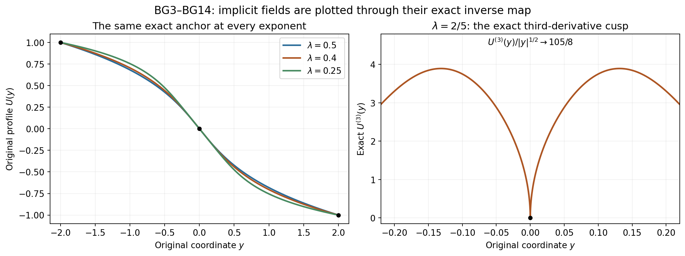
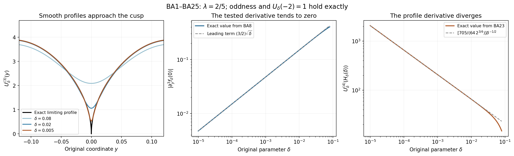
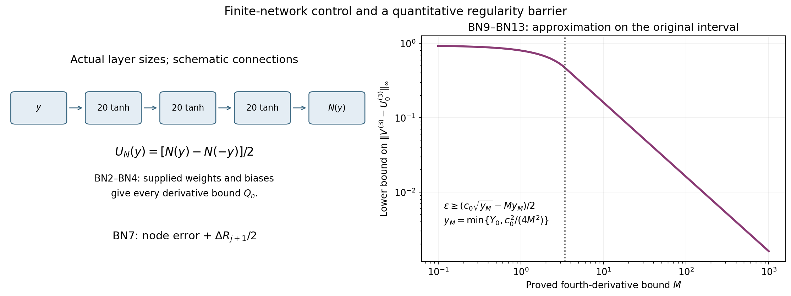
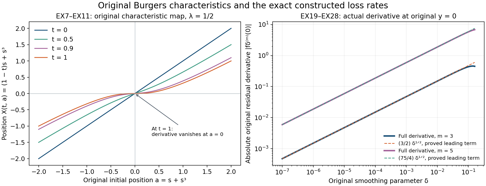

# Original Burgers profiles, characteristics and residual losses

The Burgers benchmark has an exact solution, an exact anchor and a
precise loss of smoothness. This makes it possible to calculate what
the residual tests measure, with every original coordinate and derivative
still present. We first prove the complete real branch and its uniqueness
and regularity, then construct smooth anchored approximations and bound
all their equation errors.

The third part supplies the actual parameter bounds for the source's
finite network architecture. It connects sampled residual derivatives
to continuous bounds and proves a quantitative limit on approximating
the nonsmooth profile with bounded fourth derivative.

Five solved exercises calculate the explicit cubic inverse, the full
characteristic map, every third-derivative product contribution, exact
residual-decay coefficients, and a completely specified network with
its actual equation and smoothness losses. The last two exercises prove
matching bounds for the constructed family and carry finite parameters
through every required derivative order.

The human source is Wang, Lai, Gómez-Serrano and Buckmaster; each part
identifies its original author-source passages. The smooth-family
limitation and finite-network estimates have their stated distinct
hypotheses. No source-trained computation or main blowup theorem is
certified or refuted by these benchmark calculations.

## Part 1. The original anchored Burgers profile and its exact real branch
This supplementary derivation reads the original author TeX of Yongji
Wang, Ching-Yao Lai, Javier Gómez-Serrano and Tristan Buckmaster,
[arXiv:2201.06780v3](https://arxiv.org/abs/2201.06780v3),
`BoussinesqSupp_v5.tex`291–315 and329–353. The source states the
Burgers equation, its similarity ansatz, odd symmetry, the anchor at
minus two, the implicit power and the discrete smooth exponents.
Here the real branch and its complete local regularity are proved.
The source's numerical accuracy and stability claims are not assumed.

## BG1. Keep the original equation, time, anchor and power

The physical equation and the source's original similarity variables are
\[
 u_t+u u_x=0,\qquad \tau=1-t>0,\qquad
 y=\frac{x}{\tau^{1+\lambda}},\qquad u(t,x)=\tau^\lambda U(y),
 \qquad\lambda>0.
 \tag{BG1}
\]
The exact derivative calculation is
\[
 \begin{aligned}
 u_t&=\tau^{\lambda-1}[-\lambda U+(1+\lambda)yU'],\\
 u_x&=\tau^{-1}U',\qquad
 uu_x=\tau^{\lambda-1}UU',\\
 u_t+uu_x&=\tau^{\lambda-1}f_\lambda[U](y),\\
 f_\lambda[U]&=-\lambda U+((1+\lambda)y+U)U'.
 \end{aligned}
 \tag{BG2}
\]
The profile is odd and satisfies \(U(-2)=1\). Set
\(q=1/\lambda>0\), retaining this relation whenever it is used.
The globally real odd interpretation of the source's implicit power is
\[
 y=-U-CU|U|^q.
 \tag{BG3}
\]
For \(U>0\) this is precisely the displayed source power
\(-U-CU^{1+1/\lambda}\). Oddness determines the negative branch
in BG3. No complex branch of a negative noninteger power is used.
At the source anchor, \(-2=-1-C\), so \(C=1\) exactly.

Define on the entire original real line
\[
 H(s)=s+s|s|^q,\qquad h(s)=H'(s)=1+(1+q)|s|^q.
 \tag{BG4}
\]
The derivative at zero is one, as follows directly by a difference
quotient. Away from zero differentiation gives the displayed expression,
which tends to one at zero. Thus \(H\) is continuously differentiable,
odd, strictly increasing, and its image is the entire real line. Also
\(h\ge1\). Its inverse \(s=H^{-1}(y)\) is continuously
differentiable: the mean value theorem applied between two inverse
points gives \(ds/dy=1/h(s)\). Put
\[
 U(y)=-H^{-1}(y),\qquad U'(y)=-\frac1{h(H^{-1}(y))}.
 \tag{BG5}
\]
This constructs an odd, strictly decreasing \(C^1\) profile.
It has \(H(1)=2\), so \(U(-2)=1\). The full drift becomes
\[
 \begin{aligned}
 (1+\lambda)y+U
 &=(1+\lambda)(s+s|s|^q)-s\\
 &=\lambda s+(1+\lambda)s|s|^q
  =\lambda s[1+(1+q)|s|^q]=\lambda s h(s).
 \end{aligned}
 \tag{BG6}
\]
Consequently
\[
-\lambda U+((1+\lambda)y+U)U'
=\lambda s-\lambda s h/h=0
\]
including at zero. This verifies
the entire original equation, rather than just the implicit relation.

## BG2. Uniqueness with the source anchor, and the unanchored branches

Let \(V\) be any odd \(C^1\) solution on the real line with
\(V(-2)=1\). On the connected component of \(\{V>0\}\)
containing minus two, the equation gives
\[
 ((1+\lambda)y+V)V'=\lambda V>0.
\]
Neither factor on the left vanishes. At minus two the first factor is
\(-1-2\lambda<0\), so both this factor and \(V'\) remain
negative on that component. There is a differentiable inverse
\(y=y(v)\), with \(v=V(y)>0\), satisfying
\[
 \lambda v\frac{dy}{dv}=(1+\lambda)y+v,\qquad
 \frac{d}{dv}\left[\frac{y(v)+v}{v^{1+q}}\right]=0.
 \tag{BG7}
\]
The second identity follows by expanding the derivative and using
\(q=1/\lambda\). The anchor makes its constant minus one.
Thus \(y=-v-v^{1+q}\) everywhere on the component, so
\(V\) agrees there with BG5. The right endpoint of this component
must be zero: a finite endpoint has \(V=0\) by continuity, and
the implicit relation then gives \(y=0\). It cannot have right
endpoint infinity because the relation has \(y<0\). The left
endpoint cannot be finite, because continuity would again give
\(V=0\) and \(y=0\), contradicting its position to the left
of minus two. Hence the component is \(( -\infty,0)\).
Oddness proves equality on the positive half-line as well. This proves
uniqueness in the full stated anchored class.

Without the anchor, the same construction works for every \(C>0\)
with \(H_C(s)=s+Cs|s|^q\). Its derivative is
\(1+C(1+q)|s|^q>0\), and the same complete drift calculation
verifies the equation. At \(C=0\), the resulting profile is
\(U(y)=-y\), smooth for every \(\lambda>0\), but its anchor
value is \(U(-2)=2\). The identically zero profile also solves
the equation and fails the anchor. Therefore the discrete smoothness
statement below must retain the source's nontrivial anchored branch.
It is not a classification of all unanchored solutions.

For \(C<0\), the derivative of \(H_C\) first vanishes at
\[
 s_*=[-C(1+q)]^{-1/q}>0.
 \tag{BG8}
\]
At that point the inverse branch from zero has an unbounded derivative.
Thus this inverse construction does not extend through that point as a
global \(C^1\) profile. This fact is only about that specified branch;
the anchored uniqueness argument did not rely on it.

## BG3. Exact differentiability and Hölder regularity at zero

Write \(r=1+q>1\). The nonlinear term of \(H\) is
\(b(s)=s|s|^{r-1}\). For every integer \(k\ge0\) and
\(s\ne0\), its complete derivative is
\[
 b^{(k)}(s)=
 \begin{cases}
 r(r-1)\cdots(r-k+1)s^{r-k},&s>0,\\
 (-1)^{k+1}r(r-1)\cdots(r-k+1)|s|^{r-k},&s<0.
 \end{cases}
 \tag{BG9}
\]
An empty product equals one. This follows by repeated differentiation
on each open half-line; the sign in the second line comes from
\(b(s)=-(-s)^r\). For \(k<r\), the displayed functions tend
to zero at the origin. Successive difference quotients show that they
are the continuous derivatives there whenever the next required power
has positive exponent.

Suppose first that \(r\) is not an integer. Put
\(m=\lfloor r\rfloor\) and \(\alpha=r-m\in(0,1)\).
Then \(b\in C^{m,\alpha}_{\mathrm{loc}}\). Here this notation
means that the first \(m\) derivatives are continuous and the last
is locally Hölder continuous with exponent \(\alpha\). To verify
the endpoint exponent, on one half-line use
\[
 |a^\alpha-b^\alpha|\le |a-b|^\alpha\quad(a,b\ge0).
\]
For \(a=b+d\), this follows because
\((b+d)^\alpha-b^\alpha\) is decreasing as a function of
\(b>0\) and has value \(d^\alpha\) at zero. On opposite
half-lines, bound the sum of the two powers by
\(2|s-t|^\alpha\). Multiplying by the full product in BG9
proves the assertion. The same formula shows that the \(m\)-th
derivative is not Hölder with any larger exponent at zero: its value
divided by \(|s|^\beta\) has nonzero magnitude proportional to
\(|s|^{\alpha-\beta}\), unbounded when \(\beta>\alpha\).
In particular \(b\notin C^{m+1}\).

If \(r\) is an even integer, BG9 gives
\(b\in C^{r-1,1}_{\mathrm{loc}}\). Its \((r-1)\)-st
derivative is a constant multiple of \(|s|\), while its one-sided
\(r\)-th derivatives are \(r!\) and \(-r!\); thus
\(b\notin C^r\). If \(r\) is an odd integer, the entire
term is the polynomial \(s^r\), so it is smooth.

We now prove that the same precise regularity transfers to the original
inverse profile, rather than asserting it from a change of notation.
Let \(w=H^{-1}\). At every differentiability order already
available, repeated differentiation of \(H(w(y))=y\) gives
\[
 H'(w)w^{(n)}
 =-\sum_{k=2}^{n}H^{(k)}(w)
 \sum_{\substack{a_1,\ldots,a_{n-1}\ge0\\
             \sum a_j=k,\ \sum j a_j=n}}
 \frac{n!}{\prod_{j=1}^{n-1}a_j!(j!)^{a_j}}
                 \prod_{j=1}^{n-1}(w^{(j)})^{a_j},\qquad n\ge2.
 \tag{BG10}
\]
For \(n=1\), the separate equation is \(w'=1/H'(w)\).
One obtains the full coefficients in BG10 by the product and chain
rules: partition the \(n\) labelled derivative operations into
\(a_j\) unordered groups of size \(j\). Their number is
\(n!/\prod a_j!(j!)^{a_j}\); each group differentiates one
inverse factor and each group together raises the derivative of \(H\)
once. The single group of size \(n\) is exactly the isolated term
\(H'(w)w^{(n)}\). This proves the formula inductively and accounts
for every term.

Since \(H'\ge1\), this identity inductively proves that an
inverse of a \(C^n\) function is \(C^n\) here. For the Hölder
claim, \(w\) is Lipschitz because \(|w'|\le1\). Composition
of a Hölder function with a Lipschitz map preserves the exponent.
Finite products preserve it on compact sets, by expanding the product
difference one factor at a time and bounding the other factors. A
reciprocal preserves it when the denominator is bounded away from
zero, by its exact two-point difference. These observations applied to
BG10 give the same local Hölder exponent for \(w^{(n)}\).

Conversely, if \(w\), or \(U=-w\), had a larger stated
regularity near zero, then \(w'(0)=1\) and the same inverse
formula, now solving for \(H\), would give that larger regularity
to \(H\). This contradicts BG9. We have therefore proved the
complete classification for the anchored profile:
\[
 \begin{array}{c|c}
 r=1+1/\lambda&\text{exact local regularity of }U\text{ at zero}\\\hline
 r\notin\mathbb Z&C^{\lfloor r\rfloor,r-\lfloor r\rfloor},
          \text{ with no larger last Hölder exponent}\\
 r\text{ even integer}&C^{r-1,1}\text{ but not }C^r\\
 r\text{ odd integer}&C^\infty
 \end{array}
 \tag{BG11}
\]
In the last case repeated use of BG10 proves every order. In all cases
the profile is smooth away from zero. Thus the original source's smooth
sequence, with its anchor retained, is precisely
\[
 \lambda=\frac1{2i+2},\qquad i=0,1,2,\ldots.
 \tag{BG12}
\]

## BG4. The stated cusp and the actual physical derivative

For the source's \(\lambda=2/5\), \(q=5/2\), set
\(s=H^{-1}(y)\) and \(h=1+(7/2)|s|^{5/2}\). Differentiating
the full inverse map gives, away from zero,
\[
 \begin{aligned}
 U'&=-h^{-1},\qquad U''=h'/h^3,\\
 U'''&=h''/h^4-3(h')^2/h^5,\\
 U''''&=h'''/h^5-10h'h''/h^6+15(h')^3/h^7.
 \end{aligned}
 \tag{BG13}
\]
Here the primes on \(h\) are derivatives in \(s\), and
\(\partial_y=h^{-1}\partial_s\). On \(s>0\), the actual
three derivatives are
\[
 h'=\frac{35}{4}s^{3/2},\qquad
 h''=\frac{105}{8}s^{1/2},\qquad
 h'''=\frac{105}{16}s^{-1/2}.
\]
The first and third change sign on the negative side, and the second
does not. Since \(y/s=1+|s|^{5/2}\to1\), all terms of BG13
give the exact limits
\[
 \lim_{y\to0}\frac{U'''(y)}{|y|^{1/2}}=\frac{105}{8},\qquad
 \lim_{y\to0}\operatorname{sgn}(y)|y|^{1/2}U''''(y)
       =\frac{105}{16}.
 \tag{BG14}
\]
Indeed the squared term in \(U'''\), divided by \(|s|^{1/2}\),
has order \(|s|^{5/2}\); the last two terms in \(U''''\),
multiplied by \(|s|^{1/2}\), have orders \(|s|^{5/2}\) and
\(|s|^5\), respectively. Their full coefficients and denominators
remain in BG13. This proves the source's third-derivative cusp in its
precise \(C^{3,1/2}\) class and the failure of fourth differentiability.

Finally \(U'(0)=-1\) for every \(\lambda>0\), hence the
original physical solution has
\[
 \partial_xu(t,0)=-\frac1{1-t},\qquad
 \partial_x^ku(t,x)=\tau^{\lambda-k(1+\lambda)}U^{(k)}(y)
 \tag{BG15}
\]
at each available derivative order. At a discrete smooth exponent the
solution is smooth for every \(t<1\), and the first expression
exhibits loss of bounded gradient at the terminal time. At a
nondiscrete exponent it already has the spatial regularity limitation
of BG11 for every such time. These statements concern the original
one-dimensional inviscid Burgers equation, with the full time factors
shown; they are not a Navier–Stokes conclusion.

The left panel evaluates BG3–BG5 at the original exponents
\(1/2,2/5,1/4\); the original anchor is visible at \((-2,1)\).
The right panel evaluates the complete derivative BG13 at
\(\lambda=2/5\). Its cusp coefficient is proved in BG14, rather
than inferred from the plotted samples. The human comparison is the
source's implicit branch and nonsmooth benchmark at lines305–315 and336.
[Reproducible figure source](../assets/burgers-profile-comparisons.py)
and [vector rendering](../assets/burgers-real-branch.svg).

## Part 2. Anchored smooth Burgers approximants and complete residual-derivative bounds
This note continues the full real-branch calculation
BG1–BG15. Its human
comparison is Wang, Lai, Gómez-Serrano and Buckmaster,
[arXiv:2201.06780v3](https://arxiv.org/abs/2201.06780v3), original
`BoussinesqSupp_v5.tex`291–350. Lines343–350 use third and fifth
derivatives of the Burgers equation error to help select smooth profiles.
We calculate exactly what those errors can do on the class of smooth
odd functions with the source anchor. No source-trained network is assumed,
and no novelty or stability claim is made.

## BA1. Construct the actual anchored family and its original residual

Retain \(\lambda>0\), \(q=1/\lambda\), \(0<\delta\le1\)
and the original coordinate \(y\in\mathbb R\). Define
\[
 \begin{aligned}
 C_\delta&=(1+\delta^2)^{-q/2},\\
 H_\delta(s)&=s+C_\delta s(s^2+\delta^2)^{q/2},\\
 h_\delta(s)=H_\delta'(s)
 &=1+C_\delta(s^2+\delta^2)^{q/2}
       +C_\delta q s^2(s^2+\delta^2)^{q/2-1},\\
 s_\delta(y)&=H_\delta^{-1}(y),\qquad U_\delta(y)=-s_\delta(y).
 \end{aligned}
 \tag{BA1}
\]
The strictly positive radicand makes every power smooth. All three terms
of \(h_\delta\) are nonnegative and the first is one. Thus
\(H_\delta\) is an odd strictly increasing bijection of the real
line with derivative at least one. The mean value theorem gives the
derivative of its inverse; the complete recurrence BG10 then proves
that \(U_\delta\) is smooth. We have the exact identities
\[
 H_\delta(1)=2,\quad U_\delta(-2)=1,\quad
 |s_\delta(y)|\le|y|,\quad U_\delta'(y)=-1/h_\delta(s_\delta(y)).
 \tag{BA2}
\]
The absolute-value bound follows from
\(|H_\delta(s)|=|s|+C_\delta|s|(s^2+\delta^2)^{q/2}\).
The profile is odd, so the source's anchor and symmetry are both exact.

Write \(s=s_\delta(y)\) and keep the original equation error
\(f_\delta=f_\lambda[U_\delta]\). Direct substitution, before
combining any terms, gives
\[
 \begin{aligned}
 f_\delta(y)
 &=\lambda s-\frac{(1+\lambda)H_\delta(s)-s}{h_\delta(s)}\\
 &=\frac{\lambda s h_\delta(s)-(1+\lambda)H_\delta(s)+s}
             {h_\delta(s)}\\
 &=\frac{C_\delta s[-(s^2+\delta^2)^{q/2}
           +\lambda q s^2(s^2+\delta^2)^{q/2-1}]}
             {h_\delta(s)}\\
 &=-\frac{C_\delta\delta^2s(s^2+\delta^2)^{q/2-1}}
             {h_\delta(s)}.
 \end{aligned}
 \tag{BA3}
\]
The last equality uses \(\lambda q=1\) and the entire difference
\(-(s^2+\delta^2)+s^2=-\delta^2\). For every positive
\(\delta\), the residual is nonzero away from zero. Its value at
zero is exactly zero. Its physical receiving residual remains
\(\tau^{\lambda-1}f_\delta(x/\tau^{1+\lambda})\), by BG2.

## BA2. Every original-coordinate derivative, including all denominators

Set
\[
 g(s)=-C_\delta\delta^2s(s^2+\delta^2)^{q/2-1},\qquad
 h(s)=h_\delta(s),\qquad F(s)=g(s)/h(s).
\]
The original derivative is \(\partial_y=h^{-1}\partial_s\),
so repeated differentiation gives
\[
 \begin{aligned}
 f_\delta&=F,\\
 \partial_y f_\delta&=F'/h,\\
 \partial_y^2 f_\delta&=F''/h^2-F'h'/h^3,\\
 \partial_y^3 f_\delta&=F'''/h^3-3F''h'/h^4
                         -F'h''/h^4+3F'(h')^2/h^5.
 \end{aligned}
 \tag{BA4}
\]
Primes on \(F,g,h\) mean \(s\)-derivatives, and the right sides
are evaluated at \(s_\delta(y)\). Each line follows by applying
\(h^{-1}\partial_s\) to every term of the preceding line.

For all higher orders we give a finite exact recurrence that retains
every summand. A record \((c,j,a,b)\), with a finitely supported
array \(a=(a_1,a_2,\ldots)\) of nonnegative integers, denotes
the full term
\[
 c\,g^{(j)}\frac{\prod_{k\ge1}(h^{(k)})^{a_k}}{h^b}.
 \tag{BA5}
\]
Start at derivative order zero with the single record \((1,0,0,1)\).
To pass to the next order, replace each record by all of the following:
\[
 \begin{aligned}
 &(c,j+1,a,b+1),\\
 &(c a_k,j,a-e_k+e_{k+1},b+1)
                         &&\text{for each }k\text{ with }a_k>0,\\
 &(-bc,j,a+e_1,b+2).
 \end{aligned}
 \tag{BA6}
\]
Here \(e_k\) has one in place \(k\) and zero elsewhere.
The first line differentiates \(g^{(j)}\), the second every
numerator factor, and the third the denominator. Each also includes
the outer factor \(h^{-1}\). Thus the sum of all records at step
\(m\), denoted \(\mathcal T_m\), is exactly
\(\partial_y^m f_\delta\). Duplicate records may remain in
the list: they are separate product-rule contributions. The list is
finite at every fixed order. Induction in BA6 proves for each record
\[
 j+\sum_{k\ge1}k a_k=m,\qquad
 b=m+1+\sum_{k\ge1}a_k.
 \tag{BA7}
\]
This identifies every derivative order and denominator in the original
coordinate, including the source's fifth derivative.

At zero, \(h'(0)=g(0)=0\). Direct differentiation gives
\[
 \begin{aligned}
 h(0)&=1+C_\delta\delta^q,&
 h''(0)&=3C_\delta q\delta^{q-2},\\
 g'(0)&=-C_\delta\delta^q,&
 g'''(0)&=-3C_\delta(q-2)\delta^{q-2},\\
 \partial_y^3 f_\delta(0)
 &=-\frac{3C_\delta(q-2)\delta^{q-2}}
              {(1+C_\delta\delta^q)^4}
   +\frac{12C_\delta^2q\delta^{2q-2}}
              {(1+C_\delta\delta^q)^5}.
 \end{aligned}
 \tag{BA8}
\]
For the last identity use
\(F'(0)=g'(0)/h(0)\) and
\[
F'''(0)=g'''(0)/h(0)-3g'(0)h''(0)/h(0)^2
\]
in BA4. The additional term \(-F'h''/h^4\) accounts for the
fourth copy of \(-g'h''/h^5\). Dropping it would give an
incorrect coefficient even at the origin.

## BA3. Explicit finite constants for every derivative bound

Fix an actual original interval \([-A,A]\), \(A>0\), and put
\[
 \rho=(s^2+\delta^2)^{1/2},\qquad T_A=(A^2+1)^{1/2}.
\]
By BA2, for \(|y|\le A\) we have \(|s|\le A\), and hence
\(\delta\le\rho\le T_A\). No coordinate interval is being
substituted for a different original interval.

For real \(\beta\) and every integer \(n\ge0\), the full
derivative of the power is
\[
 \partial_s^n\rho^\beta
 =\sum_{j=0}^{\lfloor n/2\rfloor}
 \frac{n!2^{n-2j}}{(n-2j)!j!}
 \left(\frac\beta2\right)_{\!\underline{n-j}}
 s^{n-2j}(s^2+\delta^2)^{\beta/2-n+j}.
 \tag{BA9}
\]
The falling product \((v)_{\underline\ell}=v(v-1)\cdots
(v-\ell+1)\) is one when \(\ell=0\). To prove BA9, distribute
the \(n\) derivatives among the first and second derivatives of
\(s^2+\delta^2\). If \(j\) groups have size two, the other
\(n-2j\) groups have size one. The partition coefficient is
\(n!/((n-2j)!j!(2!)^j)\). The inner derivatives contribute
\((2s)^{n-2j}2^j\), and the outer derivative of order \(n-j\)
gives the displayed falling product and power. There are no higher
nonzero inner derivatives. This proves the formula and all its factors.

Define explicit nonnegative finite constants
\[
 \begin{aligned}
 P_n(\beta)&=\sum_{j=0}^{\lfloor n/2\rfloor}
 \frac{n!2^{n-2j}}{(n-2j)!j!}
 \left|\left(\frac\beta2\right)_{\!\underline{n-j}}\right|,\\
 B_0(\beta)&=1,\qquad
 B_n(\beta)=P_n(\beta)+nP_{n-1}(\beta)\quad(n\ge1).
 \end{aligned}
 \tag{BA10}
\]
Every term of BA9 is bounded using \(|s|\le\rho\); all have
the same resulting power \(\rho^{\beta-n}\). The product rule
for \(s\rho^\beta\) has exactly the two terms
\(s\partial_s^n\rho^\beta+n\partial_s^{n-1}\rho^\beta\).
It follows that
\[
 \begin{aligned}
 |\partial_s^n\rho^\beta|&\le P_n(\beta)\rho^{\beta-n},\\
 |\partial_s^n(s\rho^\beta)|&\le B_n(\beta)\rho^{\beta+1-n},\\
 |g^{(j)}|&\le C_\delta\delta^2 B_j(q-2)\rho^{q-1-j},\\
 |h^{(k)}|&\le C_\delta B_{k+1}(q)\rho^{q-k}\quad(k\ge1).
 \end{aligned}
 \tag{BA11}
\]
The linear term of \(H_\delta\) contributes the constant one
to \(h\), which remains in every denominator. It vanishes only
after at least one further \(s\)-derivative, as required in the
last line. We retain \(h\ge1\) separately.

Let \((c,j,a,b)\in\mathcal T_m\), put \(N=\sum a_k\)
and keep its exact exponent
\[
 E=q-1-m+qN.
 \tag{BA12}
\]
Using BA7 and BA11 in the original term BA5 bounds it by
\[
 |c|\,C_\delta^{1+N}\delta^2
 B_j(q-2)\prod_{k\ge1}B_{k+1}(q)^{a_k}
               \frac{\rho^{E}}{h^{m+1+N}}.
 \tag{BA13}
\]
Thus the coefficient, the complete residual factor, all numerator
derivatives and the entire denominator are identifiable before any
upper bound is taken. Now use \(0<C_\delta\le1\), \(h\ge1\).
For any real \(E\), the interval bounds on \(\rho\) give
\[
 \delta^2\rho^E\le
 T_A^{\max(E,0)}\delta^{\min(2,E+2)}.
 \tag{BA14}
\]
For \(E\ge0\) this follows from \(\rho\le T_A\); for
\(E<0\) it follows from \(\rho\ge\delta\). These are the
two cases of the displayed inequality.

Define the full finite constant below for every \(q>0\). When
\(q>m-1\), the accompanying exponent is positive:
\[
 \begin{aligned}
 \eta_m&=\min(2,q+1-m)>0,\\
 D_m(q,A)&=\sum_{(c,j,a,b)\in\mathcal T_m}
 |c|B_j(q-2)\prod_{k\ge1}B_{k+1}(q)^{a_k}
 T_A^{\max(q-1-m+q\sum a_k,0)}.
 \end{aligned}
 \tag{BA15}
\]
Since \(E\ge q-1-m\), the exponent of \(\delta\) in
BA14 is at least \(\eta_m\). As \(\delta\le1\), summing
BA13 therefore proves the complete quantitative estimate
\[
 \sup_{|y|\le A}|\partial_y^m f_\delta(y)|
       \le D_m(q,A)\delta^{\eta_m}.
 \tag{BA16}
\]
All the terms in \(D_m\) are specified finite products and sums;
none is an assumed bound. For every \(0\le k\le m\), the
same proof gives its own \(D_k\) and exponent \(\eta_k\ge\eta_m\).
In particular the maximum of all those derivative suprema is at most
\(\max_{0\le k\le m}D_k(q,A)\delta^{\eta_m}\).

At a source smooth exponent, \(q\) is a positive even integer.
In that case BA16 improves to an exponent two for every derivative
order, even when \(m\ge q+1\). Indeed
\(s(s^2+\delta^2)^{(q-2)/2}\) is a polynomial of degree
\(q-1\), and \(h\) is a polynomial of degree \(q\).
Thus a nonzero BA13 term must have \(j\le q-1\) and every
used \(k\le q\). Its exponent can also be written
\(E=q-1-j+\sum(q-k)a_k\ge0\). Terms outside these ranges
have exactly zero coefficients in BA10. Applying the nonnegative case
of BA14 to all remaining terms proves the exponent-two estimate with
the same full finite sum \(D_m\).

## BA4. Prove the exact limit and its derivative regularity

Let \(H_0(s)=s+s|s|^q\) and let \(U_0=-H_0^{-1}\) be
the original anchored profile of BG4–BG5. We now prove, for every
integer \(m\ge1\) with \(q>m-1\),
\[
 U_\delta\longrightarrow U_0\quad\text{in }C^m([-A,A])
                 \quad\text{as }\delta\downarrow0.
 \tag{BA17}
\]
First, \(H_\delta\to H_0\) in \(C^m\) on every compact
\(s\)-interval. Here is the full argument at the exceptional point.
For \(k\le m\), the nonlinear term's \(k\)-th derivative in
BA11 is bounded by
\(B_k(q)(s^2+\delta^2)^{(q+1-k)/2}\), with positive exponent
\(q+1-k\). The same derivative of \(s|s|^q\) is given by
BG9 and bounded by its full falling-product constant times
\(|s|^{q+1-k}\). On \(|s|\le\epsilon\) and
\(\delta\le\epsilon\), both therefore tend uniformly to
zero as \(\epsilon\downarrow0\). The linear term \(s\)
and each of its derivatives agree exactly in the two functions and
are not part of that estimate. On a compact set with
\(|s|\ge\epsilon>0\), formula BA9 and
\(C_\delta\to1\) give uniform convergence of every derivative
through order \(m\), since all powers have positive radicand
bounded away from zero. Combining the two regions proves the claim.

Let \(w_\delta=H_\delta^{-1}\) and \(w_0=H_0^{-1}\).
The derivative lower bound one and the mean value theorem imply
\[
 \begin{aligned}
 |w_\delta(y)-w_0(y)|
 &\le |H_\delta(w_0(y))-H_0(w_0(y))|\\
 &\le \sup_{|s|\le A}|H_\delta(s)-H_0(s)|
                         \qquad(|y|\le A).
 \end{aligned}
 \tag{BA18}
\]
Both inverse points belong to \([-A,A]\), by BA2 and its
\(\delta=0\) counterpart. This proves uniform convergence.
For first derivatives, use \(w_\delta'=1/(H_\delta'\circ
w_\delta)\): the denominators converge uniformly and stay at least
one. For each successive derivative up to \(m\), use every term
of BG10. The derivatives of \(H_\delta\) converge uniformly,
their limiting derivatives are uniformly continuous on the compact
interval, and lower inverse derivatives have already converged.
Products and the reciprocal denominator therefore converge uniformly.
This induction proves BA17 for \(U_\delta=-w_\delta\).

## BA5. The source loss can tend to zero at a nonsmooth exponent

Take an integer \(n\ge1\), \(0<\alpha<1\), and retain
\[
 m=2n+1,\qquad q=2n+\alpha,\qquad
 \lambda=\frac1{2n+\alpha}.
 \tag{BA19}
\]
This exponent belongs to the source's window
\([1/(2n+1),1/(2n-1)]\). It is not the smooth exponent
\(1/(2n)\). BG11 proves that its unique odd anchored exact
profile is \(C^{m,\alpha}\), with no better last Hölder
exponent, and is not \(C^{m+1}\). Yet every \(U_\delta\)
is smooth, odd and satisfies the anchor exactly, and BA16–BA17 give
\[
 \begin{aligned}
 U_\delta&\longrightarrow U_0\quad\text{in }C^m([-A,A]),\\
 \max_{0\le k\le m}\sup_{|y|\le A}
            |\partial_y^k f_\delta(y)|
 &\le\left(\max_{0\le k\le m}D_k(q,A)\right)\delta^\alpha.
 \end{aligned}
 \tag{BA20}
\]
This proves a precise failure of the inference from small residual
derivatives alone to a smooth exact limiting profile in this function
class. It also supplies the actual family and the exact limiting map.

For the source's finite value samples \(y_i\) and smoothness samples
\(\widetilde y_i\), all in a fixed \([-A,A]\), use their
actual positive counts \(N_f,N_s\). They may depend on \(\delta\).
The original averages obey
\[
 \begin{aligned}
 |U_\delta(-2)-1|^2&=0,\\
 \frac1{N_f}\sum_{i=1}^{N_f}|f_\delta(y_i)|^2
                 &\le D_0(q,A)^2\delta^4,\\
 \frac1{N_s}\sum_{i=1}^{N_s}
         |\partial_y^{2n+1}f_\delta(\widetilde y_i)|^2
                 &\le D_{2n+1}(q,A)^2\delta^{2\alpha}.
 \end{aligned}
 \tag{BA21}
\]
The value exponent is four because \(q>2\), so \(\eta_0=2\).
Every summand is bounded by its continuous supremum, and the division
by the same sample count then gives the displayed estimates. No
assumption on how the points are distributed is needed for this direction.
Any fixed nonnegative weighted sum of these losses tends to zero.

The source's third-derivative test is the case \(n=1\). Its own
nonsmooth example \(\lambda=2/5\) has \(q=5/2\),
\(\alpha=1/2\); the third-derivative loss in BA21 is at most
\(D_3(5/2,A)^2\delta\). For the fifth-derivative test take
\(n=2\), \(\lambda=2/9\), \(q=9/2\): the fifth-derivative
loss is at most \(D_5(9/2,A)^2\delta\). These are actual
nondiscrete exponents in the respective stated windows.

For the exact nonsmooth profile, \(f_\lambda[U_0]\) is the
identically zero function by BG6. Consequently all derivatives of that
residual as a function are zero. This fact does not permit invalid
term-by-term differentiation through unavailable derivatives of
\(U_0\) at zero. BA1–BA21 avoid that issue entirely by using
smooth approximants and computing every term before taking a limit.

The source's actual architecture for this example has three hidden
layers of twenty tanh units, with odd projection. The family BA1 is
not asserted to belong to that fixed architecture. Indeed every finite
affine-output tanh network with fixed finite parameters is globally
bounded by its output bias plus the sum of absolute output weights;
odd projection preserves a finite global bound. Each \(U_\delta\)
is unbounded on the real line because \(H_\delta\) is a bijection.
Thus there is no exact global identification with such a network.
BA21 is a theorem about the stated smooth anchored function class,
not a failed numerical training run or a contradiction of the source's
reported finite-network results. A fixed-architecture selection theorem
would require additional parameter and approximation analysis.

## BA6. Locate the escaping derivative, with its complete coefficient

At \(q=5/2\), take the actual point
\[
 y_\delta=H_\delta(\delta)
        =\delta+C_\delta 2^{5/4}\delta^{7/2}.
 \tag{BA22}
\]
It tends to zero and lies in any fixed \([-A,A]\) for sufficiently
small \(\delta\). For the smooth family, the exact inverse
derivative formula is
\[
 U_\delta''''(y)=h'''/h^5-10h'h''/h^6+15(h')^3/h^7,
                    \qquad s=s_\delta(y).
 \tag{BA23}
\]
Let \(T(\xi)=\xi(1+\xi^2)^{5/4}\). The original nonlinear
term of \(H_\delta(\delta\xi)\) is
\(C_\delta\delta^{7/2}T(\xi)\), so the complete derivatives
at \(s=\delta\) are
\[
 \begin{aligned}
 h(\delta)&=1+C_\delta\delta^{5/2}T'(1),\\
 h'(\delta)&=C_\delta\delta^{3/2}T''(1),\\
 h''(\delta)&=C_\delta\delta^{1/2}T'''(1),\\
 h'''(\delta)&=C_\delta\delta^{-1/2}T''''(1),\\
 T'(1)&=2^{5/4}+\frac52 2^{1/4},\\
 T''(1)&=\frac{15}{2}2^{1/4}+\frac54 2^{-3/4},\\
 T'''(1)&=\frac{15}{8}
             [-2^{-7/4}+4\,2^{-3/4}+4\,2^{1/4}],\\
 T''''(1)&=\frac{15}{16\,2^{3/4}}
                 \left[\frac74-10+20\right]
              =\frac{705}{64\,2^{3/4}}>0.
 \end{aligned}
 \tag{BA24}
\]
These follow by direct differentiation of the displayed \(T\),
with all product contributions retained. Substitute them into BA23 and
multiply by \(\delta^{1/2}\). The first term tends to
\(T''''(1)\), since \(C_\delta\to1\) and
\(h(\delta)\to1\); the second retains a factor
\(\delta^{5/2}\), and the third a factor \(\delta^5\),
with bounded remaining coefficients. Therefore
\[
 \lim_{\delta\downarrow0}\delta^{1/2}
          U_\delta''''(y_\delta)=\frac{705}{64\,2^{3/4}}.
 \tag{BA25}
\]
This proves an unbounded fourth derivative while the original residual
and all its first three derivatives tend uniformly to zero on compact
intervals. It identifies the exact point and coefficient where regularity
is lost, rather than replacing the missing control by an assumption.

All panels use the original \(\lambda=2/5\) and exact anchor in
BA1–BA2. The left evaluates the full third derivative of the constructed
profiles in the original \(y\)-coordinate. The middle evaluates
BA8 at the origin, while the right evaluates BA23 at the actual point
BA22. Dashed curves are the proved leading terms; solid curves are
numerical evaluations of the full exact formulas. The uniform bounds
on the entire interval are proved separately in BA9–BA21. These are
constructed smooth profiles, not source-trained network outputs.
The human loss comparison is the source's lines343–350.
[Reproducible figure source](../assets/burgers-profile-comparisons.py)
and [vector rendering](../assets/burgers-anchored-residuals.svg).

## Part 3. Actual finite-network bounds for the Burgers losses
This calculation supplies the parameter-dependent control that can be used
alongside the smooth-family result
BA1–BA25.
It retains the original anchored profile
BG1–BG15.
The human architecture and loss source is Wang, Lai, Gómez-Serrano and
Buckmaster, [arXiv:2201.06780v3](https://arxiv.org/abs/2201.06780v3),
original `BoussinesqSupp_v5.tex`329–350: three hidden layers, twenty
tanh units per layer, odd projection, and the original Burgers residual.
All parameters below must be supplied; no trained values are inferred.

## BN1. Every layer, bias and derivative order

For a scalar input \(y\), retain the complete network
\[
 \begin{aligned}
 a^{(0)}_1(y)&=y,\qquad d_0=1,\quad d_1=d_2=d_3=20,\\
 b_i^{(\ell)}(y)&=\sum_{j=1}^{d_{\ell-1}}
             W_{ij}^{(\ell)}a_j^{(\ell-1)}(y)+\beta_i^{(\ell)},\\
 a_i^{(\ell)}(y)&=\tanh b_i^{(\ell)}(y),\qquad 1\le\ell\le3,\\
 N(y)&=\sum_{j=1}^{20}w_j a_j^{(3)}(y)+\beta_{\rm out},\\
 U_N(y)&=\frac{N(y)-N(-y)}2.
 \end{aligned}
 \tag{BN1}
\]
This specifies an affine output. If an implementation applies a final
tanh as well, that operation is one additional layer of the same
recurrence below. The input here is the original \(y\), as printed
in the source's Burgers architecture, not a different coordinate.

For all orders define exact derivative polynomials and explicit bounds
\[
 P_0(t)=t,\qquad P_{n+1}(t)=(1-t^2)P_n'(t),\qquad
 C_n=\sum_{j\ge0}|[t^j]P_n(t)|\quad(n\ge1).
 \tag{BN2}
\]
The notation \([t^j]P\) means the coefficient of \(t^j\) in
the finite polynomial. Induction and \((\tanh y)'=1-\tanh^2y\)
prove \(\partial_y^n\tanh y=P_n(\tanh y)\). Since
\(|\tanh y|\le1\), the triangle inequality proves its absolute
bound \(C_n\). These coefficient sums need not be optimal; they
are finite computable numbers and every derivative contribution is
retained. The value bound remains exactly one.
For the seven orders used by the source's two tests and their grid
control, the coefficient-sum bounds are explicitly
\[
 (C_1,C_2,C_3,C_4,C_5,C_6,C_7)
       =(2,4,16,80,512,3904,34816).
\]
These follow by seven applications of the polynomial recurrence BN2;
smaller proved constants can improve the numerical bounds, but are not
needed for their validity.

Let \(A_{i,n}^{(\ell)}\) bound the absolute \(n\)-th
derivative of \(a_i^{(\ell)}\) on the whole real line. At the
input set \(A_{1,1}^{(0)}=1\) and \(A_{1,n}^{(0)}=0\)
for \(n\ge2\). For each successive layer, compute
\[
 \begin{aligned}
 B_{i,n}^{(\ell)}&=\sum_{j=1}^{d_{\ell-1}}
              |W_{ij}^{(\ell)}|A_{j,n}^{(\ell-1)},\\
 A_{i,n}^{(\ell)}
 &=\sum_{\substack{a_1,\ldots,a_n\ge0\\\sum j a_j=n}}
 \frac{n!C_{\sum a_j}}{\prod_{j=1}^n a_j!(j!)^{a_j}}
                 \prod_{j=1}^n(B_{i,j}^{(\ell)})^{a_j}.
 \end{aligned}
 \tag{BN3}
\]
For each \(n\ge1\), the sum has finitely many entries and
\(\sum a_j\ge1\). A factor with exponent zero is one, including
when its base is zero. To prove this bound, the affine preactivation
has \(n\)-th derivative equal to the full weighted sum of the
previous layer derivatives; its bias derivative is zero. The partition
formula proved in BG10, now applied to \(\tanh\circ b_i^{(\ell)}\),
has exactly the coefficients in BN3. Bound its outer derivative by
BN2 and each inner derivative by the first line of BN3. This proves
the second line by induction on the layer. All hidden biases remain
in the actual arguments of tanh. Their absence from these global
derivative upper bounds follows from the uniform bound in BN2, not
from removing them from the network.

The output and odd projection satisfy the exact identities and bounds
\[
 \begin{aligned}
 U_N(y)&=\frac12\left[
 \sum_jw_j a_j^{(3)}(y)+\beta_{\rm out}
 -\sum_jw_j a_j^{(3)}(-y)-\beta_{\rm out}\right],\\
 U_N^{(n)}(y)&=\frac{N^{(n)}(y)-(-1)^nN^{(n)}(-y)}2,\\
 |U_N|&\le Q_0:=\sum_j|w_j|,\\
 |U_N^{(n)}|&\le Q_n:=\sum_j|w_j|A_{j,n}^{(3)}\quad(n\ge1).
 \end{aligned}
 \tag{BN4}
\]
Both output bias contributions are displayed and cancel exactly.
The two projected derivative terms have the same bound, so their
factor one-half is retained in deriving \(Q_n\).

## BN2. Full residual derivatives and the actual grid

For any smooth original profile \(U\), put \(p=1+\lambda\).
For every integer \(j\ge0\), repeated product differentiation of
the original residual gives
\[
 \partial_y^j f_\lambda[U]
 =-\lambda U^{(j)}
     +p[yU^{(j+1)}+jU^{(j)}]
     +\sum_{\ell=0}^j\binom j\ell
                     U^{(\ell)}U^{(j-\ell+1)}.
 \tag{BN5}
\]
Here \(U^{(0)}=U\); when \(j=0\), the term with factor
\(j\) is exactly zero. In the product \(yU'\), only zero
or one derivative can fall on \(y\), which proves its two terms.
The last sum is the full Leibniz rule for \(UU'\). In particular
the third tested derivative uses \(U''''\) multiplied by the
original drift, and the fifth uses \(U^{(6)}\). Neither highest
derivative can be estimated by dropping that coefficient near its zero.

Apply BN4 on the actual interval \([-A,A]\). Every term of BN5
has the explicit bound
\[
 R_j(\lambda,A,Q)=|\lambda|Q_j
    +|1+\lambda|[A Q_{j+1}+jQ_j]
    +\sum_{\ell=0}^j\binom j\ell Q_\ell Q_{j-\ell+1},
 \qquad |\partial_y^jf_\lambda[U_N]|\le R_j.
 \tag{BN6}
\]
The two linear contributions have been bounded separately; no sign or
constant in BN5 has been replaced in the original equation.

Let an actual ordered grid contain both endpoints of \([-A,A]\),
with maximum gap \(\Delta\). Every point of the interval has a
grid point within \(\Delta/2\). Applying the fundamental theorem
of calculus to \(\partial_y^jf\) between those two points gives
\[
 \sup_{|y|\le A}|\partial_y^jf_\lambda[U_N](y)|
 \le\max_{\rm nodes}|\partial_y^jf_\lambda[U_N]|
                   +\frac{\Delta}{2}R_{j+1}(\lambda,A,Q).
 \tag{BN7}
\]
Thus continuous control of the third-derivative loss from its grid
values uses network derivatives through order five, and control of
the fifth-derivative loss uses orders through seven. BN2–BN4 provide
those exact finite sums from the supplied parameters. Arbitrary random
samples do not automatically have this half-gap property; one must
compute their actual covering radius, including the endpoints.

If the only supplied quantity is the exact average
\(\ell_j=N_j^{-1}\sum_{i=1}^{N_j}|\partial_y^jf(y_i)|^2\)
over the nodes in question, retain the full estimate
\[
 \max_i|\partial_y^jf(y_i)|\le\sqrt{N_j\ell_j}.
 \tag{BN8}
\]
It follows from nonnegativity of each summand. The factor
\(\sqrt{N_j}\) cannot be removed. The anchor error is evaluated
at the actual point minus two using BN1; odd projection alone does
not impose that value. These formulas yield finite-domain error bounds,
not an exact nearby solution or a stability theorem.

## BN3. An explicit fourth-derivative barrier for the nonsmooth benchmark

Return to the original exact anchored profile \(U_0\) at
\(\lambda=2/5\). Retain \(s=H_0^{-1}(y)>0\) and
\(h=1+(7/2)s^{5/2}\). From the full inverse formula BG13,
\[
 U_0'''(y)=\frac{(105/8)s^{1/2}}{h^4}
       -\frac{3(35/4)^2s^3}{h^5}
 =\frac{(105/8)s^{1/2}(1-14s^{5/2})}{h^5}.
 \tag{BN9}
\]
The second expression is the exact combination of the two displayed
original terms, used only to estimate this same derivative. Define
\[
 s_0=28^{-2/5},\qquad
 Y_0=H_0(s_0)=\frac{29}{28}\,28^{-2/5},\qquad
 c_0=\frac{105}{16}\left(\frac89\right)^5
                       \sqrt{\frac{28}{29}}.
 \tag{BN10}
\]
For \(0<s\le s_0\), the full factors obey
\(1-14s^{5/2}\ge1/2\), \(h\le9/8\), and
\(y=s(1+s^{5/2})\le(29/28)s\). Therefore BN9 proves
\[
 U_0'''(y)\ge c_0\sqrt y\quad(0<y\le Y_0),\qquad
 U_0'''(0)=0.
 \tag{BN11}
\]
Let \(V\in C^4([0,Y_0])\), with
\(\|V''''\|_\infty\le M\), \(M\ge0\), and put
\(\epsilon=\|V'''-U_0'''\|_\infty\) on this same original
interval. For each \(0<y\le Y_0\), the exact two-point
decomposition and the fundamental theorem of calculus give
\[
 c_0\sqrt y
 \le|U_0'''(y)-V'''(y)|+|V'''(y)-V'''(0)|
                       +|V'''(0)-U_0'''(0)|
 \le2\epsilon+My.
 \tag{BN12}
\]
For \(M>0\) set \(y_M=\min\{Y_0,c_0^2/(4M^2)\}\).
For \(M=0\) set \(y_M=Y_0\). It follows that
\[
 \epsilon\ge\frac{c_0\sqrt{y_M}-My_M}{2}>0.
 \tag{BN13}
\]
The right side is positive because, when \(M>0\),
\(M\sqrt{y_M}\le c_0/2\). When
\(c_0^2/(4M^2)\le Y_0\), it equals \(c_0^2/(8M)\);
when \(M=0\), it equals \(c_0\sqrt{Y_0}/2\).
No fitting error or limiting derivative has been assumed here.

Taking \(V=U_N\) and \(M=Q_4\) gives a quantitative barrier
for any specified network to approximate the original third derivative
with a bounded fourth derivative. Taking \(V=U_\delta\) explains
why the approximation BA17 must let that fourth derivative escape;
BA25 locates it and supplies its exact coefficient. Thus the residual
loss, the original-coordinate grid estimate and the profile-regularity
bound have explicit proved relations. A small scalar loss by itself
does not replace these separate calculations.

The left is a schematic of the actual layer sizes and odd projection
in BN1, with all parameters still to be supplied. It identifies the
proved path from those parameters to the derivative and grid bounds.
The right evaluates the exact lower bound BN13 on the original
\([0,Y_0]\), with \(Y_0,c_0\) from BN10. The dotted line is
\(M=c_0/(2\sqrt{Y_0})\), where the two cases in \(y_M\)
meet; the curve is a proved bound, not a fitted network error.
The human architecture source is the original line330.
[Reproducible figure source](../assets/burgers-profile-comparisons.py)
and [vector rendering](../assets/burgers-network-regularity.svg).

## Five solved exercises

These exercises use the complete supporting proofs
BG1–BG15,
BA1–BA25 and
BN1–BN13.
The human comparison is Wang, Lai, Gómez-Serrano and Buckmaster,
[arXiv:2201.06780v3](https://arxiv.org/abs/2201.06780v3), original
`BoussinesqSupp_v5.tex`291–353. The equation, anchor, exponent windows,
network architecture and residual losses remain those of that source.
The constructions below are specified examples, not recovered trained
parameters. No novelty or full fluid-theorem claim is made.

### Exercise 1. Invert the original cubic and keep every physical time factor

At the first smooth exponent \(\lambda=1/2\), find the exact real
anchored profile. Calculate its original physical solution and the first
three spatial derivatives.

**Solution.**

Put
\[
 \theta(y)=\frac13\operatorname{arsinh}\left(\frac{3\sqrt3}{2}y\right),
 \qquad s(y)=\frac2{\sqrt3}\sinh\theta(y),\qquad U(y)=-s(y).
 \tag{EX1}
\]
Using \(\sinh(3\theta)=3\sinh\theta+4\sinh^3\theta\),
with all constants present, gives
\[
 s+s^3=\frac2{3\sqrt3}
       [3\sinh\theta+4\sinh^3\theta]
       =\frac2{3\sqrt3}\sinh(3\theta)=y.
 \tag{EX2}
\]
The triple-angle identity follows by multiplying the exponential
definitions of hyperbolic sine, or by expanding
\((e^\theta-e^{-\theta})^3\). The map \(s\mapsto s+s^3\)
has derivative \(1+3s^2>0\), is odd and has image the real line.
Consequently EX1 is its unique real inverse, with no choice of branch.
Since \(1+1^3=2\), it gives exactly \(U(-2)=1\).
BG6 at \(q=2\) verifies the entire original profile equation.

Write \(h=1+3s^2\). Direct inverse differentiation gives
\[
 U'=-\frac1h,\qquad U''=\frac{6s}{h^3},\qquad
 U'''=\frac6{h^4}-\frac{108s^2}{h^5}.
 \tag{EX3}
\]
Indeed \(s'=h^{-1}\) and \(\partial_s h=6s\); applying
\(h^{-1}\partial_s\) to each preceding expression proves all
three identities, including both terms in the last one.

For \(\tau=1-t>0\) and \(y=x/\tau^{3/2}\), the original
physical solution is
\[
 u(t,x)=-\frac{2\tau^{1/2}}{\sqrt3}
  \sinh\left[\frac13\operatorname{arsinh}
      \left(\frac{3\sqrt3 x}{2\tau^{3/2}}\right)\right].
 \tag{EX4}
\]
All derivatives below use \(s=s(x/\tau^{3/2})\) and the same
\(h=1+3s^2\):
\[
 \begin{aligned}
 u_x&=-\frac1{\tau h},\\
 u_{xx}&=\frac{6s}{\tau^{5/2}h^3},\\
 u_{xxx}&=\tau^{-4}\left[\frac6{h^4}
                                -\frac{108s^2}{h^5}\right],\\
 u_t+uu_x&=\tau^{-1/2}
       \left[-\frac12U+\left(\frac32y+U\right)U'\right]=0.
 \end{aligned}
 \tag{EX5}
\]
The first three time exponents are exactly
\(\lambda-k(1+\lambda)\) for \(k=1,2,3\); the last
line retains the complete physical residual factor. At the original
moving anchor, \(u(t,-2\tau^{3/2})=\tau^{1/2}\).
Also \(h\ge1\), with equality at the origin, so
\[
 \|u_x(t,\cdot)\|_{L^\infty(\mathbb R)}=\frac1{1-t}.
 \tag{EX6}
\]
Every displayed formula is smooth for \(t<1\). The gradient
becomes unbounded as \(t\uparrow1\).

### Exercise 2. Recover the same solution from its original characteristics

For every \(\lambda>0\), retain \(q=1/\lambda\). Starting
from the actual initial profile \(u(0,a)=-H^{-1}(a)\), construct
the full characteristic map, compare it with the similarity solution,
and determine its terminal continuous profile.

**Solution.**

Write the original initial coordinate as
\[
 a=H(s)=s+s|s|^q,\qquad u(0,a)=-s.
\]
The characteristic carrying that value has constant speed minus \(s\):
\[
 X(t,a)=a+t u(0,a)=(1-t)s+s|s|^q
                      =\tau s+s|s|^q.
 \tag{EX7}
\]
For \(t<1\), differentiation in the original label gives
\[
 \frac{\partial X}{\partial a}
 =\frac{\tau+(1+q)|s|^q}{1+(1+q)|s|^q}>0.
 \tag{EX8}
\]
This includes the origin: both derivatives of the signed power exist
there, and its derivative is zero. The map in \(s\) in EX7 is
strictly increasing and tends to the two infinite endpoints. It is
therefore a global \(C^1\) bijection with \(C^1\) inverse
at every fixed \(t<1\). Defining \(u(t,X(t,a))=-s\)
gives \(u_t+u u_x=0\) by differentiation along EX7, because
\(\partial_t X=-s=u\) and the transported value is constant.

To prove equality with the original similarity construction, set
\(z=s/\tau^\lambda\), keeping \(s\) as the initial label
parameter. Since \(\lambda q=1\), the complete map satisfies
\[
 \begin{aligned}
 \tau^{1+\lambda}H(z)
 &=\tau^{1+\lambda}\left[
       \frac{s}{\tau^\lambda}
       +\frac{s|s|^q}{\tau^{\lambda(1+q)}}\right]\\
 &=\tau s+s|s|^q=X(t,a),\\
 \tau^\lambda[-H^{-1}(X/\tau^{1+\lambda})]&=-s.
 \end{aligned}
 \tag{EX9}
\]
Both summands and both powers have been tracked, so EX9 proves equality
of the physical functions at every original point. Dividing the
initial derivative by EX8 gives
\[
 u_x(t,X(t,a))
 =\frac{-1/[1+(1+q)|s|^q]}
        {[\tau+(1+q)|s|^q]/[1+(1+q)|s|^q]}
 =-\frac1{\tau+(1+q)|s|^q}.
 \tag{EX10}
\]
Thus the global gradient norm equals \(1/\tau\), attained at
\(s=a=X=0\), for every positive \(q\).

At \(t=1\), the map becomes \(x=s|s|^q\), still strictly
increasing and onto, with continuous inverse. Its velocity is
\[
 u(1,x)=-\operatorname{sgn}(x)|x|^{1/(1+q)}
       =-\operatorname{sgn}(x)|x|^{\lambda/(1+\lambda)},
 \qquad u(1,0)=0.
 \tag{EX11}
\]
This is the pointwise limit of the original solution. For fixed
\(x\ne0\), EX7 gives \(s\) the same sign as \(x\) and
\(|s|\le |x|^{1/(1+q)}\). Every convergent subsequence as
\(\tau\downarrow0\) therefore solves
\(x=s|s|^q\), whose solution is unique. Boundedness and this
uniqueness prove convergence of the whole family. At \(x=0\),
\(s=0\) at every time, which proves the remaining case.

Put \(\gamma=1/(1+q)\in(0,1)\). On each half-line the
inequality \(|b^\gamma-c^\gamma|\le|b-c|^\gamma\)
proved in BG3 applies; across zero the sum of the two powers is at
most \(2|b-c|^\gamma\). Hence EX11 is locally Hölder of
exponent \(\gamma\). At zero its absolute difference quotient
against any exponent \(\beta>\gamma\) is
\(|x|^{\gamma-\beta}\), unbounded. This proves the exact
terminal exponent and failure of a finite derivative at zero.

The preterminal spatial regularity remains exactly BG11. Smooth initial
profiles occur at the discrete exponents of BG12. The other exponents
already have the stated finite regularity at time zero. These global
profiles are unbounded in value; the calculation asserts their original
classical Burgers evolution and gradient behavior, not finite energy
or a Navier–Stokes singularity.

### Exercise 3. Keep all fourteen third-derivative contributions

Use the original smooth family of BA1. Expand its third residual
derivative directly in \(g,h\), retaining all product-rule
contributions before combining equal terms.

**Solution.**

The definitions and original derivative operator are
\[
 f=g/h,\qquad
 g=-C_\delta\delta^2s(s^2+\delta^2)^{q/2-1},\qquad
 h=H_\delta',\qquad \partial_y=h^{-1}\partial_s.
 \tag{EX12}
\]
First and second differentiation yield
\[
 \begin{aligned}
 f_y&=g'/h^2-gh'/h^3,\\
 f_{yy}&=g''/h^3-2g'h'/h^4-g'h'/h^4
                       -gh''/h^4+3g(h')^2/h^5.
 \end{aligned}
 \tag{EX13}
\]
The two \(g'h'\) terms are separate: the first comes from
the denominator of \(g'/h^2\), and the second from
differentiating \(g\) in \(-gh'/h^3\). Apply
\(h^{-1}\partial_s\) to each of the five terms in their
displayed order. Their complete contributions are
\[
 \begin{aligned}
 A_1&=g'''/h^4-3g''h'/h^5,\\
 A_2&=-2g''h'/h^5-2g'h''/h^5+8g'(h')^2/h^6,\\
 A_3&=-g''h'/h^5-g'h''/h^5+4g'(h')^2/h^6,\\
 A_4&=-g'h''/h^5-gh'''/h^5+4gh'h''/h^6,\\
 A_5&=3g'(h')^2/h^6+6gh'h''/h^6-15g(h')^3/h^7,\\
 f_{yyy}&=A_1+A_2+A_3+A_4+A_5.
 \end{aligned}
 \tag{EX14}
\]
There are \(2+3+3+3+3=14\) contributions. Combining only
identical full products proves the equivalent complete expression
\[
 \begin{aligned}
 f_{yyy}={}&g'''/h^4-6g''h'/h^5-4g'h''/h^5
                 +15g'(h')^2/h^6\\
          &-gh'''/h^5+10gh'h''/h^6-15g(h')^3/h^7.
 \end{aligned}
 \tag{EX15}
\]
At \(s=y=0\), oddness of \(g\) and evenness of \(h\)
give \(g(0)=g''(0)=h'(0)=h'''(0)=0\). The two surviving
terms are
\[
 f_{yyy}(0)=\frac{g'''(0)}{h(0)^4}
                 -\frac{4g'(0)h''(0)}{h(0)^5}.
 \tag{EX16}
\]
Using the explicitly differentiated values from BA8 gives
\[
 f_{yyy}(0)=-\frac{3C_\delta(q-2)\delta^{q-2}}
                         {(1+C_\delta\delta^q)^4}
            +\frac{12C_\delta^2q\delta^{2q-2}}
                         {(1+C_\delta\delta^q)^5}.
 \tag{EX17}
\]
At \(q=5/2\), both coefficients and powers specialize to
\[
 f_{yyy}(0)=-\frac{(3/2)C_\delta\delta^{1/2}}
                         {(1+C_\delta\delta^{5/2})^4}
            +\frac{30C_\delta^2\delta^3}
                         {(1+C_\delta\delta^{5/2})^5}.
 \tag{EX18}
\]
Consequently its quotient by \(\delta^{1/2}\) tends to
\(-3/2\). The next exercise proves the complete analogue for
every odd derivative order in the source's selection windows.

### Exercise 4. Prove the exact decay rate for this constructed family

Fix \(n\ge1\), \(0<\alpha<1\),
\(m=2n+1\), \(q=2n+\alpha\), and \(\lambda=1/q\).
Prove a nonzero leading coefficient for the original residual's
\(m\)-th derivative at zero, and deduce matching upper and lower
bounds on every fixed interval \([-A,A]\), \(A>0\).

**Solution.**

For this calculation retain the exact functions
\[
 G(\xi)=\xi(1+\xi^2)^{q/2-1},\qquad
 T(\xi)=\xi(1+\xi^2)^{q/2}.
\]
They parameterize the original functions without replacing their
coordinates or denominators:
\[
 \begin{aligned}
 g(s)&=-C_\delta\delta^{q+1}G(s/\delta),\\
 h(s)&=1+C_\delta\delta^q T'(s/\delta),\\
 g^{(j)}(0)&=-C_\delta\delta^{q+1-j}G^{(j)}(0),\\
 h^{(k)}(0)&=C_\delta\delta^{q-k}T^{(k+1)}(0)\quad(k\ge1),\\
 h(0)&=1+C_\delta\delta^q.
 \end{aligned}
 \tag{EX19}
\]
Here \(T'(0)=1\). Each derivative in the third and fourth
lines is an original \(s\)-derivative, so every factor
\(\delta^{-1}\) from differentiation is present.

For a record \((c,j,a,b)\in\mathcal T_m\) of BA5–BA7 put
\(N=\sum_k a_k\). Its exact contribution at the original
point \(y=0\) is
\[
 -\frac{c C_\delta^{1+N}\delta^{\alpha+qN}
         G^{(j)}(0)\prod_{k\ge1}(T^{(k+1)}(0))^{a_k}}
        {(1+C_\delta\delta^q)^{m+1+N}}.
 \tag{EX20}
\]
Indeed its exponent before substitution is
\(q+1-j+\sum_k(q-k)a_k\); the identity
\(j+\sum_k k a_k=m\) makes it
\(q+1-m+qN=\alpha+qN\). BA7 gives the full denominator
power in EX20. The minus sign comes from the single \(g\)
factor, including when some of the evaluated derivatives are zero.

The only record with \(N=0\) is
\((1,m,0,m+1)\). To prove this, the first transition in BA6
preserves \(N\), the second is available only after a numerator
\(h\)-derivative exists and preserves \(N\), and the third
increases \(N\) by one. Starting from \(N=0\), only the
first transition can lead to a final record with \(N=0\).
It differentiates \(g\) at every step and gives the stated
record. Every other retained contribution in EX20, after division
by \(\delta^\alpha\), has at least the factor
\(\delta^q\) and a denominator at least one.

The finite Taylor formula for \((1+v)^{q/2-1}\) at \(v=0\)
has coefficient
\(\binom{q/2-1}{n}\) at \(v^n\): repeated differentiation
gives the falling product divided by \(n!\). Substituting
\(v=\xi^2\) and multiplying by \(\xi\) shows that
\[
 A_m:=G^{(m)}(0)
   =m!\binom{n-1+\alpha/2}{n}>0.
 \tag{EX21}
\]
All \(n\) factors in this binomial numerator are positive;
the last one is \(\alpha/2\). The Taylor remainder has higher
order because the function is smooth in a neighborhood of zero.
Thus EX20, with its finite number of terms, proves the exact limit
\[
 \lim_{\delta\downarrow0}\delta^{-\alpha}
                   f_\delta^{(m)}(0)=-A_m.
 \tag{EX22}
\]
This argument keeps every inverse-coordinate contribution; it does
not differentiate a nonsmooth limiting profile beyond its regularity.

We can also give an explicit range for a lower bound. Define the finite
nonnegative constant
\[
 B_m^*=\sum_{\substack{(c,j,a,b)\in\mathcal T_m\\\sum a_k\ge1}}
 |c|\,|G^{(j)}(0)|
           \prod_{k\ge1}|T^{(k+1)}(0)|^{a_k}.
 \tag{EX23}
\]
Every derivative here is specified by the full finite formula BA9 and
the product rule. No unknown bound enters this sum. From EX20 and
\(0<C_\delta\le1\),
\[
 \left|\delta^{-\alpha}f_\delta^{(m)}(0)
       +\frac{C_\delta A_m}{(1+C_\delta\delta^q)^{m+1}}\right|
       \le B_m^*\delta^q\qquad(0<\delta\le1).
 \tag{EX24}
\]
Set \(d_B=1\) if \(B_m^*=0\), and otherwise
\(d_B=(A_m/(4B_m^*))^{1/q}\). Retain the explicit threshold
\[
 \delta_*=
 \min\left\{1,\frac1{\sqrt{4q}},
             [8(m+1)]^{-1/q},d_B\right\}>0.
 \tag{EX25}
\]
For \(a>0\) and \(x\ge0\),
\((1+x)^{-a}\ge1-ax\). One proof is that the difference
of these expressions is zero at zero and has derivative
\(a[1-(1+x)^{-a-1}]\ge0\). When \(\delta\le\delta_*\),
this inequality gives
\[
 \begin{aligned}
 C_\delta&\ge1-\tfrac q2\delta^2\ge\tfrac78,\\
 (1+C_\delta\delta^q)^{-(m+1)}
      &\ge1-(m+1)C_\delta\delta^q\ge\tfrac78,\\
 \frac{C_\delta}{(1+C_\delta\delta^q)^{m+1}}&\ge\tfrac34,
       \qquad B_m^*\delta^q\le\tfrac14A_m.
 \end{aligned}
 \tag{EX26}
\]
The product of the first two lower bounds is \(49/64\), which
is at least \(3/4\). EX24–EX26 therefore give
\[
 \frac{A_m}{2}\delta^\alpha
 \le |f_\delta^{(m)}(0)|
 \le\sup_{|y|\le A}|f_\delta^{(m)}(y)|
 \le D_m(q,A)\delta^\alpha
       \qquad(0<\delta\le\delta_*).
 \tag{EX27}
\]
The last bound is the full explicit BA15–BA16 estimate. Hence this
family has exactly that power of decay. Squaring EX22 gives, for
the actual single smoothness sample at zero,
\[
 \lim_{\delta\downarrow0}\delta^{-2\alpha}
                  |f_\delta^{(m)}(0)|^2=A_m^2.
 \tag{EX28}
\]
At the source's nonsmooth benchmark \(n=1,\alpha=1/2\),
\(A_3=6(1/4)=3/2\). At \(n=2,\alpha=1/2\),
\(A_5=120(5/4)(1/4)/2=75/4\). The corresponding squared
coefficients are \(9/4\) and \(5625/16\). These are exact
rates for the constructed anchored family. They do not assert the
best rate over every smooth family or over the fixed network class.

### Exercise 5. Specify every network parameter and calculate its losses

Construct a network with exactly the source's three hidden layers of
twenty tanh units and its odd projection. Impose its anchor exactly,
then calculate the residual and tested derivative values. Determine
explicit parameter bounds for continuous residual control.

**Solution.**

Let
\[
 a_1(y)=\tanh y,\qquad a_2(y)=\tanh(a_1(y)),\qquad
 a_3(y)=\tanh(a_2(y)),\qquad c=a_3(2).
 \tag{EX29}
\]
The number \(c\) is specified exactly and obeys \(0<c<1\),
since each tanh is strictly increasing, positive on positive arguments
and strictly less than one there. In each layer set \(W_{11}=1\)
and every other weight to zero; set all hidden biases to zero. At
the output set \(w_1=-1/c\), all other weights to zero and
the output bias to zero. All nineteen unused units in each layer are
exactly zero. The full affine output and odd projection are
\[
 N(y)=-a_3(y)/c,\qquad
 U_N(y)=\frac{N(y)-N(-y)}2=-a_3(y)/c.
 \tag{EX30}
\]
Each \(a_j\) is odd. Thus \(U_N(-2)=1\), and the symmetry
and original condition loss are exact for every \(\lambda>0\).

The Taylor formula for tanh through fifth order is
\(\tanh y=y-y^3/3+2y^5/15+O(y^7)\), obtained by its
derivative recurrence BN2 at zero. To account for every composition
term, a function \(b(y)=y+A y^3+B y^5+O(y^7)\) gives
\[
 \tanh b(y)=y+(A-1/3)y^3+(B-A+2/15)y^5+O(y^7).
 \tag{EX31}
\]
This follows by retaining \(b^3=y^3+3A y^5+O(y^7)\) and
\(b^5=y^5+O(y^7)\) in that Taylor formula. Three iterations,
starting with \(A=B=0\), give respectively
\[
 (A,B)=(-1/3,2/15),\quad(-2/3,3/5),\quad(-1,7/5).
\]
In particular
\[
 a:=U_N'(0)=-1/c,\qquad
 b:=U_N'''(0)=6/c,\qquad d:=U_N^{(5)}(0)=-168/c.
 \tag{EX32}
\]
All even derivatives and \(U_N(0)\) vanish by oddness.

Apply the complete Leibniz formula BN5 before evaluating at zero.
The original linear terms give
\(-\lambda U_N^{(j)}+(1+\lambda)jU_N^{(j)}\) there.
For \(j=1\), the nonlinear term leaves \(a^2\); for
\(j=3\), it leaves \(3ab+ba=4ab\); for \(j=5\),
it leaves \(5ad+10b^2+da=6ad+10b^2\). Therefore
\[
 \begin{aligned}
 f_\lambda[U_N](0)&=0,\\
 f_\lambda[U_N]'(0)&=a+a^2=\frac{1-c}{c^2}>0,\\
 f_\lambda[U_N]'''(0)&=(3+2\lambda+4a)b
                    =\frac6c\left(3+2\lambda-\frac4c\right),\\
 f_\lambda[U_N]^{(5)}(0)&=(5+4\lambda+6a)d+10b^2\\
     &=-\frac{168}{c}\left(5+4\lambda-\frac6c\right)
                         +\frac{360}{c^2}.
 \end{aligned}
 \tag{EX33}
\]
The strictly positive first derivative proves that the actual residual
is not identically zero for any \(\lambda>0\), despite the
exact anchor and oddness.

At the two source smooth exponents the tested derivatives are
\[
 f_{1/2}[U_N]'''(0)=\frac{24(c-1)}{c^2}<0,\qquad
 f_{1/4}[U_N]^{(5)}(0)=\frac{1368-1008c}{c^2}>0.
 \tag{EX34}
\]
For an actual single smoothness sample at zero, their squared losses
are respectively \(576(1-c)^2/c^4\) and
\((1368-1008c)^2/c^4\), both positive. Thus the example has
fully specified, computable failures of the equation and smoothness
tests; it makes no claim about a trained source network.

Finally, BN2–BN3 give the following whole-line derivative bounds for
the one active unit in each layer. Entries are ordered by derivative
orders one through seven:
\[
 \begin{aligned}
 A^{(1)}={}&(2,4,16,80,512,3904,34816),\\
 A^{(2)}={}&(4,24,256,3680,66688,1453440,36993536),\\
 A^{(3)}={}&(8,112,2688,88000,3634944,180840192,10513386496).
 \end{aligned}
 \tag{EX35}
\]
These numbers are complete finite sums, not observed maxima. For
example, the second derivative in layer three is
\[
C_1 A_2^{(2)}+C_2(A_1^{(2)})^2=2\cdot24+4\cdot4^2=112.
\]
All seven entries are obtained by the same explicitly proved partition
formula BN3, with the exact coefficients BN2, the single weight one
and all other weights zero. Thus \(Q_0=1/c\) and
\(Q_j=A_j^{(3)}/c\) for \(1\le j\le7\).

For instance, on the actual interval \([-A,A]\), the full second
residual-derivative bound is
\[
 \begin{aligned}
 R_2&=\lambda Q_2+(1+\lambda)[A Q_3+2Q_2]
                         +Q_0Q_3+2Q_1Q_2+Q_2Q_1\\
 &=\frac{112\lambda+(1+\lambda)(2688A+224)}c
                       +\frac{2688+1792+896}{c^2}>0.
 \end{aligned}
 \tag{EX36}
\]
This keeps every original linear and product contribution. Put
\(d_1=(1-c)/c^2\) and
\(\varepsilon=\min\{A,d_1/R_2\}>0\). Twice applying the
fundamental theorem of calculus gives
\[
 f_\lambda[U_N](y)
 =d_1 y+\int_0^y(y-r)f_\lambda[U_N]''(r)\,dr
 \ge d_1y-\tfrac12R_2y^2
 \ge\tfrac12d_1y\quad(0\le y\le\varepsilon).
 \tag{EX37}
\]
For the explicitly chosen equation sample \(y=\varepsilon/2\),
the squared equation loss is at least
\(d_1^2\varepsilon^2/16>0\). For an endpoint grid, BN7
with the same specified \(Q_j\) gives continuous control of
the original third and fifth residual derivatives using respectively
orders through five and seven. This completes the map from the full
network parameters to its actual residual jets, finite samples and
continuous bounds.

The left panel evaluates EX7 in the original initial coordinate
\(a=s+s^3\) at \(\lambda=1/2\), with the four stated
physical times. The vanishing terminal derivative is proved by EX8,
and EX11 gives the actual limiting velocity. The right panel evaluates
the entire finite sum EX20 at the original point \(y=0\), for
\(m=3,q=5/2\) and \(m=5,q=9/2\). Dashed curves are the
proved leading magnitudes \((3/2)\delta^{1/2}\) and
\((75/4)\delta^{1/2}\); solid curves keep every residual
contribution and denominator. The graphs are numerical evaluations of
these explicit formulas. EX21–EX28 prove their coefficients and bounds.
The human equation and loss comparison is the original author TeX
at lines291–315 and343–350.
[Reproducible figure source](../assets/burgers-characteristics-and-loss-rates.py)
and [vector rendering](../assets/burgers-characteristics-and-loss-rates.svg).

## Continue with the profile and stability arguments

The original Burgers branch, its physical evolution and the complete
residual comparisons are now explicit. The next source comparison
retains the CCF point anchor and the entire approximate-profile defect
in its scaling-mode identities, with the actual Hilbert-transform maps.
The series then continues through the original analytic and computational
stability arguments, Alpöge–Buckmaster, OpenAI and the retained workbench
constructions.
