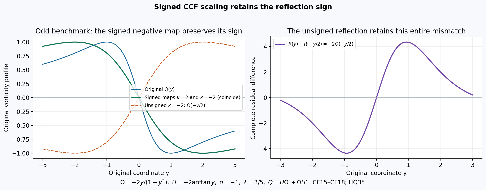
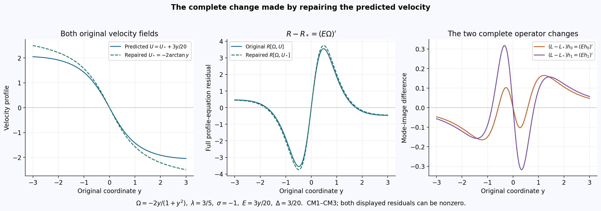
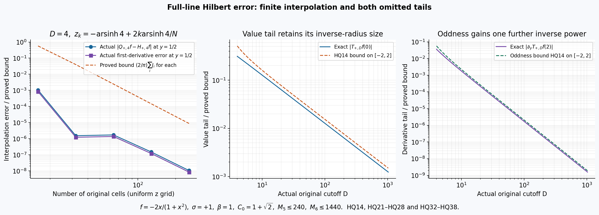
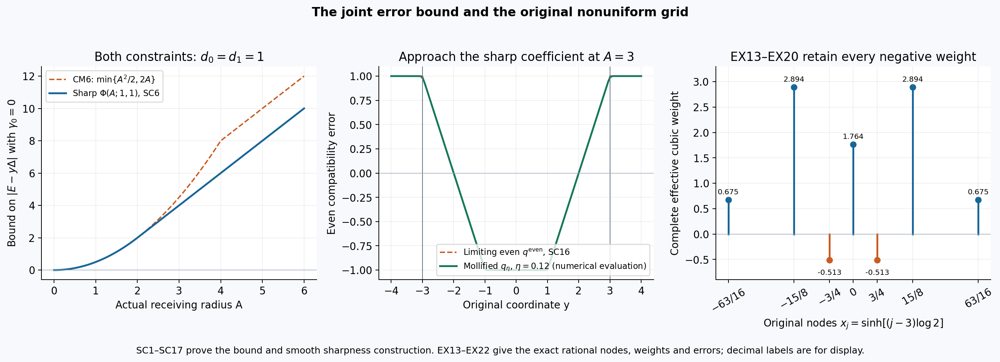

# Original CCF modes, Hilbert errors and sharp velocity bounds

The CCF benchmark predicts vorticity and velocity separately. Comparing
its approximate profiles with the original equation therefore requires
both the equation residual and the error in the Hilbert-transform
velocity relation. This lesson proves their complete effect on the two
symmetry directions, keeping every original coordinate, sign, anchor
and physical-time factor.

The first part derives the actual principal-value and primitive maps,
including the signed spatial correspondence. The second gives the full
velocity repair, mode-defect bounds and derivative-anchor projection.
The third supplies every sinh-coordinate derivative, finite endpoint,
whole-line tail and cubic-quadrature error term, together with an exact
rational benchmark.

Five solved exercises compute the signed group and anchor maps, both
mode defects for a specified velocity, the sharp joint velocity-error
coefficient, every weight on an original nonuniform grid and an explicit
whole-line transform budget. The final construction keeps the complete
global velocity and cutoff transition. Its nonzero equation residual
shows exactly what remains after the transform error is controlled.

The human comparison is Wang, Lai, Gómez-Serrano and Buckmaster; each
part identifies the original author-source passages. The calculations
below prove their stated field maps and bounds. They do not certify an
unavailable trained profile, a full stability spectrum or a failure of
the main blowup theorem.

## Part 1. Original CCF residuals, Hilbert primitives and signed spatial maps
This complete derivation retains both independent profile errors and the
full spatial-scale correspondence. The human source is
Wang, Lai, Gómez-Serrano and Buckmaster,
[arXiv:2201.06780v3](https://arxiv.org/abs/2201.06780v3), original
`BoussinesqSupp_v5.tex`359–406 and412–486 and
`BoussinesqPRL_v5.tex`232–252, reread on 2026-10-11. The original equation, anchors, approximate-profile operator and numerical
claims remain identifiable. No trained parameters or numerical quadrature
are inferred, and no novelty or main-theorem failure is asserted.

## CF1. A function class and the actual Hilbert primitive

Fix the Hilbert orientation \(\sigma\in\{-1,1\}\) once and
retain it in the definition
\[
 H_\sigma f(y)=\frac\sigma\pi\operatorname{PV}
                  \int_{\mathbb R}\frac{f(x)}{y-x}\,dx.
 \tag{CF1}
\]
All identities below hold for either convention, used consistently.
For a real \(\beta>0\), take \(f\in C^3(\mathbb R)\)
with specified finite constants \(C_j\) satisfying
\[
 |f^{(j)}(x)|\le C_j(1+|x|)^{-\beta-j},
                     \qquad 0\le j\le3.
 \tag{CF2}
\]
This permits every positive power of decay, including the positive
exponents stated in the source; it does not assert that an unavailable
trained profile satisfies these bounds.

The integral exists. On a fixed compact set of \(y\), the tail
integrand is bounded by a constant times \(|x|^{-1-\beta}\).
For the local singularity, set \(r=y-x\), subtract \(f(y)\)
on the symmetric interval \(|r|<1\), and use the mean value theorem.
Precisely,
\[
 H_\sigma f(y)=\frac\sigma\pi\left[
 \int_{|r|<1}\frac{f(y-r)-f(y)}r\,dr
 +\int_{|r|\ge1}\frac{f(y-r)}r\,dr\right].
 \tag{CF3}
\]
The removed constant has zero symmetric principal value. The first
integrand is bounded by the supremum of \(|f'|\) on the actual
unit neighborhood of the compact set. The same argument applies after
one or two \(y\)-derivatives, using respectively \(f''\)
and \(f'''\). The tails after each derivative have an integrable
majorant from CF2. Dominated differentiation therefore proves
\[
 H_\sigma f\in C^2(\mathbb R),\qquad
 (H_\sigma f)'=H_\sigma f',\qquad
 (H_\sigma f)''=H_\sigma f''.
 \tag{CF4}
\]
The function \(x f'(x)\) is locally continuously differentiable
and has the same positive tail decay required by CF1. Subtracting \(y H_\sigma f'(y)\)
from its principal-value formula cancels
the kernel exactly, giving
\[
 H_\sigma[xf'](y)-yH_\sigma f'(y)
 =-\frac\sigma\pi\int_{\mathbb R}f'(x)\,dx=0.
 \tag{CF5}
\]
Here \(f'\) is absolutely integrable by CF2, and
\(f(+\infty)=f(-\infty)=0\); thus the last integral is
zero by the fundamental theorem of calculus. The omitted interval
around \(x=y\) tends to zero in this absolutely convergent
integral. This justifies the subtraction with the original principal
value, not a formal commutator.

Define the exact linear velocity map
\[
 V[f](y)=\int_0^y H_\sigma f(r)\,dr.
 \tag{CF6}
\]
Integration of CF5 and CF4 gives the full mode map
\[
 V[yf'](y)=yH_\sigma f(y)-V[f](y).
 \tag{CF7}
\]
The endpoint contribution at zero is \(0\cdot H_\sigma f(0)=0\),
since CF3 gives a finite value there. Both integrals in CF6–CF7
are over their actual oriented intervals, also when \(y<0\).

## CF2. Retain the independently predicted velocity and its error

Take \(\Omega\) in CF2, \(U\in C^2(\mathbb R)\),
\(\lambda\in\mathbb R\), and \(p=1+\lambda\).
Do not set the predicted \(U\) equal to \(V[\Omega]\).
The complete errors and original evolution residual are
\[
 \begin{aligned}
 \Delta&=U'-H_\sigma\Omega,\\
 E&=U-V[\Omega]=U(0)+\int_0^y\Delta(r)\,dr,\\
 R&=-\Omega-py\Omega'+U\Omega'+\Omega U'.
 \end{aligned}
 \tag{CF8}
\]
CF4 shows that \(\Delta\) is continuously differentiable.
The equality for \(E\) follows by subtracting the two primitives,
retaining the original constant \(U(0)\).

The source's displayed linear operator, with its predicted base fields,
is
\[
 Lh=-h-pyh'+Uh'+V[h]\Omega'+\Omega H_\sigma h+hU'.
 \tag{CF9}
\]
For the two specified directions
\(h_0=y\Omega'\) and \(h_1=\Omega+py\Omega'\),
CF4–CF7 prove
\[
 \begin{aligned}
 H_\sigma h_0&=y(U''-\Delta'),\\
 V[h_0]&=yU'-U+E-y\Delta,\\
 H_\sigma h_1&=(U'-\Delta)+py(U''-\Delta'),\\
 V[h_1]&=pyU'-\lambda U+\lambda E-py\Delta.
 \end{aligned}
 \tag{CF10}
\]
These formulas keep the entire discrepancy of the independently
predicted velocity. The source oddness forces \(U(0)=0\)
when imposed exactly, but does not force \(\Delta=0\).

Differentiate the full CF8 expression:
\[
 R'=-(1+p)\Omega'-py\Omega''
                         +U\Omega''+2U'\Omega'+\Omega U''.
 \tag{CF11}
\]
Substituting CF10 in CF9, without deleting the error terms, gives
\[
 Lh_0=yR'+(E-y\Delta)\Omega'-y\Omega\Delta'.
 \tag{CF12}
\]
For completeness, the terms in CF9 are
\[
 -y\Omega'-py(\Omega'+y\Omega'')
 +U(\Omega'+y\Omega'')
 +(yU'-U+E-y\Delta)\Omega'
 +y\Omega(U''-\Delta')+y\Omega'U'.
\]
The two \(U\Omega'\) contributions cancel. The remaining
terms are exactly CF11 times \(y\), plus the three displayed
error contributions in CF12.

Also
\[
 L\Omega=R+(U-E)\Omega'+\Omega(U'-\Delta)
           =2R+h_1-E\Omega'-\Omega\Delta.
 \tag{CF13}
\]
The second equality uses only
\(U\Omega'+\Omega U'=R+\Omega+py\Omega'=R+h_1\).
Linearity and CF12 now give the exact second mode identity
\[
 Lh_1-h_1=2R+pyR'
       +(\lambda E-py\Delta)\Omega'
       -\Omega(\Delta+py\Delta').
 \tag{CF14}
\]
Thus exact compatible profiles recover the source's zero and one mode
identities. For a general prediction, CF12 and CF14 give their entire
defects. They do not certify the numerical values or spectrum of an
unavailable profile.

## CF3. The full signed spatial correspondence

For every actual \(\kappa\ne0\), change variables in CF1.
The absolute Jacobian and signed denominator give
\[
 H_\sigma[f(\cdot/\kappa)](y)
   =\operatorname{sgn}(\kappa)
                       (H_\sigma f)(y/\kappa).
 \tag{CF15}
\]
For \(\kappa<0\), reversing the integration endpoints contributes
the absolute Jacobian \(|\kappa|\), while the denominator
contributes \(\kappa\). The deleted symmetric interval of radius
\(\epsilon\) in the original variable becomes one of radius
\(\epsilon/|\kappa|\); the absolutely convergent tails permit
the same change there. This proves CF15 for the original principal
value including reflection. CF2 is preserved under every fixed nonzero
scale, with finite constants changed by that actual scale. More
precisely, for \(0\le j\le3\),
\[
 \left|\partial_y^j f(y/\kappa)\right|
 \le |\kappa|^{-j}C_j
       \min\{1,|\kappa|^{-1}\}^{-\beta-j}
       (1+|y|)^{-\beta-j}.
\]
This follows from the exact derivative factor \(\kappa^{-j}\)
and \(1+|y|/|\kappa|\ge
\min\{1,|\kappa|^{-1}\}(1+|y|)\). All scale factors are retained.

The exact signed field map is
\[
 \Omega_\kappa(y)=\operatorname{sgn}(\kappa)\Omega(y/\kappa),
 \qquad U_\kappa(y)=\kappa U(y/\kappa).
 \tag{CF16}
\]
It satisfies the complete error correspondence
\[
 \Delta_\kappa(y)=\Delta(y/\kappa),\qquad
 E_\kappa(y)=\kappa E(y/\kappa),\qquad
 R_\kappa(y)=\operatorname{sgn}(\kappa)R(y/\kappa).
 \tag{CF17}
\]
To verify these formulas, CF15 gives
\(H_\sigma\Omega_\kappa=(H_\sigma\Omega)(y/\kappa)\)
and \(U_\kappa'=U'(y/\kappa)\). Their difference proves
the first identity. Changing variables in the primitive gives
\(V[\Omega_\kappa](y)=\kappa V[\Omega](y/\kappa)\),
which proves the second, including its constant at zero. In every term
of \(R_\kappa\), the derivative of \(\Omega_\kappa\)
is \(\operatorname{sgn}(\kappa)\Omega'(y/\kappa)/\kappa\).
The original coordinate \(y\) becomes \(\kappa(y/\kappa)\),
and \(U_\kappa\) retains its factor \(\kappa\).
All four terms then carry the same sign factor, proving the last
identity without changing \(p\) or \(\lambda\).

For comparison, the unsigned vorticity scale printed at supplemental
line436 has the Hilbert-compatible velocity factor \(|\kappa|\):
\[
 \widetilde\Omega(y)=\Omega(y/\kappa),\qquad
 \widetilde U(y)=|\kappa|U(y/\kappa),\qquad
 Q=U\Omega'+\Omega U'.
\]
Direct substitution keeps the full mismatch
\[
 \widetilde R(y)=R(y/\kappa)
          +(\operatorname{sgn}(\kappa)-1)Q(y/\kappa).
 \tag{CF18}
\]
Positive scale has no such term. Negative scale retains \(-2Q\).
For \(p>0\), the only continuously differentiable profile for which
both \(R=0\) and the unsigned negative-scale residual is zero is
\(\Omega=0\). Indeed CF18 forces \(Q=0\), and CF8 then gives
\(\Omega+py\Omega'=0\). On \(y>0\), differentiating
\(y^{1/p}\Omega(y)\) gives zero. Its constant must be zero
because \(\Omega\) is bounded near zero and \(1/p>0\).
On \(y<0\), the same argument applies to
\(|y|^{1/p}\Omega(y)\). Continuity gives zero at the origin.
Thus this joint zero-residual class contains no profile satisfying either
nonzero printed point anchor. The signed map CF16 supplies the exact
correspondence for all nonzero scales.
This is the precise comparison for the printed unrestricted scale,
not an inference about which scales were used in the reported tests.
For odd \(\Omega,U\), the signed negative-scale pair CF16
equals the pair for \(|\kappa|\) pointwise. In particular a
sign flip of the vorticity alone is not that signed symmetry. The two
printed values at the point one-half must remain separately recorded;
their equality cannot be inferred from the scale claim.

## CF4. Receive the two source residuals without deleting quadrature error

At \(y=\sinh z\), write the source's predicted fields as
\(\widehat\Omega(z)=\Omega(\sinh z)\) and
\(\widehat U(z)=U(\sinh z)\). The exact derivative is
\(\partial_y=\operatorname{sech}z\,\partial_z\).
Let \(\widetilde H\widehat\Omega(z)\) denote the actual
numerical transform used in a supplied calculation, and define its
complete error against the pulled-back exact transform by
\[
 e_H(z)=\widetilde H\widehat\Omega(z)
                       -(H_\sigma\Omega)(\sinh z).
 \tag{CF19}
\]
The source's two residuals at \(a=-1\) then give exactly
\[
 \begin{aligned}
 R(\sinh z)&=-f_1(z),\\
 \Delta(\sinh z)&=f_2(z)+e_H(z),\\
 E(\sinh z)&=U(0)+\int_0^z
                   \cosh\zeta\,[f_2(\zeta)+e_H(\zeta)]\,d\zeta.
 \end{aligned}
 \tag{CF20}
\]
The first identity follows by keeping all four original equation
terms. The second is addition and subtraction of the same numerical
transform. The last is CF8 with its exact coordinate Jacobian.
No value of \(e_H\), its derivatives or its tail contribution
is supplied by these identities. Estimating it for actual data requires
the quadrature and tail calculation. The accompanying coordinate and physical-map derivations retain these
errors in their quantitative bounds.

The figure evaluates CF15–CF18 for the explicit benchmark
\(\Omega(y)=-2y/(1+y^2)\), \(U(y)=-2\arctan y\),
\(\sigma=-1\) and \(\lambda=3/5\), on the original
interval \([-3,3]\). HQ35 proves its Hilbert compatibility.
Both signed scales \(2\) and \(-2\) give the same odd pair;
the unsigned negative scale retains exactly the plotted
\(-2Q(-y/2)\). These curves evaluate the proved field map on
a specified benchmark, not the trained profile reported by Wang,
Lai, Gómez-Serrano and Buckmaster at supplemental436–480.
The reproducible source is
[ccf-hilbert-comparisons.py](../assets/ccf-hilbert-comparisons.py).

## Part 2. Original CCF velocity repair, physical time and complete mode-error bounds
This calculation receives the exact objects and function class in
CF1–CF20.
The human comparison is Wang, Lai, Gómez-Serrano and Buckmaster,
[arXiv:2201.06780v3](https://arxiv.org/abs/2201.06780v3), original
`BoussinesqSupp_v5.tex`359–389 and454–480. The source predicts velocity
and vorticity independently and states two symmetry directions for the
linearized equation. Both residuals are retained below.

## CM1. The exact repair of the predicted velocity and its linear operator

Retain \(p=1+\lambda\), \(V[\Omega]=\int_0^yH_\sigma\Omega\),
\(\Delta=U'-H_\sigma\Omega\) and
\(E=U-V[\Omega]\), with the function class of CF1–CF9.
The map on the actual pair of fields is
\[
 \mathcal P:(\Omega,U)\longmapsto(\Omega,U_*),\qquad
 U_*=V[\Omega]=U-E.
 \tag{CM1}
\]
It is a linear retraction onto the pairs satisfying
\(U(0)=0\) and \(U'=H_\sigma\Omega\): its image has both
properties by the fundamental theorem of calculus, and those properties
give \(U=V[\Omega]\) by integration, so it fixes every such pair.
Consequently \(\mathcal P^2=\mathcal P\). Its kernel consists
exactly of the pairs \((0,U)\). This describes the complete change
of object, including the removed velocity constant.

Let \(R_*\) be the full original CCF residual computed with
\(U_*\), and let \(L_*\) be the source operator CF9 computed
with the same repaired base. Direct subtraction gives
\[
 \begin{aligned}
 R_*&=R-E\Omega'-\Omega\Delta
                       =R-(E\Omega)',\\
 (L-L_*)h&=Eh'+\Delta h=(Eh)'.
 \end{aligned}
 \tag{CM2}
\]
The identities use \(E'=\Delta\), proved in CF8. The perturbation
velocity \(V[h]\) is the same in both operators; it is not dropped.
Thus a velocity repair changes the residual and the linearized operator
by the precise displayed derivatives. These are equalities of actual
functions on their original domains, not an identification of two
different predictions.

For \(h_0=y\Omega'\), CF12 and CM2 give
\[
 Lh_0=yR_*'+(Eh_0)'
      =yR'+(E-y\Delta)\Omega'-y\Omega\Delta'.
 \tag{CM3}
\]
Expanding \((E\Omega)''=E\Omega''+2\Delta\Omega'
+\Omega\Delta'\) verifies all terms. Solving the repaired profile
equation means proving \(R_*=0\). The velocity retraction itself
gives the exact value \(R_*=R-(E\Omega)'\), which can be nonzero.
CM2 supplies the full comparison.

## CM2. Stronger finite-interval bounds with the exact integral cancellation

On an actual \([-A,A]\), \(A>0\), define
\[
 \begin{aligned}
 r_0&=\|R\|_\infty,&r_1&=\|R'\|_\infty,\\
 d_0&=\|\Delta\|_\infty,&d_1&=\|\Delta'\|_\infty,\\
 M_0&=\|\Omega\|_\infty,&M_1&=\|\Omega'\|_\infty,
       &\gamma_0&=U(0).
 \end{aligned}
 \tag{CM4}
\]
All these numbers are finite by the stated local regularity. They may
also be replaced by independently proved upper bounds for the same
functions. Integration by parts, keeping both endpoints, gives
\[
 E(y)-y\Delta(y)
 =\gamma_0+\int_0^y\Delta(r)\,dr-y\Delta(y)
 =\gamma_0-\int_0^y r\Delta'(r)\,dr.
 \tag{CM5}
\]
For negative \(y\), the integral is oriented from zero to \(y\);
its absolute bound is still \(|y|^2d_1/2\). A second bound follows
by estimating the two original \(\Delta\) terms separately.
Thus, with every contribution retained,
\[
 |E(y)-y\Delta(y)|
 \le |\gamma_0|+\min\{2|y|d_0,\tfrac12|y|^2d_1\},\qquad
 K_A=|\gamma_0|+\min\{2A d_0,\tfrac12 A^2d_1\}.
 \tag{CM6}
\]
The coefficient one-half is the exact integral
\(\int_0^{|y|}r\,dr\). No smallness of \(d_0\) or
\(d_1\) was assumed to obtain it.

Write the original mode defects as
\(D_0=Lh_0\) and \(D_1=Lh_1-h_1\), where
\(h_1=\Omega+py\Omega'\). CF12 immediately gives
\[
 \|D_0\|_\infty\le A r_1+K_A M_1+A M_0d_1.
 \tag{CM7}
\]
For the second defect retain the exact identity
\[
 \lambda E-py\Delta
       =\lambda(E-y\Delta)-y\Delta,
 \tag{CM8}
\]
because \(p=1+\lambda\). Substitution in CF14 proves
\[
 \|D_1\|_\infty
 \le2r_0+|p|A r_1+(|\lambda|K_A+A d_0)M_1
                           +M_0(d_0+|p|A d_1).
 \tag{CM9}
\]
These bounds apply to the exact source operator with independently
predicted velocity. In the compatible class, \(\gamma_0=0\)
and \(\Delta=0\), so they reduce exactly to
\(A r_1\) and \(2r_0+|p|A r_1\). A small residual value
alone does not supply the missing derivative or compatibility bounds.

To receive the actual numerical residuals at \(y=\sinh z\),
use CF19–CF20. If their suprema and original-coordinate derivative
suprema on \(|z|\le\operatorname{arsinh}A\) are bounded by
\[
 \begin{aligned}
 |f_1|&\le a_0,&|\operatorname{sech}z\,\partial_zf_1|&\le a_1,\\
 |f_2|&\le b_0,&|\operatorname{sech}z\,\partial_zf_2|&\le b_1,\\
 |e_H|&\le e_0,&|\operatorname{sech}z\,\partial_ze_H|&\le e_1,
 \end{aligned}
 \tag{CM10}
\]
then exactly \(r_j\le a_j\) and \(d_j\le b_j+e_j\)
for \(j=0,1\). These follow by the triangle inequality from
CF20 and its derivative. The quadrature and tail derivation supplies
explicit ways to bound \(e_0,e_1\); their values are not inferred
from a source figure. Applying CM6–CM9 to these six actual bounds
completes their receiving map.

## CM3. Full physical time, velocity compatibility and evolution residual

Retain the source's original physical variables
\[
 \tau=1-t>0,\qquad y=x/\tau^p,\qquad
 \omega(t,x)=\tau^{-1}\Omega(y),\qquad
 u(t,x)=\tau^\lambda U(y).
 \tag{CM11}
\]
The spatial dilation \(\tau^p\) is positive for every real \(p\).
CF15 therefore gives the entire physical Hilbert map. Differentiation
and change of variables in the primitive yield
\[
 \begin{aligned}
 H_\sigma\omega(t,x)&=\tau^{-1}(H_\sigma\Omega)(y),\\
 u_x-H_\sigma\omega&=\tau^{-1}\Delta(y),\\
 u(t,x)-\int_0^xH_\sigma\omega(t,r)\,dr&=\tau^\lambda E(y),\\
 u(t,0)&=\tau^\lambda\gamma_0.
 \end{aligned}
 \tag{CM12}
\]
For example, the primitive factor is
\(\tau^{-1}\tau^p=\tau^\lambda\), with its original
lower endpoint unchanged.

The complete physical CCF equation has \(a=-1\). Its error is
\[
 \begin{aligned}
 \omega_t&=\tau^{-2}[\Omega+py\Omega'],\\
 u\omega_x&=\tau^{\lambda-1-p}U\Omega'
                                    =\tau^{-2}U\Omega',\\
 \omega u_x&=\tau^{-2}\Omega U',\\
 \omega_t-u\omega_x-\omega u_x&=-\tau^{-2}R(y).
 \end{aligned}
 \tag{CM13}
\]
At every available spatial derivative order \(j\), the complete
derivative factors are
\[
 \begin{aligned}
 \partial_x^j\omega&=\tau^{-1-jp}\Omega^{(j)}(y),\\
 \partial_x^ju&=\tau^{\lambda-jp}U^{(j)}(y),\\
 \partial_x^j[\omega_t-u\omega_x-\omega u_x]
                        &=-\tau^{-2-jp}R^{(j)}(y),\\
 \partial_x^j[u_x-H_\sigma\omega]
                        &=\tau^{-1-jp}\Delta^{(j)}(y).
 \end{aligned}
 \tag{CM14}
\]
The interval \(|y|\le A\) is the actual moving physical interval
\(|x|\le\tau^p A\). Its error bounds keep the factors in
CM12–CM14, even when they grow as \(t\uparrow1\).

For a time-dependent profile \(\Omega(s,y)\), with
\(s=-\log\tau\), the same calculation instead gives
\[
 \omega_t-u\omega_x-\omega u_x
       =\tau^{-2}(\partial_s\Omega-R[\Omega,U]).
 \tag{CM15}
\]
The additional term is from \(\partial_ts=\tau^{-1}\).
Consequently the exact compatible rescaled evolution is
\(\partial_s\Omega=R[\Omega,V[\Omega]]\). Its derivative
in a direction \(h\) is \(L_*h\), since expansion of both
quadratic terms gives all six terms of CF9 with the repaired base.

## CM4. The actual symmetry directions and the source anchors

For positive spatial scale \(\kappa=e^\epsilon\), CF16 gives
\[
 \left.\partial_\epsilon\Omega(y/e^\epsilon)\right|_0=-h_0,
 \qquad
 \left.\partial_\epsilon[e^\epsilon U(y/e^\epsilon)]\right|_0
                          =U-yU'.
 \tag{CM16}
\]
For an exact compatible base, the second expression equals
\(-V[h_0]\) by CF10. The direction is constant in the
rescaled time, which yields the source's zero mode when the full
equation residual is zero.

Changing the original terminal time from one to \(1+\epsilon\)
gives the physical family
\[
 \omega_\epsilon(t,x)=\frac1{\tau+\epsilon}
        \Omega\left(\frac{x}{(\tau+\epsilon)^p}\right),
 \quad
 u_\epsilon(t,x)=(\tau+\epsilon)^\lambda
        U\left(\frac{x}{(\tau+\epsilon)^p}\right).
 \tag{CM17}
\]
For \(|\epsilon|<\tau\), differentiating the full factors at
zero gives
\[
 \left.\partial_\epsilon\omega_\epsilon\right|_0
                  =-\tau^{-2}(\Omega+py\Omega')=-\tau^{-2}h_1,
 \qquad
 \left.\partial_\epsilon u_\epsilon\right|_0
                  =\tau^{\lambda-1}(\lambda U-pyU').
 \tag{CM18}
\]
In the original rescaled variables, the profile direction is
\(-\tau^{-1}h_1=-e^s h_1\). The compatible velocity direction
is \(-e^s V[h_1]\), by CF10 with \(E=\Delta=0\).
This supplies the source's eigenvalue one with its full physical
time factor. For arbitrary predicted fields, CF12 and CF14 give the
exact departures from those identities.

The equation symmetries also act on the source conditions. For the
original derivative anchor \(b=\Omega'(0)=-2\),
\[
 h_0'(0)=b,\qquad h_1'(0)=(1+p)b=(2+\lambda)b.
 \tag{CM19}
\]
Neither direction is tangent to that fixed derivative condition at the
source's positive exponents. This does not erase the equation symmetry;
it identifies the different tangent space selected by the condition.
For the printed point anchor at \(a=1/2\), the two variations are
\[
 h_0(a)=a\Omega'(a),\qquad h_1(a)=\Omega(a)+pa\Omega'(a).
 \tag{CM20}
\]
The two printed base values \(+0.05\) and \(-0.05\) remain
different source conditions. These variations determine how each one
changes under the actual field maps, without choosing which value was
used in an unavailable computation.

There is an exact linear map to the derivative-anchor tangent space.
On the vector space \(C^1(\mathbb R)\) of real perturbations
define \(\ell(h)=h'(0)\).
Because \(\ell(h_0)=b\ne0\), put
\[
 P_bh=h-\frac{\ell(h)}b h_0.
 \tag{CM21}
\]
Then \(\ell(P_bh)=0\), \(P_b^2=P_b\), its image is
\(\ker\ell\), and its kernel is \(\operatorname{span}\{h_0\}\).
Each assertion follows by applying \(\ell\) to the two terms
and using \(\ell(h_0)=b\). This explicitly relates the original
equation directions to the constrained tangent space.

In particular,
\[
 h_*=P_bh_1=h_1-(1+p)h_0=\Omega-y\Omega',\qquad
 P_bLh_*-h_*=P_b[D_1-(1+p)D_0].
 \tag{CM22}
\]
For the second equality use \(Lh_1=h_1+D_1\),
\(Lh_0=D_0\), and \(P_bh_1=h_*\). Thus the same exact
defects propagate into the projected linear map. For a compatible
zero-residual base the right side vanishes, so the time-translation
direction has eigenvalue one in this projected map. No nonlinear
constrained flow or complete spectral domain is asserted by this
linear correspondence alone.

Every application of \(P_b\) in CM22 is defined under the stated
regularity. Indeed \(h_0,h_1\in C^2\), and CF4–CF5 show
\(H_\sigma h_0,H_\sigma h_1\in C^1\). Formula CF9 then gives
\(Lh_0,Lh_1\in C^1\), because \(U\in C^2\) and
\(\Omega\in C^3\). This also proves that the full defects
\(D_0,D_1\) are \(C^1\), even though individual terms in
their expanded expressions need not have separately available
derivatives of the next order. The projection is applied to the
complete functions.

Finally \(h_*\ne0\) in this anchored decay class. If
\(\Omega-y\Omega'=0\), differentiation gives
\((\Omega/y)'=0\) on each open half-line. Thus
\(\Omega=c_+y\) for positive \(y\) and
\(\Omega=c_-y\) for negative \(y\). The decay in CF2
forces both constants to be zero, contradicting \(\Omega'(0)=-2\).
This proves that the projected exact direction is nonzero while
leaving the original function class and anchor intact.

The figure evaluates CM1–CM3 on the original interval \([-3,3]\),
using \(\Omega=-2y/(1+y^2)\), \(\sigma=-1\),
\(\lambda=3/5\), \(U_*=-2\arctan y\), and
\(U=U_*+3y/20\). Hence \(E=3y/20\) and
\(\Delta=3/20\) exactly. All four terms of each residual
and the complete derivatives \((Eh_0)'\), \((Eh_1)'\)
are evaluated. The repaired residual is generally nonzero.
This specified benchmark illustrates the precise comparison with
the independently predicted fields in Wang, Lai, Gómez-Serrano and
Buckmaster, supplemental377–389 and454–480; it is not their trained
profile. The reproducible source is
[ccf-hilbert-comparisons.py](../assets/ccf-hilbert-comparisons.py).

## Part 3. Original Hilbert coordinates, endpoint terms, tails and cubic quadrature
This derivation supplies explicit transform-error bounds for
CF19–CF20 and
CM6–CM10.
The human comparison is Wang, Lai, Gómez-Serrano and Buckmaster,
[arXiv:2201.06780v3](https://arxiv.org/abs/2201.06780v3), original
`BoussinesqSupp_v5.tex`381–400 and436–444. The source describes cubic
interpolation in a numerical Hilbert transform on a large sinh-coordinate
domain, but does not supply its stencils or trained evaluation data in
these passages. The finite quadrature below specifies every stencil,
weight, error term and original coordinate. No numerical source result
is certified by it.

## HQ1. The complete pulled-back kernel and every original derivative

Use \(H_\sigma\) from CF1, with one fixed
\(\sigma\in\{-1,1\}\). Let \(f\) satisfy CF2, and write
\(\widehat f(z)=f(\sinh z)\). For an actual truncation radius
\(D>0\), put \(Z_D=\operatorname{arsinh}D\). At
\(y=\sinh z\) with \(|y|<D\), the truncated operator is
\[
 H_{\sigma,D}f(y)=\frac\sigma\pi\operatorname{PV}
                       \int_{-D}^{D}\frac{f(x)}{y-x}\,dx.
 \tag{HQ1}
\]
Changing the integration variable by \(x=\sinh\zeta\) gives
the exact coordinate expression
\[
 H_{\sigma,D}f(\sinh z)=\frac\sigma\pi\lim_{\epsilon\downarrow0}
 \left(\int_{-Z_D}^{\operatorname{arsinh}(\sinh z-\epsilon)}
       +\int_{\operatorname{arsinh}(\sinh z+\epsilon)}^{Z_D}\right)
 \frac{\widehat f(\zeta)\cosh\zeta}{\sinh z-\sinh\zeta}\,d\zeta.
 \tag{HQ2}
\]
The numerator Jacobian, denominator, both finite endpoints and both
excluded endpoints remain explicit. The same formula with infinite
endpoints gives the full operator, because CF2 makes its original
tails absolutely convergent.

For completeness, a symmetric principal value in \(\zeta-z\)
has the same limit. Taylor expansion at \(\zeta=z\) shows that
the integrand in HQ2 equals
\(-\widehat f(z)/(\zeta-z)\) plus a locally bounded function.
The two excluded lengths in HQ2, divided by \(\epsilon\),
both tend to \(1/\cosh z\), by the derivative of arcsinh.
The unmatched singular integrals therefore differ by a constant times
the logarithm of a ratio tending to one; the bounded remainder over
those intervals tends to zero. This proves the equality of the two
limits while retaining the exact cutoffs in HQ2.

Set \(a(z)=\operatorname{sech}z\) and
\(t(z)=\tanh z\). The original derivative is
\(\partial_y=a\partial_z\), and its first three powers are
\[
 \begin{aligned}
 \partial_y f&=a\widehat f',\\
 \partial_y^2 f&=a^2(\widehat f''-t\widehat f'),\\
 \partial_y^3 f&=a^3[\widehat f'''-3t\widehat f''
                                      +(3t^2-1)\widehat f'].
 \end{aligned}
 \tag{HQ3}
\]
The primes on the right are \(z\)-derivatives. All orders have
a complete finite recurrence:
\[
 \begin{aligned}
 \partial_y^j f(\sinh z)&=a(z)^j
                   \sum_{k=0}^jP_{j,k}(t(z))\widehat f^{(k)}(z),\\
 P_{0,0}&=1,\\
 P_{j+1,k}(t)&=(1-t^2)P_{j,k}'(t)-jtP_{j,k}(t)+P_{j,k-1}(t).
 \end{aligned}
 \tag{HQ4}
\]
An index outside \(0\le k\le j\) denotes zero. To prove
the recurrence, use \(a'=-at\), \(t'=1-t^2\), and apply
the product rule to the entire first line. The last term differentiates
the original \(\widehat f^{(k-1)}\); the other two retain
the derivative of the coefficient and of \(a^j\). This induction
proves every order with every multiplier present.

For supplied bounds \(|\widehat f^{(k)}|\le Q_k\) on
\([-Z_D,Z_D]\), put \(T_D=D/\sqrt{1+D^2}\).
Writing \(P_{j,k}(t)=\sum_r p_{j,k,r}t^r\) gives the explicit
original-coordinate upper bound
\[
 \sup_{|y|\le D}|f^{(j)}(y)|
 \le\sum_{k=0}^j\sum_{r\ge0}|p_{j,k,r}|T_D^rQ_k.
 \tag{HQ5}
\]
This follows from HQ4, \(|t|\le T_D\) and \(0<a\le1\).
For the source's finite tanh networks, all \(Q_k\) can be
calculated from their actual parameters by
BN2–BN4, applied to their
actual input \(z\). HQ4 supplies the additional original-coordinate
factors. Such local parameter bounds do not supply a global tail bound.

## HQ2. The finite boundary contribution survives differentiation

Define the full omitted tail at \(|y|<D\):
\[
 T_{\sigma,D}f(y)=\frac\sigma\pi\int_{|x|>D}
                                     \frac{f(x)}{y-x}\,dx,
 \qquad H_\sigma f=H_{\sigma,D}f+T_{\sigma,D}f.
 \tag{HQ6}
\]
The tail and all its \(y\)-derivatives exist on compact subsets
of this open interval, since the denominator is bounded away from zero
and the original tail is integrable. In particular
\[
 (T_{\sigma,D}f)'(y)
       =-\frac\sigma\pi\int_{|x|>D}\frac{f(x)}{(y-x)^2}\,dx.
 \tag{HQ7}
\]
Integrating the two tails of \(H_\sigma f'\) by parts separately
retains the endpoints at \(-D,D\). The infinite endpoints vanish
by CF2. This gives
\[
 T_{\sigma,D}f'
 =(T_{\sigma,D}f)'
       +\frac\sigma\pi\left[\frac{f(D)}{D-y}
                                      +\frac{f(-D)}{D+y}\right].
 \tag{HQ8}
\]
Using \((H_\sigma f)'=H_\sigma f'\), proved in CF4,
and subtracting HQ8 from the whole-line identity proves
\[
 (H_{\sigma,D}f)'=H_{\sigma,D}f'
       +\frac\sigma\pi\left[\frac{f(D)}{D-y}
                                      +\frac{f(-D)}{D+y}\right].
 \tag{HQ9}
\]
Thus the truncated operator does not commute with differentiation
without these two endpoint terms.

At every higher order \(j\) for which the corresponding smooth
decay hypotheses hold, induction in HQ9 gives the complete formula
\[
 \begin{aligned}
 \partial_y^jH_{\sigma,D}f
 ={}&H_{\sigma,D}f^{(j)}\\
 &+\frac\sigma\pi\sum_{\ell=0}^{j-1}(j-1-\ell)!
 \left[\frac{f^{(\ell)}(D)}{(D-y)^{j-\ell}}
       +\frac{(-1)^{j-1-\ell}f^{(\ell)}(-D)}{(D+y)^{j-\ell}}
 \right].
 \end{aligned}
 \tag{HQ10}
\]
Differentiating an existing endpoint term raises its denominator power
with its exact factorial and sign. Differentiating the first term
adds the new pair with \(\ell=j\). This proves the recurrence
and every boundary contribution in HQ10.

## HQ3. Full tail bounds and the improvement supplied by oddness

Fix an actual receiving interval \([-A,A]\), with \(0<A<D\),
and a verified tail bound
\(|f(x)|\le C_0(1+|x|)^{-\beta}\), \(\beta>0\).
For every \(j\ge0\), direct differentiation of HQ6 gives
\[
 \partial_y^jT_{\sigma,D}f(y)
   =\frac{\sigma(-1)^jj!}{\pi}
                 \int_{|x|>D}\frac{f(x)}{(y-x)^{j+1}}\,dx.
 \tag{HQ11}
\]
For \(|x|\ge D\) and \(|y|\le A\),
\(|y-x|\ge(1-A/D)|x|\). The complete bound, before and
after evaluating an elementary upper integral, is
\[
 \begin{aligned}
 \|\partial_y^jT_{\sigma,D}f\|_{L^\infty([-A,A])}
 &\le\frac{2C_0j!}{\pi(1-A/D)^{j+1}}
             \int_D^\infty(1+x)^{-\beta}x^{-j-1}\,dx\\
 &\le\frac{2C_0j!}{\pi(1-A/D)^{j+1}(\beta+j)}D^{-\beta-j}.
 \end{aligned}
 \tag{HQ12}
\]
The second inequality uses \((1+x)^{-\beta}\le x^{-\beta}\)
only after retaining the actual tail integral in the first line.

For odd \(f\), pair the two original tails exactly:
\[
 \begin{aligned}
 T_{\sigma,D}f(y)
 &=\frac\sigma\pi\int_D^\infty f(x)
             \left[\frac1{y-x}-\frac1{y+x}\right]dx\\
 &=-\frac{2\sigma}{\pi}\int_D^\infty
                         \frac{x f(x)}{x^2-y^2}\,dx,\\
 (T_{\sigma,D}f)'(y)
 &=-\frac{4\sigma y}{\pi}\int_D^\infty
                         \frac{x f(x)}{(x^2-y^2)^2}\,dx.
 \end{aligned}
 \tag{HQ13}
\]
In particular the first derivative of the tail is exactly zero at zero.
The full finite-interval bounds improve to
\[
 \begin{aligned}
 \|T_{\sigma,D}f\|_\infty
 &\le\frac{2C_0}{\pi[1-(A/D)^2]\beta}D^{-\beta},\\
 \|(T_{\sigma,D}f)'\|_\infty
 &\le\frac{4A C_0}{\pi[1-(A/D)^2]^2(\beta+2)}D^{-\beta-2}.
 \end{aligned}
 \tag{HQ14}
\]
Indeed \(x^2-y^2\ge[1-(A/D)^2]x^2\), and the two
remaining integrals are bounded by those of
\(x^{-\beta-1}\) and \(x^{-\beta-3}\). The second
bound gains one full inverse power of the actual truncation radius
over the general first-derivative bound HQ12. It follows from the
two tails and oddness, not from discarding a boundary term.

More generally, for odd \(j\), the paired kernel in HQ11 is zero
at \(y=0\). The fundamental theorem of calculus in \(y\)
and the next derivative of that kernel give
\[
 \|\partial_y^jT_{\sigma,D}f\|_\infty
 \le\frac{2A C_0(j+1)!}
          {\pi(1-A/D)^{j+2}(\beta+j+1)}D^{-\beta-j-1}
                   \qquad(j\text{ odd}).
 \tag{HQ15}
\]
To see every coefficient, the paired kernel is
\((-1)^jj![(y-x)^{-j-1}-(y+x)^{-j-1}]\).
Its next derivative has absolute value at most
\(2(j+1)!/(x-A)^{j+2}\); integration from zero to \(y\)
contributes \(|y|\le A\), and the remaining tail integral
contributes \(D^{-\beta-j-1}/(\beta+j+1)\).

## HQ4. Remove the singularity exactly while retaining the endpoint logarithm

For \(|y|<D\) define, including its diagonal value,
\[
 G_y(x)=\frac{f(x)-f(y)}{y-x}
       =-\int_0^1f'(y+t(x-y))\,dt,\qquad G_y(y)=-f'(y).
 \tag{HQ16}
\]
The integral expression is the fundamental theorem of calculus along
the actual segment joining \(y\) to \(x\). It proves the
removable extension without evaluating a zero divided by zero.
Integrating the subtracted constant in the original principal value
gives exactly
\[
 H_{\sigma,D}f(y)=\frac\sigma\pi
       \left[\int_{-D}^{D}G_y(x)\,dx+f(y)L_D(y)\right],
 \quad L_D(y)=\log\frac{D+y}{D-y}.
 \tag{HQ17}
\]
The logarithm is real because \(|y|<D\). Its sign and both
finite endpoints follow from
\(\int (y-x)^{-1}\,dx=-\log|y-x|\).

Suppose now that \(f\in C^{J+5}([-D,D])\), for an integer
\(J\ge0\). Differentiating the nonsingular integral in HQ16
gives, for every \(0\le j\le J\),
\[
 \begin{aligned}
 \partial_y^jG_y(x)
 &=-\int_0^1(1-t)^j f^{(j+1)}(y+t(x-y))\,dt,\\
 \partial_x^4\partial_y^jG_y(x)
 &=-\int_0^1t^4(1-t)^j f^{(j+5)}(y+t(x-y))\,dt,\\
 |\partial_x^4\partial_y^jG_y(x)|
 &\le\frac{4!j!}{(j+5)!}M_{j+5},\qquad
 M_{j+5}=\sup_{|r|\le D}|f^{(j+5)}(r)|.
 \end{aligned}
 \tag{HQ18}
\]
Every segment lies in \([-D,D]\). The integral coefficient is
\(\int_0^1t^4(1-t)^jdt=4!j!/(j+5)!\). Repeated
integration by parts proves it, starting from
\(\int_0^1t^m dt=1/(m+1)\); the boundary terms vanish
until the final monomial integral. In particular, the factors are
\(1/5\) for \(j=0\) and \(1/30\) for \(j=1\).
At a fixed stencil node \(x_k\), its derivative evaluated at
\(y=x_k\) is exactly
\[
 \left.\partial_y^jG_y(x_k)\right|_{y=x_k}
                   =-\frac{f^{(j+1)}(x_k)}{j+1}.
 \tag{HQ19}
\]
This is a partial derivative with the node held fixed; moving both
arguments along the diagonal would be a different derivative.

The endpoint term is also completely differentiable. For \(k\ge1\),
\[
 L_D^{(k)}(y)=(k-1)!
       \left[\frac{(-1)^{k-1}}{(D+y)^k}+\frac1{(D-y)^k}\right].
 \tag{HQ20}
\]
The full \(j\)-th derivative of the second term in HQ17 is
\(\sum_{r=0}^j\binom jr f^{(r)}(y)L_D^{(j-r)}(y)\),
where \(L_D^{(0)}=L_D\). Thus neither differentiation nor
singularity removal loses an endpoint contribution.

## HQ5. Every cubic stencil, weight and interpolation-error integral

Partition the actual interval \([-D,D]\) into cells
\([b_i,b_{i+1}]\). For each cell select four distinct original
nodes \(x_{i,0},\ldots,x_{i,3}\) in \([-D,D]\). They
can be generated by specified sinh-coordinate nodes
\(x_{i,k}=\sinh z_{i,k}\); no assumption of equal original
spacing is made. Define the full cubic basis and weights
\[
 \ell_{i,k}(x)=\prod_{\substack{0\le r\le3\\r\ne k}}
                \frac{x-x_{i,r}}{x_{i,k}-x_{i,r}},\qquad
 w_{i,k}=\int_{b_i}^{b_{i+1}}\ell_{i,k}(x)\,dx.
 \tag{HQ21}
\]
For the three nodes other than \(k\), let \(s_1,s_2,s_3\)
be respectively their sum, sum of pairwise products and product, and
let \(d_k=\prod_{r\ne k}(x_{i,k}-x_{i,r})\ne0\).
Then the exact, fully specified weight is
\[
 w_{i,k}=\frac1{d_k}
       \left[\frac{x^4}4-\frac{s_1x^3}3+\frac{s_2x^2}2-s_3x
       \right]_{b_i}^{b_{i+1}}.
 \tag{HQ22}
\]
All weights, including any negative weights, remain in the quadrature.

Let
\[
 W_i(x)=\prod_{k=0}^3(x-x_{i,k}),\qquad
 J_i=\int_{b_i}^{b_{i+1}}|W_i(x)|\,dx.
 \tag{HQ23}
\]
This error coefficient is also an exact finite calculation. Write
\(e_r\) for the elementary symmetric products of all four nodes,
so that \(W_i=x^4-e_1x^3+e_2x^2-e_3x+e_4\). An antiderivative
is
\[
 A_i(x)=\frac{x^5}5-\frac{e_1x^4}4+\frac{e_2x^3}3
                         -\frac{e_3x^2}2+e_4x.
 \tag{HQ24}
\]
Split the cell at each selected node strictly inside it. Between
successive split points \(c_r,c_{r+1}\), the polynomial has
constant sign \(s_r\), obtained by evaluating it at their midpoint.
Hence \(J_i=\sum_r s_r[A_i(c_{r+1})-A_i(c_r)]\).
There are finitely many split points, and none of the midpoints is a
root. This computes the absolute integral without replacing it by a
signed cancellation.

For any \(C^4\) function \(g\) on the convex hull of the
cell and its nodes, its cubic interpolation remainder obeys
\[
 \left|g(x)-\sum_{k=0}^3\ell_{i,k}(x)g(x_{i,k})\right|
 \le\frac{\sup|g^{(4)}|}{4!}|W_i(x)|.
 \tag{HQ25}
\]
Here is the complete proof. The inequality is an equality with zero
error at a node. Otherwise subtract from \(g\) its cubic
interpolant and the multiple of \(W_i\) that also makes the
difference vanish at the chosen \(x\). This function has five
distinct zeros. Four applications of Rolle's theorem give a point
where its fourth derivative is zero. The cubic contributes zero and
\(W_i^{(4)}=4!\); solving for its multiple gives the displayed
bound. All points used lie in the stated convex hull, a subset of
\([-D,D]\).

The complete exact-data quadrature is
\[
 Q_{\sigma,D}f(y)=\frac\sigma\pi
       \left[\sum_i\sum_{k=0}^3w_{i,k}G_y(x_{i,k})
                                      +f(y)L_D(y)\right].
 \tag{HQ26}
\]
The weights do not depend on \(y\), so HQ18 and HQ25 apply
to every \(\partial_y^jG_y\) before integration over the
same cells. Therefore the full interpolation error is
\[
 \|\partial_y^j(Q_{\sigma,D}f-H_{\sigma,D}f)\|_{L^\infty([-A,A])}
 \le\frac{j!M_{j+5}}{\pi(j+5)!}\sum_iJ_i,
                  \qquad 0\le j\le J.
 \tag{HQ27}
\]
The factor \(4!\) from HQ18 cancels only against the displayed
\(4!\) in HQ25. At orders zero and one the resulting factors
are exactly \(M_5/(120\pi)\) and \(M_6/(720\pi)\).
The endpoint logarithm is included exactly in both expressions and
therefore contributes no interpolation error.

Combining HQ6 and HQ27, every full-line derivative error obeys
\[
 \|\partial_y^j(Q_{\sigma,D}f-H_\sigma f)\|_\infty
 \le\frac{j!M_{j+5}}{\pi(j+5)!}\sum_iJ_i
                  +\|\partial_y^jT_{\sigma,D}f\|_\infty.
 \tag{HQ28}
\]
The last term has the complete explicit bounds HQ12, HQ14 and HQ15,
with oddness used only when it is actually present. Thus HQ28 supplies
\(e_0,e_1\) in CM10 for this specified exact-data quadrature.

## HQ6. Preserve every evaluation error as well

For a fixed derivative order \(j\), the exact quantity in HQ26 is
\[
 \partial_y^jQ_{\sigma,D}f(y)=\frac\sigma\pi
 \left[\sum_{i,k}w_{i,k}\partial_y^jG_y(x_{i,k})
       +\sum_{r=0}^j\binom jr f^{(r)}(y)L_D^{(j-r)}(y)\right].
 \tag{HQ29}
\]
To account for computed values, denote their individual enclosures by
\[
 \begin{aligned}
 |\widetilde w_{i,k}-w_{i,k}|&\le\eta^w_{i,k},&
 |\widetilde g_{j,i,k}-\partial_y^jG_y(x_{i,k})|&\le\eta^g_{j,i,k},\\
 |\widetilde f_r-f^{(r)}(y)|&\le\eta^f_r,&
 |\widetilde L_k-L_D^{(k)}(y)|&\le\eta^L_k.
 \end{aligned}
 \tag{HQ30}
\]
These are explicit places for actual validated input or arithmetic
enclosures; none is a claim about missing source data. The error in
the finite bracket in HQ29 is bounded by the complete expression
\[
 \begin{aligned}
 \mathcal E_j={}&\sum_{i,k}
       [\eta^w_{i,k}|\widetilde g_{j,i,k}|+|w_{i,k}|\eta^g_{j,i,k}]\\
 &+\sum_{r=0}^j\binom jr
       [\eta^f_r|\widetilde L_{j-r}|
                         +|f^{(r)}(y)|\eta^L_{j-r}].
 \end{aligned}
 \tag{HQ31}
\]
For each product this is the exact decomposition
\(\widetilde a\widetilde b-ab
=(\widetilde a-a)\widetilde b+a(\widetilde b-b)\), followed
by the triangle inequality. It retains all cross effects through the
computed factor \(\widetilde b\). Bounds
\(|w|\le|\widetilde w|+\eta^w\) and
\(|f^{(r)}|\le|\widetilde f_r|+\eta^f_r\) make it depend
only on those actual enclosures when needed.

If the final summation and multiplication have a proved absolute
roundoff enclosure \(\eta^{\rm sum}_j\), add
\(\mathcal E_j/\pi+\eta^{\rm sum}_j\) to HQ28. This
accounts for the entire numerical result rather than treating
double-precision arithmetic as exact. The exact-data construction
HQ21–HQ28 itself requires no floating-point premise. No value is
assigned to an unavailable computation's enclosure.

## HQ7. An exact original rational benchmark

Consider the fully specified odd real function
\[
 f(x)=-\frac{2x}{1+x^2}.
 \tag{HQ32}
\]
Its full partial-fraction identity, at a fixed real \(y\), is
\[
 \frac{-2x}{(1+x^2)(y-x)}
 =\frac{-2y/(1+y^2)}{y-x}
   +\frac{[-2y/(1+y^2)]x+2/(1+y^2)}{1+x^2}.
 \tag{HQ33}
\]
Multiplying by \((1+x^2)(y-x)\) verifies every coefficient.
On \([-D,D]\), the odd term \(x/(1+x^2)\) integrates to
zero, the constant-over-kernel term contributes its full logarithm,
and \(\int_{-D}^{D}(1+x^2)^{-1}dx=2\arctan D\). Hence
\[
 H_{\sigma,D}f(y)=\frac\sigma{\pi(1+y^2)}
                     [4\arctan D-2yL_D(y)].
 \tag{HQ34}
\]
Letting \(D\to\infty\), its logarithm tends to zero and
\(\arctan D\to\pi/2\). The original integral converges
absolutely at infinity, so this proves
\[
 H_\sigma f(y)=\frac{2\sigma}{1+y^2},\qquad
 V[f](y)=2\sigma\arctan y.
 \tag{HQ35}
\]
For every \(D>0\) with \(|y|<D\), subtraction gives the
exact tail, including both terms:
\[
 T_{\sigma,D}f(y)=\frac\sigma{\pi(1+y^2)}
                  [4\arctan(1/D)+2yL_D(y)].
 \tag{HQ36}
\]
The identity \(\arctan D+\arctan(1/D)=\pi/2\)
follows from their tangent addition and their ranges for \(D>0\).

The exact best coefficient in the zeroth-order CF2 bound with
\(\beta=1\) is \(C_0=1+\sqrt2\). For \(r=|x|\),
\[
 (1+\sqrt2)(1+r^2)-2r(1+r)
       =(\sqrt2-1)(r-1-\sqrt2)^2\ge0.
 \tag{HQ37}
\]
Equality occurs at \(r=1+\sqrt2\), proving the assertion.
All higher original derivatives also have complete explicit bounds.
The complex identity
\(f(x)=-(x-i)^{-1}-(x+i)^{-1}\) gives
\[
 f^{(n)}(x)=(-1)^{n+1}n!
       [(x-i)^{-n-1}+(x+i)^{-n-1}],\qquad
 |f^{(n)}(x)|\le2n!(1+x^2)^{-(n+1)/2}.
 \tag{HQ38}
\]
Conjugacy makes the sum real. Since
\((1+|x|)^2\le2(1+x^2)\), these bounds supply CF2 at
every order with the full coefficient \(2n!2^{(n+1)/2}\).
For the local interpolation bound they give \(M_5\le240\)
and \(M_6\le1440\), so the corresponding coefficients in
HQ27 are each at most \(2/\pi\).

This benchmark has a fully known transform, every derivative, actual
tail and finite-node quadrature. It tests the derived operator and
error bounds without substituting any source-trained profile.

The left panel uses the full HQ26 quadrature at \(D=4\), with
\[
 z_k=-\operatorname{arsinh}4+
                  \frac{2k\operatorname{arsinh}4}{N},\qquad
 x_k=\sinh z_k,\qquad 0\le k\le N.
\]
Cell \([x_i,x_{i+1}]\) uses the four nodes with indices
\(m,m+1,m+2,m+3\), where \(m=\min\{\max\{i-1,0\},N-3\}\).
All weights use HQ22, and every \(J_i\) uses the absolute
quartic integral HQ24. The actual errors are evaluated at
\(y=1/2\). The dashed curve is the proved common bound
\((2/\pi)\sum_iJ_i\) from HQ27 and HQ38, on \([-2,2]\).
The right panels evaluate the exact HQ36 tails and the proved HQ14
bounds for \(A=2\), \(\beta=1\), \(C_0=1+\sqrt2\).
The first-derivative tail is evaluated at the original point \(y=2\);
it is exactly zero at \(y=0\). Numerical values use 80-digit
arithmetic for illustration and are not interval-certified evaluations.
All error bounds have the complete analytic proofs above.

The figure compares the types of transform error arising in Wang,
Lai, Gómez-Serrano and Buckmaster, supplemental381–400 and436–444.
Its fully specified quadrature and benchmark do not reconstruct the
unavailable trained computation. The reproducible source is
[ccf-hilbert-comparisons.py](../assets/ccf-hilbert-comparisons.py).

## Five solved exercises

These exercises use CF1–CF20, CM1–CM22 and HQ1–HQ38 with their full
original domains, signs and constants. The human comparison remains
Wang, Lai, Gómez-Serrano and Buckmaster,
[arXiv:2201.06780v3](https://arxiv.org/abs/2201.06780v3), original
supplemental TeX359–507. Every benchmark field below is specified
explicitly; none is an unavailable source-trained profile.

### Exercise 1. Compose the signed scales and preserve the actual anchors

Prove the group law for CF16. Calculate its action on the original
derivative anchor and both printed point anchors. Determine exactly
which scales preserve the derivative anchor of an odd pair.

**Solution.** For a nonzero real \(\kappa\), keep the full map
\[
 T_\kappa(\Omega,U)(y)=
 \big(\operatorname{sgn}(\kappa)\Omega(y/\kappa),
                                      \kappa U(y/\kappa)\big).
 \tag{EX1}
\]
For a second nonzero real \(\eta\), substitution into both components
gives
\[
 \begin{aligned}
 (T_\kappa T_\eta\Omega)(y)
 &=\operatorname{sgn}(\kappa)\operatorname{sgn}(\eta)
                                  \Omega(y/(\kappa\eta)),\\
 (T_\kappa T_\eta U)(y)&=\kappa\eta U(y/(\kappa\eta)).
 \end{aligned}
 \tag{EX2}
\]
Thus \(T_\kappa T_\eta=T_{\kappa\eta}\), \(T_1\) is the
identity, and \(T_{1/\kappa}\) is the inverse. CF15–CF17 prove that
these maps have the stated function class as domain and codomain, with
the exact changed weighted constants and residuals. The constants
\(p=1+\lambda\) and \(\lambda\) are not changed by this action.

For the actual derivative value \(b=\Omega'(0)\), differentiation
of the original scaled field gives
\[
 (T_\kappa\Omega)'(0)
   =\frac{\operatorname{sgn}(\kappa)}{\kappa}b
   =\frac{b}{|\kappa|}.
 \tag{EX3}
\]
With \(b=-2\), preservation holds exactly when \(|\kappa|=1\).
For an odd pair, \(T_{-1}\) fixes both fields, because its two minus
signs cancel their oddness separately. More generally,
\(T_{-a}(\Omega,U)=T_a(\Omega,U)\) for every \(a>0\).
On the family of odd anchored pairs, the elements fixing any such pair
are therefore exactly \(\{1,-1\}\): EX3 excludes every other scale.

At the original point \(a=1/2\), the full value map is
\[
 (T_\kappa\Omega)(1/2)
 =\operatorname{sgn}(\kappa)\Omega(1/(2\kappa))
 =\Omega(1/(2|\kappa|))\quad\text{for odd }\Omega.
 \tag{EX4}
\]
After imposing the original derivative anchor, this is exactly
\(\Omega(1/2)\). Consequently the two printed values
\(+0.05\) and \(-0.05\) cannot be identified by an anchor-preserving
signed scale. This conclusion uses the actual field map and its
derivative constraint, rather than treating a sign change as a symmetry
without its Hilbert-transform factor.

Finally the original velocity constant changes by
\[
 (T_\kappa U)(0)=\kappa U(0),\qquad
 E_\kappa(0)=\kappa E(0).
 \tag{EX5}
\]
This follows either from EX1 or from the full primitive map CF17. It
retains the constant even before oddness sets it to zero.

### Exercise 2. Calculate both full mode defects for a specified velocity

Take the exact rational vorticity, Hilbert orientation and independently
predicted velocity
\[
 \Omega(y)=-\frac{2y}{1+y^2},\qquad \sigma=-1,\qquad
 \lambda=\frac35,\quad p=\frac85,\qquad
 U(y)=-2\arctan y+\frac3{20}y.
 \tag{EX6}
\]
Calculate the original profile residual, both symmetry-mode defects and
their first derivatives at zero. Keep the repaired velocity identifiable.

**Solution.** Write \(d=1+y^2\) and \(\epsilon=3/20\) only to
display the original factors without dropping them. HQ35 gives
\[
 U_*=-2\arctan y,\qquad H_{-}\Omega=-\frac2d,\qquad
 E=\epsilon y,\quad\Delta=\epsilon,\quad\Delta'=0,
 \qquad E-y\Delta=0.
 \tag{EX7}
\]
The full four-term original residual is
\[
 \begin{aligned}
 R={}&\frac{2y}{d}
 -\frac85 y\frac{2(y^2-1)}{d^2}
 +\left(-2\arctan y+\frac3{20}y\right)
                                  \frac{2(y^2-1)}{d^2}
 -\frac{2y}{d}\left(-\frac2d+\frac3{20}\right)\\
 ={}&\frac{-6y^3+43y-(20y^2-20)\arctan y}{5d^2}.
 \end{aligned}
 \tag{EX8}
\]
The second line is an identity obtained from all terms in the first;
it does not replace the definition of the original residual. Differentiating
the complete expression gives
\[
 R'(y)=\frac{6y^4-167y^2+63+(40y^3-120y)\arctan y}{5d^3}.
 \tag{EX9}
\]
For direct verification of the operator, the two original modes and their
actual Hilbert and primitive images are
\[
 \begin{aligned}
 h_0&=\frac{2y(y^2-1)}{d^2},&
 h_1&=-\frac{2y}d+\frac85\frac{2y(y^2-1)}{d^2},\\
 H_-h_0&=\frac{4y^2}{d^2},&
 H_-h_1&=-\frac2d+\frac85\frac{4y^2}{d^2},\\
 V[h_0]&=-\frac{2y}d+2\arctan y,&
 V[h_1]&=-\frac85\frac{2y}d+\frac65\arctan y.
 \end{aligned}
 \tag{EX10}
\]
They follow from CF5–CF7 and HQ35; in particular, their velocities are
the exact Hilbert primitives, not scaled copies of the independently
predicted velocity without its error terms.

Substitute EX7 into the complete CF12 and CF14 identities. Since
\(y\Omega'+\Omega=-4y/d^2\), both resulting defects are exactly
\[
 D_0=Lh_0=yR',\qquad
 D_1=Lh_1-h_1=2R+\frac85yR'+\frac35\frac{y}{d^2}.
 \tag{EX11}
\]
Every function in this formula is supplied explicitly in EX8–EX9.
Their first original-coordinate derivatives at zero are
\[
 R'(0)=\frac{63}5,\qquad
 D_0'(0)=\frac{63}5,\qquad
 D_1'(0)=\left(2+\frac85\right)\frac{63}5+\frac35
                                      =\frac{1149}{25}.
 \tag{EX12}
\]
These nonzero values prove that this benchmark is not an exact profile
or an exact zero/one-mode pair. Repairing its velocity gives the full
residual difference \(R-R_*=(E\Omega)'=-3y/(5d^2)\), by CM2.
It preserves \(\Omega'(0)=-2\), but its point value is
\(\Omega(1/2)=-4/5\), distinct from both printed source anchors.

### Exercise 3. Find the sharp joint velocity-error bound and its exact scope

Use both original bounds \(|\Delta|\le d_0\) and
\(|\Delta'|\le d_1\) to improve CM6. Prove the best possible
coefficient in the stated original velocity class, including the odd
class, and propagate it into both full mode-defect bounds.

**Solution.**

#### SC1. Keep the actual pair and both error constraints

Fix the original real field \(\Omega\) in CF2 and the same
Hilbert orientation \(\sigma\). Retain
\[
 \begin{gathered}
 V[\Omega](y)=\int_0^yH_\sigma\Omega(r)\,dr,\qquad
 \Delta=U'-H_\sigma\Omega,\qquad\\

 E=U-V[\Omega]=\gamma_0+\int_0^y\Delta(r)\,dr,
 \qquad \gamma_0=U(0).
 \end{gathered}
 \tag{SC1}
\]
Here \(U\in C^2(\mathbb R)\), as in CM1–CM6. On the actual
interval \([-A,A]\), suppose \(A>0\) and use actual upper bounds
\[
 |\Delta(r)|\le d_0,\qquad |\Delta'(r)|\le d_1,
       \qquad d_0,d_1\ge0.
 \tag{SC2}
\]
Subtraction retains every term:
\[
 E(y)-y\Delta(y)
 =\gamma_0+\int_0^y[\Delta(r)-\Delta(y)]\,dr.
 \tag{SC3}
\]
The fundamental theorem of calculus and both value bounds give
\[
 |\Delta(r)-\Delta(y)|
 \le\min\{d_1|r-y|,2d_0\}.
 \tag{SC4}
\]
Both points lie in the original interval. For positive \(y\), integrate
this bound on \([0,y]\). For negative \(y=-a\), reverse the actual
oriented integral and put \(r=-s\); the distance becomes \(a-s\)
on \(0\le s\le a\). Thus for either sign, with \(a=|y|\),
\[
 |E(y)-y\Delta(y)|\le|\gamma_0|+\Phi(a;d_0,d_1),\qquad
 \Phi(a;d_0,d_1)=\int_0^a\min\{d_1u,2d_0\}\,du.
 \tag{SC5}
\]
Evaluating this complete integral gives
\[
 \Phi(a;d_0,d_1)=
 \begin{cases}
 0,&d_1=0,\\
 \dfrac{a^2d_1}{2},&d_1>0\ \text{and }ad_1\le2d_0,\\
 2ad_0-\dfrac{2d_0^2}{d_1},&d_1>0\ \text{and }ad_1>2d_0.
 \end{cases}
 \tag{SC6}
\]
In the last case split at \(u=2d_0/d_1\): the first integral is
\(2d_0^2/d_1\), and the second is
\(2d_0(a-2d_0/d_1)\). Their sum is the displayed expression.
The two positive-\(d_1\) branches agree when \(ad_1=2d_0\).
If \(d_0=0\), SC6 is zero in every applicable case, as required
by \(\Delta=0\). If \(a=0\), SC3 is exactly \(\gamma_0\).

Since the nonnegative integrand in SC5 is bounded both by \(d_1u\)
and by \(2d_0\), this proves the full strengthening
\[
 K_A^{\rm sharp}=|\gamma_0|+\Phi(A;d_0,d_1)
 \le|\gamma_0|+\min\{A^2d_1/2,2Ad_0\}=K_A.
 \tag{SC7}
\]
The earlier CM6 bound remains valid. SC7 preserves its two inputs and
uses their joint constraint inside the integral before integration.

#### SC2. Prove sharpness within smooth original velocity fields

First let \(d_0,d_1>0\). Define the globally bounded Lipschitz function
\[
 q(r)=\max\{-d_0,\min\{d_0,d_0-d_1(A-r)\}\},
                          \qquad r\in\mathbb R.
 \tag{SC8}
\]
It is constant \(-d_0\) up to \(A-2d_0/d_1\), linear with slope
\(d_1\) from there to \(A\), and constant \(d_0\) thereafter.
In particular \(|q|\le d_0\), its Lipschitz constant is \(d_1\),
\(q(A)=d_0\), and on the full original interval \([0,A]\),
\[
 q(r)-q(A)=-\min\{2d_0,d_1(A-r)\},\qquad
 \int_0^A[q(r)-q(A)]\,dr=-\Phi(A;d_0,d_1).
 \tag{SC9}
\]
The piecewise linear function is a limiting construction; the actual
velocity fields below are \(C^3\), with a smooth added correction.

Define the nonnegative even smooth function with its complete coefficient
\[
 \begin{gathered}
 \rho(t)=c\begin{cases}
 \exp[-1/(1-t^2)],&|t|<1,\\
 0,&|t|\ge1,
 \end{cases}\\

 \qquad
 c=\left(\int_{-1}^1\exp[-1/(1-t^2)]\,dt\right)^{-1},
 \qquad \rho_\eta(t)=\eta^{-1}\rho(t/\eta),\quad\eta>0.
 \end{gathered}
 \tag{SC10}
\]
The denominator is finite and strictly positive. All derivatives at the
two support endpoints vanish: each derivative inside is the same
exponential times a finite rational expression with powers of
\(1-t^2\) in the denominator, and the exponential dominates every such
power as \(t\to\pm1\). This verifies the smooth zero extension.
The kernel has integral one and support \([-\eta,\eta]\).
Set
\[
 q_\eta(r)=\int_{\mathbb R}\rho_\eta(t)q(r-t)\,dt.
 \tag{SC11}
\]
Differentiating the smooth compact kernel proves \(q_\eta\in C^\infty\).
Averaging gives \(|q_\eta|\le d_0\). The difference-quotient
inequality
\[
 |q_\eta(r+h)-q_\eta(r)|
 \le\int\rho_\eta(t)d_1|h|\,dt=d_1|h|
\]
and differentiability give \(|q_\eta'|\le d_1\). Also, directly
from the original Lipschitz bound and the support,
\[
 \sup_{r\in\mathbb R}|q_\eta(r)-q(r)|\le d_1\eta.
 \tag{SC12}
\]
Consequently
\[
 \left|\int_0^A[q_\eta(r)-q_\eta(A)]\,dr
                         +\Phi(A;d_0,d_1)\right|
 \le2A d_1\eta.
 \tag{SC13}
\]

If \(\gamma_0\ge0\), choose \(s=-1\); if \(\gamma_0<0\),
choose \(s=1\). Use the actual, fixed original vorticity and define
\[
 U_\eta(y)=V[\Omega](y)+\gamma_0+
                               s\int_0^yq_\eta(r)\,dr.
 \tag{SC14}
\]
CF4 gives \(V[\Omega]\in C^3\); hence these fields are at least
\(C^3\) and satisfy the required \(C^2\) class. The added correction
is smooth. Their actual compatibility error is \(\Delta_\eta=sq_\eta\),
their original velocity constant is \(U_\eta(0)=\gamma_0\), and
both SC2 bounds hold on the entire line. Equations SC9 and SC13 give
\[
 \lim_{\eta\downarrow0}
 |E_\eta(A)-A\Delta_\eta(A)|
 =|\gamma_0|+\Phi(A;d_0,d_1).
 \tag{SC15}
\]
Together with SC5 this proves that \(K_A^{\rm sharp}\) is the
supremum of the primitive-error norm over the stated class with these
upper bounds, fixed \(\Omega\) and fixed \(\gamma_0\).
If \(d_1=0\), every admissible \(\Delta\) is constant on the
interval and SC3 is exactly \(\gamma_0\). If \(d_0=0\),
\(\Delta=0\) there and the same conclusion holds. These cover the
degenerate cases without dividing by zero.

#### SC3. The original odd class has the same sharp coefficient

For an odd original \(\Omega\), CF15 at scale \(-1\) and
linearity give \((H_\sigma\Omega)(-y)=(H_\sigma\Omega)(y)\).
Thus \(V[\Omega]\) is odd. The source's odd velocity forces
\(\gamma_0=0\) and an even compatibility error.

To obtain sharpness while preserving this parity, replace SC8 by the
even function
\[
 q^{\rm even}(r)=
 \max\{-d_0,\min\{d_0,d_0-d_1(A-|r|)\}\}.
 \tag{SC16}
\]
It still has Lipschitz constant at most \(d_1\), by
\(\big||r|-|v|\big|\le|r-v|\), and agrees with SC8 on \([0,A]\).
Convolution with the even kernel in SC10 preserves evenness: change
\(t\) to \(-t\) in SC11 at \(-r\). All bounds SC12–SC13
remain, so its oriented primitive from zero is smooth and odd.
With \(\gamma_0=0\), SC14 therefore gives actual odd velocity fields
with the original fixed odd vorticity and both full error bounds.
Equation SC15 still approaches \(\Phi(A;d_0,d_1)\).
This proves sharpness in the source's odd function class too, while
retaining any fixed derivative anchor of the original \(\Omega\).

#### SC4. Propagate the improved coefficient into both original mode bounds

Retain every symbol in CM4 and the full source mode defects
\(D_0=Lh_0\), \(D_1=Lh_1-h_1\). Substituting the stronger
SC5 estimate into the exact CF12 and CF14 identities gives
\[
 \begin{aligned}
 \|D_0\|_\infty
 &\le A r_1+K_A^{\rm sharp}M_1+A M_0d_1,\\
 \|D_1\|_\infty
 &\le2r_0+|p|A r_1+
       (|\lambda|K_A^{\rm sharp}+A d_0)M_1
                  +M_0(d_0+|p|A d_1).
 \end{aligned}
 \tag{SC17}
\]
Every other summand is unchanged from the exact expansion. The proof of
sharpness above concerns the coefficient \(K_A^{\rm sharp}\);
it does not claim simultaneous equality in the remaining triangle
inequalities. The original-coordinate and numerical-transform inputs
are still exactly those in CM10 and HQ28–HQ31.

### Exercise 4. Compute every weight on an actual nonuniform sinh grid

Use \(z_j=(j-3)\log2\), \(x_j=\sinh z_j\), for
\(0\le j\le6\), with actual cutoff \(D=63/16\). On cell
\([x_i,x_{i+1}]\), use the four nodes starting at
\(m_i=\min\{\max\{i-1,0\},3\}\). Calculate every cubic
weight, every absolute quartic integral, and the exact-data quadrature
for the original rational benchmark.

**Solution.** The original nodes, retaining their coordinate map, are
\[
 (x_0,x_1,x_2,x_3,x_4,x_5,x_6)
 =\left(-\frac{63}{16},-\frac{15}8,-\frac34,0,
                         \frac34,\frac{15}8,\frac{63}{16}\right).
 \tag{EX13}
\]
Indeed \(\sinh(k\log2)=(2^k-2^{-k})/2\) at each integer
\(-3\le k\le3\). These are not equally spaced original nodes.
For each cell retain the exact HQ21 weight
\[
 w_{i,k}=\int_{x_i}^{x_{i+1}}
 \prod_{\substack{0\le r\le3\\r\ne k}}
       \frac{x-x_{m_i+r}}{x_{m_i+k}-x_{m_i+r}}\,dx,
                         \qquad 0\le k\le3.
 \tag{EX14}
\]
Expanding each cubic and using the full antiderivative HQ22 gives,
in the original increasing-node order,
\[
 \begin{array}{c|c|rrrr}
 i&m_i&w_{i,0}&w_{i,1}&w_{i,2}&w_{i,3}\\\hline
 0&0&15697/22848&9163/3840&-41261/26112&30613/53760\\
 1&0&-9/748&459/880&99/136&-9/80\\
 2&1&-1/70&3/8&17/40&-1/28
 \end{array}
 \tag{EX15}
\]
This table and the exact reflection rule
\[
 w_{5-i,3-k}=w_{i,k},\qquad 0\le i\le2,\quad0\le k\le3,
 \tag{EX16}
\]
specify all 24 weights. To prove the rule, substitute \(x=-r\)
in EX14. The reflected cell has endpoints
\(-x_{i+1},-x_i\); each reflected numerator and denominator
has one minus sign, which cancel in each of the three factors. Reversing
the integration endpoints leaves the same weight with reversed node
order. All negative weights in EX15–EX16 are retained.

For example the first basis polynomial is exactly
\[
 \ell_{0,0}(x)=
 \frac{(x+15/8)(x+3/4)x}
 {(-63/16+15/8)(-63/16+3/4)(-63/16)}.
 \tag{EX17}
\]
Integration from \(-63/16\) to \(-15/8\) gives the first
entry \(15697/22848\). The same polynomial integration gives
the remaining entries. Polynomial interpolation proves, for every cell
and \(0\le n\le3\), the exact original moments
\[
 \sum_{k=0}^3w_{i,k}x_{m_i+k}^{,n}
     =\frac{x_{i+1}^{n+1}-x_i^{n+1}}{n+1}.
 \tag{EX18}
\]
The Lagrange interpolant equals \(x^n\) because their difference is
a polynomial of degree at most three with four distinct roots. This
also supplies a direct check on every table row, without assuming
equally spaced nodes or discarding a negative contribution.

The full quartic is \(W_i(x)=\prod_{k=0}^3(x-x_{m_i+k})\).
It has negative sign inside cell zero and positive sign inside cells
one and two. Integrating the full quartics with those signs gives
\[
 \begin{gathered}
 J_0=\frac{198695673}{20971520},\qquad
 J_1=\frac{1051947}{1310720},\qquad
 J_2=\frac{4779}{40960},\qquad J_{5-i}=J_i,\\

 \qquad \sum_{i=0}^5J_i=\frac{217973673}{10485760}.
 \end{gathered}
 \tag{EX19}
\]
No additional root lies strictly inside these cells. Reflection gives
the other signs and absolute integrals. Equations EX14 and HQ24
therefore specify the complete polynomial arithmetic behind EX19.

Combining contributions at each original node gives the full effective
weights
\[
 \begin{gathered}
 (v_0,\ldots,v_6)=
 \left(\frac{9979}{14784},\frac{855551}{295680},
 -\frac{5515}{10752},\frac{47413}{26880},
 -\frac{5515}{10752},\frac{855551}{295680},\frac{9979}{14784}\right),\\

 \quad v_j=\sum_{i,k:m_i+k=j}w_{i,k}.
 \end{gathered}
 \tag{EX20}
\]
For \(f(x)=-2x/(1+x^2)\), the complete removable kernel is
\[
 G_y(x)=\frac{2(1-xy)}{(1+x^2)(1+y^2)}.
\]
This follows by multiplying the original divided difference HQ16 by
both denominators; it also supplies its actual diagonal value at every
grid node. Symmetry of EX20 gives
\[
 \begin{aligned}
 \Lambda&=\sum_{j=0}^6\frac{v_j}{1+x_j^2}
                         =\frac{772290333}{312582400},\\
 \sum_{j=0}^6\frac{v_jx_j}{1+x_j^2}&=0,\\
 Q_{\sigma,D}f(y)
 &=\frac\sigma\pi\left[\sum_{j=0}^6v_jG_y(x_j)
                                     +f(y)L_D(y)\right]\\
 &=\frac{\sigma[2\Lambda-2yL_D(y)]}{\pi(1+y^2)}.
 \end{aligned}
 \tag{EX21}
\]
The full weighted sum remains displayed before the resulting identity.
Subtracting HQ34 and differentiating the actual target coordinate give
\[
 \begin{aligned}
 Q_{\sigma,D}f-H_{\sigma,D}f
 &=\frac{\sigma[2\Lambda-4\arctan D]}{\pi(1+y^2)},\\
 \partial_y(Q_{\sigma,D}f-H_{\sigma,D}f)
 &=-\frac{2\sigma y[2\Lambda-4\arctan D]}{\pi(1+y^2)^2}.
 \end{aligned}
 \tag{EX22}
\]
These include evaluation at \(y=x_3=0\), where the derivative is
zero and the value error is the displayed constant divided by \(\pi\).
Each error has the proved HQ27 bound
\((2/\pi)(217973673/10485760)\) on any receiving interval
\([-A,A]\) with \(A<D\). This coarse grid has a large bound;
the calculation proves its actual value rather than calling it small.
The whole-line comparison additionally retains the full tail HQ36.

### Exercise 5. Carry an explicit transform budget into the original modes

For the same rational vorticity, construct an actual global odd velocity
from a finite quadrature with a proved transform error below \(1/200\)
in value and first derivative on \([-2,2]\). Give fully specified
nodes, preserve the global field and calculate numerical upper bounds
for both complete mode defects at \(\lambda=3/5\), \(\sigma=-1\).

**Solution.** Use the original cutoff and finite grid
\[
 \begin{gathered}
 D=1024,\quad A=2,\quad Z=\operatorname{arsinh}1024,
 \quad N=2^{21}=2097152,\quad\\

 z_k=-Z+2Zk/N,\quad x_k=\sinh z_k\quad(0\le k\le N).
 \end{gathered}
 \tag{EX23}
\]
Each cell uses the four consecutive indices starting at
\(m_i=\min\{\max\{i-1,0\},N-3\}\), with the exact weights
HQ22. This is a fully defined finite exact-data quadrature. Its proof
below does not require a numerical run over those nodes.

Let \(h=\max_k(x_{k+1}-x_k)\). The mean value theorem in the
original sinh map gives
\[
 h\le\frac{2Z\cosh Z}{N}
 <\frac{16\cdot1025}{2097152}<\frac1{100}.
 \tag{EX24}
\]
Here \(\cosh Z=\sqrt{1024^2+1}<1025\). Also

\[
 Z=\log(1024+\sqrt{1024^2+1})<\log2049<8
\]
For the last inequality, the positive exponential series gives

\[
 e^8>\sum_{k=0}^{10}8^k/k!=3830591/1575>2049
\]
Thus every inequality in EX24 has explicit constants.

The cell and its four nodes lie within three consecutive cell lengths.
Hence every original factor \(|x-x_{m_i+k}|\) on that cell is at
most \(3h\). Retaining all four factors and all cells yields
\[
 \sum_iJ_i\le\sum_i(x_{i+1}-x_i)(3h)^4=2D\cdot81h^4.
 \tag{EX25}
\]
HQ38 gives \(M_5\le240\), \(M_6\le1440\). Therefore HQ27
and \(\pi>3\) give, separately for \(j=0,1\),
\[
 \|\partial_y^j(Q_{-,D}f-H_{-,D}f)\|_\infty
 \le\frac2\pi\sum_iJ_i
 \le\frac{324D}{\pi}h^4
 <\frac{108\cdot1024}{100^4}<\frac1{400}.
 \tag{EX26}
\]
For the two omitted original tails use \(\beta=1\),
\(C_0=1+\sqrt2<5/2\) and
\(1-(A/D)^2>3/4\). The full odd bounds HQ14 give
\[
 \begin{aligned}
 \|T_{-,D}f\|_\infty
 &\le\frac{2C_0D^{-1}}{\pi[1-(A/D)^2]}
 <\frac5{2304}<\frac1{400},\\
 \|(T_{-,D}f)'\|_\infty
 &\le\frac{4A C_0D^{-3}}{3\pi[1-(A/D)^2]^2}
 <\frac{320}{81\cdot1024^3}<\frac1{400}.
 \end{aligned}
 \tag{EX27}
\]
Consequently, on the actual interval \([-2,2]\), the complete error
\[
 e(y)=Q_{-,D}f(y)-H_-f(y)
 \quad\text{satisfies}\quad |e|<\frac1{200},\quad|e'|<\frac1{200}.
 \tag{EX28}
\]
These are exact-data bounds. A floating-point implementation would
add the complete HQ30–HQ31 evaluation and summation terms.

We next construct the full global velocity, preserving the cutoff
transition rather than defining it only on the receiving interval.
Set
\[
 w(s)=\begin{cases}e^{-1/s},&s>0,\\0,&s\le0,\end{cases}
 \quad \theta(s)=\frac{w(s)}{w(s)+w(1-s)},\qquad
 \chi(y)=\theta\left(\frac{9-y^2}{5}\right).
 \tag{EX29}
\]
The denominator is strictly positive for every real \(s\). Each
derivative of \(w\) at zero vanishes by exponential decay against
any power, so \(\theta\) and \(\chi\) are smooth. The function
\(\chi\) is even, equals one on \([-2,2]\), and equals zero
for \(|y|\ge3\), with all derivatives matching at the transition
endpoints. Since \(3<D\), the following definitions give genuine
global fields:
\[
 \begin{aligned}
 J(y)&=\int_0^y e(r)\,dr\qquad(|y|<D),\\
 E(y)&=\begin{cases}\chi(y)J(y),&|y|<3,\\0,&|y|\ge3,\end{cases}\\
 U(y)&=-2\arctan y+E(y).
 \end{aligned}
 \tag{EX30}
\]
The rational removable kernel and the finite logarithm are smooth for
\(|y|<D\), so \(J\) is smooth near \([-3,3]\). The flat
cutoff makes the displayed zero extension smooth. The full compatibility
errors in the transition region retain every derivative:
\[
 \Delta=\chi'J+\chi e,\qquad
 \Delta'=\chi''J+2\chi'e+\chi e'
                         \qquad(|y|<3).
 \tag{EX31}
\]
Outside \([-3,3]\) they are zero. On \([-2,2]\), they are
exactly \(\Delta=e\), \(\Delta'=e'\), and \(U'=Q_{-,D}f\).
Reflection of the node and weight scheme, as in EX16, makes
\(Q_{-,D}f\) even. Both \(H_-f\) and \(e\) are even;
thus \(J\) and the global \(E,U\) are odd. In particular the
actual velocity constant is \(\gamma_0=0\).

For the original rational field, HQ38 gives
\(M_0\le1\), \(M_1\le2\), \(M_2\le4\); the first bound
also follows from \(2|y|\le1+y^2\). Since \(\pi<4\),
\(|-2\arctan y|<4\). The full primitive estimate and EX28 give
\[
 \|U\|_\infty\le\frac{401}{100},\qquad
 \|U'\|_\infty\le\frac{401}{200},\qquad
 \|U''\|_\infty\le\frac{401}{200}
                           \quad\text{on }[-2,2].
 \tag{EX32}
\]
For the last bound use
\(|(H_-f)'|=4|y|/(1+y^2)^2\le2\), together with EX28.
Every term of CF8 and CF11 now has an explicit original-coordinate
bound. Their full sums, before evaluation, are
\[
 \begin{aligned}
 r_0&\le1+\frac85\cdot2\cdot2
                +\frac{401}{100}\cdot2+\frac{401}{200}
                                      =\frac{697}{40},\\
 r_1&\le\frac{13}5\cdot2+\frac85\cdot2\cdot4
       +\frac{401}{100}\cdot4
       +2\frac{401}{200}\cdot2+\frac{401}{200}
                                      =\frac{8813}{200}.
 \end{aligned}
 \tag{EX33}
\]
Take \(d_0=d_1=1/200\). Here \(Ad_1=2d_0\), so SC6 gives
\(K_A^{\rm sharp}=A^2d_1/2=1/100\), exactly at the meeting
point of its two branches. Substituting every term into SC17 gives
\[
 \begin{aligned}
 \|D_0\|_\infty
 &\le2\frac{8813}{200}+\frac1{100}\cdot2
                         +2\frac1{200}=\frac{2204}{25},\\
 \|D_1\|_\infty
 &\le2\frac{697}{40}+\frac85\cdot2\frac{8813}{200}
 +\left(\frac35\frac1{100}+2\frac1{200}\right)2
 +\left(\frac1{200}+\frac85\cdot2\frac1{200}\right)
                                      =\frac{175911}{1000}.
 \end{aligned}
 \tag{EX34}
\]
The transform errors are small, while these full mode bounds are not.
There is an exact reason the original equation is still unsolved here:
oddness and \(\Omega'(0)=-2\) give from CF11
\[
 R'(0)=2+2p-4U'(0)=\frac{66}5-4e(0)
                         >\frac{659}{50}>0.
 \tag{EX35}
\]
Thus the exact vanishing of the numerical compatibility residual
\(U'-Q_{-,D}f\) on the receiving interval, even with proved small
whole-line transform error, does not erase the actual profile residual.
This is a complete calculation for the specified benchmark and global
velocity, with its original cutoff transition retained.

The left panel evaluates the exact SC6 coefficient with
\(d_0=d_1=1\), \(\gamma_0=0\), alongside the earlier CM6
bound. The middle panel shows SC16 at \(A=3\) and a numerical
evaluation of its convolution SC11 with \(\eta=0.12\); the complete
sharpness argument is SC8–SC16. The right panel uses the exact original
nodes EX13 and all effective weights EX20, including the two negative
ones. Their decimal labels are for display; the full rational values
remain in EX15–EX20. Human comparison: Wang, Lai, Gómez-Serrano and
Buckmaster, original supplemental TeX381–400 and454–480; these are
independently specified examples and complete editorial calculations.
The reproducible source is
[ccf-sharp-bound-and-original-grid.py](../assets/ccf-sharp-bound-and-original-grid.py).

## Continue with the profile and stability arguments

The original CCF fields, both residuals, signed symmetries, physical
time maps and complete transform bounds are now explicit. These give
the actual inputs that a numerical profile comparison must establish.
The next lessons continue through the source's complete analytic and
computational stability dependencies, then the remaining human
constructions, Alpöge–Buckmaster, OpenAI and retained workbench results.
