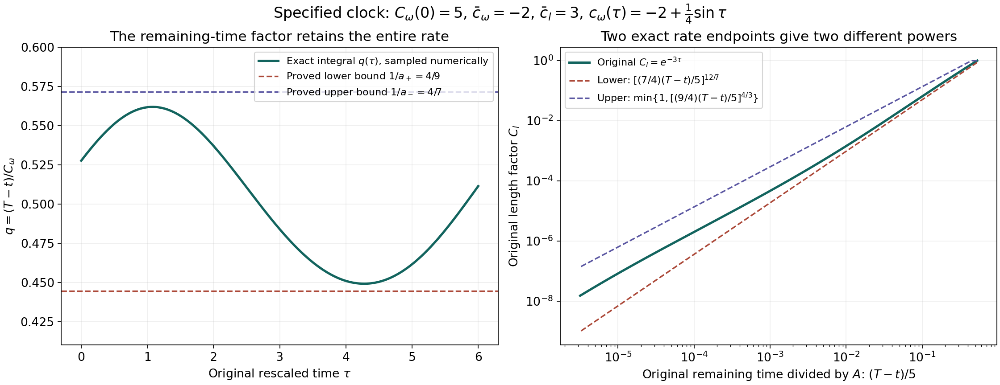
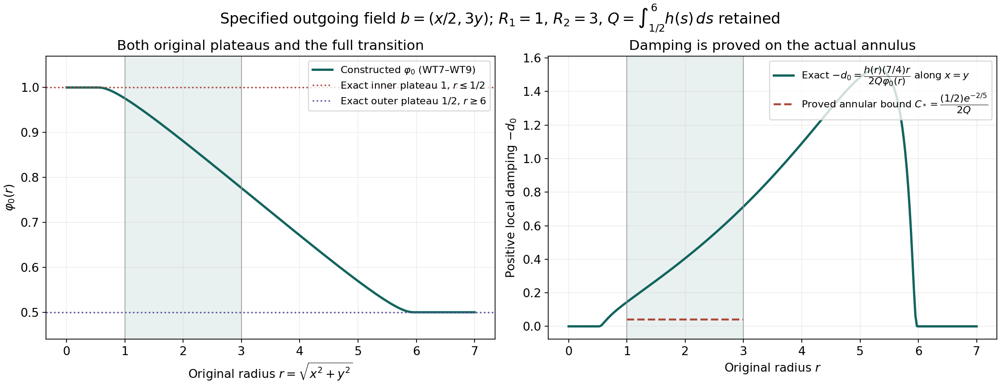
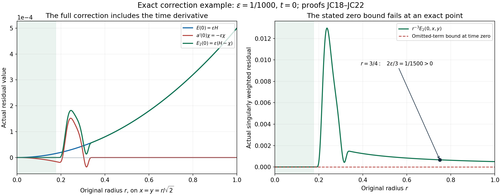
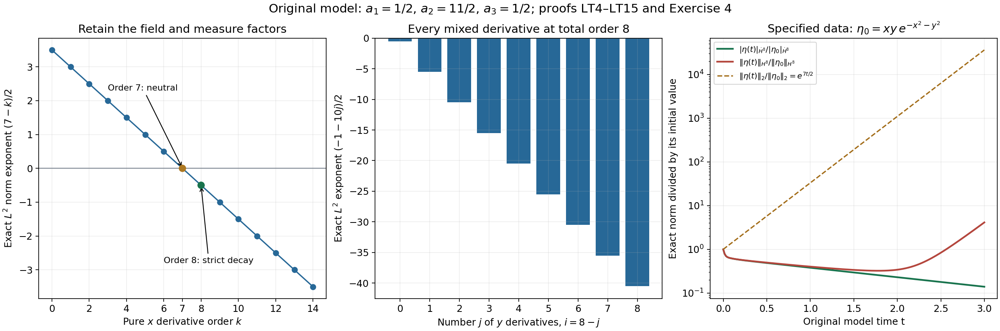

# Original clocks, weighted transport and exact corrections

Chen and Hou's stability construction changes both time and spatial
scale, controls outgoing transport with weights, and corrects an
approximate evolution so that its residual vanishes to the required
order at the origin. This lesson proves those maps with every original
factor, coupling, endpoint and correction term retained.

Part 1 calculates the physical clock and its exact remaining-time
integral. Part 2 constructs a complete annular damping weight and
keeps its cost in the nonlocal operator. Part 3 gives the full scalar
and three-component analytic corrections, their time tails, and the
return from independent components to a temperature field. Part 4
solves the original frozen transport model, including every mixed
derivative and both homogeneous and inhomogeneous Sobolev norms.

Five solved exercises calculate a clock with a logarithmic correction,
an explicit annular damping exponent, a nonzero analytic correction
tail, every derivative norm of a quadratic Gaussian, and all three
forced correction coefficients with their actual gradient defect.

Each part identifies the original author-source version and precise
passages. Corrections to the explanatory note and frozen model remain
visible. These comparisons do not establish a failure of the main
blowup theorem or certify its full computational stability argument.

## Part 1. Exact physical time and every original field scale
This calculation receives the original dynamic scales in Jiajie Chen and
Thomas Y. Hou, [arXiv:2210.07191v4](https://arxiv.org/abs/2210.07191v4),
original TeX lines710–735 and815–850. The stated profile and rate errors
are at lines799–809. The source explicitly calls the later rate formulas
informal and does not assert convergence to an exact profile. Its displayed
decimal scaling parameters at1495 are rounded, as stated at1478–1482;
none is used here as an exact enclosure.

The arguments below prove the clock and field maps on a fully specified
class of rate functions. They do not supply the source's still-unread
nonlinear stability estimates or validated computational constants.
The original half-plane, time origin and initial scale are retained.

### QC1. The actual clock and its complete inverse

Write the original spatial point as \(\boldsymbol x=(x,y)\) in
\(\mathbb H=\mathbb R\times[0,\infty)\), and keep \(\tau\) for
rescaled time and \(t\) for physical time. Fix the source constants
\(\bar c_l>0\), \(\bar c_\omega<0\), the actual initial vorticity
scale \(A=C_\omega(0)>0\), and \(\delta\) with
\(0\leq\delta<-\bar c_\omega\). Define both positive rate endpoints
without replacing the original rate:

\[
 a_-=-\bar c_\omega-\delta>0,\qquad
 a_+=-\bar c_\omega+\delta,\qquad
 -a_+\leq c_\omega(\tau)\leq-a_-,\quad \tau\geq0.
 \tag{QC1}
\]

Take any continuous original rate \(c_\omega\) satisfying QC1. The
full source scales and time are

\[
 \begin{gathered}
 C_\omega(\tau)=A\exp\!\left(\int_0^\tau c_\omega(s)\,ds\right),
 \qquad C_l(\tau)=\exp(-\bar c_l\tau),\\
 c_\theta(\tau)=\bar c_l+2c_\omega(\tau),\qquad
 C_\theta(\tau)=A^2
       \exp\!\left(\int_0^\tau c_\theta(s)\,ds\right),\\
 t(\tau)=\int_0^\tau C_\omega(s)\,ds,
 \qquad T=\int_0^\infty C_\omega(s)\,ds.
 \end{gathered}
 \tag{QC2}
\]

Here \(C_l(0)=1\) is the original source value. The initial factor
\(A\), and hence \(A^2\), are precisely the source's extension at825.
Integrating QC1 over \([0,\tau]\), exponentiating and retaining \(A\)
gives

\[
 \begin{gathered}
 Ae^{-a_+\tau}\leq C_\omega(\tau)\leq Ae^{-a_-\tau},
 \\
 \frac{A(1-e^{-a_+\tau})}{a_+}
 \leq t(\tau)\leq
 \frac{A(1-e^{-a_-\tau})}{a_-},\\
 \frac A{a_+}\leq T\leq\frac A{a_-}.
 \end{gathered}
 \tag{QC3}
\]

The two exponential integrals are finite because both endpoints are
strictly positive. The time derivative is exactly
\(t'(\tau)=C_\omega(\tau)>0\). Thus \(t\) is a strictly increasing
\(C^1\) bijection from \([0,\infty)\) onto \([0,T)\): continuity
gives every intermediate value, strict increase gives uniqueness, and
the defining improper integral gives the limit \(T\). Its inverse
\(\tau(t)\) is \(C^1\) at every \(t<T\), with derivative
\(1/C_\omega(\tau(t))\). In particular the complete space-time map
and its inverse are

\[
 \begin{aligned}
 \mathbb H\times[0,\infty)&\longrightarrow\mathbb H\times[0,T),
 &(\boldsymbol y,\tau)&\longmapsto
   (C_l(\tau)\boldsymbol y,t(\tau)),\\
 (\boldsymbol x,t)&\longmapsto
   (C_l(\tau(t))^{-1}\boldsymbol x,\tau(t)),
 &\det D_{(\boldsymbol y,\tau)}
   (C_l\boldsymbol y,t)&=C_l(\tau)^2C_\omega(\tau)>0.
 \end{aligned}
 \tag{QC4}
\]

The determinant follows from the block triangular derivative: its
spatial block is \(C_l I_2\), its lower-left block is zero and its last
diagonal entry is \(C_\omega\). The moving spatial column
\(C_l'(\tau)\boldsymbol y\) is retained and does not alter that
determinant. Positive dilation preserves both the half-plane and its
boundary. No point at \(t=T\) is in the inverse map's domain.

### QC2. The exact remaining-time factor

For every \(\tau\geq0\), define

\[
 q(\tau)=\int_0^\infty
       \exp\!\left(\int_\tau^{\tau+u}c_\omega(s)\,ds\right)du.
 \tag{QC5}
\]

The integrand lies between \(e^{-a_+u}\) and \(e^{-a_-u}\).
Changing variables \(s=\tau+u\) in the tail of the original time
integral, and using
\(C_\omega(\tau+u)=C_\omega(\tau)
\exp(\int_\tau^{\tau+u}c_\omega)\), proves

\[
 T-t(\tau)=C_\omega(\tau)q(\tau),\qquad
 \frac1{a_+}\leq q(\tau)\leq\frac1{a_-},\qquad
 q'(\tau)=-1-c_\omega(\tau)q(\tau).
 \tag{QC6}
\]

The last identity follows by differentiating the first identity, whose
two factors are \(C^1\); it requires no differentiation under an
improper integral. Every constant in QC6 is attained by the continuous
constant endpoint rates \(c_\omega=-a_+\) and
\(c_\omega=-a_-\), respectively. The original scale therefore obeys
the sharp two-sided remaining-time estimate

\[
 a_-\big(T-t(\tau)\big)\leq C_\omega(\tau)
       \leq a_+\big(T-t(\tau)\big).
 \tag{QC7}
\]

The upper and lower sides retain different constants. Replacing both
by \(-\bar c_\omega\) is not an exact identity for the rate class QC1.

### QC3. Spatial scales and the entire accumulated rate error

Put \(\Delta_t=T-t(\tau)>0\). Integrating the exponential envelopes
from \(\tau\) to infinity yields

\[
 \frac A{a_+}e^{-a_+\tau}\leq\Delta_t
    \leq\frac A{a_-}e^{-a_-\tau}.
 \tag{QC8}
\]

Since \(C_l=e^{-\bar c_l\tau}\), all quantities are positive and
raising each side to the indicated positive power gives

\[
 \left(\frac{a_-\Delta_t}{A}\right)^{\bar c_l/a_-}
 \leq C_l(\tau)
 \leq\min\!\left\{1,
       \left(\frac{a_+\Delta_t}{A}\right)^{\bar c_l/a_+}\right\},
 \tag{QC9}
\]

and hence

\[
 \max\!\left\{1,
       \left(\frac{a_+\Delta_t}{A}\right)^{-\bar c_l/a_+}\right\}
 \leq C_l(\tau)^{-1}
 \leq\left(\frac{a_-\Delta_t}{A}\right)^{-\bar c_l/a_-}.
 \tag{QC10}
\]

The cap at one uses \(\tau\geq0\). The lower base in QC9 is at most
one because \(\Delta_t\leq T\leq A/a_-\); thus these endpoint
bounds are consistent at \(\tau=0\) as well.

There is also a full identity retaining the deviation of the original
rate rather than only its bound. Set

\[
 B(\tau)=\int_0^\tau(c_\omega(s)-\bar c_\omega)\,ds,
 \qquad |B(\tau)|\leq\delta\tau,
 \qquad \gamma=-\frac{\bar c_l}{\bar c_\omega}>0.
 \tag{QC11}
\]

The logarithm of QC2 is
\(\log(C_\omega/A)=\bar c_\omega\tau+B(\tau)\).
Multiplying this equality by \(\gamma\), and retaining the entire
\(B\) term, gives

\[
 C_l(\tau)
   =\left(\frac{C_\omega(\tau)}A\right)^\gamma
       e^{-\gamma B(\tau)}
   =\left(\frac{\Delta_t}{Aq(\tau)}\right)^\gamma
       e^{-\gamma B(\tau)}.
 \tag{QC12}
\]

For \(\delta=0\), the only rate is \(c_\omega=\bar c_\omega\).
Then \(B=0\), \(q=1/(-\bar c_\omega)\), and every displayed
clock formula specializes to its exact constant-rate value.

For \(\delta>0\), the two permitted constant rates
\(c_\omega=\bar c_\omega+\delta=-a_-\) and
\(c_\omega=\bar c_\omega-\delta=-a_+\) give, respectively,

\[
 C_l(\tau)=
    \left(\frac{a_-\Delta_t}{A}\right)^{\bar c_l/a_-},
 \qquad
 C_l(\tau)=
    \left(\frac{a_+\Delta_t}{A}\right)^{\bar c_l/a_+}.
 \tag{QC13}
\]

Since \(a_-<-\bar c_\omega<a_+\), dividing the first expression
by \(\Delta_t^\gamma\) tends to zero as \(\Delta_t\downarrow0\),
and dividing the second by it tends to infinity. This proves exactly
why a bounded rate error alone does not give a uniform multiplicative
comparison with the central power. These examples are clocks in QC1,
not asserted PDE solutions or counterexamples to the source theorem.

Even the factor \(q\) need not converge in this rate class. For the
specified rate \(c_\omega(\tau)=\bar c_\omega+\delta\sin\tau\),

\[
 \begin{gathered}
 C_\omega(\tau)=A\exp\big(\bar c_\omega\tau+
                          \delta(1-\cos\tau)\big),\\
 q(\tau)=\int_0^\infty
   \exp\big(\bar c_\omega u+
            \delta(\cos\tau-\cos(\tau+u))\big)du.
 \end{gathered}
 \tag{QC14}
\]

The integrand makes \(q\) continuous and \(2\pi\)-periodic by
dominated convergence, with dominating function \(e^{-a_-u}\).
If \(q\) were constant, QC6 would force
\(c_\omega=-1/q\) to be constant, contrary to \(\delta>0\).
A nonconstant continuous periodic function cannot have a limit at
infinity: two different values repeat along two sequences of times
tending to infinity. This proves the asserted nonconvergence directly.

### QC4. Every field, derivative and measure factor

Keep the original source fields
\(\widetilde\omega,\widetilde\theta,\widetilde{\boldsymbol u}\)
in the rescaled half-plane. The identity
\(c_\theta=\bar c_l+2c_\omega\), together with the actual initial
factors in QC2, gives

\[
 C_\theta(\tau)=\frac{C_\omega(\tau)^2}{C_l(\tau)}.
 \tag{QC15}
\]

At \(\boldsymbol y=C_l(\tau)^{-1}\boldsymbol x\), the full inverse
source transformation is therefore

\[
 \begin{aligned}
 \omega_{\rm phy}(\boldsymbol x,t(\tau))
   &=C_\omega(\tau)^{-1}\widetilde\omega(\boldsymbol y,\tau),\\
 \theta_{\rm phy}(\boldsymbol x,t(\tau))
   &=C_l(\tau)C_\omega(\tau)^{-2}
       \widetilde\theta(\boldsymbol y,\tau),\\
 \boldsymbol u_{\rm phy}(\boldsymbol x,t(\tau))
   &=C_l(\tau)C_\omega(\tau)^{-1}
       \widetilde{\boldsymbol u}(\boldsymbol y,\tau).
 \end{aligned}
 \tag{QC16}
\]

For any original multi-index \(\alpha=(\alpha_1,\alpha_2)\) of
order \(k=\alpha_1+\alpha_2\), spatial differentiation at fixed time
multiplies each field by \(C_l^{-k}\). Thus the exact derivative
formulas retain factors \(C_\omega^{-1}C_l^{-k}\),
\(C_\omega^{-2}C_l^{1-k}\) and
\(C_\omega^{-1}C_l^{1-k}\), in the order of QC16. In particular
the original temperature gradient has the full factor
\(C_\omega^{-2}\); its spatial scale cancels only after both original
factors are displayed.

For \(1\leq p<\infty\), the substitution
\(\boldsymbol x=C_l\boldsymbol y\) has Jacobian \(C_l^2\).
Taking the \(p\)-th root of the resulting integral proves

\[
 \begin{aligned}
 \|D^\alpha\omega_{\rm phy}(t(\tau))\|_{L^p(\mathbb H)}
   &=C_\omega^{-1}C_l^{2/p-k}
        \|D^\alpha\widetilde\omega(\tau)\|_{L^p(\mathbb H)},\\
 \|D^\alpha\theta_{\rm phy}(t(\tau))\|_{L^p(\mathbb H)}
   &=C_\omega^{-2}C_l^{1+2/p-k}
        \|D^\alpha\widetilde\theta(\tau)\|_{L^p(\mathbb H)},\\
 \|D^\alpha\boldsymbol u_{\rm phy}(t(\tau))\|_{L^p(\mathbb H)}
   &=C_\omega^{-1}C_l^{1+2/p-k}
        \|D^\alpha\widetilde{\boldsymbol u}(\tau)\|_{L^p(\mathbb H)}.
 \end{aligned}
 \tag{QC17}
\]

All time-dependent factors on the right are evaluated at \(\tau\).
The identities also hold with infinite values when the fields are not
integrable. For \(p=\infty\), the bijective spatial dilation preserves
the essential supremum, so the three factors are respectively
\(C_\omega^{-1}C_l^{-k}\),
\(C_\omega^{-2}C_l^{1-k}\), and
\(C_\omega^{-1}C_l^{1-k}\). No finite-energy conclusion is inferred
from bounded vorticity alone.

### QC5. Exact receiving estimate for the source's stated error sizes

Let \(M=\|\bar\omega\|_{L^\infty(\mathbb H)}<\infty\) and
suppose a rescaled field has the actual error
\(\|\widetilde\omega(\tau)-\bar\omega\|_\infty\leq\epsilon_\omega\)
at every time. The triangle inequality and its reverse give
\((M-\epsilon_\omega)_+\leq\|\widetilde\omega(\tau)\|_\infty
\leq M+\epsilon_\omega\), where \((r)_+=\max\{r,0\}\).
Multiplying QC16 by \(\Delta_t\), using QC6 and retaining both
endpoints, gives

\[
 \frac{(M-\epsilon_\omega)_+}{a_+}
 \leq (T-t(\tau))\|\omega_{\rm phy}(t(\tau))\|_\infty
 \leq\frac{M+\epsilon_\omega}{a_-}.
 \tag{QC18}
\]

This is a direct algebraic receiving estimate. When
\(M>\epsilon_\omega\), its left coefficient is positive and it gives
the exact lower rate for the supplied field. Without that strict
inequality it does not claim a positive lower bound.

At time zero \(\widetilde\omega(0)=A\omega_{\rm phy}(0)\).
Writing \(M_0=\|\widetilde\omega(0)\|_\infty\), any nonzero initial
field satisfies \(A=M_0/\|\omega_{\rm phy}(0)\|_\infty\).
Substitution into QC3 proves the more precise initial-data form

\[
 \frac{M_0}{a_+\|\omega_{\rm phy}(0)\|_\infty}
 \leq T\leq
 \frac{M_0}{a_-\|\omega_{\rm phy}(0)\|_\infty}.
 \tag{QC19}
\]

There is no division by a zero initial norm: QC19 is stated only for a
nonzero initial field, while QC3 holds in every case in QC1–QC2.

The source's stated \(E_*=5\cdot10^{-6}\) gives exactly

\[
 \begin{gathered}
 \delta=100E_*=\frac1{2000},\qquad
 \epsilon_\omega=200E_*=\frac1{1000},\\
 a_-=-\bar c_\omega-\frac1{2000},\qquad
 a_+=-\bar c_\omega+\frac1{2000}.
 \end{gathered}
 \tag{QC20}
\]

Thus QC18–QC19 supply the exact comparison receiving those stated
errors, with the original \(\bar c_\omega\) still present. Checking
the actual profile enclosure and the nonlinear estimates that produce
these errors remains part of the continuing source audit. The proof
above has not replaced either calculation by the rounded value at1495.

For completeness, for each component \(j=1,2\) put
\(M_{\theta,j}=\|\partial_j\bar\theta\|_\infty\) and use an
actual bound
\(\|\partial_j\widetilde\theta-
\partial_j\bar\theta\|_\infty\leq\epsilon_{\theta,j}\).
The gradient factor in QC16 and the square of QC6 prove

\[
 \frac{(M_{\theta,j}-\epsilon_{\theta,j})_+}{a_+^2}
 \leq (T-t(\tau))^2
         \|\partial_j\theta_{\rm phy}(t(\tau))\|_\infty
 \leq\frac{M_{\theta,j}+\epsilon_{\theta,j}}{a_-^2}.
 \tag{QC21}
\]

The source asserts the same \(1/1000\) error for each of its two
gradient components. QC21 keeps them componentwise and does not
silently replace two component bounds by a Euclidean vector bound.

The figure uses the exact specified clock \(A=5\),
\(\bar c_\omega=-2\), \(\bar c_l=3\) and
\(c_\omega=-2+\tfrac14\sin\tau\), with
\(a_-=7/4\), \(a_+=9/4\). The integral curve is sampled numerically;
the two proved bounds are QC6 and QC9. These are clock examples, not
the source's numerical profile. The complete reproducible
[figure source](../assets/chen-hou-clock-and-annular-weight.py) and
[numerical samples](../assets/chen-hou-clock-weight-samples.json)
retain the original factors. Human source and exact proof locators
are given above; no interval certificate is claimed for plotted samples.

The next calculation is the complete original weighted transport
system and the analytic correction of its near-origin jets. QC1–QC21
give exact clock consequences, not the missing stability proof.

## Part 2. The full original weighted transport system and an explicit annular weight
Human source: Jiajie Chen and Thomas Y. Hou,
[arXiv:2210.07191v4](https://arxiv.org/abs/2210.07191v4), original
TeX1559–1632 and1690–1799. This calculation retains the complete
three-component equation; it does not delete the nonlocal terms,
profile residuals or nonlinear terms. It constructs the bounded
annular factor described at1744–1758 with explicit constants. The
full nonlinear and computational stability estimates remain to be read
and checked.

### WT1. All components of the original equation

Use the source's perturbation notation, in which \(\omega,\theta\)
are perturbations of \(\bar\omega,\bar\theta\), and
\(c_\omega=u_x(0)\) is the perturbation of the rate. Retain the
source's fixed derivative anchors, so the perturbation of \(c_l\) is
zero and that of \(c_\theta\) is \(2u_x(0)\). On the original
half-plane let

\[
 \begin{gathered}
 \boldsymbol x=(x,y),\quad
 \boldsymbol u=(u,v)=\nabla^\perp(-\Delta)^{-1}\omega,
 \quad \bar{\boldsymbol u}=(\bar u,\bar v)
       =\nabla^\perp(-\Delta)^{-1}\bar\omega,\\
 \eta=\theta_x,\quad \xi=\theta_y,\quad
 W=(\omega,\eta,\xi)^T,\quad
 b=\bar c_l\boldsymbol x+\bar{\boldsymbol u},\quad
 \bar c_\theta=\bar c_l+2\bar c_\omega.
 \end{gathered}
 \tag{WT1}
\]

The stream function and boundary conditions are those of the source;
the velocity here is its exact Biot–Savart velocity, not the separately
represented numerical stream function. The full equation is

\[
 (\partial_t+b\cdot\nabla)W=M W+G,
 \qquad G=G_{\rm nl}+G_{\rm quad}+G_{\rm res},
 \tag{WT2}
\]

with every matrix entry retained:

\[
 M=\begin{pmatrix}
 \bar c_\omega&1&0\\
 0&2\bar c_\omega-\bar u_x&-\bar v_x\\
 0&-\bar u_y&2\bar c_\omega+\bar u_x
 \end{pmatrix}.
 \tag{WT3}
\]

The nonlocal part is the following full vector, not a numerical bound:

\[
 G_{\rm nl}=\begin{pmatrix}
 -u\bar\omega_x-v\bar\omega_y+u_x(0)\bar\omega\\
 -u_x\bar\theta_x-v_x\bar\theta_y
 -u\bar\theta_{xx}-v\bar\theta_{xy}+2u_x(0)\bar\theta_x\\
 -u_y\bar\theta_x-v_y\bar\theta_y
 -u\bar\theta_{xy}-v\bar\theta_{yy}+2u_x(0)\bar\theta_y
 \end{pmatrix}.
 \tag{WT4}
\]

The full nonlinear and original residual vectors are

\[
 \begin{gathered}
 G_{\rm quad}=\begin{pmatrix}
 -u\omega_x-v\omega_y+u_x(0)\omega\\
 -u\eta_x-v\eta_y-u_x\eta-v_x\xi+2u_x(0)\eta\\
 -u\xi_x-v\xi_y-u_y\eta-v_y\xi+2u_x(0)\xi
 \end{pmatrix},\\
 \bar F_\omega=-b\cdot\nabla\bar\omega
                   +\bar\theta_x+\bar c_\omega\bar\omega,
 \qquad
 \bar F_\theta=-b\cdot\nabla\bar\theta+\bar c_\theta\bar\theta,\\
 G_{\rm res}=(\bar F_\omega,
              \partial_x\bar F_\theta,
              \partial_y\bar F_\theta)^T.
 \end{gathered}
 \tag{WT5}
\]

To verify WT2, insert the full barred-plus-perturbation fields into
the source equations. The vorticity equation has transport
\(-b\cdot\nabla\omega\), the local terms
\(\bar c_\omega\omega+\eta\), the first entry of WT4, the first
entry of WT5 and the barred residual. These exhaust its products.
For the temperature equation differentiate once in \(x\): the
derivative of transport contributes
\(-\bar c_l\eta-\bar u_x\eta-\bar v_x\xi\), and
\(\bar c_\theta\eta-\bar c_l\eta=2\bar c_\omega\eta\).
Differentiating its perturbation transport and rate products gives
exactly the second entries of WT4–WT5. Differentiate instead in
\(y\): the corresponding local entries are
\(-\bar u_y\eta+(\bar c_\theta-\bar c_l-\bar v_y)\xi\).
The exact divergence identity \(\bar v_y=-\bar u_x\) gives the
third row of WT3; all other differentiated products are the third
entries of WT4–WT5. Thus no term from the source's two spatial
directions is discarded.

### WT2. The complete componentwise weight map

On any region excluding the origin let \(\varphi_i>0\) be \(C^1\)
time-independent weights, and put
\(D_\varphi=\operatorname{diag}(\varphi_1,\varphi_2,\varphi_3)\),
\(Z=D_\varphi W\). Multiplication is invertible there. The product
rule proves the exact conjugated equation

\[
 (\partial_t+b\cdot\nabla)Z
 =\left(D_\varphi M D_\varphi^{-1}
      +\operatorname{diag}(d_1,d_2,d_3)\right)Z
    +D_\varphi G,
 \qquad d_i=\frac{b\cdot\nabla\varphi_i}{\varphi_i}.
 \tag{WT6}
\]

In particular the three off-diagonal coefficients are exactly
\(\varphi_1/\varphi_2\),
\(-\bar v_x\varphi_2/\varphi_3\) and
\(-\bar u_y\varphi_3/\varphi_2\). They cannot be ignored when
choosing different weights for the components.

### WT3. A constructed weight with the source's exact plateaus

Retain \(0<R_1<R_2\) and work in the original positive quadrant
\(x,y\geq0\), away from its origin. Let

\[
 \begin{gathered}
 a=R_1/2,\quad d=2R_2,\quad Q=\int_a^d h(s)\,ds,\\
 h(r)=\begin{cases}
  \exp\!\left(-\dfrac1{(r-a)(d-r)}\right),&a<r<d,\\
  0,&r\leq a\text{ or }r\geq d,
 \end{cases}
 \end{gathered}
 \tag{WT7}
\]

and, for \(r=|\boldsymbol x|\), set

\[
 \varphi_0(\boldsymbol x)=1-\frac1{2Q}\int_a^r h(s)\,ds.
 \tag{WT8}
\]

The oriented integral in WT8 is zero for \(r\leq a\), since its
integrand vanishes there. It equals \(Q\) for \(r\geq d\).
The positive integrand on \((a,d)\) gives
\(0<Q<d-a\), and consequently

\[
 \varphi_0=1\ (r\leq R_1/2),\qquad
 \varphi_0=\tfrac12\ (r\geq2R_2),\qquad
 \tfrac12\leq\varphi_0\leq1,\qquad
 \nabla\varphi_0=-\frac{h(r)}{2Q}\frac{\boldsymbol x}{r}.
 \tag{WT9}
\]

All derivatives of the exponential in WT7 tend to zero at either
endpoint: each derivative is that exponential times a finite rational
function of \(r-a\) and \(d-r\); an exponential of a negative
reciprocal dominates every such power. Thus \(h\), its integral and
\(\varphi_0\) are smooth. The last function is constant in a full
ball about the origin, so the radial definition is smooth there too.
For \(R_1\leq r\leq R_2\) and \(x_i>0\), WT9 has
\(\partial_i\varphi_0<0\). At the corresponding coordinate axis
that derivative is zero, which is the exact boundary behavior.

Retain actual positive outgoing constants \(c_1,c_2\) in
\(b_1(\boldsymbol x)\geq c_1x\) and
\(b_2(\boldsymbol x)\geq c_2y\), and set
\(c_*=\min(c_1,c_2)>0\). The constants are not replaced by the
source's rounded illustrative decimals. Then

\[
 b\cdot\boldsymbol x\geq c_1x^2+c_2y^2\geq c_*r^2,
 \qquad
 d_0:=\frac{b\cdot\nabla\varphi_0}{\varphi_0}
   =-\frac{h(r)}{2Q\varphi_0}\frac{b\cdot\boldsymbol x}{r}
   \leq0.
 \tag{WT10}
\]

This retains the two individual coordinate contributions before
taking their lower bound. On the closed annulus \(R_1\leq r\leq R_2\),
the concave quadratic \((r-a)(d-r)\) attains its minimum at an
endpoint. The second endpoint value minus the first is
\((R_2-R_1)(R_2-R_1/2)>0\). Therefore

\[
 \begin{gathered}
 h(r)\geq h_*:=
  \exp\!\left(-\frac1{(R_1/2)(2R_2-R_1)}\right)>0,\\
 d_0\leq-C_*,\qquad
 C_*:=\frac{c_*R_1h_*}{2Q}
  >\frac{c_*R_1}{2(2R_2-R_1/2)}
      \exp\!\left(-\frac1{(R_1/2)(2R_2-R_1)}\right)>0.
 \end{gathered}
 \tag{WT11}
\]

The complete integral \(Q\) remains in the stronger coefficient;
the following explicit lower bound uses only \(Q<d-a\).
The inequality is valid at the axes as well, because WT10 uses the
radial dot product rather than strict negativity of both partials.

### WT4. Strong local damping without deleting the remaining equation

For fixed \(\alpha_i<0\) and real \(\beta_i\), retain the original
two-term radial factors

\[
 \psi_i(r)=r^{\alpha_i}+r^{\beta_i},\qquad
 \varphi_i=\psi_i\varphi_0^m,\qquad m\geq0,
 \qquad
 d_{s,i}=
 \frac{\alpha_i r^{\alpha_i}+\beta_i r^{\beta_i}}
      {r^{\alpha_i}+r^{\beta_i}}
 \frac{b\cdot\boldsymbol x}{r^2}.
 \tag{WT12}
\]

Differentiation gives \(d_i=d_{s,i}+m d_0\). The common bounded
factor cancels in every same-point ratio
\(\varphi_i/\varphi_j=\psi_i/\psi_j\), so the off-diagonal
matrix does not acquire an unrecorded dependence on \(m\).
The original weighted spaces are unchanged as sets, with the explicit
norm comparison

\[
 2^{-m}\max_i\|\psi_i W_i\|_\infty
 \leq\max_i\|\varphi_i W_i\|_\infty
 \leq\max_i\|\psi_i W_i\|_\infty.
 \tag{WT13}
\]

This follows directly by multiplying \(2^{-m}\leq\varphi_0^m\leq1\).
In particular the factor is identically one near the origin. It does
not repair a missing vanishing jet required by a singular \(\psi_i\).

On the closed quadrant annulus define the exact three row quantities

\[
 \begin{aligned}
 \rho_1&=\bar c_\omega+d_{s,1}+\psi_1/\psi_2,\\
 \rho_2&=2\bar c_\omega-\bar u_x+d_{s,2}
                     +|\bar v_x|\psi_2/\psi_3,\\
 \rho_3&=2\bar c_\omega+\bar u_x+d_{s,3}
                     +|\bar u_y|\psi_3/\psi_2,\qquad
 K=\max_{R_1\leq r\leq R_2,\ x,y\geq0}\max_i\rho_i.
 \end{aligned}
 \tag{WT14}
\]

When the barred velocity is \(C^1\) on this annulus, all functions
are continuous and the denominators are positive. Compactness makes
\(K\) finite. For any prescribed local damping \(\kappa>0\), the
fully specified choice

\[
 m=\frac{\max\{0,K+\kappa\}}{C_*}
 \tag{WT15}
\]

makes every diagonal-plus-absolute-off-diagonal row sum of the exact
matrix in WT6 at most \(-\kappa\) throughout the annulus. Indeed,
that row sum is \(\rho_i+m d_0\leq K-mC_*\); WT15 gives
\(-\kappa\) when \(K+\kappa\geq0\), and when it is negative,
\(m=0\) and \(K<-\kappa\). This proves the full local matrix
statement with unequal base weights and without discarding the
\(\eta\)-to-\(\omega\) or either cross-gradient coupling.

Here is its precise receiving estimate. Let \(X(t)\) be an actual
characteristic, \(X'=b(X)\), which stays in the annulus on
\([t_0,t_1]\). For a differentiable solution of the complete WT2,
put \(z(t)=Z(X(t),t)\). Its equation is exactly WT6 evaluated on
this path. The upper right derivative of
\(n(t)=\max_i|z_i(t)|\) satisfies

\[
 D^+ n(t)\leq-\kappa n(t)
     +\max_i|\varphi_i(X(t))G_i(X(t),t)|.
 \tag{WT16}
\]

To prove this finite-dimensional statement, at a nonzero maximizing
component multiply its differential equation by its sign. The diagonal
term is its diagonal coefficient times \(n\), and each off-diagonal
term is at most its absolute coefficient times \(n\). At a maximizing
zero all components vanish, so the derivative of its absolute value is
bounded by the forcing norm. For a maximum of finitely many
differentiable absolute values, its upper right derivative is at most
the maximum of these derivatives among the maximizing components:
any nonmaximizing component has a strict value gap and cannot become
a maximizer over sufficiently short times. WT15 now gives WT16.
Multiplication by \(e^{\kappa t}\) and integration yields

\[
 \begin{aligned}
 \max_i|\varphi_i(X(t))W_i(X(t),t)|
 &\leq e^{-\kappa(t-t_0)}
        \max_i|\varphi_i(X(t_0))W_i(X(t_0),t_0)|\\
 &\quad+\int_{t_0}^t e^{-\kappa(t-s)}
        \max_i\Bigl|\varphi_i(X(s))\\
 &\qquad\qquad\qquad\quad\cdot
          (G_{{\rm nl},i}+G_{{\rm quad},i}+G_{{\rm res},i})(X(s),s)\Bigr|\,ds.
 \end{aligned}
 \tag{WT17}
\]

Equivalently, the integrating-factor comparison follows by integrating
the almost-everywhere differential inequality for the locally Lipschitz
function \(n\). Every original forcing term from WT4–WT5 remains
inside this estimate. The interval restriction matters: WT17 does not
assert that a characteristic remains in the annulus forever.

The same-point cancellation in WT12 does not extend to nonlocal
kernels. For an actual integral term
\((KW)_i(\boldsymbol x)=\sum_j\int K_{ij}(\boldsymbol x,\boldsymbol y)
W_j(\boldsymbol y)\,d\boldsymbol y\), whenever that integral exists,
the exact conjugated kernel is

\[
 (D_\varphi K D_\varphi^{-1})_{ij}(\boldsymbol x,\boldsymbol y)
 =\frac{\psi_i(\boldsymbol x)}{\psi_j(\boldsymbol y)}
   \left(\frac{\varphi_0(\boldsymbol x)}
               {\varphi_0(\boldsymbol y)}\right)^m
    K_{ij}(\boldsymbol x,\boldsymbol y),\qquad
 2^{-m}\leq
   \left(\frac{\varphi_0(\boldsymbol x)}
               {\varphi_0(\boldsymbol y)}\right)^m
 \leq2^m.
 \tag{WT18}
\]

Both extremal ratios occur between the two exact plateaus of WT9.
The kernel identity follows by substituting \(W=D_\varphi^{-1}Z\)
before integration. For a principal value, the identical substitution
holds at each original cutoff before taking its limit; no existence
of that limit is inferred from WT18. This is the exact additional
weight factor that the remaining nonlocal estimate must handle.

The specified illustration uses \(R_1=1\), \(R_2=3\), the outgoing
field \(b=(x/2,3y)\), and the original ray \(x=y\geq0\).
On that ray \((b\cdot\boldsymbol x)/r=(7/4)r\), so the plotted
damping is exactly WT10 with that substitution. The shaded region is
the actual annulus, and the dashed lower bound is WT11 with the full
\(Q=\int_{1/2}^{6}h(s)\,ds\). Numerical quadrature samples the
explicit functions; the inequalities are proved above, not inferred
from the plot. The [reproducible source](../assets/chen-hou-clock-and-annular-weight.py)
and [samples](../assets/chen-hou-clock-weight-samples.json) are retained.
This field is a specified illustration of the outgoing class, not the
source approximate Euler/Boussinesq profile.

WT1–WT18 prove the complete local transport map and a constructive
annular damping mechanism. The next source work is to prove the
required weighted nonlocal bounds and the analytic corrections of
near-origin jets; stronger local damping alone has not supplied them.

## Part 3. Exact local corrections, the complete residual and its original receiving map
Human sources: Jiajie Chen and Thomas Y. Hou,
[the analytic correction note, arXiv:2607.15256v1](https://arxiv.org/abs/2607.15256v1),
original TeX1128–1525 and1545–1921;
[Part I, arXiv:2210.07191v4](https://arxiv.org/abs/2210.07191v4),
original TeX2230–2340 and15795–15860; and
[Part II, arXiv:2305.05660v3](https://arxiv.org/abs/2305.05660v3),
original TeX927–985,1035–1090,1106–1360,6163–6181,6314–6317
and6474–6498. These exact versions matter: the note's displayed
error estimate omits a time-derivative term which Part I v4 explicitly
retains. Part II retains it through the correction ODE before estimating
the complete residual. The calculations below prove that comparison;
they do not certify all the remaining stability and numerical estimates.

### JC1. The original quadratic defect and its exact projection

Work on \(\mathbb H=\mathbb R\times[0,\infty)\) with original
coordinates \(\boldsymbol x=(x,y)\), \(r=\sqrt{x^2+y^2}\).
Derivatives at the boundary origin are derivatives of functions smooth
up to that boundary. Retain the source operator

\[
 \mathcal L f=-\overline V_1\partial_x f
              -\overline V_2\partial_y f+\bar c f+\overline F P(f),
 \qquad
 P(f)=\int_{\mathbb R^2_{++}}f(\boldsymbol z)\bar p(\boldsymbol z)
                                    \,d\boldsymbol z.
 \tag{JC1}
\]

The functional is used on its actual domain of convergence. In the
source model it is bounded on the receiving space. The local coefficients
obey

\[
 \overline V_1=c_1x+O(r^2),\qquad
 \overline V_2=c_2y+O(r^2),\qquad
 \overline F=\alpha xy+O(r^3),\qquad
 \alpha=\partial_{xy}\overline F(0).
 \tag{JC2}
\]

The last expansion follows from the source's oddness in \(x\), its
quadratic vanishing, and Taylor's formula. Keep all coefficients and
assume the differentiability needed in each following formula;
\(C^{3,1}\) represented spatial functions suffice for the residual
estimates, as the note itself observes at1518–1523.

Let \(\mathcal Y\) consist of \(C^{2,1}\) functions whose derivatives
of order less than two vanish at zero and whose only possibly nonzero
second derivative there is the mixed derivative. Set

\[
 Jf=\partial_{xy}f(0),\qquad
 \mathcal X=\{f\in\mathcal Y:Jf=0\}.
 \tag{JC3}
\]

Every \(f\in\mathcal Y\) has \(f=Jf\,xy+O(r^3)\), and every
\(f\in\mathcal X\) is \(O(r^3)\). Choose an actual compactly
supported \(\chi\in\mathcal Y\) with \(J\chi=1\). Then

\[
 \Pi f=f-\chi Jf,\qquad J\Pi=0,\qquad \Pi^2=\Pi,
 \qquad\operatorname{im}\Pi=\mathcal X,
 \qquad\ker\Pi=\operatorname{span}\{\chi\}.
 \tag{JC4}
\]

These identities follow by applying \(J\chi=1\), not by discarding a
small coefficient. The exact maps
\(f\mapsto(\Pi f,Jf)\) and \((h,z)\mapsto h+z\chi\) are inverse
linear maps between \(\mathcal Y\) and \(\mathcal X\oplus\mathbb R\).
Thus the quadratic obstruction is the actual one-dimensional quotient
\(\mathcal Y/\mathcal X\), with its supplied section and projection.

For \(f\in\mathcal Y\) of sufficient regularity, Leibniz's rule gives

\[
 J\mathcal L f=\lambda Jf+\alpha P(f),\qquad
 \lambda=\bar c(0)-\partial_x\overline V_1(0)
                       -\partial_y\overline V_2(0)
         =\bar c(0)-c_1-c_2.
 \tag{JC5}
\]

For example,
\(\partial_{xy}(\overline V_1 f_x)(0)\) has the four terms
\(\overline V_{1,xy}f_x\), \(\overline V_{1,x}f_{xy}\),
\(\overline V_{1,y}f_{xx}\), and \(\overline V_1f_{xxy}\).
Only the second survives, giving \(c_1Jf\).
The four terms from \(\overline V_2f_y\) similarly give \(c_2Jf\).
The four terms from \(\bar c f\) give \(\bar c(0)Jf\), and the
functional is constant in space, so the final term gives \(\alpha P(f)\).
The same product rules show that \(\mathcal L f\) has zero value,
zero gradient and zero pure second derivatives at the origin. These
claims use the diagonal first derivative of \(\overline V\) in JC2.

The full operator
\(\mathcal L_0=\mathcal L-\alpha\chi P\) consequently satisfies
\(J\mathcal L_0f=\lambda Jf\). For an adequately regular solution
of \(\partial_tW_1=\mathcal L_0W_1-R\) with all derivatives through
order two of \(R\) zero at the origin, the lower derivatives evolve
by a homogeneous finite linear system; zero initial derivatives remain
zero by uniqueness for that system. After those derivatives vanish,
the mixed derivative obeys
\((JW_1)'=\lambda JW_1\). Thus initial cubic vanishing is preserved.
This is an exact statement about the regular evolution; existence and
global stability of the source PDE are not inferred from this jet identity.

### JC2. A constructed correction with its full stream function

Take an even \(C^\infty\) compactly supported cutoff \(\kappa\),
equal to one in a neighborhood of zero. Write
\(K(x,y)=\kappa(x)\kappa(y)\) and define

\[
 \Phi=-\frac{xy^3}{6}K(x,y),\qquad
 \chi=(-\Delta)\Phi=\Delta\left(\frac{xy^3}{6}K(x,y)\right).
 \tag{JC6}
\]

The complete expression, including every transition term, is

\[
 \begin{aligned}
 \chi={}&xy\kappa(x)\kappa(y)
   +\frac{y^3}{3}\kappa'(x)\kappa(y)
   +\frac{xy^3}{6}\kappa''(x)\kappa(y)\\
   &+xy^2\kappa(x)\kappa'(y)
   +\frac{xy^3}{6}\kappa(x)\kappa''(y).
 \end{aligned}
 \tag{JC7}
\]

Near zero \(\chi=xy\) exactly. It is odd in \(x\), compactly
supported and smooth up to the original boundary. Its original
velocity, with \(\nabla^\perp=(-\partial_y,\partial_x)\), is

\[
 \boldsymbol u(\chi)=\nabla^\perp\Phi
 =\left(
 \frac{x\kappa(x)}6[3y^2\kappa(y)+y^3\kappa'(y)],
 -\frac{y^3\kappa(y)}6[\kappa(x)+x\kappa'(x)]
 \right).
 \tag{JC8}
\]

This identification with the original Dirichlet inverse can be proved
directly. For two points \(\boldsymbol x,\boldsymbol z\) in the
open half-plane, its Green function is
\((2\pi)^{-1}\log(|\boldsymbol x-\boldsymbol z^*|/
|\boldsymbol x-\boldsymbol z|)\), where
\(\boldsymbol z^*=(z_1,-z_2)\). The identity
\(-\Delta_{\boldsymbol z}[-(2\pi)^{-1}\log|\boldsymbol x-\boldsymbol z|]
=\delta_{\boldsymbol x}\) follows from its radial derivative
\(-1/(2\pi\rho)\) on a circle of radius \(\rho\) about
\(\boldsymbol x\). Its outward flux is \(-1\), so the negative
Laplacian has mass one. On the inner boundary of the punctured
half-plane the outward normal points toward the center; that reversal
gives the corresponding positive term in Green's identity.
The reflected term is harmonic
inside the half-plane and cancels the boundary value. Integrate
Green's identity against the compactly supported \(\Phi\): the
outer boundary contributes zero, and on \(y=0\) both \(\Phi\)
and the Green function vanish. Removing a small circle and taking
its radius to zero gives
\((-\Delta)^{-1}(-\Delta\Phi)=\Phi\). This proves JC8 for the original
inverse, with its boundary condition fixed.

In particular, for the source functional
\(P(f)=u_x(f)(0)=-\partial_{xy}(-\Delta)^{-1}f(0)\),
JC8 gives

\[
 P(\chi)=0,\qquad
 \boldsymbol u(\chi)=(xy^2/2,-y^3/6)\text{ near zero},
 \qquad\nabla\boldsymbol u(\chi)(0)=0.
 \tag{JC9}
\]

The functional has an explicit bounded domain adequate for the example
below. Let \(f\) be a smooth function supported in the closed half-ball
of radius \(R\), whose extension to the whole plane is odd in each
coordinate and smooth, and set
\(\|f\|_{2,R}=\sup_{0<r\leq R}|f|/r^2\). Then

\[
 P(f)=-\frac4\pi\int_{\mathbb R^2_{++}}
              \frac{z_1z_2}{|\boldsymbol z|^4}f(\boldsymbol z)
                       \,d\boldsymbol z,
 \qquad |P(f)|\leq\frac{R^2}{\pi}\|f\|_{2,R}.
 \tag{JC9a}
\]

To justify the derivative, extend \(f\) oddly across the boundary.
The whole-plane fundamental solution is
\(N(\boldsymbol z)=-(2\pi)^{-1}\log|\boldsymbol z|\).
In \(\partial_{xy}(N*f)(0)=\int N\partial_{xy}f\), integrate
by parts twice outside a circle of radius \(\rho\).
The omitted interior integral is \(O(\rho^2|\log\rho|)\).
The two boundary terms are bounded by constants times
\(\rho^2|\log\rho|\) and \(\rho^2\), since
\(f=O(r^2)\), \(\nabla f=O(r)\),
\(N=O(|\log\rho|)\) and \(\nabla N=O(\rho^{-1})\).
All tend to zero. The resulting kernel is
\(\partial_{xy}N=z_1z_2/(\pi|\boldsymbol z|^4)\),
which is absolutely integrable against \(f\) at zero.
Odd reflection gives the Dirichlet potential on the half-plane;
oddness in both coordinates makes the whole-plane integral four
times the quadrant integral. The original velocity adds its minus
sign. Finally, polar coordinates give
\(\int_0^{\pi/2}\cos\vartheta\sin\vartheta\,d\vartheta=1/2\)
and \(\int_0^Rr\,dr=R^2/2\), proving the bound in JC9a.
Thus the model example uses the actual bounded Biot–Savart functional,
including its sign and domain, rather than an unspecified scalar map.

The correction note's footnote at1413 instead prints
\(-\Delta(+xy^3K/6)\), which equals \(-xy\) near zero and has
mixed derivative \(-1\). It cannot satisfy the subsequent required
mixed derivative \(+1\). The sign in JC6 is the one explicitly
present in Part I v4 at2260 and Part II v3 at1150. The note's later
elliptic decomposition at1885–1891 also uses this correct sign.
The note at1921 also prints the opposite sign in its formula for
\(u_x(\varepsilon)(0)\). The original convention
\(u=-\phi_y\) gives the minus sign in JC9a; Part I v4 at9069
and Part II v3 at6173–6174 retain it. This local sign discrepancy
does not change the zero value for the particular correction JC6.

### JC3. Both analytic corrections and the full evolution residual

Let \(g^{(0)}(t,x,y)\) be the actual globally represented function,
odd in \(x\), with sufficient spatial regularity and locally Lipschitz,
piecewise smooth time dependence. Let \(\chi_1=x+O(r^3)\) be a
fixed smooth compactly supported odd function. The first correction is

\[
 g^{(1)}(t,\boldsymbol x)=g^{(0)}(t,\boldsymbol x)
                -\partial_xg^{(0)}(t,0)\chi_1(\boldsymbol x).
 \tag{JC10}
\]

Oddness eliminates the constant and pure \(y\) derivatives and the
pure second \(x\) derivative at zero. JC10 eliminates the remaining
linear derivative, so \(g^{(1)}(t)\in\mathcal Y\). Every derivative
here is the exact derivative of the supplied basis representation.
For example, if \(g^{(0)}=\sum_{ij}a_{ij}(t)B_i(x)C_j(y)\), then
\(\partial_xg^{(0)}(t,0)=\sum_{ij}a_{ij}(t)B_i'(0)C_j(0)\).
No second rounding of that expression is part of JC10.

Keep the original target \(\chi_\dagger\in\mathcal Y\) with
\(J\chi_\dagger=1\), and put

\[
 E_0=g^{(1)}(0)-\chi_\dagger,\qquad
 E(t)=(\partial_t-\mathcal L)g^{(1)}(t),\qquad
 e_0=JE_0,\quad e(t)=JE(t).
 \tag{JC11}
\]

The lower jets of \(E_0,E\) vanish by JC5 and the preceding product
rules. For the actual \(\chi\) in JC6, define

\[
 \begin{gathered}
 a(t)=-e^{\lambda t}e_0
          -\int_0^t e^{\lambda(t-s)}e(s)\,ds,\qquad
 a'=\lambda a-e,\quad a(0)=-e_0,\\
 g^{(2)}=g^{(1)}+a\chi,\qquad
 E_2=(\partial_t-\mathcal L)g^{(2)}
          =E+a'\chi-a\mathcal L\chi.
 \end{gathered}
 \tag{JC12}
\]

The integral is an exact ordinary integral of the represented defect;
bounded measurable \(e\) gives an absolutely continuous \(a\), with
the differential identity almost everywhere. For piecewise smooth
inputs it holds classically away from their time breakpoints. Initial
matching gives \(J(g^{(2)}(0)-\chi_\dagger)=e_0+a(0)=0\), and JC5,
JC9 and JC12 give \(JE_2=e+a'-\lambda a=0\). All lower jets remain
zero, hence

\[
 g^{(2)}(t)=O(r^2),\qquad
 g^{(2)}(0)-\chi_\dagger=O(r^3),\qquad E_2(t)=O(r^3).
 \tag{JC13}
\]

These are three different statements. The note's prose at1483 says
\(g^{(2)}\) itself vanishes cubically. At initial time its mixed
derivative is one, so that prose is false. The correct conditions
are the note's own display at1299–1300, reproduced exactly in JC13.

The derivative term \(a'\chi\) in JC12 must be retained. The note
omits it from the estimate at1635–1638 and1664–1666. It also omits
\(e\) in the first equality at1454 and restricts the second condition
at1440 to \(s=0\). The full ODE is the identity at every time in JC12.
Part I v4 explicitly contains the full conditions at2287–2306 and
the \(a'\) terms at15819 and15849.

There is an exact alternative that keeps the cancellation before
estimating. With \(\Pi\) from JC4,

\[
 E_2=\Pi E-a\Pi\mathcal L\chi
     =(E-e\chi)+a(\lambda\chi-\mathcal L\chi).
 \tag{JC14}
\]

Both parentheses separately belong to \(\mathcal X\), by JC5.
This identity incorporates \(a'\) through its full ODE; it does not
drop it. It is the scalar version of Part II's residual decomposition
at1288–1343.

The exact cancellation itself does not require \(P(\chi)=0\).
For any supplied \(\chi\in\mathcal Y\) with \(J\chi=1\), retain
instead \(\Lambda=J\mathcal L\chi=\lambda+\alpha P(\chi)\)
throughout the ODE, integral and JC14. The same algebra proves all
three conclusions in JC13. The source's construction has the useful
additional property \(P(\chi)=0\), so its correction rate remains
the original \(\lambda\); without it the actual extra rate term
must be estimated and may affect temporal decay.

### JC4. Complete weighted estimates and the infinite time tail

For a scalar function with zero derivatives through order two at zero,
Taylor's integral formula on the original half-ball gives

\[
 f(\boldsymbol x)=\frac12\int_0^1(1-s)^2
       D^3f(s\boldsymbol x)[\boldsymbol x,\boldsymbol x,\boldsymbol x]\,ds,
 \qquad
 \sup_{0<r\leq R}r^{-3}|f(\boldsymbol x)|
       \leq\frac16\sup_{r\leq R}\|D^3f(\boldsymbol x)\|_{\rm op}.
 \tag{JC15}
\]

The third differential contains all four original terms
\(x^3f_{xxx}+3x^2yf_{xxy}+3xy^2f_{xyy}+y^3f_{yyy}\).
The integral of \((1-s)^2/2\) is \(1/6\). For \(C^{2,1}\)
functions use the second-order integral remainder and the Lipschitz
constant of the Hessian; it gives the same coefficient. The constant
\(1/6\) is attained by \(f=x^3/6\) on the positive \(x\)-axis
when the norm of its third differential is one.

Writing \(M_3(f;R)=\sup_{r\leq R}\|D^3f\|_{\rm op}\), JC12–JC15
give both complete bounds

\[
 \begin{aligned}
 \|r^{-3}E_2(t)\|_{L^\infty(0<r\leq R)}
 &\leq\tfrac16\big(M_3(E;R)+|a'|M_3(\chi;R)
                                  +|a|M_3(\mathcal L\chi;R)\big),\\
 \|r^{-3}E_2(t)\|_{L^\infty(0<r\leq R)}
 &\leq\tfrac16\big(M_3(\Pi E;R)
                                  +|a|M_3(\Pi\mathcal L\chi;R)\big).
 \end{aligned}
 \tag{JC16}
\]

The first keeps the derivative explicitly; the second retains its
entire quadratic correction inside \(\Pi E\). Away from zero the
pointwise bound is

\[
 r^{-3}|E_2|\leq r^{-3}|E|+|a'|r^{-3}|\chi|
                    +|a|r^{-3}|\mathcal L\chi|,
\]

with the same three terms.

For an actual negative \(\lambda=-\gamma<0\), a defect supported
in \([0,T_0]\), and \(|e(t)|\leq\varepsilon\), the full original
integral in JC12 gives

\[
 \begin{gathered}
 |a(t)|\leq e^{-\gamma t}|e_0|
 +\frac{\varepsilon}{\gamma}
       e^{-\gamma\max(t-T_0,0)}
       (1-e^{-\gamma\min(t,T_0)}),\\
 |a'(t)|\leq\gamma|a(t)|+|e(t)|,
 \qquad a(t)=e^{-\gamma(t-T_0)}a(T_0)\quad(t\geq T_0).
 \end{gathered}
 \tag{JC17}
\]

Each formula follows by integrating the positive exponential kernel
on \([0,\min(t,T_0)]\). The correction is not truncated at \(T_0\).
No numerical value such as the source's claimed rate below \(-5\)
is assumed here in place of its still-unchecked parameter enclosure.

### JC5. A counterexample to the omitted-term bound

The missing term is not harmless in the displayed estimate as a general
statement. The following example keeps all the source model structure.
Let \(w(s)=e^{-1/s}\) for \(s>0\) and zero otherwise, and
\(\vartheta(s)=w(s)/(w(s)+w(1-s))\). The denominator is strictly
positive; \(\vartheta\) is smooth, zero for \(s\leq0\) and one
for \(s\geq1\). Choose

\[
 \kappa(s)=\vartheta\left(\frac{1/16-s^2}{3/64}\right),\qquad
 H(x,y)=xy\,\vartheta\left(\frac{4-x^2-y^2}{3}\right).
 \tag{JC18}
\]

Thus \(\kappa=1\) on \(|s|\leq1/8\), zero on \(|s|\geq1/4\),
and the JC6 correction has support in \(r\leq\sqrt2/4<1/2\).
Also \(H=xy\) on \(r\leq1\), with compact support in \(r\leq2\).
Use the actual Biot–Savart functional from JC9 and set

\[
 \overline V=(x,y),\qquad\bar c=-1,\qquad
 \overline F=\chi,\qquad
 \mathcal Lf=-xf_x-yf_y-f+\chi P(f),\qquad \lambda=-3.
 \tag{JC19}
\]

All original model hypotheses hold, with \(\alpha=1\) and
\(P(\chi)=0\). The functions \(\chi,\mathcal L\chi,H\)
are smooth, odd in both coordinates and supported in \(r\leq2\),
so JC9a supplies \(|P(f)|\leq4\|f\|_{2,2}/\pi\) on their
receiving space. For an arbitrary \(\varepsilon>0\), let
\(\rho(t)=\vartheta(2-t)\) on \(t\geq0\) and supply the finite
global representation

\[
 g^{(1)}(t)=\rho(t)\,[\chi+t(\mathcal L\chi+\varepsilon H)],
 \qquad\chi_\dagger=\chi.
 \tag{JC20}
\]

It is smooth, compactly supported in time and space, odd in \(x\)
and quadratic at the origin. It can itself be the raw representation
\(g^{(0)}\), since its first derivative at the origin is zero.
Since \(\rho=1\) on \([0,1]\), direct differentiation at zero gives

\[
 E_0=0,\quad E(0)=\varepsilon H,\quad e(0)=\varepsilon,
 \quad a(0)=0,\quad a'(0)=-\varepsilon,\quad
 E_2(0)=\varepsilon(H-\chi).
 \tag{JC21}
\]

On \(r\leq1\), every third derivative of \(E(0)=\varepsilon xy\)
is zero. Both terms retained in the note's right side at1637–1638
therefore vanish: its other term has factor \(|a(0)|=0\).
But at the actual point
\((x,y)=(3/(4\sqrt2),3/(4\sqrt2))\), the radius is \(3/4\),
\(\chi=0\) and \(H=xy=9/32\). Consequently

\[
 r^{-3}|E_2(0,x,y)|=\frac{2\varepsilon}{3}>0.
 \tag{JC22}
\]

No implicit finite constant can bound this positive value by that zero
right side. The corrected JC16 retains \(|a'|M_3(\chi;1)\), or
equivalently \(M_3(\Pi E;1)\), and has no such contradiction.
This is a counterexample to the note's omitted-term estimate, not to
the source's main theorem. Part I v4 already includes the missing term.

The figure fixes the actual \(\varepsilon=1/1000\) and follows
the original ray \(x=y=r/\sqrt2\) at \(t=0\). The shaded interval
has exact cancellation because both cutoff factors are one. Every
transition term in JC7 contributes to the plotted correction. At
\(r=3/4\), JC22 gives the exact value \(1/1500\), while the
incomplete bound is zero. The curves are numerical samples of these
specified functions; the strict witness is proved in JC18–JC22.
The [figure source](../assets/chen-hou-exact-jet-correction.py) and
[sample values](../assets/chen-hou-exact-jet-samples.json) are retained.
This is an illustration of the model counterexample, not the source's
computed approximate profile.

### JC6. The full Duhamel receiving map

Let \(W_1\) be a regular function for which the following integrals
and applications of the original operator exist, and retain
\(\alpha=J\overline F\). Define the actual corrected response

\[
 \widehat W_2(t)=\alpha\int_0^t P(W_1(s))g^{(2)}(t-s)\,ds.
 \tag{JC23}
\]

For the supplied finite basis representations, differentiation and
integration are justified term by term on compact time intervals.
The same calculation holds for locally absolutely continuous functions
with integrable bounds on the displayed terms. Differentiating the
upper endpoint and retaining the whole residual JC12 gives

\[
 \begin{gathered}
 (\partial_t-\mathcal L)\widehat W_2
       =\alpha\chi_\dagger P(W_1(t))+\mathcal R(W_1)(t),\\
 \mathcal R(W_1)(t)=\alpha P(W_1(t))
          [g^{(2)}(0)-\chi_\dagger]
       +\alpha\int_0^t P(W_1(s))E_2(t-s)\,ds.
 \end{gathered}
 \tag{JC24}
\]

Every spatial jet through degree two of \(\mathcal R\) is zero by
JC13, whenever differentiation under the integral is licensed by the
same finite representation or uniform local derivative bounds.
If \(W_1\) satisfies the exact modified equation
\(\partial_t W_1=(\mathcal L-\alpha\chi_\dagger P)W_1-
\mathcal R(W_1)\), addition to JC24 proves
\(\partial_t(W_1+\widehat W_2)=\mathcal L(W_1+\widehat W_2)\)
with its original initial data. This proves the explicit map back to
the original equation, including the initial mismatch and time tail.
It does not claim that the weighted norm of \(\widehat W_2\) is
cubic; only the main component and its residual receive that norm.

There is also an exact norm estimate. If \(|P(f)|\leq C_P\|f\|_X\)
on the stated receiving space, and both corrected residual terms are
in \(X\), the triangle inequality gives

\[
 \begin{aligned}
 \|\mathcal R(W_1)(t)\|_X
 &\leq |\alpha|C_P\left(
 \|W_1(t)\|_X\|g^{(2)}(0)-\chi_\dagger\|_X
 +\int_0^t\|W_1(s)\|_X\|E_2(t-s)\|_X\,ds\right).
 \end{aligned}
 \tag{JC25}
\]

No small constant is asserted without estimating the actual norms.
The complete JC16–JC17 quantities are the inputs for that estimate.

### JC7. Exact relation to the source's three-component correction

Part II retains the actual three correction components
\(B\boldsymbol a=(a_1\chi_{12},a_2\chi_{22},a_3\chi_{32})\),
where \(\Phi_*=-xy^3K_*/6\), \(\chi_{12}=-\Delta\Phi_*\),
\(\chi_{22}=xyK_*\), \(\chi_{32}=x^2K_*/2\).
Here the actual source cutoff is \(K_*(x,y)=\kappa_*(x)\kappa_*(y)\),
not the particular cutoff chosen for JC18. Retain its full definition
on the original nonnegative coordinate and its even symmetry extension:

\[
 \begin{gathered}
 \kappa_*(s)=\frac{1-\chi_e(2s/3)}{1+(3s)^4},\quad s\geq0,\\
 \chi_e(z)=\left(1+\exp\left(\frac1z+\frac1{z-1}\right)\right)^{-1}
       \quad(0<z<1),\\
 \chi_e(z)=0\ (z\leq0),\quad \chi_e(z)=1\ (z\geq1).
 \end{gathered}
 \tag{JC25a}
\]

These are the source's parameters \(a=1/3\), \(b=3/2\).
The exponential cutoff is flat at both endpoints, by the same
exponential-versus-power argument used for JC18. The full rational
factor remains: \(\kappa_*(s)=1-81s^4+O(s^8)\) up to a flat
term, so \(\kappa_*-1\) has zero derivatives through degree three.
Consequently \(\Phi_*=-xy^3/6+O(r^8)\),
\(\chi_{12}=xy+O(r^6)\),
\(\chi_{22}=xy+O(r^6)\) and
\(\chi_{32}=x^2/2+O(r^6)\), with these orders justified by their
smooth Taylor expansions. JC7–JC8 apply with every \(\kappa\)
replaced by \(\kappa_*\), preserving all transition terms.
The exact velocity is \(\nabla^\perp\Phi_*\), and
\(P(\chi_{12})=0\) still holds.
Define
\(J\boldsymbol f=(\partial_{xy}f_1(0),
\partial_{xy}f_2(0),\partial_{xx}f_3(0))^T\).
Then \(JB=I_3\) exactly, including the factor \(1/2\) in the
third correction. These components belong to the source's enlarged
linear system at951: \(\eta,\xi\) are independent there.
Their relation to an actual temperature gradient is proved below.

For the complete linear part of WT1–WT5, its action on these actual
corrections has jet matrix

\[
 \Gamma=J\mathcal L B=
 \begin{pmatrix}
 -2\bar c_l+\bar c_\omega&1&0\\
 0&-2\bar c_l+2\bar c_\omega-\bar u_x(0)&0\\
 0&0&-2\bar c_l+2\bar c_\omega-\bar u_x(0)
 \end{pmatrix}.
 \tag{JC26}
\]

Indeed, the velocity induced by \(\chi_{12}\) is cubic by JC8–JC9,
so its product with \(\nabla\bar\omega\) is cubic and its
derivative products with \(\nabla\bar\theta=O(r)\) are cubic.
Its rate functional is zero. Near zero the barred velocity is
\((\bar u_x(0)x,-\bar u_x(0)y)+O(r^2)\); this follows from the
source symmetry and no-flow boundary, with divergence zero. Acting on
\(xy\), the two linear transport coefficients add to \(2\bar c_l\).
The original \(+\eta\) term gives the entry one in the first row.
In the second row the local growth remains
\(2\bar c_\omega-\bar u_x(0)\). In the third row, acting on
\(x^2/2\) gives twice \(\bar c_l+\bar u_x(0)\), while the local
growth is \(2\bar c_\omega+\bar u_x(0)\). Their difference is the
third diagonal in JC26. Finally \(\bar v_x(0)=\bar u_y(0)=0\),
so neither cross-gradient coupling contributes a quadratic jet.
All these couplings remain in the full functions \(\mathcal L B\).

For the actual first-corrected approximation \(\widehat W^{(1)}\),
let \(\boldsymbol E=(\partial_t-\mathcal L)\widehat W^{(1)}\),
\(\boldsymbol F=J\boldsymbol E\), and set
\(\boldsymbol a'=\Gamma\boldsymbol a-\boldsymbol F\), with initial
value chosen to match the three target jets. Direct expansion gives

\[
 \begin{aligned}
 \boldsymbol E_2
 &=(\partial_t-\mathcal L)(\widehat W^{(1)}+B\boldsymbol a)\\
 &=\boldsymbol E+B\boldsymbol a'-\mathcal L B\boldsymbol a\\
 &=(I-BJ)\boldsymbol E+(B\Gamma-\mathcal L B)\boldsymbol a,
 \qquad J\boldsymbol E_2=0.
 \end{aligned}
 \tag{JC27}
\]

This is exactly the algebra performed in Part II at1284–1303,
before its split into the numerical velocity, velocity error and
profile-velocity error. In particular it accounts for
\(\boldsymbol a'\); it does not use the note's incomplete bound.
The full original functions in each parenthesis are still needed for
the quantitative estimates. Their jets alone are not those estimates.

Keeping the source relation
\(\bar c_\omega=\bar c_l/2+\bar u_x(0)\), put
\(r_1=-2\bar c_l+\bar c_\omega\) and
\(r_2=-2\bar c_l+2\bar c_\omega-\bar u_x(0)\).
Then \(r_2-r_1=\bar c_l/2\), with all original rates retained, and

\[
 e^{\Gamma t}=
 \begin{pmatrix}
 e^{r_1t}&\displaystyle\int_0^t e^{r_1(t-s)}e^{r_2s}\,ds&0\\
 0&e^{r_2t}&0\\0&0&e^{r_2t}
 \end{pmatrix},\qquad
 \int_0^t e^{r_1(t-s)}e^{r_2s}\,ds
   =\frac{2}{\bar c_l}(e^{r_2t}-e^{r_1t}).
 \tag{JC28}
\]

Differentiate the integral entry to obtain
\(h'=r_1h+e^{r_2t}\), \(h(0)=0\). This verifies the full matrix
equation and identity initial value, proving JC28. The forced solution
is exactly
\(\boldsymbol a(t)=e^{\Gamma t}\boldsymbol a(0)
-\int_0^t e^{\Gamma(t-s)}\boldsymbol F(s)\,ds\), so the first
component retains both \(F_1\) and the transfer from \(F_2\).
For \(\bar c_l>0\) and \(\bar c_\omega<0\), the original formulas
give \(r_1<0\) and
\(r_2=-3\bar c_l/2+\bar c_\omega<0\). This proves decay of this
finite correction matrix in that class. It neither estimates the
full infinite-dimensional operator nor supplies the source's numerical
claim that its particular rates are below \(-5\).

### JC8. The exact return from independent components to a temperature

Retain the original \(b=\bar c_l(x,y)+\bar{\boldsymbol u}\),
\(\bar c_\theta=\bar c_l+2\bar c_\omega\),
\(c_\omega=u_x(0)\) and
\(h=-\boldsymbol u\cdot\nabla\bar\theta+2c_\omega\bar\theta\).
The last two linear equations in Part II935–944, including all
nonlocal terms, are precisely

\[
 \begin{aligned}
 (\partial_t+b\cdot\nabla)\eta
   &=(\bar c_\theta-b_{1,x})\eta-b_{2,x}\xi+h_x,\\
 (\partial_t+b\cdot\nabla)\xi
   &=-b_{1,y}\eta+(\bar c_\theta-b_{2,y})\xi+h_y.
 \end{aligned}
 \tag{JC29}
\]

For example, \(h_x=-\boldsymbol u_x\cdot\nabla\bar\theta
-\boldsymbol u\cdot\nabla\bar\theta_x+2c_\omega\bar\theta_x\);
the \(y\) derivative retains the corresponding three terms.
Thus the displayed compact form preserves the original full functions.

Define the actual incompatibility
\(D=\partial_x\xi-\partial_y\eta\). Differentiate the second
equation in \(x\) and subtract the \(y\) derivative of the first.
The transport differentiation contributes

\[
 -b_{1,x}\xi_x-b_{2,x}\xi_y+b_{1,y}\eta_x+b_{2,y}\eta_y.
\]

Differentiating the matrix products contributes

\[
 \begin{gathered}
 -b_{1,y}\eta_x+b_{2,x}\xi_y
 +(\bar c_\theta-b_{2,y})\xi_x-(\bar c_\theta-b_{1,x})\eta_y,\\
 (-b_{1,xy}+b_{1,xy})\eta+(-b_{2,xy}+b_{2,xy})\xi=0.
 \end{gathered}
\]

The forcing contributes \(h_{xy}-h_{xy}=0\). Hence

\[
 (\partial_t+b\cdot\nabla)D
  =(\bar c_\theta-\operatorname{div}b)D
  =(2\bar c_\omega-\bar c_l)D,
 \qquad
 D(t,X(t))=e^{(2\bar c_\omega-\bar c_l)t}D(0,X(0)).
 \tag{JC30}
\]

The characteristic formula holds on each existing characteristic
interval beginning at zero; it follows by a scalar integrating factor.
Here \(\operatorname{div}b=2\bar c_l\) uses the exact divergence
of the original barred velocity. Thus the independent-component
evolution preserves the class of compatible gradients.
No choice of a correction coefficient is presumed to do so by itself:
for the source's exact correction,

\[
 D(B\boldsymbol a)
  =a_3\left(xK_*+\frac{x^2}{2}\partial_xK_*\right)
   -a_2\left(xK_*+xy\partial_yK_*\right).
 \tag{JC31}
\]

The local leading term is \((a_3-a_2)x\); the two distinct cutoff
derivatives also remain. Even \(a_2=a_3\) does not cancel them
throughout the support. The exact Duhamel sum, with compatible initial
data, obeys the full linear equations and therefore JC30. This proves
its return to the gradient class without asserting compatibility of
every auxiliary component.

For completeness construct the original temperature, rather than
only showing zero incompatibility. On the half-plane, for \(D=0\)
put

\[
 \begin{gathered}
 \theta(t,x,y)=q(t)+\int_0^x\eta(t,s,0)\,ds
                         +\int_0^y\xi(t,x,s)\,ds,\\
 q(t)=e^{\bar c_\theta t}q(0)
       +\int_0^t e^{\bar c_\theta(t-s)}h(s,0,0)\,ds.
 \end{gathered}
 \tag{JC32}
\]

The oriented first integral includes negative \(x\). Direct
differentiation gives \(\theta_y=\xi\) and
\(\theta_x=\eta(t,x,0)+\int_0^y\xi_x(t,x,s)ds=\eta\).
Applying both derivatives to
\(Q=\theta_t+b\cdot\nabla\theta-\bar c_\theta\theta-h\)
and using JC29 gives \(Q_x=Q_y=0\). The half-plane is connected,
so \(Q\) is constant in space. The original symmetries give
\(b(0,0)=0\); at the origin the ODE for \(q\) gives \(Q=0\).
This proves the full original linearized temperature equation with
its specified initial constant and boundary origin. Two reconstructed
temperatures with the same gradient differ by a spatial constant,
whose evolution is exactly \(q'=\bar c_\theta q\); fixing \(q(0)\)
therefore gives uniqueness. This is the actual inverse map from the
compatible enlarged system to temperature, including its constant.

The nonlinear terms in WT5 have the same exact consequence. Replace
\(b\) by \(b+\boldsymbol u\), the scalar growth by
\(\bar c_l+2\bar c_\omega+2c_\omega(t)\), and \(h\) by
\(h+\bar F_\theta\). Their divergence is still \(2\bar c_l\),
and the same expansion gives

\[
 (\partial_t+(b+\boldsymbol u)\cdot\nabla)D
   =(2\bar c_\omega+2c_\omega(t)-\bar c_l)D.
\]

The integrating factor is the exponential of the full time integral
of this coefficient. This propagates compatibility through the
complete perturbation equation without discarding its profile residual.

The local omissions in the correction note have exact repairs already
visible in the current main papers. The remaining work is to check
their actual represented profiles, full nonlocal estimates and numerical
residual bounds. No main-theorem failure follows from the local
omissions established here.

## Part 4. Exact derivatives, singular weights and both Sobolev norms in the original transport model
Human sources: Jiajie Chen and Thomas Y. Hou,
[Part I, arXiv:2210.07191v4](https://arxiv.org/abs/2210.07191v4),
original TeX1851–1938, and
[the analytic correction note, arXiv:2607.15256v1](https://arxiv.org/abs/2607.15256v1),
original TeX315–358. Part I1935 and the note354 say that decay of
the pure \(x\) derivative in the displayed model needs order at least
fourteen. The exact calculation below gives order eight for strict
\(L^2\) decay in Part I's specified model, with order seven neutral.
It also proves the full mixed-derivative and coupled equations, and
the exact distinction between a homogeneous derivative norm and the
inhomogeneous Sobolev norm. These are statements about the original
displayed constant-coefficient model; no nonlocal term of the full
Euler/Boussinesq problem is thereby controlled.

### LT1. Complete original solutions and their supports

Retain the original quadrant \(Q=(0,\infty)^2\), coordinates
\((x,y)\), time \(t\geq0\), and coefficients \(a_1,a_2>0\)
and real \(a_3\). The source's model is

\[
 \begin{aligned}
 \omega_t+(a_1x\partial_x+a_2y\partial_y)\omega&=-\omega+\eta,\\
 \eta_t+(a_1x\partial_x+a_2y\partial_y)\eta&=a_3\eta,
 \qquad (a_1,a_2,a_3)=(1/2,11/2,1/2).
 \end{aligned}
 \tag{LT1}
\]

The triple on the right is exactly the model printed at1855; it is
not an exact enclosure for the full source profile. We retain general
coefficients while deriving the maps and then substitute that triple.
Take \(\omega_0,\eta_0\in C_c^\infty(Q)\). Extending oddly in
\(x\) gives the source symmetry without imposing an artificial
boundary value at \(y=0\) on the full PDE. This initial class already
contains nonzero examples sufficient to test every asserted necessity
below. The same explicit formulas apply to other initial functions
whenever the indicated norms and derivatives exist.

Let

\[
 \begin{gathered}
 X(t;s,r)=(e^{a_1t}s,e^{a_2t}r),\qquad
 A_t(x,y)=(e^{-a_1t}x,e^{-a_2t}y),\\
 H(t)=\int_0^t e^{-(t-s)}e^{a_3s}\,ds
 =\begin{cases}
 (e^{a_3t}-e^{-t})/(a_3+1),&a_3\ne-1,\\
 te^{-t},&a_3=-1.
 \end{cases}
 \end{gathered}
 \tag{LT2}
\]

Both maps preserve the quadrant, and each is the inverse of the
other at fixed time. Their Jacobians are respectively
\(e^{(a_1+a_2)t}\) and \(e^{-(a_1+a_2)t}\).
Along the first map the second equation is \(\dot\eta=a_3\eta\);
the first then has the integrating factor \(e^t\). Therefore the
unique smooth solution with these initial values is

\[
 \eta(t,x,y)=e^{a_3t}\eta_0(A_t(x,y)),\qquad
 \omega(t,x,y)=e^{-t}\omega_0(A_t(x,y))+H(t)\eta_0(A_t(x,y)).
 \tag{LT3}
\]

Uniqueness follows along every characteristic from the two scalar
ODEs, whose initial footpoints cover the quadrant. Direct
differentiation also verifies the full two equations, including the
\(+\eta\) coupling. The support of each transported initial field
is precisely the image of its support under \(X(t;\cdot)\).
The vorticity support is contained in the union of its two such images;
cancellation can make that inclusion strict. At every finite time the
supports remain compact and avoid both axes. No boundary integral or
far-field contribution is lost in subsequent integrations by parts.

### LT2. Every mixed derivative and original measure factor

For integers \(i,j\geq0\), differentiation at fixed time gives

\[
 \begin{aligned}
 \partial_x^i\partial_y^j\eta(t)
  &=e^{(a_3-ia_1-ja_2)t}
                 (\partial_x^i\partial_y^j\eta_0)\circ A_t,\\
 \partial_x^i\partial_y^j\omega(t)
  &=e^{-(ia_1+ja_2)t}
     \left[e^{-t}\partial_x^i\partial_y^j\omega_0
                       +H(t)\partial_x^i\partial_y^j\eta_0\right]\circ A_t.
 \end{aligned}
 \tag{LT4}
\]

No mixed derivative is omitted. In the differentiated equations the
transport contributes exactly \(-ia_1-ja_2\) to each scalar growth
coefficient; its constant diagonal gradient generates no coupling
between distinct derivative indices. Changing variables using the
actual Jacobian in LT2 proves, for \(1\leq p<\infty\),

\[
 \begin{aligned}
 \|\partial_x^i\partial_y^j\eta(t)\|_{L^p(Q)}
 &=e^{[a_3-ia_1-ja_2+(a_1+a_2)/p]t}
           \|\partial_x^i\partial_y^j\eta_0\|_{L^p(Q)},\\
 \|\partial_x^i\partial_y^j\omega(t)\|_{L^p(Q)}
 &=e^{[-ia_1-ja_2+(a_1+a_2)/p]t}
       \|e^{-t}\partial_x^i\partial_y^j\omega_0
                       +H(t)\partial_x^i\partial_y^j\eta_0\|_{L^p(Q)}.
 \end{aligned}
 \tag{LT5}
\]

For \(p=\infty\) the same formulas have measure contribution zero:
composition with the bijection preserves the supremum. For any
nonzero derivative the first equality proves strict decay exactly when
its exponent is negative, neutral norm when it is zero, and strict
growth when it is positive. A zero derivative stays identically zero
and is not a witness for any strict threshold.

Specialize to the original triple in LT1 and \(p=2\). The exact
formulas are

\[
 \begin{gathered}
 \|\partial_x^i\partial_y^j\eta(t)\|_2^2
   =e^{(7-i-11j)t}\|\partial_x^i\partial_y^j\eta_0\|_2^2,\\
 \|\partial_x^k\eta(t)\|_2
   =e^{(7-k)t/2}\|\partial_x^k\eta_0\|_2.
 \end{gathered}
 \tag{LT6}
\]

In particular \(k=7\) is neutral and every \(k\geq8\) decays.
For a concrete nonzero function in the stated original class let
\(w(s)=e^{-1/s}\) for \(s>0\) and zero otherwise, and set
\(b(s)=w(s-1)w(2-s)\),
\(\eta_0(x,y)=b(x)b(y)\). This is smooth and supported in
\([1,2]^2\). Its \(k\)-th pure \(x\) derivative is nonzero:
otherwise \(b\) would be a polynomial of degree at most \(k-1\)
on the connected positive half-line, and its vanishing on \((2,\infty)\)
would force it to be zero everywhere, a contradiction. For \(k=0\)
nonvanishing is immediate. Thus LT6 gives actual examples at every
threshold, including strict decay with \(k=8<14\).

### LT3. The entire homogeneous derivative norm and the coupled system

Specify the order-\(k\) homogeneous derivative seminorm by

\[
 |f|_{\dot H^k(Q)}^2=\sum_{i+j=k}
                         \|\partial_x^i\partial_y^jf\|_2^2.
 \tag{LT7}
\]

This formula fixes every term and coefficient in the convention used
here. On the compactly supported smooth class it is a norm: if all
order-\(k\) derivatives vanish, its pure \(x\) derivative vanishes,
and the polynomial argument just given on each horizontal line
forces \(f=0\). For \(k=0\) it is the ordinary \(L^2\) norm.
For \(a_2\geq a_1>0\), LT5 with \(p=2\) gives the full identity
and bound

\[
 \begin{aligned}
 |\eta(t)|_{\dot H^k}^2
 &=\sum_{j=0}^k
   e^{[2a_3+a_1+a_2-2(k-j)a_1-2ja_2]t}
                   \|\partial_x^{k-j}\partial_y^j\eta_0\|_2^2\\
 &\leq e^{[2a_3+a_1+a_2-2ka_1]t}|\eta_0|_{\dot H^k}^2.
 \end{aligned}
 \tag{LT8}
\]

All mixed derivatives have been retained in the sum. If \(a_2>a_1\)
and \(\eta_0\ne0\), division by the largest exponential and the
finite sum give

\[
 \lim_{t\to\infty}
 e^{-[a_3+(a_1+a_2)/2-ka_1]t}|\eta(t)|_{\dot H^k}
       =\|\partial_x^k\eta_0\|_2>0.
 \tag{LT9}
\]

The positivity follows on some horizontal slice from the same
compact-support polynomial argument, then by continuity on a
neighborhood of that slice. Thus the exponent in LT8 cannot be
improved uniformly in time by introducing a fixed finite prefactor.
For the source model it is \((7-k)/2\), and all homogeneous norms
of order \(k\geq8\) decay. The mixed derivatives do not create an
additional difficulty in this frozen model.

For the coupled vorticity put
\(d_k=(a_1+a_2)/2-ka_1\). Apply LT4 termwise in the finite direct
sum of \(L^2\) spaces. Every dilation factor is at most
\(e^{d_kt}\); the triangle inequality in that direct sum gives

\[
 |\omega(t)|_{\dot H^k}
 \leq e^{d_kt}
       \left(e^{-t}|\omega_0|_{\dot H^k}
                         +H(t)|\eta_0|_{\dot H^k}\right).
 \tag{LT10}
\]

Here \(H(t)\geq0\) for \(t\geq0\), directly from its integral,
including the resonant value in LT2. For the exact triple in LT1,
\(d_k=3-k/2\) and
\(H(t)=\tfrac23(e^{t/2}-e^{-t})\). Consequently

\[
 \begin{aligned}
 |\omega(t)|_{\dot H^k}
 &\leq e^{(2-k/2)t}|\omega_0|_{\dot H^k}
    +\frac23\left(e^{(7-k)t/2}-e^{(2-k/2)t}\right)
                                      |\eta_0|_{\dot H^k},\\
 |\eta(t)|_{\dot H^k}&\leq e^{(7-k)t/2}|\eta_0|_{\dot H^k}.
 \end{aligned}
 \tag{LT11}
\]

For \(k\geq8\), both right sides tend exponentially to zero,
with the exact transfer coefficient \(2/3\) retained. In particular,
their sum is at most
\(e^{(7-k)t/2}(|\omega_0|_{\dot H^k}
+\tfrac53|\eta_0|_{\dot H^k})\). This proves decay for the
full two-component homogeneous norm without replacing the vorticity
equation by the temperature-derivative equation.

### LT4. Why this is not decay in the full unweighted Sobolev norm

Define the inhomogeneous norm by retaining all its original orders:

\[
 \|f\|_{H^k(Q)}^2=\sum_{i+j\leq k}
                         \|\partial_x^i\partial_y^j f\|_2^2.
 \tag{LT12}
\]

For the source model the exact formula is

\[
 \|\eta(t)\|_{H^k}^2
   =\sum_{i+j\leq k}e^{(7-i-11j)t}
                 \|\partial_x^i\partial_y^j\eta_0\|_2^2,
 \qquad
 \lim_{t\to\infty}e^{-7t}\|\eta(t)\|_{H^k}^2
                    =\|\eta_0\|_2^2.
 \tag{LT13}
\]

Indeed, the zero-order term has exponent seven and every other term
has a strictly smaller exponent. There are only finitely many terms,
so passage to the displayed limit is immediate term by term.
For every nonzero compactly supported initial \(\eta_0\), this norm
grows at the exact leading rate \(e^{7t/2}\) for every finite
\(k\). Increasing the derivative order cannot remove the zero-order
term in an inhomogeneous norm. For the coupled system the sum of the
two inhomogeneous norms is at least this growing temperature-derivative
norm, so it cannot decay either.

The source's surrounding caution about establishing a full stability
estimate remains relevant. The corrected statement is precise: the
model's top homogeneous derivatives decay starting at order eight;
its full unweighted inhomogeneous Sobolev norm does not decay for
nonzero \(\eta_0\). Neither statement estimates the variable
coefficients or nonlocal operators in the full source PDE.

### LT5. Every energy-weight factor and the exact derivative correspondence

Retain arbitrary real \(\alpha,\beta\) and the original weight
\(\phi(x,y)=x^{-\alpha}y^{-\beta}\) on \(Q\). For a compactly
supported initial field as above every weighted integral is finite.
Changing variables in LT3 proves the full energy identity

\[
 \int_Q|\eta(t,x,y)|^2x^{-\alpha}y^{-\beta}\,dx\,dy
 =e^{[2a_3+(1-\alpha)a_1+(1-\beta)a_2]t}
       \int_Q|\eta_0(x,y)|^2x^{-\alpha}y^{-\beta}\,dx\,dy.
 \tag{LT14}
\]

The factors arise separately from the square of the field, the
Jacobian, and the two powers of the weight. Integrating by parts gives
the same result: the \(x\)-transport contributes
\(a_1(1-\alpha)\int|\eta|^2\phi\) to the energy derivative,
the \(y\)-transport contributes
\(a_2(1-\beta)\int|\eta|^2\phi\), and growth contributes
\(2a_3\int|\eta|^2\phi\). Compact supports make the boundary
terms zero. For broader classes those boundary limits must actually
vanish before this integration-by-parts proof is used.

For the exact model, the exponent in LT14 is
\(7-\alpha/2-11\beta/2\). With \(\beta=0\), the weighted
energy is nonincreasing for \(\alpha\geq14\) and strictly decays
for \(\alpha>14\), with neutrality at fourteen. Thus the printed
number fourteen does arise for this energy-weight exponent. It is not
the corresponding derivative order. The exact comparison is as follows.

For \(i,j\geq0\) set
\(T_{ij}f=x^iy^j\partial_x^i\partial_y^jf\). The Euler transport
operator \(L_b=a_1x\partial_x+a_2y\partial_y\) satisfies

\[
 \begin{gathered}
 {}[L_b,\partial_x^i\partial_y^j]
       =-(ia_1+ja_2)\partial_x^i\partial_y^j,
 \qquad [L_b,T_{ij}]=0,\\
 \|\partial_x^i\partial_y^jf\|_2^2
       =\int_Q|T_{ij}f|^2x^{-2i}y^{-2j}\,dx\,dy.
 \end{gathered}
 \tag{LT15}
\]

For the first identity, \([x\partial_x,\partial_x]=-\partial_x\)
and induction gives the factor \(-i\); the \(y\) factor is
proved in the same way, and cross-coordinate derivatives commute.
Differentiating the multiplying monomial contributes
\((ia_1+ja_2)x^iy^j\), canceling exactly that commutator. The
norm identity is pointwise multiplication on \(Q\), followed by
integration; no equivalence constant or omitted factor is involved.
Hence \(T_{ij}\eta\) obeys the original scalar transport equation
with growth \(a_3\), and LT14 with
\(\alpha=2i,\beta=2j\) is exactly LT5 squared. This explains the
factor of two while proving the actual intertwining map.

The image of this map can also be specified exactly. In one dimension
let \(n\geq1\) and \(F\in C_c^\infty(0,\infty)\). Define

\[
 I_nF(x)=\frac{(-1)^n}{(n-1)!}
                  \int_x^\infty(s-x)^{n-1}F(s)\,ds.
 \tag{LT16}
\]

Differentiating under the integral \(n\) times, with the lower
endpoint contribution retained on the last step, gives
\(\partial_x^n I_nF=F\). Above the support the integral is zero.
Below its support expand the entire polynomial
\((s-x)^{n-1}=\sum_{m=0}^{n-1}\binom{n-1}{m}s^m(-x)^{n-1-m}\).
Thus \(I_nF\) vanishes below the support exactly when
\(\int_0^\infty s^mF(s)ds=0\) for every \(0\leq m<n\).
These conditions are also necessary for \(F=\partial_x^nf\)
with compactly supported \(f\), by integration by parts \(n\)
times. The difference \(I_n\partial_x^nf-f\) has zero \(n\)-th
derivative and vanishes above both supports; it is a polynomial that
vanishes on an interval, hence zero. This proves both inverse identities
on the specified image.

Apply this argument separately in \(x\) and \(y\). The map
\(T_{ij}:C_c^\infty(Q)\to C_c^\infty(Q)\) is a bijection onto
the subspace of functions \(G\) for which
\(F(x,y)=x^{-i}y^{-j}G(x,y)\) obeys

\[
 \int_0^\infty s^mF(s,y)\,ds=0\quad(0\leq m<i),\qquad
 \int_0^\infty r^nF(x,r)\,dr=0\quad(0\leq n<j),
 \tag{LT17}
\]

at every value of the other coordinate. A family of conditions is
empty when its index is zero. The inverse is \(I_i^xI_j^yF\),
where \(I_0\) denotes the identity. If \(i,j\geq1\), its full
formula is

\[
 f(x,y)=\frac{(-1)^{i+j}}{(i-1)!(j-1)!}
  \int_x^\infty\int_y^\infty
    (s-x)^{i-1}(r-y)^{j-1}s^{-i}r^{-j}G(s,r)\,dr\,ds.
 \tag{LT18}
\]

Fubini is valid on the finite supports. The moment conditions make
the result vanish below each support as well as above it, so it lies
in \(C_c^\infty(Q)\). The two derivatives recover \(F\), and
multiplication recovers \(G\). Applying the one-dimensional inverse
identities to an original \(f\) recovers that same \(f\), proving
injectivity as well as surjectivity onto the stated subspace. This
supplies the precise objects and inverse map behind LT15.

For a general field nonzero at \(y=0\), a factor \(y^{-\beta}\)
in its squared energy does require \(\beta<1\) for local
integrability near any boundary point where its value stays away
from zero. Indeed, continuity supplies a positive lower bound on
a small rectangle, and \(\int_0^d y^{-\beta}dy\) diverges when
\(\beta\geq1\). In LT15 the weighted field is \(T_{ij}f\),
which contains the actual factor \(y^j\); its square cancels
\(y^{-2j}\) exactly. The boundary statement for the original
undifferentiated field therefore does not forbid the derivative norm.
This uses the proved map, not an identification of two different fields.

### LT6. Original radial weights and exact anisotropic dilation

For completeness retain the actual original radial weight
\(r^{-\gamma}\), \(r=\sqrt{x^2+y^2}\), with \(\gamma\geq0\).
At \((x,y)=X(t;s,r_0)\), LT3 gives

\[
 \frac{|\eta(t,X(t;s,r_0))|}{|X(t;s,r_0)|^\gamma}
  =e^{a_3t}
   \left(\frac{s^2+r_0^2}{e^{2a_1t}s^2+e^{2a_2t}r_0^2}\right)^{\gamma/2}
           \frac{|\eta_0(s,r_0)|}{(s^2+r_0^2)^{\gamma/2}}.
 \tag{LT19}
\]

The symbol \(r_0\) is the second original coordinate of the initial
point here, not its radius. Both anisotropic contributions remain in
the denominator. If \(a_2\geq a_1\), it follows that

\[
 \begin{aligned}
 \|r^{-\gamma}\eta(t)\|_\infty
   &\leq e^{(a_3-a_1\gamma)t}\|r^{-\gamma}\eta_0\|_\infty,\\
 \|r^{-\gamma}\omega(t)\|_\infty
   &\leq e^{-a_1\gamma t}
       \left(e^{-t}\|r^{-\gamma}\omega_0\|_\infty
                     +H(t)\|r^{-\gamma}\eta_0\|_\infty\right).
 \end{aligned}
 \tag{LT20}
\]

For the original triple, strict scalar damping holds for
\(\gamma>1\); retaining only quadratic vanishing permits
\(1<\gamma\leq2\) near the origin, exactly as stated in the
source. The full angular coefficient is
\(a_3-\gamma(a_1x^2+a_2y^2)/(x^2+y^2)\), obtained by
differentiating the original radial weight, with no averaged
replacement of the two coordinates.

The first bound in LT20 has the exact operator norm on the compact
smooth class used here. To prove the lower bound, fix \(s=1\)
and let \(r_0>0\) decrease to zero. The multiplier in LT19 tends
to \(e^{(a_3-a_1\gamma)t}\). Choose a smooth nonnegative bump
\(\psi\) supported in a ball in \(Q\), equal to one at that
point, and bounded by one; then
\(\eta_0(s,r_0)=(s^2+r_0^2)^{\gamma/2}\psi(s,r_0)\)
has weighted norm one and realizes the exact multiplier at the
selected point. Its support avoids zero, so every real \(\gamma\)
in the stated range yields a smooth field. Odd extension in \(x\)
preserves the source symmetry. Taking the limit proves the lower
bound, while LT20 proves the upper bound. No value on the excluded
axis is needed to attain the supremum as a limit.

These computations complete the original frozen model, its full
derivative system, all measure factors, the singular-weight comparison
and the exact norm thresholds. The next source calculation must retain
the variable-coefficient and nonlocal operators. Their commutators and
quantitative bounds are not supplied by the constant-coefficient model.

## Five solved exercises

These exercises use the complete proofs QC1–QC21, WT1–WT18,
JC1–JC32 and LT1–LT20. Their human source comparisons are Jiajie
Chen and Thomas Y. Hou, [Part I v4](https://arxiv.org/abs/2210.07191v4),
[Part II v3](https://arxiv.org/abs/2305.05660v3), and
[the analytic correction note v1](https://arxiv.org/abs/2607.15256v1).
The numerical constants below specify actual mathematical examples;
they do not replace the source's approximate-profile coefficients by
rounded values or certify its full nonlinear theorem.

### Exercise 1. An exact clock with a logarithmic spatial correction

Use the original clock definitions with
\(A=3\), \(\bar c_l=5\), \(\bar c_\omega=-2\) and
\(c_\omega(\tau)=-2-(1+\tau)^{-1}\). Calculate the entire physical
clock and both field scales, give an exact remaining-time formula,
and determine the leading length scale as physical time approaches
its endpoint. Preserve the original initial factors.

**Solution.**
The rate is continuous and lies in \([-3,-2]\), so it also lies
in the QC1 interval with \(\delta=1<2\). Its full accumulated
deviation is \(B(\tau)=-\log(1+\tau)\). Direct integration gives

\[
 \begin{gathered}
 C_\omega(\tau)=\frac{3e^{-2\tau}}{1+\tau},\qquad
 C_l(\tau)=e^{-5\tau},\qquad
 C_\theta(\tau)=\frac{9e^\tau}{(1+\tau)^2},\\
 c_\theta(\tau)=1-\frac2{1+\tau},\qquad
 C_\theta=C_\omega^2/C_l.
 \end{gathered}
 \tag{EX1}
\]

Define the actual exponential integral on its positive real domain by
\(E_1(z)=\int_z^\infty e^{-v}v^{-1}\,dv\), \(z>0\).
Its integral converges because its lower endpoint is positive and the
tail has exponential decay. Set \(v=2(1+s)\) in the original time
integral and retain \(ds/(1+s)=dv/v\). Then

\[
 \begin{gathered}
 t(\tau)=3e^2\left(E_1(2)-E_1(2(1+\tau))\right),\qquad
 T=3e^2E_1(2),\\
 \Delta=T-t(\tau)=3e^2E_1(2(1+\tau)),\qquad
 q(\tau)=(1+\tau)e^{2(1+\tau)}E_1(2(1+\tau)).
 \end{gathered}
 \tag{EX2}
\]

Differentiation of the defining integral gives
\(E_1'(z)=-e^{-z}/z\); hence \(t'=C_\omega>0\), verifying
the original clock directly. For \(u\geq0\) the exact ratio
\(C_\omega(\tau+u)/C_\omega(\tau)\) gives

\[
 q(\tau)=\int_0^\infty e^{-2u}
                     \frac{1+\tau}{1+\tau+u}\,du,
 \qquad
 \frac1{2+(1+\tau)^{-1}}\leq q(\tau)\leq\frac12,
 \qquad \lim_{\tau\to\infty}q(\tau)=\frac12.
 \tag{EX3}
\]

For the lower bound use
\(\log(1+u/(1+\tau))\leq u/(1+\tau)\), proved by
integrating \(1/(1+s)\leq1\) from zero to the nonnegative
argument. The upper bound uses the ratio at most one. The limit
also follows from these two bounds; no asymptotic formula for the
special function is required.

The original length scale therefore has the exact identity

\[
 C_l(\tau)=\left(\frac{\Delta}{3q(\tau)}\right)^{5/2}
                               (1+\tau)^{5/2}.
 \tag{EX4}
\]

Indeed, \(\Delta=3e^{-2\tau}q(\tau)/(1+\tau)\); solving
for \(e^{-2\tau}\) and raising to \(5/2\) proves EX4.
For large \(\tau\), \(\Delta<1\) and
\(\log(1/\Delta)=2\tau+\log(1+\tau)-\log(3q(\tau))\).
The final logarithm is bounded by EX3, and
\(\log(1+\tau)/\tau\to0\), for instance by comparison of
its derivative with \(\tau^{-1/2}\) beyond one and integration.
Thus \(\log(1/\Delta)/\tau\to2\), and EX4 gives

\[
 \lim_{\tau\to\infty}
 \frac{C_l(\tau)}{\Delta^{5/2}[\log(1/\Delta)]^{5/2}}
       =3^{-5/2},
 \qquad
 \frac{C_l(\tau)}{\Delta^{5/2}}\longrightarrow\infty.
 \tag{EX5}
\]

Every constant comes from the original \(A=3\) and the exact limit
of \(q\). Finally, the physical field multipliers from QC16 are
\(e^{2\tau}(1+\tau)/3\) for vorticity,
\(e^{-\tau}(1+\tau)^2/9\) for temperature, and
\(e^{-3\tau}(1+\tau)/3\) for velocity, all at the original
point \(e^{5\tau}\boldsymbol x\). This is a fully specified
clock example; its rate alone is not an Euler/Boussinesq solution.

### Exercise 2. A complete annular weight for the original local system

Use the exact two-component model LT1 with
\(b=(x/2,11y/2)\). Construct an annular weight for
\(1\leq r\leq3\) with inner plateau one and outer plateau
one-half, and combine it with \(\psi=r^{-2}+r\). Give an exact
exponent ensuring a row damping bound of one for both equations.
Calculate the time interval during which the characteristic starting
at \((1/\sqrt2,1/\sqrt2)\) receives that bound.

**Solution.**
Keep the full WT7 bump

\[
 \begin{gathered}
 h(r)=\begin{cases}
 e^{-1/((r-1/2)(6-r))},&1/2<r<6,\\
 0,&r\leq1/2\text{ or }r\geq6,
 \end{cases}\qquad Q=\int_{1/2}^6h(s)\,ds,\\
 \varphi_0(r)=1-\frac1{2Q}\int_{1/2}^r h(s)\,ds,
 \qquad 0<Q<11/2.
 \end{gathered}
 \tag{EX6}
\]

The WT7–WT11 proof gives both exact plateaus and, on the annulus,
\(d_0=(b\cdot\nabla\varphi_0)/\varphi_0\leq-C_*\), where

\[
 C_*=\frac{e^{-2/5}}{4Q}.
 \tag{EX7}
\]

Here \(c_*=1/2\), \(R_1=1\) and
\((R_1/2)(2R_2-R_1)=5/2\); none of these factors is omitted.
The original radial logarithmic derivative for \(\psi\) is

\[
 d_s=\frac{-2+r^3}{1+r^3}
          \frac{x^2/2+11y^2/2}{x^2+y^2}.
 \tag{EX8}
\]

On \(1\leq r\leq3\), the first factor increases from
\(-1/2\) to \(25/28\), since its derivative is
\(9r^2/(1+r^3)^2>0\). The second factor lies in \([1/2,11/2]\).
Where the first factor is negative, their product is negative.
Where it is nonnegative, it is at most
\((25/28)(11/2)=275/56\), attained at \((0,3)\) in the
closed quadrant and approached from the open quadrant. Thus its
exact supremum is \(275/56\).

The complete local matrix for \((\omega,\eta)\) is
\(M=\left(\begin{smallmatrix}-1&1\\0&1/2\end{smallmatrix}\right)\).
With the common weight \(\varphi=\psi\varphi_0^m\), the two
row quantities before the added bounded factor are \(d_s\) and
\(1/2+d_s\). Their joint maximum is \(303/56\). Therefore
the exact choice

\[
 m=\frac{303/56+1}{C_*}
    =\frac{359}{14}Qe^{2/5},\qquad
 \varphi=(r^{-2}+r)\varphi_0^m
 \tag{EX9}
\]

makes both row sums at most \(-1\) throughout the annulus.
Along any characteristic that stays there, WT16–WT17 consequently
give

\[
 \max\{|\varphi\omega|,|\varphi\eta|\}(t,X(t))
 \leq e^{-t}\max\{|\varphi\omega_0|,|\varphi\eta_0|\}(X(0)).
 \tag{EX10}
\]

There is no forcing in this specified original local model. For the
full perturbation equation every forcing term in WT17 remains; EX10
does not discard it on that different equation.

The stated characteristic is
\(X(t)=(e^{t/2}/\sqrt2,e^{11t/2}/\sqrt2)\), so its radius
squared is \((e^t+e^{11t})/2\). This is strictly increasing from
one to infinity. Its unique exit time is

\[
 T_{\rm exit}=\log q_*,\qquad q_*^{11}+q_*-18=0,\quad q_*>1,
 \qquad \frac{\log9}{11}\leq T_{\rm exit}\leq\log9.
 \tag{EX11}
\]

Existence and uniqueness follow because the polynomial is continuous,
strictly increasing on \([1,\infty)\), negative at one and tends
to infinity. The time bounds follow from
\(e^t\leq|X(t)|^2\leq e^{11t}\). Thus EX10 applies on the
entire interval \([0,T_{\rm exit}]\), and does not assert this
annular estimate after the trajectory leaves. The norm comparison
still has its complete cost \(2^{-m}\|\psi W\|_\infty
\leq\|\varphi W\|_\infty\leq\|\psi W\|_\infty\);
the exponent in EX9 is not hidden in a constant.

### Exercise 3. The exact nonlocal coefficient and the entire correction tail

For the actual scalar counterexample JC18–JC22, calculate
\(P(H)\), \(P(\mathcal L\chi)\), the full jet defect
\(e(t)\), and the correction coefficient \(a(t)\), including
its tail after the represented approximation vanishes. Use
\(\varepsilon=1/1000\) to show that the tail is nonzero.

**Solution.**
Retain precisely the JC18 cutoff \(\vartheta\),
\(H(x,y)=xy\vartheta((4-x^2-y^2)/3)\), the JC6 correction
\(\chi=-\Delta(-xy^3\kappa(x)\kappa(y)/6)\),
\(\rho(t)=\vartheta(2-t)\) and
\(\mathcal L=-x\partial_x-y\partial_y-1+\chi P\).
The actual quadrant kernel is the one proved in JC9a, so polar
coordinates give

\[
 \begin{aligned}
 P(H)&=-\frac4\pi
    \int_0^{\pi/2}\cos^2\theta\sin^2\theta\,d\theta
    \int_0^2r\vartheta((4-r^2)/3)\,dr\\
 &=-\frac14\cdot\frac54=-\frac5{16}.
 \end{aligned}
 \tag{EX12}
\]

Indeed, \(\cos^2\theta\sin^2\theta=(1-\cos4\theta)/8\),
so the angular integral is \(\pi/16\). For the radial integral
put \(z=(4-r^2)/3\), retaining \(r\,dr=-3\,dz/2\).
The result is \((3/2)\int_0^{4/3}\vartheta(z)dz\).
The exact defining formula gives
\(\vartheta(z)+\vartheta(1-z)=1\), so its integral over
\([0,1]\) is \(1/2\); it equals one on \([1,4/3]\).
The radial integral is therefore \((3/2)(1/2+1/3)=5/4\).

Write the full scalar kernel as
\(p(x,y)=-(4/\pi)xy/(x^2+y^2)^2\). It is homogeneous of
degree \(-2\), hence
\(\operatorname{div}(p(x,y)(x,y))=2p+(x,y)\cdot\nabla p=0\)
away from zero. Integrating \(p(x,y)(x,y)\cdot\nabla\chi\)
over a punctured quadrant gives only boundary terms. The axes have
zero normal component of \((x,y)\), the outer boundary lies beyond
the support, and the inner-circle contribution is \(O(r^2)\)
because \(\chi=O(r^2)\), \(p=O(r^{-2})\), and
\((x,y)\cdot n\,ds=O(r^2)\). Thus
\(P((x,y)\cdot\nabla\chi)=0\). Since \(P(\chi)=0\),

\[
 P(\mathcal L\chi)=0,\qquad
 J\mathcal L\chi=-3,\qquad
 P(g^{(1)}(t))=-\frac{5\varepsilon}{16}\rho(t)t.
 \tag{EX13}
\]

Here \(Jf=f_{xy}(0)\), and the middle equality uses the actual
jet formula JC5. Put \(q_0(t)=1+(-3+\varepsilon)t\).
Then \(Jg^{(1)}=\rho q_0\). Applying
\(J\mathcal Lf=-3Jf+P(f)\), with the full nonlocal term,
gives

\[
 e(t)=\rho'(t)q_0(t)
       +\rho(t)\left[\varepsilon+
                 \left(-9+\frac{53\varepsilon}{16}\right)t\right].
 \tag{EX14}
\]

The coefficient \(53/16\) is the sum of \(3\) and \(5/16\);
the latter comes from the original nonlocal functional and cannot be
removed. The initial mismatch is zero, so \(a(0)=0\). For
\(z(t)=Jg^{(2)}(t)=\rho q_0+a\), the exact correction ODE
therefore becomes
\(z'=-3z-(5\varepsilon/16)\rho t\), \(z(0)=1\).
Integration yields the entire coefficient

\[
 a(t)=e^{-3t}\left[1-\frac{5\varepsilon}{16}
                      \int_0^t e^{3s}\rho(s)s\,ds\right]
                                  -\rho(t)q_0(t).
 \tag{EX15}
\]

For \(0\leq t\leq1\), \(\rho=1\), and the exact integral
is \(e^{3t}(t/3-1/9)+1/9\). Thus

\[
 a(t)=e^{-3t}-1+3t-\varepsilon t
       -\frac{5\varepsilon}{16}
                    \left(\frac t3-\frac19+\frac{e^{-3t}}9\right),
 \qquad a'(0)=-\varepsilon.
 \tag{EX16}
\]

For \(t\geq2\), the original approximation is zero, but its
exact correction is

\[
 a(t)=C e^{-3t},\qquad
 C=1-\frac{5\varepsilon}{16}\int_0^2e^{3s}\rho(s)s\,ds.
 \tag{EX17}
\]

For \(\varepsilon=1/1000\), using \(0\leq\rho\leq1\),
\(\rho=1\) on \([0,1]\), and the strict transition, gives

\[
 1-\frac{5e^6+1}{28800}<C<1,
 \qquad C>1-\frac{3646}{28800}>0.
 \tag{EX18}
\]

The last bound uses \(e<3\). One elementary proof is

\[
 e=1+1+\sum_{n\geq2}1/n!<2+\sum_{n\geq2}2^{-(n-1)}=3,
\]

because \(n!\geq2^{n-1}\) and the inequality is strict for
\(n\geq3\). Thus the tail is rigorously nonzero. This makes
the time-support distinction concrete: the supplied approximation
vanishes after time two; the analytic correction continues with the
full positive coefficient in EX17.

### Exercise 4. Every derivative norm of an explicit quadratic Gaussian

Solve the original frozen system with
\(\eta_0(x,y)=xy e^{-x^2-y^2}\) and \(\omega_0=0\) on
the positive quadrant. Compute every mixed \(L^2\) derivative norm,
the entire order-eight homogeneous and inhomogeneous norms, and the
coupled vorticity norms. Compare their exact large-time behavior.

**Solution.**
The initial function is smooth, odd in each coordinate, quadratically
vanishing at zero and rapidly decreasing. All integrations below
converge. LT3 gives the actual fields

\[
 \begin{aligned}
 \eta(t,x,y)&=e^{-11t/2}xy
                     e^{-e^{-t}x^2-e^{-11t}y^2},\\
 \omega(t,x,y)&=\frac23(e^{-11t/2}-e^{-7t})xy
                     e^{-e^{-t}x^2-e^{-11t}y^2}
             =\frac23(1-e^{-3t/2})\eta(t,x,y).
 \end{aligned}
 \tag{EX19}
\]

The factor \(e^{-6t}\) from the two initial coordinates is
retained before multiplication by \(e^{t/2}\) or by
\(\tfrac23(e^{t/2}-e^{-t})\). Direct substitution into LT1
checks both equations and the original initial data.

Define the Hermite polynomials by
\(H_n(x)=(-1)^ne^{x^2}(d/dx)^ne^{-x^2}\). Their generating
function is
\(e^{2xs-s^2}=\sum_{n\geq0}H_n(x)s^n/n!\), obtained by
Taylor expansion of \(e^{-(x-s)^2}\). Completing the square gives

\[
 \int_{\mathbb R}e^{-2x^2}e^{2xs-s^2}e^{2xz-z^2}\,dx
     =\sqrt{\frac\pi2}\,e^{-(s-z)^2/2}.
 \tag{EX20}
\]

For bounded \(s,z\), derivatives of the integrand are polynomials
times a Gaussian with a fixed integrable majorant, so its coefficients
may be extracted under the integral. The coefficient of \(s^nz^n\)
on the right comes only from degree \(2n\): it is
\((2n)!/[2^n(n!)^3]\) times \(\sqrt{\pi/2}\).
Multiplication by \((n!)^2\) therefore proves

\[
 \int_{\mathbb R}H_n(x)^2e^{-2x^2}\,dx
    =\frac{(2n)!}{2^nn!}\sqrt{\frac\pi2}
    =(2n-1)!!\sqrt{\frac\pi2},
 \qquad (-1)!!=1.
 \tag{EX21}
\]

The square is even, so the positive-half-line integral is exactly
half of this expression. Since
\(xe^{-x^2}=-\tfrac12(d/dx)e^{-x^2}\),

\[
 \begin{gathered}
 \partial_x^i\partial_y^j\eta_0
    =\frac{(-1)^{i+j}}4 H_{i+1}(x)H_{j+1}(y)e^{-x^2-y^2},\\
 \|\partial_x^i\partial_y^j\eta(t)\|_2^2
    =\frac\pi{128}(2i+1)!!(2j+1)!!e^{(7-i-11j)t}.
 \end{gathered}
 \tag{EX22}
\]

The coefficient \(\pi/128\) retains the squared \(1/4\),
both half-line factors, and both Gaussian integrals. The time
factor is the complete LT6 measure-and-derivative factor. Hence the
two requested full norms are exactly

\[
 \begin{aligned}
 |\eta(t)|_{\dot H^8}^2
   &=\frac\pi{128}\sum_{j=0}^8
                 (17-2j)!!(2j+1)!!e^{(-1-10j)t},\\
 \|\eta(t)\|_{H^8}^2
   &=\frac\pi{128}\sum_{i=0}^8\sum_{j=0}^{8-i}
                 (2i+1)!!(2j+1)!!e^{(7-i-11j)t}.
 \end{aligned}
 \tag{EX23}
\]

These finite sums retain every mixed derivative, including each
lower order in the second norm. In particular,

\[
 \lim_{t\to\infty}e^t|\eta(t)|_{\dot H^8}^2
     =\frac\pi{128}17!!,
 \qquad
 \lim_{t\to\infty}e^{-7t}\|\eta(t)\|_{H^8}^2
     =\frac\pi{128}.
 \tag{EX24}
\]

All other terms have strictly smaller exponents, proving both limits
directly. EX19 multiplies every spatial derivative of \(\eta\)
by the same nonnegative scalar \(\tfrac23(1-e^{-3t/2})\), so
the vorticity's two squared norms equal the corresponding expressions
in EX23 times \(\tfrac49(1-e^{-3t/2})^2\). Its two limits are
therefore the limits in EX24 multiplied by \(4/9\).

The first two panels use the exact LT6 exponents. The last panel
evaluates both complete finite sums EX23, divided by their respective
initial norms, and the exact zero-order norm ratio. A temporarily
decreasing inhomogeneous norm still has the proved eventual growth
EX24. Every coefficient is specified; the plots are numerical
evaluations of proved formulas. The [reproducible source](../assets/chen-hou-frozen-derivative-thresholds.py)
and [samples](../assets/chen-hou-frozen-model-samples.json) are retained.

### Exercise 5. All correction coefficients and the actual gradient defect

Use the full source correction matrix JC26 with
\(\bar c_l=3\), \(\bar c_\omega=-1\),
\(\bar u_x(0)=-5/2\), initial coefficient vector
\((1,-1,2)^T\), and forcing
\(\boldsymbol F(t)=(1,2,3)^Te^{-4t}\). These specified rates
satisfy the original relation
\(\bar c_\omega=\bar c_l/2+\bar u_x(0)\).
Solve the entire forced correction system. Determine whether equal
second and third coefficients at a time make the correction a
temperature gradient, using the actual source cutoff \(K_*\).

**Solution.**
The original diagonal rates are \(r_1=-7\) and
\(r_2=-11/2\). Thus

\[
 \begin{aligned}
 a_1'&=-7a_1+a_2-e^{-4t},\qquad &a_1(0)&=1,\\
 a_2'&=-\tfrac{11}{2}a_2-2e^{-4t},&a_2(0)&=-1,\\
 a_3'&=-\tfrac{11}{2}a_3-3e^{-4t},&a_3(0)&=2.
 \end{aligned}
 \tag{EX25}
\]

The last two integrating factors give their complete formulas. Their
substitution into the first equation, including the forcing through
\(a_2\), yields

\[
 \begin{aligned}
 a_1(t)&=\tfrac{14}{9}e^{-7t}
             +\tfrac29e^{-11t/2}-\tfrac79e^{-4t},\\
 a_2(t)&=\tfrac13e^{-11t/2}-\tfrac43e^{-4t},\\
 a_3(t)&=4e^{-11t/2}-2e^{-4t}.
 \end{aligned}
 \tag{EX26}
\]

For example, the first convolution with \(a_2\) contributes

\[
 (2/9)(e^{-11t/2}-e^{-7t})-(4/9)(e^{-4t}-e^{-7t}),
\]

and the direct forcing contributes
\(-(1/3)(e^{-4t}-e^{-7t})\). Adding the original
\(e^{-7t}\) initial term gives exactly EX26. Differentiation
verifies all three equations, and substitution of zero gives all
three original initial values.

The local leading incompatibility is
\((a_3-a_2)x=(\tfrac{11}{3}e^{-11t/2}
-\tfrac23e^{-4t})x\). It vanishes at the unique nonnegative time

\[
 t_*=\frac23\log\frac{11}{2},\qquad
 a_2(t_*)=a_3(t_*)=-\frac{14}{11}e^{-4t_*}\ne0.
 \tag{EX27}
\]

Uniqueness follows from strict decrease of \(e^{-3t/2}\) from
one to zero. However, the actual complete defect is JC31, with
both cutoff derivatives. At the original point \(x=y=s=1/6\),
using \(a=a_2(t_*)=a_3(t_*)\), it is

\[
 D(B\boldsymbol a)(t_*,s,s)
       =-\frac{a s^2}{2}\kappa_*(s)\kappa_*'(s)\ne0.
 \tag{EX28}
\]

To prove strict nonvanishing from the full source formula, retain
\(\kappa_*(s)=(1-\chi_e(2s/3))/(1+81s^4)\).
At \(s=1/6\), the argument of \(\chi_e\) is \(1/9\),
strictly between its two endpoints. On that interval
\(\chi_e=(1+e^p)^{-1}\) with
\(p'=-(z^{-2}+(z-1)^{-2})<0\), so
\(\chi_e'=-e^pp'/(1+e^p)^2>0\).
The numerator of \(\kappa_*\) is positive with a negative
derivative; the positive denominator has a positive derivative for
\(s>0\). The quotient therefore has \(\kappa_*(s)>0\) and
\(\kappa_*'(s)<0\). Along with \(a\ne0\), this proves EX28.

Thus agreement of the leading quadratic coefficients is insufficient
for the auxiliary correction to be a gradient on its full support.
The exact return map is JC29–JC32: the complete reconstructed solution
of the original linear system preserves zero compatibility defect
from its initial data, and its temperature is the stated path integral
with the original time-dependent constant. That proved map explains
how the source can use these auxiliary components without identifying
each one with a separate physical temperature.

## Continue with the profile and stability arguments

The exact clocks, weighted transport, analytic corrections and frozen
model now have complete receiving formulas. The remaining work is to
follow the source's quantitative nonlocal estimates, actual represented
profiles, supplementary calculations and validated computational errors.
Those arguments supply information that these local comparisons alone
cannot provide. The series then continues through the remaining human
constructions, Alpöge–Buckmaster, OpenAI and retained workbench results.
