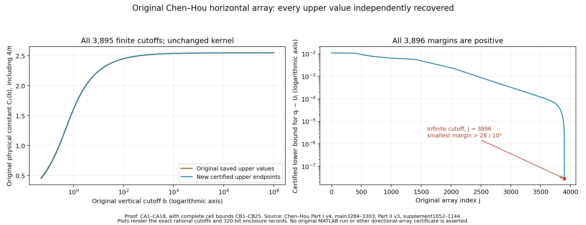
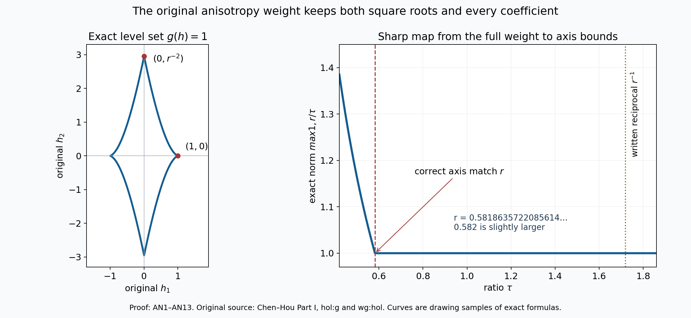
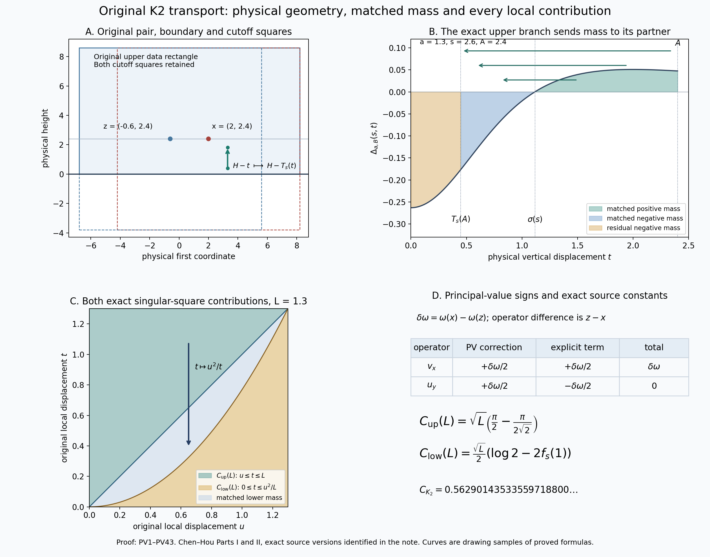
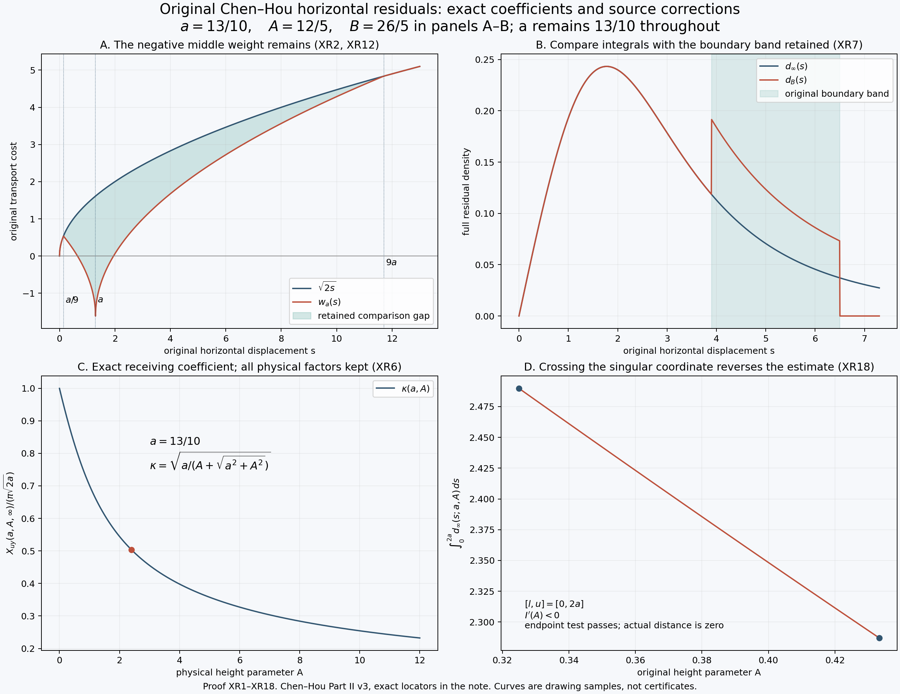
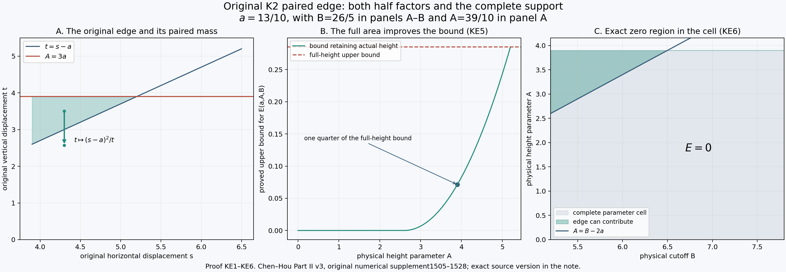

# Original cutoff array and physical K2 transport

This lesson completes the finer horizontal-array calculation left open in
lesson51 and carries the original coefficients into the directional norms
and physical transport estimates. Every cutoff, local term, boundary mass,
kernel factor and physical distance remains explicit.

Part 1 certifies all3896 original horizontal upper entries, including the
infinite endpoint. Part 2 proves the sharp map from the original weight to
the two axis seminorms. Part 3 reconstructs the complete horizontal K2
transport estimate and evaluates both singular-square constants exactly.
Part 4 evaluates the horizontal residual and its finite-cutoff remainder.
Part 5 restores the original edge-kernel factor and proves a stronger
bound using the height actually available in each parameter cell.

The five exercises apply these results to actual saved thresholds, bounded
functions, physical vorticity data, the original singular-strip width,
a crossing parameter cell and a complete edge cell. They preserve the
full receiving coefficients and show which other terms remain in each sum.

The source authors are Jiajie Chen and Thomas Y. Hou. Each source correction
and its exact consequence is identified in the relevant proof. The source's
final edge bound is recovered despite two inconsistent intermediate factors.
The complete computational stability and singularity proof remains under
audit; these calculations do not certify its remaining numerical steps.

## Part 1. A certificate for every original horizontal cutoff entry
Every one of the 3,896 upper values in the saved Chen–Hou horizontal
array is a valid bound for the original horizontal transport integral
at its corresponding cutoff. This note proves that statement by a new
computation with rigorous rounding. It retains the source kernel, its
transport partner, both half shifts, the physical factor \(4/\pi\),
the finite cutoffs and the entire infinite remainder.

The new computation does not run the original MATLAB program. It uses
the saved values only as thresholds to test. It does not certify the
other five directional arrays, the regular commutator terms or the
complete stability and singularity proof.

Human sources: Jiajie Chen and Thomas Y. Hou,
[Part I, arXiv:2210.07191v4](https://arxiv.org/abs/2210.07191v4),
original main source lines 3284–3303, and
[Part II, arXiv:2305.05660v3](https://arxiv.org/abs/2305.05660v3),
numerical supplement lines 1052–1144. The original code is obtained from
the [authors' code page](https://jiajiechen94.github.io/codes).
The specific receiving routines are `Lip/Holder_C.m`, lines 17–30,
`Lip/Holder_C_main.m`, lines 1–24, and
`Linear_stability/Est_hol_profi.m`, lines 202–280.

The complete analytic cell proofs and original global certificate are
included in [CB1–CB25](original-two-point-transport-and-certified-kernel-bounds.md).
Their previously delivered version is
the original global certificate.
The complete reflected-domain and physical-operator comparison is
included as [NL1–NL30](original-two-point-transport-and-certified-kernel-bounds.md),
and is also taught in
lesson51.
The present result supplies the finer horizontal array left open in
that lesson. The earlier cell-formula failure remains a valid finding;
this calculation independently recovers the bounds used by this array.

### CA1. Original integral and original stored values

For \(x>0\), \(z\geq0\), let \(T(x,z)\) be the unique positive root
of the original polynomial. Retain the complete formulas

\[
\begin{aligned}
 K_1(r,z)&=\frac{rz}{(r^2+z^2)^2},\\
 \Delta(x,z)&=K_1(x+1/2,z)-K_1(x-1/2,z),\\
 P_{x,z}(T)&=xT(T^2+xT+x^2+2z^2-1/2)-(z^2+1/4)^2,\\
 f(z)&=\sqrt{\frac{1/2-2z^2+\sqrt{16z^4+4z^2+1}}6},\\
 C_1(b)&=\frac4\pi\int_0^b\!\int_{f(z)}^\infty
        [-\Delta(x,z)]\sqrt{x-T(x,z)}\,dx\,dz.
\end{aligned}
\tag{CA1}
\]

The full proofs in CB1–CB11 show that \(f(z)\geq1/2\),
\(x\geq f(z)\) is exactly \(x\geq T(x,z)\), and
\(-\Delta\geq0\) there. They prove the exact primitive factorization
relating this cubic to the source transport equation, including the
choice of root. Define the integrand to be zero outside that support;
do not evaluate its square root there. All integrals below use this
nonnegative extension. In particular, \(C_1\) is increasing.

The unchanged source `Input_data/Est_hol_const_itl.mat` has SHA-256
`c02c90a99cb3a557d55398396c4f28559581aac0c1436456230dffac508ee303`.
Its horizontal array is `holc.x{2,2}`. Write its upper binary endpoints
as \(q_j\), and the upper endpoints of `holc.a{2,2}(2:end)` as
\(a_j\). The supplied exact data file retains all endpoints as
rational numbers, except for the terminal infinity. Direct extraction
checks all 3,897 original grid entries are singleton real intervals,
all finite grid edges strictly increase, and all 3,896 value intervals
have their lower endpoint at most their upper endpoint. In particular,

\[
\begin{gathered}
 N=3896,\qquad
 a_1=\frac{907475324915155}{18014398509481984},\qquad
 a_{N-1}=100000000,\quad a_N=\infty,\\
 q_1=\frac{8277434667269389}{18014398509481984},\qquad
 q_N=\frac{2869249718738045}{1125899906842624}.
\end{gathered}
\tag{CA2}
\]

These are exact binary values from the file, not decimal approximations
to an assumed mathematical answer. The calculation below proves
\(C_1(a_j)<q_j\) for every index. It does not assert that the saved
interval's lower endpoint is a lower bound for \(C_1(a_j)\).

### CA2. Complete finite-strip remainder

Put \(R=2^{28}\) and retain the original finite square
\(D_R=[1/2,R]\times[0,R]\). CB17 proves, including its exact square
identity,

\[
 \partial_rK_1(r,z)=\frac{z(z^2-3r^2)}{(r^2+z^2)^3},\qquad
 |\partial_rK_1(r,z)|\leq(r^2+z^2)^{-3/2}.
\tag{CA3}
\]

For \(x\geq R\), \(z\geq0\), set
\(\rho=\sqrt{x^2+z^2}\). Every \((r,z)\) with
\(r\in[x-1/2,x+1/2]\) has norm at least \(\rho-1/2\).
The original difference integrates this derivative on that full
length-one interval. On its support, \(T>0\), hence

\[
 |\Delta(x,z)|\leq
 \left(\frac R{R-1/2}\right)^3\rho^{-3},\qquad
 \sqrt{x-T(x,z)}\leq\sqrt\rho,\qquad \rho\geq x.
\tag{CA4}
\]

For each finite \(0<b\leq R\), the part of the original integral
outside \([1/2,R]\times[0,b]\) therefore satisfies

\[
\begin{aligned}
 0\leq E_R(b)
 &:=\frac4\pi\int_0^b\!\int_{\max(R,f(z))}^{\infty}
       [-\Delta(x,z)]\sqrt{x-T(x,z)}\,dx\,dz\\
 &\leq\frac4\pi\left(\frac R{R-1/2}\right)^3
          \int_0^b\!\int_R^\infty x^{-5/2}\,dx\,dz\\
 &=\frac{8b}{3\pi R^{3/2}}
             \left(\frac R{R-1/2}\right)^3.
\end{aligned}
\tag{CA5}
\]

The enlargement only adds nonnegative terms. The inner integral is
\(2/(3R^{3/2})\), as follows by differentiating
\(-2x^{-3/2}/3\) and taking its limit at infinity. Thus no horizontal
tail or physical factor has been omitted. At \(b=0\), the integral
and the bound are zero. All 3,895 finite source cutoffs are below \(R\).

At the terminal cutoff \(b=\infty\), the complement of \(D_R\)
also includes large \(z\). Use the complete quadrant bound from CB22:

\[
 E_R(\infty)\leq
       4R^{-1/2}\left(\frac R{R-1/2}\right)^3
       =\frac1{4096}\left(\frac{2^{29}}{2^{29}-1}\right)^3.
\tag{CA6}
\]

This is the integral of the same majorant in polar coordinates over
the entire first-quadrant exterior \(\rho\geq R\), including the
Jacobian \(\rho\), angular length \(\pi/2\), radial integral
\(2R^{-1/2}\), and factor \(4/\pi\).

### CA3. Exact clipping and a complete cumulative sum

The original CB split record reconstructs 40,436 rectangles from its
1,369 exact dyadic starting rectangles. Refine 2,400 more rectangles
using the separately supplied split record, giving 42,836 leaves.
Every step identifies an existing parent and an axis, constructs both
children at the exact rational midpoint, and removes the parent.
The children's interiors are disjoint and their union is the parent.
Induction therefore proves the final leaves partition all of \(D_R\),
up to their common edges.

Let \(S(Q)\) be the unprefactored integral in CA1 over a rectangle
\(Q\). The CB12–CB20 formulas, included with their complete proofs,
compute an outward upper bound \(u_Q\geq S(Q)\). They preserve the
singular corner and both original half shifts. Positivity permits
discarding a rectangle only when \(u_Q=0\); the full square still
has 42,836 leaves, of which 41,092 have a positive computed upper bound.

For \(0<b\leq R\), write \(Q=[x_l,x_u]\times[z_l,z_u]\) and
retain its exact intersection

\[
 Q_b=
 \begin{cases}
  \varnothing,&b\leq z_l,\\
  {}[x_l,x_u]\times[z_l,b],&z_l<b<z_u,\\
  Q,&z_u\leq b.
 \end{cases}
\tag{CA7}
\]

Intersections of the original partition have disjoint interiors and
cover \([1/2,R]\times[0,b]\). For a crossing rectangle the same
CB formulas apply to its exact clipped upper edge \(b\); the endpoint
need not be dyadic. If they return \(u_{Q_b}\), then

\[
 0\leq S(Q_b)\leq\min(u_Q,u_{Q_b}).
\tag{CA8}
\]

The first upper bound follows from \(Q_b\subset Q\) and positivity;
the second follows from the full cell proof on the clipped rectangle.
Consequently the finite-cutoff bound is

\[
 C_1(b)\leq B(b):=
 \frac4\pi\left(
  \sum_{z_u\leq b}u_Q+
  \sum_{z_l<b<z_u}\min(u_Q,u_{Q_b})\right)
 +\frac{8b}{3\pi R^{3/2}}\left(\frac R{R-1/2}\right)^3.
\tag{CA9}
\]

At infinity all leaves enter the first sum, and the remainder is CA6.
No cell is evaluated with a negative height or outside its support.

The implemented sweep evaluates CA9 at increasing source cutoffs.
It sorts two lists of nonzero cells by \(z_l\) and \(z_u\).
Before each evaluation it adds every cell with \(z_l<b\) to the
pending set, and then removes each with \(z_u\leq b\), adding its
upper contribution once to the cumulative sum. Induction on the
cutoffs shows the pending set is exactly \(z_l<b<z_u\); the
cumulative sum contains exactly the completed rectangles. Equal
boundary values satisfy the weak or strict inequalities in CA7,
so no interval between cutoffs is lost. At the terminal evaluation
the pending set is empty and all 41,092 nonzero bounds have entered.

All rational endpoints are constructed from integers using exact
fractions. The root and primitive evaluations use Arb balls and the
proved real branch in CB9–CB11. Each endpoint rounds outward. The
cumulative sum adds outward bounds using ball arithmetic; it does not
subtract approximate prefix values. The factor \(4/\pi\), the
finite remainder and the infinite remainder are themselves enclosed.
Thus the final outward value \(U_j\) satisfies \(C_1(a_j)\leq U_j\).
Floating-point values selected the additional partition refinements
only; they supply no endpoint or integral bound.

### CA4. Every entry and the higher-precision replay

The 160-bit computation tested every original index. The 320-bit run
reconstructed the entire partition and recomputed all bounds, including
1,087,400 clipped-cell evaluations. Each run verifies the executed
programs, both split records and the exact endpoint data by SHA-256.
Neither run imports a previously computed integral value. Each proves

\[
 C_1(a_j)\leq U_j<q_j,
 \qquad 1\leq j\leq3896.
\tag{CA10}
\]

The records store all outward values and margins. In both runs the
smallest recorded margin occurs at the terminal entry. Exact rational
comparisons against the 320-bit enclosures give the convenient bounds

\[
\begin{gathered}
 \min_{1\leq j\leq3896}(q_j-U_j)>
              \frac{28}{10^9},\\
 C_1(\infty)<\frac{254840566}{10^8}
        <\frac{2869249718738045}{1125899906842624}
        <\frac{2549}{1000}<\frac{51}{20}.
\end{gathered}
\tag{CA11}
\]

The first rational in the second line is 2.54840566. It is strictly
between the new upper endpoint, approximately 2.548405652176692336,
and the original stored binary upper value. Every comparison in this
chain is checked against its exact rational value.

The four receiving examples from lesson51 have the original indices
and edge/threshold pairs

\[
\begin{array}{c|c|c}
 j&a_j&q_j\\\hline
 743&6770711679788803/4503599627370496&1998176179006309/1125899906842624\\
 1137&6756750520943955/2251799813685248&8989850704159971/4503599627370496\\
 1482&3388264239944697/562949953421312&4858314485510007/2251799813685248\\
 3896&\infty&2869249718738045/1125899906842624
\end{array}
\tag{CA12}
\]

For an easily read statement of the new bounds, the complete array run
also proves

\[
\begin{aligned}
 C_1(a_{743})&<1.767237,& C_1(a_{1137})&<1.989955,\\
 C_1(a_{1482})&<2.152456,& C_1(a_{3896})&<2.54840566.
\end{aligned}
\tag{CA13}
\]

Every decimal in CA13 is an exact terminating rational rounded upward
from the certified upper endpoint. These are bounds on the original
integrals, unlike the bare observations of saved values in lesson51.
The exact endpoint data and every computed entry remain in the package.

### CA5. The selector and physical receiving operation

For every real cutoff \(b\in[0,\infty]\), define

\[
 j(b)=\min\{j\in\{1,\ldots,3896\}:b\leq a_j\},
 \qquad C_1(b)\leq C_1(a_{j(b)})<q_{j(b)}.
\tag{CA14}
\]

The set is nonempty because \(a_{3896}=\infty\). This covers even
\(0\leq b<a_1\), by positivity and monotonicity; the first source
grid edge 0.05 is not a lower restriction on the integral estimate.
The minimum has the same order as the source's first-matching-edge
lookup. All source grid intervals are singleton, so no uncertainty
in those stored edges is hidden by this map. For interval inputs this
statement applies to every real value not exceeding the selected
edge; the present certificate does not execute or certify INTLAB's
comparison operator or the full original runtime.

For the actual horizontal \(u_x\) branch of `Holder_C_main`, retain
the original nonnegative distance multiple \(d\) and window index
\(sk\):

\[
 b(d)=\frac{2(sk+1)}d\quad(d>0),\qquad b(0)=\infty.
 \tag{CA15}
\]

At \(sk=2\) and \(d=0,1,2,4\), these are
\(\infty,6,3,3/2\); exact edge comparisons give the respective
indices \(3896,1482,1137,743\), as proved in lesson51 EX26–EX28.
More generally CA14 applies to every cutoff returned by CA15, not just
those four examples.

For the original localized operator, NL28 proves the full physical
inequality on its reflected data domain. Write \(h=x_1-\widetilde
x_1>0\), and retain both vertical lengths \(b_1,b_2\), the actual
horizontal seminorm \(H=[\omega]_{C_x^{1/2}(D)}\), and the source
physical operator \(U\). Then

\[
 \frac{|U(x)-U(\widetilde x)|}{h^{1/2}}
 \leq\frac12\left(C_1(b_1/h)+C_1(b_2/h)\right)H
 \leq\frac12\left(q_{j(b_1/h)}+q_{j(b_2/h)}\right)H.
\tag{CA16}
\]

Here \(D\) contains the full reflected data region proved in NL4;
the actual Part II mesh meets that inclusion by NL29–NL30. If both
arguments are at most a common source cutoff, monotonicity gives the
single selected coefficient used in that mesh. This is the precise
map from the certified integral to the unchanged physical estimate.

The inspected source divides its regular contribution by \(\pi\),
then adds the already physical singular coefficient multiplied by
\(hol_x\). In exact arithmetic its relevant total is

\[
 V_d=\frac{\operatorname{Tot\_cost}(dif_d,hol_d)}\pi
                       +q_{j(b(d))}\,hol_x.
\tag{CA17}
\]

Thus the singular coefficient itself now has a proof for every stored
horizontal index. No replacement by 2.549 and no increase of this
coefficient is necessary. The regular cost, weighted data seminorms,
their runtime enclosures and later stability margin require their
own proofs; CA10 does not assign them unearned bounds.

For completeness, the subsequent original operations are compatible
with this receiving map. If two numbers bound the same nonnegative
quantity, their minimum bounds it. If one quantity on each of finitely
many distance intervals is bounded by \(v_i\), their supremum is
bounded by \(\max_i v_i\). Applying those statements in the source's
actual order gives its minimum with the supremum-norm estimate,
maximum over distance intervals and final minimum with the coarse
estimate. For any nonnegative changes \(0\leq\varepsilon_i\leq E\),
monotonicity and translation by \(E\) also prove

\[
\begin{aligned}
 0&\leq\min(v_i+\varepsilon_i,w_i)-\min(v_i,w_i)\leq E,\\
 0&\leq\max_i(v_i+\varepsilon_i)-\max_i v_i\leq E.
\end{aligned}
\tag{CA18}
\]

Indeed \(v_i\leq v_i+\varepsilon_i\leq v_i+E\), and
\(w_i\leq w_i+E\), giving the first inequality by taking minima
and using \(\min(v_i+E,w_i+E)=\min(v_i,w_i)+E\).
Taking maxima of the first coordinate inequalities gives the second.
Here the original horizontal coefficients can be retained, so their
required replacement changes are exactly zero.

### CA6. Replay, illustration and scope

The first panel plots the actual original cutoff coordinates and saved
upper values beside the new enclosing values; it does not rescale the
kernel or the mathematical integral. The second panel shows every
positive certified margin by source array index, including the final
infinite cutoff. Plot coordinates are approximate renderings of the
exact rational inputs and rigorous endpoint records. The proofs and
computations, rather than the plot, establish positivity.

With Python-FLINT 0.9.0 installed, run
`python certify_chen_hou_horizontal_array.py --bits 320` from this
collection. It reconstructs the complete partition and recomputes all
3,896 bounds. Run `python check_chen_hou_horizontal_array.py` for the
exact partition, formula, data and certificate bindings. The original
endpoint extractor additionally accepts the original MAT file and
verifies its exact version before reproducing the target data. No
original MATLAB or INTLAB process is launched.

The supplied CB note proves every analytic cell bound and the root
branch used by these programs. The added CA argument proves clipping,
the finite strip remainder, the entire array and its physical receiving
map. This establishes the complete horizontal \(u_x\) upper array,
including its terminal global value. It leaves the other directional
constants, regular commutators and complete stability theorem for
continued audit. No fatal main-theorem failure follows from this result.

Exposition, implementation and illustration: GPT-6 Astra (OpenAI),
CC0-1.0. Human authorship is cited above. Review is author self-review;
the enclosure uses the stated arithmetic library and has not been
verified by an independent reviewer or proof assistant. No novelty or
optimality claim is made.

## Part 2. The original Chen–Hou anisotropy ratio and its exact receiving map
This note proves the map from the original weighted Hölder seminorm to the two directional seminorms, identifies a reciprocal typo in the source description, and retains the difference between the printed decimal parameters and their binary values. It also gives the exact change in a directional cost when its ratio is changed. It does not certify the remaining kernel integrals or the full stability theorem.

The human source is Jiajie Chen and Thomas Y. Hou, [Part I, version 4](https://arxiv.org/abs/2210.07191v4), original author file `arXiv_Euler_P1_v2026.tex`: definition `hol:g` at lines 3078–3082; Lemmas `lem:holx_uy` and `lem:holy_uy` at 3343–3378; the ratio description at 3385–3386; the full weight at 6673–6679 and 15185–15190. The source file SHA-256 is `3655d7105db85493f5be82b070afa06801a5d2efc4038ec738b5e99df9f144ad`. The original [author code](https://jiajiechen94.github.io/codes), read without executing MATLAB, supplies `Linear_stability/Weight_stability.m` lines 9–19, `Build_wg_hol.m` lines 24–54, and `Holder_const/Linear_nhol_step0.m` lines 47–74. Exact source hashes and reading coverage accompany this note.

### AN1. Retain the original weight and both axis values

Let \(D\subset\mathbb R^2\), let \(f:D\to\mathbb R\), and let \(q_1,q_2,q_3>0\). For every nonzero difference \(h=(h_1,h_2)\), retain the source weight in its complete form:

\[
\begin{aligned}
g_0(h)&=\left(\sqrt{|h_1|+q_1|h_2|}
              +q_3\sqrt{|h_2|+q_2|h_1|}\right)^{-1},\\
g(h)&=g_0(h)g_0(1,0)^{-1},\\
g_0(1,0)^{-1}&=1+q_3\sqrt{q_2},\\
g(1,0)&=1,\qquad
g(0,1)=\frac{1+q_3\sqrt{q_2}}{\sqrt{q_1}+q_3},\\
r&=\frac{g(1,0)}{g(0,1)}
   =\frac{\sqrt{q_1}+q_3}{1+q_3\sqrt{q_2}}.
\end{aligned}\tag{AN1}
\]

Each identity follows by substituting the indicated axis vector into the two square roots; both terms and the full factor \(g_0(1,0)^{-1}\) remain. For every nonzero real \(s\), direct substitution also gives

\[
g(s,0)=|s|^{-1/2},\qquad
g(0,s)=r^{-1}|s|^{-1/2}.
\tag{AN2}
\]

Define the seminorms by the actual pairs in \(D\):

\[
\begin{aligned}
E_g(f;D)&=\sup_{p,q\in D,\ p\ne q}g(p-q)|f(p)-f(q)|,\\
H_x(f;D)&=\sup_{p,q\in D,\ p_2=q_2,\ p_1\ne q_1}
 \frac{|f(p)-f(q)|}{|p_1-q_1|^{1/2}},\\
H_y(f;D)&=\sup_{p,q\in D,\ p_1=q_1,\ p_2\ne q_2}
 \frac{|f(p)-f(q)|}{|p_2-q_2|^{1/2}},\\
N_\tau(f;D)&=\max\{H_x(f;D),\tau^{-1}H_y(f;D)\},\qquad \tau>0.
\end{aligned}\tag{AN3}
\]

In pair coordinates, \(q\) denotes a point; the three indexed \(q_i\) are the weight parameters. Empty directional suprema are zero. These definitions allow infinite values. All finite bounds below concern functions with finite \(E_g\). No rectangle completion or extension of \(D\) is used.

Taking only axis pairs in the full supremum and applying (AN2) proves

\[
H_x(f;D)\le E_g(f;D),\qquad
H_y(f;D)\le rE_g(f;D),\qquad
N_\tau(f;D)\le\max\{1,r/\tau\}E_g(f;D).
\tag{AN4}
\]

Thus the identity on functions, from the space with seminorm \(E_g\) to the space with seminorm \(N_\tau\), is a linear map bounded by the displayed factor. It descends to the quotient by constant functions when \(D\) is nonempty. In particular the exact axis match is \(\tau=r\); every \(\tau\ge r\) gives the upper bound \(N_\tau\le E_g\).

### AN2. The map has the exact stated norm

On \(D=\mathbb R\times[0,\infty)\), consider the two functions

\[
f_x(p)=\sqrt{\max(p_1,0)},\qquad
f_y(p)=r\sqrt{p_2}.
\tag{AN5}
\]

For nonnegative \(a,b\), suppose first that \(a\ge b\). The identity
\((\sqrt a-\sqrt b)^2=a+b-2\sqrt{ab}\le a-b\)
follows from \(b\le\sqrt{ab}\). Interchanging \(a,b\) proves
\(|\sqrt a-\sqrt b|\le\sqrt{|a-b|}\).
The map \(t\mapsto\max(t,0)\) satisfies
\(|\max(s,0)-\max(t,0)|\le|s-t|\): this follows directly when both arguments have the same sign, and when \(s\ge0\ge t\) it reads \(s\le s-t\). Consequently the two increments in (AN5) are bounded by \(\sqrt{|h_1|}\) and \(r\sqrt{|h_2|}\), respectively.

The original denominator has both lower bounds

\[
\begin{aligned}
\sqrt{|h_1|+q_1|h_2|}+q_3\sqrt{|h_2|+q_2|h_1|}
&\ge(1+q_3\sqrt{q_2})\sqrt{|h_1|},\\
\sqrt{|h_1|+q_1|h_2|}+q_3\sqrt{|h_2|+q_2|h_1|}
&\ge(\sqrt{q_1}+q_3)\sqrt{|h_2|}.
\end{aligned}\tag{AN6}
\]

Multiplying the increment bounds by the full weight in (AN1) proves \(E_g(f_x;D)\le1\) and \(E_g(f_y;D)\le1\). For \(f_x\), the pair \((0,1),(1,1)\) attains one. For \(f_y\), the pair \((0,0),(0,1)\) attains one. The directional values are therefore

\[
\begin{aligned}
E_g(f_x;D)&=1,& H_x(f_x;D)&=1,& H_y(f_x;D)&=0,\\
E_g(f_y;D)&=1,& H_x(f_y;D)&=0,& H_y(f_y;D)&=r.
\end{aligned}\tag{AN7}
\]

The operator norm in (AN4) is exactly \(\max\{1,r/\tau\}\). This proves sharpness for every positive parameter triple and every \(\tau>0\), without imposing a special value of \(r\). These sharp bounds also hold in the bounded-function class: replace the two functions in (AN5) by \(\min\{f_x,1\}\) and \(\min\{f_y,r\}\). Truncation above at a constant cannot increase an absolute difference, as follows by considering the cases when neither, one, or both values exceed the constant. The displayed attaining pairs are unchanged. On the open upper half-plane or the open first quadrant, the same suprema follow by translating horizontal pairs into the domain and taking their smaller horizontal coordinate to zero, and taking vertical pairs with lower height tending to zero. In particular a ratio smaller than \(r\) incurs the factor \(r/\tau\); this is not merely a possible loss in the proof.

The left plot samples the exact level set \(g(h)=1\) for the source parameters in (AN8), retaining the original displacement coordinates. Its axis intercepts are \((\pm1,0)\) and \((0,\pm r^{-2})\), by (AN2). The right plot samples the proved sharp factor \(\max\{1,r/\tau\}\). Numerical drawing samples illustrate (AN1)–(AN7); they are not the proof of the bounds. Reproducible figure source accompanies this note. Human source: Chen–Hou Part I, `hol:g` and `wg:hol`.

### AN3. Decimal parameters, binary parameters and the saved vector

For the printed first weight, retain all three original decimal parameters:

\[
\begin{aligned}
(q_1,q_2,q_3)&=(12/100,1/100,25/100),\\
r_{\mathrm{dec}}&=
 \frac{\sqrt{12/100}+25/100}{1+(25/100)\sqrt{1/100}},\\
\frac{58186357220856142312}{10^{20}}
&<r_{\mathrm{dec}}<
\frac{58186357220856142314}{10^{20}}.
\end{aligned}\tag{AN8}
\]

The source footnote at line 15173 says that the implementation uses binary double parameters. `Weight_stability.m` contains these three literals. Their nearest binary64 values, retained as exact rationals, are

\[
\begin{aligned}
\widehat q_1&=\frac{1080863910568919}{9007199254740992}
 =\frac{12}{100}-\frac1{225179981368524800},\\
\widehat q_2&=\frac{5764607523034235}{576460752303423488}
 =\frac1{100}+\frac3{14411518807585587200},\\
\widehat q_3&=\frac14=\frac{25}{100},\\
r_{\mathrm{bin}}&=
 \frac{\sqrt{\widehat q_1}+\widehat q_3}
 {1+\widehat q_3\sqrt{\widehat q_2}},\\
\frac{58186357220856141672}{10^{20}}
&<r_{\mathrm{bin}}<
\frac{58186357220856141674}{10^{20}},\\
-\frac{641}{10^{20}}
&<r_{\mathrm{bin}}-r_{\mathrm{dec}}
 <-\frac{640}{10^{20}}.
\end{aligned}\tag{AN9}
\]

Every numerical enclosure in this section has a rational proof. For a positive rational \(a\), choose \(L=10^{80}\) and

\[
m(a)=\left\lfloor\sqrt{\lfloor aL^2\rfloor}\right\rfloor,
\qquad
\frac{m(a)}L\le\sqrt a<\frac{m(a)+1}L.
\tag{AN10}
\]

Indeed \(m(a)^2\le\lfloor aL^2\rfloor\le aL^2\), whereas the integer \((m(a)+1)^2\) exceeds \(\lfloor aL^2\rfloor\) and hence exceeds \(aL^2\). The denominators below are positive, so these square-root bounds give

\[
\frac{m(q_1)/L+q_3}{1+q_3(m(q_2)+1)/L}
\le \frac{\sqrt{q_1}+q_3}{1+q_3\sqrt{q_2}}
\le
\frac{(m(q_1)+1)/L+q_3}{1+q_3m(q_2)/L}.
\tag{AN11}
\]

The accompanying checker evaluates the integers by integer square root, verifies both squared inequalities exactly, retains all four ratio endpoints for the two parameter triples, and checks (AN8)–(AN9) by integer cross multiplication. It also verifies the nearest binary64 choices against both adjacent representable values; no MATLAB or interval-package execution is claimed.

The original saved file `Input_data/Est_hol_const_itl.mat`, SHA-256 `c02c90a99cb3a557d55398396c4f28559581aac0c1436456230dffac508ee303`, contains the following interval vector, whose first component is exactly five:

\[
\begin{aligned}
\tau^{\mathrm{saved}}_1&\in[5,5],\\
\tau^{\mathrm{saved}}_2&\in
\left[\frac{6551201417447355}{2251799813685248},
      \frac{102362522147615}{35184372088832}\right],\\
\rho_-&=\frac{1310240283489471}{2251799813685248},\qquad
\rho_+=\frac{20472504429523}{35184372088832},\\
\rho_-&<r_{\mathrm{bin}}<r_{\mathrm{dec}}<\rho_+
 <\tau_*:=\frac{291}{500},\\
\tau_*-\rho_+&=
\frac{600015772153}{4398046511104000}>0.
\end{aligned}\tag{AN12}
\]

Division of the two saved endpoints by the original first component five gives exactly \(\rho_-\) and \(\rho_+\). Their containment of both exact ratios follows from (AN11) and rational comparisons. The saved vector is not identified with the current code's vector \((1,r)\). The exact comparison map is division by its first component; the source-to-historical-run identity has not been recovered.

The displayed decimal \(0.582=\tau_*\) is therefore larger than both weight ratios and the whole saved ratio interval. By (AN4), it gives \(N_{\tau_*}\le E_g\) for either exact weight. This settles the direction of the norm comparison. It does not establish a kernel constant at \(\tau_*\) from a kernel computation performed at a smaller ratio.

### AN4. The reciprocal typo and every coefficient it affects

Part I line 3386 describes the chosen ratio as \(g_1(0,1)/g_1(1,0)\), followed by the approximation \(0.582\). By the source's own full formula (AN1), that written ratio is \(r^{-1}\), whereas the stated approximation belongs to \(r\). In fact

\[
\frac{17186159226368668725}{10^{19}}
< r_{\mathrm{dec}}^{-1} <
\frac{17186159226368668727}{10^{19}}.
\tag{AN13}
\]

Taking reciprocals of the positive rational enclosure (AN11) proves (AN13). The corrected descriptive ratio is \(g_1(1,0)/g_1(0,1)\). `Build_wg_hol.m` explicitly describes that ratio and computes the vector with first component one and second component \(1/g_1(0,1)\). `Holder_const_main.m` line 18 has a conflicting old comment; the subsequent call invokes `Build_wg_hol`. The inspected executable path therefore selects the ratio corresponding to (AN1), rather than the reciprocal printed in the paper. Symbolic conversion and actual interval runtime evaluation have not been executed here.

For an arbitrary original positive vector \(\tau=(\tau_1,\tau_2)\), write \(\rho=\tau_2/\tau_1\). For nonnegative directional costs \(X,Y\), the complete receiving expression is

\[
\begin{aligned}
\mathcal C_{X,Y}(\tau_1,\tau_2)
 &=\frac{X+Y\tau_2/\tau_1}{\pi},\\
N_{\tau_2/\tau_1}(f;D)
 &=\max\{H_x(f;D),(\tau_1/\tau_2)H_y(f;D)\},\\
\mathcal C_{X,Y}(\lambda\tau_1,\lambda\tau_2)
 &=\mathcal C_{X,Y}(\tau_1,\tau_2),\qquad\lambda>0,\\
\mathcal C_{X,Y}(1,\rho')-\mathcal C_{X,Y}(1,\rho)
 &=\frac{Y(\rho'-\rho)}{\pi}.
\end{aligned}\tag{AN14}
\]

These are algebraic equalities with both vector components and the physical factor \(1/\pi\) retained. The homogeneity of this particular receiver establishes why the saved first component five can give the same ratio; it supplies no equality of the stored vectors or their histories.

For any nonempty finite collection of cost pairs \((X_j,Y_j)\), keep the original order of the maximum and the ratio substitution:

\[
\begin{aligned}
M(\rho)&=\max_j\frac{X_j+Y_j\rho}{\pi},\\
\frac{(\rho'-\rho)\min_jY_j}{\pi}
&\le M(\rho')-M(\rho)
\le\frac{(\rho'-\rho)\max_jY_j}{\pi},
\qquad \rho'\ge\rho.
\end{aligned}\tag{AN15}
\]

To prove the lower bound, choose an index attaining \(M(\rho)\) and evaluate that same affine expression at \(\rho'\). To prove the upper bound, each new affine value is at most its old value plus the displayed largest increment; take the maximum only after that inequality. The proof also gives the same two bounds when both maxima are replaced by minima: for the lower bound every new term is at least its old value plus the smallest increment, and for the upper bound choose an old minimizing index. Thus changes in which branch attains the extremum cause no missing term. Negative \(Y_j\) would invalidate monotonicity, so nonnegativity is part of the stated cost hypothesis.

The actual inspected expressions in `Linear_nhol_step0.m` are

\[
\begin{aligned}
\mathrm{holc.x}\{2,2\}&=X_{2,2}/\pi,\\
\mathrm{holc.y}\{2,2\}&=(X_{2,2}\rho/2+Y_{2,2})/\pi,\\
\mathrm{holc.x}\{3,1\}&=\max_j(X^{vx}_j+Y^{vx}_j\rho)/\pi,\\
\mathrm{holc.x}\{1,3\}&=\max_j(X^{uy}_j+Y^{uy}_j\rho)/\pi,\\
\mathrm{holc.y}\{3,1\}&=\max_j(X^{vx,3}_j+Y^{vx,3}_j\rho)/\pi,\\
\mathrm{holc.y}\{1,3\}&=\max_j(X^{uy,3}_j+Y^{uy,3}_j\rho)/\pi.
\end{aligned}\tag{AN16}
\]

For the two horizontal \(K_2\) expressions, the maximum is along the original array's second dimension at each retained first index; no first-index maximum is silently substituted here. The vertical expressions use the source vector maximum. Formula (AN15) applies to each finite receiving set separately. The horizontal \(u_x\) array contains no \(\rho\); its newly delivered complete independent certificate is unaffected by this typo. Its vertical companion retains the factor one-half and changes by \(X_{2,2}(\rho'-\rho)/(2\pi)\). The four \(K_2\) receivers retain their full vertical costs.

### AN5. Keep the spatial weight and the remaining integral work

The paper's energy applies the seminorm to \(F=\omega\psi_1\). Formula (AN4) applies to this full product. To recover unweighted increments on any set where the original spatial weight \(\psi_1\) is finite and positive, both terms in the exact identity are required:

\[
\begin{aligned}
\omega(p)-\omega(q)
 &=\frac{F(p)-F(q)}{\psi_1(p)}
   +F(q)\left(\frac1{\psi_1(p)}-\frac1{\psi_1(q)}\right),\\
|\omega(p)-\omega(q)|
 &\le\frac{E_g(F;D)}{\psi_1(p)g(p-q)}
   +|F(q)|\left|\frac1{\psi_1(p)}-\frac1{\psi_1(q)}\right|.
\end{aligned}\tag{AN17}
\]

Expanding \(F(p)=\omega(p)\psi_1(p)\) and \(F(q)=\omega(q)\psi_1(q)\) proves the identity by cancellation of the two copies of \(F(q)/\psi_1(p)\); the full seminorm definition and triangle inequality then prove the bound. No value is assigned at a singularity of \(\psi_1\), and no spatial-weight contribution has been dropped. Reading the precise spatial-weight implementation is a separate receiving calculation.

The established correction is the reciprocal in the descriptive ratio, together with the exact norm map, binary comparison and cost-change formulas above. The inspected code already uses the correct reciprocal. A proof of the numerical \(K_2\) bounds still requires all original transport branches, principal-value local terms, boundary terms, infinite tails and rounding errors. Nothing in this note treats those integrals as proved from their stored values. The next calculation keeps the original kernel \(K_2(y)=(y_1^2-y_2^2)/(2|y|^4)\), the full positive separation and physical height, and rederives its strip-cutoff and transport identities. No fatal failure of the source theorem is established here.

## Part 3. Original Chen–Hou K2 transport, local terms and exact singular constants
This note proves the complete horizontal transport estimate at the original physical pair, retaining the local principal-value terms, the outer reflected domain and every residual cost. It evaluates both singular-square constants exactly and supplies the full singular-strip bound. The anisotropy map AN1–AN17 is the separate receiving comparison. Uniform numerical bounds for the complete K2 estimate are still being reconstructed. The statements below concern finite rectangles and a positive physical height; no limiting boundary value or infinite-domain numerical certificate is asserted.

Human sources: Jiajie Chen and Thomas Y. Hou, [Part I v4](https://arxiv.org/abs/2210.07191v4), original `arXiv_Euler_P1_v2026.tex`, SHA-256 `3655d7105db85493f5be82b070afa06801a5d2efc4038ec738b5e99df9f144ad`: definitions at 3232–3269, principal-value lemma at 13959–13998, horizontal transport through 14559, and maps at 14984–15097. The [Part II v3](https://arxiv.org/abs/2305.05660v3) original `euler_supp_Part2.tex`, SHA-256 `91fbe8b67384412903f851ccaeaa541cfe1f9658122e0f438d3ba064054dfc1b`, supplies the half-power integral and singular constants at 464–582. The proof below keeps the physical separation, midpoint and height. The author-code comparison reads `Holder_vx_const_itl.m` lines 1–315 and the complete `Holder_vx_comp1.m` and `K_half.m`, without executing MATLAB.

### PV1. A quadrant rectangle and its two strip corrections

Retain the original kernel and an arbitrary positive rectangle:

\[
K_2(u,v)=\frac{u^2-v^2}{2(u^2+v^2)^2},\qquad
Q=[0,b_1]\times[0,b_2],\qquad b_1,b_2>0.
\tag{PV1}
\]

Let \(f\) be bounded on \(Q\), with \(|f(u,v)-f(0,0)|\le C(u^2+v^2)^{\alpha/2}\) near the origin for some \(\alpha>0\). Define the principal value by removing the disk of radius \(\epsilon\) centered at the origin. The remainder \(K_2(f-f(0,0))\) is absolutely integrable: near the origin its absolute value is at most \((C/2)(u^2+v^2)^{(\alpha-2)/2}\), whose quadrant polar integral is at most \(C\pi\delta^\alpha/(4\alpha)\) inside radius \(\delta\); away from the origin boundedness suffices. Thus all cutoff changes for this remainder tend to zero.

For the constant part, replacing the small removed disk by the square \([0,\epsilon]^2\) changes the integral by zero. Indeed their difference lies inside a fixed small square in \(Q\), is invariant under \((u,v)\mapsto(v,u)\), and the kernel changes sign under that map. This proves equivalence of these two principal-value cutoffs without a missing angular constant.

The part retained by the square cutoff but omitted by the first-coordinate strip is \([0,\epsilon]\times[\epsilon,b_2]\). The complete constant integral is

\[
\begin{aligned}
\int_0^\epsilon\int_\epsilon^{b_2}K_2(u,v)\,dv\,du
&=\frac12\int_0^\epsilon
 \left(\frac{b_2}{u^2+b_2^2}
       -\frac{\epsilon}{u^2+\epsilon^2}\right)du\\
&=\frac12\arctan(\epsilon/b_2)-\frac{\pi}{8}.
\end{aligned}\tag{PV2}
\]

Here the primitive is \(v/[2(u^2+v^2)]\). The absolutely integrable remainder just treated has zero limiting integral over this shrinking strip. Exchanging the two coordinates reverses the sign of the kernel, so removing a second-coordinate strip gives the opposite correction. Therefore

\[
\begin{aligned}
\operatorname{PV}\int_QK_2f
&=\lim_{\epsilon\downarrow0}
  \int_{Q\cap\{u\ge\epsilon\}}K_2f
  -\frac{\pi}{8}f(0,0),\\
\operatorname{PV}\int_QK_2f
&=\lim_{\epsilon\downarrow0}
  \int_{Q\cap\{v\ge\epsilon\}}K_2f
  +\frac{\pi}{8}f(0,0).
\end{aligned}\tag{PV3}
\]

Reflection across either coordinate axis leaves the kernel and area measure unchanged. This proves the same formulas in each of the other three quadrant rectangles, using absolute values in the strip conditions. In particular, at an interior singularity with all four quadrants present, the corrections are respectively \(-\pi f(0,0)/2\) and \(+\pi f(0,0)/2\).

For reference the complete constant rectangle integral is

\[
\operatorname{PV}\int_Q K_2
=\frac12\arctan(b_1/b_2)-\frac{\pi}{8}
=-\frac12\arctan(b_2/b_1)+\frac{\pi}{8}.
\tag{PV4}
\]

The first equality follows by integrating the first strip exactly and using (PV3). The second follows from \(\arctan t+\arctan(1/t)=\pi/2\) for \(t>0\): these are the two acute angles in a right triangle with positive side ratio \(t\).

### PV2. Keep the physical pair and its complete residual mass

Let the physical points be

\[
x=(c+a,H),\quad z=(c-a,H),\quad
a>0,\ H>0,\ c\in\mathbb R,\ B\ge4a,\quad
A=\min(B,H)>0.
\tag{PV5}
\]

Let \(\omega\) be bounded and Hölder continuous on the upper part of the union of the two squares of radius \(B\) around \(x\) and \(z\). This union is the rectangle

\[
[c-a-B,c+a+B]\times[\max(0,H-B),H+B].
\]

The two horizontal intervals overlap because \(B\ge4a\). Let \(W\) be the original odd extension in the second coordinate: \(W(t,s)=\omega(t,s)\) for \(s\ge0\) and \(W(t,s)=-\omega(t,-s)\) for \(s<0\), wherever the reflected point belongs to the indicated upper rectangle. No continuity of that extension across height zero is assumed. Every product containing a truncated kernel or residual below is defined to be zero outside its support, without evaluating \(\omega\) or \(W\) there. Thus the interval \(J=[-9a,9a]\) will not require values beyond \(|s|\le B+a\) when \(B<8a\).

Write the original truncated difference kernel in the physical displacement \((s,t)\):

\[
\begin{aligned}
K_{2,B}(u,v)&=K_2(u,v)\mathbf1_{|u|\le B,\ |v|\le B},\\
\Delta_{a,B}(s,t)&=K_{2,B}(s+a,t)-K_{2,B}(s-a,t),\\
D_{a,A,B}(s)&=
 \frac{A\mathbf1_{|s+a|\le B}}{(s+a)^2+A^2}
-\frac{A\mathbf1_{|s-a|\le B}}{(s-a)^2+A^2}.
\end{aligned}\tag{PV6}
\]

For \(s\ne\pm a\), integration of the original primitive from \(-A\) to \(A\) gives exactly \(\int_{-A}^A\Delta_{a,B}(s,t)\,dt=D_{a,A,B}(s)\). The kernel is odd in \(s\) and even in \(t\), and the residual \(D_{a,A,B}\) is odd in \(s\). If \(0<s\le B-a\), both indicators are one and the first denominator is strictly larger. If \(B-a<s\le B+a\), only the negative term survives. For \(s>B+a\) both vanish. Thus the residual is strictly negative on \((0,B+a)\) and is zero beyond its support, up to endpoint values that do not change the integral.

The whole signed positive-axis mass retains the two boundary indicators:

\[
\begin{aligned}
\int_0^\infty D_{a,A,B}(s)\,ds
&=\int_a^B\frac{A}{v^2+A^2}\,dv
 -\int_{-a}^B\frac{A}{v^2+A^2}\,dv\\
&=-\int_{-a}^a\frac{A}{v^2+A^2}\,dv
=-2\arctan(a/A)>-\pi.
\end{aligned}\tag{PV7}
\]

Each variable substitution here is displayed with its actual physical endpoints. The cancellation of the two upper endpoints is proved, not assumed by discarding a boundary contribution.

### PV3. The local term doubles for vx and cancels for uy

Let \(J=[-9a,9a]\) and define

\[
S_{12}=\operatorname{PV}\int_J\int_{-A}^A
 \Delta_{a,B}(s,t)\omega(c+s,H)\,dt\,ds.
\tag{PV8}
\]

The singular points \((-a,0)\) and \((a,0)\) are both interior to this rectangle. They are also interior to their active truncation squares. At \((-a,0)\), the singular coefficient is \(+K_2\); at \((a,0)\), it is \(-K_2\). Apply the four-quadrant first-coordinate formula (PV3) at each point. The first correction is \(-\pi\omega(z)/2\); the second is \(+\pi\omega(x)/2\). The contribution of the other, smooth kernel over each removed strip tends to zero. For the strip integral, first integrate \(t\) using (PV6). Since \(A>0\), the resulting residual is bounded and compactly supported, so dominated convergence removes the remaining strips in \(s\). Hence

\[
S_{12}=\int_J D_{a,A,B}(s)\omega(c+s,H)\,ds
       +\frac\pi2\bigl(\omega(x)-\omega(z)\bigr).
\tag{PV9}
\]

The original localized operators are

\[
\begin{aligned}
v_x(p,B)&=\frac1\pi\operatorname{PV}\int K_{2,B}(p-y)W(y)\,dy
          -\frac12\omega(p),\\
u_y(p,B)&=\frac1\pi\operatorname{PV}\int K_{2,B}(p-y)W(y)\,dy
          +\frac12\omega(p).
\end{aligned}\tag{PV10}
\]

In their difference at \(z\) minus \(x\), use the exact coordinate map \(y=(c+s,H-t)\), whose absolute Jacobian is one. Evenness of \(K_2\) in its first coordinate gives \(K_{2,B}(z-y)-K_{2,B}(x-y)=\Delta_{a,B}(s,t)\). The map preserves each removed disk's radius, so it preserves the specified principal values. Let \(R\) denote the complete remaining singular-integral contribution after extracting \(S_{12}\). More explicitly, \(R\) is the sum of the integral over \(J\times[-A,A]\) with \(W(c+s,H-t)-\omega(c+s,H)\), the integral over \(J^c\times[-A,A]\) with \(W(c+s,H-t)\), and the outer integral over \(|t|>A\) with \(W(c+s,H-t)\), all multiplied by \(\Delta_{a,B}(s,t)\). The first is absolutely integrable near both singular points by Hölder continuity, and the other two stay away from those points since \(9a>a\) and \(A>0\). Every integral has compact support from the kernel truncation. No term in \(R\) has been assumed small. Directly inserting (PV9) into (PV10) gives

\[
\begin{aligned}
v_x(z,B)-v_x(x,B)
 &=\frac1\pi\left(R+\int_JD_{a,A,B}(s)\omega(c+s,H)\,ds\right)
   +\omega(x)-\omega(z),\\
u_y(z,B)-u_y(x,B)
 &=\frac1\pi\left(R+\int_JD_{a,A,B}(s)\omega(c+s,H)\,ds\right).
\end{aligned}\tag{PV11}
\]

This recovers the source's different local contributions with the original positive half-separation \(a\), midpoint \(c\), height \(H\), cutoff \(B\), and prefactor \(1/\pi\). The full first difference is divided by \(|x-z|^{1/2}=(2a)^{1/2}\) only when forming its directional Hölder quotient; that divisor has not been absorbed into a constant here.

### PV4. The original horizontal threshold retains the separation

For the source's residual transport let

\[
P(k)=\int_k^{9a}D_{a,A,B}(s)\,ds,
\qquad0\le k\le9a.
\tag{PV12}
\]

Negativity of the residual and (PV7) give \(P(k)\ge-2\arctan(a/A)>-\pi\). In particular the remaining coefficient \(\pi+P(a/9)\) is positive; the cutoff is \(a/9\), not a fixed unit length.

The two exact cost thresholds are

\[
2\sqrt{|s-a|}\ \ge\ \sqrt{2a}+\sqrt{2s}
\quad\Longleftrightarrow\quad
s\in[0,a/9]\cup[9a,\infty),\qquad s\ge0.
\tag{PV13}
\]

For \(s\ge a\), squaring the nonnegative sides gives the equivalent inequality \(s-3a\ge2\sqrt{as}\). It requires \(s\ge3a\); squaring again is then valid and gives \((s-a)(s-9a)\ge0\). On this range it is equivalent to \(s\ge9a\). For \(0\le s\le a\), the first square gives \(a-3s\ge2\sqrt{as}\), requiring \(s\le a/3\); the second gives \((a-s)(a-9s)\ge0\), equivalent there to \(s\le a/9\). This proves both directions and equality exactly at \(s=a/9\) and \(s=9a\).

These identities give the exact prerequisites for the transport calculation below. The remaining numerical enclosure must use its full coefficients.

### PV5. The complete vertical partner, signs and exceptional fibers

For \(0<s\le B-a\), put \(c_s=s^2+a^2\) and \(d_s=(s^2-a^2)^2\). Both remain functions of the original physical half-separation \(a\). For \(s\ne a\), define the displayed rational function for \(t>0\); its primitive identity with the original truncated kernel holds for \(0\le t\le B\):

\[
\begin{aligned}
F_s(t)&=\frac12\left(\frac{t}{(s+a)^2+t^2}
                    -\frac{t}{(s-a)^2+t^2}\right)
 =\frac{-2as\,t}{t^4+2(s^2+a^2)t^2+(s^2-a^2)^2},\\
F_s(t)&=\int_0^t\Delta_{a,B}(s,v)\,dv\qquad(0\le t\le B),\\
\Delta_{a,B}(s,t)&=
 \frac{2as\,[3t^4+2(s^2+a^2)t^2-(s^2-a^2)^2]}
 {\bigl(((s+a)^2+t^2)((s-a)^2+t^2)\bigr)^2}\mathbf1_{t\le B},\\
\sigma(s)^2&=
 \frac{-(s^2+a^2)+2\sqrt{s^4-s^2a^2+a^4}}3.
\end{aligned}\tag{PV14}
\]

The primitive follows by subtracting the two original primitives, retaining their factors one-half. Its denominator is the displayed product, strictly positive for \(t>0\). Differentiation followed by the original vertical indicator gives the next line. The numerator determining the sign is strictly increasing as a function of \(t>0\), is negative at zero, and tends to infinity. Solving the quadratic in \(t^2\) gives the positive threshold \(\sigma(s)\). Positivity under its outer square root follows because the difference between the squares of \(2\sqrt{s^4-s^2a^2+a^4}\) and \(s^2+a^2\) is \(3(s^2-a^2)^2>0\). Within its vertical support the kernel is negative below \(\sigma(s)\) and positive above it.

Define the positive partner \(T_s(t)\) for \(t>0\) as the root of

\[
\begin{aligned}
P_s(t,T)&=
tT\bigl(T^2+tT+t^2+2s^2+2a^2\bigr)-(s^2-a^2)^2=0,\\
\partial_TP_s(t,T)&=
t\bigl(3T^2+2tT+t^2+2s^2+2a^2\bigr)>0
\qquad(T\ge0).
\end{aligned}\tag{PV15}
\]

At \(T=0\), the polynomial is strictly negative, and it tends to infinity as \(T\to\infty\). Its positive root therefore exists and is unique. To prove that it is the required partner without discarding the original zero factor, let \(D_s(w)=((s+a)^2+w^2)((s-a)^2+w^2)\). Direct multiplication gives

\[
tD_s(T)-TD_s(t)=(T-t)P_s(t,T).
\tag{PV16}
\]

Because \(s>0\), \(a>0\), and the denominators are positive, (PV16) proves \(F_s(T_s(t))=F_s(t)\), including the fixed point. For \(t\ne\sigma(s)\), it is the nontrivial partner of that rational function; \(T=t\) is the other root of the same equality and is not confused with it. This is an original-kernel mass identity only when both endpoints are at most \(B\). On the branch actually transported below, both endpoints are at most \(A\le B\). For a lower-branch input the auxiliary partner may exceed \(B\); it will be capped out of the transport domain, not used as an equality for the truncated integral. Substituting \(T=t\) into (PV15) gives precisely the threshold polynomial in (PV14). Hence \(T_s(\sigma(s))=\sigma(s)\). Symmetry of (PV15) in \(t,T\), together with root uniqueness, proves the involution \(T_s(T_s(t))=t\).

The positive root is differentiable, since the displayed derivative is nonzero. Divide (PV15) by the original positive \(t\), differentiate, and retain every term:

\[
\begin{aligned}
\partial_tT_s(t)&=-
\frac{T^2+2tT+(s^2-a^2)^2/t^2}
 {3T^2+2tT+t^2+2s^2+2a^2}<0,\\
\partial_sT_s(t)&=-
\frac{4s\,[T-(s^2-a^2)/t]}
 {3T^2+2tT+t^2+2s^2+2a^2}.
\end{aligned}\tag{PV17}
\]

Thus the partner is above the threshold when \(t<\sigma(s)\), and below it when \(t>\sigma(s)\). On the latter branch, \(0<T\le t\), and (PV15) yields the exact difference between the denominator and numerator of \(-\partial_tT\):

\[
\begin{aligned}
&3T^2+2tT+t^2+2s^2+2a^2
 -\left(T^2+2tT+\frac{(s^2-a^2)^2}{t^2}\right)\\
&\hspace{1cm}=
\left(1-\frac{T}{t}\right)(t^2+T^2+2s^2+2a^2)\ge0.
\end{aligned}\tag{PV18}
\]

Consequently \(|\partial_tT_s(t)|\le1\) on the upper transport branch \(t\ge\sigma(s)\). This bound is not asserted below that branch. For the horizontal derivative, (PV15) implies \(tT<|s^2-a^2|\): its bracket is strictly larger than \(tT\), so \((s^2-a^2)^2>(tT)^2\). Formula (PV17) then proves that \(T_s(t)\) decreases in \(s\) on \((0,a)\) and increases on \((a,B-a)\).

For interval computations retain the full explicit comparison

\[
\begin{aligned}
\widehat T_s(t)&=
\frac{(s^2-a^2)^2}{t(t^2+2s^2+2a^2)},\\
0<T_s(t)&\le\widehat T_s(t),\\
T_s(t)&\ge\widehat T_s(t)
-\frac{\widehat T_s(t)^3+t\widehat T_s(t)^2}
 {t^2+2s^2+2a^2}.
\end{aligned}\tag{PV19}
\]

The upper bound follows from (PV15) divided by \(t\). Solving that same equation for its linear term gives \(T=\widehat T-(T^3+tT^2)/(t^2+2s^2+2a^2)\). The function \(u\mapsto u^3+tu^2\) increases for \(u\ge0\); inserting the already proved upper bound gives the last inequality. A negative right side can be replaced by zero as a lower bound, but the complete displayed difference is retained.

For the original truncation edge \(B-a<s<B+a\), the first shifted kernel vanishes and the full formulas are

\[
\begin{aligned}
\Delta_{a,B}(s,t)&=-\frac{(s-a)^2-t^2}{2((s-a)^2+t^2)^2}\mathbf1_{t\le B},\\
F_s(t)&=-\frac{t}{2((s-a)^2+t^2)},\qquad
\sigma(s)=s-a,\qquad T_s(t)=\frac{(s-a)^2}{t}.
\end{aligned}\tag{PV20}
\]

Substitution proves \(F_s(T_s(t))=F_s(t)\) as a rational identity, with the same vertical-cutoff restriction for its mass interpretation. The map is a decreasing involution and \(|\partial_tT_s(t)|\le1\) for \(t\ge s-a\). At \(s=B-a\), the actual indicator convention retains both kernels and uses (PV14). At \(s=B+a\), the second kernel is retained. Each boundary fiber has two-dimensional measure zero, but its exact indicator value has still been specified. For \(s>B+a\), the kernel vanishes and no transport is required.

At \(s=0\), the difference kernel is zero and its transport relation does not determine a unique partner. At \(s=a\), the primitive is singular at \(t=0\) and no distinct positive partner is asserted. The continuous algebraic limit \(T_a(t)=0\) can be used to display the maps, but is not used as a positive-root transport proof on that fiber. These fibers are omitted only from the ordinary, absolutely integrable remainder integrals below. Their principal-value local contributions were retained separately in (PV3) and (PV9)–(PV11).

### PV6. Exact matched and residual vertical masses

Fix a positive nonsingular fiber from (PV14) or (PV20), and set

\[
m(s,A)=\min\{A,T_s(A)\},\qquad
L(s,A)=\int_{\sigma(s)}^A
 \Delta_{a,B}(s,t)\sqrt{t-T_s(t)}\,dt
\quad\text{if }A>\sigma(s),
\tag{PV21}
\]

with \(L(s,A)=0\) when \(A\le\sigma(s)\). The notation denotes only the nonnegative upper-branch integral; it is never interpreted as an oppositely oriented integral when \(A<\sigma(s)\). The residual interval satisfies \(0\le m(s,A)\le\sigma(s)\), and

\[
\int_{m(s,A)}^A\Delta_{a,B}(s,t)\,dt=0,\qquad
\int_0^{m(s,A)}\Delta_{a,B}(s,t)\,dt
=\frac12D_{a,A,B}(s)\le0.
\tag{PV22}
\]

If \(A\le\sigma(s)\), then \(T_s(A)\ge\sigma(s)\), so \(m=A\) and these claims follow immediately from the sign and primitive. If \(A>\sigma(s)\), they follow from \(F_s(T_s(A))=F_s(A)\) and the branch ordering already proved.

For any continuous function \(f\) on \([0,A]\), the full matched part has the exact transport formula

\[
\int_{m(s,A)}^A\Delta_{a,B}(s,t)f(t)\,dt
=\int_{\sigma(s)}^A\Delta_{a,B}(s,t)
 \bigl(f(t)-f(T_s(t))\bigr)\,dt
\quad(A>\sigma(s)).
\tag{PV23}
\]

Indeed differentiating the primitive equality gives \(\Delta(s,T_s(t))\partial_tT_s(t)=\Delta(s,t)\). The change of variable \(u=T_s(t)\) maps \([\sigma(s),A]\) onto \([m(s,A),\sigma(s)]\) with reversed orientation. This turns the lower integral into minus the partner term on the right, while the upper integral stays unchanged. The inverse is the same differentiable involution; at the threshold the derivative is finite and equals minus one by (PV17)–(PV18). This proves the change of variables including both endpoints.

For the physical data \(f_\pm(t)=\omega(c+s,H\pm t)\), both heights remain nonnegative on \([0,A]\). For the partner difference on the upper branch, \(0<T_s(t)\le t\le A\), so both evaluated points lie in the original data rectangle. The directional seminorm on that actual rectangle gives

\[
\begin{aligned}
|f_\pm(t)-f_\pm(T_s(t))|
 &\le\sqrt{t-T_s(t)}\,H_y(\omega),\\
|f_\pm(t)-f_\pm(0)|&\le\sqrt t\,H_y(\omega),\\
|\omega(c+s,H\pm t)-\omega(c-s,H\pm t)|
 &\le\sqrt{2s}\,H_x(\omega).
\end{aligned}\tag{PV24}
\]

Here and below assume that both directional half-Hölder seminorms are finite on the data rectangle specified after (PV5). In particular horizontal reflection is around the physical midpoint \(c\); it does not assume the vorticity itself is odd around that midpoint.

All transport bounds are integrable in both variables. The paired cost obeys \(\sqrt{t-T_s(t)}\le\sqrt t\). Near the only positive singularity \((a,0)\), the singular kernel has magnitude at most \(1/[2((s-a)^2+t^2)]\), so multiplying by \(\sqrt t\) bounds it by one-half times the distance to that singularity raised to \(-3/2\). Its two-dimensional integral is finite. The other shifted kernel is bounded there. The same argument handles the residual cost with \(\sqrt t\), and the negative singularity follows by reflection. The residual \(D_{a,A,B}\) is bounded since \(A>0\). Thus the omitted individual fibers carry no ordinary-integral mass; this assertion is made only after the principal-value local terms have been explicitly evaluated.

### PV7. The full outer reflection and the two receiving estimates

If \(H\ge B\), then \(A=B\) and the outer integral is zero. If \(0<H<B\), its positive and negative height parts give the exact identity

\[
S_{\mathrm{out}}^{\mathrm{signed}}
=\int_{\mathbb R}\int_H^B\Delta_{a,B}(s,t)
 \bigl(\omega(c+s,H+t)-\omega(c+s,t-H)\bigr)\,dt\,ds.
\tag{PV25}
\]

For the part with negative displacement use \(t\mapsto-t\) and evenness of the kernel. For positive displacement above \(H\), use the original odd extension \(W(c+s,H-t)=-\omega(c+s,t-H)\). The two physical heights differ by exactly \(2H\), and both lie in the original data rectangle. Define the nonnegative outer cost

\[
Y_{\mathrm{out}}=
\mathbf1_{H<B}\sqrt{2H}
\int_{\mathbb R}\int_H^B|\Delta_{a,B}(s,t)|\,dt\,ds,
\qquad
|S_{\mathrm{out}}^{\mathrm{signed}}|
\le Y_{\mathrm{out}}H_y(\omega).
\tag{PV26}
\]

The integral is taken to be zero when \(H\ge B\), with no reversed interval. Its possible singularities are separated from the integration region by the positive height \(H\).

For the inner residual used by \(v_x\), set \(v(s)=\omega(c+s,H)\). Oddness of \(D=D_{a,A,B}\) gives the full horizontal identity

\[
\begin{aligned}
&\int_{-9a}^{9a}D(s)v(s)\,ds+\pi\bigl(v(a)-v(-a)\bigr)\\
&=\int_{a/9}^{9a}D(s)\bigl(v(s)-v(a)\bigr)\,ds\\
&\quad+\int_{-9a}^{-a/9}D(s)\bigl(v(s)-v(-a)\bigr)\,ds\\
&\quad+\int_0^{a/9}D(s)\bigl(v(s)-v(-s)\bigr)\,ds\\
&\quad+\bigl(\pi+P(a/9)\bigr)\bigl(v(a)-v(-a)\bigr).
\end{aligned}\tag{PV27}
\]

Expanding all four terms, the two extracted constants contribute \(-P(a/9)(v(a)-v(-a))\), exactly cancelling their copy in the last coefficient. The remaining middle interval follows by \(s\mapsto-s\). The coefficient \(\pi+P(a/9)\) is positive by (PV7) and (PV12); no absolute-value sign has been dropped without that proof.

Retain each nonnegative cost separately:

\[
\begin{aligned}
X_{vx}^{\mathrm{far}}
 &=\int_{9a}^{\infty}|D(s)|\sqrt{2s}\,ds,\\
X_{vx}^{\mathrm{near}}
 &=2\int_{a/9}^{9a}|D(s)|\sqrt{|s-a|}\,ds
   +\int_0^{a/9}|D(s)|\sqrt{2s}\,ds\\
 &\quad+\bigl(\pi+P(a/9)\bigr)\sqrt{2a},\\
X_{uy}&=\int_0^{\infty}|D(s)|\sqrt{2s}\,ds,\\
Y^{\mathrm{pair}}&=4\int_0^{\infty}L(s,A)\,ds,\\
Y_{vx}^{\mathrm{res}}&=
4\int_0^{9a}\int_0^{m(s,A)}
 |\Delta_{a,B}(s,t)|\sqrt t\,dt\,ds.
\end{aligned}\tag{PV28}
\]

All infinite upper limits here retain the original compact support \(s\le B+a\); they do not remove its boundary band. For fibers outside that support, both \(L\) and the residual integrands are defined to be zero without using a partner. The exact endpoint conventions and exceptional fibers are as in PV5.

For \(v_x\), use (PV23) for the positive and negative height displacements and for both signs of \(s\). This gives the factor four in \(Y^{\mathrm{pair}}\). On \(|s|\le9a\), move the residual values vertically to height \(H\), giving exactly \(Y_{vx}^{\mathrm{res}}\) by (PV24). The mass at height \(H\), combined with the local term, is (PV27); its first two integrals give the factor two in \(X_{vx}^{\mathrm{near}}\), while the last two give its remaining terms. On \(|s|>9a\), pair the residual at \(s\) and \(-s\) at each unchanged height. Formula (PV22), integrated over both height signs, gives \(|D(s)|\sqrt{2s}H_x\), and hence \(X_{vx}^{\mathrm{far}}\). Thus every component of the remainder \(R\) from PV3 has now received a bound.

For \(u_y\), apply the strip form of (PV3) directly to the inner integral. The local correction cancels the original \(+\omega/2\) term by (PV11). Use the matched transport on every nonsingular fiber, and pair the residual at \(s\) and \(-s\) at its unchanged height for every \(s>0\). This produces \(Y^{\mathrm{pair}}\) and \(X_{uy}\), with no residual transport to height \(H\). Taking the strip limit is legitimate by the integrable bounds in PV6. Combining the complete outer cost yields

\[
\begin{aligned}
\frac{|v_x(z,B)-v_x(x,B)|}{\sqrt{2a}}
&\le\frac{(X_{vx}^{\mathrm{far}}+X_{vx}^{\mathrm{near}})H_x(\omega)
 +(Y^{\mathrm{pair}}+Y_{vx}^{\mathrm{res}}+Y_{\mathrm{out}})H_y(\omega)}
 {\pi\sqrt{2a}},\\
\frac{|u_y(z,B)-u_y(x,B)|}{\sqrt{2a}}
&\le\frac{X_{uy}H_x(\omega)
 +(Y^{\mathrm{pair}}+Y_{\mathrm{out}})H_y(\omega)}
 {\pi\sqrt{2a}}.
\end{aligned}\tag{PV29}
\]

These estimates are proved for the original physical pair. Given any \(\tau>0\), (AN3) gives \(H_x\le N_\tau\) and \(H_y\le\tau N_\tau\). Inserting those two inequalities into (PV29) gives the exact receiving coefficients with every original cost, the factor \(1/\pi\), and the physical divisor \(\sqrt{2a}\) retained. If a spatially weighted vorticity is used, (AN17) still supplies its additional reciprocal-weight term; it is not suppressed by this substitution.

The first two panels use the actual physical parameters \(a=13/10\), \(c=7/10\), \(H=12/5\), \(B=31/5\) and fiber \(s=13/5\). The mapped points remain inside the original data rectangle; the transport plot samples the exact cubic partner from (PV15). The third panel keeps the actual square size \(L=13/10\) and the original upper triangular and lower parabolic supports in (PV30). The final panel records the exact local terms from (PV9)–(PV11), with \(\delta\omega=\omega(x)-\omega(z)\). Drawn curves are samples of the proved formulas, not numerical proof. Human-source locators appear above; all figure sources are retained.

### PV8. Exact evaluation of both singular-square constants

The original source defines \(C_{K_2,\mathrm{up}}\) and \(C_{K_2,\mathrm{low}}\) in Part I lines 14482–14484 and Part II numerical supplement lines 555–582. Its lower constant is evaluated there, while the upper constant is bounded by quadrature and a small-square estimate. Both constants admit exact formulas. To retain the physical scale, for each \(L>0\) define the actual integrals

\[
\begin{aligned}
C_{\mathrm{up}}(L)
 &=\int_0^L\int_u^L |K_2(u,t)|
                   \sqrt{t-u^2/t}\,dt\,du,\\
C_{\mathrm{low}}(L)
 &=\int_0^L\int_0^{u^2/L}|K_2(u,t)|\sqrt t\,dt\,du,\\
f_s(b)&=\int_0^b\frac{v^2}{1+v^4}\,dv\qquad(b\ge0).
\end{aligned}\tag{PV30}
\]

At \(L=1\), the first two are exactly the source's original constants, with the same kernel factor one-half and the same triangular and parabolic supports. On the upper support, \(K_2\le0\). Reverse the two original integrations, then for each fixed physical \(t>0\) use \(u=tq\), \(0\le q\le1\), with Jacobian \(du=t\,dq\). The full density transforms as

\[
|K_2(tq,t)|\sqrt{t-tq^2}\,t\,dq\,dt
=\frac{(1-q^2)^{3/2}}{2\sqrt t(1+q^2)^2}\,dq\,dt.
\tag{PV31}
\]

All integrands are nonnegative, so the change of order and substitutions can first be made away from the endpoints and then extended by monotone convergence. The resulting integrals below are finite. Integrating the original physical height gives \(\int_0^Ldt/(2\sqrt t)=\sqrt L\); no scale factor is discarded. Next set \(q=\sin\theta\), \(0\le\theta\le\pi/2\), and then \(w=\tan\theta\). Their Jacobians give the exact sequence

\[
\begin{aligned}
C_{\mathrm{up}}(L)
 &=\sqrt L\int_0^1\frac{(1-q^2)^{3/2}}{(1+q^2)^2}\,dq\\
 &=\sqrt L\int_0^{\pi/2}
       \frac{\cos^4\theta}{(1+\sin^2\theta)^2}\,d\theta\\
 &=\sqrt L\int_0^\infty
       \frac{dw}{(1+w^2)(1+2w^2)^2}\\
 &=\sqrt L\left(\frac\pi2-\frac\pi{2\sqrt2}\right).
\end{aligned}\tag{PV32}
\]

For completeness the rational density has the full decomposition

\[
\frac1{(1+w^2)(1+2w^2)^2}
=\frac1{1+w^2}-\frac2{1+2w^2}
 +\frac2{(1+2w^2)^2}.
\tag{PV33}
\]

Multiplying by the positive denominator verifies this equality coefficient by coefficient. The first two integrals are \(\pi/2\) and \(-\pi/\sqrt2\). In the third set \(v=\sqrt2w\); an antiderivative of \((1+v^2)^{-2}\) is \((\arctan v+v/(1+v^2))/2\). Its value from zero to infinity is \(\pi/4\), because the rational endpoint term tends to zero. The third contribution is therefore \(\pi/(2\sqrt2)\), proving the last line of (PV32) with all three contributions retained.

For the lower support, \(0\le t\le u^2/L\le u\), so \(K_2\ge0\). Reversing order gives \(0\le t\le L\) and \(\sqrt{Lt}\le u\le L\). Using the primitive in the first coordinate, \(-u/[2(u^2+t^2)]\), gives

\[
\begin{aligned}
C_{\mathrm{low}}(L)
 &=\frac12\int_0^L
 \left(\frac{\sqrt{Lt}}{Lt+t^2}-\frac{L}{L^2+t^2}\right)\sqrt t\,dt\\
 &=\frac{\sqrt L}{2}\log2-\sqrt L\,f_s(1)\\
 &=\frac{\sqrt L}{2}\bigl(\log2-2f_s(1)\bigr).
\end{aligned}\tag{PV34}
\]

The first term integrates \(\sqrt L/[2(L+t)]\) over the original endpoints. In the second term set \(t=Lv^2\) with \(dt=2Lv\,dv\); its full contribution is \(\sqrt L\int_0^1v^2/(1+v^4)\,dv\). The lower integral is strictly positive, since its original nonnegative integrand is positive on a set of positive area.

One complete real antiderivative fixing \(f_s(0)=0\) is

\[
\begin{aligned}
f_s(b)=\frac1{4\sqrt2}\bigl(&-2\arctan(1-\sqrt2b)
                         +2\arctan(1+\sqrt2b)\\
                         &+\log(1-\sqrt2b+b^2)
                         -\log(1+\sqrt2b+b^2)\bigr),\\
f_s(1)&=\frac{\pi-2\log(1+\sqrt2)}{4\sqrt2}.
\end{aligned}\tag{PV35}
\]

Both logarithm arguments are strictly positive: they equal \((b\mp1/\sqrt2)^2+1/2\). Differentiation of the four terms gives \(b^2/(1+b^4)\), and their values cancel at zero. At one the principal arctangents are \(-\pi/8\) and \(3\pi/8\), because \(\tan(\pi/8)=\sqrt2-1\) and \(\tan(3\pi/8)=\sqrt2+1\). The logarithm difference is \(-2\log(1+\sqrt2)\), as follows from \((\sqrt2-1)(\sqrt2+1)=1\). This proves the stated exact endpoint with its branch choices.

The original constant therefore equals

\[
\begin{aligned}
C_{K_2}
 &=C_{\mathrm{up}}(1)+C_{\mathrm{low}}(1)\\
 &=\left(\frac\pi2-\frac\pi{2\sqrt2}\right)
   +\frac12\left(\log2
       -2\frac{\pi-2\log(1+\sqrt2)}{4\sqrt2}\right),\\
C_{\mathrm{up}}(L)+C_{\mathrm{low}}(L)
 &=\sqrt L\,C_{K_2}.
\end{aligned}\tag{PV36}
\]

The two source integrals have both been evaluated, rather than one of them being absorbed into the other. This is an exact evaluation of a source constant, without a novelty claim or a conclusion about the complete stability theorem.

### PV9. Restore the complete singular strip with those exact constants

For \(U,V>0\), let \(m=\min(U,V)\), and retain the original weighted rectangle integral

\[
\begin{aligned}
G(U,V)&=\int_0^U\int_0^V|K_2(u,t)|\sqrt t\,dt\,du\\
 &=\sqrt m\bigl(1-f_s(1)\bigr)+R(U,V),\\
R(U,V)&=
\begin{cases}
\sqrt V f_s(1)-\sqrt U f_s(\sqrt{V/U}),&U\ge V,\\
\sqrt U\bigl(f_s(\sqrt{V/U})-f_s(1)\bigr),&V\ge U.
\end{cases}
\end{aligned}\tag{PV37}
\]

Set \(G(0,V)=G(U,0)=0\) by the actual zero-area integrals; no quotient by zero is evaluated. To prove the square term, integrate first in \(u\), splitting at \(u=t\), where the kernel changes sign. The two primitives give

\[
\frac12\int_0^m\left(t^{-1}-\frac{m}{m^2+t^2}\right)\sqrt t\,dt
=\sqrt m-\sqrt m f_s(1).
\]

For \(U\ge V\), the remaining rectangle is \([V,U]\times[0,V]\) with positive kernel. The same primitive gives the first branch of \(R\). For \(V\ge U\), it is \([0,U]\times[U,V]\) with negative kernel; the primitive of its absolute value gives the second branch. Specifically every half-power integral used here is

\[
\int_b^d\frac{p\sqrt t}{p^2+t^2}\,dt
=2\sqrt p\left(f_s(\sqrt{d/p})-f_s(\sqrt{b/p})\right),
\quad p>0,\quad0\le b\le d,
\tag{PV38}
\]

as follows from the exact substitution \(t=pv^2\), \(dt=2pv\,dv\). Both branches of \(R\) are nonnegative because they equal integrals of \(|K_2|\sqrt t\); they agree at \(U=V\) with value zero.

Choose a physical strip half-width \(0<\delta<a\), put \(L=\min(\delta,A)\), and consider the positive singular strip \(a-\delta\le s\le a+\delta\), \(0\le t\le A\). In that strip both horizontal kernel indicators are one, since \(B\ge4a\). Retain the original height increment \(\widetilde W(s,t)=\omega(c+s,H-t)-\omega(c+s,H)\). Splitting the two original kernels and putting \(u=s-a\) in the singular one gives

\[
\begin{aligned}
I_+&=\int_{a-\delta}^{a+\delta}\int_0^A
 K_2(s+a,t)\widetilde W(s,t)\,dt\,ds,\\
I_-&=\int_{-\delta}^{\delta}\int_0^A
 K_2(u,t)\widetilde W(a+u,t)\,dt\,du,\\
|I_+|&\le
 \bigl(G(2a+\delta,A)-G(2a-\delta,A)\bigr)H_y(\omega),\\
|I_-|&\le
 \left(2R(\delta,A)+2\sqrt L\,C_{K_2}\right)H_y(\omega).
\end{aligned}\tag{PV39}
\]

The first bound uses \(|\widetilde W|\le\sqrt t H_y\) and the exact difference of the two positive rectangle integrals. To prove the second, outside \([-L,L]\times[0,L]\) use the same direct Hölder bound. Reflection of the kernel in \(u\), without assuming any symmetry of \(\widetilde W\), gives exactly \(2R(\delta,A)\). Inside the square, for each \(0<|u|<L\), the partner is \(T(t)=u^2/t\), with matched upper interval \([|u|,L]\), lower interval \([u^2/L,|u|]\), and residual interval \([0,u^2/L]\). The primitive equality and change of variables in (PV23) apply with the kernel's sign reversed. The matched difference costs \(\sqrt{t-u^2/t}H_y\); the residual costs \(\sqrt t H_y\), since \(\widetilde W(s,0)=0\). Their integrals over \(0<u<L\) are exactly \(C_{\mathrm{up}}(L)\) and \(C_{\mathrm{low}}(L)\). Their integrability was proved in PV8, so the fiber \(u=0\) creates no additional ordinary-integral term. The negative half of the strip has the same kernel costs, giving the original factor two. Formula (PV36) now proves (PV39).

Define the full nonnegative strip cost

\[
S_\delta=
G(2a+\delta,A)-G(2a-\delta,A)
+2R(\delta,A)+2\sqrt{\min(\delta,A)}\,C_{K_2}.
\tag{PV40}
\]

This retains both shifted kernels, the nonsquare part, the matched singular-square part, the residual singular-square part and every scale factor. With \(E_\delta=[a-\delta,a+\delta]\), the refined vertical coefficients in (PV29) are

\[
\begin{aligned}
Y_{vx,\delta}
 &=4\int_{(0,\infty)\setminus E_\delta}L(s,A)\,ds\\
 &\quad+4\int_{(0,9a)\setminus E_\delta}
      \int_0^{m(s,A)}|\Delta_{a,B}(s,t)|\sqrt t\,dt\,ds
      +4S_\delta+Y_{\mathrm{out}},\\
Y_{uy,\delta}
 &=4\int_{(0,\infty)\setminus E_\delta}L(s,A)\,ds
      +4S_\delta+Y_{\mathrm{out}}.
\end{aligned}\tag{PV41}
\]

The horizontal coefficients in (PV28) are unchanged. For \(v_x\), replace the estimate of the entire height-subtracted integral in each singular strip by (PV39), leaving its mass at height \(H\) in (PV27). The strip lies inside \((0,9a)\), so this removes precisely the indicated paired and residual vertical costs. For \(u_y\), subtract the height-\(H\) value only in the singular strips and keep the exact residual mass \(D(s)\omega(c+s,H)\). Pairing that mass at \(s\) and \(-s\) has the same bound \(|D(s)|\sqrt{2s}H_x\) as its previous distribution over heights. The principal-value local cancellation stays the same. Positive and negative horizontal strips and the two height directions give the full factor four. Therefore (PV29) remains proved with its two vertical sums replaced by \(Y_{vx,\delta}\) and \(Y_{uy,\delta}\), respectively.

The source uses the auxiliary half-separation one and \(\delta=2^{-14}\). For the physical pair here, the corresponding strip is \(\delta=a\,2^{-14}\), and its contribution remains (PV40), including \(\sqrt{\min(a2^{-14},A)}\). No scale factor is absorbed into a unit-cell value.

### PV10. Rational enclosures and the remaining uniform parameter audit

The exact formulas imply the following rigorous rational enclosures:

\[
\begin{aligned}
\frac{46007559225530505747}{10^{20}}
&<C_{\mathrm{up}}(1)<\frac{46007559225530505749}{10^{20}},\\
\frac{10282584308029213052}{10^{20}}
&<C_{\mathrm{low}}(1)<\frac{10282584308029213054}{10^{20}},\\
\frac{56290143533559718800}{10^{20}}
&<C_{K_2}<\frac{56290143533559718802}{10^{20}}.
\end{aligned}\tag{PV42}
\]

The accompanying checker proves these with rational arithmetic. It encloses \(\sqrt2\) by integer square root at denominator \(10^{40}\), using the squared comparison from (AN10). For \(0<t<1\), the finite sums and rigorous tails used are

\[
\begin{aligned}
A_n(t)&=\sum_{k=0}^{n-1}\frac{(-1)^kt^{2k+1}}{2k+1},
&\left|\arctan t-A_n(t)\right|&\le\frac{t^{2n+1}}{2n+1},\\
L_n(t)&=2\sum_{k=0}^{n-1}\frac{t^{2k+1}}{2k+1},
&0\le\log\frac{1+t}{1-t}-L_n(t)
&\le\frac{2t^{2n+1}}{(2n+1)(1-t^2)}.
\end{aligned}\tag{PV43}
\]

Integrating the finite geometric expansion of \(1/(1+s^2)\) from zero to \(t\) gives the first remainder with its alternating sign. Integrating the positive geometric expansion of \(2/(1-s^2)\) gives the second; bounding every remaining denominator below by \(2n+1\) and summing the geometric tail gives its stated upper bound. For \(\log x\), set \(t=(x-1)/(x+1)\); all logarithm arguments here exceed one. Apply the increasing logarithm to both rational endpoints for \(1+\sqrt2\).

Finally use \(\pi=16\arctan(1/5)-4\arctan(1/239)\). To verify this identity with its angle choice, put \(\alpha=\arctan(1/5)\), \(\beta=\arctan(1/239)\). The addition formula gives \(\tan(2\alpha)=5/12\), \(\tan(4\alpha)=120/119\), and \(\tan(4\alpha-\beta)=1\). The angle is positive and less than \(4/5<\pi/2\); the latter follows already from \(\arctan1=\int_0^1(1+s^2)^{-1}ds>1/2\). Hence \(4\alpha-\beta=\pi/4\). The checker uses \(n=80\) for each arctangent and logarithm sum, performs interval operations on exact rational endpoints, and verifies (PV42) by exact cross multiplication. Its recorded decimal endpoints are rounded outward, not computed from binary floating-point approximations.

The remaining task is to enclose the complete positive transport integrals and residual costs in (PV28), (PV26) and (PV41), uniformly over the actual \(A=\min(B,H)\) and \(B\ge4a\), including the parameter tails. The exact singular-strip result removes one numerical dependency. It does not by itself prove the final uniform constants \(2.53\) and \(1.55\), the other directional arrays, or the full stability theorem.

## Part 4. Original horizontal residual coefficients and their finite-cutoff tails
This note evaluates the complete infinite horizontal residual coefficient, proves its exact relation to every retained finite cutoff, and proves the corresponding comparison for the horizontal vx cost. Every physical half-separation and height parameter remains explicit. It also corrects the sign of a source residual formula and the hypothesis of a source interval estimate, tracing both to the inspected code. The remaining vertical transport costs are still being audited.

The human source is Jiajie Chen and Thomas Y. Hou, [Part II v3](https://arxiv.org/abs/2305.05660v3), original author file `euler_supp_Part2.tex`, SHA-256 `91fbe8b67384412903f851ccaeaa541cfe1f9658122e0f438d3ba064054dfc1b`, lines 1826–2003, especially `eq:holx_vx_1D`, lines 1885–1901, and `eq:holx_vx_iden`. The original author file `Holder_vx_const_itl.m`, SHA-256 `be589bde73cf996b51a210a5514402fbc0c8b39e5e4e7039e177a46a4d80235d`, lines 325–465, supplies the receiving code. No MATLAB process was executed. The complete physical transport proof PV1–PV43 supplies the original operator, local terms, geometry and vertical contributions.

### XR1. Keep the finite residual and its signed cost

Let the original half-separation be \(a>0\), let \(A>0\), and initially let \(B\ge a\). Define

\[
\begin{aligned}
g_A(v)&=\frac{A}{v^2+A^2},\\
D_B(s)&=g_A(s+a)\mathbf1_{|s+a|\le B}
       -g_A(s-a)\mathbf1_{|s-a|\le B},\\
d_B(s)&=|D_B(s)|\quad(s\ge0),\\
D_\infty(s)&=g_A(s+a)-g_A(s-a),\qquad
d_\infty(s)=g_A(s-a)-g_A(s+a)\quad(s\ge0).
\end{aligned}\tag{XR1}
\]

For positive s with both indicators present, the first denominator is larger, so D is negative. In the remaining positive boundary band only its negative summand survives. Thus \(D_B=-d_B\) on the positive axis. This includes \(B=a\), where the interior two-kernel band is empty. These are the original physical residuals of PV6; applying them to the operator retains \(A=\min(B,H)\), \(H>0\), and the original stronger assumption \(B\ge4a\). The coefficient comparisons below prove more generally what holds for \(B\ge a\); they do not alter those operator hypotheses.

Retain the two complete horizontal coefficients:

\[
\begin{aligned}
w_a(s)&=\begin{cases}
\sqrt{2s},&0\le s\le a/9\ \text{or }s\ge9a,\\
2\sqrt{|s-a|}-\sqrt{2a},&a/9\le s\le9a,
\end{cases}\\
X_{uy}(a,A,B)&=\int_0^\infty d_B(s)\sqrt{2s}\,ds,\\
F_{vx}(a,A,B)&=\pi\sqrt{2a}+\int_0^\infty d_B(s)w_a(s)\,ds.
\end{aligned}\tag{XR2}
\]

At both shared endpoints the two displayed values of w agree, by PV13. Inserting the full negative residual mass \(P(a/9)=-\int_{a/9}^{9a}d_B\) into PV28 proves that F is exactly \(X_{vx}^{\mathrm{far}}+X_{vx}^{\mathrm{near}}\). Its negative weight near s=a is retained. All integrals with either finite or infinite cutoff converge absolutely: at infinity each shifted g is bounded by a constant times the inverse square of s, while both weights grow at most as its square root plus a constant.

### XR2. Evaluate each original shifted integral

For arbitrary \(b\in\mathbb R\), let \(r_b=\sqrt{b^2+A^2}\). Then

\[
J(b,A):=\int_0^\infty\frac{A\sqrt{s}}{(s-b)^2+A^2}\,ds
=\pi\sqrt{\frac{r_b+b}{2}}.
\tag{XR3}
\]

Here \(r_b>|b|\), so both \(r_b+b\) and \(r_b-b\) are positive. The integral converges at zero and infinity. To prove the formula entirely over real coordinates, set \(s=q^2\) with \(ds=2q\,dq\), and retain

\[
\begin{aligned}
Q_b(q)&=q^4-2bq^2+r_b^2=(q^2-b)^2+A^2>0,\\
I_2&=\int_0^\infty\frac{q^2}{Q_b(q)}\,dq,\qquad
I_0=\int_0^\infty\frac{1}{Q_b(q)}\,dq,\\
J(b,A)&=2A I_2,\qquad I_2=r_b I_0.
\end{aligned}\tag{XR4}
\]

The last equality follows from the exact substitution \(q=r_b/v\), whose absolute Jacobian is \(r_b/v^2\): the full density \(q^2\,dq/Q_b(q)\) becomes \(r_b\,dv/Q_b(v)\), with the endpoints reversed and then reordered. Both integrals are finite, so this substitution is legitimate.

Put \(k_b=\sqrt{2(r_b-b)}>0\) and \(u=q-r_b/q\). This maps \((0,\infty)\) bijectively and increasingly to the entire real line, since its derivative is \(1+r_b/q^2>0\) and its endpoint limits are minus and plus infinity. Its complete identities give

\[
\begin{aligned}
Q_b(q)&=q^2(u^2+k_b^2),\\
2I_2=I_2+r_b I_0
 &=\int_0^\infty\frac{q^2+r_b}{Q_b(q)}\,dq
 =\int_{-\infty}^{\infty}\frac{du}{u^2+k_b^2}
 =\frac{\pi}{k_b},\\
J(b,A)&=\frac{\pi A}{k_b}
 =\pi\sqrt{\frac{r_b+b}{2}}.
\end{aligned}\tag{XR5}
\]

The real integral has primitive \(k_b^{-1}\arctan(u/k_b)\), with endpoint values \(\pm\pi/(2k_b)\). The last equality uses the full identity \(A^2=(r_b-b)(r_b+b)\) and positivity of all square roots. This proves XR3 including negative b, without choosing a complex square-root branch or dropping an endpoint.

Take b=a and b=-a separately and put \(r=\sqrt{a^2+A^2}\). Each integral is retained in the difference:

\[
\begin{aligned}
X_{uy}(a,A,\infty)
 &=\sqrt2\bigl(J(a,A)-J(-a,A)\bigr)\\
 &=\pi\left(\sqrt{r+a}-\sqrt{r-a}\right)
 =\pi\sqrt{2(r-A)},\\
\frac{X_{uy}(a,A,\infty)}{\pi\sqrt{2a}}
 &=\sqrt{\frac{r-A}{a}}
 =\sqrt{\frac{a}{r+A}}=:\kappa(a,A).
\end{aligned}\tag{XR6}
\]

Indeed the square of the positive radical difference is \(2r-2\sqrt{r^2-a^2}=2(r-A)\), since A is positive. Multiplying \((r-A)(r+A)=a^2\) proves the last comparison. The original two integrals and the full physical divisor remain displayed; the final expression is their evaluated receiving coefficient.

### XR3. The exact finite-cutoff remainder

Change variables in the two original shifted integrals, separately retaining their endpoints. For every \(B\ge a\),

\[
\begin{aligned}
X_{uy}(a,A,B)
 &=\int_{-a}^{B}g_A(v)\sqrt{2(v+a)}\,dv
  -\int_a^{B}g_A(v)\sqrt{2(v-a)}\,dv,\\
E_{uy}(a,A,B)
 &:=X_{uy}(a,A,\infty)-X_{uy}(a,A,B)\\
 &=\int_B^\infty g_A(v)
       \left(\sqrt{2(v+a)}-\sqrt{2(v-a)}\right)dv>0.
\end{aligned}\tag{XR7}
\]

The tail is strictly positive because both A and a are positive. Consequently X is strictly increasing in finite B on this range and is bounded above by XR6. No pointwise domination of the truncated d by its infinite version is claimed: the boundary band contains a larger integrand. XR7 proves the full comparison after retaining that band.

For \(B>a\), rationalizing the positive radical difference and then bounding its full denominator gives the quantitative remainder

\[
\begin{aligned}
\sqrt{2(v+a)}-\sqrt{2(v-a)}
 &=\frac{2\sqrt2 a}{\sqrt{v+a}+\sqrt{v-a}}
 \le\frac{\sqrt2 a}{\sqrt{v-a}}
 \le\sqrt2 a\sqrt{\frac{B}{B-a}}\,v^{-1/2},\\
0<E_{uy}(a,A,B)
 &\le\frac{2\sqrt2}{3}aA\sqrt{\frac{B}{B-a}}\,B^{-3/2}.
\end{aligned}\tag{XR8}
\]

Here \(v\ge B>a\), \(g_A(v)\le A/v^2\), and the exact final integral is \(\int_B^\infty v^{-5/2}dv=2B^{-3/2}/3\). The equality in XR7 also covers B=a, where this particular upper bound is not used.

For an actual parameter cell \(0\le A_l\le A\le A_u\) with A positive,

\[
\begin{aligned}
\partial_A\kappa(a,A)&=-\frac{\kappa(a,A)}{2\sqrt{a^2+A^2}}<0,\\
\frac{X_{uy}(a,A,B)}{\pi\sqrt{2a}}
 &\le\kappa(a,A)\le
 \sqrt{\frac{a}{A_l+\sqrt{a^2+A_l^2}}}.
\end{aligned}\tag{XR9}
\]

Differentiating the positive expression in XR6 proves the derivative. At \(A_l=0\) the right side is its continuous limiting value one; no operator at zero physical height is introduced. This is the exact coefficient multiplying the horizontal vorticity seminorm in PV29. Its other vertical and outer terms remain required.

### XR4. The signed vx cost and its strict comparison gap

For any of the two weights above, the same endpoint substitutions give

\[
\begin{aligned}
&\int_0^\infty d_\infty(s)w(s)\,ds
 -\int_0^\infty d_B(s)w(s)\,ds\\
&\hspace{1cm}=\int_B^\infty g_A(v)\bigl(w(v+a)-w(v-a)\bigr)\,dv,
\qquad B\ge a.
\end{aligned}\tag{XR10}
\]

Absolute convergence already proved in XR1 permits these changes even for the signed weight \(w_a\). The finite coefficient therefore retains every original boundary contribution.

For \(w=w_a\), the tail integrand is positive for every \(v\ge a\). This proves a slightly broader cutoff comparison than the source's stated sufficient range. To verify it, first consider \(a\le v\le10a/9\); both weights have the explicit values

\[
\begin{aligned}
w_a(v+a)-w_a(v-a)
 &=2\sqrt v-\sqrt{2a}-\sqrt{2(v-a)}>0,
 &&a\le v\le10a/9,\\
w_a(v+a)-w_a(v-a)
 &=2\bigl(\sqrt v-\sqrt{2a-v}\bigr)>0,
 &&10a/9\le v\le2a.
\end{aligned}\tag{XR11}
\]

For the first line, compare the two positive quantities \(2\sqrt v\) and \(\sqrt{2a}+\sqrt{2(v-a)}\). Squaring their comparison is reversible and gives \(v\ge2\sqrt{a(v-a)}\). Both sides are nonnegative; their squared difference is \((v-2a)^2\), strictly positive throughout the stated interval. For the second line, v>a gives \(v>2a-v\ge0\). Finally, for \(v\ge2a\), both v-a and v+a lie in \([a,\infty)\), where w is strictly increasing: its middle branch increases for s>a, its outer branch increases, and they agree at9a. This proves the assertion on the whole tail.

Thus F is strictly increasing in B for every B at least a. Moreover PV13 proves \(w_a(s)\le\sqrt{2s}\) everywhere, with strict inequality inside \((a/9,9a)\). Define the complete positive comparison gap and retain it in the exact identity:

\[
\begin{aligned}
\Phi(a,A)&=\int_{a/9}^{9a}d_\infty(s)
 \left(\sqrt{2s}+\sqrt{2a}-2\sqrt{|s-a|}\right)ds>0,\\
F_{vx}(a,A,B)&<F_{vx}(a,A,\infty)\\
 &=\pi\sqrt{2a}+X_{uy}(a,A,\infty)-\Phi(a,A),\\
\frac{F_{vx}(a,A,B)}{\pi\sqrt{2a}}
 &<1+\kappa(a,A)\le1+\kappa(a,A_l).
\end{aligned}\tag{XR12}
\]

All inequalities with finite B are strict. Positivity of the gap follows from its continuous positive integrand on any closed subinterval inside the indicated interval. This corrects the equality printed at source line1937: the source's use of the upper bound is valid, but its displayed equality suppresses the nonzero gap. The inspected code uses the upper bound for the large-A cell at lines421–425. No numerical underestimation is caused by that equality typo.

### XR5. The sign of the untruncated residual coefficient

Only after the complete finite-cutoff comparison, consider the infinite-cutoff mass. It also equals the finite mass when \(B\ge10a\). Its exact primitive gives

\[
\begin{aligned}
P_\infty(a/9;a,A)
 &=\int_{a/9}^{9a}D_\infty(s)\,ds=-Q(a,A),\\
Q(a,A)&=\arctan\frac{8a}{A}-\arctan\frac{10a}{A}
       +\arctan\frac{8a}{9A}+\arctan\frac{10a}{9A}>0.
\end{aligned}\tag{XR13}
\]

The primitive of D is \(\arctan((s+a)/A)-\arctan((s-a)/A)\). Evaluate it at both original endpoints to obtain the minus sign above. Q is positive because it is the integral of positive d over the same interval. Direct differentiation, with its complete denominator, gives

\[
\partial_AQ(a,A)=
-\frac{13120a^3(6400a^4+6724a^2A^2+243A^4)}
{(A^2+64a^2)(A^2+100a^2)(81A^2+64a^2)(81A^2+100a^2)}<0.
\tag{XR14}
\]

Hence P is negative and increases with A. The source at lines1895–1896 prints Q and its negative derivative under the name P, although P was defined as the negative integral in `eq:holx_vx_A`. The correct remaining local coefficient is \(\pi-Q=\pi+P\). Code line344 defines `Pr` as Q and line389 subtracts it from pi, so that inspected operation has the correct sign. Its endpoint maximum is safe; by monotonicity the larger correct value is at the upper A endpoint. This statement concerns the untruncated comparison, not an unannounced replacement of the actual finite P when B<10a.

### XR6. The full interval hypothesis for increasing the height parameter

For s>0 retain the full positive density and its exact primitive:

\[
\begin{aligned}
d_\infty(s;a,A)&=
\frac{4aAs}{((s-a)^2+A^2)((s+a)^2+A^2)},\\
\int_l^u d_\infty(s;a,A)\,ds
 &=\left[\arctan\frac{s-a}{A}-\arctan\frac{s+a}{A}\right]_{s=l}^{s=u}.
\end{aligned}\tag{XR15}
\]

For \(P_s=(s-a)^2+A^2\) and \(Q_s=(s+a)^2+A^2\), differentiation gives

\[
\partial_A d_\infty(s;a,A)=
\frac{4as}{P_sQ_s}
\left(1-2A^2\left(\frac1{P_s}+\frac1{Q_s}\right)\right).
\tag{XR16}
\]

If \(|s-a|\ge\sqrt3 A\), then \(Q_s\ge P_s\ge4A^2\), so the bracket is nonnegative. For an entire cell \([l,u]\subset[0,\infty)\) and \(0<A_l\le A\le A_u\), the correct sufficient condition and conclusion are

\[
\begin{aligned}
\operatorname{dist}(a,[l,u])\ge\sqrt3 A_u
\quad&\Longrightarrow\quad
\int_l^u d_\infty(s;a,A)ds
 \le\int_l^u d_\infty(s;a,A_u)ds,\\
d_\infty(s;a,A)&\le\frac{A_u}{A_l}d_\infty(s;a,A_l)
\qquad(s\ge0).
\end{aligned}\tag{XR17}
\]

The first follows pointwise from XR16 for every intermediate height and then by integration. The second needs no distance condition: replace the numerator \(4aAs\) by \(4aA_us\), and both occurrences of \(A^2\) in the denominator by \(A_l^2\). This proves the stated factor exactly.

The endpoint-only condition written at source line1885 is insufficient when a cell straddles the singular horizontal coordinate. For the original full cell \([0,2a]\),

\[
\begin{aligned}
I(A)&:=\int_0^{2a}d_\infty(s;a,A)ds
 =3\arctan\frac aA-\arctan\frac{3a}{A},\\
I'(A)&=-\frac{3a}{A^2+a^2}+\frac{3a}{A^2+9a^2}<0.
\end{aligned}\tag{XR18}
\]

Choose the definite interval \(A_l=a/4\), \(A_u=a/3\). Both endpoint distances of the spatial cell are a and exceed \(\sqrt3 A_u\), but XR18 gives \(I(A_l)>I(A_u)\), the reverse of the claimed increasing-height bound. The correct distance in XR17 is zero on this crossing cell. In the inspected code, `Sub_int` line451 uses `max(min(z)-1,1-max(z))`; for a crossing cell this is nonpositive and cannot pass its positive-height `S1` test. The code's input meshes in lines392–396 are split at the original coordinate one and its surrounding strip. Thus this source hypothesis omission does not invalidate that inspected branch selection.

These exact receiving comparisons retain the source's original weights, full cutoff contributions and physical factors. The numerical assembly still requires bounds for the remaining positive K2 transport integrals, singular strips, outer regions and parameter tails before its complete constants can be accepted.

The figure keeps a=13/10 throughout. Panels A and B use A=12/5 and B=26/5. Panel C varies the original positive height parameter; panel D uses the complete cell from XR18 and the physical interval from a/4 to a/3. Every plotted curve samples the proved formulas; no sampled value is used as a certificate. Reproducible figure sources are retained.

## Part 5. Original K2 edge transport: restore both half factors
This note proves the complete paired-edge bound with the original kernel factor and strengthens it using the actual height available in each parameter cell. Human source: Chen–Hou Part II v3, original `euler_supp_Part2.tex`, SHA-256 `91fbe8b67384412903f851ccaeaa541cfe1f9658122e0f438d3ba064054dfc1b`, lines1505–1528; receiving code `Holder_vx_const_itl.m` line527. The physical kernel and edge partner are those of PV1 and PV20 in the complete physical transport note. This calculation concerns the paired edge integral only, not its residual or outer contributions.

### KE1. The complete original kernel

Retain every physical parameter and the original kernel:

\[
a>0,\quad B>2a,\quad 0<A\le B,\qquad
K_2(u,t)=\frac{u^2-t^2}{2(u^2+t^2)^2}.
\tag{KE1}
\]

### KE2. The exact edge domain and partner

The positive truncation edge is \(B-a<s<B+a\). Its difference kernel is exactly \(-K_2(s-a,t)\), up to the endpoint fibers already accounted for in PV20. Its positive transport branch has \(t\ge s-a\) and partner \((s-a)^2/t\). The complete paired edge cost is therefore

\[
\begin{aligned}
E(a,A,B)
 &=\int_{B-a}^{B+a}\int_0^A
 \mathbf1_{t\ge s-a}
 \sqrt{t-(s-a)^2/t}\,|K_2(s-a,t)|\,dt\,ds\\
 &=\int_{B-2a}^{B}\int_0^A
 \mathbf1_{t\ge u}\sqrt{t-u^2/t}\,|K_2(u,t)|\,dt\,du.
\end{aligned}\tag{KE2}
\]

The second line is the exact substitution u=s-a, with Jacobian one. The indicator restricts evaluation to t at least u, and u at least B-2a>0; no quotient is evaluated at t=0. No additional one-half multiplies the integral: that factor remains inside the original kernel.

### KE3. Every factor in the density bound

On its support, retain

\[
B-2a\le u\le t\le A\le B,\quad
0\le t-u\le2a,\quad
\frac{t+u}{t}\le2,\quad
t+u\le\sqrt2\sqrt{u^2+t^2}.
\tag{KE3}
\]

The last inequality is the squared identity \(2(u^2+t^2)-(u+t)^2=(t-u)^2\ge0\). Write r=\(\sqrt{u^2+t^2}\). Both original factors obey

\[
\begin{aligned}
\sqrt{t-u^2/t}
 &=\sqrt{(t-u)(t+u)/t}\le2\sqrt a,\\
|K_2(u,t)|
 &=\frac{(t-u)(t+u)}{2r^4}
 \le a\sqrt2\,r^{-3},\\
\sqrt{t-u^2/t}\,|K_2(u,t)|
 &\le2\sqrt2\,a^{3/2}r^{-3}
 \le\frac{a^{3/2}}{(B-2a)^3}.
\end{aligned}\tag{KE4}
\]

For the final comparison r is at least \(\sqrt2(B-2a)\); the original half factor has been used in the preceding line and has not been absorbed into another kernel convention.

### KE4. Retain the actual triangular area

The integration region has exactly the area below, including its empty case. With \(x_+=\max(x,0)\),

\[
\begin{aligned}
|\{B-2a\le u\le t\le A\}|
 &=\frac12(A-B+2a)_+^2,\\
0\le E(a,A,B)
 &\le\frac{a^{3/2}(A-B+2a)_+^2}{2(B-2a)^3}
 \le\frac{2a^{7/2}}{(B-2a)^3}.
\end{aligned}\tag{KE5}
\]

If A at most B-2a, the region is empty except possibly its zero-area boundary. Otherwise its area is the full integral of A-u from B-2a to A. Since A at most B, its height A-B+2a is at most2a, proving the second bound.

### KE5. A bound for the whole parameter cell

For a complete parameter rectangle with \(B_l>2a\), \(B_l\le B\le B_u\), \(A\le A_u\), and the actual constraint \(A\le B\), the same proof gives

\[
E(a,A,B)\le
\frac{a^{3/2}}{2(B_l-2a)^3}
\min\{2a,(A_u-B_l+2a)_+\}^2
\le\frac{2a^{7/2}}{(B_l-2a)^3}.
\tag{KE6}
\]

Every numerator and denominator comparison is in the indicated increasing or decreasing direction. This cell bound does not grow with the artificial width B_u-B_l. It retains the zero region and the smaller available height when applicable.

### KE6. The source half factors and receiving code

At the original source auxiliary a=1, KE5 yields exactly the final bound \(2/(B-2)^3\), and KE6 yields \(2/(B_l-2)^3\). Source line1507 inserts an extra one-half in front of the original K2 integral; line1519 then writes the kernel without its internal one-half. Those intermediate equalities are inconsistent with the original kernel definition. The full reconstruction KE1–KE6 shows that the final bound nevertheless remains valid: it contains the correct single half factor. The code line527 takes a minimum with the valid final bound. Its other numerical argument and the remaining residual edge cost still require their full interval audit.

The figure uses the original half-separation a=13/10. The first panel has B=26/5 and A=39/10; its arrow sends t to (s-a)^2/t at the same physical horizontal displacement. The second plots the proved upper bounds from KE5, not sampled integral values. The third retains the full cell B in[26/5,39/5], A in[0,39/10], with its exact zero and nonzero regions from KE6. Figure sources are retained; the geometry and bounds are proved above.

## Five solved exercises

### Exercise 1. Carry an actual certified cutoff through the original norm

Keep the complete weight AN1 with \(q_1=1/4\), \(q_2=4\), \(q_3=1/2\), and take \(D=(0,\infty)^2\). Calculate its exact axis ratio and the sharp comparison with \(N_{1/3}\). Verify sharpness using bounded functions on this open domain. Then use the first actual original horizontal-array threshold to bound the horizontal contribution at half its cutoff, retaining the original factor convention.

**Solution.**
Substituting into both original square roots and their full prefactor gives

\[
\begin{aligned}
g(h)&=\frac{1+(1/2)\sqrt4}
 {\sqrt{|h_1|+(1/4)|h_2|}+(1/2)\sqrt{|h_2|+4|h_1|}},\\
g(1,0)&=1,\qquad
g(0,1)=\frac{1+(1/2)\sqrt4}{\sqrt{1/4}+1/2}=2,\\
r&=\frac{\sqrt{1/4}+1/2}{1+(1/2)\sqrt4}=\frac12,\\
N_{1/3}(f;D)&\le\max\{1,(1/2)/(1/3)\}E_g(f;D)
 =\frac32 E_g(f;D).
\end{aligned}\tag{EX1}
\]

To verify equality of the operator norm in this actual bounded-function class, define

\[
f_x(p)=\min\{\sqrt{p_1},1\},\qquad
f_y(p)=\frac12\min\{\sqrt{p_2},1\},\qquad p\in D.
\tag{EX2}
\]

For nonnegative u,v, the exact identity \((\sqrt u-\sqrt v)^2\le|u-v|\) follows by ordering u,v and comparing \(\sqrt{uv}\) with their minimum. Taking a minimum with1 cannot increase a difference: check the cases where both, one or neither input exceeds1. Thus the increments of these functions are bounded by \(\sqrt{|h_1|}\) and \(\tfrac12\sqrt{|h_2|}\), respectively. The complete denominator of g is at least \(2\sqrt{|h_1|}\), and separately at least \(\sqrt{|h_2|}\). Its numerator is2. These give \(E_g(f_x;D)\le1\) and \(E_g(f_y;D)\le1\). In the unused zero-coordinate difference, the corresponding function increment is zero, so no division by zero is needed.

For \(0<\epsilon<1\), use the actual pairs \((\epsilon^2,1),(1,1)\) for the first function, and \((1,\epsilon^2),(1,1)\) for the second. Their weighted quotients both equal \((1-\epsilon)/\sqrt{1-\epsilon^2}\), which tend to1. Consequently

\[
\begin{aligned}
E_g(f_x;D)&=E_g(f_y;D)=1,\\
(H_x(f_x),H_y(f_x))&=(1,0),\qquad
(H_x(f_y),H_y(f_y))=(0,1/2),\\
N_{1/3}(f_x;D)&=1,\qquad
N_{1/3}(f_y;D)=3/2.
\end{aligned}\tag{EX3}
\]

The open boundary is never added to D; the supremum is established by a sequence of points already inside it. This proves sharpness of EX1.

For functions with finite \(E_g(f;D)\), retain the actual first binary cutoff and upper threshold from CA2, and choose the definite smaller cutoff:

\[
\begin{aligned}
a_1&=\frac{907475324915155}{18014398509481984},\qquad
b=\frac{a_1}{2}>0,\\
q_1^{\mathrm{array}}&=\frac{8277434667269389}{18014398509481984},\\
C_1(b)H_x(f;D)&\le C_1(a_1)H_x(f;D)
 <q_1^{\mathrm{array}}H_x(f;D)
 \le q_1^{\mathrm{array}}E_g(f;D)
\quad\text{if }H_x(f;D)>0.
\end{aligned}\tag{EX4}
\]

For zero horizontal seminorm all contributions in that line are zero, so use non-strict inequalities. The first comparison uses the nonnegative original integrand CA1; the second is the certified row, not a claim about its saved lower endpoint. Since

\[
2\cdot8277434667269389=16554869334538778
<18014398509481984,
\qquad q_1^{\mathrm{array}}<\frac12,
\tag{EX5}
\]

the contribution for \(f_x\) is strictly below one-half. For \(f_y\) it is exactly zero. The original C1 already includes \(4/\pi\) in CA1; there is no additional division by pi in EX4. The superscript distinguishes the array value from the unrelated weight parameter \(q_1=1/4\).

### Exercise 2. Evaluate both local terms on actual physical data

Take the original pair with \(a=13/10\), \(c=7/10\), \(H=7\), \(B=31/5\), and let \(\omega(y)=y_1\) on its exact data rectangle. Evaluate the truncated vx and uy differences in PV10. Recompute them through the residual mass and local terms in PV11, retaining their signs and the physical distance divisor.

**Solution.**
Here \(A=B\), the support stays above height zero, and the actual data rectangle is

\[
\begin{aligned}
D&=[-34/5,41/5]\times[4/5,66/5],\\
x&=(2,7),\qquad z=(-3/5,7),\qquad
\omega(x)-\omega(z)=13/5=2a.
\end{aligned}\tag{EX6}
\]

The vorticity is bounded and smooth on D. At either observation point p, substitute the original displacement h=p-y in PV10. Every value becomes \(\omega(p-h)=p_1-h_1\). On the original square \([-B,B]^2\) with a circular disk removed, the integral of K2 is zero by exchanging the coordinates, and the integral of \(h_1K_2(h)\) is zero by first-coordinate reflection. The latter is absolutely integrable near zero, being bounded by a constant times the inverse radius. Therefore

\[
\operatorname{PV}\int_{[-B,B]^2}K_2(h)(p_1-h_1)\,dh=0,
\qquad v_x(p,B)=-\frac{p_1}{2},\qquad u_y(p,B)=\frac{p_1}{2}.
\tag{EX7}
\]

Both original explicit local terms have been retained. To check their interaction with the strip principal value, note that \(B+a=15/2<9a=117/10\), so the whole kernel is inside J in PV8. The vertical height-subtracted remainder is zero and the outer region is empty. The original residual mass is

\[
\begin{aligned}
M&=\int_{\mathbb R}D_{a,B,B}(s)(c+s)\,ds\\
 &=\int_{-B}^{B}\frac{B(c+u-a)}{u^2+B^2}\,du
   -\int_{-B}^{B}\frac{B(c+u+a)}{u^2+B^2}\,du\\
 &=-2a\int_{-B}^{B}\frac{B}{u^2+B^2}\,du
 =-2a\left[\arctan(u/B)\right]_{-B}^{B}=-\pi a.
\end{aligned}\tag{EX8}
\]

Each shifted integral retains both original endpoints. In PV9 the remaining local contribution is \(\pi(2a)/2\), so the full principal-value integral is again zero. In the receiving formulas PV11,

\[
\begin{aligned}
v_x(z,B)-v_x(x,B)&=\frac{-\pi a}{\pi}+2a=a=13/10,\\
u_y(z,B)-u_y(x,B)&=\frac{-\pi a}{\pi}=-a=-13/10,\\
\frac{|v_x(z,B)-v_x(x,B)|}{\sqrt{2a}}
 &=\frac{|u_y(z,B)-u_y(x,B)|}{\sqrt{2a}}
 =\sqrt{13/20}.
\end{aligned}\tag{EX9}
\]

Cancellation of uy's local terms does not mean that its operator difference is zero: the full residual mass survives. For vx the doubled local contribution is2a, but it must still be combined with the residual contribution -a.

### Exercise 3. Keep both singular constants at the source strip width

Use arbitrary \(a>0\), the source's actual relative strip width \(\delta=a2^{-14}\), the positive height \(H=A=\delta\), and cutoff \(B=4a\). Calculate the complete positive singular-strip bound from PV40. Carry its two exact singular-square contributions through the full factor four and physical divisor from PV41, retaining the regular shifted kernel.

**Solution.**
All hypotheses hold: \(0<\delta<a\), \(A=\min(B,H)\), and both horizontal indicators remain one on the strip. Put \(U_-=2a-\delta\), \(U_+=2a+\delta\). The square size is exactly L=delta and the nonsquare remainder is \(R(\delta,\delta)=0\). Thus

\[
\begin{aligned}
S_\delta
 &=G(U_+,\delta)-G(U_-,\delta)
   +2\sqrt\delta\,C_{\mathrm{up}}(1)
   +2\sqrt\delta\,C_{\mathrm{low}}(1),\\
G(U_\pm,\delta)
 &=\sqrt\delta(1-f_s(1))+\sqrt\delta f_s(1)
   -\sqrt{U_\pm}f_s(\sqrt{\delta/U_\pm}).
\end{aligned}\tag{EX10}
\]

Both original rectangle values and both constants remain displayed. The common square contributions cancel only upon taking their exact difference. The remaining regular term is

\[
\begin{aligned}
G(U_+,\delta)-G(U_-,\delta)
 &=\sqrt{U_-}f_s(\sqrt{\delta/U_-})
   -\sqrt{U_+}f_s(\sqrt{\delta/U_+})\\
 &=\int_{U_-}^{U_+}\int_0^\delta
   |K_2(u,t)|\sqrt t\,dt\,du>0.
\end{aligned}\tag{EX11}
\]

Indeed \(u\ge2a-\delta>\delta\ge t\), so this original kernel is positive except on zero-area boundaries and its integral is strictly positive. It cannot be dropped.

For each of the two singular-square constants, retain the full physical calculation:

\[
\begin{aligned}
\frac{4\cdot2\sqrt{a2^{-14}}}{\pi\sqrt{2a}}
 &=\frac{8\sqrt a}{128\pi\sqrt{2a}}
 =\frac1{16\pi\sqrt2},\\
\frac{4S_\delta}{\pi\sqrt{2a}}
 &=\frac{4\bigl(G(U_+,\delta)-G(U_-,\delta)\bigr)}{\pi\sqrt{2a}}
 +\frac{C_{\mathrm{up}}(1)}{16\pi\sqrt2}
 +\frac{C_{\mathrm{low}}(1)}{16\pi\sqrt2},\\
C_{\mathrm{up}}(1)&=\frac\pi2-\frac\pi{2\sqrt2},\\
C_{\mathrm{low}}(1)&=\frac12\left(\log2
 -2\frac{\pi-2\log(1+\sqrt2)}{4\sqrt2}\right).
\end{aligned}\tag{EX12}
\]

This entire coefficient multiplies the actual vertical seminorm \(H_y(\omega)\). It is only the singular-strip contribution to PV41. Because H<B, the outer contribution remains present, and the other paired and residual regions must still be included. The exact cancellation of a in the two displayed square contributions has been derived from the original physical scale; it does not change the actual strip, kernel or data domain.

### Exercise 4. Test a parameter-cell statement at its missing case

Let \(a=13/10\), use the complete spatial cell \([0,2a]\), and let \(A\in[a/4,a/3]\). Test the source's endpoint-distance condition against the actual integral of the original positive residual. Then identify the correct endpoint for bounding the local coefficient \(\pi+P_\infty(a/9;a,A)\).

**Solution.**
The two endpoint distances from a are both a. At the upper parameter value they satisfy

\[
a^2-3(a/3)^2=\frac{2a^2}{3}>0,
\qquad \operatorname{dist}(a,[0,2a])=0.
\tag{EX13}
\]

Thus the endpoint-only test passes, while the actual whole-cell condition XR17 fails. Retaining both primitive endpoints from XR15 gives

\[
\begin{aligned}
I(A)&=\int_0^{2a}d_\infty(s;a,A)\,ds
 =3\arctan(a/A)-\arctan(3a/A),\\
I'(A)&=-\frac{24a^3}{(A^2+a^2)(A^2+9a^2)}<0,\\
I(a/4)&=3\arctan4-\arctan12
 >3\arctan3-\arctan9=I(a/3).
\end{aligned}\tag{EX14}
\]

The strict inequality follows by integrating the continuous strictly negative derivative over the nonempty interval from a/4 to a/3. It is an exact counterexample; no decimal sampling is needed. The inspected code's increasing-height guard returns a negative distance proxy on a crossing cell, so it does not apply that branch here.

For the separate local coefficient retain \(P_\infty=-Q\) from XR13. The exact derivative XR14 is negative for Q, hence \(\pi+P_\infty=\pi-Q\) increases with A. Its upper value on this cell is therefore

\[
\begin{aligned}
\pi+P_\infty(a/9;a,A)
 &\le\pi-Q(a,a/3),\\
Q(a,a/3)
 &=\arctan24-\arctan30+\arctan(8/3)+\arctan(10/3).
\end{aligned}\tag{EX15}
\]

This agrees with the inspected subtraction of `Pr` from pi. For a finite cutoff B smaller than10a this expression is not the actual finite P; use the complete cutoff comparison XR10–XR12 before substituting the infinite coefficient. Both the interval condition and the sign are required in their actual receiving positions.

### Exercise 5. Improve a whole physical edge cell without losing the other terms

Use \(a=13/10\), \(B\in[4a,6a]\), \(0<A\le3a\), and the actual constraint \(A\le B\). Apply KE6, identify the complete zero part of this cell, and carry the improved paired-edge bound into PV29 with its original multiplicity and divisor. Compare it with the source full-height bound.

**Solution.**
The parameter lower cutoff is \(B_l=4a>2a\), and the available height in KE6 is

\[
\min\{2a,(A_u-B_l+2a)_+\}
 =\min\{2a,(3a-4a+2a)_+\}=a.
\tag{EX16}
\]

Retaining every power and factor in the two bounds gives

\[
\begin{aligned}
E(a,A,B)&\le\frac{a^{3/2}a^2}{2(4a-2a)^3}
 =\frac{\sqrt a}{16}=\frac{\sqrt{13/10}}{16},\\
\frac{2a^{7/2}}{(B_l-2a)^3}
 &=\frac{2a^{7/2}}{(2a)^3}
 =\frac{\sqrt a}{4}=\frac{\sqrt{13/10}}4.
\end{aligned}\tag{EX17}
\]

The first is one-quarter of the second throughout this whole cell. The support criterion KE5 gives the exact zero region \(A\le B-2a\). In particular, for every \(B\in[5a,6a]\) the entire allowed height range is zero, since \(A\le3a\le B-2a\). For \(B\in[4a,5a)\) the only possible contribution has \(B-2a<A\le3a\); at its endpoint A=B-2a the triangular area is zero.

The positive horizontal edge and positive height displacement are only one of the four contributions in PV28. Their reflection partners use the same kernel costs, so the complete paired-edge contribution to the physical quotient is bounded by

\[
\begin{aligned}
\frac{4E(a,A,B)}{\pi\sqrt{2a}}H_y(\omega)
 &\le\frac{4(\sqrt a/16)}{\pi\sqrt{2a}}H_y(\omega)
 =\frac{1}{4\pi\sqrt2}H_y(\omega),\\
\frac{4(\sqrt a/4)}{\pi\sqrt{2a}}H_y(\omega)
 &=\frac{1}{\pi\sqrt2}H_y(\omega).
\end{aligned}\tag{EX18}
\]

This improvement applies to the paired edge cost in either horizontal vx or uy estimate. In the vx estimate, the edge residual for s at most9a remains an additional term. Both estimates also retain their horizontal costs, other paired mass and any outer reflection cost. The improvement is therefore propagated by replacing just this term in the complete sum, not by calling EX18 the full operator estimate.

## Continue with the remaining directional and stability estimates

The complete original horizontal array, sharp anisotropy map, physical K2
transport formulas, exact singular constants, residual comparisons and
edge estimate are now supplied. The five supporting collections retain
their complete proofs, reproducible figures, exact checks and prerequisites
in both course downloads. The array collection also includes its complete
interval certificate and all finite and infinite-region calculations.

The next calculations must enclose the remaining bulk, residual-edge and
outer K2 costs uniformly over the actual height and cutoff parameters.
The other directions, coefficient differences, commutators, finite-rank
contraction, semigroup and nonlinear bounds remain part of the source audit.
The course continues through the remaining human constructions,
Alpöge–Buckmaster, OpenAI and retained workbench results.
