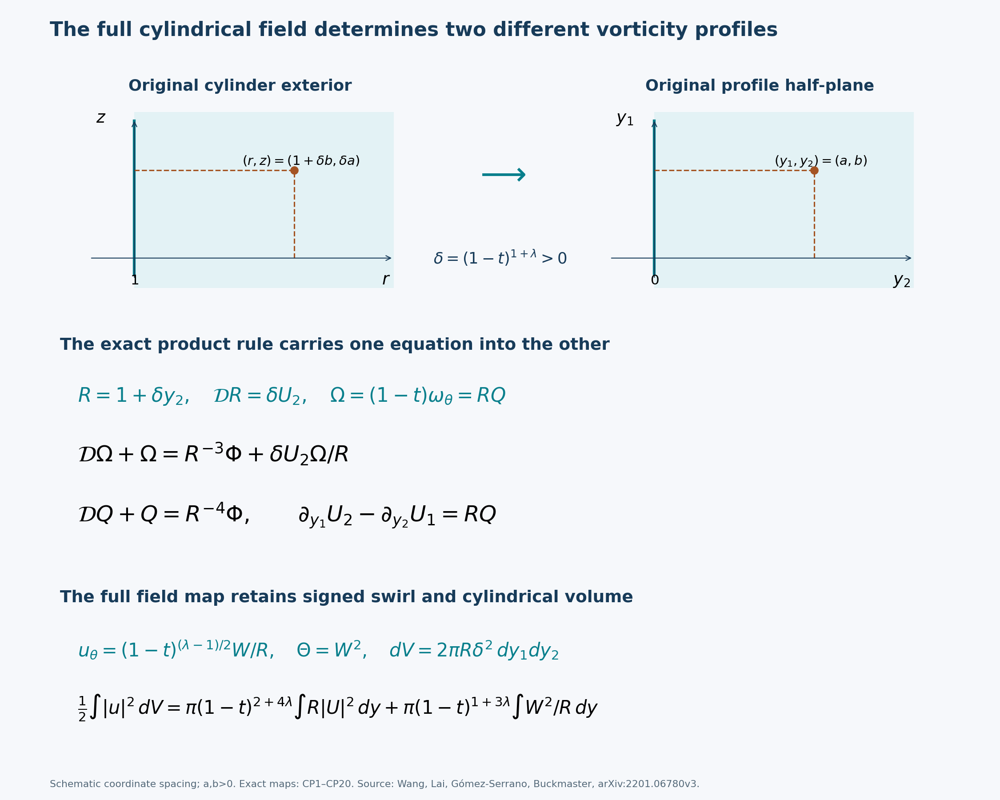
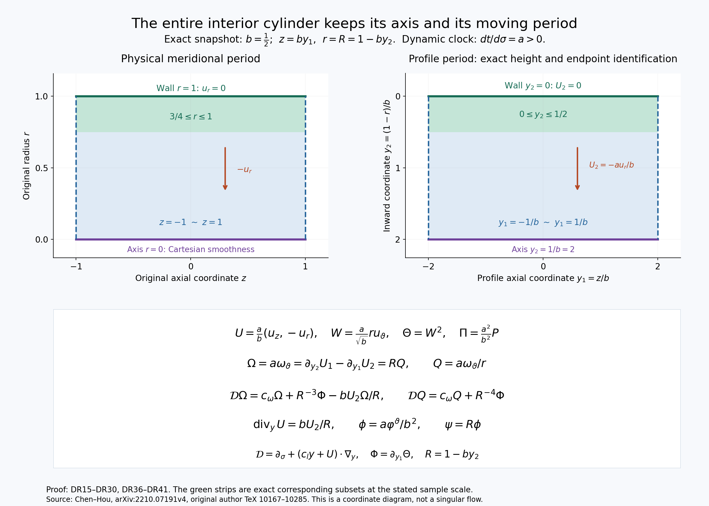
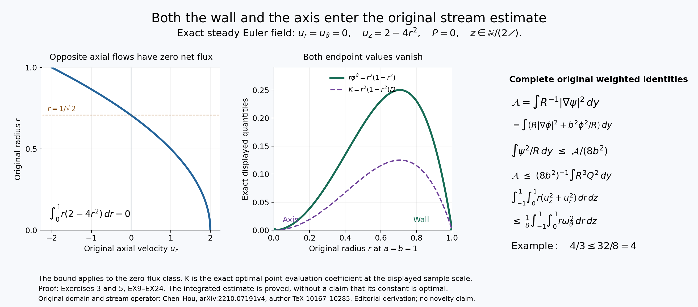

# Original cylindrical profiles, dynamic clocks and periodic pressure

A profile calculation must still describe the original fluid: its
physical time, radius, axial period, signed swirl and pressure. This
lesson constructs those exact maps for both the exterior-cylinder
comparison of Wang and coauthors and the interior-cylinder construction
of Chen and Hou. Every equation is derived before a limiting comparison
is made.

The two settings have different radial orientations and domains.
The angular vorticity and vorticity divided by radius have different
evolution equations connected by an exact multiplication map.
The original cylindrical stream operator also carries radial terms
and an axial-flux condition. These structures survive every coordinate
change in the lesson.

The complete maps support five solved exercises on the physical clock,
periodic pressure, the axial constant mode, a smooth swirl through the
axis, and the weighted stream energy. The last exercise uses both
boundary values to strengthen the velocity estimate and proves
uniqueness with the original flux datum included.

The human papers and exact original author-source locators appear in
each part. Source discrepancies are identified beside their complete
repairs. An equation comparison does not establish the remaining
stability estimates or certify a computed profile. Those arguments
continue in the later lessons.

## Part 1. The original cylindrical Euler coordinates and their full profile equations
This calculation starts from Wang, Lai, Gómez-Serrano and Buckmaster,
[arXiv:2201.06780v3](https://arxiv.org/abs/2201.06780v3),
original author BoussinesqPRL_v5.tex101–161. The source uses the exterior
of the cylinder of radius one. That domain, the original terminal time
one, its exponent and every radial coefficient are retained below.

This is an exact equation comparison. It does not construct a singular
Euler solution or certify a computed profile. The source's numerical
profile programme and its approximation claims must be reviewed with
their actual analytic and computational inputs.

## CP1. Original fields and the signed swirl

Use original cylindrical coordinates \((r,\theta,z)\) with \(r\geq1\).
Write \(u_z,u_r,u_\theta,P_{\rm phys}\) for smooth axisymmetric physical
fields. Define
\[
 D=\partial_t+u_z\partial_z+u_r\partial_r,\qquad
 \Gamma=ru_\theta,\qquad S=\Gamma^2,\qquad
 \omega_\theta=\partial_z u_r-\partial_r u_z.
\tag{CP1}
\]
The full axisymmetric Euler equations are
\[
 \begin{aligned}
 Du_z+\partial_zP_{\rm phys}&=0,\\
 Du_r+\partial_rP_{\rm phys}-u_\theta^2/r&=0,\\
 Du_\theta+u_ru_\theta/r&=0,\\
 \partial_z u_z+\partial_r u_r+u_r/r&=0.
 \end{aligned}
\tag{CP2}
\]
The wall condition is \(u_r(1,z,t)=0\).
Multiplying the third equation by \(r\), and using \(Dr=u_r\),
gives \(D\Gamma=0\), hence \(DS=0\).
Taking \(\partial_z\) of the radial equation minus
\(\partial_r\) of the axial equation, and using the complete divergence
equation, gives
\[
 D\omega_\theta=\frac{u_r}{r}\omega_\theta
                  +\frac1{r^3}\partial_zS,\qquad
 D(\omega_\theta/r)=\frac1{r^4}\partial_zS.
\tag{CP3}
\]
Indeed the commutator terms in the differentiated transport are
\((\partial_z u_z+\partial_r u_r)\omega_\theta
=-u_r\omega_\theta/r\), and
\(\partial_z(u_\theta^2/r)=r^{-3}\partial_zS\).
The pressure mixed derivatives cancel. The second equation follows
by the product rule and \(D(r^{-1})=-u_r/r^2\).
Both original vorticity objects and their exact relation are retained.

## CP2. The physical-to-profile map and its inverse

Fix the source exponent \(\lambda>-1\). For \(t<1\), set
\[
 \begin{gathered}
 \tau=1-t,\quad s=-\log\tau,\quad \delta=\tau^{1+\lambda},\\
 y_1=z/\delta,\quad y_2=(r-1)/\delta,\quad R(s,y_2)=1+\delta y_2=r.
 \end{gathered}
\tag{CP4}
\]
The original exterior domain maps to \(y_2\geq0\).
The inverse is \(t=1-e^{-s}\), \(z=\delta y_1\), \(r=R\),
with \(\delta=e^{-(1+\lambda)s}\).
For \(0\leq t<1\), \(s\geq0\); the map is also defined on any original
interval with \(t<1\). Its spatial Jacobian is \(\delta^2>0\).

Define the complete transformed fields by
\[
 \begin{gathered}
 U_1=\tau^{-\lambda}u_z,\qquad U_2=\tau^{-\lambda}u_r,\qquad
 \Pi=\tau^{-2\lambda}P_{\rm phys},\\
 W=\tau^{(1-\lambda)/2}\Gamma,\qquad
 \Theta=W^2=\tau^{1-\lambda}S,\\
 \Omega=\tau\omega_\theta
       =\partial_{y_1}U_2-\partial_{y_2}U_1,\qquad
 Q=\tau\omega_\theta/r=\Omega/R,\\
 \Phi=\partial_{y_1}\Theta=\tau^2\partial_zS,\qquad
 \Psi=\partial_{y_2}\Theta=\tau^2\partial_rS.
 \end{gathered}
\tag{CP5}
\]
Every physical field on the right is evaluated at the original inverse
coordinates in CP4. The full inverse retains the signed swirl:
\[
 u_z=\tau^\lambda U_1,\quad u_r=\tau^\lambda U_2,\quad
 u_\theta=\frac{\tau^{(\lambda-1)/2}}{R}W,\quad
 P_{\rm phys}=\tau^{2\lambda}\Pi.
\tag{CP6}
\]
Thus the map involving \(U_1,U_2,W,\Pi\) is one-to-one on the corresponding
smooth fields, with explicit inverse and no division by \(W\).
The field \(\Theta=W^2\) alone loses the swirl sign; it is not used
as a substitute for the full inverse.

Let
\[
 V=(1+\lambda)y+U,\qquad
 \mathcal D=\partial_s+V\cdot\nabla_y,\qquad
 \mathcal D R=\delta U_2.
\tag{CP7}
\]
For any real exponent \(a\) and smooth profile \(f\), direct
differentiation at the original physical coordinates gives
\[
 D\bigl[\tau^a f(s,y)\bigr]
       =\tau^{a-1}(\mathcal D f-a f).
\tag{CP8}
\]
In fact \(ds/dt=\tau^{-1}\),
\(dy/dt=(1+\lambda)y/\tau\) at fixed \((r,z)\), and
\(u_z\partial_z+u_r\partial_r=\tau^{-1}U\cdot\nabla_y\).
The derivative of \(\tau^a\) is \(-a\tau^{a-1}\).
Also \(\partial_sR=-(1+\lambda)\delta y_2\) and
\(V\cdot\nabla R=\delta[(1+\lambda)y_2+U_2]\), proving CP7.

## CP3. Every physical equation has an exact receiving equation

Substitute CP5–CP8 into CP2. Dividing only by strictly positive powers
of \(\tau\) and \(R\) gives the exact system
\[
 \begin{aligned}
 \mathcal D U-\lambda U+\nabla_y\Pi
       &=(0,W^2/R^3),\\
 \mathcal D W+\frac{1-\lambda}{2}W&=0,\\
 \nabla_y\cdot U&=-\frac{\delta U_2}{R},\qquad
 U_2(y_1,0,s)=0 .
 \end{aligned}
\tag{CP9}
\]
For the radial equation, the original centrifugal term is
\(u_\theta^2/r=\tau^{\lambda-1}W^2/R^3\).
For the swirl equation, its full physical residual equals
\[
 \frac{\tau^{(\lambda-3)/2}}{R}
       \left(\mathcal D W+\frac{1-\lambda}{2}W\right).
\]
The two meridional momentum residuals equal \(\tau^{\lambda-1}\)
times their respective CP9 residuals, and the full divergence residual
equals \(\tau^{-1}(\nabla_y\cdot U+\delta U_2/R)\).
These positive scalar factors prove equivalence in both directions
under the explicit invertible map CP5–CP6. The pressure and swirl are
included, so this is a comparison of the full Euler system on its
original exterior domain.

Squaring the signed transport equation gives
\[
 \mathcal D\Theta+(1-\lambda)\Theta=0.
\tag{CP10}
\]
Differentiating this equation, while keeping
\(\partial_{y_i}V_j=(1+\lambda)\delta_{ij}+\partial_{y_i}U_j\),
gives exactly
\[
 \begin{aligned}
 (\mathcal D+2+\partial_{y_1}U_1)\Phi
       &=-\partial_{y_1}U_2\,\Psi,\\
 (\mathcal D+2+\partial_{y_2}U_2)\Psi
       &=-\partial_{y_2}U_1\,\Phi .
 \end{aligned}
\tag{CP11}
\]
The mixed-derivative compatibility
\(\partial_{y_2}\Phi=\partial_{y_1}\Psi\) follows from CP5.
No temperature integration constant or swirl sign has been silently
chosen by these differentiated equations.

On the wall, smoothness and \(U_2(y_1,0,s)=0\) imply
\(\partial_sU_2=\partial_{y_1}U_2=0\) there. The normal drift also
vanishes there, since \(V_2=(1+\lambda)y_2+U_2\).
The radial momentum equation then gives the exact boundary trace
\[
 \partial_{y_2}\Pi(y_1,0,s)=W(y_1,0,s)^2=\Theta(y_1,0,s).
\tag{CP12}
\]

## CP4. The two vorticity equations and the source mismatch

Apply CP8 to both original equations in CP3, retaining their distinct
objects. The result is
\[
 \begin{aligned}
 \mathcal D\Omega+\Omega
      &=R^{-3}\Phi+\frac{\delta U_2}{R}\Omega,\\
 \mathcal D Q+Q&=R^{-4}\Phi,\qquad
 \Omega=RQ=\partial_{y_1}U_2-\partial_{y_2}U_1 .
 \end{aligned}
\tag{CP13}
\]
One can also derive the first equation by taking the full curl of CP9.
The curl of \(\mathcal D U-\lambda U\) is
\(\mathcal D\Omega+\Omega+(\nabla_y\cdot U)\Omega\).
The curl of its force is \(R^{-3}\Phi\), because
\(\partial_{y_1}R=0\). Substituting the exact divergence gives CP13.

The map \(Q=\Omega/R\) is smooth and invertible since \(R\geq1\).
Using CP7, its full residual identity is
\[
 \begin{split}
 R\bigl(\mathcal DQ+Q-R^{-4}\Phi\bigr)
   =\mathcal D\Omega+\Omega-R^{-3}\Phi
                           -\delta U_2\Omega/R .
 \end{split}
\tag{CP14}
\]
Thus the two equations are exactly related; they are not unrelated
systems with similar-looking formulas.

In the cited source, line145 declares that the profile called
\(\Omega\) rescales the angular vorticity itself.
Its first equation at151–159 instead has forcing
\((1+\mathcal E_1/\Phi)\Phi=R^{-4}\Phi\).
The displayed rational coefficient is exactly this one, without any
need to divide by \(\Phi\):
\[
 -\frac{x(x+2)(x^2+2x+2)}{(1+x)^4}\Phi
       =\bigl((1+x)^{-4}-1\bigr)\Phi,\qquad x=\delta y_2.
\tag{CP15}
\]
Indeed \(x(x+2)(x^2+2x+2)=(1+x)^4-1\).
That coefficient belongs to the quotient profile \(Q\).
For the declared angular-vorticity profile \(\Omega\), the complete
correction to the Boussinesq-form vorticity equation is instead
\[
 \mathcal E_\Omega=(R^{-3}-1)\Phi+\delta U_2\Omega/R.
\tag{CP16}
\]
Its difference from the source coefficient is
\[
 \mathcal E_\Omega-(R^{-4}-1)\Phi
      =\delta y_2R^{-4}\Phi+\delta U_2\Omega/R .
\tag{CP17}
\]
There are two exact repairs of the coordinate presentation: retain the
declared angular-vorticity profile and use CP16; or retain the printed
coefficient while using the quotient profile, the original inverse
\(\omega_\theta=\tau^{-1}RQ\), and the full curl relation
\(\partial_{y_1}U_2-\partial_{y_2}U_1=RQ\).
CP14 proves the precise connection between those repairs.

## CP5. What the limiting comparison does and does not establish

For \(0\leq y_2\leq Y<\infty\), the mean value theorem gives
\[
 |R^{-k}-1|\leq k\delta Y\quad(k>0),\qquad R^{-1}\leq1.
\]
Therefore the full errors obey
\[
 \begin{aligned}
 |\mathcal E_\Omega|
       &\leq\delta(3Y|\Phi|+|U_2||\Omega|),\\
 |(R^{-4}-1)\Phi|&\leq4\delta Y|\Phi|,\\
 |\nabla_y\cdot U|&\leq\delta|U_2|,\qquad
 |\Omega-Q|\leq\delta Y|Q|,\\
 |W^2/R^3-\Theta|&\leq3\delta Y|\Theta|.
 \end{aligned}
\tag{CP18}
\]
These are exact estimates on the original profiles, not asserted
uniform bounds for an unknown evolving solution. Since \(\lambda>-1\),
\(\delta=e^{-(1+\lambda)s}\) tends to zero. On any compact set where
the profile quantities on the right stay bounded, these explicit
curvature errors tend to zero. This recovers the local equation
comparison behind the source's proposed limiting Boussinesq system.

The coefficient comparison is not uniform on the full original
half-plane: for every \(\delta>0\) and \(k>0\),
\[
 \sup_{y_2\geq0}|(1+\delta y_2)^{-k}-1|=1.
\tag{CP19}
\]
The expression increases from zero toward one as \(y_2\) tends to
infinity. Thus a global comparison has to retain the actual far-field
weights and fields. This calculation does not replace that analysis.

Finally, the full three-dimensional axisymmetric volume is
\(2\pi r\,dr\,dz=2\pi R\delta^2\,dy_1\,dy_2\).
Using CP6, the exact physical kinetic energy is
\[
 \frac12\int_{r\geq1}|u|^2\,dV
 =\pi\tau^{2+4\lambda}
       \int_{y_2\geq0} R|U|^2\,dy
  +\pi\tau^{1+3\lambda}
       \int_{y_2\geq0}\frac{W^2}{R}\,dy.
\tag{CP20}
\]
Both terms are nonnegative; the identity is valid also as an equality
of extended nonnegative integrals. It follows by the explicit Jacobian,
without discarding swirl, cylindrical volume or the physical time
powers. For finite values it gives the exact finite-energy dictionary.

The coordinate mismatch is repaired by CP13–CP17. It does not by itself
disprove the numerical limiting profile, construct its stability, or
invalidate a main blowup theorem. The next part supplies the complete
original Chen–Hou interior-cylinder map.

The meridional coordinate spacing is schematic. The original wall, physical point, half-plane coordinates, full angular-vorticity and quotient equations, signed swirl and cylindrical volume are displayed with their exact factors. CP1–CP20 prove every map and coefficient. [Reproducible figure source](../assets/original-cylindrical-profile-map.py) and [vector rendering](../assets/original-cylindrical-profile-map.svg). Human source: Wang, Lai, Gómez-Serrano and Buckmaster, arXiv:2201.06780v3, original BoussinesqPRL_v5.tex136–161.

## Part 2. The original dynamic clocks and the complete interior-cylinder equations
This note gives exact maps of fields and equations for Jiajie Chen and Thomas
Y. Hou, [arXiv:2210.07191v4](https://arxiv.org/abs/2210.07191v4).
The original author file is arXiv_Euler_P1_v2026.tex. The planar definitions
are at lines 673–786; the interior-cylinder definitions and dynamic scales
are at 10167–10312. The later perturbation equations at 11754–11874 are
also compared below. These are bounded source readings. No claim about
the complete stability proof or its computational certificates follows
from an exact change of variables.

The source uses physical axial period **2**, an interior radius **1**,
and an initial cylindrical length scale which need not equal one. All
three are retained. Physical time is written \(t\); the source's dynamic
time \(\tau\) is written \(\sigma\), with its complete map to \(t\) displayed.
This notation distinguishes both from \(1-t\) in the fixed-similarity
formulas of Wang, Lai, Gómez-Serrano and Buckmaster,
[arXiv:2201.06780v3](https://arxiv.org/abs/2201.06780v3).

The figure uses the exact sample scale \(b=1/2\). Its green subsets
correspond under \(r=1-by_2\); the arrows indicate the inward coordinate
direction. The full identities are proved in (DR15)–(DR30) and
(DR36)–(DR41), from the original Chen–Hou definitions cited above.

## DR1. The original planar sign and physical pressure

Let \(X=(X_1,X_2)\) range over \(X_2\geq0\). Use the source's velocity
\(v=(v_1,v_2)\), temperature \(\theta\), stream function \(\varphi\), and
vorticity \(\omega\). Its definitions are
\[
 -\Delta_X\varphi=\omega,\qquad
 v_1=-\partial_{X_2}\varphi,\qquad
 v_2=\partial_{X_1}\varphi,\qquad
 \varphi(X_1,0,t)=0.
 \tag{DR1}
\]
Thus
\(\omega=\partial_{X_2}v_1-\partial_{X_1}v_2\), the negative of the
usual oriented curl in the ordered coordinates \((X_1,X_2)\).
The physical momentum equations corresponding to the source are
\[
 Dv+\nabla_X P=(0,-\theta),\qquad
 D\theta=0,\qquad
 \operatorname{div}_Xv=0,\qquad
 D=\partial_t+v\cdot\nabla_X .
 \tag{DR2}
\]
Indeed applying \(\partial_{X_2}\) to the first momentum component and
subtracting \(\partial_{X_1}\) of the second gives
\(D\omega=\partial_{X_1}\theta\).
The transport commutator is
\((\operatorname{div}_Xv)\omega=0\).
The wall condition is \(v_2=0\).

Conversely, for smooth \(v,\theta\) with this divergence and vorticity,
\(D\omega=\theta_{X_1}\) implies that
\(A=Dv+(0,\theta)\) satisfies
\(\partial_{X_1}A_2-\partial_{X_2}A_1=0\).
For any time-dependent scalar \(P_0\), set
\[
 P(X,t)=P_0(t)-\int_0^{X_1}A_1(s,0,t)\,ds
                   -\int_0^{X_2}A_2(X_1,s,t)\,ds .
 \tag{DR3}
\]
The fundamental theorem of calculus and the displayed mixed-derivative
identity give \(P_{X_1}=-A_1\) and \(P_{X_2}=-A_2\). This proves the
pressure reconstruction on the whole half-plane, with no decay or
integrability assumption on the two finite path integrals. Two such
pressures differ only by a function of time. This reconstructs pressure
for the given source velocity; it does not assert that arbitrary
vorticity data specify a unique velocity without the source's boundary
and far-field conditions.

## DR2. All dynamic scale factors and the inverse clock

For smooth functions \(c_\omega,c_l\), and a positive number \(b_0\), put
\[
 \begin{aligned}
 a(\sigma)&=\exp\!\left(\int_0^\sigma c_\omega(s)\,ds\right),\\
 b(\sigma)&=b_0\exp\!\left(-\int_0^\sigma c_l(s)\,ds\right),\\
 c_\theta&=c_l+2c_\omega,\qquad
 h(\sigma)=b_0^{-1}\exp\!\left(\int_0^\sigma c_\theta(s)\,ds\right)
              =\frac{a(\sigma)^2}{b(\sigma)},\\
 t(\sigma)&=\int_0^\sigma a(s)\,ds .
 \end{aligned}
 \tag{DR4}
\]
The planar source has \(b_0=1\). The cylindrical source retains its
specified \(b_0=C_l(0)>0\). In both cases \(a(0)=1\), whereas
\(h(0)=b_0^{-1}\). These initial factors are part of the source data.

The last equality for \(h\) follows by subtracting logarithmic
derivatives and checking the initial values. Since \(a>0\), \(t\) is
strictly increasing and has a differentiable inverse on its image, with
\(d\sigma/dt=1/a\). If the scales exist for \(0\leq\sigma<S\), this image
is exactly \(0\leq t<T_S\), where
\(T_S=\int_0^S a(s)\,ds\), possibly infinite. No value of that integral
or existence of a singular physical flow is assumed.

For the planar map \(X=b(\sigma)y\), define
\[
 U=\frac{a}{b}v,\quad
 \Theta=\frac{a^2}{b}\theta,\quad
 \Omega=a\omega,\quad
 \Pi=\frac{a^2}{b^2}P,\quad
 \phi=\frac{a}{b^2}\varphi,\quad
 {\cal D}=\partial_\sigma+(c_l y+U)\cdot\nabla_y .
 \tag{DR5}
\]
Every physical field on the right is evaluated at \((b(\sigma)y,t(\sigma))\).
The inverse is \(v=(b/a)U\), \(\theta=(b/a^2)\Theta\),
\(\omega=a^{-1}\Omega\), \(P=(b^2/a^2)\Pi\), and
\(\varphi=(b^2/a)\phi\), at
\(y=X/b(\sigma(t))\).
Thus this is a bijection of the indicated smooth fields on the exact
time intervals and half-planes. No amplitude factor has been absorbed
into a new physical object.

For any scalar \(k(\sigma)\neq0\) and profile \(f\), the physical field
\(F(X,t)=k(\sigma(t))f(X/b(\sigma(t)),\sigma(t))\) satisfies
\[
 DF=\frac{k}{a}\left({\cal D}f+\frac{k'}{k}f\right),
 \qquad \partial_{X_i}F=\frac{k}{b}\partial_{y_i}f .
 \tag{DR6}
\]
To prove this, differentiate \(X/b\) at fixed \(X\), obtaining
\(\partial_t y=c_l y/a\), and use
\(v\cdot\nabla_X=(1/a)U\cdot\nabla_y\).
The \(k'\) term comes from the time derivative of the full amplitude.

It follows component by component that (DR2) is equivalent to
\[
 \begin{aligned}
 {\cal D}U-(c_\omega+c_l)U+\nabla_y\Pi&=(0,-\Theta),\\
 {\cal D}\Theta&=c_\theta\Theta,\qquad
 \operatorname{div}_yU=0,\\
 \Omega&=\partial_{y_2}U_1-\partial_{y_1}U_2,\qquad
 {\cal D}\Omega=c_\omega\Omega+\partial_{y_1}\Theta,\\
 -\Delta_y\phi&=\Omega,\qquad U=(-\phi_{y_2},\phi_{y_1}).
 \end{aligned}
 \tag{DR7}
\]
For a proof before setting residuals to zero, the physical momentum,
temperature, divergence and vorticity residuals equal respectively
\(b/a^2\), \(b/a^3\), \(1/a\), and \(1/a^2\) times the corresponding
profile residuals. These factors are all nonzero. The stream equation
follows from two spatial derivatives and its exact factor \(a/b^2\).
At the wall \(U_2=0\), \(\phi=0\), and the second momentum equation gives
\(\Pi_{y_2}=-\Theta\).

## DR3. Gradient data, origin conditions, and the fixed source clock

Write \(\Phi=\partial_{y_1}\Theta\), \(\Psi=\partial_{y_2}\Theta\).
Differentiating the scalar equation, including the derivative of the
dilation field \(c_l y\), gives
\[
 \begin{aligned}
 {\cal D}\Phi&=(2c_\omega-\partial_{y_1}U_1)\Phi
                        -(\partial_{y_1}U_2)\Psi,\\
 {\cal D}\Psi&=(2c_\omega-\partial_{y_2}U_2)\Psi
                        -(\partial_{y_2}U_1)\Phi,\qquad
 \partial_{y_2}\Phi=\partial_{y_1}\Psi .
 \end{aligned}
 \tag{DR8}
\]
For example \(\partial_{y_1}{\cal D}\Theta
={\cal D}\Phi+c_l\Phi+U_{1,y_1}\Phi+U_{2,y_1}\Psi\);
subtracting \(c_\theta\Phi\) uses \(c_\theta-c_l=2c_\omega\).
The second identity follows by the same product rule with index 2;
the mixed identity is equality of the two second derivatives of \(\Theta\).

The source imposes \(\Omega\) odd and \(\Theta\) even in \(y_1\), with
\(\Theta(0,y_2)=0\), and uses the corresponding odd stream function.
Consequently \(U_1(0,y_2)=0\), \(U_2(y_1,0)=0\), and at the origin
\(U=0\), \(\nabla\Theta=0\), \(\Omega_{y_2}=0\), and
\(\Theta_{y_1y_2}=0\).
For \(A=\Omega_{y_1}(0)\), \(B=\Theta_{y_1y_1}(0)\), and
\(d=U_{1,y_1}(0)\), differentiating (DR7) gives exactly
\[
 A'=(c_\omega-c_l-d)A+B,\qquad
 B'=(c_\theta-2c_l-2d)B.
 \tag{DR9}
\]
In the second formula all terms involving a first derivative of \(\Theta\)
vanish, and the mixed Hessian term vanishes by evenness. The first uses
\(U_{2,y_1}=0\) on the wall. If the source's nonzero anchor \(A\neq0\)
is used to prescribe
\(c_l=2B/A\), \(c_\omega=c_l/2+d\), then both displayed right sides
are identically zero. Thus the two initial anchor values persist;
division by zero is not part of this prescription. The equations (DR7)
and (DR8) themselves do not require nonzero anchors.

The special choice \(b_0=1\), \(c_\omega=-1\), \(c_l=1+\lambda\) gives
\[
 a=e^{-\sigma}=1-t,\qquad
 b=e^{-(1+\lambda)\sigma}=(1-t)^{1+\lambda},\qquad
 t=1-e^{-\sigma},\qquad
 h=(1-t)^{1-\lambda}.
 \tag{DR10}
\]
For \(\lambda>-1\) this contracts spatial lengths as \(t\uparrow1\).
It is an exact specialization of (DR4), with physical interval
\(0\leq t<1\). Wang and coauthors' main-text planar convention has
positive oriented curl and upward temperature force. For the same
velocity and pressure the full conversion is
\[
 U_{\rm W}=U,\quad \Pi_{\rm W}=\Pi,\quad
 \Omega_{\rm W}=-\Omega,\quad
 \Theta_{\rm W}=-\Theta,\quad
 \Phi_{\rm W}=-\Phi,\quad \Psi_{\rm W}=-\Psi .
 \tag{DR11}
\]
Substitution into every equation in (DR7) and (DR8) proves the map:
the momentum force becomes \(+\Theta_{\rm W}e_2\), and the curl and
scalar equations each acquire the same sign on both sides. The inverse
is the same sign change. An origin constraint
\(\partial_{y_1}\Omega_{\rm W}(0)=-1\) becomes
\(\partial_{y_1}\Omega(0)=+1\), not \(-1\).
The source's supplement uses the negative curl at lines 184, 201 and
231, while its main text uses the positive curl at line 125. Converting
the curl alone does not convert its coupled equations or anchor data.
This algebra does not determine which convention any trained network used.

## DR4. The original interior cylinder and full signed variables

Return to the three-dimensional physical cylinder
\[
 0\leq r\leq1,\qquad z\in\mathbb R/(2\mathbb Z),\qquad
 0\leq\vartheta<2\pi .
 \tag{DR12}
\]
Let \(u_z,u_r,u_\vartheta,P\) be smooth axisymmetric fields, smooth in
Cartesian coordinates through \(r=0\), periodic with the source period
2, and satisfying \(u_r=0\) at \(r=1\). Set
\[
 D=\partial_t+u_z\partial_z+u_r\partial_r,\quad
 \Gamma=ru_\vartheta,\quad S=\Gamma^2,\quad
 \omega_\vartheta=\partial_z u_r-\partial_r u_z,\quad
 q=\omega_\vartheta/r\quad(r>0).
 \tag{DR13}
\]
The full physical Euler residuals are
\[
 \begin{gathered}
 E_z=Du_z+P_z,\quad E_r=Du_r+P_r-u_\vartheta^2/r,\\
 E_\vartheta=Du_\vartheta+u_ru_\vartheta/r,\quad
 H=\partial_z u_z+\partial_r u_r+u_r/r .
 \end{gathered}
 \tag{DR14}
\]
Euler means that all four vanish. Multiplying the swirl equation by
\(r\), with \(Dr=u_r\), gives \(D\Gamma=0\). Taking the curl of the
two meridional equations gives
\(D\omega_\vartheta=(u_r/r)\omega_\vartheta+r^{-3}S_z\).
Differentiating \(r^{-1}\) then gives \(Dq=r^{-4}S_z\).
These formulas retain both vorticity objects; the source's cylindrical
\(\widetilde\omega\) at line 10209 is \(q\), not \(\omega_\vartheta\).

Use (DR4) with the source's \(b_0=C_l(0)\) and define
\[
 y_1=z/b,\qquad y_2=(1-r)/b,\qquad R=1-by_2=r,\qquad
 {\cal D}=\partial_\sigma+(c_l y+U)\cdot\nabla_y .
 \tag{DR15}
\]
The exact profile domain and identified endpoints are
\[
 0\leq y_2\leq b^{-1},\qquad
 y_1\in\mathbb R/\bigl((2/b)\mathbb Z\bigr),\qquad
 -b^{-1}\leq y_1\leq b^{-1}\text{ for one period}.
 \tag{DR16}
\]
It is a time-dependent strip, not the fixed upper half-plane.

Define the full fields, including the signed swirl, by
\[
 \begin{gathered}
 U=\frac{a}{b}(u_z,-u_r),\qquad
 \Pi=\frac{a^2}{b^2}P,\qquad
 W=\frac{a}{\sqrt b}\Gamma,\qquad
 \Theta=\frac{a^2}{b}S=W^2,\\
 \Omega=a\omega_\vartheta,\qquad Q=aq=\frac{\Omega}{R},\qquad
 \Phi=\Theta_{y_1}=a^2 S_z,\qquad
 \Psi=\Theta_{y_2}=-a^2 S_r .
 \end{gathered}
 \tag{DR17}
\]
The arguments of every physical field are
\((r,z,t)=(1-b y_2,b y_1,t(\sigma))\).
For \(R>0\) the inverse is
\[
 \begin{gathered}
 u_z=\frac ba U_1,\quad u_r=-\frac ba U_2,\quad
 u_\vartheta=\frac{\sqrt b}{aR}W,\quad P=\frac{b^2}{a^2}\Pi,\\
 \Gamma=\frac{\sqrt b}{a}W,\quad
 \omega_\vartheta=\frac{\Omega}{a},\quad q=\frac Qa .
 \end{gathered}
 \tag{DR18}
\]
Keeping \(W\) makes the inverse exact at every swirl zero and for both
signs. Reconstructing a smooth signed swirl from the scalar square
\(\Theta\) alone is not asserted. The source explicitly restricts to
nonnegative initial swirl when using its square at lines 10205–10209.

At fixed physical \(r,z\), both \(y_1,y_2\) have derivative
\(c_l y_i/a\). Thus (DR6) holds again, with the present \(U\).
Spatial derivatives now satisfy
\(\partial_z=b^{-1}\partial_{y_1}\),
\(\partial_r=-b^{-1}\partial_{y_2}\). In particular
\[
 {\cal D}R=-bU_2,\qquad
 \Omega=\partial_{y_2}U_1-\partial_{y_1}U_2,\qquad
 H=\frac1a\left(\operatorname{div}_yU-\frac{bU_2}{R}\right).
 \tag{DR19}
\]
For the first identity, \(R_\sigma=c_l b y_2\) and
\(R_{y_2}=-b\), so the two dilation terms cancel exactly.
The other two identities follow by the displayed physical derivatives.
The negative orientation of \(y_2\) is essential in all three.

## DR5. Exact momentum, signed swirl, and source residuals

Define the profile residuals
\[
 \begin{aligned}
 {\cal E}&={\cal D}U-(c_\omega+c_l)U+\nabla_y\Pi
                          +(0,W^2/R^3),\\
 {\cal E}_W&={\cal D}W-(c_\omega+c_l/2)W,\qquad
 {\cal H}=\operatorname{div}_yU-bU_2/R .
 \end{aligned}
 \tag{DR20}
\]
Before imposing any equation, (DR6), (DR17), and (DR18) give
\[
 E_z=\frac b{a^2}{\cal E}_1,\quad
 E_r=-\frac b{a^2}{\cal E}_2,\quad
 E_\vartheta=\frac{\sqrt b}{a^2R}{\cal E}_W,\quad
 H=\frac1a{\cal H}.
 \tag{DR21}
\]
For the swirl identity, differentiating \(W/R\) gives an extra
\(bU_2W/R^2\) in its profile material derivative. The physical term
\(u_ru_\vartheta/r\) is the negative of precisely that contribution
after multiplication by \(\sqrt b/a^2\). The remaining logarithmic
derivative of \(\sqrt b/a\) is \(-c_l/2-c_\omega\).
For the radial identity, both the pressure derivative and physical
centrifugal contribution have the negative factor \(b/a^2\), because
the profile's second velocity component is \(-a u_r/b\).
This proves exact equivalence to the full momentum and swirl equations
on \(R>0\); the Cartesian axis extension is proved in DR8 below.

At the physical wall the full consequences are
\[
 U_2(y_1,0,\sigma)=0,\qquad \Pi_{y_2}(y_1,0,\sigma)=-\Theta(y_1,0,\sigma).
 \tag{DR22}
\]
Indeed the tangential and time derivatives of \(U_2\) vanish on the
wall, and the drift's second component there is zero. Setting the
second residual in (DR20) to zero gives the pressure condition.

The square transport and its two differentiated equations are
\[
 \begin{aligned}
 {\cal D}\Theta&=c_\theta\Theta,\\
 {\cal D}\Phi&=(2c_\omega-U_{1,y_1})\Phi-U_{2,y_1}\Psi,\\
 {\cal D}\Psi&=(2c_\omega-U_{2,y_2})\Psi-U_{1,y_2}\Phi,\qquad
 \Phi_{y_2}=\Psi_{y_1}.
 \end{aligned}
 \tag{DR23}
\]
The first follows from
\({\cal D}(W^2)-c_\theta W^2=2W{\cal E}_W\).
It is a consequence of the signed equation even at zeros. The reverse
inference from this identity alone is not used. The two gradient
identities follow by the complete calculation in (DR8), without
assuming planar incompressibility.

The two full vorticity equations are
\[
 {\cal D}\Omega=c_\omega\Omega+\frac{\Phi}{R^3}
                                 -\frac{bU_2}{R}\Omega,\qquad
 {\cal D}Q=c_\omega Q+\frac{\Phi}{R^4},\qquad
 \Omega=RQ .
 \tag{DR24}
\]
They can be obtained directly from the two physical vorticity equations
after (DR14), or from the exact identity
\[
 R\left({\cal D}Q-c_\omega Q-\frac{\Phi}{R^4}\right)
 ={\cal D}\Omega-c_\omega\Omega+\frac{bU_2}{R}\Omega-\frac{\Phi}{R^3}.
 \tag{DR25}
\]
To verify it, substitute \(Q=\Omega/R\) and
\({\cal D}R=-bU_2\). Moreover the negative curl of the momentum residual
is exactly
\[
 \partial_{y_2}{\cal E}_1-\partial_{y_1}{\cal E}_2
 ={\cal D}\Omega-c_\omega\Omega
       +(\operatorname{div}_yU)\Omega-\Phi/R^3.
 \tag{DR26}
\]
The product-rule commutator contributes
\((c_l+\operatorname{div}_yU)\Omega\); subtracting
\((c_l+c_\omega)\Omega\) leaves the coefficient in (DR26).
Thus (DR26) is the angular residual in (DR25) plus \({\cal H}\Omega\).
This checks the source comparison using the full velocity and pressure.

The source's equation immediately above its label eq:euler4, at line
10269, contains \(c_\omega\omega\). Its display eq:euler4 at line 10283
omits that term from the quotient-vorticity equation. The exact equation
for its declared variable is the second equation of (DR24). The omitted
term is also present in the later perturbation and profile-error
formulas at lines 11852–11853 and 11872. This local displayed omission
therefore does not show that those later formulas lack the term.
Their complete estimates still require their own audit; the local
comparison neither disproves nor validates the source's main theorem.

## DR6. Both stream functions and the full elliptic operator

Write \(\varphi^\vartheta\) for the source's original angular stream
function. Its complete definition is
\[
 -\left(\partial_{rr}+\frac1r\partial_r+\partial_{zz}\right)
       \varphi^\vartheta+\frac{\varphi^\vartheta}{r^2}
          =\omega_\vartheta,\qquad
 u_r=-\varphi^\vartheta_z,\quad
 u_z=\varphi^\vartheta_r+\frac{\varphi^\vartheta}{r}.
 \tag{DR27}
\]
The source imposes \(\varphi^\vartheta(1,z,t)=0\) and period 2.
Introduce both its actual rescaled stream function and a second,
explicitly related stream function:
\[
 \phi=\frac a{b^2}\varphi^\vartheta,\qquad
 \psi=R\phi .
 \tag{DR28}
\]
The first gives the source's exact equations
\[
 -\Delta_y\phi+\frac bR\phi_{y_2}+\frac{b^2}{R^2}\phi=RQ,\qquad
 U_1=-\phi_{y_2}+\frac bR\phi,\quad U_2=\phi_{y_1},\quad
 \phi(y_1,0,\sigma)=0 .
 \tag{DR29}
\]
For example the physical elliptic equation multiplied by \(a\) has
terms \(-\phi_{y_2y_2}-\phi_{y_1y_1}\),
\(+(b/R)\phi_{y_2}\), and \(+(b^2/R^2)\phi\), and right side
\(a\omega_\vartheta=RQ\). None can be dropped on the whole cylinder.

The exact comparison to \(\psi\) is
\[
 \begin{gathered}
 U_1=-R^{-1}\psi_{y_2},\quad U_2=R^{-1}\psi_{y_1},\\
 -\operatorname{div}_y(R^{-1}\nabla_y\psi)=\Omega=RQ,\qquad
 -\Delta_y\psi-\frac bR\psi_{y_2}=R^2Q .
 \end{gathered}
 \tag{DR30}
\]
Indeed \(\psi_{y_1}=R\phi_{y_1}\) and
\(\psi_{y_2}=R\phi_{y_2}-b\phi\). Expanding
\(-\operatorname{div}(R^{-1}\nabla(R\phi))\) gives exactly the
left side of (DR29). Multiplying by \(R\) gives the final equation,
since \(\partial_{y_2}(R^{-1})=b/R^2\).
The inverse \(\phi=\psi/R\) holds for \(R>0\); its regular axis class
is specified next. Both original operators and their connecting
multiplication map have been retained.

## DR7. The source's axial flux and periodic pressure

For any smooth divergence-free physical field with \(u_r=0\) at the
wall, define
\[
 F(t,z)=\int_0^1 r u_z(r,z,t)\,dr .
 \tag{DR31}
\]
The weighted divergence equation gives
\(\partial_zF=-[r u_r]_{r=0}^{r=1}=0\).
Thus \(F=F(t)\). The full stream function for that given field is
\[
 \varphi^\vartheta(r,z,t)=\frac1r\int_0^r s u_z(s,z,t)\,ds
 \quad(r>0),\qquad
 \varphi^\vartheta(1,z,t)=F(t).
 \tag{DR32}
\]
Its radial derivative gives \(u_z=\varphi^\vartheta_r+\varphi^\vartheta/r\);
its axial derivative is \(-u_r\), by integrating the weighted divergence
equation from the axis. Its curl then gives (DR27).
The integral is \(O(r^2)\), and the smooth axis extension is proved in
DR8. Consequently the source's zero Dirichlet value selects **zero
axial flux**, in addition to impermeability. This is consistent with
its odd-in-\(z\) angular stream function. Impermeability alone allows
other constant fluxes and does not force this Dirichlet value.

For completeness, the exact global pressure issue can be closed.
Suppose the signed swirl equation, full divergence, and physical
quotient-vorticity equation following (DR14) hold for a given smooth
periodic velocity. In ordered coordinates \((z,r)\), put
\(A_z=Du_z\), \(A_r=Du_r-u_\vartheta^2/r\). Direct differentiation yields
\[
 \partial_z A_r-\partial_r A_z
 =D\omega_\vartheta-\frac{u_r}{r}\omega_\vartheta-\frac{S_z}{r^3}=0 .
 \tag{DR33}
\]
Its axial period integral \(J(r,t)=\int_0^2 A_z(r,z,t)\,dz\) is
independent of \(r\), because
\(\partial_rJ=\int_0^2\partial_z A_r\,dz=0\).
The weighted divergence equation and wall condition also imply
\[
 \int_0^1\int_0^2 r A_z\,dz\,dr
 =\frac{d}{dt}\int_0^1\int_0^2 r u_z\,dz\,dr=2F'(t),
 \qquad J(t)=4F'(t).
 \tag{DR34}
\]
The first equality follows by writing the advective term as
\(\partial_z(r u_z^2)+\partial_r(r u_r u_z)\); both boundary integrals
vanish. The second uses \(\int_0^1r\,dr=1/2\).

A pressure periodic with the original period 2 exists exactly when
\(F'=0\). Necessity follows by integrating \(P_z=-A_z\) over a period.
For sufficiency, use the explicit expression
\[
 P(r,z,t)=P_0(t)-\int_0^z A_z(1,\zeta,t)\,d\zeta
                       -\int_1^r A_r(s,z,t)\,ds .
 \tag{DR35}
\]
Equation (DR33) gives both momentum derivatives, and (DR34) makes the
first integral periodic. The second already is periodic. Its axis
extension is smooth: \(A_z\) is smooth in \(r^2\) and \(A_r\) is \(r\)
times a smooth function of \(r^2\), by the Cartesian forms in DR8.
Thus the zero-flux class actually selected by the source has the full
periodic pressure, without leaving a missing circulation condition.
On a connected cylinder it is unique up to \(P_0(t)\).

The remaining constant flux is also explicitly related to that class.
For a constant \(F\), translate every zero-flux physical field by
\(z\mapsto z-2Ft\), and add \(2F\) to \(u_z\) only.
The new material derivative on a translated field equals the old one,
since the time derivative \(-2F\partial_z\) cancels the added advective
derivative \(+2F\partial_z\). The momentum, signed swirl, divergence,
and pressure residuals are therefore translated exactly. The new flux
is \(F\), as \(\int_0^1 2Fr\,dr=F\). The inverse translates by the
opposite amount and subtracts \(2F\). Its stream function is the
translated zero-flux stream function plus \(Fr\), so its wall value is
\(F\); its vorticity and swirl are translated without an added term.
This is a bijection of the indicated Euler fields, preserving the
physical cylinder and period 2. It need not preserve the source's
fixed odd symmetry about \(z=0\). It does not manufacture a solution
whose existence has not been established.

## DR8. The axis, moving boundary, and period

Here is a complete regularity justification at the physical axis.
A smooth rotationally invariant scalar near the axis has the form
\(f(r^2,z,t)\), with \(f\) smooth for \(r^2\geq0\). To see this, restrict
the scalar to the horizontal line \((r,0)\); rotation by \(\pi\) makes
that restriction even. Every smooth even function \(g(r)\) defines a
smooth function of \(\rho=r^2\). For each integer \(N\), Taylor's formula
and repeated division by \(r\) give
\[
 g(r)=\sum_{j=0}^N g^{(2j)}(0)r^{2j}/(2j)!+r^{2N+2}h_N(r),
\]
with \(h_N\) smooth and even.
After \(r=\sqrt\rho\), the remainder and each of its first \(N\)
derivatives tend to zero at the required order:
\(|\partial_\rho^k h_N(\sqrt\rho)|\leq C_k\rho^{-k}\) for
\(0<\rho\leq1\), hence the \(k\)-th derivative of
\(\rho^{N+1}h_N(\sqrt\rho)\) is \(O(\rho^{N+1-k})\).
This proves smoothness to every order and, on compact parameter sets,
the same assertion with derivatives in \(z,t\).

For a smooth rotation-equivariant vector, its two horizontal
components restricted to \((r,0)\) are odd. Dividing each by \(r\)
gives a smooth even function; for instance
\(g(r)/r=\int_0^1g'(sr)\,ds\).
Rotating these restrictions gives exactly
\[
 u_r=rA(r^2,z,t),\qquad u_\vartheta=rB(r^2,z,t),\qquad
 u_z=C(r^2,z,t),\qquad P=G(r^2,z,t).
 \tag{DR36}
\]
Conversely these formulas give the Cartesian field
\((A X_1-B X_2,A X_2+B X_1,C)\) and scalar \(G\), so they are smooth
through the axis. This proves both directions of the axis class.

Writing \(\rho=R^2\) and evaluating the physical functions at
\((\rho,b y_1,t(\sigma))\), (DR17) becomes
\[
 \begin{gathered}
 U_1=(a/b)C,\quad U_2=-(a/b)RA,\quad
 W=(a/\sqrt b)R^2B,\quad
 \Theta=(a^2/b)R^4B^2,\\
 \Omega=aR(A_z-2C_\rho),\qquad Q=a(A_z-2C_\rho),\\
 \Phi=a^2R^4\partial_z(B^2),\qquad
 \Psi=-a^2\bigl(4R^3B^2+4R^5BB_\rho\bigr).
 \end{gathered}
 \tag{DR37}
\]
These are exact identities, not merely orders of vanishing.
In particular \(bU_2/R=-aA\),
\(R^{-4}\Phi=a^2\partial_z(B^2)\), and
\(\Theta/R^3=(a^2/b)RB^2\) extend regularly to the axis.
Also \(bU_2\Omega/R=-a^2RA(A_z-2C_\rho)\).
The physical and profile identities proved on \(R>0\) extend in
Cartesian form by continuity. There is no extra singular source at
\(R=0\).

Formula (DR32) is
\(\varphi^\vartheta=r\int_0^1 sC(r^2s^2,z,t)\,ds\).
It is \(r\) times a smooth function of \(r^2,z,t\). Hence the source's
\(\phi\) is \(R\) times such a function and \(\psi=R\phi\) is \(R^2\)
times one. These regular axis conditions make (DR28) invertible in
its stated class and justify all flux integrals. They also show why
one may not impose arbitrary nonzero values of \(\psi\) at the axis.

The profile height \(H_b=1/b\) has derivative \(H_b'=c_lH_b\).
At the axis \(U_2=0\), so the vertical drift there is exactly \(H_b'\).
The wall at \(y_2=0\) has zero normal drift. Thus neither boundary is
crossed by the corresponding smooth physical trajectories.

For the axial period \(L_b=2/b\), \(L_b'=c_lL_b\). If
\(f(\sigma,y_1+L_b,y_2)=f(\sigma,y_1,y_2)\), differentiation gives
\[
 f_\sigma(\sigma,y_1+L_b,y_2)
   =f_\sigma(\sigma,y_1,y_2)-L_b'f_{y_1}(\sigma,y_1,y_2).
 \tag{DR38}
\]
The change of \(c_l y_1\partial_{y_1}f\) under the same shift is
\(+c_l L_b f_{y_1}\). These terms cancel. Therefore
\({\cal D}f\) has the correct moving period even though the dilation
vector itself is not periodic. Replacing this period by a fixed one
would change the equation.

## DR9. Exact curvature bounds and all kinetic-energy factors

On a strip \(0\leq y_2\leq Y\) with \(bY\leq\eta<1\), the actual
radius satisfies \(1-\eta\leq R\leq1\). For every positive integer \(k\),
integrating the derivative of \((1-s)^{-k}\) from 0 to \(b y_2\) gives
\[
 0\leq R^{-k}-1\leq
       \frac{k bY}{(1-\eta)^{k+1}} .
 \tag{DR39}
\]
Consequently the complete local errors obey
\[
 \begin{aligned}
 |\operatorname{div}U|&\leq \frac{b}{1-\eta}|U_2|,\\
 |({\cal D}\Omega-c_\omega\Omega)-\Phi|
 &\leq \frac{3bY}{(1-\eta)^4}|\Phi|
                      +\frac{b}{1-\eta}|U_2|\,|\Omega|,\\
 |({\cal D}Q-c_\omega Q)-\Phi|
 &\leq \frac{4bY}{(1-\eta)^5}|\Phi|,\qquad
 |\Omega-Q|\leq bY|Q|,\\
 |\Theta/R^3-\Theta|&\leq
                 \frac{3bY}{(1-\eta)^4}|\Theta|,\\
 |(b/R)\phi_{y_2}+(b^2/R^2)\phi|
 &\leq\frac{b}{1-\eta}|\phi_{y_2}|
                 +\frac{b^2}{(1-\eta)^2}|\phi|.
 \end{aligned}
 \tag{DR40}
\]
Every right side retains its actual profile. These are exact
pointwise comparisons, not an assumption that those profiles remain
uniformly bounded. The bare coefficient \(R^{-k}\) is unbounded as
the axis is approached, so this is not uniform coefficient convergence
on the whole cylinder. The cancellations in (DR37) control the original
smooth fields there and are not a license to discard the axis.

In one complete physical axial period, the cylindrical volume form
is \(r\,dr\,d\vartheta\,dz\). The absolute meridional Jacobian is \(b^2\);
the orientation of \(r=1-b y_2\) has already entered the derivatives.
Integrating the angular coordinate gives the exact identity
\[
 \begin{aligned}
 \frac12\int_{\text{physical period}}|u|^2\,dV
 &=\pi\frac{b^4}{a^2}
       \int_{-1/b}^{1/b}\int_0^{1/b}R|U|^2\,dy_2\,dy_1\\
 &\quad+\pi\frac{b^3}{a^2}
       \int_{-1/b}^{1/b}\int_0^{1/b}\frac{W^2}{R}\,dy_2\,dy_1 .
 \end{aligned}
 \tag{DR41}
\]
The equality also holds as an equality of nonnegative extended
integrals. In the smooth axis class, \(W^2/R=(a^2/b)R^3B^2\), so the
axis causes no energy divergence.

For a smooth Euler field in this cylinder, the original pointwise
energy identity is
\[
 \partial_t\!\left(\frac r2|u|^2\right)
 +\partial_z\!\left[r u_z\left(\frac12|u|^2+P\right)\right]
 +\partial_r\!\left[r u_r\left(\frac12|u|^2+P\right)\right]=0 .
 \tag{DR42}
\]
Dot the three momentum equations with their three velocity components.
The radial centrifugal work cancels the swirl stretching work exactly;
multiply by \(r\) and use weighted divergence. This proves (DR42).
The axial boundary terms cancel by period 2; the wall term vanishes
by \(u_r=0\), and the axis term vanishes by (DR36). Thus the full sum
on the right of (DR41), with both varying factors and moving integration
limits, is constant in dynamic time. For the constant-flux map in DR7,
the energy increases by exactly \(4\pi F^2\): the cross term integrates
to zero because the starting field has zero axial flux, and the
physical period has volume \(2\pi\).

The exact maps in this note explain how the original planar and
cylindrical equations are related, including the source's elliptic
operator and periodic pressure. The remaining analytic stability,
support, approximation, and computational estimates are separate
mathematical work. No singularity, profile certification, or novelty
claim is made by this coordinate calculation.

## Five solved exercises

These exercises use the physical cylinder \(0\leq r\leq1\),
\(z\in\mathbb R/(2\mathbb Z)\), and the exact quantities in
(DR4) and (DR13)–(DR30). All angular integrals have length \(2\pi\).
The zero-flux source class and the full smooth Cartesian axis class
are kept explicit.

### Exercise 1. A constant dynamic clock does not by itself prove blowup

Take \(c_\omega=-\gamma\), \(c_l=\beta\), with
\(\gamma>0\), \(\beta>0\), and the original initial length \(b_0>0\).
Find the physical clock, all inverse field factors, the complete
dynamic equations and energy factors. Determine whether the finite
endpoint of that clock alone implies a singular physical velocity.

**Solution.** Direct integration of (DR4) gives
\[
 \begin{gathered}
 a=e^{-\gamma\sigma},\qquad b=b_0e^{-\beta\sigma},\qquad
 h=b_0^{-1}e^{(\beta-2\gamma)\sigma},\\
 t=\frac{1-e^{-\gamma\sigma}}{\gamma},\qquad
 T_\gamma=\frac1\gamma,\qquad
 \tau=1-\gamma t=e^{-\gamma\sigma}>0,\qquad
 \sigma=-\frac1\gamma\log\tau .
 \end{gathered}
 \tag{EX1}
\]
Thus the inverse is defined for \(0\leq t<T_\gamma\); it does not
replace this original physical endpoint by one.
Set \(R=1-b_0\tau^{\beta/\gamma}y_2\). Then
\[
 \begin{gathered}
 y_1=\frac{z}{b_0\tau^{\beta/\gamma}},\qquad
 y_2=\frac{1-r}{b_0\tau^{\beta/\gamma}},\\
 u_z=b_0\tau^{\beta/\gamma-1}U_1,\qquad
 u_r=-b_0\tau^{\beta/\gamma-1}U_2,\qquad
 u_\vartheta=\frac{\sqrt{b_0}\tau^{\beta/(2\gamma)-1}}{R}W,\\
 P=b_0^2\tau^{2\beta/\gamma-2}\Pi,\qquad
 \Gamma=\sqrt{b_0}\tau^{\beta/(2\gamma)-1}W,\qquad
 \omega_\vartheta=\tau^{-1}\Omega,\quad q=\tau^{-1}Q .
 \end{gathered}
 \tag{EX2}
\]
Every profile is evaluated at the displayed \(y,\sigma\).
The profile height is \(b_0^{-1}\tau^{-\beta/\gamma}\), and its
axial period is \(2b_0^{-1}\tau^{-\beta/\gamma}\).
With \({\cal D}=\partial_\sigma+(\beta y+U)\cdot\nabla_y\),
substitution in the full residuals yields
\[
 \begin{aligned}
 {\cal D}U-(\beta-\gamma)U+\nabla\Pi&=(0,-W^2/R^3),\\
 {\cal D}W-(\beta/2-\gamma)W&=0,\qquad
 \operatorname{div}U=bU_2/R,\\
 {\cal D}\Theta&=(\beta-2\gamma)\Theta,\qquad
 {\cal D}Q=-\gamma Q+R^{-4}\Phi,\\
 {\cal D}\Omega&=-\gamma\Omega+R^{-3}\Phi-bU_2\Omega/R .
 \end{aligned}
 \tag{EX3}
\]
The full kinetic energy is
\[
 \pi b_0^4\tau^{4\beta/\gamma-2}\int_{\mathcal T_b}R|U|^2\,dy
 +\pi b_0^3\tau^{3\beta/\gamma-2}\int_{\mathcal T_b}\frac{W^2}{R}\,dy,
 \qquad
 \mathcal T_b=[-b^{-1},b^{-1}]\times[0,b^{-1}]
 \tag{EX4}
\]
with the two axial edges identified. The exponents follow by
substituting the actual \(a,b\) in (DR41), including the two powers
of the spatial Jacobian.

For \(\gamma=1\), \(\beta=1+\lambda\), \(b_0=1\), (EX1) is the
fixed source clock and (EX4) has powers \(2+4\lambda\) and
\(1+3\lambda\). The interior radius remains \(1-b y_2\);
this specialization does not turn it into the exterior radius
\(1+b y_2\).

Finally, the original physical field \(u=0\), \(P=0\) gives all zero
profile fields for every choice just made. It satisfies every
equation in (EX3) and extends smoothly beyond \(T_\gamma\).
Therefore finite physical length of an infinite dynamic clock is
not itself a blowup argument. A source blowup proof must also prove
growth of an actual physical quantity through the exact inverse map.

### Exercise 2. The complete axial pressure obstruction

Let \(g(t)\) be a smooth real function and take the physical fields
\(u_z=g(t)\), \(u_r=u_\vartheta=0\). Compute the vorticity, swirl,
flux, stream function, pressure condition and complete dynamic
momentum residual. Identify exactly which data the source's zero
wall stream condition excludes.

**Solution.** These fields are smooth on the whole Cartesian
cylinder and periodic with period 2. Their divergence is zero,
\(\Gamma=0\), \(\omega_\vartheta=0\), \(q=0\), and both reduced
transport equations are identically satisfied. But the momentum
equations require
\[
 P_r=0,\qquad P_z=-g'(t),\qquad
 P(r,z+2,t)-P(r,z,t)=-2g'(t).
 \tag{EX5}
\]
A periodic pressure therefore exists if and only if \(g'=0\).
On the axial covering space one may use
\(P(r,z,t)=-z g'(t)+P_0(t)\); (EX5) gives its exact failure to descend
to the periodic cylinder.

The actual axial flux and stream function are
\[
 F(t)=\frac{g(t)}2,\qquad
 \varphi^\vartheta(r,z,t)=\frac{g(t)}2r,\qquad
 \varphi^\vartheta(1,z,t)=\frac{g(t)}2,\qquad
 J(t)=2g'(t)=4F'(t).
 \tag{EX6}
\]
The first follows by integrating \(r g\) from 0 to 1. The second is
the complete reconstruction (DR32); differentiating gives
\(u_z=\varphi^\vartheta_r+\varphi^\vartheta/r=g\).
Thus the source's zero Dirichlet value excludes every nonzero
constant axial velocity as well as every varying one. The former
are nonetheless valid periodic Euler fields; the latter fail the
unforced periodic momentum equation exactly as (EX5) states.

For arbitrary original dynamic factors \(a,b\), the transformed
fields and residual are
\[
 \begin{gathered}
 U_1=\frac ab g(t(\sigma)),\quad U_2=W=\Theta=\Omega=Q=0,\qquad
 \phi=\frac{a g(t(\sigma))}{2b^2}R,\quad
 \psi=\frac{a g(t(\sigma))}{2b^2}R^2,\\
 {\cal D}U_1-(c_\omega+c_l)U_1=\frac{a^2}{b}g'(t(\sigma)).
 \end{gathered}
 \tag{EX7}
\]
Indeed \(U_1\) has no spatial derivative,
\((a/b)'=(c_\omega+c_l)a/b\), and \(t'=a\).
The covering-space pressure has profile
\[
 \Pi=-\frac{a^2}{b}y_1g'(t(\sigma))
             +\frac{a^2}{b^2}P_0(t(\sigma)),\qquad
 \Pi(y_1+2/b,y_2)-\Pi(y_1,y_2)
            =-\frac{2a^2}{b^2}g'(t(\sigma)).
 \tag{EX8}
\]
Its gradient cancels (EX7) exactly, but its jump is nonzero precisely
when the physical pressure jump is nonzero.

If instead the physical equation explicitly includes the axial force
\(f=g'(t)e_z\), the same field satisfies the full forced Euler equation
with spatially constant pressure. Its energy is \(\pi g(t)^2\) and
the exact force work is
\(\int u\cdot f\,dV=2\pi g(t)g'(t)\), the derivative of that energy.
This is a different, explicitly forced equation; it does not repair
the unforced source by silently dropping a pressure condition.

### Exercise 3. The axial flux mode and its exact energy minimum

For an arbitrary smooth axisymmetric divergence-free field in the
original cylinder with impermeable wall, retain its full signed
swirl and let \(F(t)\) be (DR31). Decompose its axial constant mode
without changing any other component. Prove the exact kinetic-energy
identity and characterize equality in the resulting lower bound.
Then prove the map of full Euler fields for constant \(F\).

**Solution.** At each fixed physical time define
\[
 w=u-2F(t)e_z,\qquad
 \int_0^1 r w_z(r,z,t)\,dr=0,\qquad
 \operatorname{div}w=0,\qquad w_r|_{r=1}=0 .
 \tag{EX9}
\]
The flux equality uses \(\int_0^1r\,dr=1/2\).
Subtracting a spatial constant changes neither divergence, any
vorticity component, the radial velocity, nor the signed swirl.
The full original period has volume
\(\int_0^{2\pi}\int_0^2\int_0^1r\,dr\,dz\,d\vartheta=2\pi\).
Also
\(\int w_z\,dV=2\pi\int_0^2\int_0^1r w_z\,dr\,dz=0\).
Consequently direct expansion gives
\[
 \frac12\int|u|^2\,dV
   =\frac12\int|w|^2\,dV+4\pi F(t)^2
   \ \geq\ 4\pi F(t)^2 .
 \tag{EX10}
\]
Equality holds exactly when \(w=0\) everywhere: zero integral of its
nonnegative square gives zero almost everywhere, and smoothness gives
zero at every point. Thus the unique energy minimizer for prescribed
flux at that time is \(u=2F(t)e_z\), with zero radial velocity and
zero swirl. The lower bound concerns all fields with the stated
flux and boundary data, not just solutions.

For constant \(F\), a zero-flux Euler field \(v\) produces
\[
 \begin{aligned}
 u_z(r,z,t)&=v_z(r,z-2Ft,t)+2F,\\
 u_r(r,z,t)&=v_r(r,z-2Ft,t),\qquad
 u_\vartheta(r,z,t)=v_\vartheta(r,z-2Ft,t),\\
 P_u(r,z,t)&=P_v(r,z-2Ft,t).
 \end{aligned}
 \tag{EX11}
\]
For every translated scalar \(f(r,z-2Ft,t)\), the contribution
\(-2F f_z\) from its time derivative cancels \(+2F f_z\) from axial
advection. Radial derivatives, the centrifugal term, swirl stretching,
pressure derivatives and weighted divergence are translated unchanged.
Thus every component of the Euler residual is the corresponding
translated residual of \(v\). The inverse replaces \(z\) by \(z+2Ft\)
and subtracts \(2F\) from the axial component. Translation is
well-defined on the original period-two circle at every time, so this
is a bijection of the two flux classes. Its angular stream function is
\[
 \varphi^\vartheta_u(r,z,t)
     =\varphi^\vartheta_v(r,z-2Ft,t)+Fr ,
 \qquad \varphi^\vartheta_u(1,z,t)=F .
 \tag{EX12}
\]
Its energy is the original energy of \(v\), unchanged by periodic
translation, plus \(4\pi F^2\). A time-varying \(F\) is excluded from
this unforced map by (DR34), not by an arbitrary choice of coordinates.

### Exercise 4. A complete smooth swirl example through the axis

Take real constants \(\kappa,V\). Construct the exact steady Euler
field with \(u_r=0\), \(u_\vartheta=\kappa r\), \(u_z=V\).
Find its full vorticity, pressure, original flux, all profile fields,
wall and axis limits, and kinetic energy. Explain what is lost by
retaining only \(\Theta\).

**Solution.** In Cartesian coordinates the field and pressure are
\[
 u=(-\kappa X_2,\kappa X_1,V),\qquad
 P=\frac{\kappa^2}{2}(X_1^2+X_2^2),\qquad
 \nabla\times u=(0,0,2\kappa).
 \tag{EX13}
\]
The divergence is zero. Its advective acceleration is
\((-\kappa^2X_1,-\kappa^2X_2,0)\), which is exactly \(-\nabla P\).
This proves Euler in the full Cartesian cylinder, including its axis.
Equivalently \(P_r=\kappa^2r=u_\vartheta^2/r\) for \(r>0\);
the axial and swirl equations have both sides zero.
The flux is \(F=V/2\), the angular stream function is \(Vr/2\),
and the angular vorticity is zero. Thus \(Q=\Omega=0\) does not
assert that the complete three-dimensional vorticity is zero.

For arbitrary original dynamic scales, the exact fields are
\[
 \begin{gathered}
 U_1=\frac ab V,\quad U_2=0,\quad
 W=\frac a{\sqrt b}\kappa R^2,\quad
 \Theta=\frac{a^2}{b}\kappa^2R^4,\quad
 \Pi=\frac{a^2}{2b^2}\kappa^2R^2,\\
 Q=\Omega=\Phi=0,\qquad
 \Psi=-4a^2\kappa^2R^3,\qquad
 \phi=\frac{aV}{2b^2}R,\quad\psi=\frac{aV}{2b^2}R^2 .
 \end{gathered}
 \tag{EX14}
\]
Here \({\cal D}R=0\) because \(U_2=0\); that identity retains the
cancellation of \(R_\sigma\) against the dilation derivative.
The derivatives of \(a/b\), \(a/\sqrt b\), and \(a^2/b\) are
respectively their values multiplied by \(c_\omega+c_l\),
\(c_\omega+c_l/2\), and \(c_\theta\). Thus the axial momentum,
signed-swirl and scalar equations hold exactly.
For radial momentum,
\[
 \Pi_{y_2}=-\frac{a^2}{b}\kappa^2R
                =-\frac{\Theta}{R^3},\qquad
 \frac{\Phi}{R^4}=0,\qquad
 \left.\Pi_{y_2}\right|_{R=1}
                =-\left.\Theta\right|_{R=1}.
 \tag{EX15}
\]
The apparent radial denominators cancel completely. The axis
\(R=0\) has \(W=0\), \(\Theta=0\), \(\Psi=0\) with the exact powers
in (EX14). The source's zero stream value at the wall holds exactly
when \(V=0\).

Directly on the physical cylinder, or using the full profile energy,
\[
 \begin{aligned}
 \frac12\int|u|^2\,dV&=\pi V^2+\frac{\pi}{2}\kappa^2,\\
 \int_{\mathcal T_b}R|U|^2\,dy&=\frac{a^2V^2}{b^4},\qquad
 \int_{\mathcal T_b}\frac{W^2}{R}\,dy
                      =\frac{a^2\kappa^2}{2b^3}.
 \end{aligned}
 \tag{EX16}
\]
For the first profile integral use
\(\int_0^{1/b}(1-by_2)\,dy_2=1/(2b)\) and period length \(2/b\).
For the second use
\(\int_0^{1/b}(1-by_2)^3\,dy_2=1/(4b)\).
Multiplying by both prefactors in (DR41) yields the first line.

Replacing \(\kappa\) by \(-\kappa\) preserves \(\Theta\), \(Q\),
the meridional velocity and pressure, but reverses \(W\), the signed
swirl, and the axial vorticity \(2\kappa\). These are distinct physical
Euler fields when \(\kappa\neq0\). The source's nonnegative-swirl
restriction selects one sign in this example; an unrestricted
inverse from the square alone cannot do so.

### Exercise 5. The exact weighted stream energy and velocity bound

At a fixed dynamic time take the source's zero-flux stream class:
period \(2/b\), wall value \(\phi(y_1,0)=0\), regular physical axis,
\(\psi=R\phi\), and the complete elliptic equation (DR29).
Prove the weighted energy identity, retain every boundary term,
and obtain an original physical-cylinder bound of the meridional
velocity by angular vorticity. Deduce uniqueness for the source
velocity reconstruction with prescribed flux.

**Solution.** All integrals below are over the full period
\(\mathcal T_b\) in (EX4), with \(a,b\) fixed at this time.
The smooth axis class gives \(\phi=O(R)\), \(\psi=O(R^2)\),
\(\nabla\phi=O(1)\), and \(\psi_{y_2}=O(R)\). Integrate first over
\(R\geq\varepsilon>0\). Periodic boundary terms cancel pairwise;
wall terms vanish because \(\phi=\psi=0\) there.
At \(R=\varepsilon\), the two possible energy boundary integrands
are \(R\phi\partial_n\phi=O(\varepsilon^2)\) and
\(R^{-1}\psi\partial_n\psi=O(\varepsilon^2)\), so their integrals
vanish as \(\varepsilon\downarrow0\). The finite period length
\(2/b\) is kept fixed in this limit.

Multiplying (DR29) by \(R\phi\) and integrating by parts gives
\[
 \begin{aligned}
 {\cal A}
 :=\int_{\mathcal T_b}\frac{|\nabla\psi|^2}{R}\,dy
 &=\int_{\mathcal T_b}
        \left(R|\nabla\phi|^2+\frac{b^2}{R}\phi^2\right)\,dy\\
 &=\int_{\mathcal T_b}R^2Q\phi\,dy
  =\int_{\mathcal T_b}RQ\psi\,dy
  =\int_{\mathcal T_b}R|U|^2\,dy .
 \end{aligned}
 \tag{EX17}
\]
Here the integration of \(-R\phi\Delta\phi\) yields the additional
term \(\phi\nabla R\cdot\nabla\phi=-b\phi\phi_{y_2}\), which cancels
the full first-order term \(+b\phi\phi_{y_2}\).
The positive zeroth-order term \(b^2\phi^2/R\) remains.
Alternatively,
\(R^{-1}|\nabla(R\phi)|^2
 =R|\nabla\phi|^2-2b\phi\phi_{y_2}+b^2\phi^2/R\).
The cross-term integral is
\(-b\int[\phi^2]_{y_2=0}^{y_2=1/b}\,dy_1=0\).
The final equality in (EX17) uses the exact two velocity components
in (DR30), not planar incompressibility.

To obtain a quantitative bound, write \(H_b=1/b\).
At each axial coordinate the axis trace \(\psi(H_b)=0\) gives
\(\psi(y_2)=-\int_{y_2}^{H_b}\psi_{y_2}(s)\,ds\).
Weighted Cauchy–Schwarz, with
\(\int_{y_2}^{H_b}(1-bs)\,ds=R(y_2)^2/(2b)\), yields
\[
 |\psi(y_1,y_2)|^2
 \leq\frac{R(y_2)^2}{2b}
       \int_{y_2}^{1/b}\frac{|\psi_{y_2}(y_1,s)|^2}{R(s)}\,ds .
 \tag{EX18}
\]
Divide by \(R(y_2)\), integrate, and change the order of the
nonnegative integrals. The exact inner integral is retained:
\[
 \begin{aligned}
 \int_{\mathcal T_b}\frac{\psi^2}{R}\,dy
 &\leq\int_{-1/b}^{1/b}\int_0^{1/b}
       \left(\frac{s}{2b}-\frac{s^2}{4}\right)
       \frac{|\psi_{y_2}(y_1,s)|^2}{R(s)}\,ds\,dy_1\\
 &\leq \frac1{4b^2}\int_{\mathcal T_b}
             \frac{|\psi_{y_2}|^2}{R}\,dy
 \leq \frac{{\cal A}}{4b^2}.
 \end{aligned}
 \tag{EX19}
\]
The middle inequality follows because
\(s/(2b)-s^2/4=[1-(1-bs)^2]/(4b^2)\) is between zero and
\(1/(4b^2)\) on the actual interval.
Both zero boundary values give a stronger estimate. At a fixed axial
coordinate and an interior \(y_2\), put
\[
 A(y_2)=\int_0^{y_2}R(s)\,ds=\frac{1-R(y_2)^2}{2b},\qquad
 B(y_2)=\int_{y_2}^{1/b}R(s)\,ds=\frac{R(y_2)^2}{2b}.
 \tag{EX20}
\]
The two disjoint pieces of the vertical energy are at least
\(\psi(y_2)^2/A(y_2)\) and \(\psi(y_2)^2/B(y_2)\) by
Cauchy–Schwarz from the wall and axis respectively. Adding gives
\[
 \begin{aligned}
 |\psi(y_1,y_2)|^2
 &\leq \frac{R(y_2)^2(1-R(y_2)^2)}{2b}
      \int_0^{1/b}\frac{|\psi_{y_2}(y_1,s)|^2}{R(s)}\,ds,\\
 \int_{\mathcal T_b}\frac{\psi^2}{R}\,dy
 &\leq\frac1{8b^2}\int_{\mathcal T_b}
              \frac{|\psi_{y_2}|^2}{R}\,dy
 \leq\frac{{\cal A}}{8b^2}.
 \end{aligned}
 \tag{EX21}
\]
The integrated coefficient is exactly
\(\int_0^{1/b}R(1-R^2)/(2b)\,dy_2=1/(8b^2)\).
The endpoint values follow by continuity.
For each fixed interior \(y_2\), the pointwise coefficient is optimal
in the finite vertical-energy class with zero endpoints: the function
equal to \(A(s)/A(y_2)\) for \(s\leq y_2\) and
\(B(s)/B(y_2)\) for \(s\geq y_2\) has value one there and energy
\(1/A(y_2)+1/B(y_2)\). It is continuous, has exactly the stated
endpoint traces, and its derivative on each part is a constant
multiple of \(R(s)\), giving equality in both Cauchy–Schwarz steps.
This function is not asserted smooth at its interior joining point.
The integrated constant in (EX21) is not claimed optimal.

Cauchy–Schwarz in the forcing term of (EX17) gives
\[
 {\cal A}\leq
  \left(\int_{\mathcal T_b}R^3Q^2\,dy\right)^{1/2}
  \left(\int_{\mathcal T_b}\frac{\psi^2}{R}\,dy\right)^{1/2},
 \qquad
 {\cal A}\leq\frac1{8b^2}\int_{\mathcal T_b}R^3Q^2\,dy .
 \tag{EX22}
\]
If \({\cal A}=0\) the conclusion holds immediately; otherwise
divide the first inequality and (EX21) by \(\sqrt{\cal A}>0\)
and square. Every integral is finite by the proved axis class and
the compact original cylinder.

To carry the bound back to the original fields, use
\(dy=b^{-2}\,dr\,dz\), \(U=(a/b)(u_z,-u_r)\), and
\(Q=a\omega_\vartheta/r\). Keeping all factors gives
\[
 \begin{gathered}
 {\cal A}=\frac{a^2}{b^4}
       \int_{-1}^{1}\int_0^1r(u_z^2+u_r^2)\,dr\,dz,\qquad
 \int_{\mathcal T_b}R^3Q^2\,dy
       =\frac{a^2}{b^2}\int_{-1}^{1}\int_0^1r\omega_\vartheta^2\,dr\,dz,\\
 \int_{-1}^{1}\int_0^1r(u_z^2+u_r^2)\,dr\,dz
       \leq\frac18\int_{-1}^{1}\int_0^1r\omega_\vartheta^2\,dr\,dz,\\
 \frac12\int(u_z^2+u_r^2)\,dV
       \leq\frac1{16}\int\omega_\vartheta^2\,dV .
 \end{gathered}
 \tag{EX23}
\]
The factors \(a,b\) cancel only after their complete original
formulas have been displayed. The physical radius remains one and
the original axial period remains two.

Finally two smooth meridional fields with the same angular
vorticity and the same flux have a difference with zero flux and
zero angular vorticity. Apply the stream reconstruction (DR32)
and (EX17) to that difference. Its energy \({\cal A}\) is zero,
so both velocity components vanish. Equal signed \(\Gamma\)
also gives equal swirl for \(r>0\), and their Cartesian smoothness
extends equality through the axis. Thus angular vorticity, signed
swirl and the explicit axial-flux datum determine at most one
smooth axisymmetric velocity in this original class. This is a
proved uniqueness statement; arbitrary data have not been assigned
an unproved elliptic existence theorem.

For an exact smooth example in this zero-flux class, take
\[
 \begin{gathered}
 u_r=u_\vartheta=0,\quad u_z=2-4r^2,\quad P=0,\quad
 F=0,\quad \varphi^\vartheta=r(1-r^2),\quad
 \omega_\vartheta=8r,\\
 \int_{-1}^{1}\int_0^1r u_z^2\,dr\,dz=\frac43,\qquad
 \int_{-1}^{1}\int_0^1r\omega_\vartheta^2\,dr\,dz=32,\qquad
 \frac43\leq\frac18\,32=4.
 \end{gathered}
 \tag{EX24}
\]
The Cartesian field is \((0,0,2-4(X_1^2+X_2^2))\).
It is smooth, divergence-free and independent of \(z\), so its
advective derivative vanishes and it solves steady Euler with
the displayed pressure. The flux integral is
\(2\int_0^1r\,dr-4\int_0^1r^3\,dr=0\).
Differentiating the displayed stream function yields the original
axial velocity, and taking its angular curl yields \(8r\).
The two energy integrals follow by integrating the full polynomials,
with the original period length two. This example also shows that
the zero-flux stream estimate does not need odd axial vorticity.

Exercise 5 retains the wall and axis in the exact weighted stream energy.
The example is the full steady Euler field in EX24, with its original
radius and axial period. The dashed curve is the optimal point-evaluation
coefficient proved in EX20–EX21 at the displayed sample scale. The
integrated constant is not claimed optimal. [Reproducible figure source](../assets/original-cylinder-stream-energy.py)
and [vector rendering](../assets/original-cylinder-stream-energy.svg).

## Continue with the profile and stability arguments

The full field, clock, pressure and elliptic maps are now available
with the original physical domains. Later profile calculations use
these identities without discarding the swirl sign, curvature,
period, boundary data or axial constant mode.

The next work develops the full stationary-profile reconstruction,
numerical-coordinate comparisons, and the analytic stability arguments
with their actual source estimates and computational inputs. The
Alpöge–Buckmaster, OpenAI and retained workbench constructions remain
part of the assigned series.
